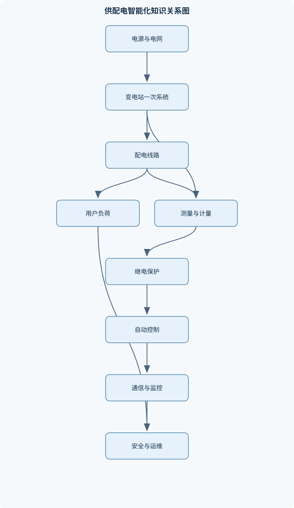
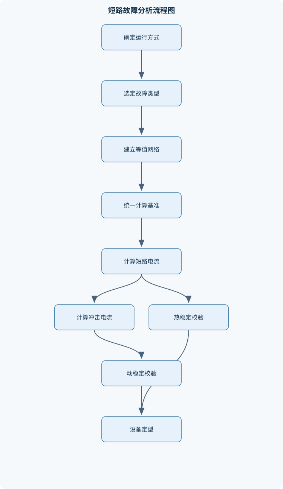

# 智能供配电技术

## 一、课程整体知识框架

### 课程边界与先修知识

《智能供配电技术》研究工业及建筑用户从电源接入、变配电、线路输送、负荷管理到继电保护、自动控制、运行监测和电气安全的完整技术体系。课程对象包括中压配电系统、低压配电系统、厂区及车间变电所、变压器、开关设备、电力线路、二次回路、微机保护、变电站自动化、无功补偿、防雷接地和电能质量治理。课程重点是将一次设备与二次测量、保护、控制、通信和智能运维结合起来，形成供配电系统的分析、设计、选择、校验和故障处理方法。先修知识包括电路基本定律与交流电路分析、三相系统、磁路与变压器、电机基础、电力系统基础、自动控制基础、计算机与通信基础。电路分析应掌握节点电流定律和回路电压定律：节点处各支路电流的代数和为零，闭合回路中各元件电压升降的代数和为零；对于不能化为简单串并联的网络，应通过设定支路电流、列节点方程和回路方程求解。课程不替代现行国家标准、行业标准和具体工程设计规范，设备参数、保护定值、接地要求和防雷等级必须结合系统电压等级、短路容量、环境条件、设备样本及适用标准核定。





### 1. 课程对象、边界与先修基础

《智能供配电技术》研究工业用户和建筑用户从电源接入到终端用电的完整技术链条，包括电源与变电所、一次设备、输配电线路、负荷计算、短路分析、二次回路、继电保护、自动化通信、无功补偿、电能质量、防雷接地和运行检修。课程重点不是孤立介绍某种设备，而是说明一次系统中的电能如何流动，二次系统如何感知和判断，保护与控制如何作用，以及运行人员如何依据测量、告警和故障信息完成安全处置。

电力系统通常包括发电、输电、变电、配电和用电环节。供配电系统的边界一般从用户电源接入点开始，延伸至各级变配电所、馈电线路、用电设备及其保护控制装置。发电厂和高压输电网属于更大范围的电力系统，但其运行方式、电源短路容量和电压质量会直接影响用户侧设计。用户侧不能把“供电系统容量足够”简单理解为“供电可靠”：可靠性还取决于电源数量、线路接线形式、备用设备、自动切换、故障隔离和检修条件。

先修知识包括直流与交流电路、三相系统、磁路与变压器、电机基础、电力系统基础、自动控制、计算机和通信。复杂交流网络不能总是化为简单串并联电路，应先选定参考节点，规定支路电流方向，再依据节点电流定律和回路电压定律列方程。节点电流定律表示节点处各支路电流代数和为零；回路电压定律表示沿任一闭合回路，电源电压升与阻抗压降的代数和为零。计算结果为负值时，表示实际方向与假定方向相反，而不是计算错误。

### 2. 基本符号与三相功率关系

$U$表示线电压或设备端电压，单位为伏特（V）；$U_{ph}$表示相电压，单位为V；$I$表示线路或设备电流，单位为安培（A）；$P$、$Q$、$S$分别表示有功功率、无功功率和视在功率，单位分别为W、var和VA。$Z=R+jX$为交流阻抗，$R$为电阻，$X$为电抗，$j$为虚数单位。$\cos\varphi$为功率因数，$\varphi$是电压与电流的相位差，感性负荷通常使电流滞后电压。

在三相对称、正弦稳态且负荷基本平衡时，线电压是两个相电压的相量差，因此有：

$$
U=\sqrt{3}U_{ph}
$$

三相有功功率、无功功率和视在功率可写为：

$$
P=\sqrt{3}UI\cos\varphi
$$

$$
Q=\sqrt{3}UI\sin\varphi
$$

$$
S=\sqrt{3}UI=\sqrt{P^2+Q^2}
$$

由功率三角形可得：

$$
\cos\varphi=\frac{P}{S}
$$

上述关系要求三相近似对称并以基波正弦量为主。三相不平衡时，应分别计算各相功率；含有显著谐波时，视在功率还包含畸变成分，不能只用基波相位差代表总功率因数。

### 3. 供配电系统结构与供电质量

供配电系统的一次系统包括变压器、母线、断路器、隔离开关、熔断器、互感器、避雷器、线路和负荷等直接传输或变换电能的设备。二次系统包括测量、保护、控制、信号、自动装置、通信和操作电源。一次设备决定电能通道和故障电流路径，二次设备通过电流互感器、电压互感器和传感器获取状态，经过判断后发出告警、跳闸、合闸或调节命令。

用户变电所常见接线形式有放射式、树干式和环形。放射式每个重要负荷由独立馈线供电，故障影响范围小、保护配合清晰，但线路和开关数量较多；树干式线路利用率较高、投资较少，但干线故障可能影响多个负荷；环形接线可通过改变运行方式提高供电灵活性，但需要可靠的分段开关、闭锁逻辑和明确的开环点。供电电压的选择要综合负荷容量、供电距离、短路容量、线路损耗、设备价格、绝缘水平和扩建需求，不能只按负荷功率单一决定。

负荷按对供电可靠性的要求可划分为不同等级。重要负荷通常需要两个独立电源、备用电源或自动投入装置；一般负荷可以采用单电源，但应满足检修和故障隔离要求。供电质量包括电压偏差、频率偏差、电压波动与闪变、三相不平衡、谐波、电压暂降、短时中断和功率因数等。改进措施包括调整变压器分接头、缩短供电半径、增大导线截面、合理无功补偿、平衡三相负荷、抑制谐波、优化大容量电动机启动方式和设置备用电源。

### 4. 中性点运行方式与接地系统

中性点运行方式影响单相接地电流、过电压水平、保护判据和设备绝缘要求。中性点不接地系统发生单相接地时，故障电流主要由非故障相对地电容电流构成，故障相对地电压降低，非故障相对地电压可能升高到接近线电压。系统在满足相应运行条件时可能短时继续运行，但这不等于允许长期带故障运行，因为绝缘应力增加，接地故障可能发展为相间短路。

中性点经消弧线圈接地，是利用电感电流补偿系统对地电容电流，以减小接地点电弧电流。中性点经电阻接地能够限制故障电流并提高接地保护的可检测性，常用于需要快速切除接地故障的系统。中性点直接接地系统的单相接地电流较大，保护动作明确，但设备和接地装置承受的故障电流也较大。

单相接地分析可采用零序电压和零序电流。零序电流是三相电流相量和的三分之一，工程中常通过零序电流互感器或三相电流求和获得。接地选线装置比较各馈线零序电流的幅值、方向、相位或暂态特征，判断故障线路。选线结果受系统电容电流、互感器误差、故障电阻和通信采样同步影响，不能把单一幅值阈值视为所有系统都适用。

低压系统常见TN、TT和IT接地形式。TN系统中电源中性点接地，设备外露可导电部分通过保护导体与电源接地点相连；TT系统中设备保护接地与电源接地点相互独立；IT系统电源与地隔离或经高阻抗连接，通常依靠绝缘监视和故障处理维持连续供电。工作接地用于稳定系统电位和运行参考，保护接地用于降低外露金属部分的危险电压。保护导体必须连续可靠，重复接地和等电位联结有助于降低电位差，但不能替代保护装置的快速动作。

### 5. 电力负荷与负荷计算

用电设备的工作制包括连续工作、短时工作和断续周期工作。负荷计算应先按生产工艺和运行特性分组，再确定设备额定容量、运行班次、启动电流和功率因数。需要系数法以统计规律为基础：

$$
P_{js}=K_xP_N
$$

其中，$P_{js}$为计算有功负荷，单位为W或kW；$P_N$为设备额定有功功率总和；$K_x$为需要系数。需要系数不是设备固有常数，而与设备类别、同时运行台数、工作班次和统计边界有关。

在已知功率因数时，可按下式计算无功和视在负荷：

$$
Q_{js}=P_{js}\tan\varphi
$$

$$
S_{js}=\sqrt{P_{js}^2+Q_{js}^2}
$$

多个车间或馈线汇总时，需要考虑同时系数，即不同用电区域最大负荷并不一定同时出现。利用系数法适用于具有设备利用率和平均负荷资料的场景；二项式法适用于设备台数较少、最大负荷受少数大容量设备影响明显的场景。负荷系数是平均负荷与最大负荷的比值，用于描述负荷曲线平滑程度；最大需量是一定时间窗口内的最大平均功率，不能与所有设备额定功率相加混淆。

变压器容量应满足计算视在负荷、环境修正、备用要求和扩建裕度，并校验短路容量、温升和并列运行条件。尖峰电流主要用于校验断路器瞬时脱扣、熔断器选择、电压波动和电动机启动影响，不能直接用最大需量电流替代。

### 6. 短路电流分析与设备选择

短路故障包括三相短路、两相短路、单相接地和两相接地。短路计算首先确定故障点和运行方式，再建立从故障点向电源侧看的等值阻抗。三相短路在对称系统中通常采用正序网络：

$$
I_k=\frac{U}{\sqrt{3}Z_k}
$$

其中，$I_k$为三相短路电流有效值，单位为A；$U$为故障点短路前线电压，单位为V；$Z_k$为故障回路等值阻抗，单位为Ω。计算时必须计入电网、变压器、线路和发电机等阻抗；忽略其中任一重要部分，都可能造成短路电流明显偏差。

标幺值法要求统一基准容量和基准电压。不同电压等级之间应按变压器变比折算，不能直接把高压侧和低压侧的欧姆阻抗相加。无限大容量电源模型把电源端电压视为恒定，适用于电源短路容量远大于用户系统、研究局部故障的情况；当电源容量有限或系统扩建后短路水平变化明显时，必须计入电源等值阻抗。

短路全电流由周期分量和非周期分量组成。非周期分量按指数规律衰减，其初值取决于故障发生瞬间的电流连续条件和故障角，因此短路冲击峰值不能简单等于稳态短路电流。设备选择要同时校验额定电压、额定电流、开断能力、关合能力、热稳定和动稳定。导体短路热稳定常用近似关系：

$$
A\geq \frac{I_k\sqrt{t_k}}{C}
$$

其中，$A$为导体截面积，单位为mm²；$t_k$为保护切除故障的总时间，单位为s；$C$为按导体材料、初始温度和允许终温查取的短路热稳定系数。该式基于短路过程近似绝热，长时间故障或散热显著时应采用更准确的热模型。动稳定则比较设备允许短路峰值与实际冲击峰值，并考虑相间距离、支撑间距和母线形状。

### 7. 工厂电力线路及截面选择

架空线路主要由导线、绝缘子、杆塔、金具和接地装置组成；电缆线路由导体、绝缘层、屏蔽层、金属护层和外护套组成。电缆敷设方式、环境温度、土壤热阻、并列回路数量和散热条件都会影响允许载流量。

导线和电缆截面应按多项条件综合确定。首先根据计算电流$I_b$选择满足修正后允许载流量$I_z$的截面：

$$
I_z\geq I_b
$$

然后校验线路电压损失。三相线路在近似对称、功率因数稳定时，电压损失与线路长度、电流、单位阻抗和功率因数有关；短线路可采用集中参数模型，长线路或高压线路则应考虑分布参数和电容效应。还要按经济电流密度确定长期运行的经济截面，按短路热稳定校验故障期间的温升，按架空线路机械强度校验导线弧垂、风荷载、冰荷载和拉力。

只按载流量选线会遗漏电压损失；只按电压损失选线可能忽略短路热稳定；只按经济电流密度选线也不能替代机械强度和保护配合校验。最终截面应由所有约束条件中的控制项决定。

### 8. 二次回路与操作电源

二次回路包括断路器控制、信号、测量、保护、自动装置、绝缘监视和通信回路。回路编号应能反映端子、线号、功能和设备对应关系，便于施工、试验和故障追踪。直流操作电源通常由蓄电池、充电装置、直流屏和配电回路组成，在交流失压时仍能为保护跳闸、断路器控制和事故信号供电；交流操作电源结构较简单，但对站用交流电源可靠性依赖更强。

断路器控制回路应包含合闸、分闸、位置反馈、防跳、闭锁和故障监视。事故跳闸回路必须保证保护出口动作后断路器可靠分闸；不对应回路通过比较控制命令与断路器实际位置，发现“命令与位置不一致”时发出告警或执行相应逻辑。电气测量包括电流、电压、功率、频率和功率因数，电能计量还要关注互感器变比、极性、精度、接线方式和时钟同步。

### 9. 继电保护与微机保护

继电保护的基本任务是在故障发生时快速、选择性地切除故障设备，在异常运行时发出告警或采取限制措施。保护应满足选择性、速动性、灵敏性和可靠性。选择性要求优先切除故障区域内的断路器；速动性用于减小设备损伤和系统电压扰动；灵敏性要求保护在最不利运行方式下仍能识别规定范围内的故障；可靠性包括不拒动和不误动。

过电流保护根据故障电流超过整定值动作，可采用定时限或反时限特性。电流速断保护动作快，但保护范围受短路电流随距离衰减的影响，不能覆盖全部线路。变压器差动保护比较两侧折算到同一基准的电流，保护区通常由两侧电流互感器之间的设备组成；必须处理变比、接线组别、相位补偿和励磁涌流问题。瓦斯保护反映油浸变压器内部气体积聚和油流变化，适合作为内部故障的重要保护，但不能替代所有电气保护。

高压电动机保护需考虑短路、过负荷、堵转、启动时间过长、欠电压、接地和相间不平衡。微机保护将互感器二次信号经隔离、滤波、模数转换和数字算法处理，计算有效值、相量或序分量，再与定值比较。互感器饱和、采样不同步、滤波延时、通信故障和出口继电器异常都会影响动作可靠性。故障录波应保存故障前后波形、动作量、时间戳和断路器状态。

### 10. 变电站自动化与智能运维

变电站综合自动化把测量、保护、控制、通信和故障记录集中到统一系统中。集中式结构便于统一管理，但集中故障影响较大；分布式结构按间隔配置装置，抗局部故障能力和扩展性较好。系统通常分为间隔层和站控层：间隔层负责采集、保护和就地控制，站控层负责数据汇总、画面显示、事件管理和远方操作。

遥测、遥信、遥控和遥调分别表示测量量、状态量、控制命令和调节命令，工程中还应明确采集周期、时间戳、通信质量和数据有效标志。备用电源自动投入应在失压判断、断路器状态确认、无故障闭锁和备用电源可用等条件满足后执行；自动重合闸则要区分瞬时故障和永久故障，防止反复冲击故障设备。事件顺序记录依靠统一时钟和高精度时间戳重构动作先后，装置自诊断用于发现采样异常、存储器故障、通信中断和电源异常。

### 11. 无功补偿与电能质量治理

并联电容器向系统提供容性无功，减少线路和变压器输送的感性无功。若补偿前有功功率为$P$，功率因数由$\cos\varphi_1$提高到$\cos\varphi_2$，在基波正弦条件下，补偿容量为：

$$
Q_c=P(\tan\varphi_1-\tan\varphi_2)
$$

$P$和$Q_c$应采用相同功率单位。补偿后线路电流按新的视在功率下降，变压器和线路的铜耗通常随电流平方降低。但补偿过度会导致过电压或容性运行，电容器投切还可能产生涌流。

分组补偿适合负荷变化明显的车间，就地补偿适合无功集中且线路损耗明显的设备。含有变频器、整流器、电弧炉等谐波源时，电容器可能与系统电感发生谐振，放大谐波。可采用串联电抗器、无源滤波器或有源电力滤波器治理。电压暂降和短时中断常由短路故障、大容量电动机启动或电源切换引起，需要通过提高电源短路容量、优化启动方式、快速切换和设置动态电压支撑设备改善。

三相负荷不平衡会造成负序电流、变压器附加发热和电动机转矩脉动，应通过负荷重分配、相间换接和优化配电方案治理。电能质量监测应记录电压、电流、频率、谐波、不平衡度、暂降和中断事件，并结合事件时间、负荷状态和设备动作进行评价。

### 12. 防雷接地与电气安全

雷电危害包括直击雷、感应雷和雷电侵入波。直击雷直接作用于建筑物或设备；感应雷由雷电流电磁场在附近线路中感应过电压；雷电侵入波则沿架空线、电缆或金属管线进入变电所。操作过电压、谐振过电压与雷电不同，但同样可能造成绝缘击穿。

防雷系统通常包括接闪器、引下线和接地装置。接闪器承担接收雷电流的作用，引下线提供低阻抗泄流通道，接地装置把电流扩散到土壤。滚球法通过规定滚球半径检查建筑物和设备是否处于接闪系统保护范围内，保护范围不是绝对安全区，还需考虑引下线电感、反击、雷电侵入波和等电位连接。避雷器应靠近被保护设备配置，并校核持续运行电压、雷电冲击残压、操作冲击残压和安装距离。

接地设计应考虑土壤电阻率、故障电流、场地边界、季节变化和雷电流条件。工频接地电阻$R_E$满足：

$$
U_E=I_ER_E
$$

其中，$I_E$为流入地中的故障电流，单位为A；$U_E$为接地部分相对远方地的电位差，单位为V。接触电压$U_{tou}$和跨步电压$U_{step}$不仅由接地电阻决定，还与地网电位分布、人体位置、鞋和地面条件、故障持续时间有关。因此，接地电阻合格并不代表接触和跨步电压必然安全。

漏电保护装置通过检测各相及中性线电流的相量和判断剩余电流。正常时相量和接近零，漏电时剩余电流增大并触发脱扣。检测元件必须覆盖其保护范围内的全部带电导体，中性线接线错误会导致误动作或拒动作。检修必须执行停电、验电、接地、挂牌和监护等步骤，远方遥控操作还必须完成权限校验、闭锁校验和操作回执确认。

## 二、章节和模块划分

### 核心知识覆盖清单

本清单用于检查正文是否覆盖本课程的主要知识模块：

- **供配电系统结构与供电质量**：电力系统与供配电系统边界、发电厂与变电所类型、一次系统与二次系统、用户变电所典型结构、供电可靠性与负荷等级、供电电压等级选择原则、电压偏差与频率偏差、三相不平衡与电压波动、谐波与功率因数、供电质量改进措施。
- **中性点运行方式与接地系统**：中性点不接地系统、中性点经消弧线圈接地、中性点经电阻接地、中性点直接接地系统、单相接地故障相量关系、零序电压与零序电流、接地故障选线原理、TN、TT和IT系统、工作接地与保护接地、重复接地和保护导体连续性。
- **电力负荷与负荷计算**：用电设备工作制、需要系数法、利用系数法、二项式法、同时系数与最大需量、尖峰电流计算、负荷曲线与负荷系数、无功负荷与功率因数、变压器容量确定、短路容量与系统扩建裕度。
- **短路电流分析与电气设备选择**：短路类型与故障边界、标幺值与等值阻抗、无限大容量电源模型、三相短路周期分量、短路非周期分量、短路冲击电流、短路电流热效应、短路电动力效应、断路器开断能力、电气设备热稳定和动稳定校验。
- **工厂电力线路及其选择计算**：放射式与树干式接线、环形接线及其运行方式、架空线路结构、电缆线路结构与敷设、导线和电缆载流量、按允许温升选择截面、按允许电压损失选择截面、按经济电流密度选择截面、线路机械强度校验、线路短路热稳定校验。
- **变配电所二次回路与操作电源**：二次回路组成与编号、直流操作电源、交流操作电源、蓄电池与充电装置、断路器控制回路、断路器信号回路、事故跳闸与不对应原理、电气测量与电能计量、绝缘监视回路、中央事故和预告信号。
- **继电保护与微机保护**：继电保护基本任务、保护选择性速动性灵敏性可靠性、过电流保护、电流速断保护、定时限与反时限特性、变压器差动保护、变压器瓦斯保护、高压电动机保护、保护装置采样与模数转换、保护定值与故障录波。
- **变电站自动化与智能运维**：变电站综合自动化功能、集中式与分布式结构、遥测遥信遥控遥调、间隔层与站控层、数据采集和状态监视、备用电源自动投入、自动重合闸、小电流接地选线、事件顺序记录与故障报告、通信、数据库和装置自诊断。
- **无功补偿与电能质量治理**：功率因数与无功功率、并联电容器补偿、无功补偿容量计算、分组补偿与就地补偿、电容器投切涌流、谐波源与谐波放大、有源滤波与无源滤波、电压暂降与短时中断、三相负荷不平衡治理、电能质量监测与评价。
- **防雷接地与电气安全**：直击雷和感应雷、雷电侵入波、操作过电压与谐振过电压、接闪器引下线和接地装置、滚球法保护范围、避雷器配置、接触电压与跨步电压、接地电阻和土壤电阻率、漏电保护原理、检修接地和安全工作流程。


### 1. 模块一至三：系统认知、中性点与负荷计算

第一章“供配电系统结构与供电质量”建立全课程对象，内容顺序为电力系统边界、发电厂和变电所类型、一次与二次系统、用户变电所接线、负荷等级、电压等级和供电质量。章节输出应包括用户供电方案、一次接线说明和供电质量问题分析。

第二章“中性点运行方式与接地系统”比较不接地、经消弧线圈接地、经电阻接地和直接接地，重点分析单相接地时的相量关系、零序量和选线逻辑，并延伸至TN、TT、IT系统、工作接地、保护接地和重复接地。章节分析必须明确不同系统的故障电流路径和保护动作条件。

第三章“电力负荷与负荷计算”以设备清单为输入，完成分组、需要系数或利用系数选择、同时系数处理、最大需量和尖峰电流计算，并据此确定变压器、母线和馈线容量。计算结果必须说明统计边界、功率因数、备用裕度和资料不确定性。

### 2. 模块四至六：短路、线路与二次回路

第四章“短路电流分析与电气设备选择”按照故障类型、等值网络、标幺值、周期与非周期分量、冲击电流、热稳定和动稳定展开。章节最终应形成最大短路电流和最小短路电流两类结果：前者用于开断能力、动稳定和热效应校验，后者用于继电保护灵敏性校验。

第五章“工厂电力线路及其选择计算”先比较放射式、树干式和环形接线，再介绍架空线路和电缆结构，最后完成载流量、电压损失、经济电流密度、机械强度和短路热稳定校验。线路设计不得将“额定电流满足”作为唯一结论。

第六章“变配电所二次回路与操作电源”包括二次回路编号、直流和交流操作电源、蓄电池与充电装置、断路器控制和信号、事故跳闸、不对应回路、测量计量、绝缘监视和中央信号。章节实践应以控制回路图和故障现象为依据，追踪电源、端子、继电器、断路器线圈和位置接点的逻辑关系。

### 3. 模块七至十：保护、自动化、电能质量与安全

第七章“继电保护与微机保护”按照保护任务和四项基本性能展开，依次分析过电流、速断、定时限、反时限、变压器差动、瓦斯和电动机保护，再进入采样、模数转换、数字滤波、定值、录波和保护配合。整定分析必须同时使用最大负荷电流、启动电流、最大与最小短路电流、CT变比和上下级动作时间。

第八章“变电站自动化与智能运维”包括集中式与分布式结构、间隔层和站控层、遥测遥信遥控遥调、状态监视、备用电源自动投入、自动重合闸、接地选线、事件顺序记录、通信、数据库和自诊断。章节应把自动化功能与故障处理流程结合，不能只描述通信名词。

第九章“无功补偿与电能质量治理”先从功率三角形推导补偿容量，再讨论并联电容器、分组补偿、就地补偿、投切涌流和过补偿，随后分析谐波源、谐波放大、有源与无源滤波、电压暂降、短时中断和三相不平衡。章节输出应包含补偿前后电流、损耗和电能质量风险的对比。

第十章“防雷接地与电气安全”依次处理直击雷、感应雷、雷电侵入波、操作过电压、谐振过电压、接闪器、引下线、接地装置、滚球法、避雷器、接触电压、跨步电压、漏电保护和检修安全。章节结论必须区分工频接地电阻、冲击阻抗和人体安全电压评价，不能用一个指标替代全部安全校验。

### 4. 代表性计算与工程流程

#### 4.1 负荷计算流程

**输入：**设备清单、额定功率、工作制、需要系数、功率因数、运行班次、同时系数和尖峰电流资料。

**过程：**

1. 按车间、工艺段和供电层级划分计算边界。
2. 对连续、短时和断续设备分别确定等效容量。
3. 计算各组有功负荷$P_{js}$。
4. 根据功率因数计算$Q_{js}$和$S_{js}$。
5. 汇总时考虑同时系数，确定最大需量。
6. 按计算电流选择变压器、母线和馈线。
7. 用最大启动或尖峰电流校验保护和电压波动。
8. 检查容量裕度、功率因数和扩建条件。

**输出：**分组负荷表、总计算负荷、变压器容量、馈线电流和补偿需求。终止条件是所有供电层级完成计算且容量、温升和电压条件满足。资料不完整时，应给出假设范围，不应把经验系数伪装成精确结果。

#### 4.2 短路电流计算流程

**输入：**系统电压、变压器容量和短路阻抗、线路长度与阻抗、电源短路容量、运行方式和故障类型。

**过程：**

1. 确定故障点及其最大、最小运行方式。
2. 建立故障点至各电源的等值网络。
3. 统一基准容量和基准电压，折算各段阻抗。
4. 分别计算三相、两相、单相接地等故障电流。
5. 求周期分量、冲击峰值和热稳定所需电流。
6. 输出断路器开断能力、母线动稳定和导体热稳定的校验数据。

**不变量：**同一计算过程中基准单位和变压器折算关系保持一致。每一种运行方式必须独立计算，不能用一个短路电流覆盖所有保护定值。

#### 4.3 导线和电缆截面选择流程

**输入：**计算电流$I_b$、敷设方式、环境温度、并列回路数、线路长度、允许电压损失和短路切除时间。

**过程：**

1. 按敷设条件确定载流量修正系数。
2. 筛选满足$I_z\geq I_b$的候选截面。
3. 计算正常运行电压损失。
4. 按经济电流密度比较长期运行经济性。
5. 按短路热稳定关系校验故障温升。
6. 对架空线路校验机械强度和弧垂。
7. 选取满足全部条件且综合经济性合理的截面。

**终止条件：**载流量、电压损失、经济性、热稳定和机械条件全部满足。若某候选截面失败，应记录失败原因，而不是只增加截面后忽略其他限制。

#### 4.4 保护整定与故障处理流程

保护整定的输入包括最大负荷、启动电流、最大和最小短路电流、上下级保护动作时间、CT变比、断路器分闸时间和变压器励磁涌流。先确定保护功能及其范围，再计算动作电流、动作时间和灵敏系数，最后按故障点逐级检查选择性、速动性和开断能力。

变电站故障处理的顺序为：接收保护动作、遥信变位和遥测越限；按时间戳重构事件；核对一次设备状态和保护出口；隔离故障设备；判断失压范围；在满足闭锁和安全条件时执行备用电源投入或重合闸；复核电压、电流、频率和接地状态；形成故障报告。任何远方控制都必须有权限、闭锁、操作回执和异常中止条件。

```python
# 语言：Python
# 作用：根据设备额定功率和需要系数计算分组负荷
# 仅进行数值计算，不连接设备、不执行外部操作

import math

loads = [
    {"name": "连续生产设备", "rated_kw": 800.0, "need_factor": 0.80, "cos_phi": 0.90},
    {"name": "间歇运行电动机", "rated_kw": 500.0, "need_factor": 0.55, "cos_phi": 0.82},
    {"name": "照明负荷", "rated_kw": 120.0, "need_factor": 0.90, "cos_phi": 0.95},
]

total_p = 0.0
total_q = 0.0

for item in loads:
    p = item["rated_kw"] * item["need_factor"]
    cos_phi = item["cos_phi"]

    if not 0 < cos_phi <= 1:
        raise ValueError("功率因数必须大于0且不超过1")

    tan_phi = math.sqrt(1 - cos_phi ** 2) / cos_phi
    q = p * tan_phi

    item["p_js_kw"] = p
    item["q_js_kvar"] = q
    item["s_js_kva"] = math.sqrt(p ** 2 + q ** 2)

    total_p += p
    total_q += q

total_s = math.sqrt(total_p ** 2 + total_q ** 2)
total_cos_phi = total_p / total_s

print(f"总有功计算负荷：{total_p:.2f} kW")
print(f"总无功计算负荷：{total_q:.2f} kvar")
print(f"总视在计算负荷：{total_s:.2f} kVA")
print(f"综合功率因数：{total_cos_phi:.3f}")
```

该程序的输入是各组额定功率、需要系数和功率因数，输出各组及总的$P$、$Q$、$S$。它假定各组功率因数为基波功率因数，未包含同时系数、谐波畸变、温度修正和备用容量，因此输出只能作为负荷计算的基础结果，不能直接替代工程设计校核。

### 5. 代表性例题

#### 例题一：需要系数法确定车间计算负荷

**题干：**连续设备额定功率为$800\ \text{kW}$，需要系数为$0.80$，功率因数为$0.90$；间歇电动机为$500\ \text{kW}$，需要系数为$0.55$，功率因数为$0.82$；照明为$120\ \text{kW}$，需要系数为$0.90$，功率因数为$0.95$。暂不考虑总同时系数，求总计算有功、无功和视在负荷。

**分析：**各组先按$P_{js}=K_xP_N$求有功，再按$Q_{js}=P_{js}\tan\varphi$求无功，最后分别求和，不能先把功率因数简单平均。

**逐步解答：**

连续设备：
$$
P_1=0.80\times800=640\ \text{kW}
$$
$$
Q_1=640\times\frac{\sqrt{1-0.90^2}}{0.90}\approx310.1\ \text{kvar}
$$

间歇电动机：
$$
P_2=0.55\times500=275\ \text{kW}
$$
$$
Q_2\approx275\times\frac{\sqrt{1-0.82^2}}{0.82}\approx192.0\ \text{kvar}
$$

照明：
$$
P_3=0.90\times120=108\ \text{kW}
$$
$$
Q_3\approx108\times\frac{\sqrt{1-0.95^2}}{0.95}\approx35.5\ \text{kvar}
$$

因此：
$$
P_{js}=640+275+108=1023\ \text{kW}
$$
$$
Q_{js}\approx310.1+192.0+35.5=537.6\ \text{kvar}
$$
$$
S_{js}=\sqrt{1023^2+537.6^2}\approx1155.8\ \text{kVA}
$$

**结果验证：**综合功率因数约为$1023/1155.8=0.885$，介于各组功率因数的合理范围内。

**变式：**若总同时系数为$0.85$，应对汇总负荷按统计边界处理，不能机械地对每一组重复乘以$0.85$。若补偿后目标功率因数为$0.95$，可再用$Q_c=P(\tan\varphi_1-\tan\varphi_2)$计算补偿容量。

#### 例题二：三相短路电流与模型边界

**题干：**某低压母线线电压为$400\ \text{V}$，从故障点看向电源侧的等值阻抗为$0.008+j0.012\ \Omega$，求三相短路电流有效值。

**分析：**先求阻抗幅值，再使用三相短路公式。该计算假设系统对称、故障为金属性三相短路，且电压取故障前线电压。

**逐步解答：**

$$
Z_k=\sqrt{0.008^2+0.012^2}\approx0.01442\ \Omega
$$

$$
I_k=\frac{400}{\sqrt{3}\times0.01442}
\approx16015\ \text{A}
$$

故三相短路电流有效值约为$16.0\ \text{kA}$。

**结果验证：**等值阻抗越小，短路电流越大；若遗漏变压器阻抗，结果会被高估。

**变式：**若故障为单相接地，不能继续使用该式，应建立正序、负序和零序网络；若电源短路容量有限，也不能使用无限大容量电源模型。

#### 例题三：导体短路热稳定校验

**题干：**导体短路电流有效值为$12\ \text{kA}$，保护切除总时间为$0.20\ \text{s}$，短路热稳定系数取$C=94\ \text{A}\sqrt{\text{s}}/\text{mm}^2$。求最小截面积。

**逐步解答：**

使用：

$$
A_{\min}=\frac{I_k\sqrt{t_k}}{C}
$$

代入：

$$
A_{\min}=\frac{12000\sqrt{0.20}}{94}
\approx57.0\ \text{mm}^2
$$

因此实际截面积至少应达到计算值，并结合标准规格选取不小于该值的截面。

**结果验证：**热稳定校验只说明短路持续期间温升是否可接受，不表示长期载流量一定满足。还必须另行校验正常运行载流量、电压损失和机械强度。

**变式：**若保护时间增加到$0.50\ \text{s}$，最小截面积按$\sqrt{t}$增加；若导体初始温度、材料或允许终温变化，$C$也必须重新确定。

#### 例题四：无功补偿容量

**题干：**工业用户有功计算负荷为$1000\ \text{kW}$，功率因数由$0.75$提高到$0.95$，求理论补偿容量。

**逐步解答：**

$$
\tan\varphi_1=\frac{\sqrt{1-0.75^2}}{0.75}\approx0.882
$$

$$
\tan\varphi_2=\frac{\sqrt{1-0.95^2}}{0.95}\approx0.329
$$

$$
Q_c=1000(0.882-0.329)\approx553\ \text{kvar}
$$

理论补偿容量约为$553\ \text{kvar}$，工程选型还需按分组容量、投切级差、谐波和过电压风险确定。

**结果验证：**补偿后视在功率由$1000/0.75\approx1333\ \text{kVA}$降至$1000/0.95\approx1053\ \text{kVA}$，线路电流和铜耗具有下降趋势。

**变式：**若系统存在显著谐波，不能直接把普通电容器按理论容量全部投入，应先分析谐波阻抗和谐振风险，必要时配置电抗器或滤波设备。

#### 例题五：中性点不接地系统单相接地

**题干：**某中性点不接地系统发生C相接地，判断故障相和非故障相对地电压变化，并说明运行处置原则。

**分析：**故障相C的对地电压被故障点钳制，接近零；系统中性点发生位移，A、B两相对地电压升高，理想条件下接近原来的线电压。

**逐步解答：**

1. 故障前，三相对地电压幅值相等。
2. C相接地后，$U_{C}=0$或接近零。
3. 中性点位移使A、B相对地电压升高。
4. 接地电流主要由系统对地电容电流构成，大小与线路长度和对地电容有关。
5. 通过零序电压和各馈线零序电流进行接地选线。
6. 在允许的短时运行条件内组织故障定位和限时切除，不能长期带故障运行。

**结果验证：**若把非故障相电压仍按相电压处理，会低估绝缘应力。若系统改为经电阻接地，故障电流路径和保护动作逻辑将发生变化。

**变式：**若故障点存在较大过渡电阻，故障电流可能减小，单纯过电流判据灵敏性下降，需要结合零序电压、方向和暂态信息。

### 6. 实验与项目任务

#### 6.1 项目一：低压配电系统负荷与线路设计

**输入数据：**提供一个车间的设备清单，包括额定功率、工作制、需要系数、功率因数、运行班次；给定供电电压、线路长度、敷设方式、环境温度、并列回路数量和允许电压损失。

**实施步骤：**

1. 按工艺和供电层级划分负荷组。
2. 计算各组及总的$P$、$Q$、$S$。
3. 确定变压器容量和备用裕度。
4. 计算各馈线$I_b$，按修正条件选择导线或电缆。
5. 校验电压损失、短路热稳定和保护配合。
6. 比较补偿前后的线路电流和变压器负载率。
7. 编制负荷表、线路选择表和计算说明。

**评价标准：**计算边界清楚；单位统一；需要系数和同时系数使用合理；变压器与线路容量满足运行条件；电压损失、热稳定和敷设修正完整；结果能追溯到原始数据。

**排错方法：**若功率因数大于1，检查输入和公式；若总无功为负，检查感性、容性符号；若线路电流异常偏大，检查线电压与相电压是否混用；若电缆载流量不合理，检查环境温度和并列修正系数是否重复或遗漏。

#### 6.2 项目二：变电站保护与故障录波分析

**输入数据：**提供馈线最大负荷电流、启动电流、最大和最小短路电流、CT变比、上级保护动作时间、断路器分闸时间、保护定值和故障录波波形。

**实施步骤：**

1. 核对CT变比、极性、相序和二次接线。
2. 根据录波确定故障前电流、故障电流和零序分量。
3. 按时间戳排列保护启动、出口、断路器分闸和遥信变位。
4. 计算保护灵敏系数和上下级时间差。
5. 判断故障属于区内、区外还是测量异常。
6. 检查互感器饱和、采样丢失、通信中断和出口回路。
7. 形成故障报告、定值校验表和整改清单。

**评价标准：**故障类型判断与波形证据一致；保护范围和动作逻辑清楚；没有把稳态短路电流、冲击峰值和全电流混淆；定值校验考虑最大负荷、启动电流和最小短路电流；报告包含设备状态、时间顺序、结论和复核措施。

**排错方法：**保护未动作时，先检查二次熔断器、CT回路和采样值，再检查定值和闭锁条件；保护误动作时，检查励磁涌流、启动电流、CT饱和和通信异常；时间顺序混乱时，检查装置时钟同步和事件记录分辨率；遥信与实际位置不一致时，检查辅助接点、端子排和不对应回路。

### 7. 课程知识之间的综合联系

课程的计算链条通常为“负荷计算—变压器与线路选择—短路计算—设备校验—保护整定—自动化监视—运行维护”。负荷计算提供正常运行电流，短路计算提供故障电流边界；设备选择必须同时满足正常运行和故障条件；保护整定又依赖最大负荷、启动电流和最小短路电流；自动化系统把保护动作、遥信、遥测和录波组织成可追溯的运行信息；无功、电能质量、防雷和接地则进一步约束设备长期运行和人身安全。

任何工程结论都必须注明适用的电压等级、运行方式、环境条件、设备参数和计算假设。课程中的公式用于建立分析模型，不能替代现行标准、设备样本和具体工程设计校核。

## 三、核心概念的详细解释

### 3.1 供配电系统、一次系统与二次系统

供配电系统是用户侧电能从电源接入点经过变电、配电、输送和分配，最终到达用电设备的技术系统。其基本任务包括：在满足电压、频率和容量要求的条件下连续供电；在发生短路、接地或设备异常时迅速识别并隔离故障；通过测量、通信和自动控制实现经济运行与状态维护。

一次系统由直接承担电能传输、变换、分配和开断任务的设备组成，主要包括变压器、母线、断路器、隔离开关、熔断器、电流互感器、电压互感器、避雷器、架空线路、电缆和负荷。二次系统不直接输送大功率电能，而是完成测量、保护、控制、信号、通信和自动装置功能。一次设备决定能量流和故障电流路径，二次设备则依据互感器或传感器提供的信号判断系统状态。

断路器既能在正常条件下接通、承载和切断负荷电流，也能在规定条件下开断短路电流；隔离开关主要用于形成明显断开点，通常不承担带负荷开断任务。电流互感器将一次大电流变换为适合测量和保护的二次电流，电压互感器将一次高电压变换为二次电压。互感器的变比、极性、准确级和饱和特性会直接影响计量和保护判断。

用户变电所的接线方式主要有放射式、树干式和环形。放射式线路独立、故障影响范围小、保护配合较容易，但设备和电缆数量较多；树干式投资和线路利用率较好，但干线故障可能同时影响多个负荷；环形接线可以在一段线路故障或检修时通过改变运行方式恢复供电，但必须设置分段设备、联锁和明确的开环点。接线形式不能脱离负荷等级、供电距离、检修条件和备用电源能力单独评价。

### 3.2 供电可靠性、负荷等级与供电电压

供电可靠性不是简单的“装机容量足够”，而是电源、线路、变压器、开关设备、备用容量、自动切换和故障隔离能力共同作用的结果。两个电源如果来自同一条上级线路、同一座变电站或同一组母线，发生共同故障时可能同时失电，因此“电源数量”必须结合独立性判断。

负荷等级反映中断供电可能造成的后果。重要生产设备、消防、应急照明、关键控制系统和可能导致重大安全事故的负荷，通常需要更高的供电可靠性，可采用双电源、备用电源、自动投入或专用馈线。一般负荷可以采用单电源，但仍需满足保护、检修和故障隔离要求。备用电源自动投入并非任何情况下都允许，其动作前必须确认故障范围、备用电源容量、母线无压条件及联锁闭锁条件。

供电电压的选择需要综合负荷容量、供电距离、线路损耗、短路水平、设备绝缘水平、变压器容量、投资和远期扩建。电压提高后，在传输相同有功功率和功率因数不变时，线路电流降低，线路损耗和电压损失通常减小；但高电压设备的绝缘、开关、保护和安全距离要求提高。因而不能仅以“电压越高越好”为依据。

### 3.3 供电质量及其影响因素

供电质量包括电压质量、频率质量、波形质量和供电连续性。电压偏差表示实际电压相对额定电压的偏离；频率偏差反映系统有功功率平衡状况；电压波动通常与冲击性负荷、频繁启停的大型电动机、弧炉和焊机有关；电压暂降是短时间电压有效值明显下降，可能使接触器释放、变频器停机或控制系统复位。

三相不平衡由单相负荷分配不均、线路阻抗不对称或故障造成。负序电压会在三相电动机中产生反向旋转磁场，增加转子损耗和发热；零序电压则与中性点位移及接地故障密切相关。治理三相不平衡应从负荷分相、调整运行方式、缩短单相大负荷供电路径和加强监测等方面进行，不能只依靠增加变压器容量。

谐波主要由整流器、变频器、开关电源、UPS和电弧类设备产生。谐波会增加变压器和线路损耗，导致中性线电流增大，引起电容器过热或谐振，并干扰保护、计量和通信。无功补偿电容器可能与系统电感形成并联或串联谐振，因此含有明显谐波时，应分析谐波次数、系统短路容量、电容器组容量和串联电抗器配置，不能直接把增大电容器容量作为唯一措施。

### 3.4 中性点运行方式与接地系统

中性点运行方式决定单相接地故障的电流大小、过电压水平、保护方式和故障后运行条件。中性点不接地系统发生单相接地时，故障电流主要由线路和设备对地电容电流构成，故障相对地电压降低，非故障相对地电压升高，可能接近线电压。该系统允许在规定条件下短时运行，以便完成故障选线和转移负荷，但不能理解为可以长期带故障运行。

中性点经消弧线圈接地，是利用电感电流补偿系统对地电容电流，使接地点的残流减小，从而降低电弧重燃概率。补偿效果受系统运行方式、线路长度和电容电流变化影响。中性点经电阻接地则通过电阻限制接地电流并提供可检测的零序电流，保护动作判据较明确，但故障点热效应和接地电压需要校核。中性点直接接地系统的单相接地电流通常较大，保护容易检测和切除，但设备承受的故障电流、电动力和热效应更明显。

低压系统中的TN、TT和IT表示不同的接地与保护方式。TN系统中电源中性点接地，设备外露可导电部分通过PE或PEN与电源接地点连接；故障时形成低阻抗回路，使过电流保护或剩余电流保护动作。TT系统中设备保护接地与电源接地相对独立，故障电流可能受接地电阻限制，通常需要剩余电流保护。IT系统的电源带电部分不直接接地或经高阻抗接地，第一次接地故障电流较小，但必须设置绝缘监视并及时处理。

工作接地用于稳定系统电位或满足设备运行要求，保护接地用于降低设备外壳故障电压和保障人身安全。重复接地可改善保护导体或PEN导体的电位分布，但不能替代保护导体连续性。保护接地的安全效果取决于故障回路阻抗、保护装置动作时间、保护导体截面和连接可靠性，而不是只看某一个接地电阻数值。

### 3.5 负荷计算与功率因数

用电设备的额定功率不等于其在计算时刻的实际功率。连续工作制设备可能长期接近额定状态，短时或断续工作制设备则需考虑运行时间和负载变化。需要系数反映设备组最大计算负荷与额定容量之比；利用系数反映设备平均负荷与额定容量之比；同时系数反映多个负荷组最大需量不同时出现的程度；负荷系数则是一定时间内平均负荷与最大负荷之比。四者统计边界和物理含义不同，不能互换。

按需要系数法，设备组的有功计算负荷为

$$
P_{js}=K_xP_N
$$

其中，$P_{js}$为计算有功功率，单位为W或kW；$K_x$为需要系数；$P_N$为设备额定有功功率总和，单位为W或kW。若设备组功率因数为$\cos\varphi$，则

$$
Q_{js}=P_{js}\tan\varphi
$$

$$
S_{js}=\sqrt{P_{js}^2+Q_{js}^2}
$$

$Q_{js}$为无功计算负荷，单位为var或kvar；$S_{js}$为视在计算负荷，单位为VA或kVA。多个负荷组汇总时，应先明确是否采用同时系数，避免把各组最大负荷简单相加而过度放大，也避免忽略同时运行导致容量不足。

变压器容量不仅要覆盖正常计算负荷，还要考虑环境温度、负荷增长、备用要求、短时过负荷能力和并列运行条件。容量过小会导致温升和电压质量恶化，容量过大则可能使轻载损耗和投资增加。负荷计算还应给出最大需量和尖峰电流，因为保护整定、断路器选择和电压暂降分析不能只使用平均负荷。

### 3.6 短路电流与电气设备校验

短路是不同电位导体之间通过低阻抗通道形成的异常连接，常见类型包括三相短路、两相短路、单相接地和两相接地。三相短路通常用于校验最大开断能力和动稳定；单相接地故障则与中性点接地方式、零序阻抗和接地保护密切相关。不同故障类型不能用同一个等值网络直接替代。

在三相短路的简化模型中，故障点至电源侧的等值阻抗为$Z_k$，故障点线电压为$U$，则短路电流有效值可写为

$$
I_k=\frac{U}{\sqrt{3}Z_k}
$$

其中，$I_k$单位为A，$U$单位为V，$Z_k$单位为Ω。该式通常基于三相对称、正弦稳态和正序网络条件。若电源短路容量有限，应计入电源等值阻抗；若忽略变压器阻抗、线路阻抗或运行方式变化，短路电流会出现系统性偏差。

短路全电流由周期分量和非周期分量组成。非周期分量由电感电流不能突变的暂态条件产生，并按指数规律衰减，其初值与故障发生角、故障前电流和系统电抗有关。因此，短路稳态有效值不能直接代替开关关合时的冲击峰值。设备选择应分别检查额定电压、持续电流、开断能力、关合能力、热稳定和动稳定。

导体短路热稳定校验可采用

$$
A\geq \frac{I_k\sqrt{t_k}}{C}
$$

其中，$A$为导体截面积，单位为mm²；$I_k$为规定短路电流有效值，单位为A；$t_k$为保护切除故障的总时间，单位为s；$C$为与导体材料、初始温度和允许终温有关的热稳定系数。该关系以短路过程近似绝热为基础，适合短路持续时间较短、散热影响可忽略的情况。它不能替代长期载流量校验，也不能独立证明母线支撑结构的机械强度。

### 3.7 线路结构、导体选择与电压损失

放射式、树干式和环形线路在可靠性、投资、保护配合和运行灵活性方面各有差异。架空线路由导线、绝缘子、杆塔、金具和接地装置组成；电缆线路由导体、绝缘层、屏蔽层、金属护层和外护套组成。电缆敷设方式、土壤热阻、环境温度、并列回路数量和通风条件会改变允许载流量。

导线和电缆选择至少应满足四类约束：长期允许载流量、允许电压损失、短路热稳定和机械强度。计算电流$I_b$应与允许载流量$I_z$比较，基本条件为

$$
I_z\geq I_b
$$

实际应用中还需考虑环境和敷设修正系数。线路电压损失与线路电阻、电抗、长度、电流及功率因数有关。长距离、大电流和低功率因数线路的电压损失较明显；提高功率因数可降低同一有功功率下的电流，从而减小线路损耗和电压损失，但不能消除电缆电抗、谐波和三相不平衡影响。

按经济电流密度选择截面，是在初投资与运行损耗之间进行长期经济比较。经济截面可能大于仅按载流量确定的截面，但最终仍须满足电压损失、短路热稳定和机械强度。线路选择不能只按导线额定电流判断。

### 3.8 二次回路、保护与微机保护

二次回路包括控制回路、信号回路、测量回路、保护回路、自动装置回路和操作电源回路。直流操作电源通常由蓄电池和充电装置组成，在交流系统故障或厂用电消失时仍可为保护跳闸和断路器操作提供能量。交流操作电源结构简单，但其可靠性受交流电源状态影响。

断路器控制回路应能完成合闸、分闸、位置显示、事故跳闸和防跳功能。不对应原理用于发现控制命令与断路器实际位置不一致，例如断路器已跳闸而合闸命令仍存在时，回路应避免持续反复合闸。中央事故信号和预告信号应区分严重故障与需要处理但暂不立即跳闸的异常状态。

继电保护的基本要求是选择性、速动性、灵敏性和可靠性。过电流保护通常作为馈线和设备的主保护或后备保护；电流速断通过提高动作电流实现快速切除近区故障，但保护范围可能不能覆盖线路全长；定时限保护动作时间与故障电流大小基本无关，反时限保护则随故障电流增大而缩短动作时间。整定时必须同时考虑最大负荷、启动电流、最大和最小短路电流、上下级保护配合及断路器分闸时间。

变压器差动保护比较两侧折算后的电流，保护区通常由各侧电流互感器围成。区内故障时差流增大，区外故障时理想情况下差流接近零；实际还会受到CT变比、极性、接线组别、励磁涌流和CT饱和影响。瓦斯保护主要反映油浸式变压器内部气体产生和油流异常，轻瓦斯通常告警，重瓦斯可能发出跳闸命令，具体逻辑需结合设备结构和运行规定。

微机保护将互感器二次模拟量经过隔离、滤波、采样和模数转换，计算有效值、相量或序分量，再与整定值和时间条件比较。数字化并不意味着可以忽略互感器饱和、采样同步、滤波延时、装置自检、出口继电器和跳闸回路。故障录波应保存故障前、故障中和故障后的电流电压波形，并通过统一时间戳分析保护动作顺序。

### 3.9 变电站自动化与智能运维

变电站自动化将测量、保护、控制、通信和运行管理结合起来。站控层负责全站监视、事件管理和人机交互，间隔层负责断路器、变压器和馈线等设备的测量保护与控制，过程层负责现场信号采集和执行。集中式结构便于统一管理，分布式结构可缩短间隔层处理路径、减少二次电缆并提高局部自治能力。

遥测、遥信、遥控和遥调分别表示模拟量测量、状态量采集、远方控制和远方调节。遥测数据必须带有单位、量程、采集周期和时间戳；遥信应区分正常位置、异常变位和通信失效；遥控必须经过权限验证、操作票或操作流程校核、闭锁检查和操作回执；遥调还需校验调节范围、步长和设备允许状态。不能因为通信系统显示了一个状态，就直接认定一次设备真实状态正常。

备用电源自动投入、自动重合闸和小电流接地选线都属于有条件执行的自动功能。自动装置必须设置启动条件、闭锁条件、动作次数、复归条件和异常告警。智能运维不仅是采集更多数据，还包括数据质量检查、趋势分析、异常关联、设备自诊断和故障报告生成。通信中断、时钟失步、数据库异常和装置自检失败都应作为运维风险处理。

### 3.10 无功补偿与电能质量治理

在基波正弦条件下，功率三角形给出

$$
S^2=P^2+Q^2
$$

功率因数为

$$
\cos\varphi=\frac{P}{S}
$$

若有功功率$P$不变，功率因数由$\cos\varphi_1$提高到$\cos\varphi_2$，并联电容器应提供的无功容量为

$$
Q_c=P(\tan\varphi_1-\tan\varphi_2)
$$

其中，$Q_c$单位为var，$P$单位为W；$\varphi_1$和$\varphi_2$分别为补偿前后的功率因数角。补偿后的线路电流在三相平衡条件下为

$$
I_2=\frac{P}{\sqrt{3}U\cos\varphi_2}
$$

补偿可以降低线路电流和变压器无功负担，但不能无限提高功率因数。过补偿会造成容性无功倒送和电压升高；谐波环境下，电容器还可能与系统电抗形成谐振。分组补偿适合负荷变化较大的场合，就地补偿可减少支路无功电流，但必须考虑电动机停机后电容器是否仍接入。

谐波治理可采用无源滤波器、有源滤波器、变流器改造、增加整流脉波数和优化负荷接线等措施。无源滤波器成本较低，但参数受系统阻抗变化影响；有源滤波器能动态补偿多次谐波和部分无功，但容量、响应速度和成本需要校核。电能质量监测应同时记录电压、电流、频率、谐波、三相不平衡、电压波动和暂降事件，并保留事件时间、持续时间和触发条件。

### 3.11 防雷、过电压与接地安全

雷电危害包括直击雷、感应雷和雷电侵入波。直击雷直接作用于建筑物、线路或设备；感应雷由雷电流的电磁场变化在线路中感应出过电压；雷电侵入波则沿架空线路、电缆或金属管线进入变配电设备。操作过电压由断路器操作、线路投切和故障切除产生，谐振过电压则可能由系统参数和非线性特性共同引起。

防雷装置由接闪器、引下线和接地装置组成。接闪器负责截获雷电流，引下线提供低阻抗泄流路径，接地装置将电流扩散到大地。避雷器用于限制设备端过电压，其配置必须考虑系统接地方式、持续运行电压、雷电冲击电流、保护水平和与被保护设备之间的距离。接闪器保护范围不能理解为绝对安全区，滚球法得到的保护判断还取决于建筑物形状、防雷类别、接闪器布置和周边金属构件。

接地网的工频接地电阻与土壤电阻率、接地体形状、长度、埋深、间距和组合利用系数有关。接地电阻满足要求并不代表人身安全已经满足，因为故障电流还会造成地表电位梯度。接触电压$U_{tou}$是人体同时接触设备外壳和地面不同电位点时承受的电压；跨步电压$U_{step}$是人体两脚之间因地表电位差承受的电压。设计接地装置必须同时检查地电位升高、接触电压、跨步电压、保护导体连续性和等电位联结。

漏电保护通过检测各相及中性线电流的相量和判断剩余电流。正常情况下相量和接近零，漏电时剩余电流增大并触发告警或脱扣。检测元件必须覆盖实际保护范围，穿过检测元件的导体配置错误会导致拒动或误动。检修时应执行停电、验电、放电、装设接地线、悬挂标示和设置隔离防护等步骤；远方遥控不能替代现场确认和安全措施。

## 四、重要定义、公式、定理和推导

### 专业审校补充：关键定义与适用边界

并联电容器补偿不仅要满足无功需求，还必须校验系统谐波谐振边界。把电网等值电感与补偿电容视为理想并联谐振支路，在基波频率为$f_1$、系统短路容量为$S_{sc}$、补偿容量为$Q_c$且电压等级和容量单位一致时，可近似估算并联谐振频率：$$f_r\approx f_1\sqrt{\frac{S_{sc}}{Q_c}}$$其中$f_r$和$f_1$单位为Hz，$S_{sc}$与$Q_c$均为MVA或kVA。若$f_r$接近特征谐波频率，电容器与系统电感可能放大谐波电流和电压，造成电容器过流、过热、保护误动甚至设备损坏。该式是假定系统为单一等值电感、补偿装置集中接入且忽略电阻的初步筛查公式，不能替代含线路、变压器、滤波器和多台补偿柜的频率扫描。存在变频器、整流器等谐波源时，应采用分级投切、串联电抗器或有源滤波，并以实测谐波和最不利运行方式复核。





### 4.1 基尔霍夫定律及交流网络求解

基尔霍夫电流定律表述为：任一节点处，各支路电流的代数和为零。规定流入节点为正、流出节点为负，则

$$
\sum I=0
$$

其物理基础是电荷守恒。基尔霍夫电压定律表述为：沿任一闭合回路，各元件电压升和电压降的代数和为零。对由电源和阻抗组成的回路，可写为

$$
\sum U_s-\sum IZ=0
$$

其中，$U_s$为电源电压，$I$为支路电流，$Z$为相应阻抗。求解复杂交流网络时，应先选定参考节点，规定支路电流方向和电压极性，再列节点方程或独立回路方程。方程解为负值时，表示实际方向与假定方向相反。

对于不能化为简单串并联的网络，节点分析通常以节点电压为未知量，将支路电流写成

$$
I_{mn}=\frac{V_m-V_n}{Z_{mn}}
$$

其中，$V_m$和$V_n$为两个节点相对参考点的复电压，$Z_{mn}$为两节点间支路阻抗。该方法适用于线性集中参数交流稳态网络。含有非线性元件、开关暂态或明显分布参数效应时，必须增加相应模型，不能机械套用线性相量方程。

### 4.2 三相电压、电流与功率关系

三相对称系统中，三相相电压幅值相等、相位相差$120^\circ$。以相电压为参考，有

$$
\dot U_A=U_{ph}\angle0^\circ,\quad
\dot U_B=U_{ph}\angle-120^\circ,\quad
\dot U_C=U_{ph}\angle120^\circ
$$

线电压为两相电压之差，例如

$$
\dot U_{AB}=\dot U_A-\dot U_B
$$

展开相量差可得

$$
|U_{AB}|=\sqrt{3}U_{ph}
$$

因此，在三相对称条件下，

$$
U=\sqrt{3}U_{ph}
$$

三相有功功率为各相有功功率之和：

$$
P=3U_{ph}I_{ph}\cos\varphi
$$

由于对称星形系统中$I=I_{ph}$且$U=\sqrt{3}U_{ph}$，可得

$$
P=\sqrt{3}UI\cos\varphi
$$

同理，

$$
Q=\sqrt{3}UI\sin\varphi,\qquad S=\sqrt{3}UI
$$

进而有

$$
S^2=P^2+Q^2
$$

上述推导要求系统近似对称、波形以基波正弦为主，且$U$和$I$应明确是线量还是相量。三相不平衡时应分别计算各相功率；含有显著谐波时，$S=\sqrt{P^2+Q^2}$只适用于基波功率三角形，不能完整表示包含畸变功率的总视在功率。

### 4.3 无功补偿容量推导

设负荷有功功率为$P$，补偿前功率因数角为$\varphi_1$，补偿后功率因数角为$\varphi_2$。补偿前无功功率为

$$
Q_1=P\tan\varphi_1
$$

补偿后系统仍承担的无功功率为

$$
Q_2=P\tan\varphi_2
$$

并联电容器提供容性无功$Q_c$，其作用是抵消部分感性无功，因此

$$
Q_c=Q_1-Q_2
$$

整理得到

$$
Q_c=P(\tan\varphi_1-\tan\varphi_2)
$$

补偿后线路电流为

$$
I_2=\frac{P}{\sqrt{3}U\cos\varphi_2}
$$

补偿前线路电流为

$$
I_1=\frac{P}{\sqrt{3}U\cos\varphi_1}
$$

当$\cos\varphi_2>\cos\varphi_1$时，$I_2<I_1$，所以线路铜耗$I^2R$和变压器绕组损耗通常下降。该推导假设电压近似稳定、负荷有功功率不变、三相平衡且波形近似正弦。存在谐波时，应按基波无功和谐波电流分别分析，不能只用功率因数角决定电容器容量。

### 4.4 需要系数法与负荷汇总

设备组额定有功功率总和为$P_N$，需要系数为$K_x$，则计算有功功率为

$$
P_{js}=K_xP_N
$$

若设备组功率因数为$\cos\varphi$，则

$$
Q_{js}=P_{js}\tan\varphi
$$

$$
S_{js}=\frac{P_{js}}{\cos\varphi}
$$

三相低压系统的计算电流为

$$
I_b=\frac{S_{js}}{\sqrt{3}U}
=\frac{P_{js}}{\sqrt{3}U\cos\varphi}
$$

当多个设备组汇总时，可先分别求出各组的$P_{js}$和$Q_{js}$，再根据同时运行关系进行汇总。若采用总同时系数$K_\Sigma$，一种常见表达为

$$
P_{js,\Sigma}=K_\Sigma\sum_i P_{js,i}
$$

但$K_\Sigma$必须与负荷分组边界、运行班次和统计口径一致。不能在设备组内和总负荷层级重复使用同一系数，也不能把设备需要系数直接当成总同时系数。

### 4.5 短路电流、标幺值与暂态分量

三相短路时，故障点三相电压对称，短路回路由电源等值阻抗、变压器阻抗和线路阻抗组成。若这些阻抗已统一折算到同一电压侧，则

$$
Z_k=Z_s+Z_T+Z_L+\cdots
$$

故障点线电压为$U$时，

$$
I_k=\frac{U}{\sqrt{3}Z_k}
$$

其中，若$Z_k$为复阻抗，应根据需要取阻抗幅值或进行相量计算。短路电流的大小与系统运行方式有关：并列电源投入、线路较短和变压器阻抗较小通常使短路电流增大；分列运行、线路较长或电源受限则可能使短路电流减小。

采用标幺值时，先选择基准容量$S_B$和基准电压$U_B$，基准电流和基准阻抗分别为

$$
I_B=\frac{S_B}{\sqrt{3}U_B}
$$

$$
Z_B=\frac{U_B^2}{S_B}
$$

实际阻抗的标幺值为

$$
z=\frac{Z}{Z_B}
$$

各电压等级的基准电压应按变压器变比保持对应关系。只有在基准容量和基准电压统一后，才能直接比较和相加不同设备的标幺阻抗。

短路发生后，电感电流不能瞬间改变，因此短路全电流可表示为周期分量与非周期分量之和：

$$
i(t)=i_{\mathrm{ac}}(t)+i_{\mathrm{dc}}(t)
$$

其中，$i_{\mathrm{ac}}(t)$为按系统频率变化的周期分量，$i_{\mathrm{dc}}(t)$为随时间衰减的非周期分量。非周期分量的初始值由故障发生瞬间的电流连续条件确定，并受故障合闸角影响。故障发生在不同相角时，冲击峰值不同，因此不能仅由$I_k$推断所有开断和关合应力。

### 4.6 短路热稳定与动稳定

短路热稳定源于导体焦耳热。短路电流通过导体产生热量，近似绝热时，导体温升与电流平方和持续时间的乘积有关：

$$
\int_0^{t_k}i^2(t)\,dt
$$

在用规定短路电流有效值$I_k$近似、并将材料热特性归入系数$C$后，可得到工程校验式

$$
A_{\min}=\frac{I_k\sqrt{t_k}}{C}
$$

实际导体截面积$A$满足$A\ge A_{\min}$时，可认为在该短路持续时间内满足热稳定的近似要求。保护动作时间、断路器固有分闸时间和电弧持续时间均应纳入$t_k$。若短路持续时间较长、散热显著或导体初始温度较高，应采用更完整的热计算。

动稳定由短路电流产生的电动力决定。平行载流导体之间的电动力与电流乘积有关，短路电流峰值越大、相间距离越小，机械应力通常越大。校验时应比较设备允许的动稳定峰值与短路冲击电流峰值$i_{sh}$，同时检查母线支撑间距、绝缘子强度、导体截面和安装方式。额定持续电流满足要求，并不意味着设备已经满足短路动稳定。

### 4.7 单相接地、零序量与漏电判据

对称三相系统中，零序电流定义为三相电流之和的三分之一：

$$
I_0=\frac{I_A+I_B+I_C}{3}
$$

零序电流的三倍为残余电流：

$$
3I_0=I_A+I_B+I_C
$$

正常平衡运行时，三相电流相量和接近零；单相接地时，故障电流通过大地、接地导体或系统中性点返回，三相电流相量和不再为零。零序电压也可由三相相电压相量和构成：

$$
3U_0=U_A+U_B+U_C
$$

中性点不接地系统单相接地时，故障相对地电压下降，非故障相对地电压升高，零序电压明显增加。接地选线可综合零序电流幅值、相位、方向及暂态特征判断故障馈线。过渡电阻较大时，故障电流可能减小，单一过电流判据的灵敏性下降。

漏电保护的基本判据与剩余电流相同。若所有被保护的带电导体，包括中性线，均穿过同一零序电流互感器，则正常情况下磁通基本抵消；漏电时出现剩余磁通，二次侧输出信号并触发保护。若中性线未按保护范围穿过检测元件，可能造成正常负荷电流被误判为漏电，或使实际漏电无法检测。

### 4.8 接地电位、接触电压与跨步电压

故障电流$I_E$流入地网时，若工频接地电阻为$R_E$，接地部分相对远方地的电位升高可近似表示为

$$
U_E=I_ER_E
$$

其中，$U_E$单位为V，$I_E$单位为A，$R_E$单位为Ω。该式只能表示接地系统整体电位升高的近似关系，不能直接给出人体实际承受的接触电压和跨步电压，因为地表电位在空间上并不均匀。

接触电压$U_{tou}$取决于设备外壳电位、站立点电位、人体接触位置和接地网电位分布；跨步电压$U_{step}$取决于两脚间距、地表电位梯度和人体位置。降低接触和跨步电压可采用扩大接地网、增加均压导体、改善等电位联结、铺设高电阻率地表层、降低故障切除时间和保证保护导体连续性等措施。仅降低测得的接地电阻而不检查电位分布，可能仍无法保证安全。

### 4.9 导线选择的综合判据

导线截面选择应按以下逻辑进行：

1. 根据负荷计算确定计算电流$I_b$；
2. 按环境温度、敷设方式、并列回路数和土壤热阻修正允许载流量；
3. 使修正后的$I_z$满足$ I_z\ge I_b$；
4. 根据线路长度、功率因数和电抗计算电压损失；
5. 按短路电流和保护切除时间校验$A\ge I_k\sqrt{t_k}/C$；
6. 对架空线路校验机械强度、弧垂和风偏，对母线校验短路动稳定；
7. 在满足全部技术条件的方案中比较经济性和扩建裕度。

该流程的终止条件不是“找到一个载流量大于计算电流的截面”，而是载流量、电压损失、热稳定、机械强度、动稳定和经济性均满足要求。不同敷设方式下同一型号导线的允许载流量可能不同，因此设备样本参数不能脱离安装条件直接使用。

## 五、算法、流程和实现思路

### 方法与流程覆盖索引

下列方法或流程应在正文中说明输入、步骤、适用条件、结果检查和边界：

- 负荷计算流程：输入设备清单、额定容量、工作制、需要系数、功率因数和运行班次；按用电区域划分计算边界；求有功、无功和视在计算负荷；确定最大需量和尖峰电流；校核变压器容量、母线及馈线；输出各层级负荷表和功率因数改善需求。终止条件是所有供电层级均完成计算并满足容量裕度要求。适用于设备类型和运行统计资料较明确的系统；资料不足时不得将经验系数当作精确值。
- 短路电流计算流程：输入系统电压、变压器参数、线路长度与阻抗、发电机或电网短路容量及运行方式；建立故障点至电源侧的等值网络；统一阻抗基准并折算变压器两侧参数；分别计算三相、两相、单相接地等故障电流；求周期分量、冲击峰值和热效应所需电流；输出最大和最小短路电流。每个运行方式都应独立计算，不能用单一工况覆盖所有保护校验。
- 导线电缆截面选择流程：输入计算电流、敷设方式、环境温度、并列回路数、线路长度和允许电压损失；根据修正系数确定载流量；按$ I_z\ge I_b $筛选截面；计算电压损失；按短路热稳定和机械强度校验；在满足全部条件的截面中比较经济性。终止条件是载流量、电压损失、热稳定、动稳定和机械条件全部满足。
- 继电保护整定分析流程：输入系统最大负荷电流、最大和最小短路电流、上下级保护配置、变压器励磁涌流和电动机启动电流；确定保护功能和动作范围；计算动作电流、动作时间和灵敏系数；按故障点逐级校验选择性；检查保护拒动、误动和断路器开断能力；形成定值单和配合曲线。定值不得脱离实际CT变比、断路器分闸时间和运行方式。
- 微机保护采样判据流程：输入电流、电压互感器二次信号和装置整定值；完成隔离、抗混叠滤波、模数转换和采样同步；进行数字滤波和有效值、相量或序分量计算；与保护定值比较并加入方向、延时和闭锁条件；确认故障持续时间后输出告警或跳闸；保存故障波形、动作量和时间戳。终止条件是故障消失、保护复归或装置进入闭锁状态。
- 变电站故障处理流程：接收遥信变位、保护动作、遥测越限和自诊断告警；按时间戳重构事件顺序；核对一次设备状态与保护出口；隔离故障设备并判断失压范围；在满足闭锁和安全条件时执行备用电源自动投入或重合闸；复核电压、电流、频率和接地状态；形成故障报告。任何遥控操作都必须具备权限校验、闭锁校验和操作回执。
- 接地装置设计流程：输入土壤电阻率、故障电流、允许接触电压、允许跨步电压、雷电流条件和场地边界；选择自然接地体或人工接地体；计算单根接地体及组合接地体电阻；考虑利用系数、屏蔽效应和季节变化；布置接地网并校验电位均匀性、接触电压和跨步电压；复核设备连接和等电位联结。适用于初步设计和校核，最终参数应按实测及适用规范修正。
- 防雷保护分析流程：输入建筑物高度、形状、重要性、雷暴环境、设备布置和进出线方式；区分直击雷、感应雷和雷电侵入波；确定接闪器、引下线、接地装置和避雷器；用滚球法检查保护范围；校验避雷器与被保护设备之间的距离及反击风险；检查电缆金属护层、屏蔽和等电位连接；输出防雷布置图和检验项目。滚球半径、保护级别和装置尺寸必须按适用标准确定。


### 5.1 供配电系统综合分析的总流程

供配电系统分析应从“正常运行—故障运行—保护控制—安全运维”四个层面展开，而不能只计算某一台变压器或某一条线路。完整流程的输入包括：电源电压等级、系统短路容量、负荷设备清单、运行方式、变压器参数、线路长度及阻抗、环境条件、接地形式、保护装置参数和自动化通信条件。输出包括负荷计算表、设备选型结果、短路电流、保护定值、自动化逻辑、接地防雷方案和故障处置记录。

基本步骤如下：

1. **划分供电层级和计算边界。** 明确电源进线、变电所母线、变压器、馈线、车间配电箱和终端设备之间的层级关系。计算某一层级负荷时，应说明是否包含下级变压器损耗、备用负荷和同时运行的其他区域。
2. **进行负荷计算。** 按连续运行、短时运行、断续运行、冲击性负荷、照明和动力等类别分组，计算有功功率$P$、无功功率$Q$和视在功率$S$。
3. **选择变压器、母线和线路。** 根据计算电流$I_b$选择额定容量和允许载流量，并校验电压损失、短路热稳定、动稳定、机械强度及扩建裕度。
4. **建立各运行方式下的短路等值网络。** 分别计算最大短路电流和最小短路电流。最大短路电流用于开断能力、热稳定和动稳定校验，最小短路电流用于保护灵敏性校验。
5. **配置保护和自动装置。** 依据故障类型、保护范围、故障电流、最大负荷电流、启动电流和上下级配合要求，确定保护功能、动作电流和动作时间。
6. **建立测量、通信和运行处置流程。** 将遥测、遥信、遥控、遥调、保护动作、故障录波和设备自诊断信息统一到事件时间轴上。
7. **进行安全和质量复核。** 检查功率因数、谐波、三相不平衡、电压暂降、接地电位、防雷侵入波和检修接地条件。

终止条件是所有供电层级都完成正常运行和故障运行校验，且设备、保护、自动化和安全措施之间不存在明显矛盾。该流程适用于初步设计、改造设计和运行分析，但不能替代具体工程中依据适用标准、设备样本和现场测试进行的最终校核。

### 5.2 负荷计算与变压器容量确定算法

#### 输入、输出和计算步骤

**输入：**设备额定有功功率$P_N$、设备类别、工作制、需要系数$K_x$、功率因数$\cos\varphi$、同时系数、运行班次和负荷增长裕度。

**输出：**各级计算有功负荷、无功负荷、视在负荷、计算电流、变压器容量建议值及功率因数补偿需求。

对某一类设备，采用需要系数法时：

$$
P_{js}=K_xP_N
$$

其中，$P_{js}$为计算有功功率，单位为W或kW；$P_N$为该类设备额定有功功率总和；$K_x$为需要系数。若该类负荷功率因数为$\cos\varphi$，则：

$$
Q_{js}=P_{js}\tan\varphi
$$

$$
S_{js}=\sqrt{P_{js}^2+Q_{js}^2}
$$

多个负荷组汇总时，应先分别计算各组的$P$、$Q$，再根据同时运行关系采用同时系数，而不能简单把各组视在功率直接相加。三相平衡系统中，变压器低压侧计算电流为：

$$
I_b=\frac{S_{js}}{\sqrt{3}U}
$$

其中$U$为线电压，单位为V；$S_{js}$应使用VA。若使用kVA，则电流计算中的电压单位应保持一致。

补偿前后的电容器容量可按基波近似计算：

$$
Q_c=P(\tan\varphi_1-\tan\varphi_2)
$$

$\varphi_1$和$\varphi_2$分别为补偿前、后的功率因数角，$Q_c$单位为var。含有明显谐波时，这一公式只能用于基波无功的初步估算，必须进一步检查电容器与系统电抗形成谐振的可能性。

#### 伪代码实现

```text
伪代码：负荷计算与容量校验

输入：设备清单 D，供电电压 U，增长系数 Kg，容量裕度系数 Km
输出：各级 P、Q、S、Ib，变压器容量建议值

按区域和设备类别划分 D
对每个负荷组 g：
    计算 PN[g] = 该组额定功率之和
    读取或确定 Kx[g]、cosφ[g]
    P[g] = Kx[g] × PN[g]
    tanφ[g] = sqrt(1 - cosφ[g]^2) / cosφ[g]
    Q[g] = P[g] × tanφ[g]

按运行方式合并各负荷组
施加同时系数，得到 Pjs、Qjs
Sjs = sqrt(Pjs^2 + Qjs^2)
Ib = Sjs / (sqrt(3) × U)

若需要补偿：
    根据目标功率因数计算 Qc
    检查谐波、电容器投切涌流和过补偿风险

变压器最低容量 = Sjs × Kg × Km
检查变压器额定电流、短路容量和扩建裕度
若载流量、电压损失、温升或容量裕度不满足：
    调整设备容量、线路截面或运行方式
输出计算表和校验结论
```

算法的不变量是：所有功率量的单位一致，感性无功取正、容性无功取负，且每一层汇总边界明确。算法不能把需要系数当作设备固有常数；同一设备在不同班次、生产制度和控制方式下，$K_x$可能不同。

#### 例题一：负荷和补偿容量

**题干：**某车间计算有功负荷为$P=800\ \text{kW}$，补偿前功率因数为$\cos\varphi_1=0.75$，目标功率因数为$\cos\varphi_2=0.95$。求所需并联电容器容量。

**分析：**先由功率因数求两个功率因数角的正切值，再代入补偿公式。该计算假定负荷以基波感性无功为主，暂不考虑谐波畸变。

**解答：**

$$
\tan\varphi_1=\frac{\sqrt{1-0.75^2}}{0.75}\approx0.882
$$

$$
\tan\varphi_2=\frac{\sqrt{1-0.95^2}}{0.95}\approx0.329
$$

$$
Q_c=800(0.882-0.329)\approx442.4\ \text{kvar}
$$

因此，理论补偿容量约为$442\ \text{kvar}$，实际应结合标准容量分组、投切级数、谐波和运行负荷变化选择。

**结果验证：**补偿后线路视在功率为$S_2=P/\cos\varphi_2\approx842.1\ \text{kVA}$，小于补偿前的$1066.7\ \text{kVA}$，说明线路和变压器电流会下降。

**变式：**若车间含有大量变频器和整流设备，不能直接安装相同容量的普通电容器，应先评估谐波电流、谐振频率和电容器耐受能力。

### 5.3 短路电流计算与设备校验流程

#### 等值网络建立

**输入：**系统电压、电源短路容量或等值阻抗、变压器容量及短路阻抗、线路长度和单位阻抗、运行方式、故障类型。

**输出：**故障点周期分量有效值、短路冲击峰值、热稳定电流、设备开断和动稳定校验结果。

三相短路的近似计算为：

$$
I_k=\frac{U}{\sqrt{3}Z_k}
$$

其中，$U$为故障点短路前线电压，单位为V；$Z_k$为从故障点向电源侧折算的正序等值阻抗，单位为Ω。若采用标幺值，必须统一基准容量和基准电压，并将变压器两侧阻抗按变比折算到同一侧。

计算步骤为：

1. 确定最大和最小运行方式；
2. 选择故障点，通常包括高压母线、低压母线、长线路末端和重要电动机端；
3. 汇总电源、变压器和线路阻抗；
4. 计算三相、两相和单相接地故障电流；
5. 根据故障发生角和故障前电流分析非周期分量；
6. 求短路冲击电流$i_{sh}$，并与设备允许峰值比较；
7. 按保护切除总时间$t_k$校验热稳定：

$$
A\ge \frac{I_k\sqrt{t_k}}{C}
$$

其中$A$为导体截面积，单位为$\text{mm}^2$；$I_k$为短路电流有效值，单位为A；$t_k$为保护和断路器切除故障的总时间，单位为s；$C$为与材料、初始温度和允许终温有关的热稳定系数。

#### 例题二：低压母线短路热稳定

**题干：**某母线短路电流有效值为$20\ \text{kA}$，保护和断路器切除总时间为$0.2\ \text{s}$，热稳定系数$C=94\ \text{A}\sqrt{\text{s}}/\text{mm}^2$。求最小截面积。

**解答：**

$$
A_{\min}=\frac{20000\sqrt{0.2}}{94}
$$

因为$\sqrt{0.2}\approx0.447$，所以：

$$
A_{\min}\approx95.1\ \text{mm}^2
$$

若实际母线截面积为$120\ \text{mm}^2$，从短路热稳定这一项看满足要求。

**结果验证：**该结论不代表母线设计完成，还应校验长期载流量、温升、相间电动力、支撑间距、绝缘距离和连接点温升。

**变式：**若保护动作总时间增至$0.5\ \text{s}$，所需截面积按$\sqrt{t}$增长，不能沿用原结论。

### 5.4 导线、电缆和变压器选择流程

导线选择至少包括四个相互独立的条件：

1. **载流量条件：**修正后的允许载流量满足$ I_z\ge I_b$；
2. **电压损失条件：**线路阻抗、长度、功率因数和允许电压偏差共同决定电压损失；
3. **短路热稳定条件：**短路电流和切除时间决定最小截面；
4. **机械及运行条件：**架空线路还要校验机械强度、弧垂、风偏；电缆还要考虑敷设方式、并列回路、土壤热阻和弯曲半径。

**输入：**计算电流、线路长度、导线材料、敷设方式、环境温度、并列回路数、允许电压损失、短路电流和保护切除时间。

**过程：**

- 先根据环境和敷设条件修正载流量；
- 筛选满足$ I_z\ge I_b$的候选截面；
- 计算正常运行电压损失；
- 用短路热稳定公式筛选截面；
- 对架空线路进行机械校验，对母线进行动稳定校验；
- 在满足全部条件的方案中比较损耗、投资、施工和扩建需求。

**终止条件：**载流量、电压损失、热稳定、机械强度、动稳定和保护配合均满足要求。

#### 例题三：线路截面由什么条件控制

**题干：**某低压馈线计算电流为$180\ \text{A}$，候选电缆甲的修正允许载流量为$205\ \text{A}$，电压损失为额定电压的$6.2\%$；候选电缆乙的修正允许载流量为$230\ \text{A}$，电压损失为$3.8\%$。设计允许电压损失为$5\%$。短路热稳定要求两种截面均满足。

**分析与解答：**甲满足载流量，但不满足电压损失；乙同时满足载流量和电压损失。因此最终至少选择乙，说明截面不一定由载流量控制，也可能由电压损失控制。

**结果验证：**若缩短线路长度或提高供电电压，甲的电压损失可能下降；若增加并列回路或环境温度升高，甲、乙的修正载流量都会改变，必须重新计算。

**变式：**若线路末端有大容量电动机启动，除了稳态电压损失，还应检查启动电压降和电动机端电压。

### 5.5 继电保护整定与微机保护判据流程

继电保护整定应同时考虑正常最大负荷、短时过负荷、电动机启动电流、变压器励磁涌流、最大和最小短路电流、上下级保护时间以及电流互感器变比。

**输入：**最大负荷电流、启动电流、最大短路电流、最小短路电流、CT变比、断路器分闸时间、上级保护动作时间和保护功能。

**过程：**

1. 确定保护范围和主保护、后备保护分工；
2. 选择过电流、速断、接地、差动、瓦斯或低电压等功能；
3. 动作电流应躲过最大负荷和允许启动电流；
4. 以最小故障电流校验灵敏性；
5. 以最大故障电流校验开断能力和热稳定；
6. 通过时间级差和动作范围检查选择性；
7. 核对CT变比、极性、接线组别和二次回路；
8. 形成定值单、逻辑图和试验记录。

微机保护还需经过模拟量隔离、抗混叠滤波、模数转换、数字滤波、有效值或相量计算，再与定值比较。保护装置不能被理解为只执行一个软件判断；互感器饱和、采样不同步、二次回路断线、通信故障和出口继电器异常都可能影响结果。

#### 例题四：馈线过电流保护整定思路

**题干：**某馈线最大负荷电流为$160\ \text{A}$，电动机启动电流可能达到$420\ \text{A}$，保护安装处最小短路电流为$1.2\ \text{kA}$。要求说明动作电流的确定和灵敏性校验思路。

**分析：**动作电流不能低于最大负荷电流，也不能在正常启动期间误动作；同时应明显低于最小短路电流，以保证末端故障仍能被检测。

**解答步骤：**

1. 按最大负荷电流和可靠系数确定基本下限；
2. 核对保护是否具有启动闭锁、短延时或反时限特性；
3. 将启动电流纳入躲避条件，不能只看稳态负荷；
4. 选定动作电流后，以最小短路电流与动作电流的比值计算灵敏系数；
5. 检查上级保护动作时间，确保故障由本级优先切除；
6. 核对CT一次、二次额定值，避免把一次电流直接与二次定值比较。

**结果验证：**若动作电流选择过低，电动机启动可能误动；若选择过高，远端短路的灵敏性不足。若最小短路电流因运行方式变化而下降，必须按新的最不利工况重新校验。

**变式：**若馈线供电对象中有大型变压器，除启动电流外还需分析励磁涌流对保护的影响。

### 5.6 中性点接地、故障选线与安全处置流程

#### 中性点不接地系统单相接地流程

**输入：**系统接线、三相对地电压、各馈线零序电流、零序电压、故障时间和运行规程。

**步骤：**

1. 通过零序电压突变量判断系统是否存在接地异常；
2. 比较各馈线零序电流的幅值、方向和暂态特征；
3. 判断故障相及可能的故障馈线；
4. 核对非故障相对地电压是否升高；
5. 在允许的短时运行条件内组织巡检、选线和限时切除；
6. 记录故障点、故障电流、保护动作和设备状态。

中性点不接地系统单相接地时，接地电流通常较小，系统可能允许短时继续运行，但非故障相对地电压会升高，绝缘承受的电压应力增大。因此“可以短时运行”不等于“可以长期运行”。

#### 接地装置设计流程

输入土壤电阻率、故障电流、允许接触电压、允许跨步电压、场地边界和雷电流条件。先选择自然接地体或人工接地体，再计算接地电阻，随后分析接地网电位分布、等电位联结和保护导体连续性。即使接地电阻满足要求，仍需校验$U_{tou}$和$U_{step}$，因为人体危险与局部电位梯度有关。

### 5.7 变电站故障处理和自动化闭环

**输入：**遥信变位、保护动作、遥测越限、设备自诊断告警、故障录波、断路器位置和运行方式。

**步骤：**

1. 按时间戳重构保护启动、出口、断路器分闸和遥信变位顺序；
2. 核对一次设备实际状态与二次遥信是否一致；
3. 判断故障设备、失压母线和受影响负荷范围；
4. 检查备用电源自动投入条件，包括备用电源有压、故障母线无压、断路器位置正确和闭锁条件满足；
5. 必要时执行重合闸，但对永久性故障、内部故障和人工检修状态应闭锁；
6. 复核电压、电流、频率、零序量和接地状态；
7. 形成故障报告和恢复供电记录。

自动化系统中的遥测、遥信、遥控和遥调必须区分。遥控操作应具备操作权限、设备闭锁、状态校验、执行回执和操作记录；远方修改保护定值还应有定值版本、审核和回退机制。通信中断时，保护装置本地安全功能不能依赖通信链路才能动作。

#### 例题五：主变压器多保护同时动作

**题干：**主变压器发生故障，差动保护动作、瓦斯保护告警、低压侧过电流保护动作，同时低压母线失压。如何判断和处置？

**分析：**差动保护反映保护区内电流不平衡，瓦斯保护反映变压器内部气体或油流异常，低压侧过电流可能是变压器内部故障，也可能是低压母线或馈线故障的后备动作。必须结合动作时间和保护范围判断，不能仅凭动作数量下结论。

**处置步骤：**

1. 记录保护启动、出口和断路器动作时间；
2. 核对差动两侧CT极性、变比、相位补偿及故障录波；
3. 判断差动电流是否真实超过定值，排除CT饱和和二次回路异常；
4. 查看瓦斯保护是告警还是跳闸，检查油位、压力和外观；
5. 检查低压母线及馈线是否存在短路痕迹；
6. 隔离故障变压器，验电、放电并按要求装设检修接地；
7. 未查明内部故障前，不得盲目强送；
8. 形成包括保护范围、动作量、断路器状态和录波证据的故障报告。

**结果验证：**若差动保护和瓦斯保护均指向变压器内部，低压侧过电流更可能是后备或伴随动作；若差动不稳定而低压母线故障证据充分，则应进一步检查CT饱和和差动制动特性。

### 5.8 防雷保护分析流程

防雷分析应区分直击雷、感应雷、雷电侵入波、操作过电压和谐振过电压。直击雷防护主要由接闪器、引下线和接地装置构成；进出线上的雷电侵入波则需要避雷器、金属护层接地、屏蔽和等电位连接共同控制。

**输入：**建筑物高度和形状、设备位置、进出线方式、雷电环境、周围金属构件、接地网和被保护设备绝缘水平。

**步骤：**

1. 区分建筑物本体直击雷风险与线路侵入波风险；
2. 确定接闪器、引下线和接地装置布置；
3. 用适用的滚球法检查保护范围；
4. 选择避雷器安装位置，缩短连接线，控制残压；
5. 检查避雷器与被保护设备之间的距离；
6. 校验独立接闪装置与其他金属体、接地网之间的反击风险；
7. 检查电缆屏蔽层、金属管道、设备外壳和接地系统的等电位连接。

**结果验证：**接闪器保护范围不是绝对安全区；滚球半径、建筑物形状、接闪器高度和保护对象位置都会影响判断。工频接地电阻也不能完全代表雷电冲击性能，因为雷电流具有很大的陡度和高频特性。

### 5.9 实验与项目任务

#### 项目一：负荷、线路与补偿综合设计

**输入数据：**车间设备清单、额定容量、工作制、需要系数、功率因数、供电电压、线路长度、敷设方式、环境温度、并列回路数和允许电压损失。

**实施步骤：**

1. 按区域和供电层级建立负荷表；
2. 计算各组$P$、$Q$、$S$和总计算电流；
3. 选择变压器容量并给出容量裕度；
4. 按修正载流量选择电缆；
5. 校验电压损失、短路热稳定和保护配合；
6. 计算补偿容量，检查过补偿和谐波谐振；
7. 输出计算书、设备清单和接线方案。

**评价标准：**单位统一，计算边界清楚，负荷系数使用有依据，线路选择同时满足载流量和电压损失，补偿方案有谐波风险说明，所有结论可追溯到输入数据。

**排错方法：**功率因数大于1时检查无功符号和单位；总电流异常时检查线电压与相电压；电缆载流量异常时检查环境和并列修正是否遗漏或重复；补偿后无功反而增大时检查电容器无功符号。

#### 项目二：保护动作与故障录波分析

**输入数据：**馈线最大负荷、启动电流、最大和最小短路电流、CT变比、保护定值、上级动作时间、断路器分闸时间、录波文件和事件记录。

**实施步骤：**

1. 核对CT变比、极性、相序和二次回路；
2. 读取故障前后各相电流、电压和零序量；
3. 按时间戳重构保护启动、出口和断路器动作顺序；
4. 判断故障类型和保护范围；
5. 计算灵敏系数并检查上下级选择性；
6. 排查CT饱和、采样丢失、通信故障和出口回路问题；
7. 编制故障报告和整改清单。

**评价标准：**故障结论有录波和保护范围证据，动作时间顺序合理，未混淆短路稳态值与冲击峰值，整改措施能够对应具体故障原因。

**排错方法：**保护不动作时先查采样、CT二次回路和闭锁条件，再查定值；保护误动作时检查启动电流、励磁涌流、CT饱和和时间同步；遥信与实际位置不一致时检查辅助接点、端子排和不对应回路。

## 六、概念之间的关系与对比

### 6.1 一次系统、二次系统与智能运维

| 对比对象 | 主要功能 | 典型设备或信息 | 失效后果 |
|---|---|---|---|
| 一次系统 | 传输、变换、分配和开断电能 | 变压器、母线、断路器、线路、避雷器 | 电能通道中断、短路或设备损坏 |
| 二次系统 | 测量、保护、控制、信号和通信 | CT、PT、保护装置、控制回路、操作电源 | 误动、拒动、误判或无法操作 |
| 智能运维系统 | 汇集状态、分析事件、辅助检修决策 | 站控层、数据库、故障录波、诊断模块 | 信息不可追溯、故障定位慢、维护失去依据 |

一次设备发生故障时，二次系统应能及时感知并隔离；二次系统失效时，一次设备可能仍能运行，但故障切除和运行控制能力下降。智能运维不能替代保护装置的本地快速动作，它主要负责数据汇集、状态分析、事件重构和维护决策。

### 6.2 放射式、树干式与环形接线

| 接线形式 | 优点 | 局限 | 适用考虑 |
|---|---|---|---|
| 放射式 | 故障影响范围小，保护配合清楚，便于计量 | 电缆和开关数量较多，投资较高 | 重要负荷、负荷分散且要求独立供电 |
| 树干式 | 线路利用率较高，投资较少 | 干线故障影响多个负荷，电压损失可能较大 | 一般负荷、负荷沿线路分布 |
| 环形 | 可通过改变运行方式提高供电灵活性 | 保护、联锁和开环点管理复杂 | 需要检修转供和较高供电连续性的区域 |

环形接线并不必然比放射式可靠。如果分段开关不能正确闭锁，或者两端电源相位、相序和电压条件不满足，误合环可能造成严重短路。

### 6.3 需要系数、同时系数、利用系数与负荷系数

需要系数反映设备额定容量中实际需要同时投入的比例，主要用于从设备额定总容量估算计算负荷。利用系数反映设备在一定时间内实际利用程度与额定容量的关系，更多用于负荷统计和运行分析。同时系数反映不同负荷组最大需量不同时出现的程度，通常用于多个负荷组汇总。负荷系数通常表示一段时间平均负荷与最大负荷之比。

四者不能互换。把需要系数直接当作同时系数，会改变统计边界；把负荷系数用于短路计算，会错误地降低故障电流；把额定容量总和直接作为变压器容量，则往往高估正常运行需求，但仍需对冲击性负荷和扩建需求单独校验。

### 6.4 额定电流、计算电流、短路电流与冲击电流

- **额定电流$I_N$：**设备在规定条件下长期允许工作的基准电流。
- **计算电流$I_b$：**根据负荷统计得到的正常运行设计电流。
- **短路电流$I_k$：**故障回路中由系统等值阻抗决定的故障电流，通常使用周期分量有效值描述。
- **短路全电流：**包含周期分量和非周期分量的暂态电流。
- **短路冲击电流$i_{sh}$：**短路全电流可能达到的峰值，用于动稳定和关合能力校验。

额定电流满足要求，不代表设备能够开断短路电流；短路稳态有效值满足要求，也不代表设备能承受冲击电动力。设备选择必须分别核对额定电压、额定电流、开断能力、关合能力、热稳定和动稳定。

### 6.5 断路器、隔离开关与熔断器

断路器能够在正常和故障条件下接通、承载和切断规定电流，具有灭弧机构和操作机构。隔离开关的主要任务是形成明显断开点，通常用于检修安全隔离，不宜承担带负荷开断。熔断器利用熔体发热熔断切除故障，结构简单、限流能力强，但动作后需要更换，选择性和重复性受熔断特性影响。

三者的功能边界不能混淆。用隔离开关直接切断大负荷或短路电流，可能产生危险电弧；只按额定电流选断路器而不校验开断能力，可能导致开断失败；熔断器与断路器并用时，还需检查上下级时间—电流特性和限流效应。

### 6.6 过电流保护、速断保护、差动保护与瓦斯保护

| 保护类型 | 判据 | 主要保护范围 | 主要限制 |
|---|---|---|---|
| 定时限过电流 | 电流超过整定值并延时动作 | 线路和设备后备保护 | 需要时间配合，远端故障灵敏性可能不足 |
| 反时限过电流 | 电流越大，动作时间通常越短 | 馈线和电动机等 | 启动电流和过负荷可能造成配合困难 |
| 电流速断 | 电流超过较高定值，快速动作 | 线路近端或区内严重故障 | 保护范围受系统运行方式影响 |
| 差动保护 | 两侧折算电流的差值超过判据 | 变压器、母线、发电机等区内故障 | 依赖CT变比、极性、接线组别和抗饱和能力 |
| 瓦斯保护 | 变压器内部气体或油流异常 | 油浸变压器内部故障 | 对外部短路通常不作为主要判据 |

差动保护强调保护区内外的边界选择性；过电流保护主要作为线路或设备的后备保护。变压器差动保护必须考虑励磁涌流、变比差异和相位补偿，否则可能在空载合闸时误动作。

### 6.7 中性点不接地、经电阻接地与直接接地

| 中性点方式 | 单相接地电流特征 | 非故障相电压 | 保护与运行特点 |
|---|---|---|---|
| 不接地 | 主要由对地电容电流决定，通常较小 | 可能升高至接近线电压 | 可短时运行，但必须选线并限时处理 |
| 经电阻接地 | 故障电流受电阻限制 | 电压升高受一定抑制 | 便于零序过流和方向保护动作 |
| 直接接地 | 单相接地电流较大 | 系统电位约束较强 | 故障需快速切除，保护灵敏性较好 |

中性点方式决定故障电流路径、零序量大小、绝缘承受电压和保护策略。不能把中性点不接地系统的短时运行能力理解为安全性更高；其故障电流虽小，但非故障相对地电压升高，可能造成绝缘薄弱点再次击穿。

### 6.8 工作接地、保护接地、重复接地与等电位联结

工作接地用于稳定系统运行电位或提供正常电流回路，例如中性点接地；保护接地用于将设备外露可导电部分连接到接地系统，使故障电流形成低阻抗回路并促使保护动作；重复接地是在保护导体或PEN导体适当位置再次接地，用于改善故障条件下的电位分布和保护可靠性；等电位联结用于降低不同金属部分之间的电位差。

保护接地并不是把设备外壳“接上地”就完成了。保护导体必须连续，故障回路阻抗必须足够低，保护装置动作时间必须满足安全要求。若PE或PEN导体断线，设备外壳可能因负荷电流或故障电流而带危险电压；因此不能在保护导体上设置会使其无保护断开的开关或熔断器。

### 6.9 功率因数补偿与谐波治理

并联电容器主要补偿基波感性无功，使线路电流下降、变压器容量利用率提高和线路损耗降低；无源滤波器通过电抗和电容的组合兼顾无功补偿与特定谐波滤除；有源滤波器检测负荷谐波并注入反向补偿电流，适应性较强，但成本、容量和控制复杂度较高。

功率因数低不一定完全由基波无功造成。含有显著谐波时，总功率因数还受到畸变因素影响，单纯增加电容器可能引起谐波放大、过电流和电容器过热。因此治理顺序通常应是识别谐波源、测量基波和谐波电流、分析系统阻抗，再确定电容器、电抗器、无源滤波或有源滤波方案。

### 6.10 电压偏差、电压波动、暂降、中断与谐波

电压偏差是电压有效值偏离额定值，通常与线路阻抗、变压器分接头和无功潮流有关；电压波动是电压幅值随时间快速变化，常由冲击性负荷引起；电压暂降是短时间内电压明显下降，可能由短路故障、大型电动机启动或变压器投入造成；短时中断则是电压几乎完全消失一段时间；谐波是波形中含有基波整数倍频率成分。

这些问题的原因、影响和治理手段不同。提高变压器容量可能改善部分电压暂降，但不能消除由上级网络故障造成的暂降；增加电容器可能改善基波功率因数，却可能加重谐波；调整三相负荷分配可以改善不平衡，却不能替代故障保护。因此电能质量治理必须先测量、再分类、后采取针对性措施。

### 6.11 遥测、遥信、遥控与遥调

- **遥测**传送电流、电压、功率、频率、温度等连续或周期采样量；
- **遥信**传送断路器位置、保护动作、装置告警和开关状态等离散信息；
- **遥控**由远方发出断路器分合、设备启停等控制命令；
- **遥调**由远方改变分接头、无功装置或控制参数。

遥测强调数值准确性、采集周期和时间戳；遥信强调状态真实性和防抖；遥控强调权限、闭锁、预置—执行和回执；遥调还需防止参数越限和控制失稳。四类信息混用会导致运行人员误判，例如把遥信“断路器分位”当作线路已经安全检修，实际上还必须验电、放电并装设检修接地。

### 6.12 防雷接闪、避雷器与接地装置

接闪器主要承受和引导直击雷电流；引下线提供低阻抗泄流路径；接地装置将雷电流和故障电流导入大地；避雷器则限制雷电侵入波和操作过电压的幅值。四者功能不同，不能用避雷器代替完整的接闪和引下系统，也不能只测工频接地电阻就判断雷电防护完全合格。

滚球法用于检验接闪器对建筑物或设备的保护范围，但保护范围与滚球半径、接闪器高度、建筑物形状和保护级别有关。避雷器连接线过长会增加冲击电感，使设备端残压升高；接地网与独立接闪装置距离不足，可能在雷电流作用下发生反击。因此防雷设计必须同时检查空间保护、泄流路径、冲击特性和等电位联结。

## 七、典型例题和应用场景

### 专业审校补充：综合例题

题干：某400 V三相工业母线有功负荷为300 kW，补偿前功率因数为0.78，计划提高到不低于0.95。母线短路容量为10 MVA，基波频率为50 Hz，现场有六脉波整流装置。要求计算补偿容量、补偿前后线路电流，判断固定电容器直接接入是否存在谐振风险，并给出变式分析。

分析与解答：第一步，补偿前无功功率为$Q_1=P\tan(\arccos0.78)$。由$\tan\varphi=\sqrt{1-\cos^2\varphi}/\cos\varphi$，得$\tan\varphi_1=\sqrt{1-0.78^2}/0.78\approx0.802$，所以$Q_1\approx300\times0.802=240.6\ \text{kvar}$。第二步，目标功率因数为0.95，$\tan\varphi_2=\sqrt{1-0.95^2}/0.95\approx0.329$，目标剩余无功为$Q_2\approx300\times0.329=98.7\ \text{kvar}$。理论补偿容量为$Q_c=Q_1-Q_2\approx141.9\ \text{kvar}$。工程选型可取约140 kvar的分组补偿容量，并通过投切级差避免轻载过补偿。

第三步，补偿前视在功率为$S_1=P/0.78\approx384.6\ \text{kVA}$，线路电流为$I_1=S_1/(\sqrt3U)\approx384600/(1.732\times400)=555\ \text{A}$。补偿后无功约为$240.6-140=100.6\ \text{kvar}$，故$S_2=\sqrt{300^2+100.6^2}\approx316.4\ \text{kVA}$，$I_2\approx316400/(1.732\times400)=457\ \text{A}$。电流下降约98 A，但这只反映基波无功改善，不代表谐波电流同步下降。

第四步，按近似谐振式$f_r\approx50\sqrt{10000/140}\approx423\ \text{Hz}$，约为基波的8.46次。六脉波整流器主要产生5次、7次等特征谐波，实际线路和变压器参数会改变谐振点；因此不能直接判定必然谐振，但400 Hz附近存在接近风险，直接并联固定电容器不宜未经测试投入。应测量谐波频谱、分段投切电流和电容器温升，优先采用带电抗器的失谐补偿或有源滤波。结果验证：$S_2\ge P$、$I_2<I_1$且补偿后功率因数约为$300/316.4=0.948$，接近但略低于0.95，故实际应按可用级容量微调至约145 kvar并复核过补偿风险。

变式：若短路容量降为5 MVA，其他条件不变，则$f_r\approx50\sqrt{5000/140}=299\ \text{Hz}$，接近6次谐波附近，谐波放大风险可能更突出；此时不能仅增加电容容量，应重新进行阻抗频率扫描和滤波方案校核。


### 典型题型与应用覆盖索引

建议通过下列题型或应用检查概念是否能够迁移：

- 某工厂包含连续生产设备、间歇运行电动机和照明负荷，要求用需要系数法计算车间有功、无功、视在计算负荷，确定变压器容量，并分析功率因数补偿前后的电流变化。解答应列出设备分组、各组计算负荷、总同时系数、变压器容量裕度和补偿容量。
- 某10kV系统经变压器供给0.4kV母线，已知变压器短路阻抗、线路长度和导线参数，要求计算低压母线三相短路电流及短路冲击电流。解答应统一阻抗基准，逐段折算阻抗，说明无限大容量电源假设的适用边界。
- 某低压母线采用矩形铝母线，给定三相短路稳态电流、保护动作时间、断路器开断时间和热稳定系数，要求按$A_{min}=I_k\sqrt{t_k}/C$计算最小截面积，并比较实际截面积，说明热稳定校验与载流量校验的区别。
- 某厂区10kV架空线路改为电缆线路，给定计算电流、线路长度、环境条件、敷设方式和允许电压损失，要求分别按载流量、电压损失和短路热稳定选择导线截面，并说明最终截面由哪一项控制。
- 某中性点不接地系统发生C相接地，要求画出故障前后相量关系，判断故障相和非故障相对地电压变化，分析零序电压、接地电流和继续运行条件，并提出故障选线和限时处理流程。
- 某10kV变压器配置差动保护、过电流保护和瓦斯保护，给定变压器容量、CT变比、最大负荷电流、外部短路电流和励磁涌流特征，要求确定保护功能分工，校验差动保护区内外故障的选择性，并说明后备保护的动作逻辑。
- 某馈线采用断路器、电流互感器和微机过电流保护，要求根据最大负荷、启动电流、最小短路电流和上级保护动作时间设计整定分析表，计算灵敏系数并检查上下级保护的时间配合。
- 某工业用户功率因数由$\cos\varphi_1$提高到$\cos\varphi_2$，给定有功计算负荷，要求计算并联电容器容量、补偿后线路电流和变压器损耗变化，并分析谐波条件下直接并联电容器的风险。
- 某变电所采用TN-C-S系统，要求分析PEN线断线、设备外壳碰壳和重复接地存在与否时的电压路径，判断危险点并设计PE、N分开位置及等电位联结方案。
- 某变电站主变压器发生内部故障，保护装置同时出现差动动作、瓦斯告警和低压侧过电流动作，要求依据保护范围、动作时间、断路器状态和故障录波判断故障性质，形成从确认、隔离、验电接地到恢复供电的规范工作流程。
- 某30m高建筑物邻近变电所，要求根据建筑物防雷类别、滚球法和周边金属设施布置判断避雷针保护范围，分析独立避雷针与接地网之间的安全距离及反击风险。
- 某接地网土壤电阻率较高，给定故障电流和允许接地电阻，要求比较增加垂直接地体、扩大水平接地网、深埋接地体和降低土壤电阻率等方案，并说明接地电阻满足时仍需校验接触电压和跨步电压。


### 7.1 典型例题一：车间负荷计算、变压器容量与无功补偿

**题干：**某车间有三组负荷。连续生产设备额定有功功率总和为$240\ \text{kW}$，需要系数为$0.80$，功率因数为$0.80$；间歇运行电动机额定功率总和为$180\ \text{kW}$，需要系数为$0.50$，功率因数为$0.75$；照明和控制负荷额定功率总和为$60\ \text{kW}$，需要系数为$0.90$，功率因数为$0.95$。各组同时系数取$0.90$。要求计算车间总计算负荷，并估算将功率因数由约$0.80$提高到$0.95$所需的电容器容量。

#### 分析与逐步解答

第一组有功计算负荷为：

$$
P_1=0.80\times240=192\ \text{kW}
$$

其无功计算负荷为：

$$
Q_1=P_1\tan\varphi_1
=192\times\tan(\arccos0.80)
=192\times0.75=144\ \text{kvar}
$$

第二组有功计算负荷为：

$$
P_2=0.50\times180=90\ \text{kW}
$$

由于$\cos\varphi_2=0.75$，有$\tan\varphi_2\approx0.882$，因此：

$$
Q_2\approx90\times0.882=79.4\ \text{kvar}
$$

第三组有功计算负荷为：

$$
P_3=0.90\times60=54\ \text{kW}
$$

当$\cos\varphi_3=0.95$时，$\tan\varphi_3\approx0.329$，故：

$$
Q_3\approx54\times0.329=17.8\ \text{kvar}
$$

各组相加后乘以同时系数：

$$
P_{js}=0.90(192+90+54)=302.4\ \text{kW}
$$

$$
Q_{js}=0.90(144+79.4+17.8)\approx217.1\ \text{kvar}
$$

视在计算负荷为：

$$
S_{js}=\sqrt{302.4^2+217.1^2}\approx372.3\ \text{kVA}
$$

因此，变压器额定容量不能仅按$372.3\ \text{kVA}$机械取值，还应考虑环境温度、负荷增长、备用能力、并列运行方式和短时过负荷能力。若采用单台变压器，容量应大于计算视在负荷并留有合理裕度；若重要负荷需要双电源，则还应分别校验事故运行方式下的负荷率。

补偿前功率因数约为：

$$
\cos\varphi_1=\frac{302.4}{372.3}\approx0.812
$$

目标功率因数为$0.95$时：

$$
Q_c=P_{js}(\tan\varphi_1-\tan\varphi_2)
$$

其中$\tan\varphi_1\approx0.719$，$\tan\varphi_2\approx0.329$，所以：

$$
Q_c\approx302.4(0.719-0.329)\approx118\ \text{kvar}
$$

工程上还需按分组投切、最小负荷、谐波水平和电容器允许偏差选择实际容量，不能直接把计算值全部固定投入。

**结果验证：**补偿后无功减少，线路电流和变压器视在负荷下降；有功功率不因并联电容器而增加。若计算得到$\cos\varphi>1$或电容器容量为负，说明功率因数角、单位或符号使用错误。

**变式：**若车间存在大量变频器和整流设备，直接并联电容器可能与系统电抗发生谐振，此时应先进行谐波测量，再考虑串联电抗器、无源滤波器或有源滤波器。

### 7.2 典型例题二：低压母线三相短路与设备校验

**题干：**某低压母线额定电压为$0.4\ \text{kV}$，从上级电源到故障点折算后的等值阻抗为$Z_k=0.008+j0.012\ \Omega$。忽略电弧阻抗，求三相短路电流有效值。若保护切除故障总时间为$0.20\ \text{s}$，短路冲击系数取工程计算值$k_{sh}$，说明如何进行热稳定和动稳定校验。

#### 分析与逐步解答

等值阻抗幅值为：

$$
|Z_k|=\sqrt{0.008^2+0.012^2}
\approx0.0144\ \Omega
$$

三相短路电流近似为：

$$
I_k=\frac{U}{\sqrt{3}|Z_k|}
=\frac{400}{\sqrt{3}\times0.0144}
\approx16.0\ \text{kA}
$$

该结果是周期分量有效值的近似值，不等同于短路全电流，也不等同于冲击峰值。短路全电流还包括受故障发生角影响的非周期分量；冲击峰值可按：

$$
i_{sh}=k_{sh}\sqrt{2}I_k
$$

进行近似估算，其中$k_{sh}$由系统电抗与电阻比、故障发生条件和采用的计算方法确定。

热稳定校验采用：

$$
A_{\min}=\frac{I_k\sqrt{t_k}}{C}
$$

本题$t_k$应包含保护动作、断路器分闸及电弧切除所需的总时间。若母线材料对应的热稳定系数为$C$，则代入$I_k=16.0\ \text{kA}$、$t_k=0.20\ \text{s}$求得最小截面积。实际母线截面积应满足$A\ge A_{\min}$，同时还需满足长期允许载流量。

动稳定校验则比较设备允许短路峰值与$i_{sh}$。校验对象包括母线、支柱绝缘子、连接金具和开关设备内部导体。母线相间距离、支撑间距和固定方式会改变电动力，不能只看导体截面积。

**结果验证：**若忽略线路和变压器阻抗，所得短路电流会被高估；若只使用长期载流量而不校验热稳定和动稳定，不能证明设备可承受短路。

**变式：**若故障点位于长电缆末端，电缆正序阻抗增加，最大短路电流下降，但保护校验还要关注最小短路电流是否足以使末端保护可靠动作。

### 7.3 典型例题三：电缆截面综合选择

**题干：**某$0.4\ \text{kV}$三相馈线计算负荷为$180\ \text{kW}$，功率因数为$0.90$，线路长度为$120\ \text{m}$。要求说明电缆截面的选择步骤，并判断为什么不能只按载流量选型。

#### 分析与逐步解答

先求计算电流：

$$
S=\frac{P}{\cos\varphi}
=\frac{180}{0.90}=200\ \text{kVA}
$$

$$
I_b=\frac{S}{\sqrt{3}U}
=\frac{200000}{\sqrt{3}\times400}
\approx288.7\ \text{A}
$$

选择电缆时，先根据敷设方式、环境温度、土壤热阻、并列回路数量和载流芯数确定修正系数，再查取电缆基准载流量，使修正后的允许载流量$I_z$满足：

$$
I_z\ge I_b
$$

随后按线路长度、电阻、电抗和功率因数计算电压损失。对于三相近似平衡线路，可用线路参数估算：

$$
\Delta U\approx\sqrt{3}I(R\cos\varphi+X\sin\varphi)
$$

其中$R$、$X$为线路全长的相电阻和电抗，单位应与电压保持一致。最后按短路热稳定校验：

$$
A\ge\frac{I_k\sqrt{t_k}}{C}
$$

若为架空线路，还需校验机械强度、弧垂和风偏；若为电缆，还需检查短路时导体和屏蔽层的热承受能力、弯曲半径、敷设空间及防火分隔。

**结果验证：**若电压损失超限，即使载流量满足，也必须增大截面、缩短线路、提高供电电压或调整变压器位置。若短路热稳定控制截面，则仅依据长期载流量选出的电缆可能在故障时损坏。

**变式：**若线路改为单相供电，不能继续使用三相电流公式；应根据相电压、单相负荷和回路导体数重新计算。

### 7.4 典型例题四：中性点不接地系统的单相接地

**题干：**某中压系统中性点不接地，C相发生金属性接地。分析故障后各相对地电压、零序量和运行处置流程。

#### 分析与逐步解答

故障前，三相对地电压近似对称，每相电压幅值为$U_{ph}$。C相接地后，故障点处$U_C$降为接近零；系统中性点发生位移，A、B两相对地电压升高，理想情况下接近线电压幅值$\sqrt{3}U_{ph}$。因此非故障相绝缘承受的对地电压明显增加。

故障电流主要由A、B两相对地电容电流的合成分量构成，通常小于金属性短路电流，但其大小受系统线路长度、对地电容、故障电阻和运行方式影响。三相相电压相量和不再为零，出现明显零序电压；故障馈线通常伴随零序电流变化，可由零序电流幅值、相位、方向和暂态特征进行选线。

规范处置步骤为：

1. 通过保护装置和监控系统确认零序电压、零序电流及故障馈线；
2. 核对母线、线路和接地信号，排除电压互感器熔断器故障；
3. 在允许的短时运行条件内组织巡视和故障定位；
4. 通过选线、分段试送或停电检查缩小故障范围；
5. 限时切除故障，防止绝缘劣化、两相接地或过电压扩大。

**结果验证：**若把非故障相对地电压仍取为$U_{ph}$，将低估绝缘应力。若系统改为经电阻接地，接地电流、零序保护和允许运行方式都必须重新分析。

**变式：**若故障点存在较大过渡电阻，零序电流可能减小，单纯按过电流动作的保护灵敏性下降，需要结合零序电压和方向判据。

### 7.5 典型例题五：变压器保护动作判断

**题干：**某变压器发生故障，监控系统同时显示差动保护动作、瓦斯告警和低压侧过电流动作。要求判断故障性质，并给出处理流程。

#### 分析与逐步解答

差动保护比较变压器两侧折算到统一参考方向后的电流。若区内发生绕组匝间、相间或套管内部故障，差流显著增大，差动保护应快速动作。区外故障时，理想情况下两侧电流折算后相互抵消；若CT饱和、变比补偿或极性接线错误，也可能出现异常差流。

瓦斯保护反映油浸式变压器内部气体产生或油流冲击。轻微内部故障可能先出现瓦斯告警，严重内部故障可能触发跳闸。低压侧过电流既可能是低压侧外部短路，也可能是主变内部故障的后备保护动作。因此三者同时出现时，应优先怀疑变压器内部故障，但必须结合录波、瓦斯继电器状态和一次设备检查确认。

处理流程包括：

1. 记录保护动作时间、动作元件、断路器位置和故障录波；
2. 核对差动保护两侧CT变比、极性、接线组别补偿和二次回路；
3. 检查瓦斯继电器气体、油位、压力和本体外观；
4. 确认变压器两侧断路器已分闸，防止故障设备继续受电；
5. 验电、放电并装设检修接地，隔离故障设备；
6. 未经检查和试验不得强行送电；
7. 对低压侧过电流进行后备保护配合复核，判断是否存在外部故障引起的越级动作。

**结果验证：**如果仅依据低压侧过电流就判定为低压馈线故障，可能忽略主变内部故障；如果仅依据差动动作而不检查CT回路，则可能把二次接线错误当成一次故障。

**变式：**主变空载合闸时差动保护短时启动但未跳闸，且录波显示励磁涌流含有明显非周期成分，此时应检查励磁涌流闭锁或制动逻辑，而不是直接判定为内部短路。

### 7.6 综合分析算法：从负荷到保护的工程计算流程

**输入：**设备清单、额定功率、工作制、功率因数、运行方式、变压器参数、线路长度与阻抗、环境条件、接地方式、最大和最小短路容量、保护装置参数。

**输出：**负荷表、变压器与线路选择、各运行方式短路电流、保护定值、设备校验结果及风险清单。

```text
算法：供配电系统综合校验

1. 读取设备清单，按动力、照明、冲击性负荷和重要负荷分组。
2. 对每组计算 P、Q、S 和 Ib，标注计算边界及同时系数。
3. 在正常、检修和事故运行方式下汇总负荷。
4. 选择变压器、母线和线路，并按 Iz≥Ib 校验载流量。
5. 计算各故障点的最大、最小短路电流和冲击峰值。
6. 校验断路器开断能力、热稳定和动稳定。
7. 根据最大负荷、启动电流和最小短路电流设置保护范围与整定值。
8. 按故障点逐级检查选择性、速动性、灵敏性和可靠性。
9. 检查无功补偿、谐波、三相不平衡、接地和防雷方案。
10. 输出计算表、定值表、设备清单、操作逻辑和异常风险。

终止条件：所有供电层级、运行方式和主要故障点均完成校验，且容量、
保护、自动化和安全措施之间不存在未解释的矛盾。
```

该流程适用于方案比较、改造设计和运行分析。其主要风险是把经验系数当作精确数据、忽略运行方式变化，或用单一短路工况代替最大和最小两类工况。若采用计算机程序实现，负荷汇总和故障点遍历的时间复杂度通常与负荷组数、设备数和故障点数近似线性相关；但保护配合仍需要工程人员审查，不能由程序输出直接替代定值审核。

### 7.7 典型应用场景与岗位任务

在工业用户中，供配电工程师通常负责负荷统计、变压器和线路选型、短路校验及保护配合，产出包括负荷计算书、一次系统图、设备参数表和保护定值建议。验收重点是计算边界清楚、单位统一、设备额定参数与系统条件匹配，并能追溯到原始数据。

变配电所运行人员重点处理遥测越限、遥信变位、保护动作、备用电源自动投入和检修操作。其产出是倒闸操作票、故障记录和运行日报。验收标准包括权限校验、闭锁条件正确、验电接地完整、操作回执与现场状态一致。

继电保护与自动化工程师负责CT、PT二次回路检查、保护整定、故障录波分析、通信对时和事件顺序记录。验收时应检查保护动作逻辑、定值区切换、告警闭锁、出口回路、时间戳和故障报告的完整性。

电能质量工程师面对变频器、整流器、焊机和电弧炉等非线性负荷，需测量谐波、电压暂降、三相不平衡和功率因数，提出滤波、无功补偿、负荷分配或供电结构调整方案。验收不能只看功率因数，还应检查电容器温升、谐波放大、设备误动作和补偿装置投切稳定性。

防雷接地和电气安全工程师负责接地网、等电位联结、接闪器、引下线、避雷器和检修接地条件检查。接地电阻满足要求并不等于安全验收完成，还必须检查保护导体连续性、接触电压、跨步电压、雷电流泄放路径和设备间的电位协调。

## 八、实验、实践和项目相关知识

### 专业审校补充：实践任务

项目任务：建立“谐波源—补偿装置—配电网络”运行分析。输入材料包括400 V母线单线图，变压器额定容量及短路阻抗，线路长度和阻抗，整流器或变频器的有功功率，补偿柜分组容量，基波电压电流、各次谐波幅值、功率因数和至少两种负荷工况数据。可使用仿真软件或实验台，但不得在未经保护和安全确认的实物系统上强行投切电容器。

实施步骤：1. 明确测量点、额定频率、运行方式和数据时间窗，统一电压、电流、功率和谐波百分比的定义；2. 根据基波有功功率和功率因数计算补偿前后基波无功及线路电流；3. 将变压器、线路和补偿支路建立等值模型，扫描不同频率下的阻抗幅值，标出5次、7次、11次等特征频率；4. 分别模拟补偿柜退出、分组投入和轻载运行，比较母线电压谐波、电容器支路电流、总电流和功率因数；5. 对直接电容补偿、带串联电抗器补偿和有源滤波三种方案进行风险与成本边界比较；6. 设置异常事件，如电容器过流、补偿接触器拒动、测量值突变，检查监控告警和闭锁逻辑。

输出包括参数表、频率扫描曲线、各工况电流和谐波对比表、补偿投切逻辑、风险清单及技术结论。评价标准：模型边界和单位清楚；基波功率与畸变电流未混算；至少覆盖正常、轻载和谐波源投入三种工况；能解释谐振峰形成原因；方案不得只以功率因数单项指标判定优劣；告警、闭锁和人工确认条件完整。排错方法：若补偿后功率因数异常下降，检查电容无功符号和CT方向；若谐波突然放大，检查并联谐振点、补偿级状态和短路容量；若仿真与测量差异很大，核对变压器阻抗、线路长度、采样带宽、谐波定义及测量点位置。


### 8.1 实验一：低压车间负荷、补偿与线路选择实验

#### 实验目标

建立从设备清单到变压器容量、功率因数补偿和线路截面选择的完整计算链条，区分需要系数、同时系数、负荷系数和功率因数的物理含义，观察补偿前后线路电流、视在功率和变压器负载率的变化。

#### 输入数据

实验数据应包括：

- 各设备额定有功功率、设备类别和工作制；
- 需要系数、功率因数及运行班次；
- 供电电压、线路长度、导体材料和敷设方式；
- 环境温度、并列回路数量和允许电压损失；
- 最大、最小短路电流以及保护切除时间；
- 是否存在变频器、整流器、UPS等谐波源。

#### 实施步骤

1. 按连续运行、间歇运行、冲击性负荷、照明和重要负荷划分计算边界。
2. 逐组计算$P$、$Q$、$S$，再采用同时系数汇总，避免直接相加各组视在功率。
3. 计算变压器低压侧计算电流，比较补偿前后的$S$和$I$。
4. 按敷设条件修正电缆允许载流量，使$I_z\ge I_b$。
5. 计算线路电压损失，检查远端设备端电压。
6. 根据短路电流和切除时间进行热稳定校验。
7. 若存在谐波，比较“直接并联电容器”和“带串联电抗器的补偿装置”两种方案。
8. 编制负荷表、补偿计算表、线路选择表和风险说明。

#### 评价标准

计算边界必须明确；功率单位、线电压和相电压不能混用；补偿容量必须与目标功率因数相对应；电缆选择同时满足载流量、电压损失和短路热稳定；变压器容量留有合理扩建和事故运行裕度；谐波负荷不得只用基波功率因数解释。

#### 排错方法

若总功率因数大于1，检查$P$、$Q$、$S$的单位和平方根计算；若补偿后电流反而增大，检查是否把电容器无功与负荷无功同号相加；若线路电压损失异常，检查线电压、相电压和线路长度是否重复换算；若电容器投入后出现过电流或电压放大，应检查谐波频谱、系统短路容量和并联谐振风险。

### 8.2 实验二：继电保护、二次回路与故障录波分析

#### 实验目标

理解一次故障如何经过CT、二次回路、保护装置、断路器出口和监控系统形成完整事件链，掌握保护选择性、速动性、灵敏性和可靠性的验证方法。

#### 输入数据

实验可使用仿真或试验台提供的以下数据：

- 馈线额定电流、最大负荷电流和电动机启动电流；
- 最大、最小短路电流及故障类型；
- CT变比、极性、准确级和二次负载；
- 过电流、速断、零序和方向保护定值；
- 上下级保护动作时间和断路器分闸时间；
- 保护启动、出口、断路器位置和通信告警的时间戳；
- 故障前后电流、电压和零序分量波形。

#### 实施步骤

1. 断电状态下核对二次端子、CT极性、相序和保护接地，禁止带电拆开CT二次回路。
2. 注入正常负荷、启动电流、区内故障和区外故障等测试信号。
3. 记录保护启动、动作、出口、断路器分闸和遥信变位时间。
4. 计算保护灵敏系数，并检查动作电流是否躲过最大负荷和正常启动电流。
5. 比较上下级保护动作时间，判断故障是否具有选择性。
6. 观察CT饱和、采样异常、通信中断和装置自诊断信息对保护判断的影响。
7. 生成故障录波分析报告，说明故障类型、动作元件、断路器状态和改进措施。

#### 评价标准

测试信号与一次故障类型相符；保护动作范围和定值逻辑正确；区内故障快速切除，区外故障不应误动；最小短路电流下保护仍具有足够灵敏性；报告中的时间顺序与装置时间戳一致；任何远方控制均具有权限、闭锁和操作回执。

#### 排错方法

保护不动作时，先检查试验信号、二次熔断器、CT回路、采样通道和闭锁条件，再检查整定值；保护误动作时，检查启动电流、励磁涌流、CT饱和、极性错误和通信异常；时间顺序不一致时，检查装置时钟同步、采样时标和事件记录分辨率；遥信与断路器实际位置不一致时，检查辅助接点、端子排和不对应回路。

### 8.3 项目三：中压用户变电所综合设计与故障处置

#### 项目任务

为一个具有连续生产负荷、普通动力负荷、消防及重要控制负荷的工业用户建立中压进线、变压器、低压母线、馈线、无功补偿、接地、防雷和自动化监控方案。项目不仅要完成设备选择，还要说明正常、检修和事故运行方式。

#### 项目输入

输入资料应包括中压电源短路容量、用户最大需量、主要设备功率和功率因数、变压器候选参数、线路长度、土壤电阻率、建筑物高度、雷电环境、接地形式、保护装置和通信条件。

#### 项目步骤

1. 根据负荷等级确定电源数量、母线分段和备用电源方式。
2. 绘制一次系统结构，明确断路器、隔离开关、互感器、避雷器和接地开关的功能边界。
3. 计算各级$P$、$Q$、$S$和$I_b$，选择变压器、母线及馈线。
4. 对最大和最小运行方式分别计算三相短路、单相接地及必要的两相故障。
5. 校验断路器开断能力、设备热稳定和动稳定。
6. 配置过电流、速断、零序、变压器差动和瓦斯等保护，形成保护配合表。
7. 设计遥测、遥信、遥控、遥调、事件顺序记录和故障录波信息点表。
8. 设计无功补偿、谐波治理、接地网、等电位联结和防雷侵入波防护。
9. 编写主变内部故障、母线失压、馈线接地和备用电源投入的处置流程。
10. 提交一次系统图、负荷计算书、短路计算书、保护定值建议、点表和故障报告模板。

#### 评价标准

一次接线应与负荷等级和检修条件相适应；计算结果可追溯且单位统一；设备额定电压、额定电流、开断能力和稳定性满足系统条件；保护具有明确范围和上下级配合；自动投入和重合闸具备必要的闭锁；防雷接地不仅检查接地电阻，还应检查接触电压、跨步电压、反击和等电位联结；所有遥控操作都应具备权限校验、闭锁校验和操作回执。

#### 排错方法

若事故运行时变压器过载，检查是否把备用容量误当作可长期容量；若保护在区外故障误动，检查CT饱和、差动制动和方向判据；若备用电源反复投入，检查母线无压判据、断路器位置和闭锁逻辑；若雷击后设备仍损坏，检查避雷器与设备距离、金属护层接地、进出线等电位连接和冲击电流路径。

### 8.4 项目四：电能质量与智能运维分析

#### 项目任务

针对含变频器、整流器、焊机或大容量电动机的厂区，建立一套电能质量监测和智能运维方案，分析谐波、电压暂降、三相不平衡、无功变化和设备温升之间的关系。

#### 输入数据与实施步骤

输入包括各母线电压、电流、功率因数、频率、谐波频谱、三相不平衡度、事件时间戳、变压器温度、开关动作记录和设备运行班次。实施时应：

1. 明确监测点和时间窗口，区分电源侧、变压器低压侧和敏感负荷端；
2. 记录正常生产、设备启动、补偿投切、故障和停机等典型工况；
3. 对比谐波源投入前后的电流波形、功率因数和中性线电流；
4. 分析电容器投切是否伴随谐波放大或过电流；
5. 将电压暂降事件与上级短路、 大型电动机启动及变频器保护记录进行时间关联；
6. 根据结果提出负荷分配、串联电抗器、无源滤波、有源滤波、动态无功补偿或供电结构调整方案；
7. 建立越限告警、趋势分析、设备状态评价和检修工单。

#### 评价标准与排错方法

评价不能只依据单次测量值，应检查不同工况下的稳定性、数据时间戳、测量装置量程和传感器接线。若谐波读数异常，先检查互感器频率响应、采样率、接线极性和测量窗口；若三相不平衡突然增大，检查单相负荷切换、熔断器缺相和电压互感器回路；若功率因数改善但电容器温升升高，应检查谐波电流和并联谐振；若电压暂降与厂内设备动作无法对应，应核对监测点位置、事件触发阈值和上级电源记录。

### 8.5 安全工作流程与实验边界

所有涉及实际高压或低压带电设备的实验，必须由具备相应资质和授权的人员组织，依据现场安全制度完成停电、验电、放电、装设接地线、悬挂标示和设置遮栏。实验中不得为了观察保护动作而取消联锁、短接保护回路或带电拆开CT二次回路。

典型检修流程为：

1. 明确工作范围和设备身份；
2. 断开可能来电的各侧开关；
3. 形成明显断开点并防止误合闸；
4. 验证设备确已无电；
5. 对可能存储电荷的设备进行放电；
6. 装设检修接地并完成等电位连接；
7. 设置遮栏、标示和监护；
8. 完成检修后清点工具和人员；
9. 按规定拆除临时接地和安全措施；
10. 进行绝缘、保护、控制和通信复核后恢复送电。

实验评价的重点不是“设备是否动作一次”，而是人员、设备和数据是否安全，试验边界是否明确，保护动作是否可追溯，结果是否能够解释系统运行机理。任何仿真结果、设备样本参数或初步设计结论，都必须在实际工程中结合适用电压等级、运行方式、环境条件和现行技术要求重新校核。

## 九、常见错误和易混淆内容

### 重点易错项核对清单

复习和回答问题时应逐项检查以下边界：

- 把供电可靠性等同于装机容量，忽略电源数量、接线方式、备用容量、自动切换和故障隔离能力。
- 混淆线电压和相电压，或在三相不平衡、非正弦条件下直接套用对称三相公式。
- 把需要系数、同时系数和负荷系数当作同一概念；三者的统计边界和物理含义不同。
- 只按额定电流选择断路器，忽略额定电压、开断能力、关合能力、短路热稳定、动稳定和保护配合。
- 将短路稳态电流、周期分量有效值、短路全电流和冲击峰值混为一谈。
- 计算短路电流时漏掉变压器阻抗、线路阻抗或电源短路容量，导致故障电流被高估或低估。
- 只校验导线长期允许载流量，不校验电压损失、短路热稳定、机械强度和敷设条件修正。
- 将中性点不接地系统单相接地时的短时允许运行理解为可以长期运行，忽略非故障相对地电压升高和故障扩大的风险。
- 把差动保护的保护范围与后备过电流保护范围混淆，未考虑CT变比、极性、接线组别和励磁涌流闭锁。
- 把微机保护理解为单纯的软件判断，忽略互感器饱和、采样同步、模数转换、滤波延时、通信故障和出口回路可靠性。
- 将遥信、遥测、遥控和遥调混用；遥控和远方修改定值必须具备权限、闭锁、校核和操作记录。
- 把防雷接闪器保护范围理解为绝对安全区，忽略滚球半径、建筑物形状、雷电侵入波、反击和等电位连接。
- 只追求接地电阻数值，不校验接触电压、跨步电压、地网电位均匀性和保护导体连续性。
- 在TN系统的PE或PEN导体上设置不恰当的开关或熔断器，造成保护导体断开后设备外壳带危险电压。
- 直接用工频接地电阻代表雷电冲击接地性能，忽略雷电流陡度、接地体布置和冲击阻抗。
- 将电容器补偿容量越大越好，忽略过补偿、谐波放大、投切涌流、串联电抗器和分组自动投切。


### 9.1 将供电可靠性误认为容量充足

供电可靠性不仅取决于变压器容量和线路载流量，还取决于电源独立性、接线方式、备用容量、故障隔离范围、自动切换功能和检修条件。两路电源若同时取自同一条上级线路、同一段母线或同一台上级变压器，发生共同故障时仍可能同时失电，因此不能仅凭“有两路进线”判断供电可靠性较高。

在分析重要负荷时，应明确正常运行方式和事故运行方式：正常方式下由哪一路供电，另一电源是否带电备用；事故方式下备用电源能否承受转移负荷，母线是否满足无压条件，备用投入是否受到闭锁；恢复供电后是否会产生合闸涌流、冲击负荷或非同期合闸风险。

### 9.2 混淆线电压、相电压和计算电流

三相对称系统中，线电压与相电压满足：

$$
U=\sqrt{3}U_{ph}
$$

三相有功功率计算式为：

$$
P=\sqrt{3}UI\cos\varphi
$$

这里的$U$是线电压，$I$是线电流。若已知的是相电压，则不能再次代入线电压公式，否则会产生$\sqrt{3}$倍的计算误差。单相负荷的电流应按单相电路计算，不能直接套用平衡三相公式。

上述公式建立在三相对称、正弦稳态和功率因数定义明确的条件下。三相负荷明显不平衡时，应分别求各相电流和功率；含有显著谐波时，基波相位差对应的功率因数不等于总功率因数，不能只根据$\cos\varphi$判断线路实际电流。

### 9.3 混淆需要系数、同时系数和负荷系数

需要系数表示某类设备实际最大计算负荷与设备额定容量之间的统计关系，常写为：

$$
P_{js}=K_xP_N
$$

同时系数反映多个负荷组的最大需量不一定同时出现；负荷系数则通常表示一段时间内平均负荷与最大负荷的比值。三者的统计边界和物理含义不同，不能相互替代。

计算时，通常先对各类设备分别使用需要系数，再按照负荷组之间的运行关系使用同时系数。若把所有设备额定容量直接相加并作为计算负荷，往往会过度放大容量；若把各组最大负荷简单相加而不考虑同时性，则可能造成设备选择过大；反过来，过度降低系数又会导致变压器、母线和线路长期过载。

### 9.4 只按额定电流选择断路器

断路器选择至少应检查额定电压、额定电流、频率、开断能力、关合能力、短路热稳定、短路动稳定、脱扣特性和保护配合。额定电流仅表示设备在规定条件下的持续承载能力，不代表它一定能够切断安装点的最大短路电流。

若安装点最大短路电流为$I_k$，而断路器额定短路开断能力小于该电流，故障时可能出现触头无法可靠分离、电弧持续或设备爆炸等严重后果。断路器还必须与上级、下级保护装置配合，使故障尽量由距离故障点最近的保护装置切除。

### 9.5 混淆短路电流的不同数值

短路分析中至少应区分周期分量有效值、短路全电流、非周期分量、稳态短路电流和冲击电流峰值。短路全电流可看作周期分量与衰减非周期分量的叠加。故障发生时刻不同，非周期分量初值不同，因此短路电流峰值不一定等于稳态交流分量的峰值。

短路冲击电流$i_{sh}$主要用于动稳定校验，短路电流有效值和故障持续时间主要用于热稳定校验，开断电流则与断路器开断时刻的电流有关。将所有场合都使用同一个$I_k$，会使设备校验失去物理意义。

### 9.6 漏掉变压器阻抗、线路阻抗或电源短路容量

三相短路电流可近似写为：

$$
I_k=\frac{U}{\sqrt{3}Z_k}
$$

其中$Z_k$是从故障点向电源侧折算的总等值阻抗。它可能包含上级电网阻抗、变压器漏阻抗、线路阻抗和其他串联元件。只考虑变压器而忽略线路阻抗，通常会高估远端短路电流；只考虑线路而忽略变压器阻抗，则可能严重偏离实际。

采用标幺值时，必须统一基准容量和基准电压，并按照变压器变比折算阻抗。不同电压侧的阻抗数值不能直接相加。短路计算还应分别考虑最大运行方式和最小运行方式：前者用于设备开断及稳定校验，后者用于保护灵敏性校验。

### 9.7 只按长期载流量选择导线截面

导线截面必须同时满足载流量、电压损失、短路热稳定、机械强度和敷设条件。允许载流量$I_z$受环境温度、土壤热阻、并列回路数量、敷设方式和通风条件影响，不能直接套用某个固定值。

正常运行校验通常要求：

$$
I_z\ge I_b
$$

短路热稳定近似校验为：

$$
A\ge\frac{I_k\sqrt{t_k}}{C}
$$

其中$A$为截面积，$t_k$为故障切除总时间，$C$为与材料和允许温升有关的热稳定系数。满足载流量并不代表短路时不会烧毁；满足热稳定也不代表线路电压损失和机械强度一定合格。

### 9.8 将中性点不接地系统单相接地理解为可以长期运行

中性点不接地系统发生单相接地时，故障相对地电压下降，非故障相对地电压升高，可能接近线电压。系统在满足规定条件时可以短时维持运行，以便完成选线和转移负荷，但这并不意味着可以长期带故障运行。

持续接地会使绝缘承受较高电压，且可能发展为两相接地短路。运行人员应通过零序电压、各馈线零序电流、暂态特征和接地选线装置定位故障，并在允许时间内隔离故障。故障点存在较大过渡电阻时，接地电流可能较小，单一过电流保护容易拒动。

### 9.9 混淆差动保护和后备过电流保护

差动保护比较保护区两端电流，主要快速切除保护区内部故障；过电流保护通常根据线路或变压器某侧电流超过整定值动作，既可作为本级保护，也可作为相邻设备的后备保护。二者的保护范围、动作速度和选择性不同。

变压器差动保护必须考虑变比、接线组别、相位补偿、CT极性、励磁涌流和CT饱和。外部短路时，理想情况下流入和流出保护区的电流相等，差流应较小；CT饱和或接线错误可能造成虚假差流。励磁涌流具有较强的非周期性和谐波特征，保护装置通常需要采取识别或闭锁措施，不能把变压器合闸瞬间的大电流直接判断为内部故障。

### 9.10 将微机保护理解为纯软件判断

微机保护的输入链路包括一次电流、电压、互感器、二次回路、隔离电路、抗混叠滤波、模数转换、采样同步、数字算法和出口继电器。任何环节异常都可能影响保护动作。

保护装置应检查采样值是否越限、相序是否正确、CT是否饱和、二次回路是否断线、时钟是否同步以及出口回路是否可靠。数字滤波能够抑制噪声，但也会引入延时；通信中断不能直接等同于一次设备故障；装置自诊断正常也不等于CT接线和断路器机构一定正常。

### 9.11 混淆遥测、遥信、遥控和遥调

遥测传输电压、电流、功率、频率和温度等连续量；遥信传输断路器位置、保护动作和告警等状态量；遥控改变断路器分合或设备启停状态；遥调改变分接头、无功装置或控制参数。

遥控操作必须具备操作权限、设备选择、闭锁检查、预置—执行机制和操作回执。远方显示断路器分位不等于现场已经安全，检修还必须完成验电、放电、装设接地和现场确认。遥信抖动、通信延迟和辅助接点故障都可能导致监控画面与一次设备实际状态不一致。

### 9.12 把防雷保护范围理解为绝对安全区

接闪器通过引下线将直击雷电流引入接地装置，避雷器主要限制雷电侵入波和操作过电压，二者功能不同。滚球法得到的是在规定条件下的保护范围，不是任何位置、任何雷电流下的绝对安全区。

防雷设计还要检查引下线阻抗、接地装置、进出线金属护层、设备等电位联结、避雷器与被保护设备之间的距离以及雷电流可能造成的反击。避雷器连接线过长会增大冲击电感，使设备端残压升高；只安装避雷器而没有良好的接地和等电位连接，保护效果可能很差。

### 9.13 只追求接地电阻，不校验接触电压和跨步电压

接地网整体电位升高可近似表示为：

$$
U_E=I_ER_E
$$

但人体实际承受的接触电压$U_{tou}$和跨步电压$U_{step}$还与地表电位分布、人体位置、脚间距、接触条件和保护动作时间有关。接地电阻较小，并不必然意味着设备外壳附近电位梯度足够小。

接地设计应同时检查保护导体连续性、接地网电位均匀性、设备等电位联结和故障切除时间。雷电冲击下的接地行为还受电感和冲击阻抗影响，不能用工频接地电阻完全代表雷电防护性能。

### 9.14 电容器补偿不是容量越大越好

并联电容器可以减少基波无功和线路电流，但过度补偿会导致功率因数超前、轻载过电压和无功倒送。电容器投切还会产生涌流；在谐波系统中，电容器可能与系统电感发生谐振，造成电容器过电流、过热甚至损坏。

补偿容量应根据负荷变化采用分组、自动投切或就地补偿。存在变频器、整流器和弧焊设备时，应先测量谐波，再决定是否配置串联电抗器、无源滤波器、有源滤波器或动态无功补偿装置。

### 9.15 在PE或PEN导体上设置不当的开关

保护导体的作用是形成低阻抗故障回路并使保护装置快速动作。PE导体不得因普通开关或熔断器动作而失去连续性。TN-C-S系统中，PEN导体分开为PE和N后，应明确分开位置；PE与N不能在下游任意重复连接，否则可能产生工作电流流经保护导体、设备外壳带电或剩余电流保护误动作。

PEN断线时，三相负荷不平衡可能导致设备外壳电位异常升高，因此应重视PEN的机械强度、连续性、重复接地和等电位联结。

## 十、笔试重点、题型和解题方法

### 专业审校补充：笔试题型

题型一：无功补偿与谐波谐振综合计算。给定三相负荷有功功率、补偿前后功率因数、母线电压、系统短路容量和基波频率，要求计算补偿容量、补偿前后电流，并估算谐振频率。解题关键是先由$Q=P\tan\varphi$求补偿容量，再用$I=S/(\sqrt3U)$求电流，最后明确谐振公式的容量单位和理想化假设。常见失分点是把线电压当相电压、把补偿容量写成有功功率、漏掉短路容量单位换算，以及把估算谐振频率直接当成精确结论。

题型二：备用电源自动投入逻辑分析。给定两路电源、母联断路器、进线断路器、母线电压和断路器位置，要求写出失压判据、启动条件、闭锁条件、动作顺序和恢复方式。解题关键是区分“母线失压”与“进线保护动作”，确认备用电源有压、原工作电源已断开、母联或备用进线未带故障，并设置防止非同期合闸和两电源并列的闭锁。常见失分点是只写“失压即合闸”，忽略保护闭锁、断路器实际位置、备用容量、PT断线误判和动作后回执确认。

题型三：微机保护事件顺序与测量链故障诊断。给定CT二次电流、保护启动、出口跳闸、断路器位置、通信告警和故障录波时间戳，要求判断是一次故障、CT回路异常、出口回路故障还是通信显示错误，并提出验证流程。解题关键是先按统一时标重构事件，再比较模拟量突变、保护判据、出口继电器和断路器辅助接点，最后核查CT极性、饱和、采样同步和遥信通道。常见失分点是把遥信变位当作断路器已经成功分闸，把保护启动等同于保护出口，把通信告警直接认定为一次设备故障，或忽略装置时钟不同步造成的时间顺序错误。


### 10.1 笔试问题一：为什么三相对称系统中$U=\sqrt{3}U_{ph}$？

**解答思路：**线电压是两个相电压的相量差。三相相电压幅值相等、相位互差$120^\circ$，设两相电压幅值为$U_{ph}$，则线电压幅值平方为：

$$
U^2=U_{ph}^2+U_{ph}^2-2U_{ph}^2\cos120^\circ
$$

由于$\cos120^\circ=-1/2$，有：

$$
U^2=3U_{ph}^2
$$

因此：

$$
U=\sqrt{3}U_{ph}
$$

该结论只适用于三相对称或近似对称、正弦稳态条件。三相严重不平衡时，应使用相量逐项计算。

### 10.2 笔试问题二：需要系数法如何计算车间负荷？

**解答思路：**

1. 按连续运行、间歇运行、照明、动力和冲击性负荷分组；
2. 对每组计算有功功率$P_i=K_{x,i}P_{N,i}$；
3. 由功率因数求无功功率$Q_i=P_i\tan\varphi_i$；
4. 依据各组同时运行关系使用同时系数；
5. 汇总$P$和$Q$，再求$S=\sqrt{P^2+Q^2}$；
6. 由$I_b=S/(\sqrt{3}U)$求计算电流；
7. 校核变压器、母线、馈线和补偿装置。

应说明需要系数不是设备固有常数，必须与设备类别、运行班次和统计边界相匹配。

### 10.3 笔试问题三：三相短路电流如何计算？无限大容量电源模型有什么边界？

**解答思路：**先从故障点向电源侧建立等值网络，统一电压等级或采用统一标幺基准，计入电源、变压器和线路阻抗。三相短路电流近似为：

$$
I_k=\frac{U}{\sqrt{3}Z_k}
$$

无限大容量电源模型认为电源端电压在短路过程中基本不变，相当于电源内阻抗可以忽略。该模型适用于上级电网短路容量远大于用户系统、且主要研究用户侧设备短路电流的情况。若电源较弱、存在发电机或长距离线路，则必须计入电源阻抗和暂态过程。

### 10.4 笔试问题四：短路热稳定和动稳定有何区别？

**解答思路：**热稳定研究短路电流产生的焦耳热是否使导体超过允许温度，主要与短路电流有效值和持续时间有关，常用：

$$
A\ge\frac{I_k\sqrt{t_k}}{C}
$$

动稳定研究短路峰值电流产生的电动力是否导致母线、导体、绝缘子或支架发生机械损坏，主要比较允许峰值和短路冲击峰值$i_{sh}$。因此，设备额定电流满足要求，并不能替代热稳定和动稳定校验。

### 10.5 笔试问题五：中性点不接地系统单相接地时发生什么变化？

**解答思路：**

1. 故障相对地电压下降；
2. 非故障相对地电压升高，可能接近线电压；
3. 零序电压增大；
4. 接地电流主要由系统对地电容电流和故障回路决定；
5. 系统可能允许短时运行，但绝缘应力增大；
6. 应通过零序电压、零序电流、方向或暂态判据进行选线；
7. 在允许时间内隔离故障，避免发展为相间短路。

若存在较大过渡电阻，接地电流可能较小，此时不能只依靠过电流保护。

### 10.6 笔试问题六：差动保护为什么能够区分区内和区外故障？

**解答思路：**差动保护以保护区两端电流的相量关系为基础。正常运行或区外故障时，理想情况下流入保护区的电流与流出保护区的电流相互平衡，差流较小；保护区内部故障时，两端电流均流向故障点，差流显著增大，保护快速动作。

实际判断还必须考虑CT变比、极性、接线组别、CT饱和、励磁涌流和制动特性。若外部大短路时CT严重饱和，可能产生虚假差流，因此差动保护不能脱离CT性能和整定逻辑分析。

### 10.7 笔试问题七：如何确定保护整定的基本边界？

**解答思路：**动作电流必须大于正常最大负荷电流、允许过负荷电流和设备启动或励磁涌流的影响，避免正常运行误动；同时又必须小于保护范围内最小短路电流，使保护具有足够灵敏性。灵敏系数通常由保护范围内最小故障量与动作整定值之比确定，具体定义应结合保护类型。

动作时间应与下级保护和断路器分闸时间配合。分析时要列出最大负荷电流、启动电流、最大短路电流、最小短路电流、CT变比、断路器动作时间和上级保护动作时间，不能只根据额定电流整定。

### 10.8 笔试问题八：并联电容器补偿容量如何推导？

**解答思路：**在基波正弦条件下，有功功率$P$保持不变，补偿前、后的无功分别为：

$$
Q_1=P\tan\varphi_1,\qquad Q_2=P\tan\varphi_2
$$

电容器提供容性无功，因此所需补偿容量为：

$$
Q_c=Q_1-Q_2=P(\tan\varphi_1-\tan\varphi_2)
$$

补偿后线路电流为：

$$
I_2=\frac{P}{\sqrt{3}U\cos\varphi_2}
$$

该推导不包含谐波畸变功率。若系统谐波显著，应分别分析基波无功、谐波电流、谐振频率和电容器热容量。

### 10.9 笔试问题九：漏电保护如何动作？零序互感器接线为何重要？

**解答思路：**正常情况下，所有穿过零序互感器的带电导体电流相量和接近零，互感器铁芯中合成磁通很小；发生漏电时，部分电流经保护导体或大地返回，电流相量和不再为零，二次侧产生剩余电流信号，装置经判定后发出脱扣命令。

中性线若属于被保护回路，必须与相线一起穿过同一检测元件。若中性线漏穿或重复穿过，正常负荷电流可能被错误识别，实际漏电也可能被抵消。保护范围、接地系统形式和负载类型必须与漏电保护接线相匹配。

### 10.10 面试问题一：如何处理变电站保护动作后的故障？

**参考答案：**先确认人员安全和设备状态，接收保护动作、遥信变位、遥测越限和故障录波信息；按时间戳重构事件顺序；核对断路器实际位置和保护出口；判断故障范围及失压范围；在满足闭锁和安全条件时执行备用电源投入或重合闸；隔离故障设备后进行验电、放电和检修接地；最后复核电压、电流、接地状态和通信信息，形成故障报告。

**深入追问要点：**不能仅凭一个保护信号判断故障性质；应区分保护动作与断路器拒动，检查CT二次回路、出口回路、断路器机构、时钟同步和录波完整性；任何远方操作都应有权限、闭锁和操作回执。

### 10.11 面试问题二：线路截面选择由哪些因素决定？

**参考答案：**先根据负荷计算得到$I_b$，再按敷设方式、环境温度、并列回路和土壤热阻修正允许载流量；随后校验电压损失、短路热稳定、机械强度、动稳定和经济性。最终截面由所有条件中最严格的一项或多项共同决定。

**深入追问要点：**长线路可能由电压损失控制，短线路或大短路容量系统可能由热稳定控制；架空线路还需校验弧垂、风偏和机械强度；不能把电缆样本中的额定载流量脱离敷设条件使用。

### 10.12 面试问题三：如何判断变压器差动保护误动？

**参考答案：**首先区分是否为变压器区内故障，检查差流、制动电流、两侧电流相位和故障录波；然后核对CT变比、极性、相序、接线组别补偿、二次回路绝缘和CT饱和情况；若发生在空载合闸瞬间，还要检查励磁涌流识别或闭锁逻辑。

**深入追问要点：**外部短路时CT饱和会造成虚假差流；变压器分接头变化会引起一定差流；不能只因差动保护动作就直接认定变压器内部发生永久性故障，应结合瓦斯保护、压力释放、温度和绝缘检查综合判断。

### 10.13 面试问题四：如何治理含谐波系统的功率因数问题？

**参考答案：**先区分位移功率因数和总功率因数，测量谐波频谱、负荷变化、变压器温升、中性线电流和电容器运行状态；再判断谐波源位置和系统短路容量。基波无功可采用分组电容器、串联电抗器或动态无功补偿；谐波电流则根据频谱选择无源滤波器、有源滤波器或改造谐波源设备。

**深入追问要点：**电容器容量增大并不必然改善总功率因数，可能引发并联谐振；治理方案必须在不同生产工况下验证，并检查投切涌流、装置热容量和保护配合。

### 10.14 面试问题五：TN-C-S系统中PEN断线有什么危险？

**参考答案：**PEN导体同时承担中性线和保护功能。PEN断线后，三相负荷不平衡可能使下游中性点漂移，设备外露可导电部分可能出现危险电位；若PE与N分开后又在下游重复连接，工作电流可能流经PE和设备外壳，增加触电和误动作风险。

**深入追问要点：**应明确PEN分开位置，分开后PE和N不得随意重新连接；检查PEN机械强度、连续性、重复接地和等电位联结；不能用普通开关切断保护导体。

### 10.15 面试问题六：智能变电站中遥信与现场状态不一致时如何排查？

**参考答案：**先确认一次设备现场状态，再检查断路器辅助接点、端子排、二次电源、输入模块、通信链路和监控数据库映射；核对状态变位时间、SOE记录和装置自诊断信息；必要时通过现场操作回路和回执信号进行逐级验证。

**深入追问要点：**应区分通信延迟、遥信抖动、接点粘连和数据库点号错误；不能把监控画面作为唯一安全依据，检修前仍须现场验电和接地。

### 10.16 面试问题七：接地电阻合格是否代表接地安全？

**参考答案：**不代表。接地电阻主要反映工频条件下接地装置与大地之间的整体导电能力，接地安全还取决于接触电压、跨步电压、地网电位均匀性、保护导体连续性、故障切除时间和等电位联结。雷电冲击时还要考虑接地体的电感和冲击阻抗。

**深入追问要点：**接地网设计应结合故障电流、土壤电阻率和允许接触、跨步电压进行校验；增加垂直接地体或扩大地网不一定都能有效降低人体电压，需结合电位分布分析。

### 10.17 面试问题八：备用电源自动投入为什么可能误动作？

**参考答案：**可能原因包括工作电源并未真正失压、备用电源不满足投入条件、断路器位置反馈错误、母线残压未消失、闭锁信号缺失、保护动作范围判断错误或通信和时间逻辑异常。自动投入必须确认工作电源断开、母线满足无压或允许条件、备用电源电压和容量正常，并完成必要的电气和机械闭锁。

**深入追问要点：**备用电源自动投入不是简单的“失压即合闸”；还要防止故障母线重复送电、非同期合闸、备用电源过载和保护越级动作。

### 10.18 岗位关联：设计、运行、保护与智能运维

#### 供配电系统设计工程师

实际任务包括负荷分级、一次接线设计、变压器和线路选择、短路计算、保护配置、无功补偿以及防雷接地方案。使用的核心知识包括需要系数法、三相功率、短路等值网络、设备热稳定和动稳定、保护配合及接地安全。主要产出为一次系统图、负荷计算书、短路计算书、设备选型表、保护定值建议和接地防雷计算说明。验收标准是计算边界清楚、参数来源可追溯、设备额定参数与系统条件匹配、故障工况校验完整，并能通过审查和现场复核。

#### 工业用户电气工程师

实际任务包括厂区供电方式选择、生产负荷管理、变压器运行、功率因数控制、电能质量治理和事故处置。需要综合使用负荷曲线、最大需量、无功补偿、谐波分析、三相不平衡治理和备用电源逻辑。产出包括运行方式、负荷分析报告、补偿投切策略、设备改造方案和月度运行评价。验收重点是运行电流不过载、功率因数和电压质量满足要求、补偿不引发谐振、事故切换逻辑可靠。

#### 变配电所运行值班员

实际任务包括倒闸操作、设备巡视、遥测遥信核对、故障告警确认、停送电和检修安全措施。需要掌握一次接线、断路器与隔离开关功能、操作电源、保护动作逻辑、验电接地和事故处置流程。产出包括操作票、巡视记录、缺陷记录、事故报告和设备状态确认单。验收标准是操作顺序正确、闭锁条件满足、设备身份明确、现场与监控状态一致，且停电检修完成验电、放电和接地。

#### 继电保护整定与调试工程师

实际任务包括CT和PT回路核对、保护定值计算、整组试验、保护配合、故障录波分析和动作报告编制。需要使用最大负荷电流、启动电流、最大和最小短路电流、灵敏系数、时间级差、CT饱和及励磁涌流等知识。产出为定值单、试验报告、保护配合曲线、录波分析报告和整改清单。验收标准是保护范围明确、区内故障可靠动作、区外故障不误动、上下级具有选择性，且试验数据与装置实际变比、出口时间和断路器动作时间一致。

#### 变电站自动化工程师

实际任务包括遥测、遥信、遥控、遥调点表配置，事件顺序记录、故障录波、通信链路、数据库和装置自诊断维护。需要掌握间隔层与站控层结构、采样同步、时间戳、闭锁逻辑、备用电源自动投入和重合闸条件。产出为通信点表、联调记录、SOE记录、自动化系统测试报告和故障复盘报告。验收标准是遥测量程和方向正确，遥信与现场状态一致，遥控有权限、闭锁和回执，事件时间顺序可追溯，通信中断和装置异常能够告警。

#### 电能质量分析工程师

实际任务包括谐波、三相不平衡、电压暂降、功率因数和中性线电流监测，分析设备运行工况与电能质量事件之间的因果关系。需要使用功率三角形、谐波频谱、补偿谐振、暂降事件关联和负荷分配方法。产出为监测报告、治理方案、滤波器或动态补偿装置选型建议和治理后验证报告。验收标准是监测数据具有时间戳和工况说明，治理前后可比较，设备温升和保护动作无异常，且方案不会因电容器投切导致谐波放大。

#### 防雷接地检测工程师与电气安全管理工程师

实际任务包括接闪器、引下线、接地装置、避雷器、等电位联结、保护导体和检修接地检查。需要掌握直击雷、感应雷、雷电侵入波、接地电位升高、接触电压、跨步电压和漏电保护原理。产出为防雷接地检测记录、接地网缺陷清单、安全整改方案和检修作业风险分析。验收标准不应只看接地电阻，还应检查连接连续性、设备外壳电位、接触和跨步电压风险、避雷器配置、进出线屏蔽和现场安全工作流程。

## 十一、面试重点、追问方向和回答要点

### 专业审校补充：面试追问

问题一：为什么智能变电站中通信正常，保护仍不能简单依赖通信完成全部保护功能？参考回答：保护的首要要求是故障时可靠、快速、选择性地切除故障。通信链路可能发生延时、丢包、对时异常、交换设备故障或数据品质下降；同时CT饱和、采样异常和出口回路故障也不属于单纯通信问题。因此保护逻辑应具备数据有效性判断、失通信闭锁或降级策略、独立的本地跳闸路径和可追溯的事件记录，自动化监控与保护出口不能混为一谈。深入追问：CT饱和如何影响差动保护？回答要点是外部大故障时一侧CT可能先饱和，二次电流波形失真并产生虚假差流；应结合制动特性、CT性能、故障录波和区外故障试验判断，不能只凭差流幅值下结论。

问题二：如何设计一个既保证供电连续性又避免误合闸的备用电源自动投入方案？参考回答：先定义供电对象、两路电源独立性、母线分段和允许中断时间；运行中监视母线电压、工作进线电流、断路器位置及保护动作信号。启动逻辑应确认工作电源确已失压或失电，且不是PT断线、保护闭锁或母线故障造成的假信号；随后断开原工作进线，确认备用电源有压、相序和频率条件满足，再合备用进线或母联，并通过辅助接点和遥信回执确认结果。必须设置电气和逻辑闭锁，防止两路电源非同期并列，并校核备用容量和重要负荷分级。深入追问：自动投入后为什么不能立即恢复全部负荷？回答要点是备用变压器、线路和发电设备可能存在容量限制，电动机群同时再启动会造成电压暂降和过流；应按重要性分级投入，必要时切除非重要负荷，并持续校验电压、电流、频率和保护状态。


### 11.1 如何说明智能供配电系统的整体结构

**参考回答：**智能供配电系统可以按“电源—变电—配电—负荷—测量保护—通信控制—运行维护”理解。一次系统由变压器、母线、断路器、隔离开关、互感器、线路、避雷器和负荷组成，负责电能的变换、输送、分配与开断；二次系统由测量、继电保护、控制、信号、自动装置、通信和操作电源组成，负责感知状态、判断故障和执行控制。智能化并不是简单增加通信设备，而是把一次设备状态、二次保护逻辑、运行数据和维护决策连接起来。

分析一个系统时，应先明确电源数量、接线形式、负荷等级和运行方式，再进行负荷计算、短路计算、设备选择、保护整定和自动化配置。正常运行时关注电压、电流、功率因数、温度和负载率；故障时关注故障类型、保护范围、动作顺序、断路器状态和失压范围；检修时还必须核对停电、验电、放电、接地和防误操作措施。

**深入追问要点：**

- **为什么有两路电源仍不一定可靠？** 两路电源可能来自同一上级线路、同一母线或同一台上级变压器，存在共同故障点；还要检查备用容量、自动切换条件和故障隔离能力。
- **一次系统和二次系统如何相互制约？** 一次设备决定故障电流路径和开断边界，二次系统依靠互感器和传感器获取信息；CT变比、极性、饱和以及断路器分闸时间都会影响保护结果。
- **“智能”体现在哪里？** 体现在状态感知、事件记录、远方监控、故障录波、自动控制和状态检修，但通信正常不等于保护一定可靠，保护出口仍应具备独立、快速和可验证的逻辑。

### 11.2 负荷计算时如何选择方法并判断结果是否可信

**参考回答：**负荷计算首先要明确统计边界，区分设备额定容量、计算负荷、最大需量和实际运行负荷。设备类型和运行资料较明确时，可按设备分组采用需要系数法：

$$
P_{js}=K_xP_N
$$

其中，$P_{js}$为计算有功功率，单位为kW或W；$K_x$为需要系数；$P_N$为设备额定有功功率总和。若功率因数为$\cos\varphi$，则：

$$
Q_{js}=P_{js}\tan\varphi
$$

$$
S_{js}=\sqrt{P_{js}^{2}+Q_{js}^{2}}
$$

多个负荷组汇总时，应先分别计算有功和无功，再根据同时运行关系处理同时系数。三相平衡条件下，计算电流为：

$$
I_b=\frac{S_{js}}{\sqrt{3}U}
$$

其中$U$为线电压，单位为V。变压器容量应大于计算视在功率，并结合环境温度、事故运行方式、扩建裕度、冷却条件和重要负荷要求校验。

**深入追问要点：**

- **需要系数是不是设备的固定参数？** 不是。它与设备类别、工作制、运行班次、工艺联系和统计边界有关，不能脱离使用条件机械套用。
- **为什么不能把各组视在功率直接相加？** 不同负荷组的功率因数可能不同，且最大需量不一定同时出现。应先分别汇总$P$和$Q$，再求$S$。
- **结果如何验证？** 检查功率因数是否处于合理范围，$S\ge |P|$，计算电流单位是否统一，变压器负载率是否满足正常和事故工况，且与现场最大需量或历史运行数据不存在明显矛盾。

### 11.3 短路电流计算中应区分哪些量

**参考回答：**短路计算应先确定故障类型、故障位置和运行方式，再建立从故障点向电源侧的等值网络。三相短路在正序网络中可近似表示为：

$$
I_k=\frac{U}{\sqrt{3}Z_k}
$$

其中$U$为故障点短路前线电压，单位为V；$Z_k$为故障点至电源侧的等值阻抗，单位为Ω；$I_k$为短路电流有效值，单位为A。$Z_k$应包括上级电网阻抗、变压器阻抗、线路阻抗及其他串联元件，并且在不同电压侧折算时要统一基准。

短路全电流包含周期分量和衰减的非周期分量。故障发生角、故障前电流和系统电抗会影响非周期分量大小，因此稳态短路电流不能直接代替冲击峰值。最大短路电流用于断路器开断能力、热稳定和动稳定校验；最小短路电流主要用于保护灵敏性校验。

**深入追问要点：**

- **无限大容量电源模型何时适用？** 当上级电网短路容量相对于用户系统很大、其电压变化可忽略时可作近似；若用户接在容量较小的独立电源、发电机或长线路末端，应计入电源阻抗。
- **为什么要分别计算最大和最小短路电流？** 最大电流决定设备承受和开断能力，最小电流决定保护是否能够可靠启动；两者对应的运行方式可能不同。
- **热稳定和动稳定有何区别？** 热稳定关注短路电流有效值及持续时间造成的温升，近似校验为$A\ge I_k\sqrt{t_k}/C$；动稳定关注短路冲击峰值产生的电动力，需比较设备允许峰值与$i_{sh}$。

### 11.4 导线、电缆和断路器如何综合选型

**参考回答：**导线或电缆不能只按长期允许载流量选择。基本流程是先根据负荷计算得到$I_b$，再根据环境温度、敷设方式、并列回路数、土壤热阻和散热条件修正允许载流量，使修正后的$I_z$满足：

$$
I_z\ge I_b
$$

然后计算线路电压损失，检查短路热稳定、机械强度和必要的动稳定，最后比较经济性与扩建裕度。架空线路还需检查机械强度、弧垂和风偏；电缆线路还需关注敷设路径、热阻、并列敷设和终端连接条件。

断路器则要检查额定电压、额定电流、短路开断能力、关合能力、热稳定、动稳定、脱扣特性及保护配合。额定电流只表示持续承载能力，不能证明断路器能够切断安装点最大短路电流。

**深入追问要点：**

- **电压损失超限但载流量满足，应怎么办？** 增大导体截面、缩短线路、提高供电电压、改善功率因数或调整供电结构；不能只因为载流量满足就接受方案。
- **保护装置如何影响导线热稳定？** 保护切除时间$t_k$越长，导体允许的短路热冲击越大，可能需要增大截面或提高保护速动性。
- **为什么不能盲目选择大截面？** 大截面会增加投资、敷设空间和终端施工难度，且不一定解决短路动稳定、保护配合或电能质量问题。

### 11.5 中性点接地方式和单相接地故障如何回答

**参考回答：**中性点不接地系统发生单相接地时，故障相对地电压降低，非故障相对地电压升高，通常接近线电压；系统对地电容产生的接地电流流经故障点。零序量可表示为：

$$
3I_0=I_A+I_B+I_C
$$

$$
3U_0=U_A+U_B+U_C
$$

零序电压可以作为系统发生接地故障的判据，零序电流及其方向、相位和暂态特征可用于接地选线。中性点经电阻接地时，故障电流受到电阻限制，便于保护检测和降低故障能量；中性点直接接地时，单相接地故障电流通常较大，保护动作更明确，但对设备和系统短路承受能力要求更高。

TN、TT、IT是低压系统接地形式。TN系统通过保护导体形成故障回路，使保护装置快速动作；TT系统通常依靠接地装置和剩余电流保护；IT系统限制第一次接地故障电流，但必须进行绝缘监视并及时处理。

**深入追问要点：**

- **中性点不接地能否长期带故障运行？** 不能简单理解为可以长期运行。短时运行条件取决于系统规定、接地电流、绝缘水平和故障处理能力，非故障相电压升高可能导致绝缘进一步损坏。
- **接地电阻越小是否一定越安全？** 接地电阻重要，但还要检查保护导体连续性、故障回路阻抗、接触电压、跨步电压和保护动作时间。
- **PEN线断线为什么危险？** TN-C系统中PEN同时承担中性线和保护功能，断线后设备外壳可能因负荷电流产生危险电位；因此PE、N的分开位置、重复接地和等电位联结必须正确设计。

### 11.6 继电保护如何体现选择性、速动性、灵敏性和可靠性

**参考回答：**继电保护的任务是识别故障、快速切除故障设备、限制事故范围并为非故障部分继续供电。评价保护通常从选择性、速动性、灵敏性和可靠性四方面进行：选择性要求优先切除故障点最近的设备；速动性要求尽快切除故障；灵敏性要求在最不利故障条件下仍能启动；可靠性包括不拒动和不误动。

馈线过电流保护整定时，动作电流既要大于最大负荷电流和电动机启动电流，又要小于保护范围末端最小短路电流经过相应校核后的可检测值。上下级保护之间应留有时间配合，并计入断路器分闸时间、继电器动作时间、CT误差和安全裕度。变压器差动保护负责区内故障，过电流保护承担后备保护；瓦斯保护主要反映油浸式变压器内部故障或异常产气，三者保护范围和动作逻辑不能混淆。

**深入追问要点：**

- **差动保护为什么可能误动？** CT变比或极性错误、变压器接线组别补偿错误、CT饱和、励磁涌流或二次回路异常都可能造成差流。
- **如何处理保护未动作？** 先检查故障是否位于保护范围内，再核对CT/PT二次回路、采样值、定值、闭锁条件、出口回路和断路器机构，不能直接修改定值。
- **保护整定为什么要用最小短路电流？** 因为最小短路电流是保护灵敏性最不利条件；只用最大短路电流整定，可能造成远端故障无法可靠动作。

### 11.7 微机保护和变电站自动化系统如何排查异常

**参考回答：**微机保护不是单纯的软件判断，而是由互感器、二次回路、隔离与滤波、模数转换、采样同步、数字算法、逻辑判据、出口继电器和断路器机构共同完成。典型流程是采集电流电压信号，进行滤波和相量或序分量计算，再与定值比较，并结合方向、延时、闭锁和重合闸条件输出告警或跳闸。

变电站自动化通常分为间隔层、站控层和通信网络。遥测传送电流、电压、功率、频率等数值；遥信传送开关位置、保护动作和告警；遥控执行断路器分合等命令；遥调修改分接头或控制参数。故障分析应按时间戳重构保护启动、保护出口、断路器分闸、遥信变位和自动装置动作的先后顺序。

**深入追问要点：**

- **保护动作但断路器未跳闸，先查什么？** 查保护出口继电器、跳闸回路、控制电源、断路器辅助接点、机构储能和分闸线圈，不能只看监控画面。
- **遥信与现场状态不一致怎么办？** 现场核对设备位置，检查辅助接点、端子排、信号电源、遥信防抖和通信映射。
- **远方遥控应具备哪些条件？** 权限验证、设备身份确认、操作票或许可、五防闭锁、状态校验、预置—执行机制和操作回执；通信中断或状态不确定时不得强行执行。

### 11.8 无功补偿、电能质量和防雷接地如何综合处理

**参考回答：**功率因数改善的基波估算可采用：

$$
Q_c=P(\tan\varphi_1-\tan\varphi_2)
$$

其中$P$为有功功率，$Q_c$为电容器补偿容量，$\varphi_1$和$\varphi_2$分别为补偿前后的功率因数角。补偿能够降低线路电流和变压器视在负荷，但电容器不能无限增加。含有变频器、整流器和开关电源时，应先分析谐波，否则可能发生并联谐振、放大谐波电流和电容器过热。治理措施可包括分组补偿、就地补偿、串联电抗器、无源滤波、有源滤波和动态无功补偿。

防雷系统由接闪器、引下线和接地装置组成，避雷器主要限制雷电侵入波和操作过电压。防雷分析应区分直击雷、感应雷、雷电侵入波、操作过电压和谐振过电压，并检查滚球法保护范围、避雷器安装位置、连接线长度、金属护层接地、等电位联结和反击风险。接地验收不能只看工频接地电阻，还要检查接触电压、跨步电压、保护导体连续性和地网电位均匀性。

**深入追问要点：**

- **功率因数改善后为什么电流会下降？** 在有功功率和电压近似不变时，$I=P/(\sqrt{3}U\cos\varphi)$，功率因数提高使电流下降；但谐波电流不一定同步下降。
- **避雷器能否替代避雷针？** 不能。接闪器负责承受直击雷并引导雷电流，避雷器主要限制侵入设备端的过电压，二者作用不同。
- **接地电阻达标后还要检查什么？** 检查故障电流路径、保护导体连续性、接触电压、跨步电压、等电位联结、地网电位分布和雷电冲击电流路径。

## 十二、与岗位技能和实际工作的关联

### 12.1 供配电系统设计工程师

#### 主要工作任务

供配电系统设计工程师负责电源接入、用户变电所接线、负荷分级、变压器容量选择、线路截面选择、短路计算、设备校验、继电保护配置、无功补偿及防雷接地设计。设计工作不是把设备目录拼接起来，而是要建立从正常运行到故障运行的完整计算链。

首先根据设备清单、工作制、需要系数、功率因数和运行班次计算各级负荷；然后根据最大需量和事故运行方式确定变压器容量与台数；再建立各故障点的等值网络，分别求最大、最小短路电流；最后检查断路器开断能力、母线动热稳定、线路电压损失、保护灵敏性和上下级选择性。

#### 典型产出与验收标准

典型产出包括一次系统图、负荷计算书、短路计算书、设备选型表、保护配置说明、无功补偿方案、接地防雷图和设计变更记录。验收时应重点检查：

- 计算边界和运行方式是否写清；
- 线电压、相电压、功率单位和阻抗基准是否统一；
- 变压器容量是否同时满足正常和事故工况；
- 断路器额定电压、额定电流和开断能力是否匹配；
- 线路是否同时通过载流量、电压损失、热稳定和机械条件校验；
- 保护定值是否考虑最大负荷、启动电流、最大和最小短路电流；
- 接地方案是否包含接触电压、跨步电压和保护导体连续性。

### 12.2 工业用户电气工程师

#### 主要工作任务

工业用户电气工程师关注生产系统的连续供电、负荷变化、设备运行效率和事故恢复。日常工作包括分析负荷曲线、管理最大需量、优化变压器运行方式、监视功率因数、检查电能质量、处理三相不平衡和组织设备检修。

当功率因数下降时，应先判断无功负荷来源和变化规律，再决定采用集中补偿、分组补偿或就地补偿。若现场有大量变频器、整流器或焊机，还要进行谐波测量，检查电容器投切是否导致谐波放大。大型电动机启动引起电压暂降时，应区分电源容量不足、线路阻抗过大、启动方式不合理和上级电网故障等不同原因。

#### 典型产出与验收标准

主要产出包括运行方式调整方案、变压器负载率分析、功率因数考核报告、电能质量监测报告、补偿装置投切策略和事故复盘报告。验收标准包括：

- 正常运行电流不超过设备允许值；
- 变压器不过载，且事故方式下仍有明确的负荷转移方案；
- 补偿装置不出现过补偿、频繁投切和异常温升；
- 谐波治理前后数据具有相同监测边界和可比性；
- 电压暂降、三相不平衡和中性线电流均有事件记录；
- 运行调整不破坏保护选择性和自动投入闭锁。

### 12.3 变配电所运行值班员

#### 主要工作任务

运行值班员负责设备巡视、运行参数记录、倒闸操作、遥信核对、异常告警处理、停送电和检修安全措施。值班员必须区分断路器、隔离开关和接地开关的功能：断路器可承担正常负荷和规定短路电流的开断，隔离开关主要形成明显断开点，检修接地用于保证检修人员安全。

事故处理时，应先确认告警和保护动作，再核对一次设备状态、母线电压、馈线电流和接地情况，判断故障范围。若满足条件，才能执行备用电源自动投入或重合闸后的恢复操作。任何远方操作都必须确认设备身份、运行方式、闭锁条件和操作回执。

#### 典型产出与验收标准

主要产出包括操作票、巡视记录、缺陷记录、异常处理记录、事故报告和设备状态确认单。验收重点是：

- 操作顺序与接线方式一致；
- 设备名称、编号和位置核对无误；
- 停电后完成验电、放电和检修接地；
- 监控画面与现场设备状态一致；
- 保护动作、遥信变位和现场现象能够按时间顺序复核；
- 不得以“监控显示分闸”代替现场验电和安全措施。

### 12.4 继电保护整定与调试工程师

#### 主要工作任务

继电保护工程师负责保护功能配置、定值计算、CT和PT回路检查、整组试验、保护配合、故障录波分析和动作报告编制。整定必须以系统最大负荷电流、启动电流、最大和最小短路电流、上下级保护动作时间及断路器分闸时间为依据。

工作流程通常为：核对一次接线与互感器变比；确认CT极性、相序和接线组别；确定保护范围和保护功能；计算动作电流、动作时间和灵敏系数；绘制上下级保护配合关系；进行二次回路和出口试验；最后结合故障录波验证实际动作。

#### 典型产出与验收标准

主要产出包括保护定值单、整组试验报告、CT二次回路检查记录、保护配合曲线、故障录波分析报告和整改清单。验收标准包括：

- 区内故障可靠动作，区外故障不误动；
- 定值与实际CT变比、接线组别和装置参数一致；
- 保护动作时间与断路器分闸时间记录一致；
- 差动保护具备正确的制动、励磁涌流识别和区内外判别；
- 后备过电流保护在最小短路电流下仍具有足够灵敏性；
- 录波分析能够区分真实故障、CT饱和、采样异常和通信异常。

### 12.5 变电站自动化工程师

#### 主要工作任务

自动化工程师负责站控层、间隔层、通信网络、遥测遥信遥控遥调、事件顺序记录、故障录波、数据库和装置自诊断。配置点表时，应为每个测量量明确名称、单位、量程、方向、采集周期、品质位和时间戳；为每个遥信明确正常状态、异常状态、变位防抖和告警等级；为每个遥控明确权限、闭锁、预置、执行和回执逻辑。

自动化故障排查应先判断问题位于一次设备、二次回路、装置采样、通信链路还是数据库显示层。不能因为后台显示正常就认为现场设备安全，也不能因为通信中断就直接判断一次设备失电。

#### 典型产出与验收标准

主要产出包括通信点表、联调报告、遥控试验记录、SOE时序报告、故障录波文件、数据库配置和通信故障分析报告。验收标准包括：

- 遥测数值、方向、单位和量程正确；
- 遥信状态与现场辅助接点一致；
- 遥控具有权限、闭锁、预置—执行和回执；
- 保护动作、断路器分闸和遥信变位的时间顺序可追溯；
- 站内时钟同步有效；
- 通信中断、装置自检异常和操作失败能够告警。

### 12.6 电气设备选型与采购工程师

#### 主要工作任务

设备选型与采购工程师需要把系统计算结果转换为可执行的技术条件。变压器应核对额定容量、电压比、短路阻抗、接线组别、冷却方式、损耗和温升；断路器应核对额定电压、额定电流、开断能力、关合能力、操作机构和保护接口；电缆应核对导体材料、绝缘等级、载流量、短路热稳定和敷设条件；互感器应核对变比、准确级、负荷、保护级和饱和特性。

#### 典型产出与验收标准

主要产出包括技术规格书、设备比较表、型式参数核对表、到货验收记录和现场试验项目。验收不能只看设备铭牌和额定电流，还要检查：

- 设备额定电压与系统最高工作电压匹配；
- 设备短路开断和承受能力大于安装点要求；
- 互感器变比、极性和准确级满足计量与保护；
- 电缆载流量已按敷设条件修正；
- 设备接口、通信协议和操作电源与现有系统兼容；
- 采购参数没有把样本中的典型值误当成现场适用值。

### 12.7 电力线路设计与施工技术员

#### 主要工作任务

线路设计与施工技术员负责架空线路、电缆线路、母线和终端连接的现场实施。工作中应根据计算电流选择导体截面，根据线路长度和功率因数校验电压损失，根据故障电流和保护切除时间校验短路热稳定；架空线路还要检查机械强度、弧垂、档距和风偏，电缆线路还要检查弯曲半径、并列敷设、金属护层和终端密封。

施工阶段必须防止电缆相序错误、保护导体断线、CT二次开路、接地线连接不牢和电缆屏蔽层处理不一致。电缆敷设完成后，应进行绝缘、相序、导通、接地连续性和端头标识检查。

#### 典型产出与验收标准

产出包括线路施工记录、隐蔽工程记录、电缆敷设表、相序检查记录、绝缘测试记录和竣工图。验收标准包括导线截面和型号正确、敷设条件与设计一致、保护导体连续、端子紧固、相序正确、电缆弯曲和固定满足要求，并且现场实际路径能够在竣工资料中追溯。

### 12.8 电能质量分析工程师

#### 主要工作任务

电能质量分析工程师负责监测电压偏差、电压波动、电压暂降、谐波、三相不平衡、功率因数和中性线电流。分析时要同步记录生产工况、变频器和整流器投入状态、电容器投切、重大电动机启动和上级故障信息。

电能质量问题必须采用“测量—分类—定位—治理—验证”的流程。谐波超限时，应先确定主要谐波源和传播路径，再判断是否存在电容器与系统电抗的谐振；电压暂降时，应区分厂内启动、厂内短路和上级电网事件；三相不平衡时，应检查单相负荷分配、缺相和线路阻抗不对称。

#### 典型产出与验收标准

主要产出包括监测方案、波形与频谱报告、治理方案、滤波器或动态补偿装置选型建议、治理后验证报告。验收时应检查监测装置量程、采样率、时间同步和测点位置，比较治理前后的相同工况数据，确认治理措施没有引发电容器过热、保护误动、通信干扰或新的谐振问题。

### 12.9 防雷接地检测与电气安全管理工程师

#### 主要工作任务

防雷接地检测工程师负责接闪器、引下线、接地装置、避雷器、等电位联结、保护导体和检修接地的检查。安全管理工程师则负责停送电制度、工作票、操作票、验电、放电、接地、遮栏、标示和监护流程。

接地检测不能只测一个工频接地电阻值。还应检查接地体连接、设备外壳保护导体、地网连续性、接地电位分布、接触电压和跨步电压。防雷检查还要关注雷电侵入波、进出线屏蔽、金属护层接地、避雷器连接线长度和独立接闪装置反击风险。

#### 典型产出与验收标准

主要产出包括防雷检测报告、接地连续性记录、接地网缺陷清单、安全风险分析、检修安全措施和整改闭环记录。验收标准包括：

- 接闪器、引下线和接地装置连接可靠；
- 避雷器型号、安装位置和接地路径合理；
- 设备外壳保护导体连续，不能被不当开关或熔断器切断；
- 接地电阻、接触电压和跨步电压按适用要求进行评价；
- 检修作业完成停电、验电、放电、接地和防误操作；
- 整改项目有责任人、完成状态和复验记录。

### 12.10 智能配电运维数据分析员

#### 主要工作任务

智能配电运维数据分析员将遥测、遥信、保护动作、故障录波、设备温度、通信状态和检修记录关联起来，形成设备状态评价与故障趋势分析。分析重点不是简单统计告警次数，而是判断告警之间的因果关系，例如变压器温升是否与负荷率和谐波有关，断路器频繁动作是由真实故障、启动电流、保护定值不当还是二次回路异常造成。

#### 典型产出与验收标准

主要产出包括设备健康度报告、异常趋势报告、故障事件时间轴、检修优先级清单和状态检修建议。验收标准包括数据时间戳一致、事件边界清楚、遥测和遥信含义明确、异常结论有波形或运行记录支持，并能区分一次设备故障、二次采样异常、通信故障和人为操作。对于涉及远方控制或定值调整的分析结果，必须保留权限记录、审批记录和操作回执，不能仅依据数据模型自动执行。
