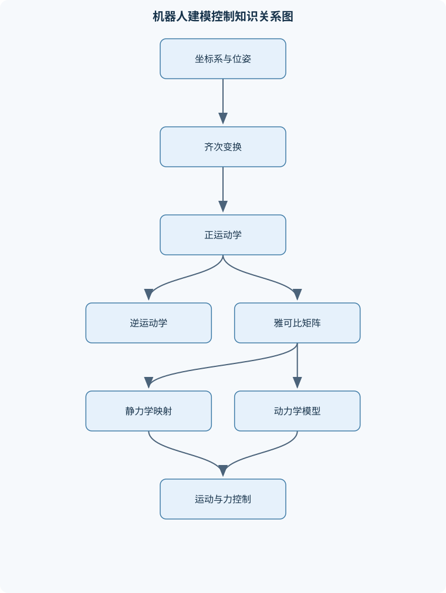
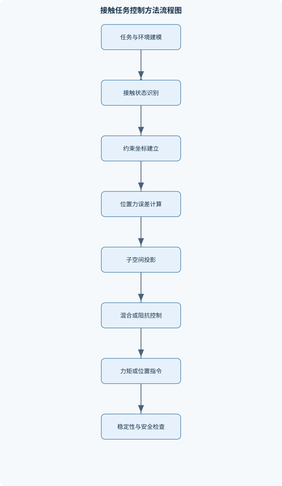

# 机器人建模与控制

## 一、课程整体知识框架

### 课程边界与先修知识

本课程研究串联机械臂及一般刚体机器人从几何描述、运动学建模、动力学建模到运动与力控制的统一方法。内容边界包括坐标系与齐次变换、旋转与姿态表示、正逆运动学、微分运动学与雅可比矩阵、静力学、轨迹规划、刚体动力学、关节空间与笛卡尔空间控制、接触任务中的力位混合控制、阻抗控制与导纳控制。不以移动机器人定位建图、机器人视觉、路径搜索或复杂柔性体动力学为主要内容，但会说明它们与机械臂控制的接口。先修知识包括线性代数、三维解析几何、微积分、常微分方程、基础控制理论、刚体力学和基础编程。学习者应理解矩阵乘法、特征值、坐标变换、状态空间、拉格朗日方程或牛顿—欧拉方程，并能进行数值计算与误差分析。理想模型通常假设连杆刚性、关节间隙可忽略、传感器无偏差、执行器具有足够带宽；实际系统还需考虑摩擦、柔性、测量噪声、饱和、碰撞、奇异位形和模型不确定性。





### 1. 研究对象、目标与知识边界

《机器人建模与控制》研究串联机械臂及一般刚体机器人在关节空间和笛卡尔空间中的统一描述、计算与控制。典型对象由刚性连杆、转动或移动关节、执行器、传感器和末端工具组成。课程主线是：

$$
\text{几何表示}\rightarrow
\text{运动学}\rightarrow
\text{微分运动学与静力学}\rightarrow
\text{轨迹规划}\rightarrow
\text{动力学}\rightarrow
\text{运动与力控制}.
$$

几何表示回答“物体在哪里、朝向如何”；运动学回答“关节变量如何决定末端位姿”；微分运动学回答“关节速度如何产生末端速度”；静力学回答“末端外力如何映射为关节负载”；动力学进一步考虑质量、惯量、加速度、重力、摩擦和外部作用；控制则根据期望运动或接触力生成关节位置、速度或力矩指令。

本课程的主要对象是刚性串联机械臂，不以移动机器人定位建图、视觉识别、全局路径搜索和复杂柔性体动力学为主要内容。移动底盘、视觉系统和路径规划器仍可能作为机械臂系统的接口：例如视觉模块给出目标位姿，路径规划器给出离散路点，机械臂控制器负责将这些信息转换为连续、可执行且满足关节约束的运动。

### 2. 统一符号、坐标约定与理想化假设

坐标系用花括号表示，$\{s\}$通常表示基座坐标系，$\{b\}$表示末端坐标系。从$\{b\}$到$\{s\}$的位姿记为$T_{sb}$，表示“坐标系$\{b\}$相对于$\{s\}$的位姿”。其中

$$
T_{sb}=
\begin{bmatrix}
R_{sb}&p_{sb}\\
0&1
\end{bmatrix}\in SE(3),
$$

$R_{sb}\in SO(3)$为旋转矩阵，满足

$$
R_{sb}^{T}R_{sb}=I,\qquad \det(R_{sb})=1,
$$

$p_{sb}\in\mathbb{R}^3$为$\{b\}$原点在$\{s\}$中的位置，单位通常为米。齐次点坐标写为$\bar p=[p^T,1]^T$。关节变量为$\theta\in\mathbb{R}^n$，转动关节变量单位为弧度，移动关节变量单位为米；$\dot\theta$和$\ddot\theta$分别为关节速度和加速度。

末端广义速度采用

$$
V=
\begin{bmatrix}
v\\
\omega
\end{bmatrix}\in\mathbb{R}^6,
$$

其中$v$单位为米每秒，$\omega$单位为弧度每秒。末端广义力为

$$
F=
\begin{bmatrix}
f\\
m
\end{bmatrix},
$$

$f$为力，单位为牛；$m$为力矩，单位为牛·米。关节力矩记为$\tau\in\mathbb{R}^n$。姿态参数$\phi$必须明确采用欧拉角、旋转向量、轴角参数或其他表示，不能把任意三维姿态参数都直接当作角速度。

理想模型通常假设连杆完全刚性、关节间隙和传动弹性可忽略、传感器无偏差、执行器带宽足够高、模型参数已知且控制输入不饱和。真实系统还存在摩擦、齿隙、柔性、温漂、测量噪声、通信延迟、碰撞、关节限位、奇异位形和参数不确定性。理想模型用于推导结构和控制规律，工程实现必须通过限幅、滤波、标定、鲁棒补偿和实验验证处理这些偏差。

### 3. 各知识层次之间的因果关系

正运动学是后续模块的基础。给定$\theta$，可由几何模型计算末端位姿$T_{sb}(\theta)$。对位姿关系求导得到微分运动学：

$$
V=J_g(\theta)\dot\theta,
$$

其中$J_g$为几何雅可比。若末端采用局部参数$X=[p^T,\phi^T]^T$，则

$$
\dot X=J_a(\theta)\dot\theta,
$$

$J_a$为解析雅可比，其形式依赖姿态参数化。对速度关系继续求导可得

$$
\dot V=J_g\ddot\theta+\dot J_g\dot\theta.
$$

因此，笛卡尔加速度控制不能只使用$J_g\ddot\theta$，必须考虑$\dot J_g\dot\theta$。当雅可比秩下降时，某些末端运动方向无法由有限关节速度产生，直接计算$J^{-1}$会导致关节速度急剧放大。

静力学由虚功关系得到。若末端虚位移满足$\delta x=J\delta\theta$，则

$$
\delta W=F^T\delta x
=F^TJ\delta\theta
=(J^TF)^T\delta\theta.
$$

与关节虚功$\delta W=\tau^T\delta\theta$比较，由于$\delta\theta$任意，有

$$
\tau=J^TF.
$$

该关系是静力或准静态映射，不包含关节惯性、科氏力、离心力和动态接触过程，不能直接代替完整动力学方程。

动力学通常写为

$$
M(\theta)\ddot\theta+
C(\theta,\dot\theta)\dot\theta+
g(\theta)+\tau_f
=
\tau+J^TF_{\mathrm{ext}}.
$$

$M$为对称正定惯量矩阵，$C\dot\theta$包含科氏和离心项，$g$为重力项，$\tau_f$为摩擦项，$F_{\mathrm{ext}}$为外部末端广义力。不同推导可以得到不同形式的$C$，但应保持相同的动力学行为、正定惯量性质和适当的能量结构。

### 4. 课程中的核心分析方法

课程强调四类统一方法。第一类是坐标和群运算方法，用$SO(3)$表示旋转、用$SE(3)$表示刚体位姿，并区分坐标变换、运动算子和刚体实际运动。第二类是微分与虚功方法，通过对位姿求导得到雅可比，通过虚功得到力矩映射。第三类是能量和递推方法，利用拉格朗日方程或牛顿—欧拉递推建立动力学。第四类是反馈与约束方法，利用误差反馈、动力学补偿、投影矩阵和机械阻抗完成运动跟踪及接触控制。

实际建模时必须同时检查坐标系方向、矩阵乘法顺序、单位、关节零位和外力符号。例如，$T_{sb}$与$T_{bs}$不是同一矩阵，且

$$
T_{bs}=T_{sb}^{-1}
=
\begin{bmatrix}
R_{sb}^T&-R_{sb}^Tp_{sb}\\
0&1
\end{bmatrix}.
$$

矩阵乘法通常不可交换，因此$T_{sc}=T_{sb}T_{bc}$，一般不等于$T_{bc}T_{sb}$。左乘和右乘还对应不同的物理含义：左乘常表示相对于固定参考坐标系施加变换，右乘常表示相对于当前自身坐标系施加变换，具体解释必须结合变换矩阵的下标和定义。

## 二、章节和模块划分

### 核心知识覆盖清单

本清单用于检查正文是否覆盖本课程的主要知识模块：

- **机器人几何表示与坐标变换**：参考坐标系与刚体位姿、旋转矩阵的正交性与行列式、欧拉角与旋转顺序、轴角表示与指数坐标、单位四元数与姿态插值、齐次变换矩阵与SE(3)、坐标变换与运动算子区别、左乘和右乘的物理含义。
- **串联机械臂运动学建模**：关节类型与自由度、标准D-H参数定义、改进D-H参数约定、连杆变换矩阵连乘、末端位姿正运动学、基于乘积指数的正运动学、工作空间与可达性、模型参数和零位误差。
- **逆运动学与姿态求解**：逆运动学问题的多解性、位置与姿态方程分离、代数消元与半角代换、Pieper条件与解析解、数值迭代逆运动学、阻尼最小二乘法、关节限位与解的筛选、不可达目标与初值敏感性。
- **微分运动学与雅可比矩阵**：末端速度与关节速度、几何雅可比与解析雅可比、空间雅可比和体雅可比、螺旋轴对雅可比列的构造、线速度与角速度分块、雅可比转置与坐标变换、奇异位形与可操作性、加速度关系与雅可比导数。
- **静力学与关节负载分析**：末端广义力和力矩、虚功原理、关节力矩映射、τ=JᵀF的推导、重力载荷计算、外力和工具质量的影响、力域奇异性、静力内推与递推计算。
- **机器人轨迹与路径规划**：路径和轨迹的区别、关节空间多项式规划、三次和五次时间标定、梯形速度与S形速度、笛卡尔直线插补、姿态轴角插补、四元数Lerp与Slerp、中间点与伪中间点处理、约束空间与连续示教。
- **机器人动力学建模**：关节空间动力学方程、拉格朗日动力学、牛顿—欧拉递推法、连杆质心速度和加速度、转动惯量与平行移轴定律、科氏力和离心力、重力项与外部广义力、动力学参数的物理意义、模型验证与能量一致性。
- **关节空间运动控制**：单关节位置控制、PD控制与重力补偿、计算力矩控制、反馈线性化、闭环误差动力学、临界阻尼与参数关系、鲁棒逆动力学控制、自适应逆动力学控制、无源性与稳定性。
- **笛卡尔空间运动控制**：末端位姿误差定义、笛卡尔速度控制、雅可比伪逆控制、奇异性避让、笛卡尔反馈线性化、任务空间轨迹跟踪、关节限位和速度约束、空间控制与体控制差异。
- **接触任务中的力控制**：自然约束与人工约束、力位混合控制原理、约束坐标系建立、位置和力投影矩阵、部分约束任务、轴孔装配与表面跟踪、阻抗与导纳的物理含义、笛卡尔空间阻抗控制、关节力矩控制与力传感器。


### 1. 机器人几何表示与坐标变换

刚体位姿由位置和姿态共同确定。旋转矩阵的三列可理解为刚体坐标轴在参考系中的坐标，因此必须正交且保持右手性。绕单位轴$k$连续旋转角度$\theta$时，轴角公式为

$$
R=I+\sin\theta[k]_\times+(1-\cos\theta)[k]_\times^2,
$$

其中$[k]_\times$满足$[k]_\times x=k\times x$，该式要求$k$为单位向量，适用于三维刚体纯旋转。若将旋转矩阵逐元素线性插值，结果通常不再满足$R^TR=I$，因此不能作为合法姿态。

欧拉角用多个有序基本旋转描述姿态。例如固定轴$X$-$Y$-$Z$旋转与绕当前轴旋转不是同一约定；交换旋转顺序通常会得到不同姿态。欧拉角还可能产生万向节锁，使局部参数到角速度的映射失去秩。轴角和指数坐标更适合表达单次有限旋转，但在旋转角接近零或接近某些参数边界时仍需处理数值问题。单位四元数$q$满足$\|q\|=1$，且$q$与$-q$表示同一姿态。姿态插值应先统一四元数符号，再使用球面线性插值：

$$
\operatorname{Slerp}(q_0,q_1,u)=
\frac{\sin((1-u)\Omega)}{\sin\Omega}q_0+
\frac{\sin(u\Omega)}{\sin\Omega}q_1,
$$

其中$u\in[0,1]$，$\Omega$为两单位四元数夹角；当$\Omega$很小时使用归一化线性插值以避免除以接近零的量。

齐次变换将旋转和平移统一为一个$4\times4$矩阵。它既可以描述坐标系位姿，也可以改变向量坐标表示，还可以表示对物体施加的刚体运动；三种用法矩阵形式相似，但对象和乘法侧不同，不能混为一谈。

### 2. 串联机械臂运动学建模

串联机械臂由按链式拓扑连接的关节和连杆组成。转动关节变量为角度，移动关节变量为位移；机械臂自由度通常等于独立关节变量数，但闭环约束、被动关节和任务约束会改变有效自由度。

标准D-H方法为每个关节建立坐标系，用$\alpha_i,a_i,d_i,\theta_i$描述相邻坐标系关系。常见标准约定下，一节变换可写为

$$
A_i=
R_z(\theta_i)T_z(d_i)T_x(a_i)R_x(\alpha_i),
$$

于是

$$
T_{0n}=A_1A_2\cdots A_n.
$$

$\alpha_i$为相邻$z$轴绕$x$轴的扭转角，$a_i$为沿$x$轴的距离，$d_i$为沿$z$轴的距离，$\theta_i$为绕$z$轴的角度；具体下标和变换顺序必须随所采用的D-H约定声明。改进D-H将坐标建立顺序改变，不能把标准D-H参数表直接代入改进D-H矩阵。

乘积指数方法不依赖逐节D-H参数，而以关节螺旋轴表示运动。若$S_i$为第$i$个关节在空间坐标系中的螺旋轴，$M$为零位末端构型，则

$$
T(\theta)=e^{[S_1]\theta_1}\cdots e^{[S_n]\theta_n}M.
$$

它适合统一描述转动和移动关节，并便于推导空间雅可比。工作空间是所有允许关节变量对应的末端位置和姿态集合；可达性不仅由几何范围决定，还受关节限位、碰撞、姿态要求和奇异性影响。模型参数误差和零位误差会使理论正运动学与实际末端位姿产生系统偏差，必须通过标定或在线补偿处理。

### 3. 逆运动学与姿态求解

逆运动学是在给定目标位姿$T_d$时求解$\theta$，使

$$
T(\theta)=T_d.
$$

同一末端位姿可能对应肘上、肘下、腕翻转等多组关节解，也可能因目标超出工作空间或违反关节限位而无解。具有三轴相交腕部的六自由度机械臂常可按Pieper条件将位置和姿态分离：先由末端位置减去工具长度得到腕心位置，再求前三个关节；随后由腕部旋转矩阵求后三个关节。该解析分离依赖特定关节结构，并不适用于所有机械臂。

数值逆运动学以当前估计$\theta_k$为起点，计算位姿误差$e_k$和雅可比$J_k$，阻尼最小二乘更新为

$$
\Delta\theta=
J_k^T(J_kJ_k^T+\lambda^2I)^{-1}e_k,
\qquad
\theta_{k+1}=\theta_k+\alpha\Delta\theta.
$$

$\lambda>0$可降低奇异附近的数值放大，$\alpha$为步长。算法应在每轮执行关节限位、步长限制和误差检查。停止条件包括误差小于阈值、步长过小或达到最大迭代次数。该方法不能保证找到全局解，初值会影响最终构型；目标不可达时可能停在误差较大的局部点。

### 4. 微分运动学与雅可比矩阵

几何雅可比满足

$$
V=J_g(\theta)\dot\theta,
$$

其每一列表示对应关节以单位速度运动、其他关节静止时对末端螺旋速度的贡献。对空间坐标系表达的转动关节，若关节轴方向为$z_i$、轴上一点为$o_i$，末端位置为$p_e$，则常见列向量为

$$
J_i=
\begin{bmatrix}
z_i\times(p_e-o_i)\\
z_i
\end{bmatrix};
$$

移动关节则为

$$
J_i=
\begin{bmatrix}
z_i\\
0
\end{bmatrix}.
$$

解析雅可比满足$\dot X=J_a\dot\theta$，当$X$中的姿态参数为欧拉角时，$\dot\phi$通常不等于$\omega$，二者之间还需通过姿态相关矩阵转换。空间雅可比和体雅可比分别在基座坐标系和末端坐标系表达同一运动，其数值通过伴随变换联系。

奇异性可由雅可比秩下降、最小奇异值接近零或条件数过大判断。奇异时并非所有任务方向都不可运动，而是至少存在某些方向无法独立产生，或产生这些方向需要极大关节速度。可操作性指标可采用

$$
w=\sqrt{\det(JJ^T)}
$$

但该指标必须结合任务维度、单位尺度和具体方向解释，不能单独证明安全性。雅可比奇异性分析还应考虑关节速度上限和轨迹时间参数。

### 5. 静力学与关节负载分析

静力学通过虚功将末端广义力映射为关节力矩：

$$
\tau=J^TF.
$$

力和力矩必须在与$J$一致的坐标系中表达。若使用末端坐标系描述$F$，却使用基座坐标系雅可比，结果会出现方向和数值错误。重力负载可以由势能

$$
U(\theta)=\sum_i m_i g^T p_{c_i}(\theta)
$$

求梯度得到重力项，符号取决于重力向量和势能定义：

$$
g(\theta)=\frac{\partial U}{\partial\theta}.
$$

工具质量、工具质心偏置和末端外力都会改变关节负载。接近雅可比奇异位形时，某些末端力方向可能对应较小或较大的关节力矩，称为力域的方向性限制。静力内推和递推方法可从末端向基座逐连杆计算力和力矩，复杂度通常为$O(n)$，适合串联机械臂在线负载估计。

### 6. 机器人轨迹与路径规划

路径只描述几何曲线，不规定运动时间；轨迹同时规定位置、速度和加速度。关节空间三次多项式

$$
q(t)=a_0+a_1t+a_2t^2+a_3t^3
$$

可通过$q(0),\dot q(0),q(T),\dot q(T)$四个边界条件求出四个系数。若起点和终点速度均为零，常用形式为

$$
q(t)=q_0+(q_f-q_0)\left[3\left(\frac tT\right)^2-2\left(\frac tT\right)^3\right].
$$

五次多项式再加入起终点加速度边界条件，适合要求加速度连续的任务。多项式轨迹仍需检查速度、加速度和加加速度峰值，不能只验证端点。

梯形速度规划包含加速、匀速和减速三段。若位移为$D$，最大速度为$v_{\max}$，最大加速度为$a_{\max}$，达到最大速度所需时间为$t_a=v_{\max}/a_{\max}$。若

$$
D\geq \frac{v_{\max}^2}{a_{\max}},
$$

可形成梯形速度；否则为未达到最大速度的三角速度。S形速度进一步限制加加速度，能降低机械冲击，但时间参数设计更复杂。

笛卡尔位置直线插补可写为

$$
p(u)=(1-u)p_0+up_f,\qquad u\in[0,1].
$$

姿态不能逐元素线性插值，应使用轴角、指数坐标或四元数Slerp。通过逆运动学把笛卡尔轨迹转换为关节轨迹时，必须检查解跳变、关节限位、速度、加速度和奇异性。中间点若只是为了改变轨迹形状而非真实任务约束，可采用伪中间点；连续示教则应同时记录位姿、时间、速度和接触状态。

### 7. 机器人动力学建模

拉格朗日方法定义

$$
L(\theta,\dot\theta)=K(\theta,\dot\theta)-U(\theta),
$$

并使用

$$
\frac{d}{dt}\left(\frac{\partial L}{\partial\dot\theta}\right)
-\frac{\partial L}{\partial\theta}
=\tau
$$

推导动力学。动能由连杆质心平动和转动组成，转动惯量必须相对于明确的参考点和坐标系给出。若惯量已知于质心，移到另一点需使用平行移轴定律。牛顿—欧拉方法先从基座向末端递推速度和加速度，再从末端向基座递推力和力矩，最后投影到各关节轴；其串联结构计算复杂度通常为$O(n)$。

动力学参数包括质量、质心位置、转动惯量、摩擦参数和工具负载。模型验证可检查旋转矩阵正交性、有限差分雅可比、静态重力力矩、正负功一致性和动能非负性。若仿真中的动能出现负值、静态重力补偿仍有系统偏差或能量无故增加，通常说明单位、坐标方向、惯量矩阵或符号存在错误。

### 8. 关节空间运动控制

单关节PD控制可写为

$$
\tau=K_p(\theta_d-\theta)+K_v(\dot\theta_d-\dot\theta)+g(\theta).
$$

在单自由度、质量为$m$、忽略模型误差时，误差满足

$$
\ddot e+\frac{K_v}{m}\dot e+\frac{K_p}{m}e=0.
$$

临界阻尼条件为

$$
K_v=2\sqrt{mK_p}.
$$

该关系只适用于归一化明确的单自由度线性模型；多自由度系统中质量矩阵和耦合项会使标量公式不能直接套用。

计算力矩控制令

$$
\ddot\theta_c=\ddot\theta_d-K_v\dot e-K_pe,
$$

并输出

$$
\tau=M(\theta)\ddot\theta_c+C(\theta,\dot\theta)\dot\theta+g(\theta).
$$

代入理想动力学后得到

$$
\ddot e+K_v\dot e+K_pe=0.
$$

模型误差、摩擦、柔性、延迟和饱和会破坏精确反馈线性化，因此实际系统需要鲁棒项、自适应参数估计、摩擦补偿或限幅策略。控制器还应保持无源性或能量耗散，尤其是在接触任务中不能仅依赖大增益获得稳定性。

### 9. 笛卡尔空间运动控制

笛卡尔速度控制直接根据末端误差生成速度，再通过雅可比伪逆得到关节速度：

$$
\dot\theta=J^\dagger
\left(\dot X_d-Ke\right).
$$

在非奇异且任务维度匹配时，$J^\dagger$可退化为$J^{-1}$；奇异附近应采用阻尼伪逆、速度限幅、任务降维或奇异性避让。末端位姿误差必须说明定义方式。位置误差可用$p-p_d$，姿态误差可用旋转向量、轴角误差或四元数误差。不能直接对旋转矩阵逐元素相减后把结果当作物理角度误差。

任务空间加速度控制需使用

$$
\ddot X=J\ddot\theta+\dot J\dot\theta.
$$

若使用基座坐标系表达末端速度，控制误差和雅可比必须在相同坐标系中计算；空间控制和体控制的数值形式不同，但描述的是同一刚体运动。冗余机械臂还可在零空间中完成避限位、避障或姿态优化，但零空间运动不得破坏主任务。

### 10. 接触任务中的力控制、阻抗与导纳

接触任务中，环境几何约束限制部分运动自由度，并对机器人施加接触力。自然约束由环境决定，例如平面法向位置约束；人工约束由控制器指定，例如沿法向保持期望力。理想情况下，任务空间可分为位置控制子空间和力控制子空间。若$P_a$为运动投影矩阵，$P_c$为力投影矩阵，则理想正交关系为

$$
P_a+P_c=I,\qquad P_aP_c=0.
$$

控制器分别使用$P_ae_p$和$P_ce_f$，再合成控制指令。现实中摩擦、表面柔性、轴线误差和传感器噪声会导致两个通道耦合。

阻抗控制规定运动与力之间的动态关系：

$$
M_d\ddot e+B_d\dot e+K_de=F_{\mathrm{ext}},
$$

其中$M_d$、$B_d$和$K_d$分别为期望惯量、阻尼和刚度矩阵。对于一维线性系统，拉普拉斯域机械阻抗为

$$
Z(s)=\frac{F(s)}{V(s)}
=M_ds+B_d+\frac{K_d}{s}.
$$

低频响应主要受刚度影响，高频响应主要受惯量影响。导纳定义为

$$
Y(s)=\frac{V(s)}{F(s)},
$$

只有在线性、时不变及相同输入输出定义下，才可将其视为阻抗的倒数。阻抗控制通常由运动测量生成力矩或力，导纳控制通常由力传感器测量生成位置或速度指令，二者对执行器接口和传感器配置的要求不同。

关节力矩可由电流估计、输出端应变片或串联弹性驱动器测量。低减速比或直驱系统中，电机力矩与电流近似满足$\tau=k_T I$，但减速器摩擦、齿隙和效率会破坏该近似。输出端应变片测量位置更接近实际负载，精度较高，但存在温漂、零漂和结构复杂性。串联弹性驱动器通过测量弹性体变形$\Delta\phi$估计

$$
\tau=k_\phi\Delta\phi,
$$

柔顺性较好，适合人机交互，但会降低高频控制带宽。力传感器还必须进行零偏、工具重力、安装方向和坐标变换补偿。

### 11. 代表性算法与流程

#### 11.1 阻尼最小二乘数值逆运动学

**输入**：目标位姿$T_d$、初始关节变量$\theta_0$、正运动学函数、雅可比函数、阻尼系数$\lambda$、步长$\alpha$、关节上下限和误差阈值。

**过程**：

1. 计算当前位姿$T(\theta_k)$及位姿误差$e_k$。
2. 计算$J(\theta_k)$。
3. 求
   $$
   \Delta\theta=
   J^T(JJ^T+\lambda^2I)^{-1}e_k.
   $$
4. 令$\theta_{k+1}=\theta_k+\alpha\Delta\theta$，并投影到关节允许范围。
5. 若$\|e_k\|$小于阈值则终止；若步长过小或达到迭代上限也终止。
6. 检查最终位姿误差、关节限位和奇异性指标。

**不变量**：每次更新后关节变量满足限位。**适用条件**：正运动学连续、雅可比计算正确，目标附近存在可行解。**边界**：目标不可达时不会自动产生可行解证明；初值不当时可能收敛到不希望的构型。单轮线性代数计算复杂度约为$O(n^3)$。

#### 11.2 梯形速度轨迹规划

**输入**：位移$D$、最大速度$v_{\max}$、最大加速度$a_{\max}$。

先计算加速时间$t_a=v_{\max}/a_{\max}$。若$D\geq v_{\max}^2/a_{\max}$，存在匀速段，匀速时间为

$$
t_c=\frac{D-v_{\max}^2/a_{\max}}{v_{\max}},
$$

总时间为$T=2t_a+t_c$。若$D<v_{\max}^2/a_{\max}$，速度峰值未达到$v_{\max}$，为三角速度，峰值为

$$
v_p=\sqrt{Da_{\max}},
$$

总时间为$T=2v_p/a_{\max}$。生成轨迹后必须检查$|\dot q|\leq v_{\max}$和$|\ddot q|\leq a_{\max}$，并对每个关节分别检查，因为同一时间尺度下不同关节位移不同。

#### 11.3 牛顿—欧拉动力学递推

**输入**：连杆质量、质心、惯量、关节变量及其速度和加速度、外部末端力。

正向递推从基座开始，计算各连杆角速度、角加速度、质心线加速度。反向递推从末端开始，计算各连杆所受合力和合力矩，再将力矩投影到关节轴得到$\tau_i$。每个连杆均应满足牛顿—欧拉平衡关系，这是递推不变量；正向和反向各完成一次后终止。串联结构复杂度为$O(n)$。实际实现必须统一旋转矩阵方向、重力符号和末端外力方向。

#### 11.4 力位混合控制

**输入**：接触坐标系、期望位姿、期望接触力、位姿反馈、速度反馈和力传感器反馈。

建立约束坐标系后，使用$P_a$提取可运动方向，用$P_c$提取受力方向：

$$
e_x=P_ae_p,\qquad e_f=P_c(F_d-F).
$$

位置通道可使用PD或速度控制器，力通道可使用比例积分控制器，再将两者转换为笛卡尔力或关节力矩。每个周期检查投影矩阵维度、坐标系一致性、力传感器零偏和输出饱和。该流程适用于表面跟踪、轴孔装配等约束方向明确的任务，但不适用于未知接触几何且冲击剧烈的场景，除非配合柔顺和碰撞检测。

### 12. 代表性例题

#### 例题一：齐次变换的复合与求逆

**题干**：已知

$$
T_{sb}=
\begin{bmatrix}
R_{sb}&p_{sb}\\0&1
\end{bmatrix},
\qquad
T_{bc}=
\begin{bmatrix}
R_{bc}&p_{bc}\\0&1
\end{bmatrix}.
$$

求$\{c\}$相对$\{s\}$的位姿。

**分析与解答**：先将点从$\{c\}$变换到$\{b\}$，再从$\{b\}$变换到$\{s\}$，所以

$$
T_{sc}=T_{sb}T_{bc}
=
\begin{bmatrix}
R_{sb}R_{bc}&R_{sb}p_{bc}+p_{sb}\\
0&1
\end{bmatrix}.
$$

若求反向变换，则

$$
T_{bs}=
\begin{bmatrix}
R_{sb}^T&-R_{sb}^Tp_{sb}\\
0&1
\end{bmatrix}.
$$

**结果验证**：检查$R_{sb}R_{bc}$满足正交性；验证$T_{sb}T_{bs}=I$。**变式**：若绕固定坐标系旋转，应左乘旋转矩阵；若绕自身坐标系旋转，应右乘，二者结果一般不同。

#### 例题二：平面二连杆正运动学与奇异性

**题干**：两连杆长度为$l_1,l_2$，关节角为$\theta_1,\theta_2$，求末端位置和位置雅可比。

**解答**：

$$
p=
\begin{bmatrix}
l_1\cos\theta_1+l_2\cos(\theta_1+\theta_2)\\
l_1\sin\theta_1+l_2\sin(\theta_1+\theta_2)
\end{bmatrix}.
$$

对$\theta$求偏导：

$$
J=
\begin{bmatrix}
-l_1\sin\theta_1-l_2\sin(\theta_1+\theta_2)&-l_2\sin(\theta_1+\theta_2)\\
l_1\cos\theta_1+l_2\cos(\theta_1+\theta_2)&l_2\cos(\theta_1+\theta_2)
\end{bmatrix}.
$$

其行列式为

$$
\det J=l_1l_2\sin\theta_2.
$$

当$\theta_2=0$或$\pi$时两连杆共线，雅可比奇异，某个平面方向的末端速度无法独立产生。

**结果验证**：将$\theta_2=\pi/2$代入，行列式非零；将$\theta_2=0$代入，行列式为零。**变式**：若关节速度受限，接近奇异点时即使未达到严格奇异，也可能因关节速度放大而无法执行给定末端速度。

#### 例题三：虚功静力映射

**题干**：某机械臂末端在基座坐标系中的广义力为$F=[f^T,m^T]^T$，已知几何雅可比$J$，求静态关节力矩。

**解答**：末端虚位移为$\delta x=J\delta\theta$，因此

$$
F^T\delta x=F^TJ\delta\theta.
$$

与$\tau^T\delta\theta$比较，得到

$$
\tau=J^TF.
$$

若某一列$J_i$与$F$内积较大，则对应关节承担的负载较大；若$J_i^TF=0$，该末端力在当前姿态下对第$i$个关节不产生静态力矩。

**结果验证**：检查$\tau^T\delta\theta=F^TJ\delta\theta$在任意测试虚位移下成立。**变式**：若$F$在末端坐标系中给出，应先通过相应的力变换矩阵转换到与$J$相同的表达坐标系。

#### 例题四：三次多项式轨迹

**题干**：一个关节在$T$秒内从$q_0$运动到$q_f$，起终点速度均为零，求三次轨迹。

**解答**：设

$$
q(t)=a_0+a_1t+a_2t^2+a_3t^3.
$$

由$q(0)=q_0$得$a_0=q_0$，由$\dot q(0)=0$得$a_1=0$。代入$q(T)=q_f$和$\dot q(T)=0$：

$$
a_2=\frac{3(q_f-q_0)}{T^2},
\qquad
a_3=-\frac{2(q_f-q_0)}{T^3}.
$$

所以

$$
q(t)=q_0+(q_f-q_0)
\left[3(t/T)^2-2(t/T)^3\right].
$$

**结果验证**：代入$t=0,T$检查位置和速度边界。**变式**：若要求起终点加速度也为零，应使用五次多项式；若还要求加加速度受限，则应使用S形时间标定。

#### 例题五：临界阻尼与计算力矩控制

**题干**：单自由度质量为$m$，控制器为PD，求临界阻尼条件；再说明计算力矩控制如何消除理想动力学耦合。

**解答**：误差方程为

$$
m\ddot e+K_v\dot e+K_pe=0.
$$

除以$m$，特征方程为

$$
s^2+\frac{K_v}{m}s+\frac{K_p}{m}=0.
$$

临界阻尼要求判别式为零：

$$
\left(\frac{K_v}{m}\right)^2-4\frac{K_p}{m}=0,
$$

故

$$
K_v=2\sqrt{mK_p}.
$$

对于多自由度机器人，令

$$
\tau=M(\ddot\theta_d-K_v\dot e-K_pe)+C\dot\theta+g,
$$

代入理想动力学后得到

$$
\ddot e+K_v\dot e+K_pe=0.
$$

**结果验证**：检查$K_p>0,K_v>0$时误差系统渐近稳定。**变式**：若存在摩擦和模型误差，不能声称误差严格服从该方程；应增加鲁棒项、参数自适应或误差上界分析。

### 13. 实验与项目流程

#### 13.1 实验一：正逆运动学、雅可比与奇异性验证

**输入数据**：机械臂连杆几何参数、D-H参数表、关节零位、若干关节姿态和目标末端位姿。  
**步骤**：

1. 明确标准D-H或改进D-H约定，统一长度单位为米、角度单位为弧度。
2. 编程实现逐节$A_i$计算和$T_{0n}$连乘。
3. 随机采样关节姿态，检查$R^TR-I$的范数和$\det R-1$。
4. 用解析或几何方法计算$J$，再用有限差分近似验证：
   $$
   J_i\approx\frac{x(\theta+\varepsilon e_i)-x(\theta)}{\varepsilon}.
   $$
5. 对若干姿态进行奇异值分解，记录最小奇异值和条件数。
6. 使用阻尼最小二乘求解目标位姿，检查最终位姿误差和关节限位。

**评价标准**：旋转矩阵正交误差应小于预先设定的数值容差；有限差分与解析雅可比的误差应随合理减小的$\varepsilon$呈稳定趋势；逆解必须同时满足位姿误差阈值和关节限位。  
**排错方法**：若旋转矩阵不正交，优先检查D-H变换顺序；若雅可比符号错误，检查关节轴方向和位置差；若逆解振荡，降低步长或增大阻尼；若目标始终不可达，检查目标工作空间和姿态参数误差。

#### 13.2 实验二：动力学补偿与接触阻抗验证

**输入数据**：连杆质量、质心、惯量、重力方向、关节状态、期望轨迹、工具质量、环境等效刚度及力传感器数据。  
**步骤**：

1. 用拉格朗日法或牛顿—欧拉法实现动力学计算。
2. 在低速静态姿态下计算重力补偿力矩，并与实际维持姿态所需力矩比较。
3. 运行PD、重力补偿PD和计算力矩控制，比较位置误差、速度误差和控制力矩。
4. 将环境建模为一维弹簧，逐步改变期望刚度$K_d$和环境刚度$k_e$。
5. 记录接触峰值力、稳态力误差、超调量和振荡衰减时间。
6. 检查力传感器零偏、工具重力补偿和输出力矩饱和。

**评价标准**：动力学模型应能解释主要重力负载；加入重力补偿后静态误差应明显下降；控制过程中不得持续饱和或出现未受限的接触冲击；阻抗参数应保持矩阵对称，并根据任务要求选择正定刚度和非负阻尼。  
**排错方法**：若静态力矩整体偏大，检查工具质量和质心；若误差随姿态呈周期变化，检查零位或几何参数；若接触振荡，降低刚度、增加耗散或检查采样延迟；若力通道有恒定偏差，重新进行零偏和重力标定；若电流估计力矩与输出端测量不一致，应检查减速器摩擦、齿隙和传动效率。

### 14. 实用代码示例：阻尼最小二乘逆运动学框架

```python
import numpy as np

def damped_least_squares_step(jacobian, error, damping):
    """
    jacobian: shape (m, n)
    error:    shape (m,)
    damping:  nonnegative scalar
    return:   joint increment, shape (n,)
    """
    m = jacobian.shape[0]
    identity = np.eye(m)
    return jacobian.T @ np.linalg.solve(
        jacobian @ jacobian.T + damping ** 2 * identity,
        error
    )

def numerical_ik(theta0, target, forward, jacobian,
                 lower, upper, tolerance=1e-4,
                 damping=1e-2, step_scale=0.5,
                 max_iter=200):
    """
    target: 目标任务向量或局部位姿误差所需的目标表示
    forward: 输入关节变量，返回与target同维度的任务向量
    jacobian: 输入关节变量，返回任务雅可比
    lower, upper: 关节上下限
    """
    theta = np.asarray(theta0, dtype=float).copy()

    for iteration in range(max_iter):
        current = forward(theta)
        error = target - current

        if np.linalg.norm(error) < tolerance:
            return theta, True, iteration, np.linalg.norm(error)

        J = jacobian(theta)
        delta = damped_least_squares_step(J, error, damping)
        theta = theta + step_scale * delta
        theta = np.minimum(np.maximum(theta, lower), upper)

        if np.linalg.norm(step_scale * delta) < tolerance * 0.1:
            break

    final_error = np.linalg.norm(target - forward(theta))
    return theta, final_error < tolerance, max_iter, final_error
```

该代码只展示数值逆运动学的结构，不包含具体机器人正运动学和姿态误差定义。实际使用时必须保证`forward`、`jacobian`和目标误差采用相同坐标系、相同单位及相同姿态参数化；还应增加奇异值监测、速度限幅、碰撞检查、控制周期约束和失败状态处理。

## 三、核心概念的详细解释

### 1. 刚体位姿、坐标系与齐次变换

机器人建模的第一步是规定坐标系。坐标系 $\{s\}$通常固定在基座，$\{b\}$固定在末端工具或末端法兰。坐标系 $\{b\}$相对于$\{s\}$的位姿记为

$$
T_{sb}=
\begin{bmatrix}
R_{sb}&p_{sb}\\
0&1
\end{bmatrix}\in SE(3),
$$

其中$R_{sb}\in SO(3)$表示$\{b\}$的三个坐标轴在$\{s\}$中的方向，$p_{sb}\in\mathbb{R}^3$表示$\{b\}$原点在$\{s\}$中的位置，位置单位为米。旋转矩阵必须满足

$$
R_{sb}^{T}R_{sb}=I,\qquad \det(R_{sb})=1.
$$

第一条条件表示列向量相互正交且长度为$1$，第二条条件排除了镜像反射。若数值计算得到的矩阵满足正交性但行列式为$-1$，它是反射而不是合法旋转。

齐次坐标把旋转和平移放入同一个矩阵乘法中。若点$P$在$\{b\}$中的坐标为$p_b$，其齐次坐标为$\bar p_b=[p_b^T,1]^T$，则在$\{s\}$中的坐标为

$$
\bar p_s=T_{sb}\bar p_b,
\qquad
p_s=R_{sb}p_b+p_{sb}.
$$

这里的$T_{sb}$既可以表示刚体坐标系的位姿，也可以作为一个坐标变换算子作用于点或向量。两种用法的矩阵形式相同，但物理含义不同：前者描述“物体或坐标系在哪里”，后者描述“同一个几何对象如何换一种坐标表示”。不能因为形式相同就忽略下标方向。

连续复合变换满足

$$
T_{sc}=T_{sb}T_{bc}.
$$

右侧先用$T_{bc}$把$\{c\}$中的量变换到$\{b\}$，再用$T_{sb}$变换到$\{s\}$。矩阵乘法一般不可交换，因此$T_{sb}T_{bc}$与$T_{bc}T_{sb}$通常描述不同的操作。逆变换为

$$
T_{bs}=T_{sb}^{-1}
=
\begin{bmatrix}
R_{sb}^{T}&-R_{sb}^{T}p_{sb}\\
0&1
\end{bmatrix}.
$$

平移项不能简单写成$-p_{sb}$，因为逆变换首先要把坐标轴旋回去，平移量也必须用旋转后的坐标表示。

左乘和右乘表示不同的旋转、平移参考。若当前位姿为$T$，左乘$T_{\Delta}$表示相对于固定参考坐标系施加增量，右乘$T_{\Delta}$表示相对于当前物体坐标系施加增量。例如绕基座固定$z$轴旋转与绕末端自身$z$轴旋转，即使旋转角相同，最终姿态也通常不同。实际控制中，空间速度和体速度正是这种参考系差异的微分表现。

### 2. 旋转与姿态表示

旋转矩阵适合进行复合、求逆和坐标变换，但包含$9$个元素而只有$3$个独立自由度。欧拉角用三个有序的基本旋转表示姿态，例如固定轴$X$-$Y$-$Z$顺序与绕自身轴的$Z$-$Y$-$X$顺序并不等价。若采用欧拉角$\phi$描述姿态，角速度$\omega$一般满足

$$
\omega=E(\phi)\dot\phi,
$$

其中$E(\phi)$取决于旋转顺序和当前姿态。因此不能把欧拉角导数$\dot\phi$直接当作角速度。某些姿态下$E(\phi)$秩下降，这称为欧拉角参数化奇异性，即使刚体本身并未处于机械臂雅可比奇异位形。

轴角表示用单位向量$k\in\mathbb{R}^3$和旋转角$\theta$描述旋转。定义叉乘矩阵

$$
[k]_\times=
\begin{bmatrix}
0&-k_3&k_2\\
k_3&0&-k_1\\
-k_2&k_1&0
\end{bmatrix},
\qquad [k]_\times x=k\times x.
$$

当$k^Tk=1$时，绕$k$旋转$\theta$的旋转矩阵为罗德里格公式

$$
R=I+\sin\theta[k]_\times+(1-\cos\theta)[k]_\times^2.
$$

推导的关键是将任意向量分解为平行于$k$的分量和垂直于$k$的分量。平行分量保持不变，垂直分量在正交平面内旋转$\theta$；利用$[k]_\times^2x=k(k^Tx)-x$即可得到上式。该公式要求$k$为单位向量；若输入轴未归一化，必须先除以其范数。

旋转向量把轴角组合为$\rho=\theta k$，在小角度附近便于误差计算和插值，但当旋转角接近$\pi$时表示具有分支不连续。单位四元数$q=[q_0,q_1,q_2,q_3]^T$满足

$$
q_0^2+q_1^2+q_2^2+q_3^2=1,
$$

并能避免欧拉角的局部奇异。四元数$q$与$-q$表示同一个旋转，因此进行插值前应检查两个四元数内积；若内积为负，应翻转其中一个，以选择较短旋转路径。线性插值后必须归一化，球面线性插值则直接沿单位四元数球面的大圆路径运动。旋转矩阵逐元素线性插值通常不再满足$R^TR=I$，因此不是合法姿态插值。

### 3. 串联机械臂的运动学建模

串联机械臂由多个刚性连杆和关节按链式连接组成。转动关节变量通常为弧度，移动关节变量通常为米。给定关节变量$\theta$，从基座到末端的位姿称为正运动学：

$$
T_{0n}(\theta)=A_1(\theta_1)A_2(\theta_2)\cdots A_n(\theta_n).
$$

标准D-H方法用$\alpha_i,a_i,d_i,\theta_i$描述相邻坐标系之间的几何关系。常见标准约定下，

$$
A_i=
R_z(\theta_i)T_z(d_i)T_x(a_i)R_x(\alpha_i),
$$

展开为

$$
A_i=
\begin{bmatrix}
\cos\theta_i&-\sin\theta_i\cos\alpha_i&\sin\theta_i\sin\alpha_i&a_i\cos\theta_i\\
\sin\theta_i&\cos\theta_i\cos\alpha_i&-\cos\theta_i\sin\alpha_i&a_i\sin\theta_i\\
0&\sin\alpha_i&\cos\alpha_i&d_i\\
0&0&0&1
\end{bmatrix}.
$$

其中$a_i$为相邻关节轴之间沿$x_i$方向的距离，$\alpha_i$为绕$x_i$轴的扭转角，$d_i$为沿$z_{i-1}$方向的偏距，$\theta_i$为绕$z_{i-1}$方向的角度。不同教材可能采用改进D-H约定，其变换次序和参数下标不同。参数表没有同时声明坐标建立规则时，不能直接套用矩阵。

D-H参数不是机械臂的绝对属性，而是依赖坐标系选择、零位定义和关节变量方向。实际标定中，连杆长度误差、关节零位偏差、工具坐标偏差都会改变正运动学。可以将转动关节零位误差表示为

$$
\theta_i^{\mathrm{actual}}=\theta_i^{\mathrm{encoder}}+\Delta\theta_i,
$$

其中$\Delta\theta_i$需要通过标定或实验估计。若忽略这些误差，模型在某一姿态下看似准确，换到其他姿态时误差可能明显增大。

工作空间是机械臂末端能够达到的位姿集合。若只考虑位置，则可达位置集合为

$$
\mathcal W_p=\{p_{0n}(\theta)\mid \theta\in\mathcal Q\},
$$

其中$\mathcal Q$还必须包括关节限位。几何上可能存在的点，如果需要超出关节范围、导致碰撞或要求过大的速度，也不能算作实际可用工作空间。可达性只表示存在某个构型，不表示该构型一定适合执行任务。

### 4. 逆运动学与数值求解

逆运动学给定目标位姿$T_d$，求满足

$$
T_{0n}(\theta)=T_d
$$

的关节变量。逆运动学可能有多个解、单个解或无解。多解来源包括肘部上翻和下翻、腕部翻转以及关节周期性；无解可能由目标超出工作空间、姿态不可达或关节限位造成。

对于具有球腕结构的六自由度机械臂，常先求腕心位置。若末端工具沿末端$z$轴距离腕心$d_6$，则

$$
p_w=p_d-d_6R_d
\begin{bmatrix}
0\\0\\1
\end{bmatrix}.
$$

先由$p_w$求前三个关节，再由

$$
R_{36}=R_{03}^TR_{06}
$$

求腕部姿态。这种位置与姿态分离依赖特定结构，不能推广到任意机械臂。

数值逆运动学将位姿误差局部线性化。若采用几何误差$e\in\mathbb{R}^6$，有近似关系

$$
e(\theta+\Delta\theta)\approx e(\theta)+J_g(\theta)\Delta\theta.
$$

阻尼最小二乘更新为

$$
\Delta\theta
=
J_g^T\left(J_gJ_g^T+\lambda^2I\right)^{-1}e,
$$

其中$\lambda>0$为阻尼因子。远离奇异位形且$\lambda$很小时，该方法接近伪逆解；接近奇异位形时，阻尼抑制过大的关节增量，但会引入任务误差。实际迭代还必须检查关节限位、步长、速度约束和最终位姿误差。阻尼最小二乘不能保证找到全局解，初始值会影响收敛到哪一个构型。

### 5. 微分运动学、雅可比与奇异性

末端广义速度为

$$
V=
\begin{bmatrix}
v\\
\omega
\end{bmatrix}
=J_g(\theta)\dot\theta,
$$

其中$J_g\in\mathbb{R}^{6\times n}$为几何雅可比。对转动关节，若关节轴方向为$z_{i-1}$，轴上一点为$o_{i-1}$，末端原点为$o_n$，则在同一坐标系中，雅可比第$i$列为

$$
J_i=
\begin{bmatrix}
z_{i-1}\times(o_n-o_{i-1})\\
z_{i-1}
\end{bmatrix}.
$$

对移动关节，第$i$列为

$$
J_i=
\begin{bmatrix}
z_{i-1}\\
0
\end{bmatrix}.
$$

几何雅可比直接把关节速度映射为线速度和角速度。解析雅可比则满足

$$
\dot X=J_a(\theta)\dot\theta,
$$

其中$X=[p^T,\phi^T]^T$，$\phi$可能是欧拉角、旋转向量或其他姿态参数。两者只有在姿态参数化局部非奇异时，才能通过姿态速度变换矩阵关联。几何奇异性和姿态参数化奇异性应分别分析。

对速度关系求导可得

$$
\dot V=J_g\ddot\theta+\dot J_g\dot\theta.
$$

因此若进行末端加速度控制，不能只使用$J_g\ddot\theta$而忽略$\dot J_g\dot\theta$。当$J_g$秩下降时，某些末端运动方向无法由关节运动独立产生；为保持该方向速度，理论上可能需要无限大的关节速度。实际系统中还会受到速度上限和驱动器饱和限制。

雅可比的奇异性可以通过奇异值分解

$$
J_g=U\Sigma V^T
$$

分析。最小奇异值接近零表示至少一个任务方向的运动能力显著下降；条件数增大表示速度和力的映射对误差敏感。可操作性指标常写为

$$
w=\sqrt{\det(J_gJ_g^T)}
$$

但该指标只适用于相应维度和坐标尺度一致的比较。由于米和弧度的量纲不同，直接比较条件数或可操作性时需要进行合理尺度归一化。

### 6. 静力学与关节负载

末端广义力写为

$$
F=
\begin{bmatrix}
f\\
m
\end{bmatrix},
$$

其中$f$单位为牛，$m$单位为牛·米。虚功原理要求同一坐标约定下

$$
\delta W=\tau^T\delta\theta=F^T\delta x.
$$

若末端虚位移满足$\delta x=J\delta\theta$，则

$$
\tau^T\delta\theta
=
F^TJ\delta\theta
=
(J^TF)^T\delta\theta.
$$

由于$\delta\theta$任意，得到

$$
\tau=J^TF.
$$

该关系表示准静态外力映射或外力产生的等效关节负载，不是包含惯性、摩擦和碰撞瞬态的完整动力学。必须明确$F$是环境作用于机器人，还是机器人作用于环境；二者方向相反。

重力负载可以通过势能求导获得。若系统重力势能为$U(\theta)$，则重力广义力通常取

$$
g(\theta)=\frac{\partial U}{\partial\theta}.
$$

工具质量和末端负载会改变势能，从而改变全部相关关节的重力力矩。静力内推则从末端开始，将每个连杆所受的力和力矩沿关节链反向传递，最后将关节处力矩投影到关节轴。静力内推复杂度随串联关节数线性增长，适合实时计算。

### 7. 路径、轨迹与姿态插值

路径只规定几何位置或姿态序列，不规定运动时间；轨迹还规定$q(t)$、$\dot q(t)$和$\ddot q(t)$。同一条路径可以用不同速度执行，因此路径规划与时间参数化是不同问题。

三次多项式适合给定起终点位置和速度的单段规划：

$$
q(t)=a_0+a_1t+a_2t^2+a_3t^3,\qquad 0\le t\le T.
$$

若已知$q(0)=q_0$、$\dot q(0)=v_0$、$q(T)=q_f$、$\dot q(T)=v_f$，可得

$$
a_0=q_0,\qquad a_1=v_0,
$$

$$
a_2=\frac{3(q_f-q_0)}{T^2}-\frac{2v_0+v_f}{T},
$$

$$
a_3=-\frac{2(q_f-q_0)}{T^3}+\frac{v_0+v_f}{T^2}.
$$

五次多项式再加入起终点加速度约束，适合要求加速度连续的任务。多段轨迹还要检查段间速度、加速度及必要时加加速度的连续性。

梯形速度规划先加速、再匀速、最后减速。当位移足够大时可达到最大速度；当位移较小时，速度曲线退化为三角形，不能强行加入匀速段。规划结果必须同时满足位移、最大速度和最大加速度约束。

笛卡尔位置直线插补可写为

$$
p(u)=(1-u)p_0+up_f,\qquad 0\le u\le1.
$$

姿态不应对旋转矩阵逐元素插值，通常使用轴角指数插值或四元数Slerp。笛卡尔直线轨迹经过逆运动学转换后，关节轨迹可能出现速度尖峰、跳解或穿越奇异位形，因此还必须在关节空间检查连续性和约束。

### 8. 刚体动力学与参数结构

刚体机械臂的关节空间动力学通常写为

$$
M(\theta)\ddot\theta
+C(\theta,\dot\theta)\dot\theta
+g(\theta)+\tau_f
=
\tau+J^TF_{\mathrm{ext}}.
$$

$M(\theta)$是惯量矩阵，具有对称正定性；$C(\theta,\dot\theta)\dot\theta$包含科氏和离心项；$g(\theta)$是重力项；$\tau_f$表示摩擦；$\tau$为驱动力矩；$F_{\mathrm{ext}}$为外部末端广义力。不同推导可以把部分项重新组合，因此$C$本身不唯一，但完整动力学应保持相同物理结果。

拉格朗日方法取

$$
L(\theta,\dot\theta)=K(\theta,\dot\theta)-U(\theta),
$$

并使用

$$
\frac{d}{dt}\left(\frac{\partial L}{\partial\dot\theta}\right)
-\frac{\partial L}{\partial\theta}
=
\tau.
$$

动能由连杆质心线速度、角速度和转动惯量组成；若转动惯量已知于质心坐标系，换算到其他点时需使用平行移轴定律。牛顿—欧拉递推法则先从基座向末端递推速度和加速度，再从末端向基座递推力和力矩，最后投影到关节轴。拉格朗日法便于理论推导，牛顿—欧拉法通常更适合串联机械臂实时计算。

动力学验证不能只比较某一时刻的力矩。应检查惯量矩阵对称正定性、重力静态平衡、有限差分得到的速度和加速度一致性，以及能量变化是否符合外力做功、摩擦耗散和控制输入的关系。

### 9. 关节空间与笛卡尔空间控制

单关节位置控制常采用

$$
\tau=K_p(\theta_d-\theta)+K_v(\dot\theta_d-\dot\theta)+g(\theta).
$$

重力补偿项使反馈环不必长期承担静态负载。若误差定义为$e=\theta-\theta_d$，则符号必须相应改变。对于质量为$m$的单自由度系统，在忽略重力和扰动、期望为常值时，闭环误差方程为

$$
\ddot e+\frac{K_v}{m}\dot e+\frac{K_p}{m}e=0.
$$

临界阻尼条件为

$$
K_v=2\sqrt{mK_p}.
$$

该公式只适用于单自由度、常数质量和线性化模型；多自由度机械臂的耦合惯量不能直接代入一个标量质量。

计算力矩控制利用动力学模型进行反馈线性化。设

$$
\ddot\theta_c=\ddot\theta_d-K_v\dot e-K_pe,
$$

控制输入为

$$
\tau=M(\theta)\ddot\theta_c+C(\theta,\dot\theta)\dot\theta+g(\theta).
$$

在模型完全准确、无摩擦、无饱和且无延迟的理想条件下，代入动力学可得

$$
\ddot e+K_v\dot e+K_pe=0.
$$

实际模型误差、关节柔性、摩擦和传感器噪声会使精确线性化失效，因此常结合鲁棒项、自适应参数估计、扰动观测器和力矩限幅。

笛卡尔速度控制根据

$$
V=J_g\dot\theta
$$

计算关节速度。远离奇异位形时可采用伪逆

$$
\dot\theta=J_g^\dagger V_d.
$$

冗余机械臂还可加入零空间项，用于避开关节限位或优化姿态；但零空间运动不能破坏主任务。奇异附近应使用阻尼伪逆、任务降维或改变末端姿态，而不是直接计算$J^{-1}$。

### 10. 接触任务、力位混合控制与柔顺控制

机器人接触环境后，环境几何约束限制部分运动自由度。例如表面跟踪中，切向方向可以运动，法向方向的运动受到表面约束。将任务坐标分为人工约束和自然约束：人工约束方向由位置控制指定，自然约束方向由接触力决定。

在理想正交分解下，位置投影矩阵$P_a$和力投影矩阵$P_c$满足

$$
P_a+P_c=I,\qquad P_aP_c=0.
$$

控制器分别计算

$$
e_p=P_a(x_d-x),\qquad e_f=P_c(F_d-F),
$$

再将位置通道和力通道的输出合成。轴孔装配中，插入方向通常需要控制轴向力或力矩，而横向方向需要保持较小位置误差。现实中的摩擦、接触面倾斜、柔性和传感器安装误差会使两个子空间并不严格正交，因而会出现通道串扰。

阻抗控制规定运动与力之间的动态关系：

$$
M_d\ddot e+B_d\dot e+K_de=F_{\mathrm{ext}},
$$

其中$M_d$、$B_d$、$K_d$分别为期望惯量、阻尼和刚度矩阵。较大刚度提高位置保持能力，但接触时可能增大冲击和振荡；较小刚度提高柔顺性，却可能降低定位精度。导纳控制则根据测得的外力生成运动指令，阻抗控制通常根据运动误差生成力矩或力指令，二者对力传感器、位置接口和执行器带宽的要求不同。

在线性单自由度模型中，机械阻抗定义为

$$
Z(s)=\frac{F(s)}{V(s)}
=M_ds+B_d+\frac{K_d}{s}.
$$

低频下刚度项影响显著，高频下惯量项影响显著。该频域关系要求系统近似线性、参数恒定且处于相应工作点附近，不能直接用于强非线性碰撞瞬态。

### 11. 执行器力矩测量与工程限制

若电机为直驱或减速比很小，电机力矩与电流可近似满足

$$
\tau_m=k_T I,
$$

其中$k_T$为力矩常数，$I$为电流。通过电流环可间接控制力矩，但减速器摩擦、齿隙、传动效率和负载变化会使电机侧力矩不等于输出侧力矩。

输出端应变片式力矩传感器直接测量弹性体形变引起的应变，精度较高，但需要处理温漂、零漂、信号调理和结构柔性。串联弹性驱动器在电机与负载之间设置较软的弹性元件，若扭转变形为$\Delta\phi$、弹簧刚度为$k_\phi$，则输出力矩近似为

$$
\tau_{\mathrm{out}}=k_\phi\Delta\phi.
$$

柔性提高了人机交互安全性和冲击吸收能力，但增加了系统阶次、共振和高频控制难度。力矩控制的验收不能只看电机电流，还应比较输出端实际力矩、响应带宽、稳态误差、温漂和饱和行为。

## 四、重要定义、公式、定理和推导

### 专业审校补充：关键定义与适用边界

离散实现中的阻抗稳定性不能直接由连续时间能量证明推出。以单自由度质量模型为例，连续控制律取 u=−Kx−Bẋ，其中质量 m>0、刚度 K>0、阻尼 B>0，理想连续系统满足 mẍ+Bẋ+Kx=0。若采用显式欧拉离散化，采样周期为 T_s，状态更新为 x_{k+1}=x_k+T_s v_k，v_{k+1}=v_k−(T_sK/m)x_k−(T_sB/m)v_k，其特征多项式为 λ²−(2−bT_s)λ+(1−bT_s+kT_s²)=0，其中 k=K/m，b=B/m，λ为离散极点。稳定要求全部极点位于单位圆内，而不是只要求 K、B为正。由朱利判据可得一组必要条件包括 0<T_s<b/k=B/K；当采样延迟、力传感器滤波、执行器饱和或环境刚度加入后，允许的采样周期通常还要更小。该边界适用于线性、无延迟、显式欧拉和固定参数模型；它不能替代含接触切换、量化误差和非线性摩擦的实际系统验证。


### 1. $SO(3)$、$SE(3)$与伴随变换

旋转群定义为

$$
SO(3)=\{R\in\mathbb R^{3\times3}\mid R^TR=I,\det R=1\}.
$$

刚体变换群定义为

$$
SE(3)=
\left\{
\begin{bmatrix}
R&p\\
0&1
\end{bmatrix}
\middle|
R\in SO(3),p\in\mathbb R^3
\right\}.
$$

若同一个刚体速度在空间坐标系和本体坐标系中的表示分别为$V_s$和$V_b$，则二者可通过位姿的伴随矩阵关联：

$$
V_s=\operatorname{Ad}_{T_{sb}}V_b,
$$

其中

$$
\operatorname{Ad}_{T_{sb}}
=
\begin{bmatrix}
R_{sb}&[p_{sb}]_\times R_{sb}\\
0&R_{sb}
\end{bmatrix}.
$$

该式说明，角速度不仅因坐标轴旋转而变化，若速度参考点发生平移，线速度还会增加$\omega\times p$项。因而不能仅对线速度和角速度分别乘旋转矩阵，就得到完整的刚体速度变换。

### 2. 乘积指数表示与螺旋轴

串联机械臂的正运动学也可以用乘积指数表示：

$$
T(\theta)=e^{[\mathcal S_1]\theta_1}
e^{[\mathcal S_2]\theta_2}\cdots
e^{[\mathcal S_n]\theta_n}M,
$$

其中$\mathcal S_i\in\mathbb R^6$为第$i$个关节在空间坐标系中的螺旋轴，$M$为所有关节变量为零时的末端位姿。对转动关节，若轴方向为$\omega_i$、轴上一点为$q_i$，则

$$
\mathcal S_i=
\begin{bmatrix}
-\omega_i\times q_i\\
\omega_i
\end{bmatrix};
$$

对移动关节，

$$
\mathcal S_i=
\begin{bmatrix}
v_i\\
0
\end{bmatrix}.
$$

该表示将转动和平移统一为螺旋运动，适合推导空间雅可比和指数坐标，但要求关节轴方向、参考坐标系和指数矩阵约定保持一致。

### 3. 几何雅可比的构造与加速度关系

对第$i$个转动关节，单位关节速度只使末端产生绕该关节轴的瞬时转动。该转动在末端原点产生线速度

$$
v_i=z_{i-1}\times(p_n-o_{i-1}),
$$

角速度为

$$
\omega_i=z_{i-1}.
$$

因此

$$
J_g=
\begin{bmatrix}
z_0\times(p_n-o_0)&\cdots&
z_{n-1}\times(p_n-o_{n-1})\\
z_0&\cdots&z_{n-1}
\end{bmatrix}
$$

适用于全部关节均为转动关节的情形。混合关节需要将移动关节列替换为线速度方向和零角速度。

由$V=J_g\dot\theta$直接求导：

$$
\dot V
=
\frac{d}{dt}(J_g\dot\theta)
=
J_g\ddot\theta+\dot J_g\dot\theta.
$$

第二项表示当前关节速度改变了雅可比本身。若在高速运动中忽略该项，末端加速度预测将出现系统误差，尤其在连杆姿态快速变化时更明显。

### 4. 静力映射的严格推导

取末端微小位移$\delta x$，由微分运动学有

$$
\delta x=J\delta\theta.
$$

关节力矩做虚功为

$$
\delta W_\theta=\tau^T\delta\theta,
$$

末端广义力做虚功为

$$
\delta W_x=F^T\delta x.
$$

理想无约束损失条件下二者相等，因此

$$
\tau^T\delta\theta
=
F^TJ\delta\theta
=
(J^TF)^T\delta\theta.
$$

因为$\delta\theta$可任意选择，所以

$$
\tau=J^TF.
$$

该推导没有使用惯性和时间，因此它是静力或准静力结果。若末端加速度显著、接触发生冲击或存在关节柔性，则必须使用完整动力学，不能只用$J^TF$估计实际驱动力矩。

### 5. 三次和五次多项式轨迹推导

三次轨迹

$$
q(t)=a_0+a_1t+a_2t^2+a_3t^3
$$

的速度和加速度分别为

$$
\dot q(t)=a_1+2a_2t+3a_3t^2,
\qquad
\ddot q(t)=2a_2+6a_3t.
$$

若起点静止、终点静止，即$v_0=v_f=0$，则由四个边界条件得到

$$
a_0=q_0,\qquad a_1=0,
$$

$$
a_2=\frac{3(q_f-q_0)}{T^2},
\qquad
a_3=-\frac{2(q_f-q_0)}{T^3}.
$$

于是

$$
q(t)=q_0+
3\frac{q_f-q_0}{T^2}t^2
-
2\frac{q_f-q_0}{T^3}t^3.
$$

该轨迹能保证位置和速度在端点满足要求，但端点加速度通常不为零。五次多项式增加$\ddot q(0)$和$\ddot q(T)$两个条件，使位置、速度和加速度均可按要求约束，适合多段轨迹连接。然而五次多项式仍不自动满足速度、加速度和加加速度上限，必须计算最大值后检查执行器能力。

### 6. 梯形速度与三角速度判别

设总位移为$D>0$，最大加速度为$a_{\max}$，最大速度为$v_{\max}$。若能够达到最大速度，加速和减速时间为

$$
t_a=t_d=\frac{v_{\max}}{a_{\max}},
$$

加速和减速阶段的位移总和为

$$
D_{ad}=\frac{v_{\max}^2}{a_{\max}}.
$$

当$D\ge D_{ad}$时存在匀速段，其时间为

$$
t_c=\frac{D-D_{ad}}{v_{\max}},
$$

总时间为$T=2t_a+t_c$。当$D<D_{ad}$时，不能达到$v_{\max}$，速度曲线应为三角形。设峰值速度为$v_p$，则

$$
D=\frac{v_p^2}{a_{\max}},
\qquad
v_p=\sqrt{Da_{\max}},
$$

并有

$$
t_a=t_d=\frac{v_p}{a_{\max}}.
$$

若仍按照梯形速度公式强行设置匀速段，会导致规划位移错误或速度不连续。

### 7. 动力学方程的能量结构

拉格朗日方程为

$$
\frac{d}{dt}
\left(
\frac{\partial L}{\partial\dot\theta}
\right)
-
\frac{\partial L}{\partial\theta}
=
\tau,
\qquad L=K-U.
$$

整理后得到

$$
M(\theta)\ddot\theta+C(\theta,\dot\theta)\dot\theta+g(\theta)=\tau
$$

的理想无摩擦形式。惯量矩阵满足

$$
M(\theta)=M(\theta)^T>0,
$$

即对任意非零向量$x$都有$x^TMx>0$。在适当的$C$定义下，矩阵$\dot M-2C$具有反对称结构，从而有

$$
\dot\theta^T\left(\dot M-2C\right)\dot\theta=0.
$$

这保证了科氏和离心项不会凭空产生或耗散净动能；真实能量变化主要来自外部输入、重力势能变化、摩擦和控制作用。不同形式的$C$可能不同，但只要完整方程一致并满足相应能量结构，它们在物理上是等价的。

### 8. 计算力矩控制的闭环推导

设误差采用

$$
e=\theta-\theta_d,
\qquad
\dot e=\dot\theta-\dot\theta_d.
$$

选择控制器

$$
\tau=M(\theta)
\left(
\ddot\theta_d-K_v\dot e-K_pe
\right)
+C(\theta,\dot\theta)\dot\theta+g(\theta).
$$

代入无摩擦理想动力学：

$$
M\ddot\theta+C\dot\theta+g=\tau.
$$

约去相同的$C\dot\theta$和$g$项，得到

$$
\ddot\theta
=
\ddot\theta_d-K_v\dot e-K_pe.
$$

由于$\ddot e=\ddot\theta-\ddot\theta_d$，因此

$$
\ddot e+K_v\dot e+K_pe=0.
$$

若$K_p$和$K_v$为对称正定矩阵，线性误差系统具有渐近稳定趋势。该结论依赖准确模型、足够的控制带宽和未发生力矩饱和；参数误差会形成扰动，延迟和柔性可能引入振荡，故工程上需要鲁棒性分析和安全限幅。

### 9. 任务空间惯量与适用边界

在方阵且非奇异的雅可比条件下，

$$
\dot\theta=J^{-1}V.
$$

关节动能为

$$
K=\frac12\dot\theta^TM\dot\theta.
$$

代入$\dot\theta=J^{-1}V$：

$$
K
=
\frac12
V^T
J^{-T}MJ^{-1}
V.
$$

因此任务空间惯量为

$$
M_x=J^{-T}MJ^{-1}.
$$

该公式要求$J$为方阵且可逆。冗余机械臂中$J$通常不是方阵，奇异位形附近$J^{-1}$不存在，不能直接使用此式；应采用广义逆、任务空间操作器惯量的广义形式或动态一致性逆。即使数学上可计算，接近奇异位形时任务空间惯量也可能出现极端数值，必须结合奇异值和执行器限制解释。

### 10. 线性环境下阻抗稳态误差

考虑一维法向接触，环境等效为刚度$k_e$的弹簧。设环境位置为$x_e$，机器人位置为$x$，接触力可写为

$$
F_e=k_e(x-x_e)
$$

或按相反力方向定义为其负值。若控制器期望刚度为$k$，参考位置为$x_d$，参考力为$F_r$，在忽略惯性、阻尼和饱和的稳态下，可写出位置控制产生的等效力与环境力平衡关系。若采用误差定义和力方向使得

$$
k(x_d-x)+F_r-F_e=0,
$$

代入$F_e=k_e(x-x_e)$，得到

$$
k(x_d-x)+F_r-k_e(x-x_e)=0.
$$

解得

$$
x=
\frac{kx_d+F_r+k_ex_e}{k+k_e}.
$$

因此稳态力为

$$
F_e
=
k_e\frac{k(x_d-x_e)+F_r}{k+k_e}.
$$

若期望参考力对应的理想压入量不与环境模型完全匹配，稳态误差由控制刚度$k$和环境刚度$k_e$共同决定。增大$k$通常能减小位置偏差，但会提高接触冲击和对环境不确定性的敏感程度；传感器偏置、摩擦和饱和存在时，单纯增大控制增益不能消除稳态误差。

### 11. 期望阻抗的稳定性条件

期望阻抗

$$
M_d\ddot e+B_d\dot e+K_de=F_{\mathrm{ext}}
$$

中，通常要求$M_d$对称正定，$B_d$和$K_d$至少半正定。无外力时可取能量函数

$$
\mathcal E=
\frac12\dot e^TM_d\dot e+
\frac12e^TK_de.
$$

若参数为常数，则

$$
\dot{\mathcal E}
=
-\dot e^TB_d\dot e.
$$

当$B_d$正定时，系统能量单调不增加；当$B_d$仅半正定时，还需结合系统可观测性或其他条件判断收敛。若人为设置负阻尼或非对称刚度，可能产生能量，导致接触振荡甚至失稳。现实系统还受到采样、延迟、传感器噪声和执行器饱和影响，因此理想连续时间能量证明不能直接替代离散控制器的稳定性验证。

## 五、算法、流程和实现思路

### 方法与流程覆盖索引

下列方法或流程应在正文中说明输入、步骤、适用条件、结果检查和边界：

- D-H正运动学算法：输入为关节变量、D-H参数表和参数约定；输出为基座到末端的T_0n。逐节计算A_i并按顺序连乘，最后提取位置和旋转矩阵。不变量是每个A_i均表示相邻坐标系的合法刚体变换；终止条件为完成n个关节；复杂度为O(n)次固定规模矩阵乘法。适用于串联刚性机械臂，不适用于未声明坐标约定的混合模型。
- 数值逆运动学阻尼最小二乘算法：输入目标位姿、初始关节角、正运动学函数、雅可比函数、关节限位和阻尼系数；输出满足误差阈值或达到迭代上限的关节解。每轮计算位姿误差e和J，更新Δθ=Jᵀ(JJᵀ+λ²I)⁻¹e，并执行限位、步长控制和误差检查。不变量是更新后关节变量保持在允许范围内；终止条件为误差小于阈值、步长过小或达到最大迭代次数；单轮线性代数复杂度约为O(n³)。在奇异附近比直接求逆稳定，但不能保证找到全局解。
- 雅可比奇异性分析流程：输入J和当前关节状态；输出秩、最小奇异值、条件数和可操作性指标。进行奇异值分解J=UΣVᵀ，检查最小奇异值是否接近零，并结合关节速度和任务方向判断风险。不变量是奇异值分解重构误差在数值容差内；终止条件为完成当前状态或完成轨迹采样；单个6×n矩阵的计算复杂度通常为O(min(6,n)²max(6,n))。适用于在线监测和速度限幅，不应单独作为碰撞或可达性证明。
- 三次或五次多项式轨迹规划流程：输入起终点状态、段时间和边界位置速度加速度；输出q(t)、q̇(t)、q̈(t)。建立线性方程组求系数，按采样时刻计算轨迹，并检查关节限位、速度、加速度和加加速度约束。不变量是边界条件满足误差低于容差；终止条件为完成全部采样点且约束通过；求系数的固定维度线性系统复杂度为O(1)，多段轨迹采样复杂度为O(N)。适用于无复杂障碍的时间参数化，不负责自动避障。
- 四元数Slerp插值流程：输入单位四元数q_0、q_1和插值参数u∈[0,1]；输出单位姿态四元数。先计算内积，若内积为负则翻转一个四元数以选取短弧；当夹角足够小时采用归一化线性插值，否则按球面线性公式计算；最后检查单位范数和旋转连续性。不变量是输出四元数范数接近1；终止条件为完成给定插值点；单点复杂度为O(1)。适用于姿态插值，不直接解决末端位置路径碰撞问题。
- 牛顿—欧拉动力学递推算法：输入连杆几何、质量、质心、惯量、关节状态和外部末端力；输出关节力矩。先从基座向末端递推角速度、角加速度、质心线加速度，再从末端向基座递推力和力矩，最后投影到各关节轴。不变量是每个连杆满足牛顿—欧拉平衡关系；终止条件为完成正向和反向各一次递推；复杂度为O(n)。适用于串联机械臂实时动力学计算，实际使用需处理摩擦、柔性和参数误差。
- 计算力矩控制流程：输入期望关节轨迹、测量关节状态和动力学模型；输出关节力矩指令。计算误差，生成期望加速度θ̈_c=θ̈_d−K_v ė−K_p e，再通过模型计算τ=Mθ̈_c+Cθ̇+g；最后执行力矩限幅和安全检查。不变量是控制器内部误差定义和模型坐标约定一致；终止条件为控制周期结束后进入下一周期；每周期动力学计算通常为O(n)。适用于具有较可靠模型和力矩接口的机械臂，模型不确定性大时需结合鲁棒或自适应方法。
- 力位混合控制流程：输入接触坐标系、位置参考、力参考、位置反馈和力传感器反馈；输出位置控制和力控制指令。建立约束选择矩阵或投影矩阵，将位置误差投影到可运动子空间，将力误差投影到约束子空间，再分别由位置环和力环计算控制量并合成。不变量是各子空间的投影关系和单位一致；终止条件为每个控制周期完成反馈更新；复杂度主要由6维矩阵运算决定，为O(1)。适用于约束方向明确的接触任务；摩擦、柔性和约束轴线估计误差会降低性能。
- 笛卡尔阻抗或导纳控制流程：输入期望轨迹、测量位姿和速度、接触力、机器人动力学和期望M_d、B_d、K_d；输出关节力矩或位置指令。先计算位姿误差，再依据M_d ë+B_d ė+K_d e=F_ext生成期望加速度；阻抗控制通过动力学补偿输出力矩，导纳控制通过积分期望加速度生成位置或速度指令。不变量是期望阻抗参数保持对称性和正定性要求；终止条件为每个采样周期完成更新；复杂度取决于动力学和雅可比计算，通常为O(n)。适用于接触交互，但必须检查传感器带宽、接触稳定性、力矩饱和和系统无源性。
- 实验与模型验证流程：输入机器人几何参数、传感器数据、激励轨迹和仿真模型；输出运动学、动力学和控制误差报告。先验证旋转矩阵正交性和变换逆，再用有限差分检查雅可比，用静态姿态检查重力力矩，最后比较模型与实测位置、速度、力矩和接触力。不变量是单位、坐标系和时间戳一致；终止条件为全部测试工况完成；复杂度由采样数N和动力学计算成本决定，约为O(Nn)。适用于发现符号、参数、传感器标定和控制器实现错误。





### 1. 统一建模与实现检查流程

机器人算法实现不应从控制器直接开始，而应依次完成“坐标约定—几何模型—微分模型—动力学模型—约束检查—控制输出”六个环节。首先声明基座、各关节轴、末端和工具坐标系，并统一$T_{sb}$的含义：它表示坐标系$\{b\}$相对于$\{s\}$的位姿。所有长度使用米，转动关节变量使用弧度，速度和加速度分别使用米每秒、弧度每秒、米每二次方秒和弧度每二次方秒。

对于标准D-H模型，输入是$n$个关节变量、D-H参数表和明确的参数约定，输出为末端位姿。逐节建立

$$
A_i=R_z(\theta_i)T_z(d_i)T_x(a_i)R_x(\alpha_i),
$$

并按顺序计算

$$
T_{0n}=A_1A_2\cdots A_n.
$$

这里$a_i,d_i$单位为米，$\alpha_i,\theta_i$单位为弧度；若关节为移动关节，$d_i$包含变量，若为转动关节，$\theta_i$包含变量。算法不变量是每个$A_i$都必须是合法的刚体变换，终止条件是完成全部$n$个关节，固定维度矩阵乘法的计算量为$O(n)$。改进D-H约定的坐标建立顺序不同，不能把两种约定的参数表混用。

实现后至少进行四项验证：检查$R^TR$是否接近$I$，检查$\det R$是否接近$1$；验证$T^{-1}T$是否接近单位阵；用有限差分比较位置导数和雅可比线速度；在静态姿态下比较重力模型与实测关节力矩。有限差分步长过大时会产生截断误差，过小时会受到浮点舍入和传感器噪声影响，因此验证结果必须结合步长变化观察，而不是只检查一次。

### 2. 数值逆运动学与奇异性处理

逆运动学输入目标位姿$T_d$、初始关节变量$\theta_0$、正运动学函数、雅可比函数、关节上下限和阻尼系数，输出满足误差阈值或达到迭代上限的关节解。位置误差可以取$p_d-p$；姿态误差不能简单相减，常用旋转误差向量或轴角误差。若采用局部姿态误差$e_X$，阻尼最小二乘更新为

$$
\Delta\theta
=
J^T(JJ^T+\lambda^2I)^{-1}e_X,
\qquad
\theta_{k+1}=\theta_k+\alpha\Delta\theta.
$$

其中$\lambda>0$为阻尼系数，$\alpha$为步长。阻尼增大可以抑制奇异位形附近的关节速度放大，但会引入跟踪偏差；阻尼过小接近伪逆，过大则更新过于保守。每轮应执行关节限位、步长限幅、奇异值检测和误差重新计算。终止条件包括$\|e_X\|<\varepsilon$、$\|\Delta\theta\|$足够小或达到最大迭代次数。该算法不能保证全局收敛，也不能保证找到所有逆解。

奇异性分析可对$J$进行奇异值分解：

$$
J=U\Sigma V^T.
$$

最小奇异值接近零表示至少存在一个任务方向难以由有限关节速度产生；条件数过大表示速度映射敏感。可操作性指标常取

$$
w=\sqrt{\det(JJ^T)}
$$

但该指标依赖单位尺度，若把米和弧度直接混合，数值解释会失真。因此实际评价应同时报告最小奇异值、条件数、任务方向和关节速度余量。

```python
import numpy as np

def damped_ik(forward, jacobian, target, theta0, lower, upper,
              tolerance=1e-5, damping=1e-2, step_scale=0.8,
              max_iter=100):
    """
    forward(theta): 返回与 target 同维度的局部位姿误差表示
    jacobian(theta): 返回与该误差一致的解析或几何雅可比
    """
    theta = np.asarray(theta0, dtype=float).copy()
    lower = np.asarray(lower, dtype=float)
    upper = np.asarray(upper, dtype=float)

    for k in range(max_iter):
        error = np.asarray(target) - np.asarray(forward(theta))
        if np.linalg.norm(error) < tolerance:
            return theta, True, k, np.linalg.norm(error)

        J = np.asarray(jacobian(theta), dtype=float)
        A = J @ J.T + damping**2 * np.eye(J.shape[0])
        delta = J.T @ np.linalg.solve(A, error)

        step = step_scale * delta
        theta_next = np.clip(theta + step, lower, upper)

        if np.linalg.norm(theta_next - theta) < 0.1 * tolerance:
            theta = theta_next
            break
        theta = theta_next

    final_error = np.linalg.norm(np.asarray(target) - np.asarray(forward(theta)))
    return theta, final_error < tolerance, max_iter, final_error
```

该实现只适用于误差表示与雅可比一致的局部模型。若`forward`返回欧拉角，而`jacobian`是几何雅可比，程序形式虽然可以运行，物理含义却不一致。实际控制还应增加关节速度、碰撞、通信周期和力矩饱和检查。

### 3. 轨迹规划、插补与约束检查

路径只描述几何曲线，轨迹还规定时间参数。关节空间三次多项式

$$
q(t)=a_0+a_1t+a_2t^2+a_3t^3
$$

在$t=0$和$t=T$给定位置、速度边界，可由四个线性方程求出四个系数。若起终点速度均为零，位移为$\Delta q$，则

$$
q(t)=q_0+\Delta q\left[3\left(\frac{t}{T}\right)^2
-2\left(\frac{t}{T}\right)^3\right].
$$

五次多项式再加入起终点加速度边界，适合要求加速度连续的任务。多项式规划得到轨迹后，必须逐采样点检查$q,\dot q,\ddot q$以及必要时的加加速度是否超限。多项式本身不会避障，也不会自动避免奇异位形。

梯形速度规划先比较给定位移$\Delta q$与达到最大速度所需位移。若加速度为$a_{\max}$、最大速度为$v_{\max}$，加速段时间为$t_a=v_{\max}/a_{\max}$，达到最大速度所需的总加减速位移为

$$
\Delta q_{\mathrm{tri}}=\frac{v_{\max}^2}{a_{\max}}.
$$

当$|\Delta q|<\Delta q_{\mathrm{tri}}$时不能达到$v_{\max}$，应采用三角速度曲线，峰值速度为

$$
v_p=\sqrt{a_{\max}|\Delta q|}.
$$

笛卡尔直线插补应对位置进行

$$
p(u)=(1-u)p_0+up_1,\qquad 0\leq u\leq1,
$$

姿态则使用轴角或四元数Slerp。对单位四元数$q_0,q_1$，先根据内积符号选择短弧，再按球面线性插值；当夹角很小时可用归一化线性插值避免除以很小的正弦值。逐元素插值旋转矩阵通常破坏正交性，不是合法姿态插值。

### 4. 动力学计算与控制周期流程

动力学标准形式为

$$
M(\theta)\ddot\theta+C(\theta,\dot\theta)\dot\theta+g(\theta)+\tau_f
=
\tau+J^TF_{\mathrm{ext}}.
$$

拉格朗日法通过

$$
L=K-P,\qquad
\frac{d}{dt}\frac{\partial L}{\partial\dot\theta}
-\frac{\partial L}{\partial\theta}
=\tau
$$

得到动力学方程；牛顿—欧拉法则先沿连杆从基座到末端递推速度和加速度，再从末端向基座递推力和力矩。对串联机械臂，递推法复杂度通常为$O(n)$，适合实时计算。模型验证应检查$M$是否对称正定，以及动能、势能和外力功之间是否满足能量一致性。

计算力矩控制先定义误差$e=\theta-\theta_d$，再设置

$$
\ddot\theta_c=\ddot\theta_d-K_v\dot e-K_pe,
$$

并输出

$$
\tau=M(\theta)\ddot\theta_c+C(\theta,\dot\theta)\dot\theta+g(\theta).
$$

理想模型代入后得到

$$
\ddot e+K_v\dot e+K_pe=0.
$$

单自由度质量为$m$时，若期望闭环刚度为$K_p$，临界阻尼条件为

$$
K_v=2\sqrt{mK_p}.
$$

该式不能直接套用于多自由度耦合系统，也不能套用于已经做过单位质量归一化的控制器。真实系统的摩擦、延迟、柔性、参数误差和饱和会破坏精确反馈线性化，需增加鲁棒项、重力补偿限幅或自适应参数估计。

### 5. 接触任务中的力位、阻抗与导纳流程

接触任务先建立约束坐标系，区分允许运动方向和受约束方向。用$P_a$表示运动子空间投影，用$P_c$表示力控制子空间投影，理想正交条件为

$$
P_a+P_c=I,\qquad P_aP_c=0.
$$

位置误差使用$P_ae_p$，力误差使用$P_ce_f$。表面跟踪通常沿切向控制位置、沿法向控制力；轴孔装配中，插入方向的法向力和绕孔轴的姿态误差可能属于不同控制通道。现实中摩擦、接触面柔性和坐标轴误差会使两个子空间不再严格正交。

阻抗控制规定运动与力之间的关系：

$$
M_d\ddot e+B_d\dot e+K_de=F_{\mathrm{ext}}.
$$

对一维系统取拉普拉斯变换，机械阻抗为

$$
Z(s)=\frac{F(s)}{V(s)}
=M_ds+B_d+\frac{K_d}{s}.
$$

低频行为主要受刚度影响，高频行为主要受惯量影响。导纳控制则根据测得的力生成位置或速度指令，其机械导纳为$Y(s)=V(s)/F(s)$。阻抗控制通常要求机器人具有较好的力矩接口，导纳控制更依赖可靠的力传感器和位置跟踪能力。两者不能仅按“柔顺控制”这一名称互换。

### 6. 代表性例题与验证

#### 例题一：齐次变换复合

已知$T_{sb}$描述末端相对于基座的位姿，$T_{bc}$描述工具坐标系相对于末端法兰的位姿，求工具相对于基座的位姿。

分析：坐标变换必须沿坐标链从右向左作用。

解答：

$$
T_{sc}=T_{sb}T_{bc}.
$$

若要求反向变换，则

$$
T_{cs}=T_{sc}^{-1}
=
\begin{bmatrix}
R_{sc}^T&-R_{sc}^Tp_{sc}\\
0&1
\end{bmatrix}.
$$

验证：检查$T_{sc}T_{cs}$是否为单位阵。变式是将一个绕基座轴的增量左乘，将一个绕工具自身轴的增量右乘；二者一般得到不同结果。

#### 例题二：虚功静力映射

已知末端广义速度满足$V=J_g\dot\theta$，求末端外力对应的关节力矩。

由虚位移关系$\delta x=J_g\delta\theta$，虚功平衡为

$$
F^T\delta x
=
F^TJ_g\delta\theta
=
\tau^T\delta\theta.
$$

由于$\delta\theta$任意，有

$$
\tau=J_g^TF.
$$

该结果是静力或准静态映射，不包含$M\ddot\theta$、$C\dot\theta$和摩擦项。变式是当$J_g$接近奇异时，某些末端力方向对应的关节力矩会显著增大。

#### 例题三：三次轨迹

从$q_0=0$运动到$q_f=1$，总时间$T=2$秒，起终点速度均为零。令$s=t/T$，则

$$
q(t)=3s^2-2s^3.
$$

速度和加速度为

$$
\dot q(t)=\frac{6s-6s^2}{T},\qquad
\ddot q(t)=\frac{6-12s}{T^2}.
$$

在$t=0,T$处，速度均为零；在$t=T/2$处速度最大。验证时检查边界条件和给定的速度、加速度上限。变式是加入非零起终点速度，此时必须重新求解四个系数，不能继续套用上述归一化表达式。

#### 例题四：计算力矩控制

若单自由度动力学为$m\ddot q=\tau$，控制器取

$$
\tau=m(\ddot q_d-K_v\dot e-K_pe),
\qquad e=q-q_d,
$$

则代入动力学得到

$$
\ddot e+K_v\dot e+K_pe=0.
$$

当$m=2$、$K_p=8$时，临界阻尼为

$$
K_v=2\sqrt{2\times8}=8.
$$

验证方法是求特征方程$s^2+8s+8=0$，其阻尼比为$1$。若控制器内部使用了归一化模型$\ddot q=u$，则应使用$u=\ddot q_d-K_v\dot e-K_pe$，不能再重复乘以质量。

#### 例题五：环境弹簧下的稳态力

机器人与刚度$k_e$的环境接触，期望控制刚度为$k$。稳态时惯性和阻尼为零，位置控制产生的等效力与环境力平衡。由

$$
k(x_d-x)+F_r-k_e(x-x_e)=0
$$

得到

$$
x=\frac{kx_d+F_r+k_ex_e}{k+k_e},
$$

并有

$$
F_e=k_e(x-x_e).
$$

结果说明控制刚度与环境刚度共同决定稳态接触力。变式是加入力传感器偏置$b_f$，此时反馈力变为$F_e+b_f$，增大$k$不能消除偏置引起的稳态误差。

### 7. 实验与项目流程

#### 实验一：运动学、雅可比与奇异性验证

输入数据包括机械臂几何参数、关节采样轨迹、正运动学程序和雅可比程序。步骤为：先随机选取若干关节姿态，检查每个旋转矩阵的正交性；再用中心差分

$$
\frac{p(\theta+h e_i)-p(\theta-h e_i)}{2h}
$$

估计位置导数，与雅可比对应列比较；最后沿一条轨迹计算最小奇异值和关节速度放大率。评价标准是旋转矩阵误差、有限差分误差和位姿复合误差均低于预设容差，且改变$h$时误差呈现合理变化。若误差异常，优先排查角度单位、关节轴方向、坐标下标和雅可比线速度参考系。

#### 实验二：重力模型与控制模型验证

输入连杆质量、质心、转动惯量、工具质量、静态姿态和关节力矩测量数据。步骤为：用势能对关节变量求导得到$g(\theta)$；在多个静态姿态下记录实际力矩；比较加入工具质量前后的误差；再进行低速轨迹测试，观察重力补偿、摩擦和延迟的影响。评价标准包括静态力矩均方误差、重复姿态一致性和轨迹跟踪误差。若静态误差随姿态变化规律明显，可能是质心或工具参数错误；若误差随速度方向改变，优先检查摩擦和齿隙；若误差具有固定偏置，应检查零点和传感器标定。

## 六、概念之间的关系与对比

### 1. 运动学、静力学、动力学和控制的因果链

正运动学由$\theta$得到$T_{sb}$；微分运动学由对正运动学求导得到$V=J_g\dot\theta$；静力学由虚功得到$\tau=J_g^TF$；动力学在此基础上增加惯性、科氏和离心项、重力与摩擦；控制器则反向利用期望运动、测量状态和模型计算$\tau$、速度或位置指令。静力学公式不能替代动力学，位置控制器也不能自动解决接触力控制。

### 2. 关键概念对比

| 对比对象 | 核心区别 | 适用边界 |
|---|---|---|
| 坐标系位姿与坐标变换算子 | 前者描述“坐标系在哪里”，后者改变同一对象的坐标表示 | 矩阵形式相同，但物理解释和乘法侧必须明确 |
| 标准D-H与改进D-H | 相邻坐标系建立顺序和变换顺序不同 | 参数表不能跨约定直接套用 |
| 几何雅可比与解析雅可比 | 几何雅可比输出$v,\omega$；解析雅可比输出$\dot p,\dot\phi$ | 姿态参数化会引入解析奇异性 |
| 空间雅可比与体雅可比 | 前者在基座坐标系表达，后者在末端坐标系表达 | 必须使用相应的伴随变换转换 |
| 路径与轨迹 | 路径无时间信息，轨迹包含速度和加速度 | 路径可行不等于轨迹可执行 |
| 解析逆解与数值逆解 | 解析解速度快且可枚举，数值解通用但依赖初值 | 解析方法受机构结构限制，数值方法可能陷入局部解 |
| 伪逆与阻尼伪逆 | 伪逆在奇异附近可能放大速度，阻尼伪逆牺牲部分精度换取稳定 | 阻尼需结合任务误差和速度限制调节 |
| 关节空间与笛卡尔空间控制 | 前者直接控制$q$，后者直接控制末端任务量 | 笛卡尔控制依赖雅可比并受奇异性影响 |
| 位置控制与力控制 | 位置控制追踪几何状态，力控制追踪接触作用 | 刚性环境中单纯高增益位置控制可能产生冲击 |
| 力位混合与阻抗控制 | 力位混合明确划分力、位移子空间；阻抗规定力运动动态关系 | 约束方向不明确或环境柔性显著时，严格投影会失效 |
| 阻抗与导纳 | 阻抗由运动产生力，导纳由力产生运动 | 分别适合力矩型接口和位置型接口，但并非绝对限制 |
| 电流估计力矩、输出端应变片、串联弹性驱动器 | 测量位置、结构刚度和带宽不同 | 减速器摩擦和齿隙会使电流不等于输出端实际力矩；柔性元件会增加动态阶次 |

### 3. 常见易错点与纠正方法

1. 把$T_{sb}$误写成$T_{bs}$。纠正方法是先读下标，确认“被描述坐标系”和“参考坐标系”。
2. 求逆时只把$p$改成$-p$。正确平移项为$-R^Tp$。
3. 认为矩阵乘法可以交换。刚体变换必须按坐标链顺序相乘。
4. 未声明标准D-H或改进D-H就套公式。应同时记录坐标系建立规则和参数顺序。
5. 把欧拉角导数当作$\omega$。必须通过姿态参数变换矩阵关联。
6. 将解析雅可比和几何雅可比混用。先确认输出是$\dot X$还是$[v^T,\omega^T]^T$。
7. 在奇异位形直接使用$J^{-1}$。应监测奇异值并使用阻尼伪逆或任务降维。
8. 认为逆运动学只有一个解。腕部翻转、肘部上翻和关节限位会产生多解或无解。
9. 旋转矩阵逐元素插值。结果通常不在$SO(3)$内。
10. 只检查位置轨迹，不检查速度、加速度、加加速度和关节限位。
11. 把$\tau=J^TF$当成完整动力学。该式没有惯性和摩擦项。
12. 忽略加速度关系中的$\dot J\dot\theta$，导致笛卡尔加速度控制产生系统误差。
13. 把临界阻尼公式直接用于多自由度耦合系统。应先检查质量矩阵和坐标归一化方式。
14. 认为计算力矩控制可以消除所有误差。延迟、柔性、摩擦和饱和会破坏精确线性化。
15. 把环境法向力和机器人作用于环境的反力符号混淆。必须统一传感器和动力学方向。
16. 认为力位子空间在现实中严格正交。摩擦和接触面不确定性会造成通道串扰。
17. 把阻抗和导纳互换。前者通常输出力矩，后者通常输出运动指令。
18. 仅通过增大刚度提高接触精度。刚度过高会放大冲击、噪声和模型误差。
19. 认为电机电流始终等于输出力矩。减速器效率、摩擦、齿隙和弹性都会破坏该近似。
20. 忽略力传感器零漂、温漂、工具重力和安装方向，导致力控制存在固定偏差。

### 4. 典型笔试问题与解答思路

#### 问题一：推导齐次变换的逆

先利用$R^{-1}=R^T$，再令$R^Tp+q=0$，得到$q=-R^Tp$。因此

$$
T^{-1}=
\begin{bmatrix}
R^T&-R^Tp\\
0&1
\end{bmatrix}.
$$

#### 问题二：由虚功推导静力映射

写出$\delta x=J\delta\theta$，代入$F^T\delta x=\tau^T\delta\theta$，因$\delta\theta$任意，得到$\tau=J^TF$。答题时应说明这是静力或准静态关系。

#### 问题三：几何雅可比和解析雅可比有什么区别

几何雅可比输出线速度和角速度，解析雅可比输出位置参数和姿态参数的导数。两者的姿态部分由参数化关系连接，并非恒等相同；欧拉角参数还可能自身奇异。

#### 问题四：为什么奇异处不能求$J^{-1}$

奇异处$J$秩下降，存在任务方向无法产生，直接求逆不存在；接近奇异处时最小奇异值很小，关节速度会被显著放大。可采用阻尼伪逆、速度限幅或改变姿态。

#### 问题五：三次和五次多项式何时使用

三次多项式约束位置和速度，适合端点加速度不敏感的任务；五次多项式进一步约束加速度，使端点动态更平滑，但不能自动满足全程速度和加速度上限。

#### 问题六：解释$\dot J\dot\theta$

由$V=J\dot\theta$对时间求导得到

$$
\dot V=J\ddot\theta+\dot J\dot\theta.
$$

第二项反映雅可比随姿态变化产生的附加加速度，不能在一般运动中省略。

#### 问题七：推导计算力矩控制的误差方程

将$\ddot\theta_c=\ddot\theta_d-K_v\dot e-K_pe$代入理想动力学补偿控制，抵消$M,C,g$，得到$\ddot e+K_v\dot e+K_pe=0$。最后必须说明该结果依赖模型准确、无饱和和无延迟。

#### 问题八：比较阻抗控制和导纳控制

阻抗控制规定外力与运动之间的“抗性”关系，通常依据运动误差产生力矩；导纳控制依据测得外力产生位置或速度命令。选择取决于机器人是力矩可控还是位置跟踪能力更可靠。

### 5. 典型面试问题与参考回答要点

#### 问题一：如何判断一个雅可比实现是否正确？

参考答案：先检查维度和坐标系，再用有限差分验证位置列和角速度列，最后在已知奇异姿态下检查秩和最小奇异值。追问时应说明有限差分步长、角度单位以及几何与解析雅可比的区别。

#### 问题二：数值逆运动学不收敛如何排查？

参考答案：依次检查目标是否在工作空间内、初值是否合理、姿态误差是否定义一致、雅可比是否接近奇异、关节限位是否把解截断。追问应包括阻尼调整、随机多初值和不可达目标的失败返回机制。

#### 问题三：如何避免轨迹执行时关节超速？

参考答案：轨迹生成后按采样点检查$q,\dot q,\ddot q$，并通过延长总时间、重新分配段时间或采用速度约束时间标定解决。不能只依赖控制器限幅，否则会改变时间轨迹并造成跟踪误差。

#### 问题四：为什么重力补偿后机械臂仍会下垂？

参考答案：可能存在质量、质心、工具负载或零位误差，也可能有减速器摩擦和传动效率影响。应通过多姿态静态数据进行参数辨识，并区分姿态相关误差与速度方向相关误差。

#### 问题五：如何处理奇异位形附近的末端速度控制？

参考答案：监测最小奇异值，使用阻尼伪逆、任务优先级、速度限幅或改变末端姿态。追问时应说明阻尼会牺牲部分任务精度，且奇异指标不能代替碰撞检测和关节限位检查。

#### 问题六：接触面跟踪为什么不能只用高增益位置控制？

参考答案：环境刚度和控制刚度共同决定接触力，高增益会放大位置误差、测量噪声和冲击。应沿切向进行位置控制、沿法向进行力或阻抗控制，并检查传感器带宽和系统无源性。

#### 问题七：电机电流能否直接作为关节力矩反馈？

参考答案：低减速比或直驱结构中可近似使用$\tau=k_T I$，但有减速器时必须考虑效率、摩擦、齿隙和弹性。输出端应变片测量更直接但有温漂，串联弹性驱动器柔顺性高但带宽和动态建模更复杂。

#### 问题八：如何验证动力学模型？

参考答案：先检查惯量矩阵对称性和正定性，再做静态重力验证、低速轨迹验证和激励轨迹验证，比较预测力矩与测量力矩。追问时应说明工具质量、摩擦、传感器时间戳和执行器饱和都可能造成误差，不能只用单一姿态判断模型正确。

### 6. 岗位任务、知识应用与验收标准

机器人控制算法工程师通常负责正逆运动学、雅可比、动力学补偿和轨迹跟踪。产出包括可复现的模型库、控制周期代码、误差报告和异常处理机制；验收应检查坐标一致性、轨迹误差、速度限幅、奇异性处理和实时计算时间。

轨迹规划工程师负责关节空间和笛卡尔空间轨迹生成、时间参数化和约束检查。产出包括轨迹规划接口、速度加速度验证工具和失败状态说明；验收标准是边界条件满足、全程约束不超限、姿态插值连续，并能明确报告不可达或超限原因。

柔顺控制工程师负责阻抗、导纳、力位混合和接触任务。产出包括接触坐标系定义、力传感器标定、控制参数、稳定性测试和安全限幅；验收应关注稳态力误差、接触冲击、通道串扰、传感器零漂和断力传感器时的安全行为。

机器人标定与测试工程师负责几何参数、零位、工具负载和动力学参数验证。产出包括标定数据、模型版本、静态与动态误差报告；验收标准是重复姿态误差、末端定位误差、重力力矩误差及参数在不同工况下的可重复性。

机器人系统集成工程师需要连接视觉或上层规划器与机械臂控制器。视觉或规划模块提供目标位姿和路点，机械臂模块负责坐标转换、逆运动学、轨迹连续化和安全执行；验收必须覆盖坐标标定、时间同步、目标不可达、关节限位、碰撞和急停等异常流程。

## 七、典型例题和应用场景

### 专业审校补充：综合例题

题干：一维末端质量 m=1 kg 沿法向运动，目标位置为零，忽略外部环境力，采用离散阻抗控制 u_k=−Kx_k−Bv_k。取 K=100 N/m、B=10 N·s/m，比较采样周期 T_s=0.01 s 与 T_s=0.25 s 的稳定性。设初始状态 x_0=0.01 m、v_0=0。分析：连续时间特征方程为 s²+10s+100=0，阻尼比为 10/(2√100)=0.5，连续系统稳定；但数字控制还必须检查离散极点。令 k=K/m=100 s⁻²、b=B/m=10 s⁻¹，显式欧拉模型为 x_{j+1}=x_j+T_sv_j，v_{j+1}=v_j−100T_sx_j−10T_sv_j。其特征多项式为 λ²−(2−10T_s)λ+(1−10T_s+100T_s²)=0。步骤一，T_s=0.01 s 时，方程为 λ²−1.9λ+0.99=0。判别式为 1.9²−4×0.99=−0.35，故极点为 λ=0.95±0.2958i，模长为√0.99≈0.995<1，离散系统渐近稳定。初始一步得到 x_1=0.01 m，v_1=−0.01 m/s；第二步得到 x_2=0.0099 m，v_2=−0.019 m/s，状态开始衰减但存在振荡。步骤二，T_s=0.25 s 时，方程为 λ²+0.5λ+4.75=0，极点模长为√4.75≈2.18>1，系统不稳定，即使连续模型稳定，采样过慢也会导致离散响应发散。结果验证：对任意二阶离散多项式 λ²+a_1λ+a_0，需检查极点模长或朱利条件；本例中 T_s=0.01满足 B/K=0.1 s 的保守上界，而0.25 s明显超出。变式：若保持 T_s=0.01 s，将阻尼改为 B=2 N·s/m，则连续系统仍稳定，但上界 B/K=0.02 s，采样周期已接近上界，极点衰减更慢且振荡更明显；若再加入一个采样周期的力反馈延迟，不能继续使用上述无延迟结论，应重新建立增广离散状态模型并检查闭环极点。


### 典型题型与应用覆盖索引

建议通过下列题型或应用检查概念是否能够迁移：

- 二维二连杆正运动学：给定两转动关节角和两段长度，推导末端位置、速度雅可比及工作空间边界，并比较不同姿态下的可达区域。
- 三维六自由度机械臂的D-H建模：给出关节轴方向和连杆参数，建立参数表，逐节写出变换矩阵并计算末端位姿；同时检查单位和坐标系方向。
- 齐次变换的左乘与右乘：给定一个初始位姿和绕固定坐标系或自身坐标系的旋转平移，分别计算两种结果并解释操作顺序差异。
- 解析逆运动学：针对具有三轴相交腕部的六自由度机械臂，先求腕心位置，再求腕部姿态，列出多组关节解并按关节限位筛选。
- 数值逆运动学：给定目标位姿和初始关节角，使用阻尼最小二乘迭代，逐步列出位姿误差、雅可比、关节增量和终止判断，并分析初值与阻尼对结果的影响。
- 微分运动学与奇异性：给定一个平面二连杆姿态，计算雅可比、行列式、奇异位形和末端无法产生的速度方向，再说明关节速度放大的原因。
- 虚功静力学：给定末端三维力和力矩以及某一关节姿态，计算关节力矩τ=JᵀF，并判断哪些关节负载对末端力最敏感。
- 五次多项式轨迹：给定起终点位置、速度、加速度和总时间，建立六个边界方程，求出多项式系数并验证速度、加速度连续性。
- 笛卡尔直线与姿态插补：给定起终点位姿，分别对位置进行直线插补、对姿态进行Slerp，再通过逆运动学生成关节轨迹并检查奇异点和关节速度。
- 动力学重力补偿：给定连杆质量、质心和姿态，使用势能或递推法计算重力关节力矩，并比较忽略工具质量前后的误差。
- 计算力矩控制：给定二连杆动力学矩阵和期望轨迹，计算某一时刻的跟踪误差、期望加速度和控制力矩，代入闭环方程验证理想误差动态。
- 阻抗控制接触分析：将环境建模为线性弹簧，给定环境刚度、期望刚度和参考力，推导稳态接触力误差，并比较高刚度与低刚度参数的冲击风险。


### 1. 二维二连杆机械臂的正运动学、雅可比与奇异性

#### 题干

平面二连杆机械臂由两个转动关节组成，连杆长度分别为 $l_1=0.4\ \mathrm{m}$、$l_2=0.3\ \mathrm{m}$，关节角为 $\theta_1,\theta_2$。规定两个关节轴均沿基座坐标系 $\{s\}$的 $z$ 轴，末端位置只考察 $x$、$y$ 平面坐标。

求：

1. 末端位置；
2. 末端线速度与关节速度的关系；
3. 雅可比奇异的条件；
4. 当 $\theta_2=0$ 与 $\theta_2=\pi$ 时，解释末端速度方向的变化。

#### 分析与解答

末端位置由两段连杆向量叠加得到：

$$
p=
\begin{bmatrix}
x\\y
\end{bmatrix}
=
\begin{bmatrix}
l_1\cos\theta_1+l_2\cos(\theta_1+\theta_2)\\
l_1\sin\theta_1+l_2\sin(\theta_1+\theta_2)
\end{bmatrix}.
$$

其中 $x,y$ 的单位为米，$\theta_1,\theta_2$ 的单位为弧度。对时间求导：

$$
\dot p=J_v(\theta)\dot\theta,
$$

其中

$$
J_v=
\begin{bmatrix}
-l_1\sin\theta_1-l_2\sin(\theta_1+\theta_2)&-l_2\sin(\theta_1+\theta_2)\\
l_1\cos\theta_1+l_2\cos(\theta_1+\theta_2)&l_2\cos(\theta_1+\theta_2)
\end{bmatrix}.
$$

若只考虑平面平移，$J_v$ 是 $2\times2$ 雅可比；若构造完整几何雅可比，还需加入末端角速度：

$$
\omega_z=\dot\theta_1+\dot\theta_2.
$$

雅可比行列式为

$$
\det(J_v)=l_1l_2\sin\theta_2.
$$

因此奇异条件为

$$
\sin\theta_2=0,
\qquad
\theta_2=0\ \text{或}\ \pi
\pmod{2\pi}.
$$

当 $\theta_2=0$ 时，两根连杆完全伸直；当 $\theta_2=\pi$ 时，两根连杆反向共线。此时两个雅可比列向量线性相关，末端不能在平面内独立地产生两个方向的瞬时速度。应注意，末端仍可能沿连杆共线方向运动，因此“奇异”不是末端完全不能运动，而是至少丢失一个任务方向。

#### 数值验证

取 $\theta_1=0$、$\theta_2=0$，有

$$
J_v=
\begin{bmatrix}
0&0\\
l_1+l_2&l_2
\end{bmatrix}
=
\begin{bmatrix}
0&0\\
0.7&0.3
\end{bmatrix}.
$$

无论关节速度如何变化，末端瞬时 $x$ 方向速度均为零；这说明伸直构型下不能瞬时沿水平切向运动。若令 $\theta_2=\pi/2$，则

$$
\det(J_v)=l_1l_2=0.12\ \mathrm{m^2},
$$

雅可比满秩，两个平面速度方向均可局部产生。

#### 变式

若要求末端承受平面力 $F=[f_x,f_y]^T$，关节静力矩为

$$
\tau=J_v^TF.
$$

例如当 $F=[10,0]^T\ \mathrm{N}$ 时，关节力矩由雅可比第一行决定。在接近奇异构型时，某些末端力方向可能需要很大的关节力矩；因此速度域的奇异性通常也对应力域的负载敏感性。

---

### 2. 齐次变换的左乘、右乘与位姿复合

#### 题干

当前末端位姿为 $T_{sb}$。现分别执行以下两种操作：

1. 绕基座坐标系 $\{s\}$的固定 $z$ 轴旋转 $\alpha$；
2. 绕末端自身坐标系 $\{b\}$的 $z$ 轴旋转 $\alpha$。

写出两种操作后的位姿，并说明为什么结果通常不同。

#### 解答

绕固定基座轴的操作使用左乘：

$$
T'_{sb}=T_{\Delta s}T_{sb},
\qquad
T_{\Delta s}=
\begin{bmatrix}
R_z(\alpha)&0\\
0&1
\end{bmatrix}.
$$

绕末端自身坐标轴的操作使用右乘：

$$
T''_{sb}=T_{sb}T_{\Delta b},
\qquad
T_{\Delta b}=
\begin{bmatrix}
R_z(\alpha)&0\\
0&1
\end{bmatrix}.
$$

左乘会改变末端原点在基座中的位置，因为整个末端刚体绕基座原点旋转；右乘只在末端自身坐标系中改变末端方向，若增量是纯旋转且绕末端原点进行，末端原点位置不变。

这说明齐次矩阵虽然同时可作为位姿描述和变换算子，但乘法侧决定了物理含义。矩阵乘法不可交换，一般有

$$
T_{\Delta s}T_{sb}\ne T_{sb}T_{\Delta b}.
$$

若需要将坐标系 $\{b\}$中的点表示为 $\{s\}$中的坐标，应使用

$$
p_s=R_{sb}p_b+p_{sb}.
$$

逆变换为

$$
T_{bs}=
\begin{bmatrix}
R_{sb}^T&-R_{sb}^Tp_{sb}\\
0&1
\end{bmatrix}.
$$

不能把逆变换平移项写成 $-p_{sb}$，因为平移向量也必须变换到逆坐标系中。

---

### 3. 数值逆运动学与阻尼最小二乘

#### 题干

给定目标末端位姿 $X_d$、当前关节变量 $\theta$ 和雅可比 $J(\theta)$。采用误差定义

$$
e=X_d-X(\theta).
$$

设计一次阻尼最小二乘更新，并说明奇异位形、关节限位和不可达目标如何处理。

#### 解答

在局部线性近似下，

$$
e\approx J\Delta\theta.
$$

普通最小二乘解在 $J$ 接近奇异时可能产生过大的关节增量。加入阻尼后，令

$$
\Delta\theta
=
J^T(JJ^T+\lambda^2I)^{-1}e,
$$

其中 $\lambda>0$ 为阻尼系数。也可以写成

$$
\Delta\theta=(J^TJ+\lambda^2I)^{-1}J^Te.
$$

两种形式的适用维度和数值稳定性不同，应根据 $J$ 的行列数选择。更新时加入步长系数 $\alpha$：

$$
\theta_{k+1}=\theta_k+\alpha\Delta\theta,
\qquad 0<\alpha\le 1.
$$

每轮迭代应执行以下检查：

1. 计算正运动学和局部位姿误差；
2. 计算几何或解析雅可比，并确认姿态误差定义一致；
3. 进行奇异值分解，监测最小奇异值；
4. 计算阻尼增量并限幅；
5. 将关节变量投影到允许区间；
6. 重新计算误差；
7. 当 $\|e\|<\varepsilon$、$\|\Delta\theta\|$过小或达到最大迭代次数时终止。

阻尼较小时，算法接近伪逆，收敛速度通常较快，但奇异附近容易产生大幅关节运动；阻尼较大时，算法更稳定，但会引入残余误差。若目标不在工作空间内，算法可能停留在误差较大的边界位置，因此必须返回“未达到容差”的失败状态，不能把最后一次迭代结果自动视为有效解。

关节限位筛选还应考虑多解问题。同一末端位姿可能对应肘上、肘下、腕部翻转等不同构型，实际选择应综合关节余量、奇异性、碰撞距离、轨迹连续性和速度需求。

---

### 4. 五次多项式轨迹规划

#### 题干

单个转动关节需要在时间 $T$ 内从 $\theta_0$ 运动到 $\theta_f$，且起点和终点的速度、加速度均为零。求五次多项式轨迹的形式和系数。

#### 解答

设

$$
\theta(t)=a_0+a_1t+a_2t^2+a_3t^3+a_4t^4+a_5t^5.
$$

其速度和加速度为

$$
\dot\theta(t)=a_1+2a_2t+3a_3t^2+4a_4t^3+5a_5t^4,
$$

$$
\ddot\theta(t)=2a_2+6a_3t+12a_4t^2+20a_5t^3.
$$

边界条件为

$$
\theta(0)=\theta_0,\quad
\dot\theta(0)=0,\quad
\ddot\theta(0)=0,
$$

$$
\theta(T)=\theta_f,\quad
\dot\theta(T)=0,\quad
\ddot\theta(T)=0.
$$

由初始条件直接得到

$$
a_0=\theta_0,\qquad a_1=0,\qquad a_2=0.
$$

令 $\Delta\theta=\theta_f-\theta_0$，由终端条件求得

$$
a_3=\frac{10\Delta\theta}{T^3},
\qquad
a_4=-\frac{15\Delta\theta}{T^4},
\qquad
a_5=\frac{6\Delta\theta}{T^5}.
$$

因此

$$
\theta(t)=\theta_0+\Delta\theta
\left[
10\left(\frac{t}{T}\right)^3
-15\left(\frac{t}{T}\right)^4
+6\left(\frac{t}{T}\right)^5
\right].
$$

其中 $t,T$ 单位为秒，$\theta$ 单位为弧度。该轨迹保证位置、速度和加速度在段端连续，但不保证加加速度连续，也不自动保证中间过程满足速度、加速度和力矩限制。因此必须计算全程最大值后再决定 $T$ 是否足够大。

#### 变式：梯形速度规划

若要求速度不超过 $v_{\max}$、加速度不超过 $a_{\max}$，先计算达到最大速度所需的加速时间

$$
t_a=\frac{v_{\max}}{a_{\max}},
$$

以及加速和减速阶段的位移

$$
d_a=a_{\max}t_a^2.
$$

若总位移 $\Delta q\ge d_a$，可采用梯形速度；若

$$
\Delta q<d_a,
$$

则无法达到 $v_{\max}$，应采用三角速度曲线，峰值速度为

$$
v_p=\sqrt{a_{\max}\Delta q}.
$$

这一区分避免了规划出的轨迹在短距离内仍强行要求达到最大速度。

---

### 5. 计算力矩控制与临界阻尼

#### 题干

机器人动力学为

$$
M(\theta)\ddot\theta+C(\theta,\dot\theta)\dot\theta+g(\theta)=\tau.
$$

设计计算力矩控制器，使关节跟踪 $\theta_d(t)$，并推导理想误差方程。

#### 解答

定义误差

$$
e=\theta-\theta_d,
\qquad
\dot e=\dot\theta-\dot\theta_d.
$$

选取控制输入

$$
\tau=
M(\theta)
\left(
\ddot\theta_d-K_v\dot e-K_pe
\right)
+C(\theta,\dot\theta)\dot\theta+g(\theta),
$$

其中 $K_p,K_v$ 为通常取对称正定的增益矩阵。代入动力学方程，若模型完全准确且忽略摩擦、延迟和饱和，则

$$
\ddot\theta
=
\ddot\theta_d-K_v\dot e-K_pe.
$$

因此

$$
\ddot e+K_v\dot e+K_pe=0.
$$

对单自由度等效质量 $m$ 的系统，若控制力为

$$
u=-K_pe-K_v\dot e,
$$

则误差方程为

$$
\ddot e+\frac{K_v}{m}\dot e+\frac{K_p}{m}e=0.
$$

临界阻尼条件为

$$
K_v=2\sqrt{mK_p}.
$$

该关系不能直接套用于多自由度耦合系统，除非已经完成质量归一化或明确采用单位惯量模型。实际系统中，参数误差、摩擦、柔性和执行器饱和会破坏精确反馈线性化，因此还需要力矩限幅、鲁棒项、摩擦补偿或自适应参数估计。

---

### 6. 接触任务中的阻抗、导纳与力位混合控制

#### 6.1 力位混合控制的任务分解

刚性环境接触时，环境几何约束会限制机器人运动。例如表面打磨任务中，切向方向需要跟踪位置或速度，法向方向需要维持接触力。可建立接触坐标系 $\{c\}$，并定义选择矩阵 $P_p$、$P_f$：

$$
P_p+P_f=I,\qquad P_pP_f=0.
$$

位置通道使用

$$
e_p=P_p(X_d-X),
$$

力通道使用

$$
e_f=P_f(F_d-F).
$$

其中 $P_p$ 和 $P_f$ 理想情况下分别投影到运动子空间和受约束力子空间。由于实际环境存在摩擦、曲面柔性和坐标轴误差，两个子空间不一定严格正交，必须通过低通滤波、力限幅和接触状态判断降低串扰。

#### 6.2 阻抗控制

阻抗控制规定运动误差与外力之间的动态关系：

$$
M_d\ddot e+B_d\dot e+K_de=F_{\mathrm{ext}}.
$$

在一维情况下，拉普拉斯域机械阻抗为

$$
Z(s)=\frac{F(s)}{V(s)}
=M_ds+B_d+\frac{K_d}{s}.
$$

低频时刚度项影响较大，高频时惯量项影响较大。$M_d$、$B_d$、$K_d$应具有合理的对称性与正定性，否则可能产生非物理耦合或主动注能。

#### 6.3 导纳控制

导纳控制测量外力或外力矩，再生成期望速度、位置或加速度。其典型形式仍可写为

$$
M_d\ddot e+B_d\dot e+K_de=F_{\mathrm{ext}},
$$

但实现方向与阻抗控制不同：导纳控制把力输入转换为运动输出，适合机器人具有较稳定的位置控制接口、但不直接开放高带宽力矩接口的场景。阻抗控制通常需要根据运动误差和外力生成关节力矩；两者不能仅凭“柔顺控制”这一名称互换。

#### 6.4 环境刚度与稳态力误差

若环境等效刚度为 $k_e$，环境位置为 $x_e$，接触力取

$$
F_e=k_e(x-x_e),
$$

控制器期望刚度为 $k$，参考位置为 $x_d$，参考力为 $F_r$，在忽略惯性和阻尼的稳态下，有

$$
k(x_d-x)+F_r-F_e=0.
$$

代入环境模型后得到

$$
x=
\frac{kx_d+F_r+k_ex_e}{k+k_e},
$$

从而

$$
F_e=
k_e\frac{k(x_d-x_e)+F_r}{k+k_e}.
$$

由此可见，稳态接触力同时受到控制刚度和环境刚度影响。盲目提高 $k$ 虽可减小部分位置偏差，却会增大接触冲击、噪声放大和环境损伤风险。

---

### 7. 典型应用场景比较

| 应用场景 | 主要控制目标 | 关键模型 | 常见风险 |
|---|---|---|---|
| 点到点搬运 | 关节位置和速度跟踪 | 正逆运动学、轨迹规划 | 关节超限、路径中碰撞 |
| 末端直线插补 | 笛卡尔位置沿直线变化 | 齐次变换、雅可比、逆运动学 | 逆解跳变、奇异性 |
| 表面打磨 | 切向运动、法向恒力 | 接触坐标系、力位混合、阻抗 | 摩擦串扰、力传感器漂移 |
| 轴孔装配 | 位置修正与插入力控制 | 约束子空间、导纳控制 | 卡死、冲击、姿态误差 |
| 人机协作 | 外力引起的安全柔顺运动 | 导纳、阻抗、关节力矩反馈 | 延迟、负阻尼、饱和 |
| 重载搬运 | 轨迹跟踪和负载补偿 | 动力学、重力补偿、力矩约束 | 工具质量误差、执行器过载 |

---

### 8. 常见笔试与面试问题

#### 笔试问题一：为什么 $\tau=J^TF$？

由虚功关系

$$
\delta W=\tau^T\delta\theta=F^T\delta x
$$

和

$$
\delta x=J\delta\theta
$$

可得

$$
\tau^T\delta\theta=F^TJ\delta\theta.
$$

由于 $\delta\theta$ 任意，因此

$$
\tau=J^TF.
$$

该结论是静力或准静态映射，不包含连杆惯性、科氏力和摩擦。

#### 笔试问题二：为什么加速度映射包含 $\dot J\dot\theta$？

由

$$
V=J(\theta)\dot\theta
$$

对时间求导：

$$
\dot V=J\ddot\theta+\dot J\dot\theta.
$$

忽略 $\dot J\dot\theta$ 会导致任务空间加速度计算产生系统误差，尤其在高速或构型变化明显时更严重。

#### 笔试问题三：几何雅可比与解析雅可比有何区别？

几何雅可比满足

$$
V=
\begin{bmatrix}
v\\\omega
\end{bmatrix}
=J_g\dot\theta,
$$

其中角速度 $\omega$ 是物理三维向量。解析雅可比满足

$$
\dot X=J_a\dot\theta,
$$

其中 $X$ 的姿态部分可能是欧拉角、旋转向量或其他局部参数。两者的姿态部分一般不同，解析雅可比还可能出现参数化奇异性。

#### 笔试问题四：三次和五次多项式规划如何选择？

三次多项式可满足起终点位置和速度条件，适用于加速度连续性要求不高的场景；五次多项式还满足起终点加速度条件，更适合对冲击和段间连续性要求较高的机械臂轨迹。但二者都不自动解决碰撞、关节限位和最大力矩约束。

#### 笔试问题五：为什么不能直接对旋转矩阵逐元素线性插值？

逐元素插值得到的矩阵通常不满足

$$
R^TR=I,\qquad \det R=1.
$$

因此它可能不再是合法旋转。姿态插值应采用轴角、指数坐标或单位四元数 Slerp，并检查输出四元数范数或旋转矩阵正交性。

#### 笔试问题六：奇异位形的本质是什么？

雅可比秩下降，说明某些末端瞬时运动方向无法由有限关节速度独立产生。直接使用 $J^{-1}$ 会导致关节速度理论值趋于无穷。实际处理可采用阻尼伪逆、任务降维、改变姿态、速度限幅或重新规划轨迹。

#### 笔试问题七：计算力矩控制为何不能完全消除误差？

理想推导依赖精确的 $M,C,g$ 模型。实际系统有摩擦、柔性、齿隙、负载变化、传感器噪声、采样延迟和执行器饱和，导致模型补偿不完全。因此需要鲁棒控制、摩擦补偿、参数辨识和安全限幅。

#### 笔试问题八：阻抗控制和导纳控制的区别是什么？

阻抗控制通常根据运动误差和速度关系生成力矩或力；导纳控制根据外力测量生成速度或位置指令。前者更适合具备力矩控制能力的系统，后者更适合已有高性能位置环的系统。实际选择取决于执行器接口、力传感器带宽和接触环境。

#### 面试问题一：数值逆运动学不收敛如何排查？

应依次检查目标是否可达、姿态误差定义是否一致、初值是否合理、雅可比是否接近奇异、关节限位是否截断更新，以及位置和姿态误差的单位权重是否失衡。深入追问时应说明多初值、阻尼自适应、失败返回和轨迹连续性处理。

#### 面试问题二：如何防止轨迹执行过程中关节超速？

先在规划阶段计算全程 $\dot\theta$、$\ddot\theta$ 和必要的 $\dddot\theta$，与执行器限制比较；超限时延长轨迹时间或重新分段，而不是只在控制器内部硬限幅。硬限幅会改变原始时间参数化，造成位置跟踪误差。

#### 面试问题三：重力补偿后机械臂仍然下垂，可能原因是什么？

可能是质量、质心、工具负载、零位或坐标方向错误，也可能存在减速器摩擦和关节弹性。应通过多姿态静态实验区分姿态相关重力误差与速度方向相关摩擦误差。

#### 面试问题四：如何检测在线奇异风险？

对雅可比进行奇异值分解，监测最小奇异值、条件数和关节速度裕量，并结合当前任务方向判断风险。奇异指标不能代替碰撞检测，也不能证明目标一定不可达。

#### 面试问题五：为什么接触任务不能只提高位置控制增益？

环境刚度会把位置误差转化为接触力，高增益会放大测量噪声和冲击，并可能造成振荡。应采用法向力或阻抗控制、切向位置控制，并验证采样延迟、传感器滤波和系统无源性。

#### 面试问题六：电机电流能否代表输出关节力矩？

低减速比或直驱电机中可近似使用

$$
\tau=k_T I,
$$

但减速器会引入效率变化、摩擦、齿隙和弹性。输出端应变片或串联弹性驱动器可提高测量直接性，但会增加温漂、柔性和带宽问题。

#### 面试问题七：如何验证动力学模型？

先检查 $M$ 的对称性和正定性，再进行静态重力验证、低速轨迹验证和动态激励验证，比较预测力矩与测量力矩。必须统一时间戳、工具负载、坐标系和传感器零偏，不能只凭单个姿态判断模型正确。

#### 面试问题八：如何解释空间雅可比与体雅可比？

空间雅可比的广义速度用固定空间坐标系表达，体雅可比的广义速度用末端自身坐标系表达。二者通过伴随变换关联，物理运动相同但数值分量不同。控制器中必须保证速度、力和雅可比使用同一坐标表达。

## 八、实验、实践和项目相关知识

### 专业审校补充：实践任务

任务：验证采样周期、虚拟阻抗参数和接触环境对机械臂末端柔顺控制稳定性的影响。输入材料包括单自由度或机械臂法向方向的质量参数 m，候选刚度 K 和阻尼 B，采样周期集合，初始位移与速度，线性环境刚度 K_e，以及可选的测量噪声、一个采样周期延迟和力矩饱和上限。步骤如下：首先建立连续模型 mẍ=u+F_e，并实现离散阻抗控制 u=K(x_d−x)+B(v_d−v)；其次分别在自由空间和接触环境中运行仿真，接触模型可取 F_e=−K_e max(0,x−x_e)，明确接触方向和符号；再次对每组参数计算位置峰值、稳态误差、振荡衰减率、最大接触力和控制输入峰值，并由闭环状态矩阵求离散极点；然后逐步加入速度估计噪声、滤波延迟、采样延迟和饱和，比较理想模型与实际限制下的差异；最后绘制采样周期—阻尼参数稳定区域，并选取一组参数完成表面接触跟踪。输出应包括状态更新公式、参数表、极点或谱半径、时间响应曲线、最大接触力、稳态误差和异常工况记录。评价标准：无延迟线性模型的数值响应应与极点稳定性判断一致；接触后不得出现持续增长的振荡；所有单位必须统一，位置用米、速度用米每秒、力用牛顿；报告应区分连续稳定、离散稳定和受饱和限制时的实际表现。排错方法：若响应方向相反，先检查力和位移误差的符号；若仿真发散但极点在单位圆内，检查代码中的状态更新顺序、单位和隐藏延迟；若接触力尖峰异常，检查环境穿透模型、采样周期和饱和处理；若增加滤波后相位滞后明显，记录滤波器阶数和截止频率，不要仍使用无延迟稳定结论；若不同平台结果不一致，比较浮点精度、积分方法和初始状态。


### 1. 实验一：二维二连杆运动学与奇异性验证

#### 实验目标

验证正运动学、有限差分雅可比、静力映射和奇异性分析的一致性，理解理论奇异条件与数值误差之间的差别。

#### 输入数据

取

$$
l_1=0.4\ \mathrm{m},\qquad l_2=0.3\ \mathrm{m},
$$

采样关节角范围为 $[-\pi,\pi]$，选择 $\theta_2$ 接近 $0$、$\pi/2$ 和 $\pi$ 的多组姿态。关节速度可设为若干组有界向量，末端外力取单位量级的平面力。

#### 实验步骤

1. 根据正运动学计算末端位置；
2. 用解析公式计算 $J_v$；
3. 用中心差分近似位置导数：
   $$
   \frac{\partial p}{\partial\theta_i}
   \approx
   \frac{p(\theta+h e_i)-p(\theta-h e_i)}{2h};
   $$
4. 比较解析雅可比与有限差分结果；
5. 计算 $\det(J_v)$、最小奇异值和条件数；
6. 用 $\tau=J_v^TF$ 计算末端外力对应的关节负载；
7. 绘制或记录不同姿态下的误差和奇异指标。

#### 评价标准

正运动学结果应满足几何边界

$$
|l_1-l_2|\le \|p\|\le l_1+l_2.
$$

解析雅可比与有限差分结果的差异应随合理减小步长而先减小；步长过小时，浮点误差可能使差异重新增大。接近 $\theta_2=0$ 或 $\pi$ 时，最小奇异值应下降，条件数应增大。

#### 排错方法

若位置结果越界，检查角度单位是否误把弧度当成角度；若有限差分误差始终很大，检查正运动学中 $\theta_1+\theta_2$ 是否写错；若奇异位置不在 $\theta_2=0,\pi$，检查雅可比第二列符号和连杆长度；若静力矩方向异常，检查力向量与雅可比是否使用同一坐标系。

---

### 2. 实验二：D-H 模型、工具坐标和逆运动学验证

#### 实验目标

建立串联机械臂的标准 D-H 模型，比较不同工具坐标和零位偏差对末端位姿与逆运动学结果的影响。

#### 输入数据

输入包括：

- 关节数量 $n$；
- 每个关节的 D-H 参数 $\alpha_i,a_i,d_i,\theta_i$；
- 转动或移动关节类型；
- 关节上下限；
- 末端工具变换 $T_{bt}$；
- 目标位姿 $T_{st,d}$。

所有长度统一使用米，转动参数使用弧度，并明确采用标准 D-H 或改进 D-H 约定。

#### 实验步骤

1. 根据参数约定建立每节变换矩阵 $A_i$；
2. 连乘得到
   $$
   T_{s b}=A_1A_2\cdots A_n;
   $$
3. 计算工具位姿
   $$
   T_{s t}=T_{s b}T_{b t};
   $$
4. 对每节旋转块检查正交性和行列式；
5. 用有限差分验证雅可比；
6. 采用阻尼最小二乘求解目标位姿；
7. 对多个初始关节角重复求解，记录不同逆解；
8. 按关节限位、奇异指标和轨迹连续性筛选解。

#### 评价标准

每个旋转矩阵应满足

$$
\|R^TR-I\|<\varepsilon_R,
\qquad
|\det R-1|<\varepsilon_{\det}.
$$

逆运动学终止时，应同时检查位置误差、姿态误差、关节限位和最大关节步长。不能只因迭代次数达到上限就判定求解成功。

#### 排错方法

若末端位置整体偏移，优先检查工具变换和基座坐标系；若姿态绕某一轴方向相反，检查右手坐标系和旋转正方向；若正运动学与仿真软件不一致，检查软件采用的 D-H 参数约定；若逆运动学在某些初值收敛到不同解，应区分多解现象与算法错误。

---

### 3. 实验三：轨迹规划与控制约束验证

#### 实验目标

比较三次多项式、五次多项式和梯形速度轨迹在连续性、速度峰值、加速度峰值和执行器约束方面的差别。

#### 输入数据

给定起终点关节角、总时间 $T$、最大速度 $\dot\theta_{\max}$、最大加速度 $\ddot\theta_{\max}$，并可设置多个中间路点。若进行笛卡尔轨迹实验，还需给定起终点位姿和姿态插值方法。

#### 实验步骤

1. 根据边界条件求三次或五次多项式系数；
2. 以固定采样周期计算 $\theta,\dot\theta,\ddot\theta$；
3. 对梯形速度规划判断采用梯形还是三角速度；
4. 对末端位置采用直线插值；
5. 对末端姿态使用轴角插值或 Slerp；
6. 每个采样点通过逆运动学得到关节轨迹；
7. 检查关节位置、速度、加速度、奇异指标和逆解连续性；
8. 将轨迹输入控制器，比较跟踪误差和控制力矩。

#### 评价标准

轨迹必须满足起终点边界条件；整个时间区间内不得超过关节位置、速度和加速度限制。笛卡尔直线插补要求末端位置误差相对于直线的偏离在容差内；姿态插值应保持旋转矩阵合法，四元数范数接近 $1$。

#### 排错方法

若边界速度不为零，检查多项式方程中边界条件数量；若轨迹中间超速，不能只检查起终点；若姿态发生突跳，检查四元数内积是否为负并进行符号翻转；若关节轨迹跳变，可能是逆运动学在相邻采样点选择了不同分支，应增加连续性代价或限制每步关节变化。

---

### 4. 实验四：重力补偿与计算力矩控制

#### 实验目标

验证动力学模型中的重力项、惯性项和控制补偿效果，区分理想模型性能与真实系统误差。

#### 输入数据

输入机械臂的连杆质量、质心位置、转动惯量、关节状态、工具质量和工具质心；控制输入包括期望轨迹、反馈增益和力矩上限。

#### 实验步骤

1. 根据质心位置计算势能：
   $$
   U(\theta)=\sum_i m_i g^T r_{c_i}(\theta);
   $$
2. 由
   $$
   g(\theta)=\frac{\partial U}{\partial\theta}
   $$
   得到重力广义力；
3. 在多个静态姿态下施加重力补偿，记录关节位置偏差和电机电流；
4. 加入速度、加速度轨迹，比较无补偿、仅重力补偿和计算力矩控制；
5. 记录跟踪误差、控制力矩、饱和次数和稳态偏差；
6. 改变工具质量，观察模型失配对性能的影响。

#### 评价标准

静态姿态下，补偿后的位置误差应显著小于未补偿情况；动态实验中应同时考察位置误差峰值、均方误差、力矩峰值和控制周期是否满足实时要求。若加入工具质量后误差显著增大，说明工具参数未正确纳入模型。

#### 排错方法

若所有姿态都出现同方向偏差，检查重力方向和坐标系定义；若误差只在部分姿态明显，检查质心位置和关节零位；若低速误差随运动方向改变，检查摩擦模型；若高速时误差增大，检查惯量参数、$\dot J\dot\theta$相关项、延迟和执行器带宽。

---

### 5. 实验五：阻抗控制与环境接触测试

#### 实验目标

研究期望刚度、阻尼、环境刚度和传感器延迟对接触稳定性及稳态力误差的影响。

#### 输入数据

设法向环境等效刚度为 $k_e$，给定期望刚度 $K_d$、阻尼 $B_d$ 和惯量 $M_d$；输入力传感器零偏、采样周期、滤波参数和接触目标力。

#### 实验步骤

1. 在接触坐标系中确定法向和切向方向；
2. 对法向设置力或阻抗控制，对切向设置位置控制；
3. 逐步改变 $K_d$，记录接触力峰值、稳态误差和振荡幅值；
4. 改变 $B_d$，观察欠阻尼、近似临界阻尼和过阻尼响应；
5. 加入传感器零偏和低通滤波，比较无偏差与有偏差结果；
6. 检查力矩饱和、位置限位和接触脱离状态；
7. 在表面跟踪或轴孔装配任务中验证控制策略。

#### 评价标准

接触建立过程不应出现超过安全阈值的冲击力；稳态力误差、位置误差和振荡幅值应在任务容差内；控制器在接触脱离、传感器异常和力矩饱和时应进入安全状态。参数调节不能只追求最小位置误差，还要兼顾接触稳定性和环境损伤风险。

#### 排错方法

若接触后出现持续振荡，检查阻尼是否过小、采样延迟是否过大、力信号是否含高频噪声以及控制符号是否反向；若力存在固定偏差，检查传感器零漂、工具重力补偿和坐标变换；若切向运动受到明显干扰，检查接触坐标系轴线和位置、力选择矩阵；若提高刚度后冲击显著增加，应降低刚度、增加阻尼或切换导纳控制。

---

### 6. 项目：机械臂运动学、动力学与柔顺控制一体化验证

#### 项目目标

实现一个从目标位姿到安全执行的完整机械臂控制流程，包含模型建立、轨迹规划、逆运动学、动力学补偿、奇异监测和接触控制接口。

#### 项目输入

项目至少需要：

- 机械臂连杆几何参数和关节类型；
- 关节零位、上下限和最大速度；
- 工具坐标系变换；
- 连杆质量、质心和惯量；
- 目标位姿或笛卡尔路点；
- 末端力或关节力矩测量数据；
- 控制周期与执行器力矩上限。

#### 实施步骤

1. **坐标和模型定义**：声明所有坐标系、变换方向、D-H 约定、单位和关节零位；
2. **正运动学验证**：随机采样关节状态，检查旋转矩阵、逆变换和末端位置边界；
3. **雅可比验证**：用解析导数与有限差分比较，并记录最小奇异值；
4. **轨迹生成**：对关节或笛卡尔空间生成连续轨迹，检查速度、加速度、关节限位和奇异性；
5. **逆运动学求解**：采用阻尼最小二乘，根据误差、限位和构型连续性筛选解；
6. **动力学补偿**：先加入重力补偿，再逐步加入惯性、科氏和离心项；
7. **运动控制测试**：使用 PD 或计算力矩控制验证自由空间跟踪；
8. **接触控制测试**：在约束坐标系中配置力位混合或阻抗控制；
9. **安全状态测试**：模拟目标不可达、奇异、力矩饱和、传感器异常和急停；
10. **形成报告**：记录模型版本、参数、误差指标、异常日志和实验结论。

#### 评价标准

项目验收至少包括以下内容：

- 正运动学旋转矩阵合法；
- 正逆运动学闭环误差达到预设容差；
- 雅可比有限差分误差在合理数值范围内；
- 轨迹不违反关节位置、速度和加速度限制；
- 奇异附近能够限速、增阻尼或安全停止；
- 动力学模型能解释主要重力和惯性负载；
- 自由空间跟踪误差、接触力误差和冲击峰值满足任务要求；
- 发生不可达、超限或传感器异常时能够明确报告失败原因。

#### 项目排错顺序

出现系统性误差时，先检查坐标系和单位，再检查关节零位与工具变换；出现速度或力矩异常时，检查雅可比的参考坐标系以及角速度与欧拉角速度是否混用；出现动态跟踪误差时，检查动力学参数、摩擦、延迟和饱和；出现接触振荡时，检查力反馈符号、阻尼、滤波延迟和环境刚度。排错应一次只改变一个主要因素，并保留原始传感器数据、控制指令和时间戳，避免将模型错误误判为控制器参数问题。

## 九、常见错误和易混淆内容

### 重点易错项核对清单

复习和回答问题时应逐项检查以下边界：

- 把齐次变换矩阵、坐标变换算子和实际刚体运动混为同一概念；三者矩阵形式可相同，但所描述的对象和乘法侧不同。
- 忽略下标方向，误将T_sb写成T_bs；矩阵逆不仅改变旋转转置，还改变平移项。
- 未声明D-H参数约定就直接套用变换矩阵；标准D-H与改进D-H的坐标建立顺序不同。
- 把欧拉角速度直接当作角速度ω；两者只有在特定局部参数化和特定姿态下才可通过变换矩阵关联。
- 把几何雅可比和解析雅可比当作同一个矩阵；姿态参数化会改变解析雅可比，欧拉角还存在自身奇异性。
- 在奇异位形附近直接计算J⁻¹；应使用阻尼伪逆、任务降维、速度限幅或改变姿态，并分析失去的任务方向。
- 认为逆运动学只有一个解；同一末端位姿可能存在多组构型解，也可能因工作空间和关节限位而无解。
- 将路径和轨迹混淆；路径只描述几何曲线，轨迹还规定时间参数、速度和加速度。
- 用旋转矩阵逐元素线性插值；所得矩阵通常不再属于SO(3)，姿态应使用轴角、指数坐标或四元数插值。
- 只验证位置轨迹而不检查关节速度、加速度、加加速度、关节限位和奇异性。
- 把τ=JᵀF当作完整动力学；该式来自虚功，是末端静力或外力引起的等效关节负载。
- 混淆外部作用于末端的力和末端作用于环境的力；符号方向必须在动力学和传感器标定中统一。
- 忽略J̇θ̇项，在笛卡尔加速度控制或任务空间动力学推导中会造成系统性误差。
- 把临界阻尼公式K_d=2√(mK_p)套到未归一化或多自由度系统而不检查质量矩阵和耦合项。
- 假设计算力矩控制能完全消除所有误差；摩擦、柔性、参数误差、延迟、噪声和执行器饱和都会破坏理想反馈线性化。
- 把力位混合控制的正交子空间当作现实环境中的严格事实；摩擦、接触面柔性和坐标轴误差会造成位置与力通道耦合。


### 1. 坐标系下标、位姿方向与变换顺序混淆

$T_{sb}$表示坐标系$\{b\}$相对于坐标系$\{s\}$的位姿，而不是“从$\{s\}$到$\{b\}$随意写出的矩阵”。若点在$\{b\}$中的坐标为$p_b$，则

$$
p_s=R_{sb}p_b+p_{sb}.
$$

因此，反向变换必须使用

$$
T_{bs}=T_{sb}^{-1}
=
\begin{bmatrix}
R_{sb}^{T}&-R_{sb}^{T}p_{sb}\\
0&1
\end{bmatrix}.
$$

常见错误是把平移项写成$-p_{sb}$，忽略了平移向量也必须转换到反向坐标系中。另一个错误是把$T_{sb}T_{bc}$改写成$T_{bc}T_{sb}$。正确的复合关系是

$$
T_{sc}=T_{sb}T_{bc},
$$

右侧变换先执行。矩阵乘法一般不可交换，交换顺序会改变旋转轴、平移方向和最终姿态。

### 2. 把位姿矩阵、坐标变换算子和刚体运动混为一谈

同一个$4\times4$矩阵可以有三种相关但不同的解释：描述刚体或坐标系的位姿、改变同一个点的坐标表示、对物体施加刚体运动。三者的数学形式可能相同，但乘法侧和物理语义不同。

例如，左乘一个增量变换通常表示相对于固定空间坐标系施加运动，右乘则常表示相对于当前物体坐标系施加运动。若当前位姿为$T$，则

$$
T_{\mathrm{new}}=T_\Delta T
$$

与

$$
T_{\mathrm{new}}=TT_\Delta
$$

通常不相等。题目若说明“绕基座轴旋转”，应采用空间参考下的左乘；若说明“绕末端自身轴旋转”，通常采用体参考下的右乘。没有先确定参考轴，不能仅凭矩阵形式判断答案。

### 3. 旋转矩阵不满足$SO(3)$条件

合法旋转矩阵必须满足

$$
R^TR=I,\qquad \det R=1.
$$

只满足$R^TR=I$而$\det R=-1$的矩阵是反射，不是刚体旋转。工程计算中，由于数值误差，计算得到的矩阵可能略微偏离正交矩阵，但不能直接把任意$3\times3$矩阵当作旋转矩阵。逐元素线性插值、积分角速度或神经网络输出都可能产生这种问题，需通过正交化或单位四元数归一化恢复合法姿态。

### 4. 欧拉角导数不等于角速度

若姿态由欧拉角$\phi$描述，通常存在

$$
\omega=E(\phi)\dot\phi,
$$

其中$E(\phi)$取决于旋转顺序。$\dot\phi$是参数变化率，$\omega$是刚体在某一参考系中的实际角速度，二者只有经过矩阵$E(\phi)$转换后才有关联。固定轴$X$-$Y$-$Z$角、绕自身轴$Z$-$Y$-$X$角以及其他旋转顺序，所得转换矩阵都不同。

欧拉角还会出现参数化奇异性。例如某些$Y$轴角达到特殊值时，两个旋转自由度对应的轴重合，$E(\phi)$秩下降。此时刚体本身仍有三个旋转自由度，但这组欧拉角不能平滑表示它们。不能把欧拉角奇异直接称为机械臂雅可比奇异，二者来源不同。

### 5. 轴角、旋转向量和单位四元数使用不规范

轴角表示要求旋转轴$k$为单位向量。罗德里格斯公式为

$$
R=I+\sin\theta[k]_\times+(1-\cos\theta)[k]_\times^2.
$$

若$k$未归一化，公式不再表示正确旋转。旋转向量通常写作$r=\theta k$，其长度是旋转角，不应把$r$的三个分量直接解释为三个独立欧拉角。

单位四元数$q$与$-q$表示同一旋转，但插值时若不先检查内积符号，可能沿四元数球面的长弧运动，造成姿态突然绕远路旋转。球面线性插值应先令$q_0^Tq_1\geq0$；夹角很小时可使用线性插值后归一化，避免分母过小。

### 6. 标准D-H与改进D-H约定混用

D-H参数并非脱离坐标系约定的固定四元组。标准D-H常将相邻变换写为

$$
A_i=R_z(\theta_i)T_z(d_i)T_x(a_i)R_x(\alpha_i),
$$

而改进D-H的坐标建立位置和变换顺序不同。若参数表依据一种约定建立，却使用另一种约定的矩阵，最终末端位置、姿态和雅可比都会错误。

每个参数必须说明几何含义、所属坐标系和单位：$a_i,d_i$通常以米计，$\alpha_i,\theta_i$以弧度计。转动关节的变量通常进入$\theta_i$，移动关节的变量通常进入$d_i$，但零位偏置和符号方向仍需依据坐标轴定义确定。

### 7. 将解析雅可比与几何雅可比当成同一矩阵

几何雅可比满足

$$
V=
\begin{bmatrix}
v\\
\omega
\end{bmatrix}
=J_g(\theta)\dot\theta,
$$

其中角速度$\omega$直接是物理角速度。解析雅可比则满足

$$
\dot X=J_a(\theta)\dot\theta,
$$

其中$X=[p^T,\phi^T]^T$的后三个分量可能是欧拉角、旋转向量或其他姿态参数。由于$\dot\phi$通常不等于$\omega$，$J_a$和$J_g$也不同。解析雅可比还可能在姿态参数自身奇异处失效，即使几何雅可比仍然满秩。

### 8. 在奇异位形附近直接求$J^{-1}$

若$J$为方阵且非奇异，可以写

$$
\dot\theta=J^{-1}V.
$$

但在奇异位形处$J^{-1}$不存在，接近奇异时直接求逆会导致关节速度异常放大。阻尼最小二乘法使用

$$
\Delta\theta
=
J^T(JJ^T+\lambda^2I)^{-1}e,
$$

其中$\lambda>0$为阻尼系数。阻尼能抑制数值爆炸，但会牺牲一部分任务误差精确性；$\lambda$过大又会使响应迟缓。因此不能认为阻尼“消除了奇异性”，它只是改变了奇异附近的折中策略。

奇异性分析还必须考虑单位。雅可比的平移部分单位通常为米，转动部分与弧度相关，直接计算条件数或可操作性指标时，平移和转动尺度不一致可能影响数值解释，应采用合理尺度归一化或分别分析。

### 9. 认为逆运动学只有一个解

同一末端位姿可能对应多组关节构型，例如肘上、肘下、腕部翻转等解。解析逆运动学需要列出所有可能分支，再按关节限位、碰撞风险、与当前构型距离和奇异性筛选。数值逆运动学通常只收敛到初值附近的一个解，不能保证找到全部解。

目标也可能不可达：末端位置超出工作空间、姿态与腕部结构不兼容、关节限位排除了所有解，或者目标虽在几何工作空间内但轨迹中间段不可执行。数值算法达到最大迭代次数不等于“目标一定不可达”，还需改变初值、检查约束并比较最终误差。

### 10. 把路径、轨迹和可执行运动混为一谈

路径只规定几何位置或姿态序列，不规定时间；轨迹还规定$q(t)$、$\dot q(t)$和$\ddot q(t)$。三次多项式满足位置和速度边界条件，五次多项式还可满足加速度边界条件。即使路径几何上合理，时间参数化过快仍可能导致关节速度、加速度或力矩超限。

笛卡尔直线插补只保证末端在笛卡尔空间沿直线运动，逆运动学转换后关节轨迹可能出现高速、跳解或奇异。中间点若仅作为路径点，可能造成速度不连续；若作为真正的边界点，则必须明确该点的速度和加速度条件。

### 11. 用旋转矩阵逐元素插值姿态

若直接计算

$$
R(u)=(1-u)R_0+uR_1,
\qquad 0\leq u\leq1,
$$

所得矩阵通常不满足$R^TR=I$，因此不是合法旋转。正确做法包括轴角插值、指数坐标插值和单位四元数Slerp。四元数插值只解决姿态路径问题，仍需单独检查末端位置、逆运动学连续性、关节限位和奇异性。

### 12. 把$\tau=J^TF$当作完整动力学

由虚功关系

$$
F^T\delta x=F^TJ\delta\theta
=\tau^T\delta\theta
$$

且$\delta\theta$任意，可得

$$
\tau=J^TF.
$$

这表示末端广义力在静力或准静态条件下对应的关节负载，不包含机器人自身惯性、科氏和离心项、重力、摩擦以及接触动态。完整动力学应写为

$$
M\ddot\theta+C\dot\theta+g+\tau_f
=
\tau+J^TF_{\mathrm{ext}}.
$$

还要区分“环境作用于机器人”的力和“机器人作用于环境”的力，二者方向相反；传感器坐标系和控制器坐标系若未统一，符号错误会导致力控制发散。

### 13. 忽略$J̇\dot\theta$项

由

$$
\dot X=J\dot\theta
$$

求导得到

$$
\ddot X=J\ddot\theta+\dot J\dot\theta.
$$

$\dot J\dot\theta$描述雅可比随姿态变化产生的附加加速度。只使用$J\ddot\theta$会在高速运动、强耦合或大范围姿态变化时产生系统性误差。它不能被简单归入测量噪声；若任务空间控制需要准确加速度，应显式计算或合理补偿该项。

### 14. 误用临界阻尼公式

单自由度系统

$$
m\ddot e+k_v\dot e+k_pe=0
$$

除以$m$后得到

$$
\ddot e+\frac{k_v}{m}\dot e+\frac{k_p}{m}e=0.
$$

临界阻尼条件为

$$
k_v=2\sqrt{mk_p}.
$$

该关系依赖单自由度、常质量和线性模型。若已进行单位惯量归一化，公式可能写成$k_v=2\sqrt{k_p}$；若是多自由度机器人，$M(\theta)$随姿态变化且存在耦合，不能把标量公式直接套到所有关节。控制增益还必须受到采样周期、延迟、力矩饱和和噪声的限制。

### 15. 高估计算力矩控制和重力补偿

计算力矩控制在理想模型下可得到

$$
\tau=M(\theta)
(\ddot\theta_d-K_v\dot e-K_pe)
+C(\theta,\dot\theta)\dot\theta+g(\theta),
$$

从而理想误差满足

$$
\ddot e+K_v\dot e+K_pe=0.
$$

实际系统中的参数误差、摩擦、柔性、齿隙、通信延迟和力矩饱和会破坏精确反馈线性化。重力补偿也不是简单给每个关节加一个常数，重力力矩随姿态、连杆质量、质心位置和工具负载变化。若忽略末端工具质量，静态时可能出现明显下垂。

### 16. 混淆阻抗控制与导纳控制

阻抗控制规定运动与力之间的动态关系，通常根据位置、速度和误差产生关节力矩或期望力；导纳控制则根据测得的外力生成期望位置、速度或加速度。机械阻抗和机械导纳分别为

$$
Z(s)=\frac{F(s)}{V(s)},\qquad
Y(s)=\frac{V(s)}{F(s)}.
$$

在适合的线性频域条件下二者互为倒数，但控制器结构和硬件接口并不相同。没有可靠力矩接口而具有高质量力传感器时，导纳可能更容易实现；具有高带宽力矩控制接口时，阻抗控制更直接。不能仅凭“柔顺”一词互换两者。

### 17. 把力位混合控制中的子空间分解当作现实中的严格正交

理想情况下，位置控制和力控制分别作用于正交子空间，可用投影矩阵$P_a$和$P_c$表示：

$$
P_a+P_c=I,\qquad P_aP_c=0.
$$

但现实中存在摩擦、接触面柔性、法向估计误差、工具安装偏差和传感器串扰，位置与力通道并不完全独立。例如轴孔装配中，横向摩擦力可能误导位置修正；表面跟踪中法向和切向坐标估计错误会造成通道混合。因此需要滤波、坐标标定、低速接触、阻抗过渡和力矩限幅。

### 18. 忽略力传感器和关节力矩测量链

力传感器存在零漂、温漂、安装方向误差、工具重力和线缆作用力。接触前若不进行零点和工具重力补偿，控制器会把工具重力误判为环境力。关节电流也不能始终等于输出力矩：在电机常数关系$\tau_m=k_TI$之外，还存在减速器效率、摩擦、齿隙和弹性。

输出端应变片可直接测量传动后的扭矩，但成本和温漂较高；串联弹性驱动器利用

$$
\tau=k_\phi\Delta\phi
$$

估计输出力矩，柔顺性较好，却引入弹性振动和额外动态。选择测量方案时应同时比较精度、带宽、刚度、温漂、结构复杂度和人机交互安全性。

## 十、笔试重点、题型和解题方法

### 专业审校补充：笔试题型

题型一：动力学参数线性化与可辨识性。题目方向：给定二连杆动力学模型，要求写成 τ=Y(q, q̇, q̈)π 的回归形式，说明质量、质心和惯量如何进入参数向量，并判断给定激励轨迹能否区分各参数。解题关键：先从完整动力学方程收集未知参数，再按相同参数合并列，检查回归矩阵 Y 的列秩或信息矩阵的条件性；激励不足时只能辨识参数组合，不能宣称每个物理参数都唯一确定。常见失分点：把已知关节轨迹误当作足够激励；混淆质心坐标与质量矩；漏写重力方向、单位或工具负载；只比较单个姿态的力矩误差而不讨论多姿态数据。题型二：任务空间动力学与操作空间惯量。题目方向：由关节动力学和雅可比推导末端加速度或等效惯量，比较满秩与奇异位形。解题关键：在忽略非主要项的明确前提下，可用 Λ(q)=[J M⁻¹Jᵀ]⁻¹表示任务空间惯量；要求 J 在所考察任务维度上满秩，并说明奇异时逆矩阵不存在或病态，应采用阻尼、降维或广义逆。常见失分点：直接写 Λ=M 或 JMJᵀ；没有说明任务空间与关节空间坐标；把静力关系 JᵀF=τ当成动态等式；忽略姿态任务的单位和尺度问题。题型三：接触坐标系下的力位混合控制。题目方向：给定表面法向和切向方向，建立选择矩阵，判断哪些方向控制位置、哪些方向控制力，并写出坐标变换后的末端广义力。解题关键：先构造正交接触坐标系，再定义位置选择矩阵 S_p与力选择矩阵 S_f，满足互补选择；力传感器读数必须通过同一位姿的伴随变换转换到控制坐标系，并检查力矩参考点。常见失分点：把世界坐标轴直接当作接触法向；位置和力通道重复选择；忘记力矩因参考点平移产生的项；只验证法向力而不检查切向串扰、接触脱离和执行器饱和。


### 1. 齐次变换复合与求逆题

#### 典型题型

给出$T_{sa}$和$T_{ab}$，求$T_{sb}$；或给出$T_{sb}$，求点在两个坐标系中的坐标以及反向变换。

#### 解题方法

先读下标，确认中间坐标系是否相消，再写

$$
T_{sb}=T_{sa}T_{ab}.
$$

若

$$
T_{sb}=
\begin{bmatrix}
R&p\\
0&1
\end{bmatrix},
$$

则

$$
T_{bs}=
\begin{bmatrix}
R^T&-R^Tp\\
0&1
\end{bmatrix}.
$$

结果验证应检查$T_{sb}T_{bs}=I_4$。若只把平移项取负而不乘$R^T$，通常可通过该验证立即发现错误。

### 2. 左乘、右乘和固定轴/自身轴旋转题

#### 典型题型

要求同一初始位姿分别绕固定坐标系某轴和末端自身某轴旋转，比较最终结果。

#### 解题方法

固定参考系中的增量通常左乘：

$$
T'=T_\Delta T.
$$

自身参考系中的增量通常右乘：

$$
T'=TT_\Delta.
$$

解题时先明确“旋转轴属于哪个坐标系”，再决定乘法侧。不能以“先写出的矩阵先计算”为理由改变物理顺序。验证方法是选取一个不与旋转轴重合的测试点，分别计算其最终坐标；若两结果不同，说明乘法侧确实影响物理意义。

### 3. D-H正运动学建模题

#### 典型题型

给出串联机械臂关节轴和连杆参数，要求建立D-H表并求$T_{0n}$。

#### 解题方法

先画出或描述每个$z$轴，确定相邻轴公法线，再确定$a_i,d_i,\alpha_i,\theta_i$。写明采用标准D-H还是改进D-H，不能直接套用无来源的矩阵。标准约定下逐节计算$A_i$，最后按

$$
T_{0n}=A_1A_2\cdots A_n
$$

连乘。检查每个$A_i$的旋转部分是否属于$SO(3)$，并用零位、完全伸直或简单对齐姿态进行数量级验证。

### 4. 旋转表示转换题

#### 典型题型

给出旋转矩阵，求轴角、旋转向量、欧拉角或四元数；或比较两种姿态插值方法。

#### 解题方法

轴角角度可由

$$
\cos\theta=\frac{\operatorname{tr}(R)-1}{2}
$$

求得，旋转轴再由$R-R^T$提取，但在$\theta$接近$0$或$\pi$时需采用稳定处理。欧拉角求解必须注明旋转顺序，并检查反三角函数的象限和多解。四元数需归一化并处理符号等价性。若题目要求插值，不能对旋转矩阵逐元素线性插值，应选轴角或Slerp，并说明短弧选择条件。

### 5. 二维二连杆雅可比与奇异性题

#### 典型题型

求末端位置、线速度雅可比、奇异构型及奇异时丢失的运动方向。

#### 解题方法

先写

$$
x=l_1\cos\theta_1+l_2\cos(\theta_1+\theta_2),
$$

$$
y=l_1\sin\theta_1+l_2\sin(\theta_1+\theta_2),
$$

再分别对$\theta_1,\theta_2$求偏导形成$J_v$。计算行列式：

$$
\det J_v=l_1l_2\sin\theta_2.
$$

因此$\theta_2=0$或$\pi$时奇异。不要只写“不能运动”，而应说明雅可比秩下降、某个笛卡尔速度方向无法瞬时产生，且不同方向的关节速度可能仍对应非零末端运动。

### 6. 几何雅可比、解析雅可比和加速度题

#### 典型题型

给出末端姿态参数，要求建立$\dot X=J_a\dot\theta$，或由速度关系求加速度。

#### 解题方法

先判断姿态变量是欧拉角还是旋转向量，不能直接用角速度替代姿态参数导数。若从

$$
\dot X=J(\theta)\dot\theta
$$

求导，应写为

$$
\ddot X=J\ddot\theta+\dot J\dot\theta.
$$

若题目给的是几何雅可比，后三个分量表示$\omega$；若给的是解析雅可比，后三个分量表示$\dot\phi$。最后检查维度：$J$为$6\times n$，$\dot\theta$为$n\times1$，输出必须为$6\times1$。

### 7. 静力学与虚功推导题

#### 典型题型

由末端力和力矩计算关节负载，或要求推导$\tau=J^TF$。

#### 解题方法

从虚功开始：

$$
\delta W=F^T\delta x
=F^TJ\delta\theta.
$$

与关节虚功$\tau^T\delta\theta$比较，由于$\delta\theta$任意，得到

$$
\tau=J^TF.
$$

应说明这是静力或准静态关系，不包含惯性项。若$F=[f^T,m^T]^T$，必须确认力和力矩均在与$J$相同的坐标系中表达。若坐标系不同，应先使用相应的扳手变换，不能直接相乘。

### 8. 三次、五次多项式和梯形速度题

#### 典型题型

给出起终点位置、速度、加速度和总时间，求轨迹系数并检查约束。

#### 解题方法

三次多项式

$$
q(t)=a_0+a_1t+a_2t^2+a_3t^3
$$

有四个系数，可满足起终点位置和速度共四个边界条件。五次多项式增加$a_4t^4+a_5t^5$，可进一步满足起终点加速度条件。求解后必须代回边界条件验证。

梯形速度规划先由最大加速度确定加速时间，再判断是否能达到最大速度。若位移过小，可能形成三角速度曲线，不能强行加入匀速段。最后检查最大速度、最大加速度及段间连续性；满足位置边界不代表满足执行器约束。

### 9. 动力学方程与能量性质题

#### 典型题型

利用拉格朗日方程推导动力学，解释$M$、$C$、$g$和摩擦项的含义，或检查模型性质。

#### 解题方法

取

$$
L=T-V,
$$

并使用

$$
\frac{d}{dt}
\left(\frac{\partial L}{\partial\dot\theta}\right)
-
\frac{\partial L}{\partial\theta}
=
\tau.
$$

整理为

$$
M(\theta)\ddot\theta+
C(\theta,\dot\theta)\dot\theta+
g(\theta)+\tau_f
=
\tau+J^TF_{\mathrm{ext}}.
$$

应说明动力学表达式并不唯一，$C$的具体写法可因参数化不同而不同，但惯量矩阵应对称正定，且模型应满足合理的能量结构。验证时可检查静止状态是否退化为重力和外力平衡，并比较不同姿态下重力力矩变化。

### 10. 计算力矩控制与临界阻尼题

#### 典型题型

给出$M,C,g$和期望轨迹，求控制输入并推导误差方程。

#### 解题方法

定义误差$e=\theta-\theta_d$，不要在中途改变符号。构造

$$
\ddot\theta_c
=
\ddot\theta_d-K_v\dot e-K_pe,
$$

再取

$$
\tau=M\ddot\theta_c+C\dot\theta+g.
$$

代入理想动力学得到

$$
\ddot e+K_v\dot e+K_pe=0.
$$

单自由度时若质量为$m$，临界阻尼条件为$k_v=2\sqrt{mk_p}$。答题必须说明该结论只适用于相应的线性化单自由度模型，多自由度和模型不确定性不能直接套用。

### 11. 阻抗、导纳和接触稳态误差题

#### 典型题型

给出期望阻抗、环境刚度和参考力，求稳态接触力或解释参数变化的影响。

#### 解题方法

从

$$
M_d\ddot e+B_d\dot e+K_de=F_{\mathrm{ext}}
$$

出发，先明确误差和力的方向约定。稳态时令$\dot e=\ddot e=0$，再结合环境关系

$$
F_e=k_e(x-x_e)
$$

列平衡方程。不能在未说明符号的情况下直接套用某个稳态公式。解释结果时应指出控制刚度和环境刚度共同决定力误差；增大刚度可能提高位置保持能力，但也可能增加接触冲击和振荡风险。

### 12. 力位混合控制题

#### 典型题型

针对表面跟踪或轴孔装配建立约束坐标系，确定位置和力控制方向。

#### 解题方法

先建立接触坐标系，例如$z_c$为表面法向，$x_c,y_c$为切向。再根据自然约束确定：切向通常允许位置运动，法向通常受到环境约束并适合力控制。用选择矩阵或投影矩阵分别提取两个子空间中的误差。答题时必须说明理想条件

$$
P_a+P_c=I,\qquad P_aP_c=0,
$$

并指出现实中的摩擦、柔性和轴线误差会造成通道耦合。

### 13. 常见面试问题及参考回答

#### 问题一：如何确认一个位姿矩阵是合法的？

参考回答：检查左上角$3\times3$矩阵满足$R^TR\approx I$且$\det R\approx1$，检查最后一行为$[0,0,0,1]$。还应确认长度单位、坐标系下标和右手坐标约定一致。

深入追问要点：数值误差下可采用奇异值分解进行正交化；若行列式接近$-1$，不能简单归一化，而应排查镜像或轴方向错误。

#### 问题二：为什么不能直接使用欧拉角差作为姿态误差？

参考回答：欧拉角依赖旋转顺序，并且存在参数化奇异；相同的欧拉角差不一定对应最短旋转。可采用旋转矩阵误差、轴角误差或四元数误差，并明确误差表达在哪个坐标系。

深入追问要点：四元数存在$q$和$-q$等价，插值和误差计算前需处理符号连续性。

#### 问题三：数值逆运动学不收敛时如何排查？

参考回答：先检查目标是否可达、姿态误差是否正确、初值是否合理，再监测雅可比最小奇异值、关节限位和步长。可使用阻尼、多初值、步长控制或改变目标姿态。

深入追问要点：算法应区分“达到迭代上限”和“确定不可达”，并返回最终误差、限位状态和奇异指标，而不是只返回一个失败标志。

#### 问题四：如何处理雅可比奇异性？

参考回答：在线监测最小奇异值和条件数，在风险区域采用阻尼伪逆、任务降维、速度限幅或改变末端姿态。阻尼不能恢复丢失的任务方向，只能降低关节速度放大。

深入追问要点：还需同时检查关节速度、力矩和加速度余量，单一奇异性指标不能证明运动安全。

#### 问题五：为什么重力补偿后机械臂仍可能下垂？

参考回答：可能是质量、质心、工具负载、零位或重力方向参数错误，也可能存在摩擦、弹性和输出端力矩测量偏差。应在多个静态姿态采集数据，区分姿态相关误差和方向相关摩擦。

深入追问要点：不能只用一个姿态调参数，否则误差可能被偶然抵消，导致换姿态后模型失效。

#### 问题六：电机电流能否直接代表输出力矩？

参考回答：直驱或低减速比系统中可近似使用$\tau=k_TI$，但减速器系统还受效率、摩擦、齿隙和弹性影响。输出端应变片更接近真实负载，串联弹性驱动器则利用弹性变形估计力矩，但会引入额外动态。

深入追问要点：评价方案应同时考虑带宽、温漂、零漂、结构刚度、成本和人机交互安全性。

#### 问题七：阻抗控制和导纳控制有什么区别？

参考回答：阻抗控制根据运动误差和运动状态生成力或力矩，导纳控制根据测得的外力生成位置、速度或加速度指令。前者更依赖高质量力矩接口，后者更依赖可靠的力传感器和运动内环。

深入追问要点：二者不能只从公式的倒数关系判断能否互换；采样、延迟、饱和和传感器带宽会改变实际闭环行为。

#### 问题八：接触力控制出现振荡，应从哪些方面检查？

参考回答：检查力反馈符号、力传感器零点和工具重力补偿，再检查阻尼、控制增益、滤波延迟、环境刚度、采样周期和执行器饱和。接触坐标系轴线错误也可能造成位置力通道串扰。

深入追问要点：应先降低接触速度和刚度，在安全限幅下逐项改变参数，并保留力、位姿、速度和控制指令的同步日志。

#### 问题九：如何验证雅可比实现正确？

参考回答：在远离奇异位形的多个随机姿态下，用小扰动有限差分比较解析位置导数和雅可比线速度；角速度部分还应通过小旋转增量验证。改变差分步长，若误差先减小后增大，通常符合截断误差和舍入误差共同作用的特征。

深入追问要点：必须确认有限差分和雅可比采用同一坐标系、同一姿态参数化和同一单位，不能用位置坐标验证角速度列。

#### 问题十：如何判断轨迹是否可执行？

参考回答：不仅检查起终点，还要在全程采样检查关节位置、速度、加速度、加加速度、力矩、奇异性和碰撞约束。笛卡尔轨迹转换成关节轨迹后，必须重新检查关节空间约束。

深入追问要点：若超速，可延长时间或重新进行时间参数化；不能简单裁剪控制指令，因为裁剪会改变原定轨迹和接触时序。

### 14. 岗位任务、知识应用与验收标准

机器人运动学与动力学工程师通常负责正逆运动学、雅可比、静力和动力学模型。实际任务包括建立参数表、实现实时计算、验证重力补偿和输出模型接口；产出应包含模型代码、坐标约定、单元测试和误差报告。验收标准包括变换闭环正确、雅可比有限差分误差可接受、动力学矩阵性质合理、计算时间满足控制周期要求。

机器人控制算法工程师负责关节位置、速度、力矩、笛卡尔空间和计算力矩控制。实际任务是设计误差反馈、重力补偿、限幅、奇异处理和异常状态；产出包括控制器、参数配置、仿真结果和实机测试报告。验收应关注跟踪误差、超调、稳定时间、力矩峰值、饱和行为和失效保护。

轨迹规划工程师负责关节轨迹、笛卡尔直线、姿态插值和时间参数化。产出包括轨迹接口、约束检查器和失败原因报告。验收标准是边界条件满足、轨迹连续、速度加速度不超限、无非法姿态、逆运动学解在相邻采样点连续且不发生未经处理的构型跳变。

柔顺控制工程师负责阻抗、导纳、力位混合和接触任务。实际任务包括建立接触坐标系、校准力传感器、设计力反馈和评估无源性。产出应包含控制参数、接触实验数据、稳态力误差、冲击峰值和安全限幅说明。验收标准不仅是力误差小，还包括接触建立平稳、传感器异常可检测、环境刚度变化时系统不出现持续振荡。

机器人标定与测试工程师负责几何参数、零位、工具质量、质心和动力学参数验证。产出包括标定数据、参数版本和多姿态误差分析。验收应覆盖静态与动态工况，不能只凭单个姿态或单次实验判定模型正确。

系统集成工程师负责将视觉或上层规划器提供的目标位姿、路点和任务状态接入机械臂控制器。其核心知识包括坐标变换、逆运动学、轨迹连续化、限位检查和异常处理。产出包括接口协议、时间同步方案、目标不可达和急停流程；验收标准是坐标方向正确、目标失败可解释、轨迹满足安全约束，并能在通信延迟或传感器异常时进入明确的安全状态。

## 十一、面试重点、追问方向和回答要点

### 专业审校补充：面试追问

问题一：为什么计算力矩控制中的质量矩阵必须保持对称正定？参考回答：对刚性机械臂，动能可写为 T=1/2 q̇ᵀM(q)q̇。由于动能是标量且不依赖参数排列，M(q)应对称；对任意非零关节速度，真实系统动能为正，因此M(q)应正定。正定性保证给定有限动量时加速度解具有物理意义，也使基于M的控制律和能量分析成立。数值实现中若辨识模型导致M不对称或出现负特征值，不能简单截断结果，应检查质量、质心、惯量、单位和坐标变换。深入追问：为什么科氏矩阵C不唯一？回答要点：动力学中的C可因不同参数化而变化，但常要求ẊM−2C为斜对称，从而使 q̇ᵀ(ẊM/2−C)q̇=0，便于证明机械系统的能量性质；比较控制器时应关注完整动力学表达和该结构性质，而不是逐元素比较某一个C矩阵。问题二：末端力传感器安装在工具法兰处时，如何把测得的力用于基座坐标系控制？参考回答：先明确传感器输出的力、力矩参考点和表达坐标系，进行零偏、工具重力和惯性影响补偿；再用法兰到基座的位姿及相应伴随变换，将六维力矩转换到控制所用坐标系。若参考点发生平移，力矩不能只乘旋转矩阵，还要包含力臂叉乘力的项。随后应结合接触坐标系投影法向和切向分量，并检查单位、符号和右手方向。深入追问：为什么静态测量仍可能出现姿态相关偏差？回答要点：工具重力在不同姿态下投影不同，传感器零偏、安装不正、柔性变形、线缆拉力和未建模摩擦都会造成变化；应通过多姿态静态数据检验补偿模型，而不能用一个姿态的零点替代完整标定。


### 1. 统一建模主线的综合考查

#### 问题一：如何说明机器人建模与控制各模块之间的关系？

参考回答：首先用坐标系和齐次变换描述连杆、关节和末端的空间关系；给定关节变量 $\theta$，通过正运动学得到末端位姿 $T_{sb}(\theta)$。对位姿关系求导得到微分运动学：

$$
V=J_g(\theta)\dot{\theta},
$$

其中 $V=[v^T,\omega^T]^T$ 是末端广义速度，$J_g$ 是几何雅可比。利用虚功关系可以得到静力映射：

$$
\tau=J_g^TF.
$$

进一步考虑连杆质量、质心、转动惯量、重力和外部作用，得到关节空间动力学：

$$
M(\theta)\ddot{\theta}
+C(\theta,\dot{\theta})\dot{\theta}
+g(\theta)+\tau_f
=
\tau+J_g^TF_{\mathrm{ext}}.
$$

轨迹规划为控制器提供满足时间和约束条件的 $\theta_d(t)$、$\dot{\theta}_d(t)$、$\ddot{\theta}_d(t)$；运动控制根据误差生成关节力矩、速度或位置指令；接触任务还需通过力位混合、阻抗或导纳关系处理环境约束。

追问要点：回答时应区分几何模型、运动学模型、静力模型和动力学模型。不能把 $\tau=J^TF$ 当作完整动力学，也不能把末端位置误差直接代替姿态误差。若问“为什么先学雅可比再学动力学”，应说明雅可比同时连接速度、力和任务空间控制，是运动学与动力学之间的桥梁。

#### 问题二：$T_{sb}$、$T_{bs}$和齐次变换乘积分别表示什么？

参考回答：$T_{sb}$表示坐标系 $\{b\}$ 相对于 $\{s\}$ 的位姿：

$$
T_{sb}=
\begin{bmatrix}
R_{sb}&p_{sb}\\
0&1
\end{bmatrix}.
$$

它可以用于把点从 $\{b\}$ 表示转换到 $\{s\}$：

$$
p_s=R_{sb}p_b+p_{sb}.
$$

反向变换不是简单地把平移项取负，而是

$$
T_{bs}=T_{sb}^{-1}
=
\begin{bmatrix}
R_{sb}^{T}&-R_{sb}^{T}p_{sb}\\
0&1
\end{bmatrix}.
$$

若存在中间坐标系 $\{c\}$，则

$$
T_{sc}=T_{sb}T_{bc}.
$$

右侧的 $T_{bc}$ 先执行，随后由 $T_{sb}$ 转换到 $\{s\}$。矩阵乘法一般不可交换，因此改变乘法顺序会改变物理结果。

追问要点：应能解释左乘和右乘的差异。左乘增量通常表示相对于固定空间坐标系的操作，右乘增量通常表示相对于当前本体坐标系的操作。二者矩阵形式相同，但旋转轴和位移方向的物理解释不同。

### 2. 典型笔试问题及解答思路

#### 问题三：标准 D-H 正运动学的计算步骤是什么？

设每个关节对应一个相邻坐标系，使用已经声明的标准 D-H 约定建立

$$
A_i=R_z(\theta_i)T_z(d_i)T_x(a_i)R_x(\alpha_i).
$$

其中 $\theta_i,\alpha_i$ 为弧度，$d_i,a_i$ 为米；转动关节通常把 $\theta_i$ 作为变量，移动关节通常把 $d_i$ 作为变量。逐节计算 $A_i$，再按顺序连乘：

$$
T_{0n}=A_1A_2\cdots A_n.
$$

最后从 $T_{0n}$ 的右上 $3\times1$ 子块提取末端位置，从左上 $3\times3$ 子块提取末端姿态。解题时必须先画清关节轴方向并确定参数下标，不能把标准 D-H 与改进 D-H 的矩阵直接混用。验证时应检查旋转矩阵是否满足正交性和单位行列式条件。

#### 问题四：几何雅可比与解析雅可比有什么区别？

几何雅可比满足

$$
V=
\begin{bmatrix}
v\\
\omega
\end{bmatrix}
=
J_g(\theta)\dot{\theta},
$$

其中角速度 $\omega$ 是实际刚体角速度。解析雅可比满足

$$
\dot X=J_a(\theta)\dot{\theta},
$$

其中 $X=[p^T,\phi^T]^T$，$\phi$ 是欧拉角、旋转向量或其他姿态参数。由于 $\dot{\phi}$ 不一定等于 $\omega$，所以 $J_a$ 依赖姿态参数化。欧拉角还可能有自身参数奇异性，而几何雅可比的机械奇异性来自关节运动无法产生某个末端速度方向。解题时应明确速度的坐标系、姿态表示和线角速度排列顺序。

#### 问题五：为什么不能在奇异位形附近直接使用 $J^{-1}$？

在奇异位形处，雅可比秩下降，$J^{-1}$不存在；在接近奇异位形处，最小奇异值很小，直接求逆会放大测量噪声和期望速度，使关节速度超过执行器能力。可使用奇异值分解

$$
J=U\Sigma V^T
$$

监测最小奇异值和条件数，并采用阻尼最小二乘：

$$
\Delta\theta
=
J^T(JJ^T+\lambda^2I)^{-1}e.
$$

$\lambda$ 是阻尼系数，增大 $\lambda$ 可降低速度放大，但会引入任务误差。进一步还可以降低任务维数、改变末端姿态、限制速度或利用冗余自由度避开奇异区域。奇异性指标不能证明没有碰撞，也不能代替关节限位检查。

#### 问题六：由虚功如何推导 $\tau=J^TF$？

若末端虚位移为

$$
\delta x=J\delta\theta,
$$

则末端广义力 $F$ 所做的虚功为

$$
\delta W=F^T\delta x
=F^TJ\delta\theta.
$$

关节力矩所做的虚功为

$$
\delta W=\tau^T\delta\theta.
$$

因为任意 $\delta\theta$ 都成立，所以

$$
\tau^T=F^TJ,
\qquad
\tau=J^TF.
$$

该结论适用于静力或准静态等效负载映射。若末端存在显著加速度、接触冲击和柔性动态，则还需使用完整动力学方程，不能只用 $J^TF$ 计算实际驱动力矩。

#### 问题七：三次和五次多项式轨迹规划分别满足什么边界条件？

三次多项式为

$$
q(t)=a_0+a_1t+a_2t^2+a_3t^3.
$$

给定起点、终点位置和速度，共有四个边界条件，可以唯一确定四个系数。例如给定 $q(0)=q_0$、$\dot q(0)=v_0$、$q(T)=q_f$、$\dot q(T)=v_f$，建立四元一次方程组求解系数。五次多项式增加起点和终点加速度条件，因此可以同时保证位置、速度和加速度在段端连续：

$$
q(0),\dot q(0),\ddot q(0),q(T),\dot q(T),\ddot q(T).
$$

三次规划不能独立指定六个条件，若强行增加条件会导致方程超定或无解。轨迹生成后还必须检查全程速度、加速度、加加速度、关节限位和奇异性。

#### 问题八：拉格朗日动力学方程中各项的物理含义是什么？

定义拉格朗日量

$$
L(\theta,\dot{\theta})=K(\theta,\dot{\theta})-P(\theta),
$$

其中 $K$ 为动能，$P$ 为势能。对每个关节使用

$$
\frac{d}{dt}
\left(
\frac{\partial L}{\partial\dot{\theta}}
\right)
-
\frac{\partial L}{\partial\theta}
=
\tau
$$

可整理为

$$
M(\theta)\ddot{\theta}
+C(\theta,\dot{\theta})\dot{\theta}
+g(\theta)
=
\tau
$$

的理想形式。$M$ 表示惯性耦合，$C\dot{\theta}$ 包含科氏和离心效应，$g$ 表示重力广义力。实际模型还应加入摩擦、外力、柔性和执行器限制。正确的动力学模型应具有对称正定的惯量矩阵，并满足适当的能量结构性质；不同推导形式中的 $C$ 不一定唯一，但总动力学效果应一致。

#### 问题九：如何从计算力矩控制推导闭环误差方程？

定义误差

$$
e=\theta-\theta_d.
$$

采用

$$
\tau=
M(\theta)
\left(
\ddot{\theta}_d-K_v\dot e-K_pe
\right)
+C(\theta,\dot{\theta})\dot{\theta}
+g(\theta).
$$

代入理想动力学方程并忽略摩擦、参数误差和饱和，有

$$
\ddot e+K_v\dot e+K_pe=0.
$$

对于单自由度质量 $m$，若比例参数为 $K_p$，速度参数为 $K_d$，则特征方程为

$$
s^2+\frac{K_d}{m}s+\frac{K_p}{m}=0.
$$

临界阻尼条件为

$$
K_d=2\sqrt{mK_p}.
$$

该公式不能直接套用到多自由度耦合系统，也不能把归一化单位惯量模型的参数关系混用。现实中模型误差、摩擦、延迟和力矩饱和会破坏精确反馈线性化，因此需要鲁棒补偿、限幅和安全监测。

#### 问题十：阻抗控制与导纳控制有何区别？

阻抗控制规定运动误差与外力之间的动态关系：

$$
M_d\ddot e+B_d\dot e+K_de=F_{\mathrm{ext}}.
$$

其输入通常是位姿、速度和力反馈，输出为关节力矩或等效控制力。导纳控制则根据测得的外力计算期望运动，再输出位置或速度指令。机械阻抗和导纳在适用的线性频域条件下分别定义为

$$
Z(s)=\frac{F(s)}{V(s)},
\qquad
Y(s)=\frac{V(s)}{F(s)}.
$$

二者并非在所有非线性、饱和、延迟和接触条件下简单互为倒数。选择哪一种取决于机器人是否具有可靠的力矩接口、力传感器带宽以及底层位置环的刚度和响应速度。

### 3. 常见面试问题、参考答案和深入追问

#### 问题十一：如果数值逆运动学不收敛，你会怎样排查？

参考答案：先检查目标位姿是否在工作空间内，再检查初始关节角、目标姿态误差定义、单位和坐标系方向。随后计算雅可比奇异值，确认是否接近奇异位形；检查关节限位是否截断了更新方向；最后尝试阻尼、步长、多初值和改变末端姿态。算法必须设置误差阈值、步长阈值和最大迭代次数，不能无限循环。

深入追问要点：若目标不可达，程序应返回失败原因而非输出最后一次迭代值；若存在多组解，应结合关节限位、上一时刻构型、奇异性和碰撞约束筛选；若误差下降但始终不达标，应区分阻尼过大、目标不可达和姿态误差尺度不合理。

#### 问题十二：如何判断一个雅可比实现是否正确？

参考答案：首先统一雅可比的排列顺序、坐标系和单位；再用有限差分比较位置导数与解析线速度。对姿态部分，应使用小旋转或轴角误差，不能直接对旋转矩阵逐元素求差。还应检查每一列的物理含义：转动关节列应由关节轴与末端位置差构成线速度部分，移动关节列的线速度部分应沿关节轴。最后在多个姿态、包括接近奇异位形的姿态上测试。

深入追问要点：有限差分步长过大有截断误差，过小会放大浮点误差；验证时应改变步长并观察误差趋势。若空间雅可比与体雅可比结果不同，不一定是错误，关键是看速度表达在哪个坐标系。

#### 问题十三：为什么重力补偿后机械臂仍会下垂？

参考答案：可能是质量、质心、工具负载或关节零位参数错误，也可能存在减速器摩擦、传动效率、输出端弹性和力矩测量偏置。应在多个静态姿态测量保持力矩，用重力模型拟合质量和质心，同时检查工具坐标和重力方向。若误差随运动方向变化，说明摩擦或齿隙可能占主要因素；若误差主要随姿态变化，则优先检查质量、质心和零位。

深入追问要点：不能只在一个姿态调参数；应使用不同姿态和不同负载验证，并区分静态模型误差与动态误差。

#### 问题十四：接触任务中为什么不能简单提高位置控制增益？

参考答案：环境刚度与控制刚度共同决定接触力。刚度提高后，位置误差可能减小，但接触冲击、传感器噪声放大和环境不确定性敏感性会增加。应沿自由运动方向进行位置控制，沿约束方向采用力控制或阻抗控制，并配置力矩、速度和接触力限幅。

深入追问要点：要说明力位混合控制依赖约束坐标系；理想投影矩阵满足 $P_a+P_c=I$、$P_aP_c=0$，但现实中的摩擦、接触面柔性和轴线估计误差会造成通道串扰。

#### 问题十五：关节电流能否直接代表输出力矩？

参考答案：在直驱或低减速比系统中，可以近似采用

$$
\tau=k_T I,
$$

其中 $k_T$ 为力矩常数，$I$ 为电流。但经过复杂减速器后，摩擦、齿隙、传动效率和弹性都会使电机侧电流与输出端力矩产生偏差。输出端应变片能直接测量弹性体扭矩，但存在温漂、零漂和成本问题；串联弹性驱动器的形变量较大，便于测量和实现柔顺，但会降低高频刚度并增加动态建模难度。

深入追问要点：回答应结合任务选择传感器方案，而不是单纯比较“精度高低”。接触安全任务通常重视输出端真实力矩和柔顺性，快速高带宽运动则更关注结构刚度和测量延迟。

#### 问题十六：如何处理奇异位形附近的笛卡尔速度控制？

参考答案：在线计算最小奇异值、条件数和关节速度余量；接近奇异时使用阻尼伪逆、速度限幅、任务降维或调整末端姿态。对于冗余机械臂，还可以利用零空间运动远离奇异位形和关节限位。

深入追问要点：阻尼不是消除奇异性，而是在任务精度和关节速度之间折中；最小奇异值还受米和弧度的尺度选择影响，因此必须结合任务方向和执行器约束判断风险。

#### 问题十七：如何验证一个动力学模型，而不是只看仿真曲线？

参考答案：先做符号和数值结构检查，包括 $M=M^T$、惯量矩阵正定性、重力势能梯度和单位一致性；再做静态姿态实验验证 $g(\theta)$；随后使用低速轨迹检查重力与摩擦，再使用有充分激励的动态轨迹验证惯性和科氏、离心项。比较预测力矩与实测电机力矩或输出端力矩，并记录时间戳、滤波延迟和饱和状态。

深入追问要点：若仅用单一姿态，无法辨识参数耦合；若用电机电流代替输出力矩，必须说明减速器和摩擦造成的误差来源。

#### 问题十八：如何设计一个安全的接触控制器？

参考答案：首先定义接触坐标系、力方向、位置方向和传感器零点；再选择阻抗、导纳或力位混合结构，设置对称且合理的 $M_d$、$B_d$、$K_d$。控制器应加入力矩、速度、位置和接触力限幅，并监测传感器断线、零漂、奇异位形和通信延迟。接触建立阶段使用较低速度和适当阻尼，确认力反馈方向正确后再提高性能参数。

深入追问要点：应说明连续时间无源性证明不能自动保证离散系统稳定；采样、延迟、滤波和环境刚度都可能造成振荡，必须通过逐级增大接触刚度和记录冲击峰值进行验证。

## 十二、与岗位技能和实际工作的关联

### 1. 机器人运动学与动力学工程师

#### 典型工作任务

建立机械臂的坐标系、D-H 参数或乘积指数模型，编写正运动学、雅可比、静力学和动力学函数；根据关节零位、工具质量和几何尺寸更新模型；为控制器和仿真器提供统一的模型接口。

#### 使用的课程知识

需要综合使用齐次变换、旋转表示、正逆运动学、空间与体雅可比、虚功原理、拉格朗日或牛顿—欧拉动力学。涉及工具坐标变换时，必须明确 $T_{sb}$ 与 $T_{be}$ 的乘法方向；涉及速度和力时，必须确认雅可比所表达的坐标系与 $F$ 的坐标系一致。

#### 主要产出和验收标准

产出包括模型库、参数文件、单元测试、运动学误差报告和动力学验证报告。验收时应检查随机姿态下旋转矩阵合法、正逆变换互为逆、雅可比有限差分一致、静态重力力矩方向正确，以及动力学计算满足实时周期要求。若模型用于安全控制，还需报告奇异性、关节限位和参数不确定性。

### 2. 机器人控制算法工程师

#### 典型工作任务

开发关节位置、速度和力矩控制器，使用重力补偿、计算力矩、鲁棒补偿或自适应方法提高跟踪性能；把期望轨迹转换为满足执行器能力的控制命令，并处理饱和、延迟和传感器噪声。

#### 使用的课程知识

需要掌握误差定义、PD 控制、反馈线性化、闭环误差动力学、临界阻尼、动力学模型和无源性。计算力矩控制的理想形式为

$$
\tau=
M(\theta)
\left(
\ddot{\theta}_d-K_v\dot e-K_pe
\right)
+C(\theta,\dot{\theta})\dot{\theta}
+g(\theta),
$$

但实际实现必须考虑模型误差、摩擦和力矩限幅。参数整定不能只根据仿真曲线，应结合执行器带宽、采样周期和结构柔性。

#### 主要产出和验收标准

产出包括控制器代码、参数配置、实时性能报告、误差曲线和异常状态机。验收应包括稳态误差、超调、调节时间、峰值力矩、跟踪误差、饱和后的恢复行为和断传感器安全状态。若使用反馈线性化，还要验证模型不一致时系统不会产生不可控的高频力矩。

### 3. 轨迹规划工程师

#### 典型工作任务

根据起终点状态生成关节空间或笛卡尔空间轨迹，处理多段路点、连续示教、姿态插值和时间参数化；检查关节位置、速度、加速度、加加速度和奇异性。

#### 使用的课程知识

需要区分路径和轨迹：路径只描述几何形状，轨迹还包含时间参数。关节空间常采用三次、五次多项式、梯形速度或 S 形速度；笛卡尔位置可以直线插补，姿态应采用轴角、指数坐标或四元数 Slerp，而不能对旋转矩阵逐元素线性插值。

#### 主要产出和验收标准

产出包括轨迹规划接口、约束检查器、采样轨迹和失败原因报告。验收标准是边界位置、速度和加速度满足要求，全程不超过关节约束，姿态变化连续，逆运动学解在相邻采样点之间保持构型连续，并且不会在奇异位形附近产生不可执行的关节速度。

### 4. 协作机器人柔顺控制工程师

#### 典型工作任务

设计人机交互、表面跟踪、插接、打磨、装配和碰撞响应控制器；配置阻抗、导纳或力位混合控制；处理力传感器标定、工具重力补偿和接触力限幅。

#### 使用的课程知识

需要理解自然约束和人工约束。约束任务中，任务空间可以理想地分成运动子空间和力子空间，使用投影矩阵 $P_a$、$P_c$ 分别处理位置误差和力误差：

$$
P_a+P_c=I,\qquad P_aP_c=0.
$$

实际中，摩擦、接触面柔性和坐标轴错位会破坏严格正交关系，因此控制器应允许通道串扰并通过实验调节。阻抗控制强调期望的力—运动动态关系，导纳控制则根据测得外力生成运动指令，二者对硬件接口的要求不同。

#### 主要产出和验收标准

产出包括接触坐标系定义、力传感器标定数据、阻抗参数、力控制器和安全测试报告。验收应关注稳态力误差、接触冲击峰值、接触振荡、传感器零漂、工具重力补偿误差和断力传感器后的降级行为。参数选择应同时考虑环境刚度和机器人刚度，不能只追求更高位置精度。

### 5. 工业机器人系统集成工程师

#### 典型工作任务

把视觉、上层规划器、机械臂控制器、夹具和传感器连接成完整工作单元。上层模块可能提供目标位姿和离散路点，系统集成工程师需要完成坐标标定、逆运动学求解、轨迹连续化、任务状态切换和异常处理。

#### 使用的课程知识

需要掌握基座、工件、工具和传感器之间的齐次变换；理解目标位姿可能存在多组逆解、不可达情况和关节限位；掌握笛卡尔路点到关节轨迹的转换，并检查姿态插值、速度约束和奇异性。视觉或规划模块不负责替代机械臂控制器的最终安全检查。

#### 主要产出和验收标准

产出包括坐标系配置、接口协议、轨迹执行逻辑、超限报警和急停流程。验收应覆盖坐标方向正确性、目标位姿误差、通信延迟、时间戳一致性、目标不可达、逆解失败、关节超限、碰撞风险和传感器异常。对于每个失败状态，系统应能够给出可区分的原因，而不是统一返回“运动失败”。

### 6. 机器人标定与测试工程师

#### 典型工作任务

标定关节零位、连杆几何参数、工具坐标、负载质量和质心；设计静态、低速和动态测试，分析模型误差来源，并维护不同硬件版本对应的参数文件。

#### 使用的课程知识

需要使用正运动学误差分析、雅可比线性化、静力重力模型、动力学参数辨识和实验数据处理。几何参数误差通常表现为末端位姿偏差；工具质量和质心误差会表现为姿态相关的重力力矩偏差；摩擦和齿隙则常随运动方向和速度变化。

#### 主要产出和验收标准

产出包括标定参数、实验数据、重复性和准确性报告、模型版本记录以及回归测试脚本。验收不能只看单一姿态，而应覆盖不同构型、不同负载和不同运动方向；应同时比较位置、姿态、关节力矩和接触力误差，并记录测量噪声、温度、滤波和时间同步条件。

### 7. 仿真与数字样机工程师

#### 典型工作任务

建立机械臂的几何、运动学和动力学仿真模型，测试轨迹、控制器和接触任务，评估关节负载、奇异性和执行器裕量，减少直接在实体设备上试错的风险。

#### 使用的课程知识

需要把刚体位姿、D-H 或乘积指数模型、雅可比、动力学和控制器统一到同一坐标约定与单位系统中。仿真中的理想刚体模型不能直接代表真实机械臂，还应加入摩擦、传感器噪声、通信延迟、柔性、饱和和参数扰动，观察控制器的鲁棒性。

#### 主要产出和验收标准

产出包括可复现实验场景、参数化模型、控制器对比结果和仿真—实机差异报告。验收应检查仿真中的正运动学、重力力矩和雅可比与独立计算一致；同时应报告模型适用边界，明确哪些结论只在刚性、无延迟和无饱和的理想假设下成立，不能把仿真通过直接等同于实机安全通过。
