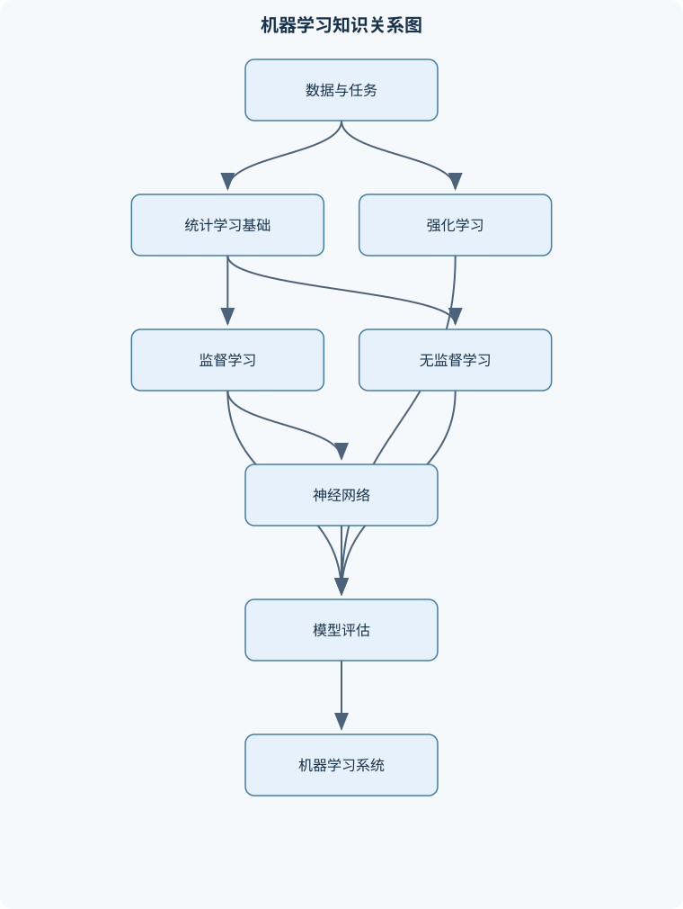
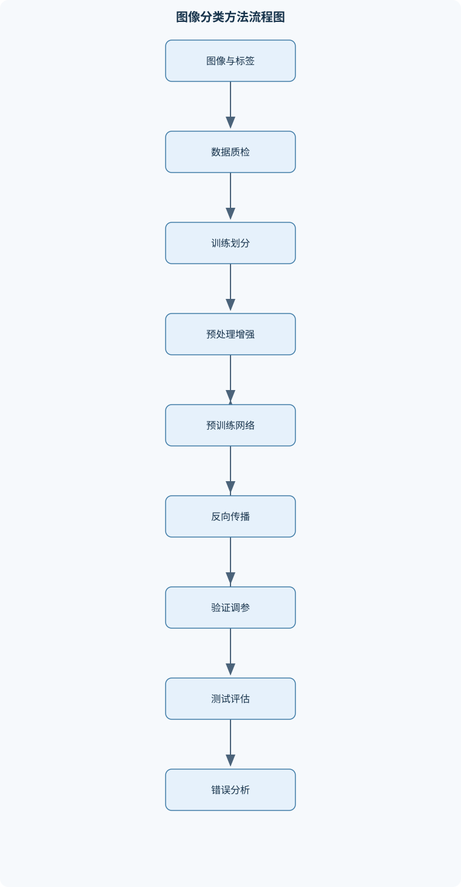

# 机器学习-图灵

## 一、课程整体知识框架

### 课程边界与先修知识

课程聚焦机器学习的统计基础、监督学习、无监督学习、神经网络与深度学习、强化学习，以及从数据处理到模型评估和部署的完整实践流程。内容覆盖回归、分类、聚类、降维、概率模型、决策树、规则学习、支持向量机、神经网络、卷积网络、序列决策和模仿学习。先修知识包括高等数学中的导数与偏导数、线性代数中的向量矩阵与特征值、概率论与数理统计中的条件概率与期望，以及基本程序设计和数据处理能力。课程不以特定软件版本为前提，代码实践可使用常见的 Python 数值计算、数据处理和机器学习工具。





### 1. 课程对象、先修知识与统一表示

机器学习研究的是：给定数据、任务目标和评价标准，如何利用算法学习一个模型，使模型能够对未见样本、未观测结构或连续交互过程作出有效判断。模型记为 $f_\theta$ 或 $f(x;\theta)$，其中 $\theta$ 是通过数据学习的参数；学习率、正则化强度、树深度、簇数等不直接由训练梯度确定的量称为超参数，常用 $\lambda$、$\eta$ 等符号表示。

单个样本记为 $(x_i,y_i)$，其中 $x_i\in\mathbb{R}^d$ 是 $d$ 维特征向量，$y_i$ 可以是连续数值、离散类别或序列决策中的奖赏相关变量。$n$ 个样本组成数据矩阵 $X\in\mathbb{R}^{n\times d}$，目标向量记为 $y$。特征的单位必须与实际含义一致，例如温度可以用摄氏度，金额可以用元；对不同单位的特征直接计算欧氏距离或使用梯度优化，结果可能被量纲较大的特征主导，因此标准化、归一化和单位转换必须在训练流程中明确处理。

课程需要的数学基础包括导数与偏导数、向量和矩阵运算、特征值与奇异值分解、条件概率、期望和方差；程序基础包括循环、函数、数组、文件读取、缺失值处理和基本可视化。矩阵转置记为 $X^\mathsf{T}$，向量范数为

$$
\|v\|_2=\sqrt{\sum_jv_j^2},\qquad
\|v\|_1=\sum_j|v_j|.
$$

这些记号分别表示欧氏长度和元素绝对值之和。若特征具有不同单位，范数的数值含义必须结合标准化方式解释，不能把未经缩放的距离直接视为客观相似度。

### 2. 三类学习任务与统一风险最小化观点

监督学习使用带标签样本 $(x_i,y_i)$ 学习输入到目标的映射。回归的目标是预测连续值，例如需求量或温度；分类的目标是预测离散类别，例如合格与不合格。无监督学习没有给定标签，目标是发现数据的内部结构，包括聚类、降维和隐变量建模。强化学习则在环境中通过状态、动作、转移和奖赏学习策略，目标不是一次预测准确，而是最大化长期累积回报。

监督学习通常定义损失函数 $L(y_i,f(x_i))$，经验风险为

$$
\widehat R(f)=\frac{1}{n}\sum_{i=1}^{n}L\bigl(y_i,f(x_i)\bigr).
$$

期望风险是从真实数据分布中抽取新样本时的平均损失。经验风险只能由有限样本估计期望风险；训练误差很低并不保证泛化误差很低。若模型过于简单，不能表达真实关系，会产生高偏差；若模型过于复杂，可能记住训练样本中的噪声，产生高方差和过拟合。平方损失下，预测误差可分解为不可约噪声、偏差平方和方差，因此增加复杂度通常降低偏差，却可能增加方差。

训练集用于拟合参数，验证集用于选择模型结构和超参数，测试集用于最终估计泛化性能。任何会从数据中学习参数的操作，例如均值填补、标准化、特征选择、主成分分析，都只能在训练集上拟合，再应用到验证集和测试集；否则会把测试信息泄漏到训练过程。独立同分布假设表示样本通常来自同一分布且相互独立，但时间序列、同一主体重复测量、空间相关数据不满足这一假设，必须使用时间切分、主体分组切分或空间分块切分。

正则化在经验风险之外增加模型复杂度惩罚，例如

$$
\min_\theta \widehat R(f_\theta)+\lambda\|\theta\|_2^2
$$

或

$$
\min_\theta \widehat R(f_\theta)+\lambda\|\theta\|_1.
$$

$\lambda\geq0$ 控制拟合数据与限制模型复杂度之间的权衡。$\lambda=0$ 时没有正则化；$\lambda$ 过大可能导致欠拟合。截距是否正则化必须明确，回归中通常不惩罚截距，否则特征平移会改变模型的惩罚效果。

### 3. 概率、损失与模型评估的联系

二分类标签可记为 $y\in\{0,1\}$，分类概率记为 $p(y=1\mid x)$。逻辑回归令

$$
p(y=1\mid x)=\sigma(w^\mathsf{T}x+b),\qquad
\sigma(z)=\frac{1}{1+e^{-z}}.
$$

因此

$$
\log\frac{p}{1-p}=w^\mathsf{T}x+b.
$$

当分类阈值为 $0.5$ 时，决策边界为 $w^\mathsf{T}x+b=0$；改变阈值会改变精确率和召回率，即使模型参数不变。交叉熵损失来自伯努利分布的负对数似然：

$$
L=-y\log p-(1-y)\log(1-p).
$$

它不仅评价类别是否正确，还惩罚过度自信的错误概率。多分类时，softmax 将得分 $z_k$ 转换为

$$
p(y=k\mid x)=\frac{e^{z_k}}{\sum_j e^{z_j}},
$$

所有类别概率非负且总和为 $1$。实际计算应减去最大得分以提高数值稳定性。

分类不能只依赖准确率。混淆矩阵中的真正例、假正例、真负例和假负例分别反映不同错误。精确率为 $\mathrm{TP}/(\mathrm{TP}+\mathrm{FP})$，召回率为 $\mathrm{TP}/(\mathrm{TP}+\mathrm{FN})$，F1 值为精确率和召回率的调和平均。类别严重不平衡时，准确率可能很高但少数类召回率为零；此时应结合混淆矩阵、PR 曲线、ROC 曲线下面积、代价矩阵和概率校准评价模型。

回归常用均方误差

$$
\mathrm{MSE}=\frac1n\sum_i(y_i-\hat y_i)^2
$$

和平均绝对误差

$$
\mathrm{MAE}=\frac1n\sum_i|y_i-\hat y_i|.
$$

MSE 对大误差更敏感，适合大误差代价显著的任务；MAE 对异常值相对稳健，但在零点不可导，优化时需要次梯度或平滑替代。评价指标必须与实际业务损失一致，不能因为某一指标数值较高就断言模型更好。

### 4. 从模型到可靠系统

完整机器学习流程包括数据读取、质量检查、划分数据、预处理、特征工程、模型训练、验证选择、测试评估、误差分析、部署和持续监控。数据质量检查应包括重复样本、缺失值、异常值、标签冲突、类别分布、图像损坏和时间范围。模型上线后，输入分布可能变化，称为数据漂移；输入与目标关系变化则可能造成概念漂移。监控不仅要看服务延迟和失败率，还要看输入统计量、预测分布、置信度、分组性能和真实标签回流后的误差。

可解释性包括系数、特征重要性、局部扰动解释、条件分析和反事实分析。特征重要性不等于因果影响，相关特征之间会分摊或重复贡献。公平性、隐私和安全风险需要在数据采集、训练、评估、部署各阶段处理，不能只在模型训练结束后补救。重新训练应由明确条件触发，例如关键指标持续下降、输入分布超出阈值、标签延迟数据证实性能退化或业务规则发生变化。

## 二、章节和模块划分

### 核心知识覆盖清单

本清单用于检查正文是否覆盖本课程的主要知识模块：

- **机器学习问题与统计学习基础**：机器学习任务与数据表示、监督学习、无监督学习与强化学习、训练集验证集测试集、经验风险与期望风险、损失函数与代价函数、偏差、方差与过拟合、正则化与模型复杂度、数据分布与独立同分布假设。
- **线性回归与正则化模型**：一元与多元线性回归、最小二乘目标函数、正规方程与矩阵求解、梯度下降与随机梯度下降、多重共线性与数值稳定性、岭回归与平方范数正则化、套索回归与稀疏解、多项式特征与交互特征。
- **分类模型与概率判别**：二分类与多分类问题、逻辑回归与对数几率、交叉熵损失、最大似然估计、生成式模型与判别式模型、朴素贝叶斯条件独立假设、高斯判别分析、混淆矩阵与分类阈值。
- **模型评估、选择与不平衡学习**：准确率、精确率、召回率与F1值、接收者操作特征曲线与曲线下面积、回归中的均方误差与平均绝对误差、留出法与交叉验证、分层交叉验证与时间序列切分、网格搜索与嵌套模型选择、数据泄漏与预处理边界、类别不平衡、代价敏感学习与概率校准。
- **决策树、集成学习与规则学习**：决策树的递归划分、信息熵、信息增益与增益率、基尼不纯度、连续特征与缺失值处理、预剪枝与后剪枝、装袋法与随机森林、提升方法与梯度提升、序贯覆盖与规则集学习、一阶规则、最小一般泛化与归纳逻辑程序学习。
- **支持向量机与核方法**：线性可分支持向量分类、间隔最大化、硬间隔与软间隔、合页损失与正则化、拉格朗日对偶问题、支持向量与互补松弛、核技巧与核函数条件、高斯核与多项式核、支持向量回归。
- **神经网络与反向传播**：感知机与线性不可分问题、多层前馈网络、激活函数及其梯度、输出层与损失函数匹配、计算图与链式法则、反向传播的逐层梯度计算、批量训练与小批量训练、权重初始化与梯度消失、批归一化、丢弃法与早停。
- **深度学习与图像分类实践**：卷积运算与局部感受野、步幅、填充与特征图尺寸、池化与平移不变性、卷积网络的层级特征、数据增强与迁移学习、预训练视觉骨干网络、多分类交叉熵与Top-k准确率、困难样本分析与混淆类别诊断、集成预测与模型误差分析。
- **聚类与降维**：相似度、距离与特征尺度、K均值目标函数、K均值迭代与局部最优、K中心点与小批量聚类、层次聚类与树状图、密度聚类与噪声点、主成分分析、奇异值分解与低维投影、聚类内部指标与外部指标。
- **概率图模型、隐变量与EM算法**：联合概率与条件概率分解、贝叶斯网络与条件独立、隐变量模型、高斯混合模型、期望最大化的下界解释、E步后验责任度计算、M步参数最大化、EM的单调性与局部最优、模型选择与成分数确定。
- **强化学习与序列决策**：马尔可夫决策过程、状态、动作、转移与奖赏、K摇臂赌博机、探索与利用的折中、策略、状态价值与动作价值、贝尔曼期望方程、策略迭代和值迭代、蒙特卡罗强化学习、时序差分、Sarsa与Q学习、值函数近似与模仿学习。
- **机器学习系统流程与可靠性**：数据读取与质量检查、训练验证测试流程设计、特征工程与标准化、流水线封装与参数搜索、随机性控制与实验复现、模型解释与特征重要性、分布偏移与数据漂移、公平性、隐私与安全风险、模型监控与重新训练触发条件。


### 1. 机器学习问题与统计学习基础

本模块建立统一语言。重点区分监督学习、无监督学习和强化学习，解释样本、特征、标签、参数、超参数、损失、经验风险和期望风险之间的关系。训练集、验证集和测试集不是简单的随机三等分；切分方式必须服从数据生成机制。时间数据不能把未来样本随机混入训练集，群组数据不能让同一主体同时出现在训练集和测试集。

常见考法是给出不同复杂度模型的训练误差和验证误差，判断欠拟合、过拟合或数据泄漏。若训练误差和验证误差都高，可能是模型表达能力不足或特征无效；若训练误差低而验证误差高，可能是过拟合；若验证结果异常好但上线迅速下降，应检查重复样本、标签泄漏和切分边界。

### 2. 线性回归与正则化模型

线性回归预测为 $\hat y=Xw+b$，最小二乘目标为

$$
J(w)=\|Xw-y\|_2^2.
$$

若暂时把截距并入设计矩阵，求导得到

$$
\nabla_wJ=2X^\mathsf{T}(Xw-y).
$$

令梯度为零，有

$$
X^\mathsf{T}Xw=X^\mathsf{T}y.
$$

当 $X^\mathsf{T}X$ 可逆时，

$$
w=(X^\mathsf{T}X)^{-1}X^\mathsf{T}y.
$$

该公式要求设计矩阵列之间不存在完全线性依赖。现实中不应显式计算逆矩阵，而应使用 QR 分解、SVD 或稳定的线性方程求解器。多重共线性会使系数方差增大、数值对扰动敏感，即使预测误差尚可，单个系数的解释也可能不可靠。

岭回归的目标为

$$
J(w)=\|Xw-y\|_2^2+\lambda\|w\|_2^2,\qquad\lambda>0.
$$

求导并令其为零：

$$
2X^\mathsf{T}(Xw-y)+2\lambda w=0,
$$

所以

$$
w=(X^\mathsf{T}X+\lambda I)^{-1}X^\mathsf{T}y.
$$

$\lambda>0$ 通常改善病态矩阵的稳定性，但会引入偏差。套索回归增加 $\lambda\|w\|_1$，由于绝对值函数在零点不可微，最优解可能出现大量零系数，适合稀疏特征选择，但在高度相关特征之间可能任意保留其中一部分。加入多项式特征和交互特征后，模型对输入不再是简单直线，但仍可对参数保持线性。

### 3. 分类模型与概率判别

生成式模型直接建模 $p(x\mid y)$ 和 $p(y)$，再由贝叶斯公式得到

$$
p(y\mid x)=\frac{p(x\mid y)p(y)}{p(x)}.
$$

判别式模型直接学习 $p(y\mid x)$ 或分类边界。朴素贝叶斯进一步假设给定类别后各特征条件独立：

$$
p(x\mid y)=\prod_{j=1}^{d}p(x_j\mid y).
$$

该假设简化了参数估计，但不意味着原始特征在总体中独立。高相关特征可能使概率估计失真，不过分类边界有时仍然有效。离散特征计数为零时，需要拉普拉斯平滑，否则某一项概率为零会使整个后验概率变为零。

高斯判别分析假设每个类别的特征服从高斯分布，可根据类别共享或不共享协方差得到不同边界。逻辑回归不要求输入特征服从高斯分布，但要求对数几率能够被特征的线性组合较好地表示。多分类逻辑回归使用 softmax，输出概率和为 $1$，但概率质量仍依赖模型设定和校准方法。

### 4. 模型评估、选择与不平衡学习

留出法简单但对一次切分敏感；$K$ 折交叉验证把训练数据分为 $K$ 份，轮流用一份验证、其余训练，最后汇总指标。分类任务通常使用分层交叉验证以保持各折类别比例；时间序列应使用按时间推进的切分，不能随机打乱。超参数搜索应嵌套在训练数据内部；测试集只能在最终方案确定后使用一次。

数据泄漏的典型例子是先对全体数据计算均值和标准差，再切分训练集和测试集。正确做法是将预处理与模型封装为流水线，使每个交叉验证折只用该折训练部分拟合预处理参数。类别不平衡时可以调整类别权重、重采样、阈值或损失函数；过采样必须只作用于训练折，不能复制测试样本。概率校准可用可靠性曲线、校准损失等评价，不能把高置信度误认为高正确率。

### 5. 决策树、集成学习与规则学习

决策树在节点上递归选择特征和切分点。分类节点的不纯度可用熵

$$
H(S)=-\sum_kp_k\log p_k
$$

或基尼不纯度

$$
G(S)=1-\sum_kp_k^2.
$$

划分后的加权不纯度下降为父节点不纯度减去子节点不纯度的加权和。信息增益偏好取值较多的特征，增益率对此进行修正。连续特征需枚举排序后的候选阈值，缺失值可通过替代划分、独立缺失类别或加权分配处理。递归贪心划分不保证全局最优，因此需要限制深度、叶节点样本数，或通过后剪枝降低方差。

装袋法对训练集进行有放回抽样，分别训练多棵树，再进行投票或平均。随机森林进一步在节点划分时随机抽取特征，降低树之间相关性。提升方法按序训练弱学习器，使后续模型关注当前残差或难分类样本；梯度提升可解释为沿损失函数负梯度方向逐步拟合。提升模型通常对学习率、树深度和树数量敏感。

规则学习可采用“序贯覆盖”：寻找一条能覆盖较多正例且较少反例的规则，删除已覆盖样本后继续学习。最小一般泛化将过于具体的规则推广为更一般的规则。一阶规则和归纳逻辑程序学习能表达变量、关系和背景知识，但搜索空间更大，需要控制规则长度、覆盖率和冲突。

### 6. 支持向量机与核方法

线性可分情况下，支持向量机寻找间隔最大的超平面。若标签为 $y_i\in\{-1,1\}$，硬间隔约束为

$$
y_i(w^\mathsf{T}x_i+b)\geq1.
$$

两条边界间的几何间隔为 $2/\|w\|_2$，因此最大化间隔等价于最小化 $\frac12\|w\|_2^2$。线性不可分时引入松弛变量：

$$
y_i(w^\mathsf{T}x_i+b)\geq1-\xi_i,\qquad \xi_i\geq0,
$$

并最小化

$$
\frac12\|w\|_2^2+C\sum_i\xi_i.
$$

$C$ 越大，越强调训练违例；$C$ 较小则允许更宽间隔。合页损失为 $\max(0,1-yf(x))$。对偶问题中的非零拉格朗日乘子对应支持向量，决策边界主要由这些样本决定。

核技巧用 $K(x,x')$ 代替显式高维映射后的内积。标准核方法要求核矩阵在相应条件下半正定。高斯核适合表达局部相似性，多项式核适合表达有限阶交互。核参数和 $C$ 对特征尺度敏感，通常需要先标准化。支持向量回归使用 $\varepsilon$ 不敏感损失，在误差落入 $\varepsilon$ 管道内时不产生损失。

### 7. 神经网络与反向传播

感知机只能形成线性决策边界，无法解决某些线性不可分问题。多层前馈网络通过

$$
z^{(l)}=W^{(l)}h^{(l-1)}+b^{(l)},\qquad
h^{(l)}=\phi(z^{(l)})
$$

叠加非线性变换。隐藏层可使用 ReLU、sigmoid 或其他激活函数；输出层必须与任务匹配：回归常用线性输出，二分类常用 sigmoid，多分类常用 softmax。

反向传播不是优化器，而是利用链式法则计算梯度的方法。若 $h=\phi(z)$，上游梯度为 $\partial L/\partial h$，则

$$
\frac{\partial L}{\partial z}
=
\frac{\partial L}{\partial h}\odot\phi'(z).
$$

再通过矩阵乘法将梯度传到前一层。小批量训练在计算效率和梯度噪声之间折中。权重初始化过大可能造成梯度爆炸，过小或网络过深可能造成梯度消失。批归一化、丢弃法、权重衰减和早停可改善泛化或优化稳定性，但不能替代合理的数据切分。

### 8. 深度学习与图像分类实践

二维卷积在局部感受野内共享参数。若输入空间尺寸为 $H\times W$，卷积核尺寸为 $K_h\times K_w$，步幅为 $S$，填充为 $P$，则输出空间尺寸为

$$
H_{\text{out}}=
\left\lfloor\frac{H+2P-K_h}{S}\right\rfloor+1,
\qquad
W_{\text{out}}=
\left\lfloor\frac{W+2P-K_w}{S}\right\rfloor+1.
$$

池化减少空间分辨率并增强局部平移鲁棒性，但卷积网络并不对任意旋转、尺度变化和遮挡完全不变。数据增强应符合任务语义；不应把会改变类别含义的变换当作普通增强。

迁移学习通常先使用预训练视觉骨干网络，再替换分类头并微调部分层。多分类任务常用交叉熵和 Top-k 准确率。仅看总体准确率不足以诊断相近类别，应分析混淆矩阵、困难样本、背景依赖、拍摄角度、类别定义和标注质量。训练集准确率高而测试集下降，可能是背景或设备差异造成的伪相关。

### 9. 聚类与降维

K 均值优化

$$
\sum_i\|x_i-\mu_{c_i}\|_2^2.
$$

固定中心时，把样本分给最近中心最优；固定分配时，簇中心取样本均值最优。因此交替更新不会增加目标值，但只能达到局部最优或退化解。K 均值隐含欧氏距离、相近尺度和近似球状簇假设。K 中心点用真实样本作为中心，对离群点更稳健；小批量 K 均值适合大规模数据，但目标是近似优化。

层次聚类通过逐步合并或拆分得到树状结构，距离连接方式会影响结果。密度聚类依据邻域密度识别任意形状簇，并将低密度点视为噪声，但参数对尺度和密度差异敏感。内部指标使用簇内紧密度和簇间分离度，外部指标需要真实标签；无标签聚类不能仅凭某一个指标断言“真实类别”。

主成分分析先中心化数据，再寻找单位向量 $u$ 使投影方差最大。若协方差矩阵为 $\Sigma$，第一主成分满足

$$
\max_{\|u\|_2=1}u^\mathsf{T}\Sigma u.
$$

其解是最大特征值对应的特征向量。前 $k$ 个主成分构成最小平方重构误差的 $k$ 维线性子空间。奇异值分解可写为

$$
X=U\Sigma V^\mathsf{T}.
$$

降维方向只保证保留方差，不保证保留类别可分性；是否标准化取决于特征单位和任务目标。

### 10. 概率图模型、隐变量与 EM

联合概率可以按条件概率分解。贝叶斯网络用有向图表示变量依赖和条件独立关系。隐变量模型中，部分变量未被直接观测，例如高斯混合模型中每个样本所属的成分标签是隐变量。

高斯混合模型假设

$$
p(x)=\sum_{k=1}^{K}\pi_k\mathcal N(x\mid\mu_k,\Sigma_k),
\qquad
\pi_k\geq0,\quad\sum_k\pi_k=1.
$$

EM 算法交替执行：E 步计算责任度

$$
\gamma_{ik}
=
\frac{\pi_k\mathcal N(x_i\mid\mu_k,\Sigma_k)}
{\sum_j\pi_j\mathcal N(x_i\mid\mu_j,\Sigma_j)};
$$

M 步用责任度加权更新混合权重、均值和协方差。责任度对成分求和为 $1$。EM 最大化观测数据对数似然的下界，因此每轮通常不降低似然，但不能保证全局最优。协方差可能奇异、成分可能塌缩，需要多次初始化、协方差约束或先验。

### 11. 强化学习与序列决策

马尔可夫决策过程由状态空间 $S$、动作空间 $A$、转移概率 $P(s'\mid s,a)$、奖赏 $r$ 和策略 $\pi(a\mid s)$ 构成。折扣因子 $\gamma\in[0,1)$ 控制未来奖赏的重要程度。状态价值为

$$
V^\pi(s)=
\mathbb E_\pi\left[\sum_{t=0}^{\infty}\gamma^tr_{t+1}\mid s_0=s\right].
$$

贝尔曼期望方程为

$$
V^\pi(s)=
\sum_a\pi(a\mid s)
\sum_{s'}P(s'\mid s,a)
\left[r+\gamma V^\pi(s')\right].
$$

策略迭代交替进行策略评估和策略改进；值迭代直接使用最优动作备份。K 摇臂赌博机体现探索与利用的折中。蒙特卡罗方法用完整轨迹回报的样本均值估计价值，必须等待轨迹结束；时序差分方法使用一步目标，能在线更新但目标包含估计值。

Sarsa 的时序差分误差为

$$
\delta=r+\gamma Q(s',a')-Q(s,a),
$$

使用实际执行的下一动作，属于同策略方法。Q 学习使用

$$
\delta=r+\gamma\max_{a'}Q(s',a')-Q(s,a),
$$

属于异策略方法。免模型学习不要求已知转移概率和奖赏函数，但需要足够探索。模仿学习通过专家轨迹学习动作策略，可减少盲目探索，却可能受到专家偏差和分布外状态累积误差影响。

### 12. 代表性算法与流程

#### 12.1 训练、验证、测试与流水线流程

**输入：** 带标签数据 $D$、切分规则、随机种子和评价指标。  
**输出：** 训练集、验证集、测试集以及最终模型。

1. 判断样本是否独立同分布；若为时间、主体或空间相关数据，先确定相应切分单位。
2. 按任务需要进行随机、分层、时间或分组切分。
3. 只在训练集拟合缺失值填补、标准化、降维和特征选择。
4. 在训练集上拟合候选模型，用验证集选择超参数。
5. 固定方案后重新利用训练数据训练最终模型。
6. 测试集只进行一次最终评价，并保存切分规则、随机种子和模型版本。

不变量是测试数据不参与任何参数学习和模型选择。若验证指标长期不改善，可早停；若数据分布持续变化，应重新检查切分有效性。近似随机划分时，线性扫描成本约为 $O(n)$；分层和排序的具体成本取决于实现。

#### 12.2 小批量梯度下降

**输入：** 目标函数 $J(\theta)$、学习率 $\eta$、批大小 $B$、最大轮数。  
**输出：** 学习到的参数 $\theta$。

每轮先打乱训练样本，再对每个小批量计算梯度 $g=\nabla_\theta J_B$，执行

$$
\theta\leftarrow\theta-\eta g.
$$

终止条件为达到最大轮数、梯度范数足够小或验证损失在若干轮内不再改善。梯度下降只适用于可微或可用次梯度处理的目标；反向传播负责计算神经网络梯度，优化器负责更新参数。

#### 12.3 K 均值聚类伪代码

```text
算法：K均值聚类
输入：样本 X，簇数 K，最大迭代次数 T
输出：簇标签 c，中心 μ

随机初始化 K 个中心 μ1,...,μK
重复最多 T 次：
    对每个样本 xi：
        ci ← argmin_k ||xi - μk||₂²
    对每个簇 k：
        若该簇非空：
            μk ← 该簇样本的均值
        否则：
            重新初始化 μk
    若所有标签不变或目标函数下降小于阈值：
        停止
返回 c 和 μ
```

算法的不变量是每个样本属于一个簇，且在标准分配和均值更新下目标函数不增加。每轮复杂度为 $O(nKd)$，适合近似球状簇；对强非凸结构、不同尺度特征和严重离群值不适用。

### 13. 代表性例题

#### 例题一：最小二乘回归

**题干：** 给出两个样本 $(1,2)$、$(2,3)$，模型为 $\hat y=w_0+w_1x$，求使平方误差最小的直线。

**分析：** 两点恰好确定一条直线，设计矩阵为

$$
X=
\begin{bmatrix}
1&1\\
1&2
\end{bmatrix},
\qquad
y=
\begin{bmatrix}
2\\3
\end{bmatrix}.
$$

**解答：** 由 $w_0+w_1=2$、$w_0+2w_1=3$，相减得 $w_1=1$，代回得 $w_0=1$，所以 $\hat y=1+x$。

**结果验证：** 两个训练样本的预测分别为 $2$ 和 $3$，残差均为零。若增加重复或带噪声样本，应使用正规方程或数值分解求最小平方解。

**变式：** 若两个特征完全相同，$X^\mathsf{T}X$ 不可逆，不能使用显式逆矩阵；可使用 SVD 或加入岭正则化。

#### 例题二：逻辑回归单步更新

**题干：** 单个样本 $x=2$，标签 $y=1$，当前 $w=0$、$b=0$，学习率 $\eta=0.1$，求一次梯度下降后的参数。

**分析：** 线性得分为 $z=wx+b=0$，因此 $p=\sigma(0)=0.5$。

**解答：** 交叉熵对 $z$ 的梯度为 $p-y=-0.5$。于是

$$
\frac{\partial L}{\partial w}=(p-y)x=-1,\qquad
\frac{\partial L}{\partial b}=p-y=-0.5.
$$

更新后

$$
w'=0-0.1(-1)=0.1,\qquad b'=0-0.1(-0.5)=0.05.
$$

**结果验证：** 新得分为 $0.25$，预测概率约为 $0.562$，正类概率上升，方向符合标签 $y=1$。

**变式：** 若标签改为 $0$，梯度方向相反；若加入岭正则化，权重梯度还要增加正则项，截距是否增加该项必须事先约定。

#### 例题三：决策树基尼不纯度

**题干：** 某节点有 4 个样本，其中正类 3 个、负类 1 个；候选划分后两子节点分别为“正类 2、负类 0”和“正类 1、负类 1”，计算基尼下降。

**解答：** 父节点基尼为

$$
G_p=1-\left(\frac34\right)^2-\left(\frac14\right)^2=\frac38.
$$

第一个子节点纯度为 $0$，含 2 个样本；第二个子节点基尼为

$$
G_2=1-\left(\frac12\right)^2-\left(\frac12\right)^2=\frac12.
$$

加权子节点不纯度为

$$
\frac24\cdot0+\frac24\cdot\frac12=\frac14.
$$

因此下降量为 $\frac38-\frac14=\frac18$。

**结果验证：** 划分后不纯度下降为正，说明该划分比不划分更纯；若所有候选划分下降量均不正，应停止递归。

**变式：** 若某特征取值很多，信息增益可能偏好该特征，应比较增益率或使用剪枝。

#### 例题四：支持向量机间隔

**题干：** 超平面为 $2x_1+x_2=0$，求两条规范边界间的距离。

**解答：** 法向量为 $w=(2,1)$，范数为 $\sqrt5$。支持向量机规范边界满足 $w^\mathsf{T}x+b=\pm1$，两边界距离为

$$
\frac{2}{\|w\|_2}=\frac{2}{\sqrt5}.
$$

**结果验证：** 增大 $w$ 的长度会缩小几何间隔，因此最大间隔问题等价于最小化 $\|w\|_2^2$。

**变式：** 软间隔允许样本违反边界，$C$ 大时更重视训练违例，$C$ 小时更重视宽间隔和泛化。

#### 例题五：K 均值一次迭代

**题干：** 样本为 $(0,0)$、$(0,2)$、$(8,8)$、$(8,10)$，初始中心为 $\mu_1=(0,0)$、$\mu_2=(8,8)$，完成一次分配和更新。

**解答：** 前两个样本距离 $\mu_1$ 更近，后两个样本距离 $\mu_2$ 更近，因此

$$
C_1=\{(0,0),(0,2)\},\qquad C_2=\{(8,8),(8,10)\}.
$$

更新中心为

$$
\mu_1=(0,1),\qquad \mu_2=(8,9).
$$

更新后目标为

$$
0^2+1^2+0^2+1^2=2.
$$

**结果验证：** 每个中心是对应簇内均值，固定分配时平方距离和达到最小。

**变式：** 若两个初始中心均位于同一簇，算法可能得到较差局部最优，应使用多次随机初始化或 K-means++ 类初始化。

### 14. 实验与项目流程

#### 14.1 表格数据分类实验

**输入数据：** 含数值特征、类别标签和可能缺失值的表格数据。  
**步骤：**

1. 检查重复行、缺失比例、标签分布和异常取值。
2. 按类别进行训练集、验证集和测试集分层切分。
3. 在训练集内拟合缺失值填补器和标准化器。
4. 比较逻辑回归、决策树和随机森林。
5. 用验证集选择超参数，最终在测试集报告准确率、精确率、召回率、F1、混淆矩阵和概率校准情况。
6. 分析少数类错误样本，判断是特征不足、阈值不合适还是标签质量问题。

**评价标准：** 不平衡任务优先报告少数类召回率、精确率、F1 和代价加权指标；所有预处理必须封装在训练流程内。  
**排错方法：** 若测试结果异常高，检查重复主体、标签泄漏和全数据标准化；若训练和验证均差，检查特征单位、缺失处理和模型表达能力；若训练好而验证差，检查正则化、树深度、样本量和数据漂移。

#### 14.2 图像分类项目

**输入数据：** 按类别组织的图像文件和标签表。  
**步骤：**

1. 统计每类样本数，检查损坏图像、重复图像和标签冲突。
2. 按类别分层划分训练、验证和测试数据；同一主体或同一拍摄序列不得跨集合。
3. 统一尺寸和像素范围，仅用训练集统计量完成标准化。
4. 使用预训练卷积网络替换分类头，先冻结骨干网络，再根据验证集表现逐步微调。
5. 报告总体准确率、Top-k 准确率、每类召回率和混淆矩阵。
6. 对混淆最严重的类别抽取样本，分析背景、角度、光照、遮挡、类别定义和标注质量。
7. 评估模型在不同设备、场景和图像质量下的性能，确定部署边界。

**评价标准：** 不仅看总体准确率，还要检查各类别是否存在系统性失效；测试集不能用于选择增强方式或微调轮数。  
**排错方法：** 若训练准确率很高而验证准确率低，检查背景伪相关和增强不足；若某类召回率接近零，检查类别数量、标签编码、损坏文件和类别定义；若训练与验证均低，检查输入尺寸、归一化方式、输出类别数和损失函数是否匹配。

## 三、核心概念的详细解释

### 1. 学习任务、数据分布与风险

机器学习的基本对象是样本 $(x_i,y_i)$。其中 $x_i\in\mathbb{R}^d$ 为 $d$ 维特征向量，$y_i$ 可以是连续值、离散类别，也可以是强化学习中的奖赏或轨迹信息。监督学习利用已知标签学习映射 $f_\theta(x)$；无监督学习在没有标签的条件下寻找聚类、低维结构或概率分布；强化学习则在状态空间 $S$ 中通过动作 $a\in A$ 与环境交互，依据奖赏学习策略 $\pi(a\mid s)$。

监督学习通常最小化经验风险：

$$
\widehat R(f)=\frac{1}{n}\sum_{i=1}^{n}L\bigl(y_i,f(x_i)\bigr),
$$

其中 $L$ 是损失函数，$n$ 是样本数。真正关心的是期望风险，即从真实数据分布中重新抽取样本时的平均损失。经验风险和期望风险之间的差异构成泛化问题。训练集误差低而测试集误差高，说明模型可能记住了训练样本中的偶然噪声，即过拟合；训练集和测试集误差都高，通常说明模型表达能力不足、特征不充分或数据噪声较大。

独立同分布假设要求样本近似独立，且训练、验证和测试样本来自相同分布。时间序列中的相邻观测、同一主体的重复测量、同一视频拆分出的相邻图像往往不满足独立性。若将同一主体的数据随机分到训练集和测试集，模型可能通过主体特征而不是目标规律完成预测，导致测试结果虚高。

### 2. 数据划分、预处理与数据泄漏

训练集用于拟合模型参数，验证集用于选择超参数和模型结构，测试集只用于最终评估。缺失值填补器、标准化器、特征选择器和主成分分析器都包含从数据中学习的统计量，因此必须只在训练集上拟合。例如，训练集均值和标准差分别为 $\mu_{\text{tr}}$ 与 $\sigma_{\text{tr}}$，验证样本 $x$ 的标准化应写为

$$
x'=\frac{x-\mu_{\text{tr}}}{\sigma_{\text{tr}}},
$$

而不能使用包含验证集信息的总体均值和标准差。

分类任务可以采用分层切分，使各集合的类别比例大致一致；时间序列应按时间先后切分，不能随机打乱未来信息；同一患者、用户、设备或地理区域的样本应采用分组切分。交叉验证也必须在每个训练折内部完成预处理和超参数选择，否则验证折的信息会泄漏到训练过程。

常见错误包括：先对全体数据降维再切分；使用测试集选择阈值；依据测试集结果反复修改模型；将未来变量作为当前时刻特征；把由标签派生的字段作为输入。数据泄漏不一定导致训练误差异常，往往表现为验证或测试性能不合理地高，部署后却迅速下降。

### 3. 回归、分类与概率判别

线性回归假设预测值可表示为

$$
\hat y_i=w^\mathsf{T}x_i+b,
$$

其中 $w$ 的分量单位取决于目标变量单位与对应特征单位，$b$ 与目标变量具有相同单位。最小二乘法最小化残差平方和。多项式回归加入 $x^2,x^3$ 等特征后，模型对参数仍可为线性，因此“线性模型”不等同于输入输出图像必须是一条直线。

逻辑回归用于二分类时令

$$
p(y=1\mid x)=\sigma(w^\mathsf{T}x+b),\qquad
\sigma(z)=\frac{1}{1+e^{-z}}.
$$

它满足

$$
\log\frac{p}{1-p}=w^\mathsf{T}x+b.
$$

当默认阈值为 $0.5$ 时，决策边界为 $w^\mathsf{T}x+b=0$。阈值并非固定真理：若漏检代价高，应降低阈值以提高召回率；若误报代价高，则可能提高阈值。

逻辑回归的交叉熵损失为

$$
-\frac{1}{n}\sum_{i=1}^{n}
\left[y_i\log p_i+(1-y_i)\log(1-p_i)\right].
$$

该目标来自伯努利分布的最大似然估计。生成式模型先建模 $p(x\mid y)$ 和 $p(y)$，再由贝叶斯公式求后验；判别式模型直接学习 $p(y\mid x)$ 或决策边界。朴素贝叶斯假设给定类别后各特征条件独立：

$$
p(x\mid y=k)=\prod_{j=1}^{d}p(x_j\mid y=k).
$$

该假设简化了计算，但并不表示原始特征在总体中相互独立。相关特征可能造成概率过度自信，虽然最终分类仍可能有效。

### 4. 偏差、方差与正则化

设真实目标为 $y=f(x)+\varepsilon$，其中 $\varepsilon$ 为均值为零的不可约噪声。平方损失下，模型预测的期望误差可以分解为不可约噪声、偏差平方和方差。偏差描述模型平均预测与真实函数之间的差异，方差描述模型对训练样本变化的敏感程度。模型复杂度增加通常降低偏差，但可能提高方差。

岭回归在平方损失上加入平方范数：

$$
\min_w\ \|Xw-y\|_2^2+\lambda\|w\|_2^2,\qquad \lambda>0.
$$

它通常使相关特征的系数共同收缩，不能产生大量精确零系数。套索回归使用 $\lambda\|w\|_1$，由于 $L_1$ 约束几何形状具有尖角，优化结果可能出现零系数，因而适合产生稀疏模型。正则化强度必须通过训练集内部的验证流程选择，不能依据测试集反复调节。截距是否正则化必须明确，通常先对特征中心化且不惩罚截距。

### 5. 决策树、集成方法与支持向量机

决策树在节点上递归划分样本。分类节点的不纯度可以用熵

$$
H(S)=-\sum_k p_k\log p_k
$$

或基尼不纯度

$$
G(S)=1-\sum_k p_k^2
$$

表示。若父节点为 $S$，划分后子节点为 $S_1,\ldots,S_m$，加权不纯度下降为

$$
I(S)-\sum_{j=1}^{m}\frac{|S_j|}{|S|}I(S_j).
$$

树的贪心划分每一步选择当前最优切分，不保证全局最优。树深度过大可能记忆噪声，因此需要限制深度、叶节点最小样本数或进行后剪枝。随机森林通过自助采样和随机特征子集训练多棵树，再进行投票或平均，通常降低方差；梯度提升则按序列方式拟合前一轮残差或负梯度，表达能力强但对学习率、树深度和迭代次数较敏感。

支持向量机寻找具有最大几何间隔的分类超平面。软间隔形式为

$$
\min_{w,b,\xi}\frac12\|w\|_2^2+C\sum_i\xi_i
$$

并满足

$$
y_i(w^\mathsf{T}x_i+b)\geq1-\xi_i,\qquad \xi_i\geq0.
$$

$C$ 较大时更重视训练样本违例，可能减小训练误差但提高方差；$C$ 较小时允许更多违例，以获得更宽间隔。核方法以核函数替代内积，例如高斯核和多项式核。标准凸优化要求核函数满足相应的正定条件；特征尺度会直接影响核距离和优化结果，因此通常需要标准化。

### 6. 神经网络、卷积网络与深度学习

一层神经网络可写为

$$
h=\phi(Wx+b),
$$

其中 $\phi$ 是激活函数。若所有层都使用线性激活，多层网络仍等价于一个线性变换，不能表达复杂非线性。ReLU 为 $\max(0,z)$，正半轴梯度为 $1$，负半轴梯度为 $0$；过大的学习率或不当初始化可能使大量神经元长期处于无梯度区域。反向传播只是利用链式法则计算梯度，不是优化器；梯度下降、动量或自适应方法才负责更新参数。

卷积层对局部区域使用共享权重，减少参数量并保留空间结构。若输入空间尺寸为 $H\times W$，卷积核为 $K_h\times K_w$，填充为 $P_h,P_w$，步幅为 $S_h,S_w$，则输出尺寸为

$$
H_{\text{out}}=
\left\lfloor\frac{H+2P_h-K_h}{S_h}\right\rfloor+1,
\qquad
W_{\text{out}}=
\left\lfloor\frac{W+2P_w-K_w}{S_w}\right\rfloor+1.
$$

池化可降低空间分辨率并增强一定程度的平移鲁棒性，但卷积网络并不天然对任意旋转、尺度变化和遮挡保持不变。数据增强、迁移学习和困难样本分析应结合具体数据分布使用。

### 7. 聚类、降维与隐变量模型

K 均值最小化

$$
\sum_{i=1}^{n}\|x_i-\mu_{c_i}\|_2^2.
$$

固定中心时，将样本分配给最近中心不会增加目标；固定分配时，簇中心取样本均值可使平方距离和最小。因此交替更新目标值不增加，但只能保证收敛到局部最优或退化解。K 均值隐含欧氏距离、均值中心和近似球状簇假设，强烈依赖特征尺度。

主成分分析先将特征中心化，再寻找投影方差最大的正交方向。若协方差矩阵为 $\Sigma$，第一主成分满足

$$
\Sigma u_1=\lambda_1u_1,
$$

其中 $\lambda_1$ 为最大特征值，$u_1$ 为单位特征向量。前 $k$ 个主成分构成最小平方重构误差的 $k$ 维线性子空间，但最大方差方向不一定是最有利于分类的方向。

高斯混合模型假设数据来自多个高斯成分的加权混合。EM 算法在 E 步计算样本属于各成分的责任度，在 M 步利用责任度加权更新均值、协方差和混合权重。EM 每次迭代通常不降低观测数据似然，但可能收敛到局部最优；协方差退化、成分塌缩和初始值不佳都需要通过多次初始化、协方差约束或正则化处理。

### 8. 强化学习与序列决策

马尔可夫决策过程由状态空间 $S$、动作空间 $A$、转移概率 $P(s'\mid s,a)$、奖赏 $r$ 和折扣因子 $\gamma\in[0,1)$ 构成。策略 $\pi(a\mid s)$ 指定状态下动作的概率。策略价值函数为

$$
V^\pi(s)=\mathbb{E}_\pi\left[\sum_{t=0}^{\infty}\gamma^tr_{t+1}\mid s_0=s\right].
$$

贝尔曼期望方程为

$$
V^\pi(s)=\sum_a\pi(a\mid s)
\sum_{s'}P(s'\mid s,a)
\left[r(s,a,s')+\gamma V^\pi(s')\right].
$$

蒙特卡罗方法等待完整轨迹结束，用实际累计回报估计价值；时序差分方法在轨迹未结束时使用下一状态估计值。Sarsa 使用实际执行的下一动作：

$$
\delta=r+\gamma Q(s',a')-Q(s,a),
$$

而 Q 学习使用下一状态的最大动作价值：

$$
Q(s,a)\leftarrow Q(s,a)+\alpha
\left[r+\gamma\max_{a'}Q(s',a')-Q(s,a)\right].
$$

前者是同策略方法，后者通常是异策略方法。探索与利用必须平衡，$\varepsilon$-贪心策略以概率 $\varepsilon$ 随机探索，以概率 $1-\varepsilon$ 选择当前估计价值最高的动作。

### 9. 代表性算法与安全实现流程

#### 9.1 小批量梯度下降

**输入：** 目标函数、训练样本、批大小 $B$、学习率 $\eta$ 和最大轮数。  
**输出：** 参数 $\theta$。

1. 初始化 $\theta$。
2. 每轮打乱训练样本，并划分为大小不超过 $B$ 的批次。
3. 对每个批次计算损失和梯度 $g=\nabla_\theta J_B(\theta)$。
4. 更新 $\theta\leftarrow\theta-\eta g$。
5. 若验证损失长期不改善、梯度范数足够小或达到最大轮数，则停止。

其不变量是每次更新只使用当前批次构造的梯度。适用于可微目标或可使用次梯度的目标；单轮计算复杂度约为所有样本的模型计算成本，内存随批大小和模型参数量增加。

#### 9.2 K 均值聚类

**输入：** $X$、簇数 $K$、初始化方式和最大迭代次数。  
**输出：** 簇标签 $c_i$ 和中心 $\mu_k$。

1. 初始化 $K$ 个中心。
2. 对每个样本选择最近中心：
   $$
   c_i=\arg\min_k\|x_i-\mu_k\|_2^2.
   $$
3. 对每个簇重新计算均值：
   $$
   \mu_k=\frac{1}{|\mathcal C_k|}\sum_{i\in\mathcal C_k}x_i.
   $$
4. 若标签不再变化、目标变化小于阈值或达到最大迭代次数，停止。

每轮复杂度为 $O(nKd)$。空簇必须重新初始化或采用其他处理；不同初始化可能产生不同结果，实际应用应比较多次运行的目标函数和稳定性。

#### 9.3 训练、验证和测试代码示例

```python
import numpy as np

def standardize_train_apply(X_train, X_other):
    """只用训练集统计量标准化其他数据。"""
    mean = X_train.mean(axis=0)
    std = X_train.std(axis=0)
    std = np.where(std == 0, 1.0, std)
    return (X_train - mean) / std, (X_other - mean) / std

def train_linear_regression(X, y, learning_rate=0.05, epochs=500):
    """使用小批量为全量梯度的梯度下降训练线性回归。"""
    n, d = X.shape
    w = np.zeros(d)
    b = 0.0

    for _ in range(epochs):
        pred = X @ w + b
        error = pred - y
        grad_w = (X.T @ error) / n
        grad_b = error.mean()
        w -= learning_rate * grad_w
        b -= learning_rate * grad_b

    return w, b

def mse(X, y, w, b):
    pred = X @ w + b
    return np.mean((pred - y) ** 2)

# 示例数据：特征与目标均为数值数组，不涉及文件或网络操作
X = np.array([[1., 2.], [2., 1.], [3., 4.], [4., 3.], [5., 5.]])
y = np.array([2.0, 2.5, 4.5, 4.8, 6.0])

X_train, X_test = X[:4], X[4:]
y_train, y_test = y[:4], y[4:]

X_train_s, X_test_s = standardize_train_apply(X_train, X_test)
w, b = train_linear_regression(X_train_s, y_train)
print("训练误差:", mse(X_train_s, y_train, w, b))
print("测试误差:", mse(X_test_s, y_test, w, b))
```

该代码的关键边界是：标准化参数只来自训练集；常数特征的标准差设为 $1$ 以避免除零；测试误差只能在模型方案确定后解释，不能据此继续调参。

## 四、重要定义、公式、定理和推导

### 专业审校补充：关键定义与适用边界

分布偏移必须区分输入分布变化与条件关系变化。设训练分布为 P_tr(x,y)，部署分布为 P_te(x,y)。协变量偏移指 P_tr(x)≠P_te(x)，但满足 P_tr(y|x)=P_te(y|x)；此时若 P_tr(x)>0 覆盖部署区域，可用重要性加权估计部署风险：R_te(f)=E_tr[w(x)L(f(x),y)]，其中 w(x)=P_te(x)/P_tr(x)。该方法的前提是条件分布确实稳定，且训练分布对部署分布具有支持覆盖；若出现概念漂移，即 P(y|x) 改变，单纯重加权不能修复。实际中密度比估计可能方差很大，极端权重会使模型不稳定，因此应监控权重分布、截断异常权重，并按时间、主体或场景分别评估。训练集与部署集的特征统计变化只能提示协变量偏移，不能据此证明标签关系未变。


### 1. 线性回归与岭回归推导

令预测向量为 $\hat y=Xw$，平方损失为

$$
J(w)=\|Xw-y\|_2^2.
$$

展开并求梯度：

$$
J(w)=w^\mathsf{T}X^\mathsf{T}Xw-2w^\mathsf{T}X^\mathsf{T}y+y^\mathsf{T}y,
$$

$$
\nabla_wJ(w)=2X^\mathsf{T}Xw-2X^\mathsf{T}y.
$$

令梯度为零，得到

$$
X^\mathsf{T}Xw=X^\mathsf{T}y.
$$

当 $X^\mathsf{T}X$ 可逆时，

$$
w=(X^\mathsf{T}X)^{-1}X^\mathsf{T}y.
$$

实际计算不应优先显式求逆，因为特征高度相关时矩阵可能病态，舍入误差会被放大，应使用 QR 分解、SVD 或稳定的线性方程求解器。

岭回归目标为

$$
J_\lambda(w)=\|Xw-y\|_2^2+\lambda\|w\|_2^2.
$$

求导得

$$
2X^\mathsf{T}Xw-2X^\mathsf{T}y+2\lambda w=0,
$$

即

$$
(X^\mathsf{T}X+\lambda I)w=X^\mathsf{T}y.
$$

当 $\lambda>0$ 时，矩阵通常具有更好的数值稳定性。若截距未正则化，应将设计矩阵和惩罚矩阵分开处理，不能直接把截距与普通特征同样惩罚。

### 2. 逻辑回归梯度推导

对样本 $i$ 令

$$
z_i=w^\mathsf{T}x_i+b,\qquad p_i=\sigma(z_i).
$$

单样本交叉熵为

$$
\ell_i=-y_i\log p_i-(1-y_i)\log(1-p_i).
$$

由于

$$
\frac{d\sigma(z)}{dz}=\sigma(z)(1-\sigma(z)),
$$

经过链式法则可得

$$
\frac{\partial \ell_i}{\partial z_i}=p_i-y_i.
$$

因此

$$
\nabla_w\ell_i=(p_i-y_i)x_i,\qquad
\frac{\partial\ell_i}{\partial b}=p_i-y_i.
$$

若加入岭正则化 $\frac{\lambda}{2}\|w\|_2^2$，则权重梯度增加 $\lambda w$，但是否对 $b$ 增加正则项必须预先规定。

**例题一：单步逻辑回归更新。** 已知 $x=(2,1)$、$y=1$、$w=(0,0)$、$b=0$、学习率 $\eta=0.1$。  
**分析：** 先求线性得分，再求概率和梯度。  
**解答：**

$$
z=w^\mathsf{T}x+b=0,\qquad p=\sigma(0)=0.5.
$$

梯度为

$$
\nabla_w=(p-y)x=(-0.5)(2,1)=(-1,-0.5),
$$

$$
\nabla_b=p-y=-0.5.
$$

更新后

$$
w_{\text{new}}=(0,0)-0.1(-1,-0.5)=(0.1,0.05),
$$

$$
b_{\text{new}}=0-0.1(-0.5)=0.05.
$$

新得分为 $0.1\times2+0.05+0.05=0.3$，新概率约为 $0.574$，更接近正类，方向正确。  
**变式：** 若 $y=0$，梯度方向相反；若输入特征未标准化，数值较大的特征会使更新量占主导。

### 3. 分类评价指标与阈值

二分类混淆矩阵包含真正例 TP、假正例 FP、真负例 TN 和假负例 FN。准确率为

$$
\text{Accuracy}=\frac{TP+TN}{TP+TN+FP+FN}.
$$

精确率表示被预测为正类的样本中有多少真正为正：

$$
\text{Precision}=\frac{TP}{TP+FP}.
$$

召回率表示真实正类中有多少被识别：

$$
\text{Recall}=\frac{TP}{TP+FN}.
$$

F1 值为

$$
F1=\frac{2\cdot\text{Precision}\cdot\text{Recall}}
{\text{Precision}+\text{Recall}}.
$$

类别极不平衡时，准确率可能完全掩盖少数类失效。ROC 曲线考察不同阈值下的真正例率与假正例率，AUC 衡量排序能力而非某个固定阈值下的实际决策质量。因此部署时仍需根据业务代价确定阈值，并检查概率校准。

**例题二：指标计算。** 若 $TP=40,FP=10,FN=20,TN=130$，则  
**解答：**

$$
\text{Accuracy}=\frac{40+130}{200}=0.85,
$$

$$
\text{Precision}=\frac{40}{50}=0.80,
\qquad
\text{Recall}=\frac{40}{60}\approx0.667,
$$

$$
F1=\frac{2\times0.8\times0.667}{0.8+0.667}\approx0.727.
$$

**结果验证：** 召回率低于精确率，说明模型较谨慎，漏掉的正类相对较多。  
**变式：** 若漏检代价远高于误报，应降低阈值并重点观察召回率与代价加权损失，而不是只追求准确率。

### 4. 决策树划分与支持向量机

**例题三：基尼不纯度。** 一个节点有 6 个正类和 4 个负类。  
**解答：**

$$
G(S)=1-\left(\frac{6}{10}\right)^2-\left(\frac{4}{10}\right)^2
=1-0.36-0.16=0.48.
$$

若某切分产生大小为 5 和 5 的两个纯子节点，则切分后的加权基尼不纯度为 $0$，不纯度下降为 $0.48$。若子节点并不纯，则应按各子节点样本占比加权。  
**变式：** 熵和基尼对候选划分的排序可能不同；在类别比例极不均衡时，必须结合少数类召回率审查树的实际效果。

**例题四：几何间隔。** 超平面为 $w^\mathsf{T}x+b=0$，其中 $w=(3,4)$。若某样本的函数间隔 $y(w^\mathsf{T}x+b)=10$，则其几何间隔为  
$$
\frac{10}{\|w\|_2}=\frac{10}{5}=2.
$$  
支持向量通常是最接近边界、满足 $y_i(w^\mathsf{T}x_i+b)\leq1$ 或处于约束边界的样本。只有支持向量直接决定最优边界，远离边界的样本对边界影响较小。增大 $C$ 会更严厉惩罚训练违例，但不保证测试性能提高。

### 5. 反向传播推导

设一层网络为

$$
z=Wx+b,\qquad h=\phi(z),
$$

上游损失对 $h$ 的梯度为 $g_h=\partial L/\partial h$。由链式法则，

$$
g_z=\frac{\partial L}{\partial z}
=g_h\odot\phi'(z),
$$

其中 $\odot$ 表示逐元素乘法。参数梯度为

$$
\frac{\partial L}{\partial W}=g_zx^\mathsf{T},
\qquad
\frac{\partial L}{\partial b}=g_z,
$$

传给输入的梯度为

$$
\frac{\partial L}{\partial x}=W^\mathsf{T}g_z.
$$

**例题五：单神经元梯度。** 设 $x=2,w=3,b=1$，使用线性激活，目标 $y=10$，平方损失取 $L=\frac12(\hat y-y)^2$。  
**解答：**

前向计算：

$$
z=wx+b=3\times2+1=7,\qquad \hat y=7.
$$

输出误差为

$$
\frac{\partial L}{\partial \hat y}=\hat y-y=-3.
$$

因为激活为线性函数，其导数为 $1$，所以

$$
\frac{\partial L}{\partial w}=(-3)\times2=-6,
\qquad
\frac{\partial L}{\partial b}=-3.
$$

学习率为 $0.1$ 时，

$$
w_{\text{new}}=3-0.1(-6)=3.6,
\qquad
b_{\text{new}}=1-0.1(-3)=1.3.
$$

新预测为 $3.6\times2+1.3=8.5$，更接近目标 $10$。  
**变式：** 若使用 ReLU 且 $z<0$，局部梯度为零，参数可能无法通过该样本更新。

### 6. 卷积、PCA 与 K 均值

**例题六：卷积尺寸。** 输入图像为 $32\times32$，卷积核为 $3\times3$，步幅为 $1$，填充为 $1$。  
**解答：**

$$
H_{\text{out}}=W_{\text{out}}
=\left\lfloor\frac{32+2-3}{1}\right\rfloor+1=32.
$$

因此空间尺寸保持不变。若输入通道数为 3、输出通道数为 16，参数量为

$$
16(3\times3\times3+1)=448,
$$

其中每个输出通道包含一个偏置。步幅增大通常会降低空间分辨率，并减少计算量，但可能丢失细粒度信息。

**例题七：K 均值一次更新。** 四个样本为 $(0,0),(0,2),(8,8),(8,10)$，初始中心为 $(0,0)$ 和 $(8,8)$。  
**解答：** 最近中心分配为

$$
C_1=\{(0,0),(0,2)\},\qquad
C_2=\{(8,8),(8,10)\}.
$$

新中心为

$$
\mu_1=(0,1),\qquad \mu_2=(8,9).
$$

更新后的平方距离目标为

$$
1+1+1+1=4.
$$

若初始中心正好为簇内样本，初始目标为 $0+4=4$，更新后保持为 $4$。不同初始化可能形成不同划分，因此应采用多次初始化并比较目标值。  
**边界：** K 均值不适合强非凸簇、尺度差异很大的特征和大量离群点。

### 7. PCA 与 EM 的推导要点

中心化数据矩阵为 $X$，单位投影方向为 $u$。投影方差为

$$
\frac{1}{n}\sum_i(u^\mathsf{T}x_i)^2
=u^\mathsf{T}\Sigma u,
$$

其中 $\Sigma$ 为协方差矩阵。要求 $\|u\|_2=1$，使用拉格朗日乘子：

$$
\mathcal L(u,\lambda)=u^\mathsf{T}\Sigma u-\lambda(u^\mathsf{T}u-1).
$$

对 $u$ 求导并令零：

$$
2\Sigma u-2\lambda u=0,
$$

因此

$$
\Sigma u=\lambda u.
$$

最大方差方向对应最大特征值。若特征单位不同，标准化与否会改变 $\Sigma$，因此必须根据任务明确说明。

对于隐变量 $z$，EM 使用后验分布 $q(z)$ 构造观测对数似然下界：

$$
\log p(x\mid\theta)
\geq
\mathbb E_{q(z)}
\left[\log\frac{p(x,z\mid\theta)}{q(z)}\right].
$$

E 步令 $q(z)=p(z\mid x,\theta_{\text{old}})$，使下界在旧参数处达到紧；M 步固定 $q$，最大化关于 $\theta$ 的下界。因此每轮通常不降低观测似然，但局部最优仍可能不是全局最优。

### 8. 强化学习更新与蒙特卡罗估计

完整轨迹的折扣回报为

$$
G_t=r_{t+1}+\gamma r_{t+2}+\gamma^2r_{t+3}+\cdots.
$$

蒙特卡罗方法通过多条轨迹的回报均值估计 $V^\pi(s)$。其优点是不需要知道转移概率，缺点是必须等待轨迹结束，且回报方差可能较大。时序差分方法使用

$$
V(s)\leftarrow V(s)+\alpha
[r+\gamma V(s')-V(s)].
$$

其中括号内是时序差分误差。它可以在线更新，但目标包含估计值，可能产生偏差。$\gamma=0$ 时只关心即时奖赏；当 $\gamma$ 接近 $1$ 时更重视长期回报，但无限任务必须保证回报有界或满足收敛条件。

**例题八：Sarsa 与 Q 学习。** 当前 $Q(s,a)=2$，奖赏 $r=1$，$\gamma=0.9$，学习率 $\alpha=0.5$；下一状态两个动作的 Q 值为 $3$ 和 $5$。实际执行的下一动作价值为 $3$。  
**Sarsa 目标：**

$$
1+0.9\times3=3.7,
$$

$$
Q_{\text{new}}=2+0.5(3.7-2)=2.85.
$$

**Q 学习目标：**

$$
1+0.9\times5=5.5,
$$

$$
Q_{\text{new}}=2+0.5(5.5-2)=3.75.
$$

**结果验证：** Sarsa 使用实际行为策略选择的下一动作，Q 学习使用贪心最大值，因此二者在探索状态下更新结果不同。  
**变式：** 终止状态没有后续价值，目标应直接取终止奖赏，不能继续加上 $\gamma Q(s',a')$。

### 9. 实验与项目验收流程

#### 9.1 表格分类实验

**输入数据：** 含数值特征、类别标签和缺失值的表格。  
**步骤：**

1. 检查重复样本、缺失比例、异常范围和类别分布。
2. 按类别分层划分训练、验证和测试集；若存在主体重复，则按主体分组。
3. 只在训练集拟合缺失值填补、标准化和特征选择。
4. 比较逻辑回归、决策树和随机森林。
5. 在验证集选择正则化强度、树深度、树数量和分类阈值。
6. 最终在测试集报告混淆矩阵、精确率、召回率、F1 和校准结果。

**评价标准：** 不平衡任务不能只报告准确率；应根据误报和漏报代价确定主要指标。  
**排错方法：** 测试分数异常高时检查标签泄漏、重复主体和全数据预处理；训练和验证都差时检查特征单位、标签质量和表达能力；训练高而验证低时检查正则化、模型复杂度与数据漂移。

#### 9.2 图像分类项目

**输入数据：** 图像文件、类别标签和可能的主体或拍摄序列标识。  
**步骤：**

1. 检查损坏图像、重复图像、标签冲突和类别数量。
2. 按类别及主体分组切分数据，防止同一主体跨集合。
3. 统一尺寸和像素范围，使用训练集统计量进行标准化。
4. 使用预训练卷积网络，先训练分类头，再根据验证集表现微调部分骨干层。
5. 报告总体准确率、Top-$k$ 准确率、各类召回率和混淆矩阵。
6. 对混淆最严重的类别分析光照、角度、背景、遮挡和标签边界。
7. 检查不同设备、场景和图像质量下的性能差异。

**评价标准：** 不能只看训练准确率；应同时关注类别均衡性、部署环境分布和困难类别的系统性失效。  
**排错方法：** 若训练高而验证低，检查背景伪相关和增强不足；若某类召回率接近零，检查类别编码、样本数量和损坏文件；若整体都低，检查输出类别数、归一化方式、输入尺寸和损失函数是否匹配。

### 10. 典型易错点、笔试问题与面试问题

#### 10.1 具体易错点

1. 将训练误差当作泛化性能。
2. 在全体数据上先标准化、降维或特征选择。
3. 用随机交叉验证处理时间序列。
4. 忽视同一主体重复样本造成的数据泄漏。
5. 在不平衡分类中只看准确率。
6. 将逻辑回归的概率阈值误认为必须是 $0.5$。
7. 把线性模型误解为输入只能呈直线关系。
8. 将正则化强度越大等同于模型一定更好。
9. 把决策树单次贪心结果当作全局最优树。
10. 忽视核方法和距离方法对特征尺度的敏感性。
11. 把反向传播误认为优化算法。
12. 认为卷积网络对旋转、尺度和遮挡天然不变。
13. 认为 K 均值一定能发现真实类别。
14. 把 PCA 最大方差方向当作最大分类区分方向。
15. 忽略 EM 的局部最优和协方差退化。
16. 混淆 Sarsa 的实际下一动作与 Q 学习的最大下一动作。
17. 只控制随机种子，却不记录数据版本、预处理参数和模型配置。
18. 只在离线测试集上评估，不监控部署后的分布漂移。

#### 10.2 典型笔试问题及解答思路

1. **推导最小二乘正规方程。** 写出 $\|Xw-y\|_2^2$，展开并求梯度，令梯度为零；说明可逆条件和数值稳定替代方法。
2. **比较岭回归与套索回归。** 写出 $L_2$ 和 $L_1$ 惩罚，说明岭回归主要收缩系数，套索可能产生稀疏解。
3. **解释偏差—方差。** 说明模型复杂度增加时偏差通常下降、方差可能上升，并结合训练和验证误差判断欠拟合或过拟合。
4. **计算逻辑回归一步更新。** 依次算 $z$、$\sigma(z)$、$p-y$、权重梯度和参数更新。
5. **计算决策树信息增益。** 先算父节点熵，再算每个子节点熵，按样本比例加权并比较下降量。
6. **解释软间隔 SVM 中 $C$ 的作用。** 说明 $C$ 控制间隔宽度与违例惩罚，不宜简单说成越大越好。
7. **完成一次反向传播。** 按前向值、损失、输出梯度、激活梯度、权重梯度和更新顺序书写。
8. **完成一次 K 均值迭代。** 计算每个样本到中心的距离，更新标签和均值，比较目标是否下降。
9. **推导 PCA 主方向。** 用单位范数约束最大化 $u^\mathsf{T}\Sigma u$，得到特征值方程。
10. **比较 Sarsa 与 Q 学习。** 写出两种 TD 目标，强调实际下一动作与最大动作价值的区别。

#### 10.3 典型面试问题、参考答案与追问要点

1. **如何避免数据泄漏？**  
   参考答案：先按主体、时间或分层规则划分数据，再只在训练集拟合所有预处理和超参数。  
   追问要点：说明交叉验证内部流水线、阈值选择和重复主体处理。

2. **类别不平衡时如何评估模型？**  
   参考答案：查看混淆矩阵、少数类召回率、精确率、F1、PR 曲线和代价加权指标。  
   追问要点：解释阈值调整、类别权重与概率校准的区别。

3. **训练准确率高而验证准确率低怎么办？**  
   参考答案：检查划分和泄漏，再从降低模型复杂度、正则化、数据增强、增加数据和早停等方向处理。  
   追问要点：区分真实过拟合与训练验证分布不一致。

4. **为什么随机森林通常比单棵树稳定？**  
   参考答案：通过自助采样和特征随机子采样降低树之间相关性，再通过平均或投票降低方差。  
   追问要点：讨论树数量、特征子采样和可解释性。

5. **什么时候选择线性模型而不是深度网络？**  
   参考答案：样本量较小、特征已具有明确语义、需要高可解释性或资源受限时，线性模型可能更合适。  
   追问要点：比较非线性特征工程、校准和部署成本。

6. **如何诊断图像分类中的混淆类别？**  
   参考答案：查看混淆矩阵和错误样本，按类别分析光照、背景、姿态、遮挡、分辨率和标签边界。  
   追问要点：说明困难样本集、增强策略和主体独立切分。

7. **EM 为什么不保证全局最优？**  
   参考答案：每轮提升或保持观测似然，但目标函数可能有多个局部极值，初始化决定收敛位置。  
   追问要点：说明多次初始化、协方差正则化和成分数选择。

8. **Sarsa 与 Q 学习如何选择？**  
   参考答案：Sarsa 更贴近实际探索策略，Q 学习直接逼近贪心最优价值，二者分别属于同策略和异策略更新。  
   追问要点：讨论过估计、探索风险、连续动作和函数近似稳定性。

9. **模型上线后性能下降如何排查？**  
   参考答案：检查输入格式、特征缺失、数据漂移、标签延迟、预处理版本和服务资源；再按人群、时间和设备分组定位。  
   追问要点：说明监控指标、报警阈值、回滚和重新训练触发条件。

10. **如何判断模型解释是否可信？**  
    参考答案：结合系数、置换重要性、局部解释与反事实分析，并用扰动实验验证解释是否稳定。  
    追问要点：指出相关特征会导致重要性分摊，解释结果不能自动等同于因果结论。

### 11. 岗位关联与产出验收

机器学习工程师通常负责数据流水线、训练流程、模型封装和线上监控，所需知识包括数据泄漏防控、流水线、交叉验证、模型版本和漂移检测；产出包括可复现训练脚本、模型文件、评估报告和监控指标，验收标准是输入输出稳定、测试集评估可复现、异常数据有处理策略。

算法工程师关注模型结构、损失函数、特征工程和误差分析，可能使用逻辑回归、树模型、SVM、神经网络或集成方法；产出是模型方案、消融实验和性能对比，验收应包括主要指标、分群指标、资源消耗和失败案例。

数据科学家需要将业务问题转化为预测、分类或分群任务，重点使用风险最小化、统计检验、抽样切分和不确定性分析；产出包括分析报告、指标定义和决策建议，验收标准是结论可解释、数据口径一致且不能把相关关系夸大为因果关系。

计算机视觉工程师涉及卷积网络、迁移学习、数据增强、混淆类别诊断和部署约束；产出包括训练模型、困难样本集和图像质量报告，验收应覆盖各类别召回率、不同设备表现、推理延迟和错误样本归因。

强化学习工程师需要理解马尔可夫决策过程、价值函数、探索策略、蒙特卡罗方法、时序差分和模仿学习；产出包括策略、交互评估曲线和安全约束报告，验收不能只看即时奖赏，还应检查长期回报、探索风险、终止条件和异常状态下的行为。

## 五、算法、流程和实现思路

### 方法与流程覆盖索引

下列方法或流程应在正文中说明输入、步骤、适用条件、结果检查和边界：

- 训练验证测试划分流程：输入带标签数据D、划分比例和随机种子；输出互不泄漏的训练集、验证集和测试集。先按样本独立性与时间顺序判断能否随机打乱，再进行分层或时间切分；所有需要学习参数的预处理只在训练集拟合，并应用于验证集和测试集；验证集用于选择超参数，最终只在确定方案后使用测试集一次；终止条件是完成预先规定的评估，适用于近似独立同分布数据，时间序列或群组数据应改用相应切分；线性扫描划分复杂度为O(n)，排序或分层实现的复杂度取决于类别统计。
- 小批量梯度下降：输入目标函数J(θ)、训练数据、学习率η、批大小B和最大轮数；输出参数θ。每轮打乱训练样本，按批计算损失梯度g=∇θJ_B，执行θ←θ-ηg；不变量是每次更新使用当前批次的梯度，终止条件为达到轮数或验证损失在容忍范围内长期不改善；适用于可微或可用次梯度优化的目标；每轮复杂度约为O(nd)乘以模型单样本计算成本，内存为O(Bd)加模型参数量。
- 逻辑回归训练：输入特征矩阵X、二分类标签y、正则化强度λ；输出权重w和截距b。计算z=Xw+b与σ(z)，构造交叉熵加正则化目标，使用梯度法或拟牛顿法更新参数；不变量是概率输出位于(0,1)，终止条件为目标变化或梯度范数低于阈值；适用于线性可分性近似或需要概率输出的分类任务；每次全批梯度计算复杂度为O(nd)。
- 决策树递归建树：输入训练样本、候选特征、最大深度、最小叶节点样本数和不纯度阈值；输出树结构。对当前节点枚举候选划分，计算加权不纯度下降，选择最佳合法划分并递归处理子节点；不变量是子节点样本集合互不重叠且并集等于父节点样本集合；达到纯度、深度、样本数或无有效划分时停止；复杂度取决于候选划分数，常见实现约为O(nd log n)到更高，需说明排序和特征数处理。
- 随机森林训练与预测：输入训练集、树数量T、每棵树的特征子采样规则和自助采样规则；输出T棵决策树及聚合预测。对每棵树进行有放回抽样并随机选取候选特征，独立生长树，分类用多数投票、回归用平均；不变量是各树只依赖其自助样本和随机特征子集；达到T棵树后终止；训练复杂度近似为T倍单树成本，可并行，预测复杂度为T棵树路径计算之和；适用于表格数据但模型解释性低于单棵树。
- 支持向量机对偶求解流程：输入样本X、标签y、惩罚系数C和核函数K；输出对偶变量、偏置及预测函数。构造核矩阵K，求解带有0≤α_i≤C和∑α_iy_i=0约束的二次规划，识别α_i>0的支持向量，再计算偏置；不变量是训练点只通过核内积进入优化；二次规划求解复杂度依赖样本数和求解器，核矩阵存储通常为O(n²)；适合中小规模数据，高维大样本需考虑线性近似或分块方法。
- 反向传播训练多层网络：输入带标签批次、网络层参数和损失函数；输出更新后的参数。前向计算每层线性变换与激活，计算输出损失，反向按链式法则计算各参数梯度，再用优化器更新；不变量是反向梯度与前向计算图逐边对应；达到最大轮数、梯度收敛或验证指标早停时终止；单批复杂度与网络前向和反向计算量同阶，空间复杂度包括保存中间激活；适用于可微网络，离散操作需使用替代梯度或重新设计。
- K均值聚类：输入无标签样本X、簇数K、初始化方式和最大迭代次数；输出簇标签与中心。初始化K个中心，执行分配步骤将样本分给最近中心，再执行更新步骤计算各簇均值；不变量是每个样本恰属于一个簇，且每次交替更新不增加平方距离目标；当标签不再变化、目标变化低于阈值或达到最大迭代次数时终止；每轮复杂度为O(nKd)，适合近似球状、尺度可比较的簇，不适合强非凸结构和严重离群值。
- 主成分分析流程：输入数据矩阵X和目标维数k；输出低维表示与投影方向。对每列减去训练集均值，必要时按训练集标准差缩放，使用协方差特征分解或奇异值分解，选取最大的k个主方向并投影；不变量是投影方向正交且按解释方差排序；当完成k个方向或累计解释方差达到预定阈值时终止；SVD复杂度依赖n、d和分解算法，适用于线性降维，不保证保留类别可分性。
- EM算法训练高斯混合模型：输入样本X、成分数K、初始混合权重、均值和协方差；输出局部极大似然参数与隐变量责任度。E步计算每个样本属于各成分的后验责任度，M步按责任度加权更新权重、均值和协方差；不变量是责任度对成分求和为1，且在数值稳定实现下协方差保持半正定；对数似然变化低于阈值或达到最大迭代次数时终止；每轮复杂度约为O(nKd²)至O(nKd³)，取决于协方差结构；需要多次初始化以降低陷入差局部最优的风险。


### 1. 统一的机器学习实现流程

一个可复现的机器学习任务应从问题定义开始，而不是直接选择算法。首先明确输入对象 $x$、目标 $y$、预测时点、允许使用的特征、错误代价和验收指标。例如，二分类任务应先说明正类含义、漏检与误报的相对代价，以及最终使用概率、类别还是排序结果。若目标是预测未来数据，则训练样本中的特征必须在预测时点已经可获得，不能使用事后生成的信息。

完整流程通常包括：

1. 检查数据类型、缺失值、重复样本、异常值、标签分布和样本关联关系。
2. 按任务结构划分训练集、验证集和测试集。近似独立同分布的分类数据可采用分层划分；时间序列按时间顺序划分；同一主体重复观测应按主体分组。
3. 只在训练集上拟合缺失值填补、标准化、特征选择、降维等预处理参数。
4. 在训练集上拟合模型，在验证集上选择超参数、阈值和模型结构。
5. 方案确定后，在测试集上进行一次最终评估。
6. 对错误样本、不同人群、不同时间段和不同设备分别分析。
7. 部署后监控输入分布、缺失率、预测分布、延迟和带标签后的真实性能。

若预处理器记为 $T_{\phi}$，其中 $\phi$ 是从数据估计的参数，则正确流程是

$$
\phi_{\mathrm{tr}}=\operatorname{fit}(X_{\mathrm{tr}}),\qquad
X_{\mathrm{val}}'=T_{\phi_{\mathrm{tr}}}(X_{\mathrm{val}}),\qquad
X_{\mathrm{test}}'=T_{\phi_{\mathrm{tr}}}(X_{\mathrm{test}}).
$$

不能先在 $X_{\mathrm{tr}}\cup X_{\mathrm{val}}\cup X_{\mathrm{test}}$ 上估计 $\phi$，再切分数据。否则验证集或测试集的统计信息已经参与训练，评估结果会偏乐观。

### 2. 小批量梯度下降与监督学习训练

对于可微目标

$$
J(\theta)=\frac{1}{n}\sum_{i=1}^{n}L\bigl(y_i,f(x_i;\theta)\bigr)+\lambda\Omega(\theta),
$$

小批量梯度下降每次抽取 $B$ 个样本，计算该批次的梯度 $g_t$，再按

$$
\theta_{t+1}=\theta_t-\eta g_t
$$

更新参数。$\eta>0$ 是学习率，决定单次步长；$B$ 是批大小；$\lambda$ 是正则化强度。若 $\eta$ 过大，目标函数可能震荡或发散；若过小，训练时间变长并可能停留在不理想区域。

该算法的输入是训练数据、目标函数、初始参数、学习率、批大小和终止规则；输出是训练后的参数。每轮应先打乱可交换样本，再按批计算梯度。其不变量是每次参数更新只依据当前批次及当前参数；达到最大轮数、梯度范数足够小，或验证集指标在若干轮内不再改善时终止。对于单个批次，复杂度等于该模型一次前向和反向计算的成本；神经网络还需保存中间激活，因此内存不只取决于参数量。

逻辑回归的二分类概率为

$$
p_i=\sigma(z_i),\qquad z_i=w^\mathsf{T}x_i+b,
$$

其中

$$
\sigma(z)=\frac{1}{1+e^{-z}}.
$$

以交叉熵为损失时，

$$
J(w,b)=-\frac{1}{n}\sum_{i=1}^{n}
\left[y_i\log p_i+(1-y_i)\log(1-p_i)\right].
$$

若加入权重平方正则化，则增加 $\lambda\|w\|_2^2$；是否惩罚截距 $b$ 必须明确，通常不惩罚截距。对单个样本，梯度为

$$
\frac{\partial L_i}{\partial w}=(p_i-y_i)x_i,\qquad
\frac{\partial L_i}{\partial b}=p_i-y_i.
$$

因此，给定样本、当前参数和学习率时，应依次计算线性得分、概率、误差项 $p_i-y_i$、权重梯度，再更新 $w$ 和 $b$。概率一定位于 $(0,1)$，但概率校准良好并不由分类准确率自动保证。

### 3. 线性回归与正则化模型的数值实现

线性回归预测值为

$$
\hat y=Xw+b\mathbf{1},
$$

最小二乘目标可写为

$$
\min_w\|Xw-y\|_2^2.
$$

在不含截距或已将截距并入全为 $1$ 的特征列时，目标对 $w$ 的梯度为

$$
\nabla_w\|Xw-y\|_2^2=2X^\mathsf{T}(Xw-y).
$$

令梯度为零得到正规方程

$$
X^\mathsf{T}Xw=X^\mathsf{T}y.
$$

当 $X^\mathsf{T}X$ 可逆时，

$$
w=(X^\mathsf{T}X)^{-1}X^\mathsf{T}y.
$$

该显式逆矩阵公式主要用于推导，不建议实际计算中直接求逆。若特征高度相关，$X^\mathsf{T}X$ 可能病态，微小的数据扰动会造成系数大幅变化。实际实现宜采用 QR 分解、奇异值分解或正则化线性求解。

岭回归目标为

$$
\min_w\|Xw-y\|_2^2+\lambda\|w\|_2^2,\qquad \lambda>0.
$$

一阶条件变为

$$
(X^\mathsf{T}X+\lambda I)w=X^\mathsf{T}y.
$$

因为 $\lambda I$ 提高了矩阵的最小特征值，岭回归通常能改善数值稳定性，但会引入偏差。套索回归使用 $\lambda\|w\|_1$，由于绝对值函数在零点不可微，通常采用坐标下降或近端优化；它可能将部分系数压到零，因此具有变量筛选作用。若特征尺度不同，正则化会不公平地惩罚不同单位的系数，进行系数比较前通常需要标准化。

多项式特征和交互特征可以表达非线性输入关系，例如加入 $x_1^2$ 和 $x_1x_2$。模型对扩展后的特征参数仍然是线性的，但特征维数会迅速增加，从而提高过拟合和多重共线性风险。

### 4. 决策树与集成学习

决策树在当前节点枚举候选划分，把样本分成互不重叠的子集。分类树可使用熵

$$
H(S)=-\sum_k p_k\log p_k
$$

或基尼不纯度

$$
G(S)=1-\sum_kp_k^2,
$$

其中 $p_k$ 是节点中第 $k$ 类样本比例。划分后加权不纯度为

$$
I_{\mathrm{split}}=\sum_j\frac{|S_j|}{|S|}I(S_j),
$$

不纯度下降为 $I(S)-I_{\mathrm{split}}$。递归选择下降最大的合法划分，直到达到最大深度、叶节点最小样本数、纯度阈值或不存在有效划分。该贪心过程不保证得到全局最优树。

连续特征可通过排序后的相邻取值中点产生候选阈值；缺失值可以通过填补、单独的缺失分支或训练时学习默认方向处理。预剪枝在建树时限制深度、叶节点样本数或最小增益；后剪枝先生成较大树，再依据验证集误差或复杂度惩罚删除子树。

随机森林训练多棵具有差异性的树。每棵树使用有放回自助采样，并在每个节点随机抽取候选特征。分类时多数投票，回归时取预测均值。若单棵树预测误差的方差为 $\sigma^2$，树间相关性越低，聚合后的方差通常越小；因此随机特征子采样有助于降低树之间相关性。树数量增加通常使结果更稳定，但会增加预测成本，不能消除数据泄漏和标签错误。

提升方法按序训练弱模型，每个新模型重点修正已有模型的残差或损失梯度。梯度提升回归的思想是沿函数空间中的负梯度方向逐步优化。学习率越小通常需要更多树，但可能获得更好的泛化；树深度过大则会使单个弱模型过强，增大过拟合风险。

### 5. 支持向量机与核方法

线性可分支持向量机寻找超平面

$$
w^\mathsf{T}x+b=0
$$

并最大化两侧最近样本之间的几何间隔。若标签 $y_i\in\{-1,1\}$，函数间隔为 $y_i(w^\mathsf{T}x_i+b)$；在约束函数间隔至少为 $1$ 时，几何间隔与 $\|w\|_2$ 成反比，因此硬间隔问题为

$$
\min_{w,b}\frac12\|w\|_2^2
$$

满足

$$
y_i(w^\mathsf{T}x_i+b)\geq1.
$$

数据含噪声时使用软间隔，引入 $\xi_i\geq0$：

$$
\min_{w,b,\xi}\frac12\|w\|_2^2+C\sum_i\xi_i
$$

满足

$$
y_i(w^\mathsf{T}x_i+b)\geq1-\xi_i.
$$

$C$ 越大，越重视训练违例；$C$ 较小时允许更宽间隔和更多违例。合页损失可写为

$$
\max(0,1-y_i(w^\mathsf{T}x_i+b)).
$$

对偶形式中，样本通过内积进入优化。若将内积替换为核函数 $K(x_i,x_j)$，即可在隐式高维空间中构造非线性边界。常见高斯核为

$$
K(x,z)=\exp(-\gamma\|x-z\|_2^2),
$$

多项式核为

$$
K(x,z)=(\gamma x^\mathsf{T}z+r)^q.
$$

标准核方法要求核矩阵具有相应的正定性质，以保证对偶问题的凸性。核参数 $\gamma$ 和 $C$ 对特征尺度敏感，因此通常先标准化。支持向量是对偶变量 $\alpha_i>0$ 的样本，它们决定决策函数；远离边界的样本往往对最终超平面影响较小。核矩阵需要 $O(n^2)$ 存储，因而核 SVM 更适合中小规模数据。

### 6. 神经网络、卷积网络与反向传播

多层前馈网络由线性变换和非线性激活组成。第 $l$ 层可写为

$$
z^{(l)}=W^{(l)}h^{(l-1)}+b^{(l)},\qquad
h^{(l)}=\phi^{(l)}(z^{(l)}).
$$

反向传播不是优化器，而是利用链式法则计算梯度的方法。若上游梯度为 $\frac{\partial J}{\partial h^{(l)}}$，则

$$
\frac{\partial J}{\partial z^{(l)}}=
\frac{\partial J}{\partial h^{(l)}}\odot
\phi^{(l)\prime}(z^{(l)}),
$$

其中 $\odot$ 表示逐元素乘法。随后

$$
\frac{\partial J}{\partial W^{(l)}}=
\frac{\partial J}{\partial z^{(l)}}(h^{(l-1)})^\mathsf{T}.
$$

ReLU 为 $\max(0,z)$，正半轴梯度为 $1$，负半轴梯度为 $0$；sigmoid 在饱和区梯度很小，深层网络中可能产生梯度消失。合理初始化、归一化、残差连接、适当学习率和早停可缓解数值问题。丢弃法在训练时随机屏蔽部分激活，减少特征共适应，但推理时必须关闭随机屏蔽并使用相应的尺度约定。

多分类输出通常使用 softmax：

$$
p_k=\frac{e^{z_k}}{\sum_{j=1}^{K}e^{z_j}},
$$

多分类交叉熵为

$$
-\sum_{k=1}^{K}y_k\log p_k.
$$

实现时宜先减去得分最大值再计算指数，以避免数值溢出。

卷积层对局部感受野共享参数。若输入空间尺寸为 $H\times W$，卷积核为 $K_h\times K_w$，填充为 $P_h,P_w$，步幅为 $S_h,S_w$，则输出尺寸为

$$
H_{\mathrm{out}}=
\left\lfloor\frac{H+2P_h-K_h}{S_h}\right\rfloor+1,
\qquad
W_{\mathrm{out}}=
\left\lfloor\frac{W+2P_w-K_w}{S_w}\right\rfloor+1.
$$

池化可降低空间分辨率并扩大有效感受野，但不能保证对任意旋转、尺度变化和遮挡都不变。迁移学习利用预训练视觉骨干网络，先替换输出头，再依据验证集表现逐步解冻；必须避免把同一主体或相邻视频帧同时放入训练集和测试集。

### 7. 无监督学习算法流程

K 均值最小化

$$
J(c,\mu)=\sum_{i=1}^{n}\|x_i-\mu_{c_i}\|_2^2.
$$

输入是无标签矩阵 $X$、簇数 $K$、初始化方式和最大迭代次数；输出是簇标签 $c_i$ 与中心 $\mu_k$。分配步骤把每个样本交给最近中心，更新步骤把每个簇中心改为簇内均值。固定中心时最近中心分配使目标不增；固定分配时簇内均值使平方距离和最小，因此交替更新不会增加目标值。但该算法只保证收敛到局部最优或退化解，且依赖欧氏距离、尺度和近似球状簇假设。每轮复杂度约为 $O(nKd)$。

层次聚类逐步合并或拆分簇，通过树状图观察不同距离阈值下的结构；密度聚类依据邻域密度形成簇，并可识别噪声点，适合非凸形状，但对距离尺度和密度参数敏感。

主成分分析先中心化数据，再寻找单位方向 $u$ 使投影方差最大：

$$
\max_{\|u\|_2=1}\operatorname{Var}(Xu).
$$

若协方差矩阵为 $\Sigma$，则第一主成分是最大特征值对应的特征向量。前 $k$ 个正交主方向组成低维子空间，能够在平方重构误差意义下获得最优线性近似。SVD 写作

$$
X=U\Sigma V^\mathsf{T}.
$$

主成分方向来自 $V$ 的相应列，奇异值平方与解释方差相关。PCA 最大化的是总体方差，不保证保留类别可分性；若特征单位不同，是否标准化会改变主成分含义。

高斯混合模型用多个高斯成分的加权和描述数据：

$$
p(x)=\sum_{k=1}^{K}\pi_k\mathcal N(x\mid\mu_k,\Sigma_k),
\qquad
\sum_k\pi_k=1.
$$

EM 的 E 步计算责任度

$$
\gamma_{ik}
=
\frac{\pi_k\mathcal N(x_i\mid\mu_k,\Sigma_k)}
{\sum_j\pi_j\mathcal N(x_i\mid\mu_j,\Sigma_j)},
$$

满足 $\sum_k\gamma_{ik}=1$。M 步根据责任度加权更新混合权重、均值和协方差。每轮通常不降低观测数据似然，但可能陷入局部最优，协方差还可能趋于奇异。应采用多次初始化、协方差约束或合适正则化，并结合验证集、信息准则和业务解释选择成分数。

### 8. 强化学习与模仿学习流程

马尔可夫决策过程由状态空间 $S$、动作空间 $A$、转移概率 $P(s'|s,a)$、奖赏 $r$ 和折扣因子 $\gamma\in[0,1)$ 构成。策略为 $\pi(a|s)$，状态价值为

$$
V^\pi(s)=\mathbb E_\pi\left[\sum_{t=0}^{\infty}\gamma^t r_{t+1}\mid s_0=s\right].
$$

贝尔曼期望方程为

$$
V^\pi(s)=
\sum_a\pi(a|s)\sum_{s'}P(s'|s,a)
\left[r(s,a,s')+\gamma V^\pi(s')\right].
$$

策略迭代先评估当前策略，再按动作价值改进策略；和值迭代直接使用最优贝尔曼备份。二者适用于状态和动作空间有限、环境模型已知或可处理的条件。

免模型学习不要求已知转移概率和奖赏函数。蒙特卡罗方法等待完整轨迹结束，以实际累计回报的样本均值估计价值，适合有明确终止状态的任务，但更新延迟、方差较大。时序差分方法使用一步目标及时更新。Sarsa 的误差为

$$
\delta_t=r_{t+1}+\gamma Q(s_{t+1},a_{t+1})-Q(s_t,a_t),
$$

Q 学习的误差为

$$
\delta_t=r_{t+1}+\gamma\max_{a'}Q(s_{t+1},a')-Q(s_t,a_t).
$$

Sarsa 使用实际执行的下一动作，属于同策略更新；Q 学习使用下一状态的最大估计动作，属于异策略更新。$\varepsilon$-贪心策略以概率 $\varepsilon$ 随机探索，以概率 $1-\varepsilon$ 选择当前最优动作。若探索不足，可能无法发现高价值路径；若探索过多，执行性能可能下降。

模仿学习从专家轨迹 $(s_t,a_t)$ 学习策略，最直接的方法是行为克隆，即把动作预测视为监督学习。其缺陷是分布偏移：模型一旦走到专家未覆盖的状态，错误会使后续状态进一步偏离。改进方法包括增加覆盖不同状态的示范、交互式纠错和将安全约束加入策略评估。

### 9. 可复现的分类训练示例

下面代码展示不含副作用的训练、验证和测试流程。标准化器只在训练数据上拟合，验证集用于选择正则化强度，测试集只用于最终报告。

```python
import numpy as np
from sklearn.datasets import make_classification
from sklearn.linear_model import LogisticRegression
from sklearn.metrics import accuracy_score, f1_score
from sklearn.model_selection import train_test_split
from sklearn.pipeline import Pipeline
from sklearn.preprocessing import StandardScaler

X, y = make_classification(
    n_samples=600,
    n_features=8,
    n_informative=5,
    n_redundant=1,
    weights=[0.7, 0.3],
    random_state=7,
)

X_train, X_test, y_train, y_test = train_test_split(
    X, y, test_size=0.2, stratify=y, random_state=7
)
X_fit, X_val, y_fit, y_val = train_test_split(
    X_train, y_train, test_size=0.25, stratify=y_train, random_state=7
)

best_model = None
best_f1 = -1.0

for c_value in [0.1, 1.0, 10.0]:
    model = Pipeline([
        ("scale", StandardScaler()),
        ("clf", LogisticRegression(C=c_value, max_iter=1000))
    ])
    model.fit(X_fit, y_fit)
    val_pred = model.predict(X_val)
    val_f1 = f1_score(y_val, val_pred)

    if val_f1 > best_f1:
        best_f1 = val_f1
        best_model = model

test_pred = best_model.predict(X_test)
print("validation_f1 =", best_f1)
print("test_accuracy =", accuracy_score(y_test, test_pred))
print("test_f1 =", f1_score(y_test, test_pred))
```

代码中的 `Pipeline` 保证标准化和分类器按同一训练边界执行。若使用交叉验证，预处理也必须放在流水线内部。该示例适用于样本近似独立同分布的二分类数据；若数据具有时间或主体关联，应替换为时间切分或分组切分。

## 六、概念之间的关系与对比

### 1. 监督学习、无监督学习与强化学习

| 类型 | 数据形式 | 优化对象 | 典型输出 | 主要风险 |
|---|---|---|---|---|
| 监督学习 | $(x_i,y_i)$ | 预测损失或经验风险 | 标签、数值、概率 | 过拟合、标签偏差、泄漏 |
| 无监督学习 | $x_i$ | 距离、似然或重构误差 | 簇、低维表示、密度 | 结构解释不唯一、尺度影响 |
| 强化学习 | 状态、动作、奖赏、轨迹 | 长期累计回报 | 策略或价值函数 | 探索风险、奖励设计、分布偏移 |

监督学习的标签直接规定了优化方向；无监督学习的结构由模型假设和相似度定义决定，因此“聚类结果”不是唯一客观答案；强化学习的动作会改变未来状态分布，数据不是静态独立样本。把强化学习简单当作普通分类，会忽略延迟奖赏和探索影响。

### 2. 生成式模型与判别式模型

生成式模型试图建模 $p(x,y)$ 或 $p(x|y)p(y)$，例如朴素贝叶斯、高斯判别分析和高斯混合模型。依据贝叶斯公式，

$$
p(y|x)=\frac{p(x|y)p(y)}{p(x)}.
$$

判别式模型直接学习 $p(y|x)$ 或决策边界，例如逻辑回归、支持向量机和神经网络。生成式模型可以利用类别先验并处理部分缺失结构，但分布假设错误时会产生系统性偏差；判别式模型通常更直接地优化预测目标，却不必能生成合理的输入样本。

朴素贝叶斯假设给定类别后各特征条件独立：

$$
p(x|y)=\prod_jp(x_j|y).
$$

这不是说原始特征在总体中独立，而是条件独立假设。高相关特征可能使后验概率过度自信，即使最终分类仍可能有效。

### 3. 回归、分类与阈值决策

回归预测连续数值，常用均方误差

$$
\operatorname{MSE}=\frac1n\sum_i(y_i-\hat y_i)^2
$$

和平均绝对误差

$$
\operatorname{MAE}=\frac1n\sum_i|y_i-\hat y_i|.
$$

均方误差更强调大误差，平均绝对误差对离群值相对稳健。分类模型输出概率后还要经过阈值决策。准确率、精确率和召回率分别为

$$
\operatorname{Accuracy}=\frac{TP+TN}{TP+TN+FP+FN},
$$

$$
\operatorname{Precision}=\frac{TP}{TP+FP},\qquad
\operatorname{Recall}=\frac{TP}{TP+FN}.
$$

F1 值是精确率和召回率的调和平均：

$$
F1=\frac{2PR}{P+R}.
$$

严重不平衡时，即使模型把所有样本都判为多数类，准确率也可能很高。因此应结合混淆矩阵、少数类召回率、精确率、PR 曲线、ROC-AUC 和实际代价评估。ROC-AUC 衡量排序能力，不等同于某一固定阈值下的业务性能；概率校准则关注预测为 $0.8$ 的样本是否约有 $80\%$ 为正类。

### 4. 偏差—方差与正则化方法

简单模型通常偏差较高、方差较低；复杂模型通常偏差较低、方差较高，但这只是一般趋势，不是无条件定律。岭回归通过平方范数收缩系数，适合大量相关特征；套索回归能够产生稀疏解，适合需要变量筛选的场景；弹性网络结合二者，在相关变量组存在时往往比单独套索更稳定。

决策树通过限制深度、增加叶节点最小样本数和剪枝控制复杂度；随机森林主要通过平均多个去相关树降低方差；提升方法通过逐步修正误差降低偏差，但对噪声和超参数更敏感。神经网络则通过权重衰减、丢弃法、数据增强、早停和迁移学习控制泛化。正则化强度不能依据测试集反复试出，应通过训练集内部交叉验证或验证集选择。

### 5. 线性模型、树模型与神经网络

线性模型训练和预测成本低，系数具有明确方向和尺度含义，适合样本量有限、需要可解释性或关系近似线性的任务。树模型能自然表达阈值和特征交互，对特征缩放不敏感，适合许多表格数据；但单树容易过拟合，集成树的整体解释比单树困难。

神经网络能从高维原始数据中学习层级表示，尤其适合图像、语音和序列，但通常需要更多数据、计算资源和更严格的训练监控。深度网络的高训练准确率不等于学习到了稳定规律，背景、设备、主体身份和拍摄条件都可能成为伪相关特征。

### 6. K 均值、层次聚类、密度聚类与 GMM

K 均值以平方欧氏距离和均值中心为核心，适合尺度可比、近似球状且大小相近的簇；它必须预先给定 $K$，对离群值敏感。层次聚类提供不同切分层级，便于探索簇结构，但样本量较大时计算和存储成本较高，合并操作通常难以撤销。密度聚类能识别非凸簇并标记噪声，但密度差异明显时参数难以统一。

高斯混合模型使用软分配，每个样本具有对各成分的责任度；K 均值是硬分配。GMM 能表达椭圆形簇，但依赖高斯假设、成分数和协方差估计。聚类内部指标如轮廓系数不需要真实标签，外部指标如调整兰德指数需要参考标签；内部指标高不代表聚类具有业务意义。

### 7. PCA、特征选择与监督降维

PCA按照方差最大方向进行无监督线性投影，目标是保留整体数值变化；它可能丢失区分标签所需的低方差方向。特征选择保留原始变量，便于解释和部署；PCA产生的新变量通常是多个原始特征的线性组合，解释难度更高。若降维用于监督预测，PCA必须只在训练折内拟合，否则会泄漏验证信息。若目标是分类可分性，不能仅依据累计解释方差决定维数。

### 8. 蒙特卡罗、时序差分、Sarsa 与 Q 学习

| 方法 | 更新时机 | 目标 | 方差与偏差特征 | 策略关系 |
|---|---|---|---|---|
| 蒙特卡罗 | 轨迹结束后 | 实际完整回报 | 方差较大、无自举偏差 | 可同策略或异策略 |
| 时序差分 | 每一步 | 奖赏加下一状态估计 | 方差较低但有自举偏差 | 取决于更新方式 |
| Sarsa | 每一步 | 实际下一动作价值 | 反映探索策略风险 | 同策略 |
| Q 学习 | 每一步 | 下一状态最大动作价值 | 目标偏向贪心策略 | 异策略 |

蒙特卡罗适合有限回合任务，但不能及时利用中间信息；时序差分适合持续交互和在线更新。Q 学习中的最大化操作可能造成价值高估，使用函数近似时还可能出现不稳定甚至发散，因此连续动作和大状态空间任务需要更谨慎的算法设计。

### 9. 具体易错点及纠正方法

1. **在全体数据上标准化后再切分。** 错误在于测试统计量泄漏；应在训练集拟合标准化器。
2. **用测试集选择正则化强度。** 测试集应只做最终报告，超参数应由验证集或内部交叉验证决定。
3. **把时间序列随机打乱。** 这会让未来信息进入训练，必须按时间顺序切分。
4. **把同一主体的重复样本分到不同集合。** 模型可能记住主体身份，应用分组切分。
5. **把分类阈值 $0.5$ 当成固定最优阈值。** 阈值应依据代价、召回率、精确率或校准目标选择。
6. **用准确率评价严重不平衡任务。** 应报告混淆矩阵、少数类指标和业务代价。
7. **把逻辑回归的概率当作自动校准概率。** 分类边界正确不等于概率可靠，应单独评估校准。
8. **把相关特征的系数大小直接比较。** 单位和尺度不同会影响系数，需先标准化并考虑共线性。
9. **认为正则化越强越好。** 正则化过强会产生欠拟合，必须通过验证流程选择。
10. **认为树越深越好。** 深树训练误差低但可能过拟合，应限制深度或剪枝。
11. **把随机森林解释成一棵“平均树”。** 集成模型是多树预测聚合，不能直接用单树规则代替。
12. **认为 SVM 核函数参数与特征尺度无关。** 高斯核中的距离受尺度直接影响，通常需标准化。
13. **把反向传播当作优化器。** 反向传播只计算梯度，参数更新由梯度下降、动量等优化器完成。
14. **忽略 softmax 的数值稳定性。** 直接计算大指数可能溢出，应先减去最大得分。
15. **把卷积网络理解为对所有变换不变。** 卷积主要利用局部性和共享参数，旋转、尺度和遮挡仍可能造成错误。
16. **认为 K 均值一定找到唯一正确聚类。** 初始化、尺度、$K$ 和离群值都会改变结果。
17. **把 PCA 的最大方差理解为最大分类能力。** PCA不使用标签，不能保证类别分离。
18. **认为 EM 每次似然上升就得到全局最优。** EM通常具有单调性，但可能收敛到局部极值或退化解。
19. **混淆 Sarsa 与 Q 学习。** Sarsa使用实际下一动作，Q学习使用下一状态最大动作价值。
20. **把即时奖赏最大化当作长期最优。** 折扣因子和未来状态会改变策略价值。

### 10. 典型笔试问题及解答思路

#### 问题一：为什么训练误差低而测试误差高？

**解答思路：** 这是过拟合的典型表现，说明模型对训练样本拟合充分，但泛化能力不足。应检查模型复杂度、正则化强度、训练样本量、数据泄漏和训练测试分布差异。可尝试降低树深度、增大正则化、早停、数据增强或增加独立样本。

#### 问题二：推导岭回归解。

**解答思路：** 从

$$
J(w)=\|Xw-y\|_2^2+\lambda\|w\|_2^2
$$

出发求梯度：

$$
\nabla J=2X^\mathsf{T}(Xw-y)+2\lambda w.
$$

令其为零，得到

$$
(X^\mathsf{T}X+\lambda I)w=X^\mathsf{T}y.
$$

当 $\lambda>0$ 时通常改善病态问题，但会引入收缩偏差；截距是否正则化需单独说明。

#### 问题三：逻辑回归为什么使用交叉熵？

**解答思路：** 假设 $y_i$ 服从参数为 $p_i$ 的伯努利分布，似然为

$$
\prod_i p_i^{y_i}(1-p_i)^{1-y_i}.
$$

取对数并取负号，就得到交叉熵损失。它等价于伯努利模型的最大似然估计，并且对 sigmoid 输出具有良好的梯度形式。

#### 问题四：信息增益与基尼不纯度有什么区别？

**解答思路：** 信息增益使用熵衡量划分前后的不确定性下降，基尼不纯度使用类别混合程度衡量。二者通常都偏好能形成纯子节点的划分，但数值定义和对小概率类别的敏感性不同。递归贪心划分都不保证全局最优树。

#### 问题五：软间隔 SVM 中 $C$ 增大有什么影响？

**解答思路：** $C$ 增大意味着训练违例惩罚更重，模型更倾向于减少间隔违反和训练错误，可能导致间隔变窄、方差增加；$C$ 减小则允许更多违例，以换取更宽间隔和较强正则化。

#### 问题六：为什么 K 均值每轮更新不会增加目标函数？

**解答思路：** 固定中心时，把样本分配给最近中心不会增加平方距离；固定分配时，簇内均值是平方距离和的最小化解。因此分配和更新交替进行时目标不增。由于目标有下界，通常收敛，但只保证局部最优。

#### 问题七：PCA第一主成分如何求？

**解答思路：** 先对训练数据中心化，求协方差矩阵 $\Sigma$，再求最大特征值对应的单位特征向量 $u_1$。投影为 $Xu_1$，第一主成分解释方差比例为最大特征值除以全部特征值之和。若特征量纲不同，应说明是否标准化。

#### 问题八：比较 Sarsa 和 Q 学习。

**解答思路：** Sarsa更新目标为

$$
r+\gamma Q(s',a'),
$$

其中 $a'$ 是实际按当前策略选出的动作；Q学习目标为

$$
r+\gamma\max_{a'}Q(s',a').
$$

前者同策略，反映探索行为；后者异策略，直接逼近贪心最优价值。回答时还应说明终止状态不应再加未来价值项。

### 11. 典型面试问题、参考答案与追问要点

#### 问题一：如何防止数据泄漏？

**参考答案：** 先根据时间、主体或空间关系划分数据，再在训练集内拟合所有学习型预处理器，并将其应用到验证集和测试集。特征选择、PCA、阈值选择和模型调参也只能在训练流程内部完成。  
**深入追问要点：** 说明交叉验证中每个折都要独立拟合预处理器，并举例说明未来变量和重复主体泄漏。

#### 问题二：如何处理类别不平衡？

**参考答案：** 先明确漏检和误报代价，再结合类别权重、重采样、阈值调整和概率校准处理。评价时报告少数类召回率、精确率、F1、PR曲线和混淆矩阵，不能只看准确率。  
**深入追问要点：** 说明重采样只能在训练折内做，不能复制验证集或测试集样本。

#### 问题三：什么时候选择树模型而不是神经网络？

**参考答案：** 中小规模表格数据、特征已经结构化、需要较快训练和较强基线时，树模型往往合适；图像、语音和高维原始感知数据通常更适合神经网络。  
**深入追问要点：** 比较特征缩放要求、缺失值处理、解释性、推理延迟和数据量。

#### 问题四：模型训练集和验证集都很差，怎么排查？

**参考答案：** 检查标签和特征是否对齐、输入单位和缺失处理是否正确、输出层与损失函数是否匹配，再判断模型是否过于简单或特征没有包含有效信号。  
**深入追问要点：** 说明如何用小样本过拟合实验验证代码和梯度是否正确。

#### 问题五：图像分类准确率高但上线效果差，可能是什么原因？

**参考答案：** 可能存在背景伪相关、主体重复泄漏、训练与真实设备分布不同、图像质量下降或标签定义不一致。应按设备、时间、主体和类别分组评估，并查看错误样本。  
**深入追问要点：** 讨论数据增强、域外测试集、困难样本集和上线监控。

#### 问题六：如何解释随机森林或神经网络的预测？

**参考答案：** 随机森林可结合置换重要性、局部路径和分组消融；神经网络可使用输入扰动、梯度归因、遮挡实验和反事实样本。解释结果应通过稳定性实验验证，不能直接当作因果结论。  
**深入追问要点：** 说明强相关特征会使重要性分摊，以及局部解释与全局规律的区别。

#### 问题七：如何选择聚类数 $K$？

**参考答案：** 可结合轮廓系数、簇内平方和变化、稳定性、外部标签以及业务可解释性。没有标签时，指标只能提供结构证据，不能证明某个 $K$ 是唯一正确答案。  
**深入追问要点：** 讨论不同初始化、尺度标准化、离群值和非球状簇对选择的影响。

#### 问题八：EM 的似然单调性有什么限制？

**参考答案：** E步和M步构成下界优化，因此在数值实现正确、参数合法的条件下，观测似然通常不下降；但目标函数可能有多个局部极值，协方差可能退化，单调上升不等于达到全局最优。  
**深入追问要点：** 说明多次初始化、协方差下界、成分数选择和数值稳定计算。

### 12. 岗位任务、知识使用与验收标准

机器学习工程师的实际任务包括构建数据读取、预处理、训练、评估和部署流水线。需要使用数据切分、流水线封装、参数搜索、随机性控制和模型监控知识。产出应包括可复现训练流程、模型版本、输入输出契约和监控方案；验收标准包括同一版本结果可复现、异常输入有处理、测试集未被调参污染、线上延迟和资源占用符合约束。

算法工程师通常负责模型选择、特征工程、损失函数设计和误差分析。需要比较线性模型、树模型、SVM、神经网络和集成方法。产出包括基线模型、消融实验、分群指标和失败案例分析；验收不能只看单一总体指标，还应说明模型在少数类、困难样本和分布变化下的稳定性。

数据科学家需要把业务问题转化为回归、分类、聚类或因果上更谨慎的关联分析。需要明确指标、样本口径、切分方式和不确定性。产出包括数据质量报告、模型评估报告和可解释结论；验收标准是结论可复核、指标定义清楚，且没有把预测相关性描述成因果关系。

计算机视觉工程师涉及图像读取、质量检查、卷积网络、迁移学习、数据增强和混淆类别诊断。产出包括模型权重、类别映射、困难样本集、混淆矩阵和推理接口；验收应覆盖每类召回率、不同设备和场景表现、输入异常处理以及推理延迟。

强化学习工程师需要设计状态、动作、奖赏和终止条件，选择蒙特卡罗、时序差分、Sarsa、Q学习或模仿学习方案。产出包括策略、训练曲线、交互评估和安全约束报告；验收标准应包含长期回报、探索行为、异常状态、策略稳定性和离线示范数据分布偏移，而不能只报告单步即时奖赏。

## 七、典型例题和应用场景

### 专业审校补充：综合例题

题干：一维观测数据为 x={0,2,3,5}，设两成分高斯混合模型，初始混合权重 π1=π2=0.5，均值 μ1=1、μ2=4，方差 σ1²=σ2²=1。完成一次 EM 迭代，给出 E 步责任度和 M 步更新后的参数。分析：高斯密度中的公共因子 1/√(2π) 在同一观测的两个成分比较中会抵消。责任度 γi1 表示第 i 个样本来自成分 1 的后验概率，计算式为 γi1=π1 N(xi|μ1,σ1²)/[π1 N(xi|μ1,σ1²)+π2 N(xi|μ2,σ2²)]，γi2=1−γi1。逐步解答：对 x=0，两成分的指数部分分别为 exp(−0.5)=0.6065 和 exp(−8)=0.000335，因此 γ11≈0.99945；对 x=2，两者为 exp(−0.5)=0.6065 和 exp(−2)=0.1353，得到 γ21≈0.81757；对 x=3，两者为 exp(−2)=0.1353 和 exp(−0.5)=0.6065，得到 γ31≈0.18243；对 x=5，两者为 exp(−8)=0.000335 和 exp(−0.5)=0.6065，得到 γ41≈0.00055。于是有效样本数 N1=Σγi1≈2，N2=Σγi2≈2，故 π1'=π2'=0.5。更新均值：μ1'=Σγi1xi/N1≈(0×0.99945+2×0.81757+3×0.18243+5×0.00055)/2≈1.0926；μ2'=Σγi2xi/N2≈3.9077。更新方差：σ1'²=Σγi1(xi−μ1')²/N1≈1.2695，σ2'²≈2.138。结果验证：每个样本的责任度均非负，且同一样本的两项责任度之和为1；更新后的均值位于相应样本的加权范围内。变式：若把初始均值改为 μ1=μ2=2.5，两个成分初始参数完全相同，则所有责任度均为0.5，EM 一轮更新后仍可能保持相同成分，说明对称初始化可能导致无法自动打破成分区分。


### 典型题型与应用覆盖索引

建议通过下列题型或应用检查概念是否能够迁移：

- 线性回归数值题：给出少量二维样本，先写出设计矩阵和平方损失，再计算梯度或正规方程，求预测值并解释特征相关导致的矩阵病态问题。
- 岭回归比较题：给定X、y和正则化系数，推导岭回归目标的一阶条件，比较无正则化与正则化解，并说明标准化特征对系数比较的影响。
- 逻辑回归单步更新题：给定一个样本、权重、标签和学习率，依次计算线性得分、sigmoid概率、交叉熵梯度和更新后的参数。
- 朴素贝叶斯分类题：给定类别先验和离散特征计数，使用拉普拉斯平滑计算两个类别的未归一化后验并作出分类；说明条件独立假设可能造成的误差。
- 交叉验证诊断题：给出训练分数、验证分数和测试分数在不同模型复杂度下的变化，判断欠拟合、过拟合或数据泄漏，并设计正确的预处理与模型选择流程。
- 决策树划分题：给出一个小型分类数据集，逐个计算父节点和候选子节点的熵或基尼不纯度，比较信息增益，完成第一层划分并说明停止条件。
- 支持向量机几何题：给定二维样本和线性分隔超平面，计算函数间隔、几何间隔和分类结果，解释支持向量如何决定边界以及C增大后的影响。
- 反向传播完整题：给出单个输入、一个隐藏层、指定激活函数和平方损失，按前向计算、输出层梯度、隐藏层梯度、参数更新顺序完成数值推导。
- 卷积尺寸题：给定输入图像尺寸、卷积核大小、步幅和填充，计算输出特征图尺寸，说明参数量与计算量，并分析改变步幅对空间分辨率的影响。
- K均值迭代题：给出二维样本和两个初始中心，完成一次分配和更新，计算目标函数变化，说明不同初始化可能导致不同局部最优。
- 主成分分析题：给出中心化二维数据，计算协方差矩阵、特征值和特征向量，投影到第一主成分并计算解释方差比例。
- EM算法题：给定一维两成分高斯混合模型和少量观测，完成一次E步责任度计算与M步参数更新，解释似然单调性不等于全局最优。


### 7.1 训练—验证—测试流程综合题

**题干：** 某二分类数据集包含 1000 个样本，其中正类 100 个、负类 900 个。拟比较逻辑回归、决策树和随机森林。现有三种方案：

- 方案甲：先对全部数据标准化，再随机划分训练集和测试集；
- 方案乙：先分层划分训练集、验证集和测试集，再只用训练集拟合标准化器；
- 方案丙：随机划分数据，但同一用户的多条记录可能同时出现在训练集和测试集。

问：哪种方案更规范？如何选择模型和评价指标？

**分析：** 方案甲存在数据泄漏，因为标准化所需的均值和标准差使用了测试集信息。方案丙违反主体独立性，模型可能记住用户特征，测试性能被高估。若同一用户有多条记录，应按用户分组切分，而非按记录随机切分。

**逐步解答：**

1. 先按照用户或其他关联主体分组，确保同一主体只出现在一个数据集合中。
2. 在训练集、验证集和测试集中尽量保持类别比例相近；若采用分组切分，应在满足主体独立的前提下尽量进行分层。
3. 在训练集上计算每个特征的均值 $\mu_{\mathrm{tr}}$ 和标准差 $\sigma_{\mathrm{tr}}$，并使用
   $$
   x'=\frac{x-\mu_{\mathrm{tr}}}{\sigma_{\mathrm{tr}}}
   $$
   转换训练集、验证集和测试集。
4. 用验证集选择树深度、正则化强度、森林规模和分类阈值。测试集只在方案确定后使用一次。
5. 由于正类只占 $10\%$，不能只报告准确率。若模型把所有样本预测为负类，准确率为 $90\%$，但正类召回率为 $0$。
6. 应报告混淆矩阵、精确率、召回率、F1 值，并根据误报和漏报代价选择阈值。若模型输出概率，还应检查概率校准。

**结果验证：** 若分组切分后性能显著下降，说明此前结果可能依赖主体泄漏。若训练集分数高而验证集分数低，应检查模型复杂度、标签噪声和数据分布差异，而不能直接把测试集反复用于调参。

**变式：** 若数据具有明确时间顺序，应使用过去训练、较近时间验证、未来测试的时间切分；不能使用普通随机交叉验证，因为未来样本可能间接影响过去模型。

### 7.2 岭回归数值题

**题干：** 设设计矩阵为

$$
X=
\begin{bmatrix}
1&1\\
1&2
\end{bmatrix},\qquad
y=
\begin{bmatrix}
2\\
3
\end{bmatrix}.
$$

第一列表示截距，第二列是某一特征。考虑目标函数

$$
J(w)=\|Xw-y\|_2^2+\lambda\|w\|_2^2,
$$

其中 $\lambda>0$。求岭回归的一阶条件，并解释正则化的作用。

**逐步解答：** 对 $w$ 求梯度：

$$
\nabla_wJ(w)=2X^\mathsf{T}(Xw-y)+2\lambda w.
$$

令梯度为零：

$$
X^\mathsf{T}Xw+\lambda w=X^\mathsf{T}y,
$$

因此

$$
w=(X^\mathsf{T}X+\lambda I)^{-1}X^\mathsf{T}y.
$$

这里 $I$ 是与参数维度相同的单位矩阵，$\lambda$ 的量纲应与损失项和参数平方项的尺度相匹配。实际实现不应直接计算矩阵逆，而应使用 QR 分解、Cholesky 分解或其他稳定的线性方程求解方法。

若截距不应被惩罚，应将正则项改为只惩罚特征系数，例如 $\lambda w_1^2$，而不是惩罚整个参数向量。特征单位差异很大时，应先在训练集上标准化，否则正则化对不同系数的收缩并不公平。

**结果验证：** 当 $\lambda$ 增大时，系数通常向零收缩，训练误差可能升高，但测试误差可能因方差下降而降低。若 $\lambda$ 极大，模型接近只保留截距的欠拟合模型。

**变式：** 若将平方范数换成 $\|w\|_1$，得到套索回归。套索回归可能产生精确为零的系数，适合希望得到稀疏特征集合的场景，但当特征高度相关时，选择结果可能不稳定。

### 7.3 逻辑回归单步更新题

**题干：** 对单个样本，令 $x=(1,2)^\mathsf{T}$，标签 $y=1$，当前参数 $w=(0.2,-0.1)^\mathsf{T}$，截距 $b=0.1$，学习率 $\eta=0.1$。不考虑正则化，求一次梯度下降更新。

**逐步解答：**

1. 计算线性得分：
   $$
   z=w^\mathsf{T}x+b=0.2\times1-0.1\times2+0.1=0.1.
   $$

2. 计算预测概率：
   $$
   p=\sigma(0.1)=\frac{1}{1+e^{-0.1}}\approx0.525.
   $$

3. 对交叉熵损失，参数梯度为：
   $$
   \nabla_w=(p-y)x,\qquad
   \frac{\partial L}{\partial b}=p-y.
   $$

   因此
   $$
   p-y\approx-0.475,
   $$
   $$
   \nabla_w\approx(-0.475,-0.950)^\mathsf{T},\qquad
   \frac{\partial L}{\partial b}\approx-0.475.
   $$

4. 执行梯度下降：
   $$
   w_{\mathrm{new}}=w-\eta\nabla_w
   \approx(0.2475, -0.005)^\mathsf{T},
   $$
   $$
   b_{\mathrm{new}}=b-\eta\frac{\partial L}{\partial b}
   \approx0.1475.
   $$

**结果验证：** 因为真实标签为 1，而当前预测概率只有约 $0.525$，更新应使模型更倾向于正类。更新后线性得分提高，符合梯度方向。

**变式：** 若 $y=0$，则 $p-y>0$，更新会降低正类概率。若加入 $\lambda\|w\|_2^2$，权重梯度还需增加正则项；截距是否加入正则化必须事先规定。

### 7.4 决策树划分题

**题干：** 一个节点中有 6 个样本，其中正类 3 个、负类 3 个。某候选划分把样本分为子节点 A 和 B：A 含正类 2 个、负类 1 个；B 含正类 1 个、负类 2 个。计算使用基尼不纯度时的划分效果。

**逐步解答：** 节点基尼不纯度为

$$
G(t)=1-\sum_kp_k^2.
$$

父节点中两类比例均为 $1/2$，所以

$$
G_{\mathrm{parent}}=1-\left(\frac12\right)^2-\left(\frac12\right)^2=0.5.
$$

A 节点的类别比例为 $2/3$ 和 $1/3$：

$$
G_A=1-\left(\frac23\right)^2-\left(\frac13\right)^2=\frac49.
$$

B 节点同理，$G_B=4/9$。两个子节点各有 3 个样本，加权不纯度为

$$
G_{\mathrm{split}}=\frac36G_A+\frac36G_B=\frac49.
$$

不纯度下降为

$$
\Delta G=G_{\mathrm{parent}}-G_{\mathrm{split}}
=\frac12-\frac49=\frac1{18}.
$$

候选划分的效果为正，但下降幅度有限。建树时应把它与其他候选特征和阈值比较，选择不纯度下降最大的合法划分。

**结果验证：** 若某划分把正类和负类完全分开，子节点不纯度为 0，下降幅度最大；若划分后两个子节点类别比例与父节点相同，则不纯度不会下降。

**变式：** 连续特征的候选阈值通常取相邻排序值之间的中点。缺失值可通过专门的默认方向、替代划分或预先填补处理，但填补规则必须在训练流程中确定。

### 7.5 K 均值与主成分分析综合题

**题干：** 四个二维样本为 $(0,0),(0,2),(8,8),(8,10)$，取 $K=2$，初始中心为 $(0,0)$ 和 $(8,8)$。完成一次 K 均值迭代，并说明若要用主成分分析降到一维需要注意什么。

**逐步解答：**

1. 按欧氏距离分配样本。前两个样本更接近 $(0,0)$，后两个样本更接近 $(8,8)$。
2. 更新中心：
   $$
   \mu_1=\frac{(0,0)+(0,2)}2=(0,1),
   $$
   $$
   \mu_2=\frac{(8,8)+(8,10)}2=(8,9).
   $$
3. 更新后的平方距离目标为
   $$
   \| (0,0)-(0,1)\|_2^2+
   \|(0,2)-(0,1)\|_2^2+
   \|(8,8)-(8,9)\|_2^2+
   \|(8,10)-(8,9)\|_2^2=4.
   $$
   固定分配后，簇内均值是平方距离和的最优中心。

K 均值依赖欧氏距离和均值中心，因此特征尺度会直接改变结果。若两个特征单位不同，应先在训练数据上标准化。它倾向于发现近似球状、尺度相近的簇，不适合任意非凸形状。

若使用 PCA，应先决定是否中心化和标准化。中心化后的数据矩阵记为 $X_c$，第一主成分方向是协方差矩阵最大特征值对应的单位特征向量 $u_1$，一维表示为

$$
z_i=u_1^\mathsf{T}(x_i-\bar x).
$$

PCA 最大化投影方差，但不保证保留类别可分性；降维前使用测试集统计量会造成泄漏。

### 7.6 支持向量机几何题

**题干：** 给定线性分类函数 $g(x)=w^\mathsf{T}x+b$，样本标签为 $y_i\in\{-1,1\}$。解释函数间隔、几何间隔和支持向量的关系。

**解答：** 对样本 $x_i$，函数间隔为

$$
y_i(w^\mathsf{T}x_i+b).
$$

它受参数整体缩放影响：同时将 $w,b$ 乘以正数，分类边界不变，但函数间隔会改变。因此需要用 $\|w\|_2$ 归一化，几何间隔为

$$
\frac{y_i(w^\mathsf{T}x_i+b)}{\|w\|_2}.
$$

硬间隔 SVM 在所有样本满足

$$
y_i(w^\mathsf{T}x_i+b)\geq1
$$

时最小化 $\frac12\|w\|_2^2$，等价于最大化两条支持边界之间的距离。达到等号的样本是支持向量，它们决定分隔超平面的主要位置。

现实数据通常线性不可分，因此引入松弛变量 $\xi_i$：

$$
y_i(w^\mathsf{T}x_i+b)\geq1-\xi_i,\qquad \xi_i\geq0.
$$

软间隔目标为

$$
\frac12\|w\|_2^2+C\sum_i\xi_i.
$$

$C$ 越大，越重视训练样本违例，可能减小训练误差但提高过拟合风险；$C$ 越小，允许更宽间隔和更多违例。核方法通过核函数计算隐式特征空间内积，但标准核 SVM 通常需要存储 $n\times n$ 核矩阵，样本数很大时成本显著增加。

### 7.7 强化学习中的蒙特卡罗、时序差分与 Q 学习

在模型未知的强化学习任务中，智能体只能通过交互获得轨迹。若从时刻 $t$ 开始的回报为

$$
G_t=r_{t+1}+\gamma r_{t+2}+\gamma^2r_{t+3}+\cdots,
$$

蒙特卡罗方法等轨迹结束后，用多条轨迹的回报均值估计价值。它不需要知道转移概率，但必须等待完整回合；对于无限时长任务或回合很长的任务，等待成本较高。

时序差分方法使用一步目标：

$$
r_{t+1}+\gamma V(s_{t+1}),
$$

误差为

$$
\delta_t=r_{t+1}+\gamma V(s_{t+1})-V(s_t).
$$

它可以在轨迹尚未结束时更新，兼具采样学习和自举特征。Sarsa 使用实际执行的下一动作：

$$
Q(s,a)\leftarrow Q(s,a)+\alpha
[r+\gamma Q(s',a')-Q(s,a)].
$$

Q 学习使用下一状态的最大动作价值：

$$
Q(s,a)\leftarrow Q(s,a)+\alpha
[r+\gamma\max_{a'}Q(s',a')-Q(s,a)].
$$

Sarsa 是同策略方法，学习的是实际探索策略的价值；Q 学习是异策略方法，目标更接近贪心最优策略。两者不能仅凭公式表面相似而混用。

### 7.8 常见应用场景比较

| 应用场景 | 典型任务 | 可使用的知识 | 主要产出 | 关键验收标准 |
|---|---|---|---|---|
| 风险筛查 | 二分类与概率排序 | 逻辑回归、树模型、校准、不平衡学习 | 风险概率、阈值策略、混淆矩阵 | 少数类召回率、误报代价、概率可靠性 |
| 需求预测 | 回归 | 线性回归、岭回归、时间切分、MAE/MSE | 预测值与区间或误差报告 | 未来时间段表现、误差分布、漂移监控 |
| 图像分类 | 多分类 | 卷积网络、迁移学习、数据增强 | 分类模型、混淆矩阵、困难样本集 | 各类别召回率、主体独立切分、推理延迟 |
| 用户分群 | 无监督学习 | 标准化、K 均值、层次聚类、降维 | 簇标签、簇画像 | 稳定性、业务可解释性、离群点处理 |
| 机器人控制 | 序列决策 | MDP、时序差分、Q 学习、模仿学习 | 策略与回报曲线 | 长期回报、安全约束、异常状态行为 |

## 八、实验、实践和项目相关知识

### 专业审校补充：实践任务

任务：实现一个无模型表格型 Q 学习实验，比较探索率对学习结果的影响。输入材料为一个 4×4 网格环境：起点为左上角，终点为右下角；每次可向上、下、左、右移动，越界时状态不变并得到 −1，合法移动得到 −0.1，到达终点得到 +10 并终止。状态为网格位置，动作数为4，折扣因子 γ=0.95。步骤如下：一是初始化 Q(s,a)=0，并固定至少三个随机种子；二是分别设置 ε=0.1、0.3、0.8，采用 ε-贪心策略选择动作；三是执行更新 Q(s,a)←Q(s,a)+α[r+γ max_a'Q(s',a')−Q(s,a)]，终止状态的未来价值取0；四是每轮最多运行100步，连续若干轮达到终点或达到预设训练轮数时停止；五是训练结束后关闭探索，在同一环境中独立运行多次评估。输出包括每个随机种子的训练回报曲线、成功率、平均步数、最终 Q 表和一条贪心路径。评价标准包括：路径能够到达终点；独立评估成功率高于随机策略；不同种子结果不应完全依赖单次运行；还应解释高 ε 可能提高探索但降低早期回报。排错时先检查终点是否正确终止、越界奖励符号、终止状态是否仍叠加 γQ、动作索引是否一致，以及更新使用的是旧值还是已覆盖的新值。若 Q 值全部为零，检查是否真正执行了奖励更新；若训练回报上升但评估失败，检查评估阶段是否仍使用随机动作或训练环境与评估环境定义不一致。





### 8.1 可复现的表格分类实验

#### 输入数据与实验目标

输入为包含数值或类别特征、标签和可能缺失值的表格数据。实验目标不是单纯追求一个最高分数，而是比较不同模型在独立数据上的泛化性能，并定位少数类错误来源。

实验开始时应记录样本数、特征数、标签含义、缺失比例、重复记录、异常值范围和主体标识。若有用户、设备、患者、订单或地理区域等关联字段，必须先决定是否按组切分。标签定义和预测时点也要固定，不能使用预测时点之后才产生的变量。

#### 实验步骤

1. **数据质量检查。** 统计每列数据类型、唯一值数量、缺失率和异常范围；检查重复行、标签冲突和极端类别比例。
2. **独立切分。** 对近似独立同分布数据采用分层切分；对同一主体重复记录采用分组切分；对时间数据按时间顺序切分。
3. **建立流水线。** 缺失值填补、类别编码、标准化和特征选择均放入训练流水线。每个交叉验证折都必须只在该折训练部分拟合这些步骤。
4. **训练基线。** 先训练多数类基线、逻辑回归和一棵受限深度的决策树，再比较随机森林或梯度提升模型。基线用于判断复杂模型是否带来真实增益。
5. **选择指标。** 报告准确率、精确率、召回率、F1、ROC-AUC，并在类别严重不平衡时补充 PR-AUC、混淆矩阵和代价加权损失。
6. **选择阈值。** 默认阈值 $0.5$ 只是一种约定。应根据验证集上的业务代价、目标召回率或资源容量确定阈值。
7. **最终评估。** 模型、预处理、超参数和阈值全部确定后，才在测试集上进行一次最终测量。
8. **误差分析。** 按类别、时间、设备、主体类型和数据完整度分组报告性能，抽取假阳性和假阴性样本检查标签质量与特征缺失。

#### 评价标准与排错方法

若训练集和验证集都差，优先检查特征是否包含有效信号、标签是否定义错误、缺失值处理是否合理以及模型是否过于简单。若训练集好而验证集差，应检查过拟合、主体泄漏、数据漂移、树深度、正则化和样本量。若测试集异常高，应重点检查全数据标准化、重复样本跨集合、标签派生特征和测试集反复调参。

### 8.2 图像分类项目：从数据检查到困难样本诊断

#### 输入数据

输入包括图像文件、类别标签、可选的主体或拍摄序列标识，以及训练、验证和测试划分信息。图像类别不应只看目录名称，还要核对标签编码、类别定义和是否存在同一主体的连续图像。

#### 项目步骤

1. **文件检查。** 检查图像能否正常解码、尺寸是否合理、通道数是否一致、是否有空文件或重复图像。
2. **类别分析。** 统计每类图像数量，识别极少样本类别和标签冲突。对于同一主体或同一拍摄序列，不能将相邻图像随机分到不同集合。
3. **划分数据。** 按类别分层，同时按主体或采集批次分组。测试集应在项目初期固定，不能根据结果反复调整。
4. **预处理。** 统一图像尺寸和像素数据类型。若需要标准化，均值和标准差应依据训练集计算；验证集和测试集只能使用训练集统计量。
5. **建立模型。** 可先使用冻结的预训练卷积网络，仅训练新的分类头；若验证集显示领域差异较大，再逐步解冻后部网络进行微调。
6. **数据增强。** 根据任务合理使用裁剪、翻转、轻度颜色变化或尺度变化。若某些变换改变类别含义，则不能使用，例如方向本身具有类别意义时不应随意翻转。
7. **训练控制。** 采用小批量反向传播，监控训练损失、验证损失和每类指标。验证集长期不改善时早停，并保存验证指标最好的模型。
8. **结果分析。** 报告总体准确率、Top-k 准确率、每类精确率和召回率、混淆矩阵，以及不同图像质量和采集设备下的性能。
9. **困难样本集。** 将混淆最严重的类别和高置信度错误样本单独整理，分析背景、光照、姿态、遮挡、分辨率和标注边界。

#### 评价标准

模型不能只在总体准确率上达标。若某一少数类别召回率接近零，整体准确率仍高也不能认为项目成功。还应检查模型是否依赖背景、边框、拍摄设备或文件处理差异等伪相关因素。部署验收还包括输入异常处理、推理延迟、内存占用和类别映射一致性。

#### 排错方法

若训练准确率高而验证准确率低，检查背景伪相关、训练验证划分、数据增强和模型容量。若训练与验证都低，检查图像归一化、尺寸、输出类别数、损失函数和标签编码。若某个类别完全无法识别，检查该类目录是否为空、标签是否错位、图像是否损坏，以及类别定义是否本身存在重叠。

### 8.3 K 均值与 PCA 实验

#### 输入与步骤

输入为无标签矩阵 $X\in\mathbb{R}^{n\times d}$。首先检查特征单位和异常值，再决定是否标准化。使用多组随机初始化运行 K 均值，记录簇内平方和

$$
J=\sum_{i=1}^{n}\|x_i-\mu_{c_i}\|_2^2
$$

以及不同运行之间的簇稳定性。对每次结果，还应检查簇大小是否极端失衡，防止算法把少量异常点单独或错误吸收。

PCA 实验中，先用训练数据中心化；若特征量纲差异大，再进行标准化。通过协方差矩阵特征分解或奇异值分解获得主方向，记录前 $k$ 个主成分的解释方差比例。若 PCA 用于后续监督模型，均值、标准差和主方向都必须在训练折中拟合。

#### 评价标准

K 均值可使用簇内平方和、轮廓系数、不同初始化下的稳定性和外部标签指标。内部指标不能证明簇具有真实业务意义，因此还应检查簇画像和实际可解释性。PCA 应同时报告累计解释方差、重构误差和下游任务性能；解释方差高不等于分类性能高。

#### 排错方法

若聚类结果被单个特征完全主导，检查单位和标准化。若不同初始化结果差异很大，增加初始化次数或采用更合理的初始中心。若数据呈细长、环状或非凸结构，K 均值的球状簇假设可能不适用，应考虑层次聚类或密度聚类。若 PCA 后分类性能下降，不应简单认为 PCA 错误，而要确认目标是压缩重构还是保留判别信息。

### 8.4 强化学习实验：比较蒙特卡罗与时序差分

#### 输入环境

环境应明确状态空间 $S$、动作空间 $A$、转移规则、即时奖赏 $r$、终止状态和折扣因子 $\gamma\in[0,1)$。若环境模型未知，智能体只能通过交互采样轨迹。实验需记录每回合总回报、回合长度、探索率和策略变化。

#### 实验步骤

1. 使用固定随机种子分别初始化蒙特卡罗、Sarsa 和 Q 学习。
2. 采用 $\varepsilon$-贪心策略探索：以概率 $\varepsilon$ 随机选择动作，以概率 $1-\varepsilon$ 选择当前估计价值最大的动作。
3. 蒙特卡罗方法等待回合结束，用回报 $G_t$ 更新访问过的状态或状态—动作对。
4. Sarsa 在每一步根据实际执行的下一动作 $a'$ 更新。
5. Q 学习在每一步使用下一状态的最大动作价值更新。
6. 在独立评估阶段降低或关闭探索，比较平均回报、成功率和异常行为。
7. 重复多个随机种子，报告均值和离散程度，避免把一次随机轨迹当作稳定结论。

#### 评价标准与排错方法

评价不能只看单步奖赏，应看长期折扣回报、成功率、达到目标所需步数和安全违规次数。若价值表不收敛，检查学习率、折扣因子、探索率是否过高、终止状态奖赏是否正确以及状态编码是否发生碰撞。若 Q 学习训练回报高但评估回报低，可能是探索策略与评估策略不同、价值过估计或环境状态未充分表示。若任务状态连续，直接使用表格方法会造成状态爆炸，应考虑函数近似，但必须额外检查近似误差和训练稳定性。

### 8.5 可直接运行的训练流程示例

下面代码使用内存中的小型二分类数据，演示将标准化、逻辑回归和交叉验证封装在同一流程中。代码不读取外部文件，也不修改系统环境。

```python
import numpy as np
from sklearn.datasets import make_classification
from sklearn.model_selection import StratifiedKFold, cross_validate
from sklearn.pipeline import Pipeline
from sklearn.preprocessing import StandardScaler
from sklearn.linear_model import LogisticRegression
from sklearn.metrics import make_scorer, f1_score, roc_auc_score

# 固定随机种子，用于复现实验
X, y = make_classification(
    n_samples=400,
    n_features=8,
    n_informative=4,
    n_redundant=1,
    weights=[0.75, 0.25],
    random_state=7
)

# 标准化器只在每个交叉验证训练折中拟合
model = Pipeline([
    ("scaler", StandardScaler()),
    ("classifier", LogisticRegression(
        C=1.0,
        max_iter=1000,
        class_weight="balanced",
        random_state=7
    ))
])

cv = StratifiedKFold(
    n_splits=5,
    shuffle=True,
    random_state=7
)

scoring = {
    "f1": make_scorer(f1_score),
    "roc_auc": make_scorer(roc_auc_score)
}

result = cross_validate(
    model,
    X,
    y,
    cv=cv,
    scoring=scoring,
    return_train_score=True
)

print("训练折 F1 均值:", result["train_f1"].mean())
print("验证折 F1 均值:", result["test_f1"].mean())
print("验证折 ROC-AUC 均值:", result["test_roc_auc"].mean())
```

代码中的 `Pipeline` 保证每个交叉验证训练折独立拟合标准化器，避免全数据标准化造成泄漏。`class_weight="balanced"` 改变训练损失中不同类别的权重，但不等于自动解决所有不平衡问题；最终仍需检查阈值、混淆矩阵和概率校准。若模型用于最终测试，应先固定交叉验证选择出的超参数，再只在独立测试集评估一次。

### 8.6 具体易错点与排查原则

1. 把训练准确率当成泛化性能，忽略独立测试集。
2. 在全数据上拟合标准化、填补、PCA 或特征选择器。
3. 对时间序列随机打乱，导致未来信息进入训练过程。
4. 同一用户、设备或主体同时出现在训练集和测试集。
5. 类别严重不平衡时只报告准确率。
6. 用测试集选择阈值、增强方式或训练轮数。
7. 把逻辑回归的概率阈值 $0.5$ 当成不可修改的规则。
8. 忽略特征单位，直接对量纲差异很大的数据做欧氏距离或 K 均值。
9. 误以为树模型完全不受数据泄漏影响；树同样会利用泄漏特征。
10. 把正则化强度增大必然等同于性能提高。
11. 将反向传播误认为优化器；反向传播只负责计算梯度。
12. ReLU 负半轴梯度为零时没有检查死亡神经元。
13. 卷积网络训练准确率高就认定学到了稳定视觉特征，忽略背景伪相关。
14. 把 PCA 的高解释方差误认为高分类性能。
15. 认为 K 均值一定能发现任意形状的簇。
16. 将 EM 的单调似然上升误解为达到全局最优。
17. 混淆 Sarsa 的实际下一动作和 Q 学习的最大下一动作。
18. 只看强化学习训练回报，不做独立评估和多随机种子重复。
19. 用相关性强的特征重要性直接作因果结论。
20. 部署时训练端和推理端的类别编码、标准化参数或输入尺寸不一致。

### 8.7 常见笔试问题及解答思路

#### 问题一：为什么要划分训练集、验证集和测试集？

训练集用于估计模型参数，验证集用于选择超参数、阈值和模型结构，测试集用于最终估计泛化性能。若测试集参与调参，测试误差不再是独立估计。数据具有时间、主体或空间依赖时，还必须使用相应结构的切分方法。

#### 问题二：岭回归为什么能够改善多重共线性？

当 $X^\mathsf{T}X$ 病态时，最小二乘解对噪声敏感。岭回归将其改为 $X^\mathsf{T}X+\lambda I$，使特征值整体增加 $\lambda$，降低小特征值造成的数值不稳定。代价是引入偏差，实际效果需要通过验证流程选择 $\lambda$。

#### 问题三：准确率高为什么可能没有用？

类别不平衡时，多数类基线即可获得很高准确率。例如正类占 $1\%$，全部预测为负类的准确率约为 $99\%$，但正类召回率为零。应结合混淆矩阵、精确率、召回率、F1、PR-AUC 和具体错误代价评价。

#### 问题四：决策树为什么需要剪枝？

递归划分可以持续降低训练不纯度，但树过深会记忆训练样本噪声。预剪枝通过限制深度、叶节点样本数或最小不纯度下降提前停止；后剪枝先生成较大树，再删除泛化收益不足的分支。剪枝参数应通过验证数据选择。

#### 问题五：随机森林为什么通常比单棵树稳定？

单棵深树方差较高。随机森林对样本进行自助采样，并在节点处随机抽取候选特征，使树之间相关性降低；分类进行投票、回归进行平均，从而降低集成方差。树数量增加通常提高稳定性，但会增加训练和预测成本。

#### 问题六：SVM 中 $C$ 增大有什么影响？

$C$ 增大意味着更重视训练违例，模型倾向于减少间隔内样本和误分类样本，但可能过拟合；$C$ 减小则允许更多违例，强调较宽间隔。$C$ 的解释依赖特征尺度，因此核 SVM 前通常需要合理缩放特征。

#### 问题七：K 均值为什么只能保证局部最优？

固定中心时，分配到最近中心可使平方距离不增；固定分配时，簇内均值使平方距离和最小。因此交替更新的目标值不增加，但目标函数非凸，不同初始化可能收敛到不同局部解。

#### 问题八：蒙特卡罗和时序差分有什么区别？

蒙特卡罗使用完整轨迹回报，不进行自举，必须等待终止；时序差分使用当前奖励和下一状态价值进行自举，可以在线更新。蒙特卡罗受完整轨迹方差影响较大，时序差分可能有自举偏差，但通常能更快获得更新。

### 8.8 常见面试问题、参考答案与追问要点

#### 问题一：如果线上模型性能下降，你如何排查？

**参考答案：** 先检查输入格式、特征缺失率、类别编码、预处理版本和服务日志；再比较训练期与线上特征分布、预测分布和分群指标；若有延迟标签，再按时间获得真实性能。最后判断是数据漂移、标签定义变化、服务错误还是模型老化。

**追问要点：** 说明如何设置漂移报警、如何回滚模型、什么条件触发重新训练，以及如何避免把短期随机波动误判为漂移。

#### 问题二：如何处理严重类别不平衡？

**参考答案：** 先明确漏报和误报代价，再考虑类别加权、重采样、阈值调整和概率校准。评估时不能只看准确率，应报告少数类召回率、精确率、F1、PR-AUC 和混淆矩阵。

**追问要点：** 讨论过采样导致的重复风险、阈值选择只能在验证集完成，以及测试集应保持真实类别比例。

#### 问题三：你如何判断一个模型过拟合？

**参考答案：** 比较训练、验证和测试表现；若训练损失继续下降而验证损失上升，通常说明过拟合。还需排除训练验证分布不一致、标签噪声和数据泄漏。

**追问要点：** 说明正则化、早停、减少模型容量、数据增强和增加数据的适用边界。

#### 问题四：为什么不总是使用深度学习？

**参考答案：** 深度模型通常需要更多数据、计算资源和调参成本；对小样本、结构化表格数据、强解释性要求或严格延迟约束的任务，线性模型或树模型可能更合适。应以验证结果、资源和维护成本综合判断。

**追问要点：** 比较迁移学习、特征工程、概率校准、部署复杂度和模型可解释性。

#### 问题五：如何分析图像分类的混淆类别？

**参考答案：** 从混淆矩阵确定主要错误对，再抽取对应的真值和预测样本，按光照、背景、姿态、遮挡、分辨率、拍摄设备和标签边界分类分析。随后判断是数据覆盖不足、增强不当、类别定义重叠还是模型偏向背景。

**追问要点：** 讨论困难样本集、主体独立切分、可视化解释和新增数据的优先级。

#### 问题六：EM 算法为什么需要多次初始化？

**参考答案：** EM 每轮通常不降低观测数据似然，但混合模型的似然可能有多个局部极值，初始化不同可能收敛到不同结果。多次初始化并比较最终目标值可以降低落入较差局部解的风险。

**追问要点：** 说明协方差奇异、成分塌缩、协方差下界和成分数选择问题。

#### 问题七：Sarsa 和 Q 学习如何选择？

**参考答案：** Sarsa 使用实际执行的下一动作，是同策略方法，更能反映探索策略本身的风险；Q 学习使用最大下一动作价值，是异策略方法，更直接逼近贪心最优价值，但探索较强或函数近似不稳定时可能产生过于乐观的估计。

**追问要点：** 讨论探索率、过估计、连续动作空间和安全约束。

#### 问题八：如何确认一个特征重要性结论可信？

**参考答案：** 不能只依赖单次系数或单次置换重要性。应在不同数据切分和随机种子下检查稳定性，比较多种解释方法，并通过去除特征、扰动特征和反事实样本验证预测是否按预期改变。

**追问要点：** 相关特征会分摊重要性，模型解释说明的是预测关联，不自动构成因果关系。

### 8.9 岗位任务、知识使用与验收标准

#### 机器学习工程师

实际任务包括数据读取、训练流水线、模型封装、版本管理和线上监控。需要使用数据切分、预处理边界、交叉验证、随机性控制、模型序列化和漂移检测知识。产出包括可复现训练脚本、模型文件、输入输出契约、评估报告和监控方案。验收标准包括训练结果可复现、测试集未参与调参、异常输入可处理、推理延迟和资源消耗符合约束。

#### 算法工程师

实际任务包括特征设计、模型比较、损失函数选择、超参数搜索和误差分析。需要综合使用线性模型、树模型、SVM、神经网络、集成学习和不平衡学习。产出包括基线、改进模型、消融实验、分群指标和失败案例分析。验收不能只看总体指标，还应检查少数类、困难样本、分布变化和模型复杂度。

#### 数据科学家

实际任务是把业务问题转化为回归、分类、分群或风险排序问题，明确样本口径和评价指标。需要使用统计学习、抽样切分、置信度分析、模型解释和数据质量检查。产出包括分析报告、指标定义、可视化结果和决策建议。验收标准是数据口径一致、结论可复核、预测关联不被夸大为因果关系。

#### 计算机视觉工程师

实际任务包括图像质量控制、卷积网络训练、迁移学习、数据增强、困难样本分析和推理部署。需要使用卷积尺寸计算、特征图分析、混淆矩阵和主体独立切分。产出包括模型权重、类别映射、困难样本集和推理接口。验收标准包括每类召回率、不同设备和场景的性能、输入异常处理、模型大小和推理延迟。

#### 强化学习工程师

实际任务包括定义状态、动作、奖赏、终止条件和安全约束，选择蒙特卡罗、时序差分、Sarsa、Q 学习或模仿学习。产出包括策略、训练曲线、独立评估结果和安全分析报告。验收标准包括长期回报、成功率、探索行为、异常状态反应、策略稳定性和多随机种子结果；不能只根据即时奖赏或单次运行结果判断系统有效。

## 九、常见错误和易混淆内容

### 重点易错项核对清单

复习和回答问题时应逐项检查以下边界：

- 训练集和测试集混用会使评估结果偏乐观；尤其不能先在全体数据上拟合标准化、降维或特征选择，再进行测试集评估。
- 随机交叉验证不适用于有时间顺序、同一主体重复测量或空间相关的数据；此时应按时间、主体或空间组进行切分。
- 准确率在类别严重不平衡时可能掩盖少数类完全失效，应同时查看混淆矩阵、召回率、精确率和适合任务代价的指标。
- 线性模型中的“线性”指对参数线性，不等于输入与输出只能呈直线关系；加入多项式或其他基函数后仍可能是参数线性模型。
- 正则化强度增大并不必然提高测试性能；它改变偏差与方差，需要通过不接触测试集的验证流程选择。
- 决策树的训练误差持续下降不代表泛化性能持续提高；深树通常需要剪枝、限制深度或使用集成方法。
- 朴素贝叶斯的条件独立是建模假设，不是说原始特征在总体中独立；高相关特征会使概率估计失真。
- SVM的核函数必须满足相应的正定性条件才能形成标准凸二次规划；核参数和C的尺度高度依赖特征标准化。
- 反向传播不是一种独立优化器，而是计算梯度的方法；梯度下降、动量和自适应方法负责根据梯度更新参数。
- ReLU在负半轴梯度为零可能造成神经元死亡；初始化过大、学习率过高或网络过深也会造成数值不稳定。
- 卷积网络的平移鲁棒性不是对任意旋转、尺度和遮挡都不变；数据增强和合适的结构仍然需要结合具体任务。
- K均值要求预先给定K，且欧氏距离和均值中心隐含近似球状簇假设；不同尺度特征会直接改变聚类结果。
- 降维前是否标准化取决于特征单位和任务目标；不标准化时方差大的特征可能主导主成分。
- EM的局部最优、奇异协方差和成分塌缩需要通过多次初始化、协方差约束或合适先验处理。
- 强化学习中的即时奖赏最大化不等于长期回报最大化；折扣因子、探索策略和终止状态定义都会改变最优策略。
- 同策略与异策略不能混淆；Sarsa依据实际执行的下一动作更新，Q学习依据下一状态的最大动作价值更新。


### 1. 数据划分、独立同分布与数据泄漏

#### 1.1 把训练误差当作泛化能力

训练误差只衡量模型对已经见过样本的拟合程度，不能替代期望风险。若模型具有足够复杂度，甚至可以记住训练样本及其噪声，使训练误差接近零，但对未见样本预测很差。判断过拟合时，应比较训练集、验证集和测试集表现：训练和验证都差，通常是欠拟合、特征不足或标签噪声较大；训练好而验证差，通常是过拟合、划分不一致或训练数据量不足；训练、验证和测试都异常好，则还要排查泄漏和重复样本。

#### 1.2 在全体数据上拟合预处理器

标准化、缺失值填补、特征选择、主成分分析和目标编码都可能从数据中学习参数。正确流程是先划分数据，再在训练集上拟合预处理参数。例如训练集均值和标准差为 $\mu_{\mathrm{tr}}$、$\sigma_{\mathrm{tr}}$，测试样本应按

$$
x'=\frac{x-\mu_{\mathrm{tr}}}{\sigma_{\mathrm{tr}}}
$$

转换，不能使用包含测试样本统计量的 $\mu_{\mathrm{all}}$ 和 $\sigma_{\mathrm{all}}$。在交叉验证中，预处理也必须在每个训练折内拟合，再转换对应验证折。

#### 1.3 忽略主体、时间和空间相关性

随机切分默认样本近似独立同分布。同一用户、设备、患者、视频或地理区域的样本通常具有相关性。若同一主体同时出现在训练集和测试集，模型可能识别主体特征，而不是学习目标规律。时间序列则不能让未来数据参与过去模型的训练；应按时间顺序划分，并确保特征在预测时点已经可获得。空间数据需要按区域或空间块切分，避免邻近样本造成评估过于乐观。

### 2. 损失函数、评价指标和概率解释

#### 2.1 混淆准确率、精确率与召回率

二分类混淆矩阵包含真正例、假正例、真负例和假负例。准确率为

$$
\mathrm{Accuracy}=\frac{TP+TN}{TP+TN+FP+FN},
$$

精确率为

$$
\mathrm{Precision}=\frac{TP}{TP+FP},
$$

召回率为

$$
\mathrm{Recall}=\frac{TP}{TP+FN}.
$$

类别极不平衡时，即使模型把所有样本预测为多数类，也可能获得很高准确率，但少数类召回率为零。精确率关注“预测为正的样本有多少是真的”，召回率关注“真实正类有多少被找出”。F1 值是二者的调和平均：

$$
F_1=\frac{2PR}{P+R}.
$$

调节分类阈值会改变精确率和召回率，不能把默认阈值 $0.5$ 视为普遍最优。

#### 2.2 把 ROC-AUC 当作所有任务的最终指标

ROC 曲线描述不同阈值下真正例率与假正例率的关系，AUC 衡量排序能力，但它不直接反映某个部署阈值下的实际误报和漏报。在正类极少时，精确率—召回率曲线可能更能体现少数类识别效果。若业务有明确代价，应使用代价加权损失或在验证集上选择符合代价约束的阈值，而不是只追求 AUC。

#### 2.3 混淆概率输出与校准概率

分类模型输出的数值可能只是排序分数，也可能被解释为概率。若一组样本预测概率约为 $0.8$，理想校准要求其中约 $80\%$ 实际为正类。高准确率不代表概率校准良好。风险排序、资源分配和阈值动态调整通常需要检查校准曲线、分箱可靠性和校准误差。

### 3. 线性回归、正则化与数值稳定性

#### 3.1 误解“线性模型”

线性回归的“线性”指模型对参数线性，例如

$$
\hat y=w_0+w_1x+w_2x^2+w_3x_1x_2.
$$

虽然输入中含有平方项和交互项，但对参数 $w_0,w_1,w_2,w_3$ 仍是线性的。因此，线性模型不等于只能拟合一条直线；它的边界在原始输入空间中可能是曲线。另一方面，加入非线性激活或树结构后，模型通常不再属于参数线性模型。

#### 3.2 直接求逆导致数值不稳定

普通最小二乘在 $X^\mathsf{T}X$ 可逆时有

$$
w=(X^\mathsf{T}X)^{-1}X^\mathsf{T}y.
$$

但实际计算不应显式求逆。特征高度相关时，$X^\mathsf{T}X$ 可能病态，微小舍入误差会导致系数剧烈变化。应优先使用 QR 分解、奇异值分解或稳定的线性方程求解器。岭回归加入 $\lambda\|w\|_2^2$ 后，$\lambda>0$ 通常可改善病态问题，但并不保证预测性能一定提高。

#### 3.3 忽略截距和特征尺度

是否正则化截距必须明确。通常只收缩特征系数，不惩罚截距，否则会人为限制整体基线。岭回归和套索回归对系数的惩罚受特征尺度影响，因此在训练集上标准化后再比较系数更合理。套索回归使用 $\|w\|_1$，可能产生精确零系数，具有特征选择效果，但高度相关特征之间可能任意保留其中一部分，解释不应过度确定。

### 4. 分类模型与生成式模型

#### 4.1 逻辑回归不是线性概率模型

逻辑回归对数几率满足

$$
\log\frac{p(y=1\mid x)}{1-p(y=1\mid x)}
=w^\mathsf{T}x+b.
$$

因此概率是 sigmoid 的非线性变换，但决策边界在特征空间中是线性的。把逻辑回归误写成 $p=w^\mathsf{T}x+b$ 会产生概率小于 $0$ 或大于 $1$ 的问题。

#### 4.2 把生成式模型和判别式模型混为一谈

判别式模型直接学习 $p(y\mid x)$ 或决策边界，例如逻辑回归和支持向量机；生成式模型学习联合分布或类条件分布，例如朴素贝叶斯和高斯判别分析。贝叶斯公式为

$$
p(y\mid x)=\frac{p(x\mid y)p(y)}{p(x)}.
$$

朴素贝叶斯假设给定类别后特征条件独立，即

$$
p(x\mid y)=\prod_jp(x_j\mid y),
$$

这不是说特征在总体中独立。高相关特征会使后验概率数值失真，但分类结果有时仍然有效。

### 5. 决策树、集成方法与支持向量机

#### 5.1 把信息增益、增益率和基尼指数混用

分类树可用熵、信息增益、增益率或基尼不纯度评价划分。对节点 $t$，若划分为子节点 $t_j$，加权不纯度下降为

$$
\Delta I=I(t)-\sum_j\frac{n_j}{n_t}I(t_j).
$$

信息增益偏好取值较多的特征，增益率通过分裂信息进行修正；基尼不纯度为

$$
G(t)=1-\sum_kp_k^2.
$$

这些指标的数值不能直接横向比较，选择划分时应使用同一指标体系。

#### 5.2 认为树越深越好

树深增加通常降低训练误差，却可能提高方差。预剪枝可限制最大深度、最小叶节点样本数或最小不纯度下降；后剪枝则先生成较大树，再根据验证误差或复杂度惩罚删除分支。随机森林通过自助采样和特征随机子采样降低树之间相关性，再用投票或平均降低方差；它并不等于“训练一棵特别深的树”。

#### 5.3 混淆 SVM 的函数间隔与几何间隔

对标签 $y_i\in\{-1,1\}$，函数间隔是

$$
y_i(w^\mathsf{T}x_i+b),
$$

几何间隔还要除以 $\|w\|_2$。只有在规定规范化条件后，二者才可直接比较。软间隔约束为

$$
y_i(w^\mathsf{T}x_i+b)\geq1-\xi_i,\qquad \xi_i\geq0.
$$

惩罚系数 $C$ 较大时更重视训练违例，可能减小训练误差但增大方差；$C$ 较小时允许更多违例，以换取更宽间隔。核函数改变的是内积计算方式，不是简单把原始数据“显式搬到高维”。

### 6. 神经网络、卷积网络和训练稳定性

#### 6.1 把反向传播当成优化器

反向传播只是利用计算图和链式法则计算梯度的方法；梯度下降、动量方法或自适应方法才负责更新参数。若某层有 $h=\phi(z)$，上游梯度为 $\partial L/\partial h$，则

$$
\frac{\partial L}{\partial z}
=
\frac{\partial L}{\partial h}\odot\phi'(z),
$$

其中 $\odot$ 表示逐元素乘法。梯度计算正确不代表学习率、初始化或正则化设置正确。

#### 6.2 忽略输出层与损失函数匹配

二分类通常使用 sigmoid 与二元交叉熵；多分类使用 softmax 与多类交叉熵；回归可使用平方损失或绝对损失。若已经使用带数值稳定处理的交叉熵函数，不能再次对 logits 手动重复 softmax，避免数值不稳定或梯度计算错误。

#### 6.3 误解卷积网络的不变性

卷积的局部感受野和权重共享降低参数量，并有利于提取局部模式；池化可以降低空间分辨率并增强一定程度的平移鲁棒性，但并不保证对任意旋转、尺度变化、遮挡和背景变化不变。输入尺寸、卷积核大小 $K$、步幅 $S$、填充 $P$ 下，单维输出尺寸为

$$
\left\lfloor\frac{N+2P-K}{S}\right\rfloor+1.
$$

尺寸计算中的取整、通道数和填充方式必须写清楚。

### 7. 聚类、降维与概率隐变量模型

#### 7.1 把 K 均值当作通用聚类器

K 均值优化

$$
\sum_i\|x_i-\mu_{c_i}\|_2^2
$$

隐含欧氏距离、均值中心和近似球状簇等假设。不同特征单位会改变距离，因此常需标准化；离群点会显著拉动均值。K 均值每轮交替更新不增加目标值，但只能保证收敛到局部最优或退化解，不能保证全局最优。层次聚类不要求预先一次性固定簇数，但链接准则会影响树状结构；密度聚类能够识别噪声和非球状簇，却依赖邻域半径和最小样本数。

#### 7.2 把 PCA 当作保留类别信息的降维方法

PCA 在中心化数据上寻找投影方差最大的正交方向。它优化的是重构误差或总体方差，不直接利用标签，因此最大方差方向不一定最有利于分类。特征单位差异大时，不标准化会使大尺度变量主导主成分；是否标准化要由特征物理意义和任务目标决定。PCA 也必须只在训练集拟合，否则会泄漏验证集和测试集分布。

#### 7.3 误解 EM 的收敛性质

EM 的 E 步计算隐变量后验责任度，M 步最大化责任度加权的完整数据对数似然。正确实现时，观测数据似然通常不下降，但这不等于达到全局最优。高斯混合模型还可能出现协方差奇异、某个成分塌缩到单个样本等问题，需要多次初始化、协方差下界或合适的参数约束。

### 8. 强化学习、探索和模仿学习

#### 8.1 混淆即时奖赏与长期回报

强化学习的目标通常是最大化折扣回报

$$
G_t=\sum_{k=0}^{T-t-1}\gamma^kr_{t+k+1},
\qquad \gamma\in[0,1).
$$

即时奖赏高的动作不一定带来更高长期回报。终止状态、折扣因子和奖赏稀疏程度都会改变最优策略。设计奖赏时还要防止奖励投机，即智能体通过未预期行为获得高分。

#### 8.2 混淆 Sarsa 与 Q 学习

时序差分误差可写为

$$
\delta=r+\gamma Q(s',a')-Q(s,a).
$$

Sarsa 使用实际执行的下一动作 $a'$，属于同策略更新；Q 学习使用

$$
r+\gamma\max_{a'}Q(s',a')
$$

作为目标，属于异策略更新。探索策略、行为策略和被评估策略不能混为一谈。表格方法适用于有限状态动作空间，连续空间中直接维护完整 $Q$ 表通常不可行，需要函数近似，并注意训练不稳定和分布偏移。

#### 8.3 混淆蒙特卡罗与时序差分

蒙特卡罗方法等待完整轨迹结束，用实际回报均值估计价值，方差较大但不需要环境模型；时序差分方法使用一步或多步自举目标，可在轨迹未结束时更新，偏差和方差的权衡不同。离策略蒙特卡罗需要重要性采样，权重通常是目标策略与行为策略产生轨迹概率的比值；若行为策略没有覆盖目标策略可能采取的动作，估计会失效。

## 十、笔试重点、题型和解题方法

### 专业审校补充：笔试题型

1. 题目方向：给定两个高斯混合成分、若干观测及当前参数，完成一次 EM 的 E 步和 M 步。解题关键：先计算每个样本对各成分的未归一化后验，再归一化得到责任度；用责任度求有效样本数、混合权重、加权均值和加权方差，方差分母应为有效样本数而不是原始样本数。常见失分点：忘记归一化责任度；把先验权重遗漏；用更新后的均值计算责任度；把混合权重误当作类别标签比例；声称 EM 每次都得到全局最优。2. 题目方向：给定一个有限马尔可夫决策过程、策略和奖励，计算状态价值、动作价值或一次 Q 学习更新。解题关键：明确折扣因子、终止状态和期望范围；贝尔曼最优方程为 Q*(s,a)=E[r+γ max_a'Q*(s',a')]，单步 Q 学习使用当前观测到的奖励和下一状态最大 Q 值。常见失分点：把即时奖励与累计回报混淆；终止状态仍错误地加入未来价值；将 Sarsa 的下一动作值与 Q 学习的最大动作值混用；忽略探索策略和目标策略的区别。3. 题目方向：给定输入图像尺寸、卷积核、步幅、填充、通道数及连续卷积层，计算特征图尺寸、参数量和感受野。解题关键：单层空间输出尺寸为 floor((N+2P−K)/S)+1；参数量为 K_hK_wC_inC_out+C_out，是否包含偏置必须说明；多层感受野应递推计算，同时考虑步幅对前层像素间隔的放大。常见失分点：把输出通道数当作卷积核空间尺寸；漏乘输入通道数；池化层参数误计入可训练参数；忽略填充导致的尺寸变化；把特征图元素数量误当作参数量。


### 1. 风险、偏差—方差与数据划分题

**典型问题：** 为什么训练误差低而测试误差高？如何改进？

**解题步骤：**

1. 先判断模型复杂度和数据划分是否合理。
2. 检查是否存在重复样本、标签泄漏、全数据预处理或主体交叉。
3. 若确认是过拟合，可增加正则化、降低树深度、使用早停、数据增强或增加训练样本。
4. 重新设计验证流程，不能用测试集反复调参。

平方损失下，预测误差可拆分为偏差平方、方差和不可约噪声。模型复杂度提高通常降低偏差，但可能提高方差；因此不能从“训练误差更低”直接推出“泛化性能更好”。

### 2. 线性回归与岭回归推导题

**典型问题：** 推导最小二乘或岭回归解，并说明适用条件。

普通最小二乘目标为

$$
J(w)=\|Xw-y\|_2^2.
$$

求梯度得

$$
\nabla_wJ=2X^\mathsf{T}(Xw-y).
$$

令其为零：

$$
X^\mathsf{T}Xw=X^\mathsf{T}y.
$$

当 $X^\mathsf{T}X$ 可逆时，

$$
w=(X^\mathsf{T}X)^{-1}X^\mathsf{T}y.
$$

岭回归目标为

$$
J_\lambda(w)=\|Xw-y\|_2^2+\lambda\|w\|_2^2,
$$

一阶条件为

$$
(X^\mathsf{T}X+\lambda I)w=X^\mathsf{T}y.
$$

答题时必须说明：$\lambda>0$ 通常改善病态矩阵的稳定性；实际计算优先采用分解法而非显式求逆；截距是否正则化要单独说明；特征尺度差异会影响正则化效果。

### 3. 梯度下降单步更新题

**典型问题：** 给出一个样本、当前参数和学习率，计算线性回归或逻辑回归的一次更新。

逻辑回归的步骤为：

1. 计算线性得分 $z=w^\mathsf{T}x+b$。
2. 计算概率 $p=\sigma(z)$。
3. 交叉熵对 $z$ 的梯度为 $p-y$。
4. 参数梯度为
   $$
   \frac{\partial L}{\partial w}=(p-y)x,\qquad
   \frac{\partial L}{\partial b}=p-y.
   $$
5. 按
   $$
   w\leftarrow w-\eta\frac{\partial L}{\partial w},\qquad
   b\leftarrow b-\eta\frac{\partial L}{\partial b}
   $$
   更新。

常见失分点是把标签 $y\in\{0,1\}$ 与 SVM 中的 $y\in\{-1,1\}$ 混用，或者把梯度下降的减号写成加号。若加入正则化，还要将正则项梯度添加到权重梯度中，并明确是否包含截距。

### 4. 逻辑回归、交叉熵与最大似然题

对独立伯努利样本，似然为

$$
\prod_{i=1}^n p_i^{y_i}(1-p_i)^{1-y_i}.
$$

取对数并取负号，得到交叉熵目标：

$$
-\sum_{i=1}^{n}\left[
y_i\log p_i+(1-y_i)\log(1-p_i)
\right].
$$

因此，逻辑回归最小化交叉熵等价于最大化伯努利分布的对数似然。解题时应区分：

- 概率输出 $p(y=1\mid x)$；
- 默认阈值下的类别预测；
- 由 $w^\mathsf{T}x+b=0$ 定义的线性决策边界；
- 阈值改变后精确率、召回率和混淆矩阵的变化。

### 5. 朴素贝叶斯计算题

**典型问题：** 给定类别先验和离散特征计数，判断新样本类别。

对类别 $c$ 和输入 $x=(x_1,\ldots,x_d)$，朴素贝叶斯比较

$$
p(c)\prod_{j=1}^{d}p(x_j\mid c).
$$

通常不必先计算归一化因子 $p(x)$，因为不同类别比较时该项相同。若某个条件概率为零，应采用拉普拉斯平滑，例如

$$
\hat p(x_j=v\mid c)
=
\frac{N_{c,v}+\alpha}{N_c+\alpha m},
$$

其中 $N_{c,v}$ 是类别 $c$ 中取值 $v$ 的计数，$N_c$ 是该类别总计数，$m$ 是可能取值数，$\alpha>0$ 是平滑参数。

答题时应说明：条件独立是假设，不是事实；特征高度相关时，后验概率可能过度自信；类别先验不均衡时，先验会直接影响分类结果。

### 6. 决策树不纯度计算题

**典型问题：** 给定父节点和多个候选划分，选择信息增益或基尼下降最大的划分。

以基尼不纯度为例：

1. 统计父节点各类比例，计算
   $$
   G_{\mathrm{parent}}=1-\sum_kp_k^2.
   $$
2. 对每个候选划分，分别计算子节点基尼值。
3. 按子节点样本比例加权：
   $$
   G_{\mathrm{split}}=\sum_j\frac{n_j}{n}G_j.
   $$
4. 计算下降量
   $$
   \Delta G=G_{\mathrm{parent}}-G_{\mathrm{split}}.
   $$
5. 选择下降量最大的合法划分。

要注意，递归贪心只保证当前节点划分最优，不保证整棵树全局最优。若样本数不足、节点已经纯净、达到最大深度或没有有效划分，应停止递归。

### 7. SVM 几何与对偶题

**典型问题：** 给定超平面，计算分类结果、函数间隔或几何间隔，并解释支持向量。

分类函数为

$$
f(x)=w^\mathsf{T}x+b.
$$

预测类别为 $\operatorname{sign}(f(x))$。样本的函数间隔为

$$
y_i f(x_i),
$$

几何间隔为

$$
\frac{y_i f(x_i)}{\|w\|_2}.
$$

支持向量是对最优边界起决定作用的样本，软间隔中通常对应对偶变量 $\alpha_i>0$ 的样本。答题时应说明：增大 $C$ 会更严厉惩罚训练违例；核函数使算法通过内积计算隐式高维表示；核参数和 $C$ 对特征尺度敏感，因此通常需要标准化。

### 8. 反向传播完整题

**典型问题：** 给定一个输入、一个隐藏层、激活函数和损失函数，计算一次前向与反向传播。

标准顺序为：

1. 隐藏层线性变换：
   $$
   z^{(1)}=W^{(1)}x+b^{(1)}.
   $$
2. 激活：
   $$
   h=\phi(z^{(1)}).
   $$
3. 输出层计算 $\hat y$。
4. 计算损失 $L(y,\hat y)$。
5. 先求输出层梯度，再由链式法则传回隐藏层。
6. 计算
   $$
   \frac{\partial L}{\partial W^{(1)}}
   =
   \frac{\partial L}{\partial z^{(1)}}x^\mathsf{T}.
   $$
7. 按学习率更新权重和偏置。

若使用 ReLU，则正半轴导数为 $1$，负半轴导数为 $0$；负半轴长期没有梯度可能造成神经元死亡。反向传播本身不是参数更新规则，必须与梯度下降或其他优化器区分。

### 9. 卷积尺寸与参数量题

**典型问题：** 输入尺寸为 $N\times N$，卷积核为 $K\times K$，步幅为 $S$，填充为 $P$，求输出尺寸。

单维输出为

$$
N_{\mathrm{out}}
=
\left\lfloor\frac{N+2P-K}{S}\right\rfloor+1.
$$

若输入通道数为 $C_{\mathrm{in}}$，输出通道数为 $C_{\mathrm{out}}$，卷积层参数量为

$$
K^2C_{\mathrm{in}}C_{\mathrm{out}}+C_{\mathrm{out}},
$$

其中最后一项是每个输出通道的偏置，若使用偏置。计算题应区分参数量和一次前向计算量；步幅增大通常降低空间分辨率，但不一定降低全部计算成本，具体还取决于输出通道和实现方式。

### 10. K 均值迭代题

**典型问题：** 给出样本和初始中心，完成一次分配与更新。

步骤如下：

1. 对每个样本计算到各中心的欧氏距离。
2. 将样本分配给最近中心：
   $$
   c_i=\arg\min_k\|x_i-\mu_k\|_2^2.
   $$
3. 对每个簇计算新中心：
   $$
   \mu_k=\frac{1}{|C_k|}\sum_{x_i\in C_k}x_i.
   $$
4. 重新计算目标函数
   $$
   J=\sum_i\|x_i-\mu_{c_i}\|_2^2.
   $$

固定中心时最近中心分配最优；固定分配时簇均值使平方距离和最小，因此交替更新不会增加目标值。但初始化不同可能得到不同局部最优。若某簇为空，需要重新初始化中心或采用预先规定的空簇处理规则。

### 11. PCA、SVD 与解释方差题

**典型问题：** 给定中心化二维数据，求协方差矩阵、特征值、第一主成分和解释方差比例。

步骤为：

1. 对每列减去训练集均值。
2. 计算协方差矩阵
   $$
   S=\frac{1}{n-1}X^\mathsf{T}X.
   $$
3. 求 $S$ 的特征值和单位特征向量。
4. 选择最大特征值对应的方向 $u_1$。
5. 投影为
   $$
   z=Xu_1.
   $$
6. 第一主成分解释方差比例为
   $$
   \frac{\lambda_1}{\sum_j\lambda_j}.
   $$

特征向量的正负号都表示同一条方向，因此符号相反不代表答案错误。若数据没有中心化，第一主成分可能同时受均值位置影响；若特征单位差别很大，还需讨论是否标准化。

### 12. EM 一次迭代题

**典型问题：** 给定少量观测、两个高斯成分及初始参数，计算一次责任度并更新均值。

E 步对样本 $x_i$ 和成分 $k$ 计算

$$
\gamma_{ik}
=
\frac{\pi_k\mathcal N(x_i\mid\mu_k,\Sigma_k)}
{\sum_{\ell=1}^{K}\pi_\ell\mathcal N(x_i\mid\mu_\ell,\Sigma_\ell)}.
$$

必须验证每个样本满足

$$
\sum_{k=1}^{K}\gamma_{ik}=1.
$$

M 步更新有效样本数

$$
N_k=\sum_i\gamma_{ik},
$$

混合权重

$$
\pi_k=\frac{N_k}{n},
$$

均值

$$
\mu_k=\frac{\sum_i\gamma_{ik}x_i}{N_k}.
$$

更新协方差时也使用责任度加权。解题最后应说明：本次迭代通常不降低观测似然，但只能保证收敛到局部极值，不能据此断言全局最优。

### 13. 贝尔曼方程与 Q 学习题

**典型问题：** 给定状态、动作、奖赏、折扣因子和当前价值，计算一次价值备份或 Q 学习更新。

策略价值满足

$$
V^\pi(s)=
\sum_a\pi(a\mid s)
\sum_{s'}P(s'\mid s,a)
\left[r+\gamma V^\pi(s')\right].
$$

若转移和动作已确定，可直接代入奖赏和下一状态价值。Q 学习更新为

$$
Q(s,a)\leftarrow Q(s,a)+\alpha
\left[
r+\gamma\max_{a'}Q(s',a')-Q(s,a)
\right].
$$

Sarsa 则将目标改为

$$
r+\gamma Q(s',a'),
$$

其中 $a'$ 是实际执行的下一动作。题目若给出探索策略，应先判断下一动作是实际动作还是最大价值动作，不能凭“最优”二字替换公式。

### 14. 常见面试问题及参考回答

#### 问题一：如何防止数据泄漏？

**参考答案：** 先根据时间、主体或空间关系划分数据，再在训练集内部拟合填补器、标准化器、特征选择器和降维器，并将同一流程应用于验证集和测试集。超参数和分类阈值只能由训练—验证流程确定，测试集只用于最终报告。

**深入追问要点：** 说明交叉验证中的嵌套预处理、目标编码、时间特征和重复主体问题。

#### 问题二：类别极不平衡时如何评价和训练模型？

**参考答案：** 不能只看准确率，应报告混淆矩阵、少数类精确率、召回率、F1 值以及与任务代价匹配的指标。训练时可以使用类别权重、重采样或代价敏感损失；阈值应在验证集上按业务代价选择，并检查概率校准。

**深入追问要点：** 区分改变类别权重与改变决策阈值的作用，说明重采样只能在训练折内进行。

#### 问题三：为什么随机森林比单棵决策树稳定？

**参考答案：** 单棵树对样本扰动敏感，方差较大。随机森林对每棵树使用不同自助样本和特征子集，使树之间相关性降低，再通过投票或平均减少方差。

**深入追问要点：** 讨论树数量、特征子采样、袋外误差、计算并行性和解释性下降。

#### 问题四：什么时候选择线性模型而不是深度网络？

**参考答案：** 样本量较小、特征已经经过良好设计、需要高可解释性、推理资源有限或需要快速建立基线时，线性模型常更合适。深度网络适合高维原始数据、复杂非线性关系和有足够数据及计算资源的任务。

**深入追问要点：** 比较特征工程、迁移学习、校准、维护成本和部署延迟。

#### 问题五：如何分析图像分类中的混淆类别？

**参考答案：** 先查看混淆矩阵，再抽取真实类别与预测类别对应的错误样本，分析光照、背景、姿态、遮挡、分辨率、采集设备和标签边界。还应检查是否存在主体跨集合、类别样本数量差异和背景伪相关。

**深入追问要点：** 说明困难样本集、数据增强、类别重定义和新增标注的优先级。

#### 问题六：EM 为什么需要多次初始化？

**参考答案：** EM 的每轮迭代通常使观测数据似然不下降，但高斯混合模型可能存在多个局部极值，初始化会影响最终解。多次初始化并比较最终似然、稳定性和实际解释性，可以降低选择较差局部解的风险。

**深入追问要点：** 讨论协方差奇异、成分塌缩、协方差正则化和成分数选择。

#### 问题七：Sarsa 和 Q 学习如何选择？

**参考答案：** Sarsa 根据实际执行的下一动作更新，更贴近当前探索策略的风险；Q 学习依据下一状态的最大动作价值更新，直接逼近贪心最优价值，但在探索强或函数近似不稳定时可能产生过于乐观的估计。

**深入追问要点：** 讨论同策略与异策略、探索率、连续动作空间和安全限制。

#### 问题八：如何确认特征重要性结论可靠？

**参考答案：** 不能依赖一次训练或单一解释方法。应在不同数据切分和随机种子下检查稳定性，比较模型系数、置换重要性和局部解释，并通过去除特征、扰动特征或反事实样本验证预测变化是否符合解释。

**深入追问要点：** 相关特征会分摊重要性；预测解释反映模型关联，不自动构成因果结论。

#### 问题九：模型上线后性能下降，如何排查？

**参考答案：** 先检查输入格式、缺失率、特征顺序、预处理版本、模型版本和服务延迟；再比较训练期与线上输入分布，按时间、设备、地区和用户群体拆分性能。若确认存在数据漂移或概念漂移，应重新标注样本，评估是否触发再训练，并保留回滚方案。

**深入追问要点：** 说明无标签时期可监控输入分布和预测分布，有标签后再监控真实性能、校准和分群指标。

### 15. 岗位任务、知识使用与验收标准

#### 15.1 机器学习工程师

实际任务包括构建数据读取、预处理、训练、评估、模型封装和监控流水线。需要使用数据泄漏防控、交叉验证、参数搜索、随机性控制、模型版本管理和漂移检测知识。主要产出包括可复现训练脚本、模型文件、输入输出契约、评估报告和报警方案。验收标准是同一版本结果可复现，测试集未参与调参，异常输入有明确处理，推理延迟和资源消耗满足约束。

#### 15.2 算法工程师

实际任务包括特征工程、模型选择、损失函数设计、超参数搜索和错误分析。需要综合使用线性模型、树模型、SVM、神经网络、集成学习和不平衡学习。产出包括基线模型、改进模型、消融实验、分群指标和困难样本分析。验收不能只看总体准确率，还应检查少数类、边界样本、数据漂移和模型复杂度。

#### 15.3 数据科学家与数据分析师

实际任务是将业务问题转化为回归、分类、排序或聚类任务，明确样本口径、预测时点和错误代价。需要使用统计风险、抽样切分、指标设计、概率校准和模型解释。产出包括数据质量报告、模型评估报告、可视化分析和决策建议。验收标准是数据口径一致、结论可复核、指标定义清楚，且不能把预测相关性夸大成因果关系。

#### 15.4 计算机视觉工程师

实际任务包括图像质量检查、卷积网络训练、迁移学习、数据增强、混淆类别诊断和推理部署。需要使用卷积尺寸计算、预训练骨干网络、Top-k 指标、混淆矩阵和主体独立切分。产出包括模型权重、类别映射、困难样本集和推理接口。验收标准应覆盖每类召回率、不同设备和场景的稳定性、异常图像处理、模型大小与推理延迟。

#### 15.5 强化学习工程师

实际任务包括定义状态、动作、奖赏、终止条件和安全约束，选择蒙特卡罗、时序差分、Sarsa、Q 学习或模仿学习方法。需要检查探索—利用权衡、长期回报、离策略分布偏移和策略稳定性。产出包括策略、训练曲线、独立评估结果和安全分析报告。验收标准不能只看即时奖赏或单次运行结果，还应包括多随机种子表现、异常状态行为、长期成功率和策略在未见场景中的退化边界。

## 十一、面试重点、追问方向和回答要点

### 专业审校补充：面试追问

1. 问题：模型的 ROC-AUC 很高，但输出概率不适合直接用于风险决策，你如何解释？参考回答：AUC 衡量排序能力，表示随机抽取正样本的得分高于负样本的概率，不能保证概率数值具有现实频率含义。若预测概率为0.8的样本并未约有80%发生事件，模型就存在校准问题。应在独立验证数据上检查可靠性图、分箱预测概率与实际发生率，并报告适合任务的校准误差；必要时使用只在训练流程内部拟合的校准方法，再在未参与校准的数据上评估。追问：为什么不能直接在测试集上调校准参数？回答要点：校准参数也是从数据学习的，使用测试标签会把测试集变成训练或验证信息，导致最终性能估计偏乐观。2. 问题：模仿学习为什么会出现误差累积，如何缓解？参考回答：行为克隆通常学习专家状态下的动作映射；部署时一旦因预测误差进入专家数据中很少出现的状态，后续动作也在分布外，误差可能逐步扩大。这是训练状态分布与执行状态分布不一致造成的。可通过让专家纠正模型访问到的状态、混合专家与策略数据进行再训练，或采用带查询反馈的交互式数据收集来缓解，同时应在独立场景和异常状态下评估安全性。追问：如何验证改进确实有效？回答要点：比较成功率、累计回报、偏离专家轨迹的程度、异常状态恢复能力和多随机种子结果，不能只看训练集动作准确率。


### 11.1 如何从业务问题定义机器学习任务

**参考答案：**  
首先明确预测对象、预测时点、可使用的信息、目标变量、错误代价和验收指标。若目标是预测连续金额，通常建模为回归；若目标是判断类别，建模为分类；若没有标签而希望发现群体结构，可考虑聚类或概率模型；若系统需要连续行动并依据环境反馈优化长期收益，则属于强化学习问题。

完整定义至少应回答四个问题：

1. 输入 $x$ 在预测时刻是否真实可获得；
2. 输出是数值、类别、概率、排序还是动作；
3. 错误的代价是否对称；
4. 测试集是否能够代表实际部署数据。

例如，风险识别任务不能只说“提高准确率”，还应说明漏掉一个正类和误报一个负类分别造成什么后果。若漏检代价更高，应重点关注召回率、代价加权损失和阈值选择，而不是机械使用默认阈值 $0.5$。

**深入追问要点：**

- 如果标签在预测时点之后才能获得，应检查是否存在标签延迟，不能把未来信息作为当前特征。
- 如果同一用户、设备或主体有多条记录，应采用分组切分，防止主体信息泄漏。
- 如果数据按时间产生，应使用时间切分，不能让未来样本参与过去模型的训练。
- 如果业务真正需要排序，应考虑排序质量和前若干名覆盖率，而不是只报告分类准确率。

### 11.2 如何解释训练集、验证集和测试集的作用

**参考答案：**  
训练集用于学习模型参数，验证集用于选择超参数、模型结构、分类阈值和训练轮数，测试集用于在方案最终确定后估计泛化性能。测试集不能被反复用于调参，否则它已经从“未见数据”变成了隐含的验证集。

任何从数据中学习统计量的预处理都必须遵循相同边界。若训练集均值和标准差为 $\mu_{\mathrm{tr}}$、$\sigma_{\mathrm{tr}}$，新样本应按

$$
x'=\frac{x-\mu_{\mathrm{tr}}}{\sigma_{\mathrm{tr}}}
$$

转换，而不能重新使用测试集统计量。均值填补、标准化、特征选择、主成分分析、目标编码和概率校准都属于需要学习参数的操作。

**深入追问要点：**

- 近似独立同分布的分类数据可采用分层切分。
- 时间序列要按时间顺序切分。
- 同一主体的重复测量要按主体分组。
- 同一视频、同一设备或同一空间区域产生的强相关样本不能简单随机拆分。
- 交叉验证时，预处理器必须在每一个训练折中单独拟合。

### 11.3 如何分析欠拟合、过拟合与偏差—方差权衡

**参考答案：**  
欠拟合通常表现为训练集和验证集性能都较差，原因可能是模型过于简单、特征不足、正则化过强或标签噪声较大。过拟合通常表现为训练性能很好而验证性能明显较差，说明模型可能学习了训练样本中的偶然模式。

在平方损失下，预测误差可以理解为不可约噪声、偏差平方和方差之和。模型复杂度增加时，偏差通常下降，但方差可能上升。处理过拟合不能只依赖一种方法，应结合：

- 增加有效训练数据；
- 减小树深度、网络规模或特征数量；
- 增大正则化强度；
- 使用早停、丢弃法或数据增强；
- 通过交叉验证选择复杂度；
- 检查训练验证划分和数据泄漏。

**深入追问要点：**

- 正则化强度 $\lambda$ 过大也会导致欠拟合，不能认为越大越好。
- 训练误差持续下降不代表测试误差持续下降。
- 验证集性能差不一定是过拟合，也可能是训练和验证分布不同。
- 如果训练、验证、测试结果都异常高，应优先排查重复样本、标签泄漏和主体泄漏。

### 11.4 线性模型、树模型、SVM 与神经网络如何选择

**参考答案：**  
线性模型适合样本量较小、特征含义清晰、需要较强可解释性或需要快速建立基线的任务。逻辑回归还能输出分类概率，但其决策边界在原始特征空间中是线性的；加入多项式特征或其他基函数后，可以表达一定的非线性。

决策树能够处理非线性关系和特征交互，规则较容易解释，但深树容易过拟合。随机森林通过自助采样和特征随机子采样降低树之间的相关性，再通过投票或平均降低方差。梯度提升通过逐步拟合当前误差改进模型，通常具有较强的表格数据表现，但需要谨慎调整学习率、树深度和迭代轮数。

SVM 通过最大化间隔进行分类，核方法可以表达非线性边界，但核矩阵通常需要 $O(n^2)$ 存储，样本数很大时成本较高。神经网络适合图像、语音、文本等高维非结构化数据，能够通过多层表示学习特征，但需要更多数据、计算资源和训练稳定性控制。

**深入追问要点：**

- 模型选择不能只比较一个指标，还要比较训练时间、推理延迟、可解释性、维护成本和数据更新方式。
- 线性模型是重要基线，复杂模型若不能显著改善验证集和真实场景表现，就没有充分理由上线。
- 特征尺度会影响逻辑回归、SVM、K均值和神经网络，但对基于排序划分的树模型通常影响较小。
- 深度网络的训练准确率高不代表其学到的是稳定特征，可能只是利用背景、设备或拍摄条件等伪相关。

### 11.5 不平衡分类任务应如何评价和调节阈值

**参考答案：**  
设 $TP$、$FP$、$TN$、$FN$ 分别表示真正例、假正例、真负例和假负例，则

$$
\mathrm{Precision}=\frac{TP}{TP+FP},\qquad
\mathrm{Recall}=\frac{TP}{TP+FN},
$$

$$
F_1=\frac{2\mathrm{Precision}\cdot\mathrm{Recall}}
{\mathrm{Precision}+\mathrm{Recall}}.
$$

准确率为

$$
\mathrm{Accuracy}=\frac{TP+TN}{TP+TN+FP+FN}.
$$

当正类比例很低时，全部预测为负类也可能获得很高准确率，但正类召回率为零。因此应结合混淆矩阵、少数类召回率、精确率、F1、PR曲线和业务代价评价模型。

模型输出概率后，分类阈值可在验证集上按照业务代价选择。降低阈值通常会增加预测正类的数量，提高召回率，但也可能降低精确率；提高阈值通常相反。阈值选择必须在测试集之外完成。

**深入追问要点：**

- 类别加权、重采样和代价敏感学习会改变训练目标，但不自动解决标签噪声。
- 概率校准与分类准确率是不同问题，风险决策常需要检查可靠性曲线。
- ROC-AUC反映排序能力，不直接代表某个实际阈值下的业务效果。
- 若少数类样本来自特殊主体或特殊时间段，还要检查切分是否保留了真实部署分布。

### 11.6 如何解释决策树、随机森林和提升方法

**参考答案：**  
决策树在当前节点枚举候选划分，并选择使加权不纯度下降最大的划分。分类中可使用熵、信息增益、增益率或基尼不纯度。递归划分直到达到最大深度、最小叶节点样本数、纯度阈值或没有合法划分。贪心选择只保证每一步局部最优，不保证整棵树全局最优。

随机森林训练多棵具有随机性的树，分类用多数投票，回归用平均。树之间相关性越低，聚合越能降低方差。提升方法则按序训练弱学习器，后续学习器重点拟合之前模型的残差或梯度方向，因而对学习率、树深度和迭代轮数较敏感。

**深入追问要点：**

- 深树训练误差通常降低，但泛化性能可能先升后降。
- 随机森林通常较稳健，但整体解释性低于单棵树。
- 特征重要性可能被高基数特征、相关特征或缺失模式影响。
- 处理缺失值、连续特征、类别特征和未知类别时，必须说明具体策略，不能笼统声称树模型“自动解决一切问题”。

### 11.7 SVM 的间隔、软间隔与核方法如何理解

**参考答案：**  
线性分类器的决策函数为 $w^\mathsf{T}x+b$。对标签 $y_i\in\{-1,1\}$，函数间隔为

$$
y_i(w^\mathsf{T}x_i+b),
$$

几何间隔还需除以 $\|w\|_2$。硬间隔要求所有样本满足

$$
y_i(w^\mathsf{T}x_i+b)\geq1.
$$

当数据不可完全线性分离时，引入松弛变量 $\xi_i\geq0$：

$$
y_i(w^\mathsf{T}x_i+b)\geq1-\xi_i.
$$

惩罚系数 $C$ 控制间隔宽度与训练违例的权衡。$C$ 较大时更重视减少训练违例，可能增加方差；$C$ 较小时允许更多违例，间隔可能更宽。

核技巧把内积替换为核函数 $K(x_i,x_j)$，从而无需显式构造高维特征。标准核方法要求核矩阵满足相应的正定条件。高斯核的尺度参数和 $C$ 都高度依赖特征尺度，因此通常需要在训练集上标准化。

**深入追问要点：**

- 支持向量是对边界和优化结果起决定作用的样本，不是所有训练样本。
- 核矩阵存储通常为 $O(n^2)$，大样本任务需考虑线性SVM、近似核或分块方法。
- 合页损失用于分类间隔优化，不等同于概率损失；若需要概率输出，还要进行校准。
- 不能把SVM的核参数直接跨数据集复用，参数尺度随特征缩放变化。

### 11.8 反向传播、优化器和训练不稳定的排查

**参考答案：**  
反向传播不是优化器，而是利用计算图和链式法则计算损失对参数梯度的方法。若某层

$$
h=\phi(z),
$$

则上游梯度传到 $z$ 时为

$$
\frac{\partial L}{\partial z}
=
\frac{\partial L}{\partial h}\odot\phi'(z),
$$

其中 $\odot$ 表示逐元素乘法。获得梯度后，才由梯度下降、动量或自适应优化器更新参数。

训练不稳定时，需依次检查输入范围、标签编码、输出层与损失函数是否匹配、学习率、初始化、梯度范数、批归一化和数据增强。二分类通常使用 sigmoid 与二元交叉熵，多分类通常使用 softmax 概率与多类交叉熵。重复计算 softmax 或不稳定地直接取极小概率的对数，可能造成数值问题。

**深入追问要点：**

- ReLU负半轴梯度为零，可能出现神经元死亡。
- 网络过深或激活函数梯度过小，可能产生梯度消失。
- 学习率过高会造成损失震荡甚至数值溢出。
- 训练集和验证集预处理不一致，会使模型在验证阶段表现异常。
- 早停应根据验证集指标执行，不能根据测试集指标决定训练轮数。

### 11.9 K均值、PCA 与 EM 的适用边界

**参考答案：**  
K均值优化目标为

$$
\sum_i\|x_i-\mu_{c_i}\|_2^2.
$$

固定中心时将样本分配给最近中心，固定分配时用簇内均值更新中心。两步交替不会增加目标值，但只能收敛到局部最优或退化解。K均值适合尺度可比较、近似球状且簇内方差相近的数据；不同量纲和离群值会明显改变结果。

PCA在中心化数据上寻找投影方差最大的正交方向。前 $k$ 个主成分给出最小平方重构误差的 $k$ 维线性子空间，但最大方差方向不一定具有最大类别区分能力。若各特征单位不同，是否标准化必须依据任务含义决定。

EM用于含隐变量的概率模型，例如高斯混合模型。E步计算隐变量后验责任度，M步按责任度更新参数。每次迭代通常不降低观测数据似然，但不保证全局最优；混合成分数、初始化和协方差约束都影响结果。

**深入追问要点：**

- K均值需要预先指定 $K$，可结合轮廓系数、稳定性和业务解释选择。
- PCA方向的符号没有固定意义，$u$ 与 $-u$ 表示同一条轴。
- EM可能出现协方差奇异或成分塌缩，需要协方差下界、正则化或合适先验。
- 聚类内部指标只说明某种几何结构，不证明发现的簇具有真实业务含义。

### 11.10 强化学习中的价值、探索与免模型方法

**参考答案：**  
马尔可夫决策过程由状态空间 $S$、动作空间 $A$、转移概率 $P(s'|s,a)$、奖赏 $r$ 和折扣因子 $\gamma\in[0,1)$ 构成。策略为 $\pi(a|s)$，状态价值为从状态出发的期望折扣回报，满足贝尔曼期望方程：

$$
V^\pi(s)=\sum_a\pi(a|s)\sum_{s'}P(s'|s,a)
\left[r+\gamma V^\pi(s')\right].
$$

当转移概率和奖赏模型未知时，可采用免模型方法。蒙特卡罗方法等待轨迹结束，用完整回报估计价值；时序差分方法只使用一步奖赏和下一状态估计进行更新，因而可以在线学习。Q学习的更新为

$$
Q(s,a)\leftarrow Q(s,a)+\alpha
\left[r+\gamma\max_{a'}Q(s',a')-Q(s,a)\right].
$$

Sarsa使用实际执行的下一动作 $a'$：

$$
Q(s,a)\leftarrow Q(s,a)+\alpha
\left[r+\gamma Q(s',a')-Q(s,a)\right].
$$

**深入追问要点：**

- 探索—利用不能只依赖贪心策略；可使用 $\varepsilon$-贪心等策略。
- 即时奖赏最大不等于长期回报最大，终止状态和折扣因子会影响最优策略。
- 蒙特卡罗需要等待轨迹结束，方差通常较大；时序差分有偏差但可以更快更新。
- 异策略学习需要处理行为策略与目标策略的差异，重要性采样可能带来较大方差。
- 连续状态或动作空间使用函数近似时，必须关注数据分布偏移和训练发散风险。

### 11.11 系统可靠性与上线问题

**参考答案：**  
模型上线后的性能下降可能来自输入分布漂移、标签定义变化、概念漂移、特征缺失、预处理版本不一致、接口字段错位或服务资源不足。排查应分层进行：

1. 检查输入格式、字段顺序、缺失率、取值范围和异常比例；
2. 核对模型版本、特征版本、标准化参数和类别编码；
3. 比较训练期与线上输入分布、预测分布；
4. 在有真实标签后，按时间、设备、地区和人群检查性能；
5. 判断是否触发重新训练、阈值调整、回滚或人工复核。

**深入追问要点：**

- 无标签阶段可监控输入漂移、预测分布和延迟，但不能直接证明真实性能下降。
- 有标签后应监控召回率、精确率、F1、校准和分群指标。
- 重新训练不能只依据单一漂移指标，还要结合业务影响、标签质量和新旧模型对比。
- 公平性、隐私和安全风险需要在模型设计、数据访问、输出控制和上线监控中共同处理。

## 十二、与岗位技能和实际工作的关联

### 12.1 机器学习工程师

#### 实际任务

机器学习工程师负责把数据读取、质量检查、预处理、训练、评估、模型保存和推理服务组织成可复现流水线。核心工作不是简单调用算法接口，而是保证训练和部署使用一致的数据口径与特征变换。

需要重点使用以下知识：

- 训练集、验证集、测试集的边界；
- 分层、分组和时间切分；
- 预处理器只在训练数据上拟合；
- 流水线封装和参数搜索；
- 随机种子、环境和模型版本控制；
- 线上输入检查、漂移监控和重新训练触发条件。

#### 产出与验收

主要产出包括训练流水线、模型文件、特征处理配置、输入输出契约、离线评估报告和线上监控方案。验收标准包括：

- 相同数据、代码和配置能够得到近似一致的结果；
- 测试集没有参与模型选择；
- 缺失值、异常值和未知类别有明确处理；
- 模型输入顺序、单位和标准化方式与训练时一致；
- 推理延迟、内存占用和并发能力满足实际约束；
- 模型失效时具备报警、回滚或人工接管机制。

### 12.2 算法工程师

#### 实际任务

算法工程师负责把业务目标转化为可优化的损失函数、特征表示和模型方案，并通过基线、消融和错误分析判断改进是否真实有效。常见工作包括比较逻辑回归、决策树、随机森林、梯度提升、SVM和神经网络。

应重点掌握：

- 经验风险与期望风险的区别；
- 偏差—方差权衡；
- 正则化对泛化和稀疏性的作用；
- 不平衡分类中的代价敏感学习；
- 概率校准和阈值选择；
- 模型解释与困难样本分析；
- 分布漂移下的鲁棒性评估。

#### 产出与验收

主要产出包括基线模型、候选模型、参数搜索记录、消融实验、混淆矩阵、分群评估和失败案例报告。验收不能只看总体准确率，还应检查：

- 少数类召回率和精确率；
- 不同主体、时间段和设备的性能；
- 训练与推理资源消耗；
- 参数变化是否带来稳定改进；
- 改进是否依赖泄漏特征或特殊数据切分；
- 模型性能是否超过简单基线并具有部署价值。

### 12.3 数据科学家和数据分析师

#### 实际任务

数据科学家需要明确样本口径、目标变量、预测时点和业务决策流程。数据分析师则常通过描述统计、分组比较、回归、分类、聚类和可视化帮助定位问题。二者都必须区分预测关联与因果关系。

应重点使用：

- 数据质量检查和缺失机制分析；
- 分层抽样、主体分组和时间切分；
- 回归中的均方误差与平均绝对误差；
- 分类中的精确率、召回率和F1；
- 聚类内部指标与外部指标；
- PCA的解释方差和可视化边界；
- 概率输出、置信度和模型解释。

#### 产出与验收

产出通常包括数据质量报告、指标定义、探索性分析、模型评估报告、可视化结果和决策建议。验收标准包括：

- 数据口径、时间范围和样本筛选规则清楚；
- 结论能够由数据和分析步骤复核；
- 评价指标与业务代价一致；
- 不把相关性描述成因果关系；
- 对异常值、缺失值和样本选择偏差有说明；
- 对结论适用范围和不确定性有边界描述。

### 12.4 计算机视觉工程师

#### 实际任务

计算机视觉工程师处理图像读取、尺寸调整、像素归一化、数据增强、卷积网络训练、迁移学习和推理部署。图像分类项目的关键并不只是提高训练准确率，还要确认模型没有依赖背景、设备水印、拍摄角度或主体泄漏。

应重点使用：

- 卷积核、步幅、填充和特征图尺寸计算；
- 局部感受野和层级特征表示；
- 预训练骨干网络与微调；
- 数据增强的适用边界；
- 多分类交叉熵和Top-k准确率；
- 混淆矩阵、困难样本集和错误来源分析；
- 同一主体或同一拍摄序列的分组切分。

#### 产出与验收

主要产出包括训练数据清单、类别映射、模型权重、推理接口、混淆矩阵和困难样本分析。验收应覆盖：

- 每个类别的召回率和精确率；
- 近似类别之间的混淆情况；
- 不同光照、设备、角度和图像质量下的性能；
- 损坏图像、未知类别和异常尺寸的处理；
- 模型大小、推理延迟和内存消耗；
- 测试集是否在增强方式和训练轮数选择前保持隔离。

### 12.5 自然语言处理工程师

#### 实际任务

自然语言处理工程师需要将文本转换为可计算表示，并根据任务选择分类、回归、序列建模或表示学习方案。与普通表格数据相比，文本存在词序、上下文、同义表达、领域术语和标签歧义等问题。

需要使用：

- 训练、验证和测试文本的严格隔离；
- 词表、分词器和文本统计量只在训练数据上拟合；
- 类别不平衡与阈值选择；
- 混淆类别和错误文本的人工分析；
- 预训练表示的迁移和领域适配；
- 数据隐私、敏感实体和输出安全检查。

#### 产出与验收

产出包括文本清洗规则、词表或表示模型、分类器、错误案例集和评估报告。验收不仅看总体准确率，还要检查长文本、短文本、拼写变体、领域新词、敏感内容和不同文本来源下的稳定性。若文本来自同一用户或同一事件，必须按用户或事件分组切分，避免近重复文本泄漏。

### 12.6 推荐系统工程师

#### 实际任务

推荐系统通常同时包含候选召回、排序和结果展示环节。机器学习知识用于预测点击、转化、停留或长期收益，但离线指标不一定等价于线上效果。

应重点使用：

- 时间切分和用户行为序列构造；
- 负样本定义与类别不平衡；
- 概率校准和排序指标；
- 分布偏移和反馈回路分析；
- 探索—利用权衡；
- A/B实验中的样本独立性和分群评价。

#### 产出与验收

产出包括候选生成模型、排序模型、离线评估、线上实验方案和监控指标。验收应同时考虑点击率、转化率、覆盖率、长尾内容曝光、用户留存、延迟和资源消耗。只优化短期点击可能造成内容同质化或长期体验下降，因此应检查长期目标和异常用户群体。

### 12.7 风控建模工程师

#### 实际任务

风控模型通常输出违约、欺诈或异常概率，重点是降低风险，同时控制误伤。需要处理严重类别不平衡、标签延迟、样本选择偏差和概率校准问题。

应重点使用：

- 时间切分和观察窗口定义；
- 代价敏感学习；
- 精确率、召回率、PR曲线和校准；
- 特征可用性和未来信息排除；
- 分群稳定性和漂移监控；
- 模型解释、人工复核和拒绝推断边界。

#### 产出与验收

产出包括评分模型、阈值策略、风险分层、校准报告、稳定性报告和监控规则。验收标准包括不同风险层级的违约率区分度、少数类召回率、误伤率、概率可靠性、时间外测试表现以及特征在上线时是否持续可获得。

### 12.8 强化学习工程师

#### 实际任务

强化学习工程师需要定义状态、动作、转移、奖赏、终止条件和安全限制，再决定使用策略迭代、值迭代、蒙特卡罗、时序差分、Sarsa、Q学习或模仿学习。奖赏设计错误会使模型通过投机行为获得高分，因此必须检查奖赏是否真正代表任务目标。

应重点使用：

- 马尔可夫决策过程；
- 贝尔曼期望方程和最优方程；
- 探索—利用策略；
- 同策略与异策略更新；
- 蒙特卡罗与时序差分的偏差—方差差异；
- 离线数据分布偏移；
- 模仿学习中的示范质量和状态覆盖。

#### 产出与验收

产出包括策略模型、训练曲线、独立评估轨迹、失败状态分析和安全约束报告。验收不能只看平均即时奖赏，还应包括：

- 长期折扣回报；
- 成功率和失败率；
- 多个随机种子的稳定性；
- 未见状态和异常状态下的行为；
- 探索过程中的风险；
- 策略是否依赖训练环境中的偶然细节；
- 真实部署前是否具备仿真、回滚和人工接管机制。

### 12.9 模型评估与机器学习平台工程师

#### 实际任务

该岗位负责建立统一评估规范、实验追踪、模型注册、数据版本管理、自动化测试和线上监控。其核心不是替某个模型“刷指标”，而是保证不同模型的比较公平、结果可复现、风险可追溯。

需要重点使用：

- 统一的数据切分协议；
- 交叉验证与嵌套模型选择；
- 指标定义和置信区间；
- 数据泄漏扫描；
- 模型版本、特征版本和配置版本绑定；
- 漂移、校准、分群公平性和资源指标监控；
- 重新训练、回滚和审计流程。

#### 产出与验收

产出包括评估模板、自动化测试、模型登记信息、实验记录、监控面板和发布门槛。验收标准包括：

- 不同模型使用同一测试协议；
- 指标计算方式、正负类定义和阈值记录完整；
- 训练数据、代码、参数和模型版本可追溯；
- 数据泄漏、输入异常和性能退化能够被发现；
- 发布前后均有可执行的回滚和重新训练流程；
- 评估报告同时说明性能、适用范围、失败模式和部署成本。
