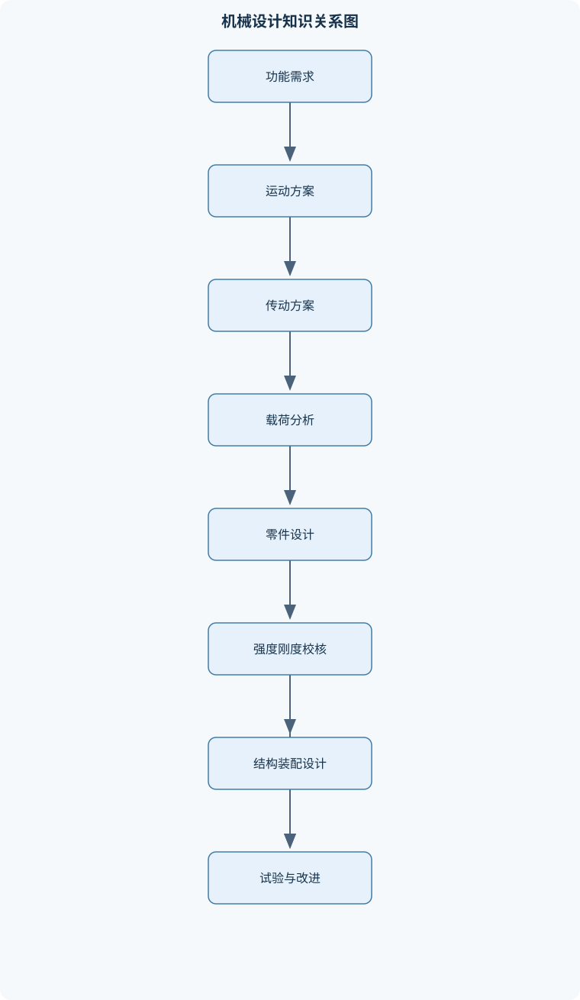
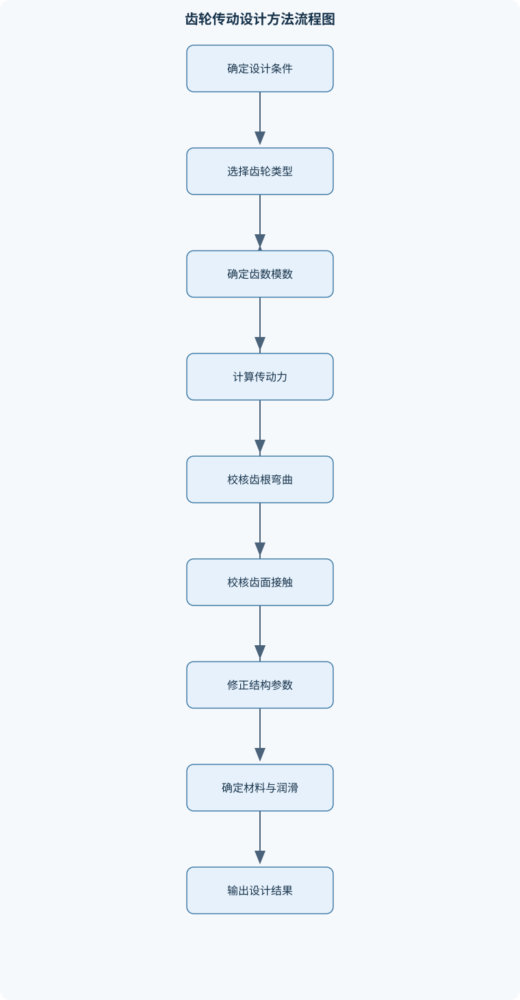

# 机械设计基础

## 一、课程整体知识框架

### 课程边界与先修知识

本课程研究机械系统中常用机构、机械传动和通用零部件的工作原理、运动与动力分析、强度与刚度设计、结构设计及初步创新设计。内容覆盖机械设计的基本流程，静力学与材料力学在零件设计中的应用，带传动、链传动、齿轮传动、蜗杆传动和螺旋传动，轴系、轴承、联轴器、键连接、螺纹连接、齿轮与带轮等通用零部件，以及机架和机械系统的综合设计。不深入专用机床、复杂机构综合、液压系统详细设计、控制算法和有限元软件操作。先修知识包括高等数学中的函数与微积分基础、大学物理中的力学基础、工程制图、材料力学中的应力应变与截面几何性质，以及机械原理中的基本运动学概念。理想计算通常假设材料均匀连续、载荷和边界条件明确、零件处于小变形状态；实际设计还必须考虑制造误差、装配误差、摩擦磨损、疲劳、温升、润滑、腐蚀、材料离散性、标准化和安全要求。





### 1. 课程研究对象与核心任务

《机械设计基础》研究机械系统如何实现预定运动和动力传递，并在满足功能的同时具备足够的强度、刚度、耐磨性、可靠性、可制造性和经济性。研究对象不是孤立的几何形体，而是由动力源、传动机构、执行机构、支承件、连接件、机架、润滑与密封装置等组成的完整系统。

需要区分四个基本概念。**机器**是能够完成有用机械功或实现能量转换的装置，通常由若干机构组合而成；**机构**是具有确定相对运动关系的构件组合，重点在于运动传递和变换；**构件**是机构中具有相对刚性运动的运动单元，可以由一个或多个零件刚性连接而成；**零件**是机械制造和装配的基本单元，例如轴、齿轮、螺栓、轴承和键。一个齿轮通常是零件，一个齿轮副属于传动机构，多个齿轮副与轴、轴承、箱体组成减速器，减速器又可能成为整台机器的一个部件。

课程的核心任务可以归纳为四个层次：

1. **功能层**：明确机器要完成的运动、载荷、速度、行程、工作循环和环境要求。
2. **原理层**：选择合适的机构和传动形式，使动力源能够按照要求驱动执行构件。
3. **零部件层**：对轴、齿轮、带、链、螺栓、轴承、机架等进行受力、强度、刚度和寿命设计。
4. **系统层**：检查各零部件之间的定位、连接、装配、润滑、密封、维护和制造关系，形成可实施的机械方案。

机械设计的因果链通常是“功能需求—运动方案—动力与传动方案—载荷分析—零部件设计—结构与工艺检查—试验验证—迭代改进”。任一环节的假设发生变化，都可能引起后续尺寸、材料、连接方式和安全系数的变化。例如，执行机构速度提高会导致转速提高；在功率一定时，轴上的转矩会降低，但齿轮啮合频率、轴承转速、振动和润滑要求可能提高，因此不能仅根据转矩降低就认定设计更容易。

### 2. 理想模型与工程实际

课程中的基础计算通常采用以下理想化条件：材料均匀连续、零件几何尺寸准确、载荷已知且作用位置明确、支承约束理想、构件处于小变形状态、接触表面状态稳定、温度和润滑条件不发生明显变化。这些假设便于建立可求解模型，但不等于实际机械完全满足这些条件。

实际设计还要考虑制造误差、装配误差、间隙、摩擦、磨损、冲击、温升、材料性能离散性、腐蚀、疲劳、润滑劣化、噪声和维护条件。理想计算得到的应力通常是名义应力，键槽、轴肩、螺纹根部、孔边和齿根过渡圆角会造成应力集中；理想啮合的齿轮可能因齿距误差和轴系变形产生载荷集中；理论上不打滑的带传动，在预紧力不足或湿热环境下可能发生打滑。

因此，设计结果必须说明适用边界。公式中的长度、直径、载荷和应力必须使用统一单位；若采用毫米、牛顿和兆帕，则应保持力矩单位与截面尺寸计算的一致性。功率、转矩和转速的关系为

$$
P=T\omega
$$

其中，$P$为功率，单位为瓦特（W）；$T$为转矩，单位为牛·米（N·m）；$\omega$为角速度，单位为弧度每秒（rad/s）。当转速为$n$，单位为转每分（r/min），且功率用千瓦表示时，有

$$
P(\mathrm{kW})=\frac{T(\mathrm{N\cdot m})n(\mathrm{r/min})}{9550}
$$

9550只适用于上述特定单位组合。若功率采用瓦特、转速采用弧度每秒，不能继续直接使用9550。

### 3. 设计准则与评价维度

机械零件的设计不能只看“是否断裂”。常见失效包括静强度破坏、疲劳断裂、过量变形、失稳、接触疲劳、磨损、胶合、腐蚀、松动、过热和振动失稳。

**强度**反映零件抵抗断裂或塑性变形的能力。拉压构件的名义正应力可写为

$$
\sigma=\frac{F}{A}
$$

其中，$F$为轴向力，单位为N；$A$为受力截面积，单位为mm²或m²；$\sigma$为正应力，单位为MPa或Pa。该式适用于轴向力均匀分布、截面规则且应力集中影响可忽略的情况。带有孔、槽、尖角或载荷偏心的构件，不能只用平均应力判断安全性。

**刚度**反映零件抵抗弹性变形的能力。刚度不足可能导致齿轮啮合偏载、轴承受力异常、密封失效或机构运动精度下降，即使名义强度满足要求，仍可能不能正常工作。

**耐磨性**主要针对相对运动和接触表面。滑动速度、接触压力、材料配对、润滑状态、表面硬度和污染物都会影响磨损。提高硬度有助于抗磨，但可能降低韧性或增加加工难度，不能孤立地把硬度作为全部耐磨性能。

**可靠性**要求零件在规定时间、工况和环境下完成规定功能。安全系数$S$应反映载荷不确定性、材料离散性、计算模型误差、制造质量和失效后果。安全系数过小会降低可靠性，过大则可能造成结构过重、成本增加和尺寸失配。

**经济性与工艺性**要求设计能够制造、装配、检修和批量生产。标准化、系列化和互换性可以减少专用加工和备件种类，但标准件仍需满足载荷、空间、材料、环境和供应条件。结构越复杂不一定越先进；复杂结构会增加装配误差、故障点和维护难度。

### 4. 基础分析主线

机械系统分析通常从受力图开始。先隔离研究对象，再画出所有外力、约束反力、传动件作用力、重力和摩擦力，建立统一坐标系，最后列平衡方程。平面刚体静力平衡条件为

$$
\sum F_x=0,\qquad \sum F_y=0,\qquad \sum M=0
$$

其中，$\sum F_x$和$\sum F_y$分别表示各力在两个坐标方向上的代数和，$\sum M$表示对任意选定点的力矩代数和。作用力和反作用力作用在两个不同物体上，不能同时画在同一个隔离体上。

求得外部反力后，可用截面法求构件内部的轴力、剪力、弯矩和扭矩。圆轴扭转时，在材料均匀、圆截面、弹性小变形、扭矩沿轴段恒定的条件下，

$$
\tau=\frac{Tr}{J},\qquad \theta=\frac{TL}{GJ}
$$

其中，$\tau$为切应力，$T$为扭矩，$r$为截面上某点到轴心的距离，$J$为截面极惯性矩，$L$为轴段长度，$G$为剪切弹性模量，$\theta$为扭转角。若轴径变化、扭矩分段变化或存在键槽，应分段计算并考虑应力集中。

梁弯曲时，名义弯曲正应力为

$$
\sigma=\frac{My}{I}
$$

其中，$M$为弯矩，$y$为计算点到中性轴的距离，$I$为截面二次矩。最大名义应力出现在距中性轴最远处，但实际危险点还可能出现在孔边、键槽、轴肩和焊缝附近。弯扭组合设计必须先分别确定弯矩和扭矩，再根据塑性材料、脆性材料或疲劳载荷的特征选择相应强度准则，不能把静强度公式直接替代疲劳校核。

## 二、章节和模块划分

### 核心知识覆盖清单

本清单用于检查正文是否覆盖本课程的主要知识模块：

- **机械设计总论与设计基础**：机器、机构、构件与零件的区别、机械系统的组成及功能分解、机械设计的任务、要求与一般流程、载荷、约束、运动和动力的基本描述、静载荷、变载荷与冲击载荷、失效形式与设计准则、强度、刚度、耐磨性与振动要求、标准化、系列化与互换性、可靠性、经济性与安全性、方案设计、技术设计与工艺设计的关系。
- **机械系统受力分析与材料力学基础**：力的矢量表示与力矩、物体的受力图绘制、平面力系平衡方程、支承反力与约束类型、构件内力与截面法、轴向拉压与正应力、圆轴扭转与切应力、梁的弯曲与弯曲正应力、组合弯扭载荷、应力集中与名义应力。
- **机械材料、失效与设计准则**：金属材料的强度、塑性与韧性、材料的硬度、耐磨性和疲劳性能、许用应力与安全系数、静强度失效与塑性失效、疲劳断裂及其影响因素、接触疲劳与点蚀、磨损、胶合、塑性变形与腐蚀、热处理对零件性能的影响、脆性材料与塑性材料的设计差异、材料选择与零件工艺性的协调。
- **螺纹连接与轴毂连接**：螺纹的主要参数与分类、螺纹连接的工作原理、螺栓连接的预紧与防松、受拉螺栓连接的强度分析、受剪螺栓连接与挤压计算、螺纹连接的疲劳与应力集中、键连接的类型与工作特点、平键连接的挤压与剪切校核、花键连接的承载特点、销连接、过盈连接与轴毂连接的比较。
- **带传动、链传动与摩擦传动**：带传动的工作原理和传动特性、带传动的弹性滑动与打滑、带传动的受力分析、带传动的包角、摩擦条件与承载能力、普通带传动的设计步骤、带轮结构与带的安装张紧、链传动的组成与运动特点、链传动的多边形效应与速度波动、链传动的失效形式与润滑、摩擦轮传动的适用条件与局限。
- **齿轮传动**：齿轮传动的类型与应用范围、渐开线齿廓及其啮合特性、齿轮的基本参数和几何尺寸、齿轮传动比、中心距与速度关系、直齿圆柱齿轮的受力分析、斜齿圆柱齿轮的轴向力与当量齿轮、齿轮弯曲疲劳强度、齿面接触疲劳强度、齿轮的失效形式与润滑、齿轮精度、材料和热处理选择。
- **蜗杆传动、螺旋传动与其他传动**：蜗杆传动的组成和传动特点、蜗杆传动的传动比与旋向、蜗杆传动的受力关系、蜗杆传动的效率与自锁条件、蜗杆传动的发热与散热、蜗杆传动的齿面接触和齿根弯曲、螺旋传动的运动与动力关系、螺旋传动的效率和自锁、滚珠丝杠与滑动螺旋的比较、传动方案的速度、承载和效率匹配。
- **轴、轴系零部件与联接支承**：轴的功能、类型与结构形式、转轴、心轴和传动轴的区别、轴的弯扭组合受力、轴的强度计算与安全系数、轴的刚度、临界转速与振动、轴肩、圆角和键槽的结构作用、滚动轴承的结构与受力、滚动轴承的寿命与可靠性、滑动轴承的工作原理与润滑、联轴器、离合器与制动器的选用。
- **机架、箱体、弹簧与润滑密封**：机架和箱体的功能要求、机架的强度、刚度和振动控制、铸造机架与焊接机架的结构特点、加强筋、支承面和壁厚设计、弹簧的类型及其载荷特性、圆柱螺旋弹簧的刚度与变形、弹簧的疲劳与失效、润滑的作用与润滑方式、密封的功能、类型与适用条件、温升、噪声、维护和可拆装性设计。
- **机械系统综合设计与创新设计**：机械运动方案的功能分解、执行机构、传动机构与动力源匹配、总传动比和功率流分配、机械系统的运动协调与载荷传递、零部件的定位、连接和装配关系、设计方案的技术经济评价、结构创新与功能原理创新、人机工程、环保与节能设计、样机试制、试验验证与设计迭代、设计说明书、装配图和零件图的技术表达。


### 1. 机械设计总论与设计基础

本模块建立全课程的对象、方法和流程。内容包括机器、机构、构件与零件的区别，机械系统的动力源、传动部分、执行部分、支承部分和辅助装置的功能分解，以及方案设计、技术设计和工艺设计之间的关系。

方案设计回答“采用什么原理完成任务”，例如在输送装置中选择带传动、链传动还是齿轮传动；技术设计回答“尺寸、材料、结构和连接如何确定”；工艺设计回答“如何加工、装配、检测和维护”。三者不能互相替代：一个运动方案即使理论上可行，若无法加工或不能维护，也不是合格的机械设计。

载荷按作用时间和变化性质可分为静载荷、变载荷和冲击载荷。静载荷大小和方向基本不变；变载荷随时间、位置或工作循环变化；冲击载荷在很短时间内快速施加，会放大实际应力。设计时要明确额定载荷、启动载荷、制动载荷和异常载荷，不能用一个平均值覆盖全部工况。

### 2. 机械系统受力分析与材料力学基础

本模块把力学模型转化为零件设计所需的内力和应力。受力分析包括力的分解、力矩计算、约束反力求解和传动件作用力确定。齿轮、带轮、链轮和蜗杆之间的作用力不仅影响传动件本身，也决定轴、轴承、键和机架的尺寸。

对于轴向拉压，主要考查正应力和轴向变形；对于圆轴，主要考查扭转切应力和扭转角；对于梁，主要考查剪力、弯矩和弯曲正应力。组合载荷时，应在同一危险截面上合成相互垂直方向的弯矩。例如两个相互垂直平面内的弯矩分别为$M_x$和$M_y$时，合成弯矩可表示为

$$
M=\sqrt{M_x^2+M_y^2}
$$

该关系适用于两个弯矩分量相互垂直且按同一截面位置进行合成的情况。若存在轴向力、剪力、扭矩或应力集中，还必须采用完整的应力状态进行校核。

### 3. 机械材料、失效与设计准则

金属材料的强度、塑性、韧性、硬度、耐磨性和疲劳性能决定其适用范围。强度高不代表韧性好；硬度高不代表一定抗冲击；塑性好的材料便于成形，但在高温、腐蚀或疲劳环境下仍可能失效。

静强度失效通常表现为屈服、断裂或局部塑性变形；疲劳失效则可能在低于静强度的循环应力下发生。疲劳分析应区分平均应力$\sigma_m$、应力幅$\sigma_a$和循环次数，并考虑表面质量、尺寸效应、应力集中、腐蚀和载荷谱。接触疲劳常发生在齿轮、轴承和凸轮等接触表面，典型表现为点蚀、剥落或压痕。

磨损包括黏着磨损、磨粒磨损和疲劳磨损等；胶合通常与高温、高压、润滑失效和相对滑动有关；腐蚀会削弱截面并改变表面状态。热处理可改变硬度、强度、韧性和耐磨性，但热处理变形、残余应力和加工成本也必须纳入设计。塑性材料可通过屈服准则进行评估，脆性材料对拉应力、缺口和冲击更敏感，不能简单套用同一安全判据。

### 4. 螺纹连接与轴毂连接

螺纹的主要参数包括公称直径、螺距、导程、牙型角和旋向。螺栓连接通常依靠预紧力使被连接件产生压紧力。外载荷作用后，载荷由螺栓和被连接件的刚度共同分配；若预紧力不足，连接面可能分离或发生滑移；若预紧力过大，可能造成螺栓塑性变形、连接件压溃或疲劳裕度下降。

螺纹连接的防松方法包括摩擦防松、机械防松和专用锁固方式。振动环境下，单纯依靠拧紧螺母并不能保证长期防松。受剪螺栓连接还要校核螺栓剪切、孔壁挤压和连接板撕裂；偏心载荷下，螺栓组各螺栓受力通常不相等，不能简单地把总载荷平均分配。

键连接用于轴与轮毂之间传递转矩。平键主要校核键的剪切和轮毂的挤压，计算时必须明确键长、键宽、键高、工作长度和有效接触面积。花键具有多齿承载、定心和轴向移动等特点，适合传递较大转矩或需要轴向滑移的场合。销连接常用于定位、连接和过载保护；过盈连接依靠接触压力传递转矩或轴向力，但对配合精度、装配方法和温度条件敏感。

### 5. 带传动、链传动与摩擦传动

带传动依靠带与带轮之间的摩擦传递动力，具有缓冲吸振、中心距较大和成本较低等特点。带速近似为

$$
v=\frac{\pi D n}{60}
$$

其中，$D$为带轮基准直径或节径，单位为m；$n$为转速，单位为r/min；$v$为带速，单位为m/s。不能随意用带轮外径替代基准直径。正常工作时带存在弹性滑动，主动轮与从动轮的实际速度关系会偏离无滑动计算值；打滑则通常表明有效摩擦力不足、包角过小或预紧力不合适。

带传动设计要考虑计算功率、带型、带轮直径、中心距、包角、带长、根数、预紧力和轴载荷。小带轮包角过小会降低承载能力，预紧力过大又会增加轴承负荷。带轮结构需满足强度、平衡、安装和散热要求，张紧装置应便于调节和维护。

链传动依靠链条与链轮的啮合传递动力，适合中心距较大、传动比稳定性要求高且不希望出现打滑的场合。由于链条多边形效应，链速和从动轮角速度会产生周期波动；链节距越大、链轮齿数越少，这种波动通常越明显。链传动的主要失效包括链条疲劳、滚子或套筒磨损、链板断裂、链轮齿面磨损和润滑不良。摩擦轮传动结构简单，但对压紧力、材料摩擦系数和表面状态敏感，存在打滑和接触应力过大的局限。

### 6. 齿轮传动

齿轮传动通过齿廓啮合传递运动和转矩，具有传动比准确、结构紧凑和适用功率范围较宽等特点。渐开线齿廓的主要优点是中心距在一定误差范围内变化时，理论传动比仍能保持基本稳定。标准渐开线直齿圆柱齿轮在模数一致、无变位条件下，

$$
d=mz,\qquad a=\frac{m(z_1+z_2)}{2}
$$

其中，$d$为分度圆直径，$m$为模数，$z$为齿数，$a$为中心距。该关系不适用于模数不同、采用变位或特殊齿形的情况。

齿轮传动比可由齿数比或转速比确定。传递转矩为$T$、分度圆直径为$d$时，圆周力为

$$
F_t=\frac{2T}{d}
$$

直齿圆柱齿轮主要承受圆周力和径向力；斜齿圆柱齿轮还承受轴向力，轴向力方向由螺旋线方向和齿轮转向共同决定，不能只按顺时针或逆时针旋转判断。

齿轮必须分别进行齿根弯曲疲劳强度和齿面接触疲劳强度校核。前者主要反映齿根断裂风险，受齿根形状、齿数、载荷分布、材料和循环次数影响；后者主要反映点蚀、剥落等齿面失效，受接触应力、曲率、材料硬度、润滑和载荷集中影响。只校核齿根而忽略齿面，或只按静载荷而忽略动载荷，都可能导致设计失效。齿轮材料、热处理、精度等级和润滑方式应与速度、载荷、噪声、成本和维护要求匹配。

### 7. 蜗杆传动、螺旋传动与其他传动

蜗杆传动由蜗杆和蜗轮组成，适合较大传动比和交错轴传动，具有结构紧凑、运行平稳等特点，但滑动速度较大，效率和发热问题突出。其传动比主要由蜗轮齿数与蜗杆头数决定。受力分析时应区分圆周力、径向力和轴向力，并根据旋向、转动方向确定各力方向。

蜗杆传动效率与导程角、摩擦条件、材料配对和润滑状态有关。导程角较小、摩擦条件满足时可能实现自锁，但自锁并不等于绝对安全。磨损、振动、温升、制造误差和润滑变化都可能破坏理想自锁条件，因此不能用自锁替代独立制动装置。蜗杆传动还应进行齿面接触、齿根弯曲、温升和散热检查。

螺旋传动将旋转运动变为直线运动，或将直线运动变为旋转运动。滑动螺旋结构简单、承载能力较高，可能具有自锁性，但效率较低、磨损和发热较明显；滚珠丝杠通过滚动体降低摩擦，效率和运动精度较高，但结构复杂、成本较高，通常不具备可靠自锁性。传动方案选择必须综合比较速度、承载、精度、效率、噪声、空间、成本和维护条件。

### 8. 轴、轴系零部件与联接支承

轴按功能可分为转轴、心轴和传动轴。转轴既承受弯矩又传递转矩；心轴主要承受弯矩，通常不传递转矩；传动轴主要传递转矩，弯曲载荷可能相对较小。实际轴系常同时承受齿轮力、带轮力、链轮力、轴向力和自身重力，因此需进行弯扭组合分析。

轴的设计流程包括求支承反力、绘制弯矩图和扭矩图、确定危险截面、初估轴径、设计轴肩和圆角、校核强度与刚度，并检查键槽、过盈配合和应力集中。轴径满足强度不代表设计完成；扭转角过大、弯曲变形过大或接近临界转速，都可能导致齿轮偏载、轴承异常和振动。

滚动轴承利用滚动体降低摩擦，需根据径向载荷、轴向载荷、转速、温度、润滑、密封和安装空间选择类型。基本额定寿命是统计意义上的寿命指标，不是每个轴承必然达到的使用年限。污染、润滑不足、安装误差和冲击会显著降低实际寿命。滑动轴承依靠润滑膜或边界润滑承载，适合某些高速、重载或冲击工况，但对材料配对、间隙、润滑和起动状态敏感。

联轴器用于连接两轴并补偿一定的安装误差；离合器用于按需要接合或分离动力；制动器用于吸收动能、降低速度或保持静止。三者功能不同，不能仅按“能够传递转矩”互相替代。

### 9. 机架、箱体、弹簧与润滑密封

机架和箱体承担零部件支承、载荷传递、定位、保护和安装功能。其设计不仅要满足强度，还要保证轴承座、导轨、安装面和连接部位具有足够刚度。加强筋方向应与主要载荷路径一致，支承面应便于加工和测量，壁厚应兼顾铸造、焊接、变形和减重要求。单纯增加壁厚不一定能有效提高刚度，不合理的筋板还可能造成应力集中、铸造缺陷和加工困难。

弹簧用于储能、缓冲、减振、压紧和测力。圆柱螺旋弹簧在弹性范围内可近似表示为

$$
F=k\delta
$$

其中，$F$为弹簧载荷，单位为N；$k$为刚度，单位为N/m或N/mm；$\delta$为变形量，单位为m或mm。刚度与材料剪切模量、线径、平均圈径、有效圈数和端部结构有关。设计时还要检查最大剪应力、压并、失稳、疲劳、自由长度和安装间隙。

润滑的作用包括降低摩擦、减少磨损、带走热量、防止腐蚀和排除污染物。润滑方式可按运动速度、载荷、温度、密封条件和维护周期选择。密封用于防止润滑剂泄漏并阻挡水分、粉尘和杂质进入，常见形式包括接触式密封和非接触式密封。设计还应考虑温升、噪声、可拆装性、检修空间、润滑补给和废油排放。

### 10. 机械系统综合设计与创新设计

综合设计以功能分解为起点，将系统划分为动力源、传动机构、执行机构、支承结构和辅助装置。传动链中各级传动比的总值为

$$
i=i_1i_2\cdots i_k
$$

各级效率为$\eta_1,\eta_2,\ldots,\eta_k$时，总效率为

$$
\eta=\eta_1\eta_2\cdots\eta_k
$$

其中，$i$为总传动比，$\eta$为总效率，均为无量纲量。功率沿传动链逐级损失，不能把各级效率简单相加，也不能认为各轴功率完全相等。根据$P=T\omega$，转速降低时，在功率近似不变的理想情况下转矩增大；实际还需扣除传动损失。

系统设计要检查运动协调、载荷传递、零部件定位、连接可靠性、装配顺序、干涉、维护、噪声、温升和安全防护。方案评价应同时考虑技术性能、制造成本、能耗、可靠性、维修性、环境影响和使用寿命。创新设计不等于增加机构数量，而是针对明确的功能问题提出新的原理、结构或组合方式，并通过计算、样机和试验验证其有效性。

设计成果通常包括功能和方案说明、传动系统计算、主要零部件设计计算、装配图、零件图、技术条件、材料与热处理要求、润滑密封说明以及试验或验收指标。合格的机械系统应在规定载荷、速度、环境和工作循环下满足运动、强度、刚度、可靠性、可制造性和可维护性要求。

## 三、核心概念的详细解释

### 1. 机械系统、机构、构件与零件

机器是能够完成有用机械功或实现能量转换的装置，通常由动力源、传动机构、执行机构、支承结构、连接件、润滑与密封装置组成。机构是若干构件按照确定的相对运动关系连接而成的组合，重点在于运动传递和运动形式变换；构件是机构中具有相对刚性运动的单元，可以由多个零件刚性连接而成；零件是机械制造与装配的基本单元，如轴、齿轮、键、螺栓和轴承。

区分这些概念的关键在于考察对象不同。齿轮本身通常是一个零件，两个相互啮合的齿轮构成齿轮机构，齿轮、轴、轴承和箱体组成的减速器是机器或设备中的部件，而由电动机、减速器和输送机构组成的装置才构成完整机械系统。不能把“零件”和“构件”当作同义词：一个构件可以由多个零件组成，例如由轴、键和齿轮刚性连接形成的转动构件。

机械设计的因果链为“功能需求—运动方案—传动方案—载荷分析—零部件设计—结构与工艺检查—试验验证”。功能需求应至少包括输出运动形式、速度、载荷、工作循环、工作环境、寿命和安全要求。若只给出功率而没有工作制、冲击程度和环境条件，通常不足以完成可靠设计。

### 2. 载荷、约束与受力分析

机械零件的载荷可按时间特征分为静载荷、变载荷和冲击载荷。静载荷的大小和方向基本不随时间改变；变载荷可能周期性变化、随机变化或脉动变化；冲击载荷在很短时间内迅速施加，实际峰值可能远大于平均值。相同的平均力在不同工作制下可能产生完全不同的疲劳寿命和结构尺寸。

受力分析必须先确定研究对象，再画出隔离体受力图。图中应包括外加力、重力、摩擦力、传动件作用力以及支承反力。作用力与反作用力分别作用在两个不同物体上，不能同时画在同一个隔离体上。平面刚体平衡条件为

$$
\sum F_x=0,\qquad \sum F_y=0,\qquad \sum M_O=0
$$

其中，$F_x$和$F_y$是力在两个坐标方向的分量，单位为N；$M_O$是对任意参考点$O$的力矩，单位为N·m。列式前必须统一正方向。若研究对象存在加速度，不能直接使用静力平衡方程，而应加入惯性力或采用动力学方程。

力矩的大小为

$$
T=Fr
$$

其中，$F$为力，单位为N；$r$为力臂，即参考点到力作用线的垂直距离，单位为m；$T$为力矩，单位为N·m。若力的作用线通过转轴，力矩为零；若误把力到轴心的斜向距离当作力臂，计算会产生系统误差。

### 3. 内力、应力与变形

用截面法把构件假想截开，在截面上保留轴力、剪力、弯矩和扭矩，可以求得构件内部的受力状态。轴向拉压的平均正应力为

$$
\sigma=\frac{F}{A}
$$

其中，$A$为承载截面积，单位为mm²或m²；$\sigma$为正应力，单位为MPa或Pa。该式假定应力在截面上均匀分布，适用于远离载荷作用点、孔洞和截面突变的直杆。孔边、螺纹根部、键槽和轴肩处存在应力集中，实际最大应力高于名义应力。

圆轴扭转时，距轴心$r$处的切应力为

$$
\tau=\frac{Tr}{J}
$$

扭转角为

$$
\theta=\frac{TL}{GJ}
$$

其中，$T$为扭矩，单位为N·mm或N·m；$r$为计算点半径；$J$为截面的极惯性矩，单位为mm$^4$或m$^4$；$L$为轴段长度；$G$为剪切弹性模量，单位为Pa；$\theta$为扭转角，单位为rad。上述关系适用于圆截面、材料均匀、弹性小变形且扭矩沿轴段恒定的情况。若轴为阶梯轴，应按轴段分段计算并叠加扭转角。

梁弯曲时的正应力为

$$
\sigma=\frac{My}{I}
$$

其中，$M$为截面弯矩，单位为N·mm或N·m；$y$为计算点到中性轴的距离；$I$为截面二次矩，单位为mm$^4$或m$^4$。最大弯曲应力出现在距中性轴最远处。增大截面高度通常比等比例增加宽度更有效，因为截面二次矩对高度变化更加敏感。

### 4. 材料性能与失效准则

强度是零件抵抗断裂或塑性变形的能力，刚度是抵抗弹性变形的能力，耐磨性是抵抗接触表面材料损失的能力，韧性是材料吸收冲击能量而不发生脆断的能力。强度不足表现为断裂或永久变形，刚度不足表现为挠度过大、啮合不良或定位误差，耐磨性不足表现为间隙增大、精度下降和泄漏。

静强度校核常写为

$$
\sigma_{\mathrm{eq}}\leq[\sigma],\qquad \tau_{\mathrm{eq}}\leq[\tau]
$$

其中，$\sigma_{\mathrm{eq}}$和$\tau_{\mathrm{eq}}$为根据强度理论得到的等效应力，$[\sigma]$和$[\tau]$为许用应力，单位为MPa。许用应力不是材料强度的简单复制，而是考虑安全系数后的设计限值。安全系数$S$应反映载荷不确定性、材料离散性、计算模型误差、制造质量和失效后果。

疲劳失效发生在反复变化的应力作用下，即使应力低于静强度极限，仍可能产生裂纹并最终断裂。疲劳设计需区分平均应力、应力幅、循环次数、表面质量、尺寸效应、应力集中和表面处理。齿轮齿根疲劳断裂属于弯曲疲劳问题，齿面点蚀属于接触疲劳问题，二者不能用同一个校核式代替。

### 5. 螺纹连接与轴毂连接

螺纹的主要参数包括公称直径、螺距、导程、牙型角和螺纹升角。单线螺纹中，导程等于螺距；多线螺纹中，导程等于螺距与线数的乘积。螺纹连接通常依靠预紧力使被连接件产生压紧力，从而提高连接的整体性并防止工作载荷导致接缝分离。

受拉螺栓连接不能简单地把全部外载荷平均除以螺栓数量。外载荷作用后，一部分载荷增加螺栓拉力，另一部分减少连接面剩余压紧力，分配比例与螺栓和被连接件的刚度有关。预紧力过小会导致松动和接缝分离，预紧力过大则可能使螺栓塑性变形或连接件压溃。防松方式包括摩擦防松、机械防松和破坏螺纹副相对运动的专用结构，振动环境下不能只依赖普通螺母自锁。

平键用于传递轴与轮毂之间的转矩，主要校核键的剪切和轮毂的挤压。若键承受转矩$T$，键长为$l$、宽为$b$、高为$h$、轴径为$d$，则可用近似关系估算剪切应力和挤压应力：

$$
\tau\approx\frac{2T}{dbl},\qquad
\sigma_p\approx\frac{4T}{dhl}
$$

式中尺寸应采用一致单位，$T$应与尺寸单位匹配。实际计算中还要采用有效接触高度，而不能机械地把键的全高作为挤压高度。花键具有多个齿共同传递转矩，承载能力和定心能力通常高于单键，但制造和检验要求也更高。过盈连接依靠接触面的径向压力传递转矩和轴向力，适合结构紧凑的场合，但装拆困难且对尺寸精度和温差敏感。

### 6. 带传动、链传动与摩擦传动

带传动依靠带与带轮之间的摩擦传递动力。带速近似为

$$
v=\frac{\pi Dn}{60}
$$

其中，$D$为带轮基准直径或节径，单位为m；$n$为转速，单位为r/min；$v$为带速，单位为m/s。不能随意用带轮外径替代基准直径。带传动中紧边拉力为$F_1$，松边拉力为$F_2$，传递转矩近似为

$$
T=(F_1-F_2)\frac{D}{2}
$$

带与带轮之间必须满足摩擦条件。若预紧力不足、包角过小或载荷突然增大，可能发生打滑。正常运行中的弹性滑动则源于带两侧拉力不同导致的弹性变形差异，不能把弹性滑动等同于完全失控的打滑。带传动具有缓冲和吸振能力，但传动比不够精确，且需要张紧和较大的安装空间。

链传动依靠链节与链轮齿的啮合传递动力，无弹性滑动，适用于中心距较大且要求平均传动比准确的场合。但链条绕在链轮上形成多边形，使瞬时速度和瞬时传动比发生周期波动，速度越高、齿数越少，波动越明显。常见失效包括链节疲劳、销轴磨损、链板断裂、链轮齿面磨损和润滑不足。摩擦轮传动结构简单，但承载能力受摩擦条件限制，受潮、油污和过载会导致打滑。

### 7. 齿轮传动

渐开线齿轮的主要优点是中心距在一定范围内变化时，传动比仍基本保持不变。标准直齿圆柱齿轮的分度圆直径为

$$
d=mz
$$

其中，$m$为模数，单位为mm；$z$为齿数；$d$为分度圆直径，单位为mm。标准、无变位、模数相同的外啮合齿轮中心距为

$$
a=\frac{m(z_1+z_2)}{2}
$$

传动比为

$$
i=\frac{n_1}{n_2}=\frac{z_2}{z_1}
$$

其中，主动轮和从动轮分别用下标1和2表示。若中心距、模数和齿数关系不一致，不能直接套用标准公式。

齿轮啮合处的圆周力为

$$
F_t=\frac{2T}{d}
$$

直齿轮的径向力可写为

$$
F_r=F_t\tan\alpha
$$

其中，$\alpha$为压力角。斜齿轮还存在轴向力，其大小与螺旋角$\beta$有关，方向必须同时依据齿轮转向和螺旋线方向判断。齿轮设计至少要分别校核齿根弯曲疲劳强度和齿面接触疲劳强度。前者主要防止齿根断裂，后者主要防止点蚀、胶合和过度磨损。齿宽、材料、热处理、齿面硬度、润滑、制造精度和载荷分布都会影响校核结果。

### 8. 蜗杆传动、螺旋传动与传动方案匹配

蜗杆传动可获得较大的单级传动比，并且结构紧凑，适合交错轴传动。其缺点是滑动速度较大，效率通常低于齿轮传动，发热和磨损较明显。蜗杆传动效率与导程角、摩擦系数、润滑状态和制造精度有关。导程角较小有利于自锁，但同时会降低效率并增加发热。理想自锁不等于绝对不会反转，振动、磨损和润滑状态变化都可能破坏自锁条件，因此不能把蜗杆自锁直接当作独立制动器。

螺旋传动把旋转运动转化为直线运动或轴向力。滑动螺旋结构简单、承载能力较强，但摩擦损失大；滚珠丝杠依靠滚动接触，效率和运动精度较高，但对污染、润滑和安装精度敏感。螺旋升角较小时可能具备自锁性，适合千斤顶和夹紧机构；高速进给系统通常更关注效率和反向驱动能力。

传动方案选择必须同时比较速度范围、传动比、承载能力、效率、噪声、空间、成本和维护要求。总传动比为

$$
i=i_1i_2\cdots i_k
$$

总效率为

$$
\eta=\eta_1\eta_2\cdots\eta_k
$$

功率沿传动链逐级降低，而在功率近似一定时，转速降低会使转矩增大。传动级数增加可能有利于分配总传动比，但会增加尺寸、损失、装配误差和维护工作量。

### 9. 轴、轴承、联轴器与制动装置

转轴同时承受弯矩和扭矩并传递动力；心轴主要承受弯矩而不传递转矩；传动轴主要传递转矩，弯矩可能相对较小。轴的危险截面通常位于齿轮、带轮、联轴器、轴肩、键槽和轴承附近。轴径初估只能作为方案起点，最终还需校核弯扭组合强度、疲劳、扭转刚度、弯曲刚度和临界转速。

滚动轴承由内圈、外圈、滚动体和保持架组成，主要承受径向载荷、轴向载荷或二者组合。基本额定寿命通常以达到规定可靠度时的总转数表示，寿命关系可写成

$$
L_{10}=\left(\frac{C}{P}\right)^p
$$

其中，$C$为基本额定动载荷，单位为N；$P$为当量动载荷，单位为N；$p$为寿命指数，具体取值取决于滚动体类型；$L_{10}$为基本额定寿命，采用百万转等规定单位。该式不包括润滑失效、污染、安装偏斜、冲击和温度过高造成的实际寿命下降，因此不能把计算寿命当作必然使用年限。

联轴器用于连接两轴并传递转矩，通常允许一定的安装误差；离合器用于按需要接合或分离动力；制动器用于吸收运动能量并降低转速或保持停止状态。三者功能不能混用，选择时应检查转矩、转速、接合频率、冲击、散热和安全要求。

### 10. 机架、弹簧、润滑、密封与系统设计

机架和箱体承担零件定位、载荷传递、轴承支承、润滑储存和防护功能。刚度不仅取决于壁厚，还取决于截面形状、支承布局、加强筋方向、连接刚度和载荷路径。铸造结构适合形状复杂、整体性好的箱体；焊接结构便于制造大型框架和快速改型，但需控制焊接变形和残余应力。支承面应便于加工和测量，加强筋应沿主要载荷路径布置，避免突然终止造成应力集中。

圆柱螺旋弹簧在弹性范围内近似满足

$$
F=k\delta
$$

其中，$k$为刚度，单位为N/mm或N/m；$\delta$为变形量，单位为mm或m。弹簧刚度受线径、平均圈径、有效圈数、材料剪切模量和端部结构共同影响。设计还要检查最大剪应力、压并、稳定性、疲劳、自由长度和安装间隙。增加有效圈数通常会降低刚度，但端部圈数不一定参与有效变形。

润滑可降低摩擦与磨损、带走热量、防止腐蚀并排除污染物。润滑方式应依据速度、载荷、温度、密封条件和维护周期选择。密封既要防止润滑剂泄漏，也要阻止水、尘土和磨粒进入；接触式密封阻隔能力较强但摩擦较大，非接触式密封摩擦小但对安装间隙和环境洁净度更敏感。

机械系统综合设计应检查动力源与执行机构匹配、各轴功率流、传动比、载荷传递、定位连接、装配顺序、检修空间、温升、噪声和安全防护。创新设计的有效性必须通过功能指标、强度刚度、制造装配、维护成本和试验结果共同证明，而不是简单增加零件数量。

## 四、重要定义、公式、定理和推导

### 专业审校补充：关键定义与适用边界

固定端—游动端轴承布置是轴系设计中必须明确的边界条件。固定端轴承同时限制轴的径向和轴向相对位移，用于确定轴向定位基准；游动端允许轴或轴承套圈在轴向发生补偿位移，以吸收温升引起的轴向热伸长。若轴的有效热伸长为ΔL，材料线膨胀系数为α，温升为ΔT，长度为L，则理想估算为ΔL=αLΔT，其中α的单位为1/℃，L用mm时，ΔL也为mm。两端均采用刚性轴向定位时，温升可能使轴承产生附加轴向力、摩擦升高和发热；两端均不定位又会导致轴向窜动、齿轮啮合位置变化或联轴器受力异常。该原则适用于有明显温差、轴较长或转速较高的常规轴系，但不能替代对轴承游隙、配合、安装误差、润滑和热平衡的校核。实际结构还需明确哪一圈相对旋转、载荷方向及轴向力来源。


### 1. 功率、转矩与传动比

旋转运动中，功率是单位时间内完成的功。转矩为$T$、角速度为$\omega$时，

$$
P=T\omega
$$

由于

$$
\omega=\frac{2\pi n}{60}
$$

其中，$n$的单位为r/min，代入得

$$
P=T\frac{2\pi n}{60}
$$

若$T$用N·m、$n$用r/min，$P$用W，则

$$
P(\mathrm{W})=\frac{2\pi Tn}{60}
$$

再除以1000，得到

$$
P(\mathrm{kW})=\frac{Tn}{9550}
$$

因此，9550不是物理常数，而是由角速度和功率单位换算得到的数值。若转速为rad/s或功率为W，必须重新换算。

两级或多级传动中，若各级传动比为$i_1,i_2,\ldots,i_k$，则

$$
i=\frac{n_1}{n_{k+1}}=i_1i_2\cdots i_k
$$

若各级效率为$\eta_1,\eta_2,\ldots,\eta_k$，功率逐级满足

$$
P_{j+1}=\eta_jP_j
$$

连续相乘得

$$
P_{k+1}=\eta_1\eta_2\cdots\eta_kP_1
$$

所以总效率为各级效率的乘积，而不是各级效率的代数和。

**例题1：功率与转矩。**某轴输入功率为4 kW，转速为960 r/min，求轴上转矩。

分析：功率用kW、转速用r/min，可直接使用换算式。

解：

$$
T=\frac{9550P}{n}
=\frac{9550\times4}{960}
\approx39.8\ \mathrm{N\cdot m}
$$

验证：转速降低而功率不变时转矩应增大，39.8 N·m符合这一趋势。若把功率误写成4000 kW，结果将放大1000倍，说明单位检查不可省略。

变式：若经过效率为0.92的减速器输出转速为240 r/min，则输出功率为$4\times0.92=3.68$ kW，输出转矩约为

$$
T_2=\frac{9550\times3.68}{240}\approx146.5\ \mathrm{N\cdot m}
$$

### 2. 平面受力与弯矩推导

设简支梁跨距为$L$，中点承受竖直集中力$F$。由对称性，两支座反力相等，设均为$R$。列竖直方向平衡方程：

$$
2R-F=0
$$

得到

$$
R=\frac{F}{2}
$$

跨中截面的弯矩为左支座反力对该截面的力矩：

$$
M_{\max}=R\frac{L}{2}
=\frac{FL}{4}
$$

这说明在载荷和材料相同的情况下，跨距增大将直接增加弯矩。实际梁若存在均布载荷、多个集中力或支座沉降，不能继续使用$FL/4$这一特例公式，而应先求支反力，再建立弯矩函数。

**例题2：简支梁弯曲应力。**一矩形截面梁宽$b=20$ mm，高$h=40$ mm，跨中载荷$F=1000$ N，跨距$L=600$ mm，求跨中最大弯曲应力。

截面最大弯矩为

$$
M_{\max}=\frac{FL}{4}
=\frac{1000\times600}{4}
=150000\ \mathrm{N\cdot mm}
$$

矩形截面二次矩为

$$
I=\frac{bh^3}{12}
=\frac{20\times40^3}{12}
=106666.7\ \mathrm{mm^4}
$$

最外层距离中性轴

$$
y=\frac{h}{2}=20\ \mathrm{mm}
$$

因此

$$
\sigma_{\max}=\frac{My}{I}
=\frac{150000\times20}{106666.7}
\approx28.1\ \mathrm{MPa}
$$

结果验证：若把梁高从40 mm增至80 mm，弯曲应力不会简单减半，因为$I$与$h^3$成正比，理论上应显著下降。这也是提高梁截面高度通常比单纯加宽更有效的原因。

### 3. 圆轴扭转与弯扭组合

实心圆轴的极惯性矩为

$$
J=\frac{\pi d^4}{32}
$$

代入圆轴扭转公式，外表面最大切应力为

$$
\tau_{\max}
=\frac{T(d/2)}{\pi d^4/32}
=\frac{16T}{\pi d^3}
$$

因此，在同一转矩下，轴径增大将显著降低扭转切应力。该结论只适用于实心圆轴；空心轴必须使用外径和内径共同计算的极惯性矩。

轴同时承受弯矩$M$和转矩$T$时，不能分别满足强度要求就直接认为安全。应根据材料性质选择强度理论。对塑性较好的金属，常用等效应力形式为

$$
\sigma_{\mathrm{eq}}
=\sqrt{\sigma^2+3\tau^2}
$$

其中，$\sigma$为弯曲或轴向正应力，$\tau$为扭转载荷产生的切应力。对于脆性材料，拉压强度不对称，不能盲目采用同一塑性材料公式。

**例题3：圆轴扭转校核。**实心轴直径$d=30$ mm，承受转矩$T=180$ N·m，求最大扭转切应力。

统一单位：

$$
T=180000\ \mathrm{N\cdot mm}
$$

于是

$$
\tau_{\max}=
\frac{16\times180000}{\pi\times30^3}
\approx113.2\ \mathrm{MPa}
$$

若许用切应力为80 MPa，则该轴扭转强度不满足。改进可以增大直径、降低转矩、采用空心轴优化材料分布或改变材料，但不能只通过增加安全系数掩盖结构尺寸不足。

### 4. 带传动与齿轮传动公式

带轮线速度为

$$
v=\frac{\pi Dn}{60}
$$

若不存在滑动，带传动的理论速度关系为

$$
D_1n_1=D_2n_2
$$

所以

$$
i=\frac{n_1}{n_2}\approx\frac{D_2}{D_1}
$$

实际存在弹性滑动，通常从动轮实际转速低于无滑动计算值。若发生明显打滑，速度关系将进一步偏离，不能仍按纯滚动模型处理。

齿轮传动中，啮合点切向速度相等：

$$
\omega_1r_1=\omega_2r_2
$$

由于分度圆直径与齿数满足$d=mz$，可得

$$
\frac{\omega_1}{\omega_2}
=\frac{r_2}{r_1}
=\frac{d_2}{d_1}
=\frac{z_2}{z_1}
$$

这就是齿轮传动比与齿数比关系的来源。圆周力由功率流和转矩关系得到：

$$
T=F_td/2
$$

因此

$$
F_t=\frac{2T}{d}
$$

**例题4：标准直齿圆柱齿轮。**主动轮齿数$z_1=20$，从动轮齿数$z_2=60$，模数$m=3$ mm，主动轮转矩$T_1=90$ N·m，压力角$\alpha=20^\circ$。求传动比、分度圆直径、中心距、圆周力和径向力。

传动比：

$$
i=\frac{z_2}{z_1}=\frac{60}{20}=3
$$

分度圆直径：

$$
d_1=mz_1=3\times20=60\ \mathrm{mm}
$$

$$
d_2=mz_2=3\times60=180\ \mathrm{mm}
$$

中心距：

$$
a=\frac{d_1+d_2}{2}=120\ \mathrm{mm}
$$

将转矩换为$90000$ N·mm：

$$
F_t=\frac{2T_1}{d_1}
=\frac{2\times90000}{60}
=3000\ \mathrm{N}
$$

径向力：

$$
F_r=F_t\tan20^\circ
\approx3000\times0.364
\approx1092\ \mathrm{N}
$$

验证：从动轮转速应为主动轮的三分之一；从动轮转矩在忽略损失时约为主动轮的三倍。若计算出的从动轮转速反而增大，说明传动比方向写反。

### 5. 螺纹、蜗杆与螺旋传动的自锁

螺旋传动可视为把螺纹展开为斜面。螺纹升角为$\lambda$，摩擦角为$\rho$。在理想简化条件下，若$\lambda<\rho$，反向载荷难以使螺母自行下降，系统可能具有自锁性；若$\lambda>\rho$，则容易被反向驱动。摩擦角与摩擦系数$\mu$有关，近似满足$\tan\rho=\mu$。

自锁的代价是效率降低。摩擦越大，提升负载所需转矩越大，产生的热量也越多。实际判断还应考虑振动、磨损、润滑状态和制造误差，因此“满足理论自锁条件”只能说明理想模型下具有自锁倾向，不能替代制动器、锁紧销或安全冗余结构。

### 6. 轴承寿命与弹簧刚度

滚动轴承的基本额定寿命关系为

$$
L_{10}=\left(\frac{C}{P}\right)^p
$$

当转速为$n$ r/min、要求工作时间为$L_h$ h时，若寿命以百万转表示，则所需寿命为

$$
L_{10,\mathrm{req}}
=\frac{60nL_h}{10^6}
$$

选型时应使计算寿命不小于所需寿命，同时检查静载荷、极限转速、润滑、温度、密封和安装配合。轴承寿命对载荷十分敏感，额定动载荷与实际载荷只相差少量，寿命也可能产生较大变化。

圆柱螺旋弹簧的刚度可用工程近似式表示为

$$
k=\frac{Gd^4}{8D_m^3n_a}
$$

其中，$d$为弹簧丝直径，单位为mm或m；$D_m$为弹簧平均圈径；$n_a$为有效圈数；$G$为材料剪切弹性模量。由此可见，线径增大对刚度影响很强，平均圈径增大会降低刚度，有效圈数增加也会降低刚度。该式适用于圆柱螺旋压缩或拉伸弹簧的弹性小变形近似，端部结构、间隙、摩擦和非线性变形会使实测刚度偏离理论值。

### 7. 代表性设计流程与验证

**受力分析流程**的输入是几何尺寸、载荷、支承和运动状态，输出是支承反力、内力图和危险截面。步骤为：确定研究对象；绘制隔离体受力图；建立坐标系；列平衡方程；求支承反力；用截面法求轴力、剪力、弯矩和扭矩；寻找内力极值；进行强度与刚度校核。全过程的不变量是研究对象、正负号约定和单位保持一致。适用于静止或准静态构件；高速旋转、冲击和明显加速度问题必须补充动力学分析。

**齿轮设计流程**的输入是功率、转速、传动比、载荷性质、工作寿命、材料和空间限制，输出是齿数、模数、齿宽、材料、热处理和强度校核结果。步骤为：确定齿轮类型；分配传动比；选择齿数并避免根切；初选模数和齿宽；计算圆周力、径向力和轴向力；校核齿根弯曲疲劳强度；校核齿面接触疲劳强度；检查中心距、干涉、润滑和结构尺寸；若不满足要求，调整模数、齿宽、材料或热处理后重新计算。不能只校核齿根而忽略齿面接触。

**轴系设计流程**的输入是传动件位置、各处力和转矩、支承布置及材料，输出是轴径、轴肩、圆角、键槽、轴承位置和强度刚度结果。步骤为：求轴承反力；分别建立两个互相垂直平面的弯矩图；合成危险截面弯矩；确定扭矩图；进行弯扭组合校核；检查键槽和轴肩的应力集中；校核扭转角、弯曲变形和临界转速；最后检查加工、装配与拆卸空间。

以下伪代码表示机械零件设计的基本迭代过程：

```text
输入：功能要求、载荷、转速、材料候选、空间和寿命约束
确定：运动方案与传动形式
计算：各轴功率、转速、转矩及零件外载荷

重复：
    建立受力模型并求危险截面
    进行静强度或疲劳强度校核
    进行刚度、寿命、温升和振动检查
    检查制造、装配、润滑、密封和维护条件
    若任一约束不满足：
        调整尺寸、材料、结构或传动方案
直到所有强度、刚度、寿命和工艺约束满足

输出：零部件尺寸、材料热处理、装配关系、验收指标
```

该流程的终止条件不是“公式已经计算完”，而是功能、强度、刚度、寿命、制造、装配和维护要求同时满足。理想计算结果还需通过尺寸检查、空载试运行、额定载荷试验、温升与噪声测量以及拆检磨损状态进行验证。

## 五、算法、流程和实现思路

### 方法与流程覆盖索引

下列方法或流程应在正文中说明输入、步骤、适用条件、结果检查和边界：

- 受力分析流程：输入为零件几何、载荷、支承和运动状态；输出为支承反力、各截面内力和危险截面。过程为确定研究对象、画受力图、建立坐标系、列平衡方程、求解反力、用截面法求轴力剪力弯矩扭矩、绘制内力图并定位极值。不变量是研究对象和正负号约定在整个计算中保持一致；终止条件是所有独立未知量均已求出且平衡方程残差为零。适用于静止或准静态构件；复杂动态问题需加入惯性力。方程组求解的基础复杂度为线性方程组求解复杂度，常规手算主要受未知量数量影响。
- 传动方案功率流分析：输入为原动机功率、转速、目标输出转速和各候选传动级效率范围；输出为级数、各级传动比、轴功率和转矩。过程为计算总传动比、分配各级传动比、按效率逐级计算功率、由P = Tω计算各轴转矩、检查转速和转矩是否满足工作要求，再比较尺寸、效率、成本和维护性。不变量是每一轴的功率流向和转速单位一致；终止条件是总传动比误差、功率和转矩校核均满足设计约束。适用于稳态传动方案初选；启动冲击和瞬态载荷需另行分析。若候选方案数为N、每个方案含k级，逐案计算通常为O(Nk)。
- 带传动设计流程：输入为功率、主动轮转速、传动比、中心距范围、工作载荷性质和环境条件；输出为带型、带轮直径、带长、根数、预紧力及轴载荷。过程为确定计算功率、选择带型、计算小带轮基准直径和大带轮直径、校核带速、计算包角、按单根带承载能力确定根数、确定中心距与带长、调整中心距并校核预紧力和轴载荷。循环不变量是带型、带长和中心距在每次修正后相互一致；终止条件是带速、包角、根数、寿命和安装空间均满足要求。适用于普通带传动的初步设计；高温、油污、强冲击和精密同步传动需采用相应专用方案。查表和迭代次数通常为常数级，计算复杂度近似O(1)。
- 齿轮传动设计流程：输入为功率、转速、传动比、工作时间、载荷性质、材料和允许尺寸；输出为模数、齿数、齿宽、材料热处理、几何尺寸和强度校核结果。过程为确定齿轮类型和传动比、选择齿数避免根切、初选模数和齿宽、计算圆周力及径向或轴向力、进行齿根弯曲强度校核、进行齿面接触强度校核、根据不满足项调整模数或齿宽、复核中心距和结构尺寸。迭代不变量是齿数比和旋向关系保持不变；终止条件是弯曲强度、接触强度、几何干涉、制造和润滑条件同时满足。适用于渐开线圆柱齿轮的工程初算；高速、重载、低噪声或特殊齿形设计需采用更完整的修形和动力学分析。每轮校核为常数级，若迭代次数为q，则复杂度为O(q)。
- 轴系设计流程：输入为各传动件位置、轴上转矩、径向力、轴向力、材料和支承布置；输出为轴径、轴肩、圆角、键槽、轴承位置和强度刚度校核结果。过程为绘制轴系受力图、求轴承反力、建立弯矩图和扭矩图、确定危险截面、按初估方法选轴径、设计轴肩和圆角、校核弯扭组合强度、校核扭转刚度和临界转速、检查装配与加工条件。循环不变量是轴段尺寸变化必须与载荷传递路径和轴承定位关系一致；终止条件是强度、刚度、振动和工艺约束均满足。适用于中低速常规轴系；高速柔性转子需进行转子动力学分析。分段载荷计算通常为O(s)，s为轴段或集中载荷数。
- 滚动轴承选型流程：输入为径向载荷、轴向载荷、转速、工作温度、寿命要求和安装空间；输出为轴承类型、规格、等效动载荷、寿命和静强度校核结果。过程为确定固定端和游动端支承方案、估算当量动载荷、根据寿命关系选择基本额定动载荷、校核静载荷安全性、检查极限转速、润滑、密封和安装配合、复核轴与座孔尺寸。不变量是载荷方向、支承约束和寿命单位保持一致；终止条件是寿命、静强度、速度、温度和装配条件全部满足。适用于滚动轴承的常规选型；冲击载荷、偏心、污染和摆动运动需要引入专门修正。对有限候选轴承逐一比较时复杂度为O(N)。
- 螺栓连接校核流程：输入为连接载荷、螺栓数量、布置尺寸、预紧要求和材料强度；输出为螺栓规格、预紧力、连接面压力和防滑或防分离校核结果。过程为判断连接类型、分配外载荷、确定预紧力、计算螺栓拉力和连接面剩余压紧力、校核螺栓拉应力与剪应力、检查螺纹脱扣和疲劳、确定防松措施。不变量是载荷分配模型和螺栓受力方向必须与连接结构一致；终止条件是强度、刚度、预紧保持和装拆要求均满足。适用于规则布置的常规螺栓连接；柔性连接、偏心群栓和高疲劳载荷需建立更精确的受力模型。规则螺栓组计算通常为O(N)。
- 机械设计综合评审流程：输入为功能需求、运动要求、载荷谱、环境、制造条件和成本约束；输出为可制造、可装配、可维护且满足性能要求的设计方案。过程为功能分解、提出多个原理方案、确定动力源与执行机构、建立传动链、完成主要零部件计算、进行干涉和装配检查、评估安全与维护、制作样机或仿真模型、按试验结果迭代。设计不变量是功能需求、载荷边界和安全约束不能因结构修改而被隐含改变；终止条件是性能指标、强度刚度、可制造性、可装配性和经济性达到规定目标。适用于课程设计和工程初步方案；涉及法规、极端可靠性或特殊行业安全时需增加专门验证。若方案数为r、评价指标为m，则初步多指标比较约为O(rm)。





### 1. 机械设计问题的统一实现流程

机械设计不是先计算某个零件尺寸，而是从功能需求逐步建立载荷模型、传动模型和结构模型。输入包括执行机构的运动形式、速度、载荷、工作循环、环境、寿命、空间和成本约束；输出包括传动方案、主要零件尺寸、材料与热处理、装配关系、润滑密封方案及验收指标。

#### 1.1 设计流程及其不变量

1. **功能分解**：明确动力源、传动机构、执行机构、支承结构、连接件、润滑和密封装置的功能。  
2. **运动方案选择**：确定执行件是连续回转、往复直线、摆动还是间歇运动，并确定速度、行程和运动协调关系。  
3. **传动方案确定**：计算总传动比和各轴转速，比较带、链、齿轮、蜗杆和螺旋传动的速度、承载、效率、噪声、维护和空间特征。  
4. **功率流分析**：由各级效率逐级计算功率，再由 $P=T\omega$ 计算各轴转矩。  
5. **受力分析**：画出传动件、轴、轴承、机架和连接件的隔离体受力图，求支承反力和危险截面内力。  
6. **零件设计**：分别校核强度、刚度、寿命、耐磨性、温升和振动。  
7. **结构与工艺审查**：检查轴肩、圆角、键槽、螺纹退刀槽、刀具可达性、装配顺序、拆卸空间、定位基准和密封通道。  
8. **验证与迭代**：通过空载、额定载荷、过载边界、温升、噪声、振动和磨损试验检验设计。

设计迭代中的不变量是功能要求、载荷边界、单位制和安全约束不能因结构修改而被隐含改变。终止条件是运动性能、功率流、强度、刚度、寿命、制造、装配和维护要求同时满足。仅仅得到一个“满足许用应力”的尺寸，不能视为设计完成。

### 2. 传动方案与功率流分析算法

#### 2.1 输入、输出和计算过程

输入为原动机功率 $P_1$、转速 $n_1$、目标输出转速 $n_o$、各候选传动级效率范围和工作载荷。输出为总传动比、各级传动比、各轴转速、功率和转矩。

总传动比为

$$
i=\frac{n_1}{n_o}=i_1i_2\cdots i_k
$$

其中，$i_j$ 为第 $j$ 级传动比，无量纲。若各级效率为 $\eta_j$，则总效率为

$$
\eta=\eta_1\eta_2\cdots\eta_k
$$

第 $j$ 级之后的功率为前一级功率乘以该级效率。转矩由

$$
T=\frac{P}{\omega},\qquad \omega=\frac{2\pi n}{60}
$$

求得。若使用 $P$ 的单位为千瓦、$T$ 的单位为牛·米、$n$ 的单位为转每分，则

$$
P(\mathrm{kW})=\frac{T(\mathrm{N\cdot m})n(\mathrm{r/min})}{9550}
$$

不能把各级损失简单相加，也不能把各轴转矩当作相同。功率近似保持不变只适用于效率较高、稳态运行的初步估算；实际各轴功率沿传动链逐级下降，而降速通常导致转矩增大。

#### 2.2 伪代码实现

```text
输入：P_in，n_in，n_out，候选传动形式，工作载荷和环境条件
计算：i_total = n_in / n_out

生成满足空间和速度要求的传动方案
对每个方案：
    分配各级传动比 i_1, i_2, ..., i_k
    P = P_in
    n = n_in
    对每一级 j：
        n_next = n / i_j
        P_next = P * eta_j
        T_next = 9550 * P_next / n_next
        检查带速、齿轮圆周速度、链速或蜗杆温升
        P = P_next
        n = n_next
    检查总传动比、输出功率和结构尺寸
    检查强度、效率、噪声、维护和制造条件
保留所有约束满足的方案
按技术性能、成本、可靠性和维护性进行比较
输出：推荐方案及其功率流、传动比和主要尺寸
```

若候选方案数为 $N$，每个方案含 $k$ 级传动，则逐案计算的基本复杂度近似为 $O(Nk)$。该复杂度只描述方案筛选过程，不包含详细齿轮、轴承和疲劳计算。

### 3. 带传动设计流程

输入为功率、主动轮转速、传动比、工作载荷性质、中心距范围和环境条件；输出为带型、带轮直径、带长、根数、预紧力和轴载荷。

具体步骤为：

1. 按工作载荷和工作时间确定计算功率，而不是直接用电动机额定功率。
2. 选择带型和主动轮基准直径。
3. 按传动比确定从动轮基准直径，并校核带速。
4. 计算中心距、包角和带长。
5. 依据单根带承载能力、包角修正和长度修正确定带根数。
6. 校核预紧力、轴载荷、带轮强度和安装张紧空间。
7. 检查打滑、弹性滑动、温升、油污和带的更换条件。

带速近似为

$$
v=\frac{\pi Dn}{60}
$$

其中，$D$ 为基准直径或节径，单位为m；$n$ 为转速，单位为r/min；$v$ 为带速，单位为m/s。计算中不能把带轮外径随意代替基准直径。带传动正常工作时存在弹性滑动，从动轮实际转速略低于无滑动值；若预紧力不足或负载过大，则可能发生明显打滑。带传动适合中心距较大、需要缓冲和过载保护的场合，但不适合要求严格同步或工作环境有大量油污的场合。

### 4. 齿轮传动设计流程

输入为功率、转速、传动比、寿命、载荷性质、材料、热处理和空间限制；输出为齿数、模数、齿宽、齿轮材料、中心距和强度校核结果。

标准渐开线直齿圆柱齿轮在模数一致、无变位条件下满足

$$
d=mz,\qquad a=\frac{m(z_1+z_2)}{2}
$$

其中，$d$ 为分度圆直径，单位为mm；$m$ 为模数，单位为mm；$z$ 为齿数；$a$ 为中心距，单位为mm。齿轮传递转矩 $T$ 时，分度圆上的圆周力为

$$
F_t=\frac{2T}{d}
$$

若为直齿圆柱齿轮，径向力可按压力角 $\alpha$ 表示为

$$
F_r=F_t\tan\alpha
$$

斜齿轮还承受轴向力，其方向必须同时依据螺旋线方向和齿轮转向判断，不能只看“左旋”或“右旋”。

设计至少包括以下校核：

- **齿根弯曲疲劳强度**：反映齿根裂纹和断齿风险，受齿形、齿数、齿宽、载荷分布和材料疲劳性能影响。
- **齿面接触疲劳强度**：反映点蚀、剥落和接触疲劳风险，受法向载荷、曲率半径、材料硬度、润滑和载荷集中影响。
- **几何条件**：检查根切、干涉、顶隙、重合度和中心距。
- **工作条件**：检查润滑、温升、精度、噪声和制造可行性。

只校核齿根而不校核齿面，或只依据平均载荷而忽略动载系数、载荷分布系数和安装误差，均不能得到可靠结论。

### 5. 轴系与滚动轴承选型流程

#### 5.1 轴系设计

轴系输入包括齿轮圆周力、径向力、轴向力、转矩、轴承位置和材料；输出为轴径、轴肩、圆角、键槽、轴承位置和强度刚度校核结果。

步骤如下：

1. 画出轴系整体受力图，求两个支承处的反力。
2. 分别在两个相互垂直的平面内建立弯矩图。
3. 在各轴段建立转矩图。
4. 合成危险截面的弯矩，确定齿轮、带轮、键槽、轴肩等危险位置。
5. 初估轴径后，设计轴肩、圆角、退刀槽和轴向定位结构。
6. 进行弯扭组合强度校核。
7. 检查扭转角、弯曲变形、临界转速和轴承安装条件。
8. 检查加工刀具可达性、装配顺序、拆卸空间及密封结构。

轴径满足静强度不代表轴系合格。旋转轴上的载荷往往具有周期性，必须考虑疲劳；键槽和轴肩圆角会引起应力集中；高速轴还必须检查临界转速和振动。

#### 5.2 滚动轴承选型

输入为径向载荷、轴向载荷、转速、工作温度、目标寿命和安装空间；输出为轴承类型、规格、等效动载荷、寿命和静强度结果。

流程包括：

1. 确定固定端与游动端，避免轴的热伸长被两端同时约束。
2. 根据载荷方向选择深沟球轴承、角接触轴承、圆锥滚子轴承或其他适用类型。
3. 根据径向和轴向载荷计算等效动载荷。
4. 依据滚动体类型采用相应寿命关系，不能混用不同类型轴承的寿命指数。
5. 检查静载荷安全性、极限转速、温度、润滑、密封和污染条件。
6. 检查轴与座孔配合、安装拆卸工具和轴向调整空间。

轴承的基本额定寿命是统计意义上的设计指标，不是每个轴承必然达到的实际使用年限。污染、润滑不足、安装偏斜、冲击和电蚀均可能使实际寿命显著降低。

### 6. 螺栓连接与弹簧设计流程

螺栓连接设计首先要判断连接属于受拉、受剪、受偏心、预紧防滑还是密封连接。步骤为：确定外载荷及其作用线；按连接刚度和布置分配载荷；确定预紧力；求螺栓附加拉力和连接面剩余压紧力；校核螺栓拉应力、剪应力、螺纹脱扣、孔壁挤压和连接件变形；最后选择防松措施。振动环境下，单纯依赖摩擦防松可能不足，应根据拆装频率、温度、载荷和维护条件选择机械锁紧、锁紧螺母或其他措施。

圆柱螺旋弹簧在弹性范围内近似满足

$$
F=k\delta
$$

其中，$F$ 为载荷，单位为N；$k$ 为刚度，单位为N/mm或N/m；$\delta$ 为变形，单位为mm或m。设计流程为：根据载荷和变形确定刚度；选择线径、平均圈径和材料；计算有效圈数；校核剪应力、压并、稳定性、疲劳、自由长度和安装间隙。弹簧刚度不只由材料决定，线径、圈径、有效圈数和端部结构均会影响结果。

### 7. 代表性例题与逐步解答

#### 例题一：传动轴转矩计算

**题干**：某轴传递功率 $P=5\ \mathrm{kW}$，转速 $n=600\ \mathrm{r/min}$，求轴上转矩。

**分析**：功率单位为kW、转速单位为r/min，可直接使用9550公式。

**解答**：

$$
T=\frac{9550P}{n}
=\frac{9550\times5}{600}
\approx79.6\ \mathrm{N\cdot m}
$$

**结果验证**：角速度为

$$
\omega=\frac{2\pi n}{60}\approx62.83\ \mathrm{rad/s}
$$

于是 $P=T\omega\approx79.6\times62.83\approx5000\ \mathrm{W}$，与输入功率一致。

**变式**：若轴后有一传动级，效率为 $0.9$，则输出功率为 $4.5\ \mathrm{kW}$；若转速降至300 r/min，输出转矩约为143.3 N·m，而不是仍为79.6 N·m。

#### 例题二：直齿轮啮合力

**题干**：主动齿轮传递转矩 $T=100\ \mathrm{N\cdot m}$，分度圆直径 $d=100\ \mathrm{mm}$，压力角 $\alpha=20^\circ$，求圆周力和径向力。

**解答**：先统一力矩单位，$T=100000\ \mathrm{N\cdot mm}$。

$$
F_t=\frac{2T}{d}
=\frac{2\times100000}{100}
=2000\ \mathrm{N}
$$

$$
F_r=F_t\tan20^\circ
\approx2000\times0.364
\approx728\ \mathrm{N}
$$

**结果验证**：由 $F_t d/2$ 恢复转矩，得到 $2000\times50=100000\ \mathrm{N\cdot mm}$。

**变式**：若改用斜齿轮，还必须计算轴向力，并根据旋向和主动轮转向确定轴承受力方向。

#### 例题三：圆轴扭转切应力

**题干**：实心圆轴直径 $d=20\ \mathrm{mm}$，承受转矩 $T=80\ \mathrm{N\cdot m}$，求外圆最大切应力。

**解答**：实心圆轴极惯性矩为

$$
J=\frac{\pi d^4}{32}
$$

将转矩换为 $80000\ \mathrm{N\cdot mm}$，外圆半径 $r=10\ \mathrm{mm}$。

$$
\tau_{\max}=\frac{Tr}{J}
=\frac{80000\times10}{\pi(20)^4/32}
\approx50.9\ \mathrm{MPa}
$$

**结果验证**：切应力沿半径从轴心处的零值线性增加到外圆最大值。

**边界**：该式适用于均匀实心圆截面和弹性小变形。若有键槽、孔洞或强烈截面突变，应考虑应力集中；若为薄壁非圆截面，不能直接套用此式。

#### 例题四：螺旋弹簧刚度

**题干**：弹簧在载荷 $F=300\ \mathrm{N}$ 下变形 $\delta=15\ \mathrm{mm}$，求工作点刚度。

**解答**：

$$
k=\frac{F}{\delta}
=\frac{300}{15}
=20\ \mathrm{N/mm}
$$

**结果验证**：用 $F=k\delta$ 反算得到 $20\times15=300\ \mathrm{N}$。

**变式**：若要求相同载荷下变形减半，则目标刚度为40 N/mm。不能仅通过“换更硬材料”判断能否实现，还必须检查线径、圈径、有效圈数和安装空间。

#### 例题五：轴承寿命选型思路

**题干**：某轴承承受稳定径向载荷和较小轴向载荷，转速恒定，要求达到规定工作寿命。说明选型步骤。

**分析与解答**：首先判断轴承类型和固定、游动端布置；其次根据径向、轴向载荷及载荷比例计算等效动载荷；再根据滚动体类型使用对应寿命关系，选择基本额定动载荷满足目标寿命的轴承；随后校核静载荷安全性、极限转速、温度、润滑和密封；最后检查轴径、座孔、配合、公差和安装工具。

**结果验证**：寿命计算通过后，还必须验证污染、润滑和装配偏斜不会使实际寿命明显低于理论值。

**变式**：若轴向载荷增大，原轴承即使额定动载荷不变，等效动载荷也可能增加，寿命下降，不能只按径向载荷重新判断。

### 8. 实验与项目流程

#### 8.1 轴系受力与变形测量项目

**输入数据**：轴的直径、支承间距、齿轮或带轮位置、外加载荷、转矩、材料弹性参数和允许变形。  
**步骤**：

1. 根据几何尺寸建立受力图，求理论支承反力。
2. 绘制两个弯曲平面的弯矩图，确定理论危险截面。
3. 用位移计或应变测量装置获取载荷作用下的变形或应变。
4. 将实测结果与梁理论或轴的弯扭组合计算结果比较。
5. 逐步增加载荷，观察线性区、残余变形和振动变化。

**评价标准**：平衡反力误差应处于预先规定的测量不确定度范围内；载荷—变形曲线在弹性范围内应近似线性；卸载后不应出现不可接受的残余变形。  
**排错方法**：若反力不平衡，优先检查力传感器零点、支承摩擦和受力图；若变形偏大，检查轴的实际直径、支承间隙和载荷偏心；若数据波动明显，检查振动、采样频率和连接松动。

#### 8.2 传动系统效率与温升项目

**输入数据**：输入功率、输入输出转速、输入输出转矩、传动形式、润滑方式、环境温度和运行时间。  
**步骤**：

1. 空载运行，记录噪声、振动和初始温度。
2. 在分级载荷下记录输入输出转速、转矩和温度。
3. 按 $P=T\omega$ 计算输入、输出功率，得到系统效率。
4. 绘制效率和温升随载荷、时间的变化关系。
5. 检查带的打滑、齿轮啮合噪声、轴承温升、润滑泄漏和连接松动。

**评价标准**：输出转速、承载能力、效率、温升和噪声应达到设计目标；达到热稳定后，温度不得持续上升；停机检查不应出现异常磨粒、胶合或明显点蚀。  
**排错方法**：效率突降时检查带张紧、齿轮啮合、轴承阻力和测量单位；温升过高时检查润滑量、密封摩擦、轴承预紧和对中；转速波动时检查弹性滑动、多边形效应、联轴器松动和电动机转速变化。

### 9. 常见易错点及纠正

1. 把机器、机构、构件和零件当作同义词；应按系统、运动组合、刚性运动单元和制造单元区分。  
2. 受力图遗漏重力、摩擦力、传动件作用力或支承反力，导致平衡方程不完整。  
3. 把作用力和反作用力同时画在同一隔离体上；两者分别作用于不同物体。  
4. 混淆功率、转矩和转速；功率近似不变时，降速通常使转矩增大。  
5. 用带轮外径代替基准直径，或用齿轮外径代替分度圆直径。  
6. 认为带传动一定没有滑动；弹性滑动通常存在，明显打滑则表示工作条件异常。  
7. 只校核齿轮齿根，不校核齿面接触强度。  
8. 仅按齿轮旋向判断斜齿轮轴向力，忽略主动轮转向和螺旋线方向。  
9. 把蜗杆或螺纹的自锁当作绝对不会反转，忽略振动、磨损和润滑变化。  
10. 轴径满足静强度就停止设计，忽略疲劳、应力集中、刚度和临界转速。  
11. 把轴承基本额定寿命当作实际必然使用年限。  
12. 认为螺栓预紧力越大越安全，忽略螺栓塑性变形和连接件压溃。  
13. 只增加机架壁厚，不检查载荷路径、加强筋方向和连接刚度。  
14. 用静强度许用应力直接替代疲劳许用应力。  
15. 把强度不足、刚度不足、耐磨性不足和振动过大混为同一问题。  
16. 混用mm、m、MPa、Pa、r/min和rad/s，导致结果相差数量级。  
17. 只按计算尺寸画图，不检查刀具可达性、装配顺序、密封和拆卸空间。  
18. 把创新理解为增加机构数量，而不是解决明确的功能、可靠性或制造问题。

### 10. 常见笔试问题及解答思路

#### 问题一：为什么同一轴功率近似不变时降速会增大转矩？

由 $P=T\omega$ 可知，在功率 $P$ 近似不变时，角速度 $\omega$ 降低，转矩 $T$ 必须增加。实际传动存在效率损失，因此后轴功率小于前轴功率，不能简单认为转矩按理想比例增加。

#### 问题二：为什么齿轮必须同时校核齿根和齿面？

齿根校核针对弯曲疲劳和断齿，齿面校核针对接触疲劳、点蚀和剥落。两种失效的危险位置、应力形式、材料要求和改进措施不同，不能用一个校核替代另一个。

#### 问题三：带传动为什么既有弹性滑动又可能打滑？

带具有弹性，紧边和松边张力不同，带在轮上的弹性变形不同，因此正常运行中会有弹性滑动。预紧力不足或负载超过摩擦承载能力时，才会出现明显打滑。二者不能混为一谈。

#### 问题四：轴肩圆角为什么不能过小？

轴肩是截面突变位置，圆角过小会增大应力集中，降低疲劳强度；但圆角过大又可能影响轴承、齿轮和套筒的轴向定位。因此应在强度、加工和装配之间折中。

#### 问题五：为什么轴承常采用固定端和游动端组合？

温度变化会引起轴和箱体的热伸长。两端都固定会产生附加轴向力，导致轴承过度预紧、温升和寿命下降；设置游动端可释放热伸长，同时保持轴向定位功能。

#### 问题六：蜗杆传动自锁是否可以代替制动器？

不能直接替代。自锁依赖导程角、摩擦、润滑、磨损和制造误差，振动和磨损可能破坏自锁；对人员安全或负载保持有要求时，应设置独立制动或机械锁止装置。

#### 问题七：机架提高刚度是否只能增加壁厚？

不能。刚度还取决于截面形状、支承布局、加强筋方向、连接刚度和载荷路径。合理增加闭合截面或布置加强筋，常比均匀增厚更有效且更轻。

#### 问题八：为什么许用应力不能直接用于所有载荷？

许用应力必须与失效模式和载荷性质对应。静载荷、脉动载荷、对称循环疲劳、冲击载荷和接触载荷的评价依据不同；材料、表面质量、应力集中、温度和可靠性要求也会改变允许值。

### 11. 常见面试问题、参考回答与追问要点

#### 问题一：如何从零开始设计一个减速传动系统？

参考回答：先明确输出转速、转矩、工作制和环境；再计算总传动比和功率流，选择带、齿轮、链或蜗杆组合；随后进行齿轮、轴、轴承、键和箱体设计，最后检查装配、润滑、密封、温升和维护。  
追问要点：说明各级效率如何影响输出功率；解释为何不能只按额定功率设计；指出启动冲击和载荷谱对安全系数的影响。

#### 问题二：发现轴断裂，你如何排查？

参考回答：先确认断裂位置和断口形貌，再复核弯矩、转矩、轴径、键槽和轴肩圆角；检查是否存在偏心、轴承失效、装配不同轴、过载和疲劳载荷；最后结合材料、热处理和加工缺陷判断根因。  
追问要点：区分一次过载断裂与疲劳断裂；说明如何用应力集中和载荷谱修正计算。

#### 问题三：如何选择滚动轴承？

参考回答：根据径向和轴向载荷、转速、温度、寿命、污染和空间选择类型，再计算等效动载荷，校核额定寿命、静载荷、极限转速、润滑密封和安装配合。  
追问要点：固定端与游动端如何布置；轴向载荷增大时寿命为何下降；污染环境下为什么不能只增大额定动载荷。

#### 问题四：带传动出现打滑，你怎样处理？

参考回答：检查负载是否超过设计值、中心距和包角是否满足要求、预紧力是否不足、带轮是否污染或磨损；必要时增加包角、调整张紧、增加带根数或重新选择带型。  
追问要点：解释预紧力过大可能造成的轴承负荷和带疲劳问题；区分弹性滑动与非正常打滑。

#### 问题五：如何判断一个结构是否具有可制造性？

参考回答：检查材料和工艺是否匹配，刀具是否可达，基准是否统一，壁厚和圆角是否适合铸造或焊接，孔和轴肩是否便于加工，标准件是否易采购，装配和检测是否可实施。  
追问要点：说明为什么标准化不能机械套用；分析焊接机架与铸造机架在刚度、成本和变形方面的差异。

#### 问题六：设计中如何处理强度与成本矛盾？

参考回答：先确定失效后果和不可降低的安全约束，再通过优化载荷路径、截面形状、材料热处理、标准件选型和制造工艺降低成本，而不是简单降低安全系数。  
追问要点：安全系数过大和过小分别有什么后果；如何通过试验数据改进设计边界。

#### 问题七：如何验证一套机械装置的设计结果？

参考回答：先进行尺寸、干涉、受力和装配检查，再做空载试运转，逐级增加载荷，记录转速、转矩、温升、噪声、振动和效率，最后检查磨损、润滑和连接松动。  
追问要点：温升持续上升说明什么；实测效率低于理论值时如何定位损失来源。

#### 问题八：你如何理解机械创新？

参考回答：创新应针对明确功能问题，在原理、结构、材料、制造或维护方式上形成改进，并以安全、可靠、可制造、可装配和可维护为边界。增加复杂机构而没有性能收益，不属于有效创新。  
追问要点：如何建立评价指标；如何通过样机和试验验证创新方案没有引入新的失效模式。

### 12. 岗位任务与课程知识的对应关系

机械设计工程师通常负责功能分解、传动方案、齿轮轴系、连接件和箱体设计，使用功率流、受力分析、材料力学、疲劳、轴承寿命和装配工艺知识；主要产出为计算书、三维模型、装配图、零件图和技术条件，验收标准是运动参数、强度刚度、装配互换性和试验指标满足要求。

传动系统设计工程师重点处理带、链、齿轮、蜗杆和螺旋传动的速度、承载、效率、润滑和温升问题，产出为传动方案、参数表、功率流计算和寿命校核结果；验收时应检查实际转速、输出转矩、效率、噪声、温升和连续运行稳定性。

机械工艺工程师关注材料、热处理、加工基准、刀具可达性、尺寸公差、表面质量和装配顺序，产出为工艺路线、检验要求和制造可行性意见；验收标准是尺寸可加工、质量可检测、批量制造稳定且成本受控。

设备安装与调试工程师使用轴系对中、轴承安装、联轴器、润滑密封和振动知识，完成安装、空载试车、负载试验和故障排查；验收内容包括转速、振动、温升、噪声、泄漏、紧固状态和安全防护。

机械可靠性与试验工程师负责载荷谱、疲劳、磨损、寿命、温升和失效分析，产出为试验方案、数据记录、失效报告和改进建议；验收标准是试验边界明确、测量数据可追溯、失效模式判断有依据，且改进措施能够通过复验。

## 六、概念之间的关系与对比

### 1. 机器、机构、构件与零件：从功能到制造单元的层次关系

机器、机构、构件和零件并不是同义词，而是从不同角度描述机械系统的概念。**机器**强调完成有用机械功或实现能量转换，例如带式输送机、齿轮减速器驱动的卷扬装置。**机构**强调构件之间确定的相对运动关系，例如齿轮副把主动齿轮的转动传给从动齿轮，曲柄滑块机构把转动变为往复直线运动。**构件**是机构中的运动单元，可以由多个零件刚性连接形成，例如带轮、轴和键装配后，可能作为一个整体构件参与运动。**零件**则是机械制造、装配和维修的基本单元，例如轴、键、齿轮、螺栓和轴承。

四者的关系可以概括为：机器由若干机构组成，机构由若干构件组成，构件又由一个或多个零件组成。但这种层次不是绝对固定的。同一个轴在某一机构分析中可作为一个构件，在工程图样中则是一个独立零件；轴承通常是一个标准零件，但在机械系统功能分解中又承担支承和导向功能。

在考试中，判断一个对象属于哪一概念，关键要看题目强调的对象和问题。若问“齿轮副的作用”，应回答传递运动和动力、改变转速和转矩；若问“齿轮的失效”，应讨论齿根弯曲疲劳、齿面点蚀、胶合和磨损；若问“减速器由哪些部分组成”，则应从轴系、齿轮、轴承、箱体、密封和润滑等部件回答。实际设计中，不能只对零件单独计算，还要检查零件之间的约束、载荷传递和装配关系。

例如，电动机驱动一台输送机时，电动机、联轴器、减速器和输送滚筒组成机器系统；减速器中的齿轮副、轴、轴承和箱体共同形成传动部件；齿轮副是机构中的传动单元；齿轮、轴和键分别是具体零件。若只校核齿轮而忽略轴承刚度和箱体变形，可能导致齿轮偏载、噪声增大和齿面早期损坏。

### 2. 功率、转矩、转速与传动比：同一动力流中的不同物理量

功率、转矩和转速共同描述旋转机械的动力传递状态，但三者不能相互替代。旋转运动中有

$$
P=T\omega
$$

其中，$P$为功率，单位为W；$T$为转矩，单位为N·m；$\omega$为角速度，单位为rad/s。若转速$n$用r/min表示，功率$P$用kW表示，则

$$
P=\frac{Tn}{9550}
$$

该式只适用于上述单位组合。传动比定义为主动件转速与从动件转速之比：

$$
i=\frac{n_1}{n_2}
$$

当$i>1$时，通常表示减速传动；理想情况下，从动轴转速降低而转矩增大。考虑传动效率$\eta$时，有

$$
P_2=\eta P_1
$$

因此不能认为减速后功率也按传动比增大。对单级传动，若主动轴功率为$P_1$、从动轴功率为$P_2$，则

$$
T_2=\frac{9550P_2}{n_2}
$$

其中$P_2$以kW计，$T_2$以N·m计，$n_2$以r/min计。

例如，某电动机输出功率为$4\ \mathrm{kW}$、转速为$1440\ \mathrm{r/min}$，经总传动比$i=12$、总效率$\eta=0.90$的传动系统驱动工作机。输出转速为

$$
n_2=\frac{1440}{12}=120\ \mathrm{r/min}
$$

输出功率为

$$
P_2=0.90\times4=3.6\ \mathrm{kW}
$$

输出转矩为

$$
T_2=\frac{9550\times3.6}{120}\approx286.5\ \mathrm{N\cdot m}
$$

若忽略效率，所得转矩为318.3 N·m，结果会偏大。该计算说明：传动系统的主要作用之一是按照工作机需要重新分配转速和转矩，而不是创造功率。

在传动方案比较中，还必须区分稳态功率与瞬态载荷。启动、制动、换向和卡滞时，惯性转矩和冲击载荷可能显著高于稳态值。课程考试常要求计算各轴功率、转速和转矩，实际岗位中还要进一步根据载荷谱确定齿轮、轴、联轴器和轴承的工作载荷。

### 3. 带、链、齿轮与蜗杆传动：传动形式的适用边界

带传动、链传动、齿轮传动和蜗杆传动都能传递运动和动力，但其传动机理不同。带传动主要依靠带与带轮之间的摩擦力传递动力，具有缓冲吸振、中心距较大和成本较低的特点；缺点是存在弹性滑动，普通带传动不能保证严格同步，且需要张紧力，从而增加轴和轴承的附加载荷。

带速通常按

$$
v=\frac{\pi dn}{60}
$$

计算，其中$d$为带轮基准直径或节径，单位为m；$n$为转速，单位为r/min；$v$为带速，单位为m/s。工程计算不能随意用带轮外径代替基准直径。正常运行时的弹性滑动与承载能力不足导致的打滑也应区分：弹性滑动是材料弹性变形造成的速度差，打滑则通常表示摩擦条件或预紧状态不能满足传力要求。

链传动依靠链节与链轮轮齿的啮合传递动力，不需要像带传动那样依靠摩擦，因此滑动小、传动比较准确，适合较大中心距和较恶劣环境。其局限是多边形效应会造成速度波动和冲击，链条铰链还需要润滑；高速、低噪声和运动平稳性要求较高时，链传动未必优于齿轮传动。

齿轮传动依靠齿廓啮合传递动力，具有传动比准确、结构紧凑、效率较高和承载能力较强的特点，适合中小中心距和较稳定的速度传递。齿轮受力设计必须分别考虑齿根弯曲强度和齿面接触强度。直齿轮主要受到圆周力和径向力，斜齿轮还受到轴向力。齿轮圆周力为

$$
F_t=\frac{2T}{d}
$$

其中$T$为齿轮传递的转矩，单位为N·m；$d$为分度圆直径，单位为m；$F_t$为圆周力，单位为N。若用毫米表示$d$，则应将转矩换算为N·mm，不能直接混用单位。

蜗杆传动适合较大传动比和交错轴布置，运行较平稳，某些条件下能够自锁，但滑动速度大、效率较低、发热明显，对材料配对、润滑和散热要求较高。蜗杆自锁取决于导程角、摩擦和润滑状态，不能作为绝对可靠的制动措施。存在振动、磨损、温升和润滑变化时，理想自锁条件可能被破坏。

因此，传动形式的选择应同时比较传动比、效率、中心距、承载能力、同步要求、噪声、维护、环境和成本。需要精确同步时，普通带传动可能不合适；需要大中心距且环境污染较重时，链传动可能更有优势；需要紧凑、准确和较高承载时，齿轮传动通常更合适；需要大传动比且允许较低效率时，可以考虑蜗杆传动。

### 4. 强度、刚度、耐磨性与振动：不同失效问题的对应关系

强度、刚度、耐磨性和振动性能分别反映零件的不同工作要求。**强度不足**通常表现为断裂、屈服、塑性变形或疲劳裂纹；**刚度不足**表现为变形过大、定位误差、齿轮偏载、密封失效或轴系对中恶化；**耐磨性不足**表现为尺寸减小、间隙增大、表面划伤、点蚀和胶合；**振动问题**则可能表现为噪声、共振、疲劳加剧、连接松动和测量精度下降。

对于圆轴扭转，理想弹性小变形条件下有

$$
\tau=\frac{Tr}{J}
$$

其中$\tau$为切应力，单位为MPa；$T$为转矩；$r$为截面上某点到轴心的距离；$J$为截面极惯性矩。扭转角为

$$
\theta=\frac{TL}{GJ}
$$

其中$L$为轴段长度，单位为mm或m；$G$为剪切弹性模量；$\theta$为扭转角，单位为rad。增大轴径不仅可以降低应力，还能显著增大$J$，从而降低扭转变形。但轴上通常同时存在弯矩，不能只按扭矩设计。

梁弯曲时，名义弯曲正应力为

$$
\sigma=\frac{My}{I}
$$

其中$M$为弯矩，$y$为截面点到中性轴的距离，$I$为截面二次矩。轴肩、键槽、螺纹根部和孔边会造成应力集中，因此名义应力满足许用值，并不代表局部真实应力一定安全。对塑性材料和脆性材料，强度理论的选择也不同；对变载荷零件，还需考虑应力幅、平均应力、循环次数、表面质量和尺寸效应。

刚度问题不能简单靠提高材料强度解决。例如，齿轮箱体即使材料强度足够，若轴承座变形过大，仍会导致齿轮接触区域偏移；此时更有效的措施可能是改变箱体截面、增加合理加强筋、缩短悬臂或改善支承布局。耐磨性问题则需要从材料硬度、热处理、接触压力、润滑和密封共同处理，单纯增大零件尺寸不一定有效。

振动问题还与固有频率和激励频率有关。提高轴径可能同时改善强度和刚度，但也会改变转子质量和固有频率；改变齿轮精度、轴承间隙、联轴器对中状态和箱体连接刚度，也可能影响振动。因此，设计评审中应把强度、刚度、耐磨和振动作为相互联系但不能互相替代的指标。

### 5. 连接、支承与联轴：固定、定位和补偿功能的区别

螺纹连接、键连接、花键连接、过盈连接、轴承和联轴器都涉及机械零部件之间的连接或支承，但承担的功能不同。螺栓连接主要用于可拆卸连接，依靠预紧力使连接件压紧；设计时要考虑螺栓拉伸、剪切、孔壁挤压、螺纹脱扣、疲劳和防松。外载荷作用下，不能简单把全部外力平均分配给螺栓，还要分析连接件刚度和预紧状态。

键连接主要用于轴与轮毂之间传递转矩，并限制相对转动。平键通常通过键的侧面传递圆周力，常见校核包括键的剪切和轮毂的挤压。键槽会削弱轴截面并造成应力集中，因此轴的疲劳强度不能只按无键槽光轴计算。花键具有多齿传力、承载能力较高和导向性较好的特点，但加工和成本通常高于普通平键。

过盈连接通过轴与轮毂之间的过盈量产生接触压力和摩擦力传递转矩，结构紧凑且无键槽削弱，但装配、拆卸、温差和尺寸精度要求较高。若过盈量过小，可能发生相对滑动；过盈量过大，则可能造成轮毂胀裂或轴的塑性变形。

轴承的主要任务是支承轴并限制或允许相应方向的运动。固定端通常承担轴向定位，游动端允许轴因温升产生轴向伸长，以避免附加轴向力。滚动轴承适合摩擦较小、标准化程度较高的场合，但对污染、安装偏斜和润滑条件敏感；滑动轴承适合冲击、低速重载或需要较大承载面积的场合，但启动摩擦和润滑要求可能更突出。

联轴器用于连接两轴并传递转矩，通常允许一定的同轴度误差、角向偏差或轴向位移；离合器用于动力接合与分离；制动器用于吸收动能并使运动减速或停止。三者不能互相替代。例如，具有弹性补偿能力的联轴器不能代替安全制动器，蜗杆传动的理想自锁也不能代替需要可靠保持的制动装置。

### 6. 方案设计、技术设计与工艺设计：设计活动的先后与反馈

机械设计不是从零件尺寸直接开始，而是从功能需求开始逐步细化。**方案设计**主要确定机器要完成什么功能、采用什么运动原理和传动形式，例如选择带传动、链传动、齿轮传动或蜗杆传动，并确定执行机构和动力源的匹配关系。此阶段重点比较运动特性、传动比、空间、效率、噪声、维护和成本。

**技术设计**在方案确定后完成主要尺寸、材料、强度、刚度、寿命、轴承、连接件、润滑和密封等设计。例如确定齿轮齿数和模数，计算圆周力、径向力和轴向力，设计轴径、轴肩和轴承布置，再校核齿轮、轴、轴承和机架之间的载荷传递关系。

**工艺设计**则关注零件能否制造、装配、检测和维修。轴肩圆角必须便于车削并降低应力集中；箱体壁厚、加强筋和铸造圆角要满足成形要求；键槽、螺纹退刀槽和装配孔要便于刀具进入和检验；轴承、密封和齿轮必须有足够的安装与拆卸空间。

三者不是一次性线性完成，而是存在反馈。若技术设计发现齿轮外径过大，可能需要重新分配传动比或改变传动形式；若工艺设计发现某一轴肩无法加工，可能需要修改结构尺寸和定位方案；若试验发现箱体温升过高，则可能返回润滑、密封、齿轮啮合和散热设计重新调整。

课程综合题通常要求从输入功率、输入转速、输出要求和工作条件出发，完成“方案选择—传动比分配—功率流计算—零部件设计—装配与工艺检查”的连续推理。实际工作中还要增加样机试制、空载试车、逐步加载、温升与振动测试以及失效分析。一个设计只有在功能、强度、刚度、制造、装配、维护和安全要求同时满足时，才具有工程可实施性。

## 七、典型例题和应用场景

### 专业审校补充：综合例题

题干：一齿轮通过普通平键与实心轴连接。轴径d=40 mm，传递转矩T=180 N·m。现有平键截面尺寸为b=12 mm、h=8 mm，键长L=45 mm。键材料许用剪应力[τ]=60 MPa，许用挤压应力[σp]=120 MPa。忽略键槽圆角和载荷分布不均，校核该键是否满足强度要求。

分析：平键主要依靠键的侧面传递圆周力。先将转矩换成N·mm，再由轴表面的切向力Ft=2T/d求圆周力。键的剪切校核面积取bL，挤压校核的有效高度通常取h/2，因此应分别检查τ=Ft/(bL)和σp=Ft/[(h/2)L]。

逐步解答：T=180×10^3=180000 N·mm。圆周力为Ft=2×180000/40=9000 N。键的剪应力为τ=9000/(12×45)=16.7 MPa，小于[τ]=60 MPa。挤压应力为σp=9000/[(8/2)×45]=50.0 MPa，小于[σp]=120 MPa。因此按给定理想假设，剪切和挤压均合格。反算校核结果可得，剪切安全裕量约为60/16.7=3.59，挤压安全裕量为120/50=2.40，挤压是相对不利的校核项目。结果验证：由键传递的转矩为Ft·d/2=9000×20=180000 N·mm，与题给转矩一致；单位和数量级相符。

变式：若转矩增大到360 N·m而键尺寸不变，两项应力均加倍，得到τ=33.3 MPa、σp=100 MPa，仍满足给定许用值，但挤压裕量仅为1.20。若还存在冲击、反转或键槽应力集中，不能仅凭这两个名义应力判定长期可靠，应进一步检查轮毂长度、配合、疲劳和键槽附近轴的强度。


### 典型题型与应用覆盖索引

建议通过下列题型或应用检查概念是否能够迁移：

- 平面支架受力与螺栓反力：给定支架受集中力和力矩，画出隔离体受力图，利用ΣFx = 0、ΣFy = 0、ΣM = 0求支承反力，再按螺栓布置分配剪力并校核螺栓剪切与孔壁挤压。
- 阶梯轴的弯扭组合强度：给定齿轮圆周力、径向力、轴向力和轴承位置，求两个互相垂直平面内的弯矩，合成危险截面弯矩，结合转矩进行等效应力校核，并讨论键槽和轴肩对应力集中的影响。
- 带传动参数设计：给定电动机功率、主动轮转速、传动比和工作制，计算从动轮转速、带速、包角和中心距，按计算功率选择带型和根数，再求带长、预紧力和轴承所受附加载荷。
- 标准直齿圆柱齿轮传动：给定功率、主动轮转速、齿数比和中心距要求，确定齿数与模数，计算分度圆直径、齿顶圆直径、齿根圆直径、圆周力和径向力，分别完成齿根弯曲与齿面接触强度校核。
- 斜齿圆柱齿轮传动：给定法向模数、齿数、螺旋角和传递转矩，计算端面参数、分度圆直径、中心距、圆周力、径向力和轴向力，说明轴向力方向判断以及轴承组合配置。
- 蜗杆传动效率与自锁判断：给定蜗杆头数、蜗轮齿数、导程角和摩擦条件，计算传动比，分析导程角对效率和自锁的影响，并比较自锁条件与实际制动安全要求的区别。
- 滚动轴承寿命选型：给定径向载荷、轴向载荷、转速和目标寿命，确定轴承受力类型，计算等效动载荷，依据相应寿命指数选择额定动载荷，最后检查静载荷、极限转速、润滑和安装空间。
- 螺栓连接防松设计：给定外部拉力、连接板刚度和工作振动条件，确定螺栓预紧力，计算外载荷作用下的螺栓附加拉力与连接面剩余压紧力，比较螺母锁紧、机械锁紧和粘接防松的适用边界。
- 圆柱螺旋弹簧设计：给定工作载荷、变形量、安装空间和材料参数，确定弹簧刚度，选择线径和中径，计算有效圈数、剪应力和自由长度，并检查压并、稳定性、疲劳和安装间隙。
- 机械系统综合方案：为一个低速间歇输送装置提出两种传动方案，分别计算总传动比、各轴功率和转矩，比较带传动、齿轮传动和链传动在噪声、效率、维护、成本和布置空间方面的差异，最终给出结构化选型理由。


### 1. 机械设计计算的统一分析方法

机械设计例题不能只代入某一个公式。完整分析通常包括：明确功能和工作制，统一单位；确定研究对象并绘制受力图；由平衡方程求支承反力和传动件作用力；按照载荷传递路径求轴力、剪力、弯矩和扭矩；确定危险截面；分别进行强度、刚度、寿命、温升和结构工艺校核；最后检查结果是否与物理直觉和装配条件一致。

在传动系统中，应先建立功率流。若原动机功率为 $P_1$、转速为 $n_1$，经过各级传动后，输出转速为 $n_o$，则总传动比为

$$
i=\frac{n_1}{n_o}=i_1i_2\cdots i_k
$$

若第 $j$ 级效率为 $\eta_j$，则总效率为

$$
\eta=\eta_1\eta_2\cdots\eta_k
$$

各轴功率应按传动方向逐级衰减，再用

$$
P=T\omega,\qquad \omega=\frac{2\pi n}{60}
$$

求得转矩。若功率用千瓦、转矩用牛·米、转速用转每分，则可使用

$$
P(\mathrm{kW})=\frac{T(\mathrm{N\cdot m})n(\mathrm{r/min})}{9550}
$$

该式不适用于功率用瓦特或转速用弧度每秒的情形。

### 2. 例题一：带传动的速度、包角与轴载荷分析

#### 题干

某带传动主动轮基准直径 $D_1=100\ \mathrm{mm}$，转速 $n_1=1440\ \mathrm{r/min}$；从动轮基准直径 $D_2=300\ \mathrm{mm}$；中心距 $a=600\ \mathrm{mm}$。传递功率为 $P=3\ \mathrm{kW}$，忽略弹性滑动，求从动轮转速、带速、近似包角及主动轮圆周力。

#### 分析与解答

带传动无明显打滑时，带的线速度近似相等，因此

$$
D_1n_1=D_2n_2
$$

得到

$$
n_2=\frac{D_1n_1}{D_2}
=\frac{100\times1440}{300}
=480\ \mathrm{r/min}
$$

带速为

$$
v=\frac{\pi D_1n_1}{60}
=\frac{\pi\times0.1\times1440}{60}
\approx7.54\ \mathrm{m/s}
$$

这里直径必须换算为米，因为速度单位要求为米每秒。

开式带传动的小带轮包角可近似写为

$$
\alpha_1\approx180^\circ-57.3^\circ\frac{D_2-D_1}{a}
$$

因此

$$
\alpha_1\approx180^\circ-57.3^\circ
\frac{300-100}{600}
\approx160.9^\circ
$$

主动轮传递的圆周力由功率关系得到：

$$
F_t=\frac{P}{v}
=\frac{3000}{7.54}
\approx398\ \mathrm{N}
$$

#### 结果验证与边界

从动轮直径是主动轮的3倍，转速约为主动轮的三分之一，符合降速传动规律。带速约为 $7.54\ \mathrm{m/s}$，属于常规带传动可以进行初步设计的范围，但带型、带根数和预紧力仍需依据额定承载能力进一步确定。实际存在弹性滑动时，从动轮实际转速会略低于 $480\ \mathrm{r/min}$；若预紧力过小或载荷突然增大，还可能发生打滑。若中心距过小，包角下降，带的摩擦承载能力降低，不能仅根据直径比判断传动能力。

#### 变式

若主动轮转速不变而传递功率增大，带速不变，但圆周力 $F_t=P/v$ 增大，所需带根数、预紧力和轴承附加载荷均会增加。若希望保持相同输出转速而改变主动轮直径，必须同步调整从动轮直径，否则传动比会改变。

### 3. 例题二：标准直齿圆柱齿轮的几何尺寸与受力

#### 题干

一对标准直齿圆柱齿轮，主动轮齿数 $z_1=20$，从动轮齿数 $z_2=60$，模数 $m=3\ \mathrm{mm}$，压力角 $\alpha=20^\circ$。主动轮转矩为 $T_1=120\ \mathrm{N\cdot m}$。求传动比、分度圆直径、中心距、圆周力和径向力。

#### 分析与解答

标准、无变位且模数相同的条件下，分度圆直径为

$$
d=mz
$$

因此

$$
d_1=3\times20=60\ \mathrm{mm},\qquad
d_2=3\times60=180\ \mathrm{mm}
$$

传动比为

$$
i=\frac{z_2}{z_1}=\frac{60}{20}=3
$$

中心距为

$$
a=\frac{d_1+d_2}{2}
=\frac{60+180}{2}
=120\ \mathrm{mm}
$$

主动轮圆周力为

$$
F_t=\frac{2T_1}{d_1}
$$

计算时应使力矩和直径单位一致。将 $T_1=120\ \mathrm{N\cdot m}=120000\ \mathrm{N\cdot mm}$，得

$$
F_t=\frac{2\times120000}{60}=4000\ \mathrm{N}
$$

直齿轮径向力为

$$
F_r=F_t\tan\alpha
=4000\tan20^\circ
\approx1456\ \mathrm{N}
$$

#### 结果验证与边界

从动轮齿数是主动轮的3倍，因此从动轮转速为主动轮的三分之一，转矩在忽略损失时约增大为3倍。齿轮轴承不仅承受圆周力引起的切向载荷，还承受径向力。上述几何关系只适用于标准渐开线直齿轮、模数一致且无变位的情况；采用变位齿轮、斜齿轮或不同基准制时，中心距和受力表达不能直接照搬。设计完成前还必须分别校核齿根弯曲疲劳强度和齿面接触疲劳强度，不能以齿轮几何尺寸代替强度校核。

#### 变式

若压力角增大而圆周力不变，径向力 $F_r$ 增大，轴承径向载荷和轴的弯曲载荷也会增加。若采用斜齿轮，在圆周力和径向力之外还会出现轴向力，轴承配置和轴向定位方案必须重新设计。

### 4. 例题三：阶梯轴的弯扭组合校核思路

#### 题干

某轴危险截面处的弯矩为 $M=240\ \mathrm{N\cdot m}$，转矩为 $T=180\ \mathrm{N\cdot m}$，轴径为 $d=30\ \mathrm{mm}$。轴为塑性金属，采用以弯曲正应力和扭转切应力组合为基础的初步校核。求危险截面的名义弯曲应力和扭转切应力。

#### 分析与解答

实心圆截面的抗弯截面模量为

$$
W=\frac{\pi d^3}{32}
$$

抗扭截面模量为

$$
W_T=\frac{\pi d^3}{16}=2W
$$

把力矩换为 $\mathrm{N\cdot mm}$：

$$
M=240000\ \mathrm{N\cdot mm},\qquad
T=180000\ \mathrm{N\cdot mm}
$$

先求

$$
W=\frac{\pi\times30^3}{32}
\approx2651\ \mathrm{mm^3}
$$

于是名义弯曲应力为

$$
\sigma=\frac{M}{W}
=\frac{240000}{2651}
\approx90.5\ \mathrm{MPa}
$$

扭转切应力为

$$
\tau=\frac{T}{W_T}
=\frac{180000}{2\times2651}
\approx34.0\ \mathrm{MPa}
$$

若采用一种常见的等效应力初步表达，可写为

$$
\sigma_{\mathrm{eq}}=
\sqrt{\sigma^2+3\tau^2}
$$

代入得

$$
\sigma_{\mathrm{eq}}
\approx\sqrt{90.5^2+3\times34.0^2}
\approx108.4\ \mathrm{MPa}
$$

#### 结果验证与边界

这是光滑实心圆轴的名义应力计算。若危险截面有键槽、轴肩或退刀槽，必须引入应力集中影响；若轴承座处存在装配误差或齿轮载荷随时间变化，还要进行疲劳校核。等效应力公式对应特定的强度理论和塑性材料假设，不能直接用于脆性材料或所有疲劳问题。轴径满足静强度也不代表刚度合格，还应检查扭转角、弯曲变形和临界转速。

#### 变式

增大轴径对强度非常有效，因为圆轴截面模量与 $d^3$ 成正比；但若仅增大直径而不处理轴肩圆角和键槽，局部应力集中仍可能成为疲劳裂纹起点。若改用空心轴，应重新计算截面二次矩和极惯性矩，不能继续使用实心轴公式。

### 5. 例题四：滚动轴承的初步寿命选择

#### 题干

某轴承承受主要径向载荷，等效动载荷初估为 $P=2.0\ \mathrm{kN}$，转速为 $n=600\ \mathrm{r/min}$，要求基本额定寿命不少于 $10000\ \mathrm{h}$。假定候选轴承为球轴承，寿命关系采用

$$
L_{10}=\left(\frac{C}{P}\right)^p
$$

其中球轴承取 $p=3$，$L_{10}$以百万转计。求所需基本额定动载荷 $C$ 的初步值。

#### 分析与解答

先把小时寿命换算为百万转。总转数为

$$
N=60nL_h
=60\times600\times10000
=3.6\times10^8\ \mathrm{r}
$$

因此

$$
L_{10}=360
$$

百万转。由寿命公式反解：

$$
C=P L_{10}^{1/p}
=2.0\times360^{1/3}
\approx14.2\ \mathrm{kN}
$$

所以候选轴承的基本额定动载荷至少应达到约 $14.2\ \mathrm{kN}$，实际选型还应留有余量。

#### 结果验证与边界

该计算只考虑了基本额定动载荷、等效载荷和球轴承寿命指数，未包含温度、润滑、污染、安装误差、冲击载荷和可靠度修正。基本额定寿命不是每个轴承必然达到的使用年限，而是统计意义上的寿命指标。若轴承同时承受显著轴向载荷，应先依据轴承类型和载荷比例确定等效动载荷；若为滚子轴承，寿命指数不同，不能仍取 $p=3$。

#### 变式

若转速增加而载荷不变，单位时间内完成的转数增加，按小时表示的寿命会下降。若工作环境粉尘严重，即使理论额定寿命满足要求，密封、润滑和污染控制也可能成为主要失效因素。

### 6. 例题五：螺栓连接的预紧与防分离判断

#### 题干

一块盖板由四个均匀布置的螺栓连接，工作时受到总轴向外载荷 $F=12\ \mathrm{kN}$。初步假定外载荷平均分配，且每个螺栓承担的附加拉力相同。若要求连接面在工作时仍保持压紧，说明受力分析步骤和设计检查内容。

#### 分析与解答

第一步判断连接类型。该连接属于受拉螺栓连接，螺栓预紧力用于使连接面保持压紧，外载荷作用后螺栓拉力会增加，同时连接面压紧力会降低。

在平均分配的理想模型下，外载荷引起的每个螺栓平均附加力为

$$
\Delta F_b=\frac{F}{4}
=\frac{12}{4}
=3\ \mathrm{kN}
$$

但真实的螺栓附加力不一定等于 $F/4$，因为螺栓和被连接件的刚度不同，载荷分配与连接结构有关。若用刚度分配模型，螺栓附加力可表示为

$$
\Delta F_b=C_bF_i
$$

其中，$F_i$为该螺栓对应的外载荷分量，$C_b$是由螺栓与被连接件刚度共同决定的载荷分配系数，通常小于1。

每个螺栓的工作拉力应检查

$$
F_{b}=F_{0}+\Delta F_b
$$

其中，$F_0$为预紧力。连接面剩余压紧力应满足

$$
F_c=F_0-(1-C_b)F_i>0
$$

才能避免分离。随后还要校核螺栓拉应力、螺纹剪切或脱扣、连接件局部压溃以及疲劳强度，并根据振动环境选择可靠的防松方式。

#### 结果验证与边界

“每个螺栓承担 $3\ \mathrm{kN}$”只是规则布置、载荷同轴、连接件刚度均匀时的初步分配，不适用于偏心载荷、柔性盖板或螺栓分布不规则的情况。预紧力过小会造成松动和分离，过大则可能使螺栓进入塑性状态、连接件压溃或降低疲劳裕度。防松措施不能代替正确预紧和合理连接刚度设计。

### 7. 机械系统综合应用：低速间歇输送装置

低速间歇输送装置通常包括电动机、减速传动、间歇执行机构、输送构件、机架、轴承、联轴器和防护装置。方案设计不能只比较传动比，还应比较运动规律、启动冲击、定位精度、维护和安全性。

一种方案可采用带传动加齿轮减速。带传动便于缓冲电动机启动冲击，并可通过改变带轮直径调整传动比；齿轮级用于稳定输出和承载。另一种方案可采用链传动加蜗杆传动。链传动适合较大中心距和低速传递，蜗杆传动可获得较大减速比，但效率和发热通常不如齿轮传动，若依赖自锁实现保持位置，还必须考虑振动、磨损和润滑劣化。

综合评价至少包括：

| 评价项目 | 带—齿轮方案 | 链—蜗杆方案 |
|---|---|---|
| 传动效率 | 通常较高，但带有弹性滑动 | 蜗杆级效率可能较低 |
| 启动缓冲 | 带传动具有一定缓冲能力 | 链传动冲击需由张紧和结构吸收 |
| 大减速比 | 需多级组合 | 单级蜗杆较容易实现 |
| 发热 | 正常润滑下较易控制 | 蜗杆啮合滑动大，需重视散热 |
| 维护 | 需检查带张紧和磨损 | 需检查链润滑、蜗杆润滑和密封 |
| 定位与反向 | 带的弹性滑动会影响同步 | 自锁可能有利于保持，但不能替代制动器 |

方案的验收不应只测输出速度，还要检查工作循环中的位置误差、启动和停止冲击、额定载荷下温升、轴承振动、噪声、润滑泄漏、紧固件松动和防护装置有效性。

### 8. 设计流程伪代码

```text
输入：输出速度、输出载荷、工作循环、环境条件、空间限制、寿命要求
输出：传动方案、主要零件尺寸、校核结果和验收指标

确定动力源与执行机构
计算总传动比和各轴功率、转速、转矩
对每个候选传动方案：
    计算传动件受力
    求轴和轴承的支承反力
    校核齿轮、带、链、轴、轴承和连接件
    检查润滑、密封、温升、振动和装配空间
    若任一约束不满足：
        修改尺寸、材料、传动级或结构布置
    若全部约束满足：
        记录效率、成本、维护性和安全性评价
比较所有可行方案
选择综合性能最优方案
制定样机试验和验收项目
```

其中，循环终止条件是功能、强度、刚度、寿命、制造、装配和维护约束同时满足，而不是某一项计算完成。若候选方案数量为 $r$、每个方案的评价指标为 $m$，初步比较的计算量约为 $O(rm)$；实际工程中还需增加试制和试验迭代。

## 八、实验、实践和项目相关知识

### 专业审校补充：实践任务

任务：完成一套圆柱齿轮轴系的啮合接触、轴向定位和回差检查，重点识别齿轮安装误差与轴承布置对传动性能的影响。

输入材料：一对已配套的直齿或斜齿圆柱齿轮、齿轮轴、箱体或模拟支架、滚动轴承、联轴器、百分表或千分表、塞尺、扭矩加载装置、转速计、润滑脂或润滑油、装配记录表。记录齿数、模数或齿轮分度圆直径、齿宽、轴承位置、旋转方向及轴向定位方式。

步骤：先检查轴、孔、键和轴承是否有毛刺或明显损伤，确认固定端与游动端布置；按装配关系安装轴承、齿轮和端盖，记录轴向位置及紧固顺序。手动转动齿轮，检查是否有卡滞。用百分表测量轴向窜动和径向跳动，在齿轮啮合区选取多个角度测量侧隙，比较最大值、最小值及周向变化。施加分级转矩，记录输入转矩、输出转矩、转速、噪声和轴承座温度；运行后检查齿面接触斑痕、润滑状态和紧固件松动。若为斜齿轮，还应确认轴向力方向与轴承承载方向一致。

输出：装配示意图、测量原始数据、回差和跳动随角度的变化表、载荷—温升记录、齿面接触照片或示意图、异常原因分析及改进方案。

评价标准：定位关系和旋向标注正确；测量方法、单位和零点记录完整；能区分轴向窜动、齿轮侧隙、轴的径向跳动和轴承间隙；数据具有重复性；结论能联系齿轮偏心、轴承座不同轴、安装预紧不当、润滑不足等具体原因。不得仅以“运行正常”作为结论。

排错方法：若转动阻力突然增大，检查轴承是否同时被轴向锁死、齿轮端面是否碰箱体以及轴向游隙是否不足；若侧隙随角度周期变化，重点检查齿轮偏心、轴弯曲或安装端面跳动；若温升较高而载荷不大，检查润滑量、密封摩擦和轴承配合；若接触斑痕偏向齿宽一端，检查轴线平行度和箱体支承刚度。


### 1. 实验一：轴系弯扭组合受力与变形测量

#### 实验目标

通过加载轴系和测量轴的转角、挠度或应变，验证弯矩、转矩、应力和刚度之间的关系，认识理想计算与实际测试之间的差异。实验重点不是单纯验证公式，而是建立“载荷—内力—应力—变形—失效风险”的因果链。

#### 输入数据与装置

输入包括轴的材料参数、轴径和轴段长度、轴承位置、齿轮或皮带轮作用力、加载转矩、加载力臂以及测量仪器分辨率。装置可由轴、两个支承、加载盘、砝码或力传感器、角位移计、百分表或应变测量装置组成。

实验前应记录轴径、轴承跨距、载荷作用位置和零点读数。若轴上同时安装齿轮和带轮，应分别标明圆周力、径向力和轴向力的方向，不能把不同平面内的弯曲载荷直接相加。

#### 实验步骤

1. 检查轴承是否安装到位，确认轴可以自由转动或在静态加载下无卡滞。
2. 不加载时记录位移、角度或应变初始值。
3. 按小载荷到大载荷逐级加载，每一级保持稳定后记录载荷和测量值。
4. 分别进行纯弯曲、纯扭转和弯扭组合加载；每次改变工况后重新记录零点。
5. 根据实测载荷求理论支承反力、弯矩和转矩。
6. 将实测变形与理论关系比较，计算相对误差。
7. 卸载并观察是否存在残余变形；若有残余变形，应停止继续加载并分析原因。

对于圆轴扭转，弹性范围内理论扭转角为

$$
\theta=\frac{TL}{GJ}
$$

其中，$T$为转矩，$L$为受扭长度，$G$为剪切弹性模量，$J$为极惯性矩。实验中若 $\theta$ 与 $T$ 近似呈线性关系，说明轴尚处于弹性工作区；若曲线明显弯曲，可能出现材料非线性、连接间隙、轴承摩擦或局部塑性变形。

#### 评价标准

实验数据应满足以下要求：载荷读数具有连续性；重复加载结果差异处于仪器和装置允许范围；卸载后无明显残余变形；理论值和实测值的偏差能够解释；弯扭组合时应明确两个弯曲平面和转矩方向。不能只报告“误差较小”，还应说明误差来源及其是否具有系统性。

#### 排错方法

若测得变形几乎不随载荷变化，应检查位移计是否接触正确、加载点是否真正传力以及测量方向是否与变形方向一致。若数据出现突跳，应检查轴承间隙、夹具松动或载荷突然滑移。若理论值远大于实测值，可能误把直径单位由毫米直接代入米制公式，或误取了截面长度、截面二次矩和极惯性矩。若卸载后读数不能回到零，应检查是否超载、轴发生塑性变形或装置存在卡滞。

### 2. 实验二：带传动滑动、张紧力与温升测试

#### 实验目标

研究带传动中弹性滑动、打滑、张紧力、包角和温升的关系，区分正常弹性滑动与异常打滑，并分析带传动适合缓冲而不适合精确同步的原因。

#### 输入数据与评价指标

输入包括主动轮和从动轮基准直径、主动轮转速、负载转矩、中心距、带型、初始张紧力和环境温度。测量量包括主动轮转速、从动轮转速、带速、输出转矩、表面温度和运行噪声。

可用转速差估算滑动率：

$$
s\approx1-\frac{n_2}{n_1(D_1/D_2)}
$$

其中，$n_1$、$n_2$分别为主动轮和从动轮实测转速，$D_1$、$D_2$为相应基准直径。该表达是工程近似，要求直径定义一致，且测量误差和带的伸长不能忽略。

#### 实验步骤

1. 安装带轮并检查两轮轴线平行、轮槽对中和带的初始张紧状态。
2. 空载运行，记录两轮转速、带速和温度。
3. 在相同张紧力下逐级增加负载，记录从动轮转速下降、温升和噪声。
4. 调整张紧力，重复相同负载点，比较不同张紧状态下的滑动率。
5. 设置适度偏小的包角或张紧力，观察异常打滑现象，但不得超过装置安全边界。
6. 停机后检查带面磨损、粉末、局部发热和轮槽接触状态。

#### 评价标准

正常工况下，从动轮转速应低于无滑动理论值但变化平稳；负载增加时滑动率和温升不应出现突然跃升。若出现尖锐噪声、带面快速升温、明显摩擦粉末或转速急剧下降，应判定为打滑或安装异常。实验报告应比较不同张紧力下的承载、温升和轴承附加载荷，说明“张紧力越大越好”是不正确的：张紧力过大会增加轴和轴承的径向载荷。

#### 排错方法

若从动轮转速高于理论无滑动值，优先检查测速仪器、直径定义和转速记录；带传动通常不会因弹性滑动使从动轮超速。若两轮转速比例完全不变，应检查负载是否真正传递到从动轴。若温升很高但无明显转速下降，可能是轮槽不对中、带边缘摩擦、带型不匹配或轴承故障。若重新张紧后噪声增大，应检查张紧力是否过大及轴线平行度是否改变。

### 3. 项目一：两级减速输送装置的综合设计

#### 项目任务

设计一个由电动机驱动的低速输送装置，使输出轴满足规定转速和转矩要求。项目必须完成动力源选择、传动形式比较、总传动比和功率流计算、轴系与轴承初选、机架和防护设计，以及样机或计算模型验证。

#### 输入数据

输入数据至少包括：电动机额定功率和转速；输送构件所需输出转速、转矩和工作循环；启动频率和载荷性质；允许的外形尺寸；环境温度、粉尘和润滑条件；连续运行时间；维护和拆装要求。

#### 实施步骤

1. 将系统分解为动力源、传动机构、执行机构、支承件、连接件、机架、润滑和密封部分。
2. 根据输出转速计算总传动比，提出至少两种传动方案。
3. 按各级效率逐级求功率、转速和转矩，绘制功率流表。
4. 根据齿轮、带或链的作用力求轴承反力，建立轴的弯矩图和扭矩图。
5. 初选轴径、键连接、轴承和联轴器，并校核强度、刚度、寿命和装配关系。
6. 检查机架支承面、加强筋、轴承座、润滑通道、密封和防护罩。
7. 制作样机或建立可视化装配模型，进行空载、额定载荷和短时过载验证。
8. 根据温升、振动、噪声、效率和输送稳定性修改结构。

#### 评价标准

功能验收包括输出速度、输出转矩、输送连续性和启动停止性能；机械性能验收包括轴、齿轮、连接件和轴承无异常变形、松动和过热；运行验收包括温升、振动、噪声和润滑泄漏处于规定限值内；结构验收包括无干涉、可拆装、可维护、防护完整且紧固件具有防松措施。项目报告应明确理论预测与实测结果的差异，不能只给出最终尺寸。

#### 常见问题排查

若输出转速不足，检查总传动比、带的弹性滑动、齿轮齿数和电动机实际转速。若轴承温升高，检查轴向定位是否把热膨胀约束住、润滑脂是否过量、轴系是否不同心以及轴承预紧是否过大。若齿轮噪声大，检查齿轮精度、中心距、轴系刚度、润滑和齿面接触状态。若机架振动明显，不能只增加壁厚，还应检查支承布局、加强筋方向、连接刚度和转子不平衡。

### 4. 项目二：弹簧—制动缓冲机构设计

#### 项目任务

设计一个利用圆柱螺旋弹簧吸收运动部件冲击、并由制动或限位结构完成最终停止的缓冲机构。项目重点是区分弹簧储能与制动耗能，不能把自锁或弹簧压缩本身当作可靠制动。

#### 输入数据

输入包括运动部件质量、初始速度、允许的最大减速度、最大安装长度、最大外径、工作频率、最大载荷和环境温度。若采用理想能量估算，运动部件的初始动能为

$$
E_k=\frac{1}{2}mv^2
$$

其中，$m$为质量，单位为kg；$v$为速度，单位为m/s；$E_k$为能量，单位为J。弹簧储存的弹性势能在近似线性范围内为

$$
E_s=\frac{1}{2}k\delta^2
$$

其中，$k$为弹簧刚度，单位为N/m或N/mm；$\delta$为压缩或伸长量，单位为m或mm。若仅靠弹簧吸收能量，理论上需要满足 $E_s$ 不小于需要吸收的能量，但实际还要考虑摩擦、阻尼、结构变形和安全余量。

#### 实施步骤

1. 根据质量和速度估算冲击能量，确定弹簧最大变形和允许载荷。
2. 初选线径、平均圈径和有效圈数，使弹簧刚度和安装空间相匹配。
3. 校核最大剪应力、压并、稳定性、导向间隙和疲劳寿命。
4. 设计导杆、端部支承、限位件和防脱结构，防止弹簧侧向失稳。
5. 区分缓冲阶段和最终制动阶段，必要时设置摩擦制动器或独立限位装置。
6. 进行低速空载、额定载荷和重复循环试验，记录最大位移、反弹、温升和残余变形。
7. 检查弹簧在多次循环后是否出现裂纹、永久变形或刚度下降。

#### 评价标准与排错方法

机构应在规定载荷和速度下不发生压并、脱落、永久变形或反弹失控；最大减速度不能超过被保护部件和人员允许范围；重复试验后刚度变化应处于设计允许范围。若冲击峰值过大，可能是弹簧刚度过高、有效行程不足或缺少阻尼；若反弹严重，说明弹簧储能后没有有效耗能；若弹簧侧向弯曲，应检查导向长度、安装同轴度和压缩稳定性。若理论能量满足但实测仍撞击限位，需检查质量、速度、摩擦、测量延迟和实际可用行程，不能简单增加许用应力。

### 5. 机械零部件拆装与状态检查实践

在轴系、轴承、联轴器和齿轮的拆装实践中，应先建立零部件定位和受力关系，再确定拆装顺序。拆卸前记录轴向位置、垫片厚度、轴承方向、齿轮啮合位置和密封件安装方向；拆卸时避免用锤击直接作用于滚动体或密封唇口；清洗后检查滚道点蚀、保持架损伤、轴肩磨损、键槽压溃、齿面胶合和异常接触斑痕。

状态判定应把现象与失效机理对应起来：齿面局部麻点可能与接触疲劳和润滑不良有关；齿面擦伤和金属转移可能与温升、润滑膜破坏和胶合有关；轴承表面变色可能与温度过高有关；键侧面出现强烈压痕，可能表示连接松动或载荷冲击。检查不能只依赖外观，还应结合间隙、润滑状态、运行噪声、温升和载荷记录综合判断。

装配后的验收流程包括：确认清洁度和润滑剂；核对轴承固定端、游动端及轴向定位；检查联轴器同轴度；手动盘车确认无卡滞；低速空载运行；逐步加载；记录温升、振动、噪声和泄漏；停机后检查紧固件和接触状态。若出现异常，应优先按“载荷路径—定位关系—润滑密封—制造装配误差—材料和疲劳损伤”的顺序排查，而不能直接更换零件了事。

## 九、常见错误和易混淆内容

### 重点易错项核对清单

复习和回答问题时应逐项检查以下边界：

- 把机器、机构、构件和零件当作同义词；机构强调运动传递关系，零件强调制造和装配的基本单元。
- 受力图中遗漏重力、摩擦力、约束反力或传动件作用力，导致平衡方程不完整。
- 把作用力与反作用力画在同一个研究对象上；二者分别作用于不同物体。
- 混淆功率、转矩和转速；同一传动轴功率近似不变但转矩会随转速变化，并且实际功率会因效率降低。
- 计算带速、齿轮节圆速度或传动比时混用外径、基准直径、节径和分度圆直径。
- 认为带传动一定无滑动；弹性滑动在正常工作中通常存在，打滑则是承载能力不足或预紧不当的非正常状态。
- 只校核齿轮齿根弯曲而不校核齿面接触，或只检查平均载荷而忽略动载、载荷分布和使用系数。
- 将斜齿轮轴向力方向简单按齿轮旋向判断，未同时考虑螺旋线方向和主动轮转向。
- 把蜗杆自锁误认为绝对不会反转；磨损、振动、润滑变化和制造误差都可能破坏理想自锁条件。
- 轴的直径初估满足强度并不代表设计完成；轴肩圆角、键槽、疲劳、扭转刚度、弯曲刚度和临界转速仍需检查。
- 把轴承基本额定寿命当作实际所有轴承的必然使用年限；污染、润滑不足、安装误差和冲击会显著降低实际寿命。
- 螺栓越紧越安全；预紧力过大会造成螺栓塑性变形、连接件压溃或疲劳裕度下降。
- 只增加机架壁厚而忽略载荷路径和加强筋方向；不合理的筋板可能增加应力集中、铸造缺陷和加工难度。
- 用材料许用应力直接替代疲劳许用应力；静强度、无限寿命疲劳和有限寿命疲劳的载荷条件不同。
- 把强度不足、刚度不足、耐磨性不足和振动过大混为同一问题；它们对应的改进措施分别可能是增大截面、改变结构、改善材料与润滑或调整固有频率。
- 忽略单位换算，特别是毫米与米、兆帕与帕、转每分与弧度每秒之间的换算。


### 1. 基本概念、设计流程与受力分析中的错误

#### 1.1 混淆机器、机构、构件和零件

机器强调完成有用机械功或能量转换；机构强调构件之间确定的相对运动；构件是具有相对刚性运动的单元；零件是制造和装配的基本单元。齿轮通常是零件，齿轮副属于机构，齿轮、轴、轴承和箱体组成的减速器是部件或机器的一部分。一个构件可以由多个零件刚性连接而成，因此“构件必然等于一个零件”的说法错误。

#### 1.2 未先确定研究对象就列平衡方程

受力分析的正确顺序是：隔离研究对象，画出完整受力图，建立坐标系，规定正方向，再列

$$
\sum F_x=0,\qquad \sum F_y=0,\qquad \sum M_O=0
$$

遗漏重力、摩擦力、齿轮啮合力、带的拉力或支承反力，会使方程组不完整。作用力和反作用力分别作用在两个物体上，不能把二者同时画在同一个隔离体上。若研究对象处于明显加速状态，也不能直接套用静力平衡方程，必须考虑惯性力或动力学方程。

#### 1.3 把力臂当成力到转轴的任意距离

力矩由力的大小和力作用线到参考点的垂直距离决定：

$$
M=F l
$$

其中，$l$是垂直力臂，而不是力的作用点到转轴的斜向距离。若力的作用线通过转轴，则力矩为零，即使力的作用点距离转轴很远，也不能产生绕该轴的力矩。

#### 1.4 混淆功率、转矩和转速

三者的关系为

$$
P=T\omega,\qquad \omega=\frac{2\pi n}{60}
$$

因此，在功率相同的理想降速传动中，转速降低、转矩增大；但实际功率会因效率损失而逐级下降。使用

$$
P(\mathrm{kW})=\frac{T(\mathrm{N\cdot m})n(\mathrm{r/min})}{9550}
$$

时，功率必须用千瓦、转矩用牛·米、转速用转每分。若将功率代入瓦特，或将转速代入弧度每秒，仍使用9550会产生1000倍或其他数量级错误。

### 2. 材料力学、强度与失效判断中的错误

#### 2.1 把名义应力当成危险点真实最大应力

轴向拉压的平均应力

$$
\sigma=\frac{F}{A}
$$

适用于截面应力近似均匀的情况；弯曲应力

$$
\sigma=\frac{My}{I}
$$

适用于梁的经典弯曲模型；圆轴扭转应力

$$
\tau=\frac{Tr}{J}
$$

适用于圆截面、均匀材料和弹性小变形条件。键槽、轴肩、螺纹根部、孔边、齿根和截面突变会产生应力集中，使局部最大应力高于名义应力。轴径按名义扭转强度满足，并不表示带键槽的轴一定安全。

#### 2.2 只看强度，不看刚度和振动

强度不足可能导致断裂或塑性变形；刚度不足表现为过量弯曲、扭转、定位误差、啮合不良或密封失效；临界转速附近则可能产生共振。轴的设计至少应依次检查弯扭组合强度、扭转角、弯曲变形、轴承支承刚度和临界转速。增加直径能提高强度和刚度，但也可能增加质量、惯量和成本，不能把“越粗越好”当作设计原则。

#### 2.3 混淆静强度、疲劳强度和接触强度

静强度主要针对一次性或低循环载荷下的屈服、断裂和塑性变形；疲劳强度针对反复变化载荷下的裂纹萌生和扩展；接触强度针对齿面、滚道等接触区域的点蚀、剥落和塑性压痕。齿轮同时需要校核齿根弯曲疲劳和齿面接触疲劳，不能以其中一项代替另一项。材料的许用拉应力也不能直接代替疲劳许用应力。

#### 2.4 脆性材料与塑性材料采用同一判断方式

塑性材料在静载下通常允许一定塑性变形，设计常关注屈服；脆性材料塑性变形能力弱，应重点防止突然断裂。铸铁机架具有良好的抗压性能和减振性，但抗拉、抗冲击和局部缺口敏感性不能按普通塑性钢材处理。材料选择还必须兼顾硬度、韧性、疲劳性能、热处理、焊接性、切削加工性和成本。

### 3. 螺纹连接、键连接与轴毂连接中的错误

#### 3.1 认为螺栓越紧越安全

预紧力的作用是使连接面保持压紧，减少外载荷作用下的分离、滑移和螺栓冲击。但预紧力过大可能使螺栓进入塑性状态、连接件局部压溃或螺栓疲劳裕度降低。受拉螺栓连接应分析预紧力、外载荷、螺栓附加拉力以及连接面剩余压紧力，而不能只用外力除以螺栓数量。

#### 3.2 把防松和防脱落当成同一问题

防松主要防止螺母相对转动，方法包括摩擦防松、机械防松和其他锁紧方式；防脱落则要求即使螺纹失效或零件松动，也不能造成危险部件掉落。振动环境下，单纯依靠普通螺母摩擦可能不可靠，必须根据载荷方向、拆装频率、温度和维护要求选择合适措施。

#### 3.3 平键只校核剪切，不校核挤压

平键传递转矩时，通常需要分别校核键的剪切和工作面的挤压。若轴径为$d$、转矩为$T$，圆周力可按

$$
F_t=\frac{2T}{d}
$$

求得。键过短、轮毂材料较软或载荷冲击明显时，挤压破坏可能先发生。键连接还会削弱轴的截面并造成应力集中，因此轴的疲劳强度不能只按无键槽截面计算。花键具有承载能力较高、定心性较好和可轴向移动等特点，但制造成本和加工要求通常高于普通平键。

#### 3.4 忽视过盈连接的装配和温度条件

过盈连接依靠接触压力和摩擦传递转矩或轴向力，适用于结构紧凑、同轴度要求较高且不需频繁拆卸的场合。过盈过小会打滑，过大可能使轮毂胀裂或轴发生塑性变形；压装、加热装配和冷却装配还需考虑材料膨胀系数、温度范围和表面损伤。

### 4. 带、链、齿轮、蜗杆和螺旋传动中的错误

#### 4.1 认为带传动正常工作时完全没有滑动

带传动存在弹性滑动，是由于紧边和松边拉力不同导致带的弹性变形不同；打滑则是摩擦条件不足时的相对滑动，属于非正常工作状态。带速可近似写为

$$
v=\frac{\pi Dn}{60}
$$

其中，$D$应采用规定的基准直径或节径，不能随意用带轮外径替代。增大预紧力可以提高摩擦承载能力，但会增大轴和轴承负荷。包角过小、油污、潮湿、带老化或载荷冲击都会降低传动能力。

#### 4.2 混淆带轮直径、齿轮分度圆直径和外径

带传动计算速度时使用基准直径或节径；标准渐开线直齿轮的分度圆直径为

$$
d=mz
$$

其中，$m$为模数，单位为mm；$z$为齿数。分度圆、齿顶圆和齿根圆用途不同，不能将齿顶圆直径直接代入齿轮圆周力、中心距或传动比计算。

#### 4.3 忽视链传动的多边形效应和润滑

链轮齿数有限时，链条节圆运动不是理想圆周运动，会产生速度和加速度波动，即多边形效应。链速过高、链轮齿数过少、链条磨损伸长或润滑不足，会加剧冲击、噪声和磨损。链传动不能简单视为“无滑动的带传动”，其张紧、润滑、防护和安装平行度均会影响寿命。

#### 4.4 只校核齿轮齿根，不校核齿面接触

齿根弯曲强度主要防止齿根疲劳断裂，齿面接触强度主要防止点蚀、剥落和过度接触变形。齿轮的圆周力为

$$
F_t=\frac{2T}{d}
$$

直齿轮还受到径向力；斜齿轮除圆周力和径向力外，还受到轴向力。斜齿轮轴向力方向不能只凭“左旋或右旋”判断，必须结合螺旋线方向和主动轮转向确定。

#### 4.5 把蜗杆自锁当作绝对制动

蜗杆传动的效率受导程角、摩擦和润滑影响。导程角较小、摩擦条件适当时可能具有自锁性，但磨损、振动、温升、润滑变化和制造误差都可能降低自锁能力。自锁通常伴随效率降低和发热增加，不能把自锁蜗杆直接作为绝对可靠的制动器。

#### 4.6 把螺旋传动的自锁等同于高效率

滑动螺旋传动若升角较小，可能具有自锁性，适合需要保持位置的场合；但摩擦损失大、发热明显、效率较低。滚珠丝杠摩擦小、效率高、运动精度较好，但通常不具备可靠自锁，停机后可能因外载荷反驱，因此常需另设制动或锁紧装置。

### 5. 轴、轴承、机架、弹簧和系统设计中的错误

#### 5.1 把转轴、心轴和传动轴混为一谈

转轴既承受弯矩又传递转矩；心轴主要承受弯矩，通常不传递转矩；传动轴主要传递转矩，弯矩可能较小。不同类型的受力特点决定计算重点不同。转轴的危险截面通常位于齿轮、带轮、联轴器、轴肩、键槽和轴承附近，不能只在轴中部选取截面。

#### 5.2 把轴承额定寿命当作必然使用年限

滚动轴承的基本额定寿命是统计意义上的寿命指标，不等于每个轴承都能运行同样时间。寿命计算必须明确径向载荷、轴向载荷、等效动载荷、转速、滚动体类型、可靠度、润滑和温度。污染、安装偏斜、预紧不当、冲击和润滑不足会使实际寿命显著下降。轴承选型还要区分固定端和游动端，避免热胀引起不必要的轴向约束。

#### 5.3 认为机架刚度只由壁厚决定

机架刚度取决于截面形状、载荷路径、支承位置、加强筋方向、连接刚度和底座约束。合理布置加强筋能够提高截面惯性矩和传力效率，单纯增加壁厚却可能增加重量、铸造缺陷和加工成本。焊接机架便于制造和修改，但可能产生焊接变形和残余应力；铸造机架整体性和减振性较好，但需要考虑拔模、壁厚均匀和缩孔等工艺问题。

#### 5.4 只按弹簧静态刚度设计

圆柱螺旋弹簧在弹性范围内可近似满足

$$
F=k\delta
$$

但实际设计还需检查最大剪应力、疲劳、压并、失稳、自由长度、导向、安装间隙和端部结构。若弹簧受周期载荷，应按应力幅和平均应力评估疲劳，不能只用一次静载荷计算。弹簧只能储能和释放能量，若系统需要快速消除振动，还应考虑阻尼和能量耗散。

#### 5.5 忽略润滑、密封、温升和可维护性

润滑剂不仅降低摩擦，还承担散热、防腐和排污作用。润滑方式应与速度、载荷、温度、密封条件和维护周期匹配。密封设计既要防止润滑剂泄漏，也要阻止粉尘、水分进入。密封唇口方向、轴表面粗糙度、安装同轴度和温升都会影响效果。设备必须留出加油、放油、测量、拆卸和更换易损件的空间。

### 6. 单位、标准化和理想模型边界错误

常见单位错误包括毫米与米混用、兆帕与帕混用、牛·毫米与牛·米混用、转每分与弧度每秒混用。使用毫米、牛顿和兆帕时，力矩通常应使用牛·毫米；使用米、牛顿和帕时，力矩应使用牛·米。标准化不是机械套用尺寸，而是在满足载荷、空间、材料、环境、供应和装配条件的前提下优先采用标准件。

理想模型假设材料均匀、边界明确、载荷稳定、零件无误差且小变形；现实中还存在摩擦、间隙、制造误差、材料离散性、温升、腐蚀和装配误差。计算结果是设计依据，不是实测结果。若试验数据与理论值不符，应检查载荷边界、支承条件、测量误差、摩擦、刚度和装配状态，而不能直接认为公式“失效”。

## 十、笔试重点、题型和解题方法

### 专业审校补充：笔试题型

1. 轴承支承方案与热伸长综合题。题目给出轴长、材料线膨胀系数、温升、齿轮轴向力及两个轴承的位置，要求确定固定端和游动端、估算轴向热伸长并说明轴承受力。解题关键是先明确轴向定位基准，再区分工作轴向力与热膨胀位移；需要使用ΔL=αLΔT时，必须统一长度和温度单位。常见失分点是把两端轴承都画成固定端，忽略温升附加力；把轴向力方向与径向力混淆；只算热伸长而不说明游动端如何释放位移。

2. 键连接强度与结构选择题。题目给出轴径、传递转矩、键的宽度、高度和长度，以及许用剪应力、许用挤压应力，要求计算圆周力并完成剪切和挤压校核，或比较平键与花键的适用性。解题关键是先将转矩换成与直径一致的单位，再用Ft=2T/d，分别按τ=Ft/(bL)和σp=Ft/[(h/2)L]校核。常见失分点是把键高h全部作为挤压高度、漏乘有效长度、把N·m直接与mm混用，以及把一次静强度合格误认为反复冲击工况下必然可靠。

3. 齿轮失效诊断与设计边界题。题目给出齿轮材料、转速、载荷变化、润滑状况和齿面或齿根损伤现象，要求判断主要失效形式并提出改进措施。解题关键是区分齿根弯曲疲劳断裂、齿面点蚀、胶合、磨损和塑性变形，并把现象与载荷、硬度、齿宽、润滑、温升、精度及轴系变形联系起来；不能只写“提高强度”。常见失分点是把所有齿面损伤都称为磨损，混淆点蚀与胶合；只建议增大模数而不考虑润滑、材料热处理和散热；忽略齿轮接触强度与齿根弯曲强度是两类不同校核。


### 1. 受力图、支承反力和内力图题

#### 常见题型

给定轴、支架、齿轮、带轮或轴承的几何位置和外载荷，求支承反力、轴力、剪力、弯矩、扭矩及危险截面。

#### 解题步骤

1. 明确研究对象和计算范围。  
2. 画隔离体受力图，标出重力、传动件作用力、摩擦力和约束反力。  
3. 建立坐标系并统一力矩正方向。  
4. 先利用力矩方程求支承反力，再用水平方向和竖直方向平衡方程求其余未知量。  
5. 用截面法分段求内力，绘制剪力图和弯矩图。  
6. 找出弯矩和扭矩的极值位置，再进行强度校核。

检查方法是将所得反力代回三个平衡方程，确认残差为零；同时检查反力方向是否符合物理直觉。若支承反力出现负值，不一定错误，可能表示实际方向与假设方向相反。

### 2. 功率、传动比和各轴转矩题

#### 常见题型

给定原动机功率、转速、各级传动比和效率，求输出转速、各轴功率和转矩。

#### 解题方法

先确定传动方向和传动比定义：

$$
i=\frac{n_{\text{主动}}}{n_{\text{从动}}}
$$

串联传动中

$$
i_{\mathrm{总}}=i_1i_2\cdots i_k,\qquad
\eta_{\mathrm{总}}=\eta_1\eta_2\cdots\eta_k
$$

沿动力流方向逐级计算功率，再由

$$
T=\frac{9550P}{n}
$$

计算转矩，其中$P$用kW，$n$用r/min，$T$用N·m。若输出转速降低而计算出的转矩也降低，应首先检查传动比定义、效率位置和单位。

### 3. 轴的弯扭组合强度题

#### 常见题型

给定齿轮圆周力、径向力、轴向力、轴承位置和传递转矩，确定轴的危险截面并校核强度。

#### 解题方法

先把相互垂直平面内的力分别分析，求出两个方向的弯矩$M_x$和$M_y$，再合成弯矩：

$$
M=\sqrt{M_x^2+M_y^2}
$$

结合截面上的转矩$T$，按照题目指定的强度理论或教材公式进行等效应力计算。随后考虑键槽、轴肩圆角、螺纹根部等应力集中。若题目要求疲劳校核，还要分解平均应力和应力幅，不能只代入静强度公式。

### 4. 带传动设计题

#### 常见题型

给定功率、转速、传动比、中心距和工作制，确定带型、带轮直径、带长、包角、带根数和预紧力。

#### 解题顺序

首先按工作载荷和使用条件确定计算功率；再选带型和小带轮基准直径；根据传动比求大带轮直径；计算带速和包角；依据单根带允许功率确定带根数；最后确定中心距和带长，并复核安装张紧、轴载荷和空间限制。

带速使用

$$
v=\frac{\pi Dn}{60}
$$

带传动必须检查小带轮包角。包角不足时，即使带的材料强度足够，也可能因摩擦承载能力不足而打滑。若带根数计算结果偏大，应优先检查计算功率、带型、包角和小带轮直径，而不是简单增加预紧力。

### 5. 直齿和斜齿圆柱齿轮题

#### 常见题型

给定模数、齿数、压力角、螺旋角、转矩和转速，求齿轮几何尺寸、中心距、啮合力及强度校核参数。

#### 直齿轮的基本关系

标准、无变位直齿轮有

$$
d=mz,\qquad
a=\frac{m(z_1+z_2)}{2}
$$

圆周力为

$$
F_t=\frac{2T}{d}
$$

若压力角为$\alpha$，径向力通常可按

$$
F_r=F_t\tan\alpha
$$

求得。上述几何关系以模数一致、标准齿制、无变位为前提；若存在变位、斜齿或特殊齿制，不能直接套用。

#### 斜齿轮的分析重点

斜齿轮除圆周力和径向力外，还存在轴向力。轴向力方向由齿轮转向和螺旋线旋向共同决定。题目若给出法向模数，应先区分法向参数和端面参数，再计算分度圆直径、中心距和啮合力。轴向力会影响轴承的类型、安装方向和固定端—游动端布置。

#### 强度判断

齿根弯曲强度主要与齿根危险截面、齿宽、模数、材料和载荷分布有关；齿面接触强度主要与接触应力、齿宽、材料硬度、曲率半径、载荷系数和润滑有关。只完成一种校核，不能认为齿轮设计完成。

### 6. 蜗杆、螺旋传动和自锁判断题

#### 常见题型

给定蜗杆头数、蜗轮齿数、导程角和摩擦条件，判断传动比、旋向、效率和是否可能自锁。

#### 解题方法

蜗杆传动比通常由蜗轮齿数与蜗杆头数之比确定。自锁分析必须同时考虑导程角、摩擦条件、润滑、磨损和振动。理想模型下可能满足自锁条件，并不代表实际系统在所有工况下都不会反转。若题目要求效率，应说明小导程角可能有利于自锁，但通常会牺牲效率并增加温升。

滑动螺旋传动中，升角较小、摩擦充分时可能自锁；滚珠丝杠效率高但一般不可靠自锁。答题时应将“保持位置”和“高效率”分别讨论，不能把二者混为一谈。

### 7. 滚动轴承寿命与选型题

#### 常见题型

给定径向载荷、轴向载荷、转速和目标寿命，选择轴承并计算等效动载荷和基本额定寿命。

#### 解题步骤

1. 判断轴承承受的径向力、轴向力及其方向。  
2. 确定固定端和游动端布置。  
3. 根据轴承类型和载荷组合求等效动载荷$P$。  
4. 使用与滚动体类型相对应的寿命指数，不能把不同轴承的指数混用。  
5. 检查基本额定寿命、静载荷安全性、极限转速、润滑、温度、密封和安装空间。  

轴承寿命是统计意义上的基本额定寿命，不是每个轴承的确定使用年限。若实际环境含有粉尘、冲击、偏斜或润滑不足，应在选型时降低理想计算结果的适用程度。

### 8. 螺栓连接与防松题

#### 常见题型

给定外部拉力、螺栓数量、连接面刚度和振动条件，确定预紧力并校核螺栓强度、连接面剩余压紧力和防松方案。

#### 解题方法

先判断连接是受拉、受剪、受扭还是偏心螺栓组；再确定外载荷如何分配。对预紧连接，应分别分析螺栓附加拉力和连接件压紧力的变化。如果外载荷使连接面完全分离，螺栓将承受更大的冲击和疲劳风险。受剪连接还要校核螺栓剪切、孔壁挤压和连接面滑移。高振动环境中，应比较摩擦防松和机械防松的可靠性，不能只写“加大预紧力”。

### 9. 弹簧、机架、润滑与密封综合题

#### 常见题型

给定弹簧载荷和变形，求刚度并检查强度、压并和稳定性；或者根据设备工况选择机架结构、润滑方式和密封形式。

#### 解题方法

弹簧先由

$$
k=\frac{F}{\delta}
$$

求工作刚度，再根据线径、平均圈径、有效圈数和材料剪切模量确定结构尺寸，之后检查剪应力、疲劳、压并和安装空间。机架设计不能只增加壁厚，应先分析载荷路径和支承布局。润滑方式要结合速度、载荷、温度、污染和维护周期选择；密封方式则要同时考虑泄漏方向、相对速度、温度和防尘要求。

### 10. 综合设计题和方案比较题

#### 常见题型

为输送、升降、间歇分度或低速执行装置提出两种传动方案，并从速度、承载、效率、噪声、维护、成本和安全性方面比较。

#### 解题方法

先进行功能分解，明确动力源、传动机构、执行机构和支承结构；再计算总传动比、各轴功率和转矩；最后建立多指标比较。不能只按效率排序。例如，带传动具有缓冲和过载打滑特点，但传动比精度较低；链传动效率较高、适合较大中心距，但速度波动和噪声较明显；齿轮传动紧凑、传动比准确，但制造精度、润滑和安装要求较高；蜗杆传动可获得较大传动比和可能的自锁性，但效率和散热条件需重点考虑。

### 11. 常见笔试问题的答题要点

#### 问题一：为什么机械设计不能只按强度设计？

参考答案：因为零件即使不发生断裂，也可能因刚度不足、疲劳、磨损、接触疲劳、振动、温升、松动或腐蚀而失效。设计应根据失效模式分别进行强度、刚度、寿命、耐磨、热和振动校核。

追问要点：能否举出刚度不足但强度足够的例子？轴的弯曲变形导致齿轮啮合偏载、轴承受力不均和密封失效，均可能在材料未屈服前发生。

#### 问题二：为什么带传动既有弹性滑动又可能发生打滑？

参考答案：弹性滑动来源于紧边和松边拉力不同造成的弹性变形差异，正常工作时通常存在；打滑是摩擦承载能力不足时的相对滑动，常由预紧力不足、包角过小、油污或冲击过大引起。

追问要点：增加预紧力能提高承载能力，但会增加轴和轴承载荷，不能无限增加。

#### 问题三：齿轮为什么要同时校核齿根弯曲和齿面接触？

参考答案：齿根弯曲校核防止齿根疲劳断裂，齿面接触校核防止点蚀、剥落和过度接触变形。两者的危险部位、影响因素和改进措施不同。

追问要点：增大齿宽、提高材料硬度、改善润滑和修形对两类强度的影响并不完全相同。

#### 问题四：斜齿轮为什么会产生轴向力？

参考答案：斜齿轮的齿线相对轴线倾斜，啮合力可分解为圆周、径向和轴向分量。轴向力方向由齿轮旋向和螺旋线方向共同决定。

追问要点：轴向力会影响轴承类型、固定端与游动端安排以及轴向定位结构。

#### 问题五：为什么轴的直径初估合格后还要进行详细校核？

参考答案：初估通常只反映平均扭转或简化强度，未充分考虑弯矩、键槽、轴肩、圆角、疲劳、刚度、临界转速、装配和加工条件。危险截面往往位于结构过渡处，而不是最大直径处。

追问要点：应同时检查弯扭组合强度、疲劳安全性、扭转角、弯曲变形和振动。

#### 问题六：滚动轴承的基本额定寿命是否等于实际寿命？

参考答案：不等于。基本额定寿命具有统计意义，实际寿命还受污染、润滑、安装误差、冲击、温度、预紧和载荷谱影响。

追问要点：选型不仅要看额定动载荷，还要检查静强度、极限转速、润滑和密封。

#### 问题七：螺栓预紧力为什么不能越大越好？

参考答案：适当预紧力可以保持连接面压紧并减少分离和滑移，但过大预紧力会导致螺栓塑性变形、连接件压溃、螺纹损伤和疲劳裕度降低。

追问要点：应根据连接刚度、外载荷、材料和防松要求确定合理预紧范围。

#### 问题八：为什么机架不能只靠增加壁厚提高刚度？

参考答案：刚度不仅取决于材料和壁厚，还取决于截面形状、截面二次矩、支承布局、加强筋方向和连接刚度。合理加强筋能提高传力效率并减轻重量，盲目加厚可能增加铸造、焊接和加工问题。

追问要点：应检查载荷路径、支承面平面度、焊接变形、铸造壁厚均匀性和安装基准。

### 12. 常见面试问题、参考答案与深入追问

#### 面试问题一：如何从零开始设计一个减速传动系统？

参考答案：先明确输出转速、转矩、工作制、冲击、寿命和环境；再计算总传动比，选择带、链、齿轮或蜗杆等组合方案；沿功率流计算各轴功率和转矩；随后完成齿轮、轴、轴承、键、联轴器和机架设计；最后检查润滑、密封、装配、维护、噪声、温升和安全防护，并通过样机或试验验证。

深入追问要点：方案比较不能只看效率，还应考虑空间、制造能力、噪声、维护和失效后果。

#### 面试问题二：轴断裂时如何排查原因？

参考答案：先记录断口位置、断口形貌和运行工况，再核对实际载荷、转速、材料、热处理和安装状态；重点检查键槽、轴肩、螺纹根部、圆角、腐蚀、润滑和异常振动；随后重新计算弯扭组合、疲劳和应力集中，判断是过载、疲劳、材料缺陷还是装配偏斜。

深入追问要点：不能只把断轴归因于“材料强度不够”，还需检查载荷谱、冲击和结构细节。

#### 面试问题三：如何判断齿轮失效是点蚀还是胶合？

参考答案：点蚀通常表现为齿面局部麻点或剥落，与接触疲劳、接触应力、硬度和润滑有关；胶合表现为齿面擦伤、金属转移和较大面积撕裂，常与油膜破坏、温升过高、速度高或载荷大有关。应结合齿面形貌、润滑油状态、温度、载荷和速度综合判断。

深入追问要点：改善措施可能包括提高材料和热处理、改善润滑、降低温升、修正齿面或降低载荷，但必须针对失效机理选择。

#### 面试问题四：滚动轴承安装后温升过高，如何处理？

参考答案：先确认润滑剂种类和填充量，再检查轴承安装方向、配合过盈、轴向预紧、固定端与游动端、轴系同轴度和密封摩擦；同时测量载荷、转速、振动和温度变化。若温升随转速明显增加，需重点检查润滑和预紧；若伴随振动，应检查偏斜、污染、滚道损伤和轴系不对中。

深入追问要点：不能在未确认原因前盲目增加润滑脂，因为过量润滑也会造成搅油发热。

#### 面试问题五：如何选择带传动、链传动和齿轮传动？

参考答案：带传动适合中心距较大、需要缓冲和过载打滑保护的场合，但传动比精度和耐油性有限；链传动适合较大中心距和较高承载，效率较高，但存在多边形效应、噪声和润滑要求；齿轮传动结构紧凑、传动比准确、承载能力高，但对制造精度、安装刚度和润滑要求较高。

深入追问要点：还应比较速度范围、环境污染、维护周期、成本、噪声、同步要求和安全保护。

#### 面试问题六：如何评价一个机械创新方案？

参考答案：先确认方案解决的具体功能问题，再从运动原理、载荷路径、强度刚度、可靠性、制造、装配、维护、能耗、噪声和成本进行评价。创新成果应有明确的性能指标和验证方法，不能仅凭机构数量增加或外观变化判断创新有效。

深入追问要点：需要通过样机、试验或可追溯计算证明改进确实带来性能收益，并识别新方案引入的风险。

#### 面试问题七：如何设计螺栓连接的防松方案？

参考答案：先识别振动方向、外载荷形式、拆装频率和温度环境，再判断连接是否允许相对滑移或分离；根据工况选择摩擦防松、机械防松或组合措施，并校核预紧力、螺栓强度、连接面压力和疲劳。需要定期拆装的部位应兼顾操作便利和防错装。

深入追问要点：高振动、冲击和安全关键连接不能只依赖普通螺母摩擦，应考虑机械锁止和状态检查。

#### 面试问题八：设备出现振动和噪声时，如何建立排查流程？

参考答案：先区分振动是转速相关、啮合频率相关、随机冲击还是低频结构振动；再检查转子不平衡、联轴器不对中、轴承损伤、齿轮误差、松动、基础刚度和共振。通过转速、振动频率、温升、润滑状态和负载变化建立对应关系，逐项排除。

深入追问要点：若振动在某一转速附近突增，应考虑临界转速或共振；若随载荷变化明显，应重点检查啮合、轴承和连接刚度。

### 13. 岗位关联与设计成果验收

#### 13.1 机械设计工程师与结构工程师

实际任务包括传动方案选择、轴系设计、齿轮和轴承计算、机架结构设计、零件图和装配图编制。使用的知识包括受力分析、材料力学、齿轮和带传动、轴承寿命、连接设计、刚度和工艺性。主要产出为计算书、三维模型、装配图、零件图、材料和热处理要求。验收标准包括运动和传动比正确、强度刚度满足要求、装配无干涉、零件可加工、润滑密封可实施、图样标注完整。

#### 13.2 传动系统与设备研发工程师

实际任务是根据输入功率、输出速度、载荷谱和空间要求配置传动链，完成功率流、效率、温升、噪声和寿命评估。主要产出为方案比较表、传动参数、轴功率和转矩清单、试验计划及验证报告。验收应检查输出转速和转矩、连续运行温升、振动、噪声、效率、过载能力和维护周期。

#### 13.3 工艺工程师

实际任务包括材料和热处理选择、加工基准确定、尺寸公差和表面质量分配、装夹方案和检验流程设计。使用的知识包括轴肩圆角、键槽、螺纹退刀槽、齿轮加工、机架铸造或焊接工艺以及装配顺序。产出为工艺路线、工序卡、检验要求和质量风险清单。验收标准是零件可加工、尺寸可测量、基准统一、热处理变形可控、批量质量稳定。

#### 13.4 安装调试与可靠性工程师

实际任务包括轴系对中、轴承安装、联轴器调整、润滑密封检查、空载和负载试运行以及故障分析。使用的知识包括固定端—游动端布置、轴承配合、振动、温升、磨损、疲劳和密封。产出为调试记录、温升和振动曲线、失效分析报告及改进措施。验收标准是设备在规定转速、载荷和工作循环下运行稳定，无异常噪声、过热、泄漏、松动和危险振动，且试验数据能够追溯到具体工况。

## 十一、面试重点、追问方向和回答要点

### 专业审校补充：面试追问

1. 问题：为什么机械轴系通常采用固定端—游动端轴承布置，而不是两端都固定？参考回答：固定端用于确定轴的轴向位置并承受工作轴向力，游动端允许轴向补偿，从而释放轴因温升产生的热伸长，减少轴承附加轴向载荷和发热。设计时还要结合轴向力方向、轴承类型、配合方式、内部游隙、润滑和安装误差判断固定端的位置。深入追问：如果两端都采用能相对轴向移动的支承会怎样？回答要点：轴向定位不明确，齿轮啮合位置、联轴器位置或密封压紧状态可能随载荷变化，产生轴向窜动；因此必须至少建立一个可靠的轴向定位基准。

2. 问题：键连接已经通过剪切和挤压校核，为什么仍不能直接判定轴毂连接可靠？参考回答：名义应力校核只反映键本身在理想均匀载荷下的静强度，还可能存在键槽导致的轴截面削弱和应力集中、轮毂长度不足、配合松动、反复载荷疲劳、冲击反转、键与键槽接触不均以及装配误差。应进一步检查轴的扭转或弯扭组合强度、轮毂结构、连接刚度、磨损和拆装维护要求；若需高转矩或频繁往复传动，可比较花键、过盈连接等方案。深入追问：若挤压校核裕量不足，优先采取哪些措施？回答要点：可增加有效键长、调整键截面或轮毂长度、降低冲击载荷并改善配合；但不能无限增加键长而忽略轮毂尺寸、载荷分布和轴槽削弱，最终方案必须重新校核轴、轮毂及疲劳可靠性。


### 1. 机械设计基础知识的总体回答框架

机械设计类问题不能只回答某个公式或零件名称。较完整的回答应按“功能需求—运动与传动方案—载荷分析—零部件设计—结构工艺—试验验证”的顺序展开。首先说明零件或机构要实现的功能，再说明载荷、转速、工作制、环境和寿命等边界条件；随后建立受力模型，确定主要尺寸和材料；最后说明强度、刚度、寿命、制造、装配、润滑、密封和维护如何验证。

在功率传递问题中，应区分功率、转矩和转速。基本关系为

$$
P=T\omega
$$

其中，$P$为功率，单位为W；$T$为转矩，单位为N·m；$\omega$为角速度，单位为rad/s。当功率采用kW、转矩采用N·m、转速采用r/min时，可写为

$$
P=\frac{Tn}{9550}
$$

这里的9550仅适用于上述单位组合。稳态传动中，总传动比为各级传动比的乘积，总效率为各级效率的乘积。功率沿传动链逐级降低，而降速传动通常使转矩增大。若回答只说“转速越低，转矩越大”，却不说明功率损失和效率条件，结论是不完整的。

### 2. 常见笔试问题及解答思路

#### 2.1 机器、机构、构件和零件有什么区别？

机器能够完成有用机械功或实现能量转换；机构强调构件之间确定的相对运动关系；构件是具有相对刚性运动的单元，可以由多个零件刚性连接而成；零件是制造和装配的基本单元。一个齿轮通常是零件，一对相互啮合的齿轮构成齿轮机构，齿轮、轴、轴承和箱体组成的减速器则是机械系统中的部件。

追问时应说明：分类取决于观察层次。同一实体在不同分析层次中作用不同，不能把构件简单等同于单个零件。

#### 2.2 为什么受力分析必须先画隔离体受力图？

隔离体受力图把研究对象与周围结构分离，能够明确所有外力、力矩和约束反力。平面刚体平衡条件为

$$
\sum F_x=0,\qquad \sum F_y=0,\qquad \sum M_O=0
$$

正确步骤是确定研究对象、画出重力和传动件作用力、用支承反力替代约束、建立坐标系、统一正负号，再列方程。作用力与反作用力作用在两个不同物体上，不能同时画在同一个隔离体上。若构件存在明显加速度，则不能直接使用静力平衡方程，还要考虑惯性力或动力学效应。

#### 2.3 圆轴承受扭矩时，如何求扭转应力和扭转角？

对于材料均匀、圆截面、弹性小变形且轴段扭矩恒定的圆轴，有

$$
\tau=\frac{Tr}{J}
$$

以及

$$
\theta=\frac{TL}{GJ}
$$

其中，$\tau$为距轴心$r$处的切应力，单位为MPa或Pa；$T$为扭矩，单位为N·mm或N·m；$J$为极惯性矩，单位为mm$^4$或m$^4$；$L$为轴段长度；$G$为剪切弹性模量；$\theta$为扭转角，单位为rad。实心圆轴中最大切应力出现在外表面。阶梯轴应分段计算扭转角并叠加，键槽、轴肩和截面突变会产生应力集中，不能只依据光滑圆轴的名义应力判断安全性。

#### 2.4 齿轮为什么要同时校核齿根弯曲和齿面接触？

齿根弯曲校核用于防止轮齿在啮合力作用下发生疲劳断裂；齿面接触校核用于防止点蚀、剥落和过大的接触塑性变形。齿轮圆周力为

$$
F_t=\frac{2T}{d}
$$

其中，$T$为齿轮轴上的转矩，单位为N·m或N·mm；$d$为分度圆直径，单位必须与转矩单位相容；$F_t$为圆周力，单位为N。直齿轮还承受径向力，斜齿轮除圆周力和径向力外，还承受轴向力。齿宽、模数、材料、热处理、载荷冲击、齿轮精度、润滑和轴系变形都会影响两类强度，但影响方式并不完全相同，因此不能用一项校核替代另一项。

#### 2.5 带传动为什么既可能弹性滑动，又可能打滑？

带由具有弹性的材料制成，紧边和松边的拉力不同，带在进入和离开带轮时会发生弹性变形差异，因此在正常传动中通常存在弹性滑动。弹性滑动会使从动轮实际转速略低于无滑动计算值，但不一定导致传动失效。

打滑则是带与带轮之间的摩擦条件不能满足传递圆周力要求，常由预紧力不足、包角过小、油污、过载或带磨损造成。提高预紧力可增加摩擦承载能力，但过大的预紧力会增大轴和轴承负荷，降低带的寿命。因此不能用“把带拉得越紧越好”作为设计原则。

#### 2.6 蜗杆传动的自锁是否等于绝对安全？

蜗杆传动在导程角较小、摩擦条件满足时可能具有自锁特性，即从动件难以反向驱动主动件。导程角减小通常有利于自锁，但会降低效率并增加发热。自锁还会受到润滑状态、磨损、振动、制造误差和温升影响，因此不能把理论自锁当作可靠制动器。起重、升降和人员安全相关装置还应设置独立的制动或防坠措施。

#### 2.7 滚动轴承如何选型和验收？

首先根据轴承布置确定固定端和游动端，明确径向载荷、轴向载荷、转速、温度、润滑、污染和寿命要求；再计算等效动载荷，依据滚动体类型使用相应寿命关系选择基本额定动载荷，并检查静强度、极限转速、配合、安装和密封。

轴承的基本额定寿命不是所有实际轴承必然达到的使用年限。润滑不足、污染、安装偏斜、冲击载荷、过盈不当和轴系变形都可能显著降低实际寿命。验收时除了核对型号，还应检查旋转阻力、温升、振动、噪声、润滑剂状态和轴向定位。

#### 2.8 螺栓连接为什么不能只按外载荷计算？

螺栓连接通常需要先预紧，使连接件之间形成压紧力。外部拉力作用后，一部分载荷转化为螺栓附加拉力，另一部分表现为连接面压紧力降低。若剩余压紧力不足，连接面可能分离或发生相对滑移；若预紧力过大，又可能使螺栓塑性变形、连接板压溃或疲劳裕度降低。

回答时应先判断连接类型：受拉、受剪、承受偏心载荷或需要防滑连接。随后说明螺栓拉应力、剪应力、孔壁挤压、螺纹脱扣、预紧保持和防松措施均需检查。振动环境下不能仅依赖普通摩擦防松，应根据拆装频率和安全要求选择机械锁紧、锁紧螺母或其他组合措施。

### 3. 常见面试问题、参考答案与深入追问

#### 3.1 如何从零开始设计一套机械传动系统？

参考答案：先明确输入功率、输入转速、输出运动、输出转矩、工作循环、载荷性质、环境和寿命，再进行功能分解。根据速度、承载、空间、效率、噪声、维护和成本比较带传动、链传动、齿轮、蜗杆或螺旋传动。确定总传动比后分配各级传动比，逐级计算功率、转速和转矩，再进行齿轮、轴、轴承、连接件和机架设计。最后检查装配、润滑、密封、维护和试验方案。

深入追问要点：应说明方案不是按单一效率指标选择。若需要精确同步，普通带传动可能不合适；若空间紧凑且要求高传动比，可考虑齿轮或蜗杆，但应分析噪声、温升和效率；若污染严重、中心距较大，链传动可能更合适。

#### 3.2 轴的直径按扭矩算出后，为什么还不能结束设计？

参考答案：轴通常同时承受弯矩和扭矩，且载荷可能随时间变化。直径初估只反映某一理想载荷状态，仍需确定轴承反力、危险截面、弯扭组合应力、疲劳强度和安全系数。轴肩、键槽、螺纹根部和圆角会造成应力集中；还要检查扭转角、弯曲变形、临界转速、轴承配合和装配拆卸空间。

深入追问要点：优化轴结构时不能只增加直径，还可通过增大圆角、合理布置轴肩、改善键槽过渡、缩短悬臂、调整轴承间距和提高材料或热处理质量来改善性能。

#### 3.3 齿轮出现异常噪声，应如何排查？

参考答案：先确认噪声是否随转速、负载或啮合频率变化，再检查齿轮精度、齿面接触、齿侧间隙、轴系平行度、轴承间隙、箱体刚度、润滑和装配误差。若噪声与啮合频率及其倍频相关，应重点检查齿距误差、齿形误差和载荷分布；若低速冲击明显，可能与齿侧间隙、松动或局部损伤有关。

深入追问要点：不能只更换齿轮。需要结合振动频谱、齿面接触斑痕、润滑油中金属颗粒、轴承温升和轴系对中状态综合判断。

#### 3.4 带传动运行中温升过高，可能是什么原因？

参考答案：可能原因包括带速过高、预紧力过大、打滑、包角不足、带轮不共面、带型或带根数选择不当、轴承阻力大、环境温度高以及润滑剂污染。应先检查带的磨损、张紧状态、带轮平行度和表面油污，再测量输入输出转速判断是否打滑，最后检查轴承和传动负荷。

深入追问要点：不能仅通过继续张紧解决温升问题。若温升由轴承卡滞或传动过载引起，继续提高预紧力会使问题恶化。

#### 3.5 如何区分强度不足、刚度不足和耐磨性不足？

参考答案：强度不足表现为断裂、屈服、塑性变形或疲劳裂纹；刚度不足表现为变形过大、定位误差、齿轮偏载、密封失效或振动增加；耐磨性不足表现为尺寸变化、间隙增大、表面划伤、点蚀或胶合。强度问题通常通过增大截面、改善材料和降低应力解决；刚度问题还需优化截面形状、支承布局和载荷路径；耐磨问题则与材料硬度、热处理、润滑、密封和接触压力密切相关。

深入追问要点：同一零件可能同时存在多种失效。例如轴承座孔变形既可能引起刚度问题，也会改变轴承载荷分布，进一步诱发疲劳和磨损。

#### 3.6 机架和箱体为什么不能只靠增加壁厚提高刚度？

参考答案：结构刚度与截面形状、受力路径、支承位置、加强筋方向、连接刚度和局部变形共同有关。合理的箱体壁板和加强筋可以提高截面惯性矩，使载荷沿短路径传递；盲目增加壁厚会增加重量、成本和铸造或焊接变形，还可能造成局部应力集中。

深入追问要点：应检查轴承座、安装底面、连接法兰、筋板交汇处和检修孔周围的刚度；同时考虑加工基准、刀具可达性、排油、通风、密封和拆装空间。

#### 3.7 如何选择联轴器、离合器和制动器？

参考答案：联轴器用于连接两轴并传递转矩，选择时要考虑转矩、转速、轴径、同轴度误差、径向或角向补偿能力、减振能力和拆装维护。离合器用于接合或分离动力，应考虑接合频率、滑摩发热、响应速度和传递转矩。制动器用于吸收动能并控制或停止运动，应核算制动转矩、制动能量、散热和安全冗余。

深入追问要点：不能用具有一定摩擦阻力的联轴器替代安全制动器，也不能忽略启动、停机和频繁换向时的瞬态载荷。

#### 3.8 如何验证一个机械设计方案，而不是只验证计算书？

参考答案：验证应覆盖功能、运动、强度、刚度、温升、噪声、振动、寿命和维护。先进行尺寸、干涉、受力和功率流检查，再进行样机空载运行、逐步加载、额定工况连续运行和必要的过载或循环试验。试验记录应包括转速、输出载荷、温度、振动、噪声、泄漏、磨损和紧固状态。若实测结果偏离理论，应回溯摩擦、间隙、制造误差、装配误差、材料性能和载荷谱，而不能简单修改数据。

深入追问要点：验收标准必须在试验前确定，例如输出转速误差、温升上限、允许振动、连续工作时间和拆检后的磨损状态，且每项指标都要有测量方法和边界条件。

### 4. 综合回答中的易错点

#### 4.1 只讲公式，不讲适用条件

$\sigma=F/A$、$\tau=Tr/J$和$\sigma=My/I$都是理想模型公式。使用时必须说明材料均匀、几何连续、变形较小、载荷明确等条件。孔洞、键槽、螺纹和尖角会使实际局部应力高于名义值。

#### 4.2 把安全系数理解为越大越好

安全系数应反映载荷不确定性、材料离散性、计算模型误差、制造质量和失效后果。过小会降低可靠性，过大可能造成结构笨重、成本增加和动态性能变差。安全系数必须与静强度、疲劳、接触和失稳问题相对应。

#### 4.3 把许用应力直接用于疲劳设计

静载许用应力和疲劳许用应力对应不同失效机制。变载荷下应考虑应力幅、平均应力、循环次数、表面质量、尺寸效应、应力集中和载荷谱，不能用一次静强度判断替代疲劳校核。

#### 4.4 忽略标准化和互换性

标准件并不意味着可以无条件套用。轴承、螺栓、键、齿轮和密封件的选型仍须满足载荷、转速、空间、材料、环境和供应条件。设计图中还应明确配合、尺寸公差、形位公差、表面粗糙度、材料、热处理和检验要求。

#### 4.5 把创新等同于结构复杂化

有效创新应针对明确的功能问题，例如降低装配时间、减少能耗、提高维护便利性、降低噪声或改善安全防护。增加零件数量会引入更多间隙、磨损、装配误差和故障点，必须以性能、可靠性和成本验证创新价值。

## 十二、与岗位技能和实际工作的关联

### 1. 机械设计工程师

#### 1.1 典型实际任务

机械设计工程师根据产品功能、输入功率、输出运动、载荷、速度、寿命和安装空间，完成机构与传动方案设计，随后进行轴、齿轮、带轮、链轮、轴承、连接件、箱体和机架设计。工作中常见任务包括传动比配置、功率流计算、轴系受力分析、齿轮强度校核、轴承寿命选型、螺栓连接设计、密封润滑布置以及装配关系确认。

#### 1.2 使用的课程知识

需要综合使用机器、机构、构件和零件的层次划分，掌握平面受力分析、弯扭组合、应力集中、静强度和疲劳设计。传动方案设计中要比较带、链、齿轮、蜗杆和螺旋传动的速度、承载、效率、噪声、维护和空间特征。轴系设计不能只计算轴径，还要检查轴肩圆角、键槽、轴承定位、刚度、临界转速和装配顺序。

#### 1.3 主要产出与验收标准

主要产出包括方案说明、传动计算、零件计算书、三维模型、装配图、零件图、材料与热处理要求、润滑密封说明和试验指标。验收时应确认输出运动和传动比正确，强度、刚度、寿命满足要求，零件之间无干涉，轴承和联轴器安装合理，零件能够加工和检测，装配、拆卸、润滑及维修具有可操作性。

### 2. 机械结构与产品开发工程师

#### 2.1 典型实际任务

结构工程师把功能需求转化为可制造的零件和部件，重点处理机架、箱体、支架、护罩、安装座、弹簧机构和人机接口。工作中不仅要考虑静态承载，还要考虑冲击、振动、噪声、散热、密封、防护、操作空间和外观尺寸。

#### 2.2 使用的课程知识

机架设计需要分析载荷路径、支承面、轴承座、加强筋、底脚和连接法兰的相互关系。加强筋方向应与主要弯曲和扭转载荷相适应，不能只增加壁厚。弹簧设计需要根据载荷—变形关系确定刚度，并检查最大应力、疲劳、压并、失稳和安装间隙。密封设计要结合转速、温度、压力、污染物和维护周期选择接触式或非接触式结构。

#### 2.3 主要产出与验收标准

产出包括结构方案、三维模型、工程图、装配关系、材料清单、表面处理要求和试验方案。验收标准包括结构在规定载荷下不发生危险变形和裂纹，安装接口与相邻部件匹配，护罩能够防止人员接触危险运动件，检修孔和拆装空间足够，密封无明显泄漏，温升和噪声处于规定范围。

### 3. 传动系统设计工程师

#### 3.1 典型实际任务

传动系统工程师负责根据原动机和执行机构要求，配置总传动比、各级传动形式、轴系和支承。需要处理启动、停机、换向、过载、低速大转矩、高速噪声和连续运行温升等问题。

#### 3.2 使用的课程知识

应熟练使用

$$
i=i_1i_2\cdots i_k
$$

分析总传动比，使用各级效率的乘积分析功率损失，再由

$$
P=T\omega
$$

计算各轴转矩。对带传动要检查带速、包角、预紧力和轴载荷；对链传动要检查多边形效应、润滑和链板或滚子失效；对齿轮要分别检查齿根弯曲和齿面接触；对蜗杆要分析效率、发热、自锁和散热。

#### 3.3 主要产出与验收标准

主要产出为传动方案比较表、轴功率和转矩清单、齿轮和带链参数、轴承选型、润滑冷却方案及试验报告。验收时应检查输出转速、输出转矩、效率、温升、振动、噪声、连续运行稳定性和过载能力。若实际转速低于理论值，应区分弹性滑动、打滑、负载变化和测量误差，不能直接判定计算错误。

### 4. 机械工艺工程师

#### 4.1 典型实际任务

机械工艺工程师把设计图转化为可执行的加工和装配流程，确定材料、毛坯、加工基准、装夹方式、热处理、表面处理、检测项目和装配顺序。对轴、齿轮、箱体、带轮、键槽和螺纹连接，要特别关注加工精度和基准统一。

#### 4.2 使用的课程知识

零件结构必须具有工艺性。轴肩过多或圆角过小会增加加工困难和应力集中；键槽、螺纹退刀槽和孔的布置必须便于刀具进入和检测；齿轮材料与热处理要兼顾齿面硬度、齿根韧性、加工变形和成本；铸造机架要考虑壁厚均匀、圆角、拔模和缩孔，焊接机架要考虑焊接变形、残余应力和后续加工基准。

#### 4.3 主要产出与验收标准

产出包括工艺路线、工序卡、检验规程、关键尺寸清单和质量风险分析。验收标准是加工基准明确，尺寸和形位公差可检测，热处理后性能与变形受控，装配配合合理，批量制造具有稳定性。设计计算中的尺寸还必须能够转化为实际刀具、夹具和测量工具可执行的工艺要求。

### 5. 设备安装、调试与维修工程师

#### 5.1 典型实际任务

安装调试工程师负责设备基础检查、轴系对中、联轴器安装、轴承装配、带或链的张紧、齿轮啮合检查、润滑密封确认和空载、负载试运行。维修工程师还要根据温升、振动、噪声、泄漏和磨损判断故障原因，制定更换或修复方案。

#### 5.2 使用的课程知识

轴承安装时要区分固定端和游动端，避免热膨胀导致附加轴向力；联轴器需要检查同轴度和角向偏差；带传动要检查带轮共面、预紧力和包角；链传动要检查链条松弛、链轮对中和润滑；齿轮和蜗杆要检查接触斑痕、侧隙、润滑剂和箱体温升。异常振动可能由不平衡、不对中、轴承损伤、齿轮误差、松动或共振引起，必须结合转速和频率排查。

#### 5.3 主要产出与验收标准

产出包括安装记录、对中记录、空载和负载试车记录、温升和振动数据、故障分析报告及维护计划。验收标准包括转速和输出性能满足要求，轴承和箱体温升稳定，无异常噪声、泄漏、松动和危险振动，紧固件状态正常，润滑剂清洁且补给方便。维修后的设备还应通过重复试运行验证故障是否真正消除，而不是仅凭更换零件后短时运转判定合格。

### 6. 机械可靠性与试验验证工程师

#### 6.1 典型实际任务

可靠性工程师将工作载荷、启动次数、运行时间、冲击和环境条件转化为试验边界，识别疲劳、磨损、点蚀、胶合、腐蚀、松动和过热等失效模式，并制定验证方案。对轴、齿轮、轴承、弹簧、螺栓连接和机架，需要将理论计算与实际测量结果对应起来。

#### 6.2 使用的课程知识

试验设计必须区分静强度、疲劳、刚度、接触强度和耐磨性指标。例如，齿轮断齿重点对应齿根弯曲疲劳，齿面麻点重点对应接触疲劳；轴承温升异常可能与润滑、预紧、污染或装配偏斜有关；机架振动过大可能与刚度不足、连接松动或固有频率接近激励频率有关。理论模型中的均匀材料、理想支承和无间隙条件，在试验中通常并不完全成立。

#### 6.3 主要产出与验收标准

产出包括试验大纲、载荷谱、测量点布置、数据记录、失效模式分析和改进建议。验收标准是试验工况可重复、测量仪器和单位明确、数据能够追溯，结果覆盖强度、刚度、温升、振动、噪声、寿命和维护要求。若理论和试验不一致，应检查模型边界、制造误差、装配误差、摩擦、间隙、温升和材料离散性，再决定是修正模型还是修改结构。

### 7. 非标自动化和机电系统方案工程师

#### 7.1 典型实际任务

非标自动化工程师需要把工艺动作分解为上料、定位、夹紧、传送、加工、检测和卸料等功能，选择动力源、执行机构、传动机构、机架和防护结构，使各动作在时间和空间上协调。机械设计基础中的机构运动、传动比、轴系、连接、弹簧、机架和润滑密封知识，直接用于方案初选和风险识别。

#### 7.2 主要产出与验收标准

产出包括功能分解表、机械原理方案、节拍和运动参数、传动链、负载计算、三维布局、装配图、风险清单和验收方案。验收不仅要看单个零件是否满足强度，还要检查动作协调、定位精度、重复性、节拍、噪声、安全防护、可维护性和换型便利性。创新方案必须说明解决了什么问题、增加了什么风险、如何通过计算和试验验证。

### 8. 技术支持与售前机械工程师

#### 8.1 典型实际任务

技术支持人员需要根据客户的功率、速度、载荷、安装空间、环境和维护条件推荐机械方案，解释带、链、齿轮、蜗杆、轴承和联轴器的适用边界，并处理安装、润滑、温升、噪声和寿命方面的技术问题。

#### 8.2 回答和交付要求

面对现场问题，应先确认工况和事实数据，再进行受力、功率流和失效模式分析。不能在缺少载荷、转速、温度或润滑信息时直接承诺寿命。技术交付应包括选型依据、适用条件、安装要求、维护周期、风险提示和验收指标，使客户能够根据明确边界正确使用设备。
