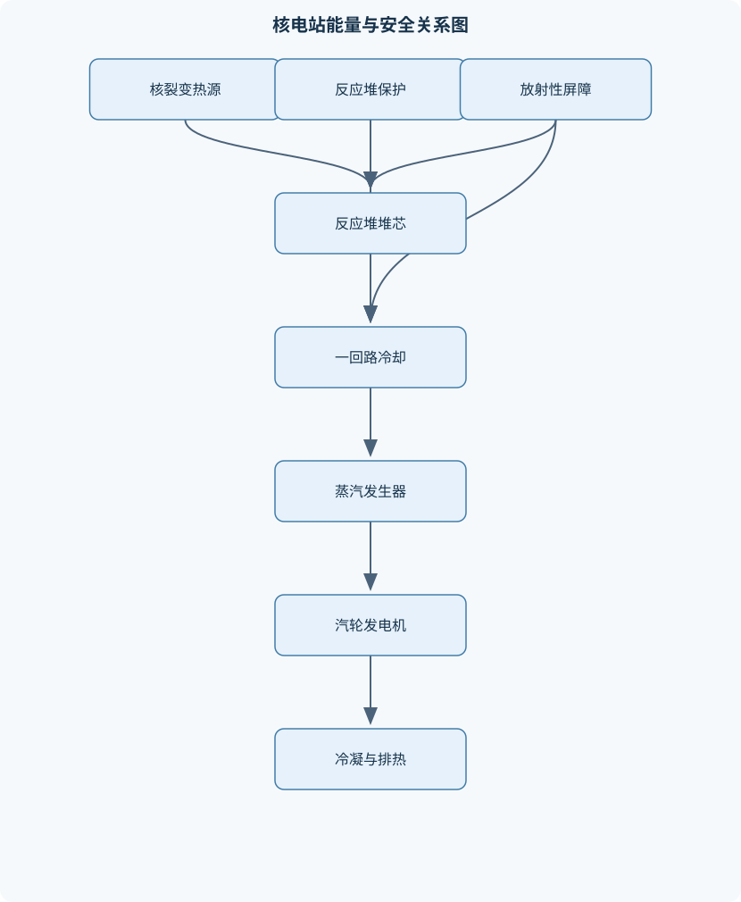
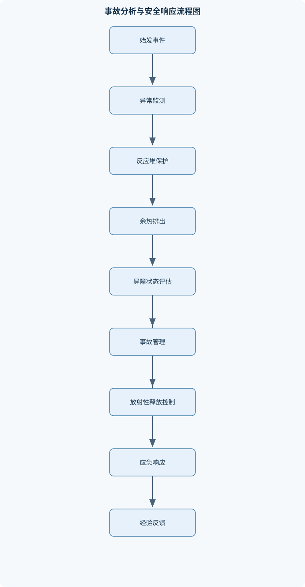

# 核电站

## 一、课程整体知识框架

### 课程边界与先修知识

本课程研究以裂变反应堆为热源、以蒸汽动力循环为能量转换基础、以多重屏障和纵深防御为安全核心的核电站系统。内容覆盖核裂变与中子输运基础、反应堆临界与反应性控制、燃料与堆芯、轻水堆及其他堆型、核岛与常规岛热力系统、反应堆运行控制、核安全与事故分析、放射性废物及核电站全寿期管理。课程重点以压水堆为主线，同时比较沸水堆、重水堆、石墨慢化堆和快中子增殖堆。先修知识包括高等数学、普通物理、热力学、流体力学、传热学、电工学、材料科学和概率统计；涉及核反应堆工程的部分还需要掌握原子核物理、辐射防护和基本控制理论。课程讨论的是工程系统层面的原理、设备、运行和安全分析，不替代核安全法规、核电厂运行规程或具体机组的许可文件。





### 1. 课程对象、研究边界与主线

本课程研究以裂变反应堆为热源、以蒸汽动力循环为主要能量转换方式、以多重屏障和纵深防御为安全核心的核电站工程系统。核电站不是单一的“反应堆设备”，而是由核岛、常规岛、电气系统、仪表控制系统、辅助系统、放射性废物处理系统和应急安全系统共同组成的复杂工业设施。

课程以压水堆为主要分析对象。压水堆在一回路中利用高压水带走堆芯热量，使冷却剂在正常运行时保持单相液态；一回路热量在蒸汽发生器中传递给二回路给水，二回路产生蒸汽并驱动汽轮机—发电机组。该结构将放射性一回路与通常不直接接触堆芯的二回路隔开，是压水堆核电站系统组织和放射性边界分析的基础。

课程的逻辑主线可以表示为：

$$
\text{核裂变}
\rightarrow
\text{中子链式反应}
\rightarrow
\text{堆芯受控产热}
\rightarrow
\text{一回路传热}
\rightarrow
\text{蒸汽动力循环}
\rightarrow
\text{发电与排热}
$$

与此同时，安全主线贯穿上述全部环节：

$$
\text{燃料基体}
\rightarrow
\text{燃料包壳}
\rightarrow
\text{一回路压力边界}
\rightarrow
\text{安全壳}
\rightarrow
\text{厂外防护与应急响应}
$$

这些屏障并非相互替代。某一层屏障的存在不能证明其他屏障可以取消；安全性来自设计、运行、监测、维护、人员操作和应急措施的组合。

课程讨论工程原理、系统功能、运行动态和安全分析，不替代具体机组的运行规程、许可文件、设计基准或核安全监管要求。不同堆型、不同功率等级和不同设计年代的设备布置、保护逻辑、事故缓解措施可能存在显著差异，不能把压水堆的结论不加条件地推广到所有反应堆。

### 2. 先修知识与知识之间的依赖关系

核电站课程需要高等数学、普通物理、热力学、流体力学、传热学、电工学、材料科学和概率统计作为基础。原子核物理用于解释核素、结合能、裂变和辐射；热力学用于建立蒸汽发生器、汽轮机、凝汽器和给水系统的能量平衡；流体力学和传热学用于分析一回路压降、流量分配、燃料温度和余热排出；概率统计用于事件树、故障树、设备可靠性和不确定性分析。

知识依赖关系通常按照以下顺序展开：

1. 先由质量亏损和结合能解释裂变能来源；
2. 再由中子产生、散射、吸收和泄漏建立链式反应模型；
3. 由中子收支定义临界、次临界、超临界和反应性；
4. 将反应性变化与燃料、慢化剂、控制棒、可溶性中子毒物和温度反馈联系起来；
5. 将堆芯功率转化为冷却剂焓升，再连接蒸汽发生器和朗肯循环；
6. 最后从屏障失效、事故序列和放射性释放路径分析核安全。

### 3. 统一符号、单位与基本守恒关系

中子通量记为 $\phi$，单位通常为 $\mathrm{n\cdot m^{-2}\cdot s^{-1}}$，表示单位面积、单位时间内通过的中子数。中子密度记为 $n$，单位为 $\mathrm{m^{-3}}$。在近似单速中子条件下，

$$
\phi=nv
$$

其中 $v$ 为中子平均速度，单位为 $\mathrm{m\cdot s^{-1}}$。因此，中子通量不是简单的“中子总数”，相同中子密度在不同能量下可能对应不同通量。

微观截面用 $\sigma$ 表示，单位为面积，常用单位是靶恩 $\mathrm{barn}$，其中 $1\ \mathrm{barn}=10^{-28}\ \mathrm{m^2}$。宏观截面用 $\Sigma$ 表示，单位为 $\mathrm{m^{-1}}$，例如：

$$
\Sigma_a=\sum_i N_i\sigma_{a,i}
$$

其中 $N_i$ 是第 $i$ 种核素的数密度，$\sigma_{a,i}$ 是其吸收截面。裂变反应率密度近似为：

$$
R_f=\Sigma_f\phi
$$

其中 $\Sigma_f$ 为宏观裂变截面，$R_f$ 的单位为 $\mathrm{m^{-3}\cdot s^{-1}}$。若有效裂变区域体积为 $V$，每次裂变可利用能量为 $E_f$，则堆芯热功率可近似写为：

$$
P=E_fR_fV
$$

该式适合用于平均功率的数量级估算。若堆芯功率分布不均匀，必须对空间和能量分布进行积分，不能用平均中子通量直接代表局部燃料功率、局部温度或局部安全裕量。

热工计算中，冷却剂质量流量记为 $\dot m$，单位为 $\mathrm{kg\cdot s^{-1}}$；比焓记为 $h$，单位为 $\mathrm{J\cdot kg^{-1}}$。稳态单相流的换热功率可写为：

$$
\dot Q=\dot m(h_{\mathrm{out}}-h_{\mathrm{in}})
$$

该关系要求系统边界明确，并且需要考虑旁路流、热损失、流量测量误差以及两相流影响。流体密度记为 $\rho_m$，以区别于反应性 $\rho$。

### 4. 从核能到电能的能量链

裂变反应中，重核吸收中子后形成不稳定复合核并发生分裂，产生裂变碎片、瞬发中子、伽马射线和其他能量。裂变能主要以裂变碎片动能形式出现，裂变碎片在燃料中减速并转化为热。部分能量由中子和伽马射线带走，部分能量与裂变产物衰变有关。

核电站的能量链不是“裂变直接发电”，而是：

1. 裂变碎片在燃料中沉积能量；
2. 燃料芯块将热量传给包壳；
3. 包壳将热量传给冷却剂；
4. 一回路冷却剂在蒸汽发生器中将热量传给二回路；
5. 二回路蒸汽在汽轮机中膨胀做功；
6. 发电机把机械功转换为电功；
7. 凝汽器将剩余热量排向循环冷却水、空气或其他冷源。

热效率定义为净输出电功率与反应堆供热功率之比：

$$
\eta_{\mathrm{th}}=\frac{P_{\mathrm{net}}}{P_{\mathrm{th}}}
$$

其中 $P_{\mathrm{net}}$ 为扣除厂用电后的净电功率，$P_{\mathrm{th}}$ 为反应堆热功率。由于汽轮机、泵、发电机存在损失，且热力学第二定律要求循环向冷源排热，净电功率不可能等于全部裂变热。净效率还受蒸汽参数、冷凝压力、环境温度、设备状态和厂用电负荷影响。

### 5. 安全分析的统一框架

核安全分析围绕三个问题展开：

- 放射性物质是否被限制在屏障内；
- 即使发生设备故障，燃料和堆芯是否仍能保持可冷却状态；
- 在屏障受损时，是否能够限制释放量和保护人员、环境。

纵深防御包括多层次设计和措施：预防异常运行、控制事故工况、维持停堆和冷却、限制放射性释放、实施场内外应急响应。安全分析既包括确定论分析，也包括概率安全分析。确定论方法根据规定的始发事件、初始条件和设备动作逻辑计算压力、温度、液位、燃料状态和安全壳响应；概率安全分析则利用事件树和故障树描述不同设备成功或失效组合的事故序列。

事故不能只归因于某一个设备或某一次操作。始发事件、设备故障、仪表失效、外部灾害、电源丧失、规程缺陷、人员认知偏差、组织管理和安全文化可能共同构成事故链。

## 二、章节和模块划分

### 核心知识覆盖清单

本清单用于检查正文是否覆盖本课程的主要知识模块：

- **核裂变与核电站能量转换基础**：原子核结合能与质量亏损、铀、钚裂变及裂变能释放、裂变中子与链式反应、中子产生和消失途径、裂变产物衰变热、核能到电能的能量链、核电站与化石电站的热源差异。
- **中子物理与反应堆临界**：中子能谱与热中子化、中子散射与吸收、裂变反应率和中子通量、有效增殖因数、临界条件及其物理含义、反应性定义与单位、四因子公式及适用边界、点堆动力学基本假设。
- **反应堆堆芯、燃料与材料**：核燃料循环与二氧化铀燃料、燃料芯块和包壳结构、燃料棒与燃料组件、堆芯布置和功率分布、控制棒与可溶性中子毒物、慢化剂和冷却剂的功能、包壳腐蚀与氢吸收、燃耗、换料和反应性摆动。
- **核反应堆类型及其比较**：轻水压水堆的结构特点、轻水沸水堆的直接循环、重水堆的慢化与燃料利用、石墨慢化堆的物理特性、快中子堆与增殖概念、热中子堆和快中子堆的差异、不同堆型的材料与安全约束、堆型选择的经济和工程因素。
- **压水堆核岛系统**：反应堆压力容器、一回路冷却剂系统、蒸汽发生器、稳压器及压力控制、主泵和余热排出系统、化学与容积控制系统、安全注入系统、一回路放射性边界。
- **蒸汽动力循环与常规岛**：朗肯循环基本过程、蒸汽发生与汽轮机膨胀、汽轮机级间能量转换、发电机和厂用电系统、凝汽器与循环冷却水系统、给水加热和再生循环、热力学第一定律在核电站中的应用、热效率、排热和环境热负荷。
- **反应堆运行控制与动态特性**：启动、升功率和停堆过程、控制棒调节和停堆裕量、反应性反馈效应、燃料温度系数、慢化剂温度系数、氙毒和钐毒效应、功率分布控制、反应堆保护系统和联锁。
- **核安全体系与纵深防御**：放射性物质三道屏障、纵深防御原则、设计基准事故、超设计基准事故、失水事故与堆芯冷却、失去厂外电源事故、安全壳和氢气控制、严重事故管理、概率安全分析。
- **核电站事故与风险分析**：事故始发事件与事件序列、三里岛事故的系统和人因分析、切尔诺贝利事故的堆型与管理因素、福岛事故的外部灾害与电源丧失、事故进程和放射性释放路径、仪表失效与信息不完整、人因、组织因素和安全文化、事故经验反馈与设计改进。
- **辐射防护、废物与核电站全寿期**：电离辐射种类及其穿透特性、剂量、剂量率和屏蔽原则、区域划分与人员辐射防护、放射性废物分类和处理、乏燃料贮存与余热管理、核材料衡算与核保障、退役阶段的系统隔离、核电站全寿期风险管理。


### 第一章 核裂变与核电站能量转换基础

#### 1.1 原子核结合能与裂变能释放

原子核质量小于组成它的质子和中子质量总和，质量差对应结合能：

$$
E_b=\Delta mc^2
$$

裂变前后的总结合能差转化为释放能量。铀、钚等重核裂变后形成中等质量的裂变产物，其单位核子的平均结合能通常更高，因此体系能量降低并释放能量。工程上必须区分每次裂变能量、单位质量燃料能量和最终可转化为电能的能量；三者并不相等。

#### 1.2 裂变中子、链式反应与衰变热

一次裂变可产生多个中子。中子可能诱发下一次裂变，也可能被燃料、结构材料或冷却剂吸收，发生散射改变能量，或从堆芯边界泄漏。裂变产物还会继续衰变并放出热量。停堆后，控制棒可以使持续链式裂变基本停止，但裂变产物衰变热不会立即消失，故停堆状态仍必须维持余热排出。

#### 1.3 核电站与化石电站的热源差异

两类电站都可以使用蒸汽动力循环，但热源形成机制不同。化石燃料通过化学燃烧释放热量，核电站通过裂变释放热量；核电站燃料能量密度高，但燃料包壳、一回路边界、辐射屏蔽、乏燃料和放射性废物带来特殊安全任务。核电站并非没有污染物，而是污染物形态从燃烧烟气和灰渣转变为放射性活化产物、裂变产物和受污染设备。

### 第二章 中子物理与反应堆临界

#### 2.1 中子能谱、散射和吸收

裂变产生的中子初始能量较高，需要通过与慢化剂碰撞逐步降低能量。轻水、重水和石墨可通过弹性散射实现慢化，但慢化能力、中子吸收特性和温度效应不同。吸收可能导致裂变，也可能形成非裂变俘获；因此“吸收”不等于“裂变”。

中子通量与中子能谱共同决定裂变反应率。仅比较总通量而不说明能谱，可能错误判断功率，因为不同能量中子的裂变截面不同。

#### 2.2 临界条件与有效增殖因数

有效增殖因数定义为一代中产生并能导致下一代裂变的有效中子数与本代造成裂变的中子数之比，记为 $k_{\mathrm{eff}}$。简化的一代中子收支为：

$$
k_{\mathrm{eff}}
=
\frac{\text{下一代有效裂变中子产生数}}
{\text{本代引起裂变的中子数}}
$$

当中子产生率等于吸收率与泄漏率之和时，系统处于临界状态，对应：

$$
k_{\mathrm{eff}}=1
$$

$k_{\mathrm{eff}}<1$ 表示次临界，$k_{\mathrm{eff}}>1$ 表示超临界。反应性定义为：

$$
\rho=\frac{k_{\mathrm{eff}}-1}{k_{\mathrm{eff}}}
$$

因此，$k_{\mathrm{eff}}=1$ 时 $\rho=0$；$k_{\mathrm{eff}}<1$ 时 $\rho<0$；$k_{\mathrm{eff}}>1$ 时 $\rho>0$。反应性是无量纲量，也可用 pcm 表示，$1\ \mathrm{pcm}=10^{-5}$。

“临界”只表示平均链式反应能够维持，不等于事故状态。正常运行可以是受控临界；危险性还取决于功率水平、局部峰值、反应性插入速率、冷却能力、停堆裕量和保护系统状态。

#### 2.3 四因子公式及其边界

无限均匀热中子系统可用四因子公式表示：

$$
k_{\infty}=\eta\varepsilon pf
$$

其中，$\eta$ 为再生因子，$\varepsilon$ 为快裂变因子，$p$ 为共振逃逸概率，$f$ 为热中子利用因子。该公式假设介质无限、均匀，主要用于解释各物理因素如何影响增殖特性。实际堆芯存在有限尺寸、非均匀燃料、控制棒、温度梯度和边界泄漏，需要进一步考虑快中子和热中子不泄漏概率，不能直接将 $k_{\infty}$ 当作实际堆芯的 $k_{\mathrm{eff}}$。

#### 2.4 点堆动力学

点堆动力学把堆芯空间分布近似压缩为一个整体功率变量，重点研究功率随时间的变化。其核心是将中子分为瞬发中子和缓发中子。缓发中子显著延长反应堆动力学时间尺度，使控制棒、保护系统和操纵人员能够在工程时间内响应。点堆模型适合研究整体功率、反应性阶跃和启动过程，但不能描述局部功率峰、三维通量畸变和强空间耦合。

### 第三章 反应堆堆芯、燃料与材料

#### 3.1 燃料、燃料棒和燃料组件

商用轻水堆通常使用二氧化铀陶瓷燃料。燃料芯块装入金属包壳形成燃料棒，若干燃料棒按规则阵列组成燃料组件。燃料芯块承担裂变产热，包壳承担燃料约束和放射性裂变产物屏障，组件还需要保证冷却剂流道、机械定位和控制棒插入通道。

#### 3.2 堆芯布置、功率分布与燃耗

堆芯功率不是均匀分布的。轴向、径向和燃料组件内部都可能存在功率峰值。设计需要控制峰值因子，使局部燃料温度、包壳温度和热流密度不超过限值。燃耗通常用 $\mathrm{MWd/tHM}$ 表示，即每吨重金属燃料在百万瓦热功率下运行的等效天数；必须明确热功率口径和重金属质量口径。

燃耗会消耗裂变材料并积累裂变产物和超铀核素，导致反应性随时间变化。换料设计要处理燃料利用率、功率分布、停堆裕量、余热和放射性管理之间的约束。

#### 3.3 控制棒、可溶性中子毒物与反应性反馈

控制棒利用强吸收材料调节局部或整体反应性；可溶性中子毒物通过改变一回路溶液中的吸收能力进行较慢的反应性补偿。燃料温度升高会产生多普勒展宽，使共振吸收增强，通常形成负燃料温度系数。慢化剂温度升高会改变密度和慢化能力，在许多轻水堆中产生负反馈，但该结论不能推广到所有堆型和所有状态。

氙毒和钐毒来自裂变产物及其衰变链。氙吸收中子能力强，功率变化、停堆和升功率过程可能引起反应性变化和功率调节困难，必须结合裂变产物生成、衰变和中子吸收进行分析。

### 第四章 核反应堆类型及其比较

#### 4.1 轻水压水堆与沸水堆

压水堆在高压一回路中维持水的液态，通过蒸汽发生器向二回路传热；沸水堆在压力容器内直接使水沸腾，蒸汽直接进入汽轮机。压水堆具有一、二回路分隔特征，沸水堆则减少了蒸汽发生器这一换热环节，但汽轮机侧具有不同的放射性管理要求。

#### 4.2 重水堆和石墨慢化堆

重水吸收中子较少，具有较好的中子经济性，可以支持较低富集度燃料或特定燃料循环，但重水系统成本、泄漏控制和氚管理带来工程约束。石墨主要承担慢化功能，冷却剂可以采用不同流体；石墨慢化堆的安全特性不能由“使用石墨”单独决定，还要结合冷却剂、压力边界、反应性反馈和堆芯结构分析。

#### 4.3 快中子堆与增殖概念

快中子堆尽量避免慢化，使中子保持较高能量。快中子谱有利于某些核素转换和燃料利用方案，但材料损伤、冷却剂选择、泄漏控制和燃料循环更复杂。快中子堆不必然是增殖堆；只有当燃料转换比、裂变材料生产、包层设计和燃料循环条件满足要求时，才具有增殖意义。

### 第五章 压水堆核岛系统

#### 5.1 一回路边界和主要设备

压水堆一回路主要包括反应堆压力容器、堆芯、主泵、蒸汽发生器、稳压器及连接管道。反应堆压力容器承受高温高压和辐照环境；主泵维持强制循环；蒸汽发生器完成一、二回路之间的换热；稳压器通过加热和喷淋调节压力。

一回路还包括化学与容积控制系统、余热排出系统和安全注入系统。化学与容积控制涉及冷却剂净化、补水、硼浓度调节和溶解气体控制；余热排出系统在停堆后持续带走衰变热；安全注入系统在失水或冷却剂库存不足时补充冷却剂，维持堆芯可冷却性。

#### 5.2 热工水力约束

堆芯热量必须由冷却剂可靠带走。稳态分析需要同时满足质量、能量和动量守恒，并检查出口温度、压力、流量分配、饱和裕量和临界热流密度。单相流公式不能直接用于两相沸腾、强瞬态或明显三维流动；这些情况需要专门的两相流和瞬态模型。

### 第六章 蒸汽动力循环与常规岛

#### 6.1 理想朗肯循环

理想朗肯循环包括给水泵升压、蒸汽发生器吸热、汽轮机膨胀做功和凝汽器放热四个主要过程。完整循环满足热力学第一定律：

$$
\Delta U=0,\qquad W_{\mathrm{net}}=Q_{\mathrm{in}}-Q_{\mathrm{out}}
$$

实际循环还要考虑汽轮机内效率、泵功、蒸汽湿度、管道压降、发电机损失和厂用电。凝汽器排出的热量并非无关紧要，它决定循环冷却系统的规模和环境热负荷。

#### 6.2 发电、厂用电与冷却系统

汽轮机将蒸汽焓降转化为轴功，发电机将轴功转换为电能。厂用电系统为主泵、风机、泵组、加热器、仪控和安全系统供电。失去厂外电源时，备用电源和事故电源能否持续供电，直接影响余热排出、仪表可用性和事故控制能力。

### 第七章 反应堆运行控制与动态特性

启动和升功率必须逐步改变反应性，并同时监测源量程、中间量程、功率量程、反应堆周期、温度、压力、流量和保护信号。停堆不仅是插入控制棒，还要确认停堆裕量、冷却能力和余热排出路径。

反应堆保护系统根据高功率、低流量、高压力、低水位或其他危险状态触发停堆和联锁。保护系统的基本要求是动作条件清晰、独立性足够、失效后趋于安全，并与正常控制系统保持必要隔离。

### 第八章 核安全体系与纵深防御

设计基准事故用于评价在规定始发事件和设备失效假设下，燃料、包壳、一回路边界和安全壳是否保持在可接受状态。超设计基准事故则进一步考虑多重故障、长期电源丧失、外部灾害或安全功能组合失效。

失水事故分析需要关注破口位置、破口面积、喷放与降压、堆芯液位、应急注入、燃料温度、包壳状态和安全壳响应。失去厂外电源事故则重点分析备用电源、蓄电池、仪表、余热排出和长期补水能力。安全壳并非无限承压结构，必须考虑压力、温度、泄漏率、氢气、熔融物和长期热负荷。

### 第九章 核电站事故与风险分析

事故分析首先识别始发事件，再按设备成功或失败、人员动作和外部条件展开事件序列。三里岛事故体现了仪表信息误导、设备状态判断和人因组织问题的耦合；切尔诺贝利事故涉及堆型物理特性、试验组织、保护逻辑和安全管理问题；福岛事故则体现外部灾害导致的电源丧失、冷却功能丧失和长期事故管理困难。三者的堆型、始发事件和释放路径不同，不能用同一模型简单概括。

事件树用于展开事故序列，故障树用于分解安全功能失效条件。概率安全分析的输出是事故序列频率、顶事件概率、最小割集和风险重要度，而不是对具体事故的确定性预言。

### 第十章 辐射防护、废物与核电站全寿期

电离辐射包括带电粒子、伽马射线、X射线和中子等，不同辐射的穿透能力和屏蔽材料要求不同。活度用 Bq 表示，描述单位时间内的衰变数；剂量或有效剂量用 Sv 表示，描述辐射对物质或人体造成的影响。活度高不必然意味着人员剂量高，剂量还与距离、时间、屏蔽、能谱和人员停留方式有关。

辐射防护遵循时间、距离和屏蔽原则，并通过控制区、监督区、个人剂量监测、污染控制和作业许可实施管理。放射性废物需按来源、活度、核素、物理形态和可处理性分类，经过减容、固化、包装、暂存或处置。乏燃料即使停止链式反应，仍具有衰变热和辐射场，贮存系统必须保持冷却、屏蔽和临界安全。

全寿期管理覆盖设计、建造、调试、运行、换料、检修、老化管理、退役和场址恢复。退役阶段需要识别受污染系统、活化结构和放射性边界，实施隔离、去污、拆除、废物分类和人员防护。核材料衡算与核保障则关注核材料的流向、库存、盘存和异常差异，不能仅依赖一般设备台账。

## 三、核心概念的详细解释

### 3.1 核电站的能量转换链与系统边界

核电站的本质是以裂变反应堆提供高温热源，再通过蒸汽动力循环把部分热能转化为电能。完整能量链为：

$$
\text{核结合能变化}
\rightarrow
\text{裂变产物动能与辐射能}
\rightarrow
\text{堆芯热功率}
\rightarrow
\text{一回路冷却剂焓升}
\rightarrow
\text{蒸汽焓降}
\rightarrow
\text{汽轮机轴功}
\rightarrow
\text{发电机电功率}
$$

裂变释放的能量首先沉积在燃料、包壳和冷却剂中，主要表现为热能。压水堆中，一回路水在高压下保持单相液态，将堆芯热量输送到蒸汽发生器；二回路给水在蒸汽发生器中吸热汽化，蒸汽进入汽轮机。二回路通常与堆芯不直接接触，因此蒸汽发生器同时承担换热设备和放射性边界的一部分功能。

核电站输出的电功率不是反应堆热功率的同义词。反应堆热功率通常以 $\mathrm{MW_{th}}$ 表示，发电机毛电功率通常以 $\mathrm{MW_e}$ 表示，扣除主泵、给水泵、风机、加热器、仪控和其他厂用负荷后才得到净电功率。热效率定义为：

$$
\eta_{\mathrm{th}}=\frac{P_{\mathrm{net}}}{P_{\mathrm{th}}}
$$

其中 $P_{\mathrm{net}}$ 为净输出电功率，单位为 $\mathrm{W}$；$P_{\mathrm{th}}$ 为反应堆供热功率，单位为 $\mathrm{W}$。该定义用于实际电站性能评价，不能与只考虑理想膨胀和理想泵功的循环效率混用。

### 3.2 原子核结合能、裂变与裂变能

原子核由质子和中子组成。孤立核子结合成原子核后，体系质量通常小于组成它的自由核子质量之和，质量差称为质量亏损。由质能关系：

$$
E=\Delta m c^2
$$

可知，质量亏损 $\Delta m$ 对应结合能，其中 $c$ 为真空光速。重核裂变为两个中等质量核时，裂变产物的总结合能通常更高，体系质量降低，差额以裂变碎片动能、瞬发伽马射线、裂变中子和后续放射性衰变能等形式释放。

以铀或钚等易裂变核素为例，中子被原子核吸收后形成激发复合核，复合核可能发生形变并分裂为两个主要裂变碎片，同时释放多个中子。裂变释放能量的绝大部分首先沉积在裂变碎片上，裂变碎片通过与燃料晶格碰撞迅速转化为热。裂变中子能否继续引发裂变，取决于核素、入射中子能量、燃料密度、慢化条件和几何泄漏。

停堆并不意味着所有核热源消失。控制棒插入后，持续裂变链式反应基本停止，但裂变产物和重核素继续衰变，形成衰变热功率 $P_d$。衰变热随时间下降，但在停堆初期仍足以造成燃料升温，因此停堆后的余热排出是反应堆安全的持续任务。

### 3.3 中子的产生、散射、吸收和泄漏

反应堆内中子来源主要包括以下几类：

1. **裂变中子**：易裂变核素裂变时产生，通常属于快中子，是正常功率运行时的主要链式反应来源。
2. **自发裂变中子**：某些重核素自发裂变产生，数量较少，但可作为启动或次临界状态的中子源之一。
3. **外部中子源**：启动阶段可使用专门中子源，以便仪表在极低功率下获得可测信号。
4. **光致中子、（$\alpha$，n）反应等**：在特定材料和能量条件下产生，通常不是功率运行时的主要来源。

中子的消失或离开中子平衡系统的途径包括：

- 被燃料吸收并引发裂变；
- 被燃料、慢化剂、结构材料或控制材料非裂变吸收；
- 通过散射改变能量和方向，散射本身不是中子的最终消失，但会改变其后续反应概率；
- 从反应堆有限边界泄漏；
- 被控制棒、可溶性中子毒物或其他吸收体俘获。

微观截面 $\sigma$ 描述单个原子核发生某种相互作用的概率尺度，单位为 $\mathrm{m^2}$，常用单位为靶恩：

$$
1\ \mathrm{barn}=10^{-28}\ \mathrm{m^2}
$$

若第 $i$ 种核素的数密度为 $N_i$，相应微观截面为 $\sigma_i$，则宏观截面为：

$$
\Sigma=\sum_i N_i\sigma_i
$$

宏观吸收截面 $\Sigma_a$ 和宏观裂变截面 $\Sigma_f$ 的单位为 $\mathrm{m^{-1}}$。在近似单速中子条件下，中子通量与中子密度的关系为：

$$
\phi=nv
$$

其中 $\phi$ 的单位为 $\mathrm{n\cdot m^{-2}\cdot s^{-1}}$，$n$ 的单位为 $\mathrm{m^{-3}}$，$v$ 的单位为 $\mathrm{m\cdot s^{-1}}$。中子通量不是中子总数；在中子密度相同而速度不同的情况下，通量也不同。

裂变反应率密度可近似写为：

$$
R_f=\Sigma_f\phi
$$

其中 $R_f$ 的单位为 $\mathrm{m^{-3}\cdot s^{-1}}$。若裂变区域体积为 $V$，每次裂变可利用能量为 $E_f$，则堆芯热功率近似为：

$$
P_{\mathrm{th}}=E_f\int_V\Sigma_f(\mathbf r)\phi(\mathbf r)\,\mathrm dV
$$

只有在 $\Sigma_f$ 和 $\phi$ 在体积内近似均匀时，才可简化为 $P_{\mathrm{th}}\approx E_f\Sigma_f\phi V$。在真实堆芯中，燃料组成、控制棒、温度、冷却剂密度和几何边界都会造成空间功率峰值，因此平均通量不能直接代替局部通量用于燃料安全评价。

### 3.4 临界、增殖因数与反应性

反应堆的临界不是“发生爆炸”的意思，而是平均意义上的中子世代平衡。有效增殖因数 $k_{\mathrm{eff}}$ 定义为一代中能够导致下一代裂变的有效中子数与本代造成裂变的中子数之比：

- $k_{\mathrm{eff}}=1$：临界，链式反应平均维持；
- $k_{\mathrm{eff}}<1$：次临界，中子数和功率趋于下降；
- $k_{\mathrm{eff}}>1$：超临界，中子数和功率在相应时间尺度内趋于增加。

反应性定义为：

$$
\rho=\frac{k_{\mathrm{eff}}-1}{k_{\mathrm{eff}}}
$$

因此，$k_{\mathrm{eff}}=1$ 时 $\rho=0$；$k_{\mathrm{eff}}<1$ 时 $\rho<0$；$k_{\mathrm{eff}}>1$ 时 $\rho>0$。反应性是无量纲量，也可用 pcm 表示：

$$
1\ \mathrm{pcm}=10^{-5}
$$

反应堆达到临界只说明中子收支平衡，不说明功率处于安全范围。若功率分布不均匀、冷却能力不足、燃料温度过高或安全裕量不足，仍可能存在严重工程风险。

中子收支的基本表达是：

$$
\text{中子产生率}
=
\text{中子吸收率}
+
\text{中子泄漏率}
+
\text{中子库存变化率}
$$

在稳态临界状态下，中子库存变化率为零，因此中子产生率等于吸收率和泄漏率之和。将一代中子收支归一化后，即可得到 $k_{\mathrm{eff}}=1$ 的临界条件。

### 3.5 四因子公式及其边界

对于无限均匀热中子系统，可用四因子公式表示无限增殖因数：

$$
k_{\infty}=\eta\varepsilon pf
$$

其中：

- $\eta$ 为再生因子，表示热中子被燃料吸收后产生裂变中子的能力；
- $\varepsilon$ 为快裂变因子，表示快中子裂变对中子增殖的贡献；
- $p$ 为共振逃逸概率，表示中子慢化过程中未被共振吸收而进入热能区的概率；
- $f$ 为热中子利用因子，表示热中子吸收中发生在燃料内的比例。

实际堆芯是有限的，存在快中子和热中子泄漏，因此：

$$
k_{\mathrm{eff}}=k_{\infty}P_fP_t
$$

其中 $P_f$ 和 $P_t$ 分别为快中子和热中子不泄漏概率。四因子公式要求介质在一定程度上可视为均匀、能群划分和截面处理合理。控制棒附近、强吸收体附近、堆芯边界、严重非均匀区域以及明显三维输运问题，不能直接用四因子公式替代精细中子输运计算。

### 3.6 燃料、堆芯与反应性控制

典型轻水堆燃料以二氧化铀陶瓷芯块为主要燃料形态。芯块装入金属包壳形成燃料棒，多根燃料棒组成燃料组件，燃料组件按一定晶格布置在反应堆压力容器内形成堆芯。燃料芯块提供裂变材料，包壳承担裂变产物保持、机械约束和热传导边界功能。

燃料在运行中经历燃耗变化。燃耗通常用 $\mathrm{MWd/tHM}$ 表示，指每吨重金属燃料在百万瓦热功率下运行的等效天数；其中重金属质量口径必须明确，热功率也必须明确是堆芯热功率还是其他边界上的功率。燃耗增加会消耗易裂变核素，并积累裂变产物和可转换核素，从而改变中子谱、吸收和反应性。

控制棒通过吸收中子改变反应性，适合快速调节、停堆和功率分布控制。可溶性中子毒物溶解在一回路冷却剂中，可对全堆反应性进行较均匀的慢调节。燃料温度升高通常会增强共振吸收，即多普勒展宽效应，使反应性降低，形成重要的负反馈。慢化剂温度升高会降低轻水密度，进而改变慢化能力、泄漏和吸收；在许多轻水堆状态下，这一反馈为负，但符号和大小依赖堆型、燃料组成、空泡状态和运行条件。

氙毒主要来自裂变产物碘—氙衰变链。氙—135具有较强中子吸收能力，功率变化和停堆后浓度变化会引起明显反应性变化。钐—149也是重要的裂变产物中子毒物，其变化速度和功率变化关系不同。氙、钐效应说明反应性控制不能只观察控制棒位置，还必须考虑功率历史和裂变产物积累。

### 3.7 主要反应堆堆型比较

| 堆型 | 慢化剂与冷却剂 | 主要结构特征 | 物理与工程特点 |
|---|---|---|---|
| 压水堆 | 轻水兼作慢化剂和冷却剂 | 一回路高压单相水，经蒸汽发生器向二回路供热 | 放射性一回路与汽轮机回路隔开，压力边界复杂，依赖高压冷却与稳压 |
| 沸水堆 | 轻水兼作慢化剂和冷却剂 | 堆芯内直接沸腾，蒸汽进入汽轮机 | 系统较直接，但汽轮机侧具有更直接的放射性管理要求，空泡反馈重要 |
| 重水堆 | 重水作慢化剂和冷却剂，具体布置因设计而异 | 可采用压力管道和在线换料等方案 | 中子经济性较好，可使用较低富集度或不同燃料，但重水管理和压力管道老化重要 |
| 石墨慢化堆 | 石墨慢化，冷却剂可为水、气体等 | 石墨承担主要慢化功能，冷却剂和燃料通道有多种组合 | 石墨温度、氧化、结构完整性及冷却剂—空泡反馈需单独评价 |
| 快中子堆 | 通常不使用慢化剂，采用低慢化能力冷却剂 | 保持快中子能谱，可配置转换区或增殖区 | 能谱硬、材料损伤和钠等冷却剂工程问题突出；快堆不必然自动成为增殖堆 |

热中子堆依靠慢化剂把裂变产生的快中子降至低能区，以提高某些核素的裂变概率。快中子堆则尽量避免慢化，利用快中子维持链式反应并可能促进可转换核素转化为易裂变核素。所谓增殖，需要燃料转换、泄漏控制、包层设计和燃料循环条件共同满足，不能仅由“快中子”三个字推出。

### 3.8 反应堆与核武器的工程差异

反应堆和核武器都涉及裂变，但工程目的、燃料条件、几何结构、功率时间尺度和控制方式完全不同。核电站要求链式反应长期受控，利用燃料缓慢释放热能，并配置冷却、调节、停堆和余热排出系统。核武器追求极短时间内的快速能量释放，采用完全不同的材料状态、装配方式和中子学设计。

“都利用裂变”只能说明能量来源存在物理联系，不能说明两者工作原理和安全问题相同。核电站事故的主要危险通常是失去冷却、燃料损坏、放射性释放和长期余热管理，而不是核爆炸。

### 3.9 压水堆安全性与纵深防御

压水堆安全性建立在多重屏障和纵深防御基础上。典型屏障包括：

1. 燃料陶瓷基体，滞留相当部分裂变产物；
2. 燃料包壳，限制裂变产物进入冷却剂；
3. 一回路压力边界，限制放射性冷却剂外泄；
4. 安全壳，包容事故释放并降低向环境的释放速率。

纵深防御还包括反应性控制、正常余热排出、应急停堆、应急堆芯冷却、事故电源、仪表控制、安全壳喷淋或压力控制、氢气管理和严重事故管理。安全壳并非无限承压，其能力受设计压力、温度、泄漏率、设备可用性、氢气燃烧和长期热负荷限制。

失水事故需要依次分析破口位置和面积、喷放与降压、堆芯液位、应急注入、燃料温度、包壳状态和安全壳响应。失去厂外电源事故则重点关注备用电源、蓄电池、仪表可用性、余热排出和长期补水。不同事故的始发事件和屏障失效顺序不同，不能用“停堆成功”直接替代“事故得到控制”。

### 3.10 三起重大事故的系统分析

三里岛事故体现了设备状态、仪表指示、人因判断和组织管理的耦合。某一设备信号不能简单等同于真实设备状态；当信息不完整、告警过多且规程对异常状态覆盖不足时，操作人员可能采取加剧事故的动作。因此事故分析应区分始发故障、仪表误导、人员操作、规程缺陷和组织因素。

切尔诺贝利事故与其堆型物理特性、试验组织、保护逻辑状态、运行管理和安全文化有关。分析不能只归因于某个操作动作，也不能将该事故的堆型特征直接推广到压水堆。不同堆型的慢化剂、冷却剂、空泡反馈、压力边界和安全壳设计差异，会改变事故进程。

福岛事故体现了外部灾害导致的厂外电源丧失、备用电源受损、仪表和冷却功能长期失效。事故管理困难不仅来自堆芯热源，还来自电源、通信、仪表、海水或补水条件、厂房损坏和多机组同时受影响。其分析应沿事件时间线识别外部始发事件、设备失效、功能丧失、屏障状态和释放路径。

### 3.11 辐射防护、废物与全寿期管理

放射性是原子核不稳定并发生衰变的性质，活度 $A$ 表示单位时间内发生的衰变数，单位为 $\mathrm{Bq}$；剂量或有效剂量描述辐射能量沉积及其生物效应，常用单位为 $\mathrm{Sv}$。高活度源不一定导致高人员剂量，实际剂量还取决于距离、时间、屏蔽、辐射能谱、几何条件和人员工作方式。

辐射防护通常遵循缩短时间、增加距离和设置屏蔽的原则，并配合控制区划分、污染控制、个人剂量监测、作业许可和源项管理。放射性废物应依据核素、活度、物理状态、来源和可处理性分类，分别进行减容、固化、包装、暂存或后续处置。乏燃料虽然停止链式反应，仍有衰变热和强辐射场，贮存系统必须维持冷却、屏蔽、临界安全和结构完整性。

全寿期管理覆盖设计、建造、调试、运行、换料、检修、老化管理、退役和场址恢复。退役阶段需要识别受污染系统、活化结构和放射性边界，实施隔离、去污、拆除、废物分类和人员防护。核材料衡算关注核材料库存、流向、盘存和差异分析，不能用普通设备台账完全替代。

### 3.12 反应堆分析的基本算法与流程

#### 3.12.1 临界状态与反应性计算流程

**输入**包括燃料组成、几何尺寸、材料密度、温度、边界条件和多群截面数据。首先建立空间网格和能群模型；其次计算吸收、裂变、散射和泄漏项；然后求解特征值问题，得到 $k_{\mathrm{eff}}$ 和通量分布；最后计算：

$$
\rho=\frac{k_{\mathrm{eff}}-1}{k_{\mathrm{eff}}}
$$

**输出**包括 $k_{\mathrm{eff}}$、$\rho$、局部功率分布和安全裕量。迭代中的不变量是离散中子收支和能群间转移守恒；当相邻两次迭代的特征值变化、通量变化和残差均低于规定限值时终止。该流程适用于堆芯状态比较和设计校核，不替代经许可的安全分析程序。若未知量总数为 $N$、迭代次数为 $I$，稀疏离散下的基本计算量通常可表示为与 $NI$ 同阶，但实际复杂度还取决于矩阵稀疏性、预条件方法和并行实现。

#### 3.12.2 一回路稳态热工水力分析流程

**输入**包括堆芯热功率、入口温度和压力、质量流量、流道几何、物性、摩擦系数和设备局部压降。先按流道求解质量守恒和能量守恒，再计算摩擦压降、局部压降及自然循环驱动力，随后检查出口温度、饱和裕量、临界热流密度和包壳温度。

热平衡可写为：

$$
P_{\mathrm{th}}\approx \dot m(h_{\mathrm{out}}-h_{\mathrm{in}})
$$

其中 $\dot m$ 为冷却剂质量流量，单位为 $\mathrm{kg\cdot s^{-1}}$；$h$ 为比焓，单位为 $\mathrm{J\cdot kg^{-1}}$。该公式要求边界明确、处于稳态或准稳态，并应修正旁路流、热损失、两相流和测量误差。质量、能量和动量守恒是分析不变量；流量、压降和温度残差达到收敛条件时终止。

#### 3.12.3 事件树与故障树风险分析

事件树从始发事件出发，依次判断停堆、余热排出、应急注入、电源恢复和安全壳功能是否成功，形成不同事故序列。故障树则从顶事件出发，例如“余热排出功能失效”，逐层分解为泵失效、阀门失效、电源丧失、仪表失效和人因事件等基本事件。

分析输入包括设备失效概率、共因失效、人因事件、外部事件和安全功能逻辑。输出包括事故序列频率、最小割集和重要度指标。必须保持逻辑关系一致、概率定义一致和事件边界不重叠。概率结果是风险表征，不是事故必然性预测；若始发事件清单、共因失效或长期事故模型不完整，计算结果可能出现系统性偏差。

#### 3.12.4 事故经验反馈流程

首先收集事故报告、设备状态、运行记录、人员操作、组织管理和外部事件信息；然后按时间线重构事件，区分事实、推断和不确定信息；接着建立屏障失效图，识别直接原因、促成因素和根本原因；最后提出设计、规程、培训、维修和监管改进措施，并设置可验证的关闭条件。

证据链完整、事实与推断分离是流程不变量。纠正行动只有在完成实施、验证效果并确认未引入新的风险后才能关闭。该流程适用于重大事故和近失事件，不能仅以单一设备故障解释复杂系统事故。

### 3.13 一个可执行的临界判断示例程序

下面的 Python 示例只进行给定中子收支数据的计算，不读取文件、不联网，也不执行外部命令。

```python
def criticality_check(neutrons_causing_fission,
                      neutrons_next_generation):
    """
    输入：
        neutrons_causing_fission: 本代造成裂变的中子数
        neutrons_next_generation: 下一代有效中子数
    输出：
        k_eff, reactivity, state
    """
    if neutrons_causing_fission <= 0:
        raise ValueError("本代裂变中子数必须为正")

    k_eff = neutrons_next_generation / neutrons_causing_fission
    reactivity = (k_eff - 1.0) / k_eff

    tolerance = 1e-12
    if abs(k_eff - 1.0) < tolerance:
        state = "临界"
    elif k_eff < 1.0:
        state = "次临界"
    else:
        state = "超临界"

    return k_eff, reactivity, state


k, rho, state = criticality_check(1000000, 995000)
print(f"k_eff = {k:.6f}")
print(f"rho = {rho:.6e}")
print(f"状态：{state}")
```

程序的不变量是增殖因数由同一代际定义下的中子数比值计算，且分母必须为正。终止条件是完成一次有限计算；其时间复杂度为 $O(1)$。该程序只能处理给定的集总中子收支，不能计算空间功率分布、能谱、燃料温度反馈或真实堆芯泄漏。

### 3.14 典型例题

#### 例题一：由中子收支判断临界状态

**题干**：某简化模型中，本代造成裂变的中子数为 $1.00\times10^6$，下一代有效中子数为 $9.95\times10^5$。求 $k_{\mathrm{eff}}$ 和反应性，并判断状态。

**分析与解答**：

第一步，计算增殖因数：

$$
k_{\mathrm{eff}}=\frac{9.95\times10^5}{1.00\times10^6}=0.995
$$

第二步，计算反应性：

$$
\rho=\frac{0.995-1}{0.995}
=-0.005025
$$

换算为 pcm：

$$
\rho\approx-502.5\ \mathrm{pcm}
$$

第三步，根据 $k_{\mathrm{eff}}<1$ 判断系统为次临界。

**结果验证**：下一代中子数少于本代，说明链式反应在该模型中衰减，判断与负反应性一致。

**变式**：若下一代中子数为 $1.005\times10^6$，则 $k_{\mathrm{eff}}=1.005$，反应性为正，系统为超临界；这只表示功率具有上升趋势，不表示必然发生爆炸。

#### 例题二：应用四因子公式

**题干**：某无限均匀热中子系统的四因子为 $\eta=1.80$、$\varepsilon=1.03$、$p=0.88$、$f=0.72$。求 $k_\infty$。若快中子和热中子不泄漏概率分别为 $0.97$ 和 $0.96$，求 $k_{\mathrm{eff}}$。

**解答**：

先计算无限增殖因数：

$$
k_\infty=1.80\times1.03\times0.88\times0.72
$$

逐步计算：

$$
1.80\times1.03=1.854
$$

$$
1.854\times0.88=1.63152
$$

$$
1.63152\times0.72\approx1.17469
$$

因此：

$$
k_\infty\approx1.175
$$

考虑泄漏：

$$
k_{\mathrm{eff}}=1.17469\times0.97\times0.96
\approx1.094
$$

所以有限堆芯仍为超临界状态。

**验证**：不泄漏概率均小于 $1$，故有限堆芯的 $k_{\mathrm{eff}}$ 必小于 $k_\infty$，计算结果满足这一关系。

**变式**：若慢化剂密度降低导致 $p$ 和 $f$ 同时下降，$k_{\mathrm{eff}}$ 不一定只由某一个因子决定，必须重新计算各因子，不能只根据“密度降低”直接判断反应性大小。

#### 例题三：由裂变反应率计算热功率

**题干**：某均匀区域体积为 $100\ \mathrm{m^3}$，宏观裂变截面为 $0.01\ \mathrm{m^{-1}}$，中子通量为 $2.0\times10^{18}\ \mathrm{n\cdot m^{-2}\cdot s^{-1}}$。每次裂变可利用能量取 $3.2\times10^{-11}\ \mathrm{J}$。求热功率。

**解答**：

裂变反应率密度为：

$$
R_f=\Sigma_f\phi
=0.01\times2.0\times10^{18}
=2.0\times10^{16}\ \mathrm{m^{-3}\cdot s^{-1}}
$$

总裂变率为：

$$
\dot N_f=R_fV
=2.0\times10^{16}\times100
=2.0\times10^{18}\ \mathrm{s^{-1}}
$$

热功率为：

$$
P_{\mathrm{th}}=E_f\dot N_f
=3.2\times10^{-11}\times2.0\times10^{18}
=6.4\times10^7\ \mathrm W
$$

因此：

$$
P_{\mathrm{th}}=64\ \mathrm{MW}
$$

**结果验证**：单位为 $\mathrm{J\cdot s^{-1}}$，即瓦特。

**变式**：若通量只给出平均值而区域功率分布明显不均匀，平均值可用于估算总功率，但不能用于判断局部燃料温度和临界热流密度。

#### 例题四：压水堆一回路焓升

**题干**：反应堆热功率为 $3000\ \mathrm{MW}$，一回路总质量流量为 $1.5\times10^4\ \mathrm{kg\cdot s^{-1}}$。忽略旁路流和热损失，求冷却剂平均焓升。

**解答**：

由：

$$
P_{\mathrm{th}}=\dot m\Delta h
$$

得到：

$$
\Delta h=\frac{P_{\mathrm{th}}}{\dot m}
=\frac{3.0\times10^9}{1.5\times10^4}
=2.0\times10^5\ \mathrm{J\cdot kg^{-1}}
$$

因此平均焓升为：

$$
\Delta h=200\ \mathrm{kJ\cdot kg^{-1}}
$$

**验证**：$\mathrm{kg\cdot s^{-1}}\times\mathrm{J\cdot kg^{-1}}=\mathrm{J\cdot s^{-1}}$，单位闭合。

**边界说明**：若存在旁路流，$\dot m$ 必须取穿过堆芯有效换热区域的流量；若发生两相流，还需采用适合两相混合物的焓和流动模型，不能直接套用单相平均温升公式。

#### 例题五：朗肯循环净效率

**题干**：反应堆热功率为 $3000\ \mathrm{MW}$，汽轮机和发电机输出的毛电功率为 $1000\ \mathrm{MW}$，厂用电为 $80\ \mathrm{MW}$。求净电功率、净热效率和排向冷源的近似热功率。

**解答**：

净电功率：

$$
P_{\mathrm{net}}=1000-80=920\ \mathrm{MW}
$$

净热效率：

$$
\eta_{\mathrm{th}}=\frac{920}{3000}
\approx0.3067
$$

即约为 $30.67\%$。

若忽略其他能量储存和测量边界差异，排热功率近似为：

$$
Q_{\mathrm{out}}\approx3000-920=2080\ \mathrm{MW}
$$

**验证**：净输出功率加排热功率等于输入热功率，满足整体能量平衡。

**变式**：降低冷却水温度可能改善汽轮机排汽压力和循环效率，但会改变冷却系统规模、环境热负荷和设备运行边界，不能只从效率一个指标评价方案。

### 3.15 实验与项目流程

#### 3.15.1 中子收支与反应性数值实验

**输入数据**：给定若干组裂变产生中子数、吸收损失、泄漏损失以及外部源强。每组数据必须统一中子计数边界和时间间隔。

**步骤**：

1. 检查中子产生、吸收和泄漏数据的单位与边界；
2. 由中子守恒计算下一代有效中子数；
3. 计算 $k_{\mathrm{eff}}$ 和 $\rho$；
4. 改变泄漏比例或吸收比例，观察临界状态变化；
5. 用程序结果与手算结果交叉核对。

**评价标准**：中子收支误差应在设定容差内；$k_{\mathrm{eff}}$、$\rho$ 的符号判断必须一致；改变参数后结果变化方向应符合物理预期。

**排错方法**：若 $k_{\mathrm{eff}}$ 大于 $1$ 但下一代中子数减少，应检查分子分母是否颠倒；若反应性数值异常大，应检查是否把 pcm 与无量纲数混用；若结果对泄漏增加不敏感，应检查泄漏项是否真正进入中子收支。

#### 3.15.2 压水堆一回路热平衡项目

**输入数据**：堆芯热功率、堆芯入口和出口压力温度、质量流量、冷却剂比焓表或物性模型、蒸汽发生器二回路给水和蒸汽状态。

**步骤**：

1. 明确堆芯、一回路和蒸汽发生器的能量边界；
2. 根据压力温度确定入口和出口焓；
3. 用 $\dot m(h_{\mathrm{out}}-h_{\mathrm{in}})$ 计算一回路吸热；
4. 对二回路计算给水吸热和蒸汽焓升；
5. 比较两侧热量，分析管壁散热、测量误差和旁路流；
6. 检查一回路是否满足单相假设及饱和裕量要求。

**评价标准**：两侧能量不平衡应低于项目规定误差；压力、温度和焓的单位必须一致；结论必须明确理想模型与实际系统的差异。

**排错方法**：若计算热功率数量级错误，首先检查 $\mathrm{MW}$ 是否换算为 $\mathrm W$；若出口温度高于压力对应的合理范围，应检查物性表和压力单位；若一回路与二回路热量差异过大，应检查质量流量边界、蒸汽湿度和厂用热负荷。

### 3.16 常见易错点

1. 把临界等同于危险或爆炸；临界只表示平均中子收支平衡。
2. 把 $k_{\mathrm{eff}}$、反应性和功率混为一谈；三者分别描述中子增殖状态、状态参数和能量释放强度。
3. 把中子通量当成中子总数；通量还包含速度和面积时间因素。
4. 把散射直接当作中子消失；散射首先改变中子能量和方向。
5. 把四因子公式用于强非均匀区域、控制棒附近或强泄漏边界。
6. 认为控制棒插入后衰变热立即消失。
7. 认为快中子堆必然是增殖堆。
8. 把压水堆和沸水堆都称作同一种轻水堆而忽略其蒸汽产生位置差异。
9. 把重水的高中子经济性误解为不需要控制棒、停堆系统或应急冷却。
10. 把石墨慢化剂本身的性质等同于整个石墨堆的安全性。
11. 把反应堆热功率直接当成净电功率。
12. 把安全壳理解为可以无限承压的容器。
13. 只用设备故障解释重大事故，忽视仪表、人因、组织和外部事件。
14. 把活度单位 Bq 和剂量单位 Sv 混用。
15. 把理想朗肯循环效率直接当成实际净效率。
16. 只看平均功率，不检查局部功率峰值和热工安全裕量。
17. 把概率安全分析结果解释为事故必然性或精确预测。
18. 忽略 $\mathrm{MW_{th}}$、$\mathrm{MW_e}$、$\mathrm{MWd/tHM}$、$\mathrm{Sv}$ 和 $\mathrm{Bq}$ 的单位边界。

## 四、重要定义、公式、定理和推导

### 专业审校补充：关键定义与适用边界

临界热流密度（CHF）是燃料表面或受热壁面传热机制发生显著恶化的边界，不等同于冷却剂整体达到饱和沸腾。压水堆中即使主流仍为过冷或低含汽率流动，受热壁面也可能出现核态沸腾危机，导致壁面温度快速升高。工程上常用偏离泡核沸腾比（DNBR）表示裕量：DNBR=q''CHF/q''actual，其中q''CHF为给定压力、质量流速、含汽率和几何条件下的临界热流密度，q''actual为局部实际热流密度，二者单位均为W·m⁻²。沿轴向和径向计算得到的最小值称为MDNBR。DNBR不是普适安全常数，限值必须与相关式适用范围、测量和计算不确定度、热点因子及设计准则共同确定；不能用平均功率或平均流量替代局部值。该判据主要适用于受压水冷却、以壁面传热恶化为主要限制的工况，不适合直接评价沸水堆复杂两相流、严重事故熔融物或气冷堆燃料温度。若发生DNB，首要风险是包壳温度和氧化损伤增加，而不是反应堆立即失去临界控制。


### 4.1 质量亏损与裂变能推导

设裂变前体系总质量为 $m_{\mathrm{before}}$，裂变后所有裂变碎片、中子和伽马相关等效质量之和为 $m_{\mathrm{after}}$，则质量亏损为：

$$
\Delta m=m_{\mathrm{before}}-m_{\mathrm{after}}
$$

由质能关系：

$$
E_f=\Delta m c^2
$$

这里的 $E_f$ 是每次裂变释放的总能量或按题设定义的可利用能量。工程热功率并非直接由单次裂变能量决定，而是由单位时间内裂变次数决定：

$$
P_{\mathrm{th}}=E_f\dot N_f
$$

若裂变率密度为 $R_f$，则：

$$
\dot N_f=\int_VR_f\,\mathrm dV
=\int_V\Sigma_f\phi\,\mathrm dV
$$

于是：

$$
P_{\mathrm{th}}
=E_f\int_V\Sigma_f\phi\,\mathrm dV
$$

该推导要求裂变能量沉积边界明确。若部分能量由中微子带走、部分伽马能量在系统边界外沉积，$E_f$ 必须按所选热功率边界修正。

### 4.2 中子通量、反应率和宏观截面

在单速近似下，中子密度为 $n$，平均速度为 $v$，则：

$$
\phi=nv
$$

若单位体积中核素 $i$ 的数密度为 $N_i$，发生某反应的微观截面为 $\sigma_i$，则宏观截面为：

$$
\Sigma=\sum_iN_i\sigma_i
$$

中子与介质发生该反应的反应率密度为：

$$
R=\Sigma\phi
$$

裂变反应率使用 $\Sigma_f$：

$$
R_f=\Sigma_f\phi
$$

吸收、散射和裂变截面在不同中子能量下通常不同，因此多能群计算不能任意使用一个与能谱无关的常数截面。若能量变量为 $E$，更一般的裂变率应写成：

$$
R_f(\mathbf r)=\int \Sigma_f(\mathbf r,E)\phi(\mathbf r,E)\,\mathrm dE
$$

这说明相同总通量但能谱不同的两个状态，不一定具有相同裂变功率。

### 4.3 临界条件的推导

设一个中子世代中造成裂变的有效中子数为 $N_j$，下一代有效中子数为 $N_{j+1}$，则：

$$
k_{\mathrm{eff}}=\frac{N_{j+1}}{N_j}
$$

连续世代近似下：

$$
N_{j+1}=k_{\mathrm{eff}}N_j
$$

若 $k_{\mathrm{eff}}=1$，则 $N_{j+1}=N_j$，中子数平均不变；若 $k_{\mathrm{eff}}<1$，则各代递减；若 $k_{\mathrm{eff}}>1$，则各代增加。因此临界条件为：

$$
k_{\mathrm{eff}}=1
$$

由反应性定义：

$$
\rho=\frac{k_{\mathrm{eff}}-1}{k_{\mathrm{eff}}
}
$$

可反解为：

$$
\rho k_{\mathrm{eff}}=k_{\mathrm{eff}}-1
$$

$$
k_{\mathrm{eff}}(1-\rho)=1
$$

因此：

$$
k_{\mathrm{eff}}=\frac{1}{1-\rho}
$$

该关系要求 $\rho\ne1$，并且反应性采用无量纲定义。反应性正负只表示中子学趋势，不直接给出功率大小、温度或事故后果。

### 4.4 四因子公式的物理分解

从一代快中子开始，四因子公式按照中子经历的主要阶段分解：

1. 快中子在慢化前引起额外裂变，形成快裂变因子 $\varepsilon$；
2. 中子慢化穿过共振区，未被共振吸收的比例为 $p$；
3. 热中子到达热能区后，在燃料中被吸收的比例为 $f$；
4. 被燃料吸收的热中子引起裂变并产生下一代中子，其平均增殖能力为 $\eta$。

将各阶段比例相乘：

$$
k_\infty=\varepsilon p f\eta
$$

“无限”意味着暂不考虑有限几何泄漏。对有限堆芯，再乘以不泄漏概率：

$$
k_{\mathrm{eff}}=\varepsilon p f\eta P_fP_t
$$

该公式的边界在于它是理想化因子分解。实际堆芯中的空间、能量、温度和材料耦合可能使各因子并非相互独立；因此四因子公式适合物理解释和初步估算，不是所有设计分析的最终模型。

### 4.5 点堆动力学与缓发中子

点堆动力学把堆芯空间通量形状近似固定，只研究整体幅值随时间变化。忽略外部源时，其概念性方程可写为：

$$
\frac{\mathrm dn}{\mathrm dt}
=
\frac{\rho-\beta_{\mathrm{eff}}}{\Lambda}n
+\sum_i\lambda_i C_i
$$

$$
\frac{\mathrm dC_i}{\mathrm dt}
=
\frac{\beta_i}{\Lambda}n-\lambda_i C_i
$$

其中：

- $n$ 为代表性中子密度；
- $\rho$ 为反应性；
- $\beta_{\mathrm{eff}}$ 为有效缓发中子份额；
- $\Lambda$ 为中子代时间；
- $C_i$ 为第 $i$ 组缓发中子先驱核浓度；
- $\beta_i$ 为第 $i$ 组缓发中子份额；
- $\lambda_i$ 为相应衰变常数。

瞬发中子变化快，缓发中子来自先驱核衰变，显著延长反应堆可控动态时间尺度。若反应性变化足够小，功率变化主要受缓发中子影响，控制棒和保护系统便有工程时间进行响应。若反应性接近或超过有效缓发中子份额，动力学会显著加快，点堆近似和常规控制假设都需要谨慎检查。

点堆模型的适用条件是空间形状变化不显著、功率分布可以用固定形状近似。快速局部功率偏移、强反馈、控制棒局部插入和三维热工耦合问题不能只用点堆模型评价。

### 4.6 反应性反馈的推导

若燃料温度、慢化剂温度和冷却剂密度变化引起反应性变化，可在小扰动范围内线性化：

$$
\Delta\rho
\approx
\alpha_f\Delta T_f
+\alpha_m\Delta T_m
+\alpha_c\Delta T_c
+\Delta\rho_{\mathrm{rod}}
+\Delta\rho_{\mathrm{poison}}
$$

其中 $\alpha_f$、$\alpha_m$ 和 $\alpha_c$ 分别为燃料、慢化剂和冷却剂温度反应性系数，单位通常为反应性每温度单位；$\Delta\rho_{\mathrm{rod}}$ 为控制棒引入的反应性；$\Delta\rho_{\mathrm{poison}}$ 为氙、钐等中子毒物变化造成的反应性。

燃料温度升高使共振吸收峰发生多普勒展宽，更多中子在慢化过程中被燃料共振吸收，通常降低热中子可利用性，因而形成负燃料温度系数。慢化剂温度升高会导致密度改变，进而影响慢化、吸收和泄漏。对轻水堆的许多运行状态，温度升高导致密度降低并带来负反应性反馈，但在不同堆型、燃料设计和空泡状态下，符号可能不同。

线性化公式只适合温度变化较小、系数变化不大的范围。大幅度温度变化、沸腾出现、燃耗变化明显或氙浓度显著变化时，应使用随状态更新的非线性模型。

### 4.7 停堆余热的定义与能量平衡

控制棒插入后，链式裂变功率大幅下降，但裂变产物和重核素继续衰变。停堆后总热功率可概念性分为：

$$
P_{\mathrm{total}}(t)
=
P_{\mathrm{fission}}(t)+P_d(t)
$$

正常停堆后，$P_{\mathrm{fission}}(t)$ 接近零，但 $P_d(t)$ 仍为正，并且需要随时间变化的余热排出能力。若某时间段内反应堆、燃料和冷却剂总内能变化为 $\Delta U$，则热平衡可写为：

$$
\Delta U=Q_{\mathrm{in}}-Q_{\mathrm{out}}+W_{\mathrm{in}}-W_{\mathrm{out}}
$$

对稳定完整热力学循环，$\Delta U=0$，但停堆冷却是瞬态过程，不能直接使用完整循环的零内能变化假设。余热排出系统必须考虑流量、换热面积、冷却剂库存、热源衰减和长期电源可用性。

### 4.8 朗肯循环的四个基本过程

理想朗肯循环包括：

1. **泵压缩**：凝结水被加压，泵功输入使水的压力升高；
2. **蒸汽发生器吸热**：高压给水从反应堆一回路吸热并转化为蒸汽；
3. **汽轮机膨胀**：蒸汽降压膨胀，焓降低并输出轴功；
4. **凝汽器放热**：排汽向冷却水放热并凝结成水。

汽轮机理想比功可近似写为：

$$
w_t=h_{\mathrm{in}}-h_{\mathrm{out,s}}
$$

其中 $h_{\mathrm{out,s}}$ 为理想等熵膨胀出口焓。实际汽轮机出口焓高于理想值，汽轮机内效率可表示为：

$$
\eta_t=
\frac{h_{\mathrm{in}}-h_{\mathrm{out}}}
{h_{\mathrm{in}}-h_{\mathrm{out,s}}}
$$

泵功和汽轮机功共同决定循环净功：

$$
w_{\mathrm{net}}=w_t-w_p
$$

实际净电效率还需乘以发电机效率，并扣除厂用电。蒸汽湿度、级间压力损失、再热或给水加热条件都会改变实际性能。

### 4.9 事故序列、屏障和风险

事故分析中，始发事件是触发系统状态变化的事件，例如管道破口、厂外电源丧失或外部洪水。直接原因是导致设备或功能失效的近因；促成因素包括仪表故障、规程不足、培训缺陷和维护问题；根本原因则涉及设计、组织和安全管理体系。

纵深防御要求在始发事件发生后，依次通过停堆、冷却、包容和应急响应限制后果。某一屏障失效并不自动意味着全部屏障失效，但多重故障和共因失效可能同时削弱多个安全功能。概率安全分析用事件树展开成功和失败路径，用故障树分析安全功能失效条件，输出事故序列频率与风险贡献。

概率安全分析的关键边界包括：

- 基本事件概率适用的设备、环境和维护条件；
- 是否考虑共因失效；
- 是否考虑人因和恢复动作；
- 是否覆盖外部灾害；
- 是否包含长期事故阶段；
- 不同事故序列之间是否存在重复计算。

因此，概率结果不能单独证明某项设计绝对安全，也不能替代确定性热工水力、结构完整性和放射性后果分析。

### 4.10 典型笔试问题及解答思路

#### 问题一：临界条件是什么，临界是否等于危险？

先定义 $k_{\mathrm{eff}}$，说明 $k_{\mathrm{eff}}=1$ 是平均中子收支平衡，再解释正常运行可在受控条件下临界。最后指出危险性还取决于功率、功率分布、冷却能力、停堆裕量和保护系统。

#### 问题二：为什么停堆后仍要冷却堆芯？

先说明控制棒主要停止持续裂变链式反应，再说明裂变产物衰变热 $P_d$ 仍存在。由能量守恒可知，若余热排出不足，燃料和包壳温度会继续升高，可能导致屏障损坏。

#### 问题三：推导四因子公式并说明适用边界。

按快裂变、共振逃逸、热中子利用和再生四个阶段逐项解释，得到 $k_\infty=\eta\varepsilon pf$。再说明有限堆芯需乘不泄漏概率，强非均匀和局部输运问题不能直接使用该公式。

#### 问题四：比较压水堆和沸水堆。

从堆芯内是否沸腾、一回路压力、蒸汽产生位置、放射性边界、空泡反馈和事故响应比较。核心结论是压水堆在蒸汽发生器中向二回路供热，沸水堆在压力容器内直接产生汽轮机蒸汽。

#### 问题五：为什么反应堆不能把全部裂变热变成电能？

先用第一定律说明输入热量必须分为净功和排热，再用第二定律说明热机需要冷源。实际还存在汽轮机、泵、发电机、管道和厂用电损失。

#### 问题六：说明燃料温度负反馈的来源。

燃料温度升高导致共振峰多普勒展宽，增加中子共振吸收，减少进入热能区并引发裂变的中子，因此通常形成负反应性反馈。需说明其大小取决于燃料和运行状态。

#### 问题七：三起重大核事故有哪些不可直接类比之处？

分别识别三里的仪表和人因耦合、切尔诺贝利的堆型与运行管理因素、福岛的外部灾害和长期电源冷却丧失，再比较各自屏障失效顺序。不能用单一“操作失误”概括三者。

#### 问题八：解释活度、剂量和剂量率的区别。

活度单位为 $\mathrm{Bq}$，表示每秒衰变数；剂量或有效剂量单位为 $\mathrm{Sv}$，描述辐射影响；剂量率是单位时间内剂量变化。三者需要结合距离、时间、屏蔽和能谱分析，不能互换。

### 4.11 典型面试问题、参考答案与追问要点

#### 问题一：反应堆临界是不是意味着反应堆很危险？

**参考答案**：临界只表示中子世代平均保持不变。核电站正常运行需要在严格控制和监测下维持临界，安全性还取决于功率分布、反应性反馈、冷却能力、停堆裕量和保护系统。

**深入追问要点**：说明静态临界与功率变化速率的区别；解释缓发中子为什么提高可控性；指出超临界也不等于核爆炸。

#### 问题二：控制棒插入后为什么不能停止所有安全系统？

**参考答案**：控制棒降低持续裂变功率，但裂变产物衰变热仍会释放；同时一回路中仍存在高温高压冷却剂，需要继续排热和维持压力边界。

**深入追问要点**：区分停堆、冷却、补水和长期余热排出四项功能；说明停堆信号不等于事故结束。

#### 问题三：压水堆的主要安全屏障有哪些？

**参考答案**：燃料基体、燃料包壳、一回路压力边界和安全壳构成主要物理屏障，外加停堆、应急冷却、事故电源、仪表和应急响应等纵深防御措施。

**深入追问要点**：解释屏障的独立性和多样性；说明安全壳存在压力、温度、泄漏和氢气边界。

#### 问题四：如果厂外电源丧失，最先关注什么？

**参考答案**：关注反应堆是否成功停堆、直流和交流事故电源是否可用、余热排出路径是否保持、仪表是否能够提供可信信息，以及长期补水和电源恢复能力。

**深入追问要点**：分析“停堆但不能冷却”的状态；区分短期电源支持和长期事故管理。

#### 问题五：为什么同样的中子通量不一定产生同样的功率？

**参考答案**：裂变反应率取决于能量相关的裂变截面和通量分布。若两个状态的中子能谱不同，即使积分通量相同，$\int\Sigma_f(E)\phi(E)\,\mathrm dE$ 也可能不同。

**深入追问要点**：说明热中子堆和快中子堆的能谱差异；指出单群模型的适用边界。

#### 问题六：如何判断一次事故的根本原因？

**参考答案**：先重构时间线，区分事实与推断，再识别始发事件、直接原因、促成因素和根本原因，检查设计、规程、培训、维护、组织和安全文化是否共同影响了屏障失效。

**深入追问要点**：说明不能把复杂事故归因于一个操作员；讨论证据链和纠正行动验证。

#### 问题七：概率安全分析的结果能否证明电站绝对安全？

**参考答案**：不能。概率安全分析依赖事件清单、设备数据、共因失效、人因模型和外部灾害边界，结果用于风险排序和设计改进，不是事故必然性的预测，也不是绝对安全证明。

**深入追问要点**：说明最小割集、敏感性分析和不确定性分析的作用。

#### 问题八：怎样评价一个热工水力计算结果是否可信？

**参考答案**：检查输入边界、物性、质量和能量守恒、压降闭合、稳态假设、两相流模型、网格或时间步长敏感性，并与独立手算或测量数据进行数量级核对。

**深入追问要点**：说明模型验证与模型确认的区别；指出平均温度不能替代局部热点。

### 4.12 课程知识与岗位任务的关联

| 岗位 | 典型实际任务 | 主要使用知识 | 主要产出与验收标准 |
|---|---|---|---|
| 反应堆物理工程师 | 计算临界、反应性、功率分布和燃耗 | 中子输运、四因子公式、燃料和反应性反馈 | 临界计算报告、功率峰值和不确定性分析；要求收支闭合、模型边界清楚 |
| 堆芯设计工程师 | 设计燃料组件布置、控制棒和换料方案 | 燃耗、堆芯布局、热工安全裕量 | 堆芯设计方案；要求满足反应性、功率分布和热工限制 |
| 热工水力工程师 | 评价流量、温度、压降、临界热流和事故冷却 | 质量能量动量守恒、两相流和传热 | 稳态及瞬态分析报告；要求守恒残差、模型适用性和敏感性可审查 |
| 一回路系统工程师 | 维护压力边界、主泵、稳压器和蒸汽发生器功能 | 一回路系统、设备边界、余热排出 | 系统设计或改造文件；要求功能、接口和事故工况明确 |
| 仪控与保护工程师 | 设计测量、联锁、停堆和保护逻辑 | 点堆动力学、控制理论、失效安全 | 逻辑图、联锁矩阵和测试记录；要求动作条件和故障响应可验证 |
| 核安全分析工程师 | 分析设计基准事故和扩展工况 | 纵深防御、失水事故、热工水力和屏障 | 安全分析报告；要求初始条件、失效假设和后果评价完整 |
| 概率安全分析工程师 | 构建事件树、故障树和风险重要度 | 概率统计、可靠性、人因和共因失效 | 风险模型和敏感性分析；要求逻辑一致、数据来源边界明确 |
| 辐射防护工程师 | 进行区域划分、剂量监测和作业控制 | 辐射类型、屏蔽、剂量与活度 | 辐射防护方案和监测记录；要求剂量估算与现场监测相互校核 |
| 放射性废物管理工程师 | 分类、减容、固化、包装和暂存废物 | 活度、核素衰变、材料与屏障 | 废物清单和处理方案；要求分类依据、包装边界和可追溯性完整 |
| 退役工程师 | 隔离、去污、拆除受污染和活化系统 | 全寿期管理、辐射防护和废物工程 | 退役实施方案；要求系统边界、人员防护和废物去向清楚 |

岗位验收不能只看计算是否得出一个数值，还要检查输入边界、单位、假设、模型适用性、守恒关系、异常工况和不确定性说明。核电站工程结论必须能够被复核、追溯并与具体设计和许可边界相一致。

## 五、算法、流程和实现思路

### 方法与流程覆盖索引

下列方法或流程应在正文中说明输入、步骤、适用条件、结果检查和边界：

- 临界状态与反应性计算流程：输入为燃料组成、几何尺寸、材料密度、温度、边界条件和截面数据；先建立多群或单群中子模型，再计算吸收、裂变、散射和泄漏项，求得 k_eff，最后按 ρ = (k_eff − 1)/k_eff 计算反应性。输出为 k_eff、ρ、功率分布和局部安全裕量。不变量是中子守恒和能量群间转移守恒；终止条件是相邻迭代的 k_eff 和通量形状变化低于预设收敛限。适用于堆芯设计和状态比较，不适用于替代经许可的安全分析软件。有限差分或有限元离散后的基本迭代复杂度通常为 O(NI)，其中 N 为空间与能群未知量数，I 为迭代次数。
- 中子扩散方程数值分析流程：输入为区域网格、扩散系数、宏观截面、外源和边界条件；建立各能群中子平衡方程，离散扩散项与群间散射项，使用幂迭代或线性方程组方法求通量和增殖因数。输出为各节点各能群通量、局部功率和全堆 k_eff。不变量是离散方程中的粒子收支；终止条件为特征值残差和通量残差同时满足收敛要求。适用于扩散近似成立、介质变化较平缓的区域；强吸收、强非均匀或近边界问题应采用更高阶输运方法。
- 一回路热工水力稳态分析流程：输入为堆芯热功率、冷却剂入口温度和压力、质量流量、流道几何、物性和设备压降；先计算各流道能量方程，再计算摩擦压降、局部压降和自然循环驱动力，随后检查饱和裕量、临界热流密度和出口状态。输出为温度、压力、焓、流量分配和热工安全裕量。不变量是质量、能量和动量守恒；终止条件是流量、压降和温度场残差收敛。适用于稳态或准稳态设计校核；两相流、瞬态沸腾和强三维效应需要专门模型。
- 反应堆启动与升功率分析流程：输入为初始次临界状态、控制棒位置、硼浓度、源强、测量通道范围和升功率限制；确认仪表可用性后，逐步改变反应性，观察源量程、中间量程和功率量程信号，检查周期、温度、压力和流量反馈，再按阶段维持功率平台。输出为功率随时间变化、反应性插入量、关键温度压力和保护动作记录。不变量是保护限值、停堆裕量和冷却能力；终止条件为达到目标功率或触发保护条件。适用于培训和安全分析，实际运行必须以机组规程和许可条件为准。
- 失水事故分析流程：输入为破口位置和面积、初始功率、压力、冷却剂库存、应急注入能力、厂房边界和设备动作逻辑；识别小破口或大破口类型，计算降压、喷放、两相流、堆芯裸露和应急注入过程，随后评价燃料温度、包壳状态、压力边界和安全壳响应。输出为事故序列、关键峰值、屏障状态和放射性释放路径。不变量是质量、能量和动量守恒以及安全功能逻辑；终止条件是进入长期余热排出状态或达到规定分析时间。适用于设计基准和扩展工况研究，结果依赖模型、初始条件和不确定性分析。
- 事件树与故障树风险分析流程：输入为始发事件、设备成功或失效概率、共因失效、人因事件和安全功能；先用事件树展开事故序列，再用故障树分解各安全功能失效条件，计算最小割集和序列频率，最后进行重要度和敏感性分析。输出为事故序列频率、顶事件概率、关键设备和风险贡献。不变量是逻辑关系一致性和概率归一性；终止条件为故障树分解达到基本事件层级并完成数据审查。适用于概率安全分析，不适用于将概率结果直接解释为事故必然性。
- 核电站热效率计算流程：输入为反应堆热功率、蒸汽和给水焓、汽轮机排汽状态、泵功、发电机效率和厂用电；先计算汽轮机和泵的能量变化，再求毛电功率、厂用电和净电功率，最后计算 η_net = P_net/P_th。输出为毛效率、净效率、排热功率和各设备损失。能量守恒是核心不变量；终止条件为各设备功率平衡闭合。适用于稳态性能评价，不能忽略环境温度、冷端压力、湿蒸汽损失和测量不确定度。
- 事故经验反馈流程：输入为事故报告、设备状态、运行记录、人员操作、组织管理和外部事件信息；按时间线重构事件，区分直接原因、促成因素和根本原因，建立屏障失效图，提出设计、规程、培训和监管改进措施，最后验证措施是否降低风险。输出为经验证的事件树、根因分类、纠正行动和关闭条件。不变量是证据链完整、事实与推断分离；终止条件是原因解释能够覆盖关键现象且纠正行动可验证。适用于历史事故和近失事件分析，不能用单一设备故障解释复杂事故。





### 5.1 临界状态与反应性计算流程

反应堆临界分析的目标，是根据燃料组成、堆芯几何、材料密度、温度、控制棒位置和边界条件，求得有效增殖因数 $k_{\mathrm{eff}}$、反应性 $\rho$ 及功率分布。其基本关系为：

$$
\rho=\frac{k_{\mathrm{eff}}-1}{k_{\mathrm{eff}}}
$$

其中 $k_{\mathrm{eff}}$ 为一代中能够导致下一代裂变的有效中子数与本代引起裂变的中子数之比；$\rho$ 为无量纲反应性，也可用 pcm 表示，$1\ \mathrm{pcm}=10^{-5}$。当 $k_{\mathrm{eff}}=1$ 时，$\rho=0$，系统处于临界；当 $k_{\mathrm{eff}}<1$ 时，系统次临界；当 $k_{\mathrm{eff}}>1$ 时，系统超临界。

**输入**包括燃料和结构材料的核素组成、微观截面、材料密度、温度、堆芯几何、能群划分、控制棒和可溶性中子毒物状态、外边界条件及初始通量猜测。**输出**包括 $k_{\mathrm{eff}}$、$\rho$、各空间节点和能群的中子通量、局部裂变功率、功率峰值位置以及必要的热工安全裕量。

计算过程可分为以下步骤：

1. 根据核素数密度和微观截面建立宏观截面。例如吸收宏观截面为
   $$
   \Sigma_a=\sum_iN_i\sigma_{a,i}
   $$
   其中 $N_i$ 的单位为 $\mathrm{m^{-3}}$，$\sigma_{a,i}$ 的单位为 $\mathrm{m^2}$，因此 $\Sigma_a$ 的单位为 $\mathrm{m^{-1}}。
2. 按能量区间建立中子平衡方程，描述各能群中子的产生、散射、吸收和泄漏。
3. 给定初始通量形状，计算裂变源；用裂变源更新下一轮通量。
4. 对每轮结果进行归一化，求得新的 $k_{\mathrm{eff}}$。
5. 检查相邻两轮的 $k_{\mathrm{eff}}$ 差值和通量形状差异；只有两者同时达到预设收敛限，才认为计算收敛。
6. 将收敛通量与裂变宏观截面相乘，得到裂变反应率密度：
   $$
   R_f=\Sigma_f\phi
   $$
   其中 $R_f$ 的单位为 $\mathrm{m^{-3}\,s^{-1}}$，$\Sigma_f$ 为宏观裂变截面，$\phi$ 为中子通量。
7. 对局部功率进行归一化。总热功率近似为
   $$
   P=E_f\int_V\Sigma_f(\mathbf r)\phi(\mathbf r)\,\mathrm dV
   $$
   $E_f$ 为每次裂变释放的可利用能量，单位为 $\mathrm J$；积分区域 $V$ 为有效裂变区。

离散模型中的核心不变量是中子收支：产生中子数必须与吸收、泄漏和能群转移相平衡。若计算得到的局部功率为负、功率积分不等于给定总功率，或材料质量与截面单位不一致，通常说明输入转换、边界条件或归一化过程存在错误。

在空间网格数和能群未知量总数为 $N$、迭代次数为 $I$ 时，基本幂迭代的计算量通常可表示为 $O(NI)$，但实际耗时还取决于线性方程组求解器、网格稀疏性和并行方式。该流程适用于几何和材料状态明确、扩散近似可接受的堆芯分析；控制棒附近、强吸收区、强非均匀区和真空边界附近可能需要输运理论方法，不能机械使用低阶扩散模型。

#### 伪代码：基于幂迭代的临界计算

```text
输入：
    几何网格、能群数 G
    各材料的宏观裂变、吸收、散射截面
    扩散系数、边界条件
    初始通量 phi[g][i] 和初始 k_eff
    收敛限 tol_k、tol_phi

输出：
    k_eff、反应性 rho
    各网格各能群通量
    局部裂变功率和功率峰值

过程：
    重复：
        根据当前 phi 计算各网格的裂变源 chi[g] * sum(Sigma_f[g'][i] * phi[g'][i])
        求解各能群中子平衡方程，得到 phi_new[g][i]
        计算裂变源比值，更新 k_new
        对 phi_new 做统一归一化
        计算 error_k = abs(k_new - k_eff) / k_new
        计算 error_phi = max(abs(phi_new - phi))
        phi = phi_new
        k_eff = k_new
    直到 error_k < tol_k 且 error_phi < tol_phi

    rho = (k_eff - 1) / k_eff
    由 Sigma_f * phi 计算各节点裂变功率
    对功率积分并归一化到指定堆芯热功率
```

这里的终止条件不是“迭代次数达到某个数”，而是特征值残差和通量残差同时满足要求。若只检查 $k_{\mathrm{eff}}$ 而忽略通量形状，可能出现总增殖因数看似收敛、局部功率仍明显变化的情况。

### 5.2 一回路稳态热工水力分析

压水堆一回路热工分析以质量、能量和动量守恒为基础。若忽略旁路流和散热，稳态堆芯热平衡可写为：

$$
P_{\mathrm{th}}\approx\dot m(h_{\mathrm{out}}-h_{\mathrm{in}})
$$

其中 $P_{\mathrm{th}}$ 为堆芯热功率，单位为 $\mathrm W$；$\dot m$ 为冷却剂质量流量，单位为 $\mathrm{kg\,s^{-1}}$；$h_{\mathrm{in}}$ 和 $h_{\mathrm{out}}$ 为入口、出口比焓，单位为 $\mathrm{J\,kg^{-1}}$。该式适用于稳定或准稳定状态，并要求流量边界、焓值边界和功率边界一致。若存在旁路、泄漏、两相流或显著热损失，应增加相应修正项。

**输入**包括堆芯热功率、入口温度和压力、总流量、流道面积、加热周长、粗糙度、物性关系、设备压降和泵特性。**输出**包括流量分配、轴向温度、压力、焓、密度、出口状态、饱和裕量、临界热流密度裕量和局部燃料温度。

分析步骤为：

1. 根据压力和温度确定冷却剂状态及物性。
2. 按燃料组件或流道划分计算质量流量。
3. 沿流动方向积分能量方程，得到焓升和温度变化。
4. 根据摩擦阻力、局部阻力和重力项计算压降。
5. 联立泵特性曲线和系统阻力曲线，求得运行流量。
6. 检查出口是否接近饱和状态，并评价临界热流、燃料中心温度和包壳温度。
7. 对质量、能量和动量残差进行闭合检查。

压水堆正常运行时通常希望堆芯冷却剂保持单相液态，但“高压”不能自动保证所有位置都有足够的沸腾裕量。局部热流峰值、流量偏差、压力降低和入口温度升高，都可能减小安全裕量。平均出口温度也不能代替热点温度。

### 5.3 反应堆启动与升功率流程

启动和升功率的核心不是单纯移动控制棒，而是在可测、可控和有保护的条件下逐步改变反应性。其输入包括初始次临界状态、控制棒位置、硼浓度、中子源强度、仪表量程、温度压力、冷却剂流量和升功率限制；输出包括功率随时间变化、反应性插入量、反应堆周期、温度压力响应和保护系统动作记录。

一般流程如下：

1. 检查停堆系统、冷却系统、仪表、保护逻辑和电源状态。
2. 在次临界条件下确认中子源区信号可测，并核对源量程仪表。
3. 分阶段改变控制棒或其他反应性调节手段，观察中子计数率和反应堆周期。
4. 在各功率平台保持稳定，确认燃料温度、慢化剂温度、压力和流量反馈符合预期。
5. 随功率升高，逐步切换到中间量程和功率量程，检查量程重叠。
6. 当出现异常功率增长、周期缩短、流量不足、压力异常或仪表不一致时，停止升功率并按保护逻辑处理。
7. 达到目标功率后进行热平衡、功率分布和设备状态确认。

该流程的不变量是停堆裕量、冷却能力、保护限值和关键仪表可用性。实际机组操作必须以批准的运行规程和许可边界为准，不能由教学模型替代。

### 5.4 失水事故和事件树分析

失水事故分析首先确定破口位置、破口面积、破口两侧压力、冷却剂库存和设备动作逻辑，再计算喷放、降压、堆芯液位、应急注入、燃料温度和安全壳响应。

**输入**包括初始热功率、压力、温度、流量、破口位置和面积、应急注入能力、蓄电池和备用电源状态、厂房边界及人员动作。**输出**包括事故序列、关键峰值、堆芯冷却状态、压力边界状态、安全壳响应和潜在释放路径。

分析步骤为：

1. 区分大破口、小破口及其他冷却剂丧失事件。
2. 判断反应堆保护、停堆、安注和隔离系统能否按设计动作。
3. 建立质量和能量守恒模型，计算喷放和系统降压。
4. 评价堆芯液位、冷却剂再淹没、燃料温度和包壳状态。
5. 计算安全壳压力、温度、氢气生成及长期余热排出。
6. 根据屏障状态判断放射性物质可能经过的释放路径。
7. 对设备失效、人因动作和电源丧失进行敏感性分析。

事件树用于从始发事件向后展开成功或失败分支；故障树则从“堆芯无法冷却”或“安全壳功能失效”等顶事件向下分解基本事件。事件树和故障树必须保持逻辑边界一致，不能重复计算同一失效，也不能把概率结果解释为事故必然发生。

### 5.5 核电站热效率计算

对稳态核电站，先按蒸汽和给水焓差计算汽轮机功率，再扣除泵功、发电机损失和厂用电。若汽轮机入口蒸汽流量为 $\dot m_s$，入口、出口比焓分别为 $h_{\mathrm{in}}$ 和 $h_{\mathrm{out}}$，则理想化汽轮机轴功近似为：

$$
\dot W_t=\dot m_s(h_{\mathrm{in}}-h_{\mathrm{out}})
$$

给水泵功可按质量流量与比功估算。净电功率为毛电功率扣除厂用电和其他内部损失后的结果，净热效率为：

$$
\eta_{\mathrm{net}}=\frac{P_{\mathrm{net}}}{P_{\mathrm{th}}}
$$

排热功率则近似为：

$$
\dot Q_{\mathrm{out}}\approx P_{\mathrm{th}}-P_{\mathrm{net}}
$$

该关系要求系统边界明确。若只计算汽轮机理想焓降，就不能把所得效率称为全厂净效率。冷端压力、环境温度、湿蒸汽损失、管道压降和厂用电都会影响实际结果。

### 5.6 两项实验与项目分析流程

#### 项目一：中子收支与反应性计算

**输入数据**可以设定每代裂变产生中子数、吸收损失和泄漏损失。例如某代有 $1000$ 个引起裂变的中子，产生下一代候选中子 $2450$ 个，吸收和泄漏后剩余 $980$ 个，则：

$$
k_{\mathrm{eff}}=\frac{980}{1000}=0.98
$$

$$
\rho=\frac{0.98-1}{0.98}\approx-0.0204
$$

因此系统次临界。评价标准包括中子收支闭合、$k_{\mathrm{eff}}$ 与反应性符号一致、单位无误和改变吸收损失后结果方向合理。若增大控制棒吸收却得到正反应性，应检查符号约定、截面读取和代数表达式。

**变式**是加入有限堆芯不泄漏概率。四因子公式

$$
k_\infty=\eta\varepsilon pf
$$

只描述无限均匀介质；有限堆芯还需乘以快中子和热中子不泄漏概率。若只使用四因子结果判断实际堆芯临界，容易高估增殖能力。

#### 项目二：一回路热平衡与热点检查

给定堆芯热功率 $P_{\mathrm{th}}=3000\ \mathrm{MW}$，冷却剂质量流量 $\dot m=15000\ \mathrm{kg\,s^{-1}}$，则平均焓升为：

$$
\Delta h=\frac{P_{\mathrm{th}}}{\dot m}
=\frac{3.0\times10^9}{1.5\times10^4}
=2.0\times10^5\ \mathrm{J\,kg^{-1}}
$$

若入口比焓为 $1.30\times10^6\ \mathrm{J\,kg^{-1}}$，出口比焓为 $1.50\times10^6\ \mathrm{J\,kg^{-1}}$，则热平衡闭合。进一步必须根据压力查验出口是否仍为单相液体，并检查流量分配和局部热流峰值。若只根据平均焓升判断安全，而不检查局部峰值，结论不完整。

## 六、概念之间的关系与对比

### 6.1 中子产生、临界、反应性、通量和功率

中子产生是链式反应的物理来源，临界是平均中子收支状态，反应性是对临界偏离程度的无量纲描述，中子通量是中子场强度，功率则是单位时间内裂变能释放总量。这些概念相关但不等同。

近似单速条件下：

$$
\phi=nv
$$

其中 $n$ 是中子密度，单位为 $\mathrm{m^{-3}}$；$v$ 是中子平均速度，单位为 $\mathrm{m\,s^{-1}}$；$\phi$ 的单位为 $\mathrm{n\,m^{-2}\,s^{-1}}$。裂变反应率密度为 $R_f=\Sigma_f\phi$，所以在燃料组成、能谱和热工状态近似不变时，总功率与通量积分近似成正比。但当温度、密度、燃耗或能谱发生变化时，$\Sigma_f$ 也可能改变，不能把功率简单等同于通量。

“临界”也不等于“危险”。受控临界是正常功率运行的必要状态；危险性取决于反应性变化速度、功率分布、冷却能力、停堆裕量和保护系统状态。反应堆可以在低功率临界，也可以在高功率临界，临界本身只说明平均链式反应能够维持。

### 6.2 四因子公式与有限堆芯增殖因数

热中子堆的无限增殖因数可写为：

$$
k_\infty=\eta\varepsilon pf
$$

其中：

- $\eta$ 为再生因子，表示热中子被燃料吸收后引起裂变所产生的中子能力；
- $\varepsilon$ 为快裂变因子，表示高能中子引发额外裂变对中子数的增益；
- $p$ 为共振逃逸概率，表示中子减速过程中不被共振吸收而到达热能区的概率；
- $f$ 为热中子利用因子，表示热中子被燃料吸收而不是被其他材料吸收的比例。

该公式假设介质无限、材料均匀、能群划分和因子定义相互兼容。实际有限堆芯存在中子泄漏，因此：

$$
k_{\mathrm{eff}}=k_\infty P_fP_t
$$

其中 $P_f$ 和 $P_t$ 分别为快中子和热中子不泄漏概率。大堆芯、反射层和材料布置会影响不泄漏概率。若忽略泄漏，可能把一个实际次临界的有限堆芯误判为临界。

### 6.3 压水堆、沸水堆、重水堆、石墨慢化堆与快中子堆

| 堆型 | 慢化剂与冷却剂 | 蒸汽产生方式 | 主要物理特点 | 主要工程约束 |
|---|---|---|---|---|
| 压水堆 | 轻水兼作慢化剂和冷却剂，一回路高压 | 蒸汽发生器间接产生 | 一回路正常运行保持单相，放射性一回路与二回路隔离 | 高压边界、蒸汽发生器完整性、硼浓度和温度反馈 |
| 沸水堆 | 轻水兼作慢化剂和冷却剂 | 堆芯内直接沸腾，蒸汽进入汽轮机 | 反应堆压力容器直接产生蒸汽，存在两相流和空泡反馈 | 汽水分离、放射性蒸汽系统和两相流控制 |
| 重水堆 | 重水慢化和冷却，可采用多种燃料布置 | 可为间接或其他工程方案 | 中子吸收较低，中子经济性较好，燃料利用方式灵活 | 重水管理、压力管或压力边界、氚和复杂燃料通道 |
| 石墨慢化堆 | 石墨慢化，冷却剂可为水、气体等 | 取决于冷却剂和系统设计 | 石墨承担慢化功能，堆芯几何和冷却剂反馈具有特定耦合 | 石墨温度和完整性、冷却剂特性、反应性控制与安全壳 |
| 快中子堆 | 不使用常规慢化剂，常采用金属或其他快谱冷却剂 | 取决于二回路设计 | 快能谱下裂变、转换和中子泄漏特性不同，可能具备增殖潜力 | 材料相容性、快谱核数据、钠或其他冷却剂特性、燃料循环 |

重水中子吸收较少，可以提高中子经济性，但并不意味着可以取消控制、冷却和屏障系统。石墨是慢化材料，不等于石墨慢化堆天然安全；必须结合冷却剂、燃料通道、反应性系数、结构和事故管理进行评价。快中子堆也不必然是增殖堆，增殖还要求合适的燃料转换比、包层和燃料循环条件。

### 6.4 反应堆与裂变武器的区别

二者都利用裂变能，但工程目标和工作状态完全不同。核电站使用受控、持续的链式反应，燃料装载、几何布置、冷却系统、控制棒、反应性反馈和保护系统共同限制功率变化；其目标是长期稳定产热并将热量转化为电能。

裂变武器则追求极短时间内的高能量释放，要求特定燃料组成、快速超临界状态和非稳态能量释放。核电站燃料形态、堆芯结构、热工边界和控制机制都不以瞬时爆炸为设计目标。核电站严重事故可能造成堆芯损坏和放射性释放，但这与裂变武器的核爆炸机制不是同一过程。

### 6.5 三类重大事故的比较方法

分析重大事故应按“始发事件—设备状态—物理过程—人因组织—屏障失效—改进措施”展开，而不能只寻找一个操作错误。

- **三里岛事故**：重点在设备状态指示与实际状态不一致、操作人员对信息的解释、事故处置和堆芯冷却过程。分析时应区分始发设备故障、仪表误导、操作响应和管理因素。
- **切尔诺贝利事故**：需要结合特定堆型的物理特性、试验组织、保护功能状态和运行管理分析，不能把其结论直接套用于压水堆。
- **福岛事故**：始发事件是外部灾害，随后出现厂外电源丧失、备用电源和散热能力受损、仪表与通信困难以及长期事故管理问题。关键不只是“堆停没有”，而是停堆后余热仍需排出。

三者都说明安全是系统属性，涉及堆型设计、外部灾害、电源、冷却、仪控、人员、组织和应急响应。事故经验反馈的合格产出应包括时间线、屏障失效图、根因分类、纠正行动及验证关闭条件。

### 6.6 纵深防御与三道屏障的关系

燃料基体、燃料包壳、一回路压力边界和安全壳构成放射性物质释放的主要物理屏障；纵深防御则是更广泛的组织原则，包括预防异常、控制事故、缓解事故和限制放射性后果等多层措施。

三道屏障是物理结构概念，纵深防御是设计、运行和应急体系概念。安全壳并不意味着事故下可以忽略燃料和包壳状态；应急注入也不能替代压力边界和安全壳。若多个屏障因共因事件同时失效，单一设备的可靠性不能代表整体安全。

### 6.7 反应性反馈、停堆与余热

燃料温度升高通常引起多普勒展宽，使共振吸收增强，形成负燃料温度反馈。轻水堆中，慢化剂温度升高会使水密度降低，改变慢化能力、吸收和泄漏；许多设计在相应运行区间具有负慢化剂温度系数，但该结论不能推广到所有堆型、所有功率和所有空泡状态。

控制棒插入主要使链式裂变反应停止，不能使衰变热立即为零。停堆后的热源包括裂变产物和重核素衰变，必须通过余热排出系统、辅助给水、应急冷却或其他安全功能持续带走。由此可见，反应性控制解决的是持续裂变问题，热工安全还必须解决停堆后的衰变热问题。

### 6.8 常见易错点及纠正

1. 把 $k_{\mathrm{eff}}$ 当作功率。$k_{\mathrm{eff}}$ 描述中子收支，功率还取决于通量、裂变截面和燃料状态。
2. 把临界理解为事故。临界是链式反应平均维持的状态，正常运行要求受控临界。
3. 把中子通量当作中子总数。通量包含面积、时间和速度因素。
4. 忽略有限堆芯泄漏，直接用 $k_\infty$ 判断实际堆芯。
5. 认为控制棒插入后余热立即消失。
6. 把压水堆和沸水堆混为一谈，忽略蒸汽发生器和直接循环差异。
7. 认为重水堆只要中子经济性高就不需要复杂控制。
8. 认为快中子堆必然增殖。
9. 把反应堆热功率、毛电功率和净电功率混用。
10. 把安全壳理解为无限承压结构。
11. 只用单一设备故障解释复杂事故。
12. 把活度 Bq 与剂量 Sv 混淆。
13. 把平均温度代替局部燃料和包壳峰值温度。
14. 只检查计算结果，不检查质量、能量和中子收支闭合。
15. 把概率安全分析结果当作事故确定性预测。
16. 将压水堆的负温度反馈无条件推广到所有反应堆。

### 6.9 典型笔试问题及解答思路

#### 问题一：由 $k_{\mathrm{eff}}$ 判断状态

若 $k_{\mathrm{eff}}=0.995$，则：

$$
\rho=\frac{0.995-1}{0.995}\approx-0.00503
$$

因此系统次临界。解题时应先写定义，再判断符号，不能直接把 $1-k$ 当作严格反应性。

#### 问题二：为什么四因子公式不能直接用于有限堆芯？

四因子公式得到的是无限介质的 $k_\infty$，没有描述中子从堆芯边界泄漏。有限堆芯应进一步乘以快中子和热中子不泄漏概率，得到 $k_{\mathrm{eff}}$。

#### 问题三：为什么停堆后仍需冷却？

控制棒使持续裂变链式反应基本停止，但裂变产物和重核素继续衰变并释放 $P_d$。衰变热虽随时间下降，却可能在停堆初期导致燃料和包壳升温。

#### 问题四：压水堆和沸水堆的主要区别是什么？

压水堆一回路高压运行，堆芯不直接向汽轮机供汽，热量经蒸汽发生器传给二回路；沸水堆在压力容器内直接产生蒸汽，蒸汽系统与反应堆有更直接的放射性边界联系。

#### 问题五：推导堆芯热功率与冷却剂焓升的关系。

由稳态能量守恒，堆芯向冷却剂传递的热量等于质量流量乘以单位质量焓升，因此：

$$
P_{\mathrm{th}}\approx\dot m\Delta h
$$

若有旁路流、热损失或两相流，应修改系统边界和模型。

#### 问题六：为什么核电站不能把全部裂变能转化为电能？

朗肯循环必须向冷源排热，汽轮机、泵、发电机、管道和厂用系统还会产生损失，因此净电效率小于百分之百。

#### 问题七：为什么燃料温度升高通常有负反应性反馈？

燃料温度升高使共振吸收峰发生多普勒展宽，更多中子在减速过程中被非裂变吸收，导致可继续引发热裂变的中子减少，反应性降低。具体符号仍取决于堆型和状态。

#### 问题八：概率安全分析能否证明核电站绝对安全？

不能。概率安全分析依赖始发事件清单、设备数据、共因失效、人因模型和外部灾害边界，结果用于风险排序和设计改进，不是绝对安全证明。

### 6.10 典型面试问题及回答要点

#### 问题一：如何解释“核电站临界”？

参考答案：临界表示平均每一代中子恰好维持下一代裂变，$k_{\mathrm{eff}}=1$。它不是事故同义词，正常运行也需要受控临界。深入追问时应补充功率水平、反应性变化速度和冷却能力。

#### 问题二：控制棒插入后为什么不能立即停止所有热量？

参考答案：控制棒停止持续链式裂变，但裂变产物仍在衰变并产生余热。深入追问时应说明余热排出需要长期电源、泵、换热器和可用的冷却边界。

#### 问题三：压水堆安全性的核心是什么？

参考答案：高压一回路带走堆芯热量，蒸汽发生器隔离放射性一回路与二回路，并通过停堆、应急注入、余热排出、安全壳和纵深防御限制事故后果。不能把安全性归因于单一设备。

#### 问题四：如何处理计算结果与现场信号不一致？

参考答案：先确认时间戳、单位、仪表量程和边界条件，再检查模型假设、设备状态和传感器故障，区分事实、推断和不确定性，最后用独立测量或守恒关系交叉验证。

#### 问题五：怎样判断热工计算模型适用？

参考答案：检查是否为单相或两相流、是否存在强三维效应、局部沸腾、强非均匀热流和快速瞬态；比较网格、时间步长和物性模型敏感性，并检查质量、能量、动量守恒。

#### 问题六：如何分析一次重大核事故？

参考答案：按时间线识别始发事件，展开设备动作和失效，分析物理过程、人因、组织和外部灾害，再定位屏障失效及释放路径，提出可以验证的改进措施。

#### 问题七：快中子堆是否必然增殖？

参考答案：不必然。快中子谱有利于某些转换和增殖过程，但是否增殖取决于燃料组成、泄漏、包层、转换比和燃料循环条件。

#### 问题八：活度高是否一定意味着人员剂量高？

参考答案：不一定。活度表示单位时间内的衰变数，人员剂量还取决于辐射能谱、距离、时间、屏蔽、几何条件、污染方式和人员停留位置。

### 6.11 知识与岗位任务的对应关系

反应堆物理工程师需要使用中子输运、临界和反应性知识，产出临界计算、功率分布和不确定性报告；验收重点是中子收支闭合、功率峰值可信和边界条件可追溯。

热工水力工程师使用质量、能量、动量守恒及两相流知识，产出流量、温度、压降、临界热流和事故冷却评价；验收重点是守恒残差、局部峰值和模型适用性。

一回路系统工程师负责反应堆压力容器、主泵、稳压器、蒸汽发生器和余热排出系统的功能与接口，产出系统设计、改造和运行边界文件；验收重点是正常、事故和检修状态下的功能完整性。

仪控与保护工程师使用点堆动力学、反应性反馈和控制逻辑知识，产出测量通道、联锁矩阵、停堆逻辑和测试记录；验收重点是动作条件明确、故障趋于安全、独立性和可验证性满足要求。

核安全分析工程师使用纵深防御、屏障分析、失水事故和事故序列知识，产出设计基准事故及扩展工况分析报告；验收重点是初始条件、失效假设、屏障状态和释放路径完整。

概率安全分析工程师使用事件树、故障树、可靠性和人因分析知识，产出事故序列频率、最小割集、重要度和敏感性分析；验收重点是逻辑一致、共因失效处理合理、概率边界清楚。

辐射防护和废物管理工程师使用活度、剂量、屏蔽、污染控制、核素衰变和废物分类知识，产出作业防护方案、监测记录、废物清单和包装方案；验收重点是剂量估算与现场监测相互校核、废物去向可追溯、人员和环境屏障明确。

## 七、典型例题和应用场景

### 专业审校补充：综合例题

题干：某压水堆简化热工模型的堆芯热功率为3000 MWth，一回路总质量流量为15000 kg·s⁻¹，冷却剂平均定压比热取5.2 kJ·kg⁻¹·K⁻¹。设平均受热表面热流密度为0.60 MW·m⁻²，最热通道的局部热流因子Fq为1.50。由热工水力相关式得到该位置临界热流密度为1.80 MW·m⁻²。求平均焓升、最热位置实际热流密度和DNBR，并分析一个变式。

分析：稳态、单相主流、旁路流和外部散热忽略时，堆芯能量平衡为Pth=ṁΔh。最热通道评价必须使用局部热流，而不是全堆平均值；DNBR定义为q''CHF/q''actual。

逐步解答：第一步，平均比焓升为Δh=3000×10⁶/15000=200000 J·kg⁻¹=200 kJ·kg⁻¹。第二步，若暂以定压比热近似，平均温升为ΔT=Δh/cp=200/5.2≈38.46 K。第三步，最热位置实际热流密度为q''actual=Fq×0.60=1.50×0.60=0.90 MW·m⁻²。第四步，DNBR=1.80/0.90=2.00。

结果验证：单位换算后，MW除以kg·s⁻¹得到MJ·kg⁻¹，再换成kJ·kg⁻¹；DNBR无量纲，且大于1表示按该相关式计算尚未达到临界热流边界。不能据此宣称机组必然安全，因为还需考虑相关式误差、局部流量偏差、压力和轴向功率分布。

变式：若局部质量流量变化使CHF降低10%，而功率扰动使实际热流提高8%，则新DNBR=(1.80×0.90)/(0.90×1.08)=1.67。可见同样的平均功率下，流量下降和热点上升会同时压缩热工裕量；若题目未给出设计限值，只能报告计算值，不能自行规定合格与否。


### 典型题型与应用覆盖索引

建议通过下列题型或应用检查概念是否能够迁移：

- 中子收支与临界判断：给定裂变产生中子数、吸收损失、泄漏损失和散射转移数据，计算下一代中子数、k_eff 和反应性，判断堆芯处于临界、次临界还是超临界，并说明理想均匀模型与实际有限堆芯的差异。
- 四因子公式应用：给定 η、ε、p、f，计算无限增殖因数；再给出快中子和热中子不泄漏概率，计算有限堆芯的 k_eff，分析改变慢化剂密度对各因子的影响。
- 裂变功率与中子通量：给定堆芯体积、平均中子通量、宏观裂变截面和每次裂变释放能量，计算热功率；说明功率分布不均匀时不能直接用平均值代替局部峰值。
- 压水堆一回路热平衡：给定堆芯热功率和冷却剂质量流量，计算冷却剂平均焓升和出口温度；进一步检查压力条件下的饱和温度和单相流假设是否成立。
- 核电站朗肯循环效率：给定蒸汽发生器出口焓、汽轮机排汽焓、给水泵功、反应堆热功率和厂用电，计算毛电功率、净电功率、净热效率及排热功率。
- 停堆余热排出：给定停堆瞬间功率和随时间变化的衰变热比例，计算若干时刻的余热功率和所需冷却能力，解释控制棒插入后仍必须保持余热排出。
- 反应性反馈分析：给定燃料温度系数、慢化剂温度系数和温度变化，计算反馈反应性，判断总反馈是正还是负，并讨论温度系数在不同堆型和运行状态下不能机械套用。
- 三类堆型比较题：从慢化剂、冷却剂、燃料利用、蒸汽产生方式、压力边界、功率密度和安全特性等维度，比较压水堆、沸水堆、重水堆、石墨慢化堆和快中子堆，并解释差异的物理原因。
- 事故序列重构题：给定外部灾害、厂外电源丧失、备用电源状态、冷却系统动作和操作信息，绘制事件树，判断哪些屏障失效，区分始发事件、直接原因、促成因素和根本原因。
- 核反应堆与核武器比较题：从燃料组成、几何结构、中子学设计、功率控制、能量释放时间尺度和工程目的方面说明两者差异，避免把“都利用裂变”误认为“工作原理完全相同”。
- 三起重大事故综合题：分别分析三里岛、切尔诺贝利和福岛事故中的始发事件、堆型特征、设备状态、人因组织因素、屏障失效和改进方向，强调事故不能只归因于某一个操作失误。
- 辐射防护计算题：给定点源活度、距离、屏蔽材料和工作时间，按照题设给出的衰减模型估算剂量率和累计剂量，并说明实际评价还需要考虑几何条件、能谱、散射、人员停留和监测数据。


### 7.1 例题一：由中子收支判断临界状态

#### 题干

某简化反应堆模型中，一代中引起裂变的中子数为 $1000$ 个。经过裂变产生、吸收和泄漏后，能够在下一代继续引起裂变的中子数为 $980$ 个。求有效增殖因数 $k_{\mathrm{eff}}$ 和反应性 $\rho$，并判断堆芯状态。

#### 分析

有效增殖因数定义为：

$$
k_{\mathrm{eff}}=
\frac{\text{下一代中能导致裂变的有效中子数}}
{\text{本代造成裂变的中子数}}
$$

因此，$k_{\mathrm{eff}}$ 是中子收支的比值，不是中子总数，也不是反应堆功率。反应性定义为：

$$
\rho=\frac{k_{\mathrm{eff}}-1}{k_{\mathrm{eff}}}
$$

其中 $\rho$ 无量纲；若用 pcm 表示，则 $1\ \mathrm{pcm}=10^{-5}$。

#### 逐步解答

第一步，计算有效增殖因数：

$$
k_{\mathrm{eff}}=\frac{980}{1000}=0.98
$$

第二步，计算反应性：

$$
\rho=\frac{0.98-1}{0.98}
=-\frac{0.02}{0.98}
\approx -0.02041
$$

换算为 pcm：

$$
\rho\approx -2041\ \mathrm{pcm}
$$

第三步，根据 $k_{\mathrm{eff}}<1$ 或 $\rho<0$，判断系统处于次临界状态。若没有外部中子源，链式反应中的中子数将逐代减少；若存在外部中子源，仍可能测得中子通量，但其功率不会依靠链式反应自行维持。

#### 结果验证与边界

当 $k_{\mathrm{eff}}=1$ 时，反应性应为零；将 $k_{\mathrm{eff}}=0.98$ 代入定义得到负值，符合次临界判断。该计算只描述平均中子收支，不能说明局部功率峰值、燃料温度、冷却能力或安全裕量。有限堆芯还必须考虑快中子和热中子泄漏；四因子公式直接给出的 $k_{\infty}$ 不能直接替代有限堆芯的 $k_{\mathrm{eff}}$。

#### 变式

若某状态下 $k_{\mathrm{eff}}=1.0025$，则：

$$
\rho=\frac{1.0025-1}{1.0025}
\approx 0.002494
\approx 249.4\ \mathrm{pcm}
$$

此时为轻微超临界状态。超临界不等于事故状态，受控启动和升功率过程中可以出现受控的正反应性；是否安全还取决于反应性插入速率、缓发中子份额、温度反馈、保护系统和冷却能力。

### 7.2 例题二：四因子公式与堆型差异

#### 题干

某理想无限均匀热中子堆的参数为：

$$
\eta=1.85,\qquad \varepsilon=1.03,\qquad p=0.82,\qquad f=0.70
$$

求无限增殖因数 $k_{\infty}$。若快中子不泄漏概率为 $0.98$，热中子不泄漏概率为 $0.97$，求有效增殖因数的近似值。

#### 解答

四因子公式为：

$$
k_{\infty}=\eta\varepsilon p f
$$

其中，$\eta$ 为再生因子，$\varepsilon$ 为快裂变因子，$p$ 为共振逃逸概率，$f$ 为热中子利用因子。代入数据：

$$
k_{\infty}
=1.85\times1.03\times0.82\times0.70
\approx1.094
$$

有限堆芯还需考虑中子泄漏：

$$
k_{\mathrm{eff}}
\approx k_{\infty}P_fP_t
$$

其中 $P_f=0.98$ 为快中子不泄漏概率，$P_t=0.97$ 为热中子不泄漏概率。因此：

$$
k_{\mathrm{eff}}
\approx1.094\times0.98\times0.97
\approx1.039
$$

该简化结果大于 $1$，说明在给定材料和几何条件下，系统具有正的净增殖能力。

#### 适用条件和误差来源

四因子公式适用于无限均匀介质，默认材料组成、能谱和反应概率可用平均参数描述。实际堆芯具有有限尺寸、燃料组件间隙、控制棒、结构材料、温度梯度和功率分布，必须加入泄漏因子，必要时采用多群输运或扩散计算。若将无限介质中的 $k_{\infty}$ 直接称为反应堆临界因数，会忽略有限堆芯泄漏，是常见错误。

### 7.3 例题三：由裂变反应率估算堆芯热功率

#### 题干

某均匀区域的中子通量为：

$$
\phi=2.0\times10^{18}\ \mathrm{n\cdot m^{-2}\cdot s^{-1}}
$$

宏观裂变截面为：

$$
\Sigma_f=0.10\ \mathrm{m^{-1}}
$$

有效裂变区域体积为 $V=100\ \mathrm{m^3}$。每次裂变释放的可利用能量取 $E_f=3.2\times10^{-11}\ \mathrm J$。估算该区域的热功率。

#### 解答

裂变反应率密度为：

$$
R_f=\Sigma_f\phi
$$

代入：

$$
R_f=0.10\times2.0\times10^{18}
=2.0\times10^{17}\ \mathrm{m^{-3}\cdot s^{-1}}
$$

整个区域每秒发生的裂变数为：

$$
\dot N_f=R_fV
=2.0\times10^{17}\times100
=2.0\times10^{19}\ \mathrm{s^{-1}}
$$

热功率为：

$$
P=E_f\dot N_f
=3.2\times10^{-11}\times2.0\times10^{19}
=6.4\times10^8\ \mathrm W
$$

所以：

$$
P=640\ \mathrm{MW_{th}}
$$

#### 结果验证与边界

单位验证为：

$$
\mathrm{J\ per\ fission}
\times\mathrm{fissions\ per\ second}
=\mathrm{J\cdot s^{-1}}=\mathrm W
$$

该结果假设中子通量、宏观裂变截面和燃料状态在整个体积内均匀。真实堆芯中 $\phi$、$\Sigma_f$ 和燃料温度随位置变化，应使用积分式：

$$
P=E_f\int_V\Sigma_f(\mathbf r)\phi(\mathbf r)\,\mathrm dV
$$

平均通量可以用于估算总功率，却不能用于判断局部峰值温度、局部线功率或临界热流裕量。相同平均功率下，功率峰值因子较大的堆芯可能具有更高的局部热工风险。

### 7.4 例题四：压水堆一回路热平衡

#### 题干

某压水堆在稳态运行时，堆芯热功率为 $3000\ \mathrm{MW_{th}}$，一回路冷却剂质量流量为：

$$
\dot m=1.5\times10^4\ \mathrm{kg\cdot s^{-1}}
$$

忽略旁路流和散热损失，求冷却剂平均焓升 $\Delta h$。若入口温度为 $290^\circ\mathrm C$，在题设给定的单相液态物性近似下取定压比热 $c_p=5.0\ \mathrm{kJ\cdot kg^{-1}\cdot K^{-1}}$，估算平均温升。

#### 解答

稳态能量平衡为：

$$
P_{\mathrm{th}}\approx\dot m\Delta h
$$

因此：

$$
\Delta h
=\frac{P_{\mathrm{th}}}{\dot m}
=\frac{3000\times10^6}
{1.5\times10^4}
=2.0\times10^5\ \mathrm{J\cdot kg^{-1}}
$$

即：

$$
\Delta h=200\ \mathrm{kJ\cdot kg^{-1}}
$$

在定压比热近似下：

$$
\Delta h\approx c_p\Delta T
$$

所以：

$$
\Delta T
=\frac{200}{5.0}
=40\ \mathrm K
$$

出口平均温度约为：

$$
T_{\mathrm{out}}\approx290+40=330^\circ\mathrm C
$$

#### 适用边界

该计算只得到流道平均温升，不代表燃料中心温度或包壳温度。真实分析还需要考虑流量在各燃料组件之间的分配、轴向功率形状、局部压降、物性随温度和压力的变化、旁路流及测量不确定度。如果压力条件不足以保证单相液态，必须采用两相流或汽液平衡模型，不能继续使用简单的 $c_p\Delta T$ 公式。

### 7.5 例题五：朗肯循环净效率与排热

#### 题干

某核电机组反应堆热功率为 $3000\ \mathrm{MW_{th}}$，汽轮机和发电机输出的毛电功率为 $1000\ \mathrm{MW_e}$，厂用电功率为 $70\ \mathrm{MW_e}$。求净电功率、净热效率和必须排向冷源的热功率。忽略其他能量储存变化。

#### 解答

净电功率为：

$$
P_{\mathrm{net}}=1000-70=930\ \mathrm{MW_e}
$$

净热效率为：

$$
\eta_{\mathrm{th}}
=\frac{P_{\mathrm{net}}}{P_{\mathrm{th}}}
=\frac{930}{3000}
=0.31
$$

所以净热效率约为 $31\%$。

根据完整循环的能量平衡：

$$
P_{\mathrm{out}}=P_{\mathrm{th}}-P_{\mathrm{net}}
$$

得到排热功率：

$$
P_{\mathrm{out}}=3000-930=2070\ \mathrm{MW}
$$

#### 解释

这说明裂变产生的热量不可能全部转化为电能。汽轮机膨胀损失、凝汽器排热、泵功、发电机损失和厂用电共同决定净输出。冷源温度升高时，凝汽器压力通常上升，汽轮机有效焓降减小，净效率可能下降；因此循环冷却系统不仅是辅助设备，也是电站热力性能和环境热负荷的重要组成部分。

### 7.6 例题六：反应性温度反馈

#### 题干

某运行状态下，燃料温度系数为：

$$
\alpha_f=-2.5\ \mathrm{pcm\cdot K^{-1}}
$$

慢化剂温度系数为：

$$
\alpha_m=-1.0\ \mathrm{pcm\cdot K^{-1}}
$$

燃料温度升高 $80\ \mathrm K$，慢化剂温度升高 $20\ \mathrm K$。求总反馈反应性变化。

#### 解答

燃料温度反馈为：

$$
\Delta\rho_f=\alpha_f\Delta T_f
=-2.5\times80=-200\ \mathrm{pcm}
$$

慢化剂温度反馈为：

$$
\Delta\rho_m=\alpha_m\Delta T_m
=-1.0\times20=-20\ \mathrm{pcm}
$$

总反馈为：

$$
\Delta\rho_{\mathrm{total}}
=\Delta\rho_f+\Delta\rho_m
=-220\ \mathrm{pcm}
$$

总反馈为负，表示在给定状态和线性近似下，温度升高会降低反应性，对功率上升形成抑制作用。

#### 适用边界

温度系数通常依赖燃耗、硼浓度、空泡率、功率水平和堆芯位置，不能把某一状态的数值用于所有运行状态。线性关系只适用于温度变化范围较小、系数变化不显著的情况。对沸水堆、快中子堆或含显著空泡区域，还要重新分析慢化剂密度、空泡反馈和能谱变化。

### 7.7 例题七：停堆后的衰变热

#### 题干

某反应堆停堆瞬间热功率为 $3000\ \mathrm{MW_{th}}$。为便于教学，假定停堆后某时刻衰变热为停堆瞬间功率的 $1.0\%$。求该时刻的衰变热功率，并说明为什么控制棒插入后仍需保持冷却。

#### 解答

衰变热功率为：

$$
P_d=0.01\times3000=30\ \mathrm{MW}
$$

即使持续裂变已经基本停止，裂变产物和重核素仍然发生放射性衰变，释放热量。若余热排出系统失效，冷却剂温度和压力会继续变化，燃料包壳温度可能升高，严重时会损伤燃料和其他屏障。

#### 适用边界

题设的 $1.0\%$ 只是教学用比例，真实衰变热取决于停堆前功率历史、燃料燃耗、裂变产物组成和停堆时间，必须采用相应的衰变热模型或经确认的设计数据。不能把某一时刻比例外推到所有时间。

### 7.8 例题八：堆型比较与工程选择

#### 题干

从慢化剂、冷却剂、蒸汽产生方式、燃料利用、压力边界和主要安全约束等方面，比较压水堆、沸水堆、重水堆、石墨慢化堆和快中子堆。

#### 分析结论

| 堆型 | 中子能谱与慢化剂 | 冷却剂和蒸汽产生 | 主要工程特征 | 典型安全约束 |
|---|---|---|---|---|
| 压水堆 | 热中子；轻水同时慢化和冷却 | 一回路高压不沸腾，通过蒸汽发生器产生二回路蒸汽 | 一、二回路分隔，压力容器和蒸汽发生器是主要边界 | 高压失水、余热排出、蒸汽发生器传热边界 |
| 沸水堆 | 热中子；轻水慢化和冷却 | 堆芯内直接沸腾，蒸汽直接进入汽轮机 | 系统较直接，但汽轮机侧需考虑放射性污染控制 | 堆芯两相流、空泡反馈、压力容器和安全壳响应 |
| 重水堆 | 热中子；重水慢化，具有较好的中子经济性 | 可采用重水冷却或其他配置，常见压力管结构 | 可使用较低富集度燃料，燃料管理和压力管维护重要 | 压力管完整性、重水管理、停堆系统和冷却能力 |
| 石墨慢化堆 | 石墨慢化；冷却剂可为水、气体等 | 取决于具体设计 | 石墨承担慢化功能，堆芯结构和冷却剂组合差异较大 | 石墨、冷却剂、空泡反馈、通道和安全壳的耦合 |
| 快中子堆 | 快中子；通常不使用轻水慢化 | 常采用液态金属等冷却剂 | 可提高某些重核素转换和增殖潜力 | 快谱输运、材料损伤、冷却剂化学特性和燃料循环 |

堆型差异并非由名称决定，而是由中子能谱、核素截面、冷却剂热物性、结构材料和系统边界共同形成。快中子堆不必然是增殖堆；是否增殖取决于燃料组成、转换材料、泄漏控制和燃料循环条件。石墨慢化也不等于天然安全，必须结合冷却剂、反应性反馈和事故管理整体评价。

### 7.9 事故分析应用：三起重大事故的比较

#### 三里岛事故

其分析重点包括仪表显示与实际设备状态不一致、自动动作被误判、操作人员对事故进程认识不足，以及规程、培训和组织因素的共同作用。事故说明单一压力或水位信号可能无法代表堆芯真实冷却状态，运行人员需要综合多源信息和守恒关系判断系统状态。

#### 切尔诺贝利事故

其分析必须结合特定堆型的物理特性、试验组织、保护逻辑和运行管理。不能将该事故简单归因于某一次操作失误，也不能把该堆型的特性直接推广到压水堆。事故研究的核心是识别正反馈、保护功能失效、试验边界不当和安全管理不足之间的耦合。

#### 福岛事故

其始发事件为强外部灾害，随后出现厂外电源丧失、备用电源和配电能力受损、余热排出困难以及长期事故管理问题。分析重点是外部灾害设防、电源多样性、最终热阱、仪表可用性、氢气控制和多机组同时受影响时的资源调度。

三起事故的共同启示是：核安全不能只依赖堆芯设计，还必须考虑电源、冷却、仪控、外部灾害、人员、组织和长期应急能力。不同事故的堆型和始发事件不同，事件树和屏障分析必须分别建立。

### 7.10 核反应堆与核武器的比较应用

核反应堆与核武器都可能利用裂变，但工程目的和工作时间尺度完全不同。核反应堆要求链式反应可控、持续运行、稳定排热，并通过燃料布置、慢化剂、控制棒、反馈效应和保护系统限制功率变化。核武器则追求在极短时间内释放巨大能量，其材料状态、几何结构、组装过程和中子学条件均不同。

“发生裂变”不能推出“工作原理相同”。反应堆的临界状态是可持续的中子平衡状态，正常运行时还需保持冷却剂、压力边界和控制系统可用；核武器不以蒸汽循环、长期余热排出或电网供电为功能目标。两者不能用同一安全分析方法评价。

## 八、实验、实践和项目相关知识

### 专业审校补充：实践任务

任务：开展压水堆最热通道热工裕量案例分析，目标是把堆芯功率分布、流量分配和临界热流判据连接起来。输入材料包括简化轴向网格、各节点功率份额、总质量流量、通道流通面积、压力、入口焓、受热周长、物性表或题设给定比热，以及一组适用范围明确的CHF相关式或教师提供的节点CHF数据。不得把该练习结果当作许可级安全分析。

步骤：一是检查功率份额总和是否为1、流量单位是否为kg·s⁻¹、热流单位是否为W·m⁻²，并由总功率和总流量核对平均焓升。二是按节点计算热功率、质量通量和局部热流密度，保持质量、能量守恒。三是根据压力、质量通量和局部含汽率求各节点CHF，计算DNBR并找出最小节点。四是分别设置功率峰值增加、流量下降、入口温度升高三种扰动，比较MDNBR变化。五是用独立的总能量平衡和数量级估算复核结果，记录相关式适用边界。

输出：节点表、温度或焓升曲线、局部热流密度曲线、DNBR分布、MDNBR位置、三种扰动的敏感性结果和一页结论。评价标准包括单位和边界一致性20%，质量与能量守恒20%，局部热点识别20%，相关式适用性与不确定性说明20%，图表和结论可追溯性20%。排错时，若功率积分不等于总功率，检查网格体积和功率份额；若DNBR异常大，检查MW与W、总流量与单通道流量是否混用；若入口到出口焓降反向，检查流向符号；若热点位置跳变，检查轴向网格排序、插值和CHF相关式输入范围。


### 8.1 实验一：基于简化模型的临界与反应性计算

#### 实验目标

通过数值计算观察中子产生、吸收和泄漏变化对 $k_{\mathrm{eff}}$ 与 $\rho$ 的影响，理解临界并非“功率很高”的同义词，而是中子平均收支平衡的状态。

#### 输入数据

实验可采用以下教学数据：

- 区域网格数：$N=20$；
- 两能群或单能群宏观截面；
- 燃料区的 $\Sigma_f$、$\Sigma_a$ 和散射参数；
- 控制棒区的附加吸收截面；
- 边界条件：反射边界或真空边界；
- 初始通量：各网格取相同正值；
- 收敛判据：相邻两次 $k_{\mathrm{eff}}$ 差值小于 $10^{-5}$，且归一化通量最大相对变化小于 $10^{-4}$。

#### 计算流程

1. 读取网格、材料和截面数据，检查单位是否统一为国际单位制。
2. 建立各网格的中子平衡方程。
3. 用正的初始通量计算裂变源。
4. 根据吸收、散射和泄漏项更新通量。
5. 计算新的裂变源和 $k_{\mathrm{eff}}$。
6. 对通量归一化，避免数值幅值无界增长或衰减。
7. 反复迭代，直到特征值和通量形状同时收敛。
8. 计算反应性、轴向或径向功率分布，并检查功率积分。

#### 伪代码

```python
# 仅用于教学的单群幂迭代示例，不代表许可级反应堆计算程序

def critical_iteration(fission_xs, absorption_xs, leakage_factor,
                       nu, initial_flux, tolerance=1e-6, max_iter=1000):
    """
    fission_xs: 各网格宏观裂变截面，单位 m^-1
    absorption_xs: 各网格宏观吸收截面，单位 m^-1
    leakage_factor: 各网格的简化不泄漏因子，取 0 到 1
    nu: 每次裂变产生的平均中子数
    initial_flux: 各网格初始中子通量，要求为正
    tolerance: k_eff 收敛限
    max_iter: 最大迭代次数
    """
    phi = [max(value, 1e-30) for value in initial_flux]
    k_eff = 1.0

    for iteration in range(max_iter):
        old_k = k_eff

        # 裂变中子源：nu * Sigma_f * phi
        source = [
            nu * fission_xs[i] * phi[i]
            for i in range(len(phi))
        ]

        # 教学用简化更新：源项乘不泄漏因子，再除以吸收项
        new_phi = [
            source[i] * leakage_factor[i] /
            max(absorption_xs[i], 1e-30)
            for i in range(len(phi))
        ]

        # 以总裂变源比值估计新的 k_eff
        old_source_sum = max(sum(source), 1e-30)
        new_source_sum = sum(
            nu * fission_xs[i] * new_phi[i]
            for i in range(len(phi))
        )
        k_eff = new_source_sum / old_source_sum

        # 归一化通量，保持数值稳定
        scale = max(sum(new_phi), 1e-30)
        phi = [value / scale for value in new_phi]

        if abs(k_eff - old_k) < tolerance:
            reactivity = (k_eff - 1.0) / k_eff
            return {
                "k_eff": k_eff,
                "reactivity": reactivity,
                "flux_shape": phi,
                "iterations": iteration + 1
            }

    raise RuntimeError("在规定迭代次数内未收敛")
```

#### 结果评价标准

- $k_{\mathrm{eff}}$ 应为正；
- 反应性符号必须与临界判断一致；
- 功率分布不能出现无物理意义的负值；
- 中子收支残差应达到预先规定的限值；
- 改变控制棒吸收截面后，$k_{\mathrm{eff}}$ 的变化方向应合理；
- 加强泄漏或将反射边界改为真空边界时，通常会降低 $k_{\mathrm{eff}}$。

#### 排错方法

若计算不收敛，首先检查截面单位、材料区域索引、边界条件和归一化位置。若 $k_{\mathrm{eff}}$ 为负或通量出现负值，通常说明离散方程、更新公式或输入数据有误。若总功率随迭代次数任意改变，需区分“特征值计算的通量形状”与“按指定总热功率归一化后的功率场”。该程序采用极度简化的单群模型，不能用于真实堆芯设计、许可分析或运行决策。

### 8.2 实验二：压水堆一回路稳态热平衡实验

#### 实验目的

通过水回路或热工水力仿真平台，验证：

$$
\dot Q=\dot m(h_{\mathrm{out}}-h_{\mathrm{in}})
$$

并观察流量、入口温度、压力和加热功率对出口温度及压降的影响。

#### 输入与设备数据

实验至少需要：

- 加热段输入功率或等效热功率；
- 冷却剂质量流量 $\dot m$；
- 入口、出口温度和压力；
- 流道长度、直径、局部构件和粗糙度；
- 流体物性数据；
- 温度、压力和流量测量不确定度。

实验装置不应被误认为核反应堆本体。电加热回路只能模拟能量传递和部分流动现象，不能模拟裂变中子场、放射性屏障、衰变热谱或全部事故过程。

#### 实验步骤

1. 检查回路充液、排气、阀门状态和测量通道。
2. 在低功率、低流量条件下进行泄漏和仪表零点检查。
3. 逐步建立目标流量，记录入口压力、出口压力和温度。
4. 分阶段提高加热功率，每个功率平台保持到温度变化率低于设定值。
5. 计算实测焓升或用物性表将温度、压力转换为焓。
6. 将 $\dot m\Delta h$ 与加热功率比较，计算能量平衡偏差。
7. 计算直管摩擦压降和局部压降，并与实测压降比较。
8. 改变流量，观察在相同加热功率下出口温升与流量的反向变化。

#### 评价标准

- 质量平衡应闭合；
- 加热功率与流体吸热功率的偏差应在实验预先规定的不确定度范围内；
- 压降随流量增大应呈合理变化；
- 温度、压力传感器读数应具有时间一致性；
- 若采用单相模型，整个实验状态必须远离题设规定的饱和边界；
- 结果报告必须区分测量误差、环境散热和模型误差。

#### 排错方法

若计算吸热功率明显低于加热功率，检查保温层、环境散热、流量计标定和温度传感器安装位置。若出口温度高于物性模型允许范围，检查压力单位、摄氏温度与开尔文温度的转换以及流向定义。若压降随流量变化方向异常，应检查差压变送器正负端、阀门开度和是否存在气塞。发生异常升温、异常振动或压力快速上升时，应停止加热并按实验装置的安全联锁处理，不能为了获得数据强行维持工况。

### 8.3 项目一：核电站朗肯循环性能评价

#### 项目任务

建立一个包含蒸汽发生器、汽轮机、凝汽器、给水泵、发电机和厂用电的稳态能量模型，计算毛电功率、净电功率、净热效率和排热功率，并分析冷端条件变化的影响。

#### 输入数据

项目可使用：

- 反应堆热功率 $P_{\mathrm{th}}$；
- 蒸汽发生器出口蒸汽压力、温度或比焓；
- 汽轮机各级入口和出口状态；
- 凝汽器压力或排汽比焓；
- 给水泵入口、出口焓和泵功；
- 汽轮机内效率、发电机效率；
- 厂用电负荷；
- 循环冷却水入口温度和流量。

#### 实施步骤

1. 规定系统边界，区分核岛供热、二回路毛功率和电站净输出。
2. 依据稳态质量守恒建立各节点流量关系。
3. 依据能量守恒计算汽轮机膨胀功和给水泵功。
4. 计算发电机毛电功率，扣除厂用电得到净电功率。
5. 计算：
   $$
   \eta_{\mathrm{net}}=\frac{P_{\mathrm{net}}}{P_{\mathrm{th}}}
   $$
6. 根据循环总能量平衡估算排热功率。
7. 改变凝汽器压力、给水温度或厂用电负荷，进行敏感性分析。
8. 对每个工况检查蒸汽湿度、设备压力边界和能量平衡闭合。

#### 评价标准

- 各节点质量流量相互一致；
- 设备功率与热量平衡闭合；
- 净功率小于毛功率；
- 净热效率小于理想可逆循环效率，并符合给定工况的数量级；
- 冷端压力升高时，汽轮机有效焓降和净效率的变化方向应能解释；
- 报告中必须区分理想效率、设备效率和净电效率。

#### 典型错误

把反应堆热功率直接当作发电机电功率；漏扣除厂用电；把汽轮机排汽焓误当成凝汽器出口给水焓；混淆 $\mathrm{MW_{th}}$ 与 $\mathrm{MW_e}$；将厂用电负荷的变化误认为反应堆热功率发生同等变化。排错时应先画出能量边界表，再逐项核对单位和流向。

### 8.4 项目二：失去厂外电源事故的事件树与屏障分析

#### 项目任务

对“外部电源丧失—备用电源状态—余热排出能力—仪表可用性—长期补水”这一事故序列进行分析，判断不同设备成功或失败组合下的屏障状态。

#### 输入数据

- 始发事件：厂外电源丧失；
- 应急柴油机、蓄电池、配电盘和泵组的可用状态；
- 余热排出系统动作条件；
- 事故仪表和通信条件；
- 操作人员可执行动作；
- 最终热阱、补水和安全壳条件；
- 各分支的概率数据或定性成功、失败假设。

#### 实施步骤

1. 明确始发事件与后续条件，不能把后续设备失效提前合并为始发事件。
2. 按时间顺序列出电源、仪表、冷却和补水功能。
3. 对每项安全功能设置“成功/失败”分支。
4. 识别燃料冷却、反应堆压力边界和安全壳完整性等关键屏障。
5. 分析屏障失效后的热工过程和放射性释放路径。
6. 对事故序列进行定性分级；若使用概率数据，再计算序列频率。
7. 进行敏感性分析，判断哪一项设备或功能对结果影响最大。
8. 提出设计、运行、培训和应急响应改进措施。

#### 评价标准

- 事件树的分支互斥且覆盖完整；
- 设备成功与失败定义清晰；
- 事故时间线与设备动作逻辑一致；
- 屏障失效不能只写“设备坏了”，还要说明失效如何导致冷却能力下降或释放路径形成；
- 必须区分直接原因、促成因素和根本原因；
- 结论不能把概率结果解释为事故必然性。

#### 排错方法

若事件树分支数量异常少，应检查是否把多个独立功能错误合并。若所有事故序列都得到相同后果，说明没有区分备用电源、仪表、补水和最终热阱的作用。若事故分析只写操作员失误，应补充设计可操作性、报警质量、培训、规程、组织管理和外部灾害条件。若概率总和不合理，应检查分支概率是否重复计算、条件概率是否被误当作无条件概率。

### 8.5 实践三：辐射防护与放射性废物管理流程

#### 工作内容

以一个假想检修任务为对象，编制作业前辐射风险评价、区域划分、人员防护、污染控制和废物分类流程。任务可设定为对具有潜在放射性污染的设备进行拆装或去污，但不涉及真实放射源操作。

#### 输入信息

- 设备所在区域的剂量率和表面污染监测数据；
- 可能存在的核素类型和辐射种类；
- 预计作业时间、人员数量和停留位置；
- 屏蔽、远距离工具和通风条件；
- 废物的物理形态、活度、污染方式和包装能力。

#### 评价标准

- 将活度、剂量率和人员累计剂量明确区分；
- 防护措施按时间、距离和屏蔽原则组织；
- 作业前、作业中和作业后均有监测点；
- 废物分类依据可追溯，包装和暂存边界明确；
- 异常读数有停工、复测和升级报告条件；
- 不使用未经确认的个人剂量限值或处理剂量作为现场操作指令。

#### 常见排错

若活度很高但人员剂量估算很低，应检查屏蔽、距离和几何条件是否合理；若剂量率读数与理论估算差异大，应考虑散射、能谱、源分布和仪器响应，而不能简单取平均。若废物分类仅按重量或体积，应补充核素、活度、污染状态和可处理性信息。该实践的重点是规范工作流程，不是通过简化公式替代现场辐射防护测量和许可管理。

### 8.6 项目成果的通用验收要求

核电站课程项目的验收不能只看是否得到一个数值或绘制一张流程图，还应包括：

1. **边界清楚**：说明研究对象、系统边界、初始条件和时间范围。
2. **单位一致**：区分 $\mathrm{MW_{th}}$、$\mathrm{MW_e}$、$\mathrm{MWd/tHM}$、$\mathrm{Sv}$、$\mathrm{Bq}$、$\mathrm{Pa}$ 和 $\mathrm{MPa}$。
3. **守恒闭合**：检查质量、能量、中子收支和逻辑概率关系。
4. **模型适用**：说明单群、多群、单相、两相、稳态或瞬态假设。
5. **结果可复核**：保留输入、计算步骤、中间量和异常处理记录。
6. **不确定性明确**：区分测量误差、模型误差、参数不确定性和人为判断。
7. **安全边界完整**：不仅分析正常运行，还要讨论失效、报警、保护动作和长期后果。
8. **结论不过度外推**：教学模型不能代替具体机组运行规程、许可级安全分析或现场辐射防护程序。

在核电站工程中，可靠的结论必须同时满足物理上合理、计算上闭合、工程上可实施和安全上可审查四个条件。

## 九、常见错误和易混淆内容

### 重点易错项核对清单

复习和回答问题时应逐项检查以下边界：

- 把临界理解为危险状态。反应堆临界只表示链式反应平均维持，正常运行时通常要求受控临界；安全性取决于反应性、功率分布、冷却能力和保护系统。
- 混淆 k_eff、反应性和功率。k_eff 与反应堆中子收支有关，反应性是由 k_eff 定义的状态量，功率还取决于中子通量、燃料组成和热工状态。
- 认为控制棒插入后余热立即消失。控制棒主要停止持续裂变链式反应，裂变产物衰变热仍需长期排出。
- 把中子通量等同于中子数。中子通量还包含中子速度和空间面积因素；不同能谱下相同通量不必对应相同裂变功率。
- 把轻水堆和沸水堆混为一谈。压水堆在堆芯一回路中维持高压并通过蒸汽发生器产生蒸汽，沸水堆在压力容器内直接产生送往汽轮机的蒸汽。
- 认为重水堆只需重水而不需要任何工程控制。重水提高中子经济性，但仍需燃料管理、停堆系统、冷却系统、压力边界和辐射防护。
- 将石墨慢化堆与石墨本身的安全性直接等同。堆型安全特性取决于石墨、冷却剂、燃料通道、反应性反馈、 containment 和运行控制的整体组合。
- 认为快中子堆必然增殖。增殖需要合适的燃料转换比、泄漏控制、包层设计和燃料循环条件，快中子堆并不自动等于增殖堆。
- 把核电站热效率理解为裂变能全部转化为电能。汽轮机、凝汽器、泵、发电机和厂用电都会造成损失，且热力学第二定律要求向冷源排热。
- 把安全壳等同于所有事故下都能无限承压。安全壳有设计压力、温度、泄漏率和设备可用性边界，严重事故还需考虑氢气、熔融物和长期热负荷。
- 只用设备故障解释重大事故。复杂核事故往往同时包含设计缺陷、外部事件、仪表失效、规程不足、培训问题、组织管理和安全文化因素。
- 把三里岛、切尔诺贝利和福岛视为同一种事故。三者的堆型、始发事件、物理过程、屏障状态和后果路径不同，必须分开分析。
- 混淆放射性、活度和剂量。放射性描述不稳定原子核的衰变，活度描述衰变速率，剂量描述辐射对物质或人体造成的能量沉积及生物效应。
- 忽略单位和边界。MW、MWth、MWe、MWd/tHM、Pa、MPa、Sv 和 Bq 的物理含义不同，热功率、电功率和净电功率也不能混用。
- 把理想中子扩散模型直接用于所有局部问题。强吸收、强非均匀、真空边界、控制棒附近和两相流耦合区域可能需要更精细的中子输运或多物理场模型。
- 把概率安全分析结果当作事故预测。概率模型依赖始发事件清单、设备数据、共因失效假设和模型边界，输出是风险表征而不是确定性预言。


### 9.1 把“临界”误解为危险状态

反应堆临界表示平均意义上每一代中能够引起下一代裂变的有效中子数相等，即 $k_{\mathrm{eff}}=1$，或反应性 $\rho=0$。临界状态只描述链式反应的中子收支，不直接表示功率高低或事故状态。反应堆在低功率启动、功率运行和某些稳定状态下都可以处于受控临界。

需要区分以下三种状态：

- $k_{\mathrm{eff}}<1$：次临界，链式反应倾向于衰减；
- $k_{\mathrm{eff}}=1$：临界，平均功率可保持不变；
- $k_{\mathrm{eff}}>1$：超临界，功率具有上升趋势，但上升速率取决于反应性大小、缓发中子份额、温度反馈和热工反馈。

因此，“超临界”也不能简单等同于失控。受控升功率过程中可以短时引入小的正反应性；危险性取决于反应性插入速率和保护系统是否能够在规定时间内动作。

### 9.2 混淆 $k_{\mathrm{eff}}$、反应性和功率

$k_{\mathrm{eff}}$ 是中子世代间的增殖比，反应性定义为

$$
\rho=\frac{k_{\mathrm{eff}}-1}{k_{\mathrm{eff}}}
$$

二者描述反应堆的中子学状态。功率则与单位时间内发生的裂变数有关，近似表示为

$$
P=E_f\int_V\Sigma_f(\mathbf r)\phi(\mathbf r)\,\mathrm dV
$$

其中 $E_f$ 为每次裂变释放的可利用能量，单位为 $\mathrm{J}$；$\Sigma_f$ 为宏观裂变截面，单位为 $\mathrm{m^{-1}}$；$\phi$ 为中子通量，单位为 $\mathrm{n\cdot m^{-2}\cdot s^{-1}}$；$V$ 为有效裂变区域。

两个状态可能具有相近的 $k_{\mathrm{eff}}$，但由于中子通量、燃料组成、功率分布和热工状态不同，功率并不相同。反过来，功率下降也不一定意味着反应堆已经次临界，可能只是负反应性反馈、燃料耗尽或热工状态变化造成的暂态结果。

### 9.3 把中子通量当成中子总数

中子密度 $n$ 的单位是 $\mathrm{m^{-3}}$，表示单位体积内的中子数；中子通量 $\phi$ 的单位通常为 $\mathrm{n\cdot m^{-2}\cdot s^{-1}}$。近似单速条件下：

$$
\phi=nv
$$

其中 $v$ 为中子平均速度。相同中子密度在不同中子能量下可能具有不同通量。由于裂变截面、吸收截面和散射截面随能量变化，中子通量还不能脱离能谱单独用来判断功率。

“通量高”通常意味着反应率可能较高，但只有结合能量分布、宏观裂变截面和空间体积积分，才能合理计算功率。局部通量峰值还可能导致燃料温度峰值、包壳热负荷和热工安全裕量恶化。

### 9.4 混淆微观截面和宏观截面

微观截面 $\sigma$ 描述单个靶核发生某种反应的概率尺度，单位为面积，常用靶恩 $\mathrm{barn}$；宏观截面 $\Sigma$ 描述单位路径长度上的总体反应概率，单位为 $\mathrm{m^{-1}}$。二者关系为：

$$
\Sigma_a=\sum_iN_i\sigma_{a,i}
$$

其中 $N_i$ 是第 $i$ 种核素的数密度，单位为 $\mathrm{m^{-3}}$；$\sigma_{a,i}$ 是相应吸收微观截面，单位为 $\mathrm{m^2}$。因此 $\Sigma_a$ 的单位为 $\mathrm{m^{-1}}$。

常见错误是直接把以靶恩为单位的微观截面代入 $R_f=\Sigma_f\phi$。正确计算前必须完成单位换算、数密度计算和核素混合物求和。若燃料温度、冷却剂密度或燃耗状态变化，宏观截面也可能随之变化，不能把一个状态下的截面无条件用于所有工况。

### 9.5 把四因子公式用于不适用的模型

四因子公式

$$
k_{\infty}=\eta\varepsilon pf
$$

适用于无限均匀介质的理想热中子堆模型。其中 $\eta$ 为再生因子，$\varepsilon$ 为快裂变因子，$p$ 为共振逃逸概率，$f$ 为热中子利用因子。它不包含有限堆芯的中子泄漏。

有限堆芯通常还要考虑快中子不泄漏概率 $P_f$ 和热中子不泄漏概率 $P_t$：

$$
k_{\mathrm{eff}}\approx k_{\infty}P_fP_t
$$

因此，若题目给出了有限几何尺寸、边界条件或泄漏概率，不能只计算 $k_{\infty}$ 就直接称为有效增殖因数。控制棒附近、堆芯边缘、强吸收区和材料剧烈非均匀区域，还可能需要中子输运模型，而不能简单采用扩散近似。

### 9.6 把中子散射误认为中子被消灭

弹性散射和非弹性散射会改变中子的方向和能量，但通常不等于中子最终消失。中子经散射慢化后，可能更容易被燃料吸收或发生裂变；也可能被结构材料吸收或从堆芯泄漏。

反应堆中子收支应区分：

- 裂变产生；
- 散射引起的能群转移；
- 裂变吸收和非裂变吸收；
- 空间泄漏；
- 外部中子源。

忽略能群转移会使对热化过程、共振吸收和慢化剂作用的解释出现错误。

### 9.7 认为控制棒插入后余热立即消失

控制棒吸收中子，主要作用是停止持续的裂变链式反应。停堆后，裂变产物和重核素仍然衰变，产生衰变热功率 $P_d$。因此，停堆状态下仍需维持余热排出、冷却剂循环和必要的仪表供电。

余热分析至少要明确：

1. 停堆瞬间反应堆热功率；
2. 裂变产物衰变热随时间的变化；
3. 冷却剂库存和流量；
4. 换热器、泵和电源的可用性；
5. 燃料、包壳和压力边界的温度限制。

“停堆”是链式反应状态的改变，不是热源完全消失，也不是安全功能全部结束。

### 9.8 把压水堆和沸水堆混为一谈

压水堆在一回路中维持高压，使堆芯冷却剂正常运行时保持单相液态；一回路热量通过蒸汽发生器传给二回路，二回路产生蒸汽并驱动汽轮机。沸水堆则在反应堆压力容器内直接产生蒸汽，蒸汽进入汽轮机系统。

二者的差异会影响：

- 放射性边界的布置；
- 蒸汽系统的辐射控制；
- 一回路和二回路的设备配置；
- 水位、空泡和反应性反馈；
- 事故分析中的热工水力过程。

不能因为两者都使用轻水，就认为其系统结构、运行控制和安全特性完全相同。

### 9.9 把重水、石墨和快中子堆的特征机械化

重水具有较好的中子经济性，能够减少慢化过程中的中子损失，但这不等于重水堆不需要控制棒、停堆系统、冷却系统和压力边界。重水泄漏还会带来经济损失、辐射防护和系统维护问题。

石墨主要承担慢化功能，堆型的安全特性还取决于冷却剂、燃料通道、压力边界、空泡反馈、石墨结构和事故工况。不能把“使用石墨”直接等同于安全或不安全。

快中子堆不使用强慢化剂，依靠快中子维持链式反应。快中子堆可能具备增殖潜力，但是否真正实现增殖，取决于燃料组成、包层设计、中子泄漏、转换比和燃料循环条件。“快中子堆”与“快中子增殖堆”不是同义词。

### 9.10 把核电站热效率理解为裂变能全部转化为电能

核电站热效率通常定义为：

$$
\eta_{\mathrm{th}}=\frac{P_{\mathrm{net}}}{P_{\mathrm{th}}}
$$

其中 $P_{\mathrm{net}}$ 是扣除厂用电后的净电功率，$P_{\mathrm{th}}$ 是反应堆供热功率。由于汽轮机膨胀损失、泵功、发电机损失、管道压降、凝汽器排热和厂用电存在，$\eta_{\mathrm{th}}$ 必然低于 $1$。

对完整热力循环，若系统回到初始状态，内部能变化满足 $\Delta U=0$，于是：

$$
W_{\mathrm{net}}=Q_{\mathrm{in}}-Q_{\mathrm{out}}
$$

必须有一部分热量排向冷源。冷却水温度、凝汽器压力、环境条件和汽轮机排汽湿度会影响排热量和净效率，不能只根据蒸汽发生器出口温度判断电站性能。

### 9.11 把安全壳看成无限承压的单一屏障

安全壳是限制放射性物质向环境释放的重要屏障，但它具有设计压力、设计温度、允许泄漏率、贯穿件边界和设备可用性限制。严重事故下还必须分析：

- 安全壳内压力和温度升高；
- 氢气产生、迁移和燃烧；
- 熔融物与结构材料的相互作用；
- 喷淋、过滤、排放和长期热量移除；
- 仪表和执行机构在高温高压环境下的可用性。

安全壳不能替代燃料基体、包壳、一回路压力边界和事故缓解系统。多重屏障的含义是逐层降低释放概率和释放量，而不是依赖某一个结构“兜底”。

### 9.12 只用设备故障解释重大事故

复杂核事故通常具有多因素耦合特征。分析时应区分：

- **始发事件**：例如设备故障、外部灾害或运行试验；
- **直接原因**：导致某个安全功能失效的具体设备或操作；
- **促成因素**：仪表误导、规程不足、培训不足、设计缺陷；
- **根本原因**：组织管理、安全文化、监督和经验反馈机制问题。

三里岛事故需要关注仪表信息、泄压阀状态判断、堆芯冷却和人员决策；切尔诺贝利事故需要结合堆型物理特性、试验组织、保护逻辑和运行管理；福岛事故则应分析外部灾害、电源丧失、冷却功能丧失和长期事故管理。三者不能归结为同一种“操作失误”。

### 9.13 混淆活度、剂量和剂量率

活度用 $\mathrm{Bq}$ 表示，表示单位时间内发生的核衰变数；剂量或有效剂量用 $\mathrm{Sv}$ 表示，反映辐射对物质或人体造成的影响；剂量率表示单位时间内累积剂量的速度。三者的物理意义和计算边界不同。

高活度源不一定导致高人员剂量，因为剂量还取决于距离、停留时间、屏蔽材料、辐射能谱、源的几何形状、污染方式和人员位置。辐射防护计算必须明确是外照射还是内照射，是点源近似还是扩展源，是估算模型还是现场监测结果。

### 9.14 混淆功率单位、燃耗单位和质量口径

$\mathrm{MW_{th}}$ 表示热功率，$\mathrm{MW_e}$ 表示电功率；毛电功率和扣除厂用电后的净电功率也不能混用。燃耗常用 $\mathrm{MWd/tHM}$ 表示，必须明确热功率口径和重金属质量。若把电功率直接当成热功率计算燃耗，会产生系统性误差。

类似地，流体密度使用 $\rho_m$ 表示，以免与反应性 $\rho$ 混淆；换热功率可写为

$$
\dot Q=\dot m(h_{\mathrm{out}}-h_{\mathrm{in}})
$$

其中 $\dot m$ 的单位为 $\mathrm{kg\cdot s^{-1}}$，比焓 $h$ 的单位为 $\mathrm{J\cdot kg^{-1}}$，因此 $\dot Q$ 的单位为 $\mathrm W$。计算前必须明确流量边界、旁路流和热损失。

### 9.15 把概率安全分析当成事故预测

事件树和故障树输出的是事故序列频率、顶事件概率、最小割集和风险重要度。它们依赖始发事件清单、设备失效数据、人因模型、共因失效假设和外部灾害边界。

概率结果不能证明某事故一定发生，也不能证明未列入模型的事故不可能发生。正确做法是检查模型边界、数据适用性、共同原因失效、维修状态、人员动作和不确定性，并结合确定性安全分析判断屏障和安全功能是否满足要求。

### 9.16 把理想模型直接外推到真实机组

理想中子扩散模型、单群模型、单相稳态热工模型和理想朗肯循环都有明确适用条件。真实电站存在三维功率分布、两相流、材料老化、测量误差、设备退化、瞬态热应力和多系统耦合。

评价模型时应回答四个问题：

1. 输入数据是否代表目标机组和目标工况；
2. 物理模型是否覆盖主要控制机制；
3. 计算结果是否满足质量、能量和动量守恒；
4. 结果是否对网格、时间步长、物性和关键参数敏感。

### 9.17 忽略全寿期和系统接口

核电站安全不仅是反应堆运行部门的任务，还包括设计、建造、调试、换料、检修、老化管理、废物处理、退役和场址恢复。设备在停役、检修和退役阶段可能处于不同边界状态，不能只按满功率运行状态分析。

系统接口尤其容易被遗漏。例如，余热排出既涉及反应堆物理停堆，也涉及泵、换热器、阀门、电源、仪控、冷却源和人员操作；核材料衡算也不能由一般设备台账替代，必须关注库存、流向、盘存和差异闭合。

## 十、笔试重点、题型和解题方法

### 专业审校补充：笔试题型

1. 热工安全裕量计算题：给出堆芯功率、冷却剂流量、比焓或比热、局部功率峰值因子和CHF数据，要求计算出口焓、局部热流密度、DNBR或MDNBR，并判断哪些输入变化会使裕量下降。解题关键是先做总能量平衡，再进行局部化处理，最后统一单位和边界。常见失分点是把平均热流当作热点热流、漏乘功率因子、将DNBR误写成实际热流与CHF之比，或在未给出限值时武断判定合格。

2. 反应性反馈与功率瞬态分析题：给出控制棒反应性、燃料温度系数、慢化剂温度系数及温度变化，要求计算总反馈反应性并解释功率变化的方向，进一步说明点堆模型的假设。解题关键是明确系数单位通常为Δρ·K⁻¹，区分外加反应性和反馈反应性，并说明功率、温度和中子密度存在时间滞后。常见失分点是把负反应性直接等同于功率立即为零，把临界状态等同于零功率，或忽略系数随堆芯状态和温度区间变化。

3. 屏障失效与事故序列论述题：给定蒸汽发生器传热管破损、主蒸汽隔离、一次回路泄漏监测和安全注入状态，要求区分始发事件、直接原因、促成因素，绘制简化事件树并说明放射性释放路径。解题关键是分别追踪燃料包壳、一回路压力边界和安全壳等屏障，说明设备成功或失败如何改变后果。常见失分点是把传热管破损直接写成厂外释放、遗漏二次侧隔离和人员操作因素、混淆条件概率与无条件概率，以及把风险排序表述成事故必然发生。


### 10.1 计算题：由中子收支判断临界状态

#### 典型题目

某模型中一代引起裂变的中子数为 $1000$，其中有 $980$ 个中子能够在下一代引起裂变。求 $k_{\mathrm{eff}}$ 和 $\rho$，判断状态。

#### 解题步骤

先写定义：

$$
k_{\mathrm{eff}}=\frac{980}{1000}=0.98
$$

再计算反应性：

$$
\rho=\frac{0.98-1}{0.98}\approx-0.02041
$$

即约为 $-2041\ \mathrm{pcm}$。因为 $k_{\mathrm{eff}}<1$，系统处于次临界状态。

#### 结果验证

反应性为负应与次临界判断一致。答题时还应说明：若存在外部中子源，次临界系统仍可测得中子通量；次临界不等于“完全没有中子”。

### 10.2 计算题：四因子公式和有限堆芯修正

#### 典型题目

给定 $\eta=1.85$、$\varepsilon=1.03$、$p=0.82$、$f=0.70$，快中子和热中子不泄漏概率分别为 $0.98$ 和 $0.97$，求 $k_{\infty}$ 和近似 $k_{\mathrm{eff}}$。

#### 解题步骤

先求无限介质增殖因数：

$$
k_{\infty}=\eta\varepsilon pf
=1.85\times1.03\times0.82\times0.70
\approx1.094
$$

再考虑泄漏：

$$
k_{\mathrm{eff}}\approx k_{\infty}P_fP_t
=1.094\times0.98\times0.97
\approx1.040
$$

因此，按该简化模型，系统为轻微超临界。

#### 常见失分点

一是把 $k_{\infty}$ 直接写成 $k_{\mathrm{eff}}$；二是忘记有限堆芯存在泄漏；三是没有说明四因子公式基于无限均匀热中子模型，不能直接代替真实堆芯多群输运计算。

### 10.3 计算题：由中子通量求裂变功率

#### 典型题目

某均匀堆芯体积为 $V$，中子通量为 $\phi$，宏观裂变截面为 $\Sigma_f$，每次裂变可利用能量为 $E_f$。求热功率。

#### 解题方法

先求裂变反应率密度：

$$
R_f=\Sigma_f\phi
$$

其单位为 $\mathrm{m^{-3}\cdot s^{-1}}$。均匀条件下总裂变率为：

$$
\dot N_f=R_fV=\Sigma_f\phi V
$$

再乘以每次裂变能量：

$$
P=E_f\Sigma_f\phi V
$$

若功率分布不均匀，则必须使用积分式：

$$
P=E_f\int_V\Sigma_f(\mathbf r)\phi(\mathbf r)\,\mathrm dV
$$

#### 边界说明

该计算要求裂变能口径一致，并且 $\Sigma_f$、$\phi$ 和 $V$ 的空间边界一致。不能用全堆平均通量与局部最大裂变截面直接相乘，也不能用平均功率替代局部功率峰值进行热工安全判断。

### 10.4 计算题：压水堆一回路热平衡

#### 典型题目

已知反应堆热功率 $P_{\mathrm{th}}$ 和一回路冷却剂质量流量 $\dot m$，求冷却剂平均焓升。

#### 解题步骤

在稳态、旁路流可忽略、系统热损失较小的条件下：

$$
P_{\mathrm{th}}\approx\dot m(h_{\mathrm{out}}-h_{\mathrm{in}})
$$

因此：

$$
\Delta h=h_{\mathrm{out}}-h_{\mathrm{in}}
\approx\frac{P_{\mathrm{th}}}{\dot m}
$$

若已知定压比热且温差范围内物性变化可忽略，可进一步近似为：

$$
\Delta h\approx c_p(T_{\mathrm{out}}-T_{\mathrm{in}})
$$

但这一步必须说明单相液体、定压比热近似和压力范围。若出现两相流、明显旁路流、强三维流量分配或显著散热，则不能直接使用简单平均式。

#### 结果检查

应检查焓升符号、温度是否处于压力对应的饱和边界以内、流量单位是否为 $\mathrm{kg\cdot s^{-1}}$，并确认热功率采用 $\mathrm{MW_{th}}$ 而不是净电功率。

### 10.5 计算题：核电站朗肯循环效率

#### 典型题目

已知蒸汽发生器向二回路提供热功率 $P_{\mathrm{th}}$，汽轮机毛轴功率为 $P_t$，给水泵功率为 $P_p$，发电机效率为 $\eta_g$，厂用电为 $P_{\mathrm{aux}}$。求净电功率和净热效率。

#### 解题步骤

先求发电机输出的毛电功率：

$$
P_{\mathrm{gross}}=\eta_g(P_t-P_p)
$$

再扣除厂用电：

$$
P_{\mathrm{net}}=P_{\mathrm{gross}}-P_{\mathrm{aux}}
$$

最后计算：

$$
\eta_{\mathrm{th}}=\frac{P_{\mathrm{net}}}{P_{\mathrm{th}}}
$$

排向冷源的热功率可由整体能量平衡近似得到：

$$
\dot Q_{\mathrm{out}}\approx P_{\mathrm{th}}-P_{\mathrm{net}}
$$

#### 答题要点

必须区分汽轮机轴功、发电机毛电功率和电站净电功率。若题目给出各级焓值，应先按质量流量计算各设备功率，再进行厂用电扣除。若忽略凝汽器排热，热力学第一定律的能量平衡将无法闭合。

### 10.6 计算题：停堆余热排出

#### 典型题目

停堆瞬间反应堆热功率为 $P_0$，题目给定某时刻衰变热占停堆瞬间功率的比例为 $\alpha(t)$，求该时刻余热功率。

#### 解题步骤

按题设比例：

$$
P_d(t)=\alpha(t)P_0
$$

若冷却系统可排出的热功率为 $P_{\mathrm{remove}}$，则至少应检查：

$$
P_{\mathrm{remove}}\geq P_d(t)
$$

并进一步考虑传热裕量、设备故障、流量下降和环境边界变化。

#### 易错点

不能把控制棒插入后功率直接设为零；也不能只验证短时间内的冷却能力而忽略长期余热排出。若题目给出的是衰变热比例而非精确衰变模型，不应自行外推到题目未覆盖的时间范围。

### 10.7 计算题：反应性反馈

#### 典型题目

已知燃料温度系数 $\alpha_f$、慢化剂温度系数 $\alpha_m$，燃料和慢化剂温度变化分别为 $\Delta T_f$、$\Delta T_m$，求反馈反应性。

#### 解题步骤

在线性小扰动近似下：

$$
\Delta\rho
\approx\alpha_f\Delta T_f+\alpha_m\Delta T_m
$$

其中温度系数单位通常为反应性每摄氏度或每开尔文。代入时必须统一温差单位，因为温差的数值在摄氏度和开尔文中相同，但绝对温度不能混用。

若 $\alpha_f<0$ 且 $\alpha_m<0$，温度升高通常带来负反馈：

$$
\Delta\rho<0
$$

但具体符号必须以堆型、燃料组成、慢化剂密度和运行状态为依据，不能将压水堆的典型结论无条件推广到所有反应堆。

### 10.8 论述题：比较不同堆型

#### 典型题目

比较轻水堆、重水堆、石墨慢化堆和快中子堆的主要特点，并解释形成原因。

#### 组织答案的方法

可按“慢化剂—冷却剂—燃料—中子能谱—压力边界—蒸汽产生方式—安全约束”展开。轻水堆采用轻水同时承担慢化和冷却功能，结构紧凑但对燃料富集和水密度反馈敏感；重水堆具有较好的中子经济性，对燃料利用和燃料循环有利，但重水系统复杂且需控制泄漏；石墨慢化堆的慢化剂与冷却剂功能分离，堆芯结构和事故响应具有自身特点；快中子堆尽量减少慢化，依靠快中子谱运行，材料、燃料、泄漏和冷却剂选择受到更严格约束。

高质量答案不能只列优缺点，还应解释物理原因。例如，重水吸收中子较少所以中子经济性较好；快中子不经过大量慢化，因此燃料转换和增殖潜力不同；轻水既能慢化又有显著吸收，故燃料组成、几何和反应性控制更重要。

### 10.9 论述题：比较核反应堆与核武器

#### 典型题目

说明二者都利用裂变，但为何不能认为工作原理相同。

#### 参考答案结构

核反应堆追求可控、连续或按计划变化的链式反应，采用特定燃料组成、慢化和冷却结构、控制棒、反应性反馈、停堆系统和余热排出系统。核武器则追求极短时间内释放巨大能量，需要特殊燃料状态、几何结构和快速反应性变化，不具有核电站所需的稳态热工系统和持续功率控制。

比较时应从以下方面展开：

1. 能量释放时间尺度；
2. 燃料组成和几何配置；
3. 中子学设计目标；
4. 反应性控制方式；
5. 热量移除和结构约束；
6. 工程目的与安全功能。

“都利用裂变”只能说明能量来源相近，不能说明系统设计和运行方式相同。

### 10.10 事故分析题：三起重大事故的比较

#### 典型题目

比较三里岛、切尔诺贝利和福岛事故的始发事件、堆型特征、人因因素和屏障失效。

#### 解题框架

先分别列出始发事件，再分析事故进程：

- 三里岛：关注设备状态指示、泄压阀状态判断、堆芯冷却和人员决策；
- 切尔诺贝利：关注堆型物理特性、试验条件、保护逻辑、运行管理和安全文化；
- 福岛：关注外部灾害、电源丧失、冷却功能丧失、仪表条件恶化和长期事故管理。

随后按照“燃料—包壳—一回路或压力边界—安全壳—厂外防护”的屏障链判断哪些屏障受损、放射性物质可能沿何种路径迁移。最后提出设计、规程、培训、应急电源、仪表冗余和经验反馈方面的改进方向。

不能把三起事故写成“操作错误导致事故”的单线叙述，也不能忽略堆型和外部灾害差异。

### 10.11 事故序列题：事件树、故障树与失水事故

#### 典型题目

给定一回路破口、应急注入状态、厂外电源状态和余热排出状态，要求判断事故序列和屏障状态。

#### 解题步骤

1. 确认始发事件：破口位置、大小和发生时间；
2. 判断喷放、降压、库存变化和堆芯冷却趋势；
3. 按时间顺序列出安全功能：停堆、应急注入、余热排出、安全壳隔离；
4. 对每个安全功能列出成功和失败分支，形成事件树；
5. 用故障树分解某一功能失败的条件，例如泵失效、阀门失效、电源丧失或人员动作错误；
6. 判断燃料、包壳、压力边界和安全壳状态；
7. 说明不确定性和模型边界。

分析时必须同时满足质量、能量和动量守恒，并区分设计基准事故与扩展工况。事件树是逻辑展开工具，不能替代详细热工水力计算。

### 10.12 辐射防护题：活度、剂量率和屏蔽

#### 典型题目

给定点源活度、人员距离、停留时间和题设衰减模型，估算累计剂量。

#### 解题方法

先按题设求剂量率 $\dot H$，再按停留时间 $t$ 计算累计剂量：

$$
H=\dot H\,t
$$

若题设给出距离平方反比模型，可写为：

$$
\dot H(r)=\dot H(r_0)\left(\frac{r_0}{r}\right)^2
$$

但该关系只适用于近似点源、无明显散射、几何条件相似的理想情况。若存在屏蔽层，应使用题目给定的衰减模型，并说明材料、能谱、厚度和散射的影响。

答题时要区分活度单位 $\mathrm{Bq}$ 与剂量单位 $\mathrm{Sv}$，并说明实际作业还需要现场监测、人员停留路线、污染控制和个人剂量记录。

### 10.13 面试题：为什么停堆后仍要冷却？

#### 参考答案

停堆主要停止持续裂变链式反应，但裂变产物和重核素继续衰变并产生衰变热。衰变热随时间降低，但在停堆初期仍可能造成燃料和包壳温度升高，因此必须维持余热排出、冷却剂库存、换热能力和必要的仪控供电。

#### 深入追问要点

应说明余热排出不只是“有水就够”，还涉及泵或自然循环、换热器、阀门、电源、冷源和长期补水。若一回路压力边界、蒸汽发生器或安全壳条件发生变化，还要重新评价冷却路径。

### 10.14 面试题：压水堆为什么使用高压一回路？

#### 参考答案

提高一回路压力可以提高冷却剂的饱和温度，使堆芯出口冷却剂在正常运行时保持单相液态，从而获得较稳定的传热和流动条件。热量通过蒸汽发生器传给二回路，避免正常运行时蒸汽直接从堆芯进入汽轮机系统。

#### 深入追问要点

高压也会增加压力边界承载、材料老化和失水事故分析的要求，因此需要反应堆压力容器、稳压器、主泵、压力保护和应急注入系统共同保障。不能只说“压力越高越安全”。

### 10.15 面试题：负温度系数如何提高可控性？

#### 参考答案

燃料温度升高会造成多普勒展宽，使共振吸收增强，通常导致负燃料温度反馈；在许多轻水堆中，慢化剂温度升高使密度下降、慢化能力变化，也常产生负反应性反馈。温度升高引起反应性下降，可以抑制功率继续上升。

#### 深入追问要点

要说明温度系数的符号和大小取决于燃料、慢化剂、能谱、空泡含量和运行状态。反馈是动态过程，不能替代停堆系统、反应堆保护系统和余热排出系统。

### 10.16 面试题：怎样检查一次中子学计算是否可信？

#### 参考答案

首先检查核素组成、数密度、温度、几何和边界条件；其次检查微观截面到宏观截面的单位转换；再次验证中子产生、吸收、散射和泄漏的收支闭合；最后检查功率归一化、网格敏感性、能群选择和局部峰值。

#### 深入追问要点

如果模型采用扩散近似，应说明控制棒附近、强吸收区、堆芯边缘和强非均匀区域可能需要输运方法。还应将计算结果与独立简化模型、测量数据或设计基准进行数量级比较。

### 10.17 面试题：如何判断热工水力模型适用？

#### 参考答案

应先判断流动是单相还是两相、稳态还是瞬态，再检查是否存在局部沸腾、强三维流动、显著自然循环、快速降压或临界热流。随后检查物性、压降关联式、网格和时间步长，并验证质量、能量和动量守恒。

#### 深入追问要点

平均出口温度不能替代局部热点和峰值包壳温度；稳态模型不能直接用于快速事故瞬态；单相关联式也不能无条件用于两相流。结论必须标明模型边界和不确定性。

### 10.18 面试题：为什么概率安全分析不能证明绝对安全？

#### 参考答案

概率安全分析依赖始发事件清单、设备失效数据、共因失效、人因模型、维修状态和外部灾害边界。它能识别风险贡献较大的事故序列和安全功能，但不能覆盖所有未知失效，也不能把低概率解释为不可能。

#### 深入追问要点

应说明故障树、事件树、最小割集、重要度分析、敏感性分析和不确定性分析的作用，并强调概率分析必须与确定性安全分析、屏障分析和运行经验结合。

### 10.19 面试题：如何处理仪表信号与物理状态不一致？

#### 参考答案

先核对时间戳、单位、量程、仪表冗余和信号质量，再用独立测量、质量能量守恒、设备动作记录和其他过程参数进行交叉验证。分析中应把直接观测、工程推断和不确定性分开记录。

#### 深入追问要点

仪表失效不一定意味着过程状态失效；多个仪表可能受到同一环境条件影响而产生共因误差。事故管理中应采用多源信息和保守判断，不能只依赖一个显示值。

### 10.20 面试题：如何解释三道屏障和纵深防御？

#### 参考答案

三道主要屏障通常指燃料基体、燃料包壳、一回路压力边界，并由安全壳等厂房边界进一步限制释放。纵深防御则要求通过多层预防、监测、控制、保护、事故缓解和应急响应，即使某一层失效，仍有其他层限制事故发展。

#### 深入追问要点

纵深防御不是简单增加设备数量，还包括独立性、冗余、多样性、实体隔离、失效安全、人员规程和组织管理。安全壳也有压力、温度、泄漏率和长期热负荷边界。

### 10.21 面试题：快中子堆是否必然具有增殖能力？

#### 参考答案

不必然。快中子谱有利于某些重核素转换和增殖过程，但实际增殖能力取决于燃料组成、包层、燃料转换比、中子泄漏、结构材料吸收和燃料循环方案。快中子堆可能是增殖堆，也可能设计为其他运行目标。

#### 深入追问要点

回答时应区分“中子能谱特征”“转换能力”和“实际增殖平衡”，不能把堆型名称直接当成运行结果。

### 10.22 面试题：核电站热效率为什么受冷源影响？

#### 参考答案

汽轮机排汽必须在凝汽器中向冷却水或其他冷源放热。冷源温度升高会使凝汽器压力升高，汽轮机可利用焓降减小，净电功率下降，排热负荷和循环冷却要求发生变化。因此环境温度、循环水流量和冷却方式都会影响净效率。

#### 深入追问要点

应区分理想循环效率和实际净效率，并说明泵功、汽轮机内效率、湿蒸汽损失、管道压降、发电机损失和厂用电的影响。

### 10.23 面试题：核电站事故经验反馈应如何形成闭环？

#### 参考答案

先收集运行记录、设备状态、人员操作和外部事件信息，按时间线重构事故；再区分始发事件、直接原因、促成因素和根本原因，识别失效屏障；随后提出设计、规程、培训、维护、应急和监管改进措施，并通过测试、演练、检查或风险再评价验证措施有效。

#### 深入追问要点

纠正措施必须有责任边界、完成条件和验证方式，不能只写“加强管理”。事实与推断要分开，不能用单一设备故障解释多因素事故。

### 10.24 岗位关联与答题落点

#### 反应堆物理、堆芯设计和燃料工程岗位

实际任务包括临界计算、反应性评价、燃耗分析、燃料组件布置、控制棒价值和功率峰值分析。主要使用中子输运、四因子公式、反应性反馈、燃料材料和燃耗知识。产出通常是临界计算报告、功率分布、换料方案和不确定性分析。验收重点是中子收支闭合、单位一致、边界条件可追溯、局部峰值合理，并说明模型适用范围。

#### 热工水力、一回路系统和蒸汽动力系统岗位

实际任务包括计算流量、温度、压降、焓升、临界热流、蒸汽发生器换热和凝汽器性能。主要使用质量、能量、动量守恒、传热、两相流和朗肯循环知识。产出为稳态性能报告、事故热工分析、设备选型和改造文件。验收标准包括守恒残差、物性选择、局部峰值、压力边界、两相流模型和敏感性分析完整。

#### 仪控、反应堆保护和运行岗位

实际任务包括启动、升功率、停堆、联锁验证、保护动作分析、仪表状态确认和异常工况响应。主要使用点堆动力学、缓发中子、反应性反馈、控制棒、可溶性中子毒物和保护逻辑知识。产出为操作记录、逻辑矩阵、测试报告和事件重构文件。验收重点是动作条件清楚、仪表量程适当、保护逻辑可验证、失效后趋于安全，并且不以单一信号替代多源确认。

#### 核安全分析、概率安全分析和严重事故管理岗位

实际任务包括设计基准事故、失水事故、失去厂外电源、外部灾害、事件树、故障树和屏障失效分析。主要使用纵深防御、事故热工水力、可靠性、人因、共因失效和风险重要度知识。产出为安全分析报告、事故序列、最小割集、风险贡献和改进措施。验收标准是始发事件、失效假设、设备动作、屏障状态、释放路径和不确定性均可追溯，且不能把概率结果表述为确定性预言。

#### 辐射防护、放射性废物和退役岗位

实际任务包括区域划分、剂量率监测、屏蔽设计、污染控制、废物分类、乏燃料贮存、系统隔离和退役拆除。主要使用辐射类型、活度、剂量、屏蔽、核素衰变、废物处理和全寿期管理知识。产出为作业防护方案、个人剂量记录、废物清单、包装方案和退役实施文件。验收重点是活度与剂量概念不混淆，现场监测与估算相互校核，废物分类和流向可追溯，人员、环境和设备边界明确。

## 十一、面试重点、追问方向和回答要点

### 专业审校补充：面试追问

1. 为什么压水堆必须关注DNBR，而不能只看出口冷却剂温度？参考回答：出口平均温度是整体能量状态，不能反映最热通道壁面附近的局部热流、质量通量、压力和含汽率。受热壁面可能先发生偏离泡核沸腾，使传热恶化和包壳温度升高，而主流平均温度仍未达到饱和。工程评价因此要计算局部热流密度、CHF和沿通道最小DNBR，并结合相关式不确定度和热点因子。深入追问：若平均流量不变但功率轴向分布变尖，为什么裕量仍会下降？回答要点是局部热流增大、局部焓升和含汽率改变，CHF也可能随流动状态变化，不能由平均量判断。

2. 蒸汽发生器传热管破损为什么既是设备完整性问题，也是核安全问题？参考回答：传热管把含放射性的一回路与二回路分隔，是一回路放射性边界的重要组成部分。破损后，一回路冷却剂可能进入二回路，形成放射性迁移路径；若同时发生二回路压力下降、隔离失败或安全阀排放，释放风险会增加。分析必须结合破口规模、泄漏方向、压力差、检测信号、主蒸汽隔离和余热排出能力，不能只看泄漏量。深入追问：怎样避免把一次管破损简单等同于厂外释放？回答要点是逐层检查传热管边界、二次侧边界、隔离功能和安全壳或排放路径，只有屏障连续失效并满足迁移条件时才形成相应释放序列。


### 1. 如何从中子收支解释反应堆临界？

#### 参考回答

反应堆中的中子由裂变、外部中子源、自发裂变以及少量其他核反应产生；中子通过裂变吸收、非裂变吸收和泄漏等途径减少，散射则主要改变中子的方向和能量。若以一代中引起裂变的中子数为基准，下一代能够继续引起裂变的有效中子数与本代中子数之比定义为有效增殖因数 $k_{\mathrm{eff}}$：

$$
k_{\mathrm{eff}}=
\frac{\text{下一代有效裂变中子数}}
{\text{本代引起裂变的中子数}}
$$

当 $k_{\mathrm{eff}}=1$ 时，平均意义上的中子产生率等于吸收率与泄漏率之和，反应堆处于临界状态；当 $k_{\mathrm{eff}}<1$ 时为次临界，链式反应趋于衰减；当 $k_{\mathrm{eff}}>1$ 时为超临界，功率具有上升趋势。

反应性定义为：

$$
\rho=\frac{k_{\mathrm{eff}}-1}{k_{\mathrm{eff}}}
$$

$\rho$ 为无量纲量，也常用 pcm 表示，$1\ \mathrm{pcm}=10^{-5}$。临界本身不是“危险状态”的同义词，正常功率运行通常就要求反应堆受控临界。安全性还取决于反应性插入速率、功率分布、负温度反馈、停堆裕量和冷却能力。

#### 深入追问要点

如果被问及“有外部中子源时是否可以在次临界状态测到中子”，应回答：可以。次临界系统仍可由外部源产生可测中子通量，但中子数不能依靠链式反应自行维持。还要区分 $k_{\mathrm{eff}}$、反应性和功率：前两者描述中子学状态，功率则与裂变反应率和中子通量有关，近似为：

$$
P=E_f\int_V\Sigma_f(\mathbf r)\phi(\mathbf r)\,\mathrm dV
$$

其中 $E_f$ 为每次裂变释放的可利用能量，单位为 $\mathrm J$；$\Sigma_f$ 为宏观裂变截面，单位为 $\mathrm{m^{-1}}$；$\phi$ 为中子通量，单位为 $\mathrm{n\cdot m^{-2}\cdot s^{-1}}$。

### 2. 中子通量和反应堆功率是什么关系？

#### 参考回答

裂变反应率密度可近似写为：

$$
R_f=\Sigma_f\phi
$$

其中 $R_f$ 的单位为 $\mathrm{m^{-3}\cdot s^{-1}}$。对整个有效裂变区域积分后，乘以每次裂变释放的可利用能量，得到热功率：

$$
P=E_f\int_V \Sigma_f\phi\,\mathrm dV
$$

在燃料组成、截面、能谱和热工状态基本不变时，整体中子通量的变化可以近似反映功率变化。但是，通量不是中子总数。中子密度 $n$ 的单位为 $\mathrm{m^{-3}}$，近似单速条件下有 $\phi=nv$，其中 $v$ 为中子平均速度，单位为 $\mathrm{m\cdot s^{-1}}$。不同能谱下，即使通量相同，裂变截面也可能不同，功率不一定相同。

#### 深入追问要点

局部功率不能用全堆平均通量直接替代。若功率分布不均匀，局部峰值可能导致燃料温度、包壳热负荷和临界热流裕量成为限制因素。回答时应主动提到功率峰值因子、轴向和径向功率分布、仪表测量范围以及中子学—热工水力耦合。

### 3. 压水堆、沸水堆、重水堆、石墨慢化堆和快中子堆有何区别？

#### 参考回答

压水堆以轻水作为慢化剂和冷却剂，在高压一回路中维持单相液态，通过蒸汽发生器把热量传给二回路。其主要特点是核岛与汽轮机之间有换热隔离，一回路压力较高，系统组成包括反应堆压力容器、主泵、蒸汽发生器和稳压器。

沸水堆在压力容器内直接产生蒸汽，蒸汽直接进入汽轮机，系统流程较短，但汽轮机侧的放射性管理和湿蒸汽控制具有不同特点。重水堆使用重水作为慢化剂或冷却剂，重水对中子的吸收较小，具有较好的中子经济性，可以使用较低富集度燃料或某些替代燃料，但重水系统、压力管道和重水泄漏管理较复杂。

石墨慢化堆利用石墨降低中子能量，冷却剂可以是水、气体或其他流体。其安全特性不能由“石墨是否安全”单独判断，而要综合考虑冷却剂、燃料通道、反应性反馈、石墨结构、高温性能和安全壳设计。快中子堆不使用强慢化剂，保持较硬中子能谱；快中子谱有利于某些转换和增殖过程，但快中子堆并不自动等于增殖堆，是否实现增殖取决于燃料组成、泄漏、包层和燃料循环条件。

#### 深入追问要点

比较堆型时应从慢化剂、冷却剂、燃料、蒸汽产生方式、压力边界、功率密度、材料约束、燃料利用和事故响应等维度回答，不能只列设备名称。还应说明堆型差异来自中子能谱、材料核特性、热工参数和系统边界的共同作用。

### 4. 为什么燃料温度和慢化剂温度变化会影响反应性？

#### 参考回答

燃料温度升高会使燃料中某些共振吸收峰发生多普勒展宽，更多中子可能在减速过程中被共振吸收，从而降低后续到达热能区并诱发裂变的中子数，通常形成负燃料温度系数。慢化剂温度升高会改变慢化剂密度，进而影响中子减速能力、泄漏、吸收和热中子利用率。在许多轻水堆状态下，慢化剂温度升高导致水密度降低，产生负反应性反馈，但具体符号和大小取决于堆型、燃料、空泡含量和运行状态，不能无条件推广。

若给定燃料温度系数 $\alpha_f$、慢化剂温度系数 $\alpha_m$ 以及温度变化 $\Delta T_f$、$\Delta T_m$，可在小扰动近似下写成：

$$
\Delta\rho\approx\alpha_f\Delta T_f+\alpha_m\Delta T_m
$$

其中反应性系数的单位通常为 $\mathrm{K^{-1}}$，温度变化单位为 $\mathrm K$，$\Delta\rho$ 为无量纲反应性。

#### 深入追问要点

应指出该线性关系只适用于温度变化不大、系数可视为常数的局部近似。大幅瞬态、两相流、强功率形状变化和燃耗显著变化时，需要使用随状态变化的多物理场模型。还要区分“负反馈有利于抑制功率上升”和“负反馈可以替代保护系统”，后者是错误的。

### 5. 为什么停堆后仍需要余热排出？

#### 参考回答

插入控制棒或采用其他停堆手段后，持续裂变链式反应基本停止，但裂变产物和重核素仍会发生放射性衰变，形成衰变热功率 $P_d$。$P_d$ 随时间下降，但停堆初期仍可能造成燃料、包壳和冷却剂升温。因此，停堆只是停止主要的链式反应，并不意味着反应堆立即没有热源。

余热排出系统需要将堆芯热量传递给最终热阱，通常涉及余热排出泵、换热器、阀门、电源、仪表和冷却边界。事故状态下，即使主泵停止，也必须通过自然循环、应急注入、辅助给水或其他设计功能维持堆芯冷却。

#### 深入追问要点

如果被问及“为什么控制棒插入后功率计读数可能仍不为零”，应说明仪表可能测到衰变热对应的热信号、残余中子源或仪表本底，且不同测量通道的动态范围和响应时间不同。不能把停堆信号、裂变功率、衰变热和仪表指示简单等同。

### 6. 如何解释核电站的三道屏障和纵深防御？

#### 参考回答

核电站通常通过燃料基体、燃料包壳、一回路压力边界和安全壳等多层屏障限制放射性物质释放。不同教材或设计可能将屏障划分为不同层级，但核心思想是：放射性物质必须经过多个物理边界和控制措施才能到达环境。

纵深防御包括防止异常、控制异常、控制设计基准事故、缓解严重事故以及保护厂外人员等多个层次。它不是某一个安全壳、应急泵或控制棒的名称，而是设计、设备、仪控、规程、人员、应急响应和监管共同形成的分层保护体系。

#### 深入追问要点

安全壳有设计压力、温度、泄漏率和设备可用性边界，不能说成在任何事故下都能无限承压。还要考虑氢气产生和控制、熔融物与结构相互作用、长期热负荷、放射性迁移路径以及仪表在高温高压和高辐射环境中的可用性。

### 7. 如何比较三起重大核电站事故？

#### 参考回答

分析事故应按“始发事件—设备状态—物理过程—人员和组织因素—屏障失效—释放路径—改进措施”的顺序展开。

三里岛事故的关键特征包括设备状态指示与实际状态不一致、仪表信息不足或容易误解、运行人员对事故进程判断困难，以及设计和培训因素的共同影响。其分析重点是仪表、人因、控制室信息和事故管理。

切尔诺贝利事故涉及特定堆型的物理特性、试验组织、保护逻辑、运行管理和安全文化等多方面因素，不能简单归因于某一次操作。分析时应关注反应性反馈、功率状态、保护功能和组织管理的耦合。

福岛事故由强外部灾害引发，地震和海啸导致电源、冷却和仪表功能长期受损，事故管理受到持续性基础设施失效的影响。其分析重点是外部灾害防护、全厂断电、最终热阱、备用电源多样性和长期事故响应。

#### 深入追问要点

三起事故的堆型、始发事件和释放路径不同，不能套用同一事故模型。回答改进方向时，应涉及电源多样化、抗外部灾害能力、仪表可靠性、事故管理规程、严重事故缓解、人员培训、组织学习和安全文化，而不能只说“增加设备”。

### 8. 概率安全分析能否证明核电站绝对安全？

#### 参考回答

不能。概率安全分析通过事件树和故障树描述始发事件、设备成功或失效、人员动作、共因失效和外部条件，输出事故序列频率、顶事件概率、最小割集和风险重要度。它可以识别关键设备和薄弱环节，为设计改进、检修策略和应急准备提供依据，但结果依赖事件清单、设备可靠性数据、模型假设和不确定性处理。

故障树从顶事件向下分解“哪些基本事件同时发生会导致安全功能失效”；事件树从始发事件向后展开安全功能成功或失败的路径。两者组合后可以估算不同事故序列的相对贡献。

#### 深入追问要点

应说明概率结果不是事故必然性的预言，也不是安全保证。必须进行敏感性分析、参数不确定性分析、共因失效分析、人因分析和模型边界审查。对于低概率高后果事件，还要结合确定论安全分析、设计裕量和纵深防御综合判断。

### 9. 失水事故的分析重点是什么？

#### 参考回答

失水事故首先要明确破口位置、破口面积、破口两端压力、初始功率、冷却剂库存和安全系统状态。随后分析喷放和降压、两相流、堆芯液位、应急注入、燃料温度、包壳状态、安全壳压力温度以及长期余热排出。

事故分析中的基本不变量是质量、能量和动量守恒，同时要保持设备动作逻辑和安全功能假设一致。小破口、大破口、冷段破口、热段破口或蒸汽发生器传热管破损会产生不同的系统响应，不能用单一曲线代表所有失水事故。

#### 深入追问要点

应主动提到临界热流、包壳温度、堆芯裸露、应急堆芯冷却系统和安全壳响应。若题目要求给出数值，必须先确认初始条件、物性模型、边界条件和分析时间；不能在缺少这些条件时给出看似精确的结论。

### 10. 核电站与化石电站的热源差异是什么？

#### 参考回答

两者都可以采用蒸汽动力循环发电，主要差异在于热源。化石电站在锅炉中通过燃烧释放化学能，核电站则通过裂变反应释放核能。核电站的热源具有裂变产物衰变热、放射性边界和核反应性控制等特征；停堆后仍有衰变热，且燃料、包壳、一回路和安全壳构成特殊屏障体系。

在能量转换层面，核电站仍需遵守热力学第一定律。完整循环满足：

$$
W_{\mathrm{net}}=Q_{\mathrm{in}}-Q_{\mathrm{out}}
$$

其中 $W_{\mathrm{net}}$ 为循环净功，$Q_{\mathrm{in}}$ 为热源输入，$Q_{\mathrm{out}}$ 为排向冷源的热量。电站不可能将全部裂变能转化为电能，冷凝和排热系统仍是必需的。

#### 深入追问要点

应区分反应堆热功率、汽轮机毛功率、发电机电功率和净电功率，明确 $\mathrm{MW_{th}}$ 与 $\mathrm{MW_e}$ 的单位含义。还应指出核电站的主要安全挑战不是“燃烧爆炸”，而是反应性控制、余热排出、放射性边界和长期事故管理。

### 11. 如何判断一个计算模型是否适用？

#### 参考回答

先检查问题的空间尺度、时间尺度、能量范围和物理过程，再确认模型假设。例如中子扩散近似适用于介质变化较平缓的区域，但控制棒附近、强吸收区、强非均匀区和真空边界附近可能需要更高阶输运方法；单相热工模型不适合直接描述大范围两相流、瞬态沸腾和强三维混合。

验证计算时应检查输入单位、材料密度、物性、边界条件、质量能量动量守恒、网格或时间步长敏感性，以及与独立手算、实验或运行数据的数量级一致性。结果还必须包含不确定性和适用边界。

#### 深入追问要点

要区分模型验证和模型确认：验证主要关注方程、程序和数值实现是否正确；确认主要关注模型是否足以描述实际系统。一个数值收敛的模型不一定是物理上适用的模型。

### 12. 活度高是否一定意味着人员剂量高？

#### 参考回答

不一定。活度用 Bq 表示，表示单位时间内发生的放射性衰变数；剂量或有效剂量用 Sv 表示，反映辐射在物质或人体中的能量沉积及生物效应。人员剂量还取决于辐射种类和能谱、源与人员距离、停留时间、屏蔽材料、几何条件、污染方式和监测位置。

辐射防护的基本措施是减少时间、增加距离和设置屏蔽，并通过区域划分、个人剂量监测、污染控制、作业许可和辐射监测实现管理。不能仅凭活度一个数值判断人员风险。

#### 深入追问要点

应说明中子、伽马射线、贝塔射线和阿尔法射线在穿透能力、屏蔽方式和内照射风险方面不同。实际评价需要结合剂量率、人员工作路径、屏蔽完整性和现场监测数据。

## 十二、与岗位技能和实际工作的关联

### 1. 反应堆物理工程师与堆芯设计工程师

反应堆物理工程师负责临界计算、反应性评价、中子通量和功率分布分析，使用多群中子输运、四因子公式、反应性反馈、控制棒价值、可溶性中子毒物和燃耗知识。堆芯设计工程师进一步处理燃料组件布置、换料方案、功率峰值、停堆裕量和热工安全限制。

典型工作输入包括燃料组成、几何尺寸、材料温度、密度、控制棒位置、硼浓度、边界条件和截面数据。主要产出为临界计算报告、堆芯功率分布、反应性平衡、燃耗结果和不确定性分析。验收标准不是只看 $k_{\mathrm{eff}}$ 是否接近 1，还要检查中子收支闭合、功率积分与总热功率一致、局部峰值合理、材料和单位无误、模型边界明确，并说明扩散近似或输运模型的适用范围。

### 2. 核燃料工程师与材料工程师

核燃料工程师关注二氧化铀燃料芯块、燃料棒、燃料组件、燃耗、裂变气体、包壳腐蚀和氢吸收。材料工程师需要分析燃料—包壳相互作用、热应力、辐照损伤、腐蚀产物和压力边界老化。

实际任务包括燃料性能评价、换料组件筛选、包壳状态分析、燃料缺陷诊断和检修后验收。产出包括燃料性能计算、检查记录、缺陷评估和改进建议。验收重点是燃料温度、包壳温度、应力、腐蚀和氢吸收等指标均有明确边界，且分析能够与中子学功率分布、冷却剂化学和运行历史相互对应。

### 3. 反应堆热工水力工程师

热工水力工程师分析堆芯流量分配、冷却剂温度、压力、焓升、压降、临界热流、自然循环和事故冷却。主要使用质量、能量、动量守恒、传热、单相流、两相流和系统热工水力模型。

稳态分析可使用：

$$
\dot Q=\dot m(h_{\mathrm{out}}-h_{\mathrm{in}})
$$

其中 $\dot Q$ 为换热功率，单位为 $\mathrm W$；$\dot m$ 为冷却剂质量流量，单位为 $\mathrm{kg\cdot s^{-1}}$；$h$ 为比焓，单位为 $\mathrm{J\cdot kg^{-1}}$。该关系要求系统边界清楚，并考虑旁路流、热损失和两相流修正。

主要产出为温度场、流量场、压降、临界热流裕量和事故响应报告。验收重点包括质量、能量和动量守恒，局部而非仅平均参数，物性和相态选择合理，以及网格、时间步长和模型参数敏感性可审查。

### 4. 一回路系统工程师

一回路系统工程师负责反应堆压力容器、主泵、蒸汽发生器、稳压器、化学与容积控制系统、余热排出系统和安全注入系统的功能与接口。

实际工作包括系统设计、改造评估、设备运行边界确认、压力边界完整性分析、检修隔离和事故工况功能校核。需要综合使用流体力学、热力学、传热、材料、核安全屏障和事故分析知识。

主要产出为系统设计说明、流程和设备功能文件、运行边界、改造方案及事故工况分析。验收标准包括正常运行、启动停堆、换料检修和事故状态下的功能均被覆盖，设备接口、阀门状态、仪表信号、冗余和隔离关系清楚，且不能把某个单一设备的能力等同于整个系统的安全能力。

### 5. 汽轮机、发电机与厂用电工程师

常规岛工程师负责蒸汽发生、汽轮机膨胀、凝汽器、给水加热、循环冷却水、发电机和厂用电系统。其核心知识包括朗肯循环、焓降、湿蒸汽损失、泵功、冷端压力、发电机效率和厂用电负荷。

净热效率可写为：

$$
\eta_{\mathrm{th}}=\frac{P_{\mathrm{net}}}{P_{\mathrm{th}}}
$$

其中 $P_{\mathrm{net}}$ 为扣除厂用电后的净电功率，$P_{\mathrm{th}}$ 为反应堆热功率。性能评价还应计算排热功率，并分析环境温度、循环水流量、凝汽器真空、汽轮机内效率和设备损失。

主要产出为热平衡报告、性能试验报告、设备改造方案和厂用电分析。验收重点是毛功率、净功率、泵功、排热和各项损失能够闭合，且明确 $\mathrm{MW_{th}}$、$\mathrm{MW_e}$ 和净电功率的边界。

### 6. 仪控、反应堆保护与运行岗位

仪控与反应堆保护工程师负责中子测量、温度压力测量、功率量程、联锁、停堆逻辑和保护信号。运行人员则在启动、升功率、功率运行、降功率和停堆过程中确认反应性、周期、温度、压力、流量、液位和保护状态。

启动与升功率工作不能只改变控制棒位置，还需确认仪表可用、源量程和功率量程衔接正常、反应堆周期满足限制、停堆裕量和冷却能力充足。实际操作必须遵循具体机组规程和许可条件，课程中的流程只能用于理解原理和分析逻辑。

主要产出包括联锁矩阵、保护逻辑、仪表校验记录、运行记录、异常事件重构和保护动作评价。验收标准是动作条件明确、信号冗余和独立性合理、故障后趋于安全、测试结果可重复，并能区分仪表故障、过程异常和设备真实状态。

### 7. 核安全分析与严重事故管理岗位

核安全分析工程师负责设计基准事故、失水事故、失去厂外电源、蒸汽发生器传热管破损、外部灾害和扩展工况分析。严重事故管理人员进一步分析堆芯损伤、氢气、熔融物、压力边界和安全壳长期响应。

实际工作流程是先定义始发事件和初始条件，再列出设备失效假设、保护动作、应急注入和余热排出路径，随后计算燃料、包壳、一回路和安全壳状态，最后评价放射性释放路径和屏障完整性。

主要产出为事故分析报告、事件序列、关键峰值、屏障状态和事故管理措施。验收重点是质量、能量、动量守恒，设备动作逻辑完整，初始条件和假设可追溯，且区分设计基准事故与超设计基准事故，不能把计算结果表述为所有机组和所有事故的普遍结论。

### 8. 概率安全分析、可靠性和状态监测岗位

概率安全分析工程师使用事件树、故障树、设备可靠性、共因失效、人因和外部灾害模型，识别导致堆芯损伤或放射性释放的关键事故序列。

实际输入包括始发事件清单、设备成功率和失效概率、维修不可用、测试周期、共因失效、人因事件和外部条件。主要产出为事故序列频率、顶事件概率、最小割集、风险重要度、敏感性分析和不确定性分析。

设备可靠性和状态监测工程师则通过振动、温度、压力、泄漏、绝缘和性能趋势判断设备退化。验收标准包括逻辑关系一致、基本事件层级清晰、概率归一性正确、数据适用范围明确，并且不能将概率结果解释为事故必然性或绝对安全证明。

### 9. 辐射防护、放射性废物与核材料管理岗位

辐射防护工程师负责区域划分、剂量率监测、个人剂量、污染控制、屏蔽和作业许可。放射性废物管理工程师负责按来源、核素、活度、物理形态和可处理性分类，实施减容、固化、包装和暂存。核材料管理人员负责核材料衡算、库存盘点、流向记录和异常差异分析。

主要产出为辐射防护方案、监测记录、人员剂量记录、废物清单、包装文件和核材料台账。验收重点是活度与剂量不混淆，剂量估算与现场监测相互校核，屏蔽和人员路径明确，废物分类和流向具有可追溯性，核材料库存边界和盘存方法清楚。

### 10. 调试、检修、应急与退役岗位

调试工程师将设计功能转化为可验证的设备和系统试验，必须检查仪表、阀门、泵、保护逻辑、联锁和系统接口。检修与状态监测工程师关注设备老化、腐蚀、疲劳、泄漏、绝缘和功能退化。应急管理人员根据事故等级、厂内状态、监测信息和人员防护要求组织响应。

退役工程师需要识别受污染系统、活化结构和放射性边界，制定隔离、去污、拆除、废物分类、屏蔽和人员防护方案。全寿期管理要求设计阶段就考虑检修可达性、辐射分区、设备更换、老化管理和最终拆除，不能把退役视为运行结束后的临时清理工作。

这些岗位共同要求工程人员具备三类能力：第一，能从核物理、热工水力、材料和控制角度理解设备功能；第二，能用守恒关系、事件树或故障树检查分析是否闭合；第三，能把结论写成可复核、可追溯、符合安全边界的工程文件。核电站工作中的“正确答案”不仅是一个计算数值，还必须包含输入、假设、适用范围、误差来源、异常处理和验收依据。
$
