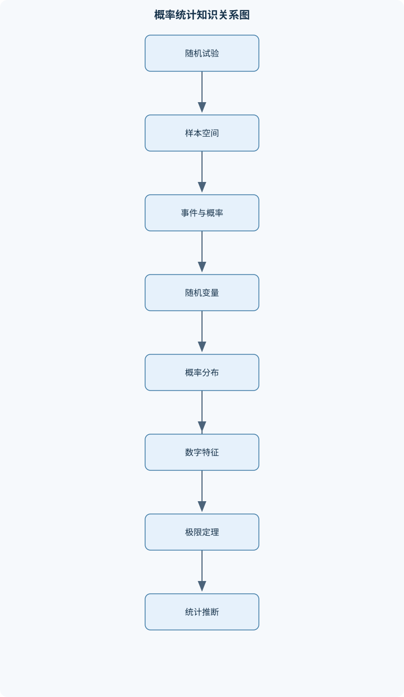
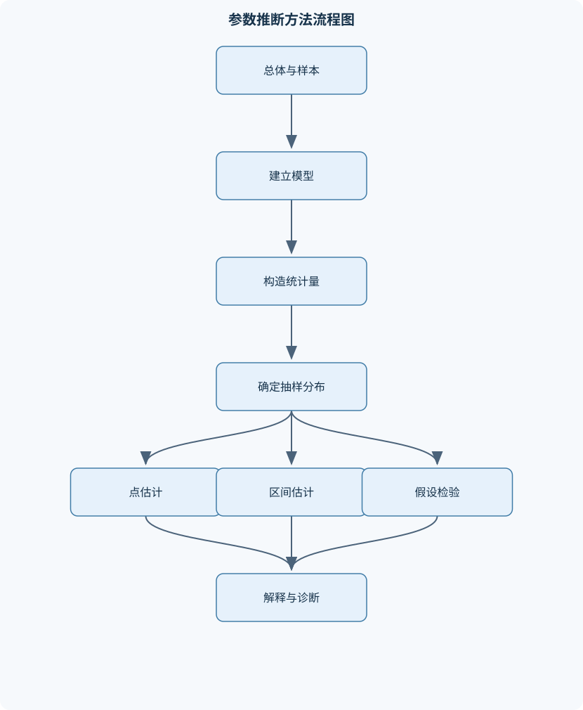

# 概率论与数理统计

## 一、课程整体知识框架

### 课程边界与先修知识

本课程研究随机现象的数学模型、随机变量及其分布、数字特征、极限定理、样本统计量的抽样分布，以及利用样本对总体参数进行估计和假设检验的基本方法。课程边界包括概率空间与事件运算、条件概率与独立性、离散型和连续型随机变量、多维随机变量、常用概率分布、随机变量函数的分布、期望与方差、协方差与相关系数、大数定律与中心极限定理、数理统计基础、参数估计、假设检验、方差分析与一元线性回归的基础内容。先修知识包括集合与映射、初等微积分、定积分、无穷级数、偏导数、矩阵与线性方程组；涉及正态总体抽样分布和回归时，还需要掌握基本的线性代数与微积分运算。课程不覆盖测度论概率、随机过程、时间序列、非参数统计的系统理论和高级多元统计推断。





### 1. 研究对象、数学语言与课程边界

概率论研究随机现象中不确定结果的数量规律。一次随机试验的结果不能在试验前确定，但试验条件相同时，重复试验的总体规律可以用概率描述。样本空间记为 $\Omega$，基本结果记为 $\omega$，事件是样本空间的子集，记为 $A、B、C$。事件发生意味着实际结果属于相应集合。例如，抛掷一枚骰子时，$\Omega=\{1,2,3,4,5,6\}$，“出现偶数点”是事件 $\{2,4,6\}$。

概率函数 $P$ 为事件赋予 $[0,1]$ 中的数值，满足：

$$
P(\Omega)=1,\qquad P(A)\ge 0,
$$

并且对于两两互不相容的事件列 $A_1,A_2,\ldots$，有可列可加性：

$$
P\left(\bigcup_{i=1}^{\infty}A_i\right)=\sum_{i=1}^{\infty}P(A_i).
$$

由概率公理可以推出补事件公式和有限可加公式。因为 $A$ 与 $A^c$ 互不相容且并集为 $\Omega$，所以：

$$
P(A^c)=1-P(A).
$$

又因为 $A\cup B$ 可以分解为互不相容的 $A$、$B\cap A^c$，或者利用交集重复计算关系，可得：

$$
P(A\cup B)=P(A)+P(B)-P(A\cap B).
$$

若 $A$ 与 $B$ 互不相容，则 $A\cap B=\varnothing$，公式简化为 $P(A\cup B)=P(A)+P(B)$；互不相容描述事件不能同时发生，而独立描述一个事件的发生不改变另一个事件的概率，二者不能混同。

课程以初等概率模型、随机变量和统计推断为核心，使用集合、微积分、无穷级数、偏导数、矩阵与线性方程组等先修知识。课程不展开测度论概率、随机过程、时间序列、系统非参数统计理论和高级多元统计推断。正态总体抽样分布、线性回归和方差分析还要求能够进行基本的线性代数运算，并理解平方和分解。

### 2. 从概率模型到统计推断的主线

课程知识可以沿着以下逻辑展开：

1. 用样本空间和事件表示随机现象；
2. 用概率刻画事件发生的可能性；
3. 用随机变量把结果映射为数值；
4. 用分布描述随机变量的整体规律；
5. 用期望、方差、协方差等数字特征概括分布；
6. 用多维分布研究多个变量的联合变化；
7. 用大数定律和中心极限定理解释大量重复试验的稳定性；
8. 用样本统计量建立总体参数的抽样分布；
9. 用点估计、区间估计和假设检验从样本推断总体；
10. 用方差分析、列联表和回归模型处理多组比较及变量关系。

概率论中的参数通常被视为已知，用于计算事件概率；数理统计中的总体参数通常未知，但被视为固定常数，样本是随机的，统计量是样本的函数。例如，若总体均值为 $\mu$，则 $\mu$ 是固定但未知的参数；样本均值

$$
\overline X=\frac{1}{n}\sum_{i=1}^{n}X_i
$$

是随机变量，在观察样本后得到具体数值 $\bar x$。不能把参数、统计量和统计量观测值混为一谈。

### 3. 概率空间与事件运算

事件运算包括并事件 $A\cup B$、交事件 $A\cap B$、补事件 $A^c$ 和差事件 $A\setminus B=A\cap B^c$。德摩根律为：

$$
(A\cup B)^c=A^c\cap B^c,\qquad
(A\cap B)^c=A^c\cup B^c.
$$

三个事件的容斥公式为：

$$
\begin{aligned}
P(A\cup B\cup C)
={}&P(A)+P(B)+P(C)\\
&-P(A\cap B)-P(A\cap C)-P(B\cap C)\\
&+P(A\cap B\cap C).
\end{aligned}
$$

交集项先被重复计算，故需要减去；三重交集在减法中又被多减一次，因此最后加回一次。若要求“至少一个发生”，应计算并事件；若要求“都不发生”，应计算补事件；若要求“恰有一个发生”，则应写成三个互不相容事件的并。

条件概率定义为：

$$
P(A\mid B)=\frac{P(A\cap B)}{P(B)},\qquad P(B)>0.
$$

它表示在已知 $B$ 发生的条件下，$A$ 发生的相对可能性。由定义立即得到乘法公式：

$$
P(A\cap B)=P(A\mid B)P(B)=P(B\mid A)P(A).
$$

若 $B_1,\ldots,B_k$ 构成样本空间的划分，即两两互不相容、并集为 $\Omega$，且 $P(B_i)>0$，则全概率公式为：

$$
P(A)=\sum_{i=1}^{k}P(A\mid B_i)P(B_i).
$$

贝叶斯公式为：

$$
P(B_j\mid A)=
\frac{P(A\mid B_j)P(B_j)}
{\sum_{i=1}^{k}P(A\mid B_i)P(B_i)}.
$$

分母必须包含导致观察结果 $A$ 的全部互斥来源，不能只取某一个条件概率。事件独立的定义是：

$$
P(A\cap B)=P(A)P(B).
$$

当 $P(B)>0$ 时，这等价于 $P(A\mid B)=P(A)$。若 $A$、$B$ 互不相容且均有正概率，则 $P(A\cap B)=0$，但 $P(A)P(B)>0$，所以它们不独立。

### 4. 随机变量及其分布

随机变量 $X$ 是从样本空间到实数的函数。其分布函数定义为：

$$
F_X(x)=P(X\le x),\qquad x\in\mathbb R.
$$

任何分布函数都满足单调不减、右连续、取值属于 $[0,1]$，并且：

$$
\lim_{x\to-\infty}F_X(x)=0,\qquad
\lim_{x\to+\infty}F_X(x)=1.
$$

离散型随机变量的概率质量函数为：

$$
p_X(x)=P(X=x),
$$

其所有可能取值的概率非负且总和为 $1$。分布函数可由累加得到：

$$
F_X(x)=\sum_{t\le x}p_X(t).
$$

连续型随机变量通常用概率密度 $f_X(x)$ 描述，要求：

$$
f_X(x)\ge 0,\qquad \int_{-\infty}^{+\infty}f_X(x)\,dx=1.
$$

其分布函数为：

$$
F_X(x)=\int_{-\infty}^{x}f_X(u)\,du.
$$

区间概率为：

$$
P(a<X\le b)=F_X(b)-F_X(a)
=\int_a^b f_X(x)\,dx.
$$

密度的单位是“概率除以随机变量单位”。若 $X$ 的单位为米，则 $f_X(x)$ 的单位为每米；密度值本身不是概率。连续型随机变量满足 $P(X=x)=0$，但这不表示变量不会落在某个区间内。分布函数可导只是在相应条件下给出密度；含有离散点质量的混合分布不能仅用普通密度表示。

常用连续分布包括均匀分布、指数分布和正态分布。若 $X\sim U(a,b)$，则：

$$
f_X(x)=
\begin{cases}
\dfrac1{b-a},&a<x<b,\\
0,&\text{其他}.
\end{cases}
$$

其中 $a<b$，密度单位为 $1/X$ 的单位。若 $X\sim\operatorname{Exp}(\lambda)$，$\lambda>0$，则：

$$
f_X(x)=\lambda e^{-\lambda x},\qquad x\ge0.
$$

参数 $\lambda$ 的单位是时间单位的倒数。指数分布具有无记忆性：

$$
P(X>s+t\mid X>s)=P(X>t).
$$

正态分布 $N(\mu,\sigma^2)$ 的密度为：

$$
f_X(x)=\frac1{\sqrt{2\pi}\sigma}
\exp\left[-\frac{(x-\mu)^2}{2\sigma^2}\right],
\qquad \sigma^2>0.
$$

其中 $\mu$ 与 $X$ 具有相同单位，$\sigma^2$ 的单位是 $X$ 单位的平方。标准化变换

$$
Z=\frac{X-\mu}{\sigma}
$$

使 $Z\sim N(0,1)$。

常用离散分布包括伯努利、二项、几何、超几何和泊松分布。若一次试验成功概率为 $p$，则伯努利变量 $X$ 取 $1$ 或 $0$。$n$ 次相互独立且成功概率相同的伯努利试验成功次数服从 $\operatorname{Bin}(n,p)$：

$$
P(X=k)=\binom nkp^k(1-p)^{n-k},\qquad k=0,\ldots,n.
$$

若试验不放回，抽取成功次数通常服从超几何分布，而不是二项分布，因为各次抽取不独立。泊松分布 $\operatorname{Pois}(\lambda)$ 的概率为：

$$
P(X=k)=e^{-\lambda}\frac{\lambda^k}{k!},\qquad k=0,1,\ldots.
$$

当 $n$ 较大、$p$ 较小且 $np$ 保持在适当范围时，$\operatorname{Bin}(n,p)$ 可用 $\operatorname{Pois}(np)$ 近似。几何分布描述首次成功所需的试验次数，具体取值从 $1$ 开始还是从 $0$ 开始必须事先说明。

### 5. 随机变量的数字特征

离散型随机变量的期望为：

$$
E(X)=\sum_x xp_X(x),
$$

连续型随机变量的期望为：

$$
E(X)=\int_{-\infty}^{+\infty}xf_X(x)\,dx,
$$

前提是相应级数或积分绝对收敛，或至少期望以明确方式存在。期望具有线性性质：

$$
E(aX+bY+c)=aE(X)+bE(Y)+c.
$$

方差定义为：

$$
\operatorname{Var}(X)=E[(X-E(X))^2],
$$

标准差为 $\sigma_X=\sqrt{\operatorname{Var}(X)}$。方差的单位是原变量单位的平方，标准差与原变量单位相同。利用恒等式可得：

$$
\operatorname{Var}(X)=E(X^2)-[E(X)]^2.
$$

若 $Y=aX+b$，则：

$$
E(Y)=aE(X)+b,\qquad
\operatorname{Var}(Y)=a^2\operatorname{Var}(X).
$$

原点矩为 $E(X^k)$，中心矩为 $E[(X-E(X))^k]$。协方差为：

$$
\operatorname{Cov}(X,Y)
=E[(X-E(X))(Y-E(Y))].
$$

展开可得：

$$
\operatorname{Cov}(X,Y)=E(XY)-E(X)E(Y).
$$

相关系数为：

$$
\rho_{XY}=
\frac{\operatorname{Cov}(X,Y)}{\sigma_X\sigma_Y},
$$

要求 $\sigma_X>0$ 且 $\sigma_Y>0$。其取值在 $[-1,1]$，只有在线性关系达到特定条件时才可能等于 $\pm1$。方差和的公式为：

$$
\operatorname{Var}(X+Y)
=\operatorname{Var}(X)+\operatorname{Var}(Y)
+2\operatorname{Cov}(X,Y).
$$

独立性可推出 $E(XY)=E(X)E(Y)$，从而协方差为零；反过来零协方差通常不能推出独立。一个典型反例是令 $X$ 在 $\{-1,0,1\}$ 上等概率取值，令 $Y=X^2$，则二者可能不相关，但 $Y$ 完全由 $X$ 决定，显然不独立。

条件期望 $E(X\mid Y)$ 是关于 $Y$ 的随机变量。全期望公式为：

$$
E(X)=E[E(X\mid Y)].
$$

条件方差公式为：

$$
\operatorname{Var}(X)
=E[\operatorname{Var}(X\mid Y)]
+\operatorname{Var}[E(X\mid Y)].
$$

前一项表示给定条件后的平均波动，后一项表示条件均值之间的波动。

### 6. 多维随机变量与函数分布

二维随机变量 $(X,Y)$ 的联合分布函数为：

$$
F_{X,Y}(x,y)=P(X\le x,Y\le y).
$$

离散型情形使用联合概率质量函数 $p_{X,Y}(x,y)$；连续型情形使用联合密度 $f_{X,Y}(x,y)$，必须满足非负性和全平面积分为 $1$。边缘密度由积分得到：

$$
f_X(x)=\int_{-\infty}^{+\infty}f_{X,Y}(x,y)\,dy,
\qquad
f_Y(y)=\int_{-\infty}^{+\infty}f_{X,Y}(x,y)\,dx.
$$

在 $f_Y(y)>0$ 时，条件密度为：

$$
f_{X\mid Y}(x\mid y)
=\frac{f_{X,Y}(x,y)}{f_Y(y)}.
$$

连续型变量独立的判定条件为：

$$
f_{X,Y}(x,y)=f_X(x)f_Y(y)
$$

在定义域上几乎处处成立。仅仅观察到两个边缘分布，不能判断独立性。

随机变量函数的分布需要先确定取值范围，再处理原像。若 $Y=g(X)$ 且 $g$ 单调可微，密度可通过反函数得到：

$$
f_Y(y)
=f_X(g^{-1}(y))
\left|\frac{d}{dy}g^{-1}(y)\right|.
$$

若变换非单调，必须把所有满足 $g(x)=y$ 的原像分支相加。对多维可逆变换 $(U,V)=g(X,Y)$，密度变换需要乘以雅可比行列式绝对值。卷积用于独立随机变量和的分布。例如连续独立变量 $X,Y$ 的和 $Z=X+Y$ 满足：

$$
f_Z(z)=\int_{-\infty}^{+\infty}f_X(x)f_Y(z-x)\,dx.
$$

最大值和最小值常使用分布函数直接计算。若 $X_1,\ldots,X_n$ 独立同分布，分布函数为 $F$，则：

$$
P(\max X_i\le x)=F(x)^n,
$$

$$
P(\min X_i>x)=[1-F(x)]^n.
$$

### 7. 极限定理与近似计算

若 $X_1,\ldots,X_n$ 独立同分布，且 $E(X_i)=\mu$、$\operatorname{Var}(X_i)=\sigma^2<\infty$，则大数定律说明：

$$
\overline X_n=\frac1n\sum_{i=1}^nX_i
$$

随着 $n$ 增大依概率趋于 $\mu$。中心极限定理说明：

$$
\frac{\sqrt n(\overline X_n-\mu)}{\sigma}
\xrightarrow{d}N(0,1).
$$

这表示标准化后的样本均值渐近服从标准正态分布，不表示有限样本一定正态。若总体本身正态，则样本均值对任意有限 $n$ 都正态；若总体偏态严重、样本量较小，正态近似可能不可靠。

对二项变量 $X\sim\operatorname{Bin}(n,p)$，当 $np$ 和 $n(1-p)$ 均不太小时，可用均值 $np$、方差 $np(1-p)$ 的正态分布近似。计算 $P(X\le k)$ 时，连续性校正通常使用：

$$
P(X\le k)\approx
P\left(Y\le k+\frac12\right),
$$

其中 $Y\sim N(np,np(1-p))$。泊松分布也可在参数较大时用 $N(\lambda,\lambda)$ 近似。近似前应检查独立性、方差有限性、样本量和尾部位置；近似结果还应检查是否落在 $[0,1]$。

### 8. 样本、抽样分布与正态模型

总体是研究对象的全体，样本是从总体中抽取的观测值。简单随机样本 $X_1,\ldots,X_n$ 通常假设相互独立且同分布，以保证每个观测具有相同总体来源和可计算的抽样分布。统计量是样本的函数，例如 $\overline X$、$S^2$ 和样本相关系数。统计量的概率分布称为抽样分布。

样本方差定义为：

$$
S^2=\frac1{n-1}\sum_{i=1}^{n}(X_i-\overline X)^2.
$$

分母为 $n-1$ 时，在独立同分布且总体方差有限的条件下，$S^2$ 是 $\sigma^2$ 的无偏估计；分母为 $n$ 的版本不是同一统计量，不能混用。

若总体为 $N(\mu,\sigma^2)$，则：

$$
\overline X\sim N\left(\mu,\frac{\sigma^2}{n}\right),
$$

$$
\frac{(n-1)S^2}{\sigma^2}\sim\chi^2_{n-1},
$$

并且 $\overline X$ 与 $S^2$ 相互独立。若 $\sigma$ 未知，则：

$$
T=\frac{\overline X-\mu}{S/\sqrt n}
\sim t_{n-1}.
$$

两个独立正态总体的方差比可构造 $F$ 分布；自由度必须根据分子、分母所使用的独立卡方变量确定，不能只写“服从 $F$ 分布”而省略自由度。顺序统计量是样本按大小排列后的统计量，可用于中位数、极值和分位数的分布研究。

### 9. 参数估计

点估计用一个数 $\hat\theta$ 估计未知参数 $\theta$。矩估计法以理论矩等于样本矩为基础。例如单参数模型满足理论一阶矩 $E_\theta(X)=m(\theta)$ 时，用样本均值替代理论矩：

$$
m(\hat\theta)=\overline X.
$$

方程可能没有解、多个解或解不属于参数空间，因此求解后必须检查合法性。

最大似然法把观测样本固定，把似然函数看作参数的函数：

$$
L(\theta)=\prod_{i=1}^{n}f(x_i;\theta)
$$

或在离散情形使用联合概率质量函数。通常最大化对数似然：

$$
\ell(\theta)=\log L(\theta).
$$

对数是单调函数，不改变最大化位置，但驻点还必须与边界点比较，以确认全局最大值。似然不是“参数为随机变量时的概率”。

估计量的偏差为：

$$
\operatorname{Bias}(\hat\theta)=E(\hat\theta)-\theta.
$$

均方误差分解为：

$$
\operatorname{MSE}(\hat\theta)
=E[(\hat\theta-\theta)^2]
=\operatorname{Var}(\hat\theta)
+\operatorname{Bias}(\hat\theta)^2.
$$

无偏性、方差小、均方误差小和相合性是不同准则。相合性要求样本量增大时估计量依概率趋于真实参数。无偏估计量不一定在有限样本下具有最小均方误差。

区间估计依赖枢轴量。例如 $\sigma$ 已知时：

$$
\frac{\overline X-\mu}{\sigma/\sqrt n}\sim N(0,1),
$$

因此置信水平为 $1-\alpha$ 的均值区间为：

$$
\overline X\pm z_{1-\alpha/2}\frac{\sigma}{\sqrt n}.
$$

$\sigma$ 未知且总体正态时使用 $t_{n-1}$ 分位点：

$$
\overline X\pm t_{1-\alpha/2,n-1}\frac{S}{\sqrt n}.
$$

方差区间来自卡方枢轴量：

$$
\frac{(n-1)S^2}{\chi^2_{1-\alpha/2,n-1}}
<\sigma^2<
\frac{(n-1)S^2}{\chi^2_{\alpha/2,n-1}}.
$$

置信水平是重复抽样中区间覆盖参数的长期比例，不是把参数视为随机量后说“当前区间含有参数的概率为 $1-\alpha$”。已知 $\sigma$ 且误差界为 $E$ 时，样本量需满足：

$$
n\ge \frac{z_{1-\alpha/2}^2\sigma^2}{E^2},
$$

计算后必须向上取整。

### 10. 假设检验、方差分析、列联表与回归

假设检验先提出原假设 $H_0$ 和备择假设 $H_1$，再构造在 $H_0$ 下分布已知的统计量。显著性水平 $\alpha$ 是 $H_0$ 成立时错误拒绝它的概率上限。双侧检验的拒绝域通常位于分布两端，单侧检验则位于一端。第一类错误是拒绝真实的 $H_0$，第二类错误是不拒绝错误的 $H_0$。p 值是 $H_0$ 成立时得到当前或更极端证据的概率，不是 $H_0$ 为真的概率。统计结论应写“不拒绝 $H_0$”，不能写“证明 $H_0$ 正确”。

单因素方差分析比较 $k$ 个总体均值。设第 $j$ 组有 $n_j$ 个观测，总样本量为 $N$，组均值为 $\bar x_j$，总均值为 $\bar x$，则：

$$
SST=\sum_{j=1}^{k}\sum_{i=1}^{n_j}(x_{ij}-\bar x)^2,
$$

$$
SSA=\sum_{j=1}^{k}n_j(\bar x_j-\bar x)^2,
$$

$$
SSE=\sum_{j=1}^{k}\sum_{i=1}^{n_j}(x_{ij}-\bar x_j)^2.
$$

平方和分解为：

$$
SST=SSA+SSE.
$$

在独立、正态、方差齐性条件下，构造：

$$
F=\frac{SSA/(k-1)}{SSE/(N-k)}.
$$

拒绝总体均值相等只能说明至少有一组均值不同，不能直接推出所有组两两不同；进一步比较需要考虑多重比较造成的整体错误率。

列联表独立性检验中，若观测频数为 $O_{ij}$，在独立假设下的期望频数为：

$$
E_{ij}=
\frac{(\text{第 }i\text{ 行合计})(\text{第 }j\text{ 列合计})}{\text{总计}}.
$$

卡方统计量为：

$$
\chi^2=\sum_{i,j}\frac{(O_{ij}-E_{ij})^2}{E_{ij}}.
$$

期望频数过小会使卡方近似不可靠，应合并类别或采用适合小样本的精确方法。拟合优度检验则比较观测频数与理论分布给出的期望频数。

一元线性回归模型为：

$$
Y=\beta_0+\beta_1x+\varepsilon,
$$

其中 $\beta_0$ 是截距，$\beta_1$ 是斜率，$\varepsilon$ 通常假设均值为 $0$、方差为 $\sigma^2$，并根据推断任务进一步要求独立性、正态性和方差齐性。最小二乘斜率估计为：

$$
\hat\beta_1=
\frac{\sum_{i=1}^{n}(x_i-\bar x)(y_i-\bar y)}
{\sum_{i=1}^{n}(x_i-\bar x)^2},
$$

截距估计为：

$$
\hat\beta_0=\bar y-\hat\beta_1\bar x.
$$

若所有 $x_i$ 相同，则分母为零，斜率无法估计。残差为 $e_i=y_i-\hat y_i$，样本内满足残差和为零，且残差与解释变量的离差乘积和为零。决定系数 $R^2$ 描述样本中响应变量变异被线性拟合解释的比例，但不等于因果强度。均值响应区间只反映给定 $x$ 时条件均值的不确定性；新个体预测区间还包含个体误差，因此通常更宽。相关性不能自动推出因果关系，异常值、混杂变量、非线性和异方差都可能改变解释。

## 二、章节和模块划分

### 核心知识覆盖清单

本清单用于检查正文是否覆盖本课程的主要知识模块：

- **概率空间与事件运算**：随机试验与样本空间、事件的集合表示、事件的并交补运算、概率公理与基本性质、加法公式与容斥公式、条件概率定义、乘法公式与全概率公式、贝叶斯公式、事件独立性。
- **随机变量及其分布**：随机变量与分布函数、离散型随机变量与概率质量函数、连续型随机变量与概率密度、分布函数与密度的关系、均匀分布与指数分布、正态分布及标准化、二项分布与泊松分布、几何分布与超几何分布、分布函数的分段计算。
- **随机变量的数字特征**：数学期望的定义、离散型与连续型期望计算、方差与标准差、原点矩与中心矩、协方差与相关系数、期望的线性性质、方差的运算性质、条件期望与全期望公式、条件方差公式。
- **多维随机变量**：联合分布函数、联合概率质量函数、联合概率密度、边缘分布、条件分布、随机变量独立性判定、二维函数的分布、卷积与和的分布、最大值与最小值分布。
- **常用分布及其关系**：伯努利分布与二项分布、几何分布的无记忆性、超几何分布与抽样不放回、泊松分布及稀有事件近似、均匀分布与指数分布、正态分布的线性变换、伽马分布与卡方分布、t分布与F分布、分布之间的构造关系。
- **随机变量函数与极限定理**：单调变换的分布求法、一般变换的雅可比方法、特征函数基本思想、大数定律、依概率收敛与依分布收敛、中心极限定理、二项分布的正态近似、泊松分布的正态近似、连续性校正。
- **样本与抽样分布**：总体与样本的概念、简单随机样本的代表性、简单随机样本的独立性、统计量与抽样分布、样本均值与样本方差、正态总体下的卡方分布、正态总体下的t分布、两个正态总体的F分布、顺序统计量基础。
- **参数估计**：点估计与区间估计、矩估计法、最大似然估计法、估计量的无偏性、估计量的有效性、均方误差准则、估计量的相合性、正态总体均值区间估计、正态总体方差区间估计、样本量与误差界。
- **假设检验**：原假设与备择假设、检验统计量与拒绝域、显著性水平、单侧检验与双侧检验、第一类错误与第二类错误、p值的定义与解释、单总体均值检验、单总体比例检验、两个总体均值检验、方差检验与F检验。
- **方差分析与列联表检验**：单因素方差分析模型、组间平方和与组内平方和、F统计量构造、方差分析表、总体均值相等的检验、多重比较的基本思想、列联表与独立性检验、拟合优度检验、卡方统计量的适用条件。
- **相关分析与一元线性回归**：相关关系与因果关系、样本相关系数、一元线性回归模型、最小二乘估计、回归系数的解释、残差与误差分解、决定系数、回归系数显著性检验、均值响应与个体预测区间。


### 1. 模块一至三：概率基础、随机变量与数字特征

#### 模块一：概率空间与事件运算

本模块从随机试验开始，依次建立样本空间、事件、概率、条件概率和独立性的概念。代表性分析流程是：先列出所有可能结果，再把文字条件翻译为集合，随后根据互斥、独立或划分关系选择公式，最后检查概率是否属于 $[0,1]$。例如从含 $8$ 个红球和 $2$ 个非红球的盒中抽取两次，放回抽取时“两次均为红球”的概率为：

$$
\frac8{10}\cdot\frac8{10}=0.64.
$$

不放回抽取时为：

$$
\frac8{10}\cdot\frac7{9}=\frac{28}{45}.
$$

第二次抽到红球的概率在不放回情形仍为 $8/10$，但条件概率会因第一次结果不同而改变，这说明边际概率相同不代表抽取独立。

#### 模块二：随机变量及其分布

本模块训练从分布函数、概率质量函数或密度出发计算区间概率。对于分段密度，先由非负性和总积分为 $1$ 求未知常数，再逐段积分构造 $F_X(x)$。例如若

$$
f(x)=ce^{-x},\quad x\ge0,
$$

则：

$$
1=\int_0^\infty ce^{-x}\,dx=c,
$$

所以 $c=1$，并且：

$$
P(1<X<3)=\int_1^3e^{-x}\,dx=e^{-1}-e^{-3}.
$$

这里 $f(1)$ 和 $f(3)$ 都不是区间概率，端点是否取等通常不影响连续型概率，但分段定义仍需完整。

#### 模块三：随机变量的数字特征

本模块从定义计算期望和方差，再使用线性性质、协方差公式和条件期望简化计算。对于离散变量，应逐项计算 $xp_X(x)$ 和 $x^2p_X(x)$；对于连续变量，应检查积分收敛。若 $Y=3X-2$，则：

$$
E(Y)=3E(X)-2,\qquad
\operatorname{Var}(Y)=9\operatorname{Var}(X).
$$

常数平移改变期望但不改变方差，尺度变换使方差乘以尺度平方。实际解释时必须注意单位：若 $X$ 的单位为千克，$\operatorname{Var}(X)$ 的单位为千克平方，不能把方差直接与千克数相比较。

### 2. 模块四至六：多维分布、常用分布与极限方法

#### 模块四：多维随机变量

重点是由联合分布求边缘分布、条件分布和函数分布。给定联合密度后，先确定支持区域，再检查归一化，最后沿另一变量积分。若支持区域不是矩形，积分上下限必须随变量变化。例如三角形区域上的密度不能直接把两个变量分别在相同区间积分，否则会把区域外的点错误计入。判断独立性时，应比较联合密度与边缘密度乘积，而不是只比较均值或相关系数。

#### 模块五：常用分布及其关系

伯努利分布是二项分布的基本单元；二项分布描述固定次数、独立、相同成功概率的成功次数；超几何分布描述有限总体不放回抽样；泊松分布适合稀有事件计数。指数分布与泊松过程中的等待时间具有联系，但本课程只使用其无记忆性和密度计算。伽马分布可表示多个独立指数等待时间之和，卡方分布是特定伽马分布，$t$ 分布可由标准正态变量除以独立卡方变量平方根构造，$F$ 分布是两个独立卡方变量按自由度标准化后的比值。这些构造关系是正态总体均值、方差及方差比推断的基础。

#### 模块六：随机变量函数与极限定理

一维变换先求值域，再根据单调性处理。若 $X\sim U(0,1)$，$Y=X^2$ 在 $0<y<1$ 上有：

$$
F_Y(y)=P(X^2\le y)=P(X\le\sqrt y)=\sqrt y,
$$

因此：

$$
f_Y(y)=\frac1{2\sqrt y},\qquad 0<y<1.
$$

若 $Y=\max(X,1-X)$，则同一个 $y$ 可能对应两个原像，不能只使用一个反函数分支。中心极限定理用于近似样本均值和计数概率，但必须核对独立性、方差有限性和样本规模。二项近似正态时，边界校正应将整数边界移动半个单位。

### 3. 模块七至九：抽样分布、参数估计与假设检验

#### 模块七：样本与抽样分布

本模块先区分总体、样本、参数和统计量，再研究 $\overline X$、$S^2$ 的分布。正态总体结果是后续推断的枢纽：

$$
\overline X\sim N\left(\mu,\frac{\sigma^2}{n}\right),\qquad
\frac{(n-1)S^2}{\sigma^2}\sim\chi^2_{n-1}.
$$

若总体不是正态，仅凭样本均值和样本方差不能直接套用上述有限样本结论；此时可能需要大样本近似或稳健方法。自由度反映独立信息数量，例如样本方差因使用样本均值而损失一个自由度。

#### 模块八：参数估计

矩估计适合理论矩容易表达的模型；最大似然估计适合能够写出联合似然的模型。以指数分布为例，若参数化为速率 $\lambda$，则样本均值的矩估计为：

$$
\hat\lambda_{\mathrm{MOM}}=\frac1{\overline X}.
$$

样本密度的似然为：

$$
L(\lambda)=\lambda^n\exp\left(-\lambda\sum_{i=1}^{n}x_i\right),
\qquad \lambda>0.
$$

对数似然求导：

$$
\ell'(\lambda)=\frac n\lambda-\sum_{i=1}^{n}x_i.
$$

令其为零得到：

$$
\hat\lambda_{\mathrm{MLE}}=\frac n{\sum x_i}=\frac1{\overline X}.
$$

还需检查二阶导数或边界，确认确为最大值。若对数似然未定义在参数边界外，不能忽略边界候选点。

#### 模块九：假设检验

单总体均值检验的步骤为：明确 $H_0$ 和 $H_1$，选择 $Z$ 或 $T$ 统计量，确定单侧或双侧拒绝域，计算统计量和 p 值，再结合实际单位解释。若总体正态、$\sigma$ 未知，则使用：

$$
T=\frac{\overline X-\mu_0}{S/\sqrt n},
\qquad T\sim t_{n-1}\quad(H_0\text{成立}).
$$

拒绝 $H_0$ 只能表示样本对原假设提供了足够强的反对证据；不拒绝 $H_0$ 不表示原假设已被证明。两个总体均值比较需检查独立性；方差相等时可用合并方差方法，方差不确定或不等时可使用不要求方差相等的 Welch 思路。比例检验和方差检验也必须确认正态或卡方近似条件。

### 4. 模块十至十一：方差分析、列联表与一元回归

#### 模块十：方差分析与列联表检验

单因素方差分析把总变异分成组间变异和组内变异。若组间差异相对于组内噪声足够大，$F$ 统计量会较大。ANOVA 表至少应包含变异来源、平方和、自由度、均方和 $F$ 值。列联表分析则先由边际频数计算期望频数，再比较观察频数与期望频数。期望频数过小、分类稀疏或观测不独立时，卡方近似可能失效。

#### 模块十一：相关分析与一元线性回归

分析前先画散点关系或检查数据结构，避免把非线性关系误判为线性关系。回归估计完成后应检查残差的均值、变异是否随拟合值改变、是否存在异常点和高杠杆点。斜率检验的原假设通常为 $H_0:\beta_1=0$，但统计显著不等于实际影响重要。预测时要区分条件均值和新个体：前者的不确定性来自均值估计，后者还包含新的随机误差。

### 5. 代表性算法与流程

#### 流程一：连续分布规范化与区间概率

**输入：** 分段函数、定义域、待求区间。  
**输出：** 规范化常数、分布函数和区间概率。

1. 检查每段函数是否非负；
2. 对全定义域积分并令结果等于 $1$，求未知常数；
3. 按定义域分段积分得到 $F_X(x)$；
4. 使用 $F_X(b)-F_X(a)$ 或直接积分求区间概率；
5. 检查 $F_X(x)$ 是否单调不减、边界极限是否为 $0$ 和 $1$。

该流程只适用于绝对连续分布；若存在点概率，必须额外加入离散质量。若有 $k$ 个分段，解析处理至少需要逐段检查，计算规模通常随 $k$ 增长。

#### 流程二：置信区间构造

**输入：** 样本、总体模型、参数、置信水平 $1-\alpha$。  
**输出：** 置信区间及适用条件。

1. 判断总体是否正态、方差是否已知、样本是否独立；
2. 选择枢轴量，例如 $Z$、$T$ 或 $\chi^2$；
3. 写出上下分位点不等式；
4. 对未知参数反解；
5. 代入样本统计量并标明单位；
6. 检查端点顺序和区间覆盖解释。

若估计均值且总体方差未知、小样本正态条件成立，应使用 $t$ 分布而非标准正态。若仅有大样本近似，应说明近似来源和可能限制。

#### 流程三：假设检验

**输入：** 样本、$H_0$、$H_1$、显著性水平 $\alpha$、模型假设。  
**输出：** 检验统计量、p 值和统计结论。

1. 明确参数和检验方向；
2. 构造在 $H_0$ 下分布已知的统计量；
3. 按单侧或双侧形式确定拒绝域；
4. 计算统计量和 p 值；
5. 比较 p 值与 $\alpha$；
6. 说明实际含义、错误风险和适用条件。

统计程序的结论不能超出模型支持范围。若数据存在明显异方差、强离群点或观测依赖，应在报告中说明其对检验有效性的影响。

#### 流程四：一元线性回归

**输入：** 成对观测 $(x_i,y_i)$、模型假设和显著性水平。  
**输出：** 回归方程、残差、$R^2$、斜率检验及区间预测。

1. 检查 $\sum_i(x_i-\bar x)^2>0$；
2. 计算 $\hat\beta_1$ 和 $\hat\beta_0$；
3. 得到拟合值和残差；
4. 计算残差平方和及误差方差估计；
5. 检验 $\beta_1$ 或构造预测区间；
6. 检查线性、独立性、方差齐性和异常值。

时间复杂度通常为 $O(n)$，其中 $n$ 是观测数；但复杂度不保证模型正确，模型诊断仍是必要步骤。

### 6. 可执行的计算示例

下面代码只进行本地数值计算，不读取文件、不联网，也不执行外部命令。它演示二项分布的精确概率和带连续性校正的正态近似。

```python
import math

def binomial_probability_at_least(n, p, k):
    """计算 P(X >= k)，其中 X ~ Bin(n, p)。"""
    if n < 0 or not 0 <= p <= 1 or not 0 <= k <= n:
        raise ValueError("参数必须满足 n>=0、0<=p<=1、0<=k<=n")
    return sum(
        math.comb(n, i) * (p ** i) * ((1 - p) ** (n - i))
        for i in range(k, n + 1)
    )

def standard_normal_cdf(z):
    """标准正态分布函数，使用误差函数计算。"""
    return 0.5 * (1.0 + math.erf(z / math.sqrt(2.0)))

def normal_approx_at_least(n, p, k):
    """连续性校正近似 P(X >= k)。"""
    mean = n * p
    variance = n * p * (1 - p)
    if variance <= 0:
        return 1.0 if mean >= k else 0.0
    # X >= k 对应连续变量 Y >= k - 0.5
    z = (k - 0.5 - mean) / math.sqrt(variance)
    return 1.0 - standard_normal_cdf(z)

n, p, k = 100, 0.4, 50
exact = binomial_probability_at_least(n, p, k)
approx = normal_approx_at_least(n, p, k)

print(f"精确二项概率: {exact:.6f}")
print(f"正态近似概率: {approx:.6f}")
```

输入为 $n=100$、$p=0.4$ 和阈值 $k=50$，输出分别是精确的 $P(X\ge50)$ 与正态近似值。验证时应检查两者均属于 $[0,1]$，并说明正态近似使用了均值 $np=40$、方差 $np(1-p)=24$ 和连续性校正 $49.5$。若误写为 $50.5$，实际计算的是接近 $P(X>50)$ 的边界，容易造成方向错误。

### 7. 例题一：事件运算与容斥公式

#### 题干

设 $P(A)=0.5$，$P(B)=0.6$，$P(A\cup B)=0.8$。求 $P(A\cap B)$、$P(A^c\cap B)$ 以及至少一个事件不发生的概率。

#### 分析

已知并集、两个边际概率，应使用二事件容斥公式。事件 $A^c\cap B$ 表示 $B$ 发生而 $A$ 不发生；“至少一个不发生”是 $(A\cap B)^c$。

#### 解答

由：

$$
P(A\cap B)=P(A)+P(B)-P(A\cup B)
$$

得：

$$
P(A\cap B)=0.5+0.6-0.8=0.3.
$$

因此：

$$
P(A^c\cap B)=P(B)-P(A\cap B)=0.6-0.3=0.3.
$$

至少一个不发生的概率为：

$$
P((A\cap B)^c)=1-P(A\cap B)=0.7.
$$

#### 结果验证与变式

$0.3$ 不超过 $P(A)$ 和 $P(B)$，且并集概率满足 $0.8=0.5+0.6-0.3$，结果一致。若题目改为 $A$、$B$ 互不相容，则交集概率为 $0$，并集概率应为 $1.1$，这违反概率上界，说明原条件不可能同时成立。

### 8. 例题二：贝叶斯公式

#### 题干

某产品来自甲、乙两条生产线的比例分别为 $0.6$ 和 $0.4$。甲线产品出现某缺陷的概率为 $0.02$，乙线为 $0.05$。随机抽取一件产品发现有缺陷，求其来自乙线的概率。

#### 分析

设 $D$ 为“有缺陷”，$B_1$、$B_2$ 分别为来自甲、乙线。所求为 $P(B_2\mid D)$。分母必须计算两条生产线产生缺陷的全概率。

#### 解答

先求：

$$
P(D)=P(D\mid B_1)P(B_1)+P(D\mid B_2)P(B_2)
$$

$$
=0.02\times0.6+0.05\times0.4=0.032.
$$

于是：

$$
P(B_2\mid D)
=\frac{0.05\times0.4}{0.032}
=0.625.
$$

#### 结果验证与变式

后验概率为 $0.625$，说明乙线虽然先验比例较低，但缺陷率较高，观察到缺陷后其来源概率上升。若把问题改为“来自甲线且无缺陷”，则应计算联合概率 $P(B_1\cap D^c)=0.6\times0.98$，不能直接套用当前后验结果。

### 9. 例题三：随机变量变换

#### 题干

设 $X\sim U(0,1)$，求 $Y=X^2$ 的分布函数和密度。

#### 分析

在 $0\le X\le1$ 上，函数 $x^2$ 单调递增。先确定 $Y$ 的取值范围为 $[0,1]$，再求事件 $\{Y\le y\}$。

#### 解答

当 $0<y<1$ 时：

$$
F_Y(y)=P(Y\le y)
=P(X^2\le y)
=P(X\le\sqrt y)
=\sqrt y.
$$

因此：

$$
F_Y(y)=
\begin{cases}
0,&y<0,\\
\sqrt y,&0\le y\le1,\\
1,&y>1.
\end{cases}
$$

在 $0<y<1$ 上求导：

$$
f_Y(y)=\frac1{2\sqrt y}.
$$

#### 结果验证与变式

密度非负，且：

$$
\int_0^1\frac1{2\sqrt y}\,dy=1.
$$

若改为 $Y=X(1-X)$，该函数先增后减，同一个 $y$ 通常有两个原像，必须分别求导并相加，不能照搬单调变换公式的单一分支。

### 10. 例题四：正态总体均值区间估计

#### 题干

总体服从正态分布，已知总体标准差 $\sigma=4$。抽取 $n=25$ 个样本，得到 $\bar x=52$。求总体均值 $\mu$ 的 $95\%$ 置信区间。

#### 分析

总体正态且 $\sigma$ 已知，使用标准正态分位点 $z_{0.975}=1.96$。标准误为 $\sigma/\sqrt n$。

#### 解答

标准误：

$$
\frac{\sigma}{\sqrt n}=\frac4{5}=0.8.
$$

误差界：

$$
1.96\times0.8=1.568.
$$

区间为：

$$
52\pm1.568=(50.432,\;53.568).
$$

#### 结果验证与变式

区间宽度为 $3.136$，单位与 $\mu$ 相同。若 $\sigma$ 未知且样本来自正态总体，应改用：

$$
\bar x\pm t_{0.975,24}\frac{s}{5}.
$$

若要求误差界减半，在其他条件不变时，样本量约需增加到原来的四倍，因为误差界与 $1/\sqrt n$ 成反比。

### 11. 例题五：单因素方差分析的平方和

#### 题干

三组观测分别为：甲组 $(4,5,6)$，乙组 $(7,8,9)$，丙组 $(5,6,7)$。求各组均值、总均值、组间平方和和组内平方和，并说明总体均值相等检验的构造思路。

#### 分析

每组样本量均为 $3$，总样本量 $N=9$。先计算各组均值和总均值，再分别计算组间、组内偏差平方。

#### 解答

三组均值为：

$$
\bar x_1=5,\qquad \bar x_2=8,\qquad \bar x_3=6.
$$

总均值：

$$
\bar x=\frac{4+5+6+7+8+9+5+6+7}{9}
=\frac{57}{9}=\frac{19}{3}.
$$

组间平方和：

$$
SSA=3\left(5-\frac{19}{3}\right)^2
+3\left(8-\frac{19}{3}\right)^2
+3\left(6-\frac{19}{3}\right)^2
=\frac{14}{3}.
$$

组内平方和为：

$$
SSE=(1^2+0^2+1^2)+(1^2+0^2+1^2)+(1^2+0^2+1^2)=6.
$$

自由度分别为 $k-1=2$ 和 $N-k=6$，所以：

$$
MSA=\frac{14/3}{2}=\frac73,\qquad
MSE=\frac66=1.
$$

因此：

$$
F=\frac{MSA}{MSE}=\frac73.
$$

#### 结果验证与变式

总平方和应满足 $SST=SSA+SSE$。直接计算每个观测对总均值的偏差平方可得 $SST=32/3$，而 $14/3+6=32/3$，分解正确。若方差分析拒绝总体均值相等，只能说明至少一组均值不同；不能据此断言三组两两均不同。

### 12. 实验与项目一：二项分布正态近似的误差评估

#### 输入数据与步骤

设置多组参数，例如 $(n,p)=(20,0.5)$、$(100,0.4)$、$(200,0.1)$。对每组参数：

1. 用二项分布求若干阈值事件的精确概率；
2. 用均值 $np$、方差 $np(1-p)$ 构造正态近似；
3. 对整数边界进行连续性校正；
4. 记录精确值、近似值和绝对误差；
5. 比较 $np$ 与 $n(1-p)$ 较小时误差是否增大。

#### 评价标准

结果必须满足概率在 $[0,1]$；连续性校正方向正确；报告应明确近似条件。可用绝对误差

$$
|\hat P_{\mathrm{normal}}-\hat P_{\mathrm{exact}}|
$$

和相对误差作为评价指标。不能仅因近似值接近就断言方法普遍有效。

#### 排错方法

若近似概率明显超过 $1$ 或小于 $0$，检查标准差是否误写为 $np(1-p)$ 而未开平方。若左右尾结果异常，检查是否把 $P(X\ge k)$ 错写为连续变量大于 $k+0.5$，以及是否遗漏连续性校正。若精确概率总和不为 $1$，检查组合数范围是否从 $0$ 到 $n$。

### 13. 实验与项目二：一元线性回归模拟与诊断

#### 输入数据与步骤

构造或给定成对数据 $(x_i,y_i)$，其中 $x_i$ 表示解释变量，$y_i$ 表示响应变量。完成以下步骤：

1. 检查 $x_i$ 是否至少有两个不同取值；
2. 计算 $\bar x$、$\bar y$、$\hat\beta_1$ 和 $\hat\beta_0$；
3. 计算拟合值、残差、残差平方和和 $R^2$；
4. 检查残差是否存在趋势、漏斗形扩散或极端点；
5. 检验斜率是否为零；
6. 分别构造给定 $x_0$ 下均值响应区间和新个体预测区间；
7. 比较加入异常值前后的斜率和 $R^2$。

#### 评价标准

模型报告必须给出回归方程和变量单位，明确斜率的实际含义；残差诊断不能只报告 $R^2$；预测时必须区分均值响应和个体预测。若数据存在明显非线性或异方差，应说明简单线性模型不适合作为最终解释模型。

#### 排错方法

若斜率分母为零，说明所有 $x_i$ 相同，无法估计斜率。若残差和不接近零，检查截距是否使用 $\bar y-\hat\beta_1\bar x$。若预测区间比均值响应区间窄，通常是遗漏了个体误差项。若相关系数很大但散点呈曲线，应检查线性假设，而不能直接把相关性解释为因果关系。

## 三、核心概念的详细解释

### 1. 概率空间、事件与概率运算

随机试验是在相同条件下可以重复进行、结果具有不确定性的试验。所有可能结果组成样本空间 $\Omega$，单个结果记为 $\omega$。事件是 $\Omega$ 的子集，事件发生等价于实际结果属于该子集。若一次试验同时记录吸烟程度 $0,1,2$ 与健康状态 $a,b,c$，则样本点可写为 $(i,j)$，样本空间包含 $3\times3=9$ 个结果。“健康状态为 $a$”表示为
$$
A=\{(0,a),(1,a),(2,a)\},
$$
“不吸烟”表示为
$$
B=\{(0,a),(0,b),(0,c)\}.
$$

事件的并、交、补分别表示“至少一个发生”“同时发生”和“事件不发生”：
$$
A\cup B,\qquad A\cap B,\qquad A^c.
$$
德摩根律为
$$
(A\cup B)^c=A^c\cap B^c,\qquad
(A\cap B)^c=A^c\cup B^c.
$$
事件 $A$ 与 $B$ 互不相容，是指 $A\cap B=\varnothing$；事件独立，是指一个事件发生与否不改变另一个事件的概率。若 $P(A)>0$ 且 $P(B)>0$，互不相容事件不可能独立，因为互不相容给出 $P(A\cap B)=0$，而独立要求 $P(A\cap B)=P(A)P(B)>0$。

概率满足非负性、规范性和可列可加性。由 $A$ 与 $A^c$ 互不相容且并集为 $\Omega$，得到
$$
P(A^c)=1-P(A).
$$
由集合分解
$$
A\cup B=A\cup(B\cap A^c),
$$
且右侧两个事件互不相容，可得加法公式
$$
P(A\cup B)=P(A)+P(B)-P(A\cap B).
$$
三个事件的容斥公式为
$$
\begin{aligned}
P(A\cup B\cup C)
={}&P(A)+P(B)+P(C)\\
&-P(A\cap B)-P(A\cap C)-P(B\cap C)\\
&+P(A\cap B\cap C).
\end{aligned}
$$
减去并集公式可以得到“至少一个不发生”“恰有一个发生”等事件的概率。使用容斥公式时，交集项必须与事件文字描述逐项对应，不能把“至少两个发生”误写成 $A\cap B\cap C$。

### 2. 条件概率、全概率与贝叶斯思想

当 $P(B)>0$ 时，给定 $B$ 已经发生，$A$ 发生的条件概率定义为
$$
P(A\mid B)=\frac{P(A\cap B)}{P(B)}.
$$
因此
$$
P(A\cap B)=P(B)P(A\mid B)=P(A)P(B\mid A),
$$
这就是乘法公式。条件概率的顺序不能混淆：$P(A\mid B)$ 表示“在 $B$ 已发生的条件下观察 $A$”，一般不等于 $P(B\mid A)$。

若 $B_1,\ldots,B_n$ 两两互不相容，且
$$
\bigcup_{i=1}^{n}B_i=\Omega,\qquad P(B_i)>0,
$$
则称它们构成样本空间的一个划分。对任意事件 $A$，
$$
P(A)=\sum_{i=1}^{n}P(B_i)P(A\mid B_i).
$$
这是全概率公式。它把事件 $A$ 按不同原因或来源分解，前提是各 $B_i$ 覆盖全部可能性且不重复。

贝叶斯公式由乘法公式和全概率公式得到：
$$
P(B_j\mid A)
=
\frac{P(B_j)P(A\mid B_j)}
{\sum_{i=1}^{n}P(B_i)P(A\mid B_i)}.
$$
分子是“来源 $B_j$ 与观察结果 $A$ 同时发生的概率”，分母是观察到 $A$ 的总概率。贝叶斯公式常用于根据结果反推原因，但后验概率不仅由条件概率决定，还取决于先验概率 $P(B_j)$。

事件相互独立的定义是
$$
P(A\cap B)=P(A)P(B).
$$
若多个事件相互独立，则任意有限个事件的交概率等于各自概率之积。独立性比“两两独立”更强：三个事件两两独立，不一定相互独立。若 $A$ 与 $B$ 独立且条件概率有定义，则
$$
P(A\mid B)=P(A),
$$
但 $P(A\mid B)$ 有意义必须满足 $P(B)>0$。

### 3. 随机变量、分布函数与常用分布

随机变量是从样本空间到实数的映射，记为 $X$。随机变量的分布由分布函数
$$
F_X(x)=P(X\le x),\qquad x\in\mathbb R
$$
确定。分布函数具有单调不减、右连续、取值在 $[0,1]$ 内，并满足
$$
\lim_{x\to-\infty}F_X(x)=0,\qquad
\lim_{x\to+\infty}F_X(x)=1.
$$
任意区间概率都可以由分布函数计算，例如
$$
P(a<X\le b)=F_X(b)-F_X(a).
$$
若在某点存在跳跃，则
$$
P(X=x)=F_X(x)-F_X(x^-).
$$

离散型随机变量的概率质量函数为
$$
p_X(x)=P(X=x),
$$
必须满足 $p_X(x)\ge0$ 且
$$
\sum_xp_X(x)=1.
$$
连续型随机变量用密度 $f_X(x)$ 描述，满足
$$
f_X(x)\ge0,\qquad \int_{-\infty}^{+\infty}f_X(x)\,dx=1,
$$
并且
$$
F_X(x)=\int_{-\infty}^{x}f_X(u)\,du.
$$
连续型变量的单点概率为
$$
P(X=x)=0,
$$
但这并不意味着密度 $f_X(x)$ 为零。密度的量纲是“概率除以 $X$ 的单位”，只有积分才是无量纲的概率。若 $X$ 的单位为米，则 $f_X(x)$ 的单位为每米。

均匀分布 $U(a,b)$ 的密度为
$$
f_X(x)=
\begin{cases}
\dfrac1{b-a},&a<x<b,\\
0,&\text{其他}.
\end{cases}
$$
它要求 $a<b$，区间概率与区间长度成正比。指数分布常写为
$$
f_X(x)=\lambda e^{-\lambda x},\qquad x\ge0,\quad \lambda>0.
$$
其分布函数为
$$
F_X(x)=
\begin{cases}
0,&x<0,\\
1-e^{-\lambda x},&x\ge0.
\end{cases}
$$
指数分布具有无记忆性：
$$
P(X>s+t\mid X>s)=P(X>t).
$$

伯努利分布只取 $0,1$ 两个值，成功概率为 $p$。若 $n$ 次试验相互独立且成功概率相同，则成功次数服从二项分布
$$
X\sim\operatorname{Bin}(n,p),
$$
其概率质量函数为
$$
P(X=k)=\binom nkp^k(1-p)^{n-k},\qquad k=0,1,\ldots,n.
$$
若从有限总体中不放回抽样，抽到的结果通常不独立，成功次数应考虑超几何分布，而不能直接套用二项分布。几何分布描述首次成功所需的试验次数，泊松分布 $\operatorname{Pois}(\lambda)$ 描述单位区间内稀有事件次数。当 $n$ 较大、$p$ 较小且 $np\to\lambda$ 时，
$$
\operatorname{Bin}(n,p)\approx\operatorname{Pois}(\lambda).
$$

正态分布 $N(\mu,\sigma^2)$ 的密度为
$$
f_X(x)=\frac1{\sqrt{2\pi}\sigma}
\exp\left[-\frac{(x-\mu)^2}{2\sigma^2}\right],
\qquad \sigma>0.
$$
其中 $\mu$ 与 $X$ 具有相同单位，$\sigma$ 也具有 $X$ 的单位，$\sigma^2$ 的单位是 $X$ 单位的平方。标准化变量
$$
Z=\frac{X-\mu}{\sigma}
$$
服从标准正态分布 $N(0,1)$。正态分布在线性变换下仍为正态分布，但一般分布并不具有这一性质。

伽马分布、卡方分布、$t$ 分布和 $F$ 分布主要用于抽样分布。若 $Z_1,\ldots,Z_\nu$ 相互独立且均服从标准正态分布，则
$$
\sum_{i=1}^{\nu}Z_i^2\sim\chi^2(\nu).
$$
若 $Z\sim N(0,1)$、$U\sim\chi^2(\nu)$ 且相互独立，则
$$
T=\frac{Z}{\sqrt{U/\nu}}\sim t(\nu).
$$
若 $U_1\sim\chi^2(\nu_1)$、$U_2\sim\chi^2(\nu_2)$ 且相互独立，则
$$
F=\frac{U_1/\nu_1}{U_2/\nu_2}\sim F(\nu_1,\nu_2).
$$
自由度必须根据具体模型确定，不能只记分布名称而忽略参数。

### 4. 多维随机变量与随机变量函数

二维随机变量 $(X,Y)$ 的联合分布函数为
$$
F_{X,Y}(x,y)=P(X\le x,Y\le y).
$$
离散情形使用联合概率质量函数 $p_{X,Y}(x,y)$；连续情形使用联合密度 $f_{X,Y}(x,y)$，要求
$$
f_{X,Y}(x,y)\ge0,\qquad
\iint_{\mathbb R^2}f_{X,Y}(x,y)\,dx\,dy=1.
$$
边缘密度通过积分得到：
$$
f_X(x)=\int_{-\infty}^{+\infty}f_{X,Y}(x,y)\,dy,\qquad
f_Y(y)=\int_{-\infty}^{+\infty}f_{X,Y}(x,y)\,dx.
$$
在 $f_Y(y)>0$ 的条件下，条件密度为
$$
f_{X\mid Y}(x\mid y)
=\frac{f_{X,Y}(x,y)}{f_Y(y)}.
$$
若联合密度可分解为
$$
f_{X,Y}(x,y)=f_X(x)f_Y(y)
$$
且定义域是边缘定义域的笛卡尔积，则 $X,Y$ 独立。定义域不能忽略；即使表达式可以分解，三角形等非矩形支持区域也通常意味着不独立。

若 $Y=g(X)$，离散情形应把所有导致 $g(X)=y$ 的原像概率相加：
$$
P(Y=y)=\sum_{x:g(x)=y}P(X=x).
$$
连续情形若 $g$ 在某一区间严格单调且可逆，则
$$
f_Y(y)=f_X(g^{-1}(y))
\left|\frac{d}{dy}g^{-1}(y)\right|.
$$
若 $g$ 非单调，必须对所有原像分支求和：
$$
f_Y(y)=\sum_i f_X(x_i(y))
\left|\frac{dx_i}{dy}\right|.
$$
遗漏一个分支会导致密度积分小于 $1$。

若 $X,Y$ 独立，则和的分布可以通过卷积计算。连续情形为
$$
f_{X+Y}(z)=\int_{-\infty}^{+\infty}f_X(x)f_Y(z-x)\,dx.
$$
最大值 $M=\max(X_1,\ldots,X_n)$ 的分布函数在独立同分布条件下为
$$
F_M(x)=\left[F_X(x)\right]^n,
$$
最小值 $L=\min(X_1,\ldots,X_n)$ 的分布函数为
$$
F_L(x)=1-\left[1-F_X(x)\right]^n.
$$

### 5. 数学期望、方差与相关性

离散型随机变量的数学期望为
$$
E(X)=\sum_x xp_X(x),
$$
连续型随机变量的数学期望为
$$
E(X)=\int_{-\infty}^{+\infty}xf_X(x)\,dx,
$$
前提是相应级数或积分绝对收敛，或至少正负部分不会同时发散。期望是概率加权平均，单位与 $X$ 相同。原点矩为 $E(X^k)$，中心矩为
$$
E[(X-E(X))^k].
$$
方差定义为
$$
\operatorname{Var}(X)=E[(X-E(X))^2]
=E(X^2)-[E(X)]^2.
$$
方差单位是原变量单位的平方，标准差
$$
\sigma_X=\sqrt{\operatorname{Var}(X)}
$$
恢复为原变量单位。

由期望的线性性质，
$$
E(aX+bY+c)=aE(X)+bE(Y)+c,
$$
不要求 $X,Y$ 独立。由定义可得
$$
\operatorname{Var}(aX+b)=a^2\operatorname{Var}(X),
$$
以及
$$
\operatorname{Var}(X+Y)
=\operatorname{Var}(X)+\operatorname{Var}(Y)
+2\operatorname{Cov}(X,Y).
$$
协方差为
$$
\operatorname{Cov}(X,Y)
=E[(X-E(X))(Y-E(Y))]
=E(XY)-E(X)E(Y).
$$
相关系数为
$$
\rho_{XY}
=\frac{\operatorname{Cov}(X,Y)}{\sigma_X\sigma_Y},
$$
要求 $\sigma_X,\sigma_Y>0$，且必有 $-1\le\rho_{XY}\le1$。$\rho_{XY}=0$ 表示不存在线性相关，不等于独立。独立且方差存在时一定有
$$
E(XY)=E(X)E(Y),\qquad \operatorname{Cov}(X,Y)=0,
$$
但零协方差一般不能推出独立。正态联合分布是重要的特殊情形：在联合正态条件下，零协方差可以推出独立。

条件期望是给定信息后的平均值。全期望公式为
$$
E(X)=E[E(X\mid Y)].
$$
条件方差公式为
$$
\operatorname{Var}(X)
=E[\operatorname{Var}(X\mid Y)]
+\operatorname{Var}[E(X\mid Y)].
$$
前一项表示条件内部的平均波动，后一项表示不同条件均值之间的波动。

### 6. 极限定理与收敛概念

若 $X_1,\ldots,X_n$ 独立同分布，且 $E(X_i)=\mu$、$\operatorname{Var}(X_i)=\sigma^2<\infty$，则样本均值
$$
\overline X=\frac1n\sum_{i=1}^nX_i
$$
满足大数定律：
$$
\overline X\xrightarrow{P}\mu.
$$
这表示对任意 $\varepsilon>0$，
$$
P(|\overline X-\mu|>\varepsilon)\to0.
$$
大数定律说明大量观测的平均值趋于总体均值，但不表示每个观测值都趋于 $\mu$，也不保证有限样本中误差恰好为零。

中心极限定理给出标准化形式：
$$
\frac{\sqrt n(\overline X-\mu)}{\sigma}
\xrightarrow{d}N(0,1).
$$
它说明样本均值在适当标准化后渐近服从正态分布，而不是说有限样本下 $\overline X$ 必然正态。若原总体本身正态，则任意正整数 $n$ 下 $\overline X$ 都正态；若总体明显偏斜或重尾，则需要更大的样本量，且独立性和有限方差条件不能被忽略。

二项变量 $X\sim\operatorname{Bin}(n,p)$ 可用正态变量近似，通常要求 $np$ 与 $n(1-p)$ 均不太小。近似 $Y\sim N(np,np(1-p))$ 时，整数事件必须进行连续性校正，例如
$$
P(X\le k)\approx P(Y\le k+0.5),
$$
$$
P(X\ge k)\approx P(Y\ge k-0.5).
$$
不进行校正时，离散概率质量与连续区间边界未正确对应。

## 四、重要定义、公式、定理和推导

### 专业审校补充：关键定义与适用边界

枢轴量是参数推断中分布不含未知参数的统计量或统计量函数。若样本来自正态总体 N(μ,σ²)，则 Q=(n−1)S²/σ² 服从自由度为 n−1 的 χ² 分布，因此可由 χ² 分位点构造 σ² 的精确置信区间。设 χ²_{α/2,n−1} 和 χ²_{1−α/2,n−1} 分别表示左尾概率为 α/2 和 1−α/2 的分位点，则 P(χ²_{α/2,n−1}≤(n−1)S²/σ²≤χ²_{1−α/2,n−1})=1−α。反解时不等号方向必须因除以正数并取倒数而改变，得到 σ²∈[(n−1)S²/χ²_{1−α/2,n−1},(n−1)S²/χ²_{α/2,n−1}]。该结论依赖总体正态性；一般总体下样本方差不再严格服从上述卡方分布，只能在附加条件下作近似。置信水平描述重复抽样区间的覆盖概率，不表示本次已算出的固定区间含有参数的概率。


### 1. 样本、统计量与抽样分布

总体是研究对象的全部个体或全部观测值，样本是从总体中抽取的观测。简单随机样本 $X_1,\ldots,X_n$ 通常假设相互独立且同分布。总体参数如 $\mu,\sigma^2,p$ 是固定但未知的常数；统计量是样本的函数，例如
$$
\overline X=\frac1n\sum_{i=1}^nX_i,\qquad
S^2=\frac1{n-1}\sum_{i=1}^n(X_i-\overline X)^2.
$$
统计量在抽样前是随机变量，观察样本后得到具体数值。统计量的概率分布称为抽样分布，它是参数估计和假设检验的理论基础。

由独立性和方差运算，
$$
E(\overline X)=\mu,
\qquad
\operatorname{Var}(\overline X)=\frac{\sigma^2}{n}.
$$
因此
$$
\operatorname{SE}(\overline X)=\frac{\sigma}{\sqrt n}.
$$
样本量增加时，均值估计的随机波动按 $1/\sqrt n$ 的速度下降，而不是按 $1/n$ 下降。

若总体为 $N(\mu,\sigma^2)$，则
$$
\overline X\sim N\left(\mu,\frac{\sigma^2}{n}\right),
$$
并且
$$
\frac{(n-1)S^2}{\sigma^2}\sim\chi^2(n-1),
\qquad
\overline X\ \text{与}\ S^2\ \text{相互独立}.
$$
当 $\sigma$ 未知时，
$$
T=\frac{\overline X-\mu}{S/\sqrt n}\sim t(n-1).
$$
这些结论依赖总体正态性；一般总体下只能在大样本条件下使用近似理论。

### 2. 点估计的性质与估计方法

设 $\widehat\theta$ 是参数 $\theta$ 的估计量。偏差定义为
$$
\operatorname{Bias}(\widehat\theta)
=E(\widehat\theta)-\theta.
$$
若偏差为零，则称估计量无偏。无偏并不等于每次估计都等于参数，也不等于估计误差最小。

均方误差为
$$
\operatorname{MSE}(\widehat\theta)
=E[(\widehat\theta-\theta)^2].
$$
将
$$
\widehat\theta-\theta
=
\bigl(\widehat\theta-E(\widehat\theta)\bigr)
+\bigl(E(\widehat\theta)-\theta\bigr)
$$
平方并取期望，交叉项为零，得到
$$
\operatorname{MSE}(\widehat\theta)
=
\operatorname{Var}(\widehat\theta)
+\left[\operatorname{Bias}(\widehat\theta)\right]^2.
$$
因此，一个有轻微偏差但方差很小的估计量，可能比无偏但方差很大的估计量具有更小的均方误差。

矩估计法用样本矩替代理论矩。若模型含一个参数 $\theta$，且理论一阶矩为
$$
E_\theta(X)=m(\theta),
$$
则用样本一阶矩 $\overline X$ 建立方程
$$
m(\widehat\theta)=\overline X
$$
并求解 $\widehat\theta$。多参数模型需要使用相同数量的矩方程。若方程无解、存在多个解或解不在参数空间内，矩估计不能简单地视为有效结果。

最大似然法把观测数据视为固定，把参数作为待优化变量。离散模型中
$$
L(\theta)=\prod_{i=1}^{n}p_\theta(x_i),
$$
连续模型中
$$
L(\theta)=\prod_{i=1}^{n}f_\theta(x_i).
$$
通常取对数：
$$
\ell(\theta)=\log L(\theta)
=\sum_{i=1}^{n}\log f_\theta(x_i).
$$
由于对数函数严格递增，最大化 $\ell(\theta)$ 与最大化 $L(\theta)$ 等价。求导得到驻点后，还必须检查参数边界和驻点是否为全局最大值。似然函数不是参数的概率分布，不能把 $L(\theta)$ 直接解释为“参数取值的概率”。

### 3. 区间估计与样本量

置信区间通常由枢轴量构造。若总体方差 $\sigma^2$ 已知，则
$$
Z=\frac{\overline X-\mu}{\sigma/\sqrt n}\sim N(0,1).
$$
取标准正态分位点 $z_{\alpha/2}$，有
$$
P\left(
-z_{\alpha/2}
\le
\frac{\overline X-\mu}{\sigma/\sqrt n}
\le
z_{\alpha/2}
\right)=1-\alpha.
$$
整理不等式得到
$$
\mu\in
\left[
\overline X-z_{\alpha/2}\frac{\sigma}{\sqrt n},
\overline X+z_{\alpha/2}\frac{\sigma}{\sqrt n}
\right].
$$
该区间的端点与样本均值、标准误和分位点有关，区间长度具有与 $X$ 相同的单位。

若总体正态但 $\sigma$ 未知，则使用
$$
T=\frac{\overline X-\mu}{S/\sqrt n}\sim t(n-1),
$$
从而
$$
\mu\in
\left[
\overline X-t_{\alpha/2,n-1}\frac{S}{\sqrt n},
\overline X+t_{\alpha/2,n-1}\frac{S}{\sqrt n}
\right].
$$
总体方差的区间由卡方分布枢轴量得到：
$$
\frac{(n-1)S^2}{\chi^2_{1-\alpha/2,n-1}}
\le \sigma^2\le
\frac{(n-1)S^2}{\chi^2_{\alpha/2,n-1}}.
$$
卡方分位点左右不对称，因此方差区间通常不以 $S^2$ 为中心。

已知总体标准差且希望均值估计的误差界不超过 $E$ 时，
$$
z_{\alpha/2}\frac{\sigma}{\sqrt n}\le E.
$$
解得
$$
n\ge\frac{z_{\alpha/2}^2\sigma^2}{E^2}.
$$
计算结果必须向上取整，因为向下取整会使实际误差界超过要求。若 $\sigma$ 未知，常用先导样本标准差或保守上界替代，但必须说明由此引入的近似性。

### 4. 假设检验、错误与 $p$ 值

假设检验先提出原假设 $H_0$ 与备择假设 $H_1$。原假设通常包含等号，例如
$$
H_0:\mu=\mu_0.
$$
双侧备择为
$$
H_1:\mu\ne\mu_0,
$$
右侧单侧备择为
$$
H_1:\mu>\mu_0.
$$
检验统计量必须在 $H_0$ 成立时具有已知或近似已知的分布。显著性水平 $\alpha$ 是在 $H_0$ 为真时错误拒绝 $H_0$ 的概率上限，称为第一类错误概率。第二类错误是 $H_1$ 为真时未拒绝 $H_0$，其概率通常记为 $\beta$，检验功效为 $1-\beta$。

例如，正态总体均值检验中，若 $\sigma$ 未知且总体正态，使用
$$
T=\frac{\overline X-\mu_0}{S/\sqrt n}\sim t(n-1)
\quad(H_0\text{成立}).
$$
双侧检验在
$$
|T|\ge t_{\alpha/2,n-1}
$$
时拒绝 $H_0$。单侧检验的拒绝域位于一个尾部。$p$ 值是以观测统计量为界，在 $H_0$ 成立时得到当前或更极端证据的概率。双侧检验的 $p$ 值不能机械地把单侧概率乘二而不考虑分布对称性和检验方向。

当 $p\le\alpha$ 时拒绝 $H_0$；当 $p>\alpha$ 时不拒绝 $H_0$。不拒绝不等于证明 $H_0$ 正确，也不等于接受其为真。统计显著性还应结合效应大小、置信区间、样本量和实际成本解释。

### 5. 方差分析、列联表与拟合优度

单因素方差分析把观测分为 $k$ 组，模型可写为
$$
Y_{ij}=\mu_i+\varepsilon_{ij},
$$
其中 $\mu_i$ 是第 $i$ 组总体均值。检验目标为
$$
H_0:\mu_1=\mu_2=\cdots=\mu_k.
$$
设第 $i$ 组样本量为 $n_i$，组均值为 $\overline Y_i$，总样本量为 $N=\sum_i n_i$，总均值为 $\overline Y$。总平方和为
$$
SST=\sum_{i=1}^{k}\sum_{j=1}^{n_i}(Y_{ij}-\overline Y)^2.
$$
将
$$
Y_{ij}-\overline Y
=(Y_{ij}-\overline Y_i)+(\overline Y_i-\overline Y)
$$
平方后求和，交叉项因
$$
\sum_{j=1}^{n_i}(Y_{ij}-\overline Y_i)=0
$$
而消失，得到
$$
SST=SSA+SSE,
$$
其中
$$
SSA=\sum_{i=1}^{k}n_i(\overline Y_i-\overline Y)^2,
$$
$$
SSE=\sum_{i=1}^{k}\sum_{j=1}^{n_i}(Y_{ij}-\overline Y_i)^2.
$$
相应自由度为
$$
df_A=k-1,\qquad df_E=N-k,
$$
均方为
$$
MSA=\frac{SSA}{k-1},\qquad
MSE=\frac{SSE}{N-k}.
$$
在独立、正态、方差齐性的条件下，
$$
F=\frac{MSA}{MSE}\sim F(k-1,N-k)
$$
在 $H_0$ 成立时成立。拒绝 $H_0$ 只能说明至少存在一组均值不同，不能说明所有组两两不同；进一步比较需要控制多重比较造成的整体错误率。

列联表独立性检验中，若第 $i$ 行总数为 $n_{i\cdot}$、第 $j$ 列总数为 $n_{\cdot j}$、总数为 $n$，独立性假设下的期望频数为
$$
E_{ij}=\frac{n_{i\cdot}n_{\cdot j}}{n}.
$$
卡方统计量为
$$
\chi^2=\sum_i\sum_j\frac{(O_{ij}-E_{ij})^2}{E_{ij}},
$$
其中 $O_{ij}$ 为观察频数。自由度为
$$
(r-1)(c-1).
$$
期望频数过小会使卡方近似不可靠，应合并合理类别或采用适合小样本的精确方法。拟合优度检验的思想相同，但期望频数来自给定理论分布，参数由样本估计时还需相应扣除参数估计带来的自由度。

### 6. 一元线性回归与相关分析

一元线性回归模型为
$$
Y_i=\beta_0+\beta_1x_i+\varepsilon_i,
$$
其中 $\beta_0$ 与 $\beta_1$ 分别为截距和斜率，$\varepsilon_i$ 通常假定相互独立、均值为 $0$、方差为 $\sigma^2$；进行精确的小样本检验时还常假定误差正态。若 $x$ 的单位为某种测量单位，斜率单位为“$Y$ 的单位除以 $x$ 的单位”，截距只有在 $x=0$ 具有实际解释意义时才适合解释。

最小二乘法使残差平方和
$$
Q(\beta_0,\beta_1)
=\sum_{i=1}^{n}(y_i-\beta_0-\beta_1x_i)^2
$$
最小。分别对 $\beta_0,\beta_1$ 求偏导并令其为零：
$$
\frac{\partial Q}{\partial\beta_0}
=-2\sum_{i=1}^{n}(y_i-\beta_0-\beta_1x_i)=0,
$$
$$
\frac{\partial Q}{\partial\beta_1}
=-2\sum_{i=1}^{n}x_i(y_i-\beta_0-\beta_1x_i)=0.
$$
由第一式得
$$
\widehat\beta_0=\overline y-\widehat\beta_1\overline x.
$$
代入第二式可得
$$
\widehat\beta_1
=
\frac{\sum_{i=1}^{n}(x_i-\overline x)(y_i-\overline y)}
{\sum_{i=1}^{n}(x_i-\overline x)^2}.
$$
若所有 $x_i$ 相同，分母为零，斜率无法估计。最小二乘残差满足
$$
\sum_{i=1}^{n}e_i=0,\qquad
\sum_{i=1}^{n}x_ie_i=0.
$$

决定系数定义为
$$
R^2=1-\frac{SSE}{SST},
$$
表示在该线性模型中，$Y$ 的样本变异中被拟合部分所占的比例。但 $R^2$ 高不代表存在因果关系，也不能证明模型线性假设正确。相关系数衡量线性关联强度，异常值、混杂变量和非线性关系都可能造成误判。

若要估计给定 $x_0$ 处的总体平均响应，区间反映的是
$$
E(Y\mid x_0)=\beta_0+\beta_1x_0
$$
的不确定性；若要预测一个新的个体观测，还必须加入新的随机误差，因此个体预测区间通常更宽。回归系数检验常以
$$
H_0:\beta_1=0
$$
为目标，统计量为
$$
T=\frac{\widehat\beta_1}{\operatorname{SE}(\widehat\beta_1)},
$$
其自由度通常为 $n-2$。若存在明显异方差、非线性、强影响点或残差不独立，简单线性回归的显著性检验和区间推断可能失效，必须先检查模型条件。

## 五、算法、流程和实现思路

### 方法与流程覆盖索引

下列方法或流程应在正文中说明输入、步骤、适用条件、结果检查和边界：

- 事件概率分析流程：输入样本空间、事件描述及已知概率；输出目标事件概率。过程为先将文字事件翻译成集合，再判断是否互不相容或独立，选择加法公式、乘法公式、全概率公式或贝叶斯公式，最后检查结果是否位于[0,1]。不变量是每一步事件表示与原问题保持等价；终止条件是目标概率被唯一表达并完成数值计算。适用条件是相关概率和事件关系已给出。复杂度在有限离散样本空间中通常为O(m)，其中m为枚举结果数。
- 连续型分布计算流程：输入密度或分布函数、待求区间和未知常数；输出规范化常数、分布函数或区间概率。过程为先检查函数非负，再利用全空间积分等于1求常数，按定义域分段积分得到F_X，最后用F_X(b)−F_X(a)或区间积分求概率。不变量是分布函数单调不减且取值在[0,1]；终止条件是各分段表达式和边界值确定。适用于绝对连续分布，不适用于含离散点质量的混合分布而不作额外处理。解析计算复杂度取决于积分复杂度，分段数量为k时至少需处理O(k)个区间。
- 随机变量变换流程：输入X的分布和变换Y=g(X)；输出Y的分布函数或密度。过程为先确定Y的取值范围，再求事件{g(X)≤y}或反函数；若g单调则直接代换，若非单调则枚举全部原像并求和，最后检查密度非负且积分为1。不变量是每个y对应的原像必须完整覆盖且不能重复计数；终止条件是所有分支均处理完。适用于一维可测变换，雅可比方法还要求变换在分支上可微。分支数为r时计算复杂度通常为O(r)。
- 矩估计流程：输入样本X₁,…,Xₙ和含未知参数θ的理论矩；输出参数估计θ̂。过程为计算样本一阶至必要阶矩，用样本矩替代理论矩，建立方程组并求解，检查解是否属于参数空间，再比较估计量的偏差或方差。不变量是矩方程的阶数与未知参数个数相匹配；终止条件是得到唯一可接受解或明确说明无唯一解。适用于理论矩存在且方程可解的模型。求样本矩需要O(n)，解方程的复杂度取决于参数维数。
- 最大似然估计流程：输入样本、概率质量函数或密度和参数空间；输出最大似然估计。过程为写出联合似然函数L(θ)，取对数形成对数似然，求一阶导数并解驻点，比较边界点和驻点，验证最大值并检查参数空间约束。不变量是对数变换不改变最大化位置；终止条件是获得全局最大值或说明数值优化未能确认全局最优。适用于样本联合分布可写出且参数可识别的模型。解析求导通常为O(n)，数值迭代每轮通常为O(n)，总复杂度为O(nq)，q为迭代轮数。
- 置信区间构造流程：输入样本、总体模型、置信水平1−α和待估参数；输出置信区间。过程为选择合适统计量或枢轴量，确定其分布和上下分位点，将不等式反解为参数区间，代入样本值并说明单位与假设。若总体标准差未知且总体正态，均值通常使用t分布；大样本近似时需核对独立性和中心极限定理条件。不变量是区间覆盖概率在重复抽样意义下为1−α；终止条件是上下端点确定。计算复杂度通常为O(n)。
- 假设检验流程：输入样本、原假设H₀、备择假设H₁、显著性水平α和模型假设；输出检验统计量、p值或拒绝决定。过程为明确参数和方向，构造在H₀下分布已知的统计量，确定单侧或双侧拒绝域，计算统计量和p值，与α比较，报告拒绝或不拒绝H₀并解释实际含义。不能把不拒绝H₀表述为接受H₀或证明H₀正确。不变量是拒绝域在H₀成立时概率不超过α；终止条件是作出预先规定的统计决策。复杂度通常为O(n)。
- 单因素方差分析流程：输入k个组的观测值、显著性水平和模型假设；输出ANOVA表、F统计量及总体均值相等的检验结论。过程为计算各组均值和总均值，分解组间与组内平方和，计算自由度和均方，构造F=MSA/MSE，查分位点或计算p值。若拒绝总体均值相等，只能说明至少有一组不同，进一步比较需采用适当的多重比较方法。不变量是SST=SSA+SSE；终止条件是完成平方和分解和检验决策。计算复杂度为O(N)，N为总观测数。
- 一元线性回归分析流程：输入成对观测(xᵢ,yᵢ)、模型假设和显著性水平；输出回归方程、系数估计、拟合优度和预测区间。过程为检查x是否有变异，计算最小二乘估计，得到残差和残差平方和，估计误差方差，使用t统计量检验斜率，最后根据目标是均值响应还是新个体预测选择相应区间。不变量是残差和为0且残差与解释变量的样本内乘积和为0；终止条件是完成诊断和推断。计算复杂度为O(n)，但异常值、异方差和非线性会破坏简单模型解释。





### 1. 概率模型与事件概率分析流程

#### 输入、输出与适用条件

输入包括样本空间 $\Omega$、事件描述、事件之间的包含或独立关系，以及已知的边缘概率、条件概率或联合概率。输出是目标事件的概率。该流程适用于有限或可枚举的离散概率问题，也适用于能够用集合关系准确表达的连续型事件；若样本空间含有不可数结果，则不能简单用“有利结果数除以总结果数”，必须使用密度积分或分布函数。

#### 具体步骤

1. 将文字条件转化为事件。例如，“至少一个发生”表示 $A\cup B$，“都发生”表示 $A\cap B$，“恰有一个发生”表示
   $$
   (A\cap B^c)\cup(A^c\cap B).
   $$
2. 判断事件关系。互不相容要求 $A\cap B=\varnothing$；独立要求
   $$
   P(A\cap B)=P(A)P(B).
   $$
   互不相容和独立不能混同。
3. 根据条件选择公式。常用公式包括
   $$
   P(A^c)=1-P(A),
   $qquad
   P(A\cup B)=P(A)+P(B)-P(A\cap B),
   $$
   $$
   P(A\cap B)=P(A)P(B\mid A),
   $$
   以及全概率公式和贝叶斯公式。
4. 对结果进行边界检查。概率必须属于 $[0,1]$；若计算出的概率超出该区间，通常意味着交集重复计算、条件概率顺序错误或事件划分不完整。

#### 例题一：不放回抽样中的条件概率

**题干。** 一个盒中有 $8$ 个红球和 $2$ 个非红球，连续抽取两个球且不放回。求两次均为红球、恰有一个红球以及第二次为红球的概率。

**分析。** 设 $R_i$ 表示第 $i$ 次抽到红球。由于不放回，第二次的概率依赖于第一次结果，不能直接把两次概率当作独立事件。

**解答。**

两次均为红球：
$$
P(R_1\cap R_2)=P(R_1)P(R_2\mid R_1)
=\frac{8}{10}\cdot\frac{7}{9}
=\frac{28}{45}.
$$

恰有一个红球：
$$
\begin{aligned}
P(\text{恰有一个红球})
&=P(R_1\cap R_2^c)+P(R_1^c\cap R_2)\\
&=\frac{8}{10}\cdot\frac{2}{9}
+\frac{2}{10}\cdot\frac{8}{9}\\
&=\frac{8}{45}.
\end{aligned}
$$

第二次为红球可按第一次结果划分：
$$
\begin{aligned}
P(R_2)
&=P(R_1)P(R_2\mid R_1)
+P(R_1^c)P(R_2\mid R_1^c)\\
&=\frac{8}{10}\cdot\frac{7}{9}
+\frac{2}{10}\cdot\frac{8}{9}
=\frac45.
\end{aligned}
$$

**结果验证。** 第二次为红球的概率仍为总体红球比例 $\frac{8}{10}$，因为随机抽取的位置具有对称性。两次均为红球与恰有一个红球并非全部情形，还应加上两次均非红球，三者概率总和为 $1$。

**变式。** 若每次抽取后放回，则两次抽取独立，两次均为红球的概率变为
$$
\left(\frac{8}{10}\right)^2=0.64,
$$
与不放回时的 $\frac{28}{45}$ 不同。

### 2. 连续型分布、分布函数与随机变量变换

#### 规范化与区间概率流程

输入为候选密度 $f_X(x)$、定义域和目标区间。先检查 $f_X(x)\ge 0$，再由
$$
\int_{-\infty}^{+\infty}f_X(x)\,\mathrm dx=1
$$
确定未知常数。连续型随机变量的区间概率由积分给出：
$$
P(a<X\le b)=\int_a^b f_X(x)\,\mathrm dx
=F_X(b)-F_X(a).
$$

密度的单位是“概率除以随机变量单位”。例如 $X$ 的单位是秒，则 $f_X(x)$ 的单位是每秒，而 $P(X=x)=0$，不能把密度值直接当作点概率。密度在单点上的取值改变，通常不影响区间概率；但密度必须在整个定义域上非负，且总积分为 $1$。

#### 例题二：指数型密度

**题干。** 设
$$
f_X(x)=
\begin{cases}
ce^{-x},&x\ge 0,\\
0,&x<0.
\end{cases}
$$
求 $c$、分布函数和 $P(1<X<3)$。

**解答。** 由规范化条件：
$$
1=\int_0^\infty ce^{-x}\,\mathrm dx=c,
$$
所以 $c=1$。当 $x<0$ 时，$F_X(x)=0$；当 $x\ge0$ 时：
$$
F_X(x)=\int_0^x e^{-u}\,\mathrm du=1-e^{-x}.
$$
因此
$$
P(1<X<3)=F_X(3)-F_X(1)=e^{-1}-e^{-3}.
$$

**结果验证。** $F_X(x)$ 单调不减，且
$$
\lim_{x\to-\infty}F_X(x)=0,\qquad
\lim_{x\to+\infty}F_X(x)=1.
$$
这些性质说明所得函数是合法分布函数。

#### 随机变量变换流程

对于 $Y=g(X)$，先确定 $Y$ 的取值范围，再求
$$
F_Y(y)=P(g(X)\le y).
$$
若 $g$ 在定义域上严格单调且可微，可用反函数求密度：
$$
f_Y(y)=f_X\bigl(g^{-1}(y)\bigr)
\left|\frac{\mathrm d}{\mathrm dy}g^{-1}(y)\right|.
$$
若 $g$ 非单调，必须枚举所有原像并求和；遗漏一个分支会导致密度积分小于 $1$。

**例题三：非单调变换。** 若 $X\sim U(0,1)$，令 $Y=X^2$。因为 $x\mapsto x^2$ 在 $[0,1]$ 上单调递增，$0<y<1$ 时：
$$
F_Y(y)=P(X^2\le y)=P(X\le\sqrt y)=\sqrt y,
$$
故
$$
f_Y(y)=\frac{1}{2\sqrt y},\qquad 0<y<1.
$$
虽然密度在 $y=0$ 附近趋于无穷，但其积分仍为 $1$，因此密度值无须处处有界。

若令 $Y=\max(X,1-X)$，则 $Y\in[1/2,1]$，每个 $y$ 通常对应两个原像分支，必须分别处理 $X=y$ 和 $X=1-y$，不能直接套用单调变换公式。

### 3. 参数估计与假设检验流程

#### 矩估计与最大似然估计

矩估计用样本矩替代理论矩。若模型只有一个参数 $\theta$，且
$$
E_\theta(X)=m(\theta),
$$
则令
$$
m(\widehat\theta)=\overline X
$$
并求解 $\widehat\theta$。若方程无唯一解，或解不属于参数空间，矩估计不能直接作为有效结果。

最大似然估计从联合概率质量函数或联合密度出发：
$$
L(\theta)=\prod_{i=1}^n f(x_i;\theta).
$$
通常最大化对数似然
$$
\ell(\theta)=\log L(\theta),
$$
因为对数函数严格递增，不改变最大化位置。求导得到的驻点还必须与参数空间边界比较，驻点不一定是全局最大值。

#### 估计量评价

估计量 $\widehat\theta$ 的偏差为
$$
\operatorname{Bias}(\widehat\theta)=E(\widehat\theta)-\theta.
$$
均方误差分解为
$$
\operatorname{MSE}(\widehat\theta)
=E[(\widehat\theta-\theta)^2]
=\operatorname{Var}(\widehat\theta)
+\operatorname{Bias}(\widehat\theta)^2.
$$
无偏只说明偏差为零，不保证方差最小；有效性通常是在给定估计类中比较方差；相合性要求样本容量增大时估计量依概率收敛到真实参数。

#### 例题四：正态总体均值的区间估计

**题干。** 来自 $N(\mu,\sigma^2)$ 总体的简单随机样本容量为 $n$，总体方差未知，求 $\mu$ 的置信水平为 $1-\alpha$ 的区间。

**解答。** 正态总体下有
$$
T=\frac{\overline X-\mu}{S/\sqrt n}\sim t(n-1),
$$
其中
$$
S^2=\frac{1}{n-1}\sum_{i=1}^n(X_i-\overline X)^2.
$$
设 $t_{1-\alpha/2,n-1}$ 为自由度 $n-1$ 的 $t$ 分布分位点，则
$$
P\left(
-t_{1-\alpha/2,n-1}
\le
\frac{\overline X-\mu}{S/\sqrt n}
\le
t_{1-\alpha/2,n-1}
\right)=1-\alpha.
$$
对不等式反解 $\mu$：
$$
\mu\in
\left[
\overline X-t_{1-\alpha/2,n-1}\frac{S}{\sqrt n},
\;
\overline X+t_{1-\alpha/2,n-1}\frac{S}{\sqrt n}
\right].
$$

若 $\sigma$ 已知，则使用
$$
Z=\frac{\overline X-\mu}{\sigma/\sqrt n}\sim N(0,1),
$$
区间中的 $t$ 分位点改为标准正态分位点 $z_{1-\alpha/2}$。不能在方差未知的小样本正态问题中继续使用标准正态临界值。

#### 假设检验流程

输入样本、$H_0$、$H_1$、显著性水平 $\alpha$ 和模型假设；输出统计量、$p$ 值和决策。步骤为：

1. 明确原假设与备择假设，例如
   $$
   H_0:\mu=\mu_0,\qquad H_1:\mu\ne\mu_0.
   $$
2. 根据 $H_1$ 的方向确定双侧或单侧拒绝域。
3. 构造在 $H_0$ 下分布已知的统计量。
4. 计算统计量和 $p$ 值。
5. 若 $p\le\alpha$，拒绝 $H_0$；否则不拒绝 $H_0$。

$p$ 值是在 $H_0$ 成立条件下，得到当前或更极端样本证据的概率，不是 $H_0$ 为真的概率。“不拒绝 $H_0$”也不等于证明 $H_0$ 正确。

### 4. 方差分析、列联表与回归实现流程

#### 单因素方差分析

设有 $k$ 个组，第 $j$ 组观测为 $Y_{ij}$，总观测数为 $N$。组间平方和、组内平方和及总平方和分别为
$$
SSA=\sum_{j=1}^k n_j(\overline Y_j-\overline Y)^2,
$$
$$
SSE=\sum_{j=1}^k\sum_{i=1}^{n_j}(Y_{ij}-\overline Y_j)^2,
$$
$$
SST=\sum_{j=1}^k\sum_{i=1}^{n_j}(Y_{ij}-\overline Y)^2.
$$
恒有
$$
SST=SSA+SSE.
$$
均方为
$$
MSA=\frac{SSA}{k-1},\qquad
MSE=\frac{SSE}{N-k},
$$
检验统计量为
$$
F=\frac{MSA}{MSE}=7.
$$
在独立、正态和方差齐性条件下，原假设“各组总体均值相等”成立时，$F$ 服从自由度为 $(k-1,N-k)$ 的 $F$ 分布。若拒绝原假设，只能说明至少有一组均值不同，不能说明每两组都不同。

#### 列联表检验

对于 $r\times c$ 列联表，若行变量和列变量独立，单元格期望频数为
$$
E_{ij}=\frac{(\text{第 }i\text{ 行合计})(\text{第 }j\text{ 列合计})}{N}.
$$
统计量为
$$
\chi^2=\sum_{i=1}^r\sum_{j=1}^c
\frac{(O_{ij}-E_{ij})^2}{E_{ij}},
$$
自由度为
$$
(r-1)(c-1).
$$
期望频数过小会破坏卡方近似，应考虑合并类别或使用适合小样本的精确方法。

#### 一元线性回归

输入成对观测 $(x_i,y_i)$。首先检查
$$
\sum_{i=1}^n(x_i-\overline x)^2>0;
$$
若该量为零，说明所有 $x_i$ 相同，无法估计斜率。最小二乘估计为
$$
\widehat\beta_1=
\frac{\sum_{i=1}^{n}(x_i-\overline x)(y_i-\overline y)}
{\sum_{i=1}^{n}(x_i-\overline x)^2},
\qquad
\widehat\beta_0=\overline y-\widehat\beta_1\overline x.
$$
残差为
$$
e_i=y_i-\widehat y_i.
$$
样本内恒有
$$
\sum_i e_i=0,\qquad \sum_i x_ie_i=0.
$$
决定系数
$$
R^2=1-\frac{SSE}{SST}
$$
描述线性拟合对样本变异的解释比例，但不代表因果关系。

均值响应区间只反映 $E(Y\mid x_0)$ 的估计不确定性；个体预测区间还包含新个体误差，因此通常更宽。斜率的显著性检验通常使用自由度为 $n-2$ 的 $t$ 统计量。

### 5. 可复现计算代码示例

以下代码只使用给定数据进行均值、样本方差和均值置信区间的计算，不联网、不读写文件，也不执行外部命令。

```python
import math

data = [12.1, 11.8, 12.5, 12.0, 11.6]
alpha = 0.05

n = len(data)
x_bar = sum(data) / n
s2 = sum((x - x_bar) ** 2 for x in data) / (n - 1)
s = math.sqrt(s2)

# 这里使用已给定的近似临界值；实际计算应根据自由度查相应 t 分布分位点
t_critical = 2.776  # 自由度 n-1=4，双侧 95% 区间的近似值
margin = t_critical * s / math.sqrt(n)

lower = x_bar - margin
upper = x_bar + margin

print("样本容量:", n)
print("样本均值:", x_bar)
print("无偏样本方差:", s2)
print("均值的近似95%置信区间:", (lower, upper))
```

代码中的方差分母使用 $n-1$，因为该量是无偏估计总体方差的样本方差。若将分母误写为 $n$，所得是另一种描述样本离散程度的量，不能直接代替这里的 $S^2$。代码验证条件包括样本容量至少为 $2$、数据为有限实数，且正态 $t$ 区间的理论解释依赖总体近似正态和独立抽样。

### 6. 实验与项目工作流

#### 实验一：二项分布的正态近似

**输入数据。** 设 $X\sim\operatorname{Bin}(n,p)$，给定 $n$、$p$ 和阈值 $k$。

**步骤。**

1. 用二项分布精确计算 $P(X\ge k)$。
2. 计算
   $$
   \mu=np,\qquad \sigma^2=np(1-p).
   $$
3. 用正态变量
   $$
   Y\sim N(np,np(1-p))
   $$
   近似，并进行连续性校正：
   $$
   P(X\ge k)\approx P(Y\ge k-0.5).
   $$
4. 比较精确概率和近似概率的绝对误差与相对误差。

**评价标准。** 必须正确写出二项模型的独立性、固定试验次数和相同成功概率条件；近似结果应说明 $np$ 与 $n(1-p)$ 是否足够大，不能只报告数值。

**排错方法。** 若近似概率明显异常，检查是否漏掉 $0.5$ 的连续性校正、是否将 $X>k$ 错写为 $X\ge k$，以及方差是否误写成 $np$。

#### 实验二：一元线性回归诊断

**输入数据。** 成对观测 $(x_i,y_i)$，其中 $x_i$ 为解释变量，$y_i$ 为响应变量。

**步骤。**

1. 检查 $x_i$ 是否具有变异。
2. 计算 $\widehat\beta_0,\widehat\beta_1$、拟合值和残差。
3. 验证 $\sum e_i$ 是否接近 $0$，以及 $\sum x_ie_i$ 是否接近 $0$。
4. 计算 $R^2$，检验斜率，并分别构造均值响应区间和个体预测区间。
5. 检查残差是否呈现曲线趋势、漏斗形状或明显异常点。

**评价标准。** 不能只用 $R^2$ 判断模型；应同时报告系数单位、残差诊断、斜率检验和预测目标。若存在异方差或非线性，应说明简单线性回归的推断结论受到限制。

**排错方法。** 残差和不接近零时检查截距公式；斜率无法计算时检查 $x_i$ 是否全部相同；预测区间窄于均值响应区间时检查是否遗漏个体误差项。

## 六、概念之间的关系与对比

### 1. 概率、条件概率、独立与互不相容

| 概念 | 数学条件 | 含义 | 关键边界 |
|---|---|---|---|
| 互不相容 | $A\cap B=\varnothing$ | 两事件不能同时发生 | 不表示概率相互无关 |
| 独立 | $P(A\cap B)=P(A)P(B)$ | 一个事件不改变另一个事件概率 | 只在相关概率有定义时讨论 |
| 条件概率 | $P(A\mid B)=P(A\cap B)/P(B)$ | 已知 $B$ 发生时 $A$ 的概率 | 要求 $P(B)>0$ |
| 互补 | $A^c=\Omega\setminus A$ | 事件不发生 | $P(A^c)=1-P(A)$ |

若 $P(A),P(B)>0$ 且 $A,B$ 互不相容，则 $P(A\cap B)=0$，而独立要求 $P(A)P(B)>0$，所以二者不可能同时成立。反之，概率为零的事件存在特殊情形，不能仅凭“交集为空”讨论条件概率而忽略分母条件。

### 2. 离散型、连续型与混合型随机变量

离散型随机变量由概率质量函数描述：
$$
p_X(x)=P(X=x),\qquad \sum_xp_X(x)=1.
$$
连续型随机变量由密度描述：
$$
P(a<X\le b)=\int_a^b f_X(x)\,\mathrm dx,
\qquad
F_X(x)=\int_{-\infty}^x f_X(u)\,\mathrm du.
$$
连续型变量满足 $P(X=x)=0$，但这不意味着密度为零。密度是单位长度上的概率强度，不是概率本身。含有离散点质量和连续部分的分布属于混合型分布，不能只用普通密度积分完整描述。

常用分布的关系包括：伯努利变量之和服从二项分布；在试验次数大、成功概率小且 $np$ 适中时，二项分布可近似泊松分布；指数分布具有无记忆性，而一般连续分布没有这一性质；正态变量平方和在标准化和独立条件下产生卡方分布；正态总体均值与样本方差组合产生 $t$ 分布；两个独立卡方变量分别除以自由度后的比值产生 $F$ 分布。

### 3. 期望、方差、协方差与相关系数

期望描述位置，方差描述离散程度，协方差描述两个变量共同偏离均值的方向：
$$
\operatorname{Cov}(X,Y)
=E[(X-E(X))(Y-E(Y))].
$$
相关系数为
$$
\rho_{XY}
=\frac{\operatorname{Cov}(X,Y)}{\sigma_X\sigma_Y},
$$
要求 $\sigma_X,\sigma_Y>0$，且 $-1\le\rho_{XY}\le1$。

期望具有线性性：
$$
E(aX+bY+c)=aE(X)+bE(Y)+c,
$$
不要求 $X,Y$ 独立。方差则满足
$$
\operatorname{Var}(X+Y)
=\operatorname{Var}(X)+\operatorname{Var}(Y)+2\operatorname{Cov}(X,Y).
$$
只有在协方差为零时，方差才可直接相加。独立通常推出协方差为零，但零协方差一般不能推出独立。例如令 $X$ 在 $[-1,1]$ 上对称分布，$Y=X^2$，则 $X$ 与 $Y$ 通常不独立，但由对称性可有 $\operatorname{Cov}(X,Y)=E(X^3)=0$。

### 4. 大数定律、中心极限定理与抽样分布

大数定律说明样本均值在适当条件下趋近总体均值：
$$
\overline X\overset{P}{\longrightarrow}\mu.
$$
它关注的是“估计是否稳定地接近目标”。中心极限定理关注标准化后的误差形状：
$$
\frac{\sqrt n(\overline X-\mu)}{\sigma}
\overset{d}{\longrightarrow}N(0,1).
$$
它解释了大样本下正态近似的来源，但不意味着有限样本的样本均值一定正态。若总体本身正态，则任意样本容量下 $\overline X$ 正态；若总体明显偏态、样本量很小，则正态近似可能不可靠。

正态总体下还存在精确抽样分布：
$$
\frac{(n-1)S^2}{\sigma^2}\sim\chi^2(n-1),
$$
$$
\frac{\overline X-\mu}{S/\sqrt n}\sim t(n-1).
$$
其中 $S^2$ 使用分母 $n-1$。自由度不是装饰符号，而是由样本约束和估计参数数量决定的，使用分布时必须同时说明自由度。

### 5. 点估计、区间估计与假设检验

点估计输出一个数，例如 $\overline X$ 或 $\widehat\theta$；区间估计输出在重复抽样意义下具有指定覆盖率的区间；假设检验输出在规定错误概率下的决策。三者都依赖抽样分布，但目标不同：

- 点估计强调偏差、方差、均方误差和相合性；
- 区间估计强调覆盖概率、标准误和误差界；
- 假设检验强调拒绝域、显著性水平、$p$ 值以及第一类、第二类错误。

第一类错误是在 $H_0$ 为真时错误拒绝 $H_0$，概率由 $\alpha$ 控制；第二类错误是在 $H_1$ 为真时未拒绝 $H_0$，其概率与真实参数、样本量和检验方向有关。增大样本量通常可以提高检验效能，但统计显著不等于实际差异重要。

### 6. $Z$、$t$、$\chi^2$ 与 $F$ 检验的对比

| 统计量 | 典型用途 | 主要条件 | 自由度 |
|---|---|---|---|
| $Z$ | 方差已知的均值检验或大样本近似 | 独立性，正态性或中心极限定理条件 | 标准正态无自由度参数 |
| $t$ | 方差未知的正态总体均值推断、回归斜率检验 | 正态总体或相应近似条件 | 常见为 $n-1$ 或 $n-2$ |
| $\chi^2$ | 正态总体方差、列联表、拟合优度 | 正态性或足够大期望频数 | 由模型约束确定 |
| $F$ | 两方差比较、方差分析 | 独立、正态；方差分析还常需方差齐性 | 分子和分母各有自由度 |

#### 常见易错点

1. 把 $A\cap B$ 写成 $A+B$，忽略交集表示同时发生。
2. 把互不相容误认为独立。
3. 混淆 $P(A\mid B)$ 与 $P(B\mid A)$。
4. 使用贝叶斯公式时漏掉全概率分母。
5. 把连续型密度 $f_X(x)$ 当成点概率。
6. 忘记分段密度必须在全定义域上归一化。
7. 非单调变换时遗漏某个原像分支。
8. 把零协方差当作独立。
9. 混用样本方差分母 $n$ 和 $n-1$。
10. 把总体参数、统计量和统计量观测值混为一谈。
11. 方差未知的小样本均值推断仍使用标准正态分布。
12. 把置信水平解释为“当前区间含有参数的概率”。
13. 把 $p$ 值解释为原假设为真的概率。
14. 把“不拒绝 $H_0$”说成“接受或证明 $H_0$”。
15. 方差分析拒绝总体均值相等后，直接断言每两组都不同。
16. 把相关关系直接解释为因果关系。
17. 只报告回归的 $R^2$，不检查残差和模型假设。
18. 把均值响应区间与个体预测区间混淆。
19. 二项分布正态近似时遗漏连续性校正。
20. 忽略列联表期望频数过小导致的卡方近似失效。

### 7. 典型笔试问题与解答思路

#### 问题一：证明加法公式

先将 $A\cup B$ 分解为互不相容的 $A$ 与 $B\cap A^c$，再利用概率可加性；或者先分别计算 $P(A)+P(B)$，指出 $A\cap B$ 被重复计算一次，从而得到
$$
P(A\cup B)=P(A)+P(B)-P(A\cap B).
$$

#### 问题二：推导贝叶斯公式

从
$$
P(B_j\mid A)=\frac{P(A\cap B_j)}{P(A)}
$$
出发，用乘法公式替换分子，用全概率公式展开分母。解答中必须说明 $B_1,\ldots,B_n$ 是互不相容且并集为 $\Omega$ 的划分。

#### 问题三：求随机变量函数的密度

先求值域，再写 $F_Y(y)=P(g(X)\le y)$。单调变换可使用反函数和雅可比；非单调变换必须对所有原像求和，并验证密度总积分为 $1$。

#### 问题四：证明方差运算公式

从
$$
\operatorname{Var}(X+Y)=E[(X+Y-E(X)-E(Y))^2]
$$
展开平方，交叉项合并为 $2\operatorname{Cov}(X,Y)$。若 $X,Y$ 独立，再用协方差为零化简。

#### 问题五：区分大数定律和中心极限定理

大数定律给出 $\overline X$ 依概率趋近 $\mu$，中心极限定理给出标准化误差的极限分布。前者解释稳定性，后者解释正态近似；二者不能互相替代。

#### 问题六：构造正态总体均值置信区间

先判断 $\sigma$ 是否已知。已知时使用 $Z$；未知且总体正态时使用
$$
T=\frac{\overline X-\mu}{S/\sqrt n}.
$$
写出枢轴量的不等式，再对 $\mu$ 反解，最后说明置信水平的重复抽样含义。

#### 问题七：解释均方误差分解

将 $\widehat\theta-\theta$ 写成
$$
(\widehat\theta-E\widehat\theta)+(E\widehat\theta-\theta),
$$
平方并取期望。交叉项为零，得到方差加偏差平方。由此说明小偏差估计量不一定具有最小均方误差。

#### 问题八：推导回归斜率估计

对残差平方和分别关于 $\beta_0,\beta_1$ 求偏导，令偏导数为零，得到两个正规方程。由第一个方程得
$$
\widehat\beta_0=\overline y-\widehat\beta_1\overline x,
$$
代回第二个方程即可得到斜率公式，并检查分母是否为零。

### 8. 典型面试问题、参考答案与追问要点

#### 问题一：$p$ 值是什么？

**参考答案：** $p$ 值是在原假设成立时，观察到当前或更极端证据的概率。它不是原假设为真的概率，也不能单独衡量实际效果大小。

**深入追问：** $p=0.03$ 在 $\alpha=0.05$ 下拒绝原假设，但还应报告效应量、置信区间和实际业务意义，不能只说结果“重要”。

#### 问题二：为什么样本方差使用 $n-1$？

**参考答案：** 样本均值由样本估计，偏离总体均值的信息消耗了一个自由度。使用 $n-1$ 作分母可使 $S^2$ 成为总体方差的无偏估计。

**深入追问：** 描述样本自身离散程度时有时使用分母 $n$，但进行正态总体方差推断和 $t$ 分布推导时必须使用定义中的 $S^2$。

#### 问题三：零相关是否说明独立？

**参考答案：** 一般不说明。独立能推出在矩存在时协方差为零，但逆命题不成立。只有在某些特殊联合分布结构下，例如联合正态情形，零相关才可推出独立。

**深入追问：** 可用 $Y=X^2$ 且 $X$ 关于零对称的例子说明零协方差与明显依赖可以同时存在。

#### 问题四：什么时候用 $t$ 检验而不是 $Z$ 检验？

**参考答案：** 总体正态、总体方差未知且用样本标准差替代时，均值统计量服从 $t$ 分布。总体方差已知时使用 $Z$；大样本时也可能使用正态近似，但必须说明近似条件。

**深入追问：** 样本很小且总体严重偏态时，不能仅因软件能输出 $t$ 值就认为结论可靠。

#### 问题五：方差分析和多次两两 $t$ 检验有什么区别？

**参考答案：** 方差分析先整体检验各组均值是否完全相等，控制整体比较框架；若整体拒绝，再使用适当的多重比较方法识别差异组。直接进行多次两两检验会增加整体第一类错误率。

**深入追问：** 还要检查独立性、正态性和方差齐性，必要时考虑变换或其他模型。

#### 问题六：高 $R^2$ 是否说明回归模型很好？

**参考答案：** 不一定。高 $R^2$ 只表示样本内线性拟合解释了较大比例的变异，不能保证因果关系、外推有效性、残差正态性或方差齐性。

**深入追问：** 应结合残差图、影响点诊断、交叉验证或留出数据评价预测表现。

#### 问题七：置信区间如何解释？

**参考答案：** 置信水平 $1-\alpha$ 表示在相同抽样和构造规则重复使用时，约有 $1-\alpha$ 的区间覆盖固定但未知的总体参数。它不是当前已经得到的某个区间含有参数的概率陈述。

**深入追问：** 区间宽度受样本量、波动程度和置信水平影响；提高置信水平通常会使区间变宽。

#### 问题八：如何判断中心极限定理近似是否可用？

**参考答案：** 检查样本是否独立、方差是否有限、样本量是否足够，以及总体分布是否严重偏态或含有极端值。若是二项分布正态近似，还要检查 $np$ 和 $n(1-p)$ 是否足够大，并进行连续性校正。

**深入追问：** 中心极限定理是渐近结论，不能把任意小样本问题自动视为正态。

### 9. 与实际岗位任务的关联

#### 数据分析与统计分析

实际任务包括抽样设计、数据清洗后的描述统计、置信区间、显著性检验、回归建模和结果报告。使用的知识包括概率模型、抽样分布、参数估计、假设检验和回归诊断。产出应包括分析数据集、统计表、模型假设、效应量、区间估计和可解释结论。验收标准是公式与代码结果一致、单位明确、缺失值和异常值处理有记录、结论不超出抽样设计和模型条件。

#### 质量控制与实验设计

任务通常是比较不同工艺或处理组的均值，判断变异来源并监控异常波动。使用方差、正态总体分布、方差分析、置信区间和控制误差的思想。产出包括组间与组内平方和、ANOVA 表、整体检验和必要的多重比较。验收时应检查随机化、独立性、方差齐性，不能把一次显著结果直接解释为某工艺必然造成差异。

#### 市场研究与社会调查

任务包括估计比例、比较不同群体、分析分类变量关联和建立响应预测模型。使用二项分布、比例区间、列联表卡方检验、条件概率和回归。产出包括样本量说明、加权或分层条件、比例估计、误差界和群体差异报告。验收标准不仅是统计显著，还包括样本代表性、非响应偏差说明和结论适用人群边界。

#### 风险管理与保险分析

任务包括估计事件发生率、计算损失分布、比较风险组并评估不确定性。使用条件概率、全概率、贝叶斯公式、二项与泊松模型、期望和方差。产出包括风险概率、期望损失、区间估计和情景分析。验收时要核对事件定义、暴露量单位、独立性假设及稀有事件近似条件，不能把模型参数直接当作未来必然发生的结果。

#### 医学统计与生物统计

任务包括比较治疗组与对照组、估计响应率、分析连续指标和评价相关因素。使用随机抽样思想、均值或比例检验、方差分析、回归和置信区间。产出应明确研究对象、终点、分析人群、效应量、置信区间和缺失数据处理。验收标准包括统计方法与研究设计匹配、不能把相关解释为因果、不能把“不显著”解释为两组完全相同，并应区分统计意义与实际临床意义。

## 七、典型例题和应用场景

### 专业审校补充：综合例题

题干：某精密仪器的测量误差可视为来自正态总体 N(μ,σ²)。随机抽取 n=10 次独立测量，得到样本方差 S²=4.50（测量单位平方）。求 σ² 的 95% 置信区间，并说明结论条件。分析：总体均值未知并不妨碍使用样本方差；关键是正态总体下 Q=9S²/σ² 服从 χ²(9)。取 χ²_{0.025,9}=2.700，χ²_{0.975,9}=19.023。逐步解答：1. 自由度为 n−1=9，且 (n−1)S²=9×4.50=40.50。2. 由 P(2.700≤40.50/σ²≤19.023)=0.95，反解参数时得到 σ² 的下端点为 40.50/19.023≈2.13，上端点为 40.50/2.700=15.00。3. 因而 95% 置信区间约为 [2.13,15.00]，单位为测量单位平方。结果验证：区间端点均为正；区间较宽是因为样本量只有 10 且卡方分布偏斜明显。若将区间错误写成 [40.50/2.700,40.50/19.023]，上下端点倒置，说明没有处理倒数导致的不等号方向变化。变式：若要求 σ 而非 σ² 的区间，由平方根函数在正数域单调递增，直接对端点开平方，得到约 [1.46,3.87]，单位恢复为测量单位。该推断不能在未说明正态性时直接称为精确区间；若总体明显偏态，应改用大样本近似或其他稳健方法，并重新说明覆盖性质。


### 典型题型与应用覆盖索引

建议通过下列题型或应用检查概念是否能够迁移：

- 有限样本空间与事件运算：设一次试验同时记录吸烟程度0、1、2和健康状态a、b、c，列出9个样本点，分别表示身体健康事件、不吸烟事件及其交并补事件，并用集合运算求至少一个事件发生的概率。
- 不放回与放回抽样比较：从含8个红球和2个非红球的盒中抽取两次，分别计算两次均为红球、恰有一个红球和第二次为红球的概率，说明放回时两次抽取独立，不放回时条件概率发生变化。
- 贝叶斯公式应用：根据不同来源的先验比例和各来源产生某检测结果的条件概率，计算观察到结果后属于某来源的后验概率，并逐项验证全概率分母。
- 密度规范化与区间概率：设f(x)=ce^(−x)（x≥0），其余为0，先由全空间积分等于1求c，再分段求分布函数，最后计算P(1<X<3)。
- 随机变量变换：若X服从U(0,1)，分别求Y=2X+1、Y=X²和Y=max(X,1−X)的分布，比较单调变换、非负单调变换和多分支变换的处理差异。
- 联合密度与独立性：给定二维密度f(x,y)=c(x+y)在三角形区域上的定义，求c、边缘密度、条件密度，并检验X与Y是否独立。
- 数字特征综合计算：给定离散随机变量的取值及概率，完整计算E(X)、Var(X)、E(X²)，再对Y=3X−2计算其期望和方差，并解释方差的单位是原变量单位的平方。
- 中心极限定理近似：设Xᵢ为伯努利变量，计算样本总和超过给定阈值的精确二项概率，再用正态近似并进行连续性校正，比较两种结果及近似适用条件。
- 抽样分布：来自N(μ,σ²)总体的样本容量为n，求X̄和S²的分布，并构造μ的置信区间；分别讨论σ已知和未知时使用Z统计量或t统计量的区别。
- 点估计比较：对指数分布参数分别构造矩估计和最大似然估计，计算其偏差、方差和均方误差，说明无偏性、有效性和均方误差可能给出不同排序。
- 正态总体均值检验：给定样本均值、样本标准差和样本容量，检验总体均值是否等于指定值，完整写出H₀与H₁、统计量、自由度、p值解释和结论边界。
- 样本量设计：总体标准差已知，给定置信水平和最大误差界，使用n≥z²σ²/E²求样本量，计算后向上取整，并解释取整方向不能向下。


### 1. 事件运算、条件概率与贝叶斯公式

#### 例题一：不放回抽样与事件关系

**题干。** 盒中有 $8$ 个红球和 $2$ 个非红球，连续抽取两个球且不放回。求两次均为红球、恰有一个红球以及第二次为红球的概率；若每次抽取后放回，再比较结果。

**分析。** 设 $R_i$ 表示第 $i$ 次抽到红球。由于不放回，第二次抽取的组成取决于第一次结果，因此 $R_1$ 与 $R_2$ 一般不独立。应使用条件概率和全概率公式，而不是直接把两次边缘概率相乘。

**逐步解答。**

两次均为红球：

$$
P(R_1\cap R_2)
=P(R_1)P(R_2\mid R_1)
=\frac{8}{10}\cdot\frac{7}{9}
=\frac{28}{45}.
$$

恰有一个红球包含两个互不相容的情形：

$$
\begin{aligned}
P(\text{恰有一个红球})
&=P(R_1\cap R_2^c)+P(R_1^c\cap R_2)\\
&=\frac{8}{10}\cdot\frac{2}{9}
+\frac{2}{10}\cdot\frac{8}{9}
=\frac{8}{45}.
\end{aligned}
$$

第二次为红球应按第一次结果划分：

$$
\begin{aligned}
P(R_2)
&=P(R_1)P(R_2\mid R_1)
+P(R_1^c)P(R_2\mid R_1^c)\\
&=\frac{8}{10}\cdot\frac{7}{9}
+\frac{2}{10}\cdot\frac{8}{9}
=\frac45.
\end{aligned}
$$

**结果验证。** 两次均为红球、恰有一个红球、两次均为非红球构成互不相容且完备的三种情况，概率之和应为 $1$。第二次为红球的概率仍为 $\frac{8}{10}$，这是由于每个抽取位置具有对称性，而不是因为两次抽取独立。

**放回变式。** 若每次抽取后放回，则两次抽取独立：

$$
P(R_1\cap R_2)=\left(\frac{8}{10}\right)^2=0.64,
$$

$$
P(\text{恰有一个红球})
=2\cdot\frac{8}{10}\cdot\frac{2}{10}=0.32.
$$

不放回时两次均为红球的概率为 $\frac{28}{45}\approx0.6222$，放回时为 $0.64$。差异来自抽取机制改变了条件概率。

#### 例题二：贝叶斯公式与检测结果的反向推断

**题干。** 某批产品来自甲、乙、丙三个生产来源，其先验比例分别为 $0.5、0.3、0.2$。某检测结果记为 $D$，各来源出现该结果的条件概率分别为

$$
P(D\mid A)=0.02,\quad P(D\mid B)=0.05,\quad P(D\mid C)=0.10.
$$

若随机抽取一件产品并观察到结果 $D$，求其来自丙来源的概率。

**分析。** 题目要求的是 $P(C\mid D)$，已知的是 $P(D\mid C)$，二者不能交换。先用全概率公式计算观察到 $D$ 的总概率，再使用贝叶斯公式。

**逐步解答。**

三个来源构成样本空间的划分，因此：

$$
\begin{aligned}
P(D)
&=P(A)P(D\mid A)+P(B)P(D\mid B)+P(C)P(D\mid C)\\
&=0.5\times0.02+0.3\times0.05+0.2\times0.10\\
&=0.045.
\end{aligned}
$$

由贝叶斯公式：

$$
P(C\mid D)
=\frac{P(C)P(D\mid C)}{P(D)}
=\frac{0.2\times0.10}{0.045}
=\frac49\approx0.4444.
$$

**结果验证。** 三个后验概率之和应为 $1$。分别计算可得：

$$
P(A\mid D)=\frac{0.01}{0.045},\quad
P(B\mid D)=\frac{0.015}{0.045},\quad
P(C\mid D)=\frac{0.02}{0.045},
$$

三者相加为 $1$。观察到检测结果后，来源比例发生改变，因为不同来源产生该结果的条件概率不同。

**变式。** 若题目改为求“来自丙来源时出现检测结果的概率”，答案直接是 $P(D\mid C)=0.10$，不需要使用贝叶斯公式。

### 2. 连续型随机变量与随机变量变换

#### 例题三：密度规范化、分布函数和区间概率

**题干。** 设随机变量 $X$ 的密度为

$$
f_X(x)=
\begin{cases}
ce^{-x},&x\ge 0,\\
0,&x<0.
\end{cases}
$$

求常数 $c$、分布函数 $F_X(x)$ 以及 $P(1<X<3)$。

**分析。** 合法密度必须非负且在整个实数轴上的积分为 $1$。密度在某一点的数值不是该点的概率；区间概率必须通过积分计算。

**逐步解答。**

由归一化条件：

$$
\int_{-\infty}^{+\infty}f_X(x)\,dx
=c\int_0^{+\infty}e^{-x}\,dx
=c=1,
$$

所以 $c=1$。

当 $x<0$ 时，$F_X(x)=0$；当 $x\ge0$ 时：

$$
F_X(x)=\int_0^xe^{-u}\,du=1-e^{-x}.
$$

因此：

$$
F_X(x)=
\begin{cases}
0,&x<0,\\
1-e^{-x},&x\ge0.
\end{cases}
$$

区间概率为：

$$
\begin{aligned}
P(1<X<3)
&=F_X(3)-F_X(1)\\
&=(1-e^{-3})-(1-e^{-1})\\
&=e^{-1}-e^{-3}.
\end{aligned}
$$

**结果验证。** $F_X(x)$ 在整个定义域上单调不减，且 $F_X(-\infty)=0$、$F_X(+\infty)=1$。由于 $X$ 是连续型随机变量，开区间和闭区间在端点处的概率相同，例如 $P(1<X<3)=P(1\le X\le3)$。

**变式。** 若要求 $Y=2X+1$ 的密度，由于变换单调递增，$x=(y-1)/2$，雅可比绝对值为 $1/2$，因此

$$
f_Y(y)=
\begin{cases}
\frac12\exp\left(-\frac{y-1}{2}\right),&y\ge1,\\
0,&y<1.
\end{cases}
$$

若变换为 $Y=X^2$，则对 $y>0$ 只有非负原像 $x=\sqrt y$ 出现在 $X$ 的定义域内；若 $X$ 的定义域同时包含正负部分，则必须把两个原像的贡献相加。

### 3. 数字特征、协方差与条件期望

#### 例题四：离散分布的期望与方差

**题干。** 随机变量 $X$ 的概率质量函数如下：

| $x$ | $0$ | $1$ | $2$ | $3$ |
|---|---:|---:|---:|---:|
| $P(X=x)$ | $0.1$ | $0.2$ | $0.4$ | $0.3$ |

求 $E(X)$、$E(X^2)$、$\operatorname{Var}(X)$，并求 $Y=3X-2$ 的期望和方差。

**逐步解答。**

先检查概率和：

$$
0.1+0.2+0.4+0.3=1.
$$

期望为：

$$
E(X)=0(0.1)+1(0.2)+2(0.4)+3(0.3)=1.9.
$$

二阶原点矩为：

$$
E(X^2)=0^2(0.1)+1^2(0.2)+2^2(0.4)+3^2(0.3)=4.9.
$$

方差可用

$$
\operatorname{Var}(X)=E(X^2)-[E(X)]^2
$$

计算：

$$
\operatorname{Var}(X)=4.9-1.9^2=1.29.
$$

对 $Y=3X-2$，利用期望的线性性质：

$$
E(Y)=3E(X)-2=3.7.
$$

利用方差的平移与缩放性质：

$$
\operatorname{Var}(Y)=3^2\operatorname{Var}(X)=9\times1.29=11.61.
$$

**结果验证。** 方差必须非负，且 $Y$ 的单位与 $X$ 的单位相同，但 $\operatorname{Var}(Y)$ 的单位是 $Y$ 单位的平方。常数 $-2$ 改变均值，不改变方差。

**变式。** 若 $Y=3X-2Z$，则不能只写成 $9\operatorname{Var}(X)+4\operatorname{Var}(Z)$，还必须考虑协方差：

$$
\operatorname{Var}(Y)
=9\operatorname{Var}(X)+4\operatorname{Var}(Z)-12\operatorname{Cov}(X,Z).
$$

只有在 $X$ 与 $Z$ 独立，或至少协方差为零时，交叉项才消失。

### 4. 极限定理与正态近似

#### 例题五：二项分布的正态近似与连续性校正

**题干。** 设 $X\sim\operatorname{Bin}(100,0.4)$，求 $P(X\ge45)$ 的正态近似。

**分析。** 二项分布可表示为 $100$ 个独立伯努利变量之和，均值和方差分别为

$$
\mu=np=40,\qquad \sigma^2=np(1-p)=24.
$$

由于 $np=40$、$n(1-p)=60$ 均较大，可使用正态近似。整数事件 $X\ge45$ 经过连续性校正应转为连续事件 $Y\ge44.5$。

**逐步解答。**

令 $Y\sim N(40,24)$，则：

$$
P(X\ge45)\approx P(Y\ge44.5).
$$

标准化：

$$
P(Y\ge44.5)
=P\left(Z\ge\frac{44.5-40}{\sqrt{24}}\right)
=P(Z\ge0.9186).
$$

因此：

$$
P(X\ge45)\approx1-\Phi(0.9186),
$$

其中 $\Phi$ 是标准正态分布函数。查表或数值计算得到 $1-\Phi(0.9186)\approx0.179$。未进行连续性校正时使用 $P(Y\ge45)$，通常精度较低；连续性校正使用 $P(Y\ge44.5)$。

**结果验证。** 若不进行连续性校正，错误地使用 $P(Y\ge45)$，会把离散区间的边界向右移动半个单位。对于尾部概率，这种差异可能较明显。若要求精确结果，应直接计算

$$
P(X\ge45)=\sum_{k=45}^{100}\binom{100}{k}0.4^k0.6^{100-k}.
$$

**变式。** 若改为求 $P(35\le X\le45)$，连续性校正后应计算 $P(34.5\le Y\le45.5)$。中心极限定理只能说明在适当条件下标准化和趋近正态，不能保证任意小样本或严重偏态分布都具有高精度。

### 5. 抽样分布、参数估计与假设检验

#### 例题六：正态总体均值的区间估计

**题干。** 设总体服从 $N(\mu,\sigma^2)$，随机抽取 $n=16$ 个样本，得到样本均值 $\bar x=52$、样本标准差 $s=4$。在置信水平 $0.95$ 下估计 $\mu$。

**分析。** 总体正态、总体方差未知，故使用

$$
T=\frac{\overline X-\mu}{S/\sqrt n}\sim t_{n-1}=t_{15}.
$$

这里 $S^2$ 使用分母 $n-1$ 的样本方差。若误把总体标准差当作已知，就会错误使用标准正态分位点。

**逐步解答。**

置信区间为：

$$
\bar x\pm t_{0.975,15}\frac{s}{\sqrt n}.
$$

代入数据：

$$
52\pm t_{0.975,15}\frac{4}{4}
=52\pm t_{0.975,15}.
$$

因此区间端点由 $t_{0.975,15}$ 的具体分位点确定。若记该分位点为约 $2.131$，则：

$$
\mu\in(49.869,\;54.131).
$$

**结果解释。** 频率学派的置信水平描述重复抽样过程：若反复用同一方法构造区间，约 $95\%$ 的区间能够覆盖固定参数 $\mu$。不能严格表述为“本次已算出的区间包含 $\mu$ 的概率为 $0.95$”。

**假设检验变式。** 若检验

$$
H_0:\mu=50,\qquad H_1:\mu\ne50,
$$

则检验统计量为：

$$
t=\frac{52-50}{4/\sqrt{16}}=2.
$$

根据自由度 $15$ 的双侧 $t$ 分布计算 $p$ 值，并与显著性水平 $\alpha$ 比较。结论只能是“拒绝”或“不拒绝” $H_0$，不能将“不拒绝”说成证明总体均值等于 $50$。

### 6. 方差分析、列联表与回归应用

#### 例题七：单因素方差分析的平方和分解

**题干。** 三个处理组观测值分别为：

- 甲组：$4,5,6$；
- 乙组：$7,8,9$；
- 丙组：$5,6,7$。

检验三个总体均值是否相等。

**分析。** 单因素方差分析模型为

$$
Y_{ij}=\mu_i+\varepsilon_{ij},
$$

通常要求各观测相互独立、误差近似正态且各组方差相等。先计算各组均值和总均值：

$$
\bar y_1=5,\qquad \bar y_2=8,\qquad \bar y_3=6,\qquad \bar y=6.3333.
$$

**逐步解答。**

组间平方和：

$$
SSA=\sum_{i=1}^{3}n_i(\bar y_i-\bar y)^2.
$$

因为每组 $n_i=3$：

$$
SSA
=3(5-6.3333)^2+3(8-6.3333)^2+3(6-6.3333)^2.
$$

组内平方和：

$$
SSE=\sum_{i=1}^{3}\sum_{j=1}^{3}(y_{ij}-\bar y_i)^2.
$$

三组内部偏差平方和均为 $2$，所以 $SSE=6$。总平方和满足：

$$
SST=SSA+SSE.
$$

自由度为：

$$
df_A=k-1=2,\qquad df_E=N-k=6,\qquad df_T=N-1=8.
$$

均方为：

$$
SSA=14,\qquad MSA=7,\qquad MSE=1.
$$

于是：

$$
F=\frac{MSA}{MSE}=7.
$$

在自由度 $(2,6)$ 下，$F=7$ 的右尾 $p$ 值约为 $0.027$。在显著性水平 $0.05$ 下拒绝总体均值相等的原假设；结论只能说明至少一组均值不同，不能直接推出每两组均不同。

**结果验证。** 必须核对 $SST=SSA+SSE$。若拒绝总体均值相等，只能说明至少有一个组的均值不同，不能直接断言每两组均不同；后续比较应使用适当的多重比较方法，以控制整体第一类错误率。

#### 例题八：一元线性回归斜率

**题干。** 给出成对观测 $(x_i,y_i)$，拟合模型

$$
Y_i=\beta_0+\beta_1x_i+\varepsilon_i.
$$

取一组可复算数据 $(1,2),(2,3),(3,5),(4,4)$，计算斜率、截距、残差和决定系数，并检验斜率是否显著。

**逐步方法。**

先计算：

$$
\bar x=\frac1n\sum_{i=1}^nx_i,\qquad
\bar y=\frac1n\sum_{i=1}^ny_i.
$$

斜率估计为：

$$
\widehat\beta_1
=
\frac{\sum_{i=1}^{n}(x_i-\bar x)(y_i-\bar y)}
{\sum_{i=1}^{n}(x_i-\bar x)^2}.
$$

本组数据有 $\bar x=2.5$、$\bar y=3.5$、$S_{xx}=5$，因此 $\widehat\beta_1=0.8$、$\widehat\beta_0=1.5$。拟合值为 $2.3,3.1,3.9,4.7$，残差为 $-0.3,-0.1,1.1,-0.7$，$SSE=1.8$、$SST=5$、$R^2=0.64$。若误差近似正态且方差恒定，$MSE=0.9$，斜率标准误为 $\sqrt{0.9/5}\approx0.424$，$t\approx1.89$，自由度为 $2$；显著性结论需结合选定的显著性水平。若所有 $x_i$ 相同，则分母为零，无法估计斜率。截距估计为：

$$
\widehat\beta_0=\bar y-\widehat\beta_1\bar x.
$$

拟合值和残差分别为：

$$
\hat y_i=\widehat\beta_0+\widehat\beta_1x_i,\qquad
e_i=y_i-\hat y_i.
$$

最小二乘法具有两个样本内不变量：

$$
\sum_{i=1}^{n}e_i=0,\qquad
\sum_{i=1}^{n}x_ie_i=0.
$$

令

$$
SSE=\sum e_i^2,\qquad
SST=\sum(y_i-\bar y)^2,
$$

则决定系数为：

$$
R^2=1-\frac{SSE}{SST}.
$$

若误差独立、同方差且正态，则可用

$$
T=\frac{\widehat\beta_1}{\operatorname{SE}(\widehat\beta_1)}
$$

检验

$$
H_0:\beta_1=0.
$$

其自由度通常为 $n-2$。$R^2$ 较高只能说明样本中的线性拟合解释比例较高，不能证明因果关系，也不能替代残差图、异常值和异方差诊断。

### 7. 概率与统计方法的实际应用边界

#### 质量控制

质量控制中可把每件产品是否合格表示为伯努利变量，把一批产品中的不合格件数表示为二项变量。在抽样不放回且总体规模有限时，超几何分布比二项分布更合适。实际报告应同时给出合格率估计、置信区间、抽样方式和判定规则，不能只报告一个样本比例。

#### 市场调查与社会调查

市场调查常估计某群体支持率、购买率或响应率。二项模型、比例区间、列联表独立性检验和条件概率均可使用。但简单随机样本的代表性是推断前提；便利抽样即使样本量很大，也可能存在系统性偏差。交叉表中若期望频数过小，卡方近似可能失效。

#### 风险管理与保险

风险分析常用全概率公式分解不同风险来源，用贝叶斯公式根据新证据更新风险，用期望估计平均损失，用方差刻画波动。泊松模型适合在固定暴露量内计数稀少事件的近似，但事件独立、发生率稳定和暴露量定义明确等条件必须说明。模型概率不是未来事件必然发生的比例。

#### 医学统计与生物统计

两组均值比较、响应率比较、方差分析和回归模型可用于研究组间差异及变量关联。统计显著不等于实际效应重要；不显著也不等于两组完全相同。分析应报告效应量、置信区间、样本量、缺失数据处理和模型假设，且相关关系不能直接解释为因果关系。

#### 数据分析与机器学习预处理

概率分布、标准化、均值和方差可用于描述数据及构造特征。训练集与测试集必须保持合理分离，不能先用全体数据计算标准化参数再进行测试，否则会产生信息泄漏。回归中的均值响应区间和个体预测区间不能混淆；后者还包含新个体误差，通常更宽。

## 八、实验、实践和项目相关知识

### 专业审校补充：实践任务

任务：通过重复抽样检验正态总体方差置信区间的覆盖率，并观察非正态性对精确结论的影响。输入材料包括两类总体模型：模型 A 为 N(0,4)，模型 B 为均值为 0、方差为 4 的偏态分布；设样本量 n=10、30、100，置信水平 95%，每种组合重复抽样 R=5000 次。步骤：1. 对每次样本计算 S²。2. 查取自由度 n−1 的 χ²分位点，按区间 [ (n−1)S²/χ²_{0.975,n−1}, (n−1)S²/χ²_{0.025,n−1} ] 计算区间。3. 判断真实方差 4 是否落入区间，记录覆盖指示变量。4. 对每种模型和样本量计算覆盖率、平均区间长度及覆盖率与 0.95 的差值。5. 绘制或整理覆盖率随样本量变化的表格，并比较模型 A 与模型 B。输出应包括参数设置、覆盖率表、平均长度、至少一段关于正态性影响的解释，以及一条明确结论：模型 A 中覆盖率应随 R 增大而接近 0.95，但不必恰好等于 0.95。评价标准：公式中的自由度、分位点方向和 S² 分母定义正确；覆盖率分母为实际有效重复次数；同时报告区间长度，避免只看覆盖率；能区分模拟误差与模型误差。排错方法：若区间端点出现负数，检查是否误把均值区间公式用于方差；若覆盖率远离理论值，检查 χ²分位点左右尾标记是否颠倒、是否把 S²误写成除以 n 的方差、随机样本是否确实独立；若 R 增大后结果仍剧烈波动，检查累计次数和覆盖指示变量更新是否正确。该实验只能评估模拟设置下的表现，不能把一次模拟结果当作精确理论证明。


### 1. 实验一：二项分布、泊松分布与正态近似比较

#### 实验目标

通过重复模拟和理论计算，比较二项分布、泊松近似和正态近似的差异，观察样本量、成功概率及连续性校正对近似效果的影响。

#### 输入数据与参数

设置若干组参数，例如：

$$
(n,p)=(20,0.1),\quad(100,0.4),\quad(200,0.02).
$$

二项随机变量为 $X\sim\operatorname{Bin}(n,p)$；当 $n$ 较大、$p$ 较小时，令 $\lambda=np$，使用 $\operatorname{Pois}(\lambda)$ 近似；当 $np$ 与 $n(1-p)$ 均较大时，使用 $N(np,np(1-p))$ 近似。

#### 实验步骤

1. 根据二项分布公式计算目标事件的精确概率。
2. 在 $n$ 次伯努利试验中重复生成许多组样本，记录每组成功次数。
3. 根据经验频率估计目标事件概率。
4. 分别计算泊松近似和正态近似。
5. 对正态近似进行连续性校正。例如，$P(X\ge k)$ 应近似为 $P(Y\ge k-0.5)$。
6. 比较精确值、模拟值和两种近似值的绝对误差。

#### 评价标准

模拟结果应随着重复次数增加而逐渐接近理论概率；近似误差应与参数条件相符。评价指标可使用：

$$
\text{绝对误差}=|\hat p-p_{\text{exact}}|,
$$

$$
\text{相对误差}
=\frac{|\hat p-p_{\text{exact}}|}{p_{\text{exact}}},
$$

但当精确概率接近 $0$ 时，应优先解释绝对误差，避免相对误差被放大。

#### 可复现实验代码

```python
import math
import random

def binomial_pmf(n, p, k):
    if k < 0 or k > n:
        return 0.0
    return math.comb(n, k) * (p ** k) * ((1 - p) ** (n - k))

def binomial_tail_exact(n, p, threshold):
    return sum(binomial_pmf(n, p, k)
               for k in range(threshold, n + 1))

def simulate_binomial_tail(n, p, threshold, repetitions, seed=2024):
    random.seed(seed)
    count = 0
    for _ in range(repetitions):
        successes = sum(1 for _ in range(n)
                        if random.random() < p)
        if successes >= threshold:
            count += 1
    return count / repetitions

n = 100
p = 0.4
threshold = 45

exact = binomial_tail_exact(n, p, threshold)
simulated = simulate_binomial_tail(
    n, p, threshold, repetitions=100000
)

print("精确概率：", exact)
print("模拟概率：", simulated)
print("模拟绝对误差：", abs(simulated - exact))
```

代码只进行本地数值计算，不读取或修改外部文件。模拟结果会因随机性略有变化，不能要求模拟值与精确值逐位相同。

#### 排错方法

若概率大于 $1$ 或小于 $0$，检查尾部求和范围和概率质量函数。若模拟值长期明显偏离精确值，检查成功判定是否写成了相反条件、重复次数是否足够以及随机种子是否被错误重置。若正态近似误差很大，应检查 $np$、$n(1-p)$ 是否过小以及是否遗漏连续性校正。

### 2. 实验二：正态总体均值的区间估计与覆盖率

#### 实验目标

验证置信区间的频率学派解释：在相同总体和相同区间构造方法下，重复抽样时约有 $1-\alpha$ 的区间覆盖真实参数。

#### 输入数据与模型

设总体为

$$
X\sim N(10,4^2),
$$

真实均值为 $\mu=10$，总体标准差 $\sigma=4$，样本量取 $n=16$，置信水平取 $0.95$。可以分别进行两种情形：

1. $\sigma$ 已知，使用标准正态分布；
2. $\sigma$ 未知，使用自由度为 $n-1$ 的 $t$ 分布。

#### 实验步骤

1. 从给定正态总体中生成一个容量为 $16$ 的简单随机样本。
2. 计算样本均值 $\bar X$ 和样本标准差 $S$。
3. 在 $\sigma$ 已知时构造：

   $$
   \bar X\pm z_{0.975}\frac{\sigma}{\sqrt n}.
   $$

4. 在 $\sigma$ 未知时构造：

   $$
   \bar X\pm t_{0.975,15}\frac{S}{\sqrt n}.
   $$

5. 重复上述过程，例如重复 $5000$ 次，记录每个区间是否覆盖 $\mu=10$。
6. 计算覆盖率：

   $$
   \widehat C
   =\frac{\text{覆盖真实均值的区间数}}{\text{区间总数}}.
   $$

#### 评价标准

已知方差的覆盖率应接近 $0.95$；未知方差且使用正确 $t$ 分布时，覆盖率也应接近 $0.95$。覆盖率不是每次实验必然等于 $0.95$，其偏差来自有限次重复和随机波动。若错误地在小样本未知方差情形使用正态临界值，区间通常偏窄，覆盖率可能低于目标水平。

#### 排错方法

若区间中心不是样本均值，检查区间端点公式。若未知方差时仍使用 $\sigma$，检查是否把总体参数和样本统计量混淆。若样本标准差使用分母 $n$，应明确这不是通常用于 $t$ 统计量的无偏样本方差定义。若覆盖率远低于目标值，重点检查自由度、双侧分位点和标准误中的 $\sqrt n$。

### 3. 实验三：单因素方差分析与模型诊断

#### 项目任务

比较三种生产工艺对产品强度的影响，判断总体均值是否相等，并识别差异来源。

#### 输入数据

每种工艺得到若干独立观测：

| 工艺 | 强度观测 |
|---|---|
| 工艺甲 | $4,5,6,5,4$ |
| 工艺乙 | $7,8,9,8,7$ |
| 工艺丙 | $5,6,7,6,5$ |

数据单位必须明确，例如强度单位为兆帕；若单位改变，均值、标准差和回归系数的数值解释也随之改变。

#### 分析步骤

1. 计算各组均值、总均值和样本量。
2. 计算组间平方和 $SSA$、组内平方和 $SSE$ 和总平方和 $SST$。
3. 核对：

   $$
   SST=SSA+SSE.
   $$

4. 根据自由度计算 $MSA$ 和 $MSE$。
5. 构造：

   $$
   F=\frac{MSA}{MSE}=7.
   $$

6. 在给定显著性水平下检验：

   $$
   H_0:\mu_1=\mu_2=\mu_3,
   $$

   $$
   H_1:\text{至少有两个总体均值不相等}.
   $$

7. 若拒绝 $H_0$，再采用适当的多重比较方法，不能直接逐对进行未经校正的多个检验。
8. 检查组内残差是否大致对称、方差是否相近以及观测是否独立。

#### 评价标准

项目产出应包含原始数据表、各组描述统计量、ANOVA 表、$F$ 统计量、$p$ 值、效应解释和模型假设。验收时至少检查：

- $SSA$、$SSE$、$SST$ 的平方和分解正确；
- 自由度总和为 $N-1$；
- 组间差异与组内波动的含义区分清楚；
- 结论没有超出“至少一组均值不同”的统计含义；
- 有对独立性、正态性和方差齐性的说明。

#### 排错方法

若 $MSE=0$，先检查数据是否被错误复制或所有组内观测完全相同；若方差明显不齐，普通方差分析的推断可能不稳健，应考虑变换、稳健方法或适合不等方差的比较方法。若仅根据组均值排序就断言差异显著，说明忽略了样本量和组内误差。

### 4. 实验四：一元线性回归与预测区间

#### 项目任务

研究某解释变量 $X$ 与响应变量 $Y$ 的线性关系，完成拟合、诊断、显著性检验和预测。

#### 输入数据与分析对象

输入为成对观测

$$
(x_1,y_1),\ldots,(x_n,y_n),
$$

其中 $x_i$ 可以表示投入量、温度或时间，$y_i$ 表示产量、强度或响应值。必须注明二者单位及观测是否来自独立个体或重复测量。

#### 分析步骤

1. 绘制或检查 $(x_i,y_i)$ 的散点结构，判断线性关系是否合理。
2. 检查 $\sum(x_i-\bar x)^2$ 是否为零；若为零，无法估计斜率。
3. 计算 $\widehat\beta_1$ 和 $\widehat\beta_0$。
4. 计算拟合值、残差、$SSE$、$SST$ 和 $R^2$。
5. 检查残差的中心趋势、方差是否随拟合值变化，以及是否存在异常点。
6. 检验：

   $$
   H_0:\beta_1=0.
   $$

7. 在给定 $x_0$ 处区分两类推断：
   - 均值响应区间：估计 $E(Y\mid x_0)$；
   - 个体预测区间：预测新的 $Y$。
8. 个体预测区间必须额外包含新个体误差，因此通常宽于均值响应区间。

#### 评价标准

报告应包含回归方程、斜率单位、截距适用范围、斜率置信区间或检验结果、$R^2$、残差诊断及预测区间。不能只报告相关系数或 $R^2$。验收时还应检查残差和是否接近零、残差与 $x$ 的样本内乘积和是否接近零。

#### 排错方法

若残差和明显不为零，检查是否计算了截距。若斜率符号与散点趋势相反，检查协方差项和数据列是否错位。若个体预测区间反而比均值响应区间窄，通常是遗漏了新的随机误差项。若 $R^2$ 较高但残差呈曲线，应判断线性模型可能不适用，不能把高拟合度直接当作因果证据。

## 九、常见错误和易混淆内容

### 重点易错项核对清单

复习和回答问题时应逐项检查以下边界：

- 把事件交集A∩B误写成事件相加，或把互不相容误认为独立；非零概率事件若互不相容，通常不能独立。
- 把P(A∣B)与P(B∣A)混淆；贝叶斯公式中的分母必须是观察结果的全概率。
- 把连续型随机变量的密度f(x)当作点概率；连续型变量满足P(X=x)=0，但区间概率是密度积分。
- 忘记密度必须非负且全空间积分为1；分段密度的边界点取值通常不影响概率，但必须给出完整定义域。
- 只由F_X(x)可导就直接认为存在普通密度；含离散点质量或奇异部分的分布不能仅用普通密度描述。
- 使用变量变换时遗漏多个原像或忘记雅可比绝对值，导致密度不规范。
- 把零协方差当作独立；一般情况下独立能推出零协方差，但逆命题不成立。
- 把样本方差分母n与无偏样本方差分母n−1混用；不同定义对应不同估计性质。
- 混淆总体参数、样本统计量和统计量的观测值；参数通常未知但固定，统计量是样本的函数。
- 在总体方差未知时仍使用标准正态临界值；小样本正态总体均值推断通常需要t分布。
- 把置信水平解释为当前已经算出的区间含有参数的概率；频率学派置信水平描述重复抽样下区间覆盖参数的比例。
- 把p值解释为原假设为真的概率；p值是在H₀成立条件下观察到当前或更极端证据的概率。
- 不拒绝H₀不等于证明H₀正确；统计证据不足可能源于样本量小、波动大或检验效能不足。
- 只看样本均值差异而不检查标准误和样本量；统计显著性与实际重要性不是同一概念。
- 方差分析拒绝总体均值相等时不能直接断言每两组均不同；需要进一步的多重比较并控制整体错误率。
- 相关系数较大不等于因果关系；异常值、混杂变量和非线性关系均可能造成误判。


### 1. 事件运算、互不相容与独立性的混淆

事件交集 $A\cap B$ 表示 $A$ 与 $B$ 同时发生，并不是“两个事件相加”；并集 $A\cup B$ 表示至少一个发生。若题目说“恰有一个发生”，应写成

$$
(A\cap B^c)\cup(A^c\cap B),
$$

而不能写成 $A\cup B$ 或 $A\cap B$。

互不相容要求

$$
A\cap B=\varnothing,
$$

表示两个事件不能同时发生；独立要求

$$
P(A\cap B)=P(A)P(B),
$$

表示一个事件是否发生不改变另一个事件的概率。若 $P(A)>0$、$P(B)>0$ 且 $A,B$ 互不相容，则 $P(A\cap B)=0$，而 $P(A)P(B)>0$，所以二者不独立。只有当至少一个事件概率为零时，互不相容事件才可能同时满足独立条件。

使用加法公式时必须扣除重复计算的交集：

$$
P(A\cup B)=P(A)+P(B)-P(A\cap B).
$$

若直接把 $P(A)+P(B)$ 当作并集概率，结果可能超过 $1$。三个事件的容斥公式中，三重交集最后要加回一次：

$$
\begin{aligned}
P(A\cup B\cup C)
={}&P(A)+P(B)+P(C)\\
&-P(A\cap B)-P(A\cap C)-P(B\cap C)\\
&+P(A\cap B\cap C).
\end{aligned}
$$

### 2. 条件概率方向和贝叶斯公式

$P(A\mid B)$ 的含义是“在 $B$ 已发生的条件下，$A$ 发生的概率”，分母是 $P(B)$：

$$
P(A\mid B)=\frac{P(A\cap B)}{P(B)},\qquad P(B)>0.
$$

它通常不等于 $P(B\mid A)$。例如，患病者检测阳性的概率与检测阳性者患病的概率不是同一个量。后者必须结合患病率，使用贝叶斯公式：

$$
P(B_j\mid A)
=
\frac{P(B_j)P(A\mid B_j)}
{\sum_iP(B_i)P(A\mid B_i)}.
$$

贝叶斯公式的分母是观察结果 $A$ 的全概率，而不是某一个来源下的条件概率。使用全概率公式时，$B_1,\ldots,B_n$ 必须两两互不相容且并集为 $\Omega$。如果来源事件没有覆盖全部可能性，直接套用公式会漏掉概率质量。

### 3. 连续型随机变量中密度、分布函数和概率的区别

连续型随机变量的密度 $f_X(x)$ 不是点概率。通常有

$$
P(X=x)=0,
$$

但这并不表示 $f_X(x)=0$。密度的量纲是“概率除以 $X$ 的单位”，区间概率才由积分给出：

$$
P(a<X\le b)=\int_a^b f_X(x)\,dx.
$$

分布函数为

$$
F_X(x)=P(X\le x)=\int_{-\infty}^{x}f_X(u)\,du.
$$

若密度在相应点连续，则 $f_X(x)=F_X'(x)$；但不能反过来认为任何分布都有普通密度。含有离散点概率的混合分布，不能只通过普通密度完整表示。

合法密度必须满足

$$
f_X(x)\ge 0,\qquad
\int_{-\infty}^{+\infty}f_X(x)\,dx=1.
$$

分段密度的边界点取值通常不影响积分概率，但定义域必须完整写出。求分布函数时，应按 $x$ 所在区间分段，不能把定义域外的密度继续积分。

### 4. 随机变量变换时遗漏原像和雅可比因子

若 $Y=g(X)$，先确定 $Y$ 的可能取值范围，再求

$$
F_Y(y)=P(g(X)\le y).
$$

当 $g$ 单调且可逆时，可以通过反函数求分布；若 $g$ 非单调，则同一个 $y$ 可能对应多个 $x$，必须把所有原像分支都计入。连续型一维变换在各分支可微时，密度通常写为

$$
f_Y(y)=\sum_{x_i:g(x_i)=y}
\frac{f_X(x_i)}{|g'(x_i)|}.
$$

绝对值不能省略，因为密度必须非负。若变换为 $Y=X^2$，且 $X$ 可以取正值和负值，则 $x=\sqrt y$ 与 $x=-\sqrt y$ 都要考虑。只保留一个分支会使密度积分小于 $1$。

二维变换使用雅可比行列式时，必须先写出反变换，再计算

$$
\left|\frac{\partial(x,y)}{\partial(u,v)}\right|.
$$

变换后的定义域也必须同步转换；只变换公式、不变换区域，是多维变量变换中最常见的错误之一。

### 5. 期望、方差、协方差和相关系数

期望具有线性性质，无论 $X,Y$ 是否独立，都有

$$
E(aX+bY+c)=aE(X)+bE(Y)+c.
$$

但乘积的期望一般不能拆开。只有在适当可积条件下且 $X,Y$ 独立时，才有

$$
E(XY)=E(X)E(Y).
$$

方差满足

$$
\operatorname{Var}(aX+b)=a^2\operatorname{Var}(X),
$$

以及

$$
\operatorname{Var}(X+Y)
=\operatorname{Var}(X)+\operatorname{Var}(Y)+2\operatorname{Cov}(X,Y).
$$

若 $X,Y$ 独立，则协方差为零，方差可以相加；但零协方差一般不能推出独立。只有在某些附加结构下，例如联合正态情形，零协方差才可推出独立。

相关系数为

$$
\rho_{XY}
=\frac{\operatorname{Cov}(X,Y)}{\sigma_X\sigma_Y},
$$

要求 $\sigma_X>0$、$\sigma_Y>0$。相关系数没有单位，协方差的单位是 $X$ 与 $Y$ 单位的乘积。相关系数接近零只表示线性关系弱，不能排除明显的非线性关系。

### 6. 常用分布和近似条件

二项分布要求进行固定次数 $n$ 的重复试验，每次只有成功或失败两种结果，成功概率为固定的 $p$，且各次独立：

$$
P(X=k)=\binom nkp^k(1-p)^{n-k}.
$$

若是不放回抽样，抽取比例不可忽略时，各次通常不独立，不能直接使用二项分布；超几何分布更合适。

泊松分布可用于单位时间、单位长度或单位面积内的稀有事件计数，但其均值和方差均为 $\lambda$。二项分布向泊松分布近似时，通常要求 $n$ 较大、$p$ 较小且 $\lambda=np$ 保持适当规模。不能因为事件“看起来少见”就无条件使用泊松近似。

几何分布的无记忆性只适用于“首次成功所需次数”这类特定定义，并且建立在独立重复试验和固定成功概率基础上。指数分布也有无记忆性，但不能因此把所有连续型等待时间都视为指数分布。

### 7. 样本方差、抽样分布与自由度

样本均值

$$
\overline X=\frac1n\sum_{i=1}^nX_i
$$

与样本方差

$$
S^2=\frac1{n-1}\sum_{i=1}^n(X_i-\overline X)^2
$$

是不同统计量。分母为 $n-1$ 的样本方差在独立同分布且总体方差存在时是 $\sigma^2$ 的无偏估计；分母为 $n$ 的版本通常有偏，但在某些描述统计或极大似然推导中仍会出现。必须根据题目定义使用，不能混换。

若总体为 $N(\mu,\sigma^2)$，则

$$
\frac{(n-1)S^2}{\sigma^2}\sim\chi^2(n-1),
$$

且 $\overline X$ 与 $S^2$ 独立。当 $\sigma$ 未知时，均值推断使用

$$
T=\frac{\overline X-\mu_0}{S/\sqrt n}\sim t(n-1),
$$

而不是直接使用标准正态分布。$t$ 分布的自由度必须写清楚，不能只写“服从 $t$ 分布”。

### 8. 极限定理与正态近似

大数定律说明样本均值在适当条件下趋近总体均值，中心极限定理说明标准化样本均值渐近服从正态分布：

$$
\frac{\sqrt n(\overline X-\mu)}{\sigma}
\xrightarrow{d}N(0,1).
$$

这不是说每个 $X_i$ 必须正态，也不是说任意小样本的均值都正态。应用时应检查独立性、有限方差、样本量以及总体偏态程度。二项分布正态近似时，应将整数事件转换为连续区间并进行连续性校正，例如

$$
P(X\le k)\approx P(Y\le k+0.5).
$$

遗漏 $0.5$ 的校正可能使近似误差明显增大，尤其是在样本量不够大时。

### 9. 估计量性质不能互相替代

无偏性表示

$$
E(\widehat\theta)=\theta.
$$

有效性通常是在无偏估计量中比较方差大小；均方误差为

$$
\operatorname{MSE}(\widehat\theta)
=\operatorname{Var}(\widehat\theta)
+\operatorname{Bias}(\widehat\theta)^2.
$$

因此，有偏估计量不一定劣于无偏估计量。若某估计量偏差很小但方差显著降低，其均方误差可能更小。相合性表示样本量增大时估计量依概率趋近参数，属于渐近性质，不能由一次样本的数值大小判断。

矩估计是用样本矩替代理论矩，最大似然估计则最大化关于参数的似然函数。似然函数把样本视为已观察到的固定值，把参数作为优化变量；它不是参数的概率密度。求得驻点后还要检查参数空间边界和是否确实取得最大值。

### 10. 置信区间、显著性水平和 $p$ 值

置信水平 $1-\alpha$ 描述重复抽样中构造的区间覆盖固定参数的长期比例。对已经算出的具体区间，不能表述为“参数以 $95\%$ 的概率在该区间内”。在频率学派解释中，参数不是随机变量。

$p$ 值是在 $H_0$ 成立条件下，观察到当前样本证据或更极端证据的概率。它不是 $H_0$ 为真的概率，也不是备择假设为真的概率。若 $p<\alpha$，拒绝 $H_0$；若 $p\ge\alpha$，只能说没有足够证据拒绝 $H_0$，不能说“证明了 $H_0$ 正确”。

双侧检验、左侧检验和右侧检验的拒绝域不同。备择假设的方向必须在观察数据前明确，不能看完数据后再选择最有利的单侧方向。

### 11. 方差分析、列联表和回归中的边界

单因素方差分析分解为

$$
SST=SSA+SSE,
$$

其中 $SSA$ 表示组间变异，$SSE$ 表示组内变异。若拒绝总体均值相等，只能说明至少有一组均值不同，不能直接推出每两组都不同。进行多重比较时要控制整体错误率。

列联表独立性检验的期望频数为

$$
E_{ij}=\frac{(\text{第 }i\text{ 行合计})(\text{第 }j\text{ 列合计})}{\text{总计数}},
$$

统计量为

$$
\chi^2=\sum_i\sum_j\frac{(O_{ij}-E_{ij})^2}{E_{ij}}.
$$

当期望频数过小，卡方近似可能不可靠，应合并有实际意义的类别或采用适合小样本的方法，不能只机械套公式。

回归中，相关关系不等于因果关系。高 $R^2$ 不代表模型一定正确，也不能证明不存在混杂变量。均值响应区间针对 $E(Y\mid x_0)$，个体预测区间还包含新个体误差，因此通常更宽。若残差显示非线性、异方差或明显异常点，简单线性回归的检验和区间结果必须谨慎解释。

## 十、笔试重点、题型和解题方法

### 专业审校补充：笔试题型

题型一：正态总体方差的区间估计与假设检验。给定样本量、样本方差，要求构造 σ² 的置信区间，或检验 H₀:σ²=σ₀²。解题关键是使用 (n−1)S²/σ₀²~χ²(n−1)，明确左尾、右尾或双侧拒绝域，并根据卡方分布偏斜性正确排列区间端点。常见失分点是把自由度写成 n，把标准差区间和方差区间混用，或照搬正态 Z 统计量。题型二：单因素方差分析的平方和分解。给出各组样本量、均值和组内平方和，要求补全 SSA、SSE、SST、自由度、MSA、MSE 和 F 值，并判断总体均值是否可视为相等。关键关系是 SST=SSA+SSE，F=MSA/MSE，自由度分别为 k−1、N−k、N−1。常见失分点是用组间均值差直接代替平方和、遗漏组样本量权重、把“拒绝总体均值全相等”写成“每两组都不同”，以及忽略独立性、正态性和方差齐性。题型三：一元线性回归中的均值响应区间与个体预测区间。给定回归方程、残差平方和、样本量、x₀和 Sxx，要求区分平均响应与新观测的区间。关键是平均响应标准误含 1/n+(x₀−x̄)²/Sxx，而个体预测还要增加 1；两者通常使用自由度 n−2 的 t 分位点。常见失分点是把两种区间写成同一公式、遗漏 x₀超出样本范围带来的外推风险、把回归显著性解释为因果关系，或忽略斜率和预测值的单位。


### 1. 事件概率与条件概率题

#### 典型问题

设 $P(A)=0.6$、$P(B)=0.5$、$P(A\cap B)=0.2$，求 $P(A\cup B)$、$P(A^c\cap B)$，并判断 $A,B$ 是否独立。

#### 解题方法

先使用加法公式：

$$
P(A\cup B)=0.6+0.5-0.2=0.9.
$$

再利用 $A^c\cap B=B\setminus A$：

$$
P(A^c\cap B)=P(B)-P(A\cap B)=0.5-0.2=0.3.
$$

判断独立性时比较

$$
P(A)P(B)=0.6\times0.5=0.3
$$

与 $P(A\cap B)=0.2$。二者不相等，因此不独立。不能因为两个事件都“可能发生”就判断独立。

### 2. 全概率和贝叶斯公式题

#### 典型问题

一个产品来自三个车间，先验比例为 $p_1,p_2,p_3$，各车间产生次品的概率为 $q_1,q_2,q_3$。已知抽到次品，求其来自第二车间的概率。

#### 解题方法

先写划分事件 $B_1,B_2,B_3$，令 $D$ 为次品事件：

$$
P(D)=\sum_{i=1}^{3}P(B_i)P(D\mid B_i).
$$

然后写：

$$
P(B_2\mid D)
=
\frac{P(B_2)P(D\mid B_2)}
{\sum_{i=1}^{3}P(B_i)P(D\mid B_i)}.
$$

检查分母是否使用了所有来源，且各来源比例之和为 $1$。常见失分点是直接把 $P(D\mid B_2)$ 当作 $P(B_2\mid D)$。

### 3. 分布函数、密度和分布参数题

#### 典型问题

设

$$
f_X(x)=
\begin{cases}
cx,&0<x<2,\\
0,&\text{其他}.
\end{cases}
$$

求 $c$、$F_X(x)$ 和 $P(1<X<2)$。

#### 解题方法

先由规范化条件求常数：

$$
\int_0^2cx\,dx=1
\quad\Longrightarrow\quad
2c=1,
$$

所以 $c=\frac12$。分布函数必须分段：

$$
F_X(x)=
\begin{cases}
0,&x\le0,\\[2mm]
\displaystyle\int_0^x\frac u2\,du=\frac{x^2}{4},
&0<x<2,\\[2mm]
1,&x\ge2.
\end{cases}
$$

最后：

$$
P(1<X<2)=F_X(2)-F_X(1)=1-\frac14=\frac34.
$$

验证时检查 $F_X(x)$ 单调不减、取值在 $[0,1]$ 内，且 $F_X(2)=1$。

### 4. 随机变量函数分布题

#### 典型问题

若 $X\sim U(0,1)$，求 $Y=X^2$ 的分布。

#### 解题方法

由于 $X\in(0,1)$ 且平方函数单调递增，先确定 $0<Y<1$。对 $0<y<1$：

$$
F_Y(y)=P(Y\le y)
=P(X^2\le y)
=P(X\le\sqrt y)
=\sqrt y.
$$

因此

$$
f_Y(y)=F_Y'(y)=\frac1{2\sqrt y},
\qquad 0<y<1.
$$

变式若 $X\sim U(-1,1)$，则 $x^2\le y$ 对应两个分支：

$$
-\sqrt y\le X\le\sqrt y.
$$

此时

$$
F_Y(y)=\frac{2\sqrt y}{2}=\sqrt y,
\qquad 0<y<1,
$$

虽然结果形式相同，但推导不能遗漏负分支。

### 5. 数字特征综合题

#### 典型问题

已知 $E(X)=2$、$\operatorname{Var}(X)=3$，求 $Y=4X-5$ 的期望和方差。

#### 解题方法

利用线性性质：

$$
E(Y)=4E(X)-5=4\times2-5=3.
$$

利用方差的平移和倍乘性质：

$$
\operatorname{Var}(Y)
=\operatorname{Var}(4X-5)
=4^2\operatorname{Var}(X)
=16\times3=48.
$$

常数 $-5$ 不影响方差，系数 $4$ 必须平方。若题目改为 $Y=2X+3Z$，则还必须知道 $\operatorname{Cov}(X,Z)$，不能直接把两个方差相加，除非已知独立或协方差为零。

### 6. 二项分布正态近似题

#### 典型问题

设 $X\sim\operatorname{Bin}(n,p)$，求 $P(X\le k)$ 的正态近似。

#### 解题方法

先检查 $np$ 和 $n(1-p)$ 是否足够大。令

$$
Y\sim N\bigl(np,np(1-p)\bigr).
$$

由于 $X$ 为整数事件，

$$
P(X\le k)\approx P(Y\le k+0.5).
$$

再标准化：

$$
P(Y\le k+0.5)
=
\Phi\left(
\frac{k+0.5-np}{\sqrt{np(1-p)}}
\right).
$$

若求 $P(a\le X\le b)$，应使用

$$
P(a-0.5<Y<b+0.5).
$$

最后说明这是近似值，不是二项分布的精确概率。

### 7. 正态总体均值区间估计题

#### 典型问题

来自正态总体的简单随机样本容量为 $n$，样本均值为 $\bar x$，样本标准差为 $s$，总体方差未知，求 $\mu$ 的置信水平为 $1-\alpha$ 的区间。

#### 解题方法

由于总体正态且 $\sigma$ 未知，使用

$$
T=\frac{\overline X-\mu}{S/\sqrt n}\sim t(n-1).
$$

因此置信区间为

$$
\left(
\bar x-t_{1-\alpha/2,n-1}\frac{s}{\sqrt n},
\quad
\bar x+t_{1-\alpha/2,n-1}\frac{s}{\sqrt n}
\right).
$$

写答案时必须注明自由度 $n-1$、置信水平、参数单位和正态总体假设。若总体标准差已知，则改用标准正态分位点：

$$
\bar x\pm z_{1-\alpha/2}\frac{\sigma}{\sqrt n}.
$$

### 8. 假设检验题

#### 典型问题

检验总体均值是否等于 $\mu_0$，显著性水平为 $\alpha$，总体正态、方差未知。

#### 解题方法

先写假设：

$$
H_0:\mu=\mu_0,\qquad H_1:\mu\ne\mu_0.
$$

构造统计量：

$$
T=\frac{\overline X-\mu_0}{S/\sqrt n},
$$

在 $H_0$ 下服从自由度为 $n-1$ 的 $t$ 分布。双侧检验的拒绝域为

$$
|T|>t_{1-\alpha/2,n-1}.
$$

也可以计算双侧 $p$ 值并与 $\alpha$ 比较。结论必须写成“拒绝”或“不拒绝 $H_0$”，并结合原问题说明证据含义。不能写“接受并证明 $H_0$”。

### 9. 方差分析题

#### 典型问题

给出 $k$ 个处理组的观测值，检验各组总体均值是否相等。

#### 解题方法

先计算各组均值 $\bar x_j$、总均值 $\bar x$，再计算：

$$
SSA=\sum_{j=1}^k n_j(\bar x_j-\bar x)^2,
$$

$$
SSE=\sum_{j=1}^k\sum_{i=1}^{n_j}(x_{ij}-\bar x_j)^2,
$$

$$
SST=SSA+SSE.
$$

自由度分别为 $k-1$、$N-k$、$N-1$，均方为

$$
MSA=\frac{SSA}{k-1},\qquad
MSE=\frac{SSE}{N-k}.
$$

检验统计量：

$$
F=\frac{MSA}{MSE}=7.
$$

若拒绝总体均值相等，只能得出至少一组均值不同。若要确定具体组别，应继续使用适当的多重比较方法。

### 10. 列联表检验题

#### 典型问题

根据 $r\times c$ 列联表判断两个分类变量是否独立。

#### 解题方法

原假设为两个分类变量独立。先根据行、列边际频数计算：

$$
E_{ij}
=
\frac{(\text{行 }i\text{ 合计})(\text{列 }j\text{ 合计})}{N}.
$$

再计算：

$$
\chi^2=\sum_i\sum_j\frac{(O_{ij}-E_{ij})^2}{E_{ij}},
$$

自由度为

$$
(r-1)(c-1).
$$

比较统计量与临界值或比较 $p$ 值与显著性水平。若期望频数过小，应先判断卡方近似是否适用，不能机械报告检验结论。

### 11. 一元线性回归题

#### 典型问题

给出成对观测 $(x_i,y_i)$，求回归直线并检验斜率是否为零。

#### 解题方法

先检查 $x_i$ 是否存在变异。若

$$
\sum_{i=1}^n(x_i-\bar x)^2=0,
$$

则无法估计斜率。否则：

$$
\widehat\beta_1
=
\frac{\sum_{i=1}^n(x_i-\bar x)(y_i-\bar y)}
{\sum_{i=1}^n(x_i-\bar x)^2},
$$

$$
\widehat\beta_0=\bar y-\widehat\beta_1\bar x.
$$

回归方程为

$$
\widehat y=\widehat\beta_0+\widehat\beta_1x.
$$

检验斜率时设

$$
H_0:\beta_1=0,
$$

统计量为

$$
T=\frac{\widehat\beta_1}{\operatorname{SE}(\widehat\beta_1)},
$$

自由度为 $n-2$。解释斜率时必须带单位；$R^2$ 只能说明线性拟合解释的样本变异比例，不能证明因果关系。

### 12. 常见面试问题及参考回答

#### 问题一：为什么不放回抽样通常不独立？

**参考答案：** 不放回抽样会改变剩余总体的组成，因此第二次抽取的条件概率依赖第一次结果。例如第一次抽到红球后，剩余红球比例发生变化，所以

$$
P(R_2\mid R_1)\ne P(R_2).
$$

当总体很大且抽取比例很小时，可以在近似意义下忽略这种依赖，但这不是严格独立。

**深入追问要点：** 应能区分放回抽样、有限总体抽样和超几何分布，说明抽取比例影响近似质量。

#### 问题二：$p$ 值是否是原假设为真的概率？

**参考答案：** 不是。$p$ 值是在假设 $H_0$ 成立的前提下，得到当前样本证据或更极端证据的概率。它不能直接给出 $P(H_0\mid\text{数据})$。

**深入追问要点：** 解释“不拒绝 $H_0$”不等于证明 $H_0$；还应区分显著性、效应大小和置信区间。

#### 问题三：为什么样本方差分母使用 $n-1$？

**参考答案：** 样本均值由样本估计，占用了一个自由度，使得离均差满足

$$
\sum_{i=1}^n(X_i-\overline X)=0.
$$

在独立同分布且总体方差存在时，使用 $n-1$ 作分母可使样本方差成为 $\sigma^2$ 的无偏估计。

**深入追问要点：** 说明分母为 $n$ 的版本并非不能使用，而是估计性质不同；还要能联系正态总体下的卡方分布。

#### 问题四：零相关是否意味着独立？

**参考答案：** 一般不意味着。独立可以推出协方差为零，但零协方差只表示没有线性相关。存在明显非线性依赖时，相关系数仍可能为零。

**深入追问要点：** 可进一步说明联合正态条件下零协方差与独立等价，但不能把该结论推广到所有分布。

#### 问题五：什么时候使用 $t$ 检验而不是 $z$ 检验？

**参考答案：** 对正态总体均值进行小样本推断且总体标准差未知时，使用

$$
T=\frac{\overline X-\mu_0}{S/\sqrt n},
$$

其自由度为 $n-1$。若总体标准差已知，则使用标准正态统计量。大样本时，在条件满足的情况下也可采用正态近似，但必须说明近似依据。

**深入追问要点：** 检查总体正态性、样本独立性，并解释自由度来源；两个总体均值比较时还要区分合并方差方法与不等方差方法。

#### 问题六：方差分析为什么使用 $F$ 统计量？

**参考答案：** 在原假设“各组均值相等”成立时，组间均方和组内均方都主要反映随机误差，二者比值应接近 $1$。若组间均方显著大于组内均方，则说明组均值差异超出随机波动：

$$
F=\frac{MSA}{MSE}=7.
$$

**深入追问要点：** 说明独立性、正态性和方差齐性假设；解释整体拒绝后还需要多重比较。

#### 问题七：为什么回归预测区间比均值响应区间宽？

**参考答案：** 均值响应区间估计的是给定 $x_0$ 下的总体平均值，而预测区间还要考虑新个体自身的随机误差。因此预测方差多出个体误差项，区间通常更宽。

**深入追问要点：** 说明 $x_0$ 越远离 $\bar x$，外推不确定性越大；不能把样本范围外的预测当作普通插值。

#### 问题八：中心极限定理的适用边界是什么？

**参考答案：** 通常需要独立同分布或满足相应弱依赖条件、总体方差有限，并且样本量足以削弱总体偏态的影响。对于强偏态、小样本、极端值明显或观测相关的数据，不能自动使用正态近似。

**深入追问要点：** 能区分依概率收敛与依分布收敛，并说明中心极限定理不是有限样本正态性定理。

### 13. 统计知识在实际岗位中的使用

#### 数据分析师和统计分析师

实际任务包括抽样数据描述、参数估计、组间比较、回归建模和结果解释。需要使用分布、抽样分布、置信区间、假设检验和回归诊断。主要产出包括统计分析报告、估计值、标准误、置信区间、$p$ 值、模型诊断和业务解释。验收标准是样本定义清楚、单位一致、公式与计算结果一致、结论没有超出抽样范围和模型假设。

#### 质量控制工程师和实验设计工程师

实际任务包括比较不同工艺、评价批次差异、识别变异来源和分析实验结果。需要使用方差、正态总体抽样分布、方差分析、置信区间和随机化思想。产出包括各组均值、组内变异、组间变异、ANOVA 表及必要的多重比较。验收时应检查独立性、随机化、方差齐性和异常值，不能把一次显著差异直接解释成工艺具有永久因果效果。

#### 市场研究和社会调查分析

实际任务包括估计比例、比较群体、分析分类变量关联和预测调查响应。需要使用二项分布、比例估计、列联表检验、条件概率和回归分析。产出包括样本量、误差界、群体比例估计、置信区间和非响应偏差说明。验收标准不仅是$p$值，还要检查样本代表性、抽样机制和结论适用人群。

#### 风险管理和保险分析

实际任务包括估计事故发生概率、计算期望损失、评估不同风险来源和进行情景分析。需要使用条件概率、全概率公式、贝叶斯公式、二项分布、泊松分布、期望和方差。产出包括风险概率、期望损失、波动性指标和不确定性区间。验收时应明确事件定义、暴露量单位、独立性假设和稀有事件近似条件。

#### 医学统计和生物统计

实际任务包括比较治疗组与对照组、估计响应率、分析连续指标和研究变量关联。需要使用随机抽样思想、均值或比例推断、方差分析、列联表和回归。产出应包括研究对象、分析终点、效应量、置信区间、缺失值处理和统计结论。验收标准是统计方法与研究设计相匹配，不能把相关关系直接解释为因果关系，也不能把“不显著”解释为两组完全相同。

#### 机器学习数据预处理与模型评估

在数据预处理阶段，概率分布、均值、方差、协方差和相关系数可用于描述变量尺度、缺失模式和变量关联；在模型评估阶段，抽样思想和置信区间可用于理解评估指标的不确定性。产出包括数据质量报告、变量分布摘要、异常值说明和评估结果。验收时应防止数据泄漏，区分训练数据与测试数据，并说明统计结论适用的数据范围。

## 十一、面试重点、追问方向和回答要点

### 专业审校补充：面试追问

问题一：为什么正态总体均值在方差未知时使用 t 分布，而方差推断使用卡方分布？参考回答：若总体正态，(X̄−μ)/(σ/√n)服从标准正态；用独立的 S 替代 σ 后，统计量变为 Z/√(Q/ν)，其中 Z~N(0,1)、Q~χ²(ν)，故服从 t(ν)。另一方面，正态样本离均差平方和满足 (n−1)S²/σ²~χ²(n−1)，所以方差推断直接使用卡方分布。深入追问：为什么不能把卡方分布近似成对称分布？回答要点是小自由度时卡方分布右偏，双侧区间的两个分位点不应围绕均值对称；自由度增大后才逐渐接近正态形状。问题二：95%置信区间是否表示参数有 95% 的概率落在本次区间内？参考回答：在频率学派框架中，参数是固定未知常数，区间端点随样本随机变化。95%表示按同一抽样和构造规则重复抽样时，长期有约 95% 的区间覆盖真实参数；对已经计算出的固定区间，不能用该定义赋予参数一个 95%概率。深入追问：若区间包含原假设值，是否必然说明原假设正确？回答要点是不能。它只表示在相同显著性水平、双侧检验与区间构造相互对应时，数据未提供足够证据拒绝该值；不拒绝不是证明原假设为真，还需结合效应大小、区间宽度、样本量和模型假设解释。


### 1. 如何从随机现象建立概率模型

**参考回答：**  
建立概率模型通常分为四步。第一，明确随机试验的对象、一次试验的边界和所有可能结果，构造样本空间 $\Omega$；第二，把关心的问题表示为事件，例如“至少一个发生”写为 $A\cup B$，“同时发生”写为 $A\cap B$；第三，根据试验机制指定概率，包括等可能模型、频率模型或由历史数据估计的概率；第四，检查模型是否满足概率的非负性、规范性和可加性。

如果研究的是数值结果，还应定义随机变量 $X$，并通过分布函数

$$
F_X(x)=P(X\le x)
$$

描述其概率规律。离散型变量使用概率质量函数，连续型变量使用密度函数，并且连续型变量的区间概率由积分得到，而不是把密度值直接当作概率。

**深入追问：**  
面试者可能被问到“样本空间是否必须列出所有物理细节”。回答应强调：样本空间需要包含解决目标问题所需的结果信息，但不必加入与目标无关的细节。例如研究骰子点数时，通常只需记录点数；若研究骰子颜色和点数的联合关系，则必须把颜色也纳入结果。模型过度简化会丢失信息，过度细化则增加建模和计算负担。

还应说明，等可能性不能由“结果名称看起来对称”自动推出，必须由试验机制支持。有限样本空间中使用“有利结果数除以总结果数”时，前提是基本结果等可能。

### 2. 条件概率、独立性和贝叶斯公式有什么区别

**参考回答：**  
条件概率定义为

$$
P(A\mid B)=\frac{P(A\cap B)}{P(B)},\qquad P(B)>0.
$$

它表示在已知 $B$ 发生时，$A$ 发生的概率。独立性则表示一个事件的信息不会改变另一个事件的概率：

$$
P(A\cap B)=P(A)P(B),
$$

等价地，在相应概率为正时有 $P(A\mid B)=P(A)$。

贝叶斯公式用于由观察结果反推来源或原因。若 $B_1,\ldots,B_k$ 构成样本空间的划分，则

$$
P(B_j\mid A)
=
\frac{P(B_j)P(A\mid B_j)}
{\sum_{i=1}^{k}P(B_i)P(A\mid B_i)}.
$$

分子表示来源 $B_j$ 与观察结果 $A$ 同时发生的概率，分母是观察到 $A$ 的全概率。

**深入追问：**  
“互不相容是否意味着独立？”一般不意味着。若 $A$、$B$ 互不相容，则 $P(A\cap B)=0$；若两者概率都为正，独立要求的 $P(A)P(B)$ 为正，二者矛盾。只有至少一个事件概率为零时，互不相容和独立才可能同时成立。

“为什么检测阳性率不能直接当作患病概率？”因为检测阳性率通常是 $P(D\mid H)$，而问题关心的是 $P(H\mid D)$。后者还受患病率 $P(H)$ 影响，必须使用全概率和贝叶斯公式。

### 3. 如何解释概率密度、分布函数和随机变量变换

**参考回答：**  
分布函数对任何随机变量都定义：

$$
F_X(x)=P(X\le x).
$$

连续型随机变量若存在密度 $f_X$，则

$$
F_X(x)=\int_{-\infty}^{x}f_X(u)\,\mathrm du,
\qquad
P(a<X\le b)=\int_a^b f_X(x)\,\mathrm dx.
$$

密度的数值不是单点概率。连续型变量通常满足 $P(X=x)=0$，但 $f_X(x)$ 可以为正；密度的单位是“概率除以随机变量的单位”。

对于 $Y=g(X)$，应先确定 $Y$ 的取值范围。若 $g$ 单调且可逆，可以直接利用反函数；若 $g$ 非单调，必须把所有原像分支的概率贡献相加。例如 $Y=X^2$ 时，正负两个 $X$ 值可能映射到同一个 $Y$，遗漏其中一支会导致密度积分小于 $1$。

**深入追问：**  
若给出的函数有负值或全空间积分不等于 $1$，它不是合法密度，不能直接计算概率。若分布含有离散点质量和连续部分，则仅给出普通密度不能完整描述分布，需要同时说明点概率和连续部分。

### 4. 期望、方差、协方差与独立性如何联系

**参考回答：**  
数学期望是随机变量的平均水平。离散型变量满足

$$
E(X)=\sum_x xp_X(x),
$$

连续型变量满足

$$
E(X)=\int_{-\infty}^{+\infty}x f_X(x)\,\mathrm dx,
$$

前提是相应期望存在。期望具有线性性质：

$$
E(aX+bY+c)=aE(X)+bE(Y)+c.
$$

方差为

$$
\operatorname{Var}(X)=E[(X-E(X))^2],
$$

并有

$$
\operatorname{Var}(aX+b)=a^2\operatorname{Var}(X).
$$

两个变量之和的方差为

$$
\operatorname{Var}(X+Y)
=\operatorname{Var}(X)+\operatorname{Var}(Y)+2\operatorname{Cov}(X,Y).
$$

独立变量在适当可积条件下满足 $E(XY)=E(X)E(Y)$，从而协方差为零。但零协方差一般不能推出独立。相关系数

$$
\rho_{XY}
=\frac{\operatorname{Cov}(X,Y)}{\sigma_X\sigma_Y}
$$

只反映线性关联，且要求两个标准差均为正。

**深入追问：**  
“为什么样本方差常用 $n-1$ 作分母？”若总体方差为 $\sigma^2$，用

$$
S^2=\frac{1}{n-1}\sum_{i=1}^{n}(X_i-\overline X)^2
$$

可以得到 $E(S^2)=\sigma^2$，因此它是无偏估计量。若用 $n$ 作分母，通常得到有偏但可能具有其他计算或预测用途的估计量。分母的选择必须与估计目标和统计定义一致，不能混用。

### 5. 如何区分大数定律、中心极限定理和正态近似

**参考回答：**  
大数定律说明在独立同分布、期望存在等条件下，样本均值随着样本量增加趋近于总体均值，强调的是“稳定性”：

$$
\overline X_n\xrightarrow{P}\mu.
$$

中心极限定理说明经过中心化和标准化后，样本均值的分布趋近于标准正态分布：

$$
\frac{\sqrt n(\overline X_n-\mu)}{\sigma}
\xrightarrow{d}N(0,1).
$$

前者回答“样本均值是否接近总体均值”，后者回答“偏差的分布如何近似”。中心极限定理不是说原始数据必然正态，也不是任意小样本都可直接使用。

二项分布正态近似时，通常要检查 $np$ 与 $n(1-p)$ 是否足够大，并进行连续性校正。例如近似 $P(X\ge k)$ 时，应把离散事件转换为连续区间，边界通常从 $k-0.5$ 开始。

**深入追问：**  
若数据高度偏斜、含极端值、样本量很小或观测不独立，正态近似可能不可靠。泊松近似二项分布要求试验次数较大、单次成功概率较小，并使 $\lambda=np$ 保持在适当范围；这不是所有二项问题的自动替代。

### 6. 正态总体下为什么会出现 $Z$、$t$、$\chi^2$ 和 $F$ 分布

**参考回答：**  
若 $X_1,\ldots,X_n$ 来自 $N(\mu,\sigma^2)$，则

$$
\overline X\sim N\left(\mu,\frac{\sigma^2}{n}\right).
$$

当 $\sigma$ 已知时，标准化统计量

$$
Z=\frac{\overline X-\mu}{\sigma/\sqrt n}
$$

服从标准正态分布。当 $\sigma$ 未知，用样本标准差 $S$ 替代后，由于正态总体下 $\overline X$ 与 $S^2$ 独立，得到

$$
T=\frac{\overline X-\mu}{S/\sqrt n}\sim t(n-1).
$$

样本方差满足

$$
\frac{(n-1)S^2}{\sigma^2}\sim\chi^2(n-1).
$$

两个独立正态总体方差的比值经过标准化后可构造 $F$ 分布，用于方差比较或方差分析。自由度不能脱离抽样模型单独记忆，必须说明样本量、参数是否已知以及是否使用了合并方差。

**深入追问：**  
若总体明显非正态且样本很小，直接套用精确的 $t$ 或 $\chi^2$ 结论并不稳妥。大样本时可以依据中心极限定理进行近似，但仍需检查独立性和异常值。$t$ 分布的尾部比标准正态更厚，反映了用 $S$ 估计未知 $\sigma$ 所增加的不确定性。

### 7. 如何比较矩估计、最大似然估计和估计量优劣

**参考回答：**  
矩估计用样本矩替代理论矩。若理论一阶矩为 $m_1(\theta)$，样本一阶矩为

$$
\overline X=\frac1n\sum_{i=1}^{n}X_i,
$$

则建立方程 $m_1(\widehat\theta)=\overline X$ 并求解。它计算直接，但可能无唯一解，或者所得估计不在参数空间内。

最大似然估计先写出联合似然函数

$$
L(\theta)=\prod_{i=1}^{n}f(X_i;\theta)
$$

或离散情形的联合概率，再最大化 $L(\theta)$。通常取对数似然以便求导：

$$
\ell(\theta)=\log L(\theta).
$$

最大似然是在参数空间中寻找使已观测样本最合理的参数值，不是把参数当作随机变量来求概率。

评价估计量时需要综合考虑无偏性、方差、均方误差和相合性。均方误差分解为

$$
\operatorname{MSE}(\widehat\theta)
=\operatorname{Var}(\widehat\theta)
+\left[E(\widehat\theta)-\theta\right]^2.
$$

因此，无偏不等于均方误差最小，有偏估计量在某些样本量下可能具有更小的均方误差。

**深入追问：**  
若似然函数在边界取得最大值，不能只解一阶导数，还要比较边界点；若参数不可识别，不同参数值产生相同分布，则无法由样本唯一确定参数。估计量的有效性通常必须在同一参数、同一模型和明确的比较准则下讨论。

### 8. 如何完整解释置信区间、显著性水平和 $p$ 值

**参考回答：**  
置信区间来自一个具有已知分布的统计量或枢轴量。以总体方差未知且总体正态的均值为例：

$$
\frac{\overline X-\mu}{S/\sqrt n}\sim t(n-1).
$$

取 $t$ 分布的上下分位点并反解，可以得到

$$
\overline X\pm t_{1-\alpha/2,n-1}\frac{S}{\sqrt n}.
$$

置信水平 $1-\alpha$ 的含义是：在同一抽样机制下反复抽样并按同一方法构造区间，长期约有 $1-\alpha$ 的区间覆盖固定参数。不能把它解释为“当前这个已算出的区间含有参数的概率为 $1-\alpha$”。

假设检验先设定 $H_0$ 和 $H_1$，再在 $H_0$ 成立条件下构造统计量。$p$ 值是：在 $H_0$ 成立时，获得当前样本这样极端或更极端证据的概率。它不是 $H_0$ 为真的概率，也不是结果具有实际重要性的概率。

**深入追问：**  
不拒绝 $H_0$ 不等于证明 $H_0$ 正确，可能是样本量不足、误差过大或检验效能不够。还要区分统计显著性与实际重要性：非常大的样本可能使很小的差异达到统计显著，而这种差异未必具有实际价值。双侧检验和单侧检验必须在查看数据前依据研究问题确定，不能为了得到显著结果临时改变方向。

### 9. 方差分析、列联表检验和多重比较如何解释

**参考回答：**  
单因素方差分析把总平方和分解为

$$
SST=SSA+SSE,
$$

其中 $SSA$ 衡量组均值之间的变异，$SSE$ 衡量组内观测相对各自组均值的变异。构造

$$
F=\frac{MSA}{MSE},
$$

在独立、正态和方差齐性等条件下检验总体均值是否全部相等。拒绝原假设只说明至少有一组均值不同，不能直接说明每两组都不同；进一步判断需要适当的多重比较，并控制整体错误率。

列联表独立性检验使用期望频数

$$
E_{ij}=\frac{(\text{第 }i\text{行合计})(\text{第 }j\text{列合计})}{\text{总计}},
$$

并计算

$$
\chi^2=\sum_i\sum_j\frac{(O_{ij}-E_{ij})^2}{E_{ij}}.
$$

若期望频数过小，卡方近似可能不可靠，应合并合理类别或采用适合小样本的方法。

**深入追问：**  
方差分析显著时，应报告组间差异的方向、效应大小和区间，而不是只报告 $p$ 值。列联表中“统计独立”不是因果独立，观察到关联可能来自混杂变量、抽样偏差或分类方式。

### 10. 如何解释相关系数、回归系数和决定系数

**参考回答：**  
相关系数描述两个变量的线性关联方向和强度，取值位于 $[-1,1]$。一元线性回归模型为

$$
Y=\beta_0+\beta_1x+\varepsilon.
$$

最小二乘斜率为

$$
\widehat\beta_1=
\frac{\sum_i(x_i-\overline x)(y_i-\overline y)}
{\sum_i(x_i-\overline x)^2},
$$

截距为

$$
\widehat\beta_0=\overline y-\widehat\beta_1\overline x.
$$

斜率表示 $x$ 增加一个单位时，模型给出的平均响应变化量，单位是“$Y$ 的单位除以 $x$ 的单位”。决定系数

$$
R^2=1-\frac{SSE}{SST}
$$

描述样本中响应变异被该线性模型解释的比例，但不证明因果关系，也不保证模型正确。

**深入追问：**  
应检查散点结构、残差独立性、线性、方差齐性和异常点。给定 $x_0$ 的均值响应区间只反映 $E(Y\mid x_0)$ 的估计不确定性；新个体预测区间还包含个体误差，所以通常更宽。若 $x_i$ 全部相同，则斜率分母为零，无法估计回归斜率。

### 11. 统计分析回答问题的一般规范

#### 从业务问题转化为统计问题

首先明确研究对象、分析单位、响应变量、解释变量和目标参数。比如“新工艺是否提高平均产量”应转化为两个总体均值的比较；“广告曝光与购买是否有关”可转化为列联表独立性问题；“投入量能否预测产量”则可考虑回归模型。

#### 分析前检查

需要检查数据是否为独立观测、是否存在重复测量、抽样是否具有代表性、变量单位是否一致、缺失值和异常值如何处理。不能因为数据表中有很多行，就自动认为样本量有效增加；同一对象的重复观测可能存在相关性。

#### 报告结果

完整结果应包括估计值、标准误或区间、检验统计量、自由度、$p$ 值、模型假设和实际解释。结论必须限定在样本来源和模型适用范围内。例如只能说“在该样本和模型条件下存在统计证据表明均值不同”，不能夸大为“该因素必然造成差异”。

## 十二、与岗位技能和实际工作的关联

### 1. 数据分析师与统计分析师

#### 实际任务

常见任务包括用户指标描述、转化率估计、不同群体比较、实验结果评估、预测变量关系和不确定性报告。实际工作通常不是直接套公式，而是先把业务定义转换为总体、样本、参数和统计假设。

#### 使用的课程知识

- 用概率和条件概率定义事件率、转化率和分层风险；
- 用期望、方差和分位数描述中心位置与波动；
- 用抽样分布理解样本均值、比例和模型系数的不确定性；
- 用置信区间报告估计误差；
- 用假设检验判断观察到的差异是否难以由随机波动解释；
- 用回归分析描述变量关联，并检查非线性、异常点和异方差。

#### 主要产出和验收标准

产出通常包括分析数据表、指标口径、描述统计、区间估计、检验结果、模型诊断和结论报告。验收时应检查分母定义、时间窗口、样本筛选条件、单位和缺失值处理是否一致；统计结论应与抽样设计和实验设计匹配，不能仅凭一个显著的 $p$ 值判断业务价值。

### 2. 市场研究分析师与政府、社会调查分析师

#### 实际任务

主要包括估计总体比例、比较地区或人群、分析分类变量关联、研究问卷响应和评估非响应偏差。例如，调查中“支持某方案的比例”是总体比例的估计问题，“年龄组与态度是否有关”可使用列联表方法。

#### 使用的课程知识

二项分布提供比例估计的基础；条件概率用于分层人群分析；全概率公式可合并不同来源或不同抽样层；卡方检验可分析分类变量的独立性；样本量公式帮助控制比例或均值估计的误差界。

若总体比例估计的最大误差界为 $E$，在总体标准差或比例不确定时，样本量设计必须采用保守假设或先导数据，不能把未经说明的参数当作已知。样本量计算后应向上取整，因为向下取整可能使实际误差超过目标界。

#### 主要产出和验收标准

报告应说明目标总体、抽样框、抽样方法、加权方式、有效样本量、非响应情况和误差范围。验收重点不是只看计算结果，还要判断样本是否覆盖目标人群。便利抽样得到的比例不能不加说明地推广到全体人口。

### 3. 质量控制工程师与实验设计工程师

#### 实际任务

包括比较不同工艺、设备或处理条件的平均性能，区分组间差异和组内波动，监测产品缺陷率，并判断变异是否超出可接受范围。

#### 使用的课程知识

方差和标准差用于衡量过程波动；二项分布可描述合格与不合格结果；泊松分布可在稀有缺陷计数的适当条件下提供近似模型；单因素方差分析用于比较多个处理组的均值；回归模型可研究温度、压力、时间等因素与质量指标的关系。

在方差分析中，需要计算

$$
SST=SSA+SSE
$$

并判断组间均方相对于组内均方是否足够大。若拒绝均值相等，只能说明存在组间差异，后续应进行合理的多重比较。

#### 主要产出和验收标准

产出包括实验设计表、随机化方案、组均值与方差、ANOVA 表、过程能力或误差报告。验收时要检查实验单位是否独立、处理是否随机分配、组内方差是否大致相近、异常测量是否有可追溯原因。若同一设备连续测量多次，不能未经处理地把所有读数当作独立样本。

### 4. 风险管理分析师、保险分析师与精算分析助理

#### 实际任务

包括估计事故或赔付事件概率、计算期望损失、评估不同风险来源、建立风险分层模型和进行情景分析。

#### 使用的课程知识

条件概率描述“已知某风险因素后的事故概率”；全概率公式合并不同风险层；贝叶斯公式可在观察到新信息后更新风险；二项分布适用于固定次数、相同成功概率并近似独立的事件计数；泊松分布可在稀有事件、暴露量明确且事件发生机制适合时近似计数。

若损失额为随机变量 $L$，期望损失可写为 $E(L)$，风险波动可由 $\operatorname{Var}(L)$ 或标准差描述。只报告期望而忽略方差，会掩盖极端损失和不确定性。

#### 主要产出和验收标准

产出包括风险概率、期望损失、分层比较、置信区间、压力情景和模型假设。验收时要核对事件定义、观察期限、暴露量单位、数据截尾和独立性假设。稀有事件近似不能仅因事件名称“罕见”就使用，还要检查试验次数、单次概率和事件依赖结构。

### 5. 医学统计与生物统计

#### 实际任务

包括比较治疗组和对照组的连续指标或响应率、估计效应量、分析协变量关系、评估实验结果的不确定性，以及为研究报告提供统计解释。

#### 使用的课程知识

均值、方差和标准误用于连续指标描述；比例模型和二项分布用于响应率；两个总体均值比较和比例检验用于组间分析；方差分析用于多个处理组；列联表用于分类变量关联；回归模型用于分析响应与解释变量之间的关系。

统计推断必须结合研究设计。随机分组实验在设计和执行良好时，因果解释更有基础；观察性数据中的相关关系不能自动解释为治疗或暴露造成的因果效果。样本量小、数据偏态、缺失严重或重复测量相关时，简单独立样本方法可能不适用。

#### 主要产出和验收标准

产出应包括研究对象定义、分析人群、主要终点、效应量、置信区间、检验方法、缺失数据处理和结论边界。验收时应区分统计显著性与实际或临床意义；“不显著”只能表示证据不足，不能直接表述为两组完全相同。

### 6. 金融量化分析助理与风险数据岗位

#### 实际任务

包括收益率分布描述、组合波动分析、风险因子关联、事件概率估计和情景比较。课程中的随机变量、协方差和条件概率为理解资产波动与联合变化提供基础。

#### 使用的课程知识

协方差矩阵描述多个变量的共同波动；相关系数用于标准化线性关联；正态模型可作为某些近似分析的起点，但必须说明其理想化假设；大数定律和中心极限定理帮助理解大量观测下的均值和聚合误差；置信区间和假设检验用于表达参数估计不确定性。

#### 主要产出和验收标准

产出包括收益率统计摘要、风险指标、相关性分析、情景结果和模型限制。验收时需检查时间序列数据中的独立性假设是否合理，不能把连续时间观测自动当成独立同分布样本；还要关注极端值、厚尾和结构变化。课程中的基础正态模型不能替代对实际金融数据分布特征的诊断。

### 7. 机器学习数据预处理与模型评估

#### 实际任务

包括变量分布检查、缺失和异常值识别、特征尺度比较、变量相关性分析、训练集和测试集评估，以及评估指标的不确定性表达。

#### 使用的课程知识

均值、方差和标准化用于比较变量尺度；协方差和相关系数可发现线性冗余；概率分布帮助识别类别不平衡和稀有事件；抽样思想用于理解交叉验证和测试误差的波动；置信区间可用于表达评估指标的不确定性。

#### 主要产出和验收标准

产出包括数据质量报告、变量分布摘要、异常值处理记录、训练测试划分说明和模型评估报告。验收时必须防止数据泄漏，例如不能先用全体数据计算标准化参数再进行测试集评估；测试集不能反复用于选择模型。若类别极不平衡，仅报告总体准确率可能误导，应结合事件率、分层结果和适合目标的评价指标。

### 8. 通用统计工作流程

#### 输入

输入包括明确的研究问题、目标总体、样本数据、变量定义、抽样或实验机制、预设的显著性水平，以及对独立性、正态性和方差齐性的合理假设。

#### 分析过程

1. 明确分析单位和目标参数，例如均值 $\mu$、方差 $\sigma^2$、比例 $p$ 或回归斜率 $\beta_1$。
2. 检查数据类型，区分离散变量、连续变量、分类变量和计数变量。
3. 根据研究设计选择模型，避免仅根据数据结果挑选最有利的方法。
4. 计算描述统计量，并检查异常值、缺失值、变量单位和样本代表性。
5. 选择点估计、区间估计或假设检验；涉及多个组或多个指标时说明多重比较问题。
6. 进行模型诊断，判断独立性、分布形状、方差齐性和线性关系是否合理。
7. 同时报告数值结果、区间、实际单位和适用边界。
8. 对结论进行敏感性分析，说明若关键假设不成立，结果可能如何变化。

#### 评价标准

一份合格的统计分析应同时满足：

- 研究问题、总体和参数定义清楚；
- 概率模型与抽样或实验机制相匹配；
- 公式中的自由度、单位和参数含义明确；
- 估计值、标准误、置信区间和检验结论相互一致；
- 不把相关关系直接写成因果关系；
- 不把“不拒绝原假设”写成“原假设已被证明”；
- 结论没有超出样本来源、时间范围和模型适用条件；
- 分析过程可复算，数据筛选、变量变换和异常值处理有记录。
