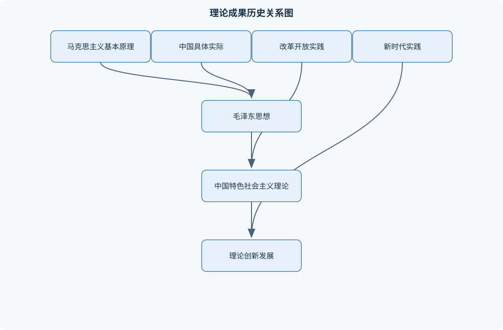
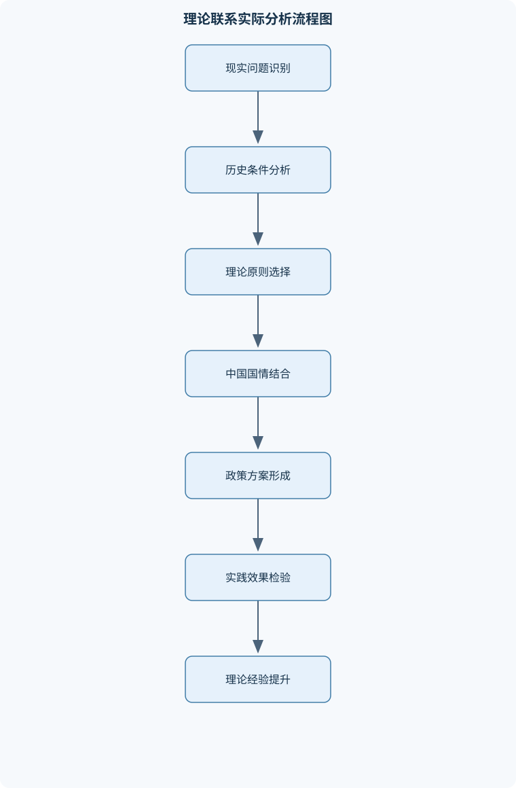

# 毛泽东思想和中国特色社会主义理论体系概论

## 一、课程整体知识框架

### 课程边界与先修知识

本课程以马克思主义中国化时代化的理论成果及其历史进程为主线，系统讲授毛泽东思想、中国特色社会主义理论体系以及新时代中国特色社会主义理论成果的基本内容、形成条件、主要观点、历史地位和实践要求。内容边界包括新民主主义革命、社会主义革命和建设、改革开放和社会主义现代化建设、中国特色社会主义进入新时代等重大历史阶段，重点分析实事求是、群众路线、独立自主、社会主义初级阶段、改革开放、社会主义市场经济、人民主体地位、共同富裕、全面依法治国、文化建设、生态文明、国家统一、和平发展、党的领导和党的建设等问题。课程不替代马克思主义基本原理、中国近现代史纲要、思想道德与法治、形势与政策等课程，但需要具备马克思主义基本立场观点方法、中国近现代史和中华人民共和国史的基础知识。





### （一）课程对象、主线与边界

本课程研究马克思主义基本原理同中国具体实际、时代特点和中华优秀传统文化相结合而形成、发展的理论成果，重点说明这些理论成果回答了什么问题、在什么历史条件下形成、主要内容是什么、如何指导实践以及具有什么历史地位。课程的基本主线不是孤立记忆理论名称，而是按照“时代条件—社会主要矛盾—历史任务—实践探索—理论概括—现实要求”的逻辑，理解马克思主义中国化时代化的历史进程。

课程覆盖四个相互衔接的历史阶段。第一，新民主主义革命时期，主要任务是争取民族独立、人民解放，为国家发展和人民富裕创造前提。第二，社会主义革命和建设时期，主要任务是完成从新民主主义到社会主义的转变，并探索适合中国国情的社会主义建设道路。第三，改革开放和社会主义现代化建设新时期，主要任务是解放和发展社会生产力，完善社会主义制度，推进中国式现代化。第四，中国特色社会主义进入新时代，主要任务是解决发展不平衡不充分问题，推动全体人民共同富裕，推进中华民族伟大复兴，并以中国式现代化全面推进强国建设和民族复兴伟业。

本课程不替代马克思主义基本原理课程，不系统重复唯物史观、剩余价值理论等基础理论；不替代中国近现代史纲要课程，不对全部历史事件作编年史式叙述；不替代思想道德与法治、形势与政策课程，不承担全部道德规范和即时政策分析内容。但是，本课程必须运用马克思主义立场、观点和方法，依托中国近现代史和中华人民共和国史的基本事实，分析理论与实践的关系。

### （二）“马克思主义中国化时代化”的总逻辑

马克思主义中国化时代化，指立足中国国情和时代条件，坚持把马克思主义基本原理同中国具体实际、同中华优秀传统文化相结合，研究和回答中国革命、建设、改革以及新时代发展中的实际问题，形成具有中国特点、中国风格、中国气派的理论成果。

这一概念包含四层关系。

第一，基本原理与具体实际相结合。马克思主义提供观察世界、分析社会和解决问题的立场、观点、方法，但不提供脱离历史条件、可以机械套用的现成答案。中国革命为什么不能照搬其他国家的革命道路，改革为什么必须从社会主义初级阶段的基本国情出发，都是具体实际对理论运用提出的要求。

第二，理论与实践相结合。理论来源于实践，又接受实践检验并指导实践。理论创新不是凭空制造概念，而是对实践经验进行概括、提炼和系统化；实践创新也不能仅凭经验冲动，而需要理论提供方向、原则和方法。

第三，马克思主义与中华优秀传统文化相结合。这不是把传统文化全部等同于马克思主义，也不是用传统文化替代马克思主义，而是对传统文化进行分析、继承和转化，使马克思主义能够以中国人民熟悉的思想资源和语言形式阐释中国问题，同时赋予理论以鲜明的民族形式。

第四，继承与发展相结合。毛泽东思想、中国特色社会主义理论体系以及新时代中国特色社会主义理论成果，具有共同的马克思主义立场、观点和方法，又分别回答不同历史阶段的主要任务。所谓“一脉相承”，主要体现为指导思想、人民立场、实事求是等基本立场方法的连续性；所谓“与时俱进”，主要体现为面对社会主要矛盾、发展任务和时代课题变化所作出的理论创新。

### （三）贯穿全课程的基本立场、观点和方法

#### 1. 实事求是

实事求是要求从客观实际出发，研究事物的内部联系和发展规律，并以实践检验认识和理论。它不是简单“讲事实”，而是包括事实调查、关系分析、规律认识和实践检验四个环节。

分析一个历史问题时，不能只看结果，还要考察当时的生产力水平、阶级关系、政治环境、国际条件和群众基础。评价一项政策时，不能只看主观目标，也要看实施条件、实际效果和代价边界。实事求是还要求区分主要矛盾和次要矛盾、主流和支流、成就和问题，避免把复杂历史简单化为全盘肯定或全盘否定。

#### 2. 群众路线

群众路线的基本内容是“一切为了群众，一切依靠群众，从群众中来，到群众中去”。“一切为了群众”说明价值目标，即发展和治理必须维护人民根本利益；“一切依靠群众”说明实践主体，人民群众是历史创造者；“从群众中来、到群众中去”说明工作方法，即把群众的实践经验和利益诉求集中起来形成政策，再回到群众实践中检验、修正和落实。

群众路线不能简化为临时征求意见，也不能把群众利益理解为所有个体要求的简单相加。它要求在具体利益差异中把握人民根本利益、长远利益和整体利益，并通过制度化渠道实现表达、协商和监督。

#### 3. 独立自主

独立自主要求从中国实际出发，依靠中国人民自己的力量解决革命、建设和改革问题，同时坚持开放合作。独立自主不是闭关自守，不是拒绝学习外国经验；开放合作也不等于照搬外部模式、放弃自主判断。二者统一于立足自身、取长补短、风险可控和互利合作。

#### 4. 人民立场与问题意识

人民立场回答“为了谁、依靠谁、成果由谁共享”，问题意识回答“现实中最需要解决什么”。理论创新必须面对真实问题，而不是只在概念之间循环；政策判断必须以人民利益、生产力发展、制度完善和实践效果为检验尺度。

### （四）课程理论成果的谱系

课程所讲理论成果包括毛泽东思想、邓小平理论、“三个代表”重要思想、科学发展观以及新时代中国特色社会主义理论成果。毛泽东思想形成于新民主主义革命和社会主义革命、建设的实践，是马克思列宁主义基本原理同中国具体实际相结合的产物。中国特色社会主义理论体系通常指改革开放以来形成和发展的理论成果，主要包括邓小平理论、“三个代表”重要思想和科学发展观；新时代中国特色社会主义理论成果在新的历史条件下进一步发展了这一理论谱系。

分析理论成果时，应区分四个层次：形成条件、核心问题、主要内容、历史地位。形成条件说明为什么在该时期产生；核心问题说明理论集中回答什么；主要内容说明理论提出了哪些基本观点；历史地位说明其在马克思主义发展史、中国共产党历史和中国特色社会主义实践中的作用。

### （五）关键历史因果链条

近代中国半殖民地半封建社会性质，决定了中国既面临帝国主义压迫，又面临封建主义和官僚资本主义压迫；民族矛盾和阶级矛盾相互交织，人民要求民族独立、人民解放和社会进步。因此，中国革命不能仅以一般资产阶级民主革命为目标，也不能直接跳过现实条件进入社会主义，而要经过无产阶级领导的新民主主义革命。

中国政治经济发展不平衡、反动统治力量在城市较强而农村相对薄弱，广大农民构成革命的重要力量，决定了革命道路不能照搬城市中心模式，而要走农村包围城市、武装夺取政权的道路。该结论的推导条件包括：革命领导力量是无产阶级及其政党，革命依靠力量包括工人、农民和其他进步力量，反动统治存在薄弱环节，农村具有群众基础和持久斗争空间。若缺少这些条件，不能机械套用这一道路。

中华人民共和国成立实现了国家政权的根本转换，但不等于社会主义制度已经立即建立。建国初期仍存在多种经济成分，国家需要恢复国民经济、巩固人民政权并完成社会主义改造。社会主义改造基本完成、社会主义公有制成为社会经济制度基础，是社会主义制度基本建立的重要标志。这里必须区分“政权建立”“过渡时期”和“社会主义制度基本建立”。

社会主义制度建立后，社会基本矛盾仍然存在。社会主义社会的基本矛盾，仍表现为生产力与生产关系、经济基础与上层建筑之间的矛盾，但其性质、表现形式和解决方式不同于剥削阶级社会。人民内部矛盾是在人民根本利益一致基础上产生的矛盾，通常属于非对抗性矛盾，应主要通过民主、讨论、批评、说服教育和制度建设解决；敌我矛盾则涉及根本利益对立，处理方式不能混同。

改革开放的理论逻辑来自生产力发展和社会主义制度自我完善的要求。社会主义初级阶段说明我国已经是社会主义社会，同时生产力发展水平、发展不平衡状况和制度完善程度仍处于特定历史阶段。因此，必须坚持社会主义方向和公有制主体地位，又要发展多种所有制经济、社会主义市场经济和多种分配方式。市场经济是资源配置方式，不等于私有化；公有制为主体也不等于所有经济活动只能采取单一公有制形式。

中国特色社会主义政治发展道路要求把党的领导、人民当家作主、依法治国统一起来。党的领导提供政治保证，人民当家作主体现社会主义民主政治的本质要求，依法治国提供制度化、规范化和程序化保障。割裂三者，或者把其中一项绝对化，都会造成对中国特色社会主义民主政治的片面理解。

新时代的发展逻辑以人民为中心，贯彻创新、协调、绿色、开放、共享的新发展理念，推动人的全面发展和全体人民共同富裕。共同富裕不是同步富裕、同等富裕或平均主义，而是全体人民通过共同奋斗和制度保障逐步实现的普遍富裕。其实现依赖生产力发展、合理分配制度、公共服务均等化和社会保障完善，不能脱离发展基础追求静态平均。

国家统一与和平发展是中国特色社会主义实践的重要组成部分。维护国家主权和领土完整是国家根本利益；和平统一、一国两制是解决国家统一问题的重要制度安排。独立自主的和平外交政策要求维护和平、促进发展，坚持和平共处五项原则，推动构建人类命运共同体。和平发展不是放弃国家利益，也不是以牺牲主权安全换取外部合作，而是在维护自身正当权益的同时，通过合作实现互利共赢。

## 二、章节和模块划分

### 核心知识覆盖清单

本清单用于检查正文是否覆盖本课程的主要知识模块：

- **马克思主义中国化时代化**：马克思主义中国化时代化的提出、理论联系实际的内在要求、中国具体实际与时代特点、中华优秀传统文化结合、理论成果的一脉相承与与时俱进、人民立场与问题意识、理论创新与实践创新关系。
- **毛泽东思想形成发展**：毛泽东思想形成的时代条件、近代中国社会性质与主要矛盾、马克思主义同中国实际结合、毛泽东思想的科学内涵、毛泽东思想的主要内容、毛泽东思想的历史地位、实事求是群众路线独立自主、正确区分科学体系与晚年错误。
- **新民主主义革命理论**：新民主主义革命的总路线、革命对象与革命动力、无产阶级领导权、新民主主义革命性质、农村包围城市道路、武装斗争与统一战线、党的建设伟大工程、新民主主义政治经济文化纲领。
- **社会主义改造与建设探索**：新民主主义社会的经济成分、过渡时期总路线、社会主义改造的原则和方针、社会主义制度基本建立、社会主义改造的历史意义、社会主义建设道路初步探索、正确处理人民内部矛盾、探索过程中的经验与曲折。
- **中国特色社会主义理论体系**：中国特色社会主义的形成发展、邓小平理论的基本问题、社会主义本质与发展道路、社会主义初级阶段理论、三个代表重要思想、科学发展观、中国特色社会主义理论体系的历史地位、理论成果之间的继承发展。
- **改革开放与现代化建设**：改革开放的历史转折、社会主义初级阶段基本路线、社会主义市场经济体制、社会主义初级阶段基本经济制度、按劳分配与多种分配方式、社会主义现代化发展战略、改革发展稳定关系、解放和发展社会生产力。
- **中国特色社会主义政治文化社会建设**：党的领导人民当家作主依法治国、中国特色社会主义政治发展道路、全过程人民民主的制度基础、全面依法治国、社会主义核心价值体系、社会主义核心价值观、社会主义精神文明建设、社会和谐与民生保障。
- **生态文明与人民共同富裕**：以人民为中心的发展思想、共同富裕的社会主义本质要求、人的全面发展与经济社会发展、创新协调绿色开放共享发展理念、人与自然和谐共生、生态文明建设总体要求、美丽中国建设、发展成果由人民共享。
- **国家统一与和平发展**：和平统一一国两制、特别行政区制度安排、两岸关系和平发展、维护国家主权和领土完整、和平共处五项原则、独立自主的和平外交政策、推动构建人类命运共同体、和平发展道路的基本特征。
- **新时代中国特色社会主义**：新时代的历史方位、新时代社会主要矛盾、中华民族伟大复兴战略全局、中国式现代化基本要求、总体国家安全观、国防和军队现代化、全面从严治党、党的领导与国家治理现代化。


### （一）模块一：马克思主义中国化时代化

本模块是全课程的总论。重点解释马克思主义为什么必须同中国具体实际、时代特点和中华优秀传统文化相结合。理论形成条件分析可采用“时代背景—社会矛盾—现实任务—实践经验—理论回答—历史作用”的闭合链条。输入是某一理论成果，输出是其形成条件、主要内容和历史地位；终止条件是六个环节均有事实和逻辑支撑，不能只写理论名称。

本模块还要说明理论创新与实践创新的关系：实践提出问题并提供经验，理论对经验进行概括并形成行动方向，新的实践再检验和发展理论。理论联系实际不是把理论口号附加到案例之后，而是要说明概念如何解释事实、事实如何修正认识。

### （二）模块二：毛泽东思想形成发展

毛泽东思想形成于帝国主义和无产阶级革命时代，形成条件包括近代中国特殊国情、中国革命实践、马克思列宁主义的指导以及中国共产党领导的人民群众实践。其科学内涵，是以毛泽东同志为主要代表的中国共产党人，把马克思列宁主义基本原理同中国具体实际相结合形成的科学思想体系。

主要内容包括新民主主义革命理论、社会主义革命和社会主义建设理论、革命军队建设和军事战略理论、政策和策略理论、思想政治工作和党的建设理论，以及实事求是、群众路线、独立自主等立场、观点和方法。评价毛泽东思想时，必须把科学思想体系同毛泽东晚年的错误区分开来。不能因为历史人物有错误，就否定其科学理论贡献；也不能以历史贡献为理由，回避晚年错误及其后果。

### （三）模块三：新民主主义革命理论

新民主主义革命是无产阶级领导的、人民大众的、反对帝国主义、封建主义和官僚资本主义的民主革命。总路线的核心是无产阶级领导，革命对象是帝国主义、封建主义和官僚资本主义，革命动力包括工人阶级、农民阶级、城市小资产阶级和民族资产阶级中的进步力量，革命前途是经过新民主主义逐步过渡到社会主义。

民族资产阶级具有两面性，既可能受到帝国主义、封建主义压迫而参加革命，又可能因自身利益而动摇，因此革命政策不能把民族资产阶级与官僚资本主义简单等同。农村包围城市、武装夺取政权的道路，是由中国社会性质、政治经济发展不平衡、敌强我弱格局、农村群众基础和革命武装斗争条件共同决定的。统一战线、武装斗争和党的建设，是中国革命取得胜利的三个基本问题；党的建设被视为伟大工程，是因为党要在复杂环境中保持先进性、组织性和政治领导力。

新民主主义政治纲领强调建立无产阶级领导的、以工农联盟为基础的各革命阶级联合专政的民主共和国；经济纲领包括没收封建地主阶级土地归农民所有、没收官僚资本归新民主主义国家所有、保护民族工商业；文化纲领是发展无产阶级领导的人民大众的反帝反封建文化。

### （四）模块四：社会主义改造与建设探索

新民主主义社会不是社会主义社会的简单同义词。其经济成分包括国营经济、合作社经济、私人资本主义经济、个体经济和国家资本主义经济。国营经济具有社会主义性质并发挥领导作用；合作社经济具有半社会主义性质；私人资本主义经济具有两面性；个体经济具有分散性，需要通过合作化等方式逐步引导；国家资本主义是国家利用、限制和改造私人资本主义的重要形式。

过渡时期总路线的任务，是逐步实现国家对农业、手工业和资本主义工商业的社会主义改造，同时推进社会主义工业化。社会主义改造坚持积极引导、稳步推进和和平改造等原则。改造基本完成后，社会主义公有制成为经济制度基础，社会主义制度基本建立。其历史意义在于完成了从新民主主义到社会主义的转变，确立了社会主义基本制度，为工业化和现代化建设提供制度前提；同时也要实事求是地总结改造和建设探索中的经验、偏差与曲折。

社会主义建设道路初步探索，涉及如何处理社会主义社会基本矛盾、如何发展经济、如何建设社会主义民主政治和文化。正确处理人民内部矛盾，要求把矛盾性质、主体关系和具体领域结合起来判断，不能仅凭冲突激烈程度作结论。

### （五）模块五：中国特色社会主义理论体系

中国特色社会主义理论体系形成发展的共同背景，是社会主义建设道路的经验积累、改革开放实践和现代化建设任务。邓小平理论围绕“什么是社会主义、怎样建设社会主义”这一基本问题，强调解放和发展生产力、坚持社会主义道路和改革开放。社会主义本质不能被理解为单一所有制或平均主义，而应联系生产力发展、人民利益和共同富裕来理解。

社会主义初级阶段是我国的基本国情判断，说明我国已经是社会主义社会，但仍处于生产力发展水平不高、发展不平衡、制度需要不断完善的历史阶段。其现实要求是坚持党的基本路线，立足长期性、阶段性和复杂性推进现代化建设。

“三个代表”重要思想回答了建设什么样的党、怎样建设党等问题，强调党必须始终代表中国先进生产力的发展要求、中国先进文化的前进方向和中国最广大人民的根本利益。科学发展观强调以人为本、全面协调可持续发展，要求改变片面追求速度、忽视资源环境和社会公平的倾向。三者与毛泽东思想、新时代中国特色社会主义理论成果之间，是继承、发展和创新的关系。

### （六）模块六：改革开放与现代化建设

改革是社会主义制度的自我完善和发展，目标不是改变社会主义基本制度，而是通过体制机制创新解放和发展社会生产力。改革、发展、稳定三者具有不同功能：改革是动力，发展是目标和基础，稳定是前提和保障。三者不能相互替代，也不能片面强调一项而忽视其他两项。

社会主义市场经济体制同时具有市场机制和社会主义制度属性。市场通过价格、供求和竞争配置资源，政府通过宏观调控、公共服务、市场监管和社会治理弥补市场失灵。市场在资源配置中发挥决定性作用，并不意味着否定政府作用；更好发挥政府作用，也不意味着政府取代市场。

社会主义初级阶段基本经济制度主要回答所有制问题，即以公有制为主体、多种所有制经济共同发展；分配制度主要回答收入如何分配，即按劳分配为主体、多种分配方式并存；社会主义市场经济体制主要回答资源如何配置。三者不能混为一个概念。现代化发展战略还要处理工业化、信息化、城镇化、农业农村发展、区域协调和改革开放之间的关系。

### （七）模块七：中国特色社会主义政治、文化和社会建设

中国特色社会主义政治发展道路把党的领导、人民当家作主、依法治国统一于中国特色社会主义政治实践。全过程人民民主强调人民依法通过多种制度化渠道参与民主选举、民主协商、民主决策、民主管理和民主监督，其制度基础在于人民代表大会制度、中国共产党领导的多党合作和政治协商制度、民族区域自治制度以及基层群众自治制度等。

全面依法治国要求坚持依宪治国、依法执政、依法行政，共同推进法治国家、法治政府、法治社会建设。文化建设包括社会主义核心价值体系、社会主义核心价值观、思想道德建设和社会主义精神文明建设，目标是增强人民精神力量、培育共同价值基础。

社会建设以保障和改善民生为重点，涉及教育、就业、收入分配、社会保障、医疗卫生、住房和社会治理等领域。社会和谐不是消灭一切差异，而是在制度和法治框架内协调利益、化解矛盾、保障公平。

### （八）模块八：生态文明与人民共同富裕

以人民为中心的发展思想，要求发展为了人民、发展依靠人民、发展成果由人民共享。人的全面发展与经济社会发展相互促进：经济社会发展为教育、健康、文化和就业提供物质条件，人的能力提升又推动生产力和社会进步。

共同富裕具有全民性、过程性、发展性和制度性。它不是少数人富裕，也不是所有人在同一时间达到同一收入水平，更不是取消差别的平均主义。实现共同富裕需要处理效率与公平、当前与长远、局部与整体之间的关系，依靠共同奋斗、合理分配、公共服务和社会保障。

创新、协调、绿色、开放、共享的新发展理念分别回应发展动力、发展平衡、人与自然关系、内外联动和成果分配问题。生态文明建设要求坚持人与自然和谐共生，统筹产业结构、能源结构、交通运输和城乡建设，推动形成绿色生产方式和生活方式，建设美丽中国。生态治理不能只靠末端治理，还要改变高消耗、高排放的发展方式。

### （九）模块九：国家统一与和平发展

维护国家主权、安全和发展利益，是国家统一与对外关系的共同基础。和平统一、一国两制是解决国家统一问题的重要制度安排；特别行政区制度安排体现国家统一原则与地区实际情况相结合。两岸关系和平发展以坚持一个中国原则、增进共同利益和促进同胞福祉为基础。

和平共处五项原则包括互相尊重主权和领土完整、互不侵犯、互不干涉内政、平等互利、和平共处。独立自主的和平外交政策把维护世界和平、促进共同发展与维护国家自身利益统一起来。和平发展道路不是放弃斗争和安全，而是在坚持独立自主、维护正当权益的前提下扩大开放合作，推动构建人类命运共同体。

### （十）模块十：新时代中国特色社会主义

新时代的历史方位，是中国特色社会主义进入新时代，中华民族迎来从站起来、富起来到强起来的伟大飞跃。我国社会主要矛盾已经转化为人民日益增长的美好生活需要和不平衡不充分的发展之间的矛盾。该判断并不意味着我国已经摆脱社会主义初级阶段，也不意味着阶级矛盾和社会矛盾全部消失，而是说明发展问题的重点、结构和表现发生变化。

新时代要统筹中华民族伟大复兴战略全局和世界百年未有之大变局，推进中国式现代化。中国式现代化具有中国共产党领导、人口规模巨大、全体人民共同富裕、物质文明和精神文明相协调、人与自然和谐共生、走和平发展道路等基本要求。

总体国家安全观强调统筹发展和安全，维护政治、经济、军事、文化、社会、科技、网络、生态、资源等领域安全。国防和军队现代化服务于国家安全和民族复兴，要求坚持党对人民军队的绝对领导。全面从严治党强调党的自我革命、纪律建设、作风建设和反腐败斗争，目的是保持党的先进性和纯洁性，提高长期执政能力。党的领导与国家治理现代化相统一，要求把政治优势、制度优势转化为治理效能。

### （十一）代表性理论分析流程

#### 流程一：理论形成条件分析

**输入：**某一理论成果。  
**输出：**形成条件、核心问题、主要内容、历史地位。  
**步骤：**

1. 界定时间范围和国际环境。
2. 分析当时中国社会主要矛盾和现实任务。
3. 识别相关实践探索、制度条件和群众基础。
4. 概括理论集中回答的核心问题。
5. 区分实践经验、理论创新和历史评价。
6. 检查是否形成“时代—矛盾—任务—实践—理论”的闭合链条。

适用边界是历史条件明确、理论成果具有相对完整体系的对象。不能用这一流程替代对单一政策或局部事件的具体考证。

#### 流程二：历史阶段定位

**输入：**历史事件或政策。  
**输出：**“阶段—任务—举措—结果—影响”分析结论。  
**步骤：**

1. 确定事件发生的时间范围。
2. 判断属于新民主主义革命、社会主义革命和建设、改革开放新时期或新时代。
3. 概括该阶段的主要任务。
4. 说明事件解决的主要矛盾或制度问题。
5. 分析直接结果和长期影响。
6. 检查是否把不同阶段的概念混用。

#### 流程三：矛盾性质判断

**输入：**利益冲突或社会矛盾案例。  
**输出：**矛盾性质、主要解决方式和风险边界。  
**步骤：**

1. 判断相关主体的根本利益是否对立。
2. 判断是否具有敌我性质和对抗性。
3. 分析矛盾所处领域、阶段和具体条件。
4. 选择民主协商、批评教育、制度建设、依法治理或必要的专门治理方式。
5. 检查矛盾性质是否可能因处理失当而发生变化。

不能仅凭争论激烈、舆论对立或利益冲突表象判断矛盾性质。

```text
【理论联系实际分析流程】
输入：现实问题 P
输出：分析结论 C

1. 明确 P 的事实、主体、利益关系和时间范围
2. 选择相关立场、观点和方法 M
3. 结合中国具体国情，列出制度、资源、发展阶段等约束条件 K
4. 提出目标 G、实施路径 A 和风险边界 B
5. 用人民利益、生产力发展、制度完善、实践效果四项标准检验
6. 若事实不足或因果链不完整：
       返回第1步补充事实
   否则：
       输出 C = {事实判断、价值判断、因果判断、适用边界}
终止条件：四类判断均有依据，且不存在把价值判断冒充事实判断的情况
```

### （十二）代表性例题与解答

#### 例题一：概念辨析

**题干：**“中华人民共和国成立后，中国立即进入社会主义社会。”这一说法是否准确？

**分析：**需要区分政权建立、新民主主义社会、过渡时期和社会主义制度基本建立。

**逐步解答：**

1. 中华人民共和国成立，标志着新民主主义革命基本胜利，人民政权建立。
2. 建国初期仍存在多种经济成分，国家需要恢复经济、巩固政权并进行社会主义改造。
3. 这一阶段属于从新民主主义向社会主义过渡的历史时期。
4. 对农业、手工业和资本主义工商业的社会主义改造基本完成后，社会主义公有制成为经济制度基础，社会主义制度基本建立。
5. 因此，“成立后立即进入社会主义社会”把政权性质和社会制度建立混为一谈，表述不准确。

**结果验证：**若一个判断无法说明所有制结构和制度变化，就不能证明社会主义制度已经建立。

**变式：**“社会主义制度建立后仍然存在社会矛盾”是否正确？正确，因为社会主义社会仍存在生产力与生产关系、经济基础与上层建筑之间的基本矛盾，也存在人民内部矛盾。

#### 例题二：革命道路分析

**题干：**为什么中国革命必须走农村包围城市、武装夺取政权的道路？

**分析：**从社会性质、敌我力量、政治经济发展不平衡和群众基础四方面论证。

**逐步解答：**

1. 半殖民地半封建社会决定革命必须同时解决民族压迫和封建压迫问题。
2. 反动势力在城市掌握较强政治、军事和经济力量，革命力量直接夺取大城市缺乏条件。
3. 中国政治经济发展不平衡，广大农村存在反动统治薄弱环节，革命力量可以在农村建立根据地。
4. 农民占人口多数，是革命的重要依靠力量；土地革命能够把群众利益与革命实践结合起来。
5. 武装斗争是反动统治条件下保存和发展革命力量的重要形式，农村根据地不断积累力量，最终形成对城市的战略包围。
6. 因此，这一道路是由中国具体国情决定的，不是对其他国家革命模式的机械复制。

**结果验证：**如果答案只写“农村有群众基础”，而没有说明敌我力量和政治经济不平衡，论证链条仍不完整。

**变式：**能否把这一道路直接套用于所有国家？不能。道路选择必须依据社会结构、国家制度、阶级力量、地理条件和群众基础。

#### 例题三：市场经济与社会主义关系

**题干：**“发展社会主义市场经济必然导致私有化。”请辨析。

**分析：**区分资源配置方式、所有制制度和政府职能。

**逐步解答：**

1. 市场经济主要回答资源如何配置，依靠价格、供求和竞争机制。
2. 私有化主要涉及生产资料所有制结构，是制度属性问题。
3. 市场经济可以与不同社会制度结合，不能由市场配置方式直接推出私有化结论。
4. 社会主义市场经济坚持公有制主体地位和多种所有制经济共同发展，同时发挥市场和政府各自作用。
5. 因此，发展市场经济不等于否定公有制，也不等于政府退出经济治理。
6. 但市场机制可能带来垄断、信息不对称和收入差距等问题，需要法治监管、公共服务和宏观调控予以治理。

**结果验证：**若论证只说明“市场有效率”，没有说明所有制和政府作用，结论不完整。

**变式：**“政府发挥作用就是政府直接替代市场”也不正确，政府应弥补市场失灵并提供公共治理，而不是取消市场机制。

#### 例题四：人民内部矛盾判断

**题干：**某地推进公共资源调整时，不同群体因利益分配产生争议。应如何运用人民内部矛盾理论分析？

**分析：**不能只看争论形式，先判断根本利益关系，再确定解决方式。

**逐步解答：**

1. 相关群体均属于人民范围，根本利益具有一致性。
2. 具体利益、资源分配和发展机会存在差异，因而产生现实矛盾。
3. 该矛盾通常属于人民内部矛盾，不宜简单采取敌我斗争方式处理。
4. 应通过公开信息、民主协商、利益补偿、程序监督和依法治理解决。
5. 若出现欺诈、暴力、违法侵害他人权益等行为，则应依法处理违法行为，但不能因此把所有利益争议整体认定为敌我矛盾。
6. 结论是把矛盾性质判断与行为责任判断区分开来。

**结果验证：**若分析能同时说明主体关系、利益基础、解决方式和违法行为边界，判断较为完整。

**变式：**若长期拒绝协商、压制合理诉求，人民内部矛盾可能激化，说明矛盾性质判断还必须结合处理方式和发展变化。

#### 例题五：共同富裕与平均主义

**题干：**共同富裕是否意味着所有人同一时间、同一水平富裕？

**分析：**从主体、过程、基础和制度保障四方面区分。

**逐步解答：**

1. 共同富裕的主体是全体人民，不是少数人富裕。
2. 共同富裕是长期过程，具有阶段性，不要求所有地区、行业和个人同步达到同一水平。
3. 共同富裕以生产力发展和社会财富增加为基础，不能脱离发展基础追求静态平均。
4. 共同富裕要求通过合理分配、公共服务、社会保障和机会公平，使发展成果更多更公平惠及全体人民。
5. 平均主义倾向于消除合理差别，可能削弱劳动、创新和效率激励；共同富裕则承认合法合理差别，同时防止两极分化。
6. 因此，共同富裕不是同步富裕、同等富裕或平均主义。

**结果验证：**若答案同时说明“全体人民”“逐步实现”“发展基础”“制度保障”，即可避免概念缩减。

### （十三）课程实验与项目

#### 项目一：历史阶段与理论形成条件分析

**输入数据：**选取三个历史事件或政策，分别记录时间、国际环境、社会主要矛盾、主要任务、政策内容、直接结果和长期影响。

**实施步骤：**

1. 按时间整理事实，避免把不同阶段的概念混用。
2. 为每个事件填写“阶段—任务—举措—结果—影响”表。
3. 用理论形成条件流程分析其对应的理论成果。
4. 区分事实判断、价值判断和因果判断。
5. 写出一段不少于三层因果关系的历史评价。

**评价标准：**时间和阶段判断准确占一定比重；能够说明主要矛盾与任务的联系；能够区分成就、局限和历史影响；结论有事实支撑而非口号罗列。

**排错方法：**若出现“建国即社会主义制度建立”，检查是否遗漏过渡时期；若把晚年错误等同于毛泽东思想，检查是否区分科学体系与错误思想；若只有事件清单没有因果关系，补写“因为—所以—从而”链条。

#### 项目二：现实政策的理论联系实际分析

**输入数据：**选取一个与民生、生态、区域协调或社会治理有关的现实案例，收集问题事实、利益主体、政策目标、实施措施和实际效果。

**实施步骤：**

1. 界定问题范围和时间边界。
2. 识别人民利益、发展约束和制度条件。
3. 选择以人民为中心、共同富裕、绿色发展、依法治国或人民内部矛盾等相关理论。
4. 分析政策目标、实施机制、可能风险和适用边界。
5. 提出可检验的评价指标，例如公共服务覆盖、利益协调效果、生态改善或程序合法性。
6. 形成“事实—理论—政策—效果—修正建议”报告。

**评价标准：**案例事实与理论概念对应；因果机制清楚；能够说明政策受哪些条件限制；既评价积极作用，也指出风险和改进方向；建议具有可执行性。

**排错方法：**把个人偏好写成人民利益时，应补充受影响群体和公共利益分析；把市场效率直接等同于社会主义方向时，应补写所有制、分配和政府治理条件；只强调目标、不分析实施条件时，应增加资源、程序、监督和风险说明。

## 三、核心概念的详细解释
### （一）马克思主义中国化时代化

#### 1. 概念内涵与提出背景

马克思主义中国化时代化，是立足中国国情和时代条件，坚持把马克思主义基本原理同中国具体实际、同中华优秀传统文化相结合，研究并回答中国革命、建设、改革中的实际问题，形成新的理论成果的过程。它既要求理论能够解释中国社会的现实矛盾，也要求理论在实践检验中发展，不能把经典理论当作脱离历史条件的现成政策答案。

1938年，毛泽东在党的六届六中全会上提出“马克思主义中国化”这一重大命题。其理论根据在于，马克思主义具有科学性和实践性，基本原理只有进入具体历史条件，才能转化为认识和改造现实的力量；其现实根据在于，中国革命面临独特的社会结构、阶级关系和政治经济条件，必须从中国实际出发探索道路。时代化强调进一步把握时代变化提出的新课题，以新的实践经验丰富理论。

#### 2. 两个结合与理论创新

“同中国具体实际相结合”，要求研究社会性质、主要矛盾、生产力水平、阶级力量、制度条件和国际环境，避免照搬其他国家的革命或建设模式。“同中华优秀传统文化相结合”，要求对传统文化进行辨析、继承和创造性转化，使理论具有中国人民能够理解和接受的表达方式；这不意味着把传统文化全部等同于马克思主义，也不意味着以传统思想取代马克思主义的基本立场和方法。

理论创新与实践创新相互作用。实践提出问题、提供经验和检验标准；理论概括实践中的规律，为新的实践提供方向和方法。若只有经验积累而没有理论概括，经验难以转化为可推广的认识；若理论脱离实践，则可能失去解释力和指导力。理论成果的成立不能只依据概念新颖，而要考察其是否回应真实问题、是否符合客观规律、是否经受实践检验。

#### 3. 人民立场与问题意识

人民立场要求把人民群众的根本利益和主体作用作为认识、评价和推进事业的重要依据。群众路线概括为“一切为了群众，一切依靠群众，从群众中来，到群众中去”：先了解群众的实际需要和实践经验，再经过分析综合形成认识和工作意见，回到群众实践中检验、修正和落实。群众路线不是简单迎合每一项即时意见，而是通过调查研究、民主参与和实践检验，把分散经验转化为符合群众长远利益的工作认识。

问题意识要求从现实矛盾出发提出理论问题。分析时应区分问题表象、形成原因和制度条件，避免把对策口号当作问题解释。例如，发展不平衡不充分不能仅用增长速度说明，还需考察发展质量、区域差异、公共服务、资源环境约束和发展成果分配。

### （二）马克思主义中国化时代化的理论成果及其关系

#### 1. 理论成果的历史序列

马克思主义中国化时代化在不同历史阶段形成了相互联系的理论成果。毛泽东思想形成于新民主主义革命、社会主义革命和建设的历史实践，回答中国革命道路、革命胜利后向社会主义转变以及社会主义建设道路探索等问题。改革开放以来形成和发展的中国特色社会主义理论体系，通常包括邓小平理论、“三个代表”重要思想和科学发展观等内容，围绕什么是社会主义、怎样建设社会主义，建设什么样的党、怎样建设党，实现什么样的发展、怎样发展等问题展开。新时代中国特色社会主义理论成果在新的历史条件下进一步发展了这一理论谱系，回应新时代坚持和发展中国特色社会主义、推进中国式现代化等重大课题。

#### 2. 一脉相承与与时俱进

“一脉相承”是指这些理论成果具有共同的马克思主义立场、观点和方法，坚持人民立场、实事求是和实践导向；“与时俱进”是指不同阶段的理论成果依据新的实践条件和时代课题形成新的认识。二者并不矛盾：基本立场方法保持连续，具体理论判断和实践要求则须随历史条件发展。

理解理论关系不能把后来的理论简单等同于早期理论，也不能把它们割裂成互不相关的体系。正确分析应指出共同的方法论基础，继而说明各自回应的历史任务、解决的问题和理论创新。历史评价还须区分科学理论体系与具体实践中的失误，不能以某位历史人物的个别错误概括一个理论体系的全部内容。

### （三）毛泽东思想

#### 1. 形成条件与科学内涵

毛泽东思想是以毛泽东同志为主要代表的中国共产党人，把马克思列宁主义基本原理同中国具体实际相结合形成的科学思想体系。其形成有特定的时代背景：近代中国遭受帝国主义侵略和封建主义压迫，社会性质和社会结构决定革命必须解决民族独立、人民解放等问题；俄国革命和世界无产阶级运动提供了新的理论与历史经验；中国共产党领导人民进行革命和建设的实践，为理论形成提供了现实基础。

毛泽东思想不是个人言论的简单汇编，而是经过实践检验并形成内在联系的科学体系。其重要内容包括新民主主义革命理论、社会主义革命和建设理论、革命军队建设和军事战略、政策和策略、思想政治工作和文化工作、党的建设等。贯穿其中的立场、观点和方法集中体现为实事求是、群众路线、独立自主。独立自主要求从中国实际出发，主要依靠中国人民的力量解决自身问题，同时并不排斥在平等基础上开展国际合作。

#### 2. 历史地位与评价边界

毛泽东思想指导中国革命取得胜利，推动建立新中国，并为社会主义制度建设和建设道路探索提供重要理论依据。其历史地位既包括形成独创性理论成果，也包括在特定历史条件下把马克思主义基本原理用于中国问题的实践经验。

历史评价应坚持具体问题具体分析。毛泽东思想的科学体系不能与毛泽东晚年发生的错误混为一谈；晚年错误也不能因历史人物的贡献而被回避。评价须分别考察理论体系的科学内容、具体政策的历史条件、实际后果和经验教训，既不以个别错误否定科学理论，也不以理论贡献掩盖错误及其影响。

### （四）新民主主义革命理论

#### 1. 革命性质、对象与动力

新民主主义革命是无产阶级领导的、人民大众的，反对帝国主义、封建主义和官僚资本主义的民主革命。其任务是争取民族独立和人民解放，改变束缚社会发展的旧制度，为国家发展和社会进步创造条件。它仍属于资产阶级民主革命范畴，因为主要任务是反帝反封建，而不是直接完成社会主义革命；但它由无产阶级及其政党领导，具有新的领导力量、指导思想和发展前途，因此不同于旧式资产阶级民主革命。

革命对象须具体区分。帝国主义侵略势力、封建地主阶级和官僚资本主义是革命主要对象；民族资产阶级在一定条件下可能参加反帝反封建斗争，政策上不能把它与官僚资本主义混为一谈。革命动力包括工人阶级、农民阶级、城市小资产阶级和民族资产阶级等，其中工人阶级是领导力量，农民是重要力量。领导权关系到革命方向和革命胜利后社会发展的前途，不只是参与人数多少的问题。

#### 2. 农村包围城市、武装夺取政权

中国革命道路是农村包围城市、武装夺取政权。其形成依赖中国政治经济发展不平衡、农村人口众多、反动统治力量在不同地区的控制能力不一，以及革命力量能够在农村发动群众、开展土地革命和建立根据地等条件。它不是适用于一切国家的固定模式，也不是把城市工作排除在外，而是在特定条件下以农村根据地发展革命力量，最终改变全国政治力量对比。

这条道路由土地革命、武装斗争和农村革命根据地建设相互支撑。土地革命回应农民土地要求并扩大群众基础；武装斗争保护和发展革命力量；根据地建设提供政治、经济和组织条件。统一战线则通过团结可团结的力量、分化敌对力量改变力量对比。党的建设为上述任务提供政治领导、组织纪律和思想保障。

#### 3. 新民主主义政治、经济与文化纲领

新民主主义政治纲领指向人民当家作主的国家制度和政治安排。经济纲领以没收官僚资本归国家所有、没收地主土地归农民所有、保护民族工商业为主要内容。保护民族工商业表明革命政策并非把所有私人资本一概作为革命对象。文化纲领强调民族的、科学的、大众的文化方向，要求文化服务于人民、反映现实并推动社会进步。

新民主主义社会具有多种经济成分，包括国营经济、合作社经济、私人资本主义经济、个体经济和国家资本主义经济。国营经济具有社会主义性质并发挥领导作用；合作社经济具有半社会主义性质；私人资本主义经济在特定条件下具有发展生产、改善供给等作用，同时需要引导和限制；个体经济具有分散性；国家资本主义经济能够在国家管理下引导私人资本向社会主义方向发展。不同成分之间不是地位相同、方向相同，而是在国营经济领导下构成过渡时期的经济结构。

### （五）社会主义革命、社会主义建设与社会矛盾

#### 1. 从新民主主义到社会主义

中华人民共和国成立为国家独立和人民解放提供了政治前提，但成立本身不等于社会主义制度立即建立。建国初期存在新民主主义社会的多种经济成分

## 四、重要定义、公式、定理和推导

### 专业审校补充：关键定义与适用边界

“社会主义初级阶段”不是泛指社会主义社会建立以前的过渡时期，也不是社会主义性质不明确的阶段，而是我国在生产力发展水平还不高、发展不平衡不充分、社会主义制度已经建立并仍需完善的特定历史阶段。其基本依据有两方面：一方面，我国已经确立社会主义基本制度，坚持人民民主专政和公有制主体地位，因而不能把社会主义初级阶段等同于资本主义发展阶段；另一方面，生产力总体水平、科技教育、城乡区域发展和体制机制仍存在不足，因而不能把社会主义制度建立等同于已经达到成熟发达的社会主义。社会主义初级阶段具有长期性、阶段性和动态性，不能用单一经济指标机械判断其结束。由此形成的基本路线，是以经济建设为中心，坚持四项基本原则，坚持改革开放；三者具有统一性，经济建设是中心，四项基本原则提供政治保证，改革开放提供发展动力。把改革开放同社会主义方向割裂，或把坚持社会主义同拒绝改革混同，都是对该理论适用边界的误读。


### （一）马克思主义中国化时代化的定义、条件与理论生成逻辑

马克思主义中国化时代化，是指立足中国具体国情和所处时代条件，坚持把马克思主义基本原理同中国具体实际、同中华优秀传统文化相结合，形成能够回答中国革命、建设、改革和新时代实践问题的理论成果。其核心不是改变马克思主义基本原理，也不是把中国经验简单包装成理论，而是通过实践、认识、再实践、再认识，把普遍原理转化为适合中国历史条件和现实任务的理论指导。

可以把理论成果的形成逻辑表示为：

$$
理论成果=基本原理+具体实际+时代课题+实践经验+理论概括
$$

式中，“基本原理”是分析社会历史和解决实践问题的立场、观点、方法；“具体实际”包括社会性质、生产力水平、阶级关系、制度条件和群众基础；“时代课题”是特定历史阶段必须回答的重大问题；“实践经验”是革命、建设、改革和治理中的实际探索；“理论概括”是对经验进行系统化、规律化和原则化的结果。这个公式不是数学等式，而是用于说明理论形成的必要环节。缺少任何一个环节，都可能导致理论脱离实际：只有原理而没有国情，容易机械照搬；只有经验而没有理论概括，容易停留在零散做法；只有时代口号而没有实践基础，则不能形成科学理论。

理论成果之间既有继承关系，也有发展关系。其逻辑可以表示为：

$$
共同立场方法+\text{历史任务变化}+\text{实践条件变化}
\Rightarrow \text{理论内容的继承、创新与发展}
$$

共同立场方法主要包括人民立场、实事求是、群众路线和独立自主；历史任务变化则表现为从民族独立、人民解放，到社会主义制度建立和建设探索，再到解放和发展生产力、推进中国式现代化、实现共同富裕等任务的变化。因而，不能把不同理论成果理解为相互割裂，也不能因为它们都坚持马克思主义，就忽略其所回答问题的差异。

**常见考法：**论述“马克思主义为什么必须中国化时代化”时，应按照“基本原理具有普遍指导意义—具体国家具有不同历史条件—中国实践提出特殊问题—理论必须在实践中创新—创新成果反过来指导实践”的链条作答。不能把“中国化”解释成民族主义化，也不能把“时代化”解释成随意改变基本立场。

### （二）新民主主义革命道路的条件分析与因果推导

新民主主义革命是无产阶级领导的、人民大众的、反对帝国主义、封建主义和官僚资本主义的民主革命。理解这一概念，需要同时把握革命对象、领导力量、动力、性质和发展前途。革命对象决定革命任务，领导力量决定革命方向，阶级动力决定群众基础，发展前途决定革命是否停留在资产阶级民主革命阶段。

新民主主义革命的主要任务可以概括为：

$$
\text{民族独立}+\text{人民解放}+\text{社会发展前提}
\Rightarrow \text{新民主主义革命的历史任务}
$$

近代中国处于半殖民地半封建社会，帝国主义压迫、封建主义束缚和官僚资本主义控制相互交织。由此决定，革命不能仅仅解决某一方面问题。反对帝国主义，关系到民族独立和国家主权；反对封建主义，关系到人民解放和社会结构变革；反对官僚资本主义，关系到国家经济权力和社会资源控制。三者不是互不相关的任务，而是在特定历史条件下相互联系。

中国革命必须走农村包围城市、武装夺取政权的道路，可以按照以下因果链条推导：

$$
\text{社会发展不平衡}
+\text{农村人口占多数}
+\text{城市反动统治力量集中}
+\text{革命根据地具有群众基础}
\Rightarrow
\text{农村包围城市、武装夺取政权}
$$

第一，中国政治经济发展不平衡，现代工业和城市经济集中于少数地区，广大农村仍然是人口和社会资源的重要基础。第二，反动统治力量在中心城市和交通要地较为集中，革命力量在这些地区直接取得政权的条件不足。第三，封建压迫严重、农民人口众多，土地问题和农民解放问题使农村具有广泛的革命动员基础。第四，武装斗争不是孤立的军事行动，而是与土地革命、根据地建设和统一战线相结合。革命根据地既是军事立足点，也是政治、经济和群众工作的实践空间。

因此，农村包围城市不是否定城市作用，也不是任何国家都适用的固定模式，而是由当时中国的社会结构、敌我力量、地理条件和政治经济发展不平衡共同决定的历史选择。若答题时只写“农村人口多”，论证是不完整的，还必须说明反动统治的中心化特点、革命力量的现实处境以及群众基础的形成。

新民主主义革命的领导权属于无产阶级及其政党。其理由在于，无产阶级具有先进生产方式联系、组织性和革命彻底性，能够把民族解放、人民解放和社会发展联系起来。民族资产阶级在反帝反封建方面具有一定革命性，但由于其经济地位和政治立场具有两面性，不能独立承担领导中国革命的任务。由此，统一战线、武装斗争和党的建设构成革命取得胜利的重要条件。

### （三）社会主义改造、社会主义制度建立与基本矛盾分析

中华人民共和国成立后，国家首先面临巩固新生政权、恢复国民经济、改善人民生活和完成社会制度转变等任务。中华人民共和国成立标志着新民主主义革命基本胜利，但不等于社会主义制度已经立即建立。必须区分新民主主义社会、过渡时期和社会主义制度基本建立三个概念。

新民主主义社会具有过渡性质，其经济结构中存在国营经济、合作社经济、个体经济、私人资本主义经济和国家资本主义经济等多种成分。社会主义改造的任务，是通过对农业、手工业和资本主义工商业的社会主义改造，逐步建立社会主义公有制和相应的制度基础。

这一历史过程可概括为：

$$
\text{新民主主义社会}
\xrightarrow{\text{社会主义改造}}
\text{社会主义基本制度建立}
$$

判断社会主义制度基本建立，不能只依据国家政权性质，还要考察所有制结构、生产关系和制度体系是否发生根本变化。社会主义改造基本完成、社会主义公有制建立并成为经济制度的重要基础，是判断制度基本建立的重要依据。

由生产力与生产关系、经济基础与上层建筑的关系，可以推出社会主义社会仍然存在基本矛盾：

$$
\text{生产力}\leftrightarrow\text{生产关系},
\qquad
\text{经济基础}\leftrightarrow\text{上层建筑}
$$

这里的“双向箭头”表示相互作用，而不是单向决定。生产力发展会对生产关系提出调整要求，生产关系又会反作用于生产力；经济基础决定上层建筑的性质和发展方向，上层建筑也会通过制度、法律、政治组织和思想文化反作用于经济基础。社会主义制度能够通过自我调整、自我完善来解决矛盾，并不意味着矛盾消失。

还要区分社会基本矛盾、敌我矛盾和人民内部矛盾。社会基本矛盾说明社会发展的深层结构关系；敌我矛盾涉及根本利益和政治立场的对立；人民内部矛盾通常是在人民根本利益一致基础上形成的具体利益、认识和工作关系矛盾。判断人民内部矛盾不能只看冲突是否激烈，而要考察相关主体的根本利益是否对立、行为是否具有对抗性以及矛盾所处的制度和社会条件。

**工作应用：**在基层治理或政策协调中，若居民因公共服务供给、资源分配或政策理解产生争议，应先调查事实、区分利益诉求，再通过协商、听证、制度完善和法治程序解决。若出现违法行为，则不能以“人民内部矛盾”为由排除依法处理。矛盾性质可能随条件变化，必须根据事实持续判断。

### （四）社会主义初级阶段、基本经济制度与社会主义市场经济的逻辑

社会主义初级阶段，是我国在生产力发展水平和社会主义制度完善程度上仍处于特定历史阶段的基本国情判断。它说明我国已经进入社会主义社会，同时又说明社会主义制度仍需发展和完善，生产力发展不充分、区域和城乡发展不平衡等问题仍然存在。

社会主义初级阶段的基本国情可以推导出以下制度逻辑：

$$
\text{生产力发展不充分、不平衡}
+\text{社会主义制度性质}
\Rightarrow
\text{公有制主体、多种所有制共同发展}
$$

公有制主体地位体现社会主义经济制度的性质和制度基础；多种所有制经济共同发展，则是适应生产力发展水平和经济结构复杂性的现实要求。把社会主义简单等同于单一公有制，忽视了发展生产力和调动各方面积极性的要求；把多种所有制经济等同于否定社会主义，则混淆了所有制结构和社会制度性质。

基本经济制度、分配制度和资源配置方式回答的是三个不同问题：

| 制度概念 | 主要回答的问题 |
|---|---|
| 基本经济制度中的所有制结构 | 生产资料由哪些经济主体占有和经营 |
| 分配制度 | 社会产品和收入按照什么原则分配 |
| 社会主义市场经济体制 | 资源通过什么机制配置，市场与政府如何发挥作用 |

社会主义市场经济不是“市场经济加社会主义口号”，也不是“市场配置资源就必然私有化”。市场机制主要通过价格、供求、竞争和利益激励影响资源流向；社会主义制度则通过公有制主体地位、宏观调控、公共服务、法治规范和发展目标，保障经济发展方向和人民根本利益。

其关系可表示为：

$$
\text{市场机制提高配置效率}
+\text{社会主义制度保障发展方向和公平正义}
\Rightarrow
\text{社会主义市场经济}
$$

这里的“效率”不是唯一目标，还需要考虑公平、稳定、生态、安全和长期发展。政府作用也不是简单替代市场，而是弥补市场失灵、提供公共服务、维护公平竞争、进行宏观调控并防范系统性风险。考试中辨析“市场发挥作用就是减少政府作用”时，应指出市场和政府不是非此即彼的关系，关键在于各自功能边界和协同方式。

改革、发展、稳定之间也存在结构性关系：

$$
\text{改革是动力},\qquad
\text{发展是目标和基础},\qquad
\text{稳定是前提和保障}
$$

改革如果缺少发展目标，可能变成脱离人民需要的形式变动；发展如果没有改革动力，可能受制度和体制约束；改革和发展如果忽视稳定条件，可能增加社会运行风险。实际政策分析应说明改革对象、发展目标、利益影响、稳定条件和纠偏机制。

### （五）人民立场、共同富裕与人的全面发展的推导

人民立场是马克思主义政党根本政治立场。在本课程中，人民立场不是抽象的价值宣示，而是分析发展目的、政策受益对象、利益分配和制度效果的基本尺度。以人民为中心的发展思想要求把人民主体地位、人民根本利益和人的全面发展统一起来。

三者之间的关系可以表示为：

$$
\text{生产力发展}
\rightarrow
\text{物质和制度条件改善}
\rightarrow
\text{人的全面发展}
\rightarrow
\text{更充分的社会实践和生产力发展}
$$

这个链条说明，经济社会发展是人的全面发展的基础，但发展最终不能只以物质财富增加为目的；人的能力、权利、教育、健康、文化生活和参与社会治理的条件，也是发展质量的重要内容。人的全面发展又会通过知识、劳动、创新和社会参与反过来促进经济社会发展。

共同富裕是全体人民通过共同奋斗和制度保障逐步实现的普遍富裕，不等同于同步富裕、同等富裕和平均主义。可以从五个维度加以区分：

1. **主体具有普遍性。**共同富裕面向全体人民，而不是少数群体先富后永远不变。
2. **过程具有长期性。**共同富裕需要以生产力发展和制度完善为基础，不可能在短期内一次完成。
3. **实现具有阶段性。**不同地区、行业和群体可以在发展条件不同的情况下逐步推进。
4. **内容具有综合性。**不仅包括收入增长，还包括基本公共服务、发展机会、社会保障和生活品质。
5. **方式具有共同奋斗与制度保障的统一性。**既要鼓励劳动、知识、技术、管理和资本等生产要素发挥作用，也要通过合理分配、公共服务和社会保障防止两极分化。

共同富裕与平均主义的差别，可以用以下关系说明：

$$
\text{共同富裕}
=
\text{发展生产力}
+\text{合理分配}
+\text{机会公平}
+\text{公共服务保障}
$$

平均主义则倾向于不考虑劳动贡献、能力差异、发展阶段和现实条件，要求收入和资源机械相同。共同富裕承认合理差距的存在，但反对收入差距过大、机会不公平和不正当财富积累。答题时应同时写出“允许合理差异”和“防止两极分化”，不能只强调其中一面。

**案例分析方法：**分析一项公共服务或收入分配政策时，应依次回答：政策是否扩大了人民参与发展和分享成果的机会；是否改善了基本生活和发展条件；是否兼顾效率与公平；是否具有持续的财政、组织和制度保障；是否通过实践反馈进行调整。这样才能把共同富裕从价值目标转化为可分析的政策问题。

### （六）党的领导、人民当家作主与依法治国的统一关系

党的领导、人民当家作主、依法治国，是中国特色社会主义民主政治的三个基本方面。三者不是并列后彼此独立的口号，而是在国家治理实践中具有不同功能并相互支撑的统一整体。

其功能关系可以表示为：

$$
\text{党的领导}
+\text{人民当家作主}
+\text{依法治国}
\Rightarrow
\text{中国特色社会主义民主政治}
$$

党的领导提供政治方向、组织保证和统筹协调能力；人民当家作主体现国家政治生活的本质要求和人民主体地位；依法治国通过法律制度、程序规则和权力监督，把党的主张、人民意志和国家治理要求转化为稳定、规范、可执行的制度安排。

这一关系不能作机械相加理解。若只强调党的领导而忽视人民主体地位，容易把治理理解为单向管理；若只强调即时民意而忽视制度程序，容易把民主理解为无规则的意见竞争；若只强调法律形式而忽视政治方向和人民利益，则可能把依法治国窄化为技术性执法。

全过程人民民主的分析重点，不只是“有没有表达”，还包括人民是否能够依法参与民主选举、民主协商、民主决策、民主管理和民主监督，意见是否能够进入制度程序，政策执行是否接受监督，治理结果是否回应人民利益。因而，判断民主实践时，应同时考察参与渠道、制度程序、权利保障、决策效果和反馈机制。

**常见考法：**回答三者为什么不能割裂时，可按照“党的领导是政治保证—人民当家作主是本质要求—依法治国是制度保障—三者统一于中国特色社会主义政治实践”的结构作答，并结合基层协商、公共政策制定、权力监督或公共服务治理举例说明。

### （七）理论联系实际与历史评价的标准化分析流程

理论联系实际不是把现实案例强行套入理论，而是从事实出发，选择适当理论，分析因果关系并接受实践检验。适用于论述题、案例题、政策研究和基层工作。

**输入：**一个历史事件、现实政策或社会治理问题。  
**输出：**问题性质、理论依据、因果机制、实施条件、可能风险和结论边界。

具体流程如下：

1. **界定事实。**明确时间范围、涉及主体、利益关系和问题领域，防止把个别现象扩大为总体事实。
2. **定位历史阶段或现实条件。**判断事件属于新民主主义革命、社会主义革命和建设、改革开放，还是新时代；现实问题则要分析生产力水平、制度环境、法律程序和资源条件。
3. **选择理论工具。**根据问题性质选择实事求是、群众路线、人民内部矛盾、社会主义初级阶段、改革发展稳定、共同富裕、依法治国或和平发展等理论。
4. **建立因果链条。**说明“条件—行动—机制—结果”，不能只罗列理论概念。
5. **分析限制条件。**说明政策实施需要的组织、财政、法律、技术和群众基础，也要分析可能的利益冲突和执行偏差。
6. **接受实践检验。**用人民利益、生产力发展、制度完善、程序合法性和实际效果检验结论。
7. **说明适用边界。**指出该结论适用于何种条件，哪些情况不能直接套用。

历史评价还应坚持“主要成就、制度贡献、现实局限、严重错误、历史影响”相统一。评价社会主义建设道路初步探索，既要说明独创性理论成果、工业化基础和制度建设成就，也要分析探索中的曲折和错误；评价改革开放，既要说明解放和发展社会生产力、完善社会主义制度的重要作用，也要正视发展不平衡、利益协调、生态约束和治理能力等问题。实事求是的历史评价不是简单折中，而是根据历史条件和因果关系区分主流与支流、成就与问题、经验与教训。

这一流程的终止条件是形成完整的“条件—任务—举措—结果—评价—边界”链条。若答案只有概念，没有历史条件；只有结论，没有因果机制；只有成就，没有问题；或只有问题，没有总体评价，都说明理论联系实际尚未完成。

## 五、算法、流程和实现思路

### 方法与流程覆盖索引

下列方法或流程应在正文中说明输入、步骤、适用条件、结果检查和边界：

- 理论形成条件分析流程：输入某一理论成果；第一步界定其所处时代背景和国际环境；第二步分析中国社会主要矛盾与现实任务；第三步识别实践经验和制度条件；第四步概括理论回答的核心问题；第五步区分理论创新、实践经验和历史评价；输出形成条件、主要内容及历史地位。适用于分析毛泽东思想、邓小平理论、“三个代表”重要思想、科学发展观和新时代中国特色社会主义理论成果。
- 历史阶段定位流程：输入一个历史事件或政策；第一步确定时间范围；第二步判断所属历史阶段；第三步概括该阶段党和国家面临的主要任务；第四步说明事件解决的主要矛盾或制度问题；第五步分析其后续影响；终止条件是形成“阶段—任务—举措—结果”的闭合链条。
- 理论联系实际分析流程：输入一个现实问题；第一步界定问题事实和利益关系；第二步选择相关马克思主义立场、观点和方法；第三步结合中国国情判断约束条件；第四步提出政策或实践方向；第五步用人民利益、生产力发展、制度完善和实践效果进行检验。适用于论述题、案例题和政策分析。
- 矛盾性质判断流程：输入一个社会矛盾案例；第一步判断相关主体的根本利益是否对立；第二步判断矛盾是否具有对抗性；第三步分析矛盾所处领域和具体条件；第四步选择民主、协商、法治或必要的专门治理方式；第五步检查是否存在性质转化的条件。不能仅凭冲突形式判断矛盾性质。
- 政策论证流程：输入一个政策命题；第一步明确命题的概念边界；第二步说明现实依据和理论依据；第三步分析政策目标、实施条件和可能影响；第四步比较相反观点的合理与错误部分；第五步形成结论并说明适用边界。输出应区分事实判断、价值判断和因果判断。
- 历史评价流程：输入一个历史时期、理论或政策；第一步还原当时的历史条件；第二步区分主要成就、制度贡献、现实局限和严重错误；第三步分析因果关系而非简单罗列；第四步坚持实事求是和具体问题具体分析；第五步概括对当前实践的启示。适用于社会主义建设探索、改革开放和党的历史经验分析。





### （一）理论形成条件分析流程

理论成果不能脱离历史条件孤立理解。分析毛泽东思想、中国特色社会主义理论体系及新时代中国特色社会主义理论成果时，可采用“时代—国情—任务—实践—理论—评价”的六步流程。

#### 1. 输入、输出与分析步骤

**输入：**某一理论成果、历史阶段或重大理论命题。  
**输出：**形成条件、主要内容、解决的问题、理论创新、历史地位及现实要求。

**第一步，界定时代背景。**  
考察国际格局、世界主要矛盾、科技和生产力发展状况、国际力量对比及外部压力。例如，毛泽东思想形成于帝国主义和无产阶级革命时代，中国革命同时受到帝国主义、封建主义和官僚资本主义的压迫；改革开放以来的理论创新，则必须面对和平与发展主题、经济全球化、社会主义现代化建设以及国内发展任务的变化；新时代理论成果则需要回答发展不平衡不充分、共同富裕、国家安全和民族复兴等问题。

**第二步，分析中国具体国情。**  
不能只写“国情复杂”，而应说明社会性质、生产力水平、阶级关系、区域差异、制度基础和群众状况。新民主主义革命时期，中国是半殖民地半封建社会，政治经济发展不平衡，农民占人口多数，革命力量与反革命力量对比悬殊，这些条件共同影响革命道路选择。社会主义初级阶段则表明我国已经建立社会主义制度，但生产力发展水平和制度完善程度仍有历史局限。

**第三步，确定主要矛盾和历史任务。**  
主要矛盾不是一般困难的罗列，而是决定历史任务的关系结构。近代中国的核心任务是争取民族独立、人民解放，并为国家发展和人民富裕创造前提；社会主义改造时期的任务是完成从新民主主义到社会主义的转变；改革开放时期的任务是解放和发展社会生产力、完善社会主义制度；新时代则要解决发展不平衡不充分问题，推动人的全面发展和全体人民共同富裕。

**第四步，提炼实践经验。**  
理论不是对事件的简单汇总，而是从实践中概括出具有稳定解释力的原则。例如，农村包围城市、武装夺取政权，是对中国政治经济发展不平衡、农村人口众多、反动统治力量集中于城市等条件的理论概括；社会主义市场经济，则是在坚持社会主义制度前提下对市场配置资源作用的制度性运用。

**第五步，概括理论回答的核心问题。**  
邓小平理论重点回答什么是社会主义、怎样建设社会主义；“三个代表”重要思想重点回答建设什么样的党、怎样建设党；科学发展观重点回答实现什么样的发展、怎样发展；新时代中国特色社会主义理论成果回答新时代坚持和发展什么样的中国特色社会主义、怎样坚持和发展中国特色社会主义，以及如何以中国式现代化推进民族复兴。

**第六步，区分理论贡献与历史局限。**  
评价时应分别说明理论创新、制度贡献、实践成效、现实限制和需要吸取的教训。不能因为某一历史阶段存在曲折，就否定其探索价值；也不能因为取得成就，就回避政策失误及其后果。

#### 2. 终止条件与适用边界

当“时代背景—国情—主要矛盾—历史任务—实践经验—理论回答—历史评价”形成闭合链条时，分析可以终止。若只有理论名称而没有实践问题，或只有历史事件而没有理论概括，说明链条尚未闭合。

该流程适用于理论成果、历史阶段、重大政策和制度变迁分析，不适用于仅要求解释单个术语的简答题。对具体政策还应增加实施主体、资源条件、法律程序、利益影响和反馈机制，不能仅凭宏观理论直接作出政策结论。

### （二）历史阶段定位流程

#### 1. “阶段—任务—举措—结果”链条

**输入：**一个历史事件、制度安排或政策命题。  
**输出：**所属历史阶段、主要任务、解决的问题、历史影响和适用边界。

第一步，确定时间范围，避免把不同阶段的概念混在一起。第二步，判断这一事件处于新民主主义革命、社会主义革命和建设、改革开放和社会主义现代化建设，还是中国特色社会主义新时代。第三步，说明该阶段的中心任务。第四步，分析事件直接解决的制度问题或现实矛盾。第五步，说明其后续影响，并区分直接结果、长期影响和历史局限。

例如，中华人民共和国成立意味着新民主主义革命基本胜利，建立了人民当家作主的国家政权，但并不意味着社会主义制度已经立即建立。建国初期还要恢复国民经济、巩固新生政权，并通过社会主义改造完成从新民主主义到社会主义的转变。社会主义制度基本建立的重要标志，是社会主义改造基本完成和社会主义公有制主体地位确立。

#### 2. 伪代码实现

下面的伪代码用于检查历史论证是否遗漏关键环节。它不替代历史判断，阶段名称和任务仍需依据具体史实确定。

```python
def stage_analysis(event, time_range, stage, task, measure, result):
    """
    输入：
        event：历史事件或政策名称
        time_range：时间范围
        stage：历史阶段
        task：该阶段主要任务
        measure：事件或政策采取的主要措施
        result：直接结果与后续影响
    输出：
        一份结构完整的历史分析记录
    """

    fields = {
        "事件": event,
        "时间": time_range,
        "阶段": stage,
        "任务": task,
        "举措": measure,
        "结果": result
    }

    for name, value in fields.items():
        if value is None or str(value).strip() == "":
            return {
                "状态": "论证不完整",
                "缺失环节": name,
                "记录": fields
            }

    return {
        "状态": "形成闭合链条",
        "分析记录": fields,
        "检查要求": [
            "阶段与时间相符",
            "任务能够解释举措",
            "结果区分直接影响和长期影响",
            "没有把单一事件等同于全部历史进程"
        ]
    }
```

**不变量：**六个字段均有内容，且不能把“结果”直接当作“任务”。  
**终止条件：**所有字段填写完毕，并通过阶段、任务和结果之间的逻辑检查。  
**复杂度：**若字段数固定为六个，检查复杂度为 $O(1)$；若扩展为包含 $n$ 项史实的材料集合，逐项检查的复杂度为 $O(n)$。这里的复杂度只表示文本字段检查次数，不表示历史判断可以机械自动完成。  
**适用条件：**适合论述题提纲、材料分析和政策历史评价；不适用于代替史料辨析，也不能由程序自动判断某一历史事件的价值。

### （三）理论联系实际分析流程

#### 1. 问题界定与因果链条

分析现实问题时，首先要区分事实判断、价值判断和因果判断。事实判断回答“发生了什么”；价值判断回答“应当坚持什么方向”；因果判断回答“为什么发生、通过什么机制产生结果”。

完整流程如下：

1. **界定问题事实。**明确时间、地点、主体、影响范围和主要表现。
2. **识别利益关系。**分析人民群众、市场主体、政府部门、社会组织和其他相关主体的利益联系。
3. **选择理论工具。**根据问题性质选用以人民为中心、共同富裕、改革发展稳定、人民内部矛盾、依法治国、生态文明或和平发展等相关理论。
4. **分析制度与现实约束。**考察生产力水平、财政资源、法律程序、技术条件、区域差异和执行能力。
5. **提出实践方向。**说明应如何协调利益、完善制度、提高发展质量或改进治理。
6. **接受实践检验。**用人民获得感、生产力发展、社会公平、程序合法性、生态效果和风险控制等指标评价政策效果。

例如，分析区域公共服务差异，不能只提出“促进公平”。应进一步说明：区域发展不平衡导致教育、医疗、就业和社会保障机会不同；解决问题需要发展经济、优化公共资源配置、完善基本公共服务制度，同时考虑财政承受能力和人口流动；政策结果应通过服务可及性、质量差距和群众实际受益情况检验。

#### 2. 矛盾性质判断

判断矛盾性质不能依据冲突表面是否激烈，而要考察相关主体的根本利益是否对立、矛盾是否具有政治对抗性以及具体制度环境。

若矛盾发生在人民根本利益一致基础上，通常属于人民内部矛盾，应主要通过民主、协商、批评和说服教育、制度调节与法治程序解决。若涉及违法犯罪、破坏公共秩序或危害国家安全，则在坚持人民立场的同时，还需要依法采取专门治理措施。人民内部矛盾并不意味着可以放任违法行为，也不意味着所有社会冲突都自动属于敌我矛盾。判断还应注意矛盾性质可能因主体行为、利益关系和政治条件变化而转化。

### （四）政策论证与历史评价流程

#### 1. 政策论证的五个环节

第一，界定命题边界。例如，“市场经济”是资源配置机制，不等于某一种所有制；“共同富裕”是全体人民逐步实现的普遍富裕，不等于同步富裕和平均主义。第二，说明现实依据和理论依据。第三，分析目标、条件、机制和可能风险。第四，回应相反观点，区分其合理部分与错误推论。第五，形成结论并说明适用边界。

#### 2. 历史评价的基本原则

评价社会主义建设道路初步探索，应说明其在独立探索社会主义建设道路、建立工业和国民经济基础、积累制度建设经验等方面的贡献，也要说明探索中的曲折、失误和历史局限。不能用后来的条件苛求当时，也不能以结果为唯一标准。较完整的评价链条是：当时面临建设经验不足和发展基础薄弱，所以需要独立探索；探索形成了一些关于社会主义建设和社会矛盾的认识，从而为后来改革开放提供了经验和教训；但部分政策脱离实际，说明社会主义建设必须坚持实事求是和具体问题具体分析。

### （五）代表性例题及逐步解答

#### 例题一：阶段辨析题

**题干：**“中华人民共和国成立后，我国立即进入社会主义社会。”这一说法是否准确？

**分析：**命题混淆了国家政权建立、新民主主义社会和社会主义制度建立三个概念。

**解答：**

1. 中华人民共和国成立，标志着新民主主义革命基本胜利，人民成为国家和社会的主人。
2. 建国初期仍存在国营经济、合作社经济、个体经济、私人资本主义经济和国家资本主义经济等多种经济成分，社会处于新民主主义社会。
3. 过渡时期需要恢复经济、巩固政权并完成社会主义改造。
4. 社会主义改造基本完成、社会主义公有制主体地位确立后，社会主义制度基本建立。

**结果验证：**只要能够区分“政权建立”和“制度建立”，并指出过渡时期，就没有把两个历史节点混同。

**变式：**若题目问“社会主义制度基本建立的主要标志”，应回答社会主义改造基本完成和社会主义公有制主体地位确立，而不能只写国家成立。

#### 例题二：革命道路题

**题干：**为什么中国革命必须走农村包围城市、武装夺取政权的道路？

**分析：**应从社会性质、力量对比、发展不平衡和群众基础四个方面论证，不能只写“农村人口多”。

**解答：**

1. 半殖民地半封建社会决定革命既要争取民族独立，又要进行社会解放。
2. 反动统治力量集中于城市，革命力量在早期难以直接夺取中心城市。
3. 中国政治经济发展不平衡，农村存在相对广阔的社会空间，革命力量可以在农村建立根据地。
4. 农民是人口主体，土地问题关系广大群众切身利益，革命可以通过组织群众获得基础。
5. 武装斗争是反抗反动武装统治的必要形式；农村根据地的发展最终为夺取城市和全国政权创造条件。

**结果验证：**论证应形成“城市力量强大—农村具有空间和群众基础—建立根据地—积累力量—夺取全国政权”的因果链条。

**变式：**不能将这一道路解释为对所有国家革命道路的普遍替代，它是由中国具体国情决定的特殊道路。

#### 例题三：市场经济辨析题

**题干：**“发展社会主义市场经济必然导致私有化。”如何评价？

**分析：**错误在于把资源配置方式等同于所有制性质。

**解答：**

1. 市场经济主要回答资源如何配置，市场通过价格、供求和竞争传递信息、调节生产。
2. 所有制主要回答生产资料归谁所有，社会主义基本经济制度坚持公有制为主体、多种所有制经济共同发展。
3. 社会主义市场经济既发挥市场在资源配置中的作用，也更好发挥政府作用。
4. 因此，运用市场机制不等于否定公有制，更不等于私有化。
5. 判断经济制度性质，还要考察所有制结构、分配制度、发展方向和国家治理目标。

**结果验证：**若答案同时区分资源配置、所有制和政府作用，即完成概念辨析。

**变式：**“政府作用越强，市场作用越小”同样是简单二分。政府应弥补市场失灵、维护公平竞争和公共利益，但不能以行政命令全面替代市场机制。

#### 例题四：共同富裕辨析题

**题干：**共同富裕是否等同于平均主义？

**分析：**应从主体、过程、基础、分配和时间尺度比较。

**解答：**

1. 共同富裕的主体是全体人民，不是少数人先富后永久固化，也不是少数群体排斥其他群体。
2. 共同富裕是逐步实现的长期过程，承认发展阶段、劳动贡献、要素投入和地区条件存在差异。
3. 共同富裕以解放和发展生产力为基础，不能脱离物质财富和公共服务基础进行平均分配。
4. 共同富裕要求合理调节收入分配、扩大中等收入群体、保障基本公共服务和促进机会公平。
5. 平均主义追求结果上的简单相同，可能忽视效率、贡献和发展条件；共同富裕追求发展成果公平共享，但不否定合理差异。

**结果验证：**答案若包含“全体人民、逐步实现、发展基础、制度保障、非同步非平均”五个要点，概念边界清楚。

**变式：**共同富裕也不能被理解为只增加福利而不发展生产力，或只追求总量增长而忽视分配公平。

#### 例题五：政治关系题

**题干：**为什么党的领导、人民当家作主和依法治国不能相互割裂？

**分析：**三者分别具有不同功能，但共同统一于中国特色社会主义民主政治实践。

**解答：**

1. 党的领导提供政治保证和方向引领，确保国家发展坚持正确政治方向。
2. 人民当家作主体现社会主义民主政治的本质要求，强调人民是国家和社会的主人。
3. 依法治国提供制度化、规范化和程序化保障，使权力运行、民主参与和权利保护有明确规则。
4. 没有党的领导，人民民主可能缺少统一的政治方向；没有人民当家作主，党的领导和依法治国可能脱离人民立场；没有依法治国，人民权利和政治运行缺乏稳定制度保障。
5. 因此，三者不是并列孤立的口号，而是相互支持、相互制约的统一整体。

**结果验证：**若能分别说明三者功能，并解释相互缺失的后果，论证即完整。

**变式：**不能把党的领导理解为代替人民参与，也不能把依法治国理解为脱离政治方向的纯技术治理。

### （六）课程分析项目

#### 项目一：历史阶段与理论成果分析

**输入数据：**一个历史阶段、重大事件、相关政策材料和理论命题。  
**步骤：**

1. 标注事件时间和所属历史阶段。
2. 写出该阶段主要任务及社会主要矛盾。
3. 分析事件采取的措施和直接结果。
4. 说明其对后续制度建设和理论发展的影响。
5. 区分主要成就、经验、局限和错误。
6. 形成不少于三层因果关系的评价段落。

**评价标准：**时间和阶段准确；任务与举措相匹配；能区分制度贡献和具体错误；结论有因果论证而非事件堆砌。

**排错方法：**若写成“建国即社会主义制度建立”，补充新民主主义社会和过渡时期；若把毛泽东晚年错误等同于毛泽东思想，检查是否区分科学体系与错误思想；若只有事件清单，补写“因为—所以—从而”链条。

#### 项目二：现实政策理论分析

**输入数据：**一个涉及民生、生态、区域协调、社会治理或国际合作的现实案例，包括问题事实、利益主体、政策目标、实施措施和实际效果。

**步骤：**

1. 界定问题范围、时间和主体。
2. 识别人民利益、发展约束和制度条件。
3. 选择相应理论，如共同富裕、绿色发展、依法治国、人民内部矛盾或和平发展。
4. 分析政策目标、实施机制和可能风险。
5. 设置评价指标，如公共服务可及性、生态改善、利益协调效果、程序合法性和风险控制。
6. 形成“事实—理论—政策—效果—修正建议”报告。

**评价标准：**事实和理论对应；因果机制清楚；能够说明政策边界和实施条件；建议具有可操作性。

**排错方法：**把个人偏好写成人民利益时，补充受影响群体和公共利益分析；把市场效率直接等同于社会主义方向时，补充所有制、分配和政府治理条件；只强调政策目标而不分析资源、程序与监督时，增加实施约束和反馈机制。

## 六、概念之间的关系与对比

### （一）马克思主义中国化时代化与理论成果

马克思主义中国化时代化是一个持续的理论创新和实践发展过程，毛泽东思想、中国特色社会主义理论体系以及新时代中国特色社会主义理论成果，是这一过程在不同历史阶段形成的具体成果。过程与成果不能混同：前者强调不断结合、不断回答问题，后者强调已经形成的理论体系。

这些理论成果具有共同点：都坚持马克思主义基本立场、观点和方法，坚持人民立场、实事求是和实践导向，都是中国共产党领导人民进行革命、建设和改革的理论结晶。它们又有差异：毛泽东思想重点回答中国革命道路、革命胜利后向社会主义转变及社会主义建设探索问题；中国特色社会主义理论体系重点回答改革开放和现代化建设中的社会主义发展问题；新时代中国特色社会主义理论成果重点回答新时代坚持和发展中国特色社会主义、推进中国式现代化和民族复兴的问题。

“一脉相承”强调指导思想、人民立场和方法论的连续性；“与时俱进”强调社会主要矛盾、历史任务和理论内容随实践变化而发展。若只讲继承而不讲发展，会把不同历史阶段的理论简单等同；若只讲发展而不讲继承，则会割裂理论谱系。

### （二）毛泽东思想与毛泽东个人思想的区分

毛泽东思想是以毛泽东同志为主要代表的中国共产党人，把马克思列宁主义基本原理同中国具体实际相结合形成的科学思想体系。它不是毛泽东个人在任何时期、任何场合发表的全部观点，也不能用个别词句代替完整体系。

区分时应把握三个标准：

1. 是否符合马克思主义基本立场、观点和方法；
2. 是否经过革命、建设实践的检验并具有科学解释力；
3. 是否属于科学体系的基本内容，而非特定历史条件下的错误判断。

毛泽东晚年在阶级斗争扩大化、经济建设急于求成等方面的错误思想，脱离了毛泽东思想的科学轨道，不能等同于毛泽东思想本身。正确评价既不能因个人晚年错误否定毛泽东思想的科学体系和历史贡献，也不能以毛泽东思想为名维护已经被实践证明错误的观点。

### （三）实事求是、群众路线与独立自主

三者都是毛泽东思想活的灵魂的重要方面，但回答的问题不同。

| 概念 | 主要回答的问题 | 核心要求 | 可能的片面化误解 |
|---|---|---|---|
| 实事求是 | 如何认识和处理问题 | 从实际出发、把握规律、接受实践检验 | 只罗列事实，不分析规律 |
| 群众路线 | 依靠谁、为了谁 | 一切为了群众、一切依靠群众、从群众中来、到群众中去 | 把群众路线等同于迎合即时意见 |
| 独立自主 | 依靠什么力量、如何处理外部关系 | 立足自身力量解决问题，同时坚持开放合作 | 把独立自主理解为闭关自守 |

三者相互联系：实事求是提供认识基础，群众路线提供人民立场和实践主体，独立自主提供解决中国问题的主体力量。独立自主不排斥对外开放，群众路线不排斥制度和法治，实事求是也不等同于价值中立，而是要求在正确立场上认识客观规律。

### （四）新民主主义革命与社会主义革命

| 比较方面 | 新民主主义革命 | 社会主义革命 |
|---|---|---|
| 主要任务 | 争取民族独立、人民解放 | 完成从新民主主义到社会主义的转变 |
| 革命对象 | 帝国主义、封建主义和官僚资本主义 | 主要是对农业、手工业和资本主义工商业的社会主义改造 |
| 领导力量 | 无产阶级及其政党领导 | 无产阶级及其政党领导 |
| 社会基础 | 工人、农民、城市小资产阶级和民族资产阶级等革命力量 | 工农联盟和人民民主专政的国家政权 |
| 历史关系 | 为社会主义革命创造政治前提 | 在新民主主义革命胜利基础上推进制度转变 |

新民主主义革命不是旧式资产阶级民主革命，因为它由无产阶级领导，具有社会主义因素，并以社会主义为发展方向；但它也不是直接完成社会主义制度变革，因为当时的主要任务首先是民族独立和人民解放。两者既有阶段区别，又有历史衔接。

### （五）新民主主义社会与社会主义社会

新民主主义社会是从半殖民地半封建社会走向社会主义社会的过渡性社会形态。其经济结构具有多种成分，国营经济发挥领导作用，私人资本主义经济和个体经济在一定时期内仍然存在。社会主义社会则以社会主义公有制主体地位和社会主义制度基本建立为重要特征。

二者不能用“是否有市场”来区分，因为新民主主义社会和社会主义社会都可能存在商品交换和一定市场活动。关键区别在于国家政权性质、生产资料所有制结构、社会发展方向和制度基础。把中华人民共和国成立直接等同于社会主义制度建立，忽略了过渡时期的历史过程。

### （六）社会主义社会基本矛盾与人民内部矛盾

社会主义社会基本矛盾，是生产力与生产关系、经济基础与上层建筑之间的矛盾。这是社会发展的基本动力，在社会主义条件下可以通过制度自我完善和改革不断调整解决。

人民内部矛盾则是人民根本利益一致基础上的具体矛盾，可能发生在不同群体、地区、部门和个人之间，也可能表现为发展利益、公共资源、劳动关系和社会治理方面的冲突。二者不在同一层次：基本矛盾说明社会结构和发展动力，人民内部矛盾说明具体社会关系和治理对象。人民内部矛盾通常通过民主、协商、批评和说服教育以及制度、法治方式解决，但若出现违法行为，仍应依法处理。

### （七）改革、发展与稳定

改革是动力，发展是目标和基础，稳定是前提和保障。三者不是互相排斥的选择。

改革通过调整不适应生产力发展的体制机制，解放和发展社会生产力；发展为改革提供物质基础，也通过改善人民生活增强社会认同；稳定为改革和发展提供连续的社会环境，但稳定不能被理解为停滞不变。若只强调改革速度而忽视承受能力，可能增加社会风险；若只强调稳定而拒绝制度调整，可能固化不合理利益；若只追求经济增长而忽视公平、生态和安全，也不能实现全面发展。

### （八）所有制、分配制度与资源配置方式

社会主义初级阶段基本经济制度、分配制度和社会主义市场经济体制分别回答不同问题：

1. **所有制回答生产资料归谁所有。**基本方向是公有制为主体、多种所有制经济共同发展。
2. **分配制度回答发展成果如何分配。**基本方向是按劳分配为主体、多种分配方式并存。
3. **资源配置方式回答资源如何进入不同生产和使用领域。**社会主义市场经济既发挥市场作用，也发挥政府作用。

三者相互联系但不能互相替代。不能因为存在市场机制，就推断所有制必然私有化；不能因为坚持公有制主体地位，就否定非公有制经济的合理作用；不能把政府宏观调控等同于政府直接取代全部市场活动。

### （九）人民主体地位、共同富裕与人的全面发展

人民主体地位强调人民是历史创造者和国家社会的主人；共同富裕强调发展成果由全体人民共享；人的全面发展强调人的物质生活、精神生活、教育机会、劳动能力、社会参与和发展能力不断提高。

三者形成递进关系：人民主体地位规定发展为了谁、依靠谁；共同富裕体现社会主义发展的价值目标和制度要求；人的全面发展是共同富裕更高层次的内容。共同富裕不是同步富裕、同等富裕或平均主义，而是在发展基础上通过制度保障、机会公平和合理调节逐步实现的普遍富裕。若只讲分配而不发展生产力，缺少物质基础；若只讲增长而不解决发展成果共享，也偏离社会主义发展目的。

### （十）党的领导、人民当家作主与依法治国

党的领导是中国特色社会主义最本质的特征和政治保证；人民当家作主是社会主义民主政治的本质要求；依法治国是国家治理的基本方式和制度保障。三者统一于中国特色社会主义民主政治实践。

党的领导不是脱离人民的单向控制，而应通过制度化方式体现人民意志、维护人民利益；人民当家作主不是无规则的直接意志表达，而要通过人民代表大会制度、协商民主、基层民主等制度和程序实现；依法治国不是价值中立的技术治理，而要坚持正确政治方向，保障人民权利并规范权力运行。

### （十一）和平发展、独立自主与开放合作

和平发展强调通过维护世界和平发展自己，又以自身发展维护世界和平；独立自主强调坚持从中国实际出发，依靠人民力量解决问题；开放合作强调在平等互利基础上开展国际交流。

三者并不矛盾。独立自主不是闭关自守，和平发展也不是放弃国家主权和安全，开放合作更不是依附于任何外部力量。国家统一、主权和领土完整是和平发展的前提，开放合作必须以维护国家利益和国际公平正义为基础，推动构建人类命运共同体。

### （十二）新时代主要矛盾与中国式现代化

新时代我国社会主要矛盾已转化为人民日益增长的美好生活需要和不平衡不充分的发展之间的矛盾。这一判断并不意味着生产力问题已经消失，也不意味着阶级差异、区域差异和发展风险自动消除，而是说明发展要求从解决总体供给不足，进一步转向提高发展质量、促进公平、改善生态、保障安全和满足多层次需要。

中国式现代化以人口规模巨大、全体人民共同富裕、物质文明和精神文明相协调、人与自然和谐共生以及走和平发展道路为基本特征。它既遵循现代化的一般规律，又立足中国国情，不能照搬西方现代化模式。新时代理论成果正是在新的主要矛盾、发展任务和历史方位下，对中国特色社会主义道路、理论、制度和文化的进一步发展。

## 七、典型例题和应用场景

### 专业审校补充：综合例题

题干：有人认为：“坚持四项基本原则就意味着不能进行重大改革，改革开放越深入，越应当减少党的领导和社会主义制度约束。”请运用社会主义初级阶段理论分析这一观点。

分析：该观点把政治方向、制度保障、改革动力和党的领导割裂开来，既误解了四项基本原则，也把改革开放理解成摆脱社会主义制度约束。解题应依次说明概念、关系、机制和边界。

第一步，界定四项基本原则。四项基本原则包括坚持社会主义道路、坚持人民民主专政、坚持中国共产党的领导、坚持马克思列宁主义毛泽东思想。它们规定了改革发展的政治方向和根本制度前提，不是拒绝调整生产关系和上层建筑中不适应生产力发展的具体环节。

第二步，说明改革开放的性质。社会主义初级阶段的改革，是社会主义制度的自我完善和发展，目标是解放和发展社会生产力、增强社会活力、完善社会主义制度，而不是改变社会主义根本制度、否定党的领导或实行资本主义制度。开放也不是无条件依附外部力量，而是在独立自主基础上吸收人类文明有益成果，维护国家主权、安全和发展利益。

第三步，建立因果链。由于社会主义初级阶段生产力发展不充分、体制机制仍有不适应之处，所以需要改革；由于改革涉及利益调整和制度运行，所以必须坚持正确政治方向、依法推进并加强党的领导；由于现代化建设需要利用国内国际两个市场、两种资源，所以需要扩大开放；由于开放存在风险和外部冲击，所以必须坚持独立自主和总体国家安全观。

第四步，作出结论。四项基本原则与改革开放不是相互排斥，而是共同统一于中国特色社会主义实践。前者回答“改什么、向什么方向改”的根本边界，后者回答“怎样增强发展动力、完善制度”的实践要求。

结果验证：若某项改革提高了生产力、促进人民利益、完善社会主义制度并受到法治和制度约束，它符合社会主义改革方向；若以否定社会主义制度、削弱人民主体地位或取消党的领导为前提，则超出了改革开放的理论边界。

变式：若题目改为“改革会不会削弱社会主义制度”，应补充说明，改革可能触及利益格局，但制度完善、权力规范和公共服务改善能够把改革成果转化为制度优势，不能仅凭利益调整就判断改革改变了社会主义性质。


### 典型题型与应用覆盖索引

建议通过下列题型或应用检查概念是否能够迁移：

- 概念辨析：分析“中华人民共和国成立后立即进入社会主义社会”这一命题，要求区分新民主主义社会、过渡时期和社会主义制度基本建立三个阶段，并说明判断依据。
- 理论关系题：论证毛泽东思想是马克思主义在中国的运用和发展，要求从理论来源、实践基础、民族形式、独创性内容和历史地位五个方面展开。
- 革命道路题：解释中国革命为什么必须走农村包围城市、武装夺取政权的道路，要求结合社会性质、敌我力量、政治经济发展不平衡和群众基础逐层论证。
- 经济制度题：辨析“发展社会主义市场经济必然导致私有化”，要求区分市场经济一般规律、社会主义制度属性、所有制结构和政府作用。
- 矛盾分析题：运用人民内部矛盾理论分析改革发展中的利益协调问题，要求先判断矛盾性质，再说明民主协商、制度建设和法治治理的作用。
- 政治制度题：说明党的领导、人民当家作主和依法治国为什么不能相互割裂，要求分别阐释三者功能并说明统一于政治实践的逻辑。
- 发展理念题：分析共同富裕与平均主义的区别，要求从实现主体、实现过程、分配基础、发展条件和制度保障方面作答。
- 历史评价题：评价社会主义建设道路初步探索，要求同时说明独创性理论成果、制度建设成就、物质基础、经验教训以及对改革开放的影响。
- 外交理论题：运用和平发展道路分析某项国际合作政策，要求说明维护世界和平与发展自身的双向关系、独立自主与对外开放的统一以及合作共赢原则。


### （一）理论形成条件分析法

分析某一理论成果，不能只罗列理论名称和主要观点，应形成“时代条件—中国实际—主要矛盾—历史任务—实践探索—理论概括—历史地位”的完整链条。首先界定国际环境和国内社会性质；其次说明生产力水平、阶级关系、制度基础及人民状况；再次判断主要矛盾及其具体表现；然后说明党和人民围绕历史任务进行的实践探索；最后概括理论成果解决的核心问题及其历史贡献。

例如，分析毛泽东思想的形成，不能只写“马克思主义中国化的第一个重大理论成果”。还要说明：它形成于帝国主义和无产阶级革命时代，产生于中国半殖民地半封建社会的革命实践；中国革命面临争取民族独立、人民解放的任务；马克思主义基本原理同中国革命具体实际相结合，形成了新民主主义革命理论、农村包围城市、武装夺取政权、统一战线、党的建设等重要内容；这些理论成果为中国革命取得胜利和社会主义制度建立提供了指导。

分析改革开放以来的理论成果，则要把历史条件转换为新的问题结构。社会主义制度已经建立，但生产力发展水平总体不高，体制机制仍需完善，人民日益增长的物质文化需要同落后的社会生产之间的矛盾成为重要现实背景。因此，理论创新集中回答什么是社会主义、怎样建设社会主义，建设什么样的党、怎样建设党，实现什么样的发展、怎样发展等问题。新时代中国特色社会主义理论成果则进一步回答新时代坚持和发展什么样的中国特色社会主义、怎样坚持和发展中国特色社会主义，以及如何以中国式现代化推进中华民族伟大复兴。

### （二）例题一：辨析“中华人民共和国成立后立即进入社会主义社会”

#### 题干

有人认为：“中华人民共和国成立标志着中国进入社会主义社会，因此新中国成立后不需要再经过社会制度的过渡。”请判断这一观点是否正确，并说明理由。

#### 分析与解答

第一步，区分政权建立与社会制度建立。中华人民共和国成立，标志着新民主主义革命基本胜利，结束了旧中国长期受压迫、受剥削的政治局面，建立了人民民主专政的国家政权。但国家政权性质发生变化，不等于生产资料所有制和社会经济结构已经完成社会主义改造。

第二步，说明新民主主义社会的性质。新民主主义社会是从半殖民地半封建社会向社会主义社会过渡的社会形态，既具有社会主义因素，也保留了多种非社会主义经济成分。其经济结构包括国营经济、合作社经济、私人资本主义经济、个体经济和国家资本主义经济。国营经济具有社会主义性质并发挥领导作用，但私人资本主义经济和个体经济仍然存在。

第三步，说明过渡时期的历史任务。建国初期需要巩固人民政权、恢复国民经济、完成土地改革，并逐步实现对农业、手工业和资本主义工商业的社会主义改造。社会主义改造不是政权成立时自动完成的，而是通过国家工业化和社会主义改造逐步改变所有制结构。

第四步，得出结论。题干观点把新民主主义革命胜利、过渡时期开始和社会主义制度基本建立混为一谈。较为准确的表述是：中华人民共和国成立为向社会主义过渡创造了政治前提；社会主义制度基本建立，以社会主义改造基本完成和社会主义公有制主体地位确立为重要标志。

#### 结果验证与变式

若答案只写“新中国成立后是社会主义社会”，就遗漏了经济结构和制度转变；若答案说“新中国成立后仍然是半殖民地半封建社会”，又否定了国家政权和社会性质的根本变化。变式问题可以改为：“为什么不能把新民主主义社会简单等同于资本主义社会？”回答时应指出，新民主主义社会存在私人资本主义经济，但国营经济掌握经济命脉，政权由人民掌握，社会发展方向是向社会主义过渡，而不是发展为一般资本主义社会。

### （三）例题二：论证农村包围城市、武装夺取政权的必然性

#### 题干

为什么中国革命不能照搬以城市武装起义为中心的革命模式，而必须探索农村包围城市、武装夺取政权的道路？

#### 分析与解答

第一，社会性质决定革命任务。近代中国是半殖民地半封建社会，帝国主义、封建主义和官僚资本主义共同构成压迫力量。革命不仅要反对封建剥削，还要争取民族独立和人民解放，因此具有广泛的群众基础和复杂的政治任务。

第二，政治经济发展不平衡决定斗争空间。中国地域广大，农村人口占多数，封建势力和地方武装分布不均，反动统治在城市较为集中，而广大农村存在相对薄弱的统治环节。革命力量可以在农村发动群众、建立根据地、积蓄力量，再逐步改变敌我力量对比。

第三，革命力量和反革命力量对比决定战略选择。革命初期，人民军队在装备、训练和组织资源方面处于弱势，直接攻占大城市难以持久。通过武装斗争建立和巩固农村根据地，可以把群众动员、土地革命、政权建设和军队建设结合起来，形成可持续发展的革命力量。

第四，党的领导和统一战线提供政治保障。农村革命根据地不是单纯的军事据点，而是党领导下的政权、经济、文化和群众组织建设的综合区域。统一战线能够争取中间力量，党的建设能够保证革命方向，武装斗争则为革命事业提供重要支撑。

结论是，农村包围城市、武装夺取政权不是对其他国家革命经验的机械模仿，而是由中国社会性质、人口结构、政治经济发展不平衡、敌我力量对比和群众基础共同决定的中国革命道路。

#### 变式与边界

若题目问“农村包围城市是否意味着放弃城市斗争”，答案是否定的。该道路以农村根据地为依托，最终目标仍是夺取全国政权；城市工人运动、统一战线工作和政治斗争同样重要。若只写“农民人数多，所以选择农村道路”，论证仍不完整，因为还必须说明反动统治方式、革命力量状况和党的领导等条件。

### （四）例题三：辨析“社会主义市场经济必然导致私有化”

#### 题干

有人认为：“市场经济是资本主义的专利，发展社会主义市场经济就会削弱公有制并导致私有化。”请运用社会主义初级阶段理论分析这一观点。

#### 分析与解答

第一，区分资源配置方式与社会制度。市场经济主要回答资源如何配置，表现为价格、供求、竞争等机制在资源流动中的作用；社会主义制度主要回答生产资料所有制、国家政权性质、发展目的和分配原则。市场机制本身不等同于资本主义制度，计划和市场也不是区分社会主义与资本主义的根本标准。

第二，说明社会主义市场经济的制度前提。我国坚持公有制为主体、多种所有制经济共同发展，按劳分配为主体、多种分配方式并存，并坚持社会主义发展方向。市场在资源配置中发挥作用，同时政府通过宏观调控、公共服务、市场监管和社会保障弥补市场失灵。

第三，说明市场机制的积极作用。市场能够通过价格和竞争传递信息，促进资源流动、技术进步和企业优胜劣汰。但市场也可能带来垄断、信息不对称、收入差距扩大、公共产品供给不足和生态环境外部性，因此不能把市场机制当作解决一切问题的唯一手段。

第四，说明社会主义制度的调节作用。社会主义市场经济不是放任资本逐利，而是在党的领导和社会主义制度框架下，把发展生产力、改善人民生活、促进共同富裕和维护社会公平作为重要目标。公有制主体地位、多种所有制共同发展、合理分配和政府治理共同构成制度边界。

因此，社会主义市场经济不必然导致私有化。错误观点把市场配置资源的功能同资本主义私有制混为一谈，也忽视了所有制、分配制度和国家治理的制度条件。

#### 结果验证与变式

若题目改为“既然市场有缺陷，是否应当完全取消市场机制”，应回答：市场失灵不能推出市场无用，正确方向是完善市场体系、规范市场秩序、加强宏观调控和公共治理。若题目问“如何理解市场作用和政府作用的关系”，可概括为市场机制提高配置效率，政府负责弥补市场失灵、维护公平竞争、提供公共服务和防范系统性风险，二者不是非此即彼。

### （五）例题四：运用人民内部矛盾理论分析利益协调

#### 题干

某地推进旧城改造，改善了公共设施和居住环境，但部分居民认为补偿标准、安置程序和就业安排不够合理，网络上出现较强质疑。请判断这一矛盾的性质，并提出分析思路。

#### 分析与解答

第一步，判断根本利益关系。居民、政府和建设主体之间虽然存在利益差异，但各方并不必然具有根本对立的阶级利益。改造目标通常涉及公共环境改善和城市发展，因此不能仅因出现抗议或争议，就把矛盾认定为敌我矛盾。

第二步，分析具体利益冲突。矛盾可能集中在补偿依据、信息公开、评估程序、安置地点、生活成本和就业影响等方面。利益协调不能只宣传总体目标，还必须回应具体主体的合理诉求。

第三步，选择解决方式。应通过调查研究、信息公开、民主协商、听证论证、合法救济和责任追究等方式解决。对合理诉求要调整政策；对误解要通过事实和程序解释；对违法行为要依法处理。人民内部矛盾主要通过民主、讨论、批评和说服教育，并结合制度和法治方式解决。

第四步，检查性质变化条件。若个别主体采取违法暴力行为，仍需依法处理其具体行为，但不能据此把所有参与者都作同性质判断。长期忽视合理利益、程序不公或权力滥用，可能使一般利益矛盾激化，因此及时疏导和制度化解决十分重要。

#### 结果验证与变式

判断矛盾性质不能只看冲突是否激烈，而要看相关主体的根本利益关系、矛盾内容和解决方式。若题目改为企业之间因合同履行发生争议，应优先考虑合同、商事规则和司法救济；若题目涉及国家安全、暴力犯罪等问题，则还需运用相应法律治理方式，不能用一般协商替代必要的法治措施。

### （六）例题五：分析共同富裕与平均主义的区别

#### 题干

有人认为：“共同富裕就是所有人在同一时间达到相同收入水平，任何差距都不应存在。”请辨析这一观点。

#### 分析与解答

共同富裕的实现主体是全体人民，目标是使人民共享发展成果并逐步实现普遍富裕；平均主义则追求结果上的简单均等，往往忽视劳动贡献、能力差异、发展阶段和生产效率。二者在价值目标、实现过程和制度方式上不同。

第一，共同富裕以发展生产力为基础。没有经济社会发展和社会财富增加，仅靠简单平均分配不能持续提高人民生活水平。第二，共同富裕具有长期性、阶段性和差异性，不要求所有地区、群体和个人同步达到同一水平。第三，共同富裕强调机会公平、规则公平和基本公共服务均等化，同时通过合理调节收入分配、完善社会保障和促进教育就业等方式缩小过大差距。第四，共同富裕不是劫富济贫式的简单再分配，也不是否定合法劳动所得和经营所得，而是在鼓励勤劳创新致富的同时，防止两极分化。

结论是，共同富裕是全体人民通过共同奋斗、制度保障和发展成果共享逐步实现的普遍富裕，不等同于同步富裕、同等富裕或平均主义。

#### 变式

若题目要求联系生态文明，可说明共同富裕不仅是收入指标，还包括教育、医疗、住房、养老、生态环境和精神文化生活等发展条件。若题目要求联系新时代主要矛盾，则应指出推动共同富裕是解决发展不平衡不充分、满足人民美好生活需要的重要要求。

### （七）综合分析流程与伪代码

下列流程适用于历史事件、理论命题和现实政策案例分析。它不替代具体史实判断，输出质量取决于输入事实是否准确。

```text
输入：案例或理论命题 C
输出：结构化分析报告 R

1. 界定 C 的时间、空间、主体和问题范围
2. 判断所属历史阶段：
   若涉及革命任务和政权建立，标记为革命阶段；
   若涉及所有制改造和社会主义制度建立，标记为过渡阶段；
   若涉及改革、发展和制度完善，标记为改革开放阶段；
   若涉及发展不平衡、共同富裕和民族复兴，标记为新时代问题
3. 提取社会主要矛盾、历史任务和利益关系
4. 选择相应理论工具：
   实事求是、群众路线、独立自主、
   新民主主义革命理论、社会主义初级阶段理论、
   市场经济理论、共同富裕理论或依法治国等
5. 建立“条件—原因—措施—结果”的因果链
6. 区分事实判断、价值判断和因果判断
7. 检查是否存在阶段错置、概念混同或片面评价
8. 输出 R；若因果链不闭合，则返回第 3 步补充条件
```

评价一份分析报告，重点看是否有明确时间边界，是否准确判断历史阶段，是否说明主要矛盾和任务，是否将理论概念落实到具体事实，是否同时分析成就、局限、风险及适用边界。

## 八、实验、实践和项目相关知识

### 专业审校补充：实践任务

任务：制作“社会主义初级阶段基本路线的统一性”案例分析报告。输入材料包括：一段关于某地区产业升级或公共服务改革的事实材料；该地区面临的发展问题；改革措施、开放合作安排和群众反映；涉及的法律制度与风险约束。不得只摘抄宣传性表述，必须区分已知事实、价值判断和因果推断。

步骤：第一，明确案例的时间、地域、主体和主要问题，判断其是否属于解放和发展生产力、完善制度或改善民生。第二，分别标注经济建设、四项基本原则、改革开放在案例中的具体表现，说明三者如何相互支撑。第三，分析政策机制：改革解决了哪些体制障碍，开放带来了哪些资源和风险，党的领导、人民参与和法治程序发挥了什么作用。第四，检查是否出现把市场机制等同于私有化、把开放等同于依附、把党的领导等同于替代具体治理等概念错误。第五，提出一项改进方案，并列出责任主体、实施条件、群众利益影响和风险防控方式。

输出：一份约1500字报告，附“问题—依据—措施—效果—风险—边界”表格和一页因果关系图。

评价标准：历史和理论概念准确占30%；基本路线三方面关系解释占25%；事实与判断区分、因果链完整占25%；人民立场、法治约束和风险分析占20%。

排错方法：若报告只有经济增长指标，应补充人民利益、制度完善和公平问题；若把某项改革直接评价为改变社会主义性质，应回到所有制、制度目标和政策效果重新判断；若无法说明开放风险，则补充独立自主、国家安全和互利合作的分析；若结论无实施主体和检验条件，应将口号改写为可观察的行动和结果。


### （一）项目一：历史理论形成条件分析报告

#### 1. 项目目标

以毛泽东思想、中国特色社会主义理论体系中的某一理论成果，或新时代中国特色社会主义理论成果中的某一重大命题为对象，完成一份历史理论分析报告。项目重点不是摘抄观点，而是说明理论为什么在特定历史阶段产生、解决了什么问题、怎样指导实践，以及如何评价其历史地位。

#### 2. 输入材料与数据结构

项目输入至少包括以下五类材料：第一，历史阶段和时间范围；第二，国际环境与国内社会性质；第三，生产力、阶级关系、制度条件和群众状况；第四，主要实践活动及其结果；第五，理论成果的核心命题和历史评价。材料整理表可以采用如下字段：

| 字段 | 需要回答的问题 |
|---|---|
| 阶段 | 事件发生在新民主主义革命、社会主义革命和建设、改革开放，还是新时代 |
| 条件 | 当时有哪些国际、经济、政治和社会条件 |
| 矛盾 | 主要矛盾是什么，表现在哪些方面 |
| 任务 | 党和人民需要完成什么历史任务 |
| 实践 | 采取了哪些路线、方针、政策和制度安排 |
| 理论 | 实践经验上升为哪些理论观点 |
| 评价 | 主要成就、局限、历史影响和现实启示是什么 |

#### 3. 实施步骤

第一步，确定研究对象和时间边界，防止把不同阶段的理论内容混在一起。第二步，绘制因果链：由于什么条件，形成什么矛盾；由于什么矛盾，提出什么任务；围绕任务采取什么实践；实践如何推动理论概括。第三步，区分理论成果与个人在特定时期的错误观点，不能把科学体系同历史曲折简单等同。第四步，形成不少于三层因果关系的正文，例如“由于政治经济发展不平衡，革命力量难以直接夺取中心城市，因此需要建立农村根据地，从而形成农村包围城市、武装夺取政权的革命道路”。第五步，加入历史地位和现实边界，避免把历史经验机械套用于今天。

#### 4. 评价标准与排错方法

评价标准包括：时间阶段准确；主要矛盾和历史任务对应；理论内容与实践事实对应；能够区分历史成就、制度贡献、局限和错误；结论符合实事求是原则；全文形成完整因果链。

常见错误有三类。第一，把中华人民共和国成立直接等同于社会主义制度建立，应补充过渡时期和社会主义改造。第二，把毛泽东个人晚年错误等同于毛泽东思想，应区分科学体系与脱离实际的错误思想。第三，只写事件和口号，不说明因果关系，应增加“条件—问题—实践—理论—结果”五个环节。

### （二）项目二：现实政策的理论联系实际分析

#### 1. 项目目标与选题范围

选择一个与民生保障、生态文明、区域协调、基层治理、公共文化或国家安全相关的现实案例，运用课程理论完成政策分析。项目不要求对具体政策作简单褒贬，而要判断政策目标、利益关系、实施条件、治理方式和实际效果。

可选主题包括：公共服务均等化与共同富裕，生态保护与经济发展协调，基层协商与人民当家作主，数字治理中的依法治国，区域发展不平衡与协调发展，传统文化资源的创造性转化，国际合作中的和平发展和独立自主等。

#### 2. 输入数据与调查表

案例至少收集以下信息：问题发生的时间和地域；受影响的利益主体；政策目标；政策工具和实施主体；资源投入和法律程序；已出现的效果与争议；可观察的评价指标。评价指标必须与政策目标对应，例如民生项目可观察公共服务覆盖、可及性和群众满意度；生态项目可观察污染治理、资源利用和长期环境质量；基层治理项目可观察参与渠道、程序公开和纠纷化解效果。

不能把网络评论数量直接当作政策效果，也不能把单一时期的短期变化直接解释为政策的全部结果。必要时应区分政策本身的作用、经济环境变化、人口流动和其他外部因素。

#### 3. 实施步骤

第一步，界定事实。明确问题是什么、涉及哪些人、影响范围和时间边界。第二步，分析利益关系，区分公共利益、群体利益和个体诉求，避免把某一主体的利益等同于全部人民利益。第三步，选择理论工具：若重点是群众参与和利益协调，可使用群众路线、人民内部矛盾和人民当家作主理论；若重点是收入差距和基本公共服务，可使用共同富裕和以人民为中心的发展思想；若重点是生态约束，可使用绿色发展和人与自然和谐共生；若重点是程序和权力运行，可使用全面依法治国。第四步，分析政策机制，说明政策如何影响资源配置、利益分配、行为约束和公共服务。第五步，指出风险与边界，包括财政可持续性、区域差异、信息不对称、执行偏差和程序合法性。第六步，提出可检验的改进建议，并说明责任主体、实施条件和评价方式。

#### 4. 评价标准与排错方法

合格报告应做到：事实描述与价值判断分开；理论概念与案例事实准确对应；政策目标、工具和效果之间有因果解释；既说明积极作用，又分析成本和风险；建议具有实施主体、时间顺序和评价指标。

常见排错方法如下。若把“人民需要”写成抽象口号，应列出具体群体、具体需求和受影响程度。若只强调经济增长，应补充分配、公平、生态和公共服务因素。若把矛盾直接认定为对抗性矛盾，应重新检查相关主体的根本利益关系及其解决方式。若认为开放合作等于依附外部力量，应补充独立自主、国家主权和互利合作的统一关系。若把传统文化全部视为现代治理方案，应进行批判继承和创造性转化，说明其适用条件而非简单复古。

### （三）实践活动三：理论观点比较与概念辨析

#### 1. 实践任务

围绕下列成对概念进行小组研讨并形成比较文本：新民主主义社会与社会主义社会、市场配置资源与资本主义制度、共同富裕与平均主义、人民内部矛盾与敌我矛盾、党的领导与行政管理、独立自主与闭关自守、和平发展与无原则妥协、理论继承与理论照搬。

#### 2. 操作步骤

先分别定义两个概念的对象、范围和判断标准，再比较二者的共同点和差异，最后说明误用概念会导致什么结论错误。例如，分析共同富裕与平均主义时，应分别比较实现主体、实现过程、物质基础、分配原则和时间尺度；分析市场经济与资本主义制度时，应分别比较资源配置方式、所有制基础、国家政权性质和发展目标。

#### 3. 成果要求

成果应包含一张比较表和一篇论证文字。比较表不能只写“不同”，而要写明差异所在；论证文字至少包含一个反例或边界条件。例如，“存在市场机制”不能推出“必然实行私有制”；“出现群体冲突”不能推出“必然属于敌我矛盾”；“共同富裕”不能推出“所有人同一时间达到同一收入水平”。

### （四）实践活动四：模拟基层协商与政策评估

#### 1. 场景设置

模拟一个公共服务或生态治理项目，设置居民、基层组织、企业、专家、有关部门和社会组织等角色。各方围绕项目目标、利益影响、实施程序和风险控制提出意见。

#### 2. 实施流程

第一阶段，各角色提交事实材料和利益诉求，要求区分事实、判断和建议。第二阶段，组织公开说明和质询，说明项目目标、法律依据、财政来源、受益群体和可能风险。第三阶段，围绕补偿、公共服务、生态影响、就业和程序公正进行协商。第四阶段，形成政策文本，明确目标、责任主体、执行步骤、监督方式和反馈渠道。第五阶段，依据人民利益、依法治理、发展质量和长期效果进行复盘。

#### 3. 评价与纠错

评价重点包括：是否充分听取相关主体意见；是否识别主要矛盾和次要矛盾；是否把人民内部矛盾主要通过协商、制度和法治方式解决；是否兼顾改革、发展和稳定；是否把党的领导、人民当家作主和依法治国统一起来；是否设置了可追踪的执行和监督机制。

若模拟讨论变成单纯表态，应要求每项主张提供事实依据和政策后果；若只追求即时满意度而忽视长期发展，应补充财政、生态和制度成本；若只强调程序而不解决实际利益问题，应回到群众路线，既重视表达渠道，也重视问题解决和实践效果。

## 九、常见错误和易混淆内容

### 重点易错项核对清单

复习和回答问题时应逐项检查以下边界：

- 把马克思主义中国化时代化理解为改变马克思主义基本原理，而忽略其核心是基本原理同中国具体实际、时代特点和中华优秀传统文化相结合。
- 把毛泽东个人晚年错误等同于毛泽东思想科学体系，正确做法是依据科学理论内容、实践检验和历史结论加以区分。
- 把中华人民共和国成立直接等同于社会主义制度建立，忽略建国初期巩固政权、恢复经济和社会主义改造的过渡过程。
- 把新民主主义革命的对象笼统写成资本主义，忽略官僚资本主义与民族资本主义的区别以及保护民族工商业的政策。
- 把新民主主义社会中的小资产阶级归入资产阶级，混淆小私有者与剥削阶级的概念边界。
- 把社会主义社会基本矛盾同敌我矛盾、人民内部矛盾混为一谈，忽略基本矛盾是生产力与生产关系、经济基础与上层建筑之间的关系。
- 把市场在资源配置中的决定性作用理解为否定政府作用，或把政府作用理解为取代市场机制。
- 把共同富裕理解为所有人同一时间、同一水平富裕，忽略共同富裕具有长期性、阶段性和发展基础。
- 把党的领导、人民当家作主、依法治国分别孤立理解，忽略三者在中国特色社会主义民主政治中的统一关系。
- 只罗列历史事件和理论口号而缺少时代条件、主要任务、因果机制和现实意义，导致答案没有论证链条。
- 将社会主义初级阶段基本经济制度、分配制度和社会主义市场经济体制混为同一概念，忽略三者分别回答所有制、分配和资源配置问题。
- 只强调改革开放取得的成就而回避风险、矛盾和制度完善要求，或只罗列问题而否定改革开放的历史作用，均不符合实事求是的历史评价方法。


### （一）把马克思主义中国化时代化理解为改变马克思主义基本原理

马克思主义中国化时代化不是把马克思主义改造成与其基本立场相反的理论，也不是用中国经验取代马克思主义基本原理。其核心是立足中国国情和时代条件，把马克思主义基本原理同中国具体实际、同中华优秀传统文化相结合，运用马克思主义的立场、观点和方法回答中国革命、建设、改革以及新时代发展中的实际问题。

判断一个理论成果是否属于马克思主义中国化时代化，不能只看其是否使用了民族化语言，也不能只看其是否提出了新概念，而要考察三个条件：一是是否坚持人民立场、实事求是和实践导向；二是是否回应中国现实矛盾和时代课题；三是是否经过实践检验并形成具有解释力和指导力的理论概括。将“中国化”理解为“改变马克思主义的基本方向”，或将“时代化”理解为“追逐一切流行思想”，都属于概念误读。

### （二）混淆“马克思主义中国化”与“马克思主义中国化时代化”的关系

“马克思主义中国化”强调马克思主义基本原理同中国具体实际相结合，并形成具有中国特点的理论成果；“时代化”则进一步强调根据时代变化、实践发展和新的重大课题不断丰富理论内容。时代化不是对中国化的否定，而是中国化在新的历史条件下的继续发展。

答题时不能把二者写成互不相关的两个过程，也不能认为完成一次中国化后理论就不再变化。正确表述应是：马克思主义中国化时代化要求既从中国实际出发，又把握世界发展趋势和时代特征；既总结中国革命、建设、改革的经验，又以新的理论回答新的问题。

### （三）把毛泽东个人的全部思想等同于毛泽东思想

毛泽东思想是以毛泽东同志为主要代表的中国共产党人，把马克思列宁主义基本原理同中国具体实际相结合形成的科学思想体系。它是集体智慧的结晶，不是个人著述、个人言论和个人晚年思想的简单总和。

科学区分应把握三个层次：第一，毛泽东思想的科学体系，包括新民主主义革命理论、社会主义革命和建设理论、革命军队和军事战略理论、政策和策略理论、思想政治工作和文化工作理论、党的建设理论，以及贯穿其中的实事求是、群众路线、独立自主等立场、观点和方法。第二，毛泽东个人在不同历史时期提出的具体观点，其中有些属于正确认识，有些受历史条件限制。第三，晚年在阶级斗争扩大化、经济建设急于求成等方面出现的错误思想。不能因为毛泽东是毛泽东思想的主要创立者，就把其晚年错误归入毛泽东思想科学体系；也不能因为存在错误，就否定毛泽东思想的科学价值和历史地位。

### （四）混淆实事求是、群众路线和独立自主

三者都是毛泽东思想活的灵魂，但侧重点不同。

| 概念 | 主要回答的问题 | 核心要求 |
|---|---|---|
| 实事求是 | 如何认识和处理客观问题 | 从实际出发，认识规律，以实践检验认识 |
| 群众路线 | 依靠谁、为了谁推进事业 | 一切为了群众，一切依靠群众，从群众中来，到群众中去 |
| 独立自主 | 依靠什么力量、采取什么立场解决问题 | 从中国实际出发，依靠人民自身力量，同时坚持开放合作 |

例如，调查不同地区群众的就业困难，属于群众路线的工作要求；根据调查数据分析困难的形成机制，属于实事求是；在借鉴外部经验的同时根据本国条件制定政策，体现独立自主。三者在实践中相互联系，不能用其中一个概念替代另外两个。

### （五）把中华人民共和国成立等同于社会主义制度已经建立

中华人民共和国成立标志着新民主主义革命基本胜利，建立了人民民主专政的国家政权，为社会主义改造和社会主义建设创造了政治前提，但不等于社会主义制度已经立即建立。

建国初期存在新民主主义社会的经济结构，包括国营经济、合作社经济、私人资本主义经济、个体经济和国家资本主义经济。社会主义制度基本建立的重要标志，是社会主义改造基本完成、社会主义公有制在国民经济中确立主体地位。因而，必须区分“新中国成立”“过渡时期开始”和“社会主义制度基本建立”三个判断。

### （六）把新民主主义革命的对象笼统写成“资本主义”

新民主主义革命的总路线是：无产阶级领导的、人民大众的、反对帝国主义、封建主义和官僚资本主义的民主革命。革命对象主要是帝国主义、封建主义和官僚资本主义，而不是把一切资本主义因素不加区分地作为革命对象。

民族资本主义具有两面性：一方面可能受到帝国主义、封建主义和官僚资本主义的压迫，具有参加革命的可能；另一方面又具有剥削劳动者的性质，存在动摇性。因此，对民族资产阶级不能简单采取一概消灭的政策，而应根据革命阶段、政治态度和具体条件实行团结、联合、教育和改造。把民族资本主义与官僚资本主义混为一谈，会导致对新民主主义革命性质和政策的错误理解。

### （七）混淆小资产阶级、民族资产阶级和官僚资本主义

小资产阶级通常包括个体劳动者、小手工业者等，他们拥有少量生产资料，主要依靠自己的劳动，不能简单归入资产阶级。民族资产阶级一般拥有一定生产资料并雇佣劳动者，具有剥削性和动摇性。官僚资本主义则同帝国主义、封建势力和国家政权相结合，具有垄断性和反动性。

判断阶级或经济成分时，不能只看其是否“有财产”，而要分析生产资料占有状况、劳动关系、经济来源、政治立场和历史作用。

### （八）把农村包围城市、武装夺取政权理解为一般革命模式

中国革命道路不是对其他国家经验的机械模仿，而是由中国社会性质、政治经济发展不平衡、反动统治方式和群众基础共同决定的。中国是半殖民地半封建社会，城市中的敌人力量集中而强大，农村人口众多且受封建压迫较深，革命力量可以在农村建立根据地、开展土地革命、组织武装力量，并逐步积蓄力量、发展壮大，最终形成对城市的战略包围。

如果只写“农村人口多”，论证仍不完整；还必须说明敌强我弱的力量对比、农村地区统治相对薄弱、革命根据地的组织条件以及武装斗争、土地革命和根据地建设之间的关系。该道路是特定历史条件下的战略选择，不是任何国家都必须照搬的固定公式。

### （九）把社会主义社会基本矛盾同敌我矛盾混为一谈

社会主义社会仍然存在生产力与生产关系、经济基础与上层建筑之间的基本矛盾。这些矛盾贯穿社会主义社会发展过程，能够通过社会主义制度的自我完善和发展不断得到解决。

敌我矛盾涉及根本利益对立的不同政治力量，具有对抗性；人民内部矛盾则是在人民根本利益一致基础上产生的矛盾，通常属于非对抗性矛盾。不能因为矛盾表现为冲突，就直接认定为敌我矛盾；也不能把所有人民内部矛盾都理解为无原则妥协。应根据利益关系、政治性质、冲突程度和具体条件判断，并主要通过民主、协商、批评、说服教育和法治等方式处理。

### （十）把社会主义初级阶段理解为“非社会主义阶段”

社会主义初级阶段不是资本主义阶段，也不是社会主义制度尚未建立的阶段，而是我国在已经建立社会主义制度的基础上，生产力发展水平和社会主义制度完善程度仍然不高的特定历史阶段。

这一判断包含两个方面：一方面，坚持社会主义制度和社会主义发展方向；另一方面，承认生产力发展不充分、发展不平衡、制度机制仍需完善。因此，社会主义初级阶段理论既反对脱离生产力水平急于求成，也反对因发展不足而否定社会主义制度。基本路线、改革开放和发展多种所有制经济，都必须从这一基本国情出发。

### （十一）把社会主义市场经济等同于私有化或资本主义市场经济

市场经济主要是一种资源配置方式，回答资源如何通过价格、供求和竞争等机制流动；社会主义制度则涉及生产资料所有制、国家政治制度、发展目的和分配制度。市场机制可以服务于不同社会制度，不能由“存在市场”直接推出“社会制度是资本主义”。

社会主义市场经济要求使市场在资源配置中发挥决定性作用，同时更好发挥政府作用。市场机制有利于提高资源配置效率，但可能产生垄断、外部性、收入差距和公共服务供给不足等问题，因此需要法治规范、宏观调控、公共政策和社会保障。政府作用也不能理解为替代一切市场活动，而是要弥补市场失灵、维护公平竞争、保障公共利益和防范系统性风险。

### （十二）混淆基本经济制度、分配制度和经济体制

基本经济制度主要回答生产资料所有制问题，核心是公有制为主体、多种所有制经济共同发展；分配制度主要回答收入和财富如何分配，核心是按劳分配为主体、多种分配方式并存；社会主义市场经济体制主要回答资源如何配置和经济如何运行。

三者存在内在联系，但不能相互替代。例如，“允许非公有制经济发展”属于所有制问题；“按劳动、资本、技术、管理等生产要素贡献参与分配”属于分配问题；“通过价格、竞争和供求配置资源”属于经济体制问题。将三者写成一个概念，通常会造成论证对象错位。

### （十三）把共同富裕理解为平均主义或同步富裕

共同富裕是全体人民通过共同奋斗和制度保障逐步实现的普遍富裕，不是所有人在同一时间达到同一收入水平，也不是取消差别、实行平均主义。共同富裕以发展生产力为基础，以合理制度安排为保障，强调机会公平、基本公共服务均等化、发展成果共享和对过高收入的规范调节。

共同富裕具有长期性、阶段性和差异性。若只强调分配而忽略生产发展，缺乏物质基础；若只强调经济增长而忽视区域、城乡和群体差距，又不能体现社会主义发展目的。答题时应同时写“共同奋斗”“发展基础”“制度保障”和“成果共享”。

### （十四）把党的领导、人民当家作主和依法治国相互割裂

党的领导提供政治保证，人民当家作主体现社会主义民主政治的本质要求，依法治国提供国家治理和权力运行的制度保障。三者不是相互排斥的关系，而是统一于中国特色社会主义民主政治实践。

只强调党的领导而不说明人民主体地位，容易把党的领导理解为脱离群众；只强调人民意志而不说明制度和程序，容易把民主理解为无规则的即时表达；只强调法律技术而不说明政治方向和人民立场，则容易把依法治国抽象化、工具化。

### （十五）把改革、发展、稳定理解为相互替代

改革是动力，发展是目标和基础，稳定是前提和保障。改革需要在稳定环境中推进，发展能够为改革和稳定提供物质条件，稳定又不是停滞不变，而是为了创造有利于改革发展的社会环境。

评价一项政策时，不能只问“是否有利于短期增长”，还应分析其对制度完善、社会公平、就业民生、生态环境和安全风险的影响。把稳定简单理解为不改革，或把改革简单理解为不顾条件地快速突破，都是片面化判断。

### （十六）新时代社会主要矛盾判断中的常见错误

新时代社会主要矛盾是人民日益增长的美好生活需要和不平衡不充分的发展之间的矛盾。这个判断不等于生产力问题已经解决，也不等于阶级差异、区域差距和发展风险已经消失。它说明人民需要已经从主要解决总体供给不足，发展为对民主、法治、公平、正义、安全、环境和更高质量生活的多方面需要；同时，发展的不平衡不充分成为更加突出的问题。

答题中不能把主要矛盾写成“人民日益增长的物质文化需要同落后的社会生产之间的矛盾”，这属于不同历史阶段的表述；也不能把“发展不平衡不充分”写成单纯的经济总量不足，而应联系区域、城乡、收入、公共服务、生态和安全等方面分析。

### （十七）历史评价中的两种极端

一种极端是只写成就，把历史曲折、政策失误和制度教训全部省略；另一种极端是只罗列问题，否定历史探索的必要性和积极作用。实事求是的历史评价应当还原具体条件，区分主要成就、制度贡献、现实局限和严重错误，分析它们之间的因果关系。

评价社会主义建设道路初步探索时，应说明其在独立探索、工业化基础、制度建设、国防建设和理论认识方面的成就，也应说明探索中的曲折以及急于求成、忽视客观规律等教训。历史评价不是简单打分，而是为了认识规律、总结经验并服务现实实践。

## 十、笔试重点、题型和解题方法

### 专业审校补充：笔试题型

1. 材料辨析题：材料描述某地通过优化营商环境、发展民营经济和扩大对外开放促进经济增长，要求判断这是否意味着社会主义基本经济制度发生改变。解题关键是区分所有制结构、社会主义基本制度与具体经济政策，说明公有制主体地位、多种所有制经济共同发展以及市场机制和政府作用的关系。常见失分点是把民营经济等同于资本主义制度，把市场配置资源等同于私有化，或只写“促进发展”而没有说明社会主义性质的制度边界。

2. 材料论述题：围绕“改革、发展、稳定之间的关系”分析某项重大改革措施。解题关键是先说明改革是动力、发展是目标和基础、稳定是前提和保障，再结合利益调整、社会承受能力、制度程序和风险防控建立因果链，不能把三者理解为互相替代。常见失分点是把稳定写成不改革，把改革写成只追求速度，或只列三者定义而没有说明政策实施中的协调机制。

3. 历史与现实结合题：说明为什么中国特色社会主义理论成果必须坚持一脉相承和与时俱进的统一。解题关键是先概括共同的马克思主义立场、人民立场和实事求是方法，再说明不同历史阶段的社会条件、主要矛盾和历史任务发生变化，因而理论内容和实践要求需要创新。常见失分点是把理论发展写成相互否定，把“与时俱进”理解为改变基本立场，或只罗列理论名称而没有回答各自解决的现实问题。


### （一）笔试作答的基本结构

理论题宜采用“概念界定—历史条件—主要内容—因果机制—历史地位—现实要求”的结构。概念题先说明“是什么”，辨析题再说明“为什么错”或“错在哪里”，论述题则要进一步说明“为什么”和“怎么办”。

作答时应区分三类判断：

1. **事实判断：**某一历史阶段、制度安排或理论成果具有什么事实特征。
2. **价值判断：**某一制度或理论坚持什么政治方向、人民立场和发展目标。
3. **因果判断：**为什么某种历史条件导致某种道路选择或制度安排。

若只写价值口号而没有事实依据，论证会空泛；若只列史实而不说明因果关系，答案缺少理论深度。

### （二）典型笔试问题一：什么是马克思主义中国化时代化？为什么必须推进？

#### 解题思路

先给出完整定义，再从理论发展、解决中国实际问题、总结实践经验、吸收时代内容和中华优秀传统文化等方面展开。

#### 参考作答

马克思主义中国化时代化，是立足中国国情和时代条件，坚持把马克思主义基本原理同中国具体实际、同中华优秀传统文化相结合，研究和回答中国革命、建设、改革及新时代发展中的实际问题，形成和发展新的理论成果。推进这一过程，是马克思主义实践性和开放性的内在要求，也是解决中国具体问题的客观需要。马克思主义提供基本立场、观点和方法，但不能脱离具体国情机械套用；中国革命、建设和改革的实践又为理论创新提供经验和检验标准。通过中国化时代化，马克思主义获得具有中国特点、中国风格、中国气派的理论表达，并在新的时代课题中不断发展。

### （三）典型笔试问题二：如何理解毛泽东思想是马克思主义中国化的重大理论成果？

#### 解题思路

应从理论来源、形成条件、实践基础、独创内容和历史地位五个方面回答，不能只写“指导革命取得胜利”。

#### 参考作答要点

毛泽东思想坚持马克思列宁主义基本原理，又立足半殖民地半封建社会的中国实际，形成于中国革命、社会主义革命和建设的长期实践。它创造性地回答了中国革命的性质、对象、动力、领导力量和道路问题，形成了新民主主义革命理论、农村包围城市和武装夺取政权理论、统一战线理论、党的建设理论以及社会主义革命和建设的初步探索。毛泽东思想的历史地位在于，它为中国革命胜利、社会主义制度建立和党的建设提供了科学指导，也为中国特色社会主义理论体系的形成提供了基本立场、观点和方法。

### （四）典型笔试问题三：为什么中国革命必须走农村包围城市、武装夺取政权的道路？

#### 解题思路

按照“社会性质—力量对比—政治经济发展不平衡—群众基础—实践机制”的顺序展开。

#### 参考作答要点

中国是半殖民地半封建社会，反动统治力量主要集中在城市，革命力量在总体上处于弱势，直接攻占大城市缺少必要的政治、经济和军事条件。同时，中国农村人口占多数，封建压迫深重，广大农民具有革命要求；部分农村地区政治经济发展不平衡，反动统治相对薄弱，革命力量能够建立根据地。通过武装斗争、土地革命和根据地建设，可以发动群众、积蓄力量、发展革命队伍，逐步形成农村包围城市的战略态势。因此，这一道路是由中国具体国情决定的，不是机械照搬其他国家经验的结果。

### （五）典型笔试问题四：新民主主义社会有哪些经济成分？它们之间是什么关系？

#### 解题思路

先完整列举五种经济成分，再说明性质、作用和发展方向，最后说明国营经济的领导地位。

#### 参考作答要点

新民主主义社会包括国营经济、合作社经济、私人资本主义经济、个体经济和国家资本主义经济。国营经济具有社会主义性质，代表社会经济发展方向；合作社经济具有半社会主义性质；私人资本主义经济具有两面性，在一定条件下能够促进生产发展，同时需要引导和限制；个体经济具有分散性，需要逐步引导其向集体化方向发展；国家资本主义经济是在国家管理下改造私人经济的重要形式。五种经济成分不是平行地位，必须在国营经济领导下统筹兼顾，推动经济向社会主义方向发展。

### （六）典型笔试问题五：如何正确评价社会主义建设道路初步探索？

#### 解题思路

必须同时写历史条件、主要成就、理论贡献、曲折和教训，避免全盘肯定或全盘否定。

#### 参考作答要点

社会主义建设道路初步探索是在缺乏现成经验、经济基础薄弱、国际环境复杂的条件下进行的。探索取得了独立自主发展、工业化基础建设、社会主义制度巩固、国防和科技事业发展等成就，并在正确处理人民内部矛盾、调动积极因素、探索适合中国国情的建设道路等方面形成了重要理论认识。同时，探索中也出现过急于求成、忽视经济规律、阶级斗争扩大化等严重曲折。评价这一时期，既不能用后来的经验简单否定当时探索，也不能回避错误及其后果。其重要启示是必须坚持实事求是、尊重客观规律、从国情出发推进社会主义建设。

### （七）典型笔试问题六：为什么社会主义市场经济不会必然导致私有化？

#### 解题思路

区分市场经济与社会制度，分别说明所有制、分配制度、政府作用和社会主义发展目的。

#### 参考作答要点

市场经济是资源配置方式，不等同于资本主义制度。社会主义市场经济以社会主义基本制度为前提，坚持公有制为主体、多种所有制经济共同发展，坚持按劳分配为主体、多种分配方式并存，并通过国家宏观调控、法治规范和公共政策维护社会公平与公共利益。市场机制能够提高资源配置效率，但不能独立解决垄断、外部性、公共服务和收入差距问题，因此需要更好发挥政府作用。判断是否坚持社会主义方向，不能只看是否使用市场机制，还要考察所有制基础、发展目的、分配制度和人民共享成果的制度安排。

### （八）典型笔试问题七：如何理解共同富裕不是平均主义？

#### 解题思路

从实现主体、实现过程、物质基础、分配方式和制度保障五个方面对比。

#### 参考作答要点

共同富裕的主体是全体人民，实现方式是共同奋斗和制度保障，基础是生产力发展和社会财富增加，过程具有长期性、阶段性和差异性，目标是发展成果由全体人民共享。平均主义则倾向于不顾贡献、条件和发展阶段，要求收入和占有结果简单趋同。共同富裕并不否定合理差别和劳动、知识、技术、管理等要素的作用，而是要求通过机会公平、基本公共服务、收入分配调节和社会保障，防止两极分化，逐步扩大中等收入群体并促进人的全面发展。

### （九）典型笔试问题八：为什么党的领导、人民当家作主和依法治国必须统一？

#### 解题思路

分别说明三者功能，再说明相互制约、相互支持的统一关系，最后联系全过程人民民主和国家治理。

#### 参考作答要点

党的领导为人民当家作主和依法治国提供政治保证，确保国家治理坚持正确方向；人民当家作主体现社会主义民主政治的本质要求，规定国家权力来源和发展目的；依法治国把党的主张和人民意志转化为制度、法律和程序，规范权力运行并保障人民权利。三者相互联系，不能割裂。没有党的领导，民主政治可能失去统一方向；没有人民当家作主，党的领导和依法治国会失去人民基础；没有依法治国，人民权利和党的领导都缺少稳定制度保障。

### （十）典型笔试问题九：如何分析新时代社会主要矛盾？

#### 解题思路

先准确写出矛盾表述，再解释“美好生活需要”和“不平衡不充分发展”的内涵，最后说明对发展实践的要求。

#### 参考作答要点

新时代我国社会主要矛盾是人民日益增长的美好生活需要和不平衡不充分的发展之间的矛盾。人民需要已经从主要满足基本物质文化需要，扩展到民主、法治、公平、正义、安全、环境和更高质量生活等方面；发展不平衡不充分，表现为区域、城乡、收入、公共服务、资源环境和发展质量等方面存在差异与短板。这一判断要求贯彻新发展理念，推动高质量发展，促进共同富裕，补齐民生和公共服务短板，统筹发展与安全。它不意味着生产力问题已消失，也不意味着其他社会矛盾不再存在。

### （十一）论述题的评分要点与自我检查

论述题至少应形成三层因果链。例如，论证改革开放的必要性，可以写成：

1. 社会主义制度建立后，生产力发展水平和体制机制仍存在局限；
2. 生产力发展和人民生活改善要求解放和发展社会生产力、完善社会主义制度；
3. 因此必须推进改革开放，并在坚持社会主义方向的前提下处理改革、发展、稳定关系；
4. 改革开放取得成效的同时，也产生新的利益调整和风险，因而必须继续完善制度、规范权力、促进公平和维护安全。

交卷前应检查：是否写清概念；是否明确历史阶段；是否说明主要矛盾；是否有“因为—所以—从而”的因果关系；是否区分主要成就与现实局限；是否把现实要求写成可理解的制度和实践方向，而不是只写口号。

### （十二）面试问题一：你如何向基层群众解释“共同富裕”？

#### 参考答案

共同富裕不是所有人同时达到同样收入，也不是取消合理差别，而是让全体人民通过共同奋斗，逐步获得更公平的发展机会、更完善的公共服务和更可靠的生活保障。它既要把社会财富这个“蛋糕”做大，也要通过制度把“蛋糕”分好，重点解决教育、就业、医疗、养老、住房、生态和公共服务中的突出问题。

#### 深入追问要点

若追问“是否反对先富”，应说明允许和鼓励一部分地区、一部分人先发展，是为了形成示范和积累，但先富要带动后富、先富帮后富，不能形成两极分化。若追问“如何验收”，可从居民收入增长、基本公共服务、就业质量、困难群体保障、区域差距和群众满意度等方面建立指标，不能只看平均收入。

### （十三）面试问题二：遇到群众对一项改革政策不理解，你会怎么做？

#### 参考答案

首先核实政策内容和群众反映的事实，区分误解、利益受影响、执行偏差和制度缺陷；其次通过走访、座谈和数据分析了解不同群体的具体诉求；再次用群众能够理解的语言说明政策目标、实施条件、受益范围和救济渠道；最后把合理意见反馈给决策和执行部门，并通过试点、评估和公开反馈不断修正。

#### 深入追问要点

不能把群众意见简单等同于无理取闹，也不能把任何即时意见都当作完整政策方案。应坚持群众路线与实事求是相结合，既重视群众感受，又分析政策的长期目标、公共利益和资源约束。

### （十四）面试问题三：如何评价一项基层治理中的矛盾？

#### 参考答案

先判断相关主体的根本利益是否对立，再分析矛盾发生的领域、利益分配、程序合法性和事实依据。若属于人民内部矛盾，应主要通过民主协商、政策解释、利益协调、公共服务和依法解决；若存在违法行为，则要依法处理。不能仅依据争吵激烈、网络舆论强烈等外在形式判断矛盾性质。

#### 深入追问要点

应说明矛盾性质可能随条件变化。若长期不解决利益问题、程序不公或权利受损，原本可以协调的矛盾可能激化。因此，治理不仅要处理表面冲突，还要解决制度和利益机制上的原因。

### （十五）面试问题四：如何理解独立自主与开放合作的关系？

#### 参考答案

独立自主要求从中国实际出发，依靠人民力量解决自身问题，坚持国家主权和发展道路自主选择；开放合作要求在平等互利基础上吸收有益经验、参与国际分工、推动共同发展。独立自主不是闭关自守，开放合作也不是放弃原则和安全底线。二者统一于和平发展和维护国家利益的实践。

#### 深入追问要点

若追问如何处理外部技术依赖，应回答既要扩大开放、加强合作，也要推进自主创新、完善产业链和提高风险防控能力。评价政策时应同时考察发展收益、国家安全、长期能力和国际合作条件。

### （十六）面试问题五：如何向群众解释“市场发挥决定性作用”和“政府发挥作用”并不矛盾？

#### 参考答案

市场主要通过价格、供求和竞争提高资源配置效率，政府则负责维护公平竞争秩序、提供公共服务、弥补市场失灵、进行宏观调控和防范系统性风险。市场不能解决所有问题，政府也不能替代所有市场活动。二者应根据问题性质合理分工、协同作用。

#### 深入追问要点

举例时可说明，普通商品供求可以更多依靠市场调节，而公共卫生、基础教育、生态保护、自然垄断和重大风险防控需要政府承担更大责任。判断政府干预是否合理，要看是否有明确目标、法律依据、成本边界和效果评估。

### （十七）面试问题六：如何看待社会主义建设探索中的失误？

#### 参考答案

应坚持实事求是，既看到当时在独立探索、工业化建设、制度巩固和国防科技等方面取得的成就，也正视急于求成、忽视客观规律和阶级斗争扩大化等错误。分析失误要还原当时的历史条件，区分主流与支流、探索价值与严重后果，不能用片面否定代替历史研究，也不能用成就掩盖问题。

#### 深入追问要点

若追问对现实有什么启示，应强调尊重经济社会发展规律，坚持调查研究和群众路线，建立科学决策、民主决策、依法决策和纠错机制，避免把主观愿望当成客观条件。

### （十八）面试问题七：你如何理解全面依法治国与党的领导的关系？

#### 参考答案

党的领导是中国特色社会主义法治建设的政治保证，全面依法治国必须坚持正确政治方向；依法治国则通过制度和法律把党的主张、人民意志和国家治理要求规范化、程序化，保障人民权益、规范权力运行。坚持党的领导不是排斥法治，而是要求党领导立法、保证执法、支持司法、带头守法，并在法治轨道上执政和治理。

#### 深入追问要点

不能把依法治国理解成只制定法律、不解决实际问题，也不能把党的领导理解成可以超越法律。应强调权力必须在制度和法律框架内运行，政策实施要有明确权限、程序、监督和责任追究。

### （十九）面试问题八：怎样理解中国式现代化的基本要求？

#### 参考答案

中国式现代化既遵循现代化的一般规律，又立足中国人口规模、发展阶段、历史文化和制度条件。其基本要求包括人口规模巨大、全体人民共同富裕、物质文明和精神文明相协调、人与自然和谐共生以及走和平发展道路。它不是简单追求经济总量，而是把发展质量、人民生活、文化建设、生态文明、国家安全和和平发展统一起来。

#### 深入追问要点

若追问“与西方现代化有何不同”，不能简单作价值化标签，而应从发展道路、人民立场、共同富裕、人与自然关系和国际关系方式等方面比较。若追问如何落实，应联系高质量发展、科技创新、民生保障、生态保护、文化建设和国家治理现代化。

### （二十）岗位关联：理论知识在实际工作的使用方式

#### 1. 高校思想政治理论课教学与教务岗位

**实际任务：**设计课程大纲、组织课堂教学、编写案例、命制试题、审核教学材料和评价学习效果。  
**使用知识：**马克思主义中国化时代化的历史逻辑，毛泽东思想的科学体系，社会主义初级阶段、改革开放、共同富裕、全面依法治国和新时代社会主要矛盾等。  
**主要产出：**教学设计、专题讲义、案例分析、试题及参考答案、课程评价报告。  
**验收标准：**概念准确，历史阶段不混淆，理论与实践对应，观点有因果论证，能够区分科学体系与历史错误，不把现实政策简单口号化。

#### 2. 党政机关综合管理与政策研究岗位

**实际任务：**开展调查研究、起草综合材料、分析政策执行情况、协调部门利益和提出政策建议。  
**使用知识：**实事求是、群众路线、改革发展稳定关系、人民内部矛盾理论、共同富裕和依法治国。  
**主要产出：**调研报告、政策评估、问题清单、协调方案和决策建议。  
**验收标准：**事实来源清楚，问题边界明确，利益主体完整，政策依据和法律程序清晰，能够区分事实判断、价值判断和因果判断，建议具有可执行性和风险预案。

#### 3. 基层党建与思想政治工作岗位

**实际任务：**组织党员教育、联系服务群众、开展矛盾调解、宣传政策和推动基层组织建设。  
**使用知识：**党的领导、群众路线、思想政治工作理论、人民内部矛盾分析方法和全面从严治党要求。  
**主要产出：**群众走访记录、教育方案、矛盾调处报告、基层党建活动总结。  
**验收标准：**能够区分群众诉求、政策误解和违法问题；沟通有事实依据，处理有程序，结果有反馈，既维护群众合法权益，又维护公共秩序和制度权威。

#### 4. 事业单位宣传教育与公共文化岗位

**实际任务：**开展理论宣传、公共文化服务、主题教育和群众文化活动。  
**使用知识：**社会主义核心价值观、社会主义精神文明建设、中华优秀传统文化“两结合”、人民主体地位和文化自信。  
**主要产出：**宣传文本、公共文化活动方案、教育课程、效果评估材料。  
**验收标准：**表达准确、群众易懂，内容坚持正确政治方向，能够把理论转化为具体案例和公共服务，不把传统文化全部等同于马克思主义，也不脱离群众实际需要。

#### 5. 国有企业党群工作与企业文化岗位

**实际任务：**开展企业党建、职工思想引导、改革宣传、劳动关系协调和企业文化建设。  
**使用知识：**党的领导、改革发展稳定、社会主义市场经济、按劳分配与多种分配方式、群众路线和共同富裕。  
**主要产出：**改革沟通方案、职工意见分析、企业文化材料、劳动关系协调报告。  
**验收标准：**能够说明改革目标与职工利益的关系，公开解释政策依据和实施步骤，识别合理诉求与违反制度的行为，避免只强调效率而忽视公平，也避免把稳定理解为拒绝改革。

#### 6. 政策咨询与社会调查研究岗位

**实际任务：**设计问卷和访谈、分析社会问题、评估公共政策、撰写专题研究报告。  
**使用知识：**理论联系实际、问题意识、人民立场、主要矛盾分析法、矛盾性质判断流程和政策论证流程。  
**主要产出：**调查数据说明、访谈纪要、政策比较、评估报告和改进建议。  
**验收标准：**样本和问题边界说明清楚，不能以个别案例代替总体判断；能够区分表象与原因、短期效果与长期影响；提出的建议有实施主体、资源条件、法律依据、评价指标和纠错机制。

#### 7. 新闻出版与理论宣传岗位

**实际任务：**撰写理论文章、编辑专题内容、审核政治表述、回应社会关切和开展政策解读。  
**使用知识：**马克思主义中国化时代化、历史评价方法、党的领导、人民立场、社会主义核心价值观和和平发展道路。  
**主要产出：**理论评论、政策解读、专题报道、问答材料和舆情回应文本。  
**验收标准：**历史事实和理论概念准确，避免绝对化、标签化和断章取义；能够解释政策背景、目标、边界和群众影响；面对复杂问题既不回避矛盾，也不把局部问题扩大为对整体制度的简单否定。

## 十一、面试重点、追问方向和回答要点

### 专业审校补充：面试追问

问题一：为什么说改革是社会主义制度的自我完善和发展，而不是对社会主义制度的否定？参考回答：社会主义制度建立后，生产关系和上层建筑仍可能存在不适应生产力发展、人民需要和治理要求的环节。改革通过调整体制机制、完善制度安排、解放和发展生产力，增强社会主义发展活力，目标是使制度优势更好转化为治理效能和发展成果。判断改革性质不能只看是否改变了具体政策，而要看根本制度是否改变、改革是否坚持人民立场和社会主义方向。深入追问：如何判断一项改革是否符合这一边界？回答要点：考察目标是否促进生产力发展和人民利益，是否坚持社会主义基本制度，是否依法依规推进，是否存在有效的公共监督和风险约束，不能只依据口号或短期结果。

问题二：如何理解中国式现代化与西方现代化道路的关系？参考回答：中国式现代化具有现代化的一般要求，如发展生产力、推进科技进步和提高治理能力，同时立足人口规模巨大、共同富裕、物质文明和精神文明协调、人与自然和谐共生以及和平发展等中国实际，形成自身道路和制度安排。它不是拒绝吸收人类文明成果，也不是照搬任何外部模式，而是坚持独立自主、开放合作和理论创新的统一。深入追问：坚持自身道路是否意味着闭关自守？回答要点：不是。独立自主强调立足自身力量、维护国家主权和发展利益；开放合作强调在平等互利基础上吸收有益经验、参与全球发展，二者共同服务于民族复兴和世界和平发展。


### （一）面试回答的总体结构

本课程面试题通常不只考查术语记忆，而是考查能否把理论成果放在具体历史条件和现实问题中解释。较完整的回答可以按照“概念界定—历史条件—主要问题—理论内容—实践意义—适用边界”的顺序展开。

第一，先界定概念，避免把相近概念混为一谈。例如，中华人民共和国成立是新民主主义革命基本胜利和人民政权建立的重要标志，但不能直接等同于社会主义制度已经建立；社会主义制度基本建立，还要联系社会主义改造基本完成和社会主义公有制主体地位确立等条件。

第二，说明形成背景和现实任务。分析毛泽东思想，要联系半殖民地半封建社会性质、民族独立和人民解放任务、农村人口占多数以及政治经济发展不平衡等条件；分析改革开放以来的理论成果，要联系社会主义初级阶段、生产力发展要求、体制机制完善和人民生活需要变化；分析新时代理论成果，则要联系发展不平衡不充分、共同富裕、国家安全、民族复兴和中国式现代化等问题。

第三，建立因果链条。回答不能停留在“提出了某某理论、具有某某意义”，而应说明“由于什么条件，所以提出什么主张；该主张解决什么问题；又产生什么制度和实践影响”。例如，中国革命之所以走农村包围城市、武装夺取政权的道路，是因为反动统治力量主要集中在城市，而中国人口主体在农村，地区发展不平衡，革命力量能够在农村建立根据地、积蓄力量并形成长期斗争条件。

第四，说明理论关系。毛泽东思想、中国特色社会主义理论体系以及新时代中国特色社会主义理论成果，既有共同的马克思主义立场、观点和方法，又分别回应不同历史阶段的主要任务。不能把后来的理论说成对前面理论的简单否定，也不能把不同历史阶段的具体政策要求机械等同。

第五，交代边界和反例。共同富裕不等于平均主义或同步富裕，市场经济不等于私有化，独立自主不等于闭关自守，依法治国不等于脱离党的领导和人民立场的技术治理，人民内部矛盾也不能仅凭冲突表面判断。能够主动说明边界，通常比单纯罗列口号更能体现理论理解的准确性。

### （二）面试题一：如何理解马克思主义中国化时代化

#### 参考答案

马克思主义中国化时代化，是立足中国国情和时代条件，坚持把马克思主义基本原理同中国具体实际、同中华优秀传统文化相结合，研究和回答中国革命、建设、改革以及新时代发展中的实际问题，并形成新的理论成果。

它至少包含四层含义。第一，马克思主义基本原理必须同中国具体实际相结合，不能把其他国家的革命道路、发展模式或政策经验机械搬用。第二，理论必须回应时代变化，随着社会主要矛盾、生产力水平和国际环境变化而发展。第三，要同中华优秀传统文化相结合，对传统文化进行分析、继承和创造性转化，而不是把传统文化全部等同于马克思主义。第四，理论创新必须以人民立场和问题意识为基础，来源于实践、指导实践并接受实践检验。

这一过程体现了理论创新与实践创新的统一。实践提出问题并提供经验，理论对经验进行概括，形成能够解释现实和指导实践的原则；新的实践又会检验和发展理论。

#### 深入追问及回答要点

**追问：马克思主义中国化时代化是否意味着改变马克思主义基本原理？**

回答要点：不是。其核心是运用马克思主义立场、观点和方法分析中国问题，并根据中国实际形成具体理论和实践方案。改变的是理论运用的具体内容、表达方式和实践形式，不是背离马克思主义的基本立场和科学方法。

**追问：为什么还要强调中华优秀传统文化？**

回答要点：理论要在具体民族社会中发挥作用，必须具有人民能够理解和接受的表达形式。结合传统文化不是复古，也不是用传统文化取代马克思主义，而是对其中有价值的思想资源进行转化，使理论具有中国特点、中国风格和中国气派。

### （三）面试题二：如何评价毛泽东思想及其与个人晚年错误的关系

#### 参考答案

毛泽东思想是以毛泽东同志为主要代表的中国共产党人，把马克思列宁主义基本原理同中国具体实际相结合形成的科学思想体系，是马克思主义中国化的第一个重大理论成果。它的主要内容包括新民主主义革命理论、社会主义革命和建设理论、革命军队和军事战略理论、政策和策略理论、思想政治工作和文化工作理论以及党的建设理论，贯穿其中的是实事求是、群众路线和独立自主。

评价毛泽东思想必须坚持历史唯物主义和实事求是，既说明其为中国革命胜利、社会主义制度建立和社会主义建设探索提供的理论指导，也要区分毛泽东思想科学体系与毛泽东个人在晚年出现的错误思想。不能把个人在特定时期的错误观点全部纳入科学体系，也不能因为存在错误就否定毛泽东思想的科学价值和历史地位。

#### 深入追问及回答要点

**追问：为什么不能把毛泽东思想等同于毛泽东个人的全部思想？**

回答要点：毛泽东思想是集体智慧的结晶，是经过革命、建设实践检验并具有科学体系结构的理论成果；个人在不同历史时期的具体判断受认识条件和实践条件限制，其中有正确认识，也可能有错误认识。科学体系与个人全部言论在范围和性质上不能等同。

**追问：坚持毛泽东思想在今天意味着什么？**

回答要点：坚持其科学体系、人民立场、实事求是、群众路线和独立自主等基本立场观点方法，而不是机械重复特定历史时期的具体政策。新时代坚持和发展理论，要求把基本立场方法运用于新的实践问题，并在实践中继续丰富发展。

### （四）面试题三：为什么中国革命必须走农村包围城市、武装夺取政权的道路

#### 参考答案

中国革命道路是由中国社会性质、敌我力量对比和政治经济发展不平衡共同决定的。近代中国是半殖民地半封建社会，帝国主义、封建主义和官僚资本主义构成革命的主要对象，革命任务包括民族独立、人民解放和为社会发展创造前提。

当时反动统治力量主要集中在城市，革命力量相对弱小，直接占领中心城市缺乏条件；而中国农村人口众多，地区发展不平衡，部分农村地区反动统治相对薄弱，能够开展群众工作、建立革命根据地、发展武装力量。武装斗争是中国革命的主要形式，统一战线能够扩大革命力量，党的建设则为革命提供政治和组织保证。

因此，这一道路不是对一般革命模式的机械否定，而是把马克思主义基本原理同中国具体实际相结合的结果。其逻辑是：利用农村广阔空间积蓄力量，以武装斗争保护群众和根据地，通过统一战线争取更多力量，最终形成夺取全国政权的条件。

#### 深入追问及回答要点

**追问：农村包围城市是否意味着放弃城市工作？**

回答要点：不是。城市仍是政治、经济和文化中心，城市工作、工人运动、统一战线和农村根据地相互联系。该道路强调的是在中国具体条件下以农村根据地和武装斗争作为主要依托，而不是否定城市工作。

### （五）面试题四：如何解释社会主义改造与社会主义制度基本建立

#### 参考答案

中华人民共和国成立为向社会主义过渡创造了政治前提，但新中国成立后并没有立即完成社会主义制度建立。建国初期存在新民主主义社会的经济结构，包括国营经济、合作社经济、私人资本主义经济、个体经济和国家资本主义经济。国营经济具有社会主义性质并发挥领导作用，但其他经济成分仍然存在。

过渡时期的主要任务，是在恢复和发展国民经济的基础上推进国家工业化，并逐步完成对农业、手工业和资本主义工商业的社会主义改造。社会主义改造基本完成后，社会主义公有制在国民经济中确立主体地位，社会主义制度基本建立。

评价社会主义改造既要说明其推动社会制度转变、促进国家工业化和社会主义建设的历史意义，也要坚持具体问题具体分析，认识到后续建设探索中存在的曲折和经验教训。不能把革命胜利、过渡时期开始和社会主义制度基本建立混为一个时间点。

#### 深入追问及回答要点

**追问：为什么不能把新民主主义社会简单看作资本主义社会？**

回答要点：虽然存在私人资本主义经济和个体经济，但国家政权掌握在人民手中，国营经济发挥领导作用，社会发展方向是向社会主义过渡，而不是发展为一般资本主义社会。

### （六）面试题五：如何理解社会主义初级阶段与社会主义市场经济

#### 参考答案

社会主义初级阶段是我国在生产力发展水平和社会主义制度完善程度上仍处于特定历史阶段的基本国情判断。它说明我国已经建立社会主义制度，但生产力发展不平衡不充分、制度体制仍需完善、城乡区域差异和发展约束仍然存在。因此，发展生产力、推进改革开放、完善社会主义制度是长期任务。

社会主义市场经济把社会主义制度优势同市场配置资源的机制结合起来。市场能够通过价格、供求和竞争传递信息、促进资源流动和提高配置效率；政府则承担宏观调控、公共服务、市场监管、社会保障和纠正市场失灵等职责。市场在资源配置中发挥决定性作用，并不意味着否定政府作用；政府发挥作用也不意味着取代市场机制。

基本经济制度、分配制度和资源配置方式应分别理解：所有制回答生产资料归谁所有，分配制度回答发展成果如何分配，市场经济回答资源如何配置。三者不能相互替代。

#### 深入追问及回答要点

**追问：发展社会主义市场经济是否必然导致私有化？**

回答要点：不必然。市场经济是一种资源配置方式，不等于某一种所有制。社会主义市场经济坚持公有制为主体、多种所有制经济共同发展，并通过政府治理和制度建设保证社会主义发展方向。

### （七）面试题六：如何理解共同富裕与平均主义的区别

#### 参考答案

共同富裕是全体人民通过共同奋斗和制度保障逐步实现的普遍富裕，是社会主义的本质要求和发展目标之一。它强调发展成果由人民共享，也强调必须以发展生产力和提高发展质量为基础。

共同富裕不等于同步富裕、同等富裕或平均主义。由于地区、行业、劳动能力、资源条件和发展阶段不同，人民达到富裕的时间和程度不可能完全相同。共同富裕要求扩大公平发展机会，完善收入分配和社会保障，促进基本公共服务均等化，逐步缩小过大的收入和发展差距，同时保护合法劳动所得和合法经营所得。

如果只强调平均分配而忽视生产力发展，可能削弱发展动力；如果只强调效率而忽视公平，又会造成发展成果共享不足。因此，共同富裕需要在发展和分配、效率和公平、当前改善和长期制度建设之间统筹推进。

#### 深入追问及回答要点

**追问：共同富裕是否意味着消除一切收入差距？**

回答要点：不是。合理的劳动差异、贡献差异和经营差异可以存在，但应防止收入差距过大、机会不公平和资本无序扩张，保障人民基本生活和发展权利。

### （八）面试题七：如何理解党的领导、人民当家作主和依法治国的统一

#### 参考答案

党的领导是中国特色社会主义最本质的特征和政治保证，人民当家作主是社会主义民主政治的本质要求，依法治国是国家治理的基本方式和制度保障。三者不能相互割裂。

党的领导为人民当家作主提供政治方向和组织保证；人民当家作主体现国家政治生活的价值目标和主体地位；依法治国把党的主张、人民意志和国家治理要求转化为制度、程序和规则，规范权力运行并保障人民合法权益。全过程人民民主也必须通过制度化、程序化和规范化方式实现，而不是把民主理解为无规则的即时意见表达。

分析现实治理问题时，应同时考察政治方向、人民利益、法律程序和治理效果。只强调党的领导而忽视人民主体地位，或只强调群众意愿而忽视法律制度，都不能完整说明中国特色社会主义民主政治的运行逻辑。

#### 深入追问及回答要点

**追问：如何处理人民内部矛盾？**

回答要点：先判断相关主体的根本利益是否对立，不能仅凭冲突形式下结论。人民根本利益一致基础上的矛盾，通常通过民主、协商、批评和说服教育、制度建设和法治程序解决；涉及违法行为时，还应依法处理。要注意矛盾性质可能随条件变化，治理过程需要持续观察和反馈。

### （九）面试题八：如何评价改革开放和新时代发展道路

#### 参考答案

改革开放是党和人民在社会主义现代化建设实践中的重要历史选择，目的在于解放和发展社会生产力、完善社会主义制度、增强社会发展活力。评价改革开放应同时看到经济发展、制度完善、人民生活改善和国家综合实力提升，也要正视发展不平衡、利益分化、生态约束、腐败风险和治理能力要求等问题。

改革、发展、稳定具有内在联系：改革是动力，发展是目标和基础，稳定是前提和保障。不能把稳定理解为拒绝改革，也不能把改革理解为不顾条件和承受能力的激进变动。

新时代中国特色社会主义理论成果立足新的历史方位，回应社会主要矛盾变化和民族复兴任务，强调以人民为中心、推动共同富裕、坚持新发展理念、推进生态文明、维护国家安全、发展全过程人民民主、全面依法治国、全面从严治党，并以中国式现代化推进强国建设和民族复兴。中国式现代化具有自身国情特征，不能照搬其他国家现代化道路。

#### 深入追问及回答要点

**追问：和平发展是否意味着放弃国家安全和主权原则？**

回答要点：不是。和平发展以维护国家主权、安全和发展利益为前提，强调通过自身发展维护世界和平，也通过和平国际环境实现自身发展。独立自主与开放合作相统一，开放合作不能以牺牲国家核心利益为代价。

### （十）面试中的综合追问方法

当面试官要求“结合实际谈认识”时，应把宏观理论转化为具体分析流程：

1. 界定事实和问题边界，说明涉及哪些主体、利益和制度条件。
2. 判断问题属于发展问题、利益协调问题、治理问题、生态问题、安全问题还是思想认识问题。
3. 选择相应理论，如人民立场、共同富裕、人民内部矛盾、依法治国、绿色发展或改革发展稳定关系。
4. 说明政策或工作措施的目标、实施主体、程序条件和可能风险。
5. 用人民利益、生产力发展、制度完善、法治程序和实际效果检验结论。
6. 对不同意见作区分，既吸收其合理部分，又指出其概念混淆或适用边界。

## 十二、与岗位技能和实际工作的关联

### （一）高校思想政治理论课教学与教务岗位

#### 1. 实际任务

此类岗位通常涉及课程教学设计、教学组织、学生思想引导、课程考核、教学质量评价和教学资料建设。工作不能停留在理论名称和历史事件的堆叠，而要把理论成果组织成“历史条件—问题意识—理论回答—实践要求”的教学链条。

#### 2. 使用的课程知识

教学中需要运用马克思主义中国化时代化的基本逻辑，讲清毛泽东思想的形成条件、主要内容和历史地位，区分科学体系与个人晚年错误；讲清新民主主义革命道路的国情依据；解释社会主义改造、社会主义初级阶段、社会主义市场经济、共同富裕、全面依法治国、生态文明、国家统一、和平发展和中国式现代化之间的关系。

例如，讲授“社会主义市场经济”时，不能只说市场有效、政府有用，而应明确所有制、分配制度和资源配置方式分别回答不同问题；讲授“共同富裕”时，应说明其实现主体是全体人民，实现过程具有长期性和阶段性，物质基础是生产力发展，制度保障包括合理分配、公共服务和机会公平。

#### 3. 主要产出与验收标准

主要产出包括课程教案、课堂案例、讨论题、试题、教学评价报告和课程知识库条目。验收标准包括：

- 概念定义准确，历史阶段和理论成果对应正确；
- 能说明形成条件、主要观点、因果机制和现实边界；
- 题目设计既考查知识，也考查理论联系实际能力；
- 评价标准能够区分事实判断、价值判断和因果判断；
- 对复杂历史问题坚持实事求是，既不回避成就，也不回避曲折和教训；
- 课堂表达符合学生认知水平，但不以口号替代理论解释。

### （二）党政机关综合管理与政策研究岗位

#### 1. 实际任务

实际工作包括政策起草、综合协调、调查研究、会议材料撰写、政策评估、风险研判和执行情况反馈。此类岗位需要把理论原则转化为可执行的政策分析，而不是简单在材料中重复政治术语。

#### 2. 使用的课程知识

政策研究首先要运用实事求是，区分客观事实、利益关系和主观判断；其次要运用群众路线，识别政策涉及的不同群体及其真实诉求；再次要运用改革发展稳定关系、共同富裕、依法治国和总体国家安全观，分析政策的目标、条件、风险和社会影响。

例如，研究一项公共服务政策，应按照“问题界定—受益与受影响群体—政策依据—实施资源—程序合法性—短期和长期影响—反馈修正”的链条展开。不能用个别案例代替总体判断，也不能只写政策目标而不说明财政、组织、法律和执行条件。

#### 3. 主要产出与验收标准

主要产出包括调研报告、政策建议、风险评估、政策解读和实施评估材料。验收标准是：

- 有清晰的时间、对象和问题边界；
- 事实、价值和因果判断相互区分；
- 能够解释政策如何影响生产力发展、利益分配和社会治理；
- 对可能出现的利益冲突、执行偏差和制度漏洞提出预案；
- 建议具有责任主体、实施步骤、资源条件和评价指标；
- 结论坚持人民立场，但不把即时意见简单等同于人民根本利益。

### （三）基层党建与思想政治工作岗位

#### 1. 实际任务

主要工作包括党员教育、群众联系、政策宣传、组织生活、矛盾调处、基层治理和服务群众。基层工作面对的往往不是抽象理论问题，而是就业、养老、教育、住房、公共服务、邻里关系和组织认同等具体问题。

#### 2. 使用的课程知识

群众路线要求从群众中来、到群众中去。具体工作中应先通过走访、座谈、问卷和日常联系了解事实，再对分散诉求进行归纳分析，形成工作方案，最后回到群众中检验效果。人民内部矛盾理论有助于判断不同诉求的性质：利益分配不均、政策理解差异和服务供给不足，通常需要通过协商、制度完善和公共服务改进解决；涉及违法行为的，则应依法处理。

党的领导、人民当家作主和依法治国的统一，要求基层工作既有组织方向，也有群众参与和程序规范。不能把基层稳定理解为压制不同意见，也不能把群众参与理解为取消制度和法律边界。

#### 3. 主要产出与验收标准

主要产出包括群众走访记录、党员教育方案、矛盾调处报告、政策宣传材料和基层党建工作总结。验收标准包括：

- 事实记录完整，诉求分类有依据；
- 能区分合理诉求、认识误解和违法行为；
- 沟通方式尊重群众主体地位；
- 处理过程有政策依据、法律程序和结果反馈；
- 既解决现实问题，又说明制度原因和长期改进方向；
- 对可能发生的矛盾性质变化保持持续观察。

### （四）事业单位宣传教育与公共文化岗位

#### 1. 实际任务

工作内容包括理论宣传、公共文化活动、思想教育、主题展览、群众文化服务和宣传材料编写。其核心不是简单传播概念，而是把理论转化为群众能够理解、参与和使用的公共文化内容。

#### 2. 使用的课程知识

需要运用社会主义核心价值观、社会主义精神文明建设、人民主体地位、中华优秀传统文化“两结合”、文化自信和人的全面发展等知识。宣传中华优秀传统文化时，应坚持分析、继承和创造性转化，不能把传统文化全部等同于马克思主义，也不能把传统文化孤立为脱离现实生活的符号。

公共文化服务应体现以人民为中心，关注不同年龄、职业、区域和文化需求群体。活动效果不能只用举办次数衡量，还应考察参与覆盖、内容质量、服务可及性、群众反馈和持续影响。

#### 3. 主要产出与验收标准

主要产出包括理论宣传稿、公共文化活动方案、教育课程、展陈说明和效果评估报告。验收标准是：

- 政治方向和理论表述准确；
- 内容能够联系群众生活和社会实践；
- 文化表达通俗但不庸俗，简洁但不简单化；
- 活动有明确对象、目标、流程和反馈机制；
- 能够说明人民主体地位、共同富裕和人的全面发展之间的关系；
- 不以口号数量代替群众实际获得感。

### （五）国有企业党群工作与企业文化岗位

#### 1. 实际任务

工作包括企业党建、职工思想引导、改革宣传、劳动关系协调、企业文化建设、职工权益沟通和组织动员。国有企业既要追求效率和发展，也要承担相应的社会责任和政治责任。

#### 2. 使用的课程知识

社会主义市场经济理论可以帮助分析企业经营、市场竞争和政府监管的关系；改革发展稳定关系有助于处理改革措施与职工利益、企业效率和组织稳定之间的联系；群众路线和人民内部矛盾理论有助于开展职工沟通；共同富裕和按劳分配为主体、多种分配方式并存，有助于理解劳动报酬、绩效激励和合理分配的关系。

企业改革不能简单理解为追求短期利润，也不能把稳定理解为不进行制度创新。应在明确改革目标的同时，说明岗位调整、收入变化、培训转岗、权益保障和申诉反馈等配套机制。

#### 3. 主要产出与验收标准

主要产出包括改革沟通方案、职工意见分析、企业文化材料、劳动关系协调报告和党建活动总结。验收标准包括：

- 改革背景、目标和步骤解释清楚；
- 能够区分职工合理诉求、政策误解和违反制度的行为；
- 既说明效率目标，也说明公平、保障和长期发展；
- 重要政策有公开沟通、意见反馈和纠偏机制；
- 企业文化建设能够体现劳动者主体地位和共同发展，而非只进行口号宣传。

### （六）社会组织公共事务与社会治理岗位

#### 1. 实际任务

包括社区服务、公益项目管理、社会组织协调、特殊群体帮扶、矛盾调解和公共事务沟通。此类岗位经常面对多元利益主体，必须准确判断矛盾性质和治理边界。

#### 2. 使用的课程知识

人民内部矛盾分析流程能够帮助工作人员判断：相关主体的根本利益是否对立，冲突是否具有对抗性，矛盾发生在哪一领域，应该采用协商、调解、制度建设还是依法处理。不能仅凭声音大小、情绪强弱或舆论热度判断矛盾性质。

共同富裕和以人民为中心的发展思想，有助于分析社会服务是否真正改善弱势群体的生活和发展能力；全面依法治国要求社会组织在服务群众时遵守法律、合同、程序和信息保护边界；党的领导则要求社会治理方向与国家治理总体要求相协调。

#### 3. 主要产出与验收标准

主要产出包括需求评估、公益项目书、服务记录、矛盾调解报告和项目评估材料。验收标准是：

- 服务对象和需求边界明确；
- 项目目标可观察、可评价；
- 既关注即时救助，也关注能力提升和长期发展；
- 对不同主体利益进行平衡分析；
- 处理矛盾时有协商过程、制度依据和风险预案；
- 评估不只看活动数量，还看问题是否改善、群众是否受益以及资源是否有效使用。

### （七）政策咨询与社会调查研究岗位

#### 1. 实际任务

主要包括问卷设计、访谈、数据整理、案例研究、社会问题分析和政策效果评估。此类岗位要求把理论转化为调查问题、分析框架和判断标准。

#### 2. 使用的课程知识

可运用理论联系实际分析流程：

1. 界定问题事实、时间范围和利益主体；
2. 识别问题表象、形成原因和制度条件；
3. 选择人民立场、共同富裕、绿色发展、依法治国或人民内部矛盾等分析工具；
4. 比较不同政策方案的目标、成本、风险和受益对象；
5. 通过公共服务覆盖、收入变化、生态改善、程序合法性和群众反馈等指标检验效果；
6. 根据反馈提出修正方案。

调查不能把个别访谈直接当作总体结论，也不能因为数据支持某一结论，就跳过价值判断和政策边界。完整报告应说明样本限制、资料来源性质、推论范围和不能推出的结论。

#### 3. 主要产出与验收标准

主要产出包括调查报告、政策评估、社会风险分析和专题研究。验收标准包括：

- 概念和变量定义明确；
- 事实材料与理论判断相互对应；
- 能区分相关关系和因果关系；
- 对政策受益者、承担者和潜在受损者均有分析；
- 建议包含实施主体、法律依据、资源条件、时间步骤和评价方式；
- 能够说明结论适用边界，不把局部现象扩大为普遍规律。

### （八）新闻出版与理论宣传岗位

#### 1. 实际任务

工作包括理论文章撰写、政策解读、专题编辑、事实核查、舆情回应和问答材料编写。该岗位要求在准确性、政治方向、可读性和现实针对性之间取得统一。

#### 2. 使用的课程知识

需要准确理解马克思主义中国化时代化、毛泽东思想、中国特色社会主义理论体系、新时代中国特色社会主义理论成果之间的关系；能够运用历史评价方法，区分主要成就、制度贡献、现实局限和严重错误；能够解释改革发展稳定、共同富裕、生态文明、和平发展、国家统一、全面依法治国和党的领导等主题。

政策解读应回答四个问题：为什么提出，解决什么问题，如何实施，有什么边界和风险。面对复杂社会议题，既不能用局部问题否定整体制度，也不能以宏大目标回避现实困难。

#### 3. 主要产出与验收标准

主要产出包括理论评论、政策解读、专题报道、问答材料和舆情回应文本。验收标准是：

- 历史事实、概念关系和政治表述准确；
- 不把个人错误等同于科学思想体系；
- 不把市场经济等同于私有化，不把共同富裕等同于平均主义；
- 文字能够说明因果关系而非只罗列口号；
- 对社会关切作出有事实、有依据、有边界的回应；
- 能够把理论语言转化为公众易懂但不失准确性的表达。
