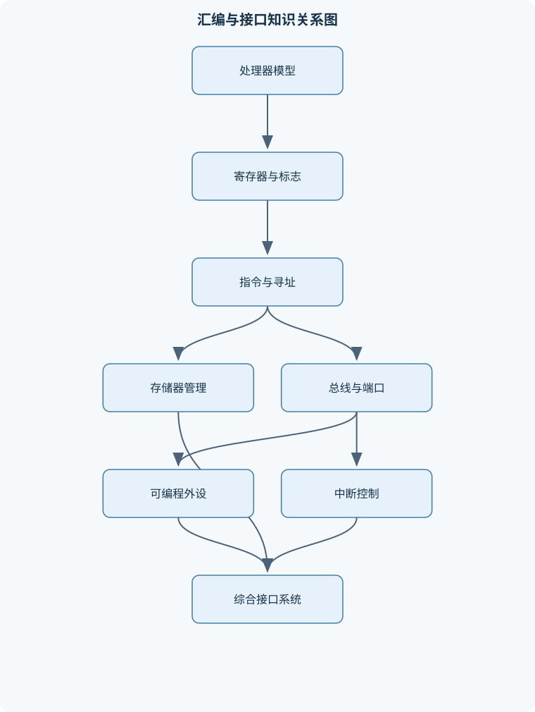
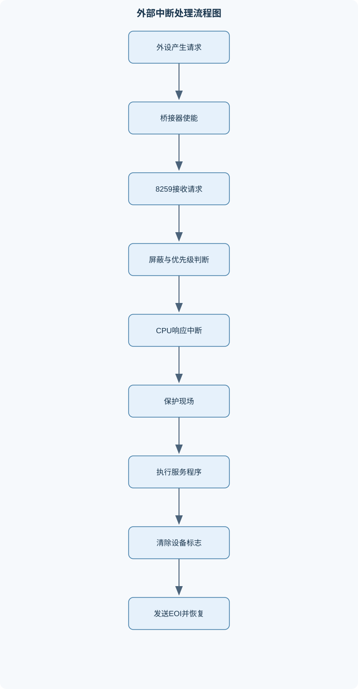

# 汇编与接口

## 一、课程整体知识框架

### 课程边界与先修知识

本课程研究x86汇编语言、处理器工作机制、存储器与总线接口、可编程外设及中断系统。核心对象以8086/8088实模式及其向后兼容的汇编编程模型为基础，并延伸介绍80386及后续处理器中的保护模式、分页和任务运行机制；接口部分重点讨论I/O端口编程、8255并行接口、8253/8254定时器、8259A中断控制器、8250/16550串行接口，以及键盘、数码管、LCD和FPGA实验中常见的外设控制思想。先修知识包括二进制与十六进制表示、数字逻辑基础、计算机组成原理、C语言基本程序结构、存储器和总线的基本概念。课程不以现代操作系统内核开发或某一特定开发工具版本为边界，但应解释传统DOS/MASM实验环境与现代x86处理器、汇编器和操作系统之间的适用差异。





### 1. 课程对象、先修基础与适用边界

《汇编与接口》研究两个相互联系的对象：一是处理器如何解释指令、访问寄存器和存储器并改变控制流；二是处理器如何通过总线、端口、中断和控制时序与外部设备交换信息。课程以 8086/8088 实模式汇编模型为基础，因为该模型能清楚展示寄存器、段地址、堆栈、中断向量和独立 I/O 的基本因果关系；在此基础上延伸到 80386 及后续 x86 处理器的保护模式、分页和任务运行机制。

学习本课程需要能够进行二进制、八进制、十六进制之间的转换，理解门电路、锁存器、译码器和时序逻辑，知道 CPU、存储器、总线和外设控制器的基本职责，并具备 C 语言中的变量、条件、循环、函数和指针概念。传统 DOS/MASM 实验使用的固定中断向量、端口地址和设备布局，只适用于相应的硬件及运行环境，不能直接推广到现代操作系统。现代处理器仍然保留大量 x86 指令兼容性，但端口访问、特权指令、中断控制器、页表和设备驱动通常由操作系统管理，普通用户程序不能任意执行这些操作。

### 2. 处理器结构与汇编程序模型

CPU 可以抽象为执行单元、寄存器组、指令译码与控制逻辑、总线接口和存储层次之间的协作系统。指令寄存器保存当前正在解释的指令，指令指针保存下一条指令的位置，标志寄存器记录算术结果及处理器状态。8086 的通用寄存器包括 $AX$、$BX$、$CX$、$DX$，分别常被用于累加、基址、计数和数据传送；每个寄存器可分成高、低字节，例如 $AX$ 分为 $AH$ 和 $AL$。$CS$、$DS$、$SS$、$ES$ 分别表示代码段、数据段、堆栈段和附加段，$IP$、$SP$、$BP$、$SI$、$DI$ 分别承担指令定位、栈顶定位、栈帧访问、源变址和目的变址功能。

数据总线传送数据，地址总线选择存储单元或 I/O 端口，控制总线传送读、写、中断响应和总线请求等控制信号。8086 具有 20 根地址线，可形成 $2^{20}=1$ MB 的物理地址空间。其取指和执行并非严格完成一条后才开始下一条，而是通过总线接口单元预取指令、执行单元译码执行形成流水式配合；遇到转移、调用或中断时，已预取的指令可能失效，需要重新取指。

汇编源程序通常包含段定义、符号定义、指令、伪指令、过程和宏。汇编器把助记符及操作数翻译为目标模块，链接器解析跨模块外部符号并组合代码和数据，装载器再根据运行环境安排内存、设置段寄存器和入口地址。汇编错误通常来自语法、操作数宽度不一致、未定义符号或段属性冲突；链接错误则多来自外部符号缺失、重复定义或段组合方式不匹配，二者不能混为一谈。

### 3. 数制、数据表示与寻址方式

$b$ 表示二进制位，取值为 0 或 1；$B$ 表示 8 位字节，$W$ 表示 8086 中的 16 位字，$D$ 表示 32 位双字。无符号 $n$ 位数的范围为 $0$ 至 $2^n-1$。补码 $n$ 位有符号数的范围为

$$
-2^{n-1}\le x\le 2^{n-1}-1。
$$

最高位的权值为 $-2^{n-1}$，其余位的权值为正。因而 8 位 $80H$ 既可解释为无符号数 128，也可解释为有符号数 $-128$。字符数据通常采用 ASCII 编码，但字符编码本身不等于数值的数学意义。多字节整数在 x86 内存中通常采用小端序：低有效字节存放在低地址。例如双字 $12345678H$ 在连续地址中依次存放 $78H$、$56H$、$34H$、$12H$。

8086 实模式的逻辑地址写作 $segment:offset$，物理地址为

$$
physical=16\times segment+offset。
$$

例如 $DS=2A10H$、偏移量为 $1350H$ 时，段基址为 $2A100H$，物理地址为 $2B450H$。该公式适用于 8086 实模式的 20 位地址计算。由于段基址以 16 字节为单位，多个逻辑地址可以指向同一物理地址，这称为段重叠。若加法超过 20 位，在采用 8086 地址回绕语义的条件下可能丢弃最高位；在其他处理器模式或开启地址扩展的条件下，不能机械套用这一结论。偏移量超过段内实际有效范围时，还必须检查段限长或硬件地址边界。

有效地址 $EA$ 是内存操作数在段内的偏移量。立即数直接包含在指令中，寄存器寻址直接使用寄存器内容，寄存器间接寻址把寄存器内容作为地址，变址、基址变址和比例寻址则将基址、变址、位移及比例因子组合。8086 常见形式不含现代 x86 的任意比例因子；80386 及后续处理器可以使用

$$
EA=base+index\times scale+displacement，
$$

其中 $scale$ 通常取 1、2、4 或 8。使用 $BP$ 相关寻址时，默认段通常为 $SS$；其他常见数据寻址默认使用 $DS$。地址对齐有利于访问效率，但 x86 一般允许非对齐访问；跨越段界限、页边界或设备寄存器边界时，可能产生额外访问甚至错误，不能仅凭“地址可计算”判断访问安全。

### 4. 基本指令、标志与控制流

数据传送包括寄存器、内存、立即数、堆栈及段寄存器之间的传送。算术指令包括加、减、加一、减一、带进位加减以及乘除；逻辑和移位指令用于屏蔽、置位、清零、测试和位域提取。$CMP$ 实际执行概念上的减法并更新标志，但通常不保存差值；$TEST$ 执行概念上的按位与，也只保留标志结果。

$CF$ 表示无符号运算产生的进位或借位，$OF$ 表示有符号结果超出表示范围，$ZF$ 表示结果为零，$SF$ 反映结果最高位，$AF$ 记录低半字节向高半字节的进位，$PF$ 反映低字节中 1 的奇偶性，$DF$ 决定字符串指令中 $SI$、$DI$ 的增减。8 位计算 $7FH+01H=80H$，结果的 $CF=0$，但两个正数相加得到负数解释，故 $OF=1$。这说明不能把 $CF$ 当作所有形式的“溢出标志”。

无符号比较使用 $JA/JB/JE$ 等条件，核心关系为 $CF=0$ 且 $ZF=0$ 表示大于，$CF=1$ 表示小于，$ZF=1$ 表示相等；有符号比较使用 $JG/JL/JE$，其大于条件为 $ZF=0$ 且 $SF=OF$，小于条件为 $SF\ne OF$。同一个位模式在无符号和有符号解释下可能产生相反结论。堆栈遵循后进先出，8086 中压栈通常使 $SP$ 减 2 后写入字，出栈先读出再使 $SP$ 加 2。近调用保存返回偏移，远调用还保存返回段值；因此远返回必须恢复 $CS$ 和 $IP$。

字符串指令使用 $SI$、$DI$ 和 $CX$，配合 $REP$ 等前缀可以进行复制、比较和扫描。$DF=0$ 时地址递增，$DF=1$ 时地址递减。复制重叠区域时，若目的区域位于源区域高地址一侧，应从尾部向前复制，否则可能先覆盖尚未读取的数据。

### 5. 程序结构、过程、宏与模块化

顺序、分支和循环是汇编程序的基本控制结构。过程调用需要明确参数传递约定、返回值位置、现场保护责任以及栈平衡责任。常见栈帧建立过程为保存旧 $BP$、令 $BP=SP$，再通过固定偏移访问参数和局部变量；调用者与被调用者必须约定哪些寄存器由谁保存。递归过程还必须保证每次调用都能到达边界条件，否则会持续消耗栈空间。

过程在运行时通过调用和返回执行同一份机器代码；宏在汇编期间展开，调用宏可能导致代码体重复，适合短小且参数替换明确的操作。模块化程序还需要处理公共符号、外部符号、段组合和重定位。伪指令负责定义数据、分配空间、指定段属性和控制汇编器行为，并不一定生成处理器执行的机器指令。

### 6. 存储器管理与高级处理器机制

8086 分段模型通过段值和偏移构成物理地址；80386 保护模式则先利用段选择子查找描述符。描述符规定段基址、限长、类型、权限和存在状态，处理器据此检查访问是否越界、是否具有读写或执行权限。全局描述符表用于系统范围的段描述，局部描述符表可用于特定任务；中断描述符表保存中断或异常入口信息。

分页把线性地址分为页目录索引、页表索引和页内偏移。以常见 4 KB 页、32 位地址为例，页内偏移占 12 位，剩余高位分别用于页目录和页表索引。页目录项选择页表，页表项选择物理页框，页内偏移保持不变。若页存在位 $P=0$，或读写位、用户/超级用户位不满足访问要求，处理器产生缺页或保护异常，而不是返回一个普通物理地址。虚拟存储器允许地址空间大于当前物理内存，但页面换入换出会引入较大延迟；页表和缓存也会消耗物理资源。

### 7. 总线、I/O 与外设接口基础

I/O 可以采用存储器映射方式或独立 I/O 方式。独立 I/O 使用端口地址和 `IN`、`OUT` 指令；端口地址只表示外设寄存器的编址位置，不能仅凭地址数值判断它是数据寄存器、状态寄存器还是控制寄存器。端口宽度必须与芯片规定和指令访问宽度相符。地址译码负责确定哪个设备响应，若多个设备同时响应，就会产生总线冲突或读回数据不确定。

一次可靠的 I/O 操作通常包括复位、配置方向和工作方式、清除旧状态、读写数据、检查状态以及关闭时恢复资源。轮询实现简单，但 CPU 必须反复读取状态；中断方式可减少空等，却要求保护现场、清除设备请求并向中断控制器发送结束命令。机械开关需要去抖，异步输入进入同步逻辑时需要同步器，否则可能出现亚稳态。总线握手的本质是发送方和接收方通过请求、应答、就绪或忙信号确认数据何时有效。

### 8. 8255 并行接口、显示和输入

8255A 含 A、B、C 三个 8 位端口及控制寄存器。方式 0 提供基本输入输出，适用于开关量采集和 LED 输出；方式 1 通过端口 C 的握手线实现选通输入或输出；方式 2 允许 A 口双向传输，并占用 C 口的部分信号。控制字必须同时规定端口方向和工作方式，错误的方向配置会造成数据未锁存或输出冲突。端口 C 还支持按位置位/复位控制，可单独改变某一位而不改写其他位。

数码管显示需要段码和位选。动态扫描时，程序依次选通一位、输出段码、保持一段时间、关闭当前位，再切换下一位。扫描频率过低会闪烁；切换时未消隐会重影；共阳与共阴数码管的段码有效电平相反。LCD 控制还必须区分命令寄存器和数据寄存器，并满足使能脉冲、建立时间和保持时间要求。

### 9. 定时器与串行通信

8253/8254 含多个独立计数器，计数初值 $N$ 由低字节和高字节按控制字规定的顺序装入。若输入频率为 $f_{in}$，理想定时时间近似为

$$
T\approx\frac{N}{f_{in}}，
$$

输出频率约为 $f_{in}/N$。该关系适用于时钟稳定、计数方式明确且忽略装载和响应延迟的理想条件。方式 0 可用于一次性终端计数，方式 2 适合周期性分频，方式 3 常用于方波，其他方式分别涉及软件触发、硬件触发和单稳输出。实际误差来自晶振误差、整数取整、装载时刻和中断延迟。

8250/16550 串口通常包含发送保持、接收、线路控制、线路状态和中断识别等寄存器。异步帧由起始位、数据位、可选奇偶校验位和停止位构成。若每帧总位数为 $L$，波特率为 $R$，理论有效字节率为

$$
\frac{R}{L}
$$

帧每次传送一个数据字节时成立；不能简单用 $R/8$ 代替。轮询适合低速、简单设备；中断接收能降低等待，但必须及时读取接收寄存器，避免溢出。

### 10. 中断系统与 8259A

可屏蔽中断受中断允许标志和控制器屏蔽位影响，不可屏蔽中断不能通过普通屏蔽位禁止。8086 实模式中，类型号为 $T$ 的中断向量位于向量表偏移 $4T$，一个向量包含服务程序偏移和段地址，共 4 字节。CPU 响应中断时保存返回地址和标志，服务程序仍需保存其会修改的通用寄存器、必要的段寄存器和方向标志。

8259A 的 $IRR$ 表示尚未响应的请求，$ISR$ 表示正在服务的请求，$IMR$ 表示屏蔽状态，$IMR$ 某位为 1 通常表示屏蔽对应请求。一个请求要进入服务，必须未被屏蔽、CPU 允许中断、触发条件有效，并通过优先级比较。响应后请求从 $IRR$ 转入 $ISR$；服务结束时发送 EOI，使对应服务状态清除，否则低优先级或后续请求可能长期得不到响应。

初始化通常依次写入 ICW1 至 ICW4；ICW2 为中断类型号基值，单片 8259A 的 8 个输入映射到连续类型号。级联系统中，从片的中断首先通过主片的级联输入到达 CPU，因此必须同时配置从片、主片级联位，并在服务结束时向从片和主片分别发送 EOI。OCW1 用于屏蔽，OCW2 用于 EOI 和优先级操作，OCW3 用于查询和读取状态。边沿触发依赖有效边沿，电平触发要求外设撤销有效电平，否则可能重复请求。中断服务程序应短小，不应调用不可重入的 DOS 服务或执行长时间显示操作。

### 11. 综合实验与调试主线

综合实验把定时器、并行口、串口、中断控制器和显示设备连接为完整系统。例如电子钟可由定时器周期中断累加节拍，达到规定次数后进位到秒、分和时，再由主循环完成数码管扫描。中断程序只更新计数或设置标志，不承担耗时显示。开关输入和 LED 输出实验重点验证 8255 控制字、端口方向和有效电平；外部脉冲中断实验重点观察触发、屏蔽、IRR、ISR 和 EOI；FPGA 实验则重点检查时钟分频、同步复位、状态机转移、引脚分配和输出极性。

调试应从电源与复位开始，依次核对接线、端口映射、地址译码、数据方向、状态寄存器、控制字、时序、中断标志和现场恢复。逻辑分析仪可以观察脉冲宽度、周期和握手先后，寄存器记录可以判断请求是否产生、是否被屏蔽以及是否正确退出。生成文件或仿真通过不等于硬件一定正确，还必须验证真实时钟、复位、引脚和负载条件。

## 二、章节和模块划分

### 核心知识覆盖清单

本清单用于检查正文是否覆盖本课程的主要知识模块：

- **处理器结构与汇编程序模型**：CPU寄存器组与执行单元、指令寄存器与标志寄存器、数据总线地址总线控制总线、8086内部结构与流水式取指、实模式地址空间、段寄存器与逻辑地址、汇编语言源程序结构、汇编器链接器装载器关系。
- **数制数据表示与寻址方式**：二进制八进制十六进制转换、无符号数与补码整数、字符数据与ASCII编码、小端字节序、字节字双字数据类型、立即数寄存器直接寻址、寄存器间接与变址寻址、基址变址与比例寻址、有效地址计算、越界与地址对齐。
- **x86基本指令与标志控制**：数据传送指令、算术运算指令、逻辑运算与移位指令、比较测试与条件转移、无符号条件与有符号条件、乘除法指令语义、BCD与ASCII调整、堆栈操作指令、标志位产生与使用、字符串指令与方向标志。
- **程序结构过程与宏机制**：顺序分支循环结构、近调用与远调用、过程参数传递、调用者与被调用者现场保护、栈帧与返回地址、递归过程的边界、宏与过程的区别、模块化汇编与外部符号、段定义与伪指令、汇编链接错误定位。
- **存储器管理与高级处理器机制**：分段地址转换、物理地址计算、段限长与访问属性、保护模式描述符、全局描述符表与局部描述符表、中断描述符表、分页地址转换、页目录与页表项、页面权限与缺页概念、虚拟存储器与物理内存边界。
- **总线I/O与外设接口基础**：存储器映射I/O与独立I/O、IN和OUT指令、端口地址译码、总线时序与握手、输入输出缓冲、状态寄存器与控制寄存器、轮询式I/O、硬件去抖与信号同步、设备初始化与关闭恢复、I/O资源冲突分析。
- **8255并行接口与显示控制**：8255A内部端口结构、方式0基本输入输出、方式1选通输入输出、方式2双向总线、端口C握手信号、控制字格式、按位置位复位控制、开关量采集、LED与数码管扫描、LCD时序与命令数据区分。
- **定时器与串行通信接口**：8253/8254计数器结构、计数初值装入顺序、方式0至方式5功能、计数频率与定时时间、方波与周期测量、8250/16550寄存器组、波特率与分频关系、数据位停止位奇偶校验、发送接收状态判断、串行通信轮询与中断。
- **中断系统与8259A控制器**：可屏蔽与不可屏蔽中断、中断响应时序、中断向量表、中断服务程序结构、8259A的IRR ISR IMR、ICW1至ICW4初始化、OCW1至OCW3操作、主从级联与级联请求、中断优先级与屏蔽、一般EOI与特殊EOI、边沿触发与电平触发、中断嵌套与现场保护。
- **综合接口实验与系统调试**：定时中断电子钟、8255开关输入LED输出、8259外部脉冲中断、数码管动态扫描、键盘或PS2输入处理、LCD控制器时序、FPGA计数器与状态机、实验接线与端口映射、逻辑分析与寄存器观察、中断退出与系统状态恢复。


### 1. 代表性算法与流程

#### 1.1 汇编执行状态分析

**输入**：指令序列、初始寄存器、内存、标志和段值。  
**输出**：每一步执行后的寄存器、内存、标志和下一条地址。  
**过程**：取指并确定操作数；计算有效地址；执行运算或传送；按指令定义更新标志；写回结果；根据顺序执行、转移、调用或返回确定下一条指令。  
**不变量**：未被指令定义的寄存器和标志不能擅自改变；每次 `PUSH` 与 `POP` 必须保持栈平衡。  
**终止条件**：到达指定停止、退出、`RET` 或分析边界。动态执行 $n$ 条指令时，逐条分析复杂度为 $O(n)$。

```asm
; 功能：计算无符号数组中的最大值
; 输入：DS:SI 指向数组，CX 为元素个数，元素为字节
; 输出：AL 为最大值；要求 CX=0 时返回 0
MAX_U8 PROC NEAR
    XOR  AX, AX
    JCXZ  DONE
    MOV   AL, [SI]
    INC   SI
    DEC   CX
NEXT:
    JCXZ  DONE
    CMP   AL, [SI]
    JAE   KEEP
    MOV   AL, [SI]
KEEP:
    INC   SI
    LOOP  NEXT
DONE:
    RET
MAX_U8 ENDP
```

该程序保持“$AL$ 等于已经扫描部分的最大值”这一不变量。`CMP` 之后使用 `JAE`，因为数组按无符号字节解释；若元素是补码有符号数，应改用 `JGE`。空数组边界由 `JCXZ` 处理。

#### 1.2 有效地址与物理地址计算流程

输入为段值、偏移表达式、寻址模式和处理器模式。先解析基址、变址、位移及比例因子，再计算 $EA$；随后根据模式进行段转换；最后检查地址宽度、段限长、页权限和回绕。单个地址计算为 $O(1)$。8086 实模式使用 $16\times segment+offset$，保护模式不能用该公式代替描述符查找，分页还需继续查页目录和页表。

#### 1.3 中断向量安装与恢复流程

输入为类型号、服务程序入口、原向量和设备配置。先保存原向量；再准备服务程序；写入新向量；配置设备和 8259A 屏蔽位；服务程序保存现场、读取或清除设备状态、更新少量数据、发送正确 EOI 并恢复现场；退出时恢复原向量和原屏蔽状态。服务期间必须保持栈平衡。若为级联 8259A，从片请求对应的服务结束通常需要先处理从片，再处理主片。该流程适用于实模式实验，不适用于由现代操作系统完全接管的用户态程序。

#### 1.4 动态数码管扫描流程

输入为数字数组、段码表、位选表和扫描保持时间。依次取一位数字，查表得到段码，先关闭所有位选，输出段码，再选通当前位，保持规定时间，关闭位选后进入下一位。设显示位数为 $d$，每位保持时间为 $t_h$，一轮扫描周期近似为 $dt_h$，扫描频率为 $1/(dt_h)$。扫描频率过低会闪烁；保持时间过短会使平均亮度下降；同时选通多位会导致串位和过流。

### 2. 例题与逐步解答

#### 例题一：实模式逻辑地址转换

**题干**：已知 $DS=2A10H$，偏移量为 $1350H$，求物理地址，并说明偏移量为 $F200H$ 时是否改变计算方法。

**分析**：8086 实模式段基址等于段值左移 4 位，物理地址为段基址与偏移相加。

**解答**：

1. $2A10H\times16=2A100H$；
2. $2A100H+1350H=2B450H$；
3. 偏移量为 $F200H$ 时，结果为 $39100H$，仍在 20 位地址范围内；
4. 若相加结果超过 $FFFFFH$，必须说明是否采用 8086 实模式的 20 位回绕语义；
5. 若处理器处于保护模式或分页环境，不能直接使用该公式。

**结果验证**：把物理地址减去段基址，分别得到原偏移 $1350H$ 和 $F200H$。  
**变式**：若使用 $BP$ 相关寻址，默认段通常是 $SS$ 而非 $DS$，必须先确认指令的默认段规则。

#### 例题二：补码加法与标志

**题干**：计算 8 位数 $7FH+01H$，判断 $CF$ 和 $OF$，并分别给出无符号、有符号解释。

**分析**：$7FH$ 是无符号 127，也是有符号 127；$01H$ 为 1。

**解答**：

1. 二进制相加得到 $80H$；
2. 结果未产生第 8 位向第 9 位的进位，所以 $CF=0$；
3. 两个正数相加结果最高位为 1，超出有符号最大值 127，因此 $OF=1$；
4. 按无符号解释，结果为 128；
5. 按有符号补码解释，$80H=-128$，但这不是数学和 128 的合法 8 位有符号表示。

**结果验证**：有符号范围为 $-128$ 至 127，128 超出上界，故必须置 $OF$。  
**变式**：$FFH+01H=00H$ 时 $CF=1$、$ZF=1$，但有符号解释为 $-1+1=0$，因此 $OF=0$。

#### 例题三：无符号与有符号比较

**题干**：比较 $FFFEH$ 与 $0001H$，分别判断无符号大小和有符号大小，应使用哪些条件转移。

**分析**：`CMP A,B` 计算 $A-B$ 并只更新标志。

**解答**：

1. $FFFEH-0001H=FFF DH$；
2. 无符号解释中，$FFFEH=65534$，大于 1，因此使用 `JA`；
3. 有符号解释中，$FFFEH=-2$，小于 1，因此使用 `JL`；
4. `JA` 依据 $CF=0$ 且 $ZF=0$，`JL` 依据 $SF\ne OF$；
5. 不能因结果最高位为 1 就直接断定无符号数较小。

**结果验证**：分别将两个操作数转换为无符号和补码十进制，所得结论相反。  
**变式**：若要求判断相等，二者均使用 `JE`，因为相等条件只依赖 $ZF=1$。

#### 例题四：近调用栈变化

**题干**：$SP=1000H$ 时执行近调用，调用目标过程后执行 `PUSH BP`。求返回地址和旧 $BP$ 的栈位置变化。

**分析**：近调用保存返回偏移，8086 每次压入一个字使 $SP$ 减 2。

**解答**：

1. 执行 `CALL` 后，返回偏移写入 $SS:0FFEH$，$SP=0FFEH$；
2. 执行 `PUSH BP` 后，旧 $BP$ 写入 $SS:0FFCH$，$SP=0FFCH$；
3. 若执行 `MOV BP,SP`，则当前栈帧基址为 $0FFCH$；
4. `RET` 弹出返回偏移，使 $SP$ 回到 $1000H$；
5. 远调用还会先保存 $CS$，所以远返回必须恢复段值和偏移。

**结果验证**：每个压入字使 $SP$ 减 2，每个弹出字使 $SP$ 加 2，过程结束后栈应恢复原值。  
**变式**：若过程使用两个字参数，应明确参数由调用者压入的顺序，并根据当前 $BP$ 的偏移访问。

#### 例题五：8259A 级联请求

**题干**：从片接到主片 IR2，外设连接从片 IR5。分析请求路径及 EOI 发送对象。

**分析**：外设先触发从片 IR5，从片向主片 IR2 发级联请求，主片再向 CPU 发出中断请求。

**解答**：

1. 从片的 IR5 未被从片 IMR 屏蔽，且触发条件有效；
2. 从片将请求记录在自身 IRR，并通过级联线请求主片 IR2；
3. 主片 IR2 也必须未被屏蔽，否则请求到不了 CPU；
4. 从片 ICW2 决定该请求对应的类型号基值加 5；
5. 服务完成后向从片发送 EOI，使从片 ISR 对应位清除；
6. 再向主片发送 EOI，使主片 IR2 的服务状态清除。

**结果验证**：若只向从片发送 EOI，主片仍认为 IR2 正在服务；若只向主片发送 EOI，从片仍可能阻塞后续请求。  
**变式**：单片系统只需向该片发送 EOI，但仍必须先清除设备本身的请求状态。

### 3. 实验与项目流程

#### 实验一：定时中断电子钟

**输入数据**：定时器输入频率 $f_{in}$、目标节拍、计数器位宽、数码管位数和段码表。  
**步骤**：

1. 根据 $N\approx f_{in}T$ 计算计数初值，检查 $N$ 是否超出计数器范围；
2. 按控制字规定顺序写入低字节和高字节；
3. 配置并行口，验证位选和段码极性；
4. 保存原中断向量和屏蔽寄存器；
5. 安装服务程序，服务程序只增加节拍计数并在达到规定次数时更新时间；
6. 主循环执行数码管动态扫描；
7. 退出时发送正确 EOI，恢复向量、屏蔽位和设备状态。

**评价标准**：定时周期误差在允许范围内；时间进位正确；显示无明显闪烁和重影；中断退出后主程序和系统状态恢复。  
**排错方法**：若计数正确但显示错误，依次检查端口地址、段码极性、位选极性、扫描顺序和消隐；若中断只发生一次，检查设备状态清除和 EOI；若系统退出异常，检查现场保护、栈平衡及原向量恢复。

#### 实验二：8255 开关输入与 LED 输出

**输入数据**：开关状态序列、8255 端口地址、控制字和 LED 有效电平。  
**步骤**：

1. 确定 A、B、C 三个端口的数据方向；
2. 写入方式 0 控制字，清除输出端口初始状态；
3. 周期性读取开关输入端口；
4. 根据硬件有效电平进行必要的取反或屏蔽；
5. 将处理结果写入 LED 端口；
6. 改变开关组合，记录输入值和 LED 输出值；
7. 关闭设备并恢复端口状态。

**评价标准**：每个开关组合都产生预期 LED 状态；输入改变后输出响应稳定；无端口争用和异常发热；复位后输出处于安全状态。  
**排错方法**：先用固定常量测试 LED 输出，再单独读取输入端口；若读值随机，检查接地、上拉和去抖；若所有 LED 反相，检查共阳/共阴或有效电平；若写入无效，核对地址译码和端口方向。

### 4. 易错点、笔试问题与面试问题

#### 4.1 具体易错点

1. 把逻辑地址直接当作物理地址，漏乘 16。
2. 混淆小端序，错误地把高字节写入低地址。
3. 将 $CF$ 当成所有加法的溢出标志，忽略 $OF$。
4. 把 `CMP` 当成保存减法结果的指令。
5. 无符号比较误用 `JG/JL`，有符号比较误用 `JA/JB`。
6. 使用 $BP$ 寻址时错误地默认段为 $DS$。
7. 近调用和远调用均只恢复 $IP$。
8. 中断服务程序未保护通用寄存器、段寄存器或 $DF$。
9. 修改 IMR 时直接写固定常数，破坏其他中断源的屏蔽状态。
10. 只屏蔽从片而未打开主片级联请求。
11. 混淆 $IRR$、$ISR$ 和 $IMR$。
12. 服务程序只清除设备请求而不发送 EOI。
13. 电平触发设备未撤销有效电平，导致重复中断。
14. 8255 控制字中的端口方向与接线相反。
15. 数码管段码极性与共阳、共阴结构不匹配。
16. 动态扫描没有消隐，导致重影。
17. 把定时器初值简单写成秒数，忽略输入频率。
18. 把波特率直接当成有效字节率。
19. FPGA 复位极性、同步方式或时钟约束未核实。
20. 在中断服务程序中调用不可重入的 DOS 服务。

#### 4.2 典型笔试问题与解答思路

1. **为什么同一结果可能 $CF=0$ 而 $OF=1$？**  
   无符号进位和有符号范围溢出是两种不同解释，分别观察最高位之外的进位和符号范围。

2. **为什么多个逻辑地址可以指向同一物理地址？**  
   段基址按 16 字节对齐，段值和偏移的组合存在多组等式。

3. **`CMP` 后如何选择 `JA` 或 `JG`？**  
   先确定数据解释，再依据 $CF/ZF$ 或 $SF/OF/ZF$ 推导条件。

4. **近调用与远调用有何栈差异？**  
   近调用保存偏移，远调用保存段和偏移，返回指令也必须匹配。

5. **分页中页内偏移为什么不改变？**  
   页框只替换高位页号，页内偏移用于定位页内字节，因此直接保留。

6. **8259A 中为什么需要 EOI？**  
   请求进入 $ISR$ 后仍被视为正在服务，EOI 负责清除相应服务状态并允许后续优先级判断。

7. **动态扫描为何会闪烁或变暗？**  
   闪烁由扫描频率过低造成，变暗通常由单个位保持时间过短或驱动电流不足造成。

8. **串口为什么不能用波特率除以 8 直接求字节率？**  
   每个数据字节还占用起始位、停止位和可能的校验位，必须除以完整帧位数。

#### 4.3 典型面试问题及回答要点

1. **如何设计一个可靠的中断服务程序？**  
   答：保存必要现场，快速处理设备状态和最小数据，发送 EOI，恢复现场并返回。追问时应说明不可重入服务、嵌套中断和栈平衡风险。

2. **如何定位“中断只执行一次”？**  
   答：依次检查设备请求是否清除、$IRR$ 是否重新置位、$IMR$ 和 CPU 中断允许状态、服务程序是否发送 EOI。不能只检查向量是否安装。

3. **如何处理重叠内存复制？**  
   答：比较源、目的地址范围；目的在高地址侧时从尾到头复制并置 $DF$，否则从头到尾复制。追问可说明 `REP MOVSB` 的方向和边界。

4. **如何验证一个定时器的实际精度？**  
   答：由理论 $N/f_{in}$ 得到周期，再用示波器或逻辑分析仪测量多个周期，区分时钟误差、整数取整和中断响应延迟。

5. **8255 方式 1 与方式 0 如何选择？**  
   答：数据时序简单且 CPU 可主动读取时用方式 0；外设数据到达时间不确定、需要锁存和握手时用方式 1。追问应说明 STB、INTR 和数据读取的关系。

6. **如何避免数码管显示重影？**  
   答：先关闭位选，再改变段码，等待稳定后选通新位；确保段码和位选极性正确，并控制扫描周期。

7. **如何判断串口丢数原因？**  
   答：检查接收状态、FIFO、波特率和帧格式，再比较轮询周期或中断响应时间是否超过接收缓冲容量。追问应区分帧错误、奇偶错误和溢出。

8. **如何验证 FPGA 状态机不是“仿真正确、硬件错误”？**  
   答：核对时钟约束、复位释放同步、输入同步器、引脚分配和输出极性，并用片上观测或外部仪器验证实际波形。仿真结果只能证明模型在给定激励下的行为。

### 5. 岗位关联与验收产出

嵌入式软件、固件和设备接口岗位需要编写端口初始化、寄存器驱动、中断服务和设备状态机，产出通常包括可运行程序、寄存器配置说明、接口时序和异常处理记录，验收标准是功能正确、边界条件明确、现场可恢复且长时间运行稳定。硬件测试和自动化测试岗位需要根据地址映射、时序和状态寄存器设计测试用例，产出测试脚本、波形记录、故障定位报告和回归结果，验收标准是覆盖正常、边界和故障场景。FPGA 逻辑设计岗位需要实现计数器、分频器、握手逻辑和状态机，产出 RTL、约束、仿真波形和板级验证记录，验收标准是时序满足、复位可靠、输入同步且实际引脚行为与设计一致。系统调试岗位则需要结合寄存器观察、逻辑分析和接线核对定位端口冲突、中断丢失、显示异常和串行通信错误，最终产出可复现的故障原因、修复措施和复测证据。

## 三、核心概念的详细解释

### 1. 处理器结构与汇编程序模型

x86处理器可抽象为控制部件、执行部件、寄存器组、总线接口和存储层次。控制部件从内存取得指令，完成译码并产生控制信号；执行部件进行算术、逻辑、移位和地址计算；寄存器组保存操作数、地址、中间结果和处理器状态。指令寄存器保存当前正在解释的指令，指令指针保存下一条指令的偏移位置，$FLAGS$保存运算结果及控制状态。

8086的$AX$、$BX$、$CX$、$DX$为16位通用寄存器，分别常用于累加、基址、计数和数据传送，但这些用途不是硬件强制限制。每个通用寄存器可分为两个8位部分，例如$AX$由$AH$和$AL$组成。$CS$、$DS$、$SS$、$ES$分别用于代码、数据、堆栈和附加数据段；$IP$、$SP$、$BP$、$SI$、$DI$分别承担指令定位、栈顶定位、栈帧访问、源变址和目的变址功能。

8086有20根地址线，可表示$2^{20}=1$ MB的物理地址空间。数据总线传送数据，地址总线选择存储单元或端口，控制总线传送读、写、中断响应、总线请求等信号。8086的总线接口单元可以预取若干指令，执行单元同时进行译码和执行，因此取指与执行在一定程度上重叠。遇到跳转、调用、返回或中断时，已经预取但不再属于当前控制流的指令必须丢弃，重新取指。

汇编源程序经过汇编器、链接器和装载器才能成为可运行程序。汇编器把助记符、操作数和伪指令转换为目标模块，并生成符号及重定位信息；链接器组合多个目标模块，解析外部符号并安排段的组合关系；装载器把程序放入具体内存，设置入口地址和运行环境。语法错误、非法操作数、符号未定义通常在汇编阶段报告；外部符号缺失、重复定义和模块段属性冲突通常在链接阶段报告。

### 2. 数制、数据表示、字节序与寻址

$b$表示二进制位，取值为0或1；$B$表示8位字节；$W$表示16位字；$D$表示32位双字。无符号$n$位数的范围是$0$至$2^n-1$。补码$n$位有符号数的范围是

$$
-2^{n-1}\le x\le 2^{n-1}-1。
$$

补码最高位的权值为$-2^{n-1}$，其余位的权值为正。例如8位数据$80H$作为无符号数是128，作为有符号补码是$-128$。同一位模式的意义取决于程序采用的解释方式，处理器通常只保存位模式，不保存“有符号”或“无符号”标签。

x86通常采用小端字节序。多字节整数的低有效字节放在低地址。例如双字$12345678H$在连续内存中依次存放$78H$、$56H$、$34H$、$12H$。小端序不改变寄存器中数值的数学意义，却会影响内存逐字节观察、端口装载、网络数据解析和结构体布局。字符数据是编码后的整数位模式，ASCII字符`'0'`到`'9'`连续排列，因此数字字符转数值时通常需要减去`'0'`的编码值，但字符`'5'`不能直接当作数值5使用。

内存操作数的有效地址记为$EA$，它表示段内偏移量。8086常见寻址形式包括立即数、寄存器、直接内存、寄存器间接、基址、变址以及基址加变址并带位移。若地址表达式含$BP$，默认段寄存器通常为$SS$；其他常见内存寻址形式默认使用$DS$。显式段超越前缀可以改变默认段寄存器。这个规则解释了为什么访问栈帧参数时常用$BP$，而访问普通数组时常用$BX$、$SI$或$DI$。

### 3. 8086实模式、分段与地址边界

8086实模式的逻辑地址写作$segment:offset$。段寄存器中的值先左移4位形成段基址，再加上偏移量：

$$
physical=16\times segment+offset。
$$

例如$DS=2A10H$、偏移量为$1350H$时，

$$
2A10H\times16=2A100H,
$$

因此

$$
physical=2A100H+1350H=2B450H。
$$

公式成立的条件是处理器处于8086实模式或兼容的实地址计算环境，并按20位地址总线解释结果。偏移量通常为16位，最大为$FFFFH$。由于段基址之间只相差16字节，而一个段最多覆盖64 KB，不同逻辑地址可能指向同一物理地址，这就是段重叠。例如$1000H:0010H$和$1001H:0000H$均可形成$10010H$。

在早期8086地址回绕情形下，若加法结果超过20位，超出的高位不能由20根地址线传送，可能回绕到低端地址。是否发生回绕取决于具体处理器和系统地址线实现，不能把所有后续x86环境都按同一规则处理。实模式也不提供段限长和访问权限检查，因此偏移越界可能覆盖另一个段中的数据；保护模式下则由描述符中的段界限和属性进行检查。

### 4. 指令、标志和控制流

数据传送指令通常不改变算术标志，算术指令会根据结果设置$CF$、$ZF$、$SF$、$OF$、$AF$和$PF$。$CF$表示无符号加法产生进位或无符号减法需要借位；$ZF$表示结果是否为零；$SF$通常等于结果最高位；$OF$表示有符号运算结果是否超出可表示范围。$AF$反映低4位向高4位的进位或借位，常用于BCD调整；$PF$反映结果低字节中1的个数是否为偶数；$DF$控制字符串指令处理方向。

`CMP destination, source`执行概念上的减法$destination-source$，但不保存差值，只更新标志。因此比较后必须根据无符号或有符号语义选择条件转移。无符号“小于”使用$CF=1$，无符号“大于”使用$CF=0$且$ZF=0$；有符号“小于”使用$SF\ne OF$，有符号“大于”使用$ZF=0$且$SF=OF$。同样的位模式在两种解释下可能得到不同结论。例如$FFH$与$01H$比较，前者作为无符号数为255，作为8位补码为$-1$。

乘除法指令的操作数宽度和隐含寄存器必须明确。无符号乘法通常把两个$n$位数相乘，结果可能需要$2n$位保存；有符号乘法使用补码解释。除法要求被除数的宽度通常是除数的两倍，并将商和余数分别放入规定寄存器；除数为零或商超出目标寄存器范围都会导致异常或未定义的程序行为。BCD和ASCII调整指令只适用于特定编码及前置运算条件，不能把它们当作普通十进制运算。

### 5. 堆栈、过程、宏和字符串指令

8086堆栈向低地址增长。执行`PUSH`时，$SP$先减小，再把数据写入$SS:SP$；执行`POP`时，先从$SS:SP$取数据，再增加$SP$。近调用保存返回偏移，远调用同时保存返回段和返回偏移。`RET`和远返回必须按照对应调用类型弹出相同数量和类型的返回信息，否则会造成$SP$失衡或返回到错误地址。

典型过程入口可以保存旧$BP$，再令$BP=SP$，从而以固定偏移访问参数和局部变量。调用者与被调用者必须约定哪些寄存器由谁保存；若过程修改了调用者仍需使用的寄存器，就必须先保存并在返回前恢复。递归过程还必须保证每次调用都有独立的返回地址和局部数据，并设置能够到达的终止条件，否则堆栈会持续增长直至破坏内存。

宏在汇编阶段展开，每次使用可能生成一份指令副本；过程只保存一份代码，运行时通过调用和返回复用。宏适合生成短小、与参数相关的固定代码，过程适合减少代码重复并集中维护。字符串指令使用$SI$、$DI$和$CX$等隐含寄存器。$DF=0$时处理后地址递增，$DF=1$时递减；带`REP`前缀时，$CX$每处理一次减1，直到$CX=0$。复制重叠区域时，必须根据源、目的地址关系选择正向或反向复制，否则尚未复制的数据可能被提前覆盖。

### 6. 存储器层次、保护模式与分页

80386及后续处理器引入保护模式。逻辑地址中的段选择子指向全局描述符表或局部描述符表中的描述符，描述符提供段基址、段界限、类型、特权级和存在位等信息。处理器先检查选择子、描述符权限和偏移是否超出段界限，再形成线性地址。代码段、数据段、堆栈段和系统段具有不同访问规则；非法访问通常产生保护异常，而不是静默地返回某个普通地址。

分页把线性地址划分为页目录索引、页表索引和页内偏移。以32位、4 KB页面的典型两级分页为例，线性地址可分为10位页目录索引、10位页表索引和12位页内偏移。页目录项找到页表，页表项找到物理页框，页内偏移保持不变。若页面大小为$2^p$字节，则页内偏移占$p$位。页目录项和页表项中的$P$位表示存在性，$R/W$控制读写权限，$U/S$控制用户态和管理态访问。

分页转换并不保证访问成功。若$P=0$，可能发生缺页异常；若权限不满足，即使页面存在，也可能产生保护异常。虚拟存储器允许进程使用大于当前物理内存容量的地址空间，但不意味着所有页面同时驻留内存。操作系统可将暂不活跃的页面换出到外部存储，缺页时再调入；这一过程会带来远高于普通内存访问的延迟。

### 7. 总线、I/O端口与外设寄存器

外设通常通过数据寄存器、状态寄存器和控制寄存器与CPU交互。独立I/O使用专门的端口地址和`IN`、`OUT`指令；存储器映射I/O则把设备寄存器放入处理器的地址空间，使用普通内存访问指令。独立I/O不占用普通内存地址范围，但需要处理器和总线支持I/O周期；存储器映射I/O编程统一，却必须防止缓存、乱序或错误的访问宽度影响设备语义。

端口地址译码决定某次总线访问由哪个设备响应。若多个设备同时响应，可能造成总线冲突；若没有设备响应，读取结果可能无效。端口宽度必须与设备寄存器规定一致，不能因为相邻地址存在就任意使用字或双字访问。设备初始化通常包括复位、配置方向、设置工作模式、清除旧状态、开放请求；关闭时应停止设备、屏蔽中断、清除挂起状态并恢复原有资源。

轮询方式由CPU反复读取状态寄存器，检测“数据就绪”“发送缓冲空”“计数结束”等位；实现简单但可能浪费CPU时间。中断方式由设备在事件发生时请求CPU，CPU执行服务程序，适合事件稀疏或等待时间较长的设备。握手信号用于协调双方速度，硬件去抖用于抑制机械开关在转换瞬间产生的多次跳变；异步输入进入同步逻辑时还需要同步器，以降低亚稳态传播风险。

### 8. 8255并行接口与显示控制

8255A包含A口、B口和C口三个8位端口。方式0提供基本输入输出，无需握手；方式1在端口C部分信号的配合下实现选通输入或输出；方式2主要用于A口双向总线，端口C承担方向控制、状态和中断请求功能。控制字必须同时说明端口方向、工作方式以及C口各部分的用途，方向设置与外部接线不一致时会造成读值错误、总线争用或握手信号无法产生。

按位置位/复位控制字只影响端口C的一个指定位置，适合单独控制LED使能、外部锁存器控制线或中断允许线。方式1输入时，外设先通过$STB$通知数据有效，8255锁存端口数据并产生状态变化；若配置为中断方式，还会使$INTR$有效。CPU读取数据端口后，相关状态通常按芯片规定被清除或推进到下一次握手阶段。

数码管动态扫描需要依次进行“关闭当前位、输出段码、选通目标位、保持一段时间、切换下一位”。共阴极和共阳极数码管的有效电平相反，段码表不能脱离硬件极性使用。扫描频率过低会产生闪烁；扫描时间过短会降低平均亮度；切换段码时未先消隐可能造成重影。LCD控制通常区分命令写入和数据写入，并要求满足使能脉冲宽度、建立时间和保持时间。

### 9. 8253/8254定时器与8250/16550串行接口

8253/8254包含多个独立计数器，每个计数器由初值寄存器、计数单元和输出逻辑组成。计数初值通常按低字节、高字节顺序装入，具体顺序由控制字确定。计数器工作方式包括一次性计数、可重复方波、软件触发和硬件触发等。若输入频率为$f_{in}$，计数初值为$N$，理想定时时间约为

$$
T\approx\frac{N}{f_{in}}。
$$

实际周期还受时钟误差、整数取整、门控信号、装载延迟和中断响应延迟影响。一次性计数适合单次延时，周期性方式适合周期中断或方波输出；若用软件每次重装载，重装载和服务程序执行时间会引入抖动。

8250/16550类串行接口一般包含发送保持寄存器、接收缓冲寄存器、线路控制寄存器、线路状态寄存器和中断识别/允许寄存器。异步帧通常由1个起始位、若干数据位、可选校验位和停止位组成。波特率是每秒符号数，不等于每秒有效字节数。若每帧包含$L$个总位数，则理想有效字节率约为

$$
R_{\text{byte}}=\frac{\text{波特率}}{L}
$$

其中$L$必须包含起始位、数据位、校验位和停止位。

### 10. 中断系统与8259A

中断分为可屏蔽中断和不可屏蔽中断。CPU响应可屏蔽中断通常需要中断允许状态有效，并且控制器没有屏蔽该请求。8086实模式中，类型号为$T$的中断向量位于物理地址$4T$处，占4字节：前两个字节保存偏移，后两个字节保存段值。中断响应时，CPU保存标志、代码段和返回偏移，随后根据向量转入服务程序。

中断服务程序必须保护会被修改且调用者仍需使用的寄存器，尽快读取或清除设备状态，完成必要计数或数据搬运，向控制器发送EOI，恢复现场并执行中断返回。不能在不可重入的系统服务内部随意调用DOS等系统功能，也不应在服务程序中执行耗时显示、复杂格式化或无限等待。

8259A的IRR表示尚未响应的请求，ISR表示正在服务的请求，IMR表示屏蔽状态；IMR某位为1通常表示对应请求被屏蔽。请求只有同时满足设备请求有效、IMR未屏蔽、CPU允许中断、优先级条件满足等条件，才可能从IRR进入ISR。服务完成后若不发送EOI，ISR中的服务级别可能一直保留，导致同级或低级请求无法继续响应。

初始化命令字ICW1至ICW4用于设置触发方式、向量基值、级联关系和处理器模式；操作命令字OCW1至OCW3用于屏蔽、查询和结束中断服务。主从级联时，从片的中断请求先接到主片某一输入线上，因此一次从片中断通常需要服务从片和主片两个控制器，结束时也应按级联关系发送相应EOI。边沿触发关注信号变化瞬间，电平触发要求请求电平被撤销；若电平请求未清除，发送EOI后可能立即再次进入服务。

## 四、重要定义、公式、定理和推导

### 专业审校补充：关键定义与适用边界

8253/8254的计数器不是理想连续计时器，而是按输入时钟边沿递减的离散计数器。设输入频率为$f_{in}$、目标周期为$T$、装入初值为$N$，理想关系为$T_N=N/f_{in}$，实际$N$必须是计数器允许范围内的整数，因此量化误差至少受一个时钟周期影响。方式2是周期性脉冲发生器：计数到终值时输出一个时钟宽度的有效脉冲并自动重装，适合产生周期请求；方式3是方波发生器：输出高、低电平各持续若干个输入时钟周期，偶数$N$通常各为$N/2$，奇数$N$时高、低持续时间相差一个时钟周期，不能简单认为占空比必为50%。GATE信号还会影响计数是否启动或重新触发，不能只依据初值推断输出。读取正在运行的16位计数器时，应使用锁存或读回机制，按规定顺序读取低字节和高字节；否则两个字节可能来自不同计数时刻，组合出的数值并非真实计数值。该离散模型适用于硬件定时和频率分频，不等同于操作系统高精度定时器。


### 1. 补码范围与溢出判定

$n$位补码的最高位权值为$-2^{n-1}$，其余位权值依次为$2^{n-2}$至$2^0$，所以最小值为

$$
-2^{n-1}
$$

最大值为

$$
2^{n-1}-1。
$$

加法结果只保留$n$位。若两个同号数相加后结果符号改变，则发生有符号溢出，$OF=1$；若最高位产生向外进位，则$CF=1$。二者针对不同数值解释，不能互相替代。

例如8位$7FH+01H=80H$。无符号计算为127加1等于128，没有第9位进位，因此$CF=0$；有符号计算中127加1超出最大值127，结果位模式$80H$解释为$-128$，因此$OF=1$。反例是$FFH+01H=00H$：无符号数255加1产生进位，$CF=1$；作为有符号数$-1+1=0$，没有有符号溢出，$OF=0$。

### 2. 逻辑地址到物理地址的计算流程

**输入：**段值、偏移量、处理器模式和地址宽度。  
**输出：**有效地址、物理地址以及可能的越界或回绕判断。  
**步骤：**

1. 解析寻址表达式中的基址、变址和位移，计算段内有效地址$EA$。
2. 判断默认段寄存器；含$BP$的形式通常使用$SS$，其他常见形式通常使用$DS$。
3. 在8086实模式下计算$16\times segment+EA$。
4. 检查$EA$是否超过操作数所在段的约定范围。
5. 检查结果是否超过20位地址宽度；若超过，必须依据具体模式和硬件确定是否回绕。
6. 在保护模式或分页环境中，不能直接套用实模式公式，还要经过段描述符检查及分页转换。

**不变量：**未被指令改变的段寄存器和地址成分不能被擅自修改。单个地址的计算复杂度为$O(1)$。

### 3. 调用、返回与栈平衡推导

设执行近调用前$SP=S$。近调用把返回偏移压入堆栈，因此调用后$SP=S-2$。过程执行`PUSH BP`后$SP=S-4$，再执行`MOV BP,SP$，旧$BP$位于$SS:BP$，参数和局部变量可按固定偏移访问。若过程结束执行`POP BP`，$SP$恢复到$S-2$；再执行近返回，弹出返回偏移，$SP$恢复到$S$。

远调用需要保存返回段和返回偏移，因而栈中比近调用多保存一个字。远返回必须同时恢复$IP$和$CS$。若过程入口采用近调用而出口使用远返回，或调用者和被调用者对参数清理数量不一致，$SP$会失衡，返回后后续`POP`、`RET`或中断返回都可能取到错误数据。

### 4. 字符串指令与重叠复制

字符串指令每次处理一个字节、字或双字，并根据$DF$改变$SI$和$DI$。当$DF=0$时：

$$
SI\leftarrow SI+\text{元素宽度},\qquad DI\leftarrow DI+\text{元素宽度}。
$$

当$DF=1$时：

$$
SI\leftarrow SI-\text{元素宽度},\qquad DI\leftarrow DI-\text{元素宽度}。
$$

使用`REP MOVSB`时，循环次数由$CX$决定，每完成一次复制，$CX$减1，$CX=0$时终止。

若目的区域起始地址高于源区域且两区域重叠，应从末端向前复制；否则先写入低端数据可能覆盖尚未读取的源数据。简化伪代码如下：

```text
输入：源首地址src，目的首地址dst，长度n
输出：目的区域保存原源区域的n个字节

若 n = 0：
    结束
若 dst < src 或 dst >= src + n：
    方向设为正向
    i 从 0 增加到 n-1：
        dst[i] = src[i]
否则：
    方向设为反向
    i 从 n-1 减少到 0：
        dst[i] = src[i]
```

每个字节只处理一次，时间复杂度为$O(n)$，额外空间复杂度为$O(1)$。地址区间判断必须考虑整数地址的边界和地址回绕，不能只比较两个首地址。

### 5. 分页地址转换推导

设页面大小为$2^p$字节，线性地址为$L$。页内偏移为

$$
offset=L\bmod 2^p。
$$

页号为

$$
page=\left\lfloor\frac{L}{2^p}\right\rfloor。
$$

在典型32位、4 KB页面、两级页表中，$p=12$，页目录索引和页表索引各占10位。页目录索引选择一个页表，页表索引选择一个页框，物理地址由页框基址加页内偏移组成：

$$
physical=frame\_base+offset。
$$

转换成功必须满足页目录项和页表项的$P$位有效，并且访问类型满足$R/W$、$U/S$等权限。如果$P=0$或权限不满足，处理器产生异常，操作系统可以据此调入页面或终止非法访问。页内偏移不会在页表查找中改变，因此页面映射改变的是页号到页框号的关系。

### 6. 条件转移的标志推导

`CMP A,B`执行概念上的$A-B$。当结果为零时$ZF=1$，所以等于条件为$ZF=1$，不等于条件为$ZF=0$。

无符号比较中，借位由$CF$表示：

- $A<B$：$CF=1$；
- $A>B$：$CF=0$且$ZF=0$；
- $A\le B$：$CF=1$或$ZF=1$；
- $A\ge B$：$CF=0$。

有符号比较中，结果符号与溢出标志共同判断：

- $A<B$：$SF\ne OF$；
- $A>B$：$ZF=0$且$SF=OF$；
- $A\le B$：$ZF=1$或$SF\ne OF$；
- $A\ge B$：$SF=OF$。

例如8位数据$FFH$和$01H$，无符号解释为255和1，因此$FFH>01H$；有符号解释为$-1$和1，因此$FFH<01H$。这说明条件转移指令本身没有“有符号版本”和“无符号版本”的数据类型标记，程序员必须根据数据意义选用条件。

### 7. 8259A请求状态分析流程

**输入：**IRR、ISR、IMR、CPU中断允许状态、触发方式、优先级和级联关系。  
**输出：**可响应请求、正在服务的级别及所需EOI对象。  
**步骤：**

1. 计算可见请求：屏蔽掉$IMR$中对应位为1的请求。
2. 检查CPU是否允许可屏蔽中断。
3. 按优先级比较新请求与$ISR$中正在服务的级别。
4. 若允许响应，将请求从$IRR$转入$ISR$并产生中断类型号。
5. 服务程序读取或清除设备状态，防止请求源持续有效。
6. 向从片和主片发送必要的EOI。
7. 再次检查是否仍有可响应请求。

单片控制器最多检查8个输入，扫描复杂度可视为$O(8)$；有$p$个级联控制器时约为$O(p)$。常见错误是只清除设备状态而不发送EOI，或者只向从片发送EOI而遗漏主片级联输入。

### 8. 定时器初值与串行有效速率

定时器输入频率为$f_{in}$，目标周期为$T$时，理想计数初值为

$$
N\approx f_{in}T。
$$

由于$N$必须是计数器可表示的整数，实际周期为

$$
T_{\text{actual}}\approx\frac{N}{f_{in}}。
$$

若要求周期误差不超过$\varepsilon$，应验证

$$
\left|T_{\text{actual}}-T\right|\le\varepsilon。
$$

若目标周期超过单个计数器范围，可使用分频、级联计数或中断累计。例如定时器每$50$ ms产生一次中断，则累计20次约为1秒；累计变量必须在中断与主程序共享时采用明确的访问约定，避免半更新状态被读取。

串行通信每帧总位数为

$$
L=1+D+P+S，
$$

其中1为起始位，$D$为数据位数，$P$为校验位数，$S$为停止位数。若波特率为$R$，则理论有效字节率为

$$
\frac{R}{L}
$$

帧中数据位数若为8、无校验、1个停止位，则$L=10$，有效吞吐量约为波特率的十分之一，而不是波特率除以8。

### 9. 8255方式1输入流程

**输入：**控制字、端口地址、外设数据和$STB$握手信号。  
**输出：**可靠采集的一个或多个数据样本。  
**步骤：**

1. 配置A口或B口为方式1输入，确定C口握手线方向。
2. 外设在数据稳定后使$STB$进入规定有效状态。
3. 8255锁存输入数据，并更新数据就绪状态。
4. 若开放中断，8255使$INTR$有效；否则CPU轮询状态寄存器。
5. CPU读取端口数据。
6. 按器件规定清除状态或完成下一次握手。
7. 检查是否达到样本数量或退出条件。

单个样本处理复杂度为$O(1)$。不变量是尚未被CPU读取的数据不能被新数据无条件覆盖；若外设到达速度超过读取速度，应增加缓冲、降低采样速率或采用更可靠的握手协议。

### 10. 动态数码管扫描流程

**输入：**待显示数字、段码表、位选表和扫描保持时间。  
**输出：**多位数码管的稳定显示。  

每轮扫描应执行：

1. 关闭所有位选，完成消隐；
2. 根据当前位索引取出待显示数字；
3. 查表得到段码，并按共阳或共阴极性转换；
4. 输出段码；
5. 选通当前位；
6. 保持规定时间；
7. 再次关闭位选并切换到下一位。

设有$d$位数码管，每位保持时间为$t_h$，则一轮扫描时间约为$d\,t_h$，单个位的刷新频率约为

$$
f_{\text{refresh}}=\frac{1}{d\,t_h}。
$$

扫描频率过低会闪烁；若为了提高频率而把$t_h$压得过短，单位时间内的导通时间减少，平均亮度下降。每轮扫描复杂度为$O(d)$，额外空间复杂度为$O(1)$。

### 11. 代表性例题：补码和条件转移

**题干：**计算8位$7FH+01H$，判断$CF$和$OF$，并说明若随后比较结果，应该采用哪类条件转移。

**分析：**$7FH$作为有符号数为127，$01H$为1；作为无符号数也分别为127和1。结果$80H$。

**解答：**

1. 二进制相加得到$10000000B$。
2. 保留低8位得到$80H$。
3. 第9位为0，因此$CF=0$。
4. 两个正数相加得到负符号位，发生有符号溢出，因此$OF=1$。
5. 若数据表示无符号量，应根据$CF$和$ZF$判断；若表示有符号量，应根据$SF$、$OF$和$ZF$判断。

**结果验证：**无符号结果为128，有符号位模式解释为$-128$，两个结果不同但均与同一位模式一致。

**变式：**计算$FFH+01H$。结果为$00H$，$CF=1$、$ZF=1$、$OF=0$，说明无符号溢出而有符号运算没有溢出。

### 12. 代表性例题：重叠区域复制

**题干：**源区域从$1000H$开始，长度为8字节；目的区域从$1004H$开始，要求复制后目的区域与原源区域内容相同。

**分析：**源区间为$[1000H,1008H)$，目的区间为$[1004H,100CH)$，两者重叠，且目的地址位于源地址高端。因此必须从末端向前复制。

**解答：**

1. 设置$SI=1007H$，$DI=100BH$，$CX=8$。
2. 设置$DF=1$。
3. 执行8次字节复制。
4. 每次复制后$SI$和$DI$减1，$CX$减1。
5. $CX=0$时清除方向标志，避免影响后续字符串操作。

**结果验证：**先复制源区最后一个字节，不会覆盖尚未读取的低地址源数据。

**变式：**若目的区域从$0FF0H$开始，则目的区域在源区域低端且不重叠，可以从低地址向高地址复制，并设置$DF=0$。

### 13. 代表性例题：定时器初值

**题干：**定时器输入频率为$1$ MHz，希望每$20$ ms产生一次计数结束事件，计数器允许装入不超过16位的整数。

**分析：**$f_{in}=1\,000\,000$ Hz，目标时间$T=0.020$ s。

**解答：**

$$
N\approx f_{in}T
=1\,000\,000\times0.020
=20\,000。
$$

因此装入初值$N=20000$，其十六进制表示为$4E20H$。若采用低字节、高字节装载方式，应先写$20H$，再写$4EH$。计数器工作方式必须选择与目标“一次性事件”或“周期性输出”相符的模式。

**结果验证：**

$$
T_{\text{actual}}=\frac{20000}{1\,000\,000}=0.020\text{ s}=20\text{ ms}。
$$

**变式：**若输入频率为$1.193182$ MHz，$N$必须取整数，实际周期还会包含取整误差，应计算实际值而不能直接写成20 ms。

### 14. 代表性例题：中断向量与级联

**题干：**实模式下中断类型号为$T=72H$，求中断向量表偏移；若外设接在从片的IR5，从片连接主片IR2，说明服务结束时的控制器处理。

**解答：**

1. 向量表偏移为

$$
4T=4\times72H=1C8H。
$$

2. 地址$1C8H$和$1C9H$保存服务程序偏移，地址$1CAH$和$1CBH$保存服务程序段值。
3. 外设请求先使从片IR5有效。
4. 从片通过级联线使主片IR2有效。
5. 主片向CPU报告中断，CPU根据类型号进入服务程序。
6. 服务程序先清除外设请求源，再向从片发送EOI，最后向主片发送EOI，具体顺序应符合控制器级联要求。

**结果验证：**若只向从片发送EOI，主片IR2对应的服务状态可能仍保留，后续从片请求无法正常转发。

**变式：**若只修改从片IMR而未开放主片IR2，即使从片内部请求未屏蔽，CPU仍可能收不到中断。

### 15. 代表性例题：串行吞吐量

**题干：**异步串行帧包含1个起始位、8个数据位、1个校验位和1个停止位，波特率为9600。求理论有效字节率。

**解答：**

每帧总位数为

$$
L=1+8+1+1=11。
$$

因此理论有效字节率为

$$
R_{\text{byte}}=\frac{9600}{11}\approx872.7\text{ 字节/秒}。
$$

实际吞吐量还会受到接收处理间隔、FIFO深度、中断延迟和错误重传影响。若采用轮询，轮询间隔过长可能导致接收缓冲溢出；若采用中断，应保证服务程序及时读取数据并清除状态。

### 16. 接口实验与故障排查流程

**实验一：定时中断与动态显示。**

- **输入数据：**定时器输入频率、目标节拍、数码管位数、段码极性和端口映射。
- **步骤：**先确认复位和电源；单独验证端口输出；配置定时器并用逻辑分析仪观察输出周期；安装中断向量前保存原向量；编写短小服务程序，仅完成计数和状态更新；主循环完成数码管扫描；退出时屏蔽中断、恢复原向量和原端口状态。
- **评价标准：**节拍误差不超过预定范围；数码管无明显闪烁、重影和串位；中断运行一段时间后堆栈保持平衡；退出程序后系统原有中断和端口状态恢复。
- **排错方法：**若计数正确而显示错误，依次检查段码极性、位选极性、扫描顺序和消隐；若只响应一次，检查设备请求清除、$IRR$、$ISR$、$IMR$和EOI；若系统随机崩溃，检查现场保护、段寄存器和堆栈平衡。

**实验二：8255开关采集与LED输出。**

- **输入数据：**开关输入电平、8255控制字、A/B/C口地址和握手信号。
- **步骤：**先用方式0单独验证A口输入和B口输出；确认每一位的高低电平与硬件极性对应；再配置方式1，观察$STB$、数据锁存和$INTR$的时序；分别采用轮询和中断读取同一组数据；记录状态寄存器变化。
- **评价标准：**每次有效输入只被采集一次；快速改变输入时不出现无依据的重复数据；LED输出与采集值一致；退出时端口回到安全状态。
- **排错方法：**先确认数据方向，再检查端口地址译码；若数据偶发错误，观察$STB$与数据稳定时间；若无中断，检查C口握手配置、设备请求是否持续有效以及控制器屏蔽位；若LED全亮或全灭，检查共阳/共阴极性和输出有效电平。

## 五、算法、流程和实现思路

### 方法与流程覆盖索引

下列方法或流程应在正文中说明输入、步骤、适用条件、结果检查和边界：

- 汇编程序执行分析：输入为指令序列、初始寄存器、内存和标志状态；输出为各步寄存器、内存、标志和控制流状态；过程是按指令取操作数、计算结果、更新标志、写回结果并确定下一条指令；不变量是未被指令定义的寄存器和标志不应被擅自改变；终止条件为到达RET、软件退出或指定停止指令；适用于短程序和调试题，逐条分析复杂度为$O(n)$，其中$n$为执行的动态指令数。
- 有效地址与物理地址计算：输入为段值、偏移表达式、寻址方式和模式；输出为有效地址及物理地址；过程是先解析基址、变址和位移，再按寻址宽度计算$EA$，最后按模式进行段基址转换；检查段限长、地址宽度和回绕条件；适用于地址转换与内存访问题，单个地址计算复杂度为$O(1)$。
- 中断向量安装流程：输入为中断类型号、服务程序入口、原向量和设备端口配置；输出为可恢复的中断服务环境；过程是保存原向量，准备服务程序入口，写入新向量，配置桥接设备和8259A屏蔽位，执行短服务程序，发送设备清除命令和EOI，恢复原向量与屏蔽状态；不变量是服务程序必须保护现场并保持栈平衡；终止条件为退出实验或卸载服务程序；适用于实模式中断实验，配置步骤复杂度为$O(1)$，运行期间每次服务复杂度应为$O(1)$或与待处理数据量线性相关。
- 8259A中断状态分析：输入为IRR、ISR、IMR、IF、触发方式、优先级和级联关系；输出为当前可响应请求、正在服务级别和所需EOI对象；过程是屏蔽IMR为1的请求，检查IF和触发状态，按优先级选择请求，将其从IRR转入ISR，判断主片或从片，服务后发送相应EOI并复查挂起请求；不变量是未结束的服务级别仍应反映在ISR中；终止条件为无可响应请求；单片扫描复杂度为$O(8)$，级联系统为$O(p)$，其中$p$为控制器数量。
- 定时器初值设计：输入为输入时钟频率、目标周期、计数器工作方式和允许误差；输出为计数初值及预计周期；过程是用$N\approx f_{in}T$计算初值，检查计数器位宽，确定低字节、高字节写入顺序，配置控制字，测量输出并根据误差修正；不变量是计数器始终处于规定的装载和计数状态；终止条件为达到误差要求或完成测量次数；计算复杂度为$O(1)$，误差分析可按测量次数线性累积。
- 8255方式1输入分析：输入为控制字、端口地址、外设数据和握手信号；输出为可靠采集的数据及中断或状态处理结果；过程是配置A口输入和C口握手线，等待STB有效，确认输入锁存和INTR状态，在中断或轮询中读取端口A，必要时清除请求并处理数据；不变量是未读取的数据不能被新数据无条件覆盖；终止条件为采集到指定样本数或收到退出条件；单个样本处理复杂度为$O(1)$。
- 动态数码管扫描：输入为待显示数字、段码表、位选表和扫描周期；输出为连续稳定的多位显示；过程是按位索引取数字，查段码，输出位选和段码，保持规定时间后关闭位选，再处理下一位；不变量是任一时刻原则上只选通目标位，避免多位同时导通；终止条件为循环持续运行或收到退出事件；每轮扫描复杂度为$O(d)$，其中$d$为位数，存储额外空间为$O(1)$。
- 接口故障定位流程：输入为现象、接线图、端口映射、逻辑分析结果和寄存器读写记录；输出为故障类别和可验证修复；过程是先确认电源与复位，再核对地址译码和数据方向，读取状态寄存器，单独验证端口，检查时序和中断标志，最后恢复系统状态并复测；不变量是每次只改变一个可控因素；终止条件为现象消失且重复测试通过；若按阶段逐项排查，复杂度为$O(k)$，其中$k$为检查项数量。





### 1. 指令执行、地址计算与状态跟踪流程

汇编程序的执行分析应把“指令文本”转换为“动态状态变化”。输入包括指令序列、初始寄存器、内存、段寄存器和标志位；输出包括每一步执行后的寄存器、内存、标志位和下一条指令地址。处理一条指令时，依次完成取操作数、计算、更新标志、写回结果和确定下一控制流五个步骤。

地址计算不能把逻辑地址直接当作物理地址。对8086实模式内存操作数，应先解析寻址表达式。例如：

$$
EA=BX+SI+disp
$$

其中$EA$是段内有效地址，$BX$和$SI$是寄存器值，$disp$是位移量；若表达式含$BP$，默认段寄存器通常为$SS$，否则通常为$DS$。随后计算：

$$
physical=16\times segment+EA。
$$

在8086地址宽度下，物理地址只保留20位；当加法结果超过$FFFFFH$时，必须根据具体处理器的地址回绕规则判断是否折返。若程序运行在保护模式或分页环境，不能继续直接套用实模式公式。

执行跟踪的不变量是：未被指令定义的寄存器、内存单元和标志位不应被擅自修改。例如`CMP`只进行内部减法并更新标志，通常不保存差值；`MOV`一般不修改算术标志；`MUL`和`DIV`对标志的定义也不能按普通加法推断。分析可在遇到`RET`、软件退出、指定停止指令或达到给定执行步数时结束。若动态执行了$n$条指令，逐条分析的时间复杂度为$O(n)$，单条地址计算为$O(1)$。

### 2. 重叠区域安全复制流程

字符串复制使用$SI$指向源区域，$DI$指向目的区域，$CX$表示待复制元素数，`MOVSB`或`MOVSW`完成一次传送，方向标志$DF$决定索引递增还是递减。使用重复前缀时，每复制一个元素，$CX$减1；当$CX=0$时结束。

若源区域为$[S,S+N-1]$，目的区域为$[D,D+N-1]$，应先判断区间关系：

- 若$D<S$，或两个区域不相交，可从低地址向高地址复制。
- 若$D>S$且$D<S+N$，目的区域从源区域内部开始，必须从高地址向低地址复制。
- 若$D=S$，复制结果不变，可直接结束或执行无害复制。

反向复制时，$SI$和$DI$应初始化为两个区域的末地址，并置$DF=1$；正向复制时初始化为首地址，并清除$DF$。复制结束后应恢复调用者所需的方向标志，因为$DF$属于处理器状态，不能假设主程序不依赖它。

```asm
; 8086风格伪代码：安全复制N个字节
; 输入：DS:SI=源首地址，ES:DI=目的首地址，CX=N
; 输出：目的区域得到源区域内容
; 约定：允许修改SI、DI、CX和DF，调用者如需保留应在外层保存

CopyOverlap PROC NEAR
    OR  CX,CX
    JZ   CopyDone

    ; 仅示意地址关系判断；实际程序需保证指针可比较
    CMP  DI,SI
    JB   ForwardCopy

    ; 若目的首地址不小于源首地址，
    ; 还需判断是否落在源区域内部。
    MOV  AX,SI
    ADD  AX,CX
    CMP  DI,AX
    JAE  ForwardCopy

    ; 目的区域与源区域重叠且位于高地址侧：反向复制
    ADD  SI,CX
    DEC  SI
    ADD  DI,CX
    DEC  DI
    STD
    REP  MOVSB
    CLD
    JMP  SHORT CopyDone

ForwardCopy:
    CLD
    REP  MOVSB

CopyDone:
    RET
CopyOverlap ENDP
```

这里的地址比较必须在同一地址空间、同一段解释和不发生未定义回绕的前提下进行。若$S+N-1$越过段边界，或者源、目的区域跨越不同段，必须先把问题转换为可比较的线性地址范围，不能只比较偏移量。若数据长度为$N$，复制过程的时间复杂度为$O(N)$，额外空间为$O(1)$。

### 3. 中断向量安装与服务流程

实模式中断向量表从物理地址$00000H$开始。类型号为$T$的中断向量位置为：

$$
offset_{\text{vector}}=4T。
$$

该位置的4个字节依次保存服务程序偏移地址和代码段值。安装可恢复的中断服务程序应遵循以下流程：

1. 保存原中断向量、原中断屏蔽状态和设备原配置。
2. 编写服务程序入口，明确需要保存的通用寄存器、段寄存器和方向标志。
3. 写入新的中断向量。
4. 配置外设，使设备能够产生请求。
5. 修改相应的$IMR$位，只开放目标请求，保留其他中断源原状态。
6. 服务程序中读取或清除设备状态，完成最小必要工作。
7. 向8259A发送合适的EOI。
8. 恢复现场并执行中断返回。
9. 退出实验时屏蔽目标中断，恢复原向量、端口和屏蔽状态。

服务程序的不变量是栈必须平衡、被保护的寄存器必须按原值恢复、设备请求必须有明确的清除路径。中断响应时CPU会保存返回地址和部分标志，但不会自动保存所有通用寄存器及全部段寄存器，因此“CPU已经保存现场”的说法是不完整的。

服务程序应避免调用不可重入的DOS服务、执行长时间延时或直接进行复杂显示。中断内只更新计数器、读取数据、设置标志或清除设备请求；显示、格式转换和较长的数据处理交给主循环。安装和卸载本身是$O(1)$配置操作，每次中断服务时间应尽量与固定寄存器操作数量成正比。

### 4. 8259A中断状态分析流程

8259A的三个核心状态寄存器含义不同：

- $IRR$：已经到达但尚未被响应的请求。
- $ISR$：当前正在服务的中断级别。
- $IMR$：屏蔽寄存器，通常某位为1表示屏蔽对应请求。

分析一次中断请求时，应按以下顺序判断：

1. 外设是否产生了有效边沿或有效电平。
2. 请求是否进入对应的$IRR$位。
3. $IMR$对应位是否为0。
4. CPU的中断允许状态是否允许可屏蔽中断。
5. 当前$ISR$中的服务级别是否阻止该请求。
6. 主片是否需要通过级联线响应从片。
7. 响应后请求是否从$IRR$转入$ISR$。
8. 服务完成后是否清除设备状态并发送EOI。

单片控制器最多有8个输入请求。级联时，从片请求先占用主片某个级联输入，因此一次从片中断通常需要处理两个控制器的状态。只给从片发送EOI而不结束主片级联服务，可能造成主片仍认为级联线处于服务状态；反之也不能忽略从片的服务状态。

若系统有$p$个控制器，逐个检查其请求状态的复杂度为$O(p)$；单个8259A只有8个输入，实际扫描近似为常数时间。边沿触发和电平触发的清除条件不同：边沿触发依赖新的有效边沿，电平触发则要求外设撤销有效电平，否则EOI后可能再次产生请求。

### 5. 定时器初值与周期设计

设定时器输入频率为$f_{in}$，目标计数周期为$T$，计数初值为$N$。理想情况下：

$$
N\approx f_{in}T。
$$

其中$f_{in}$单位为Hz，$T$单位为s，$N$为无量纲计数值。若计数器宽度为16位，则通常要求$1\le N\le 65535$；某些硬件方式可能把特定编码解释为最大计数值，不能脱离芯片工作方式判断。

设计步骤如下：

1. 明确输入时钟频率和计数器输入端是否经过分频。
2. 根据目标周期计算$N$。
3. 检查$N$是否超出计数器位宽。
4. 选择一次性计数、周期性方波或软件重装载方式。
5. 按控制字规定的低字节、高字节顺序装入初值。
6. 用逻辑分析仪测量实际输出周期。
7. 根据整数取整、输入时钟误差和中断延迟修正设计。

若定时器每产生一次中断，软件计数器加1；累计$K$次中断形成1秒节拍，则应满足：

$$
K\cdot T_{\text{tick}}\approx1\text{ s}。
$$

定时中断只负责增加节拍计数和更新时间标志，数码管动态扫描放在主循环中。若在中断程序内完成长时间延时，可能阻塞下一次中断并造成显示抖动或数据丢失。

### 6. 8255、显示和串行接口的实现流程

8255方式0适合无复杂握手的基本输入输出；方式1在端口C提供选通信号、数据锁存和中断状态；方式2用于特定端口的双向数据传输。配置控制字时必须同时确认端口方向和端口C各位的功能，不能只根据A口或B口方向猜测控制字。

方式1输入的典型流程为：

1. 配置A口为输入，设置相应C口握手线。
2. 外设将数据置于A口并产生有效$STB$。
3. 8255锁存数据并置位状态。
4. 若允许中断，产生$INTR$。
5. CPU在中断或轮询中读取A口。
6. 按芯片规定的访问动作清除锁存状态和请求。
7. 将数据送入缓冲区或输出到LED。

动态数码管扫描的单轮流程是：关闭当前位选、输出段码、等待段码稳定、选通目标位、保持显示、关闭位选并切换下一位。若位数为$d$、每位保持时间为$t_d$，整轮周期约为$d t_d$，单个位的刷新频率约为$1/(d t_d)$。刷新过慢会闪烁，保持时间过短会降低亮度；改变段码时不先消隐会造成重影。

异步串行通信应先配置波特率、数据位数、校验方式和停止位。若一帧含起始位$s$、数据位$d$、校验位$p$和停止位$r$，每帧总位数为：

$$
L=s+d+p+r。
$$

波特率为$R$时，理论有效字节率为：

$$
R_{\text{byte}}=\frac{R}{L}
$$

这里仅适用于每帧传输一个数据字节且无额外协议开销的情况。不能直接用$R/8$作为有效字节率，因为起始、校验和停止位也占用线路时间。

### 7. 代表性例题

#### 例题一：实模式逻辑地址转换

**题干：**已知$DS=2A10H$，偏移量为$1350H$，求8086实模式下的物理地址，并说明偏移量越界时的边界。

**分析：**段值左移4位形成段基址，再与偏移量相加。

**解答：**

$$
2A10H\times16=2A100H
$$

$$
2A100H+1350H=2B450H。
$$

所以物理地址为$2B450H$。在8086实模式中，偏移量通常为16位，最大为$FFFFH$。若段基址加偏移超过20位地址范围，必须考虑地址回绕；如果改为保护模式或分页模式，不能把该公式直接用于最终物理地址。

**结果验证：**将$2B450H$拆分为段基址$2A100H$和偏移$1350H$，相加可还原原结果。

**变式：**逻辑地址$2000:0000$和$1FFF:0010$可能指向同一物理地址，说明段重叠导致逻辑地址并非物理地址的唯一表示。

#### 例题二：补码加法与标志

**题干：**计算8位数据$7FH+01H$，判断结果及$CF$、$OF$。

**分析：**先按8位位模式相加，再分别按无符号和有符号解释。

**解答：**

$$
7FH+01H=80H。
$$

无符号解释为$127+1=128$，未产生第9位进位，因此$CF=0$。有符号解释中，$7FH=127$，$01H=1$，但8位有符号上界是127，结果$80H$表示$-128$，超出范围，因此$OF=1$。

**结果验证：**两个正数相加得到负数，是有符号溢出的典型特征。

**变式：**$FFH+01H=00H$，无符号结果为256回绕后的0，$CF=1$；有符号解释为$-1+1=0$，通常$OF=0$。因此$CF$与$OF$不能互换。

#### 例题三：无符号和有符号比较

**题干：**比较$AX=FFFFH$与$BX=0001H$，分别判断无符号大小和有符号大小。

**分析：**`CMP AX,BX`执行概念上的$AX-BX$并更新标志，不保存差值。

**解答：**无符号解释中$FFFFH=65535$，因此$AX>BX$，应使用无符号条件`JA`。有符号解释中$FFFFH=-1$，而$0001H=1$，因此$AX<BX$，应使用有符号条件`JL`或等价条件。

**结果验证：**同一位模式在不同数值解释下产生相反比较结果。

**变式：**判断无符号小于通常依据$CF=1$且$ZF=0$；判断有符号小于则综合$SF$与$OF$，不能只看符号位。

#### 例题四：近调用与栈帧

**题干：**设$SP$初值为$1000H$，执行一次近调用，再执行`PUSH BP`，说明栈变化。

**分析：**8086栈向低地址增长，每次压入一个字，$SP$减少2。

**解答：**

1. `CALL NEAR`将返回偏移压入栈，$SP:1000H\rightarrow0FFEH$。
2. 进入过程后执行`PUSH BP`，保存旧$BP$，$SP:0FFEH\rightarrow0FFCH$。
3. 若执行`MOV BP,SP`，则$BP=0FFCH$，可通过$[BP+2]$访问返回偏移，通过更高偏移访问参数。
4. `POP BP`后$SP:0FFCH\rightarrow0FFEH$。
5. `RET`弹出返回偏移，$SP:0FFEH\rightarrow1000H$。

**结果验证：**调用前后$SP$恢复，说明过程没有破坏栈平衡。

**变式：**远调用还需保存$CS$和返回偏移，返回时必须恢复段和偏移；若用近返回处理远调用，栈内容会错位。

#### 例题五：8259A级联

**题干：**某外设连接从片IR5，从片连接主片IR2。说明请求传播、屏蔽和EOI处理。

**分析：**外设请求先在从片产生，再通过级联输入通知主片。

**解答：**

1. 外设使从片IR5有效，从片相应$IRR$位置1。
2. 从片向主片的IR2提出级联请求，主片IR2对应$IRR$位置1。
3. 从片IR5和主片IR2都不能被$IMR$屏蔽，否则请求无法到达CPU。
4. CPU响应后，服务程序读取或清除外设状态。
5. 服务结束时，向从片发送EOI，使从片$ISR$对应位清除。
6. 再向主片发送EOI，使主片级联服务结束。

**结果验证：**若只开放从片IR5而屏蔽主片IR2，请求仍不能到达CPU；若只发送一个EOI，另一个控制器可能保留服务状态。

**变式：**若改为边沿触发，必须确保外设产生有效边沿；若为电平触发，必须在EOI前后撤销请求电平，否则会重复进入服务。

### 8. 实验与项目流程

#### 实验一：定时中断电子钟与动态数码管

**输入数据：**定时器输入频率$f_{in}$、目标节拍、计数器位宽、8255端口地址、数码管位数、段码极性和位选极性。

**步骤：**

1. 根据$N\approx f_{in}T$计算定时器初值，检查计数范围。
2. 按芯片规定写入控制字和计数初值。
3. 先单独输出固定段码，确认LED和数码管极性。
4. 再单独测试位选，确保任一时刻只选通一位。
5. 保存原中断向量和原屏蔽状态。
6. 安装服务程序，服务程序只完成节拍计数、设备状态清除和EOI。
7. 主循环按照“消隐—段码—位选—保持”的顺序扫描。
8. 退出时屏蔽中断，恢复原向量、屏蔽位和端口状态。

**评价标准：**定时周期误差在设计允许范围内；连续运行时无闪烁、重影和串位；服务程序返回后主程序寄存器与方向标志保持正确；重复启动和退出不会改变系统原状态。

**排错方法：**若计时正确而显示错误，先检查段码表和硬件极性；若只有第一位显示，检查位选切换；若中断只执行一次，检查设备请求清除、$IRR$、$ISR$、$IMR$及EOI；若系统随机崩溃，检查现场保护和栈平衡。

#### 实验二：8255开关采集与LED输出

**输入数据：**开关状态、8255控制字、A/B/C口地址、$STB$信号极性和LED有效电平。

**步骤：**

1. 采用方式0，配置A口输入、B口输出。
2. 逐位改变开关，读取A口并把数据送至B口。
3. 核对输入位与LED位是否一一对应。
4. 改用方式1，配置C口握手信号。
5. 观察外设数据就绪、数据锁存、$INTR$产生和CPU读取之间的顺序。
6. 分别使用轮询和中断方式处理样本。
7. 退出时关闭外设请求并恢复端口方向。

**评价标准：**每次有效输入只采集一次；快速变化时不出现无法解释的重复或丢失；LED输出极性正确；中断状态在读取或规定控制操作后恢复。

**排错方法：**若读取值恒定，核对端口地址和数据方向；若数据偶发错误，检查$STB$有效时间和输入同步；若无中断，检查C口握手配置、主片级联屏蔽和设备请求是否持续有效；若LED全亮或全灭，检查共阳、共阴及输出有效电平。

### 9. 具体易错点与边界警示

1. 把逻辑地址直接当成物理地址，忽略段基址。
2. 认为逻辑地址表示物理地址唯一，忽略段重叠。
3. 把$CF$当作所有形式的“溢出”，未区分无符号进位和有符号溢出。
4. 忘记`CMP`通常不保存减法结果。
5. 把`JA/JB`用于有符号比较，或把`JG/JL`用于无符号比较。
6. 忽略小端序，错误理解内存中的多字节数。
7. 使用$BP$寻址时仍默认段寄存器是$DS$，实际通常为$SS$。
8. 混淆近调用和远调用，导致返回地址出栈错位。
9. 中断服务程序未保存通用寄存器、段寄存器或$DF$。
10. 只开放从片中断而未开放主片级联输入。
11. 把$IRR$、$ISR$和$IMR$混为一谈。
12. 只清除设备请求而不发送EOI。
13. 电平触发请求未撤销，导致EOI后重复中断。
14. 在中断服务程序中调用不可重入的DOS服务。
15. 在中断服务程序中执行长延时或复杂显示。
16. 8255控制字中的端口方向与C口握手功能不一致。
17. 数码管段码极性与共阳、共阴结构不匹配。
18. 动态扫描时未先消隐，导致重影。
19. 将定时器初值直接写成目标秒数，忽略输入频率。
20. 装载16位计数初值时颠倒低字节和高字节顺序。
21. 把波特率直接等同于有效字节率。
22. 把传统实验板的端口地址、向量号推广到其他硬件环境。
23. 把FPGA仿真通过当作板级功能已经正确，忽略复位、同步和引脚约束。
24. 修改$IMR$时直接写固定常数，破坏其他中断源的原屏蔽状态。

## 六、概念之间的关系与对比

### 1. 典型笔试问题及解答思路

#### 问题一：为什么同一位模式可以有不同数值？

**解答思路：**处理器寄存器只保存二进制位，不保存“有符号”属性。$80H$作为8位无符号数为128，作为补码为$-128$。数据解释由指令、条件转移和程序语义决定。

#### 问题二：为什么$CF$和$OF$不能互相替代？

**解答思路：**$CF$反映最高位产生的无符号进位，适用于无符号范围判断；$OF$反映有符号结果是否超出$-2^{n-1}$至$2^{n-1}-1$。例：$7FH+01H=80H$时$CF=0$而$OF=1$。

#### 问题三：8086物理地址为什么可能对应多个逻辑地址？

**解答思路：**不同段值和偏移量可能满足相同的$16\times segment+offset$。例如$2000:0000$和$1FFF:0010$都对应$20000H$，这是分段重叠的结果。

#### 问题四：近调用和远调用的栈内容有什么区别？

**解答思路：**近调用只保存返回偏移，远调用保存返回代码段和返回偏移。近返回只弹出偏移；远返回还必须恢复$CS$。若调用类型和返回指令不匹配，栈会错位。

#### 问题五：字符串指令为什么必须关注$DF$？

**解答思路：**$DF=0$时$SI$、$DI$递增，适合正向处理；$DF=1$时递减，适合反向处理。复制重叠区域时，目的区域位于高地址侧应从尾部开始，否则源数据可能被提前覆盖。

#### 问题六：分页转换中页内偏移为什么保持不变？

**解答思路：**分页映射以固定大小页面为单位，只替换页面编号，不改变页面内部位置。线性地址先分解为页目录索引、页表索引和页内偏移；页目录和页表确定物理页框后，再拼接原页内偏移。若页表项$P=0$或权限不满足，产生异常而不是返回普通物理地址。

#### 问题七：8259A中断为什么要同时考虑$IRR$、$ISR$和$IMR$？

**解答思路：**$IRR$说明有请求，$IMR$决定请求是否被屏蔽，$ISR$说明某级别是否正在服务。只有请求未被屏蔽、CPU允许响应且优先级条件满足时，才可能从$IRR$进入$ISR$。

#### 问题八：定时器的计数初值如何得到？

**解答思路：**先确认输入频率，再用$N\approx f_{in}T$计算。若目标周期超过单次计数范围，应采用分频、周期性输出或软件累计多个中断。还要考虑整数取整、时钟误差和中断响应延迟。

#### 问题九：8255方式0和方式1如何选择？

**解答思路：**方式0没有专门握手，适合CPU主动控制、数据时序简单的设备；方式1通过$STB$、数据锁存和$INTR$处理不确定到达时间的数据，适合异步输入。若外设数据在CPU读取前可能变化，方式1更能避免直接读取瞬态值。

#### 问题十：轮询和中断I/O如何比较？

**解答思路：**轮询实现简单、时序可控，但CPU必须持续检查状态；中断能在设备就绪时通知CPU，减少空转，但需要现场保护、EOI、并发和重入处理。高速设备若中断频率过高，也可能使CPU负担超过轮询。

### 2. 面试问题、参考答案与深入追问

#### 问题一：如何设计可靠的中断服务程序？

**参考答案：**保存必要现场，确认并清除设备请求，完成最小必要工作，发送正确的EOI，恢复现场并返回。服务程序不应调用不可重入的系统服务，也不应执行长时间显示和延时。

**追问要点：**说明CPU自动保存的内容并不等于完整现场；解释主从8259A为何需要双重EOI；说明耗时工作应通过共享标志交给主循环。

#### 问题二：如何定位“中断只执行一次”？

**参考答案：**依次检查设备请求是否仍有效、请求是否进入$IRR$、$IMR$是否屏蔽、CPU中断允许状态是否正确、服务程序是否发送EOI，以及向量地址是否正确。

**追问要点：**区分“没有再次产生请求”和“请求产生但被控制器阻塞”；使用寄存器观察或逻辑分析仪确定故障层次。

#### 问题三：如何处理源、目的区域重叠的内存复制？

**参考答案：**先比较两个区间。目的区域位于源区域高地址侧且发生重叠时，从末尾向前复制并置$DF$；其他情况从首地址向后复制并清除$DF$。

**追问要点：**说明段边界和地址回绕会使简单偏移比较失效；说明复制结束后应恢复$DF$。

#### 问题四：如何验证定时器的实际精度？

**参考答案：**先用$f_{in}$和$N$计算理论周期，再测量多个完整周期的平均值，分别分析输入时钟误差、整数取整、装载顺序和中断响应延迟。

**追问要点：**区分定时器输出波形误差和CPU收到中断的响应延迟；说明单次测量不能代表长期稳定性。

#### 问题五：如何避免数码管显示重影？

**参考答案：**先关闭位选，再改变段码，等待信号稳定后选通新位；保证段码极性和位选极性与硬件一致，并设置合理扫描频率。

**追问要点：**解释扫描过慢导致闪烁、保持时间过短导致亮度下降的原因；说明段码表错误与硬件极性错误的不同现象。

#### 问题六：如何判断串口丢数原因？

**参考答案：**检查波特率、帧格式、接收状态、FIFO和错误标志，再比较数据到达速率与轮询周期或中断响应时间。若接收缓冲在CPU读取前被新数据覆盖，就会出现溢出和丢数。

**追问要点：**区分帧错误、奇偶错误、停止位错误与缓冲溢出；说明提高波特率并不一定提高有效吞吐量，因为帧开销也会增加CPU处理压力。

#### 问题七：如何验证FPGA状态机在硬件上可靠？

**参考答案：**核对时钟约束、复位极性、复位释放同步、异步输入同步器、状态转移条件、引脚分配和输出极性，再用片上观测或外部仪器检查实际波形。

**追问要点：**解释仿真只覆盖给定激励；说明机械开关去抖、跨时钟域同步和非法状态恢复的必要性。

#### 问题八：如何定位“显示异常但定时计数正确”？

**参考答案：**先证明计数变量和中断节拍正确，再分离检查段码输出、位选输出、端口地址、输出极性、扫描延时和现场保护。每次只改变一个因素，并使用逻辑分析仪确认端口波形。

**追问要点：**若所有位都不亮，优先检查端口地址、电源和极性；若数字错位，检查位选顺序；若随机异常，检查中断现场和栈平衡。

### 3. 概念对比表

| 对比对象 | 主要区别 | 适用情形 | 常见错误 |
|---|---|---|---|
| 无符号比较与有符号比较 | 前者依据$CF/ZF$，后者综合$SF/OF/ZF$ | 计数、地址使用无符号；温度、差值等可使用有符号 | 混用`JA/JB`和`JG/JL` |
| 近调用与远调用 | 近调用只保存偏移，远调用还保存代码段 | 同一代码段内调用使用近调用，跨段调用使用远调用 | 用错误的返回指令 |
| 轮询与中断 | 轮询主动检查，中断由设备通知 | 简单低速设备可轮询；随机或异步设备适合中断 | 忽略CPU占用或中断重入 |
| 方式0与方式1 | 方式0无握手，方式1具有锁存和握手 | 固定时序输入用方式0；异步输入用方式1 | 控制字和C口功能不匹配 |
| 边沿触发与电平触发 | 边沿依赖变化瞬间，电平依赖有效持续状态 | 脉冲请求常用边沿，状态请求可用电平 | 电平未撤销导致重复中断 |
| 存储器映射I/O与独立I/O | 前者使用内存地址空间，后者使用独立端口地址 | 映射I/O便于统一寻址；独立I/O节省内存地址空间 | 用普通内存指令访问独立端口 |
| 线性地址与物理地址 | 线性地址还可能经过分页转换 | 保护模式、分页系统中必须分层分析 | 把线性地址直接当物理地址 |
| 一次性计数与周期性方波 | 前者完成一次后停止或重新装载，后者自动重复 | 单次延时与连续节拍 | 忽略装载方式造成周期错误 |
| 共阳与共阴数码管 | 段或位的有效电平相反 | 由硬件连接决定段码和位选极性 | 直接套用不匹配的段码表 |
| 汇编器与链接器 | 汇编器翻译单个源模块，链接器解析跨模块符号 | 模块化程序构建 | 把链接错误当作语法错误 |

### 4. 处理器机制与接口机制的因果关系

处理器寄存器和标志位决定指令级控制流；总线和地址译码决定CPU访问的是内存还是设备；外设状态寄存器决定设备是否准备好；中断控制器决定请求能否到达CPU。因此，一个完整接口系统不是“端口读写指令加设备”两部分简单相加，而是由地址、数据、控制和时序共同组成。

例如定时电子钟中，定时器输出节拍，8259A决定节拍请求是否进入CPU，中断服务程序更新时间变量，主循环通过8255输出段码和位选。任何一个环节失败都会表现为不同现象：定时器初值错误导致节拍偏差；$IMR$错误导致计数不变；现场保护错误导致主程序异常；段码或位选错误导致显示错误。通过分层验证，可以把复杂故障分解为时钟、请求、服务、数据和显示五类问题。

### 5. 岗位任务、知识使用与验收标准

嵌入式软件、固件和设备接口岗位通常需要编写端口初始化、寄存器读写、状态机和中断服务程序。使用的知识包括寻址方式、I/O端口、8255、定时器、串口和8259A。产出包括驱动代码、寄存器配置表、时序说明、异常处理和测试记录。验收标准是功能正确、边界输入可控、中断现场可恢复、设备长期运行不丢数据。

硬件测试和自动化测试岗位需要根据地址映射和接口时序设计测试用例，验证正常、边界和故障场景。产出包括测试步骤、端口读写记录、逻辑分析波形、故障定位报告和回归结果。验收标准是每个结论都有可观测证据，问题能够复现，修复后能够重复验证。

FPGA逻辑设计岗位需要实现计数器、分频器、握手逻辑、消抖电路和状态机。使用的知识包括同步时序、复位、跨时钟域、输入同步和输出极性。产出包括RTL代码、约束文件、仿真波形和板级验证记录。验收标准是时钟约束满足、复位可靠、异步输入经过同步、非法状态可恢复、实际引脚波形符合设计。

通信设备开发岗位需要配置串口参数、处理接收发送状态、设计FIFO和中断服务流程。验收时应检查波特率误差、帧格式、吞吐率、错误恢复和高负载下的丢包情况。系统调试岗位则需要结合寄存器观察、接线图、端口映射和逻辑分析定位问题，最终产出可复现故障原因、修复措施和复测证据。

## 七、典型例题和应用场景

### 专业审校补充：综合例题

题干：某8254的计数器0输入时钟频率为$f_{in}=1.193182\text{ MHz}$，要求用方式3产生接近$1\text{ kHz}$的周期方波。计数器按二进制计数，要求计算装入值、控制字、实际频率，并说明奇数计数初值对占空比的影响。

分析：目标周期为$T=1\text{ ms}$，理想计数值为$N^*=f_{in}T=1193.182$。计数器只能装入整数，因此可取$N=1193$，误差小于取$1194$时的误差。计数器0的控制字中，选择计数器0，先写低字节再写高字节，方式3，二进制计数，可写为$00110110B=36H$。

逐步解答：第一步，计算装入值：$N=\operatorname{round}(1193.182)=1193=04A9H$。第二步，向控制端口写入$36H$，再按低字节、高字节顺序写入$A9H$和$04H$；实际端口地址必须以系统译码结果为准，不能仅凭芯片名称假定。第三步，计算周期：$T_N=N/f_{in}=1193/1{,}193{,}182\text{ s}\approx0.999847\text{ ms}$。第四步，计算频率：$f_N=f_{in}/N\approx1000.153\text{ Hz}$，相对目标频率误差约为$0.0153\%$。第五步，因$N=1193$为奇数，方式3的高电平和低电平不会严格相等；按常见定义，高电平约占$(N+1)/2=597$个输入时钟，低电平约占$(N-1)/2=596$个输入时钟，周期总计仍为1193个时钟。

结果验证：用逻辑分析仪测量相邻周期，理论周期约为$0.999847\text{ ms}$；若周期接近两倍或仅出现一次脉冲，应检查方式位、GATE电平和低高字节写入顺序。变式：若改用方式2并仍装入$1193$，输出不再是近似对称方波，而是每1193个输入时钟产生一个短有效脉冲，适合触发周期中断；若要求50%附近占空比，应优先选择偶数初值，例如$N=1194$，但必须重新计算频率和误差。


### 典型题型与应用覆盖索引

建议通过下列题型或应用检查概念是否能够迁移：

- 8086逻辑地址转换：给定$DS=2A10H$、偏移量$1350H$，先计算段基址$2A10H\times16=2A100H$，再加偏移得到物理地址$2B450H$；要求同时讨论段重叠、偏移越界和不同模式下该公式不再直接适用的条件。
- 补码加法与溢出判断：计算8位有符号数$7FH+01H$，结果为$80H$；通过最高位变化说明OF=1、CF=0，并解释无符号结果128与有符号结果-128为何不能混用。
- 条件转移综合题：比较两个16位数，分别完成无符号最大值和有符号最大值的选择；要求列出CMP对标志的影响，分别使用JA/JB和JG/JL，并给出负数参与比较时的结果。
- 过程调用栈分析：设计一个带两个字参数的近过程，逐条跟踪CALL、PUSH BP、建立局部变量、访问参数、POP BP和RET后的SP变化；另行说明远过程为何需要保存CS。
- 字符串复制题：将长度为$N$的字节串复制到另一缓冲区，要求处理源目的区域重叠；先判断地址关系，再选择正向或反向复制，说明DF、SI、DI、CX和REP MOVSB的作用。
- 分页转换题：给定32位线性地址、页目录基址和页表项，分解目录索引、页表索引和页内偏移，查找页表项并拼接物理地址；若P=0或权限不满足，说明转换为何产生异常而不是返回普通地址。
- 8259A初始化题：给出单片8086系统的端口地址、目标中断类型号和边沿触发要求，设计ICW1、ICW2、ICW4及OCW1写入顺序；要求说明奇偶端口、ICW识别和屏蔽位的关系。
- 8259A级联题：从片连接主片IR2，外设接从片IR5；分析该请求的中断类型号、主片和从片应修改的IMR，以及服务结束时为何需要向两个控制器发送EOI。
- 定时电子钟题：给定定时器输入频率和目标节拍，计算计数初值，设计中断计数到1秒的进位逻辑，并说明数码管扫描不应阻塞中断服务程序的原因。
- 8255方式1输入题：A口接开关量输入，B口驱动LED，C口承担STB和INTR；设计初始化、数据采集和显示流程，明确哪些信号由外设产生、哪些状态由CPU读取或清除。
- 串口参数题：给定时钟分频条件和异步帧格式，计算波特率、每字节占用的总位数及理论有效字节率；比较轮询接收和中断接收的CPU占用与丢数风险。
- 综合调试题：电子钟显示异常但定时中断计数正确；按端口地址、段码极性、位选极性、扫描延时、现场保护和中断清除顺序逐项定位，并给出每一步的可观测证据。


### 1. 8086地址转换、寻址与边界判断

#### 例题1：逻辑地址、段重叠与地址回绕

**题干：**已知 $DS=2A10H$，内存操作数的偏移量为 $1350H$，求实模式下的物理地址；若偏移量取 $FFFFH$，说明计算结果是否越过段内边界。

**分析与解答：**

8086实模式中，段寄存器的值左移4位形成段基址：

$$
\text{段基址}=2A10H\times 10H=2A100H。
$$

当偏移量为 $1350H$ 时：

$$
\text{物理地址}=2A100H+1350H=2B450H。
$$

因此逻辑地址 $2A10H:1350H$ 对应物理地址 $2B450H$。

当偏移量为 $FFFFH$ 时：

$$
2A100H+FFFFH=3A0FFH。
$$

该结果仍在20位地址空间 $00000H$ 至 $FFFFFH$ 内，因此没有超过8086物理地址空间。需要注意，偏移量接近段尾并不意味着一定越过整个物理地址空间；真正需要检查的是段基址与偏移量相加后的结果。

8086实模式允许不同逻辑地址映射到同一物理地址。例如：

$$
1000H:0010H=10010H,
$$

而

$$
1001H:0000H=10010H。
$$

这说明段之间可以重叠。若物理地址加法超过 $FFFFFH$，在采用20位地址线并发生地址回绕的环境下，高位可能被舍弃；但这一结论只适用于相应的8086实模式地址宽度，不能直接推广到保护模式或现代操作系统的线性地址转换。

**结果验证：**将段值左移4位后再加偏移量，不能把逻辑地址的两个十六进制字段直接拼接。若使用 $BP$ 相关寻址，默认段通常是 $SS$；若使用 $BX$、$SI$、$DI$ 等普通数据寻址，默认段通常是 $DS$。

**变式：**若有效地址为 $BX+SI+20H$，且 $BX=1200H$、$SI=0300H$，则

$$
EA=1200H+0300H+0020H=1520H。
$$

若默认段为 $DS=2000H$，则物理地址为

$$
20000H+1520H=21520H。
$$

若表达式改为 $BP+SI+20H$，默认段通常变为 $SS$，即使数值相同，最终物理地址也可能不同。

### 2. 补码、比较指令与条件转移

#### 例题2：区分无符号溢出和有符号溢出

**题干：**计算8位数据 $7FH+01H$，求结果及 $CF、OF、SF、ZF$ 的含义；说明为什么不能只根据结果的最高位判断“发生了溢出”。

**分析与解答：**

二进制计算为：

$$
01111111B+00000001B=10000000B。
$$

结果位模式为 $80H$。

若按无符号数解释，$7FH=127$，$01H=1$，数学结果为128，仍在8位无符号范围 $0$ 至 $255$ 内，因此没有产生最高位进位，$CF=0$。

若按8位补码解释，$7FH=127$，而 $80H$ 表示 $-128$。两个正数相加却得到负数，超出了有符号范围 $-128$ 至 $127$，因此 $OF=1$。结果最高位为1，所以 $SF=1$；结果不为0，所以 $ZF=0$。

这里的关键是：

- $CF$反映最高位向更高位的无符号进位；
- $OF$反映有符号结果是否超出补码表示范围；
- $SF$只反映结果最高位，不等同于“发生有符号溢出”；
- $ZF$只反映结果是否为零。

**结果验证：**同一个结果 $80H$ 可解释为无符号128，也可解释为有符号 $-128$。处理器保存的是位模式，使用何种解释由后续指令和程序语义决定。

**变式：**计算 $FFH+01H$：

$$
11111111B+00000001B=00000000B
$$

并产生向第9位的进位。因此 $CF=1$，$ZF=1$。若把 $FFH$看作 $-1$，数学结果为0，处于有符号范围内，故 $OF=0$。这说明 $CF$ 与 $OF$ 可以同时不同。

#### 例题3：无符号比较和有符号比较

**题干：**比较 $FFFEH$ 与 $0001H$，分别按无符号数和有符号数解释，说明应使用哪些条件转移指令。

**分析与解答：**

`CMP A,B` 的内部操作相当于计算 $A-B$，但通常不保存差值，只更新标志。

按无符号数解释：

$$
FFFEH=65534,\qquad 0001H=1。
$$

因此 $FFFEH>0001H$，应使用无符号条件转移，例如 `JA`；若判断小于则使用 `JB`，相等使用 `JE` 或 `JZ`。无符号条件通常依据 $CF$ 和 $ZF$ 判断，$A>B$ 的条件是 $CF=0$ 且 $ZF=0$。

按有符号补码解释：

$$
FFFEH=-2,\qquad 0001H=1。
$$

因此 $-2<1$，应使用有符号条件转移 `JL`。有符号条件需要综合 $SF$ 与 $OF$，因为减法发生有符号溢出时，单独观察 $SF$可能误判。

**结果验证：**同一组位模式在两种解释下产生相反的大小关系。程序必须根据数据的语义选择 `JA/JB` 或 `JG/JL`，不能因为指令操作数宽度相同就任意替换。

### 3. 过程调用、堆栈和字符串处理

#### 例题4：近调用栈变化

**题干：**8086中，调用一个近过程前 $SS=3000H$、$SP=0100H$。执行 `CALL NEAR_PROC` 后，过程依次执行 `PUSH BP`、`MOV BP,SP`，说明栈中保存了什么，并说明参数访问方式。

**分析与解答：**

近调用只保存返回偏移地址，不保存代码段值。执行 `CALL` 时，CPU先将返回地址压入堆栈。8086堆栈向低地址方向增长，因此 $SP$ 从 $0100H$ 减为 $00FEH$。

执行 `PUSH BP` 后，$SP$再次减2，变为 $00FCH$，此时 `[SS:00FCH]` 保存原来的 $BP$。随后 `MOV BP,SP`，使 $BP=00FCH$。

如果调用者在调用前压入两个 $W$ 类型参数，则过程建立栈帧后，典型布局为：

- `[BP]`：保存的旧 $BP$；
- `[BP+2]`：近调用返回偏移；
- `[BP+4]`：第一个参数；
- `[BP+6]`：第二个参数。

过程结束时通常执行：

```asm
MOV SP,BP
POP BP
RET
```

`RET`弹出返回偏移，$SP$恢复到调用前的值。如果由被调用者清除参数，还可使用带立即数的返回形式，但必须与调用约定一致，否则会造成栈不平衡。

远调用与近调用不同。远调用需要保存返回偏移和返回段值，返回时必须恢复 $IP$ 与 $CS$。因此不能把远过程当成普通近过程处理。

**结果验证：**调用和返回前后，栈指针应保持平衡；若返回后主程序读取参数或局部变量出现异常，应优先检查 `PUSH/POP` 数量、参数清理责任和返回类型。

#### 例题5：重叠区域复制

**题干：**源缓冲区从 $1000H$ 开始，长度为8字节；目的缓冲区从 $1003H$ 开始。要求复制后内容与高级语言中的 `memmove` 一致，应如何设置 $SI$、$DI$、$CX$ 和 $DF$？

**分析与解答：**

源区域为：

$$
[1000H,1007H]
$$

目的区域为：

$$
[1003H,100AH]
$$

两个区域重叠，且目的区域位于源区域的高地址侧。如果从低地址向高地址复制，源地址 $1003H$ 的原始数据可能在尚未读取前就被覆盖。因此必须从尾部向前复制。

初始化：

$$
SI=1007H,\quad DI=100AH,\quad CX=8。
$$

设置方向标志 $DF=1$，然后执行 `REP MOVSB`。每次复制后，$SI$ 和 $DI$递减，$CX$减1；当 $CX=0$时结束。复制完成后，应使用 `CLD` 恢复正向字符串操作约定，避免影响调用者。

若目的区域在源区域低地址侧，或者两个区域互不重叠，则可令 $DF=0$，从首地址向高地址复制。

下面是可读的8086风格伪代码：

```asm
; 输入：
; DS:SI = 源区域首地址
; ES:DI = 目的区域首地址
; CX    = 字节数
; 说明：实际程序还必须明确指针比较是否允许跨段

CopyBytes PROC NEAR
    OR   CX,CX
    JZ   CopyDone

    CMP  DI,SI
    JB   Forward

    MOV  AX,SI
    ADD  AX,CX
    CMP  DI,AX
    JAE  Forward

    ; 目的区域位于源区域内部的高地址侧
    ADD  SI,CX
    DEC  SI
    ADD  DI,CX
    DEC  DI
    STD
    REP  MOVSB
    CLD
    JMP  SHORT CopyDone

Forward:
    CLD
    REP  MOVSB

CopyDone:
    RET
CopyBytes ENDP
```

算法输入是源地址、目的地址和长度，输出是目的区域内容。其不变量是：已经复制的部分不会被后续方向相反的写操作破坏。若长度为 $N$，执行 $N$ 次字节复制，时间复杂度为 $O(N)$，额外空间复杂度为 $O(1)$。边界条件包括 $N=0$、地址相等、段边界和加法回绕。

### 4. 定时器、串口与显示控制

#### 例题6：定时器初值

**题干：**定时器输入频率为 $f_{in}=1\text{ MHz}$，希望产生周期约为 $50\text{ ms}$ 的节拍，采用一次计数方式，求计数初值。

**分析与解答：**

理想计数时间为：

$$
T=\frac{N}{f_{in}}。
$$

所以：

$$
N=f_{in}T
=1\,000\,000\times0.05
=50\,000。
$$

若计数器为16位，$50000$ 在 $1$ 至 $65535$ 范围内，可以装入。十六进制为：

$$
50000= C350H。
$$

若控制器规定低字节先写、高字节后写，则应先输出 $50H$，再输出 $C3H$。写入顺序错误会使计数器得到错误的初值。

若希望得到1秒节拍，也可以将50 ms中断累计20次：

$$
20\times50\text{ ms}=1000\text{ ms}=1\text{ s}。
$$

实际周期还会受到输入时钟误差、计数初值取整、装载时刻和中断响应延迟影响。因此应使用逻辑分析仪或示波器测量多个周期，而不能只依据理论值判断精度。

#### 例题7：串行帧有效速率

**题干：**异步串行通信使用1个起始位、8个数据位、无校验位和1个停止位，波特率为19200，求理论有效字节率。

**解答：**

每帧总位数为：

$$
L=1+8+0+1=10。
$$

因此理论有效字节率为：

$$
R_{\text{byte}}=\frac{19200}{10}=1920\text{ 字节/秒}。
$$

波特率不是有效字节率。若增加1个校验位，帧长变为11位，有效字节率降为：

$$
\frac{19200}{11}\approx1745.45\text{ 字节/秒}。
$$

轮询接收要求CPU在接收寄存器被新数据覆盖前读取数据；中断接收则由接收状态触发服务程序，但仍需考虑中断延迟、FIFO深度和服务程序执行时间。

#### 例题8：动态数码管扫描

**题干：**四位数码管采用动态扫描，每位保持 $2\text{ ms}$，求整屏刷新周期及刷新频率，并说明为什么需要消隐。

**解答：**

整屏刷新周期为：

$$
T_{\text{scan}}=4\times2\text{ ms}=8\text{ ms}。
$$

整屏刷新频率为：

$$
f_{\text{scan}}=\frac{1}{8\text{ ms}}=125\text{ Hz}。
$$

扫描过程应为：关闭当前位选，改变段码，等待段码稳定，选通目标位，保持约 $2\text{ ms}$，再关闭位选并切换下一位。若在位选仍有效时直接修改段码，旧位可能短暂显示新段码，形成重影。若扫描频率过低，肉眼会看到闪烁；若每位保持时间过短，平均亮度会下降。

共阴和共阳数码管的有效电平通常相反，段码表必须与硬件极性一致。段码数值不能脱离具体接线直接认为适用于所有实验板。

### 5. 中断系统与8259A分析

#### 例题9：中断向量计算

**题干：**实模式中断类型号为 $T=72H$，求中断向量表中的偏移位置，并说明一个向量包含哪些内容。

**解答：**

8086实模式下，每个中断向量占4字节，因此向量表偏移为：

$$
4T=4\times72H=1C8H。
$$

从 $1C8H$ 开始的4个字节中：

- 前两个字节保存服务程序的偏移地址；
- 后两个字节保存服务程序的段地址。

CPU响应中断时，会保存必要的返回状态并根据该向量装入 $CS:IP$。安装新服务程序前应保存原向量，退出实验或卸载服务程序时恢复原向量。现代操作系统通常管理中断描述和权限，传统实模式中直接改写向量表的做法不能无条件用于现代系统。

#### 例题10：8259A级联

**题干：**某外设连接从片 $IR5$，从片通过主片 $IR2$ 级联。分析请求路径，并说明为什么服务结束时通常需要向主片和从片分别发送EOI。

**解答：**

1. 外设使从片 $IR5$ 有效。
2. 从片记录请求，并通过级联线向主片 $IR2$ 发出请求。
3. 主片若未屏蔽 $IR2$，且CPU的中断允许状态、优先级和触发条件均满足，则向CPU提出中断。
4. CPU响应后进入相应中断服务程序。
5. 服务程序读取或清除设备状态，防止请求持续有效。
6. 从片内部正在服务的级别需要结束，主片的级联级别也需要结束，因此通常要向从片和主片都发送EOI。

$IRR$表示尚未响应的请求，$ISR$表示正在服务的请求，$IMR$表示屏蔽状态。若只修改从片的 $IMR$，却忘记开放主片 $IR2$，从片请求无法到达CPU。若只发送一个EOI，某一级控制器可能仍认为原中断处于服务状态，导致后续请求被延迟或阻塞。

### 6. 典型应用场景

#### 电子钟与周期任务

定时器产生固定节拍，8259A将请求送入CPU，中断服务程序只负责增加节拍计数、更新时间变量或设置“需要更新时间”的标志，主循环负责数码管扫描和其他耗时工作。若每次中断代表 $50\text{ ms}$，累计20次得到1秒进位。时、分、秒的进位必须分别检查边界，例如分钟个位达到10时清零并使分钟十位加1，分钟十位达到6时再向小时进位。

#### 开关采集与LED输出

方式0适合CPU主动读取的简单开关输入；方式1适合外设数据到达时间不确定、需要锁存和握手的场景。输入端口负责采集，输出端口驱动LED，端口C的部分位可承担 $STB$、$IBF$ 和 $INTR$ 等握手信号。LED显示异常时，应先确认端口方向、输出有效电平和接线，再检查程序逻辑。

#### 串口数据采集

串口驱动需要配置波特率、数据位、停止位和校验方式，读取接收状态并处理帧错误、奇偶错误和溢出。低速、数据量小的设备可采用轮询；高速或数据到达不规律的设备更适合使用中断和FIFO。验收不能只看“能否收到字符”，还要检查连续数据、错误帧、高负载和重新初始化后的恢复能力。

#### FPGA计数器与状态机

FPGA实验中的计数器、分频器、输入同步器和状态机体现了同样的接口思想。异步按键或外部脉冲不能直接作为同步逻辑的内部控制信号，通常需要同步采样和消抖；复位极性、同步或异步复位方式、输出有效电平和引脚分配都必须明确。仿真通过只说明模型在给定激励下正确，不能替代时序约束和板级波形验证。

## 八、实验、实践和项目相关知识

### 专业审校补充：实践任务

完成“8254定时输出、8259A中断接入与波形验证”实验。输入材料包括实验板上的输入时钟、8254端口映射表、8259A级联关系、逻辑分析仪或示波器，以及目标频率集合，例如$1\text{ kHz}$、$100\text{ Hz}$和一个需要奇数计数初值的频率。输出包括每个目标频率的控制字、计数初值、理论周期、实测周期、误差表和中断响应记录。

步骤如下：先根据$N\approx f_{in}/f_{out}$选择整数初值，检查是否超出计数器位宽；再确认计数器端口和控制端口的实际译码地址，按低字节、高字节顺序装入；随后只观察OUT波形，分别验证方式2的周期脉冲和方式3的方波；再将OUT接入规定的中断请求线，配置8259A的屏蔽位，编写短小中断服务程序，使其只增加计数、读取必要状态、清除设备请求并发送正确的EOI；主程序记录累计中断次数，不能在服务程序中执行耗时显示。

评价标准：初值计算无算术错误；实际频率与理论值的差异能够由整数分频和测量误差解释；方式2与方式3波形特征正确；连续运行后中断次数、栈指针和现场寄存器稳定；退出时恢复原向量、屏蔽状态和端口状态。排错时，若无OUT波形，先查复位、GATE和控制字；若波形频率正确但无中断，检查请求线、主片级联屏蔽、CPU的IF和EOI；若频率约为预期的一半或两倍，检查低高字节顺序和示波器测量的是脉冲宽度还是完整周期；若运行一段时间后崩溃，检查中断服务程序的入栈出栈数量、段寄存器保护和中断返回栈结构。


### 1. 实验环境与适用边界

传统实模式中断实验依赖特定实验板、端口译码、电气连接和运行环境。端口首地址、8255端口偏移、定时器控制端口、串口寄存器位置以及中断类型号都不是由“端口数值”本身决定的，必须以实际硬件地址映射为准。现代操作系统通常禁止普通用户程序直接执行任意 `IN`、`OUT`、中断向量改写和8259A控制操作，因此传统实验程序不能直接当作现代用户态程序运行。

实验开始前应完成电源、复位、地线、输入输出方向和跳线关系检查。若使用外部脉冲源，应确认信号幅度、有效边沿、频率范围和公共地连接；若使用按键或开关，应考虑机械抖动和输入悬空。任何固定地址和固定中断号都只对对应实验配置有效。

### 2. 实验一：定时器中断电子钟

#### 实验目标与输入数据

输入包括定时器时钟频率 $f_{in}$、目标基础周期、累计进位次数、数码管位数、段码表、位选表和端口映射。输出包括周期性中断、时间变量和稳定的动态显示。

#### 实验步骤

1. **确认硬件状态。**检查电源、复位、实验板连接和数码管极性。用最简单的端口输出程序分别点亮单个段和单个位，验证段码与位选关系。
2. **计算定时器初值。**根据

   $$
   N\approx f_{in}T
   $$

   计算初值，检查 $N$ 是否落在计数器位宽范围内，并依据芯片规定的低字节、高字节顺序写入。
3. **验证定时器输出。**先不接中断服务逻辑，用逻辑分析仪观察定时器输出周期，比较理论值与实测值。
4. **保存并安装中断向量。**记录原向量和原屏蔽状态，再安装服务程序入口。服务程序必须保存会修改的通用寄存器、段寄存器和方向标志。
5. **编写短小服务程序。**中断服务程序只执行节拍计数、时间进位和必要的设备状态清除；显示扫描、字符格式化等耗时操作放到主循环。
6. **处理电子钟进位。**基础节拍累计到规定次数后秒加1；秒个位达到10时清零并使秒十位加1；秒十位达到6时向分钟进位；分钟和小时采用相同的十进制边界检查。
7. **退出与恢复。**退出前屏蔽相关中断，恢复原中断向量、原屏蔽位、端口状态和数码管安全状态，确保主程序栈平衡。

#### 评价标准

- 定时器实测周期与理论周期的误差在预设范围内；
- 时间变量进位正确，边界值不会产生非法数字；
- 数码管无明显闪烁、重影和多位同时点亮；
- 中断连续运行后寄存器和堆栈状态稳定；
- 退出实验后原中断和端口状态得到恢复。

#### 排错方法

若中断完全不发生，检查向量入口、CPU中断允许状态、主片或从片屏蔽位、定时器输出和硬件连线。若中断只发生一次，检查设备请求是否清除、控制器是否收到EOI以及 $ISR$ 是否仍保留服务状态。若电子钟走时正确但显示错误，依次检查段码表、位选极性、扫描顺序、$SI/DI$ 或索引寄存器是否越界。若主程序随机崩溃，重点检查中断服务程序的现场保护、段寄存器恢复和 `IRET` 前的栈结构。

### 3. 实验二：8255开关输入与LED输出

#### 实验目标与输入数据

输入包括开关量电平、8255控制字、端口地址和可选握手信号；输出是LED显示结果及采集数据记录。实验先采用方式0验证基本输入输出，再根据需要扩展到方式1。

#### 实验步骤

1. **端口方向验证。**配置一个端口为输入、另一个端口为输出。逐一改变开关状态，读取输入端口并将结果原样送到LED端口。
2. **确认有效电平。**记录开关断开、接通时的实际电压逻辑；确认LED是高电平点亮还是低电平点亮。若硬件采用反相驱动，程序中的显示值需要相应变换。
3. **检查数据稳定性。**快速拨动开关，观察是否出现多次变化。机械开关存在抖动，必要时采用硬件RC、电平触发器或软件延时确认。
4. **方式1握手验证。**使外设在数据稳定后产生 $STB$，8255锁存数据并产生 $INTR$；CPU在中断或轮询中读取端口A，并按照器件规定的访问顺序清除请求。
5. **记录寄存器状态。**记录输入锁存、缓冲满和中断请求状态，比较轮询和中断方式的响应差异。

#### 评价标准

- 每个开关状态都能被正确采集；
- LED输出与输入逻辑一致；
- 抖动不会被误认为多个有效事件；
- 方式1中数据锁存、读取和中断请求顺序正确；
- 端口配置不会导致两个输出端相互争用。

#### 排错方法

LED全部点亮或全部熄灭，先检查共阳、共阴和输出极性；输入始终为固定值，检查端口方向、上拉下拉和地址译码；方式1没有中断，检查 $STB$ 极性、C口握手位分配、$IMR$ 和中断服务程序；输入偶发错误，使用逻辑分析仪同时观察数据线与握手线，确认数据在有效采样边沿前后满足稳定时间。

### 4. 综合项目：串口接收、定时显示与故障记录

#### 项目输入与功能要求

项目输入包括串口帧格式、波特率、定时器频率、显示数据和错误注入条件。系统需要接收串口字符，将数据缓存在内存中，并周期性显示接收计数、错误计数或最近一帧数据。

#### 实施步骤

1. 配置串口数据位、停止位、校验方式和波特率分频值。
2. 先采用轮询方式读取接收状态，确认单字符收发正确。
3. 改用中断方式，服务程序只读取接收寄存器、保存数据和更新计数，不直接执行复杂显示。
4. 主循环按固定周期扫描数码管或LCD，显示接收数量和错误状态。
5. 分别注入波特率不匹配、校验错误、停止位错误和连续高速数据，记录状态寄存器及实际丢失情况。
6. 退出时关闭串口中断、恢复控制器屏蔽状态、清空或保存缓冲区，并恢复显示端口。

#### 评价标准与排错方法

验收指标包括正常帧接收正确、错误帧可识别、连续数据不发生不可解释的丢失、显示任务不会阻塞中断、退出后系统状态恢复。若出现乱码，先检查双方波特率和帧格式；若出现少量丢字节，检查接收FIFO、轮询周期和中断响应时间；若错误状态持续，检查错误清除规则和串口复位顺序；若显示异常但串口计数正确，应将问题限定在显示端口、段码极性和扫描时序，而不是重新修改串口逻辑。

### 5. 实践中的具体易错点

1. 将逻辑地址直接当作物理地址，遗漏段基址左移4位。
2. 把 `FFH` 固定解释为 $-1$，忽略无符号和有符号语义。
3. 把 $CF$ 当成所有加法的溢出标志，未区分 $CF$ 与 $OF$。
4. 把 `CMP` 当成保存减法结果的指令。
5. 无符号比较使用 `JG/JL`，或有符号比较使用 `JA/JB`。
6. 使用 $BP$ 寻址时仍默认段寄存器为 $DS$，忽略通常使用 $SS$。
7. 近调用和远调用栈布局混淆，导致 `RET` 类型错误。
8. `REP MOVSB` 前未根据区域重叠关系选择复制方向。
9. 修改了 $DF$ 却未在返回前恢复，破坏调用者的字符串操作。
10. 写定时器初值时忽略低字节、高字节的装载顺序。
11. 把定时器初值直接当作秒数，未乘以输入时钟频率。
12. 把波特率直接当作有效字节率，遗漏起始位、校验位和停止位。
13. 只开放从片屏蔽位，忘记主片对应级联请求位。
14. 混淆 $IRR$、$ISR$ 和 $IMR$ 的含义。
15. 中断服务程序未保护通用寄存器、段寄存器或方向标志。
16. 中断服务程序中调用不可重入的DOS服务或执行耗时显示操作。
17. 只发送设备清除命令而不发送EOI。
18. 电平触发设备的请求线未撤销，导致中断反复进入。
19. 8255控制字中的端口方向与实际接线不一致。
20. 动态扫描时未先消隐，导致重影和串位。
21. FPGA异步输入未经过同步器，产生亚稳态风险。
22. 将仿真波形直接当作板级验证，忽略时钟约束、复位和引脚分配。

### 6. 常见笔试问题与解答思路

#### 问题1：为什么同一物理地址可能对应多个8086逻辑地址？

段基址按16字节对齐，不同段值配合不同偏移量可能得到相同的相加结果。例如 $1000H:0010H$ 与 $1001H:0000H$ 都映射到 $10010H$。这体现了段重叠。

#### 问题2：$CF$ 和 $OF$ 有什么区别？

$CF$用于无符号进位或借位判断，$OF$用于有符号补码范围溢出判断。$7FH+1$ 的结果为 $80H$，$OF=1$ 但 $CF=0$；$FFH+1$ 的结果为0，$CF=1$但 $OF=0$。

#### 问题3：为什么 `CMP` 后不能直接读取减法结果？

`CMP`执行比较用的内部减法，只保留标志，不把差值写回目的操作数。后续应依据标志使用条件转移或条件传送。

#### 问题4：近调用和远调用有什么区别？

近调用保存返回偏移，返回时只恢复 $IP$；远调用保存返回段和偏移，返回时恢复 $CS:IP$。跨代码段调用必须使用适合的远调用机制。

#### 问题5：为什么中断服务程序必须尽量短？

中断服务期间，当前优先级的后续请求可能被阻塞；服务程序过长会增加丢数据、响应延迟和嵌套冲突风险。通常只保存现场、读取设备状态、记录数据、清除请求和发送EOI，复杂显示或格式化放到主循环。

#### 问题6：为什么8259A级联时需要处理两个EOI？

从片记录了外设服务状态，主片也记录了级联线服务状态。只结束其中一级，另一级仍可能认为请求正在服务，造成后续中断阻塞。

#### 问题7：定时器初值如何确定？

在理想计数模型下使用 $N=f_{in}T$。随后检查计数器位宽、计数方式、装载顺序和取整误差，再通过仪器测量实际周期。

#### 问题8：动态扫描为什么会闪烁或重影？

扫描频率过低会使人眼分辨出位切换；修改段码时位选未关闭，会使旧位短暂显示新段码，形成重影。正确流程是消隐、改段码、稳定、选通、保持、再消隐。

#### 问题9：方式0和方式1如何选择？

方式0没有专门握手，适用于数据时序由CPU主动控制的简单设备；方式1通过选通、输入锁存和中断请求处理不确定到达的数据，适用于需要可靠握手的外设。

### 7. 常见面试问题、参考答案与追问要点

#### 问题1：如何设计可靠的中断服务程序？

参考答案：保存必要现场，快速读取或清除设备状态，记录最小数据，发送正确EOI，恢复现场并使用 `IRET` 返回。追问时应说明中断嵌套、不可重入服务、栈平衡和电平触发请求撤销。

#### 问题2：如何定位“中断只执行一次”？

参考答案：依次检查设备请求是否清除、$IRR$是否重新置位、$ISR$是否结束、$IMR$是否屏蔽、CPU中断允许状态和向量入口是否正确。不能只检查中断向量是否安装。

#### 问题3：如何处理重叠内存复制？

参考答案：比较源、目的区域的首尾范围。目的在源内部高地址侧时从尾到头复制并置 $DF$；否则从头到尾复制。追问应说明 $SI$、$DI$、$CX$ 和 `REP MOVSB` 的变化。

#### 问题4：如何验证定时器精度？

参考答案：先根据 $N/f_{in}$ 得到理论周期，再测量多个连续周期，区分时钟误差、计数取整和中断响应延迟。追问可要求说明为什么一次测量不足以评价长期误差。

#### 问题5：轮询和中断I/O如何选择？

参考答案：轮询实现简单、时序可控，但会占用CPU并可能因轮询间隔过长而丢数据；中断适合到达时间不确定的设备，但需要现场保护、屏蔽管理和并发状态处理。追问应结合数据率、FIFO深度和服务时间判断。

#### 问题6：如何避免数码管重影？

参考答案：先关闭位选，再改变段码，等待稳定后选通新位；确认段码和位选极性，并设置合适的扫描频率。追问可要求区分重影、闪烁和亮度不足的原因。

#### 问题7：如何判断串口丢数原因？

参考答案：检查波特率、帧格式、接收状态、FIFO和错误标志，再比较数据到达间隔与轮询或中断响应时间。追问时应区分帧错误、奇偶错误、溢出和软件缓冲区满。

#### 问题8：如何验证FPGA设计不是“仿真正确、硬件错误”？

参考答案：核对时钟约束、复位释放同步、异步输入同步器、引脚分配、输出极性和实际波形；使用片上逻辑分析或外部仪器观察板级信号。仿真只能证明模型在给定激励下的行为。

#### 问题9：中断服务程序为什么不应调用普通DOS服务？

参考答案：DOS服务通常不可重入，主程序可能已经处于DOS调用内部；此时再次进入会破坏DOS内部栈和临界资源。中断中应设置标志，由主程序在安全时机处理显示或文件操作。

### 8. 岗位关联、实际任务与验收产出

嵌入式软件和固件工程师需要编写寄存器初始化、端口读写、定时任务、中断服务和设备状态机，使用寻址方式、堆栈约定、8255、定时器、串口和中断控制知识。产出包括驱动代码、寄存器配置表、接口时序、异常处理说明和测试记录。验收标准是正常功能正确、边界输入可控、中断现场恢复、长时间运行不丢数据。

设备接口工程师需要把CPU总线信号、地址译码、数据方向、握手线和外设寄存器连接起来。产出包括端口映射、接线说明、时序图、信号测量记录和故障报告。验收标准是地址无冲突、读写方向明确、握手满足时序、异常状态可恢复。

硬件测试与自动化测试工程师需要设计正常、边界、错误和恢复测试，使用逻辑分析仪观察总线、端口、中断和串口波形。产出包括测试用例、寄存器读写记录、波形证据、缺陷复现步骤和回归结果。验收标准是每个结论有可观测证据，问题能够稳定复现，修复后能够重复验证。

FPGA逻辑设计工程师需要实现计数器、分频器、消抖、输入同步、握手逻辑和状态机。产出包括RTL代码、时序约束、仿真波形和板级测试记录。验收标准是时钟约束满足、复位可靠、异步输入经过同步、非法状态能够恢复、实际引脚行为与设计一致。

系统调试工程师需要综合寄存器状态、端口映射、接线、软件现场和逻辑分析结果，定位中断丢失、显示异常、串口乱码、端口冲突和定时偏差。最终产出应包含故障现象、最小复现条件、根因、修复方案和复测证据，而不能只给出“重新初始化”或“检查接线”这类不可验证的结论。

## 九、常见错误和易混淆内容

### 重点易错项核对清单

复习和回答问题时应逐项检查以下边界：

- 把逻辑地址直接当作物理地址，忽略段基址计算和地址回绕。
- 混淆高低字节和小端存储顺序，尤其是在装载16位计数初值与读取内存字时。
- 将CF当作所有加法的溢出标志；无符号进位看CF，有符号范围溢出看OF。
- 把CMP理解为保存减法结果；CMP通常只更新标志而不保存操作数差值。
- 把近调用和远调用等同处理，忽略远调用需要保存和恢复代码段。
- 使用BP寻址时仍默认认为数据段为DS，未检查默认段寄存器为SS的规则。
- 修改中断屏蔽寄存器时直接写固定常数，破坏其他中断源；更稳妥的是读改写并在退出时恢复原值。
- 只设置8259A的从片屏蔽位而忘记主片级联请求位，导致从片中断无法到达CPU。
- 中断服务程序不保护通用寄存器、段寄存器或方向标志，返回后造成主程序随机错误。
- 在中断服务程序中调用不可重入的DOS服务或执行耗时显示操作，造成重入、长时间屏蔽和系统不稳定。
- 只发送设备清除命令而不发送8259A的EOI，或只给从片发送EOI，导致后续中断被挂起。
- 混淆IRR、ISR和IMR：IRR表示请求，ISR表示正在服务，IMR表示屏蔽，三者不能互相替代。
- 错误理解边沿触发和电平触发；电平信号未撤销时可能重复请求，边沿信号则依赖有效边沿是否被正确采样。
- 8255控制字的端口方向与C口握手线安排不一致，导致外设数据未锁存或INTR无法产生。
- 数码管段码极性与硬件共阳、共阴结构不匹配，表现为全亮、全灭或数字反相。
- 动态扫描中先改变段码再切换位选而没有消隐，造成重影和串位。


### 1. 逻辑地址、有效地址与物理地址混淆

逻辑地址是程序使用的“段值:偏移量”形式，例如 $2A10H:1350H$；有效地址 $EA$ 是段内偏移量，通常由基址、变址和位移计算得到；物理地址则是经过地址转换后实际送上地址总线的地址。8086 实模式下三者关系为：

$$
EA=base+index+disp
$$

$$
physical=16\times segment+EA
$$

其中 $base$ 和 $index$ 是参与寻址的寄存器值，$disp$ 是指令中的位移量，单位均为字节地址；$segment$ 是段寄存器中的 16 位值，物理地址单位也是字节地址。

例如，若 $BX=1200H$、$SI=0300H$、位移为 $20H$，则：

$$
EA=1200H+0300H+0020H=1520H。
$$

若默认段寄存器为 $DS=2000H$，则：

$$
physical=2000H\times16+1520H=21520H。
$$

常见错误是把 $1200H+0300H+20H$ 当成完整物理地址，忽略了段基址；或者看到内存操作数就默认使用 $DS$。含 $BP$ 的寻址形式默认段通常为 $SS$，例如 $[BP+6]$ 通常访问堆栈段中的参数；含 $BX$、$SI$、$DI$ 的普通数据寻址通常默认使用 $DS$。显式段超越前缀可以改变这一默认规则。

8086 实模式允许段重叠。例如：

$$
1000H:0010H=10010H
$$

而

$$
1001H:0000H=10010H。
$$

因此，两个不同逻辑地址可能指向同一物理单元。偏移量达到 $FFFFH$ 并不自动表示物理地址越界，必须把段基址和偏移量相加后，再检查是否超过 20 位地址空间。若结果超过 $FFFFFH，是否回绕取决于具体处理器地址宽度和运行模式，不能把实模式规则直接推广到保护模式或分页系统。

### 2. 保护模式、分页和实模式公式混用

实模式中的“段值左移 4 位”只是 8086 实模式的地址转换规则。在 80386 及后续处理器的保护模式中，段寄存器通常保存段选择子，段选择子通过描述符表查找段描述符，得到段基址、段限长和访问属性。逻辑地址经过分段后形成线性地址，再由分页机制转换为物理地址。

分页转换中，页内偏移保持不变。以常见的 32 位、4 KiB 页面为例，线性地址低 12 位是页内偏移；更高位分别用于页表索引和页目录索引。若页目录项或页表项的 $P$ 位为 0，表示相应页面不存在，访问通常引发缺页异常，而不是“自动得到一个普通物理地址”。即使 $P=1$，若读写权限或用户/内核权限不满足，也可能产生保护异常。

因此，遇到地址转换题时应先判断题目给出的模式：

1. 明确是 8086 实模式、保护模式还是分页环境。
2. 实模式才使用 $16\times segment+offset$。
3. 保护模式先查段描述符，不能把段寄存器数值直接当作段基址。
4. 分页环境还要检查页目录项、页表项和权限位。
5. 检查地址宽度、段限长、页面是否存在和访问类型。

### 3. 小端序、高低字节与端口装载顺序

x86 内存通常采用小端序。16 位数 $1234H$ 写入连续内存时，低地址保存 $34H$，高地址保存 $12H$。小端序只描述多字节数在内存中的排列，不表示寄存器中的数值倒置，也不决定外设端口的高低字节含义。

例如，从内存地址 $1000H$ 读取一个字，若：

- $[1000H]=78H$
- $[1001H]=56H$

则按小端序组合得到：

$$
word=5678H。
$$

常见错误包括把内存中的第一个字节当作高字节，或把 `MOV AL,[addr]` 后的 $AL$ 错认为完整字值。读取一个字必须明确读取宽度和内存排列。

定时器、串口和其他接口芯片可能要求先写低字节、再写高字节，也可能采用高字节在前的规定。这个顺序由芯片控制字和寄存器协议决定，不能仅根据 CPU 的小端特性推断。若计数初值为 $N$，必须先确认：

- 控制字要求写入低字节、高字节还是两者顺序；
- 计数器寄存器是否允许单字节访问；
- 端口地址是否为同一寄存器的连续访问；
- 写入期间计数器是否继续运行。

### 4. CF、OF、SF、ZF 和比较条件混淆

$CF$ 和 $OF$ 反映不同意义的“溢出”。$CF$表示最高位向更高位产生的进位，主要用于无符号运算；$OF$表示有符号结果超出补码范围。以 8 位运算 $7FH+01H$ 为例：

$$
01111111B+00000001B=10000000B。
$$

结果为 $80H$。按无符号数解释，$127+1=128$，没有超过 $0$ 至 $255$ 的范围，所以 $CF=0$；按有符号数解释，$127+1$ 超过 $-128$ 至 $127$ 的范围，所以 $OF=1$。结果最高位为 1，故 $SF=1$；结果不为零，故 $ZF=0$。

`CMP dest,src` 的本质是执行一次内部减法：

$$
dest-src
$$

但通常不保存减法结果，只更新标志位。无符号比较应使用依赖 $CF$ 和 $ZF$ 的条件，例如：

- `JE/JZ`：相等，$ZF=1$；
- `JB/JC`：低于，$CF=1$；
- `JA`：高于，$CF=0$ 且 $ZF=0$；
- `JBE`：低于或等于，$CF=1$ 或 $ZF=1$。

有符号比较则综合 $SF$ 与 $OF$：

- `JL`：小于，$SF\ne OF$；
- `JG`：大于，$ZF=0$ 且 $SF=OF$；
- `JLE`：小于或等于，$ZF=1$ 或 $SF\ne OF$。

同一位模式在有符号和无符号解释下可能产生不同跳转。例如 $FFH$ 与 $01H$ 比较时，无符号解释为 $255>1$，有符号解释为 $-1<1$。选择条件转移指令前，必须先确定数据语义。

### 5. 乘除法指令的隐含操作数与除法边界

乘除法指令经常使用隐含寄存器，不能只看汇编语句表面的一个操作数。以 16 位无符号乘法为例：

```asm
MUL BX
```

实际计算的是：

$$
DX:AX=AX\times BX。
$$

结果宽度为 32 位，高 16 位在 $DX$，低 16 位在 $AX$。若高半部分不为零，通常表示结果不能只用 $AX$ 表示，相关进位状态需要按指令规则解释。

16 位无符号除法：

```asm
DIV BX
```

实际计算：

$$
DX:AX\div BX。
$$

商放入 $AX$，余数放入 $DX$。除法前必须正确构造被除数；若被除数为 16 位，通常需要清零 $DX$。除数为零，或商超出目标寄存器可表示范围，都会产生除法错误。将 `DIV` 当作只使用 $AX$ 的除法，是常见错误。

有符号乘除法使用有符号指令和符号扩展，例如将字节扩展到字时不能简单把高字节置零，而应根据符号位进行符号扩展。判断题目是有符号还是无符号时，应同时检查数据表示、扩展方式和所使用的指令。

### 6. 堆栈、CALL/RET 与过程现场保护

8086 堆栈由 $SS:SP$ 指定，堆栈向低地址方向增长。执行 `PUSH` 时，$SP$ 通常先减小，再把数据写入新的栈顶；执行 `POP` 时，从栈顶取数，再增大 $SP$。因此，分析堆栈时必须按时间顺序记录 $SP$ 和栈顶内容。

近调用通常把返回偏移地址压入当前堆栈，`RET` 弹出该偏移地址；远调用还要保存返回段值和返回偏移，返回时需要恢复 $CS$ 和 $IP$。近过程和远过程的返回地址长度不同，不能用相同的栈图分析。

典型栈帧建立过程为：

```asm
PUSH BP
MOV  BP,SP
SUB  SP,local_size
```

建立后，参数通常位于 $[BP+4]$、$[BP+6]$ 等位置，局部变量通常位于 $[BP-2]$、$[BP-4]$ 等位置，具体偏移取决于调用类型、参数压栈顺序和保存的寄存器数量。退出时应恢复：

```asm
MOV  SP,BP
POP  BP
RET
```

若过程内部额外压栈却没有对应弹出，`RET` 会把错误数据当作返回地址，表现为跳转到随机位置。递归过程还必须保证每次调用都有明确的终止条件，否则会持续消耗堆栈空间。

### 7. 字符串指令、方向标志与重叠复制

字符串指令使用隐含的 $SI$、$DI$ 和 $CX$。`MOVSB` 每次传送一个字节；$DF=0$ 时，$SI$ 和 $DI$ 递增，$DF=1$ 时递减。`REP MOVSB` 每执行一次传送，$CX$ 减 1，直到 $CX=0$。

复制不重叠区域时，从首地址到尾地址复制即可。若目的区域位于源区域内部的高地址侧，正向复制会先覆盖尚未读取的源数据，必须从尾部向前复制。反向复制前，应将 $SI$ 和 $DI$ 指向两个区域的末地址，并设置 $DF$。复制结束后应恢复方向标志，避免影响调用者后续字符串操作。

常见错误是只设置了 $DF$ 却没有调整 $SI$、$DI$；或者使用 `REP MOVSB` 后忘记 $CX$ 已经变为 0；还可能在中断服务程序中改变 $DF$，返回后导致主程序的字符串方向错误。

### 8. I/O 端口、存储器映射 I/O 与端口冲突

独立 I/O 使用专门的端口地址和 `IN`、`OUT` 指令；存储器映射 I/O 则把设备寄存器映射到内存地址空间，使用普通内存访问指令。两种方式不能只根据地址数值判断，必须结合硬件译码和处理器总线控制信号。

端口寄存器一般分为数据寄存器、状态寄存器和控制寄存器。对状态寄存器进行读操作可能清除某些状态位，对控制寄存器进行写操作可能启动设备，因此读写方向和副作用必须明确。端口宽度也要匹配芯片定义，不能把 8 位寄存器当作 16 位寄存器一次写入。

修改中断屏蔽或控制寄存器时，直接写固定常数可能破坏其他设备的配置。更稳妥的方法是：

1. 读取原寄存器值；
2. 只修改目标位；
3. 写回修改后的值；
4. 退出时恢复原值。

此外，传统实验平台的端口地址、桥接芯片布局和中断号只对相应硬件有效。现代操作系统通常限制普通程序执行端口访问，不能把实验板地址直接移植到另一台计算机。

### 9. 8255 控制字、握手方式和端口方向

8255 的方式 0 适用于无握手的基本输入输出；CPU 通过读取或写入端口主动交换数据。方式 1 增加选通信号、数据锁存和中断请求，适合外设数据到达时间不固定的情况；方式 2 支持双向数据传送，涉及更复杂的端口 C 握手线分配。

错误配置通常有三类：

- 控制字将端口设置为输出，但外设也在驱动总线，造成电气冲突；
- 端口方向正确，但握手线配置与实际接线不一致；
- 外设已经产生数据就绪信号，CPU却没有读取锁存数据，导致后续状态无法清除。

方式 1 输入的基本因果关系是：外设使 $STB$ 有效，8255 锁存端口数据，状态位反映数据已到达，必要时产生 $INTR$，CPU读取端口后完成一次采集。实际中哪一次端口读操作会清除中断请求，必须依据控制器规定判断，不能笼统地认为“读任意端口都能清除”。

### 10. 定时器计数初值和实际周期

理想定时关系为：

$$
T=\frac{N}{f_{in}}
$$

其中 $T$ 是定时时间，单位为秒；$N$ 是装入计数器的有效计数值；$f_{in}$ 是计数输入频率，单位为 Hz。若目标周期为 $T_{target}$，应计算：

$$
N\approx f_{in}T_{target}
$$

然后检查 $N$ 是否超出计数器位宽，并确认计数方式是一次性计数、周期性方波还是软件重装载。

常见错误包括把“1 秒”直接写成计数初值 1，忽略输入频率；忽略计数器从 0 还是从 1 开始计数；低、高字节写入顺序错误；把定时器周期误认为中断服务执行时间。实际周期还会受到输入时钟误差、整数取整、门控信号、装载延迟和中断响应延迟影响。

### 11. 8259A 的 IRR、ISR、IMR 和 EOI

8259A 中：

- $IRR$ 表示已经到达但尚未得到响应的请求；
- $ISR$ 表示正在服务的中断级别；
- $IMR$ 表示屏蔽状态，某位为 1 通常表示屏蔽对应请求；
- $EOI$ 表示通知控制器某次服务已经结束。

中断请求能够真正进入服务，通常要同时满足：请求未被 $IMR$ 屏蔽，CPU 的中断允许状态允许响应，当前优先级关系允许，并且触发方式已正确检测。响应后，请求从待处理状态进入服务状态，相关 $ISR$ 位被置位。服务结束时必须发送 EOI，否则控制器可能认为该级别仍处于服务状态，阻止后续同级或低优先级中断。

级联系统中，从片请求先通过级联线连接到主片某个输入端。若外设接在从片，仅开放从片的 $IMR$ 位还不够，还必须开放主片对应级联输入。服务结束时通常需要分别向从片和主片发送 EOI。只给其中一个控制器发送 EOI，可能导致中断只执行一次或后续请求长期挂起。

边沿触发依赖有效边沿被采样；电平触发则要求请求电平被撤销。电平请求源若一直保持有效，服务程序退出后可能立即再次请求，这不一定是控制器故障，而可能是设备状态没有清除。

### 12. 中断服务程序的现场、重入和恢复

CPU 响应中断时会自动保存部分状态，但通常不会自动保存所有通用寄存器、数据段寄存器、附加段寄存器和方向标志。服务程序若修改了这些状态而未恢复，主程序返回后可能出现随机错误。

规范流程包括：

1. 保存服务程序会修改的寄存器和必要状态；
2. 确认或清除设备请求源；
3. 读取必要数据并完成短小处理；
4. 向正确的中断控制器发送 EOI；
5. 恢复现场；
6. 使用正确的中断返回指令。

服务程序应尽量短。显示转换、复杂格式化、文件操作和长时间延时通常不应放在中断服务中，可在服务程序中只更新计数器或置位标志，再由主循环处理耗时任务。

DOS 等传统系统调用通常不可重入。若主程序正在执行系统调用时外部中断进入服务程序，服务程序再次调用同一系统服务，可能破坏内部堆栈和临界资源。现代操作系统中的中断上下文同样有不能直接调用阻塞操作、不能执行任意用户级服务等约束，只是具体机制不同。

### 13. 数码管动态扫描、极性与消隐

动态扫描的基本流程是：

1. 关闭当前位选；
2. 输出下一位的段码；
3. 等待信号稳定；
4. 打开目标位选；
5. 保持一段时间；
6. 关闭位选并切换下一位。

先关闭位选再改变段码，可以减少重影和串位。共阴数码管和共阳数码管的有效电平通常相反，段码表必须与硬件极性一致。若所有段都亮、所有段都灭或显示完全反相，应先检查极性和公共端驱动方式。

扫描频率过低会导致闪烁；扫描频率过高可能使每一位保持时间过短，平均亮度下降；位选和段码同时切换但没有消隐，容易出现重影。数码管扫描不应依赖长时间阻塞式延时，尤其不能让定时中断服务程序承担复杂显示任务，否则会增加中断延迟和系统抖动。

### 14. 串行帧格式、波特率与有效吞吐率

异步串行通信的波特率表示每秒传输的符号数。在常见二进制串行接口中，一个符号通常对应一个比特，但波特率不能直接等同于有效字节率。

若一帧包含 1 个起始位、8 个数据位、1 个校验位和 1 个停止位，则总位数为：

$$
L=1+8+1+1=11。
$$

波特率为 $9600$ 时，理论有效字节率为：

$$
R_{\text{byte}}=\frac{9600}{11}\approx872.7\text{ 字节/秒}。
$$

实际吞吐率还受 FIFO 深度、中断响应、软件缓冲区和错误重传影响。串口乱码应优先检查双方波特率、数据位、停止位、奇偶校验和电平标准；丢数则要进一步检查接收状态、溢出标志、轮询间隔和中断服务时间。

### 15. FPGA 复位、同步和仿真结果误判

FPGA 中的外部按键、开关和异步脉冲不能直接作为同步逻辑输入。通常需要同步器，机械按键还需要消抖。复位必须明确是同步复位还是异步复位、有效电平是什么、释放时是否同步。

仿真通过只说明设计在给定模型和激励下行为正确，并不证明硬件一定正确。板级故障还可能来自：

- 时钟约束缺失或频率填写错误；
- 输入引脚分配错误；
- 输出极性与外部器件不一致；
- 复位未正确释放；
- 跨时钟域信号未同步；
- 计数器位宽不足；
- 实际板上电平标准不匹配。

排错时应同时检查 RTL、约束、引脚、复位和实际波形，不能只看仿真波形。

## 十、笔试重点、题型和解题方法

### 专业审校补充：笔试题型

题型一：8254方式选择与初值设计。题目给出输入时钟、目标周期、GATE条件和允许误差，要求在方式2与方式3中选择合适方式，计算整数初值并写出控制字及低高字节装载顺序。解题关键是先确定输出目标是周期脉冲还是连续方波，再使用$N\approx f_{in}T$，检查计数范围和整数分频误差。常见失分点是把频率与周期倒置、忘记控制字中的读写顺序、将方式2误解为对称方波，或没有说明GATE对启动条件的影响。

题型二：保护模式分段与分页的联合转换。题目给出段选择子、描述符表基址、描述符内容、线性地址和页目录/页表项，要求判断段访问是否合法并求最终物理地址。解题关键是先分解选择子中的索引、TI和特权级，再查描述符得到段基址、限长和属性；通过限长检查后形成线性地址，最后按页目录索引、页表索引和页内偏移完成分页转换。常见失分点是把选择子本身当作段基址、忽略表界限或权限检查、把线性地址直接当成物理地址，以及页表项低位属性未清除就直接拼接地址。

题型三：串行帧时序与8250状态诊断。题目给出波特率、数据位、奇偶校验、停止位和接收状态寄存器，要求计算一帧的总位数、理论字节率，并根据错误标志判断帧错误、奇偶错误或接收溢出。解题关键是把起始位、数据位、可选校验位和停止位全部计入传输时间，例如无校验、8数据位、1停止位时每帧为10位；再用$R=f_{baud}/b$估算理想字节率，其中$b$为每帧位数。常见失分点是把波特率当作字节率、漏计起始位、混淆帧错误与软件缓冲区溢出，以及读取状态后未及时读取接收数据寄存器导致错误处理顺序不完整。


### 1. 汇编程序执行跟踪题

这类题要求根据初始寄存器、内存和标志状态，逐条求出执行结果。解题时应建立状态表，至少记录：

| 步骤 | 指令 | 关键寄存器 | 内存变化 | 标志变化 | 下一地址 |
|---|---|---|---|---|---|

分析顺序为：

1. 确认操作数宽度；
2. 计算有效地址；
3. 读取操作数；
4. 执行运算或传送；
5. 只修改该指令明确定义的寄存器和标志；
6. 判断条件转移或调用返回；
7. 更新 $IP$、$SP$ 等控制状态。

不变量是：没有被指令定义的状态不能擅自改变。`MOV`通常不改变算术标志，`CMP`通常不保存减法结果，`PUSH`和`POP`会改变 $SP$。动态执行 $n$ 条指令时，逐条跟踪复杂度为 $O(n)$。

### 2. 地址计算题

**题干：**已知 $SS=1800H$、$BP=0200H$、$SI=0010H$，访问操作数 $[BP+SI+20H]$，求有效地址和物理地址。

**解题：**

1. 计算有效地址：

$$
EA=0200H+0010H+0020H=0230H。
$$

2. 因为寻址式含 $BP$，默认段通常为 $SS$。
3. 计算段基址：

$$
1800H\times16=18000H。
$$

4. 计算物理地址：

$$
physical=18000H+0230H=18230H。
$$

**结果验证：**若误用 $DS$，会得到另一个地址；因此答案必须说明默认段寄存器，而不能只给出数值。若题目改为保护模式，则必须改用描述符和页表信息，不能继续套用此公式。

### 3. 补码运算和条件转移题

**题干：**比较两个 16 位数据，分别求无符号最大值和有符号最大值，说明应使用哪些条件转移指令。

**解题：**

```asm
CMP AX,BX
JA  UnsignedAXGreater ; AX > BX，无符号
JG  SignedAXGreater   ; AX > BX，有符号
```

`CMP AX,BX` 计算内部差值 $AX-BX$，更新标志但不保存差值。无符号比较使用 $CF$ 和 $ZF$，有符号比较使用 $SF$、$OF$ 和 $ZF$。若数据可能包含负数，不能用 `JA/JB` 代替 `JG/JL`。

**变式：**若 $AX=FFFFH$、$BX=0001H$，则无符号解释为 $65535>1$，有符号解释为 $-1<1$，两个分支结果相反。这是区分两组条件转移的典型边界。

### 4. 堆栈和过程调用题

**题干：**主程序用近调用调用过程，过程建立栈帧并访问两个字参数，要求说明返回地址和参数位置。

**解题方法：**

1. 记录调用前 $SP$；
2. `CALL` 后，返回偏移入栈，$SP$减少一个字；
3. `PUSH BP` 后，旧 $BP$入栈；
4. `MOV BP,SP` 建立栈帧；
5. 若无其他压栈，两个参数通常从 $[BP+4]$ 和 $[BP+6]$ 访问；
6. 退出时恢复 $SP$ 和 $BP$；
7. `RET` 弹出返回偏移，回到调用点之后。

若是远调用，栈中还包含返回段值，参数相对 $BP$ 的偏移也会变化。若过程采用调用者清栈或被调用者清栈，还要确认 `RET n` 是否释放参数。评分时不能只写“CALL 保存返回地址”，还要说明保存的是近返回偏移还是远返回段和偏移，以及 $SP$ 的变化。

### 5. 重叠字符串复制题

**题干：**将长度为 $N$ 的字节串从源区域复制到目的区域，要求在源、目的区域重叠时仍然正确。

**解题：**

设源区间为 $[S,S+N-1]$，目的区间为 $[D,D+N-1]$：

- 若 $D<S$，可从前向后复制；
- 若 $D\ge S+N$，两区域不重叠，可从前向后复制；
- 若 $S<D<S+N$，目的区域覆盖源区域后部，必须从后向前复制。

反向复制需要：

```asm
ADD SI,CX
DEC SI
ADD DI,CX
DEC DI
STD
REP MOVSB
CLD
```

验证时检查三个条件：$CX$ 是否等于元素数，$SI$、$DI$ 是否指向正确的首尾位置，复制后 $DF$ 是否恢复。若只改变 $DF$ 不改变指针，复制方向仍然错误。

### 6. 定时器初值设计题

**题干：**计数输入频率为 $f_{in}$，要求产生周期 $T$ 的定时事件，求计数初值并说明误差来源。

**解题：**

理想初值为：

$$
N\approx f_{in}T。
$$

例如 $f_{in}=50\,000\text{ Hz}$，目标周期 $T=1\text{ s}$，则：

$$
N=50\,000。
$$

若计数器为 16 位，$N$ 在 $0$ 至 $65535$ 范围内，可以装入；若 $N$ 超出位宽，则需要分频、级联计数器或让中断多次累计。随后还要确定工作方式、低高字节顺序和输出极性。

理论周期与实际周期的差异来自输入时钟误差、初值取整、控制字写入时刻、门控信号和中断响应延迟。若通过中断累计多个短周期形成 1 秒，累计逻辑应明确进位边界，不能把一次中断直接等同于 1 秒。

### 7. 8255 方式选择和控制字题

**题干：**A 口接外部开关输入，B 口连接 LED 输出，要求说明方式选择和软件流程。

**解题：**

若外部开关状态由 CPU 主动读取，且不存在严格握手要求，可采用方式 0：将 A 口配置为输入，B 口配置为输出，CPU 读取 A 口后按位处理，再写入 B 口。

若外部数据到达时间不确定，且要求数据锁存和中断通知，应采用方式 1，并配置 C 口相应握手线。流程为：

1. 写入控制字；
2. 清理或读取初始状态；
3. 外设产生有效选通信号；
4. 8255 锁存 A 口数据；
5. CPU 通过轮询或中断发现数据就绪；
6. 读取 A 口；
7. 处理数据并更新 B 口；
8. 按规定清除握手状态。

验算控制字时，要逐位检查 A 组、B 组工作方式、A/B 口方向及 C 口功能，不能只记忆一个固定二进制数。

### 8. 8259A 初始化和级联题

**题干：**某外设接在从片 IR5，从片连接主片 IR2，要求分析中断响应和 EOI。

**解题：**

1. 外设使从片 IR5 有效；
2. 从片判断 IR5 未被 $IMR$ 屏蔽，并向主片 IR2 发出级联请求；
3. 主片判断 IR2 未屏蔽，且 CPU 中断允许；
4. CPU 响应后，主片和从片共同提供中断类型信息；
5. 服务程序处理外设并清除请求源；
6. 先向从片发送 EOI，再向主片发送 EOI；
7. 控制器重新检查是否存在其他可响应请求。

若只开放从片 IR5，主片 IR2 仍然屏蔽，CPU 收不到该请求。若只向从片发送 EOI，主片可能继续保持级联服务状态。分析题中必须分别说明 $IRR$、$ISR$、$IMR$ 的变化，不能把三者统称为“中断标志”。

### 9. 串口帧和有效吞吐量题

**题干：**串口使用 1 个起始位、8 个数据位、无校验、1 个停止位，波特率为 19200，求理论有效字节率。

**解题：**

每帧总位数：

$$
L=1+8+0+1=10。
$$

理论有效字节率：

$$
R_{\text{byte}}=\frac{19200}{10}=1920\text{ 字节/秒}。
$$

这只是理想上限。若使用中断接收，还要检查每个字节到达后，CPU 是否能在 FIFO 溢出前读取数据；若使用轮询，则轮询间隔必须小于接收缓存能够容纳的时间。若出现乱码，优先核对波特率和帧格式；若数据正确但不完整，应检查溢出和软件缓冲区处理。

### 10. 动态数码管综合题

**题干：**四位数码管显示时间，每位独立位选，要求说明扫描流程并分析闪烁、重影和亮度问题。

**解题：**

每一轮扫描依次处理四位：

1. 关闭全部位选；
2. 根据当前位索引读取数字；
3. 从段码表取得段码；
4. 输出段码；
5. 选通当前位；
6. 保持规定时间；
7. 关闭当前位并进入下一位。

若每位保持时间为 $t_d$，四位一轮周期约为 $4t_d$，单个位刷新频率约为 $1/(4t_d)$。刷新频率过低会闪烁；保持时间过短会降低亮度；改变段码时未消隐会产生重影。段码表必须与共阳或共阴硬件极性匹配。

### 11. 中断服务程序设计的通用伪代码

```text
中断服务程序：
    保存必要的通用寄存器、段寄存器和方向标志
    读取设备状态
    若确认是目标设备请求：
        读取或清除设备请求源
        更新计数器、缓冲区或状态标志
    向正确的8259A控制器发送EOI
    恢复保存的现场
    中断返回
```

这个流程的关键不变量是：服务程序退出时，堆栈平衡、受保护寄存器恢复、设备请求已经按规定处理、控制器服务状态已经结束。若输入不是目标设备请求，也不能无条件修改设备状态。服务程序的终止条件通常是完成本次最小处理，而不是等待设备、延时显示或执行复杂循环。

### 12. 面试问题及参考回答

#### 问题1：为什么不能把 CF 当作所有运算的溢出标志？

参考答案：$CF$表示无符号加法的最高位进位或减法借位，$OF$表示有符号补码结果超出表示范围。数据的解释方式决定使用哪个标志。追问时应举出 $7FH+01H$：$CF=0$，但 $OF=1$。

#### 问题2：近调用和远调用有什么区别？

参考答案：近调用只保存返回偏移，返回时恢复 $IP$；远调用同时保存返回段和偏移，返回时恢复 $CS:IP$。追问时应说明远调用可能导致代码段切换，栈布局和 `RET` 形式也不同。

#### 问题3：如何判断一个中断只执行一次的原因？

参考答案：依次检查设备请求是否清除、$IRR$ 是否再次置位、$IMR$ 是否屏蔽、CPU 中断允许状态、服务程序是否发送 EOI，以及主从片级联是否都正确。不能只检查中断向量是否安装。

#### 问题4：为什么中断服务程序必须尽可能短？

参考答案：服务期间可能阻止同级或低优先级中断，处理时间过长会增加延迟、造成串口溢出或丢失外部脉冲。复杂处理应只在中断中记录状态或数据，交给主循环完成。追问可讨论中断嵌套、不可重入代码和栈空间。

#### 问题5：8255 方式 0 和方式 1 如何选择？

参考答案：方式 0 无握手，适合时序简单、CPU主动读写的场景；方式 1具有数据锁存和握手，适合数据到达时间不确定的外设。追问时应说明 $STB$、数据锁存、$INTR$ 和 CPU 读取之间的关系。

#### 问题6：如何定位数码管显示全灭或全亮？

参考答案：先检查端口地址和数据方向，再检查共阳/共阴极性、段码有效电平、位选有效电平和硬件供电。若软件计数正确而显示错误，应观察实际段码和位选波形，而不是只修改延时。追问可要求区分极性错误与扫描时序错误。

#### 问题7：如何验证定时器实际精度？

参考答案：先用 $N/f_{in}$ 计算理论周期，再用示波器或逻辑分析仪测量多个周期。通过多周期平均区分时钟频率误差、初值取整和单次中断响应延迟。追问时应说明中断延迟会影响软件事件时间，但不一定改变定时器硬件输出周期。

#### 问题8：如何处理串口高负载下丢数？

参考答案：先检查帧格式和波特率，再读取接收状态和溢出标志，确认 FIFO 深度、轮询间隔、中断延迟和软件缓冲区容量。必要时缩短服务程序、增加缓冲、使用 FIFO 或调整通信速率。追问时应区分硬件帧错误和软件处理不及时造成的溢出。

#### 问题9：为什么重叠复制不能总是使用 `REP MOVSB` 正向复制？

参考答案：当目的区域位于源区域内部高地址侧时，前面复制的字节会覆盖后面尚未读取的源数据。应从尾部向前复制，设置 $DF=1$，并在结束后恢复 $DF$。追问可要求给出区间判断条件。

#### 问题10：如何判断 FPGA 设计是否只在仿真中正确？

参考答案：检查时钟约束、复位类型和释放同步、异步输入同步器、跨时钟域处理、引脚分配和输出极性，并用片上逻辑分析或外部仪器观察真实波形。仿真只能验证给定模型和激励，不能替代板级验证。

### 13. 综合调试题的排错顺序

若出现“定时中断计数正确，但数码管显示异常”，应按以下顺序排查：

1. **端口映射：**确认段码端口和位选端口地址没有混淆；
2. **数据方向：**确认 8255 端口配置为输出；
3. **段码极性：**检查共阳、共阴和有效电平；
4. **位选极性：**检查位选是否为低有效；
5. **扫描顺序：**确认位索引、段码索引和显示缓冲区一致；
6. **消隐时序：**确认切换段码前关闭位选；
7. **扫描延时：**检查刷新频率和单个位保持时间；
8. **现场保护：**确认中断没有破坏 $DS$、$ES$、$SI$、$DI$、$BX$ 或 $DF$；
9. **中断清除：**确认设备请求和 8259A 的服务状态都能正确结束；
10. **退出恢复：**确认原中断向量、屏蔽寄存器和端口状态能够恢复。

每一步都应有可观测证据。例如端口映射可通过读取和记录端口值验证，段码极性可通过固定输出单个段验证，扫描频率可用逻辑分析仪测量，中断现场问题可通过保存寄存器快照和检查返回后主程序状态定位。不能只通过不断修改延时或反复初始化来排错。

### 14. 岗位关联与验收标准

嵌入式软件和固件工程师的实际任务包括端口初始化、设备寄存器驱动、定时任务、中断服务和状态机设计。需要使用寄存器模型、寻址方式、堆栈约定、定时器、并行口、串口和中断控制知识。主要产出包括驱动代码、寄存器配置表、接口时序说明、异常恢复流程和测试记录。验收标准是正常功能正确、边界输入有定义、中断现场可恢复、长时间运行不丢数据。

设备接口工程师需要完成地址译码、数据总线连接、端口方向配置、握手信号设计和中断线路连接。产出包括端口映射表、接线说明、时序记录、信号波形和故障分析报告。验收标准是地址不冲突、读写方向明确、握手满足时序、复位和关闭状态安全。

硬件测试和自动化测试工程师需要覆盖正常、边界、错误和恢复场景，使用寄存器读写记录、逻辑分析仪和示波器验证总线及接口行为。产出包括测试用例、缺陷复现步骤、波形证据、回归结果和风险说明。验收标准是每个结论都有可重复的观测依据，故障能够稳定复现，修复后能够通过同一测试重新验证。

FPGA 逻辑设计工程师需要实现计数器、分频器、消抖、输入同步、握手逻辑和状态机。产出包括 RTL、时钟约束、仿真波形、引脚配置和板级验证记录。验收标准是时序约束满足、复位可靠、异步输入经过同步、非法状态能够恢复、实际引脚行为与设计要求一致。

系统调试工程师需要综合软件寄存器状态、硬件接线、端口映射、现场保护和逻辑分析结果，定位中断丢失、显示异常、串口乱码、端口冲突和定时偏差。最终验收产出应包括故障现象、最小复现条件、根本原因、修复措施和复测证据，而不是只有“重新初始化”或“检查接线”等无法验证的结论。

## 十一、面试重点、追问方向和回答要点

### 专业审校补充：面试追问

问题一：为什么8254方式2和方式3不能只用“分频系数相同”来描述？参考回答：两种方式都可使用$N\approx f_{in}/f_{out}$计算周期，但输出语义不同。方式2在每个计数周期结束时产生短脉冲并自动重装，适合周期触发；方式3维持高、低电平一段时间，适合近似方波。奇数初值时，方式3的高低持续时间不完全相等，GATE的变化还可能影响启动和重新装载，因此必须结合波形、触发条件和用途分析。深入追问：如何验证计数器确实装入了预期值？回答要点是使用锁存或读回命令，在规定顺序读取低、高字节，并将读数与输入时钟和输出周期交叉验证，不能在计数运行时随意分两次读取后直接拼接。

问题二：若外设中断偶尔丢失，如何区分设备、8259A和软件服务程序的责任？参考回答：先用仪器确认外设请求线是否产生了完整有效脉冲，再检查8259A的IRR、ISR和IMR，判断请求是否进入、是否被屏蔽或是否因前一请求未发送EOI而阻塞；随后检查CPU的IF、向量入口、服务程序现场保护、设备状态清除和中断返回栈。若IRR持续置位而未进入服务，重点查屏蔽、IF和优先级；若已进入ISR但请求重复或不再出现，重点查设备清除顺序和EOI；若返回主程序后崩溃，重点查栈平衡和寄存器恢复。深入追问：为什么只增加中断服务程序中的延时不能解决丢中断？回答要点是延时会延长占用时间，可能增加后续请求等待和溢出风险；正确做法是缩短服务程序、及时读取设备、使用硬件锁存或FIFO，并在主循环中处理耗时任务。


### 1. 如何解释 8086 的寄存器、总线和取指执行过程？

**参考回答：**8086 可以从控制、执行和总线接口三个方面理解。执行部件负责算术、逻辑、移位和部分地址计算；总线接口部件负责从存储器取指、形成物理地址以及完成总线读写。$AX$、$BX$、$CX$、$DX$是通用寄存器，$CS$、$DS$、$SS$、$ES$是段寄存器，$IP$指向下一条指令，$SP$指向栈顶，$FLAGS$保存算术状态和控制状态。

数据总线传送数据，地址总线选择存储单元或端口，控制总线传送读、写、中断响应等信号。8086具有20根地址线，能够形成$2^{20}=1$ MB的实模式地址空间。它可以在执行当前指令的同时预取后续指令，因此取指和执行存在一定重叠；发生跳转、调用、返回或中断时，原有预取内容可能失效，需要重新取指。

**深入追问：为什么跳转会影响预取？**

回答要点是：预取队列中的指令按照原顺序取得，而跳转改变了$CS:IP$所指示的控制流。原队列中的指令可能不再属于新的执行路径，因此必须清空或部分丢弃，重新从目标地址取指。这个机制解释了为什么分支、调用和中断不仅改变$IP$，还会影响取指时序。

**深入追问：汇编器、链接器和装载器分别解决什么问题？**

汇编器把助记符转换为目标代码，并生成符号和重定位信息；链接器组合多个目标模块、解析外部符号并安排段；装载器把程序放入具体内存，设置入口地址和运行环境。操作数宽度错误通常属于汇编阶段问题，外部符号缺失通常属于链接阶段问题，运行时段寄存器或端口环境不正确则属于装载或执行环境问题。

### 2. 如何计算 8086 实模式地址？保护模式下又有什么不同？

**参考回答：**8086实模式逻辑地址写作$segment:offset$，物理地址为：

$$
physical=16\times segment+offset。
$$

例如$DS=2A10H$、偏移量为$1350H$：

$$
2A10H\times16=2A100H,
$$

$$
physical=2A100H+1350H=2B450H。
$$

有效地址$EA$还需要先根据寻址方式计算。例如：

$$
EA=BX+SI+disp。
$$

若表达式含$BP$，默认段通常是$SS$；普通的$BX$、$SI$、$DI$寻址通常默认使用$DS$。因此，计算地址时必须同时说明寻址表达式、默认段寄存器、地址宽度和运行模式。

**深入追问：为什么不同逻辑地址可能指向同一物理地址？**

因为段基址按16字节对齐，而偏移量可以覆盖较大范围。例如$1000H:0010H$和$1001H:0000H$都映射到$10010H$。这说明实模式存在段重叠。若相加结果超过20位地址空间，在采用20位地址线的8086环境中还要讨论地址回绕；这一结论不能直接用于保护模式和分页环境。

**深入追问：保护模式和分页转换有什么区别？**

保护模式下，段寄存器中的选择子用于索引全局描述符表或局部描述符表，描述符提供段基址、段限长和访问属性。分段后得到线性地址；若开启分页，还要通过页目录和页表得到物理地址。页表项的存在位、读写位和用户/特权级属性可能导致缺页或保护异常。因此，不能在保护模式中把段寄存器的数值直接左移4位，也不能把线性地址直接当作物理地址。

### 3. 如何区分无符号运算和有符号补码运算？

**参考回答：**处理器保存的是位模式，不保存“有符号”或“无符号”标签。$n$位无符号数范围为$0$至$2^n-1$，$n$位补码有符号数范围为：

$$
-2^{n-1}\le x\le 2^{n-1}-1。
$$

例如8位运算：

$$
7FH+01H=80H。
$$

按无符号解释，结果为128，未产生最高位进位，通常$CF=0$；按有符号解释，$127+1$超出最大值127，结果位模式$80H$表示$-128$，所以$OF=1$。结果最高位为1，故$SF=1$；结果非零，故$ZF=0$。

$CF$主要反映无符号进位或借位，$OF$反映有符号范围溢出，二者不能互相替代。

**深入追问：为什么无符号比较和有符号比较使用不同条件转移？**

`CMP`执行内部减法并更新标志，但通常不保存减法结果。无符号比较使用$CF$和$ZF$判断，例如`JA`表示无符号大于，条件为$CF=0$且$ZF=0$；`JB`表示无符号小于，条件为$CF=1$。有符号比较还要考虑符号与溢出的关系，例如`JG`要求$ZF=0$且$SF=OF$，`JL`要求$SF\ne OF$。

同一位模式在不同解释下可能产生不同结果。例如$FFH$按无符号是255，按有符号是$-1$。如果比较的是地址、长度或计数值，通常采用无符号条件；如果比较的是温度差、偏移量等有符号量，则应采用有符号条件。

### 4. 如何分析 `CALL`、`RET`、栈帧和过程参数？

**参考回答：**近调用主要保存返回偏移，远调用同时保存返回段和返回偏移。执行`CALL`后，栈中保存返回信息；执行`RET`时取出返回偏移，远返回还要恢复代码段。栈通常向低地址增长，`PUSH`使$SP$减少一个字或相应宽度，`POP`从栈顶取值后使$SP$增加。

典型近过程可按以下顺序建立栈帧：

1. `CALL`压入返回偏移；
2. `PUSH BP`保存调用者的$BP$；
3. `MOV BP,SP`建立当前栈帧；
4. 通过$BP$正偏移访问参数；
5. 通过$BP$负偏移访问局部变量；
6. `POP BP`恢复调用者的栈帧；
7. `RET`取出返回地址。

**深入追问：调用者和被调用者谁负责保存寄存器？**

这不是由单条指令自动决定的，而是由调用约定规定。若被调用者承诺保持某些寄存器，就必须在入口保存、返回前恢复；若某些寄存器属于易失寄存器，则调用者在需要时保存。无论采用哪种约定，双方必须对参数位置、返回值寄存器、现场保护和栈清理方式达成一致。

**深入追问：递归过程最容易出现什么问题？**

递归的每一层都需要独立的返回地址、参数和局部变量，因此必须保证栈空间足够，并且每次调用都能到达明确的终止条件。若忘记恢复$BP$、错误修改$SP$或没有正确处理边界条件，就会导致返回地址被覆盖、栈失衡或无限递归。

### 5. 如何解释小端序、字符串指令和重叠复制？

**参考回答：**x86通常采用小端序。双字$12345678H$写入内存后，低地址依次保存$78H$、$56H$、$34H$、$12H$。小端序影响内存逐字节解析、端口装载和结构布局，但不改变寄存器中数值的数学含义。

字符串指令通常使用$SI$指向源、$DI$指向目的、$CX$作为重复次数。方向标志$DF=0$时，索引递增；$DF=1$时，索引递减。使用`REP`时，每次操作后$CX$递减，直到$CX=0$。

处理可能重叠的内存区域时，必须先判断范围。若目的区域位于源区域高地址侧并且发生重叠，应从尾部向头部复制；否则可从头部向尾部复制。反向复制前应把$SI$、$DI$设置到两个区域的末地址并置$DF$，结束后通常要恢复$DF$，避免影响调用者。

**深入追问：为什么不能无条件使用正向复制？**

若目的首地址落在源区域内部的高地址位置，正向复制会先覆盖尚未读取的源数据。例如源区域为$[1000H,1003H]$，目的区域从$1001H$开始，先复制$1000H$到$1001H$后，原本位于$1001H$的数据已被覆盖，后续复制得到的内容就不再是原始数据。

### 6. 如何设计可靠的 I/O 端口访问？

**参考回答：**端口访问前要明确采用独立I/O还是存储器映射I/O。独立I/O使用端口地址和`IN`、`OUT`指令；存储器映射I/O把设备寄存器放入内存地址空间。无论采用哪种方式，都应明确端口宽度、寄存器功能、读写方向、地址译码和状态位含义。

可靠的访问流程通常包括：

1. 确认设备复位状态；
2. 根据数据手册配置控制寄存器；
3. 确认端口方向和有效电平；
4. 读取状态寄存器，判断设备是否准备好；
5. 读写数据寄存器；
6. 根据规定清除状态或请求；
7. 在关闭或异常退出时恢复安全状态。

**深入追问：如何判断端口冲突？**

应检查地址译码范围、片选信号、读写控制信号和多个设备是否响应同一地址。若两个设备同时驱动数据总线，可能产生总线冲突；若软件写入一个设备却改变另一个设备状态，通常要检查端口映射、地址位连接和片选逻辑。不能仅凭端口地址数值推断寄存器功能，因为同一数值在不同硬件平台上可能对应不同设备。

### 7. 8255 的方式 0、方式 1 和方式 2 应如何选择？

**参考回答：**8255A的方式0适合基本输入输出，没有复杂握手，CPU通过主动读写端口完成数据交换；方式1使用端口C的部分信号提供选通、数据锁存和中断请求，适合外设数据到达时间不确定的场景；方式2通常用于A口双向数据传输，并利用C口进行握手。

以方式1输入为例，外设在数据有效时使$STB$有效，8255锁存输入数据；若条件满足，产生$INTR$请求；CPU在轮询或中断服务中读取数据端口，读取动作可能使相应状态恢复。具体清除规则取决于控制器规定，不能只凭“读一次”这一经验判断。

**深入追问：方式0能否替代方式1？**

只有在数据到达时间可预测、CPU能够及时轮询且不需要硬件锁存时，方式0才适合。若外设可能在任意时刻产生短暂数据脉冲，方式0的轮询可能错过数据；方式1通过锁存和握手保持数据，可靠性更高。

### 8. 如何设计定时器并分析误差？

**参考回答：**设定时器输入频率为$f_{in}$，计数初值为$N$。理想情况下，计数周期约为：

$$
T=\frac{N}{f_{in}}。
$$

目标周期为$T_{target}$时，可先计算：

$$
N\approx f_{in}T_{target}。
$$

随后检查计数器位宽、初值范围、低字节和高字节的装载顺序以及工作方式。若采用周期性方波方式，计数器可以自动重复产生周期；若采用一次性计数，则需要软件重装载或重新启动。

实际周期还受到输入时钟误差、整数取整、装载时刻、中断响应延迟和软件执行时间影响。若用中断累计出1秒，应区分“硬件节拍产生准确”和“软件在何时响应中断”这两个问题。长期精度应通过测量多个周期评价，不能只测一次。

**深入追问：为什么不能把计数初值直接写成目标秒数？**

定时器计数的是输入时钟脉冲而不是秒。若输入频率为$f_{in}$，目标时间为$T$，需要的计数次数是$f_{in}T$。目标为1秒并不意味着初值为1；只有在输入频率恰好为1 Hz且计数方式满足相应定义时，二者才可能数值相同。

### 9. 如何分析 8250/16550 串口通信中的乱码和丢数？

**参考回答：**应依次核对波特率、数据位、停止位、奇偶校验、发送接收状态和FIFO配置。异步帧总位数为：

$$
L=1+\text{数据位数}+\text{校验位数}+\text{停止位数}。
$$

若波特率为$R$，理论有效字节率约为：

$$
R_{\text{byte}}=\frac{R}{L}。
$$

例如1个起始位、8个数据位、1个校验位和1个停止位组成11位帧，波特率为9600时，理论有效字节率约为$9600/11\approx872.7$字节/秒，而不是$9600/8$。

**深入追问：轮询和中断接收如何选择？**

轮询适合数据量小、时序简单、CPU能够持续等待的场景，但会占用处理器时间；中断适合接收时间不确定或数据量较大的场景，但必须及时读取接收寄存器并处理错误状态。若接收速率超过软件处理能力，即使中断配置正确，也可能出现FIFO溢出或软件缓冲区满。

### 10. 如何解释 8259A 的 IRR、ISR、IMR 和 EOI？

**参考回答：**

- $IRR$表示尚未被CPU响应的中断请求；
- $ISR$表示已经进入服务、尚未结束的中断级别；
- $IMR$表示屏蔽状态，某位为1通常表示屏蔽对应请求；
- $EOI$表示服务结束通知，使控制器能够释放相应的服务状态并继续处理后续请求。

一个请求能否被响应，通常要同时考虑设备请求是否有效、$IMR$是否屏蔽、CPU的中断允许状态、当前$ISR$中的优先级以及触发方式。服务程序还必须清除设备自身的请求源；只发送EOI而不清除电平请求，可能导致中断立即再次进入。

**深入追问：级联中为什么需要两次EOI？**

从片的请求先通过级联线连接到主片的某个输入。服务结束时，从片需要清除自己的服务状态，主片也需要清除代表从片的级联服务状态。因此，级联系统通常需要分别向从片和主片发送EOI。若只操作其中一个，可能导致后续请求被挂起或无法通过级联路径到达CPU。

### 11. 如何编写安全的中断服务程序？

**参考回答：**基本结构包括保存现场、读取设备状态、完成最小必要处理、清除设备请求、发送EOI、恢复现场和中断返回。CPU响应中断时会自动保存部分返回状态，但通用寄存器以及服务程序要使用的段寄存器、方向标志等仍可能需要软件保护。服务程序必须保持栈平衡，不能随意改变调用者依赖的状态。

中断服务应尽快结束。耗时的显示、复杂计算或文件操作可以通过设置标志交给主循环完成。传统DOS服务通常不可重入，因此不应在异步中断服务程序中直接调用普通DOS系统服务。退出实验或卸载服务程序时，还应恢复原中断向量、原屏蔽状态和必要的设备状态。

**深入追问：如何定位“中断只执行一次”？**

应按因果顺序检查：

1. 外设是否仍然产生请求；
2. 设备状态位是否在服务后清除；
3. $IRR$是否重新出现请求；
4. $IMR$是否意外屏蔽；
5. CPU中断允许状态是否恢复；
6. $ISR$是否因缺少EOI而保持；
7. 中断服务程序是否破坏了栈或返回地址；
8. 级联系统中主片、从片是否都完成了必要处理。

不能只检查“向量是否安装”，因为向量正确并不代表设备请求能够到达CPU。

### 12. 如何定位数码管、LCD、键盘和 FPGA 实验中的故障？

**参考回答：**应按“电源和复位—地址译码—单端口—时序—中断—系统恢复”的顺序排查。数码管显示异常时，重点检查段码表、共阳或共阴极性、位选有效电平、扫描顺序、消隐时序和扫描频率。正确的动态扫描通常是关闭当前位选、改变段码、稳定后选通目标位，再保持规定时间；扫描过慢会闪烁，切换过快可能亮度不足，未消隐会重影。

LCD故障应区分命令寄存器与数据寄存器，检查使能脉冲、写入建立保持时间、复位时序以及忙状态。键盘输入要考虑按键抖动、行列扫描周期和按键释放检测。FPGA设计还必须检查时钟约束、复位极性、异步输入同步、跨时钟域和引脚分配。仿真正确只说明模型在给定激励下成立，不能代替板级波形和时序验证。

## 十二、与岗位技能和实际工作的关联

### 1. 嵌入式软件工程师与固件工程师

#### 典型工作任务

嵌入式软件和固件岗位常见任务包括：

- 编写设备初始化和关闭恢复代码；
- 配置 GPIO、并行口、定时器、串口和中断控制器；
- 实现轮询驱动、中断驱动和简单状态机；
- 处理寄存器位、数据缓冲区和设备错误状态；
- 编写启动代码、底层汇编例程或关键时序代码；
- 分析栈破坏、现场丢失、端口冲突和中断嵌套问题。

这些任务直接使用寄存器模型、寻址方式、堆栈约定、$FLAGS$、I/O端口、8255、8253/8254、8250/16550和8259A等知识。

#### 典型产出与验收标准

实际产出通常包括驱动代码、寄存器配置表、初始化时序、异常处理说明、接口测试记录和版本变更说明。验收不能只看“能点亮”或“能收发一次”，还应检查：

- 复位后寄存器处于规定状态；
- 端口读写宽度和地址正确；
- 中断服务保护现场并保持栈平衡；
- 连续运行时无重复中断、丢数和死锁；
- 异常退出能够关闭设备并恢复原状态；
- 边界计数、最大长度和非法输入有明确行为。

传统实模式程序中的固定向量和端口地址只能在相应实验环境使用。现代操作系统下，端口访问、中断控制器和页表通常由内核管理，应用程序不能直接照搬传统DOS程序。

### 2. 底层驱动与设备接口工程师

#### 典型工作任务

底层驱动和设备接口工程师需要把软件寄存器访问与实际硬件信号对应起来。具体任务包括：

- 制定端口或内存映射寄存器表；
- 分析地址总线、数据总线、读写控制和片选信号；
- 配置输入输出方向、握手信号和状态寄存器；
- 设计设备初始化、工作、错误和关闭状态；
- 处理设备准备好、忙、溢出、超时和复位等状态；
- 核对多个设备是否存在地址译码冲突。

#### 需要掌握的课程知识

这类岗位特别依赖独立I/O与存储器映射I/O的区别、端口译码、总线时序、输入输出缓冲和握手机制。8255方式0适合简单端口控制，方式1适合带锁存和握手的数据交换；LCD需要区分命令与数据；串口需要根据帧格式解释状态寄存器；中断设备还要同时考虑设备请求和8259A的屏蔽、优先级与EOI。

#### 产出与验收

产出包括硬件接口定义、寄存器说明、时序要求、接线核对表、驱动实现和故障处理流程。验收标准包括：

- 地址范围唯一且译码逻辑正确；
- 设备在复位、正常、超时和关闭状态下行为明确；
- 读写信号满足建立时间和保持时间；
- 数据方向切换不会造成总线冲突；
- 状态位能够解释设备实际状态；
- 软件和硬件对有效电平、位序和字节序的定义一致。

### 3. 硬件测试工程师与自动化测试工程师

#### 典型工作任务

硬件测试岗位需要把功能要求转化为可观测测试。常见任务包括：

1. 根据端口映射和寄存器定义建立测试项；
2. 分别验证复位、单端口、组合接口和异常路径；
3. 使用示波器或逻辑分析仪观察读写、握手、时钟和中断波形；
4. 测量定时器周期、串口波特率和中断响应时间；
5. 记录$IRR$、$ISR$、$IMR$、状态寄存器和错误标志；
6. 对修复后的版本执行回归测试。

#### 评价标准

一个合格的测试用例应包含输入条件、操作步骤、预期结果、实际结果和判定标准。例如验证定时器时，不能只记录“定时正常”，而应给出输入频率、计数初值、目标周期、允许误差和多周期测量结果。验证串口时，应分别覆盖正常帧、波特率不匹配、奇偶错误、帧错误、接收溢出和缓冲区满。

测试结论必须有证据。若显示错误，应记录段码、位选、输出极性和扫描波形；若中断丢失，应记录设备状态、控制器状态和服务程序进入次数；若FPGA仿真与硬件不一致，应检查时钟约束、复位释放和引脚分配，而不能把仿真波形直接当作硬件证明。

### 4. FPGA 逻辑设计工程师

#### 典型工作任务

FPGA岗位常见工作包括实现计数器、分频器、脉冲检测器、消抖逻辑、握手控制器和有限状态机。课程中的定时器、动态扫描、8255握手和外部中断，为这些设计提供了硬件时序模型。

同步计数器的基本参数包括时钟周期$T_{clk}$、分频系数、复位方式和输出极性。若输入信号来自外部设备，必须经过同步器；若信号存在机械抖动，还要加入消抖或稳定判定。若多个时钟域之间传递数据，不能只用组合逻辑直接连接，而要根据数据类型选择同步触发器、握手协议或异步FIFO。

#### 产出与验收标准

产出包括RTL代码、状态转移说明、时钟约束、复位策略、仿真波形、综合结果和板级验证记录。验收标准包括：

- 所有时钟和输入输出端口都有明确约束；
- 异步输入不会直接驱动关键状态逻辑；
- 复位释放满足同步时序要求；
- 非法状态能够回到安全状态；
- 计数器边界、溢出和重新装载行为正确；
- 仿真、综合和实际引脚波形具有一致的功能含义。

### 5. 通信设备开发工程师

#### 典型工作任务

通信设备开发需要处理串口控制器、收发缓冲区、波特率配置、帧格式和错误恢复。工程师通常需要：

- 根据输入时钟和分频关系计算波特率；
- 设置数据位、停止位和奇偶校验；
- 读取发送保持寄存器空、接收数据就绪和错误状态；
- 在轮询和中断模式之间进行选择；
- 设计接收缓冲区、FIFO和超时机制；
- 区分帧错误、奇偶错误、溢出和线路状态变化。

#### 验收标准

验收应包括理论吞吐率和实际吞吐率。每个串行帧的总位数必须计入起始位、数据位、可选校验位和停止位。高负载测试中，应观察是否出现接收溢出、软件缓冲区满、处理中断过长和数据顺序错误。错误恢复测试应确认错误标志能够被读取和清除，后续正常帧仍能被正确接收。

### 6. 计算机体系结构与系统调试岗位

#### 典型工作任务

体系结构和系统调试岗位需要从指令、寄存器、存储器、总线和外设的整体关系分析问题。常见任务包括：

- 分析指令执行前后的寄存器和标志变化；
- 计算逻辑地址、有效地址、线性地址和物理地址；
- 检查段限长、页表项和访问权限；
- 解释缓存或预取对执行时序的影响；
- 通过寄存器快照和波形定位硬件软件边界故障；
- 编写最小复现程序和分层验证步骤。

#### 故障定位方法

实际调试应遵循“先确认现象，再缩小范围”的原则：

1. 确认电源、复位和时钟；
2. 核对端口地址、数据方向和片选；
3. 用最小程序单独读写一个寄存器；
4. 观察状态寄存器和控制信号；
5. 检查中断向量、$IMR$、$IRR$、$ISR$、$IF$和EOI；
6. 检查栈平衡、现场保护、段寄存器和方向标志；
7. 记录修复后的波形和重复测试结果。

#### 最终产出

高质量调试报告应包含故障现象、复现条件、相关寄存器值、关键波形、根因、修复方案、风险影响和复测结果。例如“中断只执行一次”应明确是设备请求未清除、主片级联未开放、$ISR$未结束、$IMR$被错误修改，还是服务程序破坏了栈；“数码管显示错误”应明确是段码极性、位选时序、扫描周期、数据索引还是中断现场导致的。这样的结论才能被复用、验证和纳入回归测试。
