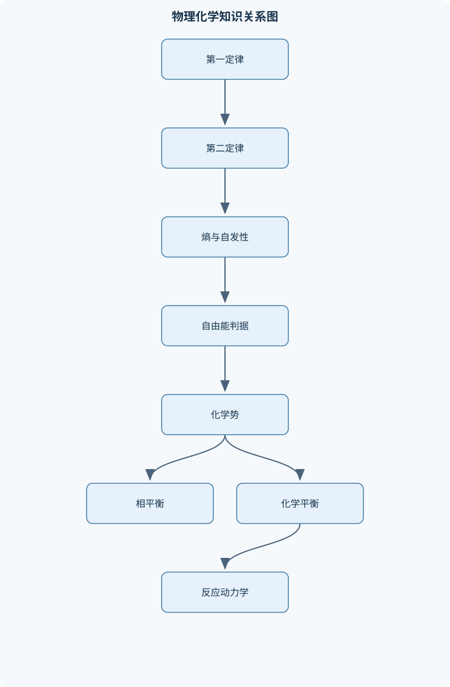
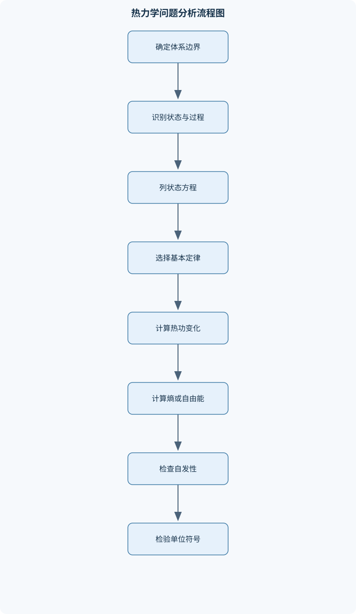

# 物理化学

## 一、课程整体知识框架

### 课程边界与先修知识

物理化学研究物质体系在平衡、相变、反应和界面过程中的宏观规律及其微观解释，核心内容包括热力学、统计热力学基础、气体与溶液、相平衡、界面化学、化学平衡、电化学和化学动力学。课程通常要求先修普通化学、大学物理和高等数学，尤其需要掌握微积分、偏导数、全微分、对数运算、常微分方程、单位换算以及氧化还原反应配平。课程边界覆盖封闭体系和组成可变体系的热力学描述、理想与非理想模型、均相和多相平衡、反应速率及实验数据分析；不以量子化学严格求解、多体统计力学高阶理论或复杂工业过程模拟为主要内容。所有结论均需明确温度、压力、组成、相态、可逆性、理想化假设和标准态等适用条件。





### 1. 研究对象与基本问题

物理化学研究宏观物质体系在平衡、相变、反应和界面过程中的规律，并用分子运动与相互作用解释这些规律。它连接微观结构与可测量的温度、压力、体积、组成、热量、功、相态和反应速率。课程的核心问题包括：过程是否自发、平衡组成是什么、改变温度或压力会怎样影响平衡、反应进行得多快，以及实验数据支持何种模型。

热力学给出状态之间的约束和方向判据，不提供达到平衡所需的时间；动力学描述过程速率和机理，但单凭速率不能判定最终平衡位置。统计热力学从分子能级和微观状态解释宏观热力学量。相平衡和界面化学则把这些概念用于多相体系、吸附、润湿和胶体等问题。

物理化学通常以普通化学、大学物理和高等数学为基础。偏导数用于区分控制变量，全微分用于表达状态函数的变化，积分用于沿路径计算热量、功和热容贡献，对数用于描述化学势、活度和动力学积分式。计算时还须进行量纲换算；电化学问题需能配平氧化还原半反应。课程通常不以严格求解量子多体问题或复杂工业过程模拟为目标，而侧重建立模型、检验假设和解释实验结果。

### 2. 体系、状态与模型的共同语言

体系由研究边界界定，边界外为环境。封闭体系不交换物质但可交换能量；孤立体系既不交换物质也不交换能量；开放体系可以交换物质和能量。边界可以是固定或可移动、透热或绝热。分类必须依据实际边界条件，不能仅凭容器外观判断。

状态函数只由初态和终态决定，包括内能 $U$、焓 $H$、熵 $S$、Helmholtz 自由能 $A$ 和 Gibbs 自由能 $G$；热 $q$ 和功 $w$ 是过程量，依赖路径。广度性质随体系规模改变，如 $V$、$U$、$n$；强度性质不随整体规模改变，如 $T$、$p$、密度和组成。广度量除以物质的量可形成摩尔量，但总热容与摩尔热容不可混用。

课程采用化学热力学符号约定：体系吸热时 $q>0$，环境对体系做功时 $w>0$，因此封闭体系有
$$
dU=\delta q+\delta w.
$$
只有体积功时 $\delta w=-p_{\mathrm{ext}}dV$，其中 $p_{\mathrm{ext}}$ 是外压。不可逆膨胀计算功必须用外压，不能直接用体系内部压力；准静态可逆体积功的极限情形才可令两者相等。每个结论都需说明温度、压力、组成、相态、可逆性、功的类型及标准态等条件。

### 3. 从状态变化到平衡判据

第一定律把能量守恒用于体系过程。焓定义为 $H=U+pV$。对封闭体系、只有体积功的过程，恒容时 $q_V=\Delta U$；恒压且只有体积功时 $q_p=\Delta H$。若存在电功、表面功、物质交换或压力并非常数，这些等式不能未经修正直接使用。热容描述温度变化引起的能量变化，定容热容为 $C_V=(\partial U/\partial T)_V$，定压热容为 $C_P=(\partial H/\partial T)_p$。理想气体的 $U,H$ 仅依赖温度，因此
$$
\Delta U=n\int_{T_1}^{T_2}C_{V,m}\,dT,\qquad
\Delta H=n\int_{T_1}^{T_2}C_{P,m}\,dT.
$$
只有热容可视为常数时，积分才可简写为 $nC_m\Delta T$。

第二定律以熵描述不可逆性。可逆路径上 $dS=\delta q_{\mathrm{rev}}/T$；对实际过程，体系熵变化满足 $\Delta S_{\mathrm{system}}\geq\int\delta q/T$。判断自发性应看体系与环境的总熵变化；孤立体系总熵不减，但非孤立体系的熵可以降低。可逆过程是理想极限，不等于日常意义上的自发过程。热力学第三定律以理想完美晶体在绝对零度的熵为基准，提供绝对熵的参考；真实物质存在残余无序时不能机械套用该基准。

在适当约束下，自由能将体系与环境的熵判据转写为体系状态量。定义 $A=U-TS$、$G=H-TS$，有
$$
dA=-S\,dT-p\,dV,\qquad dG=-S\,dT+V\,dp
$$
（组成固定且只有体积功）。恒温恒容、只有体积功时，自发变化使 $A$ 不增；恒温恒压、只有体积功时，自发变化使 $G$ 不增。若允许非体积功，可逆过程能提供的最大非体积功为 $-\Delta G$，但必须明确功的符号和体系边界。对组成可变体系，化学势 $\mu_i=(\partial G/\partial n_i)_{T,p,n_{j\ne i}}$ 是加入组分 $i$ 对 Gibbs 能的边际贡献；它等于偏摩尔 Gibbs 能，不一般等于偏摩尔内能。由 $G=\sum_i n_i\mu_i$ 得 Gibbs-Duhem 关系 $\sum_i n_i\,d\mu_i=0$，表明定温定压下各组分化学势变化并不独立。

### 4. 微观解释与宏观状态方程

统计热力学用微观状态及其概率分布解释宏观热力学量。Boltzmann 分布说明能量较高的状态通常概率较低，配分函数汇总各能级的统计权重，并把能级结构与内能、熵和热容联系起来。经典能量均分原理中，每个已激活的二次型项平均贡献 $k_BT/2$；一个经典振动模式含动能和势能两个二次项，平均贡献为 $k_BT$。高频振动在低温时会冻结，不能按经典均分处理；电子基态能通常不随普通热能显著改变，但电子激发在足够高温或特殊体系中可能参与。

平动、转动和振动能级受分子质量、几何结构和键力常数影响，因此不同分子的热容随温度变化不同。分子间势能曲线刻画吸引、排斥与平衡距离，影响液体结构、蒸气压、相变温度和相变熵。统计模型解释趋势，但计算仍受能级近似、分子间相互作用和温度范围限制。

理想气体假设分子本身体积相对容器可忽略、分子间作用在碰撞之外可忽略，且碰撞近似弹性，由此得 $pV=nRT$。理想气体混合物服从 Dalton 定律 $p_i=y_i p$，其中 $y_i=n_i/\sum_jn_j$。高压、低温和临界区可能明显偏离理想行为。van der Waals 方程用排斥体积和分子吸引修正状态方程；位力方程以压缩因子 $Z=pV/(nRT)$ 表示偏离程度。逸度 $f_i$ 将真实气体化学势写成类似理想气体的对数形式，逸度系数衡量非理想性。Lennard-Jones 势是描述分子间吸引与短程排斥的模型之一，不适用于不经参数检验地描述所有分子和状态。

### 5. 相、界面与混合物的组织方式

纯物质的气、液、固相由相平衡条件连接。饱和蒸气压是液体或固体与其蒸气平衡时的压力；沸腾发生在液体蒸气压达到外压时，故沸点依赖压力。熔融、升华和凝华均伴随焓、体积与熵变化。Clapeyron 方程
$$
\frac{dp}{dT}=\frac{\Delta H_{\mathrm{trans}}}{T\Delta V_{\mathrm{trans}}}
$$
给出相界线斜率；若气相近似理想、凝聚相体积可忽略且相变焓在温区内近似恒定，可得 Clausius-Clapeyron 近似。三相点是三相共存的特定温度与压力；临界点以上液气不再有清晰相界。相变焓和熵可由 $\Delta S_{\mathrm{trans}}=\Delta H_{\mathrm{trans}}/T$ 联系

## 二、章节和模块划分

### 核心知识覆盖清单

本清单用于检查正文是否覆盖本课程的主要知识模块：

- **热力学基本概念与第一定律**：体系、环境与边界的分类、状态函数与过程函数、强度性质与广度性质、热、功与符号约定、内能、焓与热容、封闭体系第一定律、恒容热与恒压热、可逆功、不可逆功与外压、理想气体的等温和绝热过程、热化学方程式与反应焓。
- **第二定律与熵**：自发过程与非自发过程、可逆过程和准静态过程、熵的定义与 Clausius 不等式、体系熵、环境熵和总熵、理想气体熵变计算、相变熵与熵变路径、绝热可逆过程、热力学第三定律、熵增判据及其边界、热力学温标与不可逆性。
- **热力学函数与判据**：Helmholtz 自由能与 Gibbs 自由能、基本热力学关系式、Maxwell 关系式、热力学函数的自然变量、化学势的定义、偏摩尔 Gibbs 能、非体积功最大值、恒温恒容和恒温恒压判据、Gibbs-Helmholtz 方程、热容与热力学函数变化的积分。
- **统计热力学与分子运动**：微观状态与宏观状态、Boltzmann 分布、配分函数的基本思想、能量均分原理、平动、转动和振动能级、电子基态能与热能贡献、单原子和双原子气体热容、振动冻结与高温近似、分子间作用力与势能曲线、分子结构对相变熵和热容的影响。
- **气体及真实气体**：理想气体模型的假设、理想气体状态方程、Dalton 分压定律、气体混合物的物质的量计算、van der Waals 方程、位力方程与压缩因子、逸度与逸度系数、气体化学势、Lennard-Jones 势、真实气体模型的适用边界。
- **液体、相变与纯物质相平衡**：液体的结构与分子间作用、蒸气压与饱和状态、沸腾、熔融、升华和凝华、相变焓与相变熵、Clapeyron 方程、Clausius-Clapeyron 方程、纯物质相图、三相点与临界点、蒸发焓与沸点的经验关系、相变过程中体积和熵的贡献。
- **溶液与混合物热力学**：理想气体混合、混合熵与混合 Gibbs 能、理想溶液模型、Raoult 定律、偏摩尔量、Gibbs-Duhem 方程、活度与活度系数、非理想溶液的混合焓、化学势随组成和压力的变化、液相和气相组成关系。
- **相平衡与相图**：Gibbs 相律、单组分和多组分相平衡、气液平衡、二元气液相图、液液平衡与互溶性、固液相图与共晶点、杠杆规则、冷却曲线、固体在液体中的溶解度、萃取与分配系数。
- **界面化学与胶体**：表面张力和表面自由能、弯曲界面与 Laplace 方程、毛细管现象、润湿与接触角、Gibbs 表面过剩、表面吸附、Langmuir 单层吸附模型、多层吸附与模型边界、胶体的分类和稳定性、纳米尺寸效应与 Ostwald 熟化。
- **化学平衡与反应热力学**：反应进度与反应计量、反应 Gibbs 能与反应商、标准反应 Gibbs 能、平衡常数与标准自由能、理想气体反应平衡、温度对平衡常数的影响、Van’t Hoff 方程、化学平衡移动、多相反应平衡、平衡组成的计算。
- **电化学**：原电池和电解池、电极反应与总反应、电池符号和相界面、可逆电池电动势、电动势与 Gibbs 能、标准电极电势、Nernst 方程、浓差电池、电动势的温度系数、电池反应的熵变和焓变。
- **化学动力学**：反应速率和反应速率方程、反应级数与速率常数、初始速率法、积分速率方程、零级、一级和二级反应、半衰期与时间常数、Arrhenius 方程、基元反应与分子数、复杂反应机理、稳态近似、前平衡近似和酶催化。


### 1. 热力学基本概念、第一定律与热化学

本模块建立物理化学的统一描述语言。体系是研究对象，环境是边界之外的部分；按照是否交换物质和能量，可分为封闭体系、开放体系和孤立体系。边界还可分为固定或可移动、透热或绝热。明确体系边界是列写能量衡算的前提。例如，带活塞的气缸通常可视为封闭、可移动边界体系；气体从反应器连续流出时则属于开放体系，不能直接套用只适用于封闭体系的公式。

状态函数只由初态和终态决定，包括内能 $U$、焓 $H$、熵 $S$、Helmholtz 自由能 $A$ 和 Gibbs 自由能 $G$。热 $q$ 和功 $w$ 是过程量，取决于路径。课程采用化学热力学符号约定：体系吸热时 $q>0$，环境对体系做功时 $w>0$，封闭体系满足

$$
dU=\delta q+\delta w.
$$

只有体积功时，

$$
\delta w=-p_{\mathrm{ext}}dV,
$$

其中 $p_{\mathrm{ext}}$ 是外压。不可逆膨胀或压缩的功必须使用外压；只有可逆过程的极限状态下，才可用体系压力 $p$ 代替 $p_{\mathrm{ext}}$。这一点是恒外压膨胀、自由膨胀和可逆膨胀比较题的关键。

焓定义为 $H=U+pV$。在封闭体系、组成不变且只有体积功的条件下，恒容过程有

$$
q_V=\Delta U,
$$

恒压过程有

$$
q_p=\Delta H.
$$

若存在电功、表面功、搅拌功、物质交换或压力并非恒定，不能无条件使用上述等式。定容热容和定压热容分别定义为

$$
C_V=\left(\frac{\partial U}{\partial T}\right)_V,\qquad
C_P=\left(\frac{\partial H}{\partial T}\right)_p.
$$

对于理想气体，$U$ 和 $H$ 只依赖温度，因此

$$
\Delta U=n\int_{T_1}^{T_2}C_{V,m}\,dT,\qquad
\Delta H=n\int_{T_1}^{T_2}C_{P,m}\,dT.
$$

只有在温区内热容近似不变时，才可分别写成 $nC_{V,m}\Delta T$ 和 $nC_{P,m}\Delta T$。

热化学计算应先配平反应式，再确定反应物和生成物的物质的量关系。反应焓具有加和性，可通过热化学方程式的倒置、倍乘和相加求得目标反应焓。常见考法是根据燃烧焓、生成焓或键能估算反应热，并判断恒压量热实验中测得的是 $\Delta H$ 还是需要换算为 $\Delta U$。实际工作中，反应热用于反应器热负荷、冷却能力和热失控风险的初步估算，但平衡放热量不等于瞬时放热速率，后者还取决于动力学和传热条件。

### 2. 第二定律、熵与热力学方向

第一定律说明能量守恒，但不能判断过程能否自发发生。第二定律引入熵 $S$ 描述能量退化和过程方向。对可逆过程，

$$
dS=\frac{\delta q_{\mathrm{rev}}}{T}.
$$

对实际过程，Clausius 不等式给出

$$
\Delta S_{\mathrm{system}}\geq \int\frac{\delta q}{T},
$$

可逆过程取等号。孤立体系满足总熵不减，即

$$
\Delta S_{\mathrm{total}}
=\Delta S_{\mathrm{system}}+\Delta S_{\mathrm{surroundings}}\geq 0.
$$

体系自身的熵可以降低，例如气体被压缩或液体结晶，但必须由环境熵增加补偿。判断自发性时不能只看体系熵变。

理想气体从状态 $1$ 变到状态 $2$ 的熵变可写为

$$
\Delta S
=nC_{V,m}\ln\frac{T_2}{T_1}
+nR\ln\frac{V_2}{V_1},
$$

或

$$
\Delta S
=nC_{P,m}\ln\frac{T_2}{T_1}
-nR\ln\frac{p_2}{p_1}.
$$

这些式子要求气体可近似为理想气体，热容在积分范围内可取常数或使用温度积分。即使实际过程不可逆，也可以选取连接同一初末态的可逆路径计算状态函数 $\Delta S$。但是，沿替代路径得到的热量和功不能当作原过程的实际 $q$ 和 $w$。

绝热可逆过程满足 $\delta q_{\mathrm{rev}}=0$，因而 $\Delta S=0$。对定组成理想气体且热容恒定，可推得

$$
pV^\kappa=\text{常数},\qquad
TV^{\kappa-1}=\text{常数},
$$

其中 $\kappa=C_P/C_V$。这些关系不适用于一般不可逆绝热过程，也不适用于热容显著随温度变化或气体强非理想的情况。

相变熵可通过可逆相变热计算：

$$
\Delta S_{\mathrm{trans}}=\frac{\Delta H_{\mathrm{trans}}}{T_{\mathrm{trans}}}.
$$

例如，在正常沸点处液体和蒸气处于同温同压平衡，气化熵可由气化焓除以沸点温度得到。第三定律以绝对零度理想完美晶体的熵为基准，使绝对熵能够通过热容和相变数据逐步计算。工作中，熵和总熵产生可用于分析换热器、压缩机、节流过程和不可逆损失；工程装置效率降低通常与熵产生增加有关。

### 3. 自由能、化学势与组成变化

在恒温恒容且只有体积功时，自发过程满足

$$
\Delta A\leq 0,\qquad A=U-TS.
$$

在恒温恒压且只有体积功时，自发过程满足

$$
\Delta G\leq 0,\qquad G=H-TS.
$$

平衡状态对应相应自由能在约束条件下达到极小值。若体系允许非体积功，在恒温恒压可逆条件下，$\Delta G$ 的负值表示体系能够提供的最大非体积功，但必须明确功的符号定义和体系边界。

基本微分关系为

$$
dA=-S\,dT-p\,dV,
$$

$$
dG=-S\,dT+V\,dp.
$$

因此，$A$ 的自然变量是 $T,V$，$G$ 的自然变量是 $T,p$。由全微分和混合偏导数相等可得到 Maxwell 关系。例如，由 $dG=-S\,dT+V\,dp$ 可得

$$
\left(\frac{\partial S}{\partial p}\right)_T
=
-\left(\frac{\partial V}{\partial T}\right)_p.
$$

化学势是组分在混合物中的偏摩尔 Gibbs 能：

$$
\mu_i=
\left(\frac{\partial G}{\partial n_i}\right)_{T,p,n_j}.
$$

对多组分体系，

$$
G=\sum_i n_i\mu_i,
$$

并满足 Gibbs-Duhem 方程

$$
\sum_i n_i\,d\mu_i=0.
$$

该关系说明，在温度和压力固定时，各组分化学势的变化不能彼此独立。相平衡的根本条件是每个组分在各相中的化学势相等：

$$
\mu_i^\alpha=\mu_i^\beta.
$$

理想气体中，组分化学势可写为

$$
\mu_i=\mu_i^\circ+RT\ln\frac{p_i}{p^\circ},
$$

理想溶液中则常写为

$$
\mu_i=\mu_i^*+RT\ln x_i.
$$

非理想溶液必须引入活度 $a_i=\gamma_i x_i$，于是

$$
\mu_i=\mu_i^\circ+RT\ln a_i.
$$

这里的标准态必须先规定，活度系数 $\gamma_i$ 也依赖温度、压力、组成和标准态。实际工作中，化学势用于解释溶解、扩散、结晶、膜分离和相分离；物质会趋向降低适当约束下的化学势，但实际迁移速率还受扩散和界面动力学影响。

### 4. 统计热力学与气体模型

统计热力学用微观状态数解释宏观热力学量。宏观状态由温度、压力、体积和组成等变量描述，微观状态则由大量分子的位置、动量、转动和振动状态确定。Boltzmann 关系为

$$
S=k_{\mathrm B}\ln\Omega,
$$

其中 $k_{\mathrm B}$ 是 Boltzmann 常数，$\Omega$ 是与宏观状态相容的微观状态数。微观状态越多，体系熵通常越大。

Boltzmann 分布表明，能量较高的能级仍可能被占据，但其概率随能级差和温度变化。配分函数把各能级的统计权重汇总起来，是由分子能级计算内能、熵和热容的基础。课程层面主要掌握其物理意义及平动、转动、振动能级对热容的影响，不要求严格求解复杂多体体系。

经典能量均分原理指出，每个独立二次型项平均贡献约为 $k_{\mathrm B}T/2$。平动和转动自由度通常在适当温度下较容易激活；振动模式包含动能和势能两个二次型项，经典极限下每个振动模式贡献约为 $k_{\mathrm B}T$。但是高频振动在低温时可能被冻结，不能把所有自由度机械地计入热容。单原子气体、双原子气体和多原子分子的 $C_V$ 差别，正是分子平动、转动和振动自由度激活程度不同的结果。

理想气体模型假定分子自身的体积相对容器可忽略，分子间作用力可忽略，碰撞近似弹性，因此得到

$$
pV=nRT.
$$

混合气体满足 Dalton 分压定律：

$$
p=\sum_i p_i,\qquad p_i=y_i p,
$$

其中 $y_i$ 是气相摩尔分数。计算气体混合物时，应先由质量求各组分物质的量，再求总物质的量、分压和总体积。高压、低温、接近饱和或临界区时，理想模型可能失效，需要使用压缩因子、van der Waals 方程、逸度或其他真实气体模型。模型越复杂并不代表结果必然更可靠，必须根据温度、压力和组成判断适用边界。

### 5. 液体、相变、溶液与相平衡

液体具有较强的分子间作用力，蒸气压是液体与其蒸气达到平衡时的压力。液体沸腾不是“加热就必然发生”，而是液体蒸气压等于外界压力的条件。熔融、气化和升华等相变的平衡条件可由两相化学势相等描述。

Clapeyron 方程为

$$
\frac{dp}{dT}
=
\frac{\Delta S_{\mathrm{trans}}}{\Delta V_{\mathrm{trans}}}
=
\frac{\Delta H_{\mathrm{trans}}}{T\Delta V_{\mathrm{trans}}}.
$$

对于液—气平衡，若蒸气近似理想气体、液体摩尔体积相对较小，且气化焓在温区内近似不变，可得到 Clausius-Clapeyron 形式

$$
\ln\frac{p_2}{p_1}
=
-\frac{\Delta H_{\mathrm{vap}}}{R}
\left(\frac{1}{T_2}-\frac{1}{T_1}\right).
$$

三相点是固、液、气三相共存的特定温度和压力；临界点是液气界面消失的终点。接近临界区时，体积、热容和压缩性会出现显著异常，简单的常焓近似和理想气体近似通常不再可靠。

理想溶液满足

$$
\mu_i=\mu_i^*+RT\ln x_i,
$$

并在液气平衡中给出 Raoult 定律：

$$
p_i=x_i p_i^*.
$$

总压为各组分分压之和，气相组成应按

$$
y_i=\frac{p_i}{\sum_jp_j}
$$

计算。仅知道液相摩尔分数不能确定气相分压，还需要纯组分蒸气压。非理想溶液应写为

$$
p_i=x_i\gamma_i p_i^*,
$$

其中 $\gamma_i$ 反映偏离理想性的程度。稀溶液中的溶质常需采用 Henry 标准态，不能把 Raoult 标准态和 Henry 标准态混用。

多相平衡可用 Gibbs 相律分析：

$$
F=C-P+2,
$$

其中 $F$ 是强度自由度，$C$ 是独立组分数，$P$ 是相数。若温度或压力已固定，应从自由度中扣除相应约束。二元相图题通常要求根据总组成和温度判断相区，再从两相区联络线两端读取相组成，并使用杠杆规则求相量。杠杆规则中的组成必须统一使用摩尔分数、质量分数或其他同一种坐标。相平衡计算描述的是平衡结果；若成核慢、扩散慢或存在过冷，实际冷却曲线可能偏离理想平衡相图。

### 6. 界面化学、吸附与胶体

界面具有额外自由能，增加界面面积通常需要做功。表面张力以 $\sigma$ 表示，单位为 $\mathrm{N\,m^{-1}}$，在许多情况下也可理解为单位面积表面自由能。弯曲界面的压差取决于界面两侧压力、表面张力和曲率。对于半径为 $r$ 的球形液滴，常见形式为

$$
\Delta p=\frac{2\sigma}{r}.
$$

液滴、气泡、圆柱液面和固体孔道的曲率不同，不能不加区分地套用同一个系数。

润湿性常用接触角 $\theta$ 表征。接触角受固体表面化学组成、粗糙度、污染、液滴体积和测量时间影响。理想平整表面的接触角关系不能直接代表粗糙或化学不均匀表面的全部性质。涂层、印刷、乳液制备和微流控中，润湿性直接影响铺展、附着和界面稳定性。

吸附是物质在界面附近富集的过程。Langmuir 单层吸附模型假定表面具有有限且等价的吸附位点、每个位点最多吸附一个分子、吸附分子之间无相互作用，并且达到动态平衡。其常见表达为

$$
\theta=\frac{KP}{1+KP},
$$

其中 $\theta$ 是覆盖度，$K$ 是吸附平衡常数，$P$ 是吸附质压力。低压时近似正比于压力，高压时逐渐接近饱和。若存在多层吸附、位点能量分布、强吸附分子间作用或孔道凝聚，单层 Langmuir 模型可能不适用。

胶体体系的稳定性与粒径、界面电荷、溶剂化层、表面活性剂和离子强度有关。纳米颗粒比表面积大，界面自由能高，可能发生团聚和 Ostwald 熟化。Ostwald 熟化中，小颗粒因曲率较大而具有较高化学势，物质逐渐向大颗粒迁移。该热力学趋势并不意味着过程立即发生，实际速率还取决于扩散、溶解和界面反应。

### 7. 化学平衡、电化学与化学动力学

对于反应

$$
\sum_i\nu_i A_i=0,
$$

反应 Gibbs 能为

$$
\Delta_rG=\Delta_rG^\circ+RT\ln Q,
$$

其中 $\nu_i$ 是化学计量数，$Q$ 是由活度、逸度或规定标准态构成的反应商。平衡时 $\Delta_rG=0$，因此

$$
\Delta_rG^\circ=-RT\ln K.
$$

当 $Q<K$ 时，正向反应有利；当 $Q>K$ 时，逆向反应有利。计算平衡组成时，通常设反应进度为 $\xi$，根据

$$
n_i=n_{i,0}+\nu_i\xi
$$

建立物料衡算，再令 $Q(\xi)=K$。必须筛选使所有物质的量非负、相态条件合理的根。

可逆电池中，

$$
\Delta_rG=-\nu FE,
$$

标准状态下有

$$
\Delta_rG^\circ=-\nu FE^\circ.
$$

Nernst 方程为

$$
E=E^\circ-\frac{RT}{\nu F}\ln Q.
$$

分析电池时应先分别写出氧化和还原半反应，配平电子，再合并总反应并构造反应商。电极电势不能直接按电压平均或简单倍乘；若需合并标准电势，应先换算为各半反应的 $\Delta_rG^\circ$，按 Gibbs 能相加后再求总电势。理论电动势是可逆、无电流条件下的平衡量，实际端电压还受内阻、极化、液接电势和传质限制影响。

动力学研究达到平衡所需的时间和反应机理。一般速率方程写为

$$
r=k[A]^m[B]^n,
$$

其中 $m,n$ 必须由实验或机理推导确定，不能仅凭总反应式的化学计量数判断。初始速率法通过分别改变一种反应物浓度，利用速率比求级数，再代入数据求 $k$。积分法则检验零级、一级和二级模型，例如一级反应满足

$$
\ln\frac{[A]_0}{[A]}=kt,
$$

半衰期为

$$
t_{1/2}=\frac{\ln2}{k}.
$$

该半衰期与初始浓度无关的结论只适用于一级速率方程和恒温、体积恒定等条件。Arrhenius 方程为

$$
k=Ae^{-E_a/(RT)},
$$

两温度数据可用

$$
\ln\frac{k_2}{k_1}
=
-\frac{E_a}{R}
\left(\frac{1}{T_2}-\frac{1}{T_1}\right)
$$

求表观活化能。温度必须使用开尔文温标，并且两组数据应处于同一机理区间；若发生副反应、催化剂失活或传质控制，不能把一个活化能无条件外推到全部温区。

## 三、核心概念的详细解释

### 1. 状态、过程与热力学边界

物理化学中的体系是被选定来研究的物质集合，体系以外的部分称为环境，体系与环境之间的分界面称为边界。封闭体系只交换能量而不交换物质；开放体系同时交换物质和能量；孤立体系既不交换物质也不交换能量。边界还可按是否允许体积变化、是否允许传热以及是否允许物质通过进行分类。判断体系类型必须依据实际边界条件，而不能只依据“是否有容器”作判断。

体系的状态由一组足以确定其宏观性质的状态变量描述，例如温度 $T$、压力 $p$、体积 $V$、物质的量 $n$ 和组成。状态函数只取决于初态和终态，与达到终态的路径无关，包括内能 $U$、焓 $H$、熵 $S$、Helmholtz 自由能 $A$ 和 Gibbs 自由能 $G$。热量 $q$ 和功 $w$ 是过程函数，同一初态和终态之间采用不同路径时，$q$ 与 $w$ 通常不同，但能量守恒要求它们的代数和与 $\Delta U$ 相联系。

广度性质与体系规模成正比，例如 $U$、$V$、$S$ 和总物质的量；强度性质不随体系规模改变，例如 $T$、$p$、密度和摩尔分数。总热容 $C$ 是广度量，摩尔热容 $C_m$ 是强度量，二者的数值和单位不同。进行热容计算时必须确认使用的是总热容还是摩尔热容，否则会产生物质的量重复相乘或遗漏的问题。

本课程采用化学热力学符号约定：体系吸热时 $q>0$，环境对体系做功时 $w>0$，因此封闭体系满足
$$
dU=\delta q+\delta w.
$$
只有体积功时，
$$
\delta w=-p_{\mathrm{ext}}\,dV.
$$
膨胀时 $dV>0$，体系对环境做功，故 $w<0$；压缩时 $dV<0$，环境对体系做功，故 $w>0$。不可逆过程中应使用外压 $p_{\mathrm{ext}}$，不能用体系内部压力代替。只有在可逆或准静态极限下，体系内部压力与外压在每一瞬间近似相等，才可写成
$$
w_{\mathrm{rev}}=-\int_{V_1}^{V_2}p\,dV.
$$

### 2. 第一、第二定律与自发性

内能是体系内部全部微观动能和势能的总和，不能直接由单一宏观变量完全表示。焓定义为
$$
H=U+pV.
$$
在封闭体系、只有体积功且恒容的条件下，$dV=0$，于是 $q_V=\Delta U$。在恒压、只有体积功且体系物质的量不因物质进出而改变时，
$$
q_p=\Delta H.
$$
若体系存在电功、表面功、搅拌功、弹性功或物质流动，上述等式必须加入相应修正，不能无条件使用。

热容定义为
$$
C_V=\left(\frac{\partial U}{\partial T}\right)_V,\qquad
C_P=\left(\frac{\partial H}{\partial T}\right)_p.
$$
对于理想气体，分子间作用和分子自身占据体积均被忽略，因此 $U$ 和 $H$ 只依赖温度：
$$
\Delta U=n\int_{T_1}^{T_2}C_{V,m}\,dT,\qquad
\Delta H=n\int_{T_1}^{T_2}C_{P,m}\,dT.
$$
只有在温度范围内摩尔热容近似不变时，才可写成 $nC_{V,m}\Delta T$ 或 $nC_{P,m}\Delta T$。理想气体还有
$$
C_{P,m}-C_{V,m}=R.
$$
该关系不能直接推广到真实气体、液体或固体。

第一定律只说明能量守恒，不说明过程方向。第二定律引入熵 $S$ 描述能量分散和不可逆性。对可逆过程，
$$
dS=\frac{\delta q_{\mathrm{rev}}}{T};
$$
对实际过程，Clausius 不等式给出
$$
\Delta S_{\mathrm{system}}\geq \int\frac{\delta q}{T},
$$
等号仅适用于可逆过程。体系熵可能降低，例如气体被可逆压缩或液体结晶；但若体系与环境构成孤立总体，则
$$
\Delta S_{\mathrm{total}}
=\Delta S_{\mathrm{system}}+\Delta S_{\mathrm{surroundings}}\geq 0.
$$
因此，“熵增加”必须说明指的是体系、环境还是总体系。

可逆过程要求体系始终处于平衡态，并且驱动力无限小。它是计算状态函数变化的理想路径，不等于现实中快速发生的自发过程。自由膨胀、有限温差传热、有限压差膨胀和摩擦都属于不可逆因素。热力学第三定律通常以绝对零度下理想完美晶体的熵为零作为基准，但具有残余无序的固体不能机械地套用该条件。

### 3. 自由能、化学势与组成可变体系

定义
$$
A=U-TS,\qquad G=H-TS.
$$
在组成固定且只有体积功时，由
$$
dU=TdS-pdV
$$
可得
$$
dA=-S\,dT-p\,dV,
$$
$$
dG=-S\,dT+V\,dp.
$$
因此 $A$ 的自然变量是 $T,V$，$G$ 的自然变量是 $T,p$。恒温恒容、只有体积功时，自发过程满足 $\Delta A\leq 0$；恒温恒压、只有体积功时，自发过程满足 $\Delta G\leq 0$。达到平衡时相应自由能对允许变化的一阶变化为零。若存在非体积功，恒温恒压下可逆过程能够提供的最大非体积功为 $-\Delta G$，但必须说明功的符号和是否扣除了体积功。

组成可变体系中，组分 $i$ 的化学势定义为
$$
\mu_i=\left(\frac{\partial G}{\partial n_i}\right)_{T,p,n_{j\ne i}}.
$$
它是偏摩尔 Gibbs 能，而不是一般意义上的偏摩尔内能。对均相多组分体系，
$$
G=\sum_i n_i\mu_i.
$$
对该式微分并与
$$
dG=-S\,dT+V\,dp+\sum_i\mu_i\,dn_i
$$
比较，可得 Gibbs-Duhem 方程
$$
-S\,dT+V\,dp-\sum_i n_i\,d\mu_i=0.
$$
在恒温恒压下，
$$
\sum_i n_i\,d\mu_i=0.
$$
这说明混合物中各组分化学势不能任意独立改变。

两相或多相达到平衡的条件是每个可交换组分在各相中的化学势相等：
$$
\mu_i^\alpha=\mu_i^\beta.
$$
若反应可以发生，平衡条件还要求反应 Gibbs 能为零。化学势随压力、温度和组成变化；在理想溶液中
$$
\mu_i=\mu_i^*+RT\ln x_i,
$$
在非理想溶液中应写为
$$
\mu_i=\mu_i^\circ+RT\ln a_i,\qquad a_i=\gamma_i x_i.
$$
其中 $x_i$ 是摩尔分数，$\gamma_i$ 是活度系数，$a_i$ 是活度。活度系数反映偏离理想行为的程度，不应与界面张力符号混淆。

### 4. 统计热力学与气体模型

宏观状态对应大量可能的微观状态。若微观状态 $j$ 的能量为 $E_j$，Boltzmann 分布说明其相对概率与
$$
\exp\left(-\frac{E_j}{k_BT}\right)
$$
成正比。配分函数
$$
q=\sum_j\exp\left(-\frac{E_j}{k_BT}\right)
$$
汇总全部能级的统计权重。平动、转动、振动和电子运动对总配分函数的贡献通常可在近似条件下分解。高频振动在低温时难以被热激发，称为振动冻结；此时不能使用经典能量均分原理。

经典能量均分原理规定，每个已激活的二次型能量项平均贡献 $k_BT/2$。一个平动或转动自由度通常对应一个二次型动能项，贡献约为 $k_BT/2$；一个经典振动模式同时包含动能和势能两个二次型项，贡献约为 $k_BT$。因此，平动自由度、转动自由度和振动模式不能简单认为贡献相同。电子基态能通常远高于室温热能尺度，常温下电子激发对热容的贡献往往可以忽略，但这不是所有高温或特殊体系的普遍结论。

理想气体模型假设分子自身平均体积相对于容器体积可忽略，分子间作用在碰撞之外可以忽略，碰撞近似弹性。由此得到
$$
pV=nRT.
$$
混合理想气体满足 Dalton 定律：
$$
p_i=y_i p,\qquad y_i=\frac{n_i}{\sum_j n_j}.
$$
真实气体可用压缩因子
$$
Z=\frac{pV}{nRT}
$$
衡量偏离程度。$Z=1$ 仅表示在给定状态下接近理想气体，并不说明分子间作用在所有状态都可以忽略。van der Waals 方程通过排斥体积和吸引作用修正状态方程；Lennard-Jones 势则用短程强排斥和中程吸引描述分子间相互作用。高压、低温、接近液化或临界区时，应采用真实气体模型。逸度 $f_i$ 是将真实气体化学势写成理想形式的有效压力，逸度系数用于表示其与分压的差异。

### 5. 相变、相平衡与相图

纯物质的液体与蒸气平衡时，蒸气压力称为饱和蒸气压。液体沸腾的条件不是“温度达到某个固定值”，而是液体蒸气压等于外界压力。降低外压会降低沸点。固液、液气和固气相平衡分别对应熔融、汽化和升华过程；反向过程为凝固、凝结和凝华。

相平衡条件为两相中物质的化学势相等。由两相 Gibbs 能相等并沿相界线微分，可得到 Clapeyron 方程：
$$
\frac{dp}{dT}
=\frac{\Delta S_{\mathrm{trans}}}{\Delta V_{\mathrm{trans}}}
=\frac{\Delta H_{\mathrm{trans}}}{T\Delta V_{\mathrm{trans}}}.
$$
若气相近似理想气体、凝聚相体积可忽略、相变焓在温度区间内近似恒定，则有 Clausius–Clapeyron 近似：
$$
\ln\frac{p_2}{p_1}
=-\frac{\Delta H_{\mathrm{vap}}}{R}
\left(\frac1{T_2}-\frac1{T_1}\right).
$$
三相点是固、液、气三相共存的唯一温度和压力组合；临界点以上液体和气体之间不再有清晰界面。相变熵满足
$$
\Delta S_{\mathrm{trans}}=\frac{\Delta H_{\mathrm{trans}}}{T_{\mathrm{trans}}}
$$
仅适用于相平衡温度下的可逆相变。

Gibbs 相律为
$$
F=C-P+2,
$$
其中 $F$ 是强度自由度，$C$ 是独立组分数，$P$ 是相数。固定温度或压力时，应从自由度中扣除相应约束。二元相图的两相区中，给定温度后两相组成由联络线两端确定；相量可由杠杆规则计算。杠杆规则必须使用同一组成坐标，例如都用摩尔分数或都用质量分数，不能混用。

### 6. 溶液、界面与胶体

理想溶液中各组分分子间作用近似相似，组分 $i$ 的化学势含有 $RT\ln x_i$ 项。挥发性组分满足 Raoult 定律：
$$
p_i=x_i p_i^*,
$$
其中 $p_i^*$ 是同温度下纯组分饱和蒸气压。非理想溶液应改写为
$$
p_i=x_i\gamma_i p_i^*.
$$
稀溶液中溶剂常近似遵守 Raoult 定律，而溶质可能更适合使用 Henry 标准态。液相组成与气相组成通常不同，气相摩尔分数为
$$
y_i=\frac{p_i}{\sum_jp_j}.
$$
因此仅知道液相摩尔分数不能确定气相分压，还需要纯组分蒸气压或活度信息。

界面具有额外自由能。表面张力以 $\sigma$ 表示，定义为单位面积增加所需的可逆功，在适当条件下也可理解为单位面积表面自由能。弯曲界面两侧存在压力差；对于球形液滴或气泡，Laplace 关系的数量级为
$$
\Delta p=\frac{2\sigma}{r},
$$
其中 $r$ 为曲率半径。半径越小，附加压力越大。毛细管上升或下降取决于润湿性、接触角 $\theta$、液体表面张力和密度；不能只依据表面张力大小判断液体是否润湿固体。

吸附是界面相对体相的组分富集。表面过剩量 $\Gamma$ 表示单位面积的过剩物质的量。Langmuir 单层吸附模型假定表面具有等价独立位点、每个位点最多吸附一个分子且吸附焓与覆盖度无关，常写为
$$
\theta=\frac{KP}{1+KP},
$$
其中 $\theta$ 为覆盖率，$P$ 为平衡压力，$K$ 为吸附平衡常数。多层吸附、位点不均一、分子间强相互作用或孔道凝聚时，Langmuir 模型可能失效。胶体因粒径小、界面面积大而具有显著布朗运动、散射和表面吸附效应；稳定性取决于静电排斥、溶剂化层、空间位阻和范德华吸引等竞争。Ostwald 熟化是小颗粒因溶解度较高而逐渐溶解，大颗粒继续长大的过程。

### 7. 化学平衡、电化学与动力学

对反应
$$
\sum_i\nu_i A_i=0,
$$
反应进度 $\xi$ 定义为
$$
dn_i=\nu_i\,d\xi.
$$
反应 Gibbs 能为
$$
\Delta_rG=\sum_i\nu_i\mu_i.
$$
使用活度表示时，
$$
\Delta_rG=\Delta_rG^\circ+RT\ln Q,
$$
其中
$$
Q=\prod_i a_i^{\nu_i}.
$$
平衡时 $\Delta_rG=0$，于是
$$
\Delta_rG^\circ=-RT\ln K.
$$
$Q<K$ 表明正向反应有利，$Q>K$ 表明逆向反应有利；该判断要求温度、标准态和反应式保持一致。温度对平衡常数的影响由 van’t Hoff 方程描述：
$$
\frac{d\ln K}{dT}=\frac{\Delta_rH^\circ}{RT^2}.
$$
升高温度有利于吸热方向，但“加热一定使产物增多”只有在正向反应为吸热反应时才成立。

电化学中，原电池将自发化学反应的 Gibbs 能转化为电功，电解池则用外加电能推动非自发反应。电池反应配平后，若转移电子数为 $\nu$，可逆电池满足
$$
\Delta_rG=-\nu FE,
$$
标准状态下
$$
\Delta_rG^\circ=-\nu FE^\circ.
$$
Nernst 方程为
$$
E=E^\circ-\frac{RT}{\nu F}\ln Q.
$$
计算前必须统一半反应方向、配平电子并按总反应写 $Q$。标准电极电势不能按反应式系数直接倍乘；应先将各半反应转换为 $\Delta_rG^\circ=-nFE^\circ$，再相加。实际电池端电压还会受内阻、极化、液接电势和传质限制影响，不能无条件等同于可逆电动势。

动力学研究达到某状态所需的时间及反应机理。对反应物 $A$ 和 $B$，
$$
r=k[A]^m[B]^n.
$$
$m,n$ 是反应级数，必须由实验数据或机理推导得到，不能仅由总反应式的计量系数判断。零级、一级和二级反应的积分形式分别为
$$
[A]_t=[A]_0-kt,
$$
$$
\ln\frac{[A]_0}{[A]_t}=kt,
$$
$$
\frac1{[A]_t}-\frac1{[A]_0}=kt.
$$
反应级数不同，$k$ 的单位也不同。Arrhenius 方程
$$
k=Ae^{-E_a/(RT)}
$$
表明升温通常提高速率；两温度下可写为
$$
\ln\frac{k_2}{k_1}
=-\frac{E_a}{R}\left(\frac1{T_2}-\frac1{T_1}\right).
$$
两点法要求两温度范围内机理不变且 $E_a$ 近似恒定。复杂反应中，稳态近似要求中间体生成速率与消耗速率近似相等；前平衡近似则要求快速可逆的前置步骤先建立近似平衡，二者不能混为一谈。

## 四、重要定义、公式、定理和推导

### 专业审校补充：关键定义与适用边界

Gibbs 相律给出平衡体系中独立强度变量数，即自由度 $F=C-P+2-R$。其中 $C$ 为组分数，$P$ 为相数，$R$ 为彼此独立的化学反应数；“2”对应温度和压力两个外部变量。该式适用于宏观平衡体系、相内组成均匀且不考虑电场、磁场、表面效应等额外变量的情形。若温度或压力被固定，应分别从自由度中扣除一个；若还存在组成约束、共存比例约束或外场，则需进一步修正。这里的组分数不是体系中所有化学式的简单数量，而是能够表示各相组成所需的最少独立物种数。例如碳酸钙分解体系可取 $C=3$，反应数 $R=1$；当固态碳酸钙、固态氧化钙和气态二氧化碳三相共存时，$F=2+3-3-1=1$，因此三相共存并不必然唯一确定温度和压力。相律只说明变量个数，不直接给出各相组成、相量或平衡常数，后者还需要物料守恒、化学势相等和状态方程。


### 1. 热力学基本关系与 Maxwell 关系

由第一定律和可逆体积功，
$$
dU=TdS-pdV.
$$
对焓定义 $H=U+pV$ 求微分：
$$
dH=dU+p\,dV+V\,dp
=TdS+Vdp.
$$
再由 $A=U-TS$ 和 $G=H-TS$，分别得到
$$
dA=-S\,dT-p\,dV,
$$
$$
dG=-S\,dT+V\,dp.
$$
由全微分混合二阶偏导相等，可得 Maxwell 关系：
$$
\left(\frac{\partial S}{\partial V}\right)_T
=
\left(\frac{\partial p}{\partial T}\right)_V,
$$
$$
\left(\frac{\partial S}{\partial p}\right)_T
=
-\left(\frac{\partial V}{\partial T}\right)_p,
$$
$$
\left(\frac{\partial T}{\partial V}\right)_S
=
-\left(\frac{\partial p}{\partial S}\right)_V,
$$
$$
\left(\frac{\partial T}{\partial p}\right)_S
=
\left(\frac{\partial V}{\partial S}\right)_p.
$$
这些关系用于把难以直接测量的熵导数转换为体积、压力和温度的可测导数，前提是体系处于平衡态并且相关状态函数具有足够的可微性。

### 2. 理想气体过程的推导

理想气体满足 $pV=nRT$。恒温可逆膨胀时，
$$
w_{\mathrm{rev}}
=-\int_{V_1}^{V_2}\frac{nRT}{V}\,dV
=-nRT\ln\frac{V_2}{V_1}.
$$
理想气体恒温时 $\Delta U=0$，由第一定律得
$$
q_{\mathrm{rev}}=-w_{\mathrm{rev}}
=nRT\ln\frac{V_2}{V_1}.
$$
熵变为
$$
\Delta S=nR\ln\frac{V_2}{V_1}
=nR\ln\frac{p_1}{p_2}.
$$
这里使用的是可逆替代路径；即使实际过程不可逆，$\Delta S$ 仍可利用任意可逆路径计算。

绝热可逆过程满足 $\delta q=0$，因此 $dS=0$。对理想气体积分可得
$$
pV^\kappa=\text{常数},
$$
其中
$$
\kappa=\frac{C_{P,m}}{C_{V,m}}.
$$
进一步有
$$
TV^{\kappa-1}=\text{常数},\qquad
T^\kappa p^{1-\kappa}=\text{常数}.
$$
这些关系只适用于理想气体、绝热、可逆和热容比近似恒定的条件。不可逆绝热过程虽然总热量为零，但通常不满足上述等式，因为熵会增加。

### 3. 混合、相平衡与杠杆规则

理想气体混合时，各组分的化学势变化导致混合 Gibbs 能降低：
$$
\Delta_{\mathrm{mix}}G
=nRT\sum_i y_i\ln y_i.
$$
由于 $0<y_i<1$，$\ln y_i<0$，所以混合 Gibbs 能为负。混合熵为
$$
\Delta_{\mathrm{mix}}S
=-nR\sum_i y_i\ln y_i>0.
$$
该结果基于理想气体、恒温和恒压等模型条件。

在二元两相区，设总组成坐标为 $z$，两相组成分别为 $x_\alpha$ 和 $x_\beta$，两相物质的量为 $n_\alpha$ 和 $n_\beta$。物料守恒为
$$
(n_\alpha+n_\beta)z
=n_\alpha x_\alpha+n_\beta x_\beta.
$$
整理可得杠杆规则：
$$
\frac{n_\alpha}{n_\beta}
=\frac{x_\beta-z}{z-x_\alpha}.
$$
分子使用的是“对侧距离”，不是本相距离。若组成坐标为质量分数，求得的比例是质量比例；若为摩尔分数，则是相应摩尔量比例。

### 4. 化学平衡与电化学的统一关系

由
$$
\Delta_rG=\Delta_rG^\circ+RT\ln Q
$$
和 $\Delta_rG=0$，可得
$$
K=\exp\left(-\frac{\Delta_rG^\circ}{RT}\right).
$$
反应式整体乘以系数 $a$ 时，$\Delta_rG^\circ$ 和 $\ln Q$ 同时乘以 $a$，因此新的平衡常数为原平衡常数的 $a$ 次方；反应式倒写时，$K$ 变为原来的倒数。纯固体和纯液体的活度通常定义为 $1$，在 $Q$ 中不显式出现，但它们仍参与反应计量和相平衡条件。

对电池反应，化学功与电功相联系：
$$
\Delta_rG=-\nu FE.
$$
将其代入化学平衡表达式：
$$
E
=E^\circ-\frac{RT}{\nu F}\ln Q.
$$
因此电动势为正表示在给定组成和压力下总反应的 Gibbs 能降低。若体系达到电化学平衡，$E=0$，同时 $Q=K$。该推导适用于可逆电池；存在明显极化或电流通过时，实测电压不再是严格的平衡电动势。

### 5. 动力学积分式与数据判别

对零级反应
$$
-\frac{d[A]}{dt}=k,
$$
分离变量并从 $[A]_0$ 积分至 $[A]_t$：
$$
[A]_t=[A]_0-kt.
$$
半衰期为
$$
t_{1/2}=\frac{[A]_0}{2k}.
$$
对一级反应，
$$
-\frac{d[A]}{dt}=k[A],
$$
积分得
$$
\ln[A]_t=\ln[A]_0-kt,
$$
故半衰期
$$
t_{1/2}=\frac{\ln2}{k}.
$$
一级反应半衰期与初始浓度无关，但只有在单一一级速率方程、恒温和体积条件稳定时才成立。

对二级反应 $-\mathrm d[A]/\mathrm dt=k[A]^2$，
$$
\frac1{[A]_t}=\frac1{[A]_0}+kt,
$$
其半衰期为
$$
t_{1/2}=\frac1{k[A]_0}.
$$
判断实验级数时，可分别检验 $[A]$—$t$、$\ln[A]$—$t$ 和 $1/[A]$—$t$ 的线性关系，比较残差、参数稳定性和数据范围。仅凭某一小段数据“看起来直线”不能证明模型成立，还应检查温度、体积、反应物过量近似以及副反应是否影响速率方程。

## 五、算法、流程和实现思路

### 方法与流程覆盖索引

下列方法或流程应在正文中说明输入、步骤、适用条件、结果检查和边界：

- 状态函数与过程量分析流程：输入初态、终态、过程路径、约束条件和功的类型；输出 q、w、ΔU、ΔH、ΔS、ΔA 或 ΔG。先判断量是状态函数还是过程函数，再列第一定律和相应基本关系，随后选择实际路径或可逆替代路径计算，最后进行单位、符号和边界检查。不变量是始末状态不变时状态函数变化不变；终止条件是所有目标量均由独立方程确定。适用于封闭体系热力学题，代数计算复杂度为常数级。
- 理想气体不可逆过程分析流程：输入 n、T、初末 p/V、外压和过程约束；输出 q、w、ΔU、ΔH、ΔS_system、ΔS_surroundings 和总熵。先用状态方程确定各状态，再用 w=-p_extΔV 计算功，用状态函数公式计算 ΔU、ΔH、ΔS，最后由环境温度或热交换条件计算环境熵。始末状态固定时 ΔU、ΔH、ΔS 不随路径改变，但 w 和 q 随路径改变；若过程结束则完成总熵不等式检查。
- 相变 Gibbs 能路径法：输入同温同压下两相的蒸气压、密度或摩尔体积；输出相变 ΔG。将目标过程拆为等温等压下的气化、气相压力变化、凝聚或升华等可计算步骤，使用 dG=Vdp、理想气体关系 ΔG=nRTln(p_2/p_1) 或相平衡条件逐段求和。路径可任意改变但每段必须满足适用模型；终止条件是到达目标相态和压力。
- 气体混合物计算流程：输入各组分质量或物质的量、温度、某一分压或总压；输出总物质的量、体积、各分压和总压。先用 n_i=m_i/M_i，按 Dalton 定律写 p_i=y_ip，利用已知分压求总压或体积，再用 pV=nRT 验算。组分物质的量守恒是核心不变量；适用于理想气体混合物，计算复杂度为组分数的线性级。
- 初始速率法确定速率方程：输入不同实验中各反应物浓度和初始速率；输出各级数及速率常数。选取只改变一种浓度的实验，构造速率比并取对数求对应指数，再代入任一组数据求 k，最后用其余实验回代验证。实验温度、体积和测量时间尺度需一致；终止条件是所有指数均被独立确定并通过数据检验。
- 积分动力学判别流程：输入浓度—时间数据；输出反应级数、速率常数和半衰期。分别检验零级的 [A]—t、一级的 ln[A]—t、二级的 1/[A]—t 线性关系，比较残差和物理合理性，再由斜率求 k。适用于单一主反应、恒温、体积恒定且速率方程形式稳定的体系；数据点数应足以区分模型。
- 二元相图与杠杆规则流程：输入温度、总组成和相图相界线；输出相区、相数、相组成及各相数量。先定位总组成点和温度，判断单相或两相区，再从两相区作水平联络线读取两端组成，使用总量守恒和杠杆规则求相量，最后检查相量非负且总量守恒。适用于平衡态、相图可靠且忽略动力学滞后的体系。
- 化学平衡计算流程：输入反应式、初始组成、温度和热力学数据；输出 Q、K、平衡组成或平衡压力。先配平反应并确定 ν_i，利用 Δ_rG°或数据表求 K，再构造反应进度 ξ 的物料衡算和 Q(ξ)=K 方程，筛选满足非负组成和相态约束的根。反应进度范围由各物种物质的量非负决定；终止条件是 Q 与 K 在规定精度内一致。
- 电池电动势分析流程：输入电池图式、半反应、标准电极电势和活度；输出总反应、E、Δ_rG、必要时的 Δ_rS 和 Δ_rH。先统一半反应方向并配平电子，再计算 E°，写反应商 Q，应用 Nernst 方程，最后用 Δ_rG=-νFE 检查符号。适用于可逆电池和规定温度；若电池存在极化、内阻或液接电势，简单热力学电动势公式不能直接代表实测端电压。





### 1. 热力学过程量与状态函数的统一计算流程

#### 输入、输出与适用条件

输入包括初态和终态的 $T,p,V,n$、过程约束（恒温、恒压、恒容或绝热）、边界类型、外压 $p_{\mathrm{ext}}$、传热方式以及功的类型。输出可以是 $q$、$w$、$\Delta U$、$\Delta H$、$\Delta S$、$\Delta A$ 和 $\Delta G$。

该流程适用于封闭体系，尤其适用于理想气体和只有体积功的过程。若体系开放、发生化学反应、存在电功或表面功，必须把物质流和其他功项加入能量衡算，不能直接套用封闭体系公式。

#### 计算步骤

1. **确定体系边界和符号约定。**  
   采用
   $$
   dU=\delta q+\delta w,
   $$
   且只有体积功时
   $$
   \delta w=-p_{\mathrm{ext}}\,dV.
   $$
   膨胀时 $dV>0$，故 $w<0$；压缩时 $w>0$。

2. **判断目标量是状态函数还是过程函数。**  
   $U,H,S,A,G$ 的变化只由初态和终态决定；$q,w$ 依赖过程路径。若实际路径难以积分，可构造同一初、终态之间的可逆替代路径计算状态函数变化。

3. **先确定各状态。**  
   对理想气体使用
   $$
   pV=nRT.
   $$
   温度必须使用开尔文，压力和体积必须采用相容单位。若物质的量不变，状态方程可用于比较各状态的 $p$、$V$ 和 $T$。

4. **计算功。**  
   不可逆恒外压过程使用
   $$
   w=-p_{\mathrm{ext}}(V_2-V_1).
   $$
   可逆过程使用
   $$
   w_{\mathrm{rev}}=-\int_{V_1}^{V_2}p\,dV.
   $$
   只有可逆或准静态极限下，才可用体系压力 $p$ 代替 $p_{\mathrm{ext}}$。

5. **用第一定律求热量。**
   $$
   q=\Delta U-w.
   $$
   理想气体的内能只依赖温度：
   $$
   \Delta U=n\int_{T_1}^{T_2}C_{V,m}\,dT.
   $$
   若 $C_{V,m}$ 近似恒定，才可写为 $nC_{V,m}(T_2-T_1)$。

6. **用可逆替代路径求熵变。**  
   理想气体从 $(T_1,V_1)$ 到 $(T_2,V_2)$ 的熵变为
   $$
   \Delta S
   =n\int_{T_1}^{T_2}\frac{C_{V,m}}{T}\,dT
   +nR\ln\frac{V_2}{V_1},
   $$
   或
   $$
   \Delta S
   =n\int_{T_1}^{T_2}\frac{C_{P,m}}{T}\,dT
   -nR\ln\frac{p_2}{p_1}.
   $$
   这两个表达式只是在不同独立变量下的写法，不能把二者的体积项和压力项混加。

7. **检查自发性和不可逆性。**  
   对实际过程，计算体系熵、环境熵以及总熵：
   $$
   \Delta S_{\mathrm{total}}
   =\Delta S_{\mathrm{system}}+\Delta S_{\mathrm{surroundings}}\geq 0.
   $$
   若恒温恒压且只有体积功，可用 $\Delta G\leq0$；若恒温恒容且只有体积功，可用 $\Delta A\leq0$。

算法的不变量是：同一初态和终态的 $\Delta U$、$\Delta H$、$\Delta S$、$\Delta A$、$\Delta G$ 不随计算路径改变；但不同路径的 $q$ 和 $w$ 可以不同。终止条件是目标热力学量均已求出，并且能量守恒、量纲和熵增条件均通过检查。

#### 边界检查与常见反例

恒温不必然意味着 $\Delta U=0$。只有理想气体或其他满足内能只依赖温度的特殊体系才有此结论。真实气体在高压、低温或临界区附近，内能还可能依赖体积。

恒压不必然意味着 $q_p=\Delta H$。该等式要求封闭体系、物质的量不变且只有体积功。若过程同时存在电功、表面功、搅拌功或物质进出，恒压热量还需扣除或加入其他能量项。

可逆过程不等于“过程很快”。可逆过程要求体系始终无限接近平衡，驱动力趋于零，实际进行时间趋于无限长，是理想极限。自由膨胀虽然可能迅速发生，但不是可逆过程；对于理想气体自由膨胀，$q=w=0$、$\Delta U=0$，但 $\Delta S>0$。

### 2. 相变、相平衡与相图分析流程

#### 输入、输出和步骤

输入包括物质的量、温度、压力、相图、各相组成以及相变焓或摩尔体积。输出包括平衡相数、相组成、相量、相变方向、相界线斜率和相变 Gibbs 能。

1. 先确定相态和相平衡条件。平衡时每个组分在各相中的化学势相等：
   $$
   \mu_i^\alpha=\mu_i^\beta.
   $$
2. 用 Gibbs 相律确定自由度：
   $$
   F=C-P+2,
   $$
   其中 $C$ 为独立组分数，$P$ 为相数。若温度或压力已固定，应相应减少自由度。
3. 纯物质相变使用 Clapeyron 方程：
   $$
   \frac{dp}{dT}
   =\frac{\Delta S_{\mathrm{trans}}}{\Delta V_{\mathrm{trans}}}
   =\frac{\Delta H_{\mathrm{trans}}}{T\Delta V_{\mathrm{trans}}}.
   $$
4. 若气相近似理想、凝聚相体积可忽略，且 $\Delta H_{\mathrm{vap}}$ 在温区内近似不变，则
   $$
   \ln\frac{p_2}{p_1}
   =-\frac{\Delta H_{\mathrm{vap}}}{R}
   \left(\frac1{T_2}-\frac1{T_1}\right).
   $$
5. 二元相图中，先定位总组成和温度，再判断处于单相区还是两相区。进入两相区后，沿等温联络线读出两相组成 $x_\alpha$、$x_\beta$，再用杠杆规则：
   $$
   \frac{n_\alpha}{n_\beta}
   =\frac{x_\beta-z}{z-x_\alpha},
   $$
   其中 $z$ 是总组成。组成坐标必须统一使用摩尔分数、质量分数或其他同一种定义。

#### 冷却曲线与共晶分析

冷却曲线中的平台或斜率突变表示体系释放潜热或相数发生变化，但实际体系可能出现过冷、偏析和传热滞后，因此实验曲线不一定严格对应平衡相图。

在二元共晶体系中，液相冷却至液相线以下时，先析出某一初晶相；继续冷却，剩余液相组成沿液相线移动；达到共晶温度后，剩余液相同时转化为两种固相。杠杆规则只能给出平衡相量，不能描述成核速率、晶粒尺寸和扩散受限造成的非平衡组织。

### 3. 溶液、化学平衡和电化学的计算流程

#### 溶液与气液平衡

理想溶液中
$$
\mu_i=\mu_i^*+RT\ln x_i,
$$
气液平衡满足 Raoult 定律：
$$
p_i=x_i p_i^*.
$$
气相总压和气相组成分别为
$$
p=\sum_i p_i,\qquad y_i=\frac{p_i}{p}.
$$

非理想溶液需引入活度：
$$
a_i=\gamma_i x_i,
$$
于是
$$
p_i=\gamma_i x_i p_i^*.
$$
$\gamma_i$ 为活度系数，不是表面张力符号；表面张力在界面化学中可记为 $\gamma_s$ 或 $\sigma$。稀溶液中，溶剂常接近 Raoult 标准态，而溶质常适合用 Henry 标准态，二者不能混为一谈。

#### 化学平衡

给定反应式后，先配平并确定化学计量数 $\nu_i$，再写反应进度：
$$
n_i=n_{i,0}+\nu_i\xi.
$$
反应商写为
$$
Q=\prod_i a_i^{\nu_i}.
$$
在固定温度和统一标准态下，
$$
\Delta_rG=\Delta_rG^\circ+RT\ln Q.
$$
平衡条件为
$$
\Delta_rG=0,\qquad Q=K,
$$
并且
$$
\Delta_rG^\circ=-RT\ln K.
$$

求平衡组成时，先根据各物种非负条件确定 $\xi$ 的范围，再求解 $Q(\xi)=K$。得到的数学根必须检查物质的量、压力、活度和相态是否物理可行。反应式乘以系数 $a$ 时，新的 $K$ 为原来的 $K^a$；反应式倒写时，$K$ 变为原来的倒数。

#### 电池电动势

电化学计算必须先写半反应并配平电子，确定总反应的电子转移数 $\nu$。标准电池电动势为
$$
E^\circ=E^\circ_{\mathrm{cathode}}-E^\circ_{\mathrm{anode}},
$$
非标准条件下使用
$$
E=E^\circ-\frac{RT}{\nu F}\ln Q.
$$
可逆电池满足
$$
\Delta_rG=-\nu FE.
$$
若还知道电动势的温度系数，可由
$$
\Delta_rS=\nu F\left(\frac{\partial E}{\partial T}\right)_p
$$
求反应熵变，并由
$$
\Delta_rH=\Delta_rG+T\Delta_rS
$$
求反应焓变。该关系要求电池可逆、温度和压力定义明确。

### 4. 动力学数据处理流程

#### 初始速率法

假设速率方程为
$$
r=k[A]^m[B]^n.
$$
选择只改变 $[A]$ 而保持 $[B]$ 不变的两组实验，则
$$
\frac{r_2}{r_1}
=\left(\frac{[A]_2}{[A]_1}\right)^m,
$$
因此
$$
m=\frac{\ln(r_2/r_1)}
{\ln([A]_2/[A]_1)}.
$$
同理可求 $n$，再代入任一组数据求 $k$。最后用未参与拟合的数据回代验证。$m$、$n$ 必须由实验或机理推导，不能仅凭总反应式的化学计量数确定。

#### 积分速率式判别

在恒温、恒容、单一主反应且速率方程形式稳定时，可分别检验：

- 零级：$[A]_t$ 与 $t$ 线性，斜率为 $-k$；
- 一级：$\ln[A]_t$ 与 $t$ 线性，斜率为 $-k$；
- 二级：$1/[A]_t$ 与 $t$ 线性，斜率为 $k$。

比较线性残差、参数置信范围、残差是否随机分布以及不同时间区间拟合结果是否一致。不能只依据相关系数最大者判断级数，因为测量误差和数据点数量也会影响相关系数。

#### 复杂机理的稳态近似

若中间体 $I$ 生成和消耗都很快，可设
$$
\frac{d[I]}{dt}\approx0.
$$
例如机理为
$$
R_2\xrightarrow{k_1}2R,\qquad
R+R_2\xrightarrow{k_2}P+R',
$$
且自由基主要通过
$$
R+R\xrightarrow{k_t}P
$$
终止，则稳态条件可用于消去自由基浓度，得到表观速率与 $[R_2]$ 的非整数次幂关系。此类级数来自机理，不能由总反应计量式直接读取。稳态近似只在中间体浓度变化远快于反应物浓度变化时成立。

### 5. 易错点与排错方法

1. 把 $q$、$w$ 当作状态函数。排错时比较两条不同路径：若计算出的热和功不同而 $\Delta U$ 相同，说明符号使用正确。  
2. 不可逆膨胀中用体系压力代替 $p_{\mathrm{ext}}$。应先判断过程是否准静态。  
3. 把恒温直接等同于 $\Delta U=0$。该结论只适用于理想气体等特殊体系。  
4. 无条件使用 $q_p=\Delta H$。必须检查是否只有体积功以及物质是否进出体系。  
5. 把体系熵增、环境熵增和总熵增混为一谈。自发性应由总熵或相应自由能判定。  
6. 将可逆过程理解成快速过程。可逆过程要求无限小驱动力，是理想极限。  
7. 将振动模式按一个平动自由度处理。经典振动模式同时含动能和势能两个二次项，平均贡献为 $k_BT$。  
8. 把 $C_P-C_V=R$ 用于液体、固体和所有真实气体。该简式限于理想气体摩尔热容。  
9. 把化学势等同于偏摩尔内能。化学势是偏摩尔 Gibbs 能。  
10. 在非理想溶液中直接使用 $p_i=x_i p_i^*$，忽略 $\gamma_i$。  
11. 混淆相律中的相数与化学反应计量数。相律描述相平衡自由度，不是反应级数。  
12. 杠杆规则中混用质量分数和摩尔分数。组成坐标和相量基准必须一致。  
13. 把 $Q$ 与 $K$ 混为一谈。$Q$ 是当前状态的反应商，$K$ 只对应特定温度下的平衡状态。  
14. 电极电势直接相加或平均。应先用 $\Delta G^\circ=-\nu FE^\circ$ 合并半反应。  
15. Arrhenius 两点法使用摄氏温度。倒数关系必须使用开尔文温度。  
16. 把可逆电池电动势当作带电流工作时的端电压。内阻、极化、液接电势和传质限制都会造成差异。  
17. 认为吸附量随压力永远线性增加。Langmuir 模型在高覆盖度趋于饱和，多层吸附需其他模型。  
18. 把表面张力、表面自由能和弯曲界面压差视为同一物理量。它们相关但量纲、定义和适用场景不同。

## 六、概念之间的关系与对比

### 1. 热力学判据与动力学判据

| 比较项目 | 热力学 | 化学动力学 |
|---|---|---|
| 主要问题 | 过程是否自发、平衡在哪里 | 过程进行多快、经何种机理 |
| 核心量 | $\Delta G$、$\Delta A$、$\Delta S_{\mathrm{total}}$、$K$ | $r$、$k$、级数、$E_a$ |
| 是否给出时间 | 通常不给出 | 给出浓度随时间的变化 |
| 是否决定平衡组成 | 可以 | 单独不能 |
| 主要限制 | 不说明达到平衡的速率 | 不能单独判断最终平衡位置 |

例如某反应的 $\Delta_rG<0$，只说明在给定温度、压力和组成下正向过程具有热力学驱动力，并不说明反应一定能在实验时间内观察到。高活化能反应可能热力学有利但速率极慢；催化剂可降低表观活化能，却不改变平衡常数和正、逆反应的平衡组成。

### 2. $U$、$H$、$A$ 与 $G$ 的比较

| 函数 | 定义 | 自然变量（组成固定、只有体积功） | 常用判据 |
|---|---|---|---|
| $U$ | 内能 | $S,V$ | 孤立体系能量守恒 |
| $H$ | $U+pV$ | $S,p$ | 恒压热量与焓变相关 |
| $A$ | $U-TS$ | $T,V$ | 恒温恒容时 $\Delta A\leq0$ |
| $G$ | $H-TS$ | $T,p$ | 恒温恒压时 $\Delta G\leq0$ |

$U$ 和 $H$ 主要用于能量衡算；$A$ 和 $G$ 将环境熵效应包含在体系状态函数中。若存在非体积功，$\Delta G$ 不再简单等于“全部可用功”的负值，而是与最大非体积功有关；实际过程还会因不可逆性损失可用功。

### 3. 热、功和熵的对比

热 $q$ 和功 $w$ 都是能量传递方式，不是体系所“储存”的状态量。内能变化满足
$$
\Delta U=q+w.
$$
熵 $S$ 则是状态函数，用于记录可逆热交换与不可逆性：
$$
dS=\frac{\delta q_{\mathrm{rev}}}{T}.
$$
实际过程不能直接把 $\delta q/T$ 当作体系熵微分，必须使用可逆替代路径或熵的状态函数表达式。热量可以为零而熵变不为零，例如理想气体自由膨胀；熵变也可以为零而有热量传递，例如某些可逆等温过程的体系熵变由热量补偿。

### 4. 理想模型与真实体系

#### 理想气体与真实气体

理想气体满足
$$
pV=nRT,
$$
其分子体积和分子间作用被忽略，$U$、$H$ 只依赖温度。真实气体在高压、低温和临界区附近会偏离该模型，可用压缩因子
$$
Z=\frac{pV}{nRT}
$$
衡量偏离程度。$Z=1$ 只是理想气体极限，不是所有状态下的普遍结果。

van der Waals 方程通过排斥体积和分子吸引修正状态方程，但它是低阶模型，不能保证在所有气体、压力和温度范围内准确。逸度则把真实气体化学势写成理想形式：
$$
\mu_i=\mu_i^\circ+RT\ln\frac{f_i}{f^\circ},
$$
其中 $f_i$ 为逸度，逸度系数反映非理想程度。

#### 理想溶液与非理想溶液

理想溶液要求不同组分之间的相互作用与同种组分之间的相互作用近似相当，因此混合焓近似为零，并满足
$$
\mu_i=\mu_i^*+RT\ln x_i.
$$
非理想溶液中用 $a_i=\gamma_i x_i$ 代替 $x_i$。$\gamma_i>1$ 通常表示组分从溶液中逸出的趋势高于理想情况，$\gamma_i<1$ 则相反，但具体解释仍取决于标准态定义和组成范围。

### 5. 平衡、相平衡与化学平衡

相平衡要求同一组分在不同相中的化学势相等；化学反应平衡要求反应 Gibbs 能为零：
$$
\Delta_rG=0.
$$
二者都可归结为 Gibbs 自由能在约束条件下达到极小，但约束对象不同。相平衡主要关注物质在相之间的分配，化学平衡关注物种通过反应式改变组成。

在气液平衡中，理想溶液使用
$$
p_i=x_i p_i^*；
$$
在化学反应平衡中使用
$$
Q=K.
$$
若体系同时发生相变和化学反应，必须同时满足各相化学势条件和反应平衡条件，不能只使用其中一组方程。

### 6. 自发性、平衡移动与温度效应

$Q<K$ 时，正向反应使 $Q$ 增大；$Q>K$ 时，逆向反应使 $Q$ 减小。改变压力、体积或加入组分，本质上是改变各物种活度和反应商，而不是“平衡主动寻找抵消变化”。温度变化则会改变 $K$，其关系由 van’t Hoff 方程给出：
$$
\frac{d\ln K}{dT}
=\frac{\Delta_rH^\circ}{RT^2}.
$$
在一定温区内若 $\Delta_rH^\circ>0$，升温通常使吸热方向的 $K$ 增大；若 $\Delta_rH^\circ<0$，升温通常使放热方向的 $K$ 减小。该判断要求反应焓在温区内变化不大。

### 7. 电化学与化学平衡的统一

电池把化学反应的 Gibbs 能变化转化为电功：
$$
\Delta_rG=-\nu FE.
$$
因此 $E>0$ 对应在给定条件下正向反应的 $\Delta_rG<0$。平衡时 $E=0$，且 $Q=K$。Nernst 方程
$$
E=E^\circ-\frac{RT}{\nu F}\ln Q
$$
与
$$
\Delta_rG=\Delta_rG^\circ+RT\ln Q
$$
完全一致，说明电动势不是独立于热力学的经验量，而是化学势差的电学表现。

标准电极电势不能单独理解为电极“储存的电压”，它必须相对于规定参比电极，并且依赖半反应方向、温度和标准态。合并半反应时必须按电子数加权 Gibbs 能，不能直接按电势数值进行普通加法。

### 8. 表面过程、体相过程与纳米效应

体相体系中表面积相对于体积通常较小，界面贡献常可忽略；纳米颗粒、乳液和多孔材料的比表面积很大，表面自由能不能再忽略。形成新界面需要自由能代价：
$$
dG=\gamma_s\,dA
$$
在温度、压力和组成等条件不变且仅考虑界面面积变化时，$\gamma_s$ 为表面张力或单位面积表面自由能。

弯曲界面会产生压力差。对半径为 $r$ 的球形液滴，若界面张力为 $\gamma_s$，则常用形式为
$$
\Delta p=\frac{2\gamma_s}{r}.
$$
半径越小，内部过压越明显。小液滴具有较高化学势，因而可能通过溶解—扩散—再沉积发生 Ostwald 熟化：大颗粒长大，小颗粒消失。该过程降低总界面面积，但不等同于所有纳米体系都会自发聚集，因为表面吸附层、静电排斥和溶剂化作用可能提供稳定性。

### 9. Langmuir 吸附与其他吸附模型

Langmuir 模型假设表面有数量有限且等价的吸附位点、每个位点最多吸附一个分子、吸附层为单层、相邻吸附分子之间无相互作用。覆盖度可写成
$$
\theta=\frac{KP}{1+KP},
$$
低压时近似 $\theta\approx KP$，高压时趋近 $\theta=1$。若存在多层吸附、位点能量不均匀或明显侧向作用，Langmuir 公式可能失效，需要采用能够反映这些因素的模型。由两个温度下同一覆盖度的平衡压力可通过 van’t Hoff 关系求吸附焓，但必须说明覆盖度固定、压力单位一致以及吸附热在该范围内近似不变。

### 10. 典型笔试问题及解答思路

#### 问题一：为什么不可逆膨胀的功不能用体系压力计算？

先写功的定义
$$
\delta w=-p_{\mathrm{ext}}dV.
$$
不可逆过程中体系内部可能存在明显压力梯度，内部压力不能代表边界上环境施加的压力。只有准静态可逆过程中，$p_{\mathrm{ext}}\approx p$，才可写成 $-\int p\,dV$。最后结合膨胀时 $w<0$ 检查符号。

#### 问题二：理想气体恒温自由膨胀时哪些量改变？

自由膨胀没有外压，故 $w=0$；若绝热，$q=0$，第一定律给出 $\Delta U=0$。理想气体 $U$ 只依赖温度，因此 $\Delta T=0$。但体积增大、熵增加：
$$
\Delta S=nR\ln(V_2/V_1)>0.
$$
这说明 $\Delta U=0$ 不等于过程可逆。

#### 问题三：如何由蒸气压数据求蒸发焓？

使用
$$
\ln(p_2/p_1)
=-\frac{\Delta H_{\mathrm{vap}}}{R}
(1/T_2-1/T_1).
$$
温度必须用开尔文，压力单位在比值中相消。该式假设气相近似理想、液体体积可忽略且温区内蒸发焓近似恒定。计算后检查温度升高时蒸气压应增大。

#### 问题四：如何判断二元体系处于几相区并求相量？

先根据温度和总组成定位相图区域。单相区只有一个相，二相区需画等温联络线。读取两端相组成后用杠杆规则，并检查两相量之和等于总量、两相量均非负。若总组成等于某端点组成，则另一相量应为零。

#### 问题五：如何由 $\Delta_rG^\circ$ 求平衡常数？

使用
$$
K=\exp\left(-\frac{\Delta_rG^\circ}{RT}\right).
$$
若 $\Delta_rG^\circ<0$，则 $K>1$，但这不代表反应物完全转化；平衡组成还取决于初始组成、计量关系和相态。若反应式改变，必须同步改变 $\Delta_rG^\circ$ 和 $K$。

#### 问题六：为什么反应级数不能由总反应式直接判断？

总反应式只表示反应物和产物的总计量关系，不表示分子碰撞的具体步骤。只有在确认反应为单一步基元反应时，速率方程指数才可能与基元反应物分子数相联系。复杂反应应通过初始速率法、积分法或机理推导确定。

#### 问题七：如何合并两个半反应的标准电极电势？

不能直接把电势相加或按计量系数平均。先将每个半反应转化为
$$
\Delta G_i^\circ=-n_iFE_i^\circ,
$$
按反应方向和电子数相加，再用总电子数除回：
$$
E^\circ_{\mathrm{总}}
=-\frac{\Delta G^\circ_{\mathrm{总}}}{n_{\mathrm{总}}F}.
$$

#### 问题八：为什么低温下振动模式对热容的贡献会减小？

高频振动能级间隔较大，若 $k_BT$ 小于能级间隔，热激发概率很低，该模式处于“冻结”状态，经典均分不适用。只有温度足够高、振动能级被充分激发时，振动模式才接近贡献 $k_BT$。因此不能把所有平动、转动和振动自由度无条件相加。

### 11. 常见面试问题、参考答案与追问要点

#### 面试问题一：如何向实验人员解释“热力学有利但反应很慢”？

参考答案：热力学由 $\Delta G$ 或 $K$ 判断方向和最终平衡，动力学由活化能、速率常数和机理决定。$\Delta G<0$ 只说明正向过程在给定条件下有驱动力，不说明跨越过渡态的速率足够快。  
深入追问：催化剂降低反应路径的活化能，通常同时加快正、逆反应，但不改变恒温下的平衡常数。

#### 面试问题二：真实气体模型如何选取？

参考答案：先用 $Z=pV/(nRT)$ 判断偏离程度；低压、高温且远离凝聚区可先用理想气体，高压、低温或临界区应考虑状态方程、逸度或实验数据。  
深入追问：模型选择还要考虑目标是体积预测、相平衡还是化学平衡，因为相平衡计算对逸度误差尤其敏感。

#### 面试问题三：如何判断 Raoult 定律是否适用？

参考答案：Raoult 定律适用于近似理想溶液或某一组分接近纯溶剂的范围。若分子间作用差异明显，应使用活度系数。  
深入追问：强正偏差可能导致最低沸点共沸，强负偏差可能导致最高沸点共沸，简单蒸馏不能无限提高纯度。

#### 面试问题四：电池实测电压低于理论值的原因有哪些？

参考答案：内阻导致欧姆降，电极极化导致活化过电位和浓差过电位，液接电势以及温度、活度和传质条件偏离模型也会造成差异。  
深入追问：开路电压更接近平衡电动势，但仍需控制液接电势、温度和电极状态。

#### 面试问题五：如何从动力学数据区分一级和二级反应？

参考答案：分别检验 $\ln[A]$—$t$ 和 $1/[A]$—$t$ 的线性关系，并比较残差、拟合区间稳定性和预测能力。  
深入追问：若反应物之一大量过量，二级反应可能表现为拟一级，需改变过量物浓度检查表观速率常数是否随其浓度变化。

#### 面试问题六：为什么表面改性能够提高胶体稳定性？

参考答案：表面活性剂、聚合物或带电基团可以增加静电排斥、空间位阻或溶剂化层，使颗粒接近时的吸引作用不足以促使聚集。  
深入追问：提高离子强度可能压缩双电层，降低静电稳定性；但具体结果还取决于吸附层和溶剂环境。

#### 面试问题七：如何判断一个相图计算结果是否可信？

参考答案：检查相区判断、联络线方向、组成单位、杠杆规则、相量非负和总物料守恒；还要确认体系接近平衡，未忽略化合物、固溶体或共沸物等相。  
深入追问：工业冷却过程中可能出现过冷和扩散受限，平衡相图不能直接预测瞬时组织。

#### 面试问题八：温度升高为什么可能使某反应平衡常数增大或减小？

参考答案：由
$$
\frac{d\ln K}{dT}=\frac{\Delta_rH^\circ}{RT^2},
$$
吸热反应的 $\Delta_rH^\circ>0$，升温通常使 $K$ 增大；放热反应则相反。  
深入追问：若反应焓随温度变化明显，应积分热容差，不能把常焓近似无限外推。

### 12. 岗位关联与产出验收

#### 化工热力学与过程模拟工程师

实际任务包括气液平衡、闪蒸、蒸馏和反应器能量衡算。需要使用化学势、逸度、活度、相律、焓熵关系和物料衡算。产出包括物性参数、相平衡曲线、能量衡算表和模拟结果。验收标准是物料守恒、能量守恒、相平衡条件满足，且模型在适用温压范围内具有合理误差。

#### 电池与电化学工程师

实际任务包括电极反应分析、开路电压预测、充放电极化诊断和电解过程能耗分析。需要使用氧化还原配平、标准电极电势、Nernst 方程、$\Delta G$、过电位和传质概念。产出包括电池反应式、理论电压、实际电压损失分解和循环性能分析。验收标准包括电子守恒、电荷守恒、理论电压符号正确，并能区分平衡电动势与工作电压。

#### 相平衡与分离过程工程师

实际任务包括蒸馏、萃取、结晶和干燥过程的相组成计算。需要使用 Raoult 定律、Henry 定律、活度系数、杠杆规则、共晶相图和分配系数。产出包括气液平衡数据、相量计算、操作条件和产品组成预测。验收标准是组成范围合理、各相量非负、总物料守恒，并明确理想模型与非理想修正。

#### 材料、表面处理与涂层工程师

实际任务包括润湿性调控、吸附剂评价、涂层附着和界面稳定性分析。需要使用表面张力、接触角、Laplace 压差、Gibbs 表面过剩和 Langmuir 吸附。产出包括接触角数据、吸附等温线、表面能比较和失效原因分析。验收标准是测量条件可重复，压力、温度、表面粗糙度和污染状态有记录，吸附模型参数具有明确适用范围。

#### 催化剂研发工程师

实际任务包括比较催化剂活性、拟合反应速率方程和判断控制步骤。需要使用初始速率法、积分动力学、Arrhenius 方程、稳态近似和吸附平衡。产出包括速率方程、表观活化能、机理假设和催化剂对比报告。验收标准是级数由独立实验支持，拟合残差无明显系统偏差，温度范围内机理未发生突变，并区分热力学平衡限制与动力学限制。

#### 环境化学与水处理工程师

实际任务包括气体在水中的溶解、污染物吸附、沉淀平衡和氧化还原过程评估。需要使用 Henry 定律、活度、化学平衡、界面吸附、pH 与电化学关系。产出包括溶解浓度、吸附容量、平衡去除率和运行条件建议。验收标准是浓度和物质的量单位统一，气相水蒸气分压得到正确处理，并说明离子强度、竞争吸附和非理想性对结果的影响。

## 七、典型例题和应用场景

### 专业审校补充：综合例题

题干：反应 $\mathrm{N_2O_4(g)\rightleftharpoons 2NO_2(g)}$ 在 $298.15\ \mathrm{K}$ 时的标准平衡常数为 $K_1=0.144$，标准反应焓近似为 $\Delta_rH^\circ=57.2\ \mathrm{kJ\,mol^{-1}}$。估算 $350.0\ \mathrm{K}$ 时的平衡常数，并判断升温对正反应的影响。分析：在温度区间内假定 $\Delta_rH^\circ$ 不随温度显著变化，使用 Van’t Hoff 积分式 $\ln(K_2/K_1)=-(\Delta_rH^\circ/R)(1/T_2-1/T_1)$。平衡常数必须采用无量纲活度定义，$R=8.314\ \mathrm{J\,mol^{-1}\,K^{-1}}$，所以先将焓变换为 $57200\ \mathrm{J\,mol^{-1}}$。逐步解答：$1/T_2-1/T_1=1/350.0-1/298.15=-4.965\times10^{-4}\ \mathrm{K^{-1}}$；因此 $\ln(K_2/K_1)=-[57200/8.314](-4.965\times10^{-4})=3.418$。于是 $K_2=0.144\exp(3.418)=0.144\times30.51=4.39$。结果验证：$\Delta_rH^\circ>0$，正反应吸热，升温后 $K$ 增大，计算结果与热力学方向一致；$K$ 从小于 1 变为大于 1，说明标准状态下正向反应的热力学倾向明显增强，但不能据此断言反应速率加快了多少。变式：若在 $350.0\ \mathrm{K}$ 时测得 $K_2=4.39$，反推 $298.15\ \mathrm{K}$ 的平衡常数，可将式子改写为 $\ln(K_1/K_2)=-(\Delta_rH^\circ/R)(1/T_1-1/T_2)$，应恢复约 $0.144$。若把反应式倒写为 $2\mathrm{NO_2}\rightleftharpoons\mathrm{N_2O_4}$，相同温度下平衡常数必须取倒数，约为 $0.228$。


### 典型题型与应用覆盖索引

建议通过下列题型或应用检查概念是否能够迁移：

- 理想气体恒温不可逆压缩：给定 1 mol 氦气、初压和终压、恒定外压与温度，完整求 V_1、V_2、w、q、ΔU、ΔH、ΔS_system、ΔS_surroundings、ΔS_total、ΔG 和 ΔA，并说明内部压力不能替代外压。
- 理想气体恒温不可逆膨胀：给定二氧化碳物质的量、初始温度和压力及恒定外压，求末态体积、功和热，比较自由膨胀、可逆膨胀与恒外压膨胀的差异，并验证 ΔS_system>0。
- 过冷水冻结的 Gibbs 能：给定冰和液态水在同温度下的密度、蒸气压和物质的量，构造液态水到冰的辅助路径，使用气相压力变化的 ΔG 项求冻结 ΔG，并判断过程自发性。
- 混合气体组成计算：给定甲烷、氩和氖的质量以及氖的分压，先由质量求物质的量，再求混合物总体积和总压，最后用摩尔分数与分压关系交叉验证。
- 热容与能均分：比较单原子氩、双原子氢气和多原子分子在不同温度下的 C_V 和 C_P，说明振动模式是否激活、电子热容是否可忽略，以及为什么不能把所有自由度都机械地按经典均分。
- 二元理想溶液蒸气压：给定液相组成和纯组分饱和蒸气压，计算各组分分压、总压和气相组成；进一步说明只知道液相摩尔分数不能判断某组分气相分压大小，还需要纯组分蒸气压。
- 非挥发性溶质摩尔质量：给定纯溶剂蒸气压、加入溶质后的蒸气压、溶剂质量和溶质质量，用 Raoult 定律求溶质摩尔分数，再由物质的量求摩尔质量，说明稀溶液和不挥发性溶质假设。
- 二元固液相图结晶：给定总组成、冷却路径和共晶相图，判断初晶相、共晶反应、各温度下相数和自由度，使用杠杆规则计算最大结晶量及最后残余液相组成。
- 三相点求解：给定固相和液相蒸气压关系 ln p=A-B/T，令两条曲线在同一 T、p 相交，联立方程求三相点温度和压力，并检查压力单位及自然对数使用。
- 稀气体在水中的溶解：给定总压、水蒸气分压、干燥气体组成和 Henry 常数，先求各气体分压，再求溶解气体在标准状态下的体积，最后换算成物质的量和质量。
- 电池 pH 计算：给定 Pt|H2|酸溶液|AgI|Ag 电池的电动势和 AgI/AgI^{-} 标准电势，写出总反应和反应商，用 Nernst 方程求氢离子活度并换算 pH，区分标准电势和实际电势。
- Fe^{3+}/Fe 标准电势：给定 Fe^{3+}/Fe^{2+} 和 Fe^{2+}/Fe 的标准电势，按电子数加权合并各半反应的标准 Gibbs 能，而不是直接平均电势，求 Fe^{3+}/Fe 的标准电势。


### 1. 理想气体恒温不可逆压缩的热力学分析

#### 题干

$1.00\ \mathrm{mol}$ 氦气在 $T=300.0\ \mathrm{K}$ 下，由初始体积 $V_1=10.0\ \mathrm{L}$ 被恒定外压压缩到终态体积 $V_2=5.00\ \mathrm{L}$。压缩过程中气体始终与 $300.0\ \mathrm{K}$ 热源接触，最终达到机械平衡。假设氦气为理想气体，体系只有体积功。求 $p_1$、$p_2$、$w$、$q$、$\Delta U$、$\Delta H$、$\Delta S_{\text{system}}$、$\Delta S_{\text{surroundings}}$ 和 $\Delta S_{\text{total}}$。

#### 分析与解答

初态和终态压力由理想气体状态方程确定：

$$
p_1=\frac{nRT}{V_1}
=\frac{1.00\times 8.314\times300.0}{10.0\times10^{-3}}
=2.494\times10^5\ \mathrm{Pa},
$$

$$
p_2=\frac{nRT}{V_2}
=\frac{1.00\times 8.314\times300.0}{5.00\times10^{-3}}
=4.988\times10^5\ \mathrm{Pa}.
$$

恒定外压压缩后达到终态平衡，因此

$$
p_{\mathrm{ext}}=p_2=4.988\times10^5\ \mathrm{Pa}.
$$

按照化学热力学符号约定，只有体积功时

$$
w=-p_{\mathrm{ext}}(V_2-V_1).
$$

代入体积变化：

$$
w=-(4.988\times10^5)(5.00-10.0)\times10^{-3}
=+2.494\times10^3\ \mathrm{J}.
$$

正号表示环境对气体做功。理想气体的内能和焓只依赖温度，而该过程恒温，因此

$$
\Delta U=0,\qquad \Delta H=0.
$$

由第一定律 $q=\Delta U-w$，得

$$
q=0-2.494\times10^3
=-2.494\times10^3\ \mathrm{J}.
$$

气体向恒温热源放出热量。

理想气体熵变可用状态函数表达式计算：

$$
\Delta S_{\text{system}}
=nR\ln\frac{V_2}{V_1}
=1.00\times8.314\ln\frac{5.00}{10.0}
=-5.763\ \mathrm{J\,K^{-1}}.
$$

环境在 $300.0\ \mathrm{K}$ 下吸收热量 $-q$，所以

$$
\Delta S_{\text{surroundings}}
=\frac{-q}{T}
=\frac{2.494\times10^3}{300.0}
=8.314\ \mathrm{J\,K^{-1}}.
$$

因此

$$
\Delta S_{\text{total}}
=-5.763+8.314
=2.551\ \mathrm{J\,K^{-1}}>0.
$$

总熵增加，说明该恒外压压缩是不可逆过程。若采用可逆恒温压缩，功应为

$$
w_{\mathrm{rev}}
=-nRT\ln\frac{V_2}{V_1}
=+1.729\ \mathrm{kJ},
$$

小于恒外压不可逆压缩所需的功。可逆压缩的总熵变为零，而本题实际过程的总熵变为正。

#### 自由能验证

恒温下，理想气体从 $p_1$ 到 $p_2$ 的 Gibbs 能变化为

$$
\Delta G=nRT\ln\frac{p_2}{p_1}
=1.00\times8.314\times300.0\ln2
=1.729\ \mathrm{kJ}.
$$

Helmholtz 自由能变化为

$$
\Delta A=nRT\ln\frac{V_1}{V_2}
=1.729\ \mathrm{kJ}.
$$

这里 $\Delta G$ 和 $\Delta A$ 是状态函数变化，不等于该不可逆过程的实际功。只有在相应约束下的可逆过程中，自由能变化才与最大可得功直接对应。

#### 易错点与变式

不可逆压缩的功必须使用 $p_{\mathrm{ext}}$，不能写成 $-\int p\,dV$；后者只适用于可逆过程。恒温也不能脱离模型地推出 $\Delta U=0$，本题使用该结论是因为氦气近似为理想气体。若改为真实气体，内能可能同时依赖温度和体积，必须使用真实气体性质关系。

若过程改为自由膨胀，$p_{\mathrm{ext}}=0$，则 $w=0$；理想气体恒温时 $\Delta U=0$，故 $q=0$，但 $\Delta S_{\text{system}}>0$。这说明“没有热量和功”不等于“没有熵变”。

---

### 2. 二元理想溶液的气液平衡

#### 题干

苯—甲苯组成理想液体溶液，在 $T$ 下纯苯和纯甲苯的饱和蒸气压分别为 $p_{\mathrm{苯}}^*=80.0\ \mathrm{kPa}$ 和 $p_{\mathrm{甲苯}}^*=30.0\ \mathrm{kPa}$。液相中苯的摩尔分数为 $x_{\mathrm{苯}}=0.40$。求苯和甲苯的分压、总压以及气相中苯的摩尔分数。

#### 解答

理想溶液服从 Raoult 定律：

$$
p_i=x_i p_i^*.
$$

因此

$$
p_{\mathrm{苯}}
=0.40\times80.0
=32.0\ \mathrm{kPa},
$$

$$
p_{\mathrm{甲苯}}
=(1-0.40)\times30.0
=18.0\ \mathrm{kPa}.
$$

总压为

$$
p=p_{\mathrm{苯}}+p_{\mathrm{甲苯}}
=50.0\ \mathrm{kPa}.
$$

气相摩尔分数由 Dalton 定律得到：

$$
y_{\mathrm{苯}}
=\frac{p_{\mathrm{苯}}}{p}
=\frac{32.0}{50.0}
=0.640.
$$

所以虽然液相中苯的摩尔分数只有 $0.40$，气相中苯的摩尔分数达到 $0.640$。原因是苯的纯组分蒸气压高于甲苯，挥发性更强。

#### 非理想修正

对于非理想液体，Raoult 定律应写为

$$
p_i=x_i\gamma_i p_i^*,
$$

其中 $\gamma_i$ 是活度系数。若分子间作用显著不同，$\gamma_i$ 可能偏离 $1$，甚至出现最大或最小共沸现象。此时只给出液相摩尔分数和纯组分蒸气压，不能唯一确定气相组成，还需要活度系数模型或实验气液平衡数据。

---

### 3. 二元两相区的杠杆规则

#### 题干

某二元体系在指定温度下处于液相 $\alpha$ 与液相 $\beta$ 共存区。相图水平联络线两端的组成分别为

$$
x_\alpha=0.20,\qquad x_\beta=0.70.
$$

体系总组成是 $z=0.40$。若体系总量为 $100\ \mathrm{mol}$，求两相的物质的量。

#### 解答

设两相物质的量为 $n_\alpha$ 和 $n_\beta$。总物料守恒为

$$
n_\alpha+n_\beta=100,
$$

组分守恒为

$$
0.20n_\alpha+0.70n_\beta
=0.40\times100.
$$

也可以直接使用杠杆规则：

$$
\frac{n_\alpha}{n_\alpha+n_\beta}
=\frac{x_\beta-z}{x_\beta-x_\alpha}
=\frac{0.70-0.40}{0.70-0.20}
=0.60,
$$

$$
\frac{n_\beta}{n_\alpha+n_\beta}
=\frac{z-x_\alpha}{x_\beta-x_\alpha}
=\frac{0.40-0.20}{0.70-0.20}
=0.40.
$$

因此

$$
n_\alpha=60\ \mathrm{mol},\qquad
n_\beta=40\ \mathrm{mol}.
$$

验证组分守恒：

$$
0.20\times60+0.70\times40
=12+28=40\ \mathrm{mol},
$$

正好等于总体系中该组分的量。

#### 适用边界

杠杆规则适用于已经达到平衡的两相体系，并且相图组成坐标与计算基准一致。横坐标若是摩尔分数，得到的是摩尔量比例；若是质量分数，得到的是质量比例。不能把摩尔分数直接用于质量守恒，也不能在三相区仍机械使用简单二相杠杆规则。

在固液相图中，冷却路径可能出现过冷、扩散受限和亚稳相，实际样品的瞬时组成不一定立即符合平衡相图。杠杆规则给出的只是平衡状态下的相量。

---

### 4. 原电池电动势与反应 Gibbs 能

#### 题干

考虑电池反应

$$
\mathrm{Zn(s)+Cu^{2+}(aq)\rightarrow Zn^{2+}(aq)+Cu(s)}.
$$

在 $298.15\ \mathrm{K}$ 时，标准电池电动势为 $E^\circ=1.10\ \mathrm{V}$。某时刻

$$
a_{\mathrm{Zn}^{2+}}=0.10,\qquad
a_{\mathrm{Cu}^{2+}}=0.010,
$$

金属固体活度均取 $1$。求实际电动势和反应 Gibbs 能变化。

#### 解答

总反应转移电子数为 $\nu=2$。反应商为

$$
Q=\frac{a_{\mathrm{Zn}^{2+}}}{a_{\mathrm{Cu}^{2+}}}
=\frac{0.10}{0.010}=10.
$$

Nernst 方程为

$$
E=E^\circ-\frac{RT}{\nu F}\ln Q.
$$

代入 $R=8.314\ \mathrm{J\,mol^{-1}K^{-1}}$、$F=96485\ \mathrm{C\,mol^{-1}}$：

$$
E
=1.10-\frac{8.314\times298.15}{2\times96485}\ln10
\approx1.070\ \mathrm{V}.
$$

反应 Gibbs 能为

$$
\Delta_rG=-\nu FE
=-2\times96485\times1.070
\approx-2.065\times10^5\ \mathrm{J\,mol^{-1}},
$$

即

$$
\Delta_rG\approx-206.5\ \mathrm{kJ\,mol^{-1}}.
$$

负值说明在该组成下正向电池反应具有热力学自发趋势。这里的 $E$ 是可逆电池电动势，不等于有电流通过时的实际端电压；内阻、极化和传质都会使端电压降低。

#### 变式：标准电势的合并

若需要由多个半反应合并出新的标准电势，不能直接对电势作普通代数平均。正确方法是先把每个半反应转换为标准 Gibbs 能：

$$
\Delta_rG^\circ=-nFE^\circ,
$$

按反应式相加后，再用

$$
E^\circ_{\text{总}}=-\frac{\Delta_rG^\circ_{\text{总}}}{n_{\text{总}}F}
$$

求总标准电势。因为电势是强度量，而 Gibbs 能是广度量，必须先按电子数加权。

---

### 5. 初始速率法确定速率方程

#### 题干

反应

$$
\mathrm{A+B\rightarrow products}
$$

在恒温、恒容条件下测得初始速率：

| 实验 | $[\mathrm A]_0/\mathrm{mol\,L^{-1}}$ | $[\mathrm B]_0/\mathrm{mol\,L^{-1}}$ | $r_0/\mathrm{mol\,L^{-1}\,s^{-1}}$ |
|---|---:|---:|---:|
| 1 | 0.10 | 0.10 | $2.0\times10^{-3}$ |
| 2 | 0.20 | 0.10 | $8.0\times10^{-3}$ |
| 3 | 0.20 | 0.20 | $1.6\times10^{-2}$ |

求速率方程和速率常数。

#### 解答

设

$$
r=k[\mathrm A]^m[\mathrm B]^n.
$$

比较实验 1 和 2。$[\mathrm B]$ 不变，$[\mathrm A]$ 加倍，速率由 $2.0\times10^{-3}$ 增至 $8.0\times10^{-3}$，即增大 $4$ 倍：

$$
\frac{r_2}{r_1}
=\left(\frac{0.20}{0.10}\right)^m
=2^m=4,
$$

所以

$$
m=2.
$$

比较实验 2 和 3。$[\mathrm A]$ 不变，$[\mathrm B]$ 加倍，速率加倍：

$$
\frac{r_3}{r_2}
=\left(\frac{0.20}{0.10}\right)^n
=2^n=2,
$$

所以

$$
n=1.
$$

速率方程为

$$
r=k[\mathrm A]^2[\mathrm B].
$$

代入实验 1：

$$
k=\frac{2.0\times10^{-3}}
{(0.10)^2(0.10)}
=2.0\ \mathrm{L^2\,mol^{-2}\,s^{-1}}.
$$

总反应级数为 $m+n=3$。速率常数单位随总级数变化，不能把所有反应的 $k$ 都写成 $\mathrm{s^{-1}}$。

#### 结果验证

用实验 3 回代：

$$
r
=2.0(0.20)^2(0.20)
=1.6\times10^{-2}\ \mathrm{mol\,L^{-1}\,s^{-1}},
$$

与实验值一致。该结果只能说明在本温度、浓度范围和机理区间内，该经验速率方程适用，不能据此断言总反应是基元反应，也不能仅凭化学计量系数写出反应级数。

---

### 6. 等吸附量法求吸附焓

#### 题干

氮气在二氧化硅表面达到相同吸附量时，$180\ \mathrm K$ 需要压力 $350\ \mathrm{kPa}$，而 $240\ \mathrm K$ 需要压力 $1.02\ \mathrm{MPa}$。求该吸附状态下的吸附焓。假设在该覆盖度范围内吸附模型和吸附位点状态没有明显改变。

#### 解答

等吸附量条件下，可用近似 van’t Hoff 关系：

$$
\ln\frac{P_2}{P_1}
=\frac{\Delta H_{\mathrm{ads}}}{R}
\left(\frac1{T_2}-\frac1{T_1}\right).
$$

取

$$
P_1=350\ \mathrm{kPa},\quad
P_2=1020\ \mathrm{kPa},\quad
T_1=180\ \mathrm K,\quad
T_2=240\ \mathrm K.
$$

于是

$$
\ln\frac{P_2}{P_1}
=\ln\frac{1020}{350}
\approx1.069,
$$

$$
\frac1{T_2}-\frac1{T_1}
=\frac1{240}-\frac1{180}
=-1.389\times10^{-3}\ \mathrm{K^{-1}}.
$$

所以

$$
\Delta H_{\mathrm{ads}}
=
\frac{R\ln(P_2/P_1)}
{1/T_2-1/T_1}
\approx
\frac{8.314\times1.069}{-1.389\times10^{-3}}
\approx-6.40\ \mathrm{kJ\,mol^{-1}}.
$$

负号表示吸附过程放热。升高温度后，要维持相同吸附量必须提高平衡压力，符合放热吸附的热力学趋势。

该计算的边界是：吸附量必须确实相同，温度范围内吸附焓不能变化过大，且不能忽略多层吸附、孔结构变化或吸附质之间的相互作用。若覆盖度改变明显，得到的往往是该覆盖度下的表观或微分吸附焓，而不是一个对所有压力都适用的常数。

---

### 7. 反应级数判别的计算流程与代码实现

#### 输入、输出和判据

输入为一组浓度—时间数据，假定反应物浓度可直接代表速率方程中的 $[A]$。输出包括零级、一级和二级模型的线性拟合结果、速率常数和拟合误差。零级检验 $[A]$ 与 $t$ 的线性关系，一级检验 $\ln[A]$ 与 $t$ 的线性关系，二级检验 $1/[A]$ 与 $t$ 的线性关系。

```python
import math

# 时间单位：s；浓度单位：mol/L
time = [0.0, 20.0, 40.0, 60.0, 80.0]
concentration = [1.000, 0.819, 0.670, 0.549, 0.449]

def linear_fit(x, y):
    n = len(x)
    x_mean = sum(x) / n
    y_mean = sum(y) / n

    numerator = sum((xi - x_mean) * (yi - y_mean)
                    for xi, yi in zip(x, y))
    denominator = sum((xi - x_mean) ** 2 for xi in x)

    slope = numerator / denominator
    intercept = y_mean - slope * x_mean

    residual_sum = sum(
        (yi - (slope * xi + intercept)) ** 2
        for xi, yi in zip(x, y)
    )
    total_sum = sum((yi - y_mean) ** 2 for yi in y)
    r_squared = 1.0 - residual_sum / total_sum

    return slope, intercept, r_squared

models = {
    "zero_order": concentration,
    "first_order": [math.log(c) for c in concentration],
    "second_order": [1.0 / c for c in concentration]
}

for name, transformed_y in models.items():
    slope, intercept, r_squared = linear_fit(time, transformed_y)
    print(name)
    print("slope =", slope)
    print("intercept =", intercept)
    print("R^2 =", r_squared)
    print()
```

#### 结果解释

零级模型的斜率应为 $-k$，一级模型的斜率应为 $-k$，二级模型的斜率应为 $+k$。选择模型时不能只看 $R^2$ 的最后一位，还要检查残差是否随机分布、速率常数是否为正、单位是否正确，以及所选模型是否符合反应物过量、恒温和恒容等实验条件。

该程序只处理单一主反应和三种常见积分形式。若存在可逆反应、连续反应、诱导期、催化剂失活或体积变化，简单线性化可能产生系统误判，应改用微分速率分析、非线性拟合或机理模型。

## 八、实验、实践和项目相关知识

### 专业审校补充：实践任务

开展“浓差电池电动势与 Nernst 方程验证”实验。输入材料包括两支洁净铜电极、两个铜盐溶液容器、浓度分别为 $0.0100\ \mathrm{mol\,L^{-1}}$ 和 $1.00\ \mathrm{mol\,L^{-1}}$ 的 $\mathrm{Cu^{2+}}$ 溶液、离子导电隔膜或盐桥、温度计、高内阻电压表和移液器。电池可表示为 $\mathrm{Cu|Cu^{2+}}(0.0100)\,||\,\mathrm{Cu^{2+}}(1.00)|Cu$。步骤：先用同一温度平衡两溶液和电极，记录温度；清洗并擦干电极，分别插入两侧溶液；接入高内阻电压表，确认电流足够小后记录极性和稳定电动势；交换两侧电极位置再测一次，以排除仪器零点和电极差异；重复至少三次；按 $E=(RT/2F)\ln(a_{\mathrm{high}}/a_{\mathrm{low}})$ 计算理想预测值，其中 $F$ 为法拉第常数，$a$ 为活度；最后由实测值求表观活度比或活度系数比。输出包括温度、电压原始记录、平均电动势、标准差、理论值、相对偏差及对偏差来源的解释。评价标准：电池极性与高活度侧发生还原的判断一致；温度单位使用开尔文；两次换向测量所得绝对值接近；重复数据波动小；电压与 $\ln(a_{\mathrm{high}}/a_{\mathrm{low}})$ 的关系符合近似线性。排错方法：电压接近零时检查盐桥是否干涸、接线是否断路和电极表面是否被氧化；读数漂移时延长平衡时间并检查温度变化；符号相反时核对电池书写顺序和电子流方向；偏差随浓度增大而明显时，不能继续把浓度直接当活度，应考虑离子强度、液接电势和浓差极化；若换向后结果差异很大，应检查电极面积、插入深度和溶液污染。


### 1. 恒压反应热与量热实验

#### 实验目的

测定溶液反应或中和反应在近似恒压条件下的热效应，理解 $q_p=\Delta H$ 的适用条件，并区分体系吸放热与量热器温度变化。

#### 输入数据与仪器条件

需要记录反应物体积、浓度、初始温度、混合后的最高或最低温度、溶液质量、比热容以及量热器热容。若使用稀水溶液，可近似取溶液密度为 $1.00\ \mathrm{g\,mL^{-1}}$，但实际报告必须说明该近似。

反应放出的热量先由溶液和量热器吸收：

$$
q_{\mathrm{solution}}
=m_{\mathrm{solution}}c_p\Delta T,
$$

$$
q_{\mathrm{cal}}
=C_{\mathrm{cal}}\Delta T.
$$

体系反应热为

$$
q_{\mathrm{rxn}}
=-(q_{\mathrm{solution}}+q_{\mathrm{cal}}).
$$

若反应物的物质的量为 $n_{\mathrm{rxn}}$，则摩尔反应焓为

$$
\Delta_rH
=\frac{q_{\mathrm{rxn}}}{n_{\mathrm{rxn}}}.
$$

#### 操作步骤

1. 预先测量量热器的热容，或使用已知热效应的校准反应进行标定。
2. 分别测量反应物体积和温度，确认温度计读数稳定。
3. 快速混合反应物并持续搅拌，记录温度随时间变化。
4. 对存在散热的体系，将温度—时间曲线外推到混合时刻，得到修正后的温升。
5. 根据质量、比热容和量热器热容计算吸收热量，再由能量守恒求反应热。
6. 将结果与热化学方程式的计量关系核对，确认单位为 $\mathrm{kJ\,mol^{-1}}$。

#### 评价标准

实验结果应满足能量收支方向正确：放热反应中 $\Delta T>0$，但 $\Delta H_{\mathrm{rxn}}<0$。重复测量的相对偏差应处于仪器和操作允许范围内；若不同浓度下所得摩尔焓明显变化，应检查稀溶液近似、离子活度、热容变化和副反应。

#### 排错方法

若温升过小，可能是反应物浓度低、混合不充分或量热器散热严重；若温度瞬间异常升高，可能是温度探头接触器壁、局部浓度过高或读数延迟。若计算得到吸热符号但实际温度升高，应首先检查 $q_{\mathrm{rxn}}$ 与量热器吸热的正负号，而不是立即修改热化学方程式。

本实验不能直接测定任意条件下的标准反应焓。标准反应焓要求反应物和产物处于规定标准态，并且物质的量按反应式计量关系定义。

---

### 2. 饱和蒸气压与 Clausius–Clapeyron 实验

#### 实验目的

测量液体在不同温度下的饱和蒸气压，检验 Clausius–Clapeyron 关系，并估算温度区间内的平均蒸发焓。

#### 基本原理

若蒸气近似理想气体、液体摩尔体积相对较小，且蒸发焓在测量区间内近似恒定，则

$$
\ln p
=-\frac{\Delta_{\mathrm{vap}}H}{R}\frac1T+C.
$$

以 $1/T$ 为横坐标、$\ln p$ 为纵坐标作图，线性拟合斜率 $b$ 满足

$$
b=-\frac{\Delta_{\mathrm{vap}}H}{R},
$$

因此

$$
\Delta_{\mathrm{vap}}H=-bR.
$$

温度必须使用开尔文，压力单位在同一组数据中保持一致。若只求斜率，压力单位改变只会改变截距，不会改变斜率；但报告中仍需明确压力单位。

#### 操作步骤

1. 将待测纯液体置于密闭、无空气或空气含量可校正的平衡装置中。
2. 在多个温度点恒温，等待液相与气相达到平衡。
3. 记录温度和压力，升温或降温时采用足够长的平衡时间。
4. 对每个数据计算 $\ln p$ 和 $1/T$。
5. 进行线性拟合，得到斜率、截距和残差。
6. 由斜率计算平均蒸发焓，并用相邻温度点的两点式进行交叉验证。

#### 评价标准

蒸气压应随温度升高而增大，$\ln p$—$1/T$ 图在适用温区内应近似线性。若曲线明显弯曲，可能是蒸发焓随温度变化、液体发生缔合或解离、蒸气不满足理想气体近似，或者测量系统存在漏气。

沸腾温度的判定不能脱离外界压力。液体在某温度沸腾的条件是其饱和蒸气压等于外压，而不是“达到某个固定温度”。因此不同环境压力下的沸点不同。

#### 排错方法

若压力读数异常偏低，应检查装置漏气、温度计位置和液体是否真正达到平衡；若压力偏高，应排查残留空气、挥发性杂质或压力传感器零点漂移。升温过程中直接读取瞬时压力会得到非平衡数据，必须等待压力稳定。

---

### 3. 电池电动势与浓差电池实践

#### 实验任务

测量可逆电池的开路电压，比较不同离子活度下的电动势，并用 Nernst 方程检验电动势与反应商的关系。

#### 操作流程

1. 明确两支半电池的电极反应方向，写出氧化半反应、还原半反应和总反应。
2. 配制不同浓度的电解质溶液，记录浓度、温度和溶液体积。
3. 连接盐桥和电极，使用高内阻电压表测量开路电压。
4. 等待读数稳定后记录 $E$，避免大电流通过导致极化。
5. 由活度或近似浓度计算 $Q$，用
   $$
   E=E^\circ-\frac{RT}{\nu F}\ln Q
   $$
   进行拟合或比较。
6. 检查电池电势正负、电子数、离子迁移方向及盐桥液接电势的影响。

#### 评价标准

实验电动势应在热力学预测值附近，并随 $\ln Q$ 呈线性关系。偏差可能来自溶液非理想性、液接电势、温度不均、电极污染、盐桥堵塞和电极表面未达到平衡。开路电压接近理论电动势并不意味着电池在负载下仍能输出相同电压；有电流时还会出现内阻压降和电极极化。

#### 排错方法

若电压符号与理论相反，优先检查电池符号和正负接线，而不是修改 Nernst 方程。若读数随时间持续漂移，检查电极是否稳定、盐桥是否通畅以及溶液是否发生副反应。若不同浓度样品的电动势变化远小于理论值，应检查浓度配制、活度近似和电压表输入阻抗。

---

### 4. 表面吸附等温线项目

#### 项目目标

测定气体或溶质在固体表面的吸附量随平衡压力或浓度的变化，比较 Langmuir 单层吸附模型与实际数据的适用性。

#### 输入数据

需要获得平衡压力 $p$ 或平衡浓度 $c$、单位质量吸附量 $q$、吸附剂质量、温度和达到平衡所需时间。对于气体吸附，低压区必须考虑空白体积和死体积校正；对于溶液吸附，需区分溶液体积变化和吸附剂吸液造成的质量变化。

Langmuir 模型为

$$
q=\frac{q_{\max}bp}{1+bp},
$$

其中 $q_{\max}$ 是单层饱和吸附量，$b$ 是吸附平衡参数。线性化形式

$$
\frac{p}{q}
=\frac{1}{bq_{\max}}+\frac{p}{q_{\max}}
$$

便于初步估算参数，但线性化会改变误差权重，正式分析宜同时进行非线性拟合。

#### 步骤

1. 预处理吸附剂，记录干燥温度、时间和样品质量。
2. 在恒温条件下逐步改变压力或溶液浓度。
3. 每一步等待吸附量和压力稳定，记录平衡值。
4. 进行空白实验，校正装置体积、溶剂挥发和背景吸附。
5. 分别拟合 Langmuir、经验 Freundlich 或其他适合模型。
6. 由残差、参数置信区间和重复实验比较模型，而不是只比较相关系数。

#### 评价与排错

若数据在高压区趋于平台，支持有限吸附位点的近似；若没有平台，可能是多层吸附、孔填充或压力范围不足。若升压和降压曲线不重合，应检查吸附动力学慢、孔扩散受限、毛细凝聚或吸附剂结构变化。

Langmuir 模型隐含吸附位点等价、每个位点最多吸附一个分子、吸附质之间无明显横向作用等假设。真实多孔材料常出现位点能量分布和多层吸附，拟合得到的 $q_{\max}$ 不一定具有严格的单分子层物理意义。

---

### 5. 化学动力学项目：温度对速率常数的影响

#### 项目目标

在多个温度下测定同一反应的速率常数，利用 Arrhenius 方程估算表观活化能，并判断温度区间内是否可能发生机理改变。

#### 操作步骤

1. 在至少三个恒温条件下进行反应，保持初始浓度、搅拌和取样方法一致。
2. 通过初始速率法或积分速率法获得每个温度下的 $k$。
3. 计算 $\ln k$ 和 $1/T$，其中 $T$ 使用开尔文。
4. 拟合
   $$
   \ln k=\ln A-\frac{E_a}{R}\frac1T.
   $$
5. 由斜率 $b$ 计算
   $$
   E_a=-bR.
   $$
6. 检查 Arrhenius 图是否线性，并用拟合得到的参数预测一个未参与拟合的温度点。

#### 评价标准

同一机理区间内，$\ln k$—$1/T$ 应近似直线，活化能应为正且单位为 $\mathrm{J\,mol^{-1}}$ 或 $\mathrm{kJ\,mol^{-1}}$。若不同温度区间出现不同斜率，可能表示反应机理、控速步骤、催化剂状态或速率测量条件发生改变。

#### 排错方法

若计算的 $E_a$ 符号错误，通常是把斜率和 $-E_a/R$ 的关系写反，或直接用摄氏温度计算倒数。若高温数据偏离直线，应检查副反应、溶剂挥发、反应物耗尽和温度实际未稳定。若速率常数的单位随所选反应级数不一致，应先重新确认速率方程，而不能为了拟合而强行统一单位。

## 九、常见错误和易混淆内容

### 重点易错项核对清单

复习和回答问题时应逐项检查以下边界：

- 把热 q、功 w 当作状态函数；始末状态相同并不意味着不同路径的 q 和 w 相同。
- 在不可逆膨胀或压缩中误用体系内部压力计算功；体积功应使用外压，只有可逆过程中才可令 p_ext 接近体系压力。
- 认为恒温必然意味着 ΔU=0；该结论只适用于理想气体或特定体系，真实气体的内能可能依赖体积。
- 把 q_p=ΔH 无条件推广到存在电功、表面功、搅拌功或物质进出的过程；需要先检查功的类型和体系边界。
- 把熵变 ΔS_system、环境熵变 ΔS_surroundings 和总熵变混为一谈；自发性判据是总熵增或相应自由能降低。
- 把可逆过程等同于自发过程；可逆过程是理想极限，实际无限小驱动力下进行，不能简单归类为快速自发过程。
- 认为分子平动、转动和振动自由度在任何温度下对热容贡献相同；高频振动在低温时可能被冻结。
- 把单个振动模式的能量贡献误写成与一个平动自由度相同；经典振动模式包含动能和势能两个二次项。
- 把理想气体 Cp-Cv=nR 的关系推广到所有气体、液体和固体；该关系的标准形式限于理想气体。
- 把化学势等同于偏摩尔内能；化学势等于偏摩尔 Gibbs 能，而不是一般意义上的偏摩尔 U。
- 向定温定容理想气体混合物中加入某组分时，误判其他组分化学势必然改变；理想气体中 μ_i 取决于 T 和该组分分压，定容加入同组分可能使原组分分压不变。
- 向定温定压液体溶液加入某组分时，误判其他组分化学势不变；理想溶液中 μ_i 随 x_i 改变，必须区分定容与定压条件。
- 把 Raoult 定律用于任意非理想溶液，或忘记活度系数；真实体系需用 p_i=x_iγ_ip_i^* 或相应标准态表达。
- 把相律中的 C、p、F 与化学式中的计量数混淆；相律描述的是独立组分、相数和强度变量自由度。
- 使用杠杆规则时把质量分数、摩尔分数和物质的量混用；必须在同一组成坐标和同一基准量下计算。
- 把平衡常数 K、反应商 Q 和浓度商混为一谈；活度、标准态和气体逸度决定 Q 的严格形式。


### 1. 把状态函数与过程函数混淆

$U$、$H$、$S$、$A$ 和 $G$ 是状态函数，只由初态和终态决定；$q$ 和 $w$ 是过程量，取决于具体路径。相同初态和终态之间，$\Delta U$ 可以相同，但热量和功通常不同，因为第一定律只要求
$$
\Delta U=q+w.
$$

例如，理想气体从同一初态膨胀到同一终态，可以采用可逆膨胀、恒外压膨胀或自由膨胀。三种过程的 $\Delta U$ 相同，但 $w$ 和 $q$ 不同。不能因为状态函数变化与路径无关，就认为所有热力学量都与路径无关。

### 2. 不可逆功中错误使用体系内部压力

只有体积功时，普遍关系是
$$
\delta w=-p_{\mathrm{ext}}\,dV.
$$
不可逆膨胀或压缩过程中，体系内部压力可能不均匀，甚至不存在唯一的瞬时平衡压力，因此不能直接写成 $-p\,dV$。只有在可逆或准静态过程中，体系始终接近平衡，才可以用体系压力积分：
$$
w_{\mathrm{rev}}=-\int_{V_1}^{V_2}p\,dV.
$$

恒外压过程若 $p_{\mathrm{ext}}$ 为常数，则
$$
w=-p_{\mathrm{ext}}(V_2-V_1).
$$
膨胀时 $V_2>V_1$，所以 $w<0$；压缩时 $V_2<V_1$，所以 $w>0$。符号必须与“体系吸收功为正”的约定一致。

### 3. 将 $q_V=\Delta U$ 和 $q_p=\Delta H$ 无条件推广

恒容时 $dV=0$，且体系为封闭体系、只有体积功时，才有
$$
q_V=\Delta U.
$$
恒压时，若物质的量不变且只有体积功，才有
$$
q_p=\Delta H.
$$
如果体系存在电功、表面功、搅拌功、弹性功，或发生物质进出，就不能直接使用上述等式。例如电解池恒压运行时，输入的能量不全是热量，电功必须单独计入能量衡算。

### 4. 认为恒温过程必然有 $\Delta U=0$

对理想气体，分子间作用和分子体积被忽略，$U$ 只依赖温度。因此理想气体恒温过程有 $\Delta U=0$。但真实气体的内能可能同时依赖温度和体积，液体和固体也不能按理想气体处理。

因此“恒温所以内能不变”不是普遍定律，而是理想气体模型下的结论。对理想气体恒温压缩，虽然 $\Delta U=0$，环境仍需通过热交换带走压缩功；对恒温自由膨胀，$q=w=0$，但熵仍可增加。

### 5. 混淆总热容与摩尔热容

总定容热容 $C_V$ 的单位通常为 $\mathrm{J\,K^{-1}}$，摩尔定容热容 $C_{V,m}$ 的单位为 $\mathrm{J\,mol^{-1}\,K^{-1}}$。对于物质的量为 $n$ 的体系，
$$
\Delta U=n\int C_{V,m}\,dT
$$
或
$$
\Delta U=\int C_V\,dT.
$$
不能在已经使用总热容 $C_V$ 后再额外乘以 $n$。同理，若热容随温度变化，不能直接使用 $nC_{V,m}\Delta T$，而应进行积分。

理想气体的
$$
C_{P,m}-C_{V,m}=R
$$
不能直接推广到液体、固体和任意真实气体。

### 6. 混淆体系熵、环境熵和总熵

实际过程的自发性判据是
$$
\Delta S_{\mathrm{total}}
=\Delta S_{\mathrm{system}}+\Delta S_{\mathrm{surroundings}}\geq0.
$$
体系熵可以降低，只要环境熵增加得更多。例如气体在恒温下被可逆压缩，体系熵降低，但环境熵增加同样多，总熵变为零；不可逆压缩中环境熵增加更多，总熵变为正。

计算环境熵时，只有环境温度保持恒定，才可写成
$$
\Delta S_{\mathrm{surroundings}}=\frac{q_{\mathrm{surroundings}}}{T_{\mathrm{surroundings}}}.
$$
不能把体系吸收的热量直接代入环境熵而不改变符号；应注意
$$
q_{\mathrm{surroundings}}=-q_{\mathrm{system}}.
$$

### 7. 把可逆过程等同于“快速自发过程”

可逆过程是无限接近平衡、驱动力无限小的理想极限。它要求过程方向可以通过极小改变外界条件而反转，并且体系和环境在整个过程中都接近平衡。实际过程通常具有有限压差、温差、浓度差或电势差，因此是不可逆过程。

可逆过程并不意味着过程自发性更强，而是意味着在给定初末态之间，熵产生最小、功的极限值可达到。对于膨胀，可逆过程获得的功最大；对于压缩，可逆过程所需外界功最小。

### 8. 机械套用能量均分原理

经典能量均分原理中，每个独立二次型项平均贡献
$$
\frac12 k_{\mathrm B}T.
$$
一个平动方向通常只有动能项，贡献约为 $k_{\mathrm B}T/2$；一个转动自由度也通常贡献约为 $k_{\mathrm B}T/2$。但一个经典振动模式同时包含动能和势能两个二次型项，贡献约为 $k_{\mathrm B}T$，不是 $k_{\mathrm B}T/2$。

量子能级间隔会限制自由度的激活。高频振动在较低温度下可能被冻结，不能机械地按照经典自由度计数。电子激发能级通常远高于室温热能，因此普通温度下电子对热容的贡献常可忽略，但这不是所有高温或特殊体系都成立。

### 9. 混淆标准熔点、沸点与分子间作用

沸腾主要破坏液体中分子间的凝聚作用，因此标准沸点常可用于比较液体分子间作用强弱，但还会受到分子质量、形状和熵变影响。熔融不仅改变晶体中分子间排列，还会显著释放构象熵、取向熵和晶格无序，因此标准熔点不宜简单作为晶体分子间作用强弱的唯一尺度。

例如，分子间氢键能力、分子体积、电子云可变形性和分子构象数都会影响相变温度。不能只依据某一种相互作用解释所有沸点或熔点差异。

### 10. 将化学势等同于偏摩尔内能

组分 $i$ 的化学势定义为
$$
\mu_i=\left(\frac{\partial G}{\partial n_i}\right)_{T,p,n_{j\ne i}},
$$
它是偏摩尔 Gibbs 能，而不是通常意义上的偏摩尔内能。组成可变体系的 Gibbs 能满足
$$
G=\sum_i n_i\mu_i.
$$

在恒温恒压下，物质会从化学势较高处趋向化学势较低处，直到各相中同一组分的化学势相等。化学势还包含混合、压力和非理想性贡献，不能只用分子内能或单一键能解释。

### 11. 对理想气体混合物中化学势变化作错误判断

理想气体中，组分 $i$ 的化学势可写成
$$
\mu_i=\mu_i^\circ(T)+RT\ln\frac{p_i}{p^\circ}.
$$
因此它取决于该组分的分压，而不是只取决于总压或总物质的量。

在恒温恒容容器中加入另一种理想气体，原有气体的分压可能不变，因此其化学势不变；但在恒温恒压条件下，加入另一组分会改变原有气体的摩尔分数和分压，原有气体的化学势通常会降低。必须先判断容器约束，不能仅凭“加入气体”作结论。

### 12. 把 Raoult 定律用于所有溶液

理想溶液中
$$
p_i=x_i p_i^*,
$$
其中 $p_i^*$ 是同温度下纯组分 $i$ 的饱和蒸气压。真实溶液应写成
$$
p_i=a_i p_i^*
=x_i\gamma_i p_i^*.
$$
活度系数 $\gamma_i$ 不为 $1$ 时，体系偏离 Raoult 定律。

Raoult 标准态通常适用于接近纯组分的液相；稀溶液中溶质更常采用 Henry 标准态。不能把液相摩尔分数直接作为所有情况下的活度，也不能根据液相组成单独判断气相组成，因为还需要各组分的纯组分蒸气压或活度系数。

### 13. 混淆相律中的组分、相数和自由度

Gibbs 相律为
$$
F=C-P+2,
$$
其中 $F$ 是强度自由度，$C$ 是独立组分数，$P$ 是相数。$C$ 不是反应式中的某个化学计量数，$P$ 也不是物质的量。

若温度固定，应扣除一个自由度；若温度和压力都固定，应扣除两个自由度。对于有化学反应的体系，独立组分数还要考虑独立反应关系。使用相律时必须说明约束条件，否则同一个体系可能得到不同的自由度结果。

### 14. 错用杠杆规则

二元两相区中，若总组成是 $z$，两相组成是 $x_\alpha$ 和 $x_\beta$，则
$$
\frac{n_\alpha}{n_\beta}
=\frac{x_\beta-z}{z-x_\alpha}.
$$
某一相的量对应联络线的“对侧距离”，不是本相一侧距离。若组成轴为摩尔分数，得到的是物质的量比；若组成轴为质量分数，得到的是质量比，不能混用。

使用杠杆规则前还要确认体系处于平衡两相区，联络线为恒温或恒压下的平衡联络线，并且两相组成取自同一组成坐标。

### 15. 混淆 $Q$、$K$、浓度商和标准态

反应商严格写成活度的幂次乘积：
$$
Q=\prod_i a_i^{\nu_i}.
$$
平衡时 $Q=K$，但非平衡状态下 $Q$ 可以小于或大于 $K$。反应方向由
$$
\Delta_rG=RT\ln\frac{Q}{K}
$$
判断：$Q<K$ 时正向自发趋势较强，$Q>K$ 时逆向自发趋势较强。

气体不能无条件用浓度代替活度，真实气体还需考虑逸度；纯固体和纯液体的活度通常取 $1$，但它们仍参与物料衡算和反应计量。反应式倒写时 $K$ 变为倒数，反应式乘以系数 $a$ 时 $K$ 变为原来的 $a$ 次方。

### 16. 直接由总反应式判断反应级数

速率方程
$$
r=k[A]^m[B]^n
$$
中的 $m$、$n$ 通常由实验确定。总反应式的化学计量数只有在特定基元反应中才可能与速率方程指数一致。复杂反应中，稳态近似、前平衡近似和快速平衡步骤都会使总反应式与实验级数不同。

速率常数单位取决于总级数。若速率单位为 $\mathrm{mol\,L^{-1}\,s^{-1}}$，一级反应的 $k$ 单位为 $\mathrm{s^{-1}}$，二级反应的 $k$ 单位为 $\mathrm{L\,mol^{-1}\,s^{-1}}$。单位不匹配通常说明级数或速率定义出现错误。

### 17. Arrhenius 方程中温度单位和符号错误

Arrhenius 两点式为
$$
\ln\frac{k_2}{k_1}
=-\frac{E_a}{R}\left(\frac1{T_2}-\frac1{T_1}\right).
$$
$T$ 必须使用开尔文，不能使用摄氏温度。若升温后 $k_2>k_1$，通常有 $E_a>0$。线性拟合
$$
\ln k=\ln A-\frac{E_a}{R}\frac1T
$$
的斜率为 $-E_a/R$，不能把斜率直接当作活化能。

若 Arrhenius 图明显弯曲，可能发生机理变化、催化剂状态改变、副反应增强或传质控制，不能强行用一条直线覆盖所有温度。

### 18. 电极电势的方向、电子数和合并方式错误

电池电动势必须先确定总反应方向。可逆电池中
$$
\Delta_rG=-\nu FE.
$$
标准电极电势不能像普通代数电压一样随意平均或按反应式系数直接倍乘。合并半反应时应先将每个半反应转换为标准 Gibbs 能：
$$
\Delta_rG^\circ=-nFE^\circ,
$$
按电子数相加，再由总电子数换算总标准电势。

Nernst 方程为
$$
E=E^\circ-\frac{RT}{\nu F}\ln Q.
$$
$Q$ 必须依据配平后的总反应书写，电子数 $\nu$ 也必须与总反应一致。可逆电动势不等于有电流输出时的实际端电压，内阻、极化、液接电势和传质限制都会造成差别。

### 19. 混淆表面张力、表面自由能和界面压差

表面张力 $\gamma_s$ 或 $\sigma$ 的单位为 $\mathrm{N\,m^{-1}}$，也等价于单位面积表面自由能，单位为 $\mathrm{J\,m^{-2}}$。但表面张力本身不是压力。弯曲界面的压差由 Laplace 关系决定，液滴和气泡的曲率符号、半径定义必须明确。

吸附的 Gibbs 表面过剩量 $\Gamma_i$ 表示单位面积相对于选定界面划分面的过剩量，不等于固体表面实际堆积的全部物质量。界面位置的选择会影响表面过剩的表达，但可测的热力学关系必须保持一致。

## 十、笔试重点、题型和解题方法

### 专业审校补充：笔试题型

1. 题目方向：给出二元体系的相图、总组成和温度压力条件，要求判断相区、相数、自由度，并用杠杆规则计算两相比例。解题关键是先定位状态点，再区分相律中的组分数与相数；二元非反应体系在固定温度和压力下可用 $F=C-P$ 判断剩余自由度。常见失分点是把总组成当成某一相组成、杠杆规则取同侧距离、在单相区错误计算两相比例，或忽略共晶点等特殊不变点。2. 题目方向：给出吸附平衡数据，要求检验 Langmuir 模型并求饱和吸附量和吸附平衡常数。解题关键是将 $q=q_{\max}Kp/(1+Kp)$ 线性化或直接拟合，统一压力和吸附量单位，并用未参与拟合的数据验证。常见失分点是把低压区斜率直接当作 $q_{\max}$、把多层吸附数据强行解释为单层模型、忽略零点和质量基准，或只比较相关系数而不检查残差。3. 题目方向：给出多个温度下的速率常数，要求由 Arrhenius 图求活化能，并讨论是否可能存在机理改变。解题关键是作 $\ln k$ 对 $1/T$ 图，斜率为 $-E_a/R$，温度必须用开尔文；还应检查线性区间、残差和实验不确定度。常见失分点是直接用摄氏温度、把斜率写成正的活化能、混淆 $E_a$ 与反应焓，或在 Arrhenius 图明显弯曲时仍报告单一活化能而不说明适用区间。


### 1. 热力学过程综合题

#### 常见题型

给出理想气体的初末态、恒温或绝热条件、外压和边界约束，要求计算 $q$、$w$、$\Delta U$、$\Delta H$、$\Delta S$，并判断过程可逆性。

#### 解题方法

先由
$$
pV=nRT
$$
确定初末态，再判断功的计算方式。不可逆恒外压过程用
$$
w=-p_{\mathrm{ext}}\Delta V;
$$
可逆过程用
$$
w_{\mathrm{rev}}=-\int p\,dV.
$$
随后使用
$$
q=\Delta U-w
$$
求热量。熵变必须根据初末态计算，不能使用实际不可逆路径上的 $\delta q/T$ 直接积分；理想气体可选用
$$
\Delta S=n\int_{T_1}^{T_2}\frac{C_{V,m}}{T}\,dT+nR\ln\frac{V_2}{V_1}.
$$

最后检查：
1. 膨胀功是否为负、压缩功是否为正；
2. 理想气体恒温时是否得到 $\Delta U=\Delta H=0$；
3. 不可逆过程是否满足 $\Delta S_{\mathrm{total}}>0$；
4. 压力、体积和能量单位是否统一。

### 2. 热化学方程式与反应焓

#### 常见题型

给出若干反应焓，要求通过 Hess 定律求目标反应焓，或由标准生成焓计算
$$
\Delta_rH^\circ
=\sum_i\nu_i\Delta_fH_i^\circ.
$$

#### 解题方法

先将目标反应配平，再对已知方程式进行倒写、倍乘和相加。倒写反应时焓变变号，方程式乘以系数时焓变也乘以相同系数。所有物质的物态必须写清，因为同一物质的固态、液态和气态焓不同。

若采用标准生成焓，反应物计量数取负号，生成物计量数取正号。结果应检查单位通常为 $\mathrm{kJ\,mol^{-1}}$，其中“每摩尔”对应的是反应式按规定计量完成一次，而不是任意某一物质的一摩尔。

### 3. 熵变与自由能判据

#### 常见题型

判断反应在给定温度下是否自发，或由 $\Delta H$、$\Delta S$ 计算 $\Delta G$，再求平衡温度或讨论温度影响。

#### 解题方法

恒温恒压、只有体积功时使用
$$
\Delta G=\Delta H-T\Delta S.
$$
$\Delta G<0$ 表示正向过程具有自发趋势，$\Delta G=0$ 表示平衡，$\Delta G>0$ 表示正向过程在该条件下无自发趋势。这里的“自发”只说明热力学方向，不说明反应速率快慢。

若 $\Delta H$ 和 $\Delta S$ 在温区内近似不变，临界温度可由
$$
T=\frac{\Delta H}{\Delta S}
$$
估算，但必须结合 $\Delta H$ 和 $\Delta S$ 的符号判断实际温度范围。若热容差明显，$\Delta H$ 和 $\Delta S$ 随温度变化，不能无限外推此简单式。

### 4. 化学势、偏摩尔量和 Gibbs-Duhem 关系

#### 常见题型

判断某个偏导数是否等于化学势，推导偏摩尔量关系，或分析加入组分后其他组分化学势如何变化。

#### 解题方法

化学势的定义必须保持自然变量：
$$
\mu_i=\left(\frac{\partial G}{\partial n_i}\right)_{T,p,n_{j\ne i}}.
$$
由
$$
G=\sum_i n_i\mu_i
$$
和
$$
dG=-S\,dT+V\,dp+\sum_i\mu_i\,dn_i
$$
可得
$$
\sum_i n_i\,d\mu_i=-S\,dT+V\,dp.
$$
恒温恒压时化为
$$
\sum_i n_i\,d\mu_i=0.
$$

答题时应区分偏摩尔 Gibbs 能、偏摩尔内能和普通偏导数；还应指出化学势变化受温度、压力、组成和活度影响。理想溶液中
$$
\mu_i=\mu_i^*+RT\ln x_i,
$$
非理想溶液中应替换为
$$
\mu_i=\mu_i^*+RT\ln a_i.
$$

### 5. 相变、Clapeyron 方程和相图题

#### 常见题型

由相变焓和体积变化求相界线斜率，判断沸点变化，或分析三相点、临界点和相区。

#### 解题方法

相平衡条件是两相中化学势相等。由两相 Gibbs-Duhem 关系可得
$$
\frac{dp}{dT}
=\frac{\Delta S_{\mathrm{trans}}}{\Delta V_{\mathrm{trans}}}
=\frac{\Delta H_{\mathrm{trans}}}{T\Delta V_{\mathrm{trans}}}.
$$

若为液-气平衡，气相近似理想气体、液体体积可忽略，且 $\Delta H_{\mathrm{vap}}$ 在温区内近似不变，则
$$
\ln\frac{p_2}{p_1}
=-\frac{\Delta H_{\mathrm{vap}}}{R}
\left(\frac1{T_2}-\frac1{T_1}\right).
$$
计算时温度必须使用开尔文，压力单位在比值中必须一致。若蒸气压达到外压，液体沸腾；因此外压降低时沸点通常降低。

相图题中先确定所在相区，再由相律判断相数和自由度。不能把临界点误认为三相点：三相点是三相共存的特定点，临界点是液相和气相边界消失的终点。

### 6. 二元相图和杠杆规则题

#### 常见题型

给出二元固液相图或气液相图，要求判断相组成、相数、初晶相、共晶反应和各相数量。

#### 解题方法

先在相图上定位总体组成和温度。若处于单相区，该点直接代表该相组成；若处于两相区，作水平联络线，读取两端相组成 $x_\alpha$、$x_\beta$。再用
$$
\frac{n_\alpha}{n_\beta}
=\frac{x_\beta-z}{z-x_\alpha}
$$
计算相量比。

若要求某一相的质量或物质的量，应先确定总基准量。例如总物质的量为 $n_{\mathrm{tot}}$ 时，
$$
n_\alpha+n_\beta=n_{\mathrm{tot}}.
$$
计算后必须检查两相量非负，且相量之和等于总量。冷却曲线中出现温度平台，通常意味着放热相变在一定时间内进行，但实际体系可能因过冷、扩散受限和非平衡凝固而偏离理想平衡相图。

### 7. 化学平衡组成计算题

#### 常见题型

已知反应式、初始组成和温度，求平衡组成、平衡压力或平衡转化率。

#### 解题方法

首先配平反应并定义反应进度 $\xi$：
$$
n_i=n_{i,0}+\nu_i\xi.
$$
由各物种物质的量非负确定 $\xi$ 的允许范围。然后根据活度写出
$$
Q(\xi)=K.
$$
气体混合物中，理想气体可用
$$
a_i=\frac{p_i}{p^\circ},
\qquad p_i=y_i p.
$$
纯固体和纯液体的活度通常取 $1$。

求得数学根后，必须筛除使物质的量为负、压力为负或超出相态约束的根。若题目涉及温度变化，先由
$$
\Delta_rG^\circ=-RT\ln K
$$
求 $K$，不能把不同温度下的平衡常数直接混用。

### 8. Van’t Hoff 方程与平衡移动

#### 常见题型

求温度改变后的平衡常数，或判断升温、加压、改变组成对平衡的影响。

#### 解题方法

在反应焓近似恒定时，
$$
\frac{d\ln K}{dT}
=\frac{\Delta_rH^\circ}{RT^2}.
$$
两温度间积分得
$$
\ln\frac{K_2}{K_1}
=-\frac{\Delta_rH^\circ}{R}
\left(\frac1{T_2}-\frac1{T_1}\right).
$$
吸热反应 $\Delta_rH^\circ>0$，升温通常使 $K$ 增大；放热反应则相反。

压力或组成变化通常改变反应商 $Q$，但不直接改变给定温度下的 $K$。催化剂改变达到平衡的速率，不能改变热力学平衡常数。若反应中气体总物质的量发生变化，改变总压可能影响平衡组成；若气体物质的量变化为零，单纯压缩对理想气体平衡的影响可能很小。

### 9. 电化学电动势题

#### 常见题型

根据电池符号或半反应求总反应、标准电动势、非标准条件下电动势、反应 Gibbs 能或平衡常数。

#### 解题方法

先写出阳极氧化和阴极还原半反应，统一电子数，再相加得到总反应。标准电动势可由
$$
E^\circ=E^\circ_{\mathrm{cathode}}-E^\circ_{\mathrm{anode}}
$$
求得，但前提是两个电极电势均按还原电势列出。

非标准条件使用
$$
E=E^\circ-\frac{RT}{\nu F}\ln Q.
$$
若题目给出浓度，应先判断是否可以近似为活度；若涉及气体，应使用分压或逸度。得到 $E$ 后可验证
$$
\Delta_rG=-\nu FE.
$$
若要求电池反应的熵变，可由温度系数求
$$
\Delta_rS=\nu F\left(\frac{\partial E}{\partial T}\right)_p,
$$
再结合
$$
\Delta_rH=\Delta_rG+T\Delta_rS.
$$
该关系适用于可逆电池和相应规定条件。

### 10. 初始速率法确定反应级数

#### 常见题型

给出多组初始浓度和初始速率，求速率方程及速率常数。

#### 解题方法

设
$$
r=k[A]^m[B]^n.
$$
选择两组只改变 $[A]$、保持 $[B]$ 不变的数据：
$$
\frac{r_2}{r_1}
=\left(\frac{[A]_2}{[A]_1}\right)^m.
$$
取对数得
$$
m=
\frac{\ln(r_2/r_1)}
{\ln([A]_2/[A]_1)}.
$$
同理求 $n$，再代入任一组数据求 $k$。最后使用未参与求指数的数据回代验证。

如果浓度加倍、速率也加倍，则对该物质为一级；若速率增加四倍，则可能为二级；若速率不变，则可能为零级。但实验数据含误差时不能只凭整数倍关系判断，应该比较多组数据和拟合残差。

### 11. 积分速率方程与半衰期题

#### 常见题型

根据浓度—时间数据判断反应级数，求速率常数、半衰期或指定时刻浓度。

#### 解题方法

分别检验三种线性关系：

- 零级：
  $$
  [A]_t=[A]_0-kt,
  $$
  作 $[A]$—$t$ 图，斜率为 $-k$；

- 一级：
  $$
  \ln[A]_t=\ln[A]_0-kt,
  $$
  作 $\ln[A]$—$t$ 图，斜率为 $-k$；

- 二级：
  $$
  \frac1{[A]_t}
  =\frac1{[A]_0}+kt,
  $$
  作 $1/[A]$—$t$ 图，斜率为 $k$。

相应半衰期为
$$
t_{1/2}^{(0)}=\frac{[A]_0}{2k},
\qquad
t_{1/2}^{(1)}=\frac{\ln2}{k},
\qquad
t_{1/2}^{(2)}=\frac1{k[A]_0}.
$$
不能仅比较相关系数，还应检查残差是否随机、参数是否稳定、浓度是否足够精确，以及是否存在副反应或体积变化。

### 12. 复杂反应机理题

#### 常见题型

给出基元步骤，要求推导总反应和速率方程，或使用稳态近似、前平衡近似确定中间体浓度。

#### 解题方法

先逐步相加并约去中间体，检查是否得到题目给出的总反应。随后依据基元步骤写速率表达式，而不是直接把总反应式当作速率定律。

若中间体 $I$ 满足生成速率和消耗速率近似相等，则可用稳态近似：
$$
\frac{d[I]}{dt}\approx0.
$$
若第一步快速可逆并接近平衡，则可用前平衡近似，用平衡常数表达中间体浓度。最后得到的速率方程应满足实验级数、量纲和极限行为。若某反应物浓度趋于零而速率仍不趋于零，通常说明推导或近似存在问题。

### 13. 吸附与界面化学题

#### 常见题型

根据吸附量和压力数据求 Langmuir 参数、比较不同温度下的吸附焓，或判断表面张力和润湿变化。

#### 解题方法

Langmuir 模型为
$$
q=\frac{q_{\max}bp}{1+bp}.
$$
若比较同一吸附量在两个温度下的平衡压力，可使用等吸附量形式的 van’t Hoff 关系：
$$
\ln\frac{p_2}{p_1}
=
\frac{\Delta_{\mathrm{ads}}H}{R}
\left(\frac1{T_2}-\frac1{T_1}\right),
$$
具体符号应根据所采用的平衡常数定义检查。若升温后达到同一吸附量需要更高压力，通常说明吸附是放热过程，即 $\Delta_{\mathrm{ads}}H<0$。

计算前必须确认吸附量单位、压力单位和温度单位；还要说明低覆盖度、单层吸附、位点等价和吸附质之间相互作用可忽略等假设。高压区无平台不一定表示实验错误，也可能说明多层吸附或孔填充。

### 14. 常见面试问题及回答要点

#### 问题一：热力学和动力学分别解决什么问题？

参考答案：热力学判断过程方向、平衡位置和最大功，动力学描述达到状态的速率及可能机理。一个反应可能 $\Delta G<0$ 但速率极慢；催化剂可以降低表观活化能，却不改变平衡常数。

深入追问要点：应进一步区分反应坐标、活化自由能、平衡常数和速率常数，不能用“自发”替代“快速”。

#### 问题二：为什么不可逆膨胀计算功要用外压？

参考答案：体系边界实际受到的是外界机械压力，外界对体系的体积功为
$$
\delta w=-p_{\mathrm{ext}}dV.
$$
不可逆过程中体系内部可能不处于均匀平衡，内部压力不一定有唯一值。只有可逆过程中才可把 $p_{\mathrm{ext}}$ 与体系压力视为相等。

深入追问要点：自由膨胀时 $p_{\mathrm{ext}}=0$，所以体积功为零，但体系熵仍可增加。

#### 问题三：为什么理想气体混合通常具有正混合熵？

参考答案：恒温恒压混合时，各组分可占据的空间和微观排列数增加，理想气体混合熵为
$$
\Delta_{\mathrm{mix}}S
=-nR\sum_i y_i\ln y_i.
$$
由于 $0<y_i<1$，$\ln y_i<0$，所以混合熵为正，混合 Gibbs 能相应降低。

深入追问要点：相同气体混合不存在可观测的混合熵增加，这与组分可区分性和 Gibbs 悖论有关。

#### 问题四：为什么升高温度会影响平衡常数而催化剂不会？

参考答案：平衡常数由
$$
\ln K=-\frac{\Delta_rG^\circ}{RT}
$$
决定，温度变化会改变标准 Gibbs 能和反应物、生成物的热力学权重。催化剂改变正逆反应的活化能，使两方向速率都改变，但不改变平衡态的 Gibbs 能差。

深入追问要点：若催化剂选择性地改变表面覆盖度或引入副反应，应重新界定反应网络，不能简单把所有现象归为“只改变速率”。

#### 问题五：实际溶液为什么要使用活度？

参考答案：真实溶液中离子相互作用、溶剂化、分子大小差异和缔合作用会使化学势偏离理想混合模型。用
$$
a_i=\gamma_i x_i
$$
将组成和非理想性分开，活度系数 $\gamma_i$ 反映偏离程度。$\gamma_i=1$ 时才退化为理想溶液。

深入追问要点：活度系数依赖温度、压力、组成和标准态，不能把某一浓度范围内的数值无限外推。

#### 问题六：如何判断一个电池电压是理论值还是实际工作电压？

参考答案：由可逆热力学关系和 Nernst 方程求出的 $E$ 是平衡电动势或开路极限。实际工作电压还包含欧姆内阻、活化极化、浓差极化、液接电势和接触损失。放电时端电压通常低于平衡电动势，充电时所需电压通常高于平衡值。

深入追问要点：应说明测量电流、温度、荷电状态、传质条件和电极面积，否则“电压”缺乏明确实验含义。

#### 问题七：如何确定反应机理而不是只拟合一个速率方程？

参考答案：先通过初始速率和不同温度实验确定经验速率方程，再提出满足总反应的候选机理，使用稳态或前平衡近似推导其速率式，最后用级数、活化能、产物分布和中间体证据进行交叉验证。

深入追问要点：一个速率方程可能对应多个机理，单靠浓度级数通常不能唯一证明机理；还需检查模型在不同浓度和温度区间是否稳定。

#### 问题八：如何评价一个二元相图计算结果？

参考答案：先确认相图适用的温度、压力和组成范围，再检查相区、联络线、相组成和杠杆规则。结果应满足相量非负、总物料守恒以及相平衡条件。若实验过程存在过冷、扩散限制或反应动力学，平衡相图不能直接预测瞬时组织。

深入追问要点：应区分平衡相图给出的最终稳定相与实际工艺中可能出现的亚稳相、偏析和非平衡凝固组织。

### 15. 课程知识与岗位任务的对应关系

#### 化工热力学与过程模拟

实际任务包括闪蒸、蒸馏、气液平衡、能量衡算和物性模型选择。需要使用化学势、逸度、活度、相律、焓熵关系和物料守恒。主要产出包括相平衡计算表、温压组成图、能量衡算和模型参数。验收标准是物料与能量守恒，气液两相中各组分化学势相等，并明确模型的温压适用范围。

#### 电池与电化学工程

实际任务包括电极反应配平、开路电压预测、极化损失分析和电解能耗评估。需要使用标准电极电势、Nernst 方程、$\Delta_rG$、电极动力学和传质概念。产出包括电池反应式、理论电压、实际电压损失分解和循环数据分析。验收标准是电子守恒、电荷守恒、反应方向正确，并清楚区分可逆电动势与带电流工作电压。

#### 相平衡与分离过程

实际任务包括蒸馏、萃取、结晶、干燥和气体吸收。需要使用 Raoult 定律、Henry 定律、活度系数、杠杆规则、分配系数和共晶相图。产出包括气液平衡数据、相量计算、产品组成和操作条件。验收标准是组成处于物理允许范围、各相量非负、总物料守恒，并说明理想假设和非理想修正。

#### 表面处理、涂层与吸附材料

实际任务包括润湿性评价、表面改性、吸附容量测定和涂层附着失效分析。需要使用表面张力、接触角、Laplace 方程、Gibbs 表面过剩和 Langmuir 模型。产出包括接触角数据、吸附等温线、模型参数和界面失效分析。验收标准是测量温度、表面粗糙度、污染状态和样品处理方式记录完整，模型参数具有明确物理意义和适用边界。

#### 催化剂研发与反应过程分析

实际任务包括催化剂活性比较、速率方程建立、表观活化能测定和控速步骤判断。需要使用初始速率法、积分动力学、Arrhenius 方程、稳态近似和吸附平衡。产出包括经验速率式、反应级数、活化能、机理假设和重复性报告。验收标准是级数由独立实验支持，拟合残差无明显系统偏差，温度范围内机理未明显改变，并能区分动力学限制与热力学平衡限制。

#### 环境化学与水处理

实际任务包括气体在水中的溶解、污染物吸附、沉淀平衡和氧化还原处理。需要使用 Henry 定律、活度、化学平衡、表面吸附和电化学关系。产出包括溶解浓度、吸附容量、平衡去除率和运行条件分析。验收标准是气相水蒸气分压处理正确，浓度和物质的量单位统一，并说明离子强度、竞争吸附、pH 和非理想性对结果的影响。

## 十一、面试重点、追问方向和回答要点

### 专业审校补充：面试追问

1. 问题：为什么相平衡必须用化学势相等来表述，而不能只说两相温度和压力相同？参考回答：热平衡要求温度相同，机械平衡要求压力满足相应条件，但若某组分在两相中的化学势不同，该组分仍会从化学势高的一相迁移到化学势低的一相，体系 Gibbs 能继续降低。因此组成可变体系的相平衡条件是每个可迁移组分满足 $\mu_i^\alpha=\mu_i^\beta$。在理想体系中可用分压或摩尔分数表示，非理想体系必须使用活度或逸度。深入追问：若只满足温度和压力相等，回答要点是两相可能仍发生溶质扩散、蒸发或反应，尚未达到完整平衡。2. 问题：热力学上有利的反应为什么可能几乎不发生？参考回答：$\Delta_rG<0$ 只说明给定组成、温度和压力下正向反应具有降低 Gibbs 能的趋势，不决定速率。实际反应还要跨越活化自由能垒，速率常数受 $k=A\exp(-E_a/RT)$ 或更一般的过渡态理论控制；催化剂通常改变路径和活化能，而不改变反应物与产物的平衡常数。深入追问：升温是否一定改变平衡组成，回答要点是升温改变 $K$ 的程度由反应焓决定；催化剂不改变平衡常数，只能加快接近平衡的正、逆反应。


### 1. 如何区分热力学状态函数与过程函数？

#### 参考回答

内能 $U$、焓 $H$、熵 $S$、Helmholtz 自由能 $A$ 和 Gibbs 自由能 $G$ 是状态函数，只由初态和终态决定；热量 $q$ 和功 $w$ 是过程函数，取决于具体路径。对于封闭体系，采用化学热力学符号约定时有

$$
dU=\delta q+\delta w.
$$

因此，同一初态和终态之间，即使 $\Delta U$ 相同，不同路径的 $q$ 与 $w$ 也可以不同。只有体积功时，

$$
\delta w=-p_{\mathrm{ext}}\,dV.
$$

不可逆膨胀或压缩应使用外界压力 $p_{\mathrm{ext}}$；可逆过程中体系始终接近平衡，才可以用体系内部压力积分：

$$
w_{\mathrm{rev}}=-\int_{V_1}^{V_2}p\,dV.
$$

#### 深入追问与回答要点

若被问到“恒温过程是否一定有 $\Delta U=0$”，应回答：对理想气体，$U$ 只依赖温度，所以恒温时 $\Delta U=0$；对真实气体、液体或固体，内能还可能依赖体积、压力或组成，不能无条件推广。

若被问到“恒压吸热是否一定等于焓变”，应先说明条件：封闭体系、组成不变、恒压、只有体积功。若存在电功、表面功、搅拌功、弹性功或物质进出，热量不再能直接等同于 $\Delta H$。

---

### 2. 如何判断一个过程是否自发？

#### 参考回答

“自发”表示过程在给定条件下具有自然进行的热力学趋势，不表示过程一定很快，也不表示不需要任何活化能。严格判据取决于体系约束：

- 孤立体系中，平衡趋向于总熵不减：
  $$
  \Delta S_{\mathrm{total}}\geq 0.
  $$
- 恒温恒容、只有体积功时：
  $$
  \Delta A\leq 0.
  $$
- 恒温恒压、只有体积功时：
  $$
  \Delta G\leq 0.
  $$

平衡状态对应相应判据达到极值，理想可逆极限下变化量为零。体系本身的熵可以降低，只要环境熵增加得更多，保证总熵不减。例如气体被压缩时，体系熵降低，但压缩过程向环境放热，环境熵可能增加更多。

#### 深入追问与回答要点

若被问到“$\Delta G<0$ 是否说明反应立即发生”，应回答：不能。$\Delta G$ 是热力学方向判据，不能给出速率；反应可能因活化能很高而在实验时间内几乎不发生。动力学中的速率常数、活化能和机理决定达到平衡所需的时间。

若被问到“非自发过程能否进行”，应说明：可以通过外界做功、耦合反应或改变温度、压力和组成等方式推动，但外界输入必须纳入整体能量和熵的分析。

---

### 3. 为什么化学势是组成可变体系的核心变量？

#### 参考回答

对于多组分体系，Gibbs 自由能可写成

$$
G=\sum_i n_i\mu_i,
$$

其中

$$
\mu_i=
\left(\frac{\partial G}{\partial n_i}\right)_{T,p,n_{j\ne i}}
$$

是组分 $i$ 的化学势，也就是在温度、压力及其他组分物质的量保持不变时，加入少量组分 $i$ 对 $G$ 的边际贡献。它等于偏摩尔 Gibbs 能，而不一般等于偏摩尔内能。

相平衡的基本条件是每个组分在各相中的化学势相等：

$$
\mu_i^\alpha=\mu_i^\beta.
$$

对于理想气体，

$$
\mu_i=\mu_i^\circ(T)+RT\ln\frac{p_i}{p^\circ};
$$

对于理想溶液，

$$
\mu_i=\mu_i^*(T,p)+RT\ln x_i.
$$

非理想体系中应使用活度：

$$
\mu_i=\mu_i^\circ+RT\ln a_i,
\qquad a_i=\gamma_i x_i
$$

或采用与气体逸度相应的表达式。

#### 深入追问与回答要点

若被问到“加入一种气体后其他气体的化学势是否改变”，必须说明约束条件。理想气体中，$\mu_i$ 主要由温度和自身分压决定；恒温恒容加入其他组分时，原组分分压可保持不变，原组分化学势也可不变。恒温恒压下组成和各分压通常会改变，化学势则需重新判断。

若被问到 Gibbs-Duhem 方程，应给出

$$
\sum_i n_i\,d\mu_i=0.
$$

它说明在定温定压下，各组分化学势的变化不是彼此独立的。测定或建立一个组分的活度关系时，常可利用 Gibbs-Duhem 关系检验整体热力学一致性。

---

### 4. 理想模型何时可以使用，何时必须修正？

#### 参考回答

模型的使用边界应由状态和相互作用决定。理想气体假设分子自身体积可忽略、分子间作用力在碰撞之外可忽略，适用于低压、较高温度且远离临界区的气体。高压、低温、接近液化或临界区域时，应使用压缩因子、van der Waals 方程、位力方程或逸度。

理想溶液要求各组分间相互作用与纯组分及平均混合相互作用近似相当，常表现为 Raoult 定律：

$$
p_i=x_i p_i^*.
$$

真实溶液则应写为

$$
p_i=x_i\gamma_i p_i^*.
$$

若溶质无限稀释、挥发性很低或与溶剂相互作用显著不同，还可能更适合采用 Henry 标准态。气液平衡、液液平衡、吸附和相图计算都必须先确认所用标准态和活度模型。

#### 深入追问与回答要点

若面试官给出一个高压气体问题，不能直接套用 $pV=nRT$。应先估算压缩因子

$$
Z=\frac{pV}{nRT}.
$$

当 $Z$ 明显偏离 $1$ 时，应选择合适状态方程，并考虑参数的温度范围和物性数据库的可靠性。

若被问到“标准态是否等于实际状态”，应回答：不是。标准态是定义化学势、$\Delta G^\circ$ 和平衡常数的参考状态；实际体系可以远离标准态，实际偏离通过 $RT\ln a_i$ 或 $RT\ln(f_i/f^\circ)$ 表示。

---

### 5. 如何分析相平衡和相图问题？

#### 参考回答

相平衡要求各相温度、压力相同，并且各组分化学势在共存相之间相等。相律为

$$
F=C-P+2,
$$

其中 $F$ 是强度自由度，$C$ 是独立组分数，$P$ 是相数。若固定温度或压力，应相应减少自由度。

对于纯物质相变，Clapeyron 方程为

$$
\frac{dp}{dT}
=\frac{\Delta S_{\mathrm{trans}}}{\Delta V_{\mathrm{trans}}}
=\frac{\Delta H_{\mathrm{trans}}}{T\Delta V_{\mathrm{trans}}}.
$$

若气相可视为理想气体、凝聚相体积可忽略且相变焓近似不变，可进一步使用 Clausius–Clapeyron 近似。对于二元两相区，应先由联络线确定两相组成，再用物料守恒或杠杆规则计算相量：

$$
\frac{n_\alpha}{n_\beta}
=\frac{x_\beta-z}{z-x_\alpha}.
$$

其中 $z$ 是总组成，$x_\alpha$ 和 $x_\beta$ 是两相组成，三者必须使用同一种组成坐标。

#### 深入追问与回答要点

若被问到“相图是否直接给出实际冷却组织”，应回答：相图描述平衡状态，实际冷却还受到过冷、扩散、成核、传热和反应动力学影响。快速冷却、固态扩散不足或亚稳相形成时，实际组织可能偏离平衡相图。

若被问到“如何检查杠杆规则结果”，应检查两点：各相量必须非负，总相量必须等于总量；按各相组成加权后，所得平均组成必须回到总组成 $z$。

---

### 6. 如何解释表面张力、吸附和胶体稳定性？

#### 参考回答

表面分子受到的相互作用不对称，使界面具有额外自由能。表面张力可理解为单位面积增加所需的可逆功，常用符号为 $\gamma_s$ 或 $\sigma$，单位为 $\mathrm{N\,m^{-1}}$，也等价于 $\mathrm{J\,m^{-2}}$。

弯曲界面会产生 Laplace 压差。对于半径为 $r$ 的球形液滴，在简单界面模型下，

$$
\Delta p=\frac{2\gamma_s}{r};
$$

若是具有两个主曲率的更一般界面，则应根据曲率分别处理。毛细管上升、液滴形状和润湿性都与表面张力、接触角和界面能有关。接触角越小，通常表示液体对固体的润湿性越好，但实际测量还受到粗糙度、污染、滞后和表面异质性的影响。

Langmuir 单层吸附模型为

$$
q=\frac{q_{\max}bp}{1+bp}.
$$

它假定吸附位点等价、每个位点最多吸附一个分子，且吸附质之间没有明显横向相互作用。多孔材料出现多层吸附、孔填充或位点能量分布时，不能把 Langmuir 参数机械解释为严格的单层容量。

#### 深入追问与回答要点

若被问到“为什么纳米颗粒容易团聚”，应说明：粒径减小使比表面积和表面自由能增大，体系可通过降低总界面面积来降低 Gibbs 自由能，因此颗粒有团聚趋势。静电排斥、空间位阻、溶剂化层和表面配体可以提高胶体稳定性。

若被问到“吸附通常是否放热”，物理吸附常表现为放热，但不能将其作为绝对规律。应通过不同温度下的平衡数据和 van’t Hoff 关系判断，并考虑覆盖度、孔结构和模型变化。

---

### 7. 如何从反应热力学和动力学两个角度分析反应？

#### 参考回答

反应热力学研究反应方向和平衡位置，动力学研究反应速率和机理。对反应

$$
\sum_i\nu_i A_i=0,
$$

反应 Gibbs 能为

$$
\Delta_rG=\Delta_rG^\circ+RT\ln Q.
$$

当 $Q<K$ 时，正向反应有利；当 $Q>K$ 时，逆向反应有利；$Q=K$ 时达到平衡。温度对平衡常数的影响满足

$$
\frac{d\ln K}{dT}
=\frac{\Delta_rH^\circ}{RT^2}.
$$

动力学则由速率方程描述，例如

$$
r=k[A]^m[B]^n.
$$

反应级数 $m,n$ 必须由实验或由明确机理推导，不能仅依据总反应式的化学计量数判断。温度对速率常数通常可用 Arrhenius 方程描述：

$$
k=Ae^{-E_a/(RT)}.
$$

#### 深入追问与回答要点

若被问到“催化剂是否改变平衡常数”，应回答：在同一温度下，催化剂降低正、逆反应达到平衡的动力学障碍，通常加快两方向速率，但不改变 $\Delta_rG^\circ$、$K$ 或最终平衡组成。

若被问到“如何识别复杂反应机理”，可采用初始速率法、稳态近似或前平衡近似，并通过不同反应物浓度、温度和催化剂条件下的数据检验。若拟合残差随浓度系统变化，说明简单速率式或假设可能不适用。

---

### 8. 如何分析电化学电池的电动势？

#### 参考回答

先写出并配平两个半反应，确定电子转移数 $\nu$，再合并为总反应。可逆电池中，

$$
\Delta_rG=-\nu FE.
$$

标准状态下，

$$
\Delta_rG^\circ=-\nu FE^\circ.
$$

由反应商 $Q$ 得 Nernst 方程：

$$
E=E^\circ-\frac{RT}{\nu F}\ln Q.
$$

计算时必须统一半反应方向。若把一个还原半反应倒写为氧化半反应，电势符号改变；若半反应方程式乘以倍数，$\Delta_rG^\circ$ 和电子数同时变化，但电极电势本身不能简单按倍数相乘。组合多个标准电势时，应先将每个半反应转换为 $\Delta_rG^\circ=-nFE^\circ$，按 Gibbs 能相加，再换算总电势。

#### 深入追问与回答要点

若被问到“理论电动势与实际端电压有何区别”，应回答：理论电动势是可逆、无电流条件下的平衡量；实际端电压还受内阻、极化、液接电势、传质限制、温度和电极状态影响。带电流工作时不能简单把实测端电压当作 Nernst 方程给出的平衡电势。

若被问到“电池电动势如何与温度和熵联系”，可由

$$
\left(\frac{\partial E}{\partial T}\right)_p
=\frac{\Delta_rS}{\nu F}
$$

得到反应熵变，再结合

$$
\Delta_rG=\Delta_rH-T\Delta_rS
$$

估算反应焓，但必须说明温度、压力和可逆条件。

---

### 9. 如何处理实验数据和模型不确定性？

#### 参考回答

首先明确测量量、单位、控制变量和模型假设；其次进行物料守恒、能量守恒和量纲检查；再次比较不同模型对数据的解释能力，而不是只看某个拟合相关系数。例如确定反应级数时，可分别检验 $[A]$—$t$、$\ln[A]$—$t$ 和 $1/[A]$—$t$ 的线性，同时查看残差是否具有系统趋势。

实验数据应记录温度、压力、样品状态、仪器分辨率、重复次数和达到平衡的判据。若拟合参数对少数数据点非常敏感，说明数据范围不足或模型不可辨识。若升温后 Arrhenius 图改变斜率，可能存在机理变化、副反应或传质限制，不能强行用一个活化能覆盖整个温区。

#### 深入追问与回答要点

若被问到“模型拟合很好是否说明机理正确”，应回答：不一定。不同模型可能在有限数据范围内产生相近曲线；机理还需要独立实验、参数稳定性、预测能力和物理合理性支持。

若被问到“排错顺序是什么”，可按以下顺序检查：单位和数量级、符号和反应方向、温度是否使用开尔文、物料及电子守恒、模型适用范围、仪器校准、重复性和异常点来源。

---

## 十二、与岗位技能和实际工作的关联

### 1. 化学研发与合成工程师

#### 实际任务

化学研发人员需要判断反应是否具有热力学可行性，估算反应热和风险，分析溶剂、温度、压力及浓度对反应速率和选择性的影响，并为放大实验提供物料衡算和热量衡算。

#### 使用的物理化学知识

反应热力学中使用 $\Delta_rG$、$\Delta_rH$、$\Delta_rS$、反应商 $Q$ 和平衡常数 $K$ 判断反应方向与平衡位置；热力学第一定律用于计算反应热和设备热负荷；动力学中使用初始速率法、积分速率方程和 Arrhenius 方程确定速率常数与表观活化能。若反应涉及气体、溶液或沉淀，还需判断理想模型、活度和逸度是否适用。

#### 典型产出与验收标准

产出包括反应热估算、反应动力学报告、平衡组成预测、温度—转化率关系和放大条件建议。验收时应检查反应式配平、单位一致、物料守恒和能量守恒；动力学模型应由独立实验支持，拟合残差不能显示明显系统偏差；放大建议还应说明传热、混合和传质限制，不能只依据小试数据外推。

---

### 2. 材料化学与能源材料研究员

#### 实际任务

材料研究涉及晶体形成、相变、缺陷、界面稳定性、气体吸附和电化学储能。研究人员需要判断不同温度和组成下的稳定相，解释材料在循环、加热或湿度变化中的结构演化。

#### 使用的物理化学知识

相图和相律用于判断单相区、两相区、共晶反应和相量；Clapeyron 方程用于分析相界线斜率；界面自由能和表面张力用于解释纳米材料的高表面活性、团聚和 Ostwald 熟化；电化学部分则用于估算理论电压、离子活度影响和电极反应方向。

#### 典型产出与验收标准

产出包括相图分析、热处理窗口、吸附等温线、界面稳定性报告和电池理论电压。验收时需明确材料组成坐标是摩尔分数、质量分数还是其他定义；杠杆规则所得相量必须非负并满足总物料守恒；电池分析必须区分可逆电动势、开路电压和带电流工作电压。

---

### 3. 电池与电化学工程师

#### 实际任务

电化学工程师负责电极反应分析、电解过程能耗、开路电压预测、极化诊断、充放电性能评价和腐蚀风险分析。

#### 使用的物理化学知识

需要配平氧化还原半反应，确定电子数和反应商；使用标准电极电势、Nernst 方程和

$$
\Delta_rG=-\nu FE
$$

计算平衡电势。电池反应的熵变和焓变可由电动势的温度系数分析。实际装置还必须考虑内阻、过电位、液接电势、扩散和电极表面状态。

#### 典型产出与验收标准

产出包括电池符号、半反应和总反应式、理论电压、实际电压损失分解、温度影响分析和能量效率报告。验收重点包括电子守恒、电荷守恒、反应方向正确、标准态定义一致，并能解释理论值与实测值之间的偏差来源。若报告只给出一个电压而没有说明电流、温度和极化状态，通常不能作为完整的工程结论。

---

### 4. 药物分析与质量研究人员

#### 实际任务

药物和精细化学品研究常涉及溶解度、晶型、盐型、相变、稳定性、降解动力学和杂质控制。质量研究人员还需要判断不同温度、湿度和溶剂条件下的物相变化及含量变化。

#### 使用的物理化学知识

溶液热力学、活度、相平衡和化学势用于分析溶解、结晶和晶型转变；动力学用于建立降解速率方程和预测有效期；Arrhenius 关系可在机理不变的温区内估算温度影响。若体系存在固液平衡，必须区分平衡溶解度与达到平衡所需的动力学时间。

#### 典型产出与验收标准

产出包括溶解度曲线、晶型稳定性分析、降解动力学参数和温度影响报告。验收时应说明样品纯度、相态、含水量、温度和测量终点；一级动力学半衰期只有在相应速率方程和恒定实验条件下才可使用。加速试验外推长期稳定性时，必须检查是否出现新机理、相变或物理状态变化。

---

### 5. 化工热力学与过程模拟工程师

#### 实际任务

该岗位处理闪蒸、蒸馏、吸收、萃取、压缩、膨胀、换热和反应过程，需要预测不同温度、压力和组成下的相态、焓、熵和相平衡。

#### 使用的物理化学知识

核心知识包括理想与真实气体、逸度、逸度系数、活度系数、化学势、Gibbs-Duhem 方程、相律、Raoult 定律、Henry 定律和 Clapeyron 方程。对于高压气体或非理想混合物，必须使用适当状态方程和混合规则，不能直接将理想气体关系用于所有过程。

#### 典型产出与验收标准

产出包括物性模型选择、气液平衡数据、闪蒸结果、能量衡算、操作窗口和敏感性分析。验收标准包括物料守恒、能量守恒、相平衡条件和组成约束均满足；计算结果不能产生负相量、负绝对温度或超出组成范围的摩尔分数。还应报告模型的温度、压力和组成适用边界。

---

### 6. 相平衡与分离过程工程师

#### 实际任务

分离工程涉及蒸馏、吸收、萃取、结晶、干燥和气体溶解，需要确定相组成、分配关系、相量和操作条件。

#### 使用的物理化学知识

气液平衡中使用

$$
p_i=x_i\gamma_i p_i^*;
$$

稀溶液或气体溶解问题中使用 Henry 型关系；液液萃取中使用分配系数并检查两相互溶性；固液相图中使用共晶点、联络线和杠杆规则。相平衡计算必须区分平衡组成和实际达到平衡的速率。

#### 典型产出与验收标准

产出包括相平衡曲线、萃取级数估算、结晶相量、产品组成和物料衡算表。验收时要求组成单位统一，所有相量非负，分离前后总物料守恒；若体系明显非理想，应说明活度系数来源和适用温度范围。共沸、固溶体、化合物形成或液液分层不完全时，不能使用最简单的二元理想模型。

---

### 7. 表面处理与涂层工程师

#### 实际任务

工作包括表面清洁、涂层润湿、附着力评价、界面失效分析、乳液稳定性和表面改性。

#### 使用的物理化学知识

表面张力和界面自由能用于分析铺展与润湿；接触角用于评价液体对固体表面的润湿趋势；Laplace 方程用于解释微滴、孔道和弯曲界面的压力差；Gibbs 表面过剩和吸附模型用于分析表面活性物质在界面的富集。

#### 典型产出与验收标准

产出包括接触角数据、表面能比较、涂层润湿性报告和失效原因分析。验收时必须记录液滴体积、温度、表面粗糙度、污染状态、测量时间和接触角滞后；单一接触角不能脱离测量条件直接代表材料的全部表面性质。若表面粗糙或具有化学异质性，应报告重复测量和误差范围。

---

### 8. 催化剂研发工程师

#### 实际任务

催化剂工程师比较不同材料的活性、选择性和稳定性，建立速率方程，识别控速步骤，并分析温度、分压和吸附覆盖度的影响。

#### 使用的物理化学知识

初始速率法用于确定反应级数；积分动力学用于检验零级、一级或二级模型；Arrhenius 方程用于估算表观活化能；稳态近似和前平衡近似用于从机理推导复杂反应速率式；Langmuir 吸附模型可用于描述覆盖度对速率的影响。

#### 典型产出与验收标准

产出包括速率方程、级数、表观活化能、机理假设和催化剂比较报告。验收时要求不同反应物浓度对级数的判断相互独立，速率常数单位与总级数一致，拟合残差没有明显趋势；还应排除外扩散、内扩散、传热限制和催化剂失活对表观速率的影响。

---

### 9. 环境化学与水处理工程师

#### 实际任务

工作内容包括气体在水中的溶解、污染物吸附、沉淀与溶解、氧化还原、pH 调节和处理剂用量评估。

#### 使用的物理化学知识

气体溶解需先扣除水蒸气分压，再用各组分分压和 Henry 定律计算；污染物去除涉及活度、化学平衡、吸附等温线和界面过程；氧化还原处理需使用电极电势、Nernst 方程和电子守恒。高离子强度、竞争吸附、pH 变化和络合反应都会使理想近似失效。

#### 典型产出与验收标准

产出包括溶解浓度、吸附容量、平衡去除率、沉淀条件和运行参数建议。验收时必须统一浓度、质量分数和物质的量单位，明确气体干基或湿基，检查水蒸气分压处理是否正确，并说明温度、离子强度、竞争组分和接触时间的影响。

---

### 10. 实验室分析与仪器工程师

#### 实际任务

分析人员负责热分析、量热、电化学、吸附、蒸气压、反应速率和相平衡实验的数据采集与质量控制。

#### 使用的物理化学知识

需要理解仪器测量量与热力学量之间的关系，例如量热实验中的热量与焓变、电化学测量中的平衡电势与极化电压、吸附实验中的平衡吸附量与空白体积校正、动力学实验中的取样时间与反应扰动。

#### 典型产出与验收标准

产出包括原始数据、校准记录、数据处理程序、误差分析和实验报告。验收标准包括仪器校准可追溯、空白和重复实验完整、单位和有效数字合理、数据处理公式与实验条件匹配。任何由线性化公式得到的参数，都应说明线性化对误差权重和参数解释的影响。

---

### 11. 半导体材料与纳米材料工程师

#### 实际任务

工作包括薄膜沉积、界面改性、纳米颗粒分散、表面吸附、相变控制和热处理工艺设计。

#### 使用的物理化学知识

纳米尺寸增大比表面积和界面自由能，影响吸附、熔点、团聚和熟化；相图用于确定热处理过程中的稳定相；表面张力、润湿和接触角用于评价涂布与薄膜成核；化学势差可用于解释物质迁移和相分离趋势。

#### 典型产出与验收标准

产出包括粒径—稳定性关系、表面处理方案、相组成分析和工艺窗口。验收时需区分平衡热力学趋势与实际成核、扩散及生长动力学，检查粒径分布、表面配体、溶剂和温度条件是否一致，不能仅用宏观熔点或沸点推断所有纳米尺度行为。

---

### 12. 化学品安全与工艺风险分析人员

#### 实际任务

安全人员评估反应放热、热失控、压力升高、可燃气体膨胀、相变和异常混合造成的风险。

#### 使用的物理化学知识

第一定律用于估算放热和能量积累；热容和相变焓用于计算温度变化；理想或真实气体状态方程用于分析压力；动力学和 Arrhenius 方程用于判断温度升高导致的速率加速；平衡与相图用于识别气液、液液和固液状态变化。

#### 典型产出与验收标准

产出包括热危险性筛查、压力—温度关系、失控情景、联锁条件和应急处置边界。验收时应明确体系边界、最大物料量、初始温度、散热条件、气体逸出和反应转化率；不能把平衡放热量直接当作瞬时释放速率，也不能把理想气体计算结果用于高压、低温或接近临界区而不进行适用性检查。
