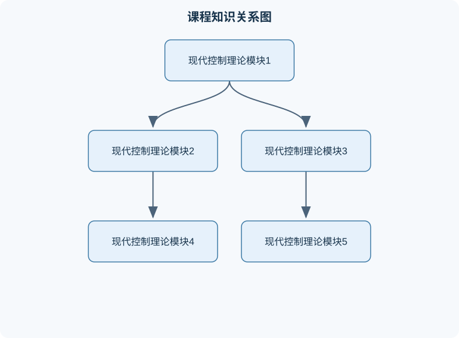
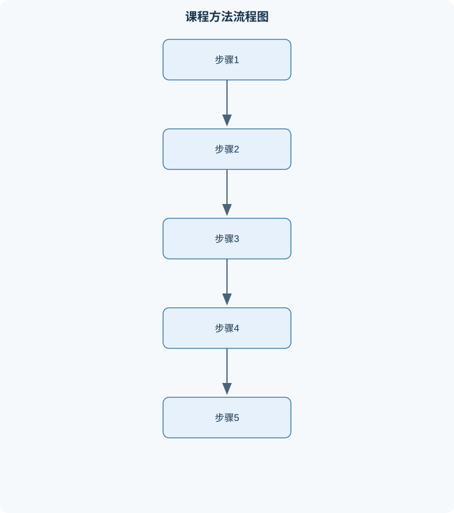

# 现代控制理论

## 一、课程整体知识框架

### 课程边界与先修知识

现代控制理论研究以状态变量为核心的动态系统建模、分析与控制设计，重点覆盖连续时间和离散时间线性定常系统，以及非线性系统的李雅普诺夫稳定性基础。课程从状态空间模型出发，讨论状态转移与响应、稳定性、能控性、能观性、实现与标准型、状态反馈与极点配置、状态观测器、二次型最优控制、采样与离散控制设计，并介绍非线性系统的平衡点稳定性分析。先修知识包括线性代数（矩阵运算、秩、特征值与特征向量、相似变换）、常微分方程与拉普拉斯变换、复变函数基础、经典控制系统的传递函数和反馈概念。课程不以经典频域校正、数字实现细节、随机控制、鲁棒控制或非线性控制器综合为主要范围；这些内容仅在说明状态空间方法的边界和后续联系时涉及。理想模型通常假设系统参数已知、模型线性定常、状态与输入连续且无饱和；工程应用须另行考虑噪声、扰动、参数不确定性、采样误差、执行器约束和数值条件。





### 1. 研究对象与基本问题

现代控制理论以状态空间模型为主要描述工具，研究动态系统内部状态如何随时间演化，以及如何通过输入改变状态、通过输出推断状态。与只描述输入输出关系的传递函数相比，状态空间模型能够显式表示系统内部动态，适合分析多输入多输出系统、初始状态影响、状态约束、状态估计和控制器实现。

连续时间线性定常系统通常写为
$$
\dot{x}(t)=Ax(t)+Bu(t),\qquad y(t)=Cx(t)+Du(t).
$$
其中，$t$ 是时间，单位取决于建模场景，常用秒；$x(t)\in\mathbb{R}^n$ 是状态向量，$u(t)\in\mathbb{R}^m$ 是输入向量，$y(t)\in\mathbb{R}^p$ 是输出向量；$A\in\mathbb{R}^{n\times n}$ 为系统矩阵，$B\in\mathbb{R}^{n\times m}$ 为输入矩阵，$C\in\mathbb{R}^{p\times n}$ 为输出矩阵，$D\in\mathbb{R}^{p\times m}$ 为直接传递矩阵。状态分量可以具有不同物理单位，因此矩阵元素的单位也可能不同，不能把矩阵元素一概视为无量纲。

状态是能够与输入一起确定系统未来行为的最小内部变量集合。对给定输入，若初态为 $x(t_0)$，系统的解为
$$
x(t)=e^{A(t-t_0)}x(t_0)+\int_{t_0}^{t}e^{A(t-\tau)}Bu(\tau)\,d\tau.
$$
第一项表示初始状态造成的自由响应，第二项表示输入造成的受迫响应。该解要求系统为线性定常连续时间模型，且输入满足使积分存在的常见条件，例如分段连续。它表明系统响应不仅取决于当前输入，也取决于初始状态；忽略初态可能使瞬态分析和预测产生错误。

离散时间线性定常系统写为
$$
x_{k+1}=A_dx_k+B_du_k,\qquad y_k=C_dx_k+D_du_k,
$$
其中 $k$ 为采样序号，$A_d,B_d,C_d,D_d$ 是离散模型矩阵。若连续系统在采样周期 $T_s$ 内采用零阶保持输入，则
$$
A_d=e^{AT_s},\qquad B_d=\int_0^{T_s}e^{A\tau}B\,d\tau.
$$
这里 $T_s$ 的单位与连续时间单位一致。该转换依赖于采样周期固定、输入在每个采样间隔内保持不变的假设；若输入连续变化、采样周期变化或存在显著时延，就不能不加检验地套用此离散化结果。

### 2. 从模型到设计的主线

课程的分析与设计通常沿着以下逻辑展开：先建立状态空间模型并检查模型假设，再判断状态能否被输入驱动、能否由输出辨识；随后选择坐标表示以揭示结构；在此基础上设计状态反馈以改变闭环动态，并设计状态观测器以估计不可直接测量的状态；最后检查闭环稳定性、稳态误差、噪声敏感性、执行器限制和模型失配。

状态空间模型并不唯一。若采用可逆坐标变换 $z=Tx$，其中 $T\in\mathbb{R}^{n\times n}$ 可逆，则等价模型为
$$
\dot z=TAT^{-1}z+TBu,\qquad y=CT^{-1}z+Du.
$$
变换前后输入输出关系相同，特征值也相同，但状态坐标和矩阵元素发生变化。状态的物理意义可能随变换而不再直观，因此数学上方便的标准型不一定适合作为工程实现变量。

课程中的若干关键判断都有明确边界。系统内部渐近稳定，通常指无输入时状态趋于零；对连续时间线性定常系统，这等价于 $A$ 的所有特征值实部严格小于零。对离散系统，要求 $A_d$ 的所有特征值模严格小于一。输入输出稳定与内部稳定并非总能互相替代：不可控或不可观的内部模态可能被传递函数约分隐藏，但仍可能影响内部状态或受到扰动激发。因而，只根据约分后的传递函数判断内部稳定，需要额外确认最小实现及隐藏模态。

### 3. 可控性与可观性

可控性回答“输入能否在有限时间内把系统从任意初态驱动到任意目标状态”。对 $n$ 阶连续时间系统，定义可控性矩阵
$$
\mathcal C=[B\ AB\ A^2B\ \cdots\ A^{n-1}B].
$$
系统完全可控当且仅当 $\operatorname{rank}(\mathcal C)=n$。其直观依据是输入在不同时间作用后，分别沿着 $B,AB,A^2B,\ldots$ 所张成的方向改变状态；若这些方向未覆盖整个状态空间，就存在无法由输入改变的状态方向。秩判据适用于有限维线性定常模型。数值计算时，近似线性相关可能导致秩判断依赖容差，不能只看浮点数矩阵是否“精确奇异”。

可观性回答“能否从有限时间内的输入和输出记录唯一确定初态”。定义可观性矩阵
$$
\mathcal O=
\begin{bmatrix}
C\\CA\\CA^2\\\vdots\\CA^{n-1}
\end{bmatrix}.
$$
系统完全可观当且仅当 $\operatorname{rank}(\mathcal O)=n$。输出及其动态变化包含对状态的不同组合；若某个非零状态方向在所有这些组合中都不可见，该方向便不能从输出辨识。该判据针对理想模型的结构可观性，不保证带噪测量下状态估计精度良好。一个方向虽理论上可观，若其输出影响极弱，也可能在有限精度传感器下难以可靠估计。

可控性与可观性是两个不同性质：可控性由 $(A,B)$ 决定，可观性由 $(A,C)$ 决定。系统可以可控但不可观，也可以可观但不可控。对角系统中，如果某一模态的输入通道系数为零，该模态可能不可控；如果该模态在输出中的系数为零，它可能不可观。不能仅凭 $A$ 的特征值或矩阵是否满秩，直接断言这两种性质。

### 4. 状态反馈、极点配置与稳态误差

若状态可测，采用状态反馈
$$
u=-Kx+r,
$$
其中 $K\in\mathbb{R}^{m\times n}$ 是反馈增益，$r$ 是参考或额外输入，闭环状态矩阵为 $A-BK$。闭环极点是 $A-BK$ 的特征值。对于单输入连续系统，若 $(A,B)$ 完全可控，则可以通过状态反馈把闭环特征多项式配置为所需的任意首一 $n$ 次多项式；对不可控模态，状态反馈不能改变其特征值。多输入系统的配置能力还受可控结构和所采用配置方法限制，不能将单输入结论不加条件地推广为任意极点均可任意配置。

极点配置给出的是理想线性模型中的瞬态动态安排，不自动保证工程性能。极点过快可能要求很大的控制输入，造成执行器饱和、噪声放大或未建模高频动态被激发；极点过慢则可能导致响应迟缓。设计后应同时核验闭环特征值、控制输入幅值、瞬态响应、扰动响应与模型不确定性。

状态反馈也不必然消除稳态误差。对于常值参考输入，若闭环稳定，稳态输出由平衡方程决定；误差是否为零取决于系统结构、输入通道以及控制器是否含有适当的积分作用或稳态前馈。仅把闭环极点配置到稳定位置，并不能推出跟踪误差为零。对于含积分器的扩展系统，还必须检查扩展后的可控性，否则积分状态无法被有效调节。

### 5. 状态观测器与输出反馈

当状态不能直接测量时，可用状态观测器根据输入和输出重建状态。连续时间线性观测器的一种形式为
$$
\dot{\hat{x}}=A\hat{x}+Bu+L(y-C\hat{x}),
$$
其中 $\hat{x}$ 是状态估计，$L\in\mathbb{R}^{n\times p}$ 是观测器增益。若定义估计误差 $e=x-\hat{x}$，在模型完全一致且无外部测量噪声时，有
$$
\dot e=(A-LC)e.
$$
因此，误差渐近收敛要求 $A-LC$ 为 Hurwitz 矩阵，即所有特征值实部严格小于零。对偶地，完全可观条件允许在理想线性定常模型下配置观测器误差极点。观测器不能从不可观的输出中恢复隐藏状态；即使模型可观，测量噪声、参数误差和过快观测器极点仍会造成估计偏差或噪声放大。

在状态反馈中以估计值 $\hat{x}$ 代替真实状态，会形成输出反馈实现。在线性模型、适当可控可观条件及理想实现下，控制器动态与观测器误差动态可分别分析；实际系统还要考虑传感器噪声、计算延迟、量化和饱和。设计时通常使观测器比控制闭环稍快，但“越快越好”并不成立，因为增大 $L$ 会提高高频测量噪声对估计值的影响。

### 6. 典型分析与设计流程

面对一个线性控制问题，先明确系统边界、输入输出定义、状态物理意义、单位、工作点和采用连续还是离散模型；再从机理方程或已知模型构造 $A,B,C,D$，检查维数、符号和量纲一致性。随后通过特征值和可控、可观秩分析识别系统结构，再按任务选择状态反馈、参考前馈、积分扩展或状态观测器。

计算结果需要进行独立验证：将设计增益代回闭环矩阵并重新计算特征值；用初始状态和代表性输入检查解析响应或数值响应；比较控制输入是否超出执行器能力；检查估计误差是否按预期衰减。若离散实现，则应直接验证离散闭环矩阵的特征值，而不能仅用连续极点稳定性替代采样系统稳定性判断。若模型存在不确定性，还需用参数变化、扰动或鲁棒性分析检查结论对假设偏差的敏感程度。

## 二、章节和模块划分

### 核心知识覆盖清单

本清单根据本课程的章节划分整理，用于检查正文是否覆盖各个核心模块：

- **1. 模块一：状态空间描述与现代控制基本概念**。
- **2. 模块二：状态响应、特征值与稳定性**。
- **3. 模块三：可控性、可达性与可控标准结构**。
- **4. 模块四：可观性、可检测性与状态重构**。
- **5. 模块五：线性变换、标准型与实现等价**。
- **6. 模块六：单输入单输出状态反馈与参考跟踪**。
- **7. 模块七：状态观测器与估计值反馈**。
- **8. 模块八：闭环综合、实现与验证**。


### 1. 模块一：状态空间描述与现代控制基本概念

本模块建立后续分析共同使用的模型语言。课程从“状态能否概括系统记忆”出发，区分状态、输入、输出、初始条件和参数。一个合适的状态选取应能在已知当前状态和未来输入后确定未来运动；状态并不唯一，选取时应兼顾模型阶次、物理含义和可测性。

对于线性化模型，必须说明线性模型适用的工作范围。非线性系统 $\dot{x}=f(x,u)$ 在平衡点 $(x_0,u_0)$ 附近，可令 $\delta x=x-x_0$、$\delta u=u-u_0$，用一阶展开得到
$$
\delta\dot{x}\approx A\delta x+B\delta u,\qquad
A=\left.\frac{\partial f}{\partial x}\right|_{(x_0,u_0)},\quad
B=\left.\frac{\partial f}{\partial u}\right|_{(x_0,u_0)}.
$$
这里偏导矩阵取在指定平衡点。该近似仅在偏差足够小、忽略高阶项不会显著改变结论时可靠；远离工作点、跨越饱和或切换边界时，线性模型可能失效。

本模块还建立连续与离散系统的区分、输入输出通道数和状态维数的区分，以及内部稳定与输入输出稳定的区分。常见考法包括由微分方程写出状态方程、检查维数和单位、由系统矩阵求平衡点或判断稳定性。关键边界是：相同输入输出传递函数可能对应不同内部实现；模型阶次、隐藏模态与初始状态不可仅由一个约分后的传递函数充分描述。

### 2. 模块二：状态响应、特征值与稳定性

本模块从矩阵指数解释系统动态。无输入响应为 $x(t)=e^{At}x(0)$；若 $A$ 可对角化，则可写作 $A=V\Lambda V^{-1}$，从而 $e^{At}=Ve^{\Lambda t}V^{-1}$。每个特征值描述一个模态的指数增长或衰减，复共轭特征值对应衰减或增长的振荡。若矩阵不可对角化，Jordan 块会使响应出现 $t^q e^{\lambda t}$ 项，因而只看特征值实部仍能判定渐近稳定性，但不能完全描述瞬态幅值。

连续系统 $A$ 的全部特征值实部严格为负时，原点渐近稳定；存在实部为正的特征值时不稳定。实部为零的情形不能只凭“没有正实部”判定稳定：若虚轴特征值存在非平凡 Jordan 块，响应会出现多项式增长。离散系统相应使用单位圆：全部特征值模小于一才渐近稳定；模等于一时还须检查 Jordan 结构。

本模块还讨论受迫响应与稳态响应。对稳定系统和常值输入 $u_0$，平衡状态满足 $0=Ax_{\rm ss}+Bu_0$。只有当 $A$ 可逆时，才能写成 $x_{\rm ss}=-A^{-1}Bu_0$；若 $A$ 奇异，平衡解可能不存在或不唯一，需直接求解代数方程并结合可达性判断。常见错误是把“系统稳定”直接等同于“任意输入下状态趋零”，而稳定性结论通常针对无输入响应或特定输入条件。

### 3. 模块三：可控性、可达性与可控标准结构

本模块用可控性矩阵判定输入对状态空间的作用范围。对 $n$ 阶系统，$\mathcal C=[B,AB,\ldots,A^{n-1}B]$ 的秩等于可控子空间维数。若秩小于 $n$，系统并非完全可控，但可控子空间内部仍可能存在可调节动态。用可控分解变换可将状态分为可控部分与不可控部分；输入只能直接作用于前者，后者的模态无法通过状态反馈任意移动。

可控性还可借助 PBH 判据检查：$(A,B)$ 完全可控，当且仅当对 $A$ 的每个特征值 $\lambda$，矩阵 $[\lambda I-A\ \ B]$ 行满秩。该判据将“某模态是否被输入通道激发”转化为线性代数检验；当特征值重根或数值接近时，应避免仅凭手算的近似特征向量下结论。

本模块解释状态反馈可配置极点的结构条件，并以可控标准型说明单输入系统如何将特征多项式系数与反馈增益联系起来。配置过程须先确认完全可控、模型阶次与特征多项式系数顺序一致，再代入反馈公式并通过闭环特征多项式复算。配置出的极点必须满足控制幅值、响应速度和未建模动态等工程限制。边界反例是：对于不可控的不稳定模态，即使其他可控模态均被配置到稳定位置，闭环内部仍然不稳定。

### 4. 模块四：可观性、可检测性与状态重构

本模块从输出记录能否辨识初态出发。$\mathcal O=[C^\mathsf T,(CA)^\mathsf T,\ldots,(CA^{n-1})^\mathsf T]^\mathsf T$ 的秩给出可观子空间维数。完全可观意味着在理想无噪声条件下，有限区间输出能够区分不同初态；它不等同于状态直接可测，也不代表噪声下估计误差小。

PBH 可观性判据为：$(A,C)$ 完全可观，当且仅当对 $A$ 的每个特征值 $\lambda$，矩阵
$$
\begin{bmatrix}\lambda I-A\\C\end{bmatrix}
$$
列满秩。可检测性是较弱条件：不可观模态若全部稳定，虽不能重构全部状态，仍可能构造渐近稳定的误差动态；若存在不可观的不稳定模态，则任何基于该输出的线性观测器都无法使完整估计误差渐近收敛。

可观标准结构用于显露哪些状态组合影响输出。通过坐标变换得到标准型时，应同时变换 $A,B,C$，而非只变换某一个矩阵。变换矩阵条件数过大时，数值计算可能放大舍入误差。常见题型是给定矩阵计算可观秩，或判断通过输出反馈能否估计全部状态；解答必须明确区分“完全可观”与“可检测”。

### 5. 模块五：线性变换、标准型与实现等价

本模块说明相似变换保持系统内在动态但改变状态表达。令 $z=Tx$，则 $A_z=TAT^{-1}$、$B_z=TB$、$C_z=CT^{-1}$，$D_z=D$。变换后特征值不变，输入输出关系也不变；可控性、可观性等结构性质亦保持不变，因为可逆变换不会改变相应子空间维数。

标准型的作用是揭示结构并简化计算，而非改变物理系统。可控标准型便于建立极点配置公式，可观标准型便于分析输出对模态的作用。构造标准型时需明确状态次序和矩阵约定；不同教材或软件可能采用不同伴随矩阵排列，直接照搬反馈公式容易产生符号或系数次序错误。转换后应验证矩阵关系，并比较特征多项式及传递函数，以确认实现等价。

传递函数由状态空间模型在零初始条件下得到：
$$
G(s)=C(sI-A)^{-1}B+D.
$$
其中 $s$ 为拉普拉斯变量，单位为时间的倒数；零初始条件是该输入输出传递函数表达成立的重要前提。分子分母约分可能消除不可控或不可观模态，因此传递函数的极点不一定展示所有内部模态。判断稳定性或实现阶次时，需结合状态空间实现而不能只看约分结果。

### 6. 模块六：单输入单输出状态反馈与参考跟踪

本模块由 $u=-Kx+r$ 推导闭环状态矩阵 $A-BK$，并讨论极点配置和响应指标的联系。将期望极点写成首一多项式后，与闭环特征多项式逐项比较可求反馈增益；这一系数比较法要求系统阶次、反馈符号和特征多项式定义保持一致。完成计算后须把 $K$ 代回并重新展开验证，而不能只报出增益向量。

参考输入可能需要比例缩放或前馈补偿，才能使稳态输出达到给定目标。对稳定闭环，若采用 $u=-Kx+Nr$ 且 $D=0$，稳态满足 $(A-BK)x_{\rm ss}=BNr$、$y_{\rm ss}=Cx_{\rm ss}$。只有在相应矩阵可逆且参考通道可实现时，才可由这些方程求 $N$；多输出、多参考或存在零点约束时，精确跟踪未必可行。含积分作用的设计可改善常值扰动下的稳态误差，但扩展系统必须满足必要的可控性条件，且积分饱和需要单独处理。

本模块的应用范围包括机电系统、过程控制和运动控制中的线性化工作点附近调节。实际验收不仅看极点位置，还要考察超调、调节时间、控制量峰值、扰动恢复和参数变化影响。设计极点靠近执行器能力边界时，线性理论给出的响应可能无法实现。

### 7. 模块七：状态观测器与估计值反馈

本模块从真实系统与估计器相减得到误差方程 $\dot e=(A-LC)e$，并用误差极点设计 $L$。观测器极点可通过对偶系统的极点配置方法计算，但必须先确认系统可观或至少可检测。将状态反馈与观测器结合时，控制律可写为 $u=-K\hat{x}+r$；理想线性模型下，控制动态和估计误差动态可以分块分析，这一性质不消除噪声、延迟和饱和的工程影响。

观测器设计需要在收敛速度与噪声敏感性之间折衷。误差极点设置过慢，初始估计误差长期影响控制；设置过快，增益可能过大，测量噪声会通过校正项被显著放大。若传感器存在偏置或模型参数偏差，估计器可能收敛到有偏状态。状态估计验收应同时比较估计误差、输出残差、噪声放大和控制输入，而不是只检查 $A-LC$ 的特征值。

### 8. 模块八：闭环综合、实现与验证

本模块把模型分析、反馈和观测器放入完整实现流程。首先界定任务与约束，确认传感器、执行器和采样方式；其次建立并核对模型，进行可控、可观和稳定性分析；然后设计反馈增益和观测器增益；最后用时域仿真或实验检查参考跟踪、扰动抑制、估计误差和输入约束。若实验偏离模型，应分辨参数误差、未建模动态、传感器标定、离散化误差和实现时延等原因，不能仅通过随意调整极点掩盖模型问题。

离散实现需采用与硬件一致的采样周期和保持方式，并检查量化、计算延迟、采样抖动与饱和。连续闭环稳定不保证任意采样实现均有良好性能；采样周期过大可能造成离散极点接近或越过单位圆，过快的采样也会增加计算负担和噪声带宽。验证报告应记录模型假设、参数和单位、控制器结构、初始条件、输入约束、评价指标及测试结果，使结论可复现、可审查。

## 三、核心概念的详细解释

### 1. 状态空间模型、状态与内部动态

现代控制理论把系统看成由状态、输入和输出共同描述的动态对象。连续时间线性定常系统表示为

$$
\dot{x}(t)=Ax(t)+Bu(t),\qquad y(t)=Cx(t)+Du(t),
$$

其中，$x(t)\in\mathbb{R}^n$ 为状态向量，$u(t)\in\mathbb{R}^m$ 为控制输入，$y(t)\in\mathbb{R}^p$ 为测量输出；$A,B,C,D$ 分别为系统矩阵、输入矩阵、输出矩阵和直接传递矩阵。$A$ 决定无输入时的内部演化，$B$ 描述输入对状态的作用，$C$ 描述状态如何形成输出，$D$ 表示输入对输出的瞬时通道。

状态不是“所有可测变量”的简单集合，而是能够在给定当前状态和未来输入后唯一确定未来状态与输出的最小变量集合。例如，质量—弹簧—阻尼系统可选位移和速度为状态；电路系统可选电容电压和电感电流为状态。状态分量可以有不同单位，因此矩阵元素也具有相应的复合单位。若位移单位为米、速度单位为米每秒，则状态坐标变换必须同时考虑量纲一致性，不能只进行形式上的任意相加。

对初始时刻 $t_0$ 和初始状态 $x(t_0)$，系统响应为

$$
x(t)=e^{A(t-t_0)}x(t_0)+
\int_{t_0}^{t}e^{A(t-\tau)}Bu(\tau)\,d\tau.
$$

第一项是零输入响应，反映初始状态引起的自由运动；第二项是零状态响应，反映输入的作用。该表达式要求系统是线性定常系统，且输入至少满足分段连续等使积分存在的条件。若系统是时变系统，应使用状态转移矩阵，不能直接把 $e^{A(t-t_0)}$ 作为通用解。

离散时间系统写为

$$
x_{k+1}=A_dx_k+B_du_k,\qquad y_k=C_dx_k+D_du_k.
$$

其中 $k$ 是采样序号，$A_d$ 为无量纲或由采样周期吸收时间单位的离散状态矩阵。连续系统在固定采样周期 $T_s$、零阶保持输入下满足

$$
A_d=e^{AT_s},\qquad B_d=\int_0^{T_s}e^{A\tau}B\,d\tau.
$$

若 $A$ 可逆，也可写成 $B_d=A^{-1}(A_d-I)B$；但当 $A$ 奇异时不能使用这个形式，应采用积分或矩阵指数增广方法。

### 2. 稳定性与内部模态

连续线性定常系统的内部渐近稳定性是指在 $u(t)=0$ 时，对于任意足够小的初始状态，均有 $x(t)\to0$。其充要条件是 $A$ 的全部特征值满足

$$
\operatorname{Re}\lambda_i(A)<0.
$$

若存在实部等于零的特征值，还需检查对应约当块。单纯“特征值实部不为正”不能保证渐近稳定：例如

$$
A=\begin{bmatrix}0&1\\0&0\end{bmatrix}
$$

的特征值全为零，但状态响应包含随时间增长的项，系统不稳定。离散系统渐近稳定的条件是全部特征值满足 $|\lambda_i(A_d)|<1$。连续系统的极点通过理想采样映射为 $z_i=e^{\lambda_iT_s}$；因此连续稳定极点在无数值误差时映射到单位圆内，但采样周期仍会影响离散性能。

输入输出稳定与内部稳定必须区分。不可控或不可观的内部模态可能在传递函数中被约分。例如某个不稳定模态同时不可控或不可观时，传递函数可能看不到该极点，但内部状态仍会发散。工程设计中应优先检查状态空间实现的内部稳定性，再讨论输入输出响应。

### 3. 能控性、能观性与可检测性

系统完全能控，是指对任意初始状态和目标状态，都能在有限时间内通过适当输入实现状态转移。连续时间单输入或多输入系统的能控性矩阵为

$$
\mathcal{C}=\begin{bmatrix}B&AB&A^2B&\cdots&A^{n-1}B\end{bmatrix}.
$$

系统完全能控的充要条件是

$$
\operatorname{rank}(\mathcal{C})=n.
$$

能控性不是指每个状态分量都能被输入直接改变。输入可能先作用于一个状态，再通过 $A$ 的耦合影响其他状态。若秩不足，只能控制能控子空间；不能控模态的位置决定了反馈能否改变该模态。

完全能观是指根据有限时间内的输入和输出历史，可以唯一确定初始状态。能观性矩阵为

$$
\mathcal{O}=
\begin{bmatrix}
C\\
CA\\
\vdots\\
CA^{n-1}
\end{bmatrix},
$$

完全能观的充要条件是 $\operatorname{rank}(\mathcal{O})=n$。能观性取决于输出传感器的配置及系统内部耦合。一个状态即使没有传感器直接测量，只要它通过动态关系影响输出，仍可能是能观的。

可检测性比完全能观性弱：所有不能观模态都必须是稳定的。可检测系统不能保证重构全部状态，但能保证不可观部分不会造成估计误差发散。类似地，可稳定性要求所有不能控模态稳定。设计状态反馈至少需要可稳定性，设计渐近收敛观测器至少需要可检测性。

### 4. 传递函数、状态坐标变换与标准型

零初始条件下，状态空间模型的传递函数为

$$
G(s)=C(sI-A)^{-1}B+D.
$$

这里 $s$ 的单位是时间的倒数。该公式只能描述零初始条件下的输入—输出关系，不能把初始状态响应包含在同一个传递函数中。传递函数分母经约分后可能隐藏不可控或不可观模态，因此传递函数阶次不一定等于内部状态维数。

若进行可逆坐标变换 $z=Tx$，则

$$
\dot z=TAT^{-1}z+TBu,\qquad y=CT^{-1}z+Du.
$$

变换不改变特征值、能控性和能观性的本质，也不改变输入输出关系，但会改变矩阵元素和状态物理意义。控制理论中常用能控标准型、能观标准型和约当型揭示结构。约当型便于理论分析，但对参数扰动和数值计算较敏感；工程计算通常更重视数值条件良好的分解，而不是形式上最简的约当矩阵。

### 5. 状态反馈、参考跟踪与积分作用

状态反馈常写为

$$
u=-Kx+Nr,
$$

其中 $K$ 为反馈增益矩阵，$r$ 为参考输入，$N$ 为前馈或参考缩放系数。闭环状态矩阵为

$$
A_{\mathrm{cl}}=A-BK.
$$

如果 $(A,B)$ 可控，则可以通过极点配置把闭环极点放置到指定位置；如果仅可稳定，则只能配置能控部分，不能任意改变不能控模态。

对稳定闭环且 $D=0$ 的常值参考 $r$，稳态满足

$$
0=(A-BK)x_{\mathrm{ss}}+BNr,\qquad
y_{\mathrm{ss}}=Cx_{\mathrm{ss}}.
$$

若 $A-BK$ 可逆，且为单输入单输出系统，可以选择 $N$ 使 $y_{\mathrm{ss}}=r$。但若系统存在非最小相位零点、输入输出方向不匹配、执行器受限或多输出目标彼此不相容，精确跟踪未必可实现。积分器通过增加误差积分状态来消除常值扰动造成的稳态误差，但会提高系统阶次，并可能引起积分饱和和恢复迟缓。

### 6. 状态观测器、分离性与实际限制

全阶观测器的一种形式为

$$
\dot{\hat{x}}=A\hat{x}+Bu+L(y-C\hat{x}),
$$

其中 $\hat{x}$ 是状态估计，$L$ 是观测器增益。令估计误差 $e=x-\hat{x}$，代入被控对象和观测器方程可得

$$
\dot e=(A-LC)e.
$$

因此，若 $(A,C)$ 可观，可以通过配置 $A-LC$ 的特征值使估计误差渐近收敛。对偶关系表明，观测器增益设计可以转化为系统 $(A^\mathsf{T},C^\mathsf{T})$ 的状态反馈问题，但最终必须把结果转置回 $L$，不能直接把反馈增益当作观测器增益。

输出反馈控制常用

$$
u=-K\hat{x}+Nr.
$$

理想线性模型下，闭环控制动态和估计误差动态具有分离性；然而噪声、采样延迟、饱和、模型不确定性和未建模高频动态会破坏理想结论。观测器极点过快会提高对测量噪声的敏感性，过慢则使初始估计误差长时间影响控制。实际设计必须同时检查估计误差、输出残差和控制输入峰值。

## 四、重要定义、公式、定理和推导

### 专业审校补充：关键定义与适用边界

线性二次型调节器（LQR）解决的是无限时域性能优化问题，而不是仅把闭环极点配置到指定位置。对连续系统 \(\dot{x}=Ax+Bu\)，取性能指标 \(J=\int_0^\infty(x^{\mathsf T}Qx+u^{\mathsf T}Ru)\,dt\)，其中状态权重矩阵 \(Q=Q^{\mathsf T}\succeq0\)，输入权重矩阵 \(R=R^{\mathsf T}\succ0\)，两项应具有相同的性能量纲。若 \((A,B)\) 可稳定、\((Q^{1/2},A)\) 可检测，并且不存在不稳定的不可惩罚模态，则代数黎卡提方程 \(A^{\mathsf T}P+PA-PBR^{-1}B^{\mathsf T}P+Q=0\) 存在稳定化对称半正定解 \(P\)。最优控制为 \(u=-Kx\)，其中 \(K=R^{-1}B^{\mathsf T}P\)，闭环矩阵为 \(A-BK\)。该结论基于线性定常、全状态可用、无输入饱和和无限时域等假设；若状态只能估计，应结合观测器，若存在饱和、硬约束或强模型不确定性，LQR解不再自动保证实际性能。离散系统应改用离散黎卡提方程，不能直接套用连续时间公式。


### 1. 关键判据与推导

#### 连续系统的状态解

由

$$
\dot{x}=Ax+Bu
$$

左乘 $e^{-At}$，得到

$$
\frac{d}{dt}\left(e^{-At}x(t)\right)=e^{-At}Bu(t).
$$

从 $t_0$ 积分到 $t$，再左乘 $e^{At}$，得到

$$
x(t)=e^{A(t-t_0)}x(t_0)+
\int_{t_0}^{t}e^{A(t-\tau)}Bu(\tau)\,d\tau.
$$

推导中使用了 $A$ 为常矩阵这一条件。若 $A=A(t)$ 随时间变化，通常不能写成普通矩阵指数，需使用状态转移矩阵。

#### 能控性与能观性的秩判据

由连续输入作用展开状态，可见输入在不同时间经由 $B,AB,A^2B,\ldots$ 进入状态空间。因此能控方向由

$$
\mathcal{C}=\begin{bmatrix}B&AB&\cdots&A^{n-1}B\end{bmatrix}
$$

张成。若列空间维数为 $n$，所有状态方向都可被输入激发；否则存在不能控方向。

同理，输出及其导数为

$$
y=Cx,\qquad \dot y=CAx+CBu,
$$

继续求导可获得 $CA^2x$ 等信息。去除已知输入项后，初始状态对输出历史的影响由 $\mathcal{O}$ 描述。若 $\mathcal{O}$ 满秩，则不同初始状态不会产生完全相同的输出历史。

#### 李雅普诺夫稳定性判据

若存在对称正定矩阵 $P=P^\mathsf{T}>0$，使

$$
A^\mathsf{T}P+PA=-Q,\qquad Q=Q^\mathsf{T}>0,
$$

则 $A$ 是渐近稳定矩阵。取李雅普诺夫函数

$$
V(x)=x^\mathsf{T}Px,
$$

有

$$
\dot V=x^\mathsf{T}(A^\mathsf{T}P+PA)x
=-x^\mathsf{T}Qx<0,\quad x\ne0.
$$

该方法不必直接求特征值，适合稳定性证明和鲁棒性分析。$P>0$ 与 $Q>0$ 是严格渐近稳定结论的重要条件；若只能得到半负定，通常还需要进一步分析不变集，不能直接断言渐近稳定。

### 2. 代表性分析与设计流程

#### 流程一：状态模型分析

输入为 $A,B,C,D$ 及连续或离散时间标志；输出为稳定性、能控性、能观性和传递函数结论。

1. 检查矩阵维数是否满足：$A\in\mathbb{R}^{n\times n}$、$B\in\mathbb{R}^{n\times m}$、$C\in\mathbb{R}^{p\times n}$。
2. 求 $A$ 的特征值，判断内部稳定性。
3. 构造 $\mathcal C$ 和 $\mathcal O$，计算秩或奇异值。
4. 用 $(sI-A)^{-1}$ 求传递函数，并检查是否发生约分。
5. 将结论与物理意义、单位及初始条件核对。

不变量是矩阵维数和坐标变换下的系统本质性质；终止条件是所有判据完成并通过代回验证。直接求秩的理论计算量取决于矩阵规模，数值计算中应关注病态矩阵和秩阈值，不能只依据极小数值的非零判断。

#### 流程二：状态反馈极点配置

输入为 $(A,B)$ 和期望闭环极点；输出为 $K$。

1. 检查系统可控或至少可稳定。
2. 形成目标特征多项式。
3. 由 $A-BK$ 计算闭环特征多项式。
4. 用系数比较、Ackermann 公式或数值极点配置求 $K$。
5. 将 $K$ 代回，重新求特征值并仿真响应。
6. 检查控制输入是否超过执行器边界。

理论上可控系统的极点可任意配置，但极点过于靠左可能导致增益过大、噪声放大和输入饱和。

#### 流程三：观测器设计

输入为 $(A,C)$ 和期望观测器极点；输出为 $L$。

1. 计算 $\operatorname{rank}(\mathcal O)$，确认可观或可检测。
2. 对偶系统 $(A^\mathsf{T},C^\mathsf{T})$ 进行反馈极点配置。
3. 将所得增益转置为 $L$。
4. 验证 $A-LC$ 的特征值。
5. 在含噪声和参数偏差条件下检查估计误差和残差。

终止条件不是“算出 $L$”本身，而是误差收敛、噪声放大和控制输入均满足约束。

```python
import numpy as np

def rank_with_tolerance(M, tol=1e-9):
    """利用奇异值计算数值秩。"""
    singular_values = np.linalg.svd(M, compute_uv=False)
    return int(np.sum(singular_values > tol))

def analyze_state_model(A, B, C):
    n = A.shape[0]
    controllability = B
    observability = C

    for i in range(1, n):
        controllability = np.hstack((controllability,
                                     np.linalg.matrix_power(A, i) @ B))
        observability = np.vstack((observability,
                                   C @ np.linalg.matrix_power(A, i)))

    eigvals = np.linalg.eigvals(A)
    return {
        "eigenvalues": eigvals,
        "controllability_rank": rank_with_tolerance(controllability),
        "observability_rank": rank_with_tolerance(observability),
        "is_asymptotically_stable": np.all(np.real(eigvals) < 0)
    }

A = np.array([[0.0, 1.0], [-2.0, -3.0]])
B = np.array([[0.0], [1.0]])
C = np.array([[1.0, 0.0]])

result = analyze_state_model(A, B, C)
print(result)
```

代码的输入是数值矩阵 $A,B,C$，输出包括特征值、能控性秩、能观性秩和稳定性判断。它假定矩阵维数匹配、系统为连续线性定常模型；数值秩阈值应根据矩阵尺度调整。该程序只完成分析，不替代对单位、物理约束和模型适用性的审查。

### 3. 典型例题

#### 例题一：判断稳定性、能控性和能观性

**题干：** 已知

$$
A=\begin{bmatrix}1&0\\0&-2\end{bmatrix},\quad
B=\begin{bmatrix}1\\0\end{bmatrix},\quad
C=\begin{bmatrix}1&1\end{bmatrix}.
$$

判断系统稳定性、能控性和能观性。

**分析与解答：** $A$ 的特征值为 $1,-2$，因存在正特征值，系统不渐近稳定。能控性矩阵为

$$
\mathcal C=\begin{bmatrix}1&1\\0&0\end{bmatrix},
$$

秩为 $1<2$，故不完全能控；第二个状态对应的模态不能由输入改变。能观性矩阵为

$$
\mathcal O=\begin{bmatrix}1&1\\1&-2\end{bmatrix},
$$

行列式为 $-3\ne0$，故完全能观。

**验证：** 不能控的状态对应特征值 $-2$，是稳定不能控模态；不稳定的特征值 $1$ 对应第一状态且可控，因此可以通过反馈改变。**变式：** 若改为 $C=[1\ 0]$，则 $\mathcal O$ 秩为 $1$，第二个状态不可观，但该不可观模态稳定，系统仍可检测。

#### 例题二：求传递函数并识别隐藏模态

**题干：** 已知

$$
A=\begin{bmatrix}1&0\\0&-2\end{bmatrix},\quad
B=\begin{bmatrix}1\\0\end{bmatrix},\quad
C=\begin{bmatrix}1&0\end{bmatrix},\quad D=0.
$$

求 $G(s)$，并说明传递函数能否反映全部内部动态。

**解答：**

$$
sI-A=\begin{bmatrix}s-1&0\\0&s+2\end{bmatrix},
$$

因此

$$
(sI-A)^{-1}B=
\begin{bmatrix}\frac1{s-1}\\0\end{bmatrix},
\qquad
G(s)=\frac1{s-1}.
$$

传递函数只显示极点 $s=1$，没有显示 $-2$ 模态。原因是第二状态既不能控，也不能观。**结果验证：** 直接计算 $\mathcal C$ 和 $\mathcal O$ 均得秩 $1$。**变式：** 若 $B=[1\ 1]^\mathsf T$、$C=[1\ 1]$，两个模态通常都会进入传递函数，但仍须检查是否存在极点零点约分。

#### 例题三：二阶状态反馈极点配置

**题干：** 对

$$
A=\begin{bmatrix}0&1\\0&0\end{bmatrix},\qquad
B=\begin{bmatrix}0\\1\end{bmatrix},
$$

设计 $u=-Kx$，使闭环极点为 $-2,-3$。

**解答：** 令 $K=[k_1\ k_2]$，则

$$
A-BK=
\begin{bmatrix}0&1\\-k_1&-k_2\end{bmatrix}.
$$

其特征多项式为

$$
\det(sI-A+BK)=s^2+k_2s+k_1.
$$

目标多项式为

$$
(s+2)(s+3)=s^2+5s+6.
$$

逐项比较得 $k_2=5,k_1=6$，所以 $K=[6\ 5]$。**验证：** 代回闭环矩阵，其迹为 $-5$、行列式为 $6$，特征值确为 $-2,-3$。**变式：** 若反馈写成 $u=Kx$，矩阵应变为 $A+BK$，增益符号必须重新计算，不能直接沿用。

#### 例题四：观测器误差动态

**题干：** 对

$$
A=\begin{bmatrix}0&1\\-2&-3\end{bmatrix},\qquad C=\begin{bmatrix}1&0\end{bmatrix},
$$

设计观测器，使误差极点为 $-5,-6$。

**解答：** 令 $L=[l_1\ l_2]^\mathsf T$，则

$$
A-LC=
\begin{bmatrix}
-l_1&1\\
-2-l_2&-3
\end{bmatrix}.
$$

其特征多项式为

$$
s^2+(l_1+3)s+(3l_1+2+l_2).
$$

目标多项式为 $s^2+11s+30$，所以

$$
l_1+3=11,\qquad 3l_1+2+l_2=30.
$$

得 $l_1=8,l_2=4$。**验证：** 代回后迹为 $-11$、行列式为 $30$。**变式：** 若测量的是第二状态，应先重新构造 $C$；不能仅交换 $L$ 的分量。

#### 例题五：参考输入的稳态缩放

**题干：** 对稳定闭环系统

$$
A-BK=\begin{bmatrix}-2&0\\0&-3\end{bmatrix},\quad
B=\begin{bmatrix}1\\1\end{bmatrix},\quad C=\begin{bmatrix}1&0\end{bmatrix},
$$

采用 $u=-Kx+Nr$，求使常值参考实现 $y_{\rm ss}=r$ 的 $N$。

**解答：** 稳态状态满足

$$
x_{\rm ss}=-(A-BK)^{-1}BNr.
$$

由于

$$
(A-BK)^{-1}B=
\begin{bmatrix}-1/2\\-1/3\end{bmatrix},
$$

所以

$$
y_{\rm ss}=C x_{\rm ss}=\frac{N}{2}r.
$$

令 $y_{\rm ss}=r$，得 $N=2$。**验证：** 代回可得 $x_{\rm ss}=[r,\frac23r]^\mathsf T$，输出为 $r$。**变式：** 若 $C=[1\ 1]$，则缩放系数会改变；若闭环矩阵不可逆，则不能直接使用该稳态公式。

### 4. 实验与项目流程

#### 项目一：状态反馈控制仿真

**输入数据：** 选取二阶质量—弹簧—阻尼线性模型，给定质量、阻尼、刚度、采样周期、初始状态和执行器最大输入。由物理方程建立 $A,B,C,D$，并记录所有参数单位。

**步骤：**

1. 检查模型维数和单位；
2. 计算能控性；
3. 根据调节时间和超调约束选择闭环极点；
4. 求 $K$ 和参考缩放系数；
5. 在无扰动、常值扰动和初始偏差条件下仿真；
6. 记录稳态误差、超调、调节时间和控制输入峰值；
7. 改变质量或阻尼，检查参数变化下的性能。

**评价标准：** 闭环极点正确；输出达到参考值；控制输入不超限；参数变化后系统不发散。**排错方法：** 若极点不正确，检查反馈符号和 $K$ 的维数；若稳态误差不为零，检查 $N$、模型的 $D$ 项及参考定义；若响应仿真良好但实际输入超限，应重新设计而非仅放大执行器数值。

#### 项目二：观测器与估计值反馈

**输入数据：** 给定 $A,B,C$、状态初值、估计初值、测量噪声幅值和采样周期。

**步骤：**

1. 检查 $(A,C)$ 的可观性或可检测性；
2. 设计观测器增益 $L$；
3. 分别测试无噪声和含噪声情况；
4. 计算估计误差范数 $\|x-\hat x\|$ 和输出残差 $y-C\hat x$；
5. 将观测器接入 $u=-K\hat x+Nr$；
6. 比较不同观测器极点下的跟踪性能和控制输入。

**评价标准：** 无噪声时估计误差按理论极点衰减；有噪声时误差方差和控制输入不过大；输出残差应与噪声及模型误差相符。**排错方法：** 误差不收敛时检查 $A-LC$ 的符号和矩阵乘法顺序；误差收敛但噪声剧烈放大时，观测器可能过快；残差持续偏置时，应检查传感器偏置、参数误差和未建模输入。

### 5. 易错点、笔试问题与面试问题

#### 具体易错点

1. 把状态、输出和输入混为一谈；输出只是状态和输入的函数，不必包含全部状态。
2. 把“能控”误解为每个状态都被输入直接连接；能控性还取决于 $AB,A^2B$ 等动态耦合。
3. 用 $\det(\mathcal C)\ne0$ 判断非方阵能控矩阵；一般应使用秩。
4. 忘记能控性矩阵的列顺序和阶数，应取到 $A^{n-1}B$。
5. 把能观矩阵写成列堆叠而不是行堆叠。
6. 只看传递函数极点，不检查隐藏的不可控或不可观模态。
7. 将连续稳定条件 $\operatorname{Re}\lambda<0$ 与离散稳定条件 $|\lambda|<1$ 混用。
8. 在状态反馈中忘记负号，导致实际闭环矩阵是 $A+BK$。
9. 计算极点配置后不把 $K$ 代回验证。
10. 把观测器增益 $L$ 直接当成反馈增益使用，漏掉对偶转置。
11. 认为观测器极点越快越好，忽略测量噪声和执行器饱和。
12. 忽略初始状态，误把传递函数响应当作完整系统响应。
13. 不检查 $A-BK$ 可逆性就使用稳态参考公式。
14. 离散化时忽略零阶保持、采样延迟和采样周期。
15. 将坐标变换后的数学状态仍解释为原物理变量。
16. 用数值软件默认的秩判断病态矩阵，未说明容差和尺度。

#### 典型笔试问题及解答思路

1. **如何判断连续系统渐近稳定？** 求 $A$ 的全部特征值；只有实部严格为负时才能直接判定渐近稳定。
2. **能控性矩阵为什么包含 $B,AB,\ldots$？** 因为输入在动态演化中依次通过 $B$ 和 $A$ 传播，各列张成输入可到达的状态方向。
3. **传递函数与状态空间模型有何区别？** 传递函数依赖零初始条件，主要描述输入输出；状态空间还保留初始状态和内部模态。
4. **何时可以任意配置闭环极点？** 当 $(A,B)$ 完全能控时；若仅可稳定，只能处理能控部分。
5. **如何推导观测器误差方程？** 用 $e=x-\hat x$，将对象方程减去观测器方程，得到 $\dot e=(A-LC)e$。
6. **为什么需要参考前馈系数？** 状态反馈主要改变动态，未必自动满足单位静态增益；需由稳态方程求缩放系数。
7. **不可观是否一定导致系统不稳定？** 不一定；若不可观模态稳定，系统仍可能可检测。
8. **连续稳定系统离散后是否一定可用？** 理论极点映射仍在单位圆内，但采样周期、延迟、保持和数值实现可能使性能不合格。

#### 典型面试问题、参考答案与追问要点

1. **你如何从模型开始设计控制器？** 先核对单位和假设，再做稳定性、能控性、能观性分析，随后设计反馈与观测器，最后在约束和扰动下验证。追问时应说明采样、饱和和模型失配。
2. **为什么不用传递函数直接设计？** 多输入多输出、初始状态、状态估计和内部模态用状态空间表达更自然。追问可讨论极点零点约分隐藏模态的问题。
3. **观测器极点怎样选择？** 需在收敛速度和噪声放大之间折衷，不是越快越好。追问应说明传感器噪声和采样周期的影响。
4. **极点配置后响应仍超调很大怎么办？** 检查零点、输入饱和、采样延迟和非线性，必要时重新选择极点或采用积分、前馈和约束设计。追问要区分模型问题与调参问题。
5. **如何判断控制器是否能在硬件上实现？** 检查计算周期、数值范围、输入峰值、量化、延迟和故障状态。追问应给出验收记录。
6. **模型与实验不一致时如何排查？** 依次检查单位、符号、传感器标定、参数辨识、采样保持、延迟和未建模动态。不能只通过增大增益掩盖偏差。
7. **状态反馈与输出反馈有什么区别？** 状态反馈假定状态可得，输出反馈通过观测器或其他估计器获得状态。追问应说明估计误差会影响闭环响应。
8. **如何验证一个状态空间实现不是错误的？** 检查矩阵维数、单位、传递函数、特征值、能控能观秩，并在典型初值和输入下比较时域响应。追问可进一步讨论坐标变换等价性。

### 6. 岗位关联与验收标准

在控制算法研发岗位中，实际任务包括建立对象模型、设计状态反馈和观测器、完成离散实现并分析约束。使用的知识包括状态空间建模、能控能观性、极点配置、稳定性判据、采样和误差分析；主要产出是模型文件、增益参数、仿真报告和测试记录。验收标准包括模型单位完整、矩阵维数正确、闭环极点与设计值一致、输入不超限、扰动下能够恢复，且仿真步骤和参数可复现。

在系统测试与验证岗位中，任务是构造初始偏差、参考变化、扰动、噪声和参数变化等测试场景，检查输出、估计误差和控制输入。产出包括测试用例、日志、误差指标和问题定位报告。验收不能只看最终输出是否稳定，还应核对稳态误差、调节时间、峰值输入、残差统计和异常工况下的安全状态。

在嵌入式控制实现岗位中，任务是将连续设计转换为固定采样周期的离散算法，处理传感器读取、状态估计、控制计算和执行器输出。使用的知识包括离散状态方程、零阶保持、数值稳定性、延迟和饱和处理。验收标准包括单周期计算时间小于采样周期、变量量纲和范围明确、输入限幅与积分防饱和有效，并在采样抖动和传感器异常时保持可诊断、可控的行为。

## 五、算法、流程和实现思路

### 方法与流程覆盖索引

下列方法或流程应在正文中说明输入、步骤、适用条件、结果检查和边界：

- 1. 状态空间问题的统一分析流程
- 2. 算法一：能控性、能观性与稳定性判定
- 3. 算法二：状态反馈极点配置与结果校验
- 4. 算法三：全阶状态观测器设计
- 5. 例题一：稳定性、能控性和能观性判定
- 6. 例题二：由状态空间模型求传递函数
- 7. 例题三：离散化
- 8. 例题四：状态反馈与参考缩放
- 9. 例题五：观测器误差动态
- 10. 实验与项目流程





### 1. 状态空间问题的统一分析流程

对连续时间线性定常系统
$$
\dot{x}=Ax+Bu,\qquad y=Cx+Du,
$$
建议按“建模—结构判断—设计—验证”的顺序处理。这里 $x\in\mathbb{R}^n$ 为状态，$u\in\mathbb{R}^m$ 为输入，$y\in\mathbb{R}^p$ 为输出，$A,B,C,D$ 的维数分别为 $n\times n$、$n\times m$、$p\times n$ 和 $p\times m$。

第一步是检查模型的物理含义、矩阵维数和单位。若状态由位置和速度组成，位置与速度的单位不同，则 $A$ 的不同元素也可能具有不同单位。第二步是计算特征值，判断开环内部稳定性。第三步是构造能控矩阵和能观矩阵：
$$
\mathcal C=\begin{bmatrix}B&AB&A^2B&\cdots&A^{n-1}B\end{bmatrix},
$$
$$
\mathcal O=\begin{bmatrix}C\\CA\\CA^2\\\vdots\\CA^{n-1}\end{bmatrix}.
$$
若 $\operatorname{rank}(\mathcal C)=n$，系统完全能控；若 $\operatorname{rank}(\mathcal O)=n$，系统完全能观。秩不足时，不能简单说“某一个状态变量完全不能控”，因为能控性和能观性是状态子空间的性质，具体坐标下的分量解释依赖于状态基底。

第四步是在满足条件时设计状态反馈
$$
u=-Kx+Nr,
$$
其中 $K\in\mathbb{R}^{m\times n}$ 为反馈增益，$r$ 为参考输入，$N$ 为参考缩放系数。闭环矩阵为
$$
A_{\mathrm{cl}}=A-BK.
$$
第五步是设计观测器。全阶观测器可写为
$$
\dot{\hat{x}}=A\hat{x}+Bu+L(y-C\hat{x}-Du),
$$
其中 $\hat{x}$ 是状态估计，$L\in\mathbb{R}^{n\times p}$ 是观测器增益。误差 $e=x-\hat{x}$ 满足
$$
\dot e=(A-LC)e.
$$
最后必须验证闭环特征值、参考稳态误差、控制输入峰值、观测误差、噪声放大和执行器约束。仅验证特征值位置，不足以证明控制器可用。

### 2. 算法一：能控性、能观性与稳定性判定

**输入：** 矩阵 $A,B,C$。  
**输出：** 开环稳定性、能控性、能观性及相应秩。  
**过程：**

1. 检查 $A$ 是否为方阵，以及 $B,C$ 的维数是否匹配。
2. 计算 $A$ 的特征值 $\lambda_i$。连续时间下，若全部满足 $\operatorname{Re}\lambda_i<0$，则内部渐近稳定；离散时间下，若全部满足 $|\lambda_i|<1$，则内部渐近稳定。
3. 依次计算 $B,AB,\ldots,A^{n-1}B$，拼成 $\mathcal C$。
4. 依次计算 $C,CA,\ldots,CA^{n-1}$，拼成 $\mathcal O$。
5. 用数值秩判断。实际计算中应使用相对阈值，而不是机械地把极小奇异值当成非零值。
6. 若秩不足，进一步用可控分解或可观分解定位不可控、不可观子空间。

**不变量与终止条件：** 第 $j$ 次递推后已获得 $A^jB$ 或 $CA^j$；当 $j=n-1$ 时，根据凯莱—哈密顿定理，更高次幂不会增加新的线性独立方向，算法终止。矩阵乘法的直接计算复杂度约为 $O(n^3)$ 量级，秩分解通常也为 $O(n^3)$ 量级。

**适用条件与边界：** 该方法适用于有限维线性定常模型。对于非线性系统，只能用于某个工作点的线性化模型；线性化系统能控并不自动保证原非线性系统在大范围内能控。对于病态矩阵，秩判断必须结合奇异值尺度和模型参数精度。

```python
import numpy as np

def analyze_lti(A, B, C, discrete=False, tol=1e-9):
    """分析有限维线性定常系统的稳定性、能控性和能观性。"""
    A = np.asarray(A, dtype=float)
    B = np.asarray(B, dtype=float)
    C = np.asarray(C, dtype=float)

    n = A.shape[0]
    if A.shape != (n, n):
        raise ValueError("A 必须为方阵")
    if B.shape[0] != n or C.shape[1] != n:
        raise ValueError("B 或 C 的维数与 A 不匹配")

    eig = np.linalg.eigvals(A)
    if discrete:
        stable = np.all(np.abs(eig) < 1.0)
    else:
        stable = np.all(np.real(eig) < 0.0)

    controllability_blocks = [B]
    observability_blocks = [C]
    for _ in range(1, n):
        controllability_blocks.append(A @ controllability_blocks[-1])
        observability_blocks.append(observability_blocks[-1] @ A)

    controllability = np.hstack(controllability_blocks)
    observability = np.vstack(observability_blocks)

    rc = np.linalg.matrix_rank(controllability, tol=tol)
    ro = np.linalg.matrix_rank(observability, tol=tol)

    return {
        "eigenvalues": eig,
        "stable": bool(stable),
        "controllability_rank": rc,
        "observability_rank": ro,
        "controllable": rc == n,
        "observable": ro == n,
    }
```

### 3. 算法二：状态反馈极点配置与结果校验

**输入：** $A,B$ 及期望闭环极点 $\{\mu_1,\ldots,\mu_n\}$。  
**输出：** 反馈矩阵 $K$，使 $A-BK$ 具有指定特征值。  
**过程：**

1. 检查 $(A,B)$ 是否能控。不能控时，任意极点配置通常不可能完成。
2. 由期望极点构造首一特征多项式
   $$
   p_d(s)=\prod_{i=1}^{n}(s-\mu_i).
   $$
3. 根据所采用的极点配置公式或数值算法求得 $K$。单输入系统可用系数比较法；多输入系统一般采用数值极点配置算法。
4. 直接计算 $A-BK$ 的特征值，检查是否与目标极点一致。
5. 对阶跃参考和扰动进行仿真，检查峰值、调节时间和稳态误差。

若采用 $u=-Kx$，闭环矩阵必须是 $A-BK$；若控制律写成 $u=Kx$，则闭环矩阵为 $A+BK$。反馈符号改变会使所得增益完全不同。闭环极点配置只决定线性模型的极点，不直接保证控制量不饱和，也不保证噪声性能良好。

对于常值参考，若 $D=0$ 且 $A-BK$ 可逆，采用 $u=-Kx+Nr$ 时有
$$
x_{\mathrm{ss}}=(A-BK)^{-1}BNr,
$$
$$
y_{\mathrm{ss}}=C(A-BK)^{-1}BNr.
$$
若为单输入单输出且分母非零，可令
$$
N=\frac{1}{C(A-BK)^{-1}B}
$$
以实现单位稳态增益。若该分母为零、系统存在不适当的参考通道或多输出目标不相容，则不能强行使用该公式。

### 4. 算法三：全阶状态观测器设计

**输入：** $A,C$ 及观测器期望极点。  
**输出：** 观测器增益 $L$。  
**过程：**

1. 检查 $(A,C)$ 是否完全能观，或至少是否可检测。不可检测时，不能保证所有不稳定误差模态衰减。
2. 通过对偶关系，将观测器问题转化为 $(A^\mathsf T,C^\mathsf T)$ 的状态反馈问题。
3. 求得使
   $A^\mathsf T-C^\mathsf T L^\mathsf T$
   具有目标极点的 $L^\mathsf T$，再转置得到 $L$。
4. 直接计算 $A-LC$ 的特征值。
5. 加入测量噪声仿真，比较观测器极点较慢、适中和过快时的估计误差与控制输入。

观测器极点通常比控制器极点更快，但“越快越好”是错误的。设测量为 $y_{\mathrm m}=y+v$，其中 $v$ 为测量噪声，则校正项含有 $Lv$；$L$ 增大可能导致噪声显著进入估计状态。若系统存在采样、延迟、量化或未建模高频动态，过快观测器还可能造成离散实现不稳定或输入抖振。

### 5. 例题一：稳定性、能控性和能观性判定

**题干：** 已知
$$
A=\begin{bmatrix}1&0\\0&-2\end{bmatrix},\quad
B=\begin{bmatrix}1\\0\end{bmatrix},\quad
C=\begin{bmatrix}1&1\end{bmatrix}.
$$
判断系统稳定性、能控性和能观性。

**分析：** 计算特征值、$\mathcal C$ 和 $\mathcal O$。

**逐步解答：**
$$
\lambda(A)=\{1,-2\},
$$
存在正特征值，因此系统内部不稳定。能控矩阵为
$$
\mathcal C=\begin{bmatrix}B&AB\end{bmatrix}
=\begin{bmatrix}1&1\\0&0\end{bmatrix},
$$
其秩为 $1<2$，系统不完全能控。能观矩阵为
$$
\mathcal O=\begin{bmatrix}C\\CA\end{bmatrix}
=\begin{bmatrix}1&1\\1&-2\end{bmatrix},
$$
行列式为 $-3\ne0$，所以系统完全能观。

**结果验证：** 输入只作用于第一状态，第二状态对应的特征值 $-2$ 不受输入影响；输出同时包含两个状态，故可通过输出区分两个模态。

**变式：** 若将 $B$ 改为 $\begin{bmatrix}0&1\end{bmatrix}^{\mathsf T}$，则第二状态可控而第一状态不可控；若将 $C$ 改为 $\begin{bmatrix}1&0\end{bmatrix}$，则第二模态不可观。

### 6. 例题二：由状态空间模型求传递函数

**题干：** 已知
$$
A=\begin{bmatrix}0&1\\-2&-3\end{bmatrix},\quad
B=\begin{bmatrix}0\\1\end{bmatrix},\quad
C=\begin{bmatrix}1&0\end{bmatrix},\quad D=0,
$$
求 $G(s)$。

**逐步解答：**
$$
sI-A=\begin{bmatrix}s&-1\\2&s+3\end{bmatrix},
$$
其行列式为
$$
\det(sI-A)=s(s+3)+2=s^2+3s+2.
$$
逆矩阵为
$$
(sI-A)^{-1}
=\frac{1}{s^2+3s+2}
\begin{bmatrix}s+3&1\\-2&s\end{bmatrix}.
$$
因此
$$
G(s)=C(sI-A)^{-1}B
=\frac{1}{s^2+3s+2}.
$$

**结果验证：** 分母根为 $-1,-2$，与 $A$ 的特征值一致；由于系统可控且可观，没有发生内部模态约分。

**变式：** 若改变 $C$ 使某一模态不可观，传递函数可能出现约分，此时传递函数阶次低于状态维数，不能据此断定内部状态只有较低阶。

### 7. 例题三：离散化

**题干：** 连续系统为
$$
\dot{x}=ax+bu,
$$
采样周期为 $T_s$，输入采用零阶保持，求离散模型。

**逐步解答：** 标量状态的状态转移因子为
$$
A_d=e^{aT_s}.
$$
输入矩阵为
$$
B_d=\int_0^{T_s}e^{a\tau}b\,d\tau.
$$
当 $a\ne0$ 时，
$$
B_d=b\frac{e^{aT_s}-1}{a};
$$
当 $a=0$ 时，应取极限
$$
B_d=bT_s.
$$

**结果验证：** 当 $T_s\to0$ 时，$A_d\to1$、$B_d\to0$，且
$$
\frac{x_{k+1}-x_k}{T_s}\to ax_k+bu_k.
$$
这与连续模型一致。

**变式：** 若输入不是区间内保持常值，而是线性插值，$B_d$ 的表达式会改变，不能继续使用零阶保持公式。

### 8. 例题四：状态反馈与参考缩放

**题干：** 对系统
$$
A=\begin{bmatrix}0&1\\-2&-3\end{bmatrix},\quad
B=\begin{bmatrix}0\\1\end{bmatrix},
$$
采用 $u=-Kx$，希望闭环极点为 $-2,-4$，求 $K=[k_1\ k_2]$。

**逐步解答：**
$$
A-BK=
\begin{bmatrix}
0&1\\
-2-k_1&-3-k_2
\end{bmatrix}.
$$
闭环特征多项式为
$$
s^2+(3+k_2)s+(2+k_1).
$$
目标多项式为
$$
(s+2)(s+4)=s^2+6s+8.
$$
逐项比较得到
$$
k_2=3,\qquad k_1=6.
$$
所以
$$
K=\begin{bmatrix}6&3\end{bmatrix}.
$$

**结果验证：**
$$
A-BK=\begin{bmatrix}0&1\\-8&-6\end{bmatrix},
$$
其特征多项式为 $s^2+6s+8$，极点确为 $-2,-4$。

**变式：** 若控制律改写为 $u=Kx$，则比较对象变为 $A+BK$，不能直接沿用上述增益。

### 9. 例题五：观测器误差动态

**题干：** 对
$$
A=\begin{bmatrix}0&1\\-2&-3\end{bmatrix},\quad
C=\begin{bmatrix}1&0\end{bmatrix},
$$
设观测器增益为 $L=[l_1\ l_2]^\mathsf T$，要求误差极点为 $-5,-6$，求 $L$。

**逐步解答：**
$$
A-LC=
\begin{bmatrix}
-l_1&1\\
-2-l_2&-3
\end{bmatrix}.
$$
其特征多项式为
$$
s^2+(l_1+3)s+(3l_1+2+l_2).
$$
目标多项式为
$$
(s+5)(s+6)=s^2+11s+30.
$$
因此
$$
l_1=8,\qquad 3(8)+2+l_2=30,
$$
得到
$$
l_2=4.
$$

**结果验证：** 代回后误差矩阵为
$$
A-LC=\begin{bmatrix}-8&1\\-6&-3\end{bmatrix},
$$
其特征多项式为 $s^2+11s+30$。

**变式：** 若把观测器极点放到 $-50,-60$，理想模型下误差收敛更快，但测量噪声和离散化误差会被更强地放大。

### 10. 实验与项目流程

#### 实验一：闭环状态反馈仿真

**输入数据：** 给定 $A,B,C,D$、初始状态 $x(0)$、参考信号 $r(t)$、采样周期或积分步长，以及执行器上限 $u_{\max}$。  
**步骤：**

1. 核对矩阵维数和参数单位。
2. 计算开环极点、能控矩阵秩。
3. 设计两组不同闭环极点，求得 $K$。
4. 在无饱和和有饱和两种条件下仿真。
5. 记录输出峰值、超调量、调节时间、稳态误差、控制输入峰值和状态最大值。
6. 改变初始状态和模型参数，重复测试。

**评价标准：** 闭环极点与目标值一致；参考跟踪误差满足任务要求；控制输入不超过执行器范围；参数变化后系统不出现不可接受的发散或持续振荡。  
**排错方法：** 若极点不一致，检查反馈符号和 $B$、$K$ 的乘法顺序；若仿真发散，检查采样离散化和单位；若输出正常但输入饱和，降低极点速度或重新设计参考通道；若稳态误差不为零，检查 $N$、系统零点及是否需要积分环节。

#### 实验二：观测器与噪声敏感性比较

**输入数据：** 已知 $A,C$ 的模型、真实初始状态、错误的估计初值、含噪测量 $y_{\mathrm m}=y+v$，以及三组观测器极点。  
**步骤：**

1. 检查系统可观性或可检测性。
2. 分别设计慢速、中速和快速观测器。
3. 对同一初始误差运行仿真。
4. 记录 $\|e(t)\|$、输出残差 $y_{\mathrm m}-C\hat{x}$、控制输入峰值和噪声频段内的估计波动。
5. 在模型参数偏差和测量偏置条件下重复测试。

**评价标准：** 无噪声时误差按设计极点衰减；有噪声时估计误差和控制输入不过度放大；存在参数偏差时应能识别稳态偏差来源。  
**排错方法：** 若误差不收敛，检查 $A-LC$ 的极点和观测器注入符号；若误差收敛但输出抖动严重，检查观测器是否过快、传感器噪声是否被放大；若残差长期偏置，检查传感器零点和模型偏差，不能仅继续增大 $L$。

## 六、概念之间的关系与对比

### 1. 状态空间模型与传递函数

状态空间模型保留内部状态、初始条件和多变量结构；传递函数
$$
G(s)=C(sI-A)^{-1}B+D
$$
只描述零初始条件下的输入输出关系。状态空间模型适合研究能控性、能观性、状态反馈和观测器；传递函数适合研究输入输出极点、零点和频率响应。二者在满足线性定常和零初始条件时可以相互转换，但传递函数约分后可能隐藏不可控或不可观模态，因此传递函数阶次不一定等于内部状态维数。

### 2. 稳定性、能控性与能观性的区别

稳定性回答“无输入时内部运动是否衰减”；能控性回答“输入能否改变全部状态方向”；能观性回答“输出能否辨识全部状态方向”。三者逻辑独立：系统可以稳定但不完全能控，也可以不稳定但完全能观。设计状态反馈至少需要不稳定模态可控；设计观测器至少需要不稳定模态可观。若不可控或不可观模态本身稳定，则系统可能满足稳定化或检测性要求，但不能任意配置该模态。

### 3. 完全能控、稳定化能控与可检测性

完全能控要求
$$
\operatorname{rank}(\mathcal C)=n.
$$
稳定化能控的要求较弱：所有不可控模态必须稳定，只有可控模态需要通过反馈配置。类似地，完全能观要求 $\operatorname{rank}(\mathcal O)=n$；可检测性允许不可观模态存在，但所有不可观模态必须稳定。实际工程中，若任务只要求稳定而不要求任意极点配置，稳定化能控和可检测性可能已经足够；若要进行完整状态反馈和全阶观测器设计，则通常需要完全能控、完全能观。

### 4. 坐标变换与系统物理意义

令 $z=Tx$，其中 $T$ 可逆，则
$$
\dot z=TAT^{-1}z+TBu,\qquad y=CT^{-1}z+Du.
$$
坐标变换不改变输入输出关系、特征值、系统内部稳定性、能控性秩和能观性秩，但会改变矩阵元素以及状态分量的物理解释。若 $T$ 只是数学变换，变换后的状态可能没有直接传感器对应；若用于实际实现，还需检查数值条件、量纲和噪声传播。相似变换保持特征值，但不保持每个矩阵元素的数值。

### 5. 状态反馈与输出反馈

状态反馈使用
$$
u=-Kx+Nr,
$$
假设状态可测或可准确获得。输出反馈只使用 $y$，可以采用静态形式 $u=-Fy$，也可以通过观测器形成动态输出反馈
$$
u=-K\hat{x}+Nr.
$$
状态反馈能够直接配置可控模态；静态输出反馈一般不能任意配置闭环极点。观测器反馈在理想线性条件下具有分离性质：控制器极点由 $A-BK$ 决定，估计误差极点由 $A-LC$ 决定。但分离性质不代表实际系统完全解耦，饱和、噪声、时延和模型失配会使二者相互影响。

### 6. 极点配置、性能指标与鲁棒性

极点位置反映理想线性模型的衰减速度和振荡特性。连续极点实部越负，通常响应越快；复共轭极点的虚部影响振荡频率。但极点不是完整性能指标。相同极点配置下，不同输入结构、初始状态和输出矩阵可能产生不同峰值；极点过快可能要求过大的控制输入，并放大参数误差和未建模高频动态。鲁棒设计还需考虑特征值对参数扰动的敏感性、执行器限制和噪声。

### 7. 状态反馈与积分作用

状态反馈可以改变闭环内部动态，但不一定消除常值参考的稳态误差。参考前馈 $N$ 能在模型准确且矩阵条件满足时改善单位稳态跟踪；积分作用则通过增加误差积分状态，使系统能够对某些常值扰动实现零稳态误差。积分并非无条件有效：扩展系统必须保持适当能控性，执行器饱和还会造成积分累积和恢复迟滞，因此需要限幅、积分分离或反饱和处理。

### 8. 连续系统与离散系统

连续系统稳定条件为 $\operatorname{Re}\lambda_i(A)<0$，离散系统稳定条件为 $|\lambda_i(A_d)|<1$。在零阶保持和固定采样周期下，
$$
A_d=e^{AT_s}.
$$
连续极点 $\lambda$ 映射为离散极点 $z=e^{\lambda T_s}$。采样周期过大可能导致离散响应性能恶化，采样周期过小则可能增加噪声影响、计算负担和通信压力。不能仅因连续模型稳定，就忽略离散控制器的计算延迟、量化和采样抖动。

### 9. 理想模型与现实实现

理想模型假设参数准确、输入无限、状态可测、采样同步且没有噪声；现实系统存在执行器饱和、传感器偏置、量化、时延、摩擦、死区和未建模动态。理想极点配置解决的是名义模型问题，不等价于工程系统一定满足性能指标。实现验收应同时查看闭环极点、时域指标、输入约束、估计误差、噪声放大和参数变化结果。

### 10. 具体易错点

1. 把 $A$ 的特征值全部非正误认为渐近稳定；零实部约当块可能导致发散。
2. 把传递函数约分后的极点当成全部内部模态。
3. 忽略传递函数公式的零初始条件。
4. 混淆 $\mathcal C$ 的列拼接与 $\mathcal O$ 的行拼接。
5. 将“秩不足”解释为某个物理状态变量必然完全不可控。
6. 在 $u=-Kx$ 与 $u=Kx$ 之间切换，却仍使用同一闭环矩阵。
7. 将 $A-BK$ 错写成 $A-KB$；矩阵维数通常也会暴露该错误。
8. 求观测器增益时忘记使用 $A-LC$，误写成 $A+LC$。
9. 把观测器极点设置得越快越好，忽略噪声放大。
10. 在 $A$ 奇异时使用 $B_d=A^{-1}(A_d-I)B$。
11. 忽略 $D$ 项，导致参考稳态公式或观测器创新项错误。
12. 由连续极点直接套用离散单位圆判据，而不进行 $z=e^{\lambda T_s}$ 转换。
13. 只验证闭环极点，不验证控制输入是否饱和。
14. 只看输出曲线，不检查内部状态是否发散或异常放大。
15. 用不一致的状态单位构造坐标变换，使增益数值失去物理意义。
16. 误认为完全能观等同于所有状态都必须安装传感器；观测器可以利用动态模型间接估计状态。
17. 把线性化模型的局部结论扩大到整个非线性工作范围。
18. 以一次仿真结果代替对参数变化、噪声和初始条件的验证。

### 11. 典型笔试问题与解答思路

#### 问题一：写出连续系统的状态响应

**题目：** 求 $\dot{x}=Ax+Bu$ 的一般解。  
**思路：** 先求齐次解 $e^{A(t-t_0)}x(t_0)$，再用常数变易法加入输入卷积项：
$$
x(t)=e^{A(t-t_0)}x(t_0)+\int_{t_0}^{t}e^{A(t-\tau)}Bu(\tau)\,d\tau.
$$
说明该式依赖线性定常和积分存在条件。

#### 问题二：判定连续系统渐近稳定性

**题目：** 给出 $A$，如何判定内部渐近稳定？  
**思路：** 求全部特征值，检查 $\operatorname{Re}\lambda_i<0$。若有零实部，必须检查约当结构，不能只看特征值实部。

#### 问题三：求能控性矩阵并判定

**题目：** 对 $n$ 阶系统写出能控性判据。  
**思路：** 构造
$$
\mathcal C=[B\ AB\ \cdots\ A^{n-1}B],
$$
计算秩；秩等于 $n$ 才完全能控。计算后还要说明输入是否能够作用到全部状态方向。

#### 问题四：求状态反馈增益

**题目：** 给定 $A,B$ 和目标极点，如何求 $K$？  
**思路：** 先检查能控性，再写 $A-BK$ 的特征多项式，与目标首一多项式逐项比较；最后把 $K$ 代回验算。多输入系统不能随意用单输入系数比较法。

#### 问题五：解释传递函数约分的含义

**题目：** 为什么传递函数阶次可能小于状态维数？  
**思路：** 不可控或不可观模态可能在输入输出通道中相互约分。约分不表示内部状态不存在，也不能单独用约分后的传递函数判断内部稳定性。

#### 问题六：推导观测器误差方程

**题目：** 对全阶观测器推导误差动态。  
**思路：** 定义 $e=x-\hat{x}$，将真实系统方程减去观测器方程，输入项和直接输出项抵消，得到
$$
\dot e=(A-LC)e.
$$
观测器设计转化为配置 $A-LC$ 的特征值。

#### 问题七：求零阶保持离散模型

**题目：** 连续模型如何离散化？  
**思路：** 在 $[kT_s,(k+1)T_s)$ 内令输入为常值，得到
$$
A_d=e^{AT_s},\qquad B_d=\int_0^{T_s}e^{A\tau}B\,d\tau.
$$
若 $A$ 可逆可使用简化式，否则用积分或增广矩阵指数。

#### 问题八：分析参考跟踪误差

**题目：** 状态反馈后为何仍可能存在稳态误差？  
**思路：** 状态反馈主要改变闭环动态，不自动保证参考通道的直流增益为一。应计算
$$
y_{\rm ss}=C(A-BK)^{-1}BNr
$$
并判断是否能选取 $N$；若存在常值扰动或模型偏差，可考虑积分扩展，但要检查扩展系统能控性和饱和问题。

### 12. 典型面试问题、参考答案与追问要点

#### 问题一：为什么使用状态空间方法？

**参考答案：** 它能显式表示内部状态，适用于多输入多输出系统、初始状态、状态估计和状态约束，且便于离散化和现代控制器设计。  
**深入追问：** 传递函数仍适合单输入单输出的频率响应分析，但不能替代内部结构分析。

#### 问题二：能控性和能观性如何服务于工程设计？

**参考答案：** 能控性决定输入能否影响需要调节的状态，能观性决定传感器输出能否重建状态；前者支撑状态反馈，后者支撑观测器。  
**深入追问：** 若只有稳定不可控模态，可考虑稳定化控制；若不可观模态稳定，可考虑可检测性。

#### 问题三：极点越快是否越好？

**参考答案：** 不是。极点过快通常导致更大的控制增益、执行器峰值和噪声敏感性，并可能激发未建模高频动态。  
**深入追问：** 应将调节时间、超调、输入上限、采样周期和参数不确定性一起权衡。

#### 问题四：如何处理状态不可测？

**参考答案：** 在系统可观或可检测的前提下设计观测器，用 $\hat{x}$ 代替 $x$；还需结合传感器噪声选择观测器速度。  
**深入追问：** 传感器偏置会造成估计偏差，必要时需扩展偏置状态或采用校准和扰动估计。

#### 问题五：模型仿真稳定但实物振荡，如何排查？

**参考答案：** 依次检查单位、符号、参数、采样周期、计算延迟、传感器标定、执行器饱和和未建模动态。  
**深入追问：** 应用日志比较模型与实物的输入、状态估计和输出，而不是只凭输出曲线调增益。

#### 问题六：如何选择采样周期？

**参考答案：** 要根据闭环带宽、被控对象快动态、计算时间和噪声水平选择，并用离散模型验证性能。  
**深入追问：** 采样周期过大造成离散性能下降，过小可能放大测量噪声和计算负担，不能只依据经验固定一个比例。

#### 问题七：状态反馈和观测器能否独立设计？

**参考答案：** 在线性、定常、无饱和的理想模型下，分离性质允许分别配置 $A-BK$ 和 $A-LC$；实际系统中噪声、饱和和延迟会使二者耦合。  
**深入追问：** 需要联合检查控制输入、估计残差和异常工况，而不能只验证两个特征值集合。

#### 问题八：如何判断控制器是否满足工程验收？

**参考答案：** 不仅要看闭环稳定，还要检查跟踪误差、调节时间、超调、输入峰值、噪声放大、参数变化和故障状态。  
**深入追问：** 验收记录应包含模型版本、单位、采样周期、初始条件、测试输入和可复现实验结果。

### 13. 岗位任务、知识使用与产出验收

在控制算法研发岗位中，实际任务包括建立状态空间模型、进行能控能观分析、设计反馈与观测器、完成连续到离散的转换。主要产出是参数化模型、控制器增益、仿真报告和边界测试报告。验收标准是矩阵维数与单位正确，闭环极点满足设计要求，参考和扰动响应满足指标，输入不超过约束，代码或计算过程可复现。

在嵌入式控制实现岗位中，实际任务是将
$$
x_{k+1}=A_dx_k+B_du_k
$$
和观测器递推式转换为固定采样周期的程序，处理量化、延迟、输入限幅和异常传感器。产出包括控制周期分析、变量范围表、限幅和反饱和逻辑、故障记录。验收标准是单周期计算时间小于采样周期，离散闭环稳定，异常输入不会造成未定义状态，实际日志与仿真趋势一致。

在测试与验证岗位中，实际任务是设计参考变化、初始偏差、扰动、噪声、参数变化和执行器饱和场景。使用的知识包括稳定性、能控能观、误差动态、离散化和性能指标。产出包括测试用例、原始日志、误差统计和问题定位报告。验收应同时覆盖输出、内部状态估计、控制输入、残差和恢复时间，不能只检查最终输出是否回到目标值。

## 七、典型例题和应用场景

### 专业审校补充：综合例题

题干：考虑连续时间标量系统 \(\dot{x}=x+u\)，其中状态 \(x\) 无量纲，输入 \(u\) 的单位与 \(\dot{x}\) 一致。设计无限时域 LQR，使 \(J=\int_0^\infty(x^2+u^2)\,dt\) 最小，并验证闭环稳定性。分析：这里 \(A=1\)、\(B=1\)、\(Q=1\)、\(R=1\)。虽然开环系统特征值为 \(1>0\)，但输入能够直接作用于状态，系统满足可稳定条件；状态和输入均被正权重惩罚。逐步解答：标量代数黎卡提方程为 \(A^{\mathsf T}P+PA-PBR^{-1}B^{\mathsf T}P+Q=0\)，代入参数得 \(2P-P^2+1=0\)，即 \(P^2-2P-1=0\)。因此 \(P=1\pm\sqrt{2}\)。黎卡提方程有两个实根，但稳定化解必须取正根 \(P=1+\sqrt{2}\approx2.414\)，因为代价函数对应的矩阵应为半正定，且该选择产生稳定闭环。反馈增益为 \(K=R^{-1}B^{\mathsf T}P=P\approx2.414\)，控制律为 \(u=-2.414x\)。闭环方程为 \(\dot{x}=(1-2.414)x=-1.414x\)，所以 \(x(t)=x(0)e^{-1.414t}\)，状态渐近收敛。结果验证：闭环特征值为 \(-\sqrt{2}<0\)。又因最优值函数为 \(V(x)=Px^2\)，其导数为 \(\dot V=2Px\dot{x}=-2P\sqrt{2}x^2<0\)，与稳定性结论一致。若取变式 \(Q=4\)、\(R=1\)，黎卡提方程变为 \(2P-P^2+4=0\)，正根为 \(P=1+\sqrt5\approx3.236\)，反馈增益增大，闭环特征值为 \(1-P=-\sqrt5\)。这说明提高状态偏差权重通常会加快理论响应，但也会增大控制输入峰值；若执行器存在饱和，必须重新验证实际闭环，而不能只依据理想极点判断。


### 典型题型与应用覆盖索引

建议通过下列题型或应用检查概念是否能够迁移：

- 1. 典型例题一：状态方程的稳定性、能控性与能观性判定
- 2. 典型例题二：传递函数与状态空间实现
- 3. 典型例题三：状态反馈极点配置
- 4. 典型例题四：参考输入缩放与稳态跟踪
- 5. 典型例题五：观测器误差动态
- 6. 代表性算法一：状态空间模型的结构分析流程
- 7. 代表性算法二：离散状态反馈控制循环
- 8. 典型应用场景


### 1. 典型例题一：状态方程的稳定性、能控性与能观性判定

**题干：** 已知连续时间系统

$$
\dot{x}=Ax+Bu,\qquad y=Cx,
$$

其中

$$
A=
\begin{bmatrix}
1&0&0\\
0&2&1\\
0&-2&-1
\end{bmatrix},\qquad
B=
\begin{bmatrix}
1\\0\\1
\end{bmatrix},\qquad
C=
\begin{bmatrix}
1&1&0
\end{bmatrix}.
$$

判断系统是否内部渐近稳定、完全能控和完全能观。

**分析：** 系统阶数为 $n=3$。连续时间稳定性由 $A$ 的特征值决定；完全能控性由

$$
\mathcal C=\begin{bmatrix}B&AB&A^2B\end{bmatrix}
$$

的秩决定；完全能观性由

$$
\mathcal O=
\begin{bmatrix}
C\\CA\\CA^2
\end{bmatrix}
$$

的秩决定。

**逐步解答：**

首先计算特征多项式。由于 $A$ 的第一行第一列与右下角 $2\times2$ 子块构成分块上三角结构，

$$
\det(sI-A)=(s-1)
\det
\begin{bmatrix}
s-2&-1\\
2&s+1
\end{bmatrix}.
$$

因此

$$
\det(sI-A)=(s-1)\big[(s-2)(s+1)+2\big]
=(s-1)s(s+1).
$$

特征值为 $1,0,-1$。由于存在正特征值 $1$，且存在零特征值，系统不是渐近稳定系统。

计算能控性矩阵：

$$
AB=
\begin{bmatrix}
1\\1\\-1
\end{bmatrix},
\qquad
A^2B=
\begin{bmatrix}
1\\1\\-1
\end{bmatrix}.
$$

所以

$$
\mathcal C=
\begin{bmatrix}
1&1&1\\
0&1&1\\
1&-1&-1
\end{bmatrix}.
$$

第二列与第三列相同，故 $\operatorname{rank}(\mathcal C)<3$，系统不完全能控。

再计算

$$
CA=
\begin{bmatrix}
1&2&1
\end{bmatrix},
\qquad
CA^2=
\begin{bmatrix}
1&2&1
\end{bmatrix}.
$$

于是

$$
\mathcal O=
\begin{bmatrix}
1&1&0\\
1&2&1\\
1&2&1
\end{bmatrix},
$$

其秩小于 $3$，因此系统不完全能观。

**结果验证：** 将矩阵代回 $\mathcal C$ 和 $\mathcal O$ 重新计算秩，可以确认两个秩均不足。该结果也说明，传递函数中可能隐藏某些内部模态，不能仅依据传递函数的约分形式判断内部稳定性。

**变式：** 若题目改为判断“是否可检测”，则不能只看完全能观性。可检测性要求所有不可观模态均稳定；本题中若不稳定模态落在不可观子空间，系统仍不可检测。实际计算应结合可观分解或检查不可观特征值。

---

### 2. 典型例题二：传递函数与状态空间实现

**题干：** 对系统

$$
A=
\begin{bmatrix}
0&1\\
-2&-3
\end{bmatrix},\quad
B=
\begin{bmatrix}
0\\1
\end{bmatrix},\quad
C=
\begin{bmatrix}
1&0
\end{bmatrix},\quad D=0,
$$

求零初始条件下的传递函数，并判断系统稳定性。

**分析：** 由

$$
G(s)=C(sI-A)^{-1}B+D
$$

计算。这里 $s$ 的单位是时间的倒数；若时间用秒表示，则 $s$ 的单位为 $\mathrm{s}^{-1}$。传递函数公式只描述零初始状态下的输入输出关系。

**逐步解答：**

先写出

$$
sI-A=
\begin{bmatrix}
s&-1\\
2&s+3
\end{bmatrix}.
$$

其行列式为

$$
\det(sI-A)=s(s+3)+2=s^2+3s+2=(s+1)(s+2).
$$

逆矩阵为

$$
(sI-A)^{-1}
=
\frac{1}{s^2+3s+2}
\begin{bmatrix}
s+3&1\\
-2&s
\end{bmatrix}.
$$

因此

$$
(sI-A)^{-1}B
=
\frac{1}{s^2+3s+2}
\begin{bmatrix}
1\\s
\end{bmatrix}.
$$

左乘 $C$ 得

$$
G(s)=\frac{1}{s^2+3s+2}
=\frac{1}{(s+1)(s+2)}.
$$

系统矩阵的特征值为 $-1,-2$，均位于复平面左半平面，因此系统内部渐近稳定。

**结果验证：** 由传递函数分母直接得到极点 $-1,-2$，与 $A$ 的特征值一致。又因为该实现完全能控且完全能观，不存在通过输入输出约分隐藏内部模态的问题。

**变式：** 如果某个状态空间实现存在不可控或不可观的不稳定模态，传递函数可能在约分后只剩下稳定极点。此时输入输出响应看似稳定，但内部状态仍可能发散，工程上必须优先检查内部稳定性。

---

### 3. 典型例题三：状态反馈极点配置

**题干：** 对系统

$$
A=
\begin{bmatrix}
0&1\\
-2&-3
\end{bmatrix},\qquad
B=
\begin{bmatrix}
0\\1
\end{bmatrix},
$$

设计状态反馈

$$
u=-Kx,\qquad K=\begin{bmatrix}k_1&k_2\end{bmatrix},
$$

使闭环极点为 $-4$ 和 $-5$。

**分析：** 状态反馈后的闭环矩阵为

$$
A_{\mathrm{cl}}=A-BK.
$$

极点配置要求闭环特征多项式与目标多项式完全一致。该方法要求 $(A,B)$ 完全能控，且反馈符号必须与题目给定的 $u=-Kx$ 保持一致。

**逐步解答：**

先计算

$$
BK=
\begin{bmatrix}
0\\1
\end{bmatrix}
\begin{bmatrix}
k_1&k_2
\end{bmatrix}
=
\begin{bmatrix}
0&0\\
k_1&k_2
\end{bmatrix}.
$$

因此

$$
A_{\mathrm{cl}}
=
\begin{bmatrix}
0&1\\
-2-k_1&-3-k_2
\end{bmatrix}.
$$

闭环特征多项式为

$$
\det(sI-A_{\mathrm{cl}})
=s^2+(3+k_2)s+(2+k_1).
$$

目标多项式为

$$
(s+4)(s+5)=s^2+9s+20.
$$

逐项比较得到

$$
3+k_2=9,\qquad 2+k_1=20,
$$

所以

$$
k_1=18,\qquad k_2=6.
$$

即

$$
K=\begin{bmatrix}18&6\end{bmatrix}.
$$

**结果验证：**

$$
A_{\mathrm{cl}}=
\begin{bmatrix}
0&1\\
-20&-9
\end{bmatrix},
$$

其特征多项式为

$$
s^2+9s+20=(s+4)(s+5),
$$

与目标一致。

**变式：** 若反馈写成 $u=Kx$，闭环矩阵将变为 $A+BK$，所得增益符号不同。若系统为多输入系统，极点配置通常不再由简单系数比较完成，应采用适合多输入系统的算法，并检查闭环矩阵是否真正具有目标特征值。

---

### 4. 典型例题四：参考输入缩放与稳态跟踪

**题干：** 对上题闭环系统采用

$$
u=-Kx+Nr,
$$

其中 $K=[18\ \ 6]$，$r$ 为常值参考输入。求使输出 $y=x_1$ 在稳态时满足 $y_{\mathrm{ss}}=r$ 的 $N$。

**分析：** 对稳定闭环和常值参考输入，稳态满足

$$
0=(A-BK)x_{\mathrm{ss}}+BNr.
$$

若 $A-BK$ 可逆，则

$$
x_{\mathrm{ss}}=-(A-BK)^{-1}BNr.
$$

再由 $y_{\mathrm{ss}}=Cx_{\mathrm{ss}}$ 求 $N$。这种方法适用于模型准确、参考常值、闭环稳定且不存在约束导致的饱和情况。

**逐步解答：**

本题中

$$
A-BK=
\begin{bmatrix}
0&1\\
-20&-9
\end{bmatrix},\quad
B=
\begin{bmatrix}
0\\1
\end{bmatrix},\quad
C=\begin{bmatrix}1&0\end{bmatrix}.
$$

稳态方程为

$$
\begin{bmatrix}
0&1\\
-20&-9
\end{bmatrix}
\begin{bmatrix}
x_{1,\mathrm{ss}}\\x_{2,\mathrm{ss}}
\end{bmatrix}
+
\begin{bmatrix}0\\1\end{bmatrix}Nr=0.
$$

第一行给出

$$
x_{2,\mathrm{ss}}=0.
$$

第二行给出

$$
-20x_{1,\mathrm{ss}}+Nr=0,
$$

因此

$$
x_{1,\mathrm{ss}}=\frac{N}{20}r.
$$

由于 $y_{\mathrm{ss}}=x_{1,\mathrm{ss}}$，要求 $y_{\mathrm{ss}=r$，所以

$$
\frac{N}{20}=1,\qquad N=20.
$$

**结果验证：** 代入 $N=20$ 后，$x_{1,\mathrm{ss}}=r$，且速度状态 $x_{2,\mathrm{ss}}=0$。若存在常值外扰或模型参数偏差，仅靠前馈缩放通常不能保证零稳态误差，需要引入积分状态并重新检查增广系统的能控性和抗饱和措施。

---

### 5. 典型例题五：观测器误差动态

**题干：** 对系统

$$
A=
\begin{bmatrix}
0&1\\
-2&-3
\end{bmatrix},\qquad
C=\begin{bmatrix}1&0\end{bmatrix},
$$

设计观测器增益 $L$，使观测器误差极点为 $-6$ 和 $-7$。

**分析：** 全阶观测器为

$$
\dot{\hat{x}}=A\hat{x}+Bu+L(y-C\hat{x}).
$$

令 $e=x-\hat{x}$，则

$$
\dot e=(A-LC)e.
$$

设

$$
L=\begin{bmatrix}l_1\\l_2\end{bmatrix},
$$

通过配置 $A-LC$ 的特征值实现误差收敛。

**逐步解答：**

有

$$
LC=
\begin{bmatrix}
l_1\\l_2
\end{bmatrix}
\begin{bmatrix}1&0\end{bmatrix}
=
\begin{bmatrix}
l_1&0\\
l_2&0
\end{bmatrix}.
$$

因此

$$
A-LC=
\begin{bmatrix}
-l_1&1\\
-2-l_2&-3
\end{bmatrix}.
$$

其特征多项式为

$$
\det(sI-A+LC)
=s^2+(l_1+3)s+(3l_1+2+l_2).
$$

目标多项式为

$$
(s+6)(s+7)=s^2+13s+42.
$$

比较系数得

$$
l_1+3=13,\qquad 3l_1+2+l_2=42.
$$

所以

$$
l_1=10,\qquad l_2=10.
$$

即

$$
L=\begin{bmatrix}10\\10\end{bmatrix}.
$$

**结果验证：** 代回可得

$$
A-LC=
\begin{bmatrix}
-10&1\\
-12&-3
\end{bmatrix},
$$

其特征多项式为 $s^2+13s+42$，误差极点为 $-6,-7$。

**边界说明：** 观测器极点过快会使 $L$ 较大，测量噪声将通过创新项 $L(y-C\hat{x})$ 被放大；极点过慢则估计误差衰减过慢。理论上极点配置成功，不等于含噪、含延迟和参数失配的实际估计器性能良好。

---

### 6. 代表性算法一：状态空间模型的结构分析流程

**输入：** $A,B,C,D$，以及连续或离散时间标志。  
**输出：** 模型维数检查、稳定性判断、能控性秩、能观性秩及异常提示。

**过程：**

1. 检查 $A$ 是否为 $n\times n$ 方阵，并检查 $B,C,D$ 的维数。
2. 检查状态、输入、输出的单位是否一致，特别是位置、速度、电流、电压等不同量纲状态。
3. 计算 $A$ 的特征值；连续系统检查特征值实部，离散系统检查特征值模。
4. 构造 $\mathcal C$ 和 $\mathcal O$，计算数值秩。
5. 若秩不足，不能直接进行任意极点配置或任意观测器设计，应进一步定位不可控、不可观或不可检测子空间。
6. 对候选反馈增益 $K$ 和观测器增益 $L$，分别检查 $A-BK$ 与 $A-LC$ 的特征值。
7. 在非零初始状态、参考变化、扰动和输入限幅条件下进行时域验证。

**不变量与终止条件：** 对 $n$ 阶系统，只需计算到 $A^{n-1}B$ 和 $CA^{n-1}$；更高次幂由凯莱—哈密顿定理表示为低次幂的线性组合。矩阵计算的主要复杂度为 $O(n^3)$，但大规模系统还需考虑稀疏性和数值条件数。

**适用边界：** 该流程针对有限维线性定常模型。非线性系统只能在指定工作点线性化后使用，且线性结论只在局部范围内有效。

---

### 7. 代表性算法二：离散状态反馈控制循环

对离散模型

$$
x_{k+1}=A_dx_k+B_du_k,\qquad y_k=C_dx_k+D_du_k,
$$

可采用以下固定周期流程：

1. **输入：** 上一时刻状态估计 $\hat{x}_k$、参考 $r_k$、测量输出 $y_k$、离散矩阵和增益。
2. 读取并校验传感器数据，处理缺失、越界和异常值。
3. 计算观测器校正项：
   $$
   \hat{x}_{k+1}=A_d\hat{x}_k+B_du_k+L_d(y_k-C_d\hat{x}_k-D_du_k).
   $$
4. 计算控制量：
   $$
   u_k=-K_d\hat{x}_k+N_dr_k.
   $$
5. 进行输入限幅，并记录限幅发生次数。
6. 在一个采样周期结束前输出执行器命令。
7. 终止条件为实验结束、故障状态触发或达到预设测试步数。

实现时应明确控制量使用 $\hat{x}_k$ 还是 $\hat{x}_{k+1}$，否则会产生一个采样周期的时序差异。该流程适用于固定采样周期、离散模型与硬件时序一致的系统；采样抖动、通信延迟和执行器滞后需要在模型中额外表示。

---

### 8. 典型应用场景

#### 8.1 机电伺服系统

电机位置控制可将位置和角速度选作状态，电流或电压作为输入。状态反馈用于配置闭环极点，观测器用于估计难以直接测量的速度。验收指标包括位置稳态误差、调节时间、超调量、驱动电流峰值和负载变化下的恢复能力。若齿隙、摩擦和电流饱和明显，线性模型只能作为工作点附近的近似。

#### 8.2 无人系统与移动平台

移动平台通常具有位置、姿态、速度等状态，传感器提供部分位置、角度或加速度信息。状态估计用于融合不同测量，反馈控制用于抑制姿态偏差和轨迹误差。实际设计必须处理坐标系变换、传感器偏置、采样延迟和执行器限幅。仅在理想线性模型中验证闭环极点，不能代替对转弯、坡度、通信中断等场景的测试。

#### 8.3 过程控制系统

温度、液位、压力和流量系统具有明显的惯性和滞后。状态空间模型可表示多个储能环节及其耦合关系，多变量状态反馈能够处理输入之间的相互影响。评价指标包括稳态误差、扰动恢复时间、阀门或加热功率变化率以及约束违背次数。若过程存在长时延，简单极点配置可能导致性能恶化，应把延迟近似或离散延迟状态纳入模型。

#### 8.4 能源与电力电子系统

电感电流、电容电压和负载状态可作为状态变量。控制器需同时满足稳定性、纹波、开关频率和器件电流限制。线性化模型常在特定工作点建立，因此输入电压、负载和占空比大幅变化时，应进行多工作点验证或采用增益调度。验收不能只看小信号极点，还要检查启动、负载突变和限流状态。

---

## 八、实验、实践和项目相关知识

### 专业审校补充：实践任务

任务：比较极点配置与 LQR 在输入约束下的控制性能。输入材料为二阶模型 \(A=\begin{bmatrix}0&1\\-2&-3\end{bmatrix}\)、\(B=\begin{bmatrix}0\\1\end{bmatrix}\)、\(C=\begin{bmatrix}1&0\end{bmatrix}\)，初始状态取 \(x(0)=[1\ 0]^{\mathsf T}\)，采样周期为 \(0.01\,\mathrm{s}\)，输入限幅为 \(|u|\leq2\)。步骤如下：先验证 \((A,B)\) 可控，并用状态反馈将极点配置为 \(-2,-3\)；再分别选取 \(Q_1=\operatorname{diag}(1,1)\)、\(Q_2=\operatorname{diag}(10,1)\)、\(R=1\)，求解连续代数黎卡提方程并得到三组 LQR 增益；将连续控制器用零阶保持离散化，使用同一初始状态、仿真时长和输入限幅进行仿真。每组实验都记录状态轨迹、输出、控制输入、调节时间、峰值输入、代价函数近似值以及发生饱和的时间比例。输出应包括三组增益、闭环极点、对比曲线、指标表和结论，且说明限幅前后的差异。评价标准：矩阵维数和单位正确；代数黎卡提方程残差足够小；无饱和时闭环稳定；代价积分采用明确的数值积分方法；比较结论必须同时讨论响应速度和输入代价。排错时，若闭环发散，优先检查反馈符号、离散化方向和控制器使用的状态坐标；若黎卡提方程残差大，检查 \(Q\)、\(R\) 的对称性及求解容差；若不同权重得到完全相同结果，检查是否错误复用了增益；若仿真中输入长期贴在限幅边界，应降低状态权重或增大输入权重，并明确这只是重新设计，不是对原 LQR 理论解的直接验证。


### 1. 实验一：状态空间模型的结构分析与仿真

#### 1.1 实验目的

验证特征值、能控性、能观性与时域响应之间的关系；比较零输入响应和零状态响应；观察不可控或不可观模态对系统分析的影响。

#### 1.2 输入数据

采用二阶系统

$$
A=
\begin{bmatrix}
0&1\\
-2&-3
\end{bmatrix},\quad
B=
\begin{bmatrix}
0\\1
\end{bmatrix},\quad
C=
\begin{bmatrix}
1&0
\end{bmatrix},\quad D=0.
$$

设置初始状态 $x(0)=[1\ \ 0]^\mathsf T$，输入为单位阶跃，仿真时间取 $0$ 至 $10\ \mathrm{s}$。若使用其他时间单位，应同步修改矩阵参数和采样时间。

#### 1.3 实验步骤

1. 检查矩阵维数和物理单位。
2. 计算 $A$ 的特征值，判断开环稳定性。
3. 计算能控矩阵和能观矩阵的秩。
4. 分别仿真零输入响应和零状态响应。
5. 仿真总响应，并验证总响应等于两者之和。
6. 由状态空间模型计算传递函数，与时域响应趋势进行对照。
7. 改变初始状态，确认传递函数本身不能包含初始状态造成的自由响应。

#### 1.4 评价标准

- 特征值应为 $-1$ 和 $-2$，与稳定性结论一致。
- 能控矩阵和能观矩阵均应满秩。
- 零输入响应应随时间衰减。
- 总响应应满足线性叠加关系。
- 传递函数只能对应零初始条件，不能被误认为完整响应表达式。
- 仿真时间步长足够小时，数值结果应与解析趋势一致。

#### 1.5 排错方法

若响应发散，先检查 $A$ 的符号，尤其是阻尼项和恢复力项；若输出曲线与理论不符，检查 $C$ 是否选取了正确状态；若阶跃输入结果存在明显偏差，检查输入是否被错误地重复积分或误当作状态变量。若能控性或能观性秩因数值误差异常，使用奇异值和相对阈值，而不是绝对阈值判断。

---

### 2. 实验二：状态反馈与观测器综合

#### 2.1 实验目的

完成状态反馈、全阶观测器和估计值反馈的闭环比较，研究反馈极点与观测器极点对响应速度、噪声敏感性和控制量的影响。

#### 2.2 输入数据

使用

$$
A=
\begin{bmatrix}
0&1\\
-2&-3
\end{bmatrix},\quad
B=
\begin{bmatrix}
0\\1
\end{bmatrix},\quad
C=
\begin{bmatrix}
1&0
\end{bmatrix}.
$$

取状态反馈增益 $K=[18\ \ 6]$，参考前馈系数 $N=20$，观测器增益可取 $L=[10\ \ 10]^\mathsf T$。设置初始真实状态 $x(0)=[0.5\ \ 0]^\mathsf T$，初始估计 $\hat{x}(0)=[0\ \ 0]^\mathsf T$，参考输入为单位阶跃。随后在输出中加入幅值较小的测量噪声，并设置控制输入限幅。

#### 2.3 实验步骤

1. 分别计算 $A-BK$ 与 $A-LC$ 的特征值。
2. 先采用真实状态反馈 $u=-Kx+Nr$，记录输出和控制量。
3. 再采用估计值反馈 $u=-K\hat{x}+Nr$，记录真实状态、估计状态和误差。
4. 绘制 $x_i-\hat{x}_i$ 的估计误差曲线。
5. 将观测器极点改得更慢，比较收敛时间。
6. 将观测器极点改得更快，比较噪声放大和控制量峰值。
7. 增加输入限幅，观察饱和对跟踪和估计的影响。

#### 2.4 评价标准

- 状态反馈闭环极点应为 $-4,-5$。
- 观测误差极点应为 $-6,-7$。
- 无噪声、无饱和时，估计误差应逐渐趋近于零。
- 输出应趋近于参考值，且稳态误差符合前馈设计预期。
- 需要记录调节时间、超调量、稳态误差、控制峰值和估计误差峰值。
- 观测器极点越快不应被简单判定为越好，应同时考察噪声放大和输入变化。

#### 2.5 排错方法

若闭环发散，检查控制律的符号是否误写成 $u=K\hat{x}$；若观测误差不收敛，检查 $L$ 是否对应 $A-LC$ 而不是 $A+LC$；若输出有持续稳态误差，检查 $N$ 的计算、参考通道和输出矩阵；若控制量突然达到限幅，检查极点是否过快、状态单位是否缩放不当以及是否存在观测器初始误差。若噪声导致高频控制抖动，应降低观测器带宽或采用更合理的估计方法，而不能无条件增大反馈增益。

---

### 3. 实验三：连续模型离散化与采样周期影响

#### 3.1 实验目的

比较不同采样周期下的离散闭环响应，验证零阶保持离散化公式，并观察采样延迟和计算负担对实际控制性能的影响。

#### 3.2 输入数据

选取稳定连续系统 $A,B,C,D$，分别使用采样周期

$$
T_s=0.01\ \mathrm{s},\quad 0.05\ \mathrm{s},\quad 0.2\ \mathrm{s}.
$$

采用零阶保持计算

$$
A_d=e^{AT_s},\qquad
B_d=\int_0^{T_s}e^{A\tau}B\,d\tau.
$$

在每个采样周期内保持 $u_k$ 不变，并比较连续模型响应和离散模型响应。

#### 3.3 评价标准与排错

评价指标包括离散闭环极点、调节时间、超调量、稳态误差、单周期计算时间和输入峰值。若离散响应与连续响应偏差明显，检查采样周期是否过大、输入是否实际采用零阶保持、离散反馈增益是否直接错误地沿用连续增益，以及是否漏计计算延迟。不能因为连续系统稳定，就断言所有采样周期下的数字实现都具有相同性能。

---

### 4. 项目流程：小型闭环控制系统综合设计

#### 4.1 项目输入与目标

项目输入包括对象的状态空间模型、可测输出、执行器上下限、采样周期、参考信号范围、允许的稳态误差和最大调节时间。项目目标是建立一个可解释、可复现、满足约束的状态反馈或估计值反馈控制器。

#### 4.2 实施步骤

1. **需求定义：** 明确控制对象、输入输出、工作点、单位、参考范围和安全限制。
2. **模型审查：** 检查矩阵维数、状态物理意义、参数单位、线性化工作范围和初始条件。
3. **结构分析：** 计算稳定性、能控性、能观性；若不满足条件，先修改传感器配置、输入配置或模型阶次。
4. **控制器设计：** 选择状态反馈极点或其他设计方法，计算参考前馈；若状态不可直接测量，设计观测器。
5. **离散实现：** 按实际采样周期和保持方式离散化，明确更新顺序、延迟和限幅规则。
6. **仿真测试：** 至少包含阶跃参考、初始状态偏差、外部扰动、测量噪声、参数变化和输入饱和。
7. **实验验证：** 先进行低风险、小幅度测试，再逐步扩大参考变化和扰动范围。
8. **结果审查：** 对照输出误差、状态估计误差、控制输入、异常记录和计算时间，形成可追溯报告。

#### 4.3 项目评价标准

项目产出至少包括模型说明、参数和单位表、控制器矩阵、观测器矩阵、离散实现说明、测试用例、原始日志和结论。验收标准包括：

- 闭环内部稳定性得到矩阵特征值验证；
- 参考跟踪误差满足预设范围；
- 控制量不超出执行器允许范围，或明确记录饱和工况；
- 观测误差在允许时间内收敛；
- 测量噪声不会造成不可接受的控制抖动；
- 采样周期内完成所有计算；
- 每个结论都能追溯到明确的参数、初始条件和测试场景。

### 5. 代码示例：线性系统结构分析与闭环验证

下面代码使用 Python 和 NumPy，对连续时间状态空间模型进行特征值、能控性、能观性及闭环特征值分析。代码只进行本地矩阵计算，不读取文件、不联网，也不执行外部命令。

```python
import numpy as np

def numerical_rank(matrix, tolerance=1e-10):
    """使用奇异值计算数值秩。"""
    singular_values = np.linalg.svd(matrix, compute_uv=False)
    if singular_values.size == 0:
        return 0
    threshold = tolerance * max(matrix.shape) * singular_values[0]
    return int(np.sum(singular_values > threshold))


def controllability_matrix(A, B):
    """构造能控性矩阵 [B, AB, ..., A^(n-1)B]。"""
    n = A.shape[0]
    blocks = []
    current = B.copy()
    for _ in range(n):
        blocks.append(current)
        current = A @ current
    return np.hstack(blocks)


def observability_matrix(A, C):
    """构造能观性矩阵 [C; CA; ...; CA^(n-1)]。"""
    n = A.shape[0]
    blocks = []
    current = C.copy()
    for _ in range(n):
        blocks.append(current)
        current = current @ A
    return np.vstack(blocks)


def analyze_system(A, B, C):
    """分析连续时间系统并返回主要结果。"""
    n = A.shape[0]

    if A.shape != (n, n):
        raise ValueError("A 必须是方阵")
    if B.shape[0] != n:
        raise ValueError("B 的行数必须等于状态维数")
    if C.shape[1] != n:
        raise ValueError("C 的列数必须等于状态维数")

    eigenvalues = np.linalg.eigvals(A)
    controllability = controllability_matrix(A, B)
    observability = observability_matrix(A, C)

    control_rank = numerical_rank(controllability)
    observation_rank = numerical_rank(observability)

    stable = np.all(np.real(eigenvalues) < 0)

    return {
        "eigenvalues": eigenvalues,
        "controllability_rank": control_rank,
        "observability_rank": observation_rank,
        "completely_controllable": control_rank == n,
        "completely_observable": observation_rank == n,
        "asymptotically_stable": stable,
    }


A = np.array([[0.0, 1.0],
              [-2.0, -3.0]])

B = np.array([[0.0],
              [1.0]])

C = np.array([[1.0, 0.0]])

K = np.array([[18.0, 6.0]])
L = np.array([[10.0],
              [10.0]])

result = analyze_system(A, B, C)

print("开环特征值：", result["eigenvalues"])
print("能控性秩：", result["controllability_rank"])
print("能观性秩：", result["observability_rank"])
print("是否渐近稳定：", result["asymptotically_stable"])

Acl = A - B @ K
Aobserver = A - L @ C

print("状态反馈闭环特征值：", np.linalg.eigvals(Acl))
print("观测器误差特征值：", np.linalg.eigvals(Aobserver))
```

代码中的数值秩依赖容差。若矩阵元素尺度差异很大，应进行状态缩放或采用基于奇异值相对大小的判定。代码只能验证理想线性矩阵性质，不能自动证明实际系统满足输入限幅、噪声、时延和模型失配条件。

### 6. 具体易错点与检查方法

1. **把传递函数等同于完整系统模型。** 传递函数默认零初始条件，不能表示任意初始状态造成的自由响应。
2. **将连续稳定性判据用于离散系统。** 连续系统看特征值实部，离散系统看特征值模。
3. **忽略约分隐藏的不稳定模态。** 传递函数约分后稳定，不代表内部状态稳定。
4. **混淆能控性与能观性。** $\mathcal C$ 使用 $B,AB,\ldots$，$\mathcal O$ 使用 $C,CA,\ldots$。
5. **把秩不足解释成某一个物理状态完全失效。** 能控性和能观性是子空间性质，坐标变换会改变分量解释。
6. **状态反馈符号写错。** $u=-Kx$ 对应 $A-BK$，而 $u=Kx$ 对应 $A+BK$。
7. **极点配置后不回代验证。** 必须重新计算闭环特征多项式或特征值。
8. **把观测器误差矩阵写成 $A+LC$。** 在 $e=x-\hat{x}$ 定义下应为 $A-LC$。
9. **直接把连续增益当作离散增益。** 离散控制器需结合采样周期和离散模型重新设计或验证。
10. **忽略 $D$ 项。** 当 $D\neq0$ 时，观测器创新项和参考稳态方程中都要保留直接传递通道。
11. **只追求更快极点。** 极点过快可能导致控制量过大、噪声放大和执行器饱和。
12. **不检查输入约束。** 线性设计得到的控制量可能超出执行器能力。
13. **用不适合的秩阈值判断。** 数值近似矩阵中极小奇异值可能是计算误差，不应简单按绝对零判断。
14. **忽略状态单位和尺度。** 位置、速度、电流等状态量级差异过大时，增益和数值计算可能失真。
15. **把线性化结论外推到全部工作范围。** 线性模型只在相应工作点附近有效。
16. **只观察输出，不观察内部状态和控制量。** 输出正常时，内部状态或执行器可能已经接近失稳或饱和。

### 7. 常见笔试问题及解答思路

#### 问题一：状态空间模型为什么比传递函数更适合多变量系统？

应说明状态空间模型直接表示内部状态、初始条件和多输入多输出耦合关系；传递函数通常描述零初始条件下的输入输出关系。还应指出，传递函数可能约分隐藏不可控或不可观模态。

#### 问题二：如何判断连续时间系统内部渐近稳定？

计算 $A$ 的全部特征值。若所有特征值实部严格小于零，则渐近稳定；若存在实部大于零的特征值，则不稳定；若存在实部等于零，必须进一步检查约当结构，不能仅凭实部非正下结论。

#### 问题三：为什么完全能控是极点配置的必要条件？

状态反馈只能通过 $B$ 作用于状态。不可控子空间不受输入影响，其对应模态不能由 $K$ 任意移动。因此若要任意配置全部闭环极点，必须保证 $(A,B)$ 完全能控。

#### 问题四：完全能观与可检测有什么区别？

完全能观要求所有状态都能由输出在有限时间内辨识；可检测只要求不可观模态稳定。观测器渐近收敛不一定要求完全能观，但要求不稳定不可观模态不存在。

#### 问题五：为什么状态反馈不能自动消除稳态误差？

状态反馈改变闭环动态，但参考输入如何进入系统仍由参考通道决定。若没有合适的前馈缩放或积分作用，闭环可能稳定但对常值参考存在非零稳态误差。

#### 问题六：观测器极点应如何选择？

通常要求观测误差衰减速度不慢于控制闭环，但不能机械地设置得无限快。应同时考虑测量噪声、采样周期、计算精度、未建模动态和控制量峰值。

#### 问题七：零阶保持离散化的前提是什么？

输入在每个采样区间内保持常值，采样周期固定，连续模型为线性定常模型。若存在显著时延、采样抖动或输入在区间内连续变化，则需建立更准确的离散模型。

#### 问题八：模型与实验结果不一致时应如何排查？

按单位和符号、矩阵维数、传感器标定、参数辨识、采样保持、计算延迟、执行器饱和和未建模动态的顺序排查。不能直接增大反馈增益来掩盖模型错误。

### 8. 常见面试问题、参考答案与追问要点

#### 问题一：请解释状态的含义。

**参考答案：** 状态是能够结合当前输入确定系统未来演化的最小内部变量集合。它不等同于所有可测量变量，也不一定每个状态都能由传感器直接测得。

**追问要点：** 应能举出位置—速度、电容电压—电感电流等例子，并说明状态坐标变换后物理意义可能改变。

#### 问题二：如果传递函数稳定，是否说明系统稳定？

**参考答案：** 不一定。传递函数可能约分掉不可控或不可观的不稳定内部模态，因此必须检查状态矩阵的全部特征值和内部实现。

**追问要点：** 说明输入输出稳定与内部稳定的区别，并能解释隐藏模态对扰动和初始状态的影响。

#### 问题三：如何验证一个反馈增益设计正确？

**参考答案：** 将增益代入 $A-BK$，重新计算闭环特征值或特征多项式；随后检查时域响应、控制峰值、输入约束和参数变化下的鲁棒性。

**追问要点：** 不能只报告设计软件给出的增益，还要检查反馈符号、矩阵维数和单位。

#### 问题四：观测器为什么会放大噪声？

**参考答案：** 测量噪声进入创新项，并通过观测器增益 $L$ 注入估计状态。$L$ 过大时，估计器带宽较高，噪声对状态估计和控制输入的影响会增强。

**追问要点：** 应提出降低观测器带宽、滤波、改进传感器或采用随机估计方法等思路，同时说明滤波会引入延迟。

#### 问题五：如何处理执行器饱和？

**参考答案：** 在设计阶段检查控制量范围，在实现中进行限幅，并对积分状态或参考前馈采取抗饱和措施。饱和后系统不再满足原线性闭环模型，必须单独测试恢复过程。

**追问要点：** 说明极点过快、初始偏差大和观测误差都可能触发饱和。

#### 问题六：为什么要进行状态缩放？

**参考答案：** 不同状态量的单位和数量级可能差异很大，缩放有助于改善矩阵条件数、数值秩判断和增益实现精度，但缩放必须同步变换 $A,B,C$ 和控制器参数。

**追问要点：** 不能把缩放后的状态直接当作原物理状态使用，恢复物理量时需使用逆变换。

#### 问题七：连续闭环稳定是否保证数字控制实现稳定？

**参考答案：** 在精确离散化、无延迟和数值误差理想条件下，连续极点会映射到单位圆内；但采样过慢、计算延迟、保持器和量化会改变实际闭环性能，不能直接保证工程实现满足要求。

**追问要点：** 应讨论采样周期、离散模型、执行器保持和计算时间。

#### 问题八：模型不准确时，状态观测器会怎样？

**参考答案：** 即使名义误差矩阵稳定，参数偏差、传感器偏置和未建模动态也可能使估计存在稳态偏差或噪声放大。应检查输出残差、参数敏感性和异常工况，而不是只看名义极点。

**追问要点：** 可进一步讨论增益调度、扰动扩展状态、重新辨识参数和故障诊断。

### 9. 岗位关联、实际任务与验收产出

#### 9.1 控制算法研发岗位

实际任务包括建立状态空间模型、完成能控能观分析、设计状态反馈和观测器、进行离散实现与仿真。使用的知识包括状态方程、稳定性判据、极点配置、参考跟踪、观测器误差动态和输入约束。主要产出为模型参数表、反馈增益、观测器增益、仿真脚本和验证报告。验收标准是矩阵维数和单位无误、设计极点得到回代验证、输出误差满足指标、输入不超限，且测试结果可复现。

#### 9.2 控制系统测试与验证岗位

实际任务包括编写参考变化、扰动、噪声、初始偏差、传感器故障和执行器饱和测试用例。使用的知识包括内部稳定性、状态估计、离散采样和性能指标。产出为测试计划、原始日志、误差统计、异常复现步骤和问题定位报告。验收标准不仅包括输出是否回到目标，还包括调节时间、超调量、控制峰值、估计误差、残差和故障后的安全状态。

#### 9.3 嵌入式控制实现岗位

实际任务包括把连续设计转换为离散算法，实现传感器读取、观测器更新、反馈计算、限幅和故障处理。使用的知识包括零阶保持、采样周期、计算延迟、数值稳定性和状态量缩放。产出为控制周期代码、变量范围说明、时序图、单元测试和运行日志。验收标准是单周期计算时间小于采样周期，变量溢出和异常输入得到处理，采样抖动不导致不可接受的闭环变化，且实际日志与离线仿真具有一致的趋势。

#### 9.4 系统建模与参数辨识岗位

实际任务包括根据实验数据建立线性化状态空间模型，估计惯性、阻尼、增益和时间常数，并验证模型在不同工作点的适用性。使用的知识包括状态变量选择、输入输出关系、稳定性、模型残差和工作点线性化。产出为辨识参数、模型误差报告和适用范围说明。验收标准是模型在独立测试数据上的误差满足要求，参数具有合理单位和数量级，并明确标注模型不能覆盖的非线性、饱和和时延条件。

## 九、常见错误和易混淆内容

### 重点易错项核对清单

复习和回答问题时应逐项检查以下边界：

- 1. 把状态、输出和输入混为一谈
- 2. 忽略初始状态或误用传递函数
- 3. 能控性与能观性判据的矩阵方向写错
- 4. 把“能控状态变量个数”理解为逐个变量计数
- 5. 只看传递函数约分后的极点判断内部稳定性
- 6. 混淆渐近稳定、临界稳定和有界响应
- 7. 连续系统和离散系统的稳定性条件混用
- 8. 状态反馈符号和矩阵乘法顺序错误
- 9. 极点配置后不验证闭环特征多项式
- 10. 误以为状态反馈总能任意配置极点
- 11. 把观测器误差写成错误符号
- 12. 认为观测器越快越好
- 13. 忽略参考输入缩放和稳态误差
- 14. 忽视积分饱和、执行器限制和单位


### 1. 把状态、输出和输入混为一谈

状态是能够结合当前输入确定系统未来行为的内部变量集合；输出是传感器或任务要求能够获得的量；输入是施加于系统的外部作用。三者不必相同。例如机械系统可取位置和速度为状态，但传感器可能只测位置，执行器输入可能是力。不能因为某个变量没有直接测量，就断定它不是状态；也不能因为某个变量可测，就断定它必须包含在最小状态向量中。

对于
$$
\dot{x}=Ax+Bu,\qquad y=Cx+Du,
$$
$A$ 描述状态自身的动态，$B$ 描述输入对状态的作用，$C$ 描述状态到输出的映射，$D$ 描述输入到输出的直接通道。若题目给出 $D\neq0$，计算传递函数时不能遗漏 $D$：
$$
G(s)=C(sI-A)^{-1}B+D.
$$

### 2. 忽略初始状态或误用传递函数

传递函数是在零初始条件下定义的输入输出关系。若初始状态不为零，系统响应应写成
$$
x(t)=e^{A(t-t_0)}x(t_0)+
\int_{t_0}^{t}e^{A(t-\tau)}Bu(\tau)\,d\tau.
$$
第一项是初始状态引起的自由响应，第二项是输入引起的受迫响应。只用传递函数计算非零初态下的完整响应，会漏掉自由响应。

### 3. 能控性与能观性判据的矩阵方向写错

连续时间系统的能控性矩阵为
$$
\mathcal C=\begin{bmatrix}B&AB&A^2B&\cdots&A^{n-1}B\end{bmatrix},
$$
能观性矩阵为
$$
\mathcal O=
\begin{bmatrix}
C\\CA\\CA^2\\\vdots\\CA^{n-1}
\end{bmatrix}.
$$
能控性矩阵按列拼接，能观性矩阵按行堆叠。把 $\mathcal O$ 写成横向拼接，或把 $\mathcal C$ 写成纵向堆叠，可能导致维数错误，也会改变秩的计算对象。系统阶数为 $n$ 时，只需计算到 $A^{n-1}B$ 或 $CA^{n-1}$；更高次幂不会提供新的独立方向，但可以用于交叉验证。

### 4. 把“能控状态变量个数”理解为逐个变量计数

能控性描述的是状态空间中的子空间，而不是简单统计某几个坐标轴。若状态坐标发生可逆变换
$$
z=Tx,
$$
能控性总秩保持不变，但“第几个状态变量能控”的说法可能随坐标变化而失去唯一意义。因此严谨表述应是“能控子空间维数为 $r$”或“系统有 $r$ 个能控状态方向”。在标准型中可以做进一步的结构解释，但不能把它无条件推广到任意坐标。

### 5. 只看传递函数约分后的极点判断内部稳定性

传递函数可能因不可控模态或不可观模态而发生极零相消。约分后得到的传递函数极点只反映输入输出通道中未被隐藏的动态，不一定反映所有内部状态。判断内部渐近稳定性必须检查 $A$ 的全部特征值；判断闭环内部稳定性必须检查完整的闭环状态矩阵，而不是只检查输出传递函数。

### 6. 混淆渐近稳定、临界稳定和有界响应

连续时间系统要求所有特征值实部严格小于零，才是内部渐近稳定。特征值实部等于零时，必须继续检查约当块。例如
$$
A=\begin{bmatrix}0&1\\0&0\end{bmatrix}
$$
的特征值均为零，但状态响应含有随时间增长的项，因此不稳定。离散系统则要求全部特征值满足 $|\lambda_i|<1$；单位圆上的特征值不能仅凭模等于一就判定稳定。

### 7. 连续系统和离散系统的稳定性条件混用

连续时间看特征值实部，离散时间看特征值模：
$$
\operatorname{Re}\lambda_i(A)<0
\quad\text{或}\quad
|\lambda_i(A_d)|<1.
$$
不能用“特征值小于一”判断连续系统，也不能用“实部小于零”直接判断离散系统。零阶保持离散化满足
$$
A_d=e^{AT_s},\qquad
B_d=\int_0^{T_s}e^{A\tau}B\,d\tau,
$$
其中 $T_s$ 是采样周期。若存在计算延迟、输入保持方式变化或采样周期不固定，不能无条件使用该公式。

### 8. 状态反馈符号和矩阵乘法顺序错误

若控制律定义为
$$
u=-Kx+Nr,
$$
则
$$
\dot{x}=(A-BK)x+BNr.
$$
反馈矩阵必须是 $K\in\mathbb R^{m\times n}$，因为 $u\in\mathbb R^m$、$x\in\mathbb R^n$。若题目定义为 $u=Kx$，闭环矩阵则是 $A+BK$。计算极点配置时，必须先确认反馈符号，不能把 $A-BK$ 和 $A+BK$ 混用。

### 9. 极点配置后不验证闭环特征多项式

求得 $K$ 后必须计算
$$
A_{\mathrm{cl}}=A-BK
$$
并重新求其特征多项式或特征值。对于二阶系统，若期望多项式为
$$
(s-p_1)(s-p_2)=s^2-(p_1+p_2)s+p_1p_2,
$$
应把闭环矩阵的特征多项式展开后逐项比较。仅凭公式或软件输出抄写增益，无法排除符号、行列次序和输入矩阵维数错误。

### 10. 误以为状态反馈总能任意配置极点

任意极点配置要求系统完全能控，或者至少要求目标极点位于可控模态范围内。若系统不完全能控，不可控模态不能通过状态反馈改变。特别是不可控不稳定模态会使闭环无法实现内部稳定。设计前应先检查 $\operatorname{rank}(\mathcal C)$，不能在条件不满足时直接调用极点配置方法。

### 11. 把观测器误差写成错误符号

全阶观测器为
$$
\dot{\hat{x}}=A\hat{x}+Bu+L(y-C\hat{x}-Du).
$$
令 $e=x-\hat{x}$，由原系统和观测器相减可得
$$
\dot e=(A-LC)e.
$$
若定义误差为 $\hat{x}-x$，则误差方程形式仍可等价表示，但推导过程中的符号必须保持一致。常见错误是把 $A-LC$ 写成 $A+LC$，导致所配置的观测器极点完全相反。

### 12. 认为观测器越快越好

观测器极点远离虚轴，理论上可使估计误差更快衰减，但观测器增益也可能变大，测量噪声、量化误差和未建模高频动态会被放大。观测器设计应在收敛速度、噪声敏感性和控制输入峰值之间折中。若系统只满足可检测性而非完全能观性，只能保证不可观模态稳定，不能任意配置全部观测器极点。

### 13. 忽略参考输入缩放和稳态误差

状态反馈稳定不等于输出能够准确跟踪参考。若
$$
u=-Kx+Nr,\qquad D=0,
$$
稳定闭环的稳态关系为
$$
(A-BK)x_{\mathrm{ss}}+BNr=0,\qquad
y_{\mathrm{ss}}=Cx_{\mathrm{ss}}.
$$
只有当相应矩阵可逆且参考在系统可实现范围内时，才能求出合适的 $N$。多输入多输出系统中，参考维数、输出维数和稳态方程的秩必须匹配；存在非最小相位零点或稳态约束时，精确跟踪可能不可行。

### 14. 忽视积分饱和、执行器限制和单位

线性模型可能给出很大的控制输入，但实际执行器存在幅值、速率和能量限制。积分器在执行器饱和时仍累积误差，会产生积分饱和，解除饱和后出现严重超调。控制器验收应同时检查输出误差、控制峰值、控制变化率和饱和持续时间。位置、速度、电压和力等状态单位不同，增益的数值也具有相应单位，不能只比较数值大小。

## 十、笔试重点、题型和解题方法

### 专业审校补充：笔试题型

题型一：代数黎卡提方程与 LQR 设计。题目方向是给定 \(A,B,Q,R\)，求稳定化解 \(P\)、反馈增益 \(K\) 和闭环极点。解题关键是先确认 \(Q\succeq0\)、\(R\succ0\)，正确写出 \(A^{\mathsf T}P+PA-PBR^{-1}B^{\mathsf T}P+Q=0\)，再从多个代数解中选择使 \(P\succeq0\) 且闭环稳定的解。常见失分点是漏写转置、把 \(R^{-1}B^{\mathsf T}P\) 写成 \(B^{\mathsf T}PR^{-1}\)、选择了非稳定化根，或没有验证闭环特征值。题型二：连续模型离散化与离散稳定性。给定 \(A,B\) 和采样周期 \(T_s\)，要求在零阶保持下求 \(A_d=e^{AT_s}\)、\(B_d=\int_0^{T_s}e^{A\tau}B\,d\tau\)，并判断离散闭环稳定性。关键是区分 \(A_d\) 与 \(A\)，用特征值模小于一判断离散稳定性；若 \(A\) 可逆，也可使用 \(B_d=A^{-1}(A_d-I)B\)，但不可逆时不能强行套用。常见失分点是把 \(e^{AT_s}\) 写成 \(AT_s\)、遗漏输入保持假设，或仍用连续系统的实部判据。题型三：闭环状态反馈与观测器的分离原理。给定 \(u=-K\hat{x}\) 和观测器 \(\dot{\hat{x}}=A\hat{x}+Bu+L(y-C\hat{x})\)，要求写出增广系统矩阵并说明其特征值。关键是定义估计误差 \(e=x-\hat{x}\)，得到 \(\dot e=(A-LC)e\)，再通过坐标变换说明闭环谱由 \(A-BK\) 和 \(A-LC\) 的谱组成。常见失分点是观测器误差符号错误、把 \(A-LC\) 写成 \(A+LC\)，或忽略模型误差、噪声和饱和会破坏理想分离结论的工程表现。


### 1. 状态空间模型与传递函数转换题

**典型题目：** 给定 $A,B,C,D$，求
$$
G(s)=C(sI-A)^{-1}B+D.
$$

**解题方法：** 先写出 $sI-A$，再求逆矩阵或通过方程
$$
(sI-A)X=B
$$
求 $X=(sI-A)^{-1}B$，最后计算 $CX+D$。先检查矩阵维数，再化简分子分母。结果应通过极点、直流增益或直接代入验证。若题目给出非零初始状态，应另行计算自由响应，不能把初始状态并入传递函数。

### 2. 稳定性判定题

**典型题目：** 给定 $A$ 或特征多项式，判断连续系统稳定性。

**解题方法：** 求全部特征值；若为低阶多项式，也可使用劳斯判据。连续系统要求所有特征值实部严格小于零，离散系统要求所有特征值模严格小于一。若存在虚轴或单位圆上的根，必须检查根的重数和约当结构。答案应说明是内部渐近稳定、临界情形还是不稳定，不能只写“有一个极点为零”。

### 3. 能控性和能观性计算题

**典型题目：** 求 $\mathcal C$、$\mathcal O$ 并判断系统是否完全能控、完全能观。

**解题方法：** 设系统阶数为 $n$，逐项计算到 $A^{n-1}B$ 或 $CA^{n-1}$，再做秩判断。计算中要保留参数关系，不能过早用近似数值。若秩不足，应说明缺少的独立方向数量；若进一步问可检测性，则还需确认不可观模态是否稳定。最终应回代矩阵检查秩，防止乘法错误。

### 4. 参数选择与结构判定题

**典型题目：** 给定含参数的 $A,B,C$，问能否选择参数使系统完全能控或完全能观。

**解题方法：** 不要只尝试几个参数值。应先写出能控性矩阵或能观性矩阵的行列式、所有 $n$ 阶子式或秩条件。若某个结构性行列式恒为零，则无论参数怎样选择都不能达到满秩；若行列式是非零多项式，则可说明存在满足条件的参数，并进一步排除使其为零的参数集合。参数为零、重复特征值和耦合项消失通常是需要单独讨论的边界。

### 5. 相似变换与标准型题

**典型题目：** 给定可逆矩阵 $T$，求坐标变换后的 $(A',B',C',D')$。

**解题方法：** 若定义 $z=Tx$，则
$$
A'=TAT^{-1},\qquad B'=TB,\qquad C'=CT^{-1},\qquad D'=D.
$$
先明确变换方向。若题目给出 $x=Tz$，则公式应改为
$$
A'=T^{-1}AT,\qquad B'=T^{-1}B,\qquad C'=CT.
$$
验证方法包括比较特征值、传递函数和能控能观秩。相似变换不改变输入输出关系，但会改变状态坐标的物理解释。

### 6. 状态反馈极点配置题

**典型题目：** 已知 $(A,B)$ 和期望闭环极点，求 $K$。

**解题方法：** 先检查能控性，再根据
$$
A_{\mathrm{cl}}=A-BK
$$
构造闭环特征多项式。二阶或三阶单输入系统可采用系数比较；一般系统可使用能控标准型或极点配置公式。求解后必须完成三项验证：计算 $\operatorname{rank}(\mathcal C)$；重新求 $A-BK$ 的特征值；检查控制律维数与反馈符号。期望极点过快虽然改善理论响应，却可能造成过大控制输入，因此综合题还应评价执行器约束。

### 7. 稳态跟踪与前馈增益题

**典型题目：** 设计 $N$ 使闭环对常值参考实现零稳态误差。

**解题方法：** 对稳定闭环令导数为零。若 $D=0$，
$$
(A-BK)x_{\mathrm{ss}}+BNr=0,\qquad
Cx_{\mathrm{ss}}=r.
$$
将两式联立求解 $N$，或在单输入单输出情况下通过闭环直流增益求缩放系数。必须检查 $A-BK$ 是否可逆、参考是否可实现以及输出维数是否匹配。若存在常值扰动，单纯前馈不能自动消除扰动造成的误差，可能需要积分增广或扰动观测。

### 8. 观测器设计题

**典型题目：** 设计 $L$ 使 $A-LC$ 的极点为指定值。

**解题方法：** 先检查 $(A,C)$ 的能观性或可检测性。可利用对偶系统
$$
(A^\mathsf T,C^\mathsf T)
$$
进行极点配置，得到对偶反馈增益后转置为观测器增益。直接计算时要保持 $L$ 的维数为 $n\times p$。求得 $L$ 后，应重新计算 $A-LC$ 的特征值。若同时设计状态反馈和观测器，理想线性模型下可利用分离性质分析，但仍须单独检查噪声、饱和和采样影响。

### 9. 面试问题一：为什么状态空间方法适合多输入多输出系统？

**参考答案：** 传递函数通常以输入输出通道组织，多个通道需要处理传递函数矩阵；状态空间模型直接使用统一状态向量描述内部耦合，能够自然表达初始状态、内部模态、能控性、能观性和状态反馈。  
**深入追问要点：** 状态空间表示不唯一；坐标变换会改变矩阵但不改变输入输出关系；传递函数可能隐藏不可控或不可观模态，因此内部稳定性仍需检查状态矩阵。

### 10. 面试问题二：如何判断一个模型是否适合用于控制器设计？

**参考答案：** 先检查工作点、线性化假设、状态和输入单位、参数来源、时延和采样方式，再检查稳定性、能控性、能观性以及模型在目标工况内的预测误差。  
**深入追问要点：** 需要用独立数据验证，而不能只用拟合数据；若存在饱和、摩擦、死区或强非线性，应标明线性模型的适用边界，并在仿真中加入这些约束。

### 11. 面试问题三：闭环不稳定时，你如何定位原因？

**参考答案：** 先确认反馈符号、矩阵维数和单位，再重新计算闭环矩阵特征值；随后检查采样周期、计算延迟、执行器饱和、传感器符号、模型参数和状态估计误差。  
**深入追问要点：** 不能仅通过增大或减小增益反复试错；应比较模型预测与实际日志，区分数学设计错误、离散实现错误和对象模型失配。

### 12. 面试问题四：为什么观测器极点不能任意设置得很快？

**参考答案：** 极点越快，观测误差理论上衰减越快，但观测器增益通常增大，测量噪声、量化误差、传感器偏置和未建模高频动态会被放大，还可能导致控制输入峰值增加。  
**深入追问要点：** 应根据采样频率、噪声水平和执行器能力选择速度；验证时要同时查看估计误差、输出残差和控制输入，而非只检查误差极点。

### 13. 面试问题五：状态反馈能否保证零稳态误差？

**参考答案：** 不能。状态反馈主要改变闭环动态和稳定性，零稳态误差还取决于参考通道、系统类型、前馈缩放和扰动性质。常值参考可通过合适的 $N$ 实现跟踪，常值扰动通常需要积分作用或扰动补偿。  
**深入追问要点：** 积分增广后必须检查扩展系统能控性，并处理执行器饱和引起的积分饱和。

### 14. 面试问题六：连续控制器如何可靠地实现为离散程序？

**参考答案：** 明确采样周期和输入保持方式，利用一致的离散化方法得到 $A_d,B_d$，再把观测器、反馈、限幅和故障逻辑按固定时序实现。  
**深入追问要点：** 还要评估计算延迟、采样抖动、量化和数值范围；检查离散闭环极点和单周期执行时间，不能认为连续设计结果可以直接逐行翻译成程序。

### 15. 面试问题七：如何验证极点配置结果没有算错？

**参考答案：** 重新计算 $A-BK$ 的特征值，与目标极点比较；检查能控性、反馈符号和矩阵维数，并通过时域仿真观察初始状态响应和控制输入。  
**深入追问要点：** 若数值结果偏差很小，应考虑浮点误差和病态能控矩阵；若偏差很大，优先排查坐标变换方向、输入矩阵列顺序和多项式符号。

### 16. 面试问题八：控制系统实验中最重要的评价指标有哪些？

**参考答案：** 至少包括稳态误差、超调量、调节时间、扰动恢复时间、控制输入峰值、估计误差、输出残差和约束违反次数。  
**深入追问要点：** 指标必须结合任务定义。例如快速跟踪并不意味着允许无限大的控制输入；实验报告应记录采样周期、初始条件、参考信号、扰动、参数和异常现象，使结果能够复现和审查。

## 十一、面试重点、追问方向和回答要点

### 专业审校补充：面试追问

问题一：为什么 LQR 不能简单理解为“自动选择一组极点”？参考回答：极点配置只规定闭环特征值，通常存在多组增益具有相同极点；LQR 则在给定状态偏差与控制能量权重后，最小化整体性能指标，增益和闭环极点由黎卡提方程共同决定。改变 \(Q\) 会提高对特定状态偏差的惩罚，改变 \(R\) 会抑制控制输入，因而产生速度、能耗和输入幅值之间的折中。深入追问：若输入饱和怎么办？回答要点是理想 LQR 未显式处理硬约束，饱和后闭环不再等同于设计模型，应进行限幅仿真、降低增益或改用带约束的优化控制，并验证大范围初始条件。问题二：如何解释状态反馈与观测器组合后的分离原理？参考回答：令估计误差为 \(e=x-\hat{x}\)，在无噪声、模型完全准确且观测器结构正确时，误差满足 \(\dot e=(A-LC)e\)，而真实状态反馈闭环由 \(A-BK\) 决定。通过增广坐标变换，组合系统矩阵可化为包含这两个矩阵的块三角形式，所以闭环特征值是两者特征值的并集；只要状态反馈和观测器分别稳定，理想组合系统稳定。深入追问：观测器极点是否应无限快？回答要点是不能。极点过快会提高观测器增益，对测量噪声、采样误差、未建模动态和执行器饱和更敏感；实际应在估计收敛速度、噪声放大和输入约束之间折中，并通过残差和扰动测试验证。


### 1. 面试回答的总体组织方法

现代控制理论类问题不宜只报出公式或结论。较完整的回答应按照“模型假设—数学判据—推导或计算—工程边界—验证方法”的顺序展开。以连续时间线性定常系统为例：

$$
\dot{x}=Ax+Bu,\qquad y=Cx+Du.
$$

其中，$x\in\mathbb{R}^n$ 为状态，$u\in\mathbb{R}^m$ 为输入，$y\in\mathbb{R}^p$ 为输出；$A,B,C,D$ 的维数分别为 $n\times n$、$n\times m$、$p\times n$ 和 $p\times m$。回答稳定性问题时，应先说明是内部稳定性还是输入输出稳定性；回答能控性和能观性问题时，应说明系统是连续还是离散、模型是否线性定常，以及计算的是完全能控性还是可控子空间维数。

工程面试通常还会继续追问：如果理论条件不满足怎么办？如果仿真结果与实验不一致怎么办？如果执行器饱和或测量含噪怎么办？此时不能只重复“重新调参”，而应说明不可控模态、不可观模态、模型误差、采样延迟、传感器偏置和输入约束分别会造成什么后果，以及怎样通过分解、重新建模、增加传感器、改变控制结构或设置保护逻辑解决。

### 2. 典型笔试问题及解答思路

#### 问题一：给定状态矩阵，如何判定内部渐近稳定？

对连续系统，计算矩阵 $A$ 的全部特征值 $\lambda_i$。当且仅当

$$
\operatorname{Re}\lambda_i<0,\qquad i=1,\ldots,n
$$

时，系统在无输入条件下内部渐近稳定。若存在实部大于零的特征值，系统不稳定；若存在实部等于零的特征值，则不能仅凭特征值位置下结论，还要检查相应的约当块。

例如，

$$
A=\begin{bmatrix}0&1\\0&0\end{bmatrix}
$$

的两个特征值均为零，但

$$
e^{At}=\begin{bmatrix}1&t\\0&1\end{bmatrix},
$$

状态响应中包含随时间增长的项 $t$，因此不具有渐近稳定性。离散系统则使用

$$
|\lambda_i(A_d)|<1
$$

作为渐近稳定判据。回答时应明确不能把连续系统的“实部小于零”误用于离散系统。

#### 问题二：如何判断系统完全能控？

对阶数为 $n$ 的连续时间系统，构造能控性矩阵

$$
\mathcal C=
\begin{bmatrix}
B&AB&A^2B&\cdots&A^{n-1}B
\end{bmatrix}.
$$

若

$$
\operatorname{rank}(\mathcal C)=n,
$$

则系统完全能控。这里每个矩阵块的列表示输入经过不同次数状态演化后能够影响的状态方向。若秩小于 $n$，只能控制能控子空间，不能通过输入任意改变全部状态。

计算时应先检查矩阵维数。例如 $A$ 为 $n\times n$、$B$ 为 $n\times m$，则 $\mathcal C$ 应为 $n\times nm$。不能因为某个单独状态坐标没有直接出现在 $B$ 中，就立即判断该状态不可控；输入可能经过 $A$ 的耦合间接影响该状态。

#### 问题三：如何判断系统完全能观？

构造能观性矩阵

$$
\mathcal O=
\begin{bmatrix}
C\\
CA\\
CA^2\\
\vdots\\
CA^{n-1}
\end{bmatrix}.
$$

若

$$
\operatorname{rank}(\mathcal O)=n,
$$

则系统完全能观。其含义是：通过一段时间内的输出及其动态变化，可以区分任意不同的初始状态。若秩不足，存在某些状态方向不会反映到输出中。

能观性不是“所有状态都必须有传感器直接测量”。例如某个状态虽然不直接出现在 $y=Cx$ 中，但可能通过 $A$ 的耦合影响另一个可测状态，从而仍可由输出间接估计。反之，即使某个状态有测量通道，也可能因传感器组合或系统结构导致整体秩不足。

#### 问题四：传递函数与状态空间模型有什么关系？

在零初始条件下，对

$$
\dot{x}=Ax+Bu,\qquad y=Cx+Du
$$

进行拉普拉斯变换：

$$
sX(s)=AX(s)+BU(s),
$$

得到

$$
X(s)=(sI-A)^{-1}BU(s).
$$

代入输出方程可得

$$
G(s)=\frac{Y(s)}{U(s)}
=C(sI-A)^{-1}B+D.
$$

其中 $s$ 的单位是时间的倒数，$I$ 是与 $A$ 同阶的单位矩阵。该公式的适用条件包括线性定常模型和零初始条件。若初始状态不为零，则输出还包含由 $x(0)$ 引起的自由响应。传递函数可能因不可控或不可观模态而发生极零相消，因此不能只依据约分后的传递函数判断内部稳定性。

#### 问题五：状态反馈为什么能够改变闭环极点？

采用

$$
u=-Kx+r
$$

时，将控制律代入状态方程：

$$
\dot{x}=Ax+B(-Kx+r)
=(A-BK)x+Br.
$$

因此闭环状态矩阵为

$$
A_{\mathrm{cl}}=A-BK.
$$

反馈增益 $K$ 改变的是状态动态矩阵，而不是简单地改变输入幅值。若系统完全能控，则在满足极点配置条件的情况下，可选择 $K$ 使 $A-BK$ 具有指定特征值。若系统不完全能控，不可控模态不能通过状态反馈移动；若其中存在不稳定不可控模态，系统无法通过该输入实现内部稳定。

计算后必须将 $K$ 代回 $A-BK$，重新求特征多项式或特征值。常见错误包括把 $A-BK$ 写成 $A-KB$、忽略控制律中的负号，或把单输入增益向量误写成列向量后导致乘法维数不一致。

#### 问题六：如何实现参考输入的零稳态误差？

若闭环系统稳定，控制律为

$$
u=-Kx+Nr,
$$

且 $D=0$，对常值参考 $r$，稳态满足

$$
0=(A-BK)x_{\mathrm{ss}}+BNr,
$$

因此

$$
x_{\mathrm{ss}}=-(A-BK)^{-1}BNr,
$$

进一步有

$$
y_{\mathrm{ss}}=-C(A-BK)^{-1}BNr.
$$

若为单输入单输出系统且该标量非零，可令

$$
N=-\left[C(A-BK)^{-1}B\right]^{-1}
$$

以实现 $y_{\mathrm{ss}}=r$。该计算要求 $A-BK$ 可逆，且参考通道不存在不可逆的零点约束。若模型存在常值扰动、参数偏差或积分饱和，仅靠前馈系数 $N$ 通常不能保证实际零误差，应考虑积分作用、扰动估计或在线校正。

#### 问题七：观测器误差方程如何推导？

全阶观测器可写为

$$
\dot{\hat{x}}
=A\hat{x}+Bu+L(y-C\hat{x}-Du).
$$

令估计误差为

$$
e=x-\hat{x}.
$$

由系统方程和观测器方程相减：

$$
\begin{aligned}
\dot e
&=Ax+Bu-\left[A\hat{x}+Bu+L(y-C\hat{x}-Du)\right]\\
&=A(x-\hat{x})-L\left[C(x-\hat{x})\right]\\
&=(A-LC)e.
\end{aligned}
$$

因此观测误差的收敛由 $A-LC$ 决定。若系统可观或至少可检测，可以选择 $L$ 使误差动态稳定。观测器极点不宜无条件设置得极快，因为较大的 $L$ 会放大测量噪声、增加数值敏感性，并可能产生过大的控制输入。

#### 问题八：连续模型如何离散化？

在采样周期为 $T_s$、输入在每个采样间隔内保持不变的零阶保持条件下：

$$
A_d=e^{AT_s},
$$

$$
B_d=\int_0^{T_s}e^{A\tau}B\,d\tau.
$$

离散系统为

$$
x_{k+1}=A_dx_k+B_du_k.
$$

当 $A$ 可逆时，$B_d$ 可写成

$$
B_d=A^{-1}(A_d-I)B,
$$

但若 $A$ 奇异，则不能直接使用该形式，应使用积分计算或矩阵指数增广方法。离散化结果还受采样周期、计算延迟、采样抖动和保持方式影响。连续闭环稳定并不自动意味着粗采样实现具有良好性能，因此必须对离散闭环矩阵重新进行单位圆内判定。

### 3. 典型面试问题、参考答案与追问要点

#### 面试问题一：为什么现代控制理论使用状态空间模型，而不只使用传递函数？

**参考答案：** 状态空间模型能够显式描述内部状态，适合多输入多输出系统、非零初始条件、状态约束、状态反馈和观测器设计。传递函数主要描述零初始条件下的输入输出关系，计算方便，但可能隐藏不可控或不可观内部模态。

**深入追问要点：** 应进一步说明两者不是互相排斥的描述。状态空间可通过

$$
G(s)=C(sI-A)^{-1}B+D
$$

得到传递函数，但约分后的传递函数不一定保留实现中的全部内部动态。

#### 面试问题二：能控性和稳定性有什么关系？

**参考答案：** 能控性回答的是输入能否影响状态方向，稳定性回答的是无输入状态是否自然衰减。一个系统可能稳定但不完全能控，也可能不稳定但完全能控。若系统存在不稳定不可控模态，则无法通过该输入实现闭环稳定；若不可控模态本身稳定，则仍可能实现稳定闭环，但不能任意配置全部极点。

**深入追问要点：** 应区分完全能控性与可稳定性。工程上还要关注小奇异值带来的“弱能控”问题，因为理论上满秩不代表实际控制代价合理。

#### 面试问题三：极点配置时为什么不能只看计算得到的增益？

**参考答案：** 增益必须通过闭环矩阵

$$
A_{\mathrm{cl}}=A-BK
$$

验证。应重新计算闭环特征值，并检查单位、矩阵维数、反馈符号、控制峰值和参数扰动敏感性。数值上接近目标极点，不等于工程上可实现；极点过快可能导致增益过大、执行器饱和和噪声放大。

**深入追问要点：** 如果状态反馈增益过大，应讨论放慢目标极点、重新选择状态尺度、增加执行器能力、采用约束优化或改进模型，而不是只进行数值截断。

#### 面试问题四：状态反馈不能直接使用时怎么办？

**参考答案：** 如果状态不能全部测量，可设计状态观测器，使用估计状态实施

$$
u=-K\hat{x}+Nr.
$$

前提是系统满足可观性或至少可检测性。还要检查观测误差动态、传感器噪声、偏置、计算延迟和估计器初始化误差。

**深入追问要点：** 不能把观测器极点任意放得比控制器极点快很多。需要在估计收敛速度和噪声敏感性之间折衷，并用输出残差和实际控制输入验证效果。

#### 面试问题五：观测器极点为什么通常要比控制器极点快？

**参考答案：** 控制器希望状态快速按设计轨迹变化，观测器若过慢，估计误差会长期影响控制。适当加快观测器可缩短初始估计误差的影响时间。但“更快”不是越快越好，因为观测器增益增大后，会放大测量噪声，对模型误差和离散化误差更敏感。

**深入追问要点：** 在噪声明显的场景中，应考虑基于噪声和模型不确定性的估计方法，而不能仅靠极点经验比例；还要检查采样频率和计算精度是否支持所选观测器。

#### 面试问题六：模型与实验响应不一致时，排查顺序是什么？

**参考答案：** 首先核对状态定义、输入输出方向、矩阵维数、单位和符号；其次检查参数、传感器标定、执行器增益、采样周期和零阶保持；然后分析计算延迟、通信延迟、饱和、死区、摩擦、未建模高频动态和外部扰动。只有在这些因素明确后，才进行控制器参数调整。

**深入追问要点：** 应通过对照实验区分原因。例如先施加小幅输入检查开环或低增益响应，再改变采样周期和输入幅值，比较误差是否随工作点或信号频率变化，从而区分参数偏差、非线性和时延。

#### 面试问题七：如何解释积分环节的优点和风险？

**参考答案：** 积分环节能够累积跟踪误差，使控制器对常值参考和常值扰动具有更强的稳态误差消除能力。但当执行器饱和时，积分状态仍可能继续累积，形成积分饱和，导致恢复慢、超调大甚至失稳。

**深入追问要点：** 实现中应设置积分限幅、条件积分或反算回馈等防饱和逻辑，并验证参考突变、长时间饱和和扰动恢复场景。加入积分状态后，系统阶数增加，必须重新检查扩展系统的能控性和闭环稳定性。

#### 面试问题八：如何评价一个控制器是否真正可用？

**参考答案：** 不能只看闭环极点。应同时评价参考跟踪、稳态误差、超调量、调节时间、扰动恢复、控制输入峰值、状态估计误差、噪声放大、约束违反次数和参数变化下的鲁棒性。

**深入追问要点：** 验收条件必须与任务约束对应。例如快速响应若导致执行器超限，就不能算合格；仿真合格但实验失败时，应检查采样、延迟、饱和、传感器偏置和未建模动态。测试记录应包含初始条件、参考信号、扰动、采样周期、控制器参数和原始日志。

## 十二、与岗位技能和实际工作的关联

### 1. 控制算法研发岗位

#### 典型工作任务

控制算法研发人员通常负责建立被控对象的状态空间模型，分析开环动态，选择状态变量，设计状态反馈、参考前馈和状态观测器，并将连续设计转换为可执行的离散算法。典型对象可能具有多个状态、多个输入或多个输出，因此不能只依据单一输入输出曲线判断系统内部行为。

建模时需要明确状态、输入和输出的物理单位。例如机械系统可使用位置、速度和电流作为状态；位置单位可能为米，速度单位为米每秒，电流单位为安培。此时 $A$ 中不同元素的单位不必相同，状态缩放会影响数值条件和增益大小。模型建立后，应检查

$$
\dot{x}=Ax+Bu,\qquad y=Cx+Du
$$

中的矩阵维数、符号、输入方向和直接传递项是否与物理系统一致。

#### 使用的课程知识

核心知识包括特征值与稳定性、能控性、能观性、坐标变换、极点配置、稳态误差分析、观测器设计、离散化和闭环验证。设计状态反馈时使用

$$
u=-Kx+Nr,
$$

闭环矩阵为

$$
A-BK.
$$

状态不可直接测量时使用

$$
u=-K\hat{x}+Nr,
$$

并通过

$$
\dot e=(A-LC)e
$$

分析估计误差。若系统存在常值扰动或参数偏差，还要考虑积分扩展、扰动估计或重新辨识，而不能把理想模型下的前馈系数当作实际系统的永久补偿。

#### 主要产出与验收标准

主要产出包括模型文件、参数表、反馈增益、观测器增益、仿真脚本、设计说明和测试报告。验收标准至少包括：

1. 状态、输入、输出和矩阵元素具有清楚的单位说明。
2. $A,B,C,D$ 的维数和数值经独立检查。
3. 闭环特征值与设计目标一致，且离散实现满足单位圆内稳定条件。
4. 参考跟踪、扰动恢复和初始状态响应满足任务指标。
5. 控制输入峰值、状态范围和执行器约束不被突破。
6. 观测器误差、输出残差和测量噪声放大处于可接受范围。
7. 模型假设、采样周期、保持方式、延迟和适用工作点被明确记录。

### 2. 嵌入式控制软件岗位

#### 典型工作任务

嵌入式控制软件需要在固定采样周期内完成传感器读取、状态估计、反馈计算、输入限幅和执行器输出。若离散模型为

$$
x_{k+1}=A_dx_k+B_du_k,\qquad y_k=C_dx_k+D_du_k,
$$

则软件每个周期应按照确定的时序更新状态估计和控制输入。必须明确使用当前测量还是上一周期测量，计算延迟是一个采样周期还是部分采样周期，否则实际闭环矩阵与设计模型不一致。

#### 使用的课程知识

需要使用零阶保持离散化、离散稳定性、数值缩放、状态估计、延迟分析和饱和处理知识。连续模型离散化时，固定采样周期 $T_s$ 下有

$$
A_d=e^{AT_s},\qquad
B_d=\int_0^{T_s}e^{A\tau}B\,d\tau.
$$

但实际软件还可能受到采样抖动、量化误差、浮点或定点精度、任务调度和通信延迟影响。因此，理论控制器参数必须经过离散仿真和边界测试，不能直接复制连续时间增益。

#### 主要产出与验收标准

产出包括控制周期实现、状态变量范围表、参数配置文件、单元测试、时序测试、故障处理逻辑和运行日志。验收标准包括：

- 单周期最坏执行时间小于采样周期，并留有合理余量；
- 传感器异常、数据越界和通信中断不会产生未定义控制输出；
- 执行器限幅和积分防饱和逻辑有效；
- 状态估计在合理初始误差下收敛；
- 量化和采样抖动不会造成不可接受的闭环性能下降；
- 软件日志能够记录参考、输出、估计状态、控制量、残差和故障标志。

### 3. 系统测试与验证岗位

#### 测试内容

测试人员需要把理论指标转换为可执行的测试用例。基本场景包括零输入初态响应、阶跃跟踪、斜坡或轨迹跟踪、外部扰动、测量噪声、参数变化、执行器饱和、传感器偏置和通信延迟。

对每个测试，应记录输入数据、初始状态或初始估计、参考信号、扰动形式、采样周期、控制器版本和环境条件。输出评价不能只看最终值，还应计算稳态误差、最大超调、调节时间、扰动恢复时间、控制峰值、估计误差和约束违反次数。

#### 排错方法

若输出发散，首先检查实际闭环符号和输入方向，确认软件实现的是 $A-BK$ 而不是 $A+BK$；然后检查采样模型、延迟和执行器饱和。若输出稳定但跟踪存在偏差，应检查参考缩放、模型静态增益、传感器偏置和扰动。若输出噪声明显，应检查观测器增益、传感器噪声带宽、滤波延迟和状态尺度。若仿真正常而实验异常，应进行小幅低增益测试，逐步加入采样、延迟、限幅和噪声因素，定位最先造成偏差的环节。

#### 验收标准

一个测试结论只有在模型、输入、输出和评价指标完整记录后才具有可审查性。应明确“通过”与“失败”的阈值，例如允许的稳态误差范围、最大超调、最大控制输入、最长恢复时间和允许的估计残差。对于不可控、不可观或弱能控、弱能观系统，应在测试报告中说明限制，而不能用单次成功响应掩盖结构性问题。

### 4. 系统建模与参数辨识岗位

#### 典型工作任务

系统建模岗位需要根据机理方程或实验数据建立状态空间模型，并确认模型在特定工作点附近的适用性。线性模型通常是非线性系统在工作点附近的近似，因此参数、输入幅值和工作点变化都可能影响其有效性。

建模流程包括确定输入输出、选择状态、进行量纲检查、估计参数、计算特征值、验证能控性和能观性，并使用独立实验数据检验模型。若模型残差在高频显著增大，可能存在未建模动态；若残差随输入幅值变化，可能存在饱和、死区或其他非线性。

#### 主要产出与验收标准

产出包括状态定义文档、参数辨识结果、模型矩阵、残差分析、适用工作点和限制条件。验收要求模型不仅在拟合数据上有效，还应在独立数据上保持合理预测能力；所有参数具有单位和数量级解释；输入输出方向与实验装置一致；模型不能覆盖的摩擦、时延、饱和和非线性被明确标注。

### 5. 技术分析与解决方案岗位

#### 实际工作内容

在技术分析、系统集成或方案岗位中，现代控制理论常用于比较不同传感器配置、执行器配置和控制结构。能观性分析可以帮助判断新增传感器是否真正提供独立信息；能控性分析可以判断新增执行器是否能够影响原本难以调节的动态方向；极点和时域指标可以用于解释响应速度与控制代价之间的关系。

例如，增加一个传感器不一定自动使系统完全能观，必须重新计算扩展后的输出矩阵和能观性矩阵；增加一个执行器也不一定自动消除不可控模态，还需检查新输入矩阵形成的能控性矩阵。方案评审中应将数学结论与成本、安装位置、噪声、维护性和故障模式结合起来。

#### 主要产出与验收标准

主要产出包括方案比较表、模型假设、结构分析报告、风险清单和验证计划。验收标准包括结论可由矩阵计算或实验数据复核，明确说明适用工作点和边界，不把理想线性模型结果直接等同于全工况性能，并对传感器故障、执行器饱和、延迟和模型失配给出应对方案。

### 6. 通用工程能力的落地要求

无论岗位名称如何变化，现代控制理论知识最终都要转化为可复现、可验证和可维护的工程结果。一个合格的控制设计应同时具备以下特征：

1. **模型可解释。** 状态、输入、输出、参数、单位和工作点定义清楚。
2. **结构可证明。** 稳定性、能控性、能观性和必要的可检测性经过计算或理论论证。
3. **设计可复核。** 反馈增益、观测器增益和参考补偿能够代回原方程验证。
4. **实现可执行。** 采样周期、计算延迟、输入限幅、量化和异常处理已纳入设计。
5. **性能可测量。** 跟踪、扰动抑制、估计误差、控制代价和约束违反均有明确指标。
6. **边界可说明。** 能够指出线性化模型、零阶保持、无延迟、无饱和和参数准确等假设何时失效。
7. **问题可定位。** 仿真与实验不一致时，能够从符号、单位、参数、采样、延迟、噪声、饱和和未建模动态等方面逐项排查，而不是仅凭经验反复调节增益。

这种从状态空间建模到结构分析、从控制器设计到软件实现、从实验测试到问题闭环的能力，是现代控制理论与实际技术、分析和研发工作的主要连接点。
