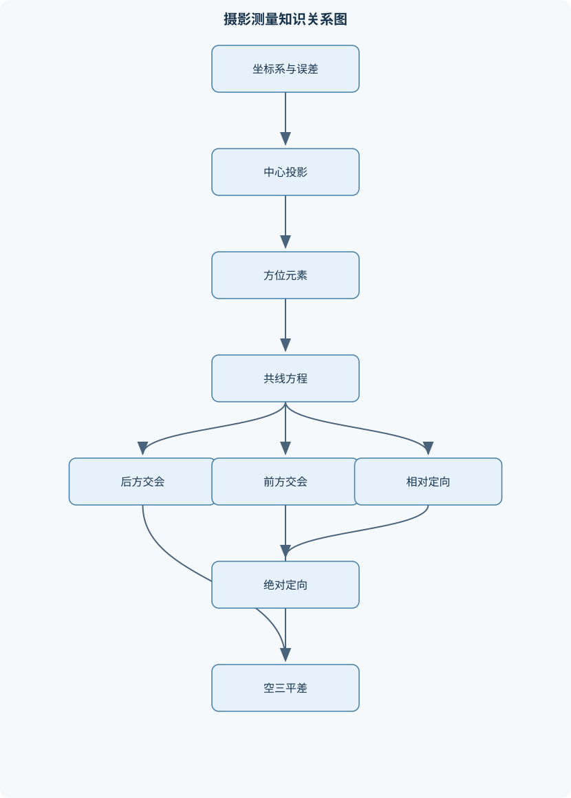
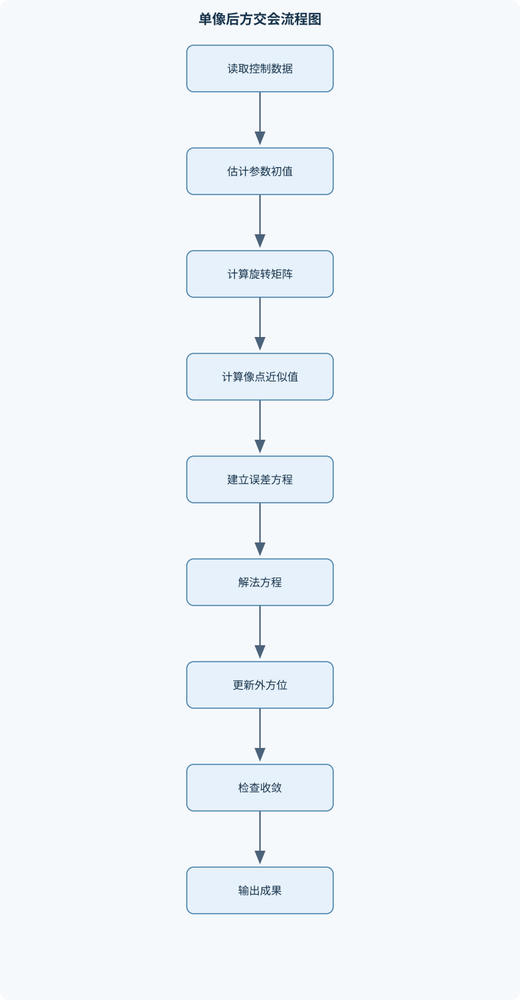

# 现代测量学

## 一、课程整体知识框架

### 课程边界与先修知识

现代测量学以地面测量、航空摄影测量、近景摄影测量、数字影像测量和空间数据处理为主要内容，重点研究如何利用角度、距离、坐标、影像和控制点确定地面点的位置、形状与空间关系。课程边界包括测量坐标系与误差基础、航摄像片几何、摄影测量方位元素、共线条件方程、单像空间后方交会、立体像对前方交会、相对定向与绝对定向、空中三角测量、光束法区域网平差、数字高程模型与正射影像基础。不以测绘仪器硬件维修、遥感光谱机理、地理信息系统数据库开发和工程放样操作为主要内容，但说明它们与摄影测量成果之间的接口。先修知识包括高等数学中的多元函数与泰勒展开、线性代数中的矩阵运算与最小二乘法、概率统计中的观测误差与方差协方差、解析几何中的空间坐标变换，以及基本的计算机程序设计。课程中的理想模型通常假定中心投影、内方位元素已知、观测误差服从小误差模型；实际生产还必须考虑镜头畸变、感光材料或扫描变形、大气折光、地球曲率、影像匹配错误、控制点质量和数值条件等限制。





### 1. 课程对象、任务与知识主线

现代测量学研究如何利用角度、距离、坐标、像片和数字影像，确定地面点的位置、形状、起伏及其空间关系。课程的核心不是单纯量测某个长度或绘制某张图，而是建立一条从观测到成果的完整技术链：

$$
\text{观测或影像}
\rightarrow
\text{坐标与误差建模}
\rightarrow
\text{几何关系建立}
\rightarrow
\text{定向与平差}
\rightarrow
\text{三维点、模型和高程成果}
\rightarrow
\text{正射影像及质量检核}.
$$

地面测量主要提供控制点、坐标基准和精度检核信息；航空摄影测量利用航摄像片覆盖较大区域；近景摄影测量适合建筑物、工业对象和局部三维重建；数字影像测量将像片转换为可计算的像元阵列，并通过匹配、核线约束和高程重建形成数字成果；空间数据处理则负责坐标变换、平差、格网插值、正射纠正和质量评价。

课程中的基本对象有三类。第一类是地面对象，例如地面点坐标 $(X,Y,Z)$、地形表面和控制点。第二类是摄影成像对象，例如摄影中心、像主点、像点坐标和投影光束。第三类是计算参数，例如外方位元素、模型定向参数、平差改正数和误差统计量。必须区分摄影中心与像主点：摄影中心位于镜头投影中心，像主点是摄影中心向像平面的垂足；前者是空间位置，后者是像平面上的几何点。

课程通常假定学生具备多元函数和泰勒展开、矩阵运算与最小二乘法、概率统计中的方差协方差、解析几何中的空间变换以及基本程序设计知识。多元函数用于将非线性共线方程在近似值处线性化；矩阵和最小二乘法用于组织误差方程和求解参数；空间坐标变换用于在像片坐标系、像空间辅助坐标系、模型坐标系和地面坐标系之间传递几何信息。

### 2. 坐标系、符号与误差基础

地面测量坐标系必须明确原点、坐标轴方向、长度单位和高程基准。摄影测量中常用地面坐标 $(X,Y,Z)$，其中 $X、Y$通常表示平面位置，$Z$表示高程或空间坐标分量，单位一般为米。像平面坐标记为 $(x,y)$，可以毫米表示，也可以像元表示；若采用像元坐标，必须给出像元尺寸或完成尺度换算。像主点坐标为 $(x_0,y_0)$，主距或焦距为 $f$，并且 $f$与像点坐标必须使用同一长度单位。

像空间辅助坐标系的原点通常取摄影中心，轴向与像片或摄影坐标约定相关。它的作用是把像点表示为空间光线方向，再通过旋转矩阵转换到统一的模型坐标系或地面坐标系。不同教材可能采用不同的轴方向、像平面正负方向和旋转顺序，因此 $\phi、\omega、\kappa$的正负号不能脱离坐标约定直接套用。

观测值可写为

$$
l=l_0+v,
$$

其中 $l$为观测值，$l_0$为未知真值或理论值，$v$为观测误差或改正数。在线性化平差中，常将误差方程写成

$$
v=A\Delta-L,
$$

其中 $A$为设计矩阵，$\Delta$为待估参数改正数，$L$为由观测值和近似参数计算得到的常数项。若采用相反的残差定义，也可以得到等价的符号形式，但必须从头到尾保持一致。

按权最小二乘的目标是使加权残差平方和最小：

$$
\min_\Delta (A\Delta-L)^{T}P(A\Delta-L),
$$

其中 $P$为权阵，权越大表示观测值的相对精度越高。对目标函数求导并令导数为零，得到法方程：

$$
(A^TPA)\Delta=A^TPL.
$$

单位权中误差可用于评价整体拟合程度：

$$
\hat{\sigma}_0^2=\frac{v^TPv}{n-u},
$$

其中 $n$为观测方程数，$u$为未知参数数。该公式要求模型可线性化、权阵能够合理反映观测精度，并且自由度 $n-u$为正。若控制点几何分布不良，即使观测数量足够，$A^TPA$仍可能病态，导致参数强相关和结果不稳定。

### 3. 航摄像片投影几何

中心投影假定所有地面点、摄影中心和对应像点位于同一条直线上。设摄影中心为 $S$，地面点为 $A$，像点为 $a$，则三点共线。若地形为水平平面、像片近似水平，主距为 $f$，摄影中心到地面的垂直距离为 $H$，则摄影比例尺满足

$$
\frac{1}{m}=\frac{f}{H}.
$$

例如 $f=152\ \text{mm}=0.152\ \text{m}$，$H=3040\ \text{m}$，则

$$
\frac{f}{H}=\frac{0.152}{3040}=\frac{1}{20000},
$$

所以理想水平地面上的摄影比例尺为 $1:20000$。若地面点高程为 $h$，且 $H$按摄影中心相对于某高程基准的高度表示，则该点实际垂距应近似使用 $H-h$。不同地面高程对应不同局部比例尺，因此航摄像片不能直接当作统一比例尺地形图。

正射投影与中心投影不同。正射投影的投影线相互平行，适合表达地图平面位置；中心投影的投影线汇聚于摄影中心，真实航片会受到像片倾斜和地形起伏影响。像片倾斜会产生像点位移，地形起伏也会使高于或低于参考面的目标发生径向位移。近似条件下，地形位移随地面高差和像点到像主点的距离增大而增大，因此远离像主点的高差目标通常需要更强的正射改正。

像底点是摄影中心垂线与像片的交点对应位置，地底点是该垂线与地面的交点；二者分别位于像片和地面。等角点位于像主点与像底点连线附近，等比线与像片倾斜几何有关。不能把像主点、像片中心、像底点和地底点混为一谈。航向重叠是相邻像片沿飞行方向的重叠，旁向重叠是相邻航带之间的侧向重叠。重叠的作用是保证同名点可见、形成稳定立体交会和传递区域网几何约束。

### 4. 像片方位元素与系统改正

内方位元素描述摄影机内部投影几何，通常包括 $x_0、y_0、f$。它们将量测到的框标坐标或扫描坐标转换为理想像平面坐标。框标量测的目的，是建立影像坐标系与检校坐标系之间的关系。若忽略像主点偏移，所有像点都会带有系统性位置误差。

外方位元素描述摄影中心相对于地面坐标系的位置和姿态。位置元素为 $(X_s,Y_s,Z_s)$，角元素通常记作 $(\phi,\omega,\kappa)$。三个角度对应的具体物理含义和正负号依赖坐标轴方向、旋转顺序以及主动旋转或被动旋转约定。由三个基本旋转矩阵按规定顺序相乘得到旋转矩阵 $R$，其应满足

$$
R^TR=I,\qquad \det(R)=1.
$$

验证时，$R^TR$应接近单位阵，行列式应接近 $1$。若不满足，首先检查角度是否以弧度参与三角函数、矩阵乘法顺序是否正确以及旋转方向是否混用。

镜头径向畸变通常表现为像点沿径向产生偏移，切向畸变则与镜片偏心或装配误差有关。系统改正的一般顺序是：先确认像主点和坐标单位，再应用径向和切向畸变模型，最后根据具体成像条件考虑扫描变形、大气折光和地球曲率。没有可靠检校参数时，不能随意套用经验系数。大气折光会改变光线传播方向，地球曲率会影响高空摄影中的几何关系；小范围、低精度作业可以忽略某些影响，但高精度区域网不能无条件忽略。

### 5. 共线条件方程及其线性化

设地面点坐标为 $(X,Y,Z)$，摄影中心坐标为 $(X_s,Y_s,Z_s)$，旋转矩阵为 $R$。将地面点相对于摄影中心的坐标旋转到像空间辅助坐标系，记旋转后的分量为 $(u,v,w)$，则

$$
\begin{bmatrix}
u\\v\\w
\end{bmatrix}
=
R
\begin{bmatrix}
X-X_s\\Y-Y_s\\Z-Z_s
\end{bmatrix}.
$$

由空间相似关系，

$$
\frac{u}{v}{w}
=
\frac{X-X_s}{Y-Y_s}{Z-Z_s}
$$

应理解为三个比值相等，而不是乘法表达式。像点投影关系为

$$
x-x_0=-f\frac{u}{w},\qquad
y-y_0=-f\frac{v}{w}.
$$

也可写成共线方程的一般形式：

$$
x=x_0-f
\frac{r_{11}(X-X_s)+r_{12}(Y-Y_s)+r_{13}(Z-Z_s)}
{r_{31}(X-X_s)+r_{32}(Y-Y_s)+r_{33}(Z-Z_s)},
$$

$$
y=y_0-f
\frac{r_{21}(X-X_s)+r_{22}(Y-Y_s)+r_{23}(Z-Z_s)}
{r_{31}(X-X_s)+r_{32}(Y-Y_s)+r_{33}(Z-Z_s)}.
$$

这里 $r_{ij}$为旋转矩阵元素。分母 $w$表示地面点方向在像空间辅助坐标系中的深度分量。当 $w$接近零时，投影点趋向无穷远，透视模型数值不稳定，不能继续按普通像点处理。

共线方程是非线性的。对未知参数在近似值处作一阶泰勒展开：

$$
F(u+\Delta u)\approx F(u)+
\frac{\partial F}{\partial u}\Delta u.
$$

对每个控制点可形成两条像坐标误差方程，所有控制点叠加后形成设计矩阵。线性化只在近似值足够接近真实值、参数改正量较小的条件下可靠。若初值偏离收敛域，迭代可能发散或收敛到错误结果。

### 6. 单像空间后方交会

单像空间后方交会的已知量是控制点地面坐标、控制点像坐标和内方位元素，未知量是摄影中心三个坐标及三个外方位角，共六个参数。理论上需要足以约束六个未知数的观测信息，实际应使用多个控制点，并使其覆盖整个像幅、具有合理高程变化，避免全部集中在一侧或近似共面。

初值可按以下方式估计：用控制点地面坐标均值近似摄影中心平面位置；根据平均高程、摄影比例尺或已知航高估计 $Z_s$；角元素初值可取小角度。每轮迭代包括：计算旋转矩阵；用共线方程计算像点近似值；求偏导数；形成 $A$和 $L$；解法方程；更新六个参数；计算残差并检查收敛。

终止条件不能只检查角度改正数，还应同时检查位置改正数、像点残差、单位权中误差及最大迭代次数。参数改正很小但残差仍很大，可能是假收敛；法方程条件很差，可能是控制点几何不良。普通稠密法方程求解的计算量约为 $O(nq^2+q^3)$，其中 $n$为观测方程数，$q=6$；工程实现中应优先采用稳定的线性方程求解方法，而不是显式计算矩阵逆。

### 7. 立体像对前方交会

前方交会已知左右像片的内、外方位元素和同名像点，目标是确定地面点三维坐标。将左、右像点分别转换成像空间方向向量，再利用各自旋转矩阵转换到统一地面坐标系，可得到两条空间投影射线：

$$
\mathbf{P}_1(\alpha)=\mathbf{S}_1+\alpha\mathbf{d}_1,
\qquad
\mathbf{P}_2(\beta)=\mathbf{S}_2+\beta\mathbf{d}_2.
$$

理想无误差时，两条射线相交。实际观测存在误差时，射线通常不严格相交，应求使两射线距离最小的点，或取最短连线中点作为三维点估计。应报告射线间距离和交会角。交会角过小时，射线近似平行，平面位置尤其是高程对像点误差敏感；交会角适中时，空间交会稳定性较好。

投影系数可记为 $N_1、N_2$，其含义取决于所采用的基线和辅助坐标约定。共面条件和垂直视差是立体几何检核的重要内容。左右像片内方位元素不一致时，不能直接把左右像点坐标放入同一公式，必须分别完成内定向和外方位变换。

### 8. 解析相对定向

相对定向的目标是确定左右像片之间的相对姿态，使同名像点对应的两条光线共面，并消除模型中的上下视差。它只确定模型内部几何，不确定模型相对于地面坐标系的绝对位置、方向和尺度。

连续法通常固定左片空间辅助坐标系，把摄影基线主分量作为尺度基准，求解右片的相对旋转和基线其他分量，共五个独立参数。单独法的参数表达方式不同，但几何目标相同。相对定向计算中，需要把同名像点转换为空间辅助坐标，按当前参数计算投影系数，建立共面条件或上下视差误差方程，再通过最小二乘迭代更新参数。

定向质量应检查上下视差、左右视差、同名点残差和点位分布。上下视差接近零只能说明两光线在相对模型中满足一定共面条件，并不说明模型已经具有地面绝对坐标。若同名点集中于像幅局部，可能导致某些相对参数缺乏约束。

### 9. 模型绝对定向与七参数变换

相对定向得到的是模型坐标系，绝对定向要将其接入地面坐标系。模型坐标和地面坐标之间通常采用七参数空间相似变换：一个尺度因子 $\lambda$、三个旋转参数和三个平移参数。可写成

$$
\mathbf{X}_g=
\lambda R\mathbf{X}_m+\mathbf{T},
$$

其中 $\mathbf{X}_m$为模型坐标，$\mathbf{X}_g$为地面坐标，$\mathbf{T}=(X_0,Y_0,Z_0)^T$为平移向量，$R$为三维旋转矩阵。

重心化是重要步骤。分别计算模型点和地面控制点的重心，令每个点减去各自重心，使点集以重心为局部原点。这样可以降低平移参数与旋转、尺度参数之间的相关性，改善数值条件。对重心化坐标建立线性化误差方程，求七个参数改正数，更新参数并恢复平移。控制点应不共线，并尽可能在模型范围内均匀分布、具有适当高程差。

控制点残差是绝对定向的主要检核依据。若控制点残差在某一方向系统偏大，可能存在坐标轴方向、尺度单位或旋转约定错误；若边缘点残差明显增大，可能是模型变形或控制点外推问题。

### 10. 空中三角测量与区域网平差

空中三角测量通过像片连接点、控制点和共线条件，在少量地面控制约束下求得大量像片外方位元素和加密点坐标。连接点的作用是把相邻像片或航带联系起来，控制点的作用是确定地面基准、限制区域网漂移和变形。连接点数量多不等于可靠，必须保证点位分布均匀、同名关系正确、跨片重复观测充分。

航带法先建立相邻像片模型，逐步连接航带，再通过控制点进行航带绝对定向和整体改正。该方法结构清晰，但长航带容易累积误差；航带很长、地形变化明显或网络结构复杂时，应采用区域网平差。

光束法以每条像点观测对应的共线条件为基础，同时估计像片外方位元素、连接点坐标和必要的附加参数。未知数可分为像片参数和地面点参数，法方程具有稀疏、分块特点，可通过边法化边消元或分块消元减少计算量。附加参数可用于吸收镜头系统误差、扫描变形等，但参数过多会产生相关性，使网络出现过拟合或不稳定。

区域网必须处理自由度和基准问题。没有足够控制约束时，整体平移、旋转和尺度可能无法确定；控制点全部位于区域一侧时，内部点可能看似拟合良好，外推区域却产生明显变形。成果评价应包括控制点残差、检查点残差、像点重投影残差、单位权中误差、接边差和点位分布检查。

### 11. 数字摄影测量成果

数字影像内定向把像元行列号转换为具有摄影几何意义的像平面坐标，需要考虑像元尺寸、影像原点、扫描方向、像主点和畸变参数。影像匹配的基本任务是从左右影像或相邻影像中寻找同名点。灰度相关、特征匹配和半全局等方法都依赖影像纹理、尺度、遮挡和辐射一致性。水面、阴影、重复纹理、低纹理区域和快速变化目标容易产生误匹配。

核线几何将立体匹配约束到同一条核线上，使二维搜索简化为近似一维搜索。核线影像制作前必须有可靠的相对或绝对定向；定向误差会使同名点偏离核线，增加误匹配。

数字高程模型（DEM）通常表达地面表面的高程，可采用规则格网或不规则三角网。数字地形模型（DTM）强调裸地地形，数字表面模型（DSM）还包括建筑物、植被等地表目标。若用包含建筑物的DSM替代裸地DEM，会使地形分析和正射纠正产生不同结果。

正射影像制作时，对目标地面网格点读取或插值高程，再依据外方位元素和共线方程反投影到原始影像，进行灰度或颜色重采样，并处理遮挡、空洞、接边和影像拼接。建筑物高于DEM时，普通地形正射纠正不能消除建筑物倾斜和遮挡，需要更完整的表面模型和遮挡处理。正射影像精度受外方位、DEM、内方位、匹配、重采样和地面控制质量共同限制。

## 二、章节和模块划分

### 核心知识覆盖清单

本清单用于检查正文是否覆盖本课程的主要知识模块：

- **测量坐标系与误差基础**：地面测量坐标系与高程基准、摄影测量坐标系定义、像平面坐标与像空间坐标、像空间辅助坐标系、坐标平移与旋转变换、观测误差与残差、最小二乘估计原理、法方程与精度评价。
- **航摄像片投影几何**：中心投影与正射投影、摄影中心与像主点、地面点和像点对应关系、像底点与地底点、等角点和等比线、倾斜像片的像点位移、地形起伏引起的位移、摄影比例尺与航高、航向重叠与旁向重叠。
- **像片方位元素与系统改正**：内方位元素定义、外方位位置元素、外方位角元素、旋转矩阵构造、像坐标轴约定、框标坐标量测、镜头径向畸变、镜头切向畸变、大气折光与地球曲率改正。
- **共线条件方程**：共线条件的几何含义、比例因子与光束方向、共线方程一般形式、旋转矩阵代入过程、共线方程的分子分母、像点坐标计算、地面点坐标反算、泰勒级数线性化、误差方程组构建。
- **单像空间后方交会**：后方交会的已知与未知量、控制点布设条件、摄站坐标初值估计、外方位元素迭代求解、共线方程偏导数、设计矩阵与常数项、法方程求解、迭代收敛判据、后方交会精度检查。
- **立体像对前方交会**：立体像对与摄影基线、左右像片内方位元素、左右像片外方位元素、像空间辅助坐标计算、投影系数求解、空间射线交会、共面条件与垂直视差、地面点坐标计算、交会角与高程精度。
- **解析相对定向**：相对定向的几何目标、连续法相对定向元素、单独法相对定向元素、同名像点与空间辅助坐标、上下视差与左右视差、共面条件方程、误差方程线性化、相对定向迭代流程、定向质量检核。
- **模型绝对定向**：模型坐标系与地面坐标系、尺度因子与平移参数、三个旋转角参数、重心化坐标处理、控制点条件、七参数空间相似变换、绝对定向误差方程、控制点残差分析、模型接入地面坐标系。
- **空中三角测量与区域网平差**：航带模型构建、像片连接点与控制点、航带法基本思想、光束法平差基本思想、附加参数与系统误差、未知数组织与分块法方程、边法化边消元、区域网自由度与基准、加密点坐标计算、平差成果质量评价。
- **数字摄影测量成果**：数字影像内定向、影像匹配基本思想、核线几何与核线影像、数字高程模型、数字地形模型、正射投影与正射影像、地形起伏改正、空三成果到正射产品、成果精度与适用边界。


### 1. 模块一：测量坐标系与误差基础

本模块先建立地面坐标系、像平面坐标系、像空间辅助坐标系和模型坐标系之间的区别。坐标平移是改变原点，旋转是改变轴方向或向量方向，二者不能互换。三维旋转矩阵必须保持正交性和单位尺度。实际计算中应统一单位，例如像点坐标以毫米表示时，主距也应以毫米表示；地面坐标通常以米表示，不能把两类长度直接代入同一比例关系。

误差基础包括观测误差、系统误差、粗差和残差。随机误差可通过重复观测和平差降低影响，系统误差需要建模或预改正，粗差则需要通过影像对应检查、残差检核或稳健方法识别。最小二乘法并不自动消除系统误差；若误差模型遗漏镜头畸变或控制点存在粗差，平差可能只是把系统误差分配到其他参数中。

### 2. 模块二：航摄像片投影几何

本模块说明中心投影的基本关系、摄影中心、像主点、像底点、地底点、等角点和等比线的几何意义。重点推导摄影比例尺：

$$
\frac{\text{像片长度}}{\text{地面对应长度}}
=
\frac{f}{H}
=
\frac{1}{m}.
$$

推导前提是地面近似水平、像片近似水平、投影方向与地面垂直。像片倾斜或地面起伏时，比例尺随位置变化，不能把整幅像片视为统一比例尺地图。应结合航向重叠、旁向重叠和摄影基线理解立体覆盖条件。

### 3. 模块三：像片方位元素与系统改正

本模块把内方位和外方位分开处理。内方位解决“摄影光束内部如何恢复”，外方位解决“光束在地面坐标系中位于何处、朝向如何”。框标量测用于建立影像坐标与像片坐标关系；镜头径向和切向畸变改正用于削弱系统性像点偏移；大气折光和地球曲率在大范围、高精度或高空摄影中需要纳入模型。

旋转矩阵计算必须记录旋转顺序。一个完整检核过程包括：确认角度单位；写出三个基本旋转矩阵；按规定顺序相乘；检查 $R^TR$和 $\det(R)$；用已知方向或简单姿态验证矩阵符号。

### 4. 模块四：共线条件方程

本模块从摄影中心、地面点和像点共线出发，先将地面点相对摄影中心的向量旋转为 $(u,v,w)$，再利用相似三角形得到

$$
x-x_0=-f\frac{u}{w},\qquad
y-y_0=-f\frac{v}{w}.
$$

推导中 $w$不能接近零；若摄影中心到地面点的方向几乎平行于像平面，投影会远离有限影幅，模型失去稳定性。对共线方程作一阶泰勒展开即可得到误差方程。设计矩阵的每一列对应一个待估参数，每一行对应一个像坐标观测方程。

### 5. 模块五：单像空间后方交会

后方交会是从控制点像地对应关系反求摄影中心和姿态。建议采用“初值估计—投影计算—线性化—法方程—参数更新—残差检核”的循环。控制点应覆盖像幅，并具有一定高程变化。四个点即使数量上足够，若近似共面、集中在一侧或全部位于像幅边缘，也可能造成法方程病态。

### 6. 模块六：立体像对前方交会

前方交会是由左右像片的两条空间光线求地面点。输入为左右像片的内外方位元素及同名像点，输出为地面三维坐标、射线间距离和交会角。实际算法不应强行令有误差的两条射线相交，而应采用最小距离意义下的交会点。交会角过小是高程不稳定的重要原因；同名点误匹配则会产生看似可计算、实际错误的三维点。

### 7. 模块七：解析相对定向

相对定向通过消除上下视差，使左右影像建立稳定的相对模型。连续法通常以左片为基准，固定摄影基线主分量的尺度，求解五个相对定向参数。每轮迭代要保持同一左片坐标系、基线尺度和旋转约定。质量评价包括上下视差残差、同名点分布、参数改正数和迭代稳定性。

### 8. 模块八：模型绝对定向

绝对定向把相对模型转换到地面坐标系。七参数包括尺度、三维平移和三个旋转参数。计算时先分别求两套控制点坐标的重心，再进行重心化，建立线性化误差方程。重心化并不改变点集内部几何关系，只是降低参数相关性。恢复地面坐标后，应计算控制点残差，并用未参与计算的检查点评价外部精度。

### 9. 模块九：空中三角测量与区域网平差

本模块由像片连接点、控制点、航带和区域网组成。航带法便于理解模型连接和误差传递，光束法则直接使用像点共线条件，适合统一处理多片、多点和附加参数。平差时应组织稀疏法方程，利用分块消元减少存储和计算量。区域网质量不仅由单位权中误差决定，还取决于控制点残差、检查点残差、像点重投影误差、网络覆盖和数值条件。

### 10. 模块十：数字摄影测量成果

本模块包括数字影像内定向、影像匹配、核线影像、DEM、DTM、DSM和正射影像。应明确三类高程模型的对象范围：DEM通常强调地面高程，DTM强调裸地地形，DSM包含建筑物和植被等地表目标。正射影像是经过几何纠正的影像产品，不等同于原始航片。其质量取决于定向精度、DEM精度、影像覆盖、重采样方法、遮挡处理和接边质量。

### 11. 代表性算法与流程

#### 11.1 单像空间后方交会流程

**输入：**主距 $f$、像主点坐标、控制点像坐标和地面坐标、旋转角初值、摄影中心初值。  
**输出：**$(X_s,Y_s,Z_s,\phi,\omega,\kappa)$及像点残差。

1. 统一单位，确认像点和主距采用同一长度单位。
2. 用控制点平面坐标均值估计 $(X_s,Y_s)$，用航高或平均高程估计 $Z_s$。
3. 根据角度初值构造旋转矩阵。
4. 对每个控制点用共线方程计算像点近似坐标。
5. 对六个未知参数求偏导，形成每个控制点的两条误差方程。
6. 按观测权组成法方程并求解参数改正数。
7. 更新参数，重新计算残差。
8. 当最大参数改正数、像点残差变化和单位权中误差均满足限差时终止；若达到最大迭代次数仍未满足，则判为未收敛。

迭代不变量是所有参数始终在同一坐标轴和旋转约定下解释。若设计矩阵法方程条件很差，应检查控制点空间分布和单位换算，而不是盲目增加迭代次数。

#### 11.2 立体像对前方交会流程

**输入：**左右像片内外方位元素和同名像点。  
**输出：**地面点坐标及交会质量指标。

先将像点坐标减去像主点坐标，构成像空间方向向量；再用左右旋转矩阵把方向向量转换到统一坐标系。分别建立左右射线，求两射线之间的最短连线。最短连线中点作为地面点，最短距离作为射线不一致指标。最后计算两方向向量夹角作为交会角。适用条件是同名点可靠、两像片定向正确且交会角不能过小。

#### 11.3 解析绝对定向流程

**输入：**模型控制点坐标和对应地面控制点坐标。  
**输出：**尺度、三维平移和三个旋转参数。

先计算两套点集重心：

$$
\bar{\mathbf{X}}_m=\frac{1}{n}\sum_{i=1}^{n}\mathbf{X}_{mi},
\qquad
\bar{\mathbf{X}}_g=\frac{1}{n}\sum_{i=1}^{n}\mathbf{X}_{gi}.
$$

再形成重心化坐标 $\mathbf{x}_{mi}$和$\mathbf{x}_{gi}$，建立

$$
\mathbf{x}_{gi}\approx \lambda R\mathbf{x}_{mi}
$$

的线性化误差方程，求参数改正数。迭代结束后恢复平移参数，并用所有控制点计算残差。控制点至少应不共线；若点高程几乎没有变化，垂向旋转和尺度可能相关。

#### 11.4 数字正射影像制作流程

**输入：**已定向影像、DEM或DSM、内外方位参数、目标地面网格。  
**输出：**地图坐标系中的正射影像。

对每个输出网格点读取或插值高程；将该地面点通过共线关系反投影到原始影像；使用双线性或更高阶方法进行灰度插值；处理影像边界、空洞、遮挡和接边；最后检查控制点、检查点、道路边缘和建筑物边缘的几何一致性。普通DEM不能消除高层建筑倾斜，城市区域若要求建筑物顶部位置准确，应使用适合的DSM及遮挡处理。

#### 11.5 带语言标注的后方交会伪代码

```text
伪代码
输入：f, x0, y0，控制点集合 {(x_i, y_i, X_i, Y_i, Z_i)}
输出：外方位元素 u = (Xs, Ys, Zs, phi, omega, kappa)

1. 统一 f、x_i、y_i 的长度单位
2. 用控制点地面坐标均值初始化 Xs、Ys、Zs
3. 初始化 phi、omega、kappa
4. 对 iter = 1 到 max_iter：
       R ← 按规定旋转顺序计算旋转矩阵
       对每个控制点 i：
           d ← (X_i-Xs, Y_i-Ys, Z_i-Zs)
           (U,V,W) ← R*d
           若 |W| 小于深度阈值：
               返回“投影几何不稳定”
           (x̂_i, ŷ_i) ← 共线方程计算值
           计算对六个参数的偏导，填入 A 和 L
       解 (Aᵀ P A) Δ = Aᵀ P L
       u ← u + Δ
       计算像点残差和单位权中误差
       若 max(|Δ|)、残差变化和参数变化均满足限差：
           返回 u、残差和精度指标
5. 返回“达到最大迭代次数仍未收敛”
```

### 12. 代表性例题

#### 例题一：摄影比例尺

**题干：**主距 $f=152\ \text{mm}$，摄影中心到水平地面的垂距为 $3040\ \text{m}$，求理想摄影比例尺。

**分析：**必须先统一长度单位。

**解答：**

$$
f=152\ \text{mm}=0.152\ \text{m},
$$

$$
\frac{1}{m}=\frac{f}{H}=\frac{0.152}{3040}
=\frac{1}{20000}.
$$

因此比例尺为 $1:20000$。

**结果验证：**像片上 $1\ \text{mm}$对应地面

$$
1\ \text{mm}\times 20000=20000\ \text{mm}=20\ \text{m}.
$$

**变式：**若目标地面高程使摄影中心到目标的实际垂距变为 $3000\ \text{m}$，则比例尺为 $0.152/3000=1/19736.84$，不能继续使用整幅像片统一的 $1:20000$。

#### 例题二：共线方程投影

**题干：**设像主点为原点，$f=50\ \text{mm}$，经旋转后地面点相对摄影中心的像空间坐标为 $(u,v,w)=(10,5,1000)$，求像点坐标。

**分析：**使用相似三角形投影公式，长度单位已统一。

**解答：**

$$
x=-f\frac{u}{w}
=-50\times\frac{10}{1000}
=-0.5\ \text{mm},
$$

$$
y=-f\frac{v}{w}
=-50\times\frac{5}{1000}
=-0.25\ \text{mm}.
$$

**结果验证：**$|u/w|$和$|v/w|$均较小，投影点位于主点附近，且 $w=1000$不接近零，计算稳定。

**变式：**若 $w=0.001$，投影坐标将极大增大，说明该点方向几乎平行于像平面，不能按普通有限影像投影处理。

#### 例题三：旋转矩阵检核

**题干：**已按规定顺序得到旋转矩阵 $R$，如何判断其是否满足三维刚体旋转要求？

**分析：**旋转矩阵应保持长度和夹角，因此必须正交；同时不能包含镜像反射。

**解答步骤：**

1. 计算 $R^TR$。
2. 将结果与单位阵 $I$比较，检查非对角元素是否接近零、对角元素是否接近一。
3. 计算 $\det(R)$。
4. 检查行列式是否接近 $1$而不是 $-1$。
5. 以一个已知方向向量进行旋转，检查方向是否符合坐标轴约定。

**结果验证：**若 $R^TR$明显偏离单位阵，或行列式接近 $-1$，应检查角度单位、旋转顺序和主动被动旋转定义。

**变式：**即使三个角度数值相同，改变旋转顺序也会得到不同矩阵，因此角度不能脱离旋转顺序解释。

#### 例题四：前方交会几何稳定性

**题干：**左右投影射线的交会角分别为 $5^\circ$和$30^\circ$，在相同像点量测误差下，哪个交会结果更稳定？为什么？

**分析：**交会角越小，两条射线越接近平行，射线方向误差会在交会过程中被放大。

**解答：**$30^\circ$的交会角更稳定。对于 $5^\circ$，两射线之间的几何约束弱，沿深度方向的交会位置对方向误差非常敏感，高程误差尤其明显；$30^\circ$提供更强的空间交会约束。

**结果验证：**可计算两射线最短距离并检查交会点在左右射线上对应的投影残差。若小角度情况下残差变化明显，说明交会条件不佳。

**变式：**交会角过大也不一定绝对最佳，因为像片覆盖、遮挡和同名点可见性仍需满足；实际应综合考虑角度、重叠和量测精度。

#### 例题五：绝对定向参数

**题干：**模型点集与地面点集之间存在尺度、旋转和平移差异，为什么要先重心化再求七参数？

**分析：**若直接使用原坐标，平移量通常远大于旋转引起的坐标变化，参数尺度差异和相关性会使法方程数值条件变差。

**解答步骤：**

1. 分别计算模型点集和地面点集的重心。
2. 每个点减去各自重心，得到两套重心化坐标。
3. 对重心化坐标建立尺度和旋转误差方程。
4. 求尺度和旋转改正数。
5. 用两套重心恢复平移参数。
6. 将模型点变换到地面坐标系，计算控制点残差。

**结果验证：**变换后控制点残差应在规定精度范围内，且残差不应呈明显单向或边缘系统性变化。

**变式：**若控制点近似共线，即使数量达到四个，七参数也可能不能稳定确定，应补充非共线且有高程差的控制点。

### 13. 实验与项目流程

#### 13.1 实验一：单像后方交会及控制点几何影响

**输入数据：**一组已知主距、像主点、控制点像坐标和地面坐标；至少使用四个控制点，并另留检查点。

**实验步骤：**

1. 统一毫米和米等长度单位。
2. 记录控制点在像幅中的位置和地面高程分布。
3. 估计摄影中心初值，设置角度初值。
4. 编程或使用计算工具实现旋转矩阵、共线方程和偏导计算。
5. 迭代求解六个外方位元素。
6. 输出每轮最大参数改正数、像点残差和单位权中误差。
7. 用未参与平差的检查点计算外部检核误差。
8. 将控制点集中在一侧、减少高程变化等情况作为对照试验。

**评价标准：**参数应收敛；控制点残差和检查点残差应符合预设限差；控制点残差不能仅在控制区域内部较小而在边缘明显增大；法方程不能出现严重病态。

**排错方法：**若第一轮投影点远离影像范围，检查摄影中心初值和旋转矩阵；若残差数量级异常，检查毫米—米换算；若迭代振荡，检查偏导符号和参数更新方向；若控制点残差小而检查点残差大，检查控制点分布和模型系统误差。

#### 13.2 实验二：立体前方交会与正射影像质量检查

**输入数据：**左右像片内外方位元素、同名点坐标、DEM或DSM和待输出地面网格。

**实验步骤：**

1. 对左右像片分别完成像主点平移、单位统一和必要畸变改正。
2. 将同名像点转换为空间方向向量。
3. 进行前方交会，输出地面点坐标、射线间距离和交会角。
4. 选择不同交会角的点组，比较高程结果稳定性。
5. 对目标网格逐点读取高程并反投影到原始影像。
6. 进行灰度重采样、空洞处理和接边。
7. 检查道路、建筑物边缘、控制点和检查点的平面偏差。
8. 分别使用DEM和DSM进行对比，分析建筑物与植被区域差异。

**评价标准：**同名点射线间距离应小；交会角过小的点应标记为低可靠点；正射影像中地面控制点应与参考位置一致；接边处不得出现明显断裂；建筑物倾斜和遮挡应在质量报告中说明。

**排错方法：**若左右影像匹配点沿核线方向偏离，检查相对定向；若平坦区域正确而建筑物边缘错位，检查DEM与DSM选择；若影像出现空洞，检查输出网格是否超出影像覆盖和DEM范围；若接边出现色调或位置跳变，分别检查辐射调整和外方位参数一致性。

### 14. 地面测量、仪器、遥感和空间数据库的接口边界

地面测量为摄影测量提供控制点和检查点，但本课程不以仪器硬件维修和工程放样操作为主要内容。仪器观测成果进入摄影测量流程时，必须带有坐标系、单位、时间和精度信息。

遥感可提供影像数据，但现代测量学在本课程范围内重点处理影像几何、定位和三维重建，不展开遥感光谱机理。地理信息系统可存储、查询和可视化DEM、正射影像及点云，但数据库表结构、索引和服务开发不属于本课程主体。摄影测量成果进入这些系统时，应说明坐标参考、分辨率、覆盖范围、垂直基准、精度和数据格式，避免把几何成果与后续应用系统混为一谈。

### 15. 课程成果与实际岗位任务

摄影测量工程师和航空摄影测量技术员主要负责航摄数据检查、内外方位处理、空中三角测量和质量报告；关键知识是共线条件、控制点设计、区域网平差和误差诊断；产出包括定向成果、加密点、残差统计和质量报告。

数字测图工程师、正射影像生产工程师和数字高程模型生产员负责匹配、地形采集、DEM或DSM构建、正射纠正和接边；需要掌握核线几何、前方交会、格网插值和地形位移改正；验收重点是平面和高程精度、接边差、空洞、建筑物错位及成果覆盖完整性。

三维重建工程师和无人机测绘数据处理员负责影像整理、控制点布设、相对定向、绝对定向、稠密匹配和三维模型生成；需要识别纹理不足、遮挡、误匹配、交会角过小和控制点外推等问题；产出包括点云、网格模型、正射影像和精度检查结果。

测量平差工程师和测绘软件算法工程师负责误差模型、法方程、稀疏平差、迭代收敛和数值稳定性；验收不能只看程序是否运行，还应检查单位、坐标约定、残差、条件数、异常数据处理和独立验证结果。地理空间数据质量检查员则重点核查控制点残差、检查点误差、接边一致性、坐标基准、数据完整性和成果适用边界。

## 三、核心概念的详细解释

### 3.1 测量坐标系、摄影坐标系与误差观测

现代测量学中的坐标系首先要明确原点、坐标轴方向、长度单位和高程基准。地面摄影测量坐标系通常以 $(X,Y,Z)$ 表示，$X、Y$ 为平面位置坐标，$Z$ 为高程或空间坐标分量，单位通常为米。工程坐标系、国家坐标系和局部独立坐标系之间可能存在平移、旋转、尺度或基准差异，不能仅凭坐标数值大小判断它们是否属于同一坐标系。

像平面坐标记为 $(x,y)$，可用毫米表示，也可用像元表示。采用像元坐标时，必须知道像元尺寸或像元列、行方向与物理像平面轴之间的转换关系。像主点坐标为 $(x_0,y_0)$，主距为 $f$。若像平面原点取像主点，则 $x_0=y_0=0$；若原点取影像左上角、影像中心或框标坐标原点，则 $x_0、y_0$ 一般不为零。摄影中心是镜头投影中心，位于三维空间；像主点是摄影中心向像平面的垂足，位于像平面，二者不能混淆。

内方位元素描述摄影机内部投影几何，主要包括 $f、x_0、y_0$，必要时还包括镜头畸变参数。外方位元素描述摄影机在地面坐标系中的位置和姿态，包括摄影中心坐标 $(X_s,Y_s,Z_s)$ 以及三个旋转角。内方位元素决定像点对应的光线方向，外方位元素决定这些光线在地面坐标系中的位置和方向。

观测值、理论值和残差必须区分。设观测值为 $l$，理论值为 $l_0$，则可以写为

$$
l=l_0+v,
$$

其中 $v$ 是观测误差或按特定符号约定定义的观测值改正数。若采用误差方程

$$
v=A\Delta-L,
$$

则 $A$ 为设计矩阵，$\Delta$ 为参数改正数，$L$ 为观测值与近似计算值形成的常数项。若将残差定义为计算值减观测值，公式符号会改变，但整个推导必须保持一致。

### 3.2 中心投影、正射投影与航摄像片几何

中心投影以摄影中心 $S$ 为投影中心，地面点 $A$、摄影中心 $S$ 和像点 $a$ 位于同一条直线上。像片是三维地面经过中心投影形成的二维记录，因此像点位置同时受摄影姿态、摄影距离、地面高程和地形起伏影响。

正射投影的投影线相互平行，理想情况下地面点的平面位置不会因地形高程不同而发生中心投影意义上的位移。普通航摄像片不是正射影像，不能直接当作地形图使用。只有在地形近似平坦、像片近似水平且精度要求很低时，才可以把局部像片近似看作比例影像。

像底点是摄影中心到像片的垂线与像片的交点；地底点是该垂线与地面的交点。对于水平像片和平坦地面，像主点、像底点和地底点之间具有简化关系。像片倾斜后，像主点不再代表所有地面方向的几何中心，像点会产生倾斜位移。等角点位于像主点与像底点之间，是角度变形具有特定对称性质的位置；等比线是像片上比例尺特性具有特殊关系的线。使用这些概念时，必须说明它们对应的投影模型，不能把水平像片的性质直接推广到任意倾斜像片。

理想水平地面上的摄影比例尺由主距与摄影高度决定。若 $f$ 和 $H$ 使用相同长度单位，则

$$
\frac{1}{m}=\frac{f}{H},
$$

其中 $1:m$ 是摄影比例尺，$H$ 是摄影中心到地面的垂直距离。若地面点高程为 $h$，摄影中心高程为 $Z_s$，则该点附近的实际摄影距离应近似使用 $Z_s-h$，而不是不加区别地使用平均航高。地形起伏明显时，每个地面点的局部比例尺不同，整张航片不存在严格统一比例尺。

航向重叠是相邻航片沿飞行方向的重叠，旁向重叠是相邻航带之间的重叠。重叠区域既用于立体观察和同名点匹配，也用于传递模型几何约束。重叠过小会使连接点数量减少、遮挡影响增大，并可能导致航带或区域网断裂；重叠过大则增加影像处理量，不能简单认为越大越好。

### 3.3 像点位移、畸变与系统改正

地形起伏引起的像点位移可由相似三角形近似说明。对近似水平像片，设像点到像主点的径向距离为 $r$，地面点相对参考面的高差为 $h$，摄影高度为 $H$，则地形引起的径向位移量近似为

$$
d_r\approx \frac{r h}{H}.
$$

该式只适用于小范围、近似垂直摄影、地面高差相对摄影高度较小的情形。它表明：高差越大，像点离像主点越远，位移越明显；像主点附近的地形位移较小，但并不意味着该区域没有其他投影误差。

镜头径向畸变主要沿像点到畸变中心的径向方向变化，常用模型写为

$$
\Delta x_r=(x-x_0)(k_1r^2+k_2r^4+k_3r^6),
$$

$$
\Delta y_r=(y-y_0)(k_1r^2+k_2r^4+k_3r^6),
$$

其中

$$
r^2=(x-x_0)^2+(y-y_0)^2.
$$

切向畸变由镜片装配偏心、镜片不完全对称等因素引起，常用近似模型为

$$
\Delta x_t=p_1(r^2+2(x-x_0)^2)+2p_2(x-x_0)(y-y_0),
$$

$$
\Delta y_t=p_2(r^2+2(y-y_0)^2)+2p_1(x-x_0)(y-y_0).
$$

上述系数只有在相机检校结果与坐标约定一致时才能使用。若没有可靠的检校参数，不能任意套用经验系数。扫描影像还可能存在非均匀缩放、行列方向变形和扫描拼接误差，这些误差不能用镜头径向畸变完全替代。

在大范围或高精度处理中，还需考虑大气折光与地球曲率。大气折光使光线传播方向偏离真空直线，地球曲率使局部水平面与地球曲面之间产生系统高程差。小范围低精度测图中可以将它们忽略，但在高程控制、长距离成像或高精度区域网中，忽略这些因素可能使残差表现出明显系统性。

### 3.4 方位元素、旋转矩阵与共线关系

三个外方位角常记为 $\phi、\omega、\kappa$，但它们的确切含义取决于坐标轴方向、旋转顺序以及采用主动旋转还是被动旋转。旋转矩阵 $R$ 应由明确规定的三个基本旋转矩阵按固定顺序相乘得到，并满足

$$
R^TR=I,\qquad \det(R)=1.
$$

前一个条件表示列向量或行向量正交且单位化，后一个条件表示它是保持右手性的正规旋转，而不是包含镜像反射的正交变换。若计算结果不满足这两个条件，应检查角度单位、矩阵乘法顺序和旋转方向。

像点对应的空间方向可在像空间辅助坐标系中表示。若采用常见的中心投影符号约定，像点光线向量可写成

$$
\mathbf{q}=
\begin{bmatrix}
x-x_0\\
y-y_0\\
-f
\end{bmatrix}.
$$

如果采用像平面在摄影中心前方的坐标约定，第三分量也可能写成 $+f$。这不是简单的正负号替换，而是必须与旋转矩阵和共线方程统一。

共线条件的几何含义是：摄影中心、地面点和像点共线。设地面点为 $A(X,Y,Z)$，摄影中心为 $S(X_s,Y_s,Z_s)$，地面点在摄影坐标系中的方向分量为 $(u,v,w)$，则存在比例因子 $\lambda$，使

$$
\lambda
\begin{bmatrix}
u\\v\\w
\end{bmatrix}
=
\begin{bmatrix}
X-X_s\\Y-Y_s\\Z-Z_s
\end{bmatrix}.
$$

于是有

$$
\frac{u}{v}{}
=
\frac{X-X_s}{Y-Y_s},
\qquad
\frac{u}{w}
=
\frac{X-X_s}{Z-Z_s},
\qquad
\frac{v}{w}
=
\frac{Y-Y_s}{Z-Z_s}.
$$

在采用

$$
x=-f\frac{u}{w},\qquad
y=-f\frac{v}{w}
$$

的约定时，可得到共线方程

$$
x=-f\frac{r_{11}(X-X_s)+r_{12}(Y-Y_s)+r_{13}(Z-Z_s)}
{r_{31}(X-X_s)+r_{32}(Y-Y_s)+r_{33}(Z-Z_s)},
$$

$$
y=-f\frac{r_{21}(X-X_s)+r_{22}(Y-Y_s)+r_{23}(Z-Z_s)}
{r_{31}(X-X_s)+r_{32}(Y-Y_s)+r_{33}(Z-Z_s)}.
$$

这里 $r_{ij}$ 是旋转矩阵元素，像点坐标与 $f$ 必须使用相同长度单位，地面坐标与摄影中心坐标也必须使用相同单位。分母表示地面点方向在摄影坐标系中的深度分量。当分母接近零时，投影点趋于无穷远，数值计算会严重不稳定，此时不能把结果当作正常像点使用。

### 3.5 单像空间后方交会

单像空间后方交会的输入是内方位元素、控制点像坐标及其地面坐标，输出是摄影中心三维坐标和三个外方位角。控制点必须具有可靠的像地对应关系，并且在像片上覆盖合理范围、在地面上具有足够的平面和高程变化。

后方交会不是控制点越多就一定越稳定。若控制点全部集中在像片一侧、接近一条直线或高程几乎相同，参数之间可能高度相关，法方程接近病态。实际处理中通常使用多于理论最少数量的控制点，并保留部分独立检查点评价外推区域精度。

后方交会采用迭代求解。先根据控制点地面坐标均值估计摄影中心平面位置，用摄影比例尺和平均高程估计摄影中心高程，再给出角度初值。利用当前外方位元素计算控制点像点坐标，对共线方程进行一阶泰勒展开，得到每个控制点对应的两条线性误差方程：

$$
v_i=A_i\Delta-L_i.
$$

将所有控制点方程叠加后得到

$$
v=A\Delta-L.
$$

若权阵为 $P$，则参数改正数满足

$$
(A^TPA)\Delta=A^TPL.
$$

更新参数后重新计算像点和偏导数，直到参数改正数、像点残差和最大迭代次数同时满足规定条件。不能只检查角度改正数，因为平移参数可能仍未收敛，或者残差虽小但出现了错误的局部解。

### 3.6 立体像对前方交会与交会几何

前方交会利用左右像片的同名像点和两张像片的外方位元素，恢复地面点三维坐标。对左、右像片的像点分别构造空间方向向量，再用各自旋转矩阵将其转换到统一地面坐标系。两条空间射线在理想无误差情况下相交于地面点；在实际观测中，两条射线通常不完全相交，应求其最小距离意义下的近似交会点，或取两条最近点的中点。

设左右摄影中心为 $\mathbf{S}_1、\mathbf{S}_2$，单位方向向量为 $\mathbf{d}_1、\mathbf{d}_2$，两条射线为

$$
\mathbf{P}_1=\mathbf{S}_1+\lambda_1\mathbf{d}_1,
\qquad
\mathbf{P}_2=\mathbf{S}_2+\lambda_2\mathbf{d}_2.
$$

可通过最小化

$$
\left\|
\mathbf{S}_1+\lambda_1\mathbf{d}_1-
\mathbf{S}_2-\lambda_2\mathbf{d}_2
\right\|^2
$$

求得 $\lambda_1、\lambda_2$。两条射线最近点之间的距离可作为交会质量检查量。

交会角是两条成像光线之间的夹角。交会角过小时，两条射线近似平行，平面坐标尤其是高程坐标对像点误差十分敏感；交会角过大则可能减少有效重叠或增加遮挡。实际设计中需要在覆盖范围、重叠度、交会角和影像分辨率之间平衡。

### 3.7 相对定向与绝对定向

相对定向的目标是确定左右像片之间的相对姿态，使同名光线共面并消除上下视差。连续法通常固定左片空间辅助坐标系，将右片相对于左片的旋转和基线分量作为未知量，并将基线主分量归一化为尺度基准。相对定向一般只确定五个独立元素，模型仍缺少地面坐标系中的绝对位置、绝对方向和绝对尺度。

相对定向的检核不能只看某一个同名点的视差，应检查多点、全像幅分布和残差模式。若残差在像片边缘系统性增大，可能是内方位、镜头畸变或旋转约定错误，而不一定是相对定向参数没有收敛。

绝对定向把模型坐标系接入地面坐标系。七参数空间相似变换包括一个尺度因子、三个平移参数和三个旋转参数。模型点 $\mathbf{p}$ 变换到地面坐标 $\mathbf{P}$ 的形式可写为

$$
\mathbf{P}
=
\mathbf{t}+\lambda R\mathbf{p},
$$

其中 $\mathbf{t}=(X_0,Y_0,Z_0)^T$，$\lambda$ 为尺度因子，$R$ 为三维旋转矩阵。该变换保持角度不变，只改变整体尺度、位置和方向，不能校正模型内部的非均匀形变。

绝对定向通常先计算模型控制点和地面控制点的重心，再进行重心化：

$$
\bar{\mathbf p}=\frac{1}{n}\sum_{i=1}^{n}\mathbf p_i,
\qquad
\bar{\mathbf P}=\frac{1}{n}\sum_{i=1}^{n}\mathbf P_i,
$$

$$
\mathbf p_i'=\mathbf p_i-\bar{\mathbf p},
\qquad
\mathbf P_i'=\mathbf P_i-\bar{\mathbf P}.
$$

重心化可以削弱平移参数与旋转、尺度参数的相关性，改善数值条件。它不改变点集内部的相对几何关系，也不能替代足够数量和合理分布的控制点。

### 3.8 空中三角测量、区域网平差与数字成果

空中三角测量利用像片连接点、少量地面控制点和像片重叠关系，推求大量像片的外方位元素及加密点坐标。连接点负责在相邻像片、相邻航带之间传递几何约束；控制点负责把区域网约束到地面坐标基准。连接点数量很多但分布不均、同名关系错误或集中在纹理单一区域，仍不能保证区域网可靠。

航带法先建立相邻像片模型，再逐模型连接并进行航带改正。它结构清晰、便于理解，但长航带中误差可能逐步积累。光束法直接以每条像点光线的共线条件为基础，同时估计像片外方位元素、连接点坐标和必要的附加参数，几何一致性较好，适合区域网整体平差，但未知数多、对初值和数值稳定性要求更高。

数字影像测量包括数字内定向、影像匹配、核线重采样、前方交会和高程建模。核线几何将立体匹配限制在核线方向上，使二维搜索近似转化为一维搜索，但它不能消除纹理不足、重复纹理、遮挡和动态目标造成的误匹配。

DEM通常表示地面高程，DSM还包含建筑物、树木等地表目标高度。用DEM制作正射影像时，对输出地面网格点读取高程，再根据共线关系反投影到原始影像并进行灰度插值。若城市建筑物被当作地面处理，建筑物顶部和边缘可能发生倾斜、遮挡或错位；因此普通DEM不能保证城市区域的真正正射效果。

## 四、重要定义、公式、定理和推导

### 专业审校补充：关键定义与适用边界

核线几何是数字摄影测量中立体匹配的关键约束。左、右摄影中心与同一地面点共同确定一个核面，该核面分别与左右像平面的交线称为左、右核线；同名像点理论上必须位于对应核线上。经过核线校正后，匹配搜索可由二维区域缩减为沿核线的一维搜索，但这并不保证同名点唯一。对已完成内定向、相对定向且左右影像近似平行的立体像对，若焦距为 $f$、摄影基线为 $B$、地面点深度为 $Z$、左右像点视差为 $d$，则有 $$Z=\frac{fB}{d}$$。其中 $f$、$B$、$d$ 必须使用相同长度单位，且 $d\neq0$。该关系是理想针孔模型下的近似表达；当地形起伏较大、像片明显倾斜、镜头畸变未改正、核线校正不准确或视差接近零时，必须使用严格共线方程和空间射线交会，不能直接套用该式。由微分关系可得相对深度误差近似满足 $\left|\delta Z\right|/Z\approx\left|\delta d\right|/d$，因此小视差区域的高程可靠性较低。


### 4.1 坐标变换与旋转矩阵

绕三个坐标轴的基本旋转矩阵可分别写为

$$
R_x(\alpha)=
\begin{bmatrix}
1&0&0\\
0&\cos\alpha&-\sin\alpha\\
0&\sin\alpha&\cos\alpha
\end{bmatrix},
$$

$$
R_y(\beta)=
\begin{bmatrix}
\cos\beta&0&\sin\beta\\
0&1&0\\
-\sin\beta&0&\cos\beta
\end{bmatrix},
$$

$$
R_z(\gamma)=
\begin{bmatrix}
\cos\gamma&-\sin\gamma&0\\
\sin\gamma&\cos\gamma&0\\
0&0&1
\end{bmatrix}.
$$

若规定旋转顺序为先绕 $x$ 轴、再绕 $y$ 轴、最后绕 $z$ 轴，则可写成

$$
R=R_z(\gamma)R_y(\beta)R_x(\alpha).
$$

矩阵右侧的旋转先作用。若改用其他顺序，结果通常不同，因此不能只给出 $\phi、\omega、\kappa$ 的数值而不说明顺序。小角度条件下有 $\sin\alpha\approx\alpha$、$\cos\alpha\approx1$，但角度必须用弧度，且该近似只适用于角度足够小的初始迭代阶段。

### 4.2 共线方程的推导

令地面点相对摄影中心的坐标差为

$$
\Delta\mathbf X=
\begin{bmatrix}
X-X_s\\
Y-Y_s\\
Z-Z_s
\end{bmatrix}.
$$

旋转矩阵将地面坐标差转换到摄影坐标系：

$$
\begin{bmatrix}
u\\v\\w
\end{bmatrix}
=
R\Delta\mathbf X.
$$

中心投影要求像点、摄影中心和地面点共线，因此像空间方向向量与 $(u,v,w)^T$ 成比例。采用像平面第三坐标为 $-f$ 的约定，有

$$
\frac{x-x_0}{-f}=\frac{u}{w},
\qquad
\frac{y-y_0}{-f}=\frac{v}{w}.
$$

整理即得

$$
x=x_0-f\frac{u}{w},
\qquad
y=y_0-f\frac{v}{w}.
$$

将 $u、v、w$ 的矩阵表达式代入，得到前述共线条件方程。推导成立的条件是中心投影模型成立、像点已经采用正确的内方位坐标、摄影坐标与地面坐标的旋转约定一致，并且 $w\neq0$。镜头畸变、扫描变形、大气折光和地球曲率未建模时，共线方程只是理想几何模型。

### 4.3 共线方程线性化与最小二乘法

设共线方程写为

$$
\mathbf l=\mathbf f(\mathbf u),
$$

其中 $\mathbf u$ 包含摄影中心坐标和角度参数，$\mathbf f$ 为非线性投影函数。在近似参数 $\mathbf u_0$ 附近进行一阶泰勒展开：

$$
\mathbf f(\mathbf u_0+\Delta\mathbf u)
\approx
\mathbf f(\mathbf u_0)+
\frac{\partial\mathbf f}{\partial\mathbf u}\Delta\mathbf u.
$$

令

$$
A=\frac{\partial\mathbf f}{\partial\mathbf u},
\qquad
L=\mathbf l-\mathbf f(\mathbf u_0),
$$

则可形成线性误差方程

$$
v=A\Delta\mathbf u-L
$$

或其等价符号形式。每个控制点提供像平面上的两个观测方程，因此 $n$ 个控制点通常形成 $2n$ 条方程。后方交会的未知数为六个外方位元素；若还估计附加参数，未知数数量相应增加。

按权最小二乘目标函数为

$$
\Phi(\Delta)=
(A\Delta-L)^TP(A\Delta-L).
$$

对 $\Delta$ 求偏导：

$$
\frac{\partial\Phi}{\partial\Delta}
=
2A^TP(A\Delta-L).
$$

令其为零，得到

$$
A^TPA\Delta=A^TPL.
$$

这就是法方程。若 $P$ 为对角阵，表示各观测相互独立但精度不同；若观测存在相关性，必须使用含非对角元素的权阵。法方程可用于小规模计算，但实际程序中不宜显式求逆，应采用稳定的线性方程求解方法，并检查矩阵的秩和条件数。

### 4.4 精度评价与自由度

平差后残差为

$$
\hat v=A\hat\Delta-L.
$$

若观测方程数为 $n$，独立未知参数数为 $u$，则自由度为

$$
r=n-u.
$$

在 $r>0$ 且权阵合理的条件下，单位权方差估计为

$$
\hat{\sigma}_0^2=
\frac{\hat v^TP\hat v}{r}.
$$

其单位取决于观测量和权的定义，不能脱离权阵直接解释为某个固定的长度单位。参数协方差阵可写成

$$
D_{\hat\Delta}
=
\hat{\sigma}_0^2(A^TPA)^{-1},
$$

前提是法矩阵满秩且模型假设成立。若控制点几何分布不良，法矩阵虽然形式上可逆，参数方差仍可能很大；因此必须同时检查残差、参数标准差、控制点分布和独立检查点误差。

### 4.5 立体前方交会的射线求解

两条空间射线写成

$$
\mathbf X_1=\mathbf S_1+\lambda_1\mathbf d_1,
\qquad
\mathbf X_2=\mathbf S_2+\lambda_2\mathbf d_2.
$$

理想情况下存在 $\lambda_1、\lambda_2$ 使 $\mathbf X_1=\mathbf X_2$。实际有误差时，令

$$
\mathbf b=\mathbf S_2-\mathbf S_1,
$$

并最小化

$$
\left\|\lambda_1\mathbf d_1-\lambda_2\mathbf d_2-\mathbf b\right\|^2.
$$

对 $\lambda_1、\lambda_2$ 分别求偏导并令其为零，可得到一个两元线性方程组。求出的两个最近点分别为 $\mathbf X_1、\mathbf X_2$，其平均值可作为地面点估计：

$$
\hat{\mathbf X}=\frac{\mathbf X_1+\mathbf X_2}{2}.
$$

若 $\|\mathbf X_1-\mathbf X_2\|$ 较大，说明像点量测、外方位元素或同名点匹配存在问题。若两方向向量夹角接近零或 $\pi$，方程组条件变差，前方交会结果不稳定。

### 4.6 空间相似变换与绝对定向

绝对定向的七参数模型为

$$
\mathbf P_i=
\mathbf t+\lambda R\mathbf p_i,
$$

其中 $\mathbf p_i$ 是模型坐标，$\mathbf P_i$ 是地面坐标，$\mathbf t$ 是平移向量，$\lambda$ 是尺度因子，$R$ 是旋转矩阵。对重心化坐标有

$$
\mathbf P_i'=\lambda R\mathbf p_i'.
$$

这说明重心化后平移参数被暂时分离，尺度和旋转主要由两组点的相对位置决定。恢复平移参数时使用

$$
\mathbf t=\bar{\mathbf P}-\lambda R\bar{\mathbf p}.
$$

若模型与地面坐标存在非均匀尺度、剪切或弯曲变形，七参数相似变换不能完全吸收这种误差。此时即使控制点局部残差较小，其他区域仍可能出现较大系统误差，应回查相对定向、内方位和区域网平差。

### 4.7 正射投影与高程模型

制作正射影像时，目标不是把原始像素简单拉伸，而是对每个输出地面点 $(X,Y,Z)$ 通过共线方程反算其原始影像位置 $(x,y)$。其中 $Z$ 由 DEM 或 DSM 提供。随后在原始影像中采用最近邻、双线性或更高阶方法进行灰度重采样。

若不使用高程模型，所有输出点按同一参考高程反投影，则实际高程差会造成位置偏差。近似条件下，地形位移满足

$$
d_r\approx\frac{rh}{H},
$$

因此高程模型精度、外方位精度和影像分辨率共同决定正射影像质量。正射影像的适用边界包括：影像必须覆盖输出区域，外方位元素必须可靠，DEM不能存在大面积空洞，且目标地物高度类型必须与所采用的高程模型一致。建筑物、树木和桥梁等非地面目标若仅用地面DEM处理，仍可能出现倾斜和遮挡。

### 4.8 区域网平差的未知数与分块求解

光束法区域网平差的未知数通常包括每张像片的外方位元素、连接点的地面坐标以及必要的附加参数。每个像点观测由两条共线方程约束。由于同一个连接点会在多张像片中重复出现，连接点坐标把不同像片的光束联系起来；地面控制点则提供区域网的尺度、位置和方向基准。

若把未知数分成像片参数和地面点参数，法方程可写成分块形式。通过消元先消去点坐标，再求像片参数，最后回代求点坐标，可以显著减少直接求解的规模。大规模区域网还需要利用稀疏矩阵结构，否则存储和计算量会迅速增加。

区域网平差的可靠性不仅由方程数量决定，还取决于网络几何、控制点分布、观测权、附加参数相关性、初始值和粗差处理。附加参数过多可能吸收真实几何误差，也可能与外方位元素高度相关，导致参数不可辨识。因此系统误差模型必须与影像类型、检校信息和精度目标相匹配。

## 五、算法、流程和实现思路

### 方法与流程覆盖索引

下列方法或流程应在正文中说明输入、步骤、适用条件、结果检查和边界：

- 单像空间后方交会：输入为内方位元素、若干控制点像坐标和地面坐标；输出为摄影中心坐标与三个外方位角。过程是先用控制点地面坐标均值估计摄影中心平面位置，以摄影比例尺和平均高程估计摄站高程，角度初值取小角度；根据旋转矩阵和共线方程计算像点近似值，建立设计矩阵A和常数项L，解(AᵀPA)Δ=AᵀPL，更新六个参数并重复计算。迭代不变量是参数始终表示同一坐标约定下的外方位元素；终止条件应同时检查参数改正数、残差和最大迭代次数。适用条件是控制点像地对应可靠、空间分布合理且初值位于收敛域内；普通正规方程求解复杂度约为O(nq²+q³)，n为观测方程数，q=6。
- 立体像对前方交会：输入为左右像片内外方位元素及同名像点坐标；输出为地面点三维坐标。过程是将像点由像平面坐标变换为像空间向量，用左右旋转矩阵转换到统一地面摄影测量坐标系，建立两条投影射线并求其最小距离意义下的交会点；检查左右射线间距离、交会角和点位残差。理想条件下两射线相交，实际有观测误差时取最小二乘交会或两射线中点。终止条件为坐标变化和射线间距离低于给定阈值；适用于两像片具有可靠定向且同名点无误匹配。
- 解析相对定向：输入为一组同名像点及焦距，输出为五个相对定向元素或等价参数。过程是固定左片空间辅助坐标系，将右片像点按当前旋转参数转换，结合摄影基线参数计算投影系数，建立共面条件或上下视差误差方程，解最小二乘改正数，更新右片旋转和基线分量。每次迭代中必须保持左片坐标系和基线尺度约定不变；当所有参数改正数、上下视差和法方程残差均满足限差时终止。适用条件是同名点分布覆盖像幅且视差几何良好；每轮形成约5列参数的正规方程，计算复杂度约为O(n·5²+5³)。
- 解析绝对定向：输入为模型坐标与地面控制坐标的对应点；输出为尺度、三维平移和三个旋转参数。过程是分别计算两套坐标的重心，形成重心化坐标，给定尺度和旋转初值，建立空间相似变换误差方程，最小二乘求改正数并更新参数，再用全部控制点计算地面坐标和残差。重心化不变量是两套坐标的点集重心分别为局部原点；终止条件为参数改正数和控制点残差稳定，且设置最大迭代次数。适用条件是至少有不共线且空间分布合理的控制点；七参数正规方程求解复杂度约为O(n·7²+7³)。
- 航带法空中三角测量：输入为连续像片的内方位元素、同名连接点、少量地面控制点和航带拓扑；输出为航带模型参数、像片外方位元素及加密点坐标。过程是先进行像点系统误差预改正，逐像对相对定向并连接模型，将航带模型转换到统一模型坐标系，再用控制点进行航带绝对定向和非线性改正，最后计算加密点。应检查连接点在相邻像片中的重复观测、航带接边残差和控制点外推风险。适用条件是航带连接连续、重叠满足成像要求且控制点能约束累积变形；若航带很长或地形变化复杂，应采用区域网或光束法。
- 光束法区域网平差：输入为多片像点观测、像片内方位元素、控制点和连接点；输出为全部像片外方位元素、地面点坐标和残差统计。过程是建立每条像点观测的共线条件，选择外方位元素、连接点坐标及附加参数为未知数，按权构造法方程，利用分块消元先消去点坐标或像片参数，再回代求解；更新未知数后重复线性化。核心不变量是每轮线性化均围绕当前参数并保持观测方程对应关系；终止条件为改正数、单位权中误差和残差变化同时稳定。适用条件是初值可用、控制网具有足够几何约束且附加参数不过度相关；稀疏矩阵算法可显著降低大规模网络的存储和计算量。
- 数字正射影像制作流程：输入为已定向影像、数字高程模型、相机内方位参数和目标坐标网格；输出为纠正到地图坐标系的正射影像。过程是对每个输出地面网格点读取或插值高程，依据外方位和共线方程反投影到原始影像，进行灰度或颜色插值，处理遮挡、空洞、接边和重采样。终止条件是目标网格全部覆盖并完成质量检查；适用条件是外方位精度、DEM质量和影像覆盖范围满足要求。建筑物等高于DEM的目标可能产生倾斜、遮挡和接边问题，普通DEM正射纠正不能保证真正的城市正射效果。





### 5.1 摄影测量计算的统一实现框架

现代摄影测量算法虽然分别用于后方交会、前方交会、相对定向、绝对定向和区域网平差，但基本计算框架相同：

1. 明确坐标系、坐标轴方向、旋转顺序、单位和参数定义。
2. 读取并检查像点、控制点、内方位元素和初始外方位元素。
3. 对像点进行像主点平移、镜头畸变改正及必要的扫描变形改正。
4. 根据当前参数计算理论像点、空间方向或模型坐标。
5. 对非线性观测方程在当前近似值处作一阶泰勒展开。
6. 形成误差方程 $v=A\Delta-L$，按观测权进行最小二乘求解。
7. 更新参数，重新计算投影和残差。
8. 同时检查参数改正数、残差、单位权中误差、法方程条件和最大迭代次数。
9. 输出参数、点坐标、残差及适用边界，而不能只输出一个“成功”标志。

其中，像坐标通常以毫米或像元表示，地面坐标通常以米表示。主距 $f$ 与像点坐标必须使用相同长度单位；若像点使用像元，则应先依据像元尺寸转换为物理长度，或在整个模型中明确采用像元单位。摄影测量计算中的 $X$ 既可能表示地面坐标，也可能在某些平差记号中表示参数改正数，因此程序实现中宜用 $\Delta u$ 表示改正数，避免变量混淆。

### 5.2 单像空间后方交会

#### 5.2.1 输入、输出与初值

输入包括内方位元素 $f,x_0,y_0$、不少于足够约束六个外方位未知数的控制点像坐标和地面坐标，以及控制点权值。输出为摄影中心坐标 $(X_s,Y_s,Z_s)$ 和三个旋转角 $(\phi,\omega,\kappa)$，并应同时输出每个控制点的像点残差。

摄影中心平面位置可用控制点地面坐标的中心位置作初值，摄影中心高程可依据摄影比例尺和平均地面高程估计。若比例尺为 $1:m$，主距与摄影高度使用相同单位，则理想水平地面近似满足

$$
\frac{1}{m}=\frac{f}{H}.
$$

角度初值通常取接近水平摄影的值，但对于倾斜较大的像片，必须通过航摄姿态、辅助导航信息或更可靠的几何估计获得初值。控制点数量多并不自动保证稳定；控制点集中在像片一侧、近似共面或高程变化过小，都会造成参数相关性增强。

#### 5.2.2 线性化和迭代求解

设地面点为 $(X,Y,Z)$，摄影中心为 $(X_s,Y_s,Z_s)$，旋转矩阵为 $R=(r_{ij})$。定义

$$
\begin{aligned}
U&=r_{11}(X-X_s)+r_{12}(Y-Y_s)+r_{13}(Z-Z_s),\\
V&=r_{21}(X-X_s)+r_{22}(Y-Y_s)+r_{23}(Z-Z_s),\\
W&=r_{31}(X-X_s)+r_{32}(Y-Y_s)+r_{33}(Z-Z_s).
\end{aligned}
$$

在一种常用的像轴约定下，共线方程为

$$
x=x_0-f\frac{U}{W},\qquad
y=y_0-f\frac{V}{W}.
$$

这里的符号依赖像平面轴方向和旋转矩阵定义，不能脱离约定直接套用。必须保证 $W$ 不接近零；当 $W$ 接近零时，投影点趋向无穷远，线性化模型和数值计算都会失效。

对六个外方位元素在当前近似值处作一阶泰勒展开，单个控制点提供两条误差方程。汇集所有控制点后得到

$$
v=A\Delta-L.
$$

按权最小二乘求解

$$
(A^{T}PA)\Delta=A^{T}PL.
$$

更新方式应与误差方程的符号定义一致。例如若 $\Delta$ 表示从当前值到新值的改正数，则新参数为旧参数加上 $\Delta$。每轮迭代后需重新计算旋转矩阵和像点理论值，不能沿用上一轮的偏导数。

#### 5.2.3 终止条件和质量检查

可采用如下联合终止条件：

- 所有位置和角度改正数均小于预设阈值；
- 像点残差的最大值及均方根满足精度要求；
- 单位权中误差变化趋于稳定；
- 迭代次数未超过上限；
- 法方程无明显秩亏或严重病态。

若参数改正数很小但残差仍大，属于假收敛，可能由错误匹配、系统误差、错误的旋转约定或控制点粗差造成。若残差整体呈有规律的径向或切向分布，应优先检查像主点和镜头畸变，而不能简单增加迭代次数。

### 5.3 立体像对前方交会

#### 5.3.1 射线构造

输入为左右像片的内外方位元素及一对同名像点，输出为地面点三维坐标。将左像点写成像空间方向向量，例如

$$
\mathbf q_l=
\begin{bmatrix}
x_l-x_{0l}\\
y_l-y_{0l}\\
-f_l
\end{bmatrix},
$$

再用左片旋转矩阵转换到统一地面坐标系，得到方向向量 $\mathbf d_l$。右片同理得到 $\mathbf d_r$。两条空间射线为

$$
\mathbf X_l(t)=\mathbf S_l+t\mathbf d_l,\qquad
\mathbf X_r(s)=\mathbf S_r+s\mathbf d_r,
$$

其中 $\mathbf S_l,\mathbf S_r$ 是摄影中心，$t,s$ 是投影系数。

理想无误差条件下，两条射线相交。实际影像量测、定向和匹配均有误差，射线通常不严格相交，因此可求使两条射线距离最小的 $t,s$，并以两条最近点的中点作为地面点估计。输出中应包含射线间最短距离，作为匹配和定向质量的检查量。

#### 5.3.2 交会角与高程稳定性

交会角是两条摄影光线的夹角。交会角过小意味着两条射线接近平行，交会深度对像点误差十分敏感；交会角过大则可能降低两像片公共覆盖和匹配稳定性。实际设计需要在覆盖范围、基线长度、影像分辨率和遮挡之间折中。

前方交会适用于左右影像已可靠定向且同名点无误匹配的情况。若定向元素不可靠，即使数值上能够求出三维点，也不能把结果视为可靠地面坐标。对于大量点，应优先进行核线约束和匹配质量筛选，再进行批量前方交会。

### 5.4 解析相对定向

相对定向的目标是确定左右像片之间的相对姿态，使同名像点对应的两条空间光线共面。固定左片像空间辅助坐标系后，右片通常有三个旋转参数和两个独立基线方向参数，共五个相对定向未知数；基线尺度可归一化，因此相对模型自身没有绝对尺度。

对同名点，可用共面条件表示几何约束：

$$
(\mathbf b,\mathbf q_l,\mathbf q_r)=0,
$$

即摄影基线向量 $\mathbf b$ 与左右像点方向向量的混合积为零。实际计算时，方向向量需根据当前相对旋转参数变换，投影系数也随参数变化。在线性化后，每个同名点形成一个或多个视差方程，通常重点消除上下视差。

算法过程为：

1. 输入焦距、同名像点及左片固定坐标系。
2. 设置右片旋转和基线分量初值。
3. 计算右片方向向量及投影系数。
4. 形成共面条件或上下视差误差方程。
5. 求解五参数改正数并更新。
6. 检查上下视差、参数改正数和同名点残差。
7. 达到阈值或超过最大迭代次数时终止。

相对定向完成后，模型仍缺少绝对位置、绝对方向和绝对尺度，不能直接作为工程坐标成果。

### 5.5 绝对定向与七参数变换

模型坐标到地面坐标的绝对定向可表示为

$$
\mathbf X_t=\lambda R\mathbf X_p+\mathbf T,
$$

其中 $\lambda$ 为尺度因子，$R$ 为三维旋转矩阵，$\mathbf T=(X_0,Y_0,Z_0)^T$ 为平移向量，$\mathbf X_p$ 是模型坐标，$\mathbf X_t$ 是地面坐标。七个未知参数为一个尺度、三个平移和三个旋转参数。

#### 5.5.1 重心化步骤

设模型控制点坐标为 $\mathbf X_{p_i}$，地面控制点坐标为 $\mathbf X_{t_i}$，分别计算重心：

$$
\bar{\mathbf X}_p=\frac{1}{n}\sum_{i=1}^{n}\mathbf X_{p_i},\qquad
\bar{\mathbf X}_t=\frac{1}{n}\sum_{i=1}^{n}\mathbf X_{t_i}.
$$

重心化坐标为

$$
\mathbf x_{p_i}=\mathbf X_{p_i}-\bar{\mathbf X}_p,\qquad
\mathbf x_{t_i}=\mathbf X_{t_i}-\bar{\mathbf X}_t.
$$

平移参数可在旋转和尺度确定后由重心关系恢复。重心化能够降低坐标数值量级，减小平移与旋转参数之间的相关性，但不能弥补控制点几何分布不良。

#### 5.5.2 迭代和检查

初值可取 $\lambda=1$、旋转角为零，平移由两套控制点重心之差估计。对旋转矩阵作小角度线性化，形成七参数误差方程并按控制点精度赋权求解。更新后恢复控制点预测坐标，计算三维残差。

控制点应至少空间不共线，并在模型范围内分布。若控制点全部接近同一直线、集中在一侧或高程变化很小，尺度和旋转参数可能无法稳定区分。绝对定向的验收应同时查看控制点残差和独立检查点残差，不能只依据控制点拟合结果。

#### 5.5.3 伪代码实现

```python
import numpy as np

def absolute_orientation(model_pts, ground_pts, max_iter=30,
                         tol_param=1e-10, tol_residual=1e-6):
    """
    输入：
        model_pts：n×3模型坐标，单位为米
        ground_pts：n×3地面坐标，单位为米
    输出：
        scale：尺度因子
        translation：三维平移向量
        rotation：3×3旋转矩阵
        residuals：各控制点三维残差
    条件：
        两组点一一对应，且控制点不共线、空间分布合理
    """
    if model_pts.shape != ground_pts.shape or model_pts.shape[0] < 3:
        raise ValueError("点数不足或两组坐标维数不一致")

    cp = model_pts.mean(axis=0)
    ct = ground_pts.mean(axis=0)
    xp = model_pts - cp
    xt = ground_pts - ct

    scale = 1.0
    rotation = np.eye(3)

    for _ in range(max_iter):
        # 当前模型坐标变换到地面坐标
        pred_centered = scale * (xp @ rotation.T)
        residuals_centered = pred_centered - xt

        # 小角度旋转和尺度的线性化设计矩阵
        rows = []
        rhs = []
        for p, r in zip(pred_centered, residuals_centered):
            # 旋转小量采用右手系小角度近似
            skew = np.array([
                [0.0, -p[2], p[1]],
                [p[2], 0.0, -p[0]],
                [-p[1], p[0], 0.0]
            ])
            row = np.zeros((3, 7))
            row[:, 0] = p / scale          # 尺度改正
            row[:, 1:4] = -skew            # 三个旋转改正
            # 平移在重心化阶段暂不参与，置零
            rows.append(row)
            rhs.append(-r)

        A = np.vstack(rows)
        L = np.concatenate(rhs)

        delta, _, _, _ = np.linalg.lstsq(A, L, rcond=None)
        dscale = delta[0]
        dangles = delta[1:4]

        scale += dscale
        # 采用小角度矩阵近似更新；工程程序应使用与约定一致的旋转更新
        rotation = (np.eye(3) + np.array([
            [0.0, -dangles[2], dangles[1]],
            [dangles[2], 0.0, -dangles[0]],
            [-dangles[1], dangles[0], 0.0]
        ])) @ rotation

        if np.linalg.norm(delta[:4]) < tol_param:
            break

    translation = ct - scale * (rotation @ cp)
    predicted = scale * (model_pts @ rotation.T) + translation
    residuals = predicted - ground_pts

    if np.max(np.linalg.norm(residuals, axis=1)) > tol_residual:
        # 这里不强制判定失败，只返回结果供外部质量规则评估
        pass

    return scale, translation, rotation, residuals
```

该示例强调输入检查、重心化、迭代更新和残差输出。正式工程实现还应补充权阵、异常点检测、旋转参数约定、正交化约束和独立检查点。代码中的小角度更新仅适用于初值已经接近正确解的情况，初始姿态差异较大时应采用更稳定的旋转参数化方法。

### 5.6 航带法、光束法和数字正射影像流程

航带法先通过相对定向建立相邻像片模型，再连接为航带模型，最后通过控制点进行绝对定向。它结构清晰、计算量相对较小，但长航带中误差可能逐步积累，对航带接头和控制点布设较敏感。

光束法直接以每条像点观测对应的共线方程为基础，同时估计像片外方位元素、连接点坐标和必要附加参数。未知数多、方程规模大，但能够较完整地利用像点观测。对区域网可采用分块法方程，先消去连接点坐标，再求像片参数，最后回代。大规模网络必须利用稀疏结构，不能简单建立稠密逆矩阵。

数字正射影像流程为：

1. 检查已定向影像、内方位元素和高程模型的坐标基准。
2. 设定输出地面网格。
3. 对每个输出点读取或插值高程。
4. 利用共线方程反投影到原始影像。
5. 进行灰度或颜色重采样。
6. 处理遮挡、空洞、超出影像范围区域和影像接边。
7. 使用控制点、检查点、道路和建筑边缘进行质量检查。

DEM主要表达地面高程，DSM还包含建筑物、植被等地表目标。城市高层建筑区域若只使用DEM进行普通正射纠正，建筑物顶部和边缘可能出现倾斜、位移和遮挡，不能把此类产品误称为完全消除地物高度影响的城市正射影像。

### 5.7 常见易错点与排错流程

1. 把摄影比例尺当作整张倾斜航片的统一比例尺；应根据地面高程和像片姿态分析局部比例尺。
2. 混淆摄影中心、像主点、像底点和地底点；它们分别属于空间位置、像平面点和地面几何位置。
3. 混淆内方位和外方位；前者描述摄影机内部投影几何，后者描述摄影机在地面坐标系中的位置与姿态。
4. 直接套用 $\phi,\omega,\kappa$ 的正负号；必须同时检查坐标轴方向、旋转顺序和主动或被动旋转约定。
5. 主距使用毫米而地面坐标使用米，导致比例尺和共线方程数量级错误。
6. 像元坐标未转换为物理像平面坐标，或忽略行列号方向与像轴方向差异。
7. 忽略像主点偏移、径向畸变和切向畸变，把系统误差误认为随机量测误差。
8. 把观测值、计算值、常数项和残差的符号混用，导致参数沿错误方向更新。
9. 显式求正规矩阵逆而不进行数值稳定性控制；病态网络会放大舍入误差。
10. 控制点数量足够但集中在一侧、近共面或高程变化很小，导致后方交会和绝对定向不稳定。
11. 把相对定向结果直接当作地面绝对坐标；相对模型仍缺少尺度、位置和绝对方向。
12. 把上下视差接近零理解为绝对坐标正确；它只说明相对模型几何约束得到满足。
13. 前方交会时忽略交会角和左右射线间距离，可能产生不稳定高程。
14. 连接点数量多但分布不均匀或存在误匹配，不能有效传递区域网约束。
15. 只检查控制点残差，不检查独立检查点和网络边缘误差，容易掩盖外推风险。
16. 只以角度改正数作为迭代终止条件，不检查平移改正、残差、单位权中误差和最大迭代次数。
17. 使用DEM处理建筑物、树木和桥梁区域，却不说明目标高度造成的位移和遮挡。
18. 将影像几何成果直接交给数据库或制图系统而不记录坐标基准、垂直基准、分辨率和精度。

## 六、概念之间的关系与对比

### 6.1 典型笔试问题及解答思路

#### 问题一：为什么航摄像片不能直接作为地形图？

**解答思路：**航摄像片采用中心投影，像点位置受摄影姿态、摄影距离和地形高程影响；地形图要求在统一地图坐标系中表达平面位置。地形起伏和像片倾斜会产生比例尺变化和像点位移，因此必须通过外方位、DEM和正射投影完成纠正。

#### 问题二：推导理想水平地面的摄影比例尺。

**解答思路：**由相似三角形，像片长度与地面对应长度之比等于主距与摄影高度之比，因此

$$
\frac{1}{m}=\frac{f}{H}.
$$

$f$ 与 $H$ 必须同单位。若地面点高程不同，应使用摄影中心到该点的实际垂距，不能机械使用平均航高。

#### 问题三：内方位元素和外方位元素有什么区别？

**解答思路：**内方位元素描述摄影机内部投影中心、像平面和主距之间的关系，常含 $f,x_0,y_0$ 及畸变参数；外方位元素描述摄影中心在地面坐标系中的坐标和姿态。内方位决定光线在摄影机内部的方向，外方位决定光线在地面坐标系中的位置和方向。

#### 问题四：共线方程中的分母为什么不能接近零？

**解答思路：**共线方程中像坐标含有 $U/W$、$V/W$。当 $W$ 接近零时，光线接近平行于像平面，投影点趋向无穷远，分式对误差极敏感，线性化和数值计算均不稳定。程序应在投影前检查 $|W|$。

#### 问题五：为什么后方交会不能只看控制点数量？

**解答思路：**六个外方位未知数虽然需要足够观测方程，但参数可辨识性还取决于控制点空间几何。控制点集中在一侧、近共面或高程变化小，会使设计矩阵列相关，法方程病态。应检查控制点覆盖范围、高程差、残差和独立检查点。

#### 问题六：前方交会中交会角过小会产生什么后果？

**解答思路：**交会角过小时，两条空间射线近似平行，像点微小误差会造成较大的交会深度变化，尤其影响高程。应报告交会角、射线间距离和点位残差，并对不良几何点降低权或剔除。

#### 问题七：相对定向后为什么还要绝对定向？

**解答思路：**相对定向只确定两像片之间的相对姿态和模型内部几何。模型仍可能整体平移、旋转或具有任意尺度，不能直接与地面坐标对应。绝对定向通过七参数空间相似变换，将模型接入地面坐标系。

#### 问题八：为什么绝对定向要进行重心化？

**解答思路：**重心化将两套点坐标的中心移到局部原点，降低坐标数值量级，减小平移参数与旋转、尺度参数的相关性，并改善法方程数值条件。重心化不改变点集相对几何，也不能补救控制点共线或分布不良。

#### 问题九：连接点和控制点在区域网中的作用有何不同？

**解答思路：**连接点通常没有已知地面坐标，但同一点在多张像片中的重复观测能够连接光束、传递相对几何；控制点具有已知地面坐标，用于确定区域网的位置、尺度和方向，并检验整体变形。只有连接点而没有足够控制，区域网可能存在基准自由度。

### 6.2 典型面试问题、参考答案和追问要点

#### 面试问题一：你如何判断后方交会结果是否可靠？

**参考答案：**我会检查控制点空间分布、像点和地面坐标单位、旋转约定、迭代收敛情况、控制点残差、独立检查点误差以及法方程条件。不能只看迭代是否停止。

**深入追问要点：**若控制点残差小而检查点误差大，应考虑控制点过拟合、边缘外推、控制点粗差或系统畸变，而不是继续增加迭代次数。

#### 面试问题二：两个算法计算出的旋转矩阵不一致，你先查什么？

**参考答案：**先查坐标轴方向、像平面正负方向、旋转顺序、主动或被动旋转定义、角度单位以及矩阵行列含义。随后验证 $R^TR$ 是否接近单位阵、$\det(R)$ 是否接近 $1$。

**深入追问要点：**同名的 $\phi,\omega,\kappa$ 在不同约定下可能对应不同矩阵，不能只比较角度数值。

#### 面试问题三：光束法平差为什么需要连接点坐标作为未知数？

**参考答案：**连接点在多张像片中被重复观测，其三维坐标是不同像片光束的共同交汇对象。把它作为未知数，能够利用多片观测共同约束像片外方位，并通过分块消元提高求解效率。

**深入追问要点：**大规模区域网应利用稀疏结构；直接形成稠密逆矩阵会造成内存和数值稳定性问题。

#### 面试问题四：匹配结果中有少量明显错误点，如何处理？

**参考答案：**先利用核线约束、视差范围和邻域一致性进行预筛选，再通过平差残差、射线间距离或鲁棒估计识别粗差。剔除前应检查是否为遮挡、弱纹理或重复纹理造成，避免误删真实但困难的点。

**深入追问要点：**粗差处理不能代替正确的权模型和影像质量检查；保留错误连接点会污染整个区域网。

#### 面试问题五：为什么正射影像中的建筑物边缘可能错位？

**参考答案：**普通DEM通常表达地面高程，不含建筑物高度。共线反投影使用地面高程时，建筑物顶部会被错误投影到地面位置，从而产生倾斜、位移和遮挡。城市区域应考虑DSM、建筑物模型或明确成果适用边界。

**深入追问要点：**还需检查外方位精度、DEM分辨率、接边和遮挡区空洞，不能将所有错位都归因于高程模型。

#### 面试问题六：怎样判断迭代算法是假收敛？

**参考答案：**若参数改正数很小，但残差仍明显偏大、残差变化不再下降、单位权中误差异常或检查点误差不满足限差，就可能是假收敛。还应检查法方程条件、偏导数符号和参数更新方向。

**深入追问要点：**终止条件应同时包含改正数、残差、统计量和最大迭代次数，避免无限循环或错误停止。

#### 面试问题七：如何设计控制点？

**参考答案：**控制点应覆盖影像或区域网范围，兼顾四周、中心和高程变化，避免全部集中在一侧或同一高程面。应区分用于平差的控制点和用于独立验收的检查点。

**深入追问要点：**高程起伏小的区域仍需通过合理平面分布和外部高程约束避免参数相关；检查点不能参与同一模型的拟合。

#### 面试问题八：如果区域网边缘误差明显大于内部，如何分析？

**参考答案：**应检查边缘控制点覆盖、连接点密度、航带重叠、外推距离、像片姿态初值和系统误差模型。内部连接点只能传递几何，不能替代边缘控制。

**深入追问要点：**可增加边缘控制和跨航带连接，检查附加参数是否吸收了真实变形，并用独立检查点验证改进是否有效。

### 6.3 主要概念和方法的对比

| 对比对象 | 主要目标 | 主要输入 | 主要输出 | 关键限制 |
|---|---|---|---|---|
| 后方交会 | 由控制点确定单像片姿态和位置 | 一张像片、控制点像地对应 | 六个外方位元素 | 依赖控制点空间分布和初值 |
| 前方交会 | 由左右像点恢复地面点 | 两像片内外方位及同名点 | 三维地面坐标 | 受交会角和匹配误差影响 |
| 相对定向 | 建立像对内部相对几何 | 同名像点、焦距 | 五个相对定向元素或等价参数 | 无绝对尺度和地面基准 |
| 绝对定向 | 将模型接入地面坐标系 | 模型控制点和地面控制点 | 七参数相似变换 | 控制点不能共线，需空间分布合理 |
| 航带法 | 逐模型连接形成航带 | 连续像对和控制点 | 航带模型、加密点 | 长航带可能累积变形 |
| 光束法 | 统一平差所有像点光束 | 多片像点、连接点、控制点 | 外方位、点坐标、残差 | 规模大，需稀疏求解和良好初值 |
| DEM | 表达地面高程 | 地面高程点或格网 | 地面高程模型 | 不表达建筑物和植被高度 |
| DSM | 表达地表目标高度 | 包含地物的三维数据 | 地表高程模型 | 可能受匹配空洞和遮挡影响 |
| 正射影像 | 消除中心投影和地形引起的位移 | 定向影像、DEM或DSM | 地图坐标影像 | 依赖外方位、模型和覆盖完整性 |

### 6.4 理想模型与现实生产的边界

理想共线模型把摄影机视为中心投影设备，假定内方位已知、像点无系统畸变、地面点对应关系正确且误差满足小误差条件。现实生产中还必须考虑镜头径向和切向畸变、扫描变形、像主点变化、大气折光、地球曲率、控制点误差、影像匹配错误和数值病态。

因此，算法输出的参数必须附带坐标约定、单位、权模型、控制点配置、检查点结果和适用范围。一个残差较小的模型不一定具有正确的外部精度；一个计算成功的正射影像也不一定适合建筑物密集区域。成果验收应同时关注内部一致性、外部精度、覆盖完整性、接边质量、系统误差和目标地物类型。

### 6.5 岗位任务、知识应用与验收标准

摄影测量工程师的实际任务包括影像质量检查、内外方位处理、控制点设计、区域网平差和成果报告编制。使用的核心知识是共线方程、后方交会、光束法、误差传播和控制网设计。产出包括定向参数、加密点、残差统计和质量报告；验收重点是检查点误差、区域网稳定性、边缘控制和坐标基准一致性。

数字测图工程师和数字高程模型生产员负责影像匹配、三维点生成、地形编辑、DEM或DSM构建。需要使用核线几何、前方交会、交会角分析、异常匹配剔除和格网插值。产出包括高程模型、质量掩膜和编辑记录；验收应检查高程精度、空洞、尖峰、断裂线处理和地物类别适用性。

正射影像生产工程师负责定向影像、DEM或DSM的反投影和重采样。需要掌握地形位移、共线反算、插值、遮挡处理和影像接边。产出为正射影像及其元数据；验收包括控制点和检查点平面误差、接边差、空洞、建筑物错位、覆盖范围、分辨率和坐标参考一致性。

三维重建工程师和无人机测绘数据处理员负责影像整理、相对定向、绝对定向、稠密匹配和模型生成。需要识别弱纹理、重复纹理、遮挡、交会角过小、控制点外推和尺度不一致等问题。产出包括点云、网格、模型坐标和精度报告；验收不能只看模型外观，还应包括独立检查点、局部变形、孔洞和坐标接入精度。

测量平差工程师和测绘软件算法工程师负责误差模型、法方程、迭代策略、稀疏求解和数值稳定性。需要验证旋转矩阵正交性、法方程秩、权阵合理性、残差统计、异常值处理和不同数据集下的重复性。产出包括可复现的计算程序、参数文件、日志和质量报告；验收标准应同时包含理论测试、独立数据验证、边界条件测试和异常输入处理。

地理空间数据质量检查员负责核查坐标基准、覆盖范围、控制点残差、检查点误差、接边、空洞、属性元数据和成果适用边界。该岗位不应只检查文件是否能够打开，还要确认摄影测量成果与后续制图、空间分析或工程应用之间的坐标、高程和精度接口一致。

## 七、典型例题和应用场景

### 专业审校补充：综合例题

题干：某立体像对已经完成内定向和相对定向，焦距为 $f=152\ \mathrm{mm}$，摄影基线为 $B=304\ \mathrm{m}$。核线校正后，地面点甲的左右像点横坐标分别为 $x_L=42.0\ \mathrm{mm}$、$x_R=11.6\ \mathrm{mm}$；地面点乙分别为 $x_L=38.0\ \mathrm{mm}$、$x_R=20.0\ \mathrm{mm}$。求两点的近似深度，并判断哪一点的高程相对精度更低。分析：在平行核线和同一像轴约定下，视差取 $d=x_L-x_R$，深度由 $Z=fB/d$ 给出。先统一单位，将 $B=304\ \mathrm{m}$ 换算为 $304000\ \mathrm{mm}$。甲的视差为 $d_甲=42.0-11.6=30.4\ \mathrm{mm}$，所以 $$Z_甲=\frac{152\times304000}{30.4}=1520000\ \mathrm{mm}=1520\ \mathrm{m}.$$ 乙的视差为 $d_乙=38.0-20.0=18.0\ \mathrm{mm}$，所以 $$Z_乙=\frac{152\times304000}{18.0}=2564444.4\ \mathrm{mm}\approx2564.44\ \mathrm{m}.$$ 若视差量测标准差均为 $0.10\ \mathrm{mm}$，由误差传播关系，甲的相对深度误差约为 $0.10/30.4=0.329\%$，乙约为 $0.10/18.0=0.556\%$，因此乙的相对高程可靠性更低。结果验证：将计算深度代回 $d=fB/Z$，甲得到 $30.4\ \mathrm{mm}$，乙得到约 $18.0\ \mathrm{mm}$，与观测视差一致。该计算只验证了理想几何关系，实际还应检查射线间距离、交会角和像点匹配残差。变式：若基线由 $304\ \mathrm{m}$ 增至 $380\ \mathrm{m}$，在影像视差不变且定向可靠的理想条件下，两点深度均乘以 $380/304=1.25$；但实际增大基线会改变遮挡关系和影像重叠范围，不能只依据公式判断成果一定改善。


### 典型题型与应用覆盖索引

建议通过下列题型或应用检查概念是否能够迁移：

- 航摄比例尺计算：给定主距f=152毫米、摄影航高H=3040米，先统一单位为f=0.152米，再由1/m=f/H得到1/m=0.152/3040=1/20000，因此理想水平地面上的摄影比例尺为1∶20000；若地面高程为h且航高按海拔定义，则应使用摄影中心到该地面的实际垂距H−h，不能机械使用平均航高。
- 旋转矩阵计算：给定φ、ω、κ及规定的旋转顺序，分别写出绕三个坐标轴的基本旋转矩阵，按顺序相乘得到R，并验证RᵀR接近单位阵、det(R)接近1；若验证失败，应优先检查角度单位、旋转方向和矩阵乘法顺序。
- 单像后方交会迭代：给出4个以上控制点的像坐标和三维地面坐标、f和摄影比例尺，完成摄影中心初值估计、旋转矩阵计算、像点近似坐标、设计矩阵、常数项、法方程、参数更新和残差检查，并解释控制点几何分布对结果的影响。
- 前方交会求点：给出左右像片的内外方位元素及一对同名像点，计算两条空间投影射线，求其交会或最小距离中点，报告地面点坐标、射线间距离和交会角，并分析交会角减小时高程误差为何增大。
- 连续法相对定向：给出若干同名像点、焦距和初始相对定向元素，逐轮计算右片像空间辅助坐标、投影系数、上下视差、误差方程和五个参数改正数，直到满足收敛条件；要求区分相对模型坐标与地面绝对坐标。
- 绝对定向七参数求解：给出4个或更多模型控制点的三维坐标和对应地面坐标，先计算两个点集重心并重心化，再建立尺度、平移和旋转改正方程，求出七参数，恢复控制点地面坐标并计算残差。
- 摄影比例尺与地形位移分析：给定摄影中心高度、地面点高程和像点到像主点的距离，比较平坦地面与起伏地面下的比例尺和像点位移，说明像片不能直接等同于地形图，并指出正射纠正所需的高程信息。
- 光束法平差小型网络：给出两至三张像片、若干连接点和地面控制点，列出每条像点观测的两条共线方程，说明未知数分块、法方程消元、参数更新和残差检核；重点展示为什么连接点能传递几何约束而控制点能确定地面基准。
- 系统误差预改正：给出像点坐标、主距、像主点偏移和镜头畸变参数，依次完成像主点平移、径向畸变和切向畸变改正，并比较改正前后残差；说明没有可靠检校参数时不能随意套用经验系数。


### 7.1 航摄比例尺、摄影高度与地形影响

#### 例题一：理想水平地面上的摄影比例尺

**题干：**摄影机主距为 $f=152\ \text{mm}$，摄影中心到平均地面的垂直距离为 $H=3040\ \text{m}$。求理想水平地面上的摄影比例尺。若某地面点高出平均地面 $120\ \text{m}$，应如何修正该点附近的局部比例尺？

**分析：**摄影比例尺公式要求 $f$ 与 $H$ 使用相同单位。先将 $152\ \text{mm}$ 换算为 $0.152\ \text{m}$。对高程为 $h$ 的地面点，摄影中心到该点的垂直距离近似为 $H-h$；若 $H$ 已按平均地面计算，则高出平均地面的点使实际摄影距离减小，局部比例尺分母也会减小。

**解答：**

$$
\frac{1}{m}=\frac{f}{H}
=\frac{0.152}{3040}
=\frac{1}{20000}.
$$

因此平均地面上的理想摄影比例尺为 $1:20000$。

对于高出平均地面 $120\ \text{m}$ 的点，实际摄影距离近似为

$$
H'=3040-120=2920\ \text{m}.
$$

局部比例尺为

$$
\frac{1}{m'}=\frac{0.152}{2920},
\qquad
m'=\frac{2920}{0.152}\approx 19210.5.
$$

所以该点附近的比例尺约为 $1:19211$。高地相对于平均地面比例尺更大，说明同一地面长度在像片上的投影长度相对更长。

**结果验证：**$f/H$ 和 $f/H'$ 均为无量纲比例；由于 $H'<H$，所以 $1/m'>1/m$，符合高地比例尺增大的几何规律。

**变式：**若像片明显倾斜，或地面坡度较大，则不能仅用 $H-h$ 计算整幅像片的统一比例尺。此时比例尺还随像点位置和投影方向变化，应使用共线条件方程或正射纠正模型进行局部计算。

#### 例题二：地形起伏引起的像点位移

**题干：**摄影中心到基准地面的高度为 $H=1200\ \text{m}$，像点到像主点的径向距离为 $r=80\ \text{mm}$。某地面点高出基准地面 $h=60\ \text{m}$。在近似竖直摄影条件下，估算该点由高程差引起的径向像点位移。

**分析：**在小范围、近似竖直摄影和小高程差条件下，地形起伏引起的径向位移可近似写为

$$
\Delta r\approx \frac{rh}{H}.
$$

其中 $r$、$h$ 和 $H$ 必须采用相容单位。这里 $r$ 可用毫米表示，$h/H$ 为无量纲比值。

**解答：**

$$
\Delta r
\approx
\frac{80\times 60}{1200}
=4\ \text{mm}.
$$

该点的像点会沿像主点到该点的径向方向产生约 $4\ \text{mm}$ 的位移。位移方向取决于高程正负及具体像片投影约定；本题只计算位移量。

**结果验证：**当 $h=0$ 或 $r=0$ 时，位移为零。像点越靠近像片边缘，$r$ 越大，地形位移越明显；地形高差越大，位移也越明显。

**适用边界：**该公式是近似关系，不能替代倾斜像片和复杂地形条件下的严格共线计算。对于城市建筑物，建筑物顶部相对于地面有高度差，普通DEM不能完全表达这种目标高度，直接正射纠正可能产生建筑物倾斜和遮挡。

---

### 7.2 旋转矩阵与共线条件方程

#### 例题三：旋转矩阵的构造与检查

**题干：**已知外方位角元素为 $\phi,\omega,\kappa$，采用规定的旋转顺序构造旋转矩阵 $R$。说明计算步骤以及如何检查矩阵是否正确。

**分析：**三个角度不能脱离坐标轴方向、主动或被动旋转方式和矩阵乘法顺序使用。设采用绕三个坐标轴的基本旋转矩阵 $R_\phi、R_\omega、R_\kappa$，并规定总旋转为

$$
R=R_\kappa R_\omega R_\phi.
$$

若采用其他顺序，所得矩阵通常不同。

**解答步骤：**

1. 将角度统一换算为弧度，避免把角度值直接代入三角函数。
2. 分别写出三个基本旋转矩阵。例如绕 $Z$ 轴旋转 $\kappa$ 的矩阵可写为

$$
R_\kappa=
\begin{bmatrix}
\cos\kappa&-\sin\kappa&0\\
\sin\kappa&\cos\kappa&0\\
0&0&1
\end{bmatrix}.
$$

绕其他坐标轴的矩阵应根据同一坐标约定写出。
3. 按预先规定的顺序进行矩阵乘法，得到 $R$。
4. 检查正交性：

$$
R^{T}R\approx I.
$$

5. 检查行列式：

$$
\det(R)\approx 1.
$$

其中 $I$ 为三阶单位矩阵。若 $R^TR$ 明显偏离单位阵，通常说明旋转顺序、角度单位或正负号处理错误；若行列式接近 $-1$，可能引入了镜像变换而不是纯旋转。

**变式：**若采用像空间辅助坐标系到地面坐标系的被动旋转，矩阵可能应使用 $R^T$。因此不能只记忆某一组展开式，必须先说明“向量由哪个坐标系转换到哪个坐标系”。

#### 例题四：共线方程的投影计算

**题干：**摄影中心为 $(X_s,Y_s,Z_s)$，地面点为 $(X,Y,Z)$，旋转矩阵为 $R=(r_{ij})$。推导像点坐标的计算式，并说明分母接近零时的含义。

**解答：**先计算地面点相对于摄影中心的坐标差：

$$
\Delta X=X-X_s,\qquad
\Delta Y=Y-Y_s,\qquad
\Delta Z=Z-Z_s.
$$

将该向量旋转到像空间辅助坐标系，得到

$$
\begin{aligned}
U&=r_{11}\Delta X+r_{12}\Delta Y+r_{13}\Delta Z,\\
V&=r_{21}\Delta X+r_{22}\Delta Y+r_{23}\Delta Z,\\
W&=r_{31}\Delta X+r_{32}\Delta Y+r_{33}\Delta Z.
\end{aligned}
$$

在一种常用像轴约定下，共线方程为

$$
x=x_0-f\frac{U}{W},
\qquad
y=y_0-f\frac{V}{W}.
$$

其几何含义是摄影中心、地面点和像点共线，$U/W$ 与 $V/W$ 给出投影方向在像平面上的比例关系。

当 $W$ 接近零时，表示该地面点对应的投影射线接近与像平面平行，像点坐标会变得很大，投影可能超出影像范围，数值计算也会严重不稳定。此时不能继续使用普通比例式进行可靠计算，应检查坐标系方向、摄影姿态和点是否位于有效成像区域。

---

### 7.3 单像空间后方交会

#### 例题五：后方交会的控制点和迭代流程

**题干：**已知内方位元素 $f,x_0,y_0$，以及若干控制点的像坐标 $(x_i,y_i)$ 和地面坐标 $(X_i,Y_i,Z_i)$。说明如何求摄影中心坐标和三个外方位角，并分析控制点分布对结果的影响。

**解答步骤：**

1. **统一单位。**若像坐标和主距采用毫米，二者必须都采用毫米；地面坐标通常采用米。不要把主距的数值“153.24”直接与米制地面坐标混用。
2. **估计摄影中心初值。**可用控制点平面坐标均值估计 $X_s,Y_s$，用平均地面高程加摄影高度估计 $Z_s$。
3. **给出角度初值。**近似竖直摄影时可取小角度初值；倾斜摄影应使用辅助姿态或更可靠的初始估计。
4. **计算旋转矩阵。**按既定旋转顺序从 $\phi,\omega,\kappa$ 计算 $R$。
5. **投影计算。**对每个控制点计算 $U_i,V_i,W_i$ 和理论像点 $\hat{x}_i,\hat{y}_i$。
6. **建立误差方程。**对六个外方位元素作一阶泰勒展开，每个控制点形成两条方程，汇总为

$$
v=A\Delta-L.
$$

7. **按权平差。**求解

$$
(A^TPA)\Delta=A^TPL.
$$

8. **更新参数。**用改正数更新摄影中心和角元素，重新计算旋转矩阵。
9. **检查收敛。**同时检查参数改正数、像点残差、单位权中误差以及最大迭代次数。

**控制点几何分析：**控制点应覆盖像片范围，不能全部集中在一侧；应有适当高程变化，不能全部近似处于同一平面。若控制点仅位于像片中心附近，外方位角与摄影中心平移量可能高度相关；若高程变化过小，摄站高程和俯仰角的估计会变得不稳定。

**结果验证：**将求得的外方位元素重新投影所有控制点，比较观测像坐标与计算像坐标。控制点残差较小并不必然说明结果可靠，还应使用未参与平差的检查点评价外推误差。

---

### 7.4 立体像对前方交会与相对定向

#### 例题六：前方交会及交会角影响

**题干：**左右像片已经完成内、外方位定向，同名像点分别为 $a_l$ 和 $a_r$。说明如何由两条空间射线求地面点，并解释交会角较小时高程精度下降的原因。

**解答步骤：**

1. 将左右像点坐标减去像主点坐标，并结合主距 $f$，构成像空间方向向量。
2. 利用左右像片的旋转矩阵，将两个方向向量转换到统一地面坐标系。
3. 以左右摄影中心为起点建立两条空间射线：

$$
\mathbf{P}_l(\lambda_l)=\mathbf{S}_l+\lambda_l\mathbf{d}_l,
\qquad
\mathbf{P}_r(\lambda_r)=\mathbf{S}_r+\lambda_r\mathbf{d}_r.
$$

4. 理想无误差情况下，两条射线相交。实际有像点量测误差和定向误差时，两条射线通常不完全相交，可求使两射线距离最小的点，或取最短连线中点作为地面点估计。
5. 计算左右射线间的最短距离，作为同名点几何一致性检查。
6. 计算交会角。交会角过小表示两条射线近似平行，交会解对像点误差敏感。

若摄影基线为 $B$，摄影高度约为 $H$，在近似竖直摄影条件下，交会角大致与 $B/H$ 有关。交会角减小时，射线方向的微小变化会导致交会位置沿深度方向产生较大变化，因此高程误差通常比平面误差更显著。

**变式：**若同名点误匹配，射线间距离会明显增大，前方交会可能得到远离真实地面的异常点。不能只输出三维坐标而不检查射线间距离和交会角。

---

### 7.5 相对定向与绝对定向

#### 例题七：相对定向和绝对定向的区别

**题干：**说明相对定向和绝对定向各自求解的参数、输入数据及成果差异。

**解答：**

相对定向的目标是确定左右像片之间的相对姿态，使同名像点对应的两条光线满足共面条件，并消除立体模型中的上下视差。连续法通常把左片作为基准，右片相对于左片具有五个独立相对定向元素；基线主分量常作为尺度约定。相对定向需要同名像点，不需要地面控制点，输出是一个没有绝对位置、绝对方向和绝对尺度的相对模型。

绝对定向把相对模型接入地面坐标系。其参数包括尺度因子 $\lambda$、三个旋转参数和三个平移参数，即七参数空间相似变换：

$$
\mathbf{X}_g
=
\mathbf{X}_0+
\lambda R\mathbf{X}_m.
$$

其中 $\mathbf{X}_m$ 为模型坐标，$\mathbf{X}_g$ 为地面坐标，$\mathbf{X}_0$ 为平移向量。绝对定向需要模型控制点与地面控制点对应关系。常先分别计算两套点坐标的重心，再进行重心化，以减小平移量对旋转和尺度估计的影响。

**结果验证：**绝对定向后，应重新计算控制点地面坐标并分析三维残差。控制点残差小而边缘检查点残差大，可能说明控制点分布不合理、模型存在系统变形或绝对定向仅在控制点区域内有效。

---

### 7.6 区域网平差、DEM和正射影像应用

在航带法或光束法区域网平差中，连接点把相邻像片的几何关系联系起来，地面控制点确定区域网的地面基准。光束法以每条像点观测的共线条件为基础，同时估计像片外方位元素、连接点坐标及必要的附加参数。大规模网络通常按像片参数和点坐标分块，利用消元和稀疏矩阵求解。

**应用场景一：无人机地形测图。**先整理影像和控制点，再进行内定向、影像匹配、相对定向、区域网平差和绝对定向，最后生成DEM、DSM和正射影像。验收重点包括检查点平面和高程误差、边缘区域外推风险、影像接边、空洞以及建筑物错位。

**应用场景二：近景建筑物三维重建。**近景影像通常具有较大姿态变化和复杂遮挡，应合理布设控制点或采用稳定的特征点连接。建筑物立面、屋顶和地面之间应具有足够交会几何。仅凭局部相对模型不能直接给出地面坐标，必须通过绝对定向或控制约束完成坐标接入。

**应用场景三：正射影像制作。**对每个输出地面网格点读取或插值高程，根据共线方程反投影到原始影像，再进行灰度或颜色重采样。DEM适合表达地面高程，DSM还包含建筑物、植被等地表目标。城市区域若使用仅含地面高程的DEM，建筑物顶部仍可能产生倾斜和遮挡，不能将普通DEM正射影像等同于严格的城市真正射影像。

## 八、实验、实践和项目相关知识

### 专业审校补充：实践任务

任务：完成一个小型核线影像匹配与高程精度检验实验。输入材料包括一对具有重叠区域的数字立体影像、相机焦距和像元尺寸、左右影像内外方位元素、至少若干人工选取的同名检查点，以及一组独立高程检查值或可靠的空间点坐标。步骤如下：首先确认影像行列方向、像素原点、像元尺寸和坐标单位，将像素坐标转换为像平面坐标；其次利用内外方位元素建立左右像片的核面与核线，检查人工同名点到对应核线的距离；再次进行核线重采样，在限定视差范围内沿核线计算相关性或灰度相似度，并用左右一致性检查剔除重复纹理、遮挡和弱纹理区域的错误匹配；随后根据视差和已知基线计算三维点，或采用左右空间射线最小距离交会，并输出视差图、三维点集或局部高程模型。输出还应包括有效匹配率、核线残差、射线间距离、独立检查点平面与高程误差，以及异常点分布图。评价标准是坐标和单位说明完整，核线残差符合预设像素限差，错误匹配能够被标记，检查点误差与量测精度和交会几何相符，不能只报告平均误差。排错时，若核线残差整体偏大，检查旋转矩阵转置、左右坐标系和外方位所属基准；若视差整体符号相反，检查左右像片顺序和像轴方向；若平坦区出现孤立尖峰，检查重复纹理和相关窗口；若建筑边缘成片错位，区分遮挡问题与DEM、DSM使用不当；若高程误差随距离像主点位置增大，回查镜头畸变和核线校正。


### 8.1 实验一：单像空间后方交会迭代实验

#### 实验目标

利用控制点像坐标和地面坐标求解摄影中心坐标及三个外方位角，验证共线方程、线性化、最小二乘和迭代收敛过程。

#### 输入数据

输入包括：

- 内方位元素 $f,x_0,y_0$；
- 至少四个空间分布合理的控制点；
- 每个控制点的像坐标 $(x_i,y_i)$，单位为毫米或统一的物理像长单位；
- 每个控制点的地面坐标 $(X_i,Y_i,Z_i)$，单位通常为米；
- 控制点权阵或等权假设；
- 摄影中心和角度初值。

#### 操作步骤

1. 检查像坐标原点是像主点、影像中心还是框标原点，并据此使用 $x_0,y_0$。
2. 检查主距和像坐标单位是否一致。
3. 由控制点地面坐标均值估计摄影中心平面初值，由摄影比例尺估计高度初值。
4. 依据旋转顺序计算 $R$，验证 $R^TR\approx I$ 和 $\det(R)\approx1$。
5. 对每个控制点计算共线方程的理论像坐标。
6. 对六个外方位元素求偏导，组成设计矩阵 $A$ 和常数项 $L$。
7. 解法方程并更新参数。
8. 反复迭代，直到参数改正数、像点残差和单位权中误差均稳定，或达到最大迭代次数。
9. 用独立检查点复核成果，不把参与平差的控制点残差作为唯一精度依据。

#### 评价标准

应检查以下内容：

- 旋转矩阵满足正交性；
- $W$ 没有接近零的异常点；
- 迭代过程中残差总体下降或趋于稳定；
- 控制点残差符合预先设定的像点量测精度；
- 检查点误差没有明显超出控制区域；
- 法方程不存在严重秩亏或病态；
- 输出参数带有坐标系、单位、旋转约定和迭代信息。

#### 排错方法

若第一轮投影点远离影像范围，优先检查摄影中心初值、旋转方向和像轴正负号。若残差大约相差 $10^3$，检查毫米与米的单位换算。若迭代振荡，检查偏导数符号、参数更新方向和旋转矩阵顺序。若控制点残差很小但检查点误差很大，应检查控制点是否集中在局部区域，或模型是否存在未建模的系统误差。

---

### 8.2 实验二：立体像对前方交会与交会角分析

#### 实验目标

由左右像片的内外方位元素和同名像点计算地面点三维坐标，比较不同交会角对平面和高程稳定性的影响。

#### 输入数据

输入包括左右像片的 $f,x_0,y_0$、外方位位置元素和旋转矩阵、同名像点坐标，以及用于验证的地面检查点。若像点来自数字影像，还应记录像元尺寸、行列方向和匹配质量指标。

#### 操作步骤

1. 对左右像点分别完成像主点平移和畸变改正。
2. 将像点转换为空间方向向量。
3. 使用左右旋转矩阵把方向向量转换到统一地面坐标系。
4. 建立左右投影射线并求最小距离交会点。
5. 计算射线间最短距离、交会角和地面点残差。
6. 按交会角大小将点分组，比较各组的高程离散程度。
7. 对明显异常点检查同名匹配、遮挡和影像纹理。
8. 将三维点插值或组织为高程模型，检查尖峰、空洞和断裂。

#### 评价标准

同名点的射线间距离应与像点量测误差和定向精度相适应；交会角过小的点应标记为低可靠点。独立检查点的平面和高程误差应分别统计，不能只报告三维距离。高程模型还应检查局部突变、空洞、错误匹配造成的孤立尖峰及边缘外推。

#### 排错方法

若所有点的高程方向整体倒置，检查 $Z$ 轴方向或旋转矩阵是否使用了转置。若只有少数点异常，优先检查同名点是否误匹配。若平坦区域正常、建筑物边缘错位，应检查使用的是DEM还是DSM。若射线间距离普遍较大，检查左右像片外方位元素是否属于同一地面坐标系。

---

### 8.3 项目一：小型航带空中三角测量与区域网平差

#### 项目任务

使用两至三条相邻航带的数字影像、内方位元素、连接点和少量地面控制点，建立区域网并生成加密点坐标。

#### 实施流程

1. **数据检查：**核对影像顺序、航向和旁向重叠、像片编号、像坐标单位及控制点坐标基准。
2. **内定向：**利用框标或已知内方位元素建立像平面坐标，改正像主点偏移、径向畸变和切向畸变。
3. **连接点提取：**在相邻像片和相邻航带的重叠区均匀选择同名点，避免全部集中在纹理单一或遮挡区域。
4. **初始定向：**通过相对定向或辅助姿态获得像片外方位初值。
5. **建立观测方程：**对每条像点观测列出两条共线条件方程。
6. **组织未知数：**将像片外方位元素、连接点坐标和附加参数分块。
7. **平差求解：**使用分块消元或稀疏方法解法方程，更新参数并重新线性化。
8. **控制约束：**利用地面控制点确定区域网的位置、方向和尺度。
9. **成果输出：**输出像片外方位元素、加密点坐标、残差、单位权中误差和检查点误差。

#### 评价标准

连接点应在像幅内均匀分布，并能在多个像片中重复观测。控制点应覆盖区域边缘和内部，避免所有控制点只位于一侧。评价时应分别报告控制点残差、独立检查点误差、航带接边差和高程误差。若附加参数加入后残差显著下降但检查点误差上升，说明参数可能过度吸收几何变形或存在过拟合。

#### 排错方法

网络出现整体旋转或尺度漂移，通常说明控制约束不足或控制点坐标基准不一致。单条航带出现逐渐增大的高程漂移，可能是连接点分布不均、姿态初值不良或系统误差未建模。局部区域残差突然增大，应检查误匹配、控制点识别错误和影像遮挡。

---

### 8.4 项目二：DEM、DSM与数字正射影像生产

#### 项目任务

由已完成定向的数字影像和高程数据，制作DEM、DSM及正射影像，并完成平面位置和高程质量检查。

#### 输入数据

输入包括定向影像、内外方位元素、影像覆盖范围、DEM或DSM、输出坐标系、地面采样间隔和重采样方法。还应提供独立检查点及其地面坐标。

#### 实施流程

1. 检查影像外方位元素、坐标基准、高程基准和输出网格是否一致。
2. 对输出网格点读取或插值高程。
3. 根据共线方程把地面网格点反投影到原始影像。
4. 对投影位置进行灰度或颜色插值。
5. 处理影像边缘、孔洞、遮挡和多片影像接边。
6. 分别利用DEM和DSM制作试验成果，比较建筑物、植被和桥梁区域的差异。
7. 用检查点评价平面位置，用独立高程点或参考表面评价高程模型。
8. 记录分辨率、覆盖范围、坐标基准、重采样方式和异常区域。

#### 评价标准

正射影像应覆盖规定范围，地面控制点和检查点附近不得出现明显系统偏移；相邻影像接边处应保持位置连续，色调差异应与处理要求相符；DEM应检查空洞、尖峰、台阶和不合理坡折；DSM应能表达建筑物和植被等地表目标。城市区域若存在明显建筑物倾斜，需判断是否由于采用地面DEM、建筑物遮挡或外方位误差造成。

#### 排错方法

输出出现大面积空白，检查输出网格是否超出影像覆盖或高程模型范围。道路和地面目标正确而建筑物边缘错位，优先检查DEM与DSM的适用性。相邻影像接边出现断裂，分别检查外方位元素、坐标基准、辐射调整和重采样顺序。影像整体平移但形状基本正确，通常与绝对定向平移参数或控制点坐标基准有关。

---

### 8.5 摄影测量算法的程序化实现

下面给出一个不依赖联网和文件操作的 Python 风格伪代码，用于说明单像后方交会的迭代结构。代码重点展示输入、输出、更新和终止条件；实际工程中应使用稳定的线性方程求解器，并补充畸变改正、权阵、粗差探测和数值尺度处理。

```python
import numpy as np

def project_point(point, camera, angles, f, x0, y0):
    """
    point: [X, Y, Z]，地面点坐标，单位为米
    camera: [Xs, Ys, Zs]，摄影中心坐标，单位为米
    angles: [phi, omega, kappa]，单位为弧度
    f, x0, y0: 像空间长度单位必须一致
    return: 理论像点 [x, y]
    """
    phi, omega, kappa = angles

    # 此处仅示意一种旋转约定，实际使用时必须与数据定义一致
    Rx = np.array([
        [1.0, 0.0, 0.0],
        [0.0, np.cos(phi), -np.sin(phi)],
        [0.0, np.sin(phi),  np.cos(phi)]
    ])
    Ry = np.array([
        [ np.cos(omega), 0.0, np.sin(omega)],
        [0.0,            1.0, 0.0],
        [-np.sin(omega), 0.0, np.cos(omega)]
    ])
    Rz = np.array([
        [np.cos(kappa), -np.sin(kappa), 0.0],
        [np.sin(kappa),  np.cos(kappa), 0.0],
        [0.0, 0.0, 1.0]
    ])

    R = Rz @ Ry @ Rx
    d = np.asarray(point, dtype=float) - np.asarray(camera, dtype=float)
    u, v, w = R @ d

    if abs(w) < 1e-12:
        raise ValueError("投影分母接近零，检查坐标系、姿态或点的位置")

    return np.array([x0 - f * u / w, y0 - f * v / w])


def resection_residual(camera, angles, ground, image, f, x0, y0):
    """
    输出所有控制点的像点残差。
    image 和 f 必须使用同一像空间单位。
    """
    residuals = []
    for P, obs in zip(ground, image):
        calc = project_point(P, camera, angles, f, x0, y0)
        residuals.extend(obs - calc)
    return np.asarray(residuals)


def iterative_resection(camera0, angles0, ground, image,
                        f, x0, y0, max_iter=30,
                        step_tol=1e-8, residual_tol=1e-6):
    """
    这是算法结构示例。实际工程中应由数值微分或解析偏导形成 A，
    并用稳定线性求解替代显式求逆。
    """
    camera = np.asarray(camera0, dtype=float)
    angles = np.asarray(angles0, dtype=float)

    for iteration in range(max_iter):
        params = np.r_[camera, angles]
        L = resection_residual(camera, angles, ground, image, f, x0, y0)

        # 数值微分形成设计矩阵 A
        A = np.zeros((len(L), 6))
        eps = 1e-6
        for j in range(6):
            p1 = params.copy()
            p1[j] += eps

            c1 = p1[:3]
            a1 = p1[3:]
            r1 = resection_residual(c1, a1, ground, image, f, x0, y0)
            A[:, j] = (r1 - L) / eps

        # 求解 A * delta ≈ -L，避免显式计算逆矩阵
        delta, _, _, _ = np.linalg.lstsq(A, -L, rcond=None)

        camera += delta[:3]
        angles += delta[3:]

        new_residual = resection_residual(
            camera, angles, ground, image, f, x0, y0
        )

        if (np.max(np.abs(delta)) < step_tol and
                np.max(np.abs(new_residual)) < residual_tol):
            return camera, angles, new_residual, iteration + 1

    raise RuntimeError("达到最大迭代次数仍未满足收敛条件")
```

该程序的关键不变量是：每轮迭代中，参数始终按同一坐标约定解释，像点和主距始终使用相同单位，观测点与地面控制点的对应关系不改变。若使用不同的残差定义，设计矩阵和常数项的符号必须同步修改。对于大规模区域网，不能照搬逐点数值微分和稠密最小二乘结构，而应采用解析偏导、稀疏矩阵和分块消元。

### 8.6 实践中的成果接口与验收

摄影测量成果交给数字制图、工程测量或空间数据系统时，至少应附带坐标参考、垂直基准、单位、分辨率、覆盖范围、精度统计和数据生产时间。DEM、DSM和正射影像不能只以文件名区分，必须明确其表达对象和适用边界。

对于正射影像，应验收检查点平面误差、接边差、空洞、建筑物错位和覆盖完整性。对于DEM，应检查独立高程点误差、尖峰、空洞、断裂线和地形连续性。对于空中三角测量，应检查控制点残差、检查点误差、连接点重复观测一致性、航带接边和单位权中误差。对于软件算法，应增加旋转矩阵正交性、法方程秩、异常输入、近零分母、错误匹配和迭代不收敛等边界测试。

地面测量成果可以作为控制点和检查点输入摄影测量流程，但必须携带坐标系、单位和精度信息。摄影测量输出进入地理空间数据库时，数据库本身不负责修复坐标基准或几何误差；若坐标参考、高程基准和精度元数据缺失，后续制图和空间分析即使能够读取数据，也不能保证空间位置关系正确。

## 九、常见错误和易混淆内容

### 重点易错项核对清单

复习和回答问题时应逐项检查以下边界：

- 把摄影比例尺当作整张倾斜航片的统一比例尺；中心投影和地形起伏会使比例尺随位置变化。
- 混淆像主点、像片中心、摄影中心和地面主点；它们处于不同空间或具有不同几何含义。
- 混淆内方位元素与外方位元素；内方位恢复摄影光束内部几何，外方位确定光束在地面坐标系中的位置和姿态。
- 把φ、ω、κ的名称和正负号当作跨教材固定定义；旋转顺序、坐标轴方向和主动被动旋转必须同时说明。
- 长度单位未统一，例如f使用毫米而地面坐标使用米，导致摄影比例尺、共线方程和法方程产生数量级错误。
- 将误差方程中的观测值、计算值、常数项和残差符号混用；应先明确v=AΔ−L或等价符号约定，再进行推导。
- 用正规方程直接求逆替代稳定的线性方程求解；当设计矩阵病态或控制点几何不良时，显式求逆会放大数值误差。
- 后方交会控制点数量足够但分布不合理，例如全部集中在像片一侧或高程几乎相同，仍可能造成参数强相关和结果不稳定。
- 将相对定向结果直接当作国家或工程地面坐标；相对定向只确定模型内部几何，还需要绝对定向或控制约束。
- 忽略像点系统误差、镜头畸变、扫描变形、大气折光和地球曲率；高精度成果中这些影响可能超过随机量测误差。
- 把上下视差为零误解为地面坐标绝对正确；相对定向只保证相对模型几何，模型尺度、位置和方向仍需外部约束。
- 用DEM制作正射影像时忽略建筑物和植被高度、遮挡、孔洞及接边问题，导致城市区域出现倾斜建筑和错位。
- 把连接点数量多等同于网络可靠；连接点必须分布均匀、同名关系正确并具有足够影像交会几何。
- 迭代程序只检查角度改正数而不检查平移改正、残差、法方程条件和最大迭代次数，可能出现假收敛或无限循环。
- 将摄影测量坐标系、地面摄影测量坐标系和地面测量坐标系混为一谈；坐标轴方向、原点、尺度和高程基准必须逐项记录。


### 9.1 坐标系、点位与方位元素的混淆

#### 9.1.1 像主点、像片中心、摄影中心、像底点和地底点

像主点是摄影中心向像平面的垂足，属于像平面上的点；摄影中心是中心投影的投影中心，属于三维空间；像片中心通常由影像幅面或框标几何中心确定，不一定等于像主点；像底点是摄影中心向像片作垂线的交点；地底点是同一垂线与地面的交点。它们的空间位置和几何含义不同。

若像平面坐标原点取像主点，则 $x_0=y_0=0$；若原点取影像左上角、影像中心或框标坐标原点，则必须使用实际的 $x_0、y_0$。把影像中心直接当作像主点，会使所有像点产生系统性平移，进而影响外方位元素、前方交会和正射投影结果。

#### 9.1.2 内方位元素与外方位元素

内方位元素描述摄影机内部投影几何，通常包括主距 $f$、像主点坐标 $(x_0,y_0)$ 和镜头畸变参数。外方位元素描述摄影中心在地面坐标系中的位置和姿态，包括 $(X_s,Y_s,Z_s)$ 及 $\phi、\omega、\kappa$。内方位元素改变的是像点到光线的对应关系，外方位元素改变的是整束光线在地面坐标系中的位置和方向。

只用外方位元素不能补偿错误的焦距或像主点；只用内方位元素也不能确定摄影机在地面上的位置。数字影像内定向完成的是像素坐标到像平面坐标的几何转换，不等于完成外方位定向。

#### 9.1.3 摄影测量坐标系与地面测量坐标系

像空间辅助坐标系的原点通常位于摄影中心，坐标轴方向与像片或摄影机轴有关；模型坐标系由相对定向建立，通常只有相对位置、相对方向和相对尺度；地面测量坐标系则具有明确的地面基准、坐标方向和高程基准。

相对定向结果不能直接当作工程坐标成果。模型必须经过绝对定向，利用尺度、旋转和平移参数接入地面坐标系。若控制点只分布在一个局部区域，模型在控制点附近可能残差较小，但向外推时会产生明显变形。

### 9.2 单位、符号和公式使用错误

#### 9.2.1 毫米、像元和米未统一

共线方程中，主距 $f$ 与像点坐标 $x、y$ 必须使用相同长度单位。地面坐标 $X、Y、Z$ 通常用米，摄影比例尺计算时则必须先把 $f$ 从毫米转换为米。例如 $f=152\ \text{mm}=0.152\ \text{m}$，若摄影高度为 $3040\ \text{m}$，则

$$
\frac{1}{m}=\frac{0.152}{3040}=\frac{1}{20000}.
$$

若误将 $152$ 直接除以 $3040$，得到的结果将相差 $1000$ 倍。像元坐标也不能直接与毫米焦距代入，除非已经明确像元尺寸并完成尺度转换。

#### 9.2.2 旋转角定义不能脱离约定

$\phi、\omega、\kappa$ 的名称、正负方向、旋转轴和旋转顺序不是脱离坐标约定后仍然固定不变的量。构造旋转矩阵时，必须同时说明：

1. 坐标轴是右手系还是其他约定；
2. 采用主动旋转还是坐标系被动旋转；
3. 三个基本旋转的先后顺序；
4. 角度使用弧度还是度；
5. 像平面 $y$ 轴是向上还是向下。

矩阵计算完成后应检查

$$
R^{T}R\approx I,\qquad \det(R)\approx 1.
$$

若不满足，优先检查角度单位、矩阵相乘顺序和转置位置，而不是立即修改数据。

#### 9.2.3 误差方程符号混用

常见误差方程可写为

$$
v=A\Delta-L,
$$

也可采用等价的相反符号形式。关键不在于某一种写法绝对正确，而在于观测值、理论值、常数项、残差和参数改正数必须保持同一约定。若把 $L$ 的符号改了，却仍按原来的参数更新式更新，就可能出现迭代发散、改正数方向相反或残差异常增大。

平差计算中还要区分“观测值改正数”和“平差后残差”。有些教材将 $v$ 定义为观测值加到理论值上的改正，有些程序将 $v$ 记录为理论值减观测值。输出结果时必须说明定义，否则同一个数值的正负没有可比性。

### 9.3 中心投影、比例尺和像点位移的误判

#### 9.3.1 把航摄像片当作统一比例尺地图

理想水平地面上的比例尺满足

$$
\frac{1}{m}=\frac{f}{H},
$$

其中 $f$ 与 $H$ 使用相同单位，$H$ 是摄影中心到地面的垂直距离。这个关系只适用于水平或近似水平地面、像片近似水平且采用局部近似的情况。

倾斜像片中，不同方向的投影比例不同；起伏地形中，不同地面点到摄影中心的距离不同。因此整张普通航片不能直接作为统一比例尺地图。像片边缘和高差较大的区域，地形位移通常更明显。

#### 9.3.2 忽略地形起伏引起的径向位移

在近似竖直摄影和小高程差条件下，地形位移量可近似写为

$$
\Delta r\approx \frac{rh}{H},
$$

其中 $r$ 是像点到像主点的径向距离，$h$ 是相对于参考面的高差，$H$ 是摄影中心到参考面的高度。由此可见，地面点离像主点越远、高差越大，位移越明显。该公式不能直接代替复杂倾斜摄影和严格共线计算。

把地形位移误认为镜头畸变，会导致错误的系统改正。镜头畸变与像点到像主点的关系通常由检校参数描述，而地形位移与地面高程和外方位几何有关，二者必须分别建模。

#### 9.3.3 把正射影像理解为“简单旋转后的航片”

正射纠正不是把影像旋转到水平，而是对目标地面网格点利用高程模型反投影到原始影像，再进行重采样。其质量取决于外方位元素、DEM或DSM质量、影像覆盖、遮挡关系和重采样方法。

使用普通DEM处理建筑物、树木、桥梁等高于地面的目标时，目标顶部可能发生倾斜、错位或遮挡。城市高层建筑区域需要考虑DSM、建筑物模型或专门的遮挡处理，不能把普通地面DEM视为完整的城市表面模型。

### 9.4 后方交会、前方交会和相对定向的混淆

#### 9.4.1 后方交会与前方交会的已知量相反

单像空间后方交会已知控制点的地面坐标和像点坐标，要求摄影中心位置及姿态。它是由“地面点—像点对应关系”反求摄影机外方位。

立体像对前方交会已知左右像片的内、外方位元素和同名像点，要求地面点坐标。它是从两条已知空间光线反求其交会位置。

若将后方交会的已知量和前方交会的已知量混用，方程未知数数量会错误，控制点条件也会被误用。

#### 9.4.2 控制点数量足够不等于几何条件良好

后方交会至少需要足以约束六个外方位未知数的控制信息，实际应采用多个空间分布合理的控制点。控制点全部位于像片一侧、几乎共面或高程变化很小，都可能使法方程病态。控制点数量增加只能增加观测信息，不能自动消除几何退化。

控制点残差很小也不一定意味着成果可靠。若控制点全部参与拟合且没有独立检查点，模型可能只是对控制点过拟合。应使用未参与平差的检查点评价外推区域精度。

#### 9.4.3 交会角过小导致高程不稳定

前方交会中，两条空间光线的交会角过小时，光线近似平行。像点存在微小量测误差时，光线交会位置会产生较大变化，尤其是垂直方向误差通常更敏感。因而应同时报告交会角、左右光线最短距离或交会残差，而不能只给出一个三维坐标。

理想条件下两条光线相交；实际有观测误差时，两条光线通常不严格相交，应采用最小距离意义下的交会点或中点，并检查两光线间距离是否超过限值。

### 9.5 相对定向、绝对定向和区域网平差的混淆

#### 9.5.1 相对定向只建立模型内部几何

相对定向的目标是使同名光线共面，并消除立体模型中的上下视差。连续法通常将摄影基线主分量作为尺度基准，因此建立的模型仍缺少绝对尺度、绝对位置和绝对方向。

上下视差接近零只能说明相对模型几何条件较好，不能说明模型已经接入地面坐标系。相对定向结束后，还需要绝对定向或区域网控制。

#### 9.5.2 七参数空间相似变换的参数含义

模型坐标到地面坐标的绝对定向通常采用七参数空间相似变换，包括一个尺度因子、三个旋转参数和三个平移参数。可写成

$$
\mathbf{X}_t=\lambda R\mathbf{X}_p+\mathbf{T},
$$

其中 $\mathbf{X}_p$ 是模型坐标，$\mathbf{X}_t$ 是地面坐标，$\lambda$ 为尺度，$R$ 为旋转矩阵，$\mathbf{T}$ 为平移向量。

重心化是绝对定向中的重要步骤。分别计算模型点集和地面点集的重心，再用各点坐标减去对应重心，可以减少平移量与旋转、尺度参数之间的相关性，提高数值稳定性。重心化不能增加控制点的几何信息，也不能修复控制点对应错误。

#### 9.5.3 航带法与光束法的适用差异

航带法先建立像对模型或航带模型，再进行模型连接和控制约束；光束法直接以每条像点光束的共线条件为基础，同时估计像片外方位、连接点坐标和必要的附加参数。

航带法结构清晰、计算思路直观，但长航带中误差可能累积；光束法整体性强，能直接利用像点观测，但未知数多、对初值、系统误差和数值求解要求更高。选择方法时应考虑网络规模、控制点配置、影像质量和精度要求，不能简单认为某一种方法在所有场景下都更优。

### 9.6 匹配、DEM、DSM和正射产品的易错点

1. 同名点匹配错误会使前方交会产生异常高程或飞点。匹配结果应结合核线方向、相关系数、邻域连续性和几何残差进行检查。
2. 核线约束不是说同名点必然具有相同的影像行号，而是经过可靠相对定向和核线变换后，同名点搜索可约束在对应核线上或其邻近范围内。
3. DEM通常表达地面高程，DSM还包含建筑物、植被等地表目标。二者不能因文件格式相同就视为同一种数据。
4. 规则格网插值会平滑尖锐地形和断裂线；在山脊、沟谷、堤岸和建筑边缘，应检查插值是否跨越不连续地形。
5. 稠密匹配点多不等于高程精度高。弱纹理、重复纹理、阴影、水面和遮挡区域可能产生大量相关性虚假的点。
6. 正射影像的色调接边问题与几何接边问题不同。前者涉及辐射调整和重采样，后者涉及外方位、DEM和坐标基准。
7. 只检查控制点而不检查独立检查点，无法判断成果在控制区域之外的可靠性。
8. 只看模型视觉效果而不检查坐标、单位、分辨率和高程基准，可能得到外观正常但无法用于工程的成果。

### 9.7 数值计算、程序实现和质量检查中的错误

#### 9.7.1 显式求逆和病态法方程

理论上可写出

$$
\Delta=(A^TPA)^{-1}A^TPL,
$$

但工程程序不宜直接计算法矩阵的显式逆。若控制点几何不良，法矩阵可能病态，显式求逆会放大舍入误差。更稳妥的实现是采用稳定的线性方程求解方法，并检查秩、条件数或残差变化。

#### 9.7.2 迭代程序没有完整终止条件

只检查角度改正数是不充分的。应同时检查平移改正、尺度改正、点坐标变化、残差、单位权中误差和最大迭代次数。改正数很小但残差仍很大，可能是程序陷入错误模型或数据对应错误；残差暂时变小但参数振荡，则可能存在符号或更新错误。

#### 9.7.3 旋转矩阵在迭代中失去正交性

如果直接对矩阵九个元素分别进行无约束改正，矩阵可能不再满足旋转矩阵条件。采用三个旋转参数更新时，应每轮根据角度重新构造 $R$，并检查 $R^TR$ 和 $\det(R)$。若必须直接更新旋转矩阵，则需要采用保持正交性的参数化方式。

#### 9.7.4 忽略异常值和系统误差

镜头径向畸变、切向畸变、扫描变形、大气折光、地球曲率和控制点粗差可能表现为系统性残差。盲目增加迭代次数不能消除模型遗漏；需要检查残差随像点位置、航向、像片边缘和高程的变化规律，并依据可靠检校参数建立改正模型。

### 9.8 实际岗位中的典型误判

摄影测量工程师不能只关注平差是否收敛，还要检查控制点和检查点残差、区域网接边及控制点外推风险。数字高程模型生产人员不能只追求点云密度，还要识别水面、植被、建筑物和弱纹理区域的匹配可靠性。正射影像生产人员必须区分地面DEM与地表DSM，并检查建筑物倾斜、遮挡、空洞和接边。测量平差工程师和软件算法工程师则必须验证坐标约定、单位、矩阵正交性、法方程秩和异常输入处理。

## 十、笔试重点、题型和解题方法

### 专业审校补充：笔试题型

题型一：核线几何论述与判别题。题目方向是解释核面、核线、同名像点和核线校正的关系，并说明为什么二维匹配可转化为一维搜索。解题关键是指出核面由左右摄影中心和地面点确定，核线是核面与像平面的交线，同名点应落在对应核线上；还要说明这是几何约束而非唯一匹配保证。常见失分点是把核线说成等高线、把同一张影像上的任意直线都称为核线，或忽略遮挡和重复纹理。
题型二：视差—深度计算题。题目给定焦距、基线、像元尺寸和左右同名点行列号，要求统一单位、计算视差和深度，并分析视差误差对高程的影响。解题关键是先用像元尺寸把像素差转换为像平面长度，再使用 $Z=fB/d$，最后由 $\delta Z/Z\approx\delta d/d$ 判断精度。常见失分点是漏除像元尺寸、把基线单位与焦距混用、视差取绝对值却不说明坐标约定，或把相对误差写成与视差成正比。
题型三：数字高程成果质量诊断题。题目给出视差图、匹配率和检查点误差，要求判断错误来源并提出流程。解题关键是按核线残差、左右一致性、射线间距离、交会角和独立检查点误差逐层诊断，区分误匹配、定向错误、遮挡和高程模型类型不一致。常见失分点是只看平均误差、不检查空间分布，或把所有尖峰都归因于插值。


### 10.1 公式推导与概念辨析题

#### 题型一：由中心投影推导共线方程

**问题：**说明如何由摄影中心、地面点和像点共线关系得到共线条件方程。

**解题思路：**

设摄影中心为 $S(X_s,Y_s,Z_s)$，地面点为 $A(X,Y,Z)$。先在地面坐标系中形成差向量

$$
\mathbf{d}=
\begin{bmatrix}
X-X_s\\Y-Y_s\\Z-Z_s
\end{bmatrix}.
$$

利用旋转矩阵 $R$ 将其变换到像空间辅助坐标系：

$$
\begin{bmatrix}
U\\V\\W
\end{bmatrix}
=R\mathbf{d}.
$$

由于摄影中心、地面点和像点共线，像空间方向向量与像点坐标满足相似关系。在一种常用的像轴约定下，

$$
x=x_0-f\frac{U}{W},\qquad
y=y_0-f\frac{V}{W}.
$$

答题时必须说明 $R$ 的旋转顺序和坐标约定，并指出 $W$ 不能接近零。若忽略分母 $W$ 或直接把旋转矩阵当作任意矩阵，推导是不完整的。

#### 题型二：解释旋转矩阵的构造和检查

**问题：**已知三个外方位角，如何构造并验证旋转矩阵？

**解题思路：**先分别写出绕三个坐标轴的基本旋转矩阵，再按规定顺序相乘。不能只写出某个教材中的最终矩阵而不说明约定。计算后检查

$$
R^TR=I,\qquad \det(R)=1.
$$

前一个条件说明列向量或行向量正交且为单位向量，后一个条件说明它是保持方向的正规旋转，而不是包含镜像翻转的反射变换。若角度较小，还可检查小角度近似是否与矩阵元素变化方向一致。

#### 题型三：区分内方位、外方位和绝对定向参数

**问题：**分别说明三类参数的几何作用。

**参考答案：**内方位元素恢复摄影机内部投影关系，主要是 $f、x_0、y_0$ 及畸变参数；外方位元素确定摄影中心的位置和摄影姿态；绝对定向参数把模型坐标转换到地面坐标，包括尺度、旋转和平移。内方位影响光线方向的内部计算，外方位决定光束在地面系中的位置，绝对定向解决相对模型与地面基准之间的接入问题。

### 10.2 计算题的标准步骤

#### 题型四：摄影比例尺计算

**题干类型：**给出主距 $f$ 和摄影高度 $H$，求比例尺；再给出地面高程，求局部比例尺。

**解题步骤：**

1. 统一 $f$ 与 $H$ 的长度单位。
2. 使用
   $$
   \frac{1}{m}=\frac{f}{H}.
   $$
3. 若地面点相对参考地面高差为 $h$，根据摄影中心高程定义确定实际距离是 $H-h$ 还是其他形式，不能机械套用。
4. 检查高地与低地的比例尺变化方向。
5. 说明该计算仅适用于局部近似，倾斜像片和复杂地形需使用严格投影关系。

**常见失分点：**毫米与米未换算；把比例尺写成 $m=f/H$；忽略摄影高度是摄影中心到目标地面的距离；声称整张倾斜航片具有同一比例尺。

#### 题型五：地形位移计算

**题干类型：**给出 $r、h、H$，估算高程引起的径向位移。

**解题步骤：**

使用

$$
\Delta r\approx\frac{rh}{H}.
$$

先统一 $r、h、H$ 的单位，计算位移量，再说明位移方向与地面点高程正负有关。最后说明该式是竖直摄影、小高程差条件下的近似式，不能替代严格正射纠正。

#### 题型六：前方交会计算

**问题：**给出左右像片内外方位元素及同名像点，求地面点坐标。

**解题步骤：**

1. 将左右像点减去像主点坐标，并与主距统一单位。
2. 形成左右像空间方向向量。
3. 分别用左右旋转矩阵将方向向量转换到统一地面坐标系。
4. 以左右摄影中心为起点建立两条空间射线。
5. 理想情况下求两射线交点；实际情况下求两射线最小距离意义下的点。
6. 输出地面点坐标、左右射线间距离和交会角。
7. 判断交会角是否过小，并说明高程精度的风险。

若两条光线最短距离明显偏大，优先检查同名点匹配、像点单位、旋转矩阵方向和左右像片坐标系是否一致。

### 10.3 平差与迭代题

#### 题型七：建立后方交会误差方程

**问题：**说明如何由控制点建立单像空间后方交会的误差方程。

**解题步骤：**

1. 写出当前外方位参数下的共线方程。
2. 计算每个控制点的理论像坐标。
3. 用观测像坐标减去理论值或按题设定义形成常数项 $L$。
4. 对六个外方位元素求偏导，形成该控制点的两行设计矩阵。
5. 汇集所有控制点方程形成
   $$
   v=A\Delta-L.
   $$
6. 按权最小二乘求解
   $$
   (A^TPA)\Delta=A^TPL.
   $$
7. 更新参数并重复线性化，直到改正数、残差和迭代次数满足要求。

答题时不必机械写出全部偏导，但必须说明分子、分母和旋转矩阵都依赖待估参数，因此需要在近似值处线性化。

#### 题型八：解释法方程和精度评价

**问题：**推导加权最小二乘法方程，并说明单位权中误差的含义。

**解答：**

以

$$
v=A\Delta-L
$$

为误差方程，目标函数为

$$
\Phi(\Delta)=(A\Delta-L)^TP(A\Delta-L).
$$

对 $\Delta$ 求导并令其为零：

$$
2A^TP(A\Delta-L)=0,
$$

整理得到

$$
(A^TPA)\Delta=A^TPL.
$$

平差后单位权中误差可写为

$$
\hat{\sigma}_0^2=\frac{v^TPv}{n-u},
$$

其中 $n$ 是观测方程数，$u$ 是未知参数数，且必须满足 $n-u>0$。该量反映按权残差的总体水平，但不能单独证明不存在系统误差。若控制点分布差、模型错误或权阵不合理，单位权中误差小也不代表外部精度好。

### 10.4 定向和区域网综合题

#### 题型九：比较相对定向与绝对定向

**参考答案：**相对定向利用同名像点建立两像片之间的相对姿态，使同名光线满足共面条件并消除上下视差。其结果是相对模型，通常缺少绝对尺度、位置和方向。绝对定向利用模型控制点与地面控制点之间的对应关系，通过七参数空间相似变换求尺度、旋转和平移，使模型接入地面坐标系。相对定向主要解决模型内部几何，绝对定向主要解决模型与地面基准的关系。

#### 题型十：说明连接点和控制点在区域网中的作用

连接点在相邻像片或航带之间传递同一地面点的观测约束，使多个像片形成连续区域网。控制点提供地面坐标、尺度、方向和位置基准，约束区域网的自由度。连接点多但分布集中、匹配错误或几何交会差，区域网仍可能不稳定；控制点数量少但分布合理，往往比大量集中控制点更有效。

光束法区域网平差中，每条像点观测提供两条共线条件，同时估计像片外方位、连接点坐标和必要附加参数。大规模网络应利用稀疏结构和分块消元，不能简单构造并求解稠密法矩阵。

### 10.5 判断题和简答题中的典型陷阱

#### 题型十一：判断“上下视差为零说明地面坐标绝对正确”

**答案：错误。**上下视差为零说明相对定向条件较好，表示同名光线在相对模型中满足相应几何约束，但模型仍可能存在尺度、平移、旋转或系统变形。必须通过绝对定向或地面控制进行坐标接入，并用独立检查点评价绝对精度。

#### 题型十二：判断“控制点越多，后方交会一定越稳定”

**答案：错误。**控制点数量增加通常有助于提高冗余度，但如果控制点全部集中在像片一侧、近似共面、存在粗差或高程变化很小，法方程仍可能病态。稳定性取决于数量、空间分布、观测质量和几何条件的共同作用。

#### 题型十三：判断“正射影像只需知道外方位元素”

**答案：错误。**正射投影还需要内方位元素、影像覆盖、DEM或DSM、坐标参考、重采样规则和遮挡处理。没有高程模型，无法改正地形起伏引起的像点位移；没有可靠内方位，反投影的光线方向也会错误。

#### 题型十四：判断“匹配点数量越多，DEM质量越高”

**答案：错误。**错误匹配会产生大量虚假高程点。DEM质量还取决于匹配正确率、交会角、像片分辨率、地物纹理、遮挡、水面和植被处理，以及后续异常点检测和插值方法。

### 10.6 面试或口试问题及参考回答

#### 问题一：你如何检查一个旋转矩阵是否可靠？

**参考回答：**检查 $R^TR$ 是否接近单位矩阵、$\det(R)$ 是否接近 $1$，并结合角度单位、旋转顺序、主动或被动旋转约定进行验证。还应将已知方向向量转换后检查其几何方向是否符合预期。

**深入追问要点：**若 $\det(R)\approx-1$，可能发生镜像翻转；若正交性明显偏离，可能是矩阵更新方式或数值实现错误；若矩阵数学上正确但点位结果反向，应检查坐标轴方向和像平面 $y$ 轴约定。

#### 问题二：后方交会不收敛时如何排查？

**参考回答：**先检查像点—地面点对应关系、单位、像主点和主距；再检查摄影中心初值、旋转矩阵构造、偏导符号和参数更新方向。随后检查控制点分布、法方程条件和是否存在粗差。

**深入追问要点：**若第一轮投影点远离影像范围，应优先检查初值；若残差振荡，检查更新符号或线性化范围；若控制点残差小而检查点残差大，应检查控制点外推和系统误差。

#### 问题三：交会角为什么影响高程精度？

**参考回答：**交会角过小时，两条投影光线接近平行，像点的小量测误差会在光线交会位置被放大，垂直方向通常尤其敏感。交会角适中时，光线方向差异较明显，空间交会更稳定。

**深入追问要点：**不能只报告交会角，还应报告两光线最短距离、像点量测误差和点的空间位置；交会角过大也可能伴随遮挡、尺度差异和匹配困难，因此应综合评价。

#### 问题四：为什么绝对定向要进行重心化？

**参考回答：**分别减去模型点集和地面点集的重心，使点集围绕局部原点分布，减少平移参数与旋转、尺度参数的相关性，改善法方程的数值条件。重心化后求得旋转和尺度，再恢复平移。

**深入追问要点：**重心化不能修复控制点对应错误，也不能弥补控制点共线或分布过于集中的几何缺陷。

#### 问题五：DEM和DSM如何选择？

**参考回答：**若目标是表达裸地或地面起伏，通常使用DEM；若需要表达建筑物、植被和其他地表目标高度，应使用DSM或包含相应地物高度的信息。正射纠正的模型选择应与产品对象一致。

**深入追问要点：**使用DEM制作城市正射影像时，建筑物顶部可能产生倾斜和遮挡；使用DSM时还要检查DSM空洞、尖峰和地物边缘噪声。

#### 问题六：如何判断区域网平差结果是否可信？

**参考回答：**检查控制点和独立检查点残差、连接点重复观测一致性、航带接边、单位权中误差、参数改正数、法方程条件和残差空间分布。还要确认坐标基准、高程基准和附加参数设置正确。

**深入追问要点：**控制点残差小不代表外部精度好；应关注检查点、边缘区域、控制点外推区域及残差随像片位置和高程的系统变化。

#### 问题七：核线影像的作用是什么？

**参考回答：**核线变换将左右影像的同名点搜索约束到同一条核线或其邻近范围，从二维搜索转化为近似一维搜索，降低匹配计算量并提高匹配可靠性。核线几何依赖相对定向结果，定向错误会使同名点偏离核线。

**深入追问要点：**核线约束不能消除弱纹理、重复纹理、阴影和遮挡造成的误匹配；还需要相关性、左右一致性和几何残差检查。

#### 问题八：平差程序为什么不宜直接求法矩阵的逆？

**参考回答：**法矩阵可能因控制点几何不良、参数相关性强或尺度差异大而病态，显式求逆会放大舍入误差。应采用稳定的线性方程求解方法，并检查秩、条件数和残差。

**深入追问要点：**大规模光束法平差还应利用稀疏矩阵和分块消元；若附加参数过多，可能出现不可辨识或与外方位元素高度相关的问题。

### 10.7 岗位关联题的回答框架

#### 摄影测量工程师或空中三角测量工程师

实际任务包括影像质量检查、内方位处理、像片连接、控制点设计、光束法或航带法平差。需要运用共线条件、误差方程、最小二乘、控制网几何和残差分析。主要产出包括像片外方位元素、连接点坐标、加密点、检查点统计和质量报告。验收应包含控制点残差、独立检查点误差、航带接边、区域网稳定性及坐标基准一致性。

#### 数字高程模型生产员或三维重建工程师

实际任务包括核线影像生成、稠密匹配、异常点剔除、点云分类、格网插值和断裂线处理。需要运用前方交会、交会角分析、匹配质量评价和DEM、DSM区分。产出包括点云、DEM、DSM、质量掩膜和编辑记录。验收应检查独立高程点误差、空洞、尖峰、断裂线、弱纹理区域和地物类别适用性。

#### 正射影像生产工程师

实际任务是利用已定向影像和高程模型，将输出地面网格反投影到原始影像并完成重采样、镶嵌和接边。需要掌握共线方程、地形位移、DEM或DSM选择、遮挡和影像覆盖检查。产出为正射影像及元数据。验收应包含控制点和检查点平面误差、接边差、建筑物错位、空洞、覆盖范围、分辨率及坐标参考一致性。

#### 测量平差工程师或测绘软件算法工程师

实际任务包括建立误差模型、实现迭代平差、处理稀疏法方程、检查数值条件和设计异常数据测试。需要掌握旋转矩阵、共线条件、泰勒线性化、权阵、法方程、分块消元和收敛判据。产出包括程序、参数文件、计算日志和质量报告。验收不能只看程序是否运行，还应检查单位、坐标约定、旋转矩阵正交性、法方程秩、残差统计、边界输入和独立数据复算结果。

#### 地理空间数据质量检查员

实际任务包括核查摄影测量成果的坐标参考、垂直基准、覆盖范围、精度统计、接边、空洞和元数据。需要综合运用控制点残差、检查点精度、影像几何、DEM质量和数据接口知识。产出为质量检查报告、问题清单和验收结论。验收重点是成果是否满足既定用途，而不是只判断文件能否打开或视觉上是否完整。

## 十一、面试重点、追问方向和回答要点

### 专业审校补充：面试追问

问题一：为什么核线校正能提高匹配效率，但不能单独保证高程成果可靠？参考回答：核线校正利用立体几何把同名点约束到对应核线上，使搜索从二维窗口缩减为沿核线的一维搜索，从而降低计算量并减少无关候选点。但重复纹理、弱纹理、遮挡、阴影和反射会产生多个相似候选；若外方位或内方位有系统误差，同名点还可能偏离核线。因此必须结合左右一致性、相关性、视差连续性、交会角和独立检查点进行质量控制。深入追问：核线残差在影像边缘逐渐增大应先查什么？回答要点：优先检查镜头畸变改正、像主点和焦距、扫描坐标变换，以及旋转矩阵方向；若残差呈局部突变，再检查影像拼接或局部匹配问题。
问题二：增大摄影基线是否一定能提高高程精度？参考回答：在理想平行摄影模型中，$Z=fB/d$，视差对同一深度随基线增大而增大，因而固定像点量测误差下高程相对误差通常减小。同时交会角增大也有利于深度确定。但基线过大可能减少重叠范围，增加遮挡和辐射差异，使同名匹配变难；若定向误差或基线误差较大，几何优势还可能被系统误差抵消。因此应在交会角、重叠度、遮挡和匹配可靠性之间权衡。深入追问：为什么小视差点应降低权重？回答要点：由误差传播关系 $\delta Z/Z\approx\delta d/d$，当 $d$ 很小时，同样的视差误差对应更大的相对深度误差；可依据视差方差或交会几何设置权重，并将极小视差点列为低可靠或剔除对象。


### 11.1 面试回答的总体逻辑

现代测量学面试中的回答不能只给出公式名称，还应说明几何对象、坐标约定、输入输出、误差来源和成果检核。一个完整回答通常按“问题定义—数学模型—计算流程—误差与边界—质量检查”的顺序展开。例如回答单像空间后方交会时，应先说明已知量是控制点的像坐标和地面坐标，未知量是摄影中心坐标及三个外方位角；再说明通过共线条件方程线性化和最小二乘迭代求解；最后说明控制点分布、初值、残差和收敛条件会影响结果。

无论讨论地面测量、航空摄影测量还是数字影像处理，都必须先声明坐标系和单位。像平面坐标 $x、y$ 和主距 $f$ 必须使用相同长度单位；地面坐标 $X、Y、Z$ 通常使用米。若影像坐标以像元表示，应明确像元尺寸、行列方向及影像坐标原点。$\phi、\omega、\kappa$ 的正负号不能脱离旋转顺序、坐标轴方向以及主动或被动旋转约定单独解释。

### 11.2 常见笔试问题及解答思路

#### 问题一：内方位元素和外方位元素有什么区别？

**解答思路：**内方位元素描述摄影机内部投影几何，通常包括主距 $f$、像主点坐标 $(x_0,y_0)$ 和镜头畸变参数。它决定像点如何形成空间光线。外方位元素描述摄影中心在地面坐标系中的位置和姿态，包括 $(X_s,Y_s,Z_s)$ 以及三个旋转角。它决定光束在地面坐标系中的位置和方向。

**边界说明：**数字影像内定向只是将像素行列坐标转换为像平面坐标，并不等于完成外方位定向。内方位错误会造成系统性像点误差，外方位错误则会使整束光线的位置或方向偏移。

#### 问题二：如何由共线条件方程得到像点坐标？

设地面点为 $(X,Y,Z)$，摄影中心为 $(X_s,Y_s,Z_s)$，旋转矩阵为 $R=(r_{ij})$，则可定义

$$
\begin{aligned}
U&=r_{11}(X-X_s)+r_{12}(Y-Y_s)+r_{13}(Z-Z_s),\\
V&=r_{21}(X-X_s)+r_{22}(Y-Y_s)+r_{23}(Z-Z_s),\\
W&=r_{31}(X-X_s)+r_{32}(Y-Y_s)+r_{33}(Z-Z_s).
\end{aligned}
$$

在一种常用坐标约定下，

$$
x=x_0-f\frac{U}{W},\qquad
y=y_0-f\frac{V}{W}.
$$

其几何含义是摄影中心、地面点和像点共线，$U、V、W$ 是地面点相对于摄影中心的坐标差经旋转后的分量，分母 $W$ 负责透视比例缩放。

**适用边界：**当 $W$ 接近零时，投影点趋近无穷远，计算不稳定。若更换像轴方向或旋转矩阵定义，公式中的符号和矩阵元素排列也可能改变。

#### 问题三：为什么需要对共线方程线性化？

共线方程含有外方位元素、旋转矩阵和分式项，是非线性方程。若直接求解，通常难以用一次线性代数运算得到参数。设参数向量为 $u$，在近似值 $u_0$ 附近作一阶泰勒展开：

$$
F(u_0+\Delta u)\approx F(u_0)+
\frac{\partial F}{\partial u}\Delta u.
$$

其中偏导数组成设计矩阵 $A$，计算值与观测值之间的差形成常数项 $L$，从而得到

$$
v=A\Delta u-L.
$$

按权最小二乘得到

$$
(A^TPA)\Delta u=A^TPL.
$$

求得改正数后更新参数并重新线性化，直到满足收敛条件。

**追问要点：**线性化只在当前近似值附近有效，初值过差可能使迭代发散或收敛到错误解，因此必须检查初值、残差、参数改正数和最大迭代次数。

#### 问题四：单像空间后方交会需要什么条件？

输入为内方位元素、控制点像坐标和控制点地面坐标，输出为摄影中心坐标及三个外方位角。六个外方位未知数通常需要多个控制点提供足够观测方程，每个控制点由共线条件提供两条像坐标方程。

控制点应在像幅内分布均匀，并具有一定高程变化。若控制点全部集中在一侧、近似共线、近似共面或高程差过小，则虽可能形式上有足够方程，法方程仍可能病态。计算中可先以控制点平面均值估计摄影中心平面位置，以摄影比例尺和平均高程估计摄站高程，再用迭代平差求解。

**质量检查：**应检查每个控制点的像点残差、单位权中误差、法方程条件、参数改正数以及独立检查点误差。控制点残差很小并不自动说明外部定位精度可靠。

#### 问题五：立体像对前方交会为什么受交会角影响？

前方交会利用左右像片的外方位元素和同名像点建立两条空间投影射线。理想情况下两条射线相交于地面点；实际有像点量测误差，两条射线通常存在短距离不相交，此时可用最小距离意义下的交会点或两射线近似中点。

当交会角较大时，两条射线具有较强的空间几何约束，点位尤其是高程较稳定；当交会角过小时，两条射线接近平行，像点微小误差会在交会方向上放大，通常表现为高程误差明显增大。应同时报告地面点坐标、两射线间距离和交会角，不能只输出三维坐标而不说明几何可靠性。

#### 问题六：相对定向和绝对定向分别解决什么问题？

相对定向确定左右像片之间的相对姿态，使同名光线满足共面条件并消除模型上下视差。连续法通常将摄影基线主分量归一化，因此相对定向得到的模型只具有相对尺度、相对位置和相对方向。

绝对定向将模型坐标系接入地面坐标系。它使用尺度因子、三个旋转参数和三个平移参数构成七参数空间相似变换：

$$
\mathbf{X}_g=\lambda R\mathbf{X}_m+\mathbf{t},
$$

其中 $\mathbf{X}_m$ 为模型坐标，$\mathbf{X}_g$ 为地面坐标，$\lambda$ 为尺度因子，$R$ 为旋转矩阵，$\mathbf{t}$ 为平移向量。重心化后可减少平移参数与旋转参数的相关性，并改善数值条件。

#### 问题七：连接点和控制点在区域网平差中分别起什么作用？

连接点是同一点在相邻或多张像片上的重复观测，用于把不同像片的光束联系起来，传递区域网内部的相对几何约束。地面控制点具有已知地面坐标，用于确定区域网的尺度、位置、方向和高程基准。

光束法平差以每个像点的共线条件为观测方程，同时估计像片外方位元素、连接点坐标和必要的附加参数。大规模网络通常按像片参数和点坐标分块，通过消元减少计算规模。若只有连接点而没有足够地面控制，网络可能整体漂移、旋转或尺度不确定；若控制点过少或只集中在局部，控制区外可能产生明显变形。

#### 问题八：如何评价正射影像和DEM成果？

正射影像应检查控制点和独立检查点的平面误差、影像接边差、覆盖完整性、空洞、建筑物错位和坐标参考一致性。DEM应检查独立高程点误差、尖峰、空洞、地形连续性、断裂线处理和植被、建筑物等非地面目标的表达方式。

正射纠正需要用高程模型消除地形起伏造成的像点位移。近似关系可写为

$$
\Delta r\approx \frac{rh}{H},
$$

其中 $r$ 为像点到像主点的径向距离，$h$ 为相对高差，$H$ 为摄影中心到参考地面的高度。该式只适用于近似竖直摄影和小范围估算。城市建筑物若只使用地面DEM，建筑顶部仍可能出现倾斜和遮挡，因此需要根据成果目标选择DEM或DSM。

### 11.3 常见面试问题、参考答案与深入追问

#### 面试问题一：你会如何从零开始检查一组摄影测量数据？

**参考答案：**先检查影像数量、影像尺寸、文件完整性、拍摄顺序和重叠关系；再核对内方位元素、像点坐标单位、像主点定义和畸变参数。随后检查控制点和检查点的坐标系、高程基准、单位、点名对应关系及空间分布。完成这些检查后，再进行相对定向、区域网平差或正射处理。

**深入追问要点：**应特别检查像元坐标和毫米坐标是否混用、影像行列方向是否反转、控制点是否全部位于同一侧、地面坐标是否存在高程基准差异，以及影像时间不同导致的地物变化。

#### 面试问题二：如果平差迭代不收敛，你如何排查？

**参考答案：**首先检查单位、坐标轴方向、旋转顺序、角度单位和共线方程符号；其次检查摄影中心初值、角度初值、像点对应关系和控制点分布。若第一轮投影点远离影像范围，应优先检查初值或旋转矩阵；若残差振荡，应检查偏导数符号、参数更新方向和线性化实现。

**深入追问要点：**还要检查法方程的秩和条件数，避免显式求逆；设置最大迭代次数，不能让程序无限循环。若模型存在粗差，应先识别错误匹配或异常控制点，而不是盲目增加迭代次数。

#### 面试问题三：如何判断一个控制点布设是否合理？

**参考答案：**控制点应覆盖像幅和测区范围，尽量分布在边缘、中心及不同高程位置，并避免全部集中在一个局部区域。控制点应具有清晰、稳定、可重复量测的影像特征，地面坐标和高程精度应满足成果要求。

**深入追问要点：**应区分用于平差的控制点和用于独立检核的检查点。若所有点都参与平差，就无法客观评价外部精度。对长航带或大区域，还要关注控制点能否约束累积变形和边缘外推风险。

#### 面试问题四：影像匹配出现大量错误时，你会怎样处理？

**参考答案：**先检查影像重叠、曝光质量、纹理和核线变换是否正确。然后采用相关系数、左右一致性、视差连续性和空间几何残差进行多重筛选。对弱纹理、重复纹理、阴影和遮挡区域，应降低自动匹配结果的可信度并进行人工或其他数据辅助检查。

**深入追问要点：**匹配点数量多不等于质量高；连接点应均匀覆盖重叠区域。若错误匹配进入区域网平差，可能把局部粗差传播为整体变形，因此需要在平差前后分别进行粗差检测。

#### 面试问题五：为什么要做重心化处理？

**参考答案：**绝对定向中，模型坐标和地面坐标可能包含较大的平移量。分别减去各自点集重心后，旋转和尺度计算主要作用于相对坐标，能够降低参数相关性，改善法方程的数值条件。求出尺度和旋转后，再恢复平移参数。

**深入追问要点：**重心化不会改变点集内部的相对几何关系；它也不能弥补控制点共线、分布过小或模型本身存在非相似变形等问题。

#### 面试问题六：什么时候应使用DSM而不是DEM？

**参考答案：**DEM通常表示地面高程，适合地形分析和地面正射纠正；DSM还包含建筑物、植被等地表目标高度。若成果需要表达建筑物顶部、树冠或城市地表遮挡，应考虑DSM。若只关心裸地地形，则应使用经过分类和编辑的DEM。

**深入追问要点：**DSM并不自动保证城市正射影像没有问题，还要处理遮挡、建筑物边缘、空洞和接边。若使用错误的高程模型，影像可能出现建筑物倾斜或地物错位。

#### 面试问题七：如何解释“控制点残差很小但成果仍不可靠”？

**参考答案：**控制点参与了平差，残差小只说明模型在这些点上拟合较好，不代表控制区域外的精度。若控制点集中在测区一侧、控制点存在共同系统误差、模型参数过度拟合或存在错误的坐标基准，检查点可能仍有较大误差。

**深入追问要点：**必须使用独立检查点，分析残差的空间分布和方向分量，并检查边缘区域、不同高程区域以及控制点外推区。还应查看单位权中误差、参数相关性和系统性残差。

#### 面试问题八：如何将摄影测量成果交付给后续GIS或工程应用？

**参考答案：**交付内容不能只有影像、点云或DEM文件，还应包含平面坐标参考、高程基准、单位、分辨率、覆盖范围、生产时间、精度统计、数据格式和适用边界。若成果由模型坐标转换到地面坐标，还要记录七参数或转换过程。

**深入追问要点：**应确认后续系统采用的坐标轴方向、垂直基准和单位与成果一致。数据库能够打开文件不代表空间位置正确，必须通过控制点、检查点、边界坐标和独立数据进行接口验证。

### 11.4 现场追问中的公式和数值表达

面试中进行数值计算时，应先统一单位再代入公式。例如主距 $f=152\ \text{mm}$、摄影高度 $H=3040\ \text{m}$，应将 $f$ 换为 $0.152\ \text{m}$，则

$$
\frac{1}{m}=\frac{0.152}{3040}=\frac{1}{20000},
$$

因此理想水平地面的摄影比例尺为 $1:20000$。如果地面高程变化明显，应使用摄影中心到具体地面的实际垂距，而不能把整幅影像视为统一比例尺。

若被追问旋转矩阵是否正确，应说明检查

$$
R^TR\approx I,\qquad \det(R)\approx 1.
$$

前者检查列向量或行向量的正交性，后者检查是否为保持方向的三维旋转而非镜像变换。若检查失败，应先排查角度单位、旋转顺序、转置关系和主动—被动旋转约定。

## 十二、与岗位技能和实际工作的关联

### 12.1 航空摄影测量技术员

航空摄影测量技术员通常负责影像整理、航带检查、内方位数据录入、像点量测、控制点关联和基础质量检查。工作开始时需要核对影像编号、飞行方向、航向重叠和旁向重叠，判断相邻影像是否能够形成连续立体覆盖。

课程中的内方位元素、框标量测、像主点改正和镜头畸变改正直接用于像点预处理。若像点坐标单位错误，或把影像中心当作像主点，后续定向会出现系统性偏差。岗位产出通常包括整理后的影像索引、内方位参数、控制点对应表、像点观测文件和数据检查记录。

验收时应检查影像是否缺失或错序，像点是否超出合理范围，控制点是否与正确影像对应，坐标系和单位是否完整记录。不能只以文件能否读取作为合格标准，还要检查影像覆盖和控制点几何分布。

### 12.2 摄影测量工程师和空中三角测量工程师

这类岗位负责相对定向、绝对定向、航带连接、光束法区域网平差和加密点计算。其核心工作是将多个像片的局部光束组织成统一的空间几何网络。

工作流程通常为：检查内方位和像点改正参数；利用同名点完成相对定向；使用控制点完成绝对定向或区域网约束；建立每条像点观测的共线条件方程；按权构造法方程；利用分块消元或稀疏求解完成平差；更新外方位元素和连接点坐标；最后输出加密点和质量统计。

区域网中，连接点用于传递像片之间的相对几何，控制点用于确定地面基准。光束法的未知数通常包括像片外方位元素、连接点坐标和附加参数。附加参数可以描述系统误差，但不能无限增加，否则可能与外方位元素相关性过强，导致参数不可辨识。

验收标准包括控制点残差、独立检查点误差、单位权中误差、航带接边差、连接点重复观测一致性、残差空间分布和法方程数值稳定性。若控制点残差小而检查点误差大，应检查控制点分布、坐标基准、系统误差和外推区域，而不是简单重新运行平差。

### 12.3 数字测图工程师

数字测图工程师利用定向影像和立体模型采集地形、地物、等高线、特征线和控制信息。其工作基础是立体像对前方交会和模型绝对定向。

在立体测图中，同名像点通过左右像片的投影光线交会得到地面点。交会角过小会使高程不稳定，因此采集高程点时要关注影像几何，而不能只看影像纹理。对于道路、建筑物边缘和坡折线，应优先保证特征线位置和高程连续性，避免把匹配噪声直接转化为地形结构。

岗位产出包括地形点、特征线、等高线、地物矢量和质量检查记录。验收应检查平面位置、高程误差、地物编码、线条连续性、拓扑关系和测区覆盖完整性。摄影测量结果进入工程设计前，还要确认平面坐标和高程基准与工程数据一致。

### 12.4 三维重建工程师和无人机测绘数据处理员

三维重建工程师通常处理近景影像、无人机影像或多视影像，工作内容包括影像质量检查、相对定向、绝对定向、稠密匹配、点云生成、网格重建和纹理映射。

无人机影像常受到姿态变化、曝光差异、弱纹理、重复纹理、遮挡和局部地物变化的影响。处理时要先确认影像具有足够重叠和合理的空间交会，再通过核线影像减少同名点搜索范围。匹配结果应结合影像相关性、左右一致性和空间几何残差进行筛选。

模型生成后，必须利用控制点和独立检查点评价绝对精度。仅凭三维模型外观平滑、纹理完整，不能判断模型不存在尺度变形或局部弯曲。产出包括点云、网格模型、纹理模型、正射影像、控制点残差和检查点统计。

验收重点包括模型尺度、地面坐标接入精度、局部变形、孔洞、尖峰、遮挡区域、建筑物边缘和纹理错位。对于弱纹理区域，需在报告中标注低可靠区域，而不能把自动生成的连续表面直接视为真实地形。

### 12.5 正射影像生产工程师

正射影像生产工程师将已定向影像、DEM或DSM和目标地图网格结合起来，生成具有地图几何性质的影像。其基本流程是：读取目标地面网格点及高程；根据外方位元素和共线方程反投影到原始影像；进行灰度或颜色插值；处理影像覆盖、空洞、遮挡和接边；输出带有坐标参考和分辨率信息的正射影像。

地形起伏会造成普通航片上的像点位移，近似与像点到像主点的距离、地面高差和摄影高度有关。若只使用平面影像而不引入高程模型，山地、坡地和高层建筑区域通常会出现明显位置误差。

DEM适合表达地面表面，DSM适合表达包含建筑物和植被的地表表面。若城市区域使用只有地面高程的DEM，建筑物顶部会出现倾斜、拉伸或遮挡。若选择DSM，也仍需处理高层建筑遮挡、DSM空洞和接边问题。

正射影像验收包括独立检查点平面误差、道路和建筑物边缘位置、镶嵌接边、色调连续性、空洞、覆盖范围、分辨率和元数据完整性。影像视觉上连续并不等于几何精度合格，必须用独立点和明确的精度指标进行检查。

### 12.6 数字高程模型生产员

数字高程模型生产员负责由立体影像、点云或其他测量数据构建DEM、DSM和数字地形模型。其工作包括高程点生成、异常点剔除、地物分类、格网插值、断裂线处理和质量编辑。

前方交会得到的高程质量受交会角、像点量测精度、外方位精度和模型误差共同影响。交会角过小时，即使平面位置看似合理，高程也可能明显不稳定。稠密匹配产生的点云还可能包含建筑物、植被、阴影和误匹配点，不能未经分类直接作为裸地DEM。

产出包括规则格网或不规则三角网、空洞掩膜、异常点记录和精度报告。验收应检查独立高程点误差、局部尖峰、洼坑、断裂线、山脊和沟谷连续性，以及建筑物、植被等地物是否被正确保留或剔除。DEM和DSM必须在成果名称、元数据和应用说明中明确区分。

### 12.7 测量平差工程师和测绘软件算法工程师

该岗位负责把摄影测量几何模型转化为稳定、可复现的软件计算流程。核心知识包括旋转矩阵、共线条件、泰勒线性化、设计矩阵、权阵、法方程、稀疏矩阵、分块消元和收敛判据。

软件实现至少应包含以下输入检查：坐标单位、像点范围、控制点对应关系、旋转角单位、摄影中心初值、$W$ 是否接近零以及控制点数量和分布。每轮迭代应记录参数改正数、残差、单位权中误差和迭代次数，并设置最大迭代次数。求解线性方程时，应避免直接计算法矩阵的显式逆；当法方程病态时，应报告数值条件并定位控制网几何问题。

软件验收应包括理论数据测试、已知结果复算、随机扰动测试、错误匹配测试、近零分母测试、坐标单位错误测试、旋转矩阵正交性测试和不收敛测试。程序“能够运行”只是最低条件，还必须确认输出具有正确单位、坐标方向、残差定义和精度解释。

### 12.8 地理空间数据质量检查员

地理空间数据质量检查员负责从成果使用角度评价摄影测量产品。检查对象包括空中三角测量成果、检查点统计、DEM、DSM、正射影像、点云和元数据。

检查流程应先确认平面坐标参考和垂直基准，再检查覆盖范围、分辨率、单位和数据完整性。随后抽查控制点和检查点，分析误差的大小、方向和空间分布；检查正射影像接边、建筑物错位、道路连续性和空洞；检查DEM中的尖峰、孔洞、错误平滑和断裂线；检查点云是否存在明显漂移、分层或局部弯曲。

质量检查的结论必须说明适用范围。例如某成果在平坦开阔地面满足精度要求，但在高层建筑密集区因遮挡和DSM不足不适合直接用于建筑物边界测量，则应在报告中明确限定，而不能只给出“合格”结论。

### 12.9 工程测量与地形图编制人员

工程测量和地形图编制人员常把摄影测量成果作为地形底图、控制辅助数据或检查资料。使用前必须核对成果的坐标系、高程基准、比例尺或分辨率、平面和高程精度以及生产范围。

航片不是天然的地形图，倾斜投影和地形起伏会导致比例尺变化和像点位移。工程应用中，应优先使用经过定向和正射纠正的影像，并结合DEM、控制点和独立检查点判断其是否满足设计、规划或测量要求。对于放样、界址或高精度施工任务，摄影测量成果通常需要与地面测量成果联合使用，不能在未验证精度的情况下直接替代所有地面观测。

成果交付时应包含影像或点云文件、DEM或DSM、坐标和高程基准说明、精度报告、检查点统计、生产范围、分辨率和适用边界。这样才能保证摄影测量成果在后续制图、工程分析和空间数据库中的位置关系与精度要求一致。
