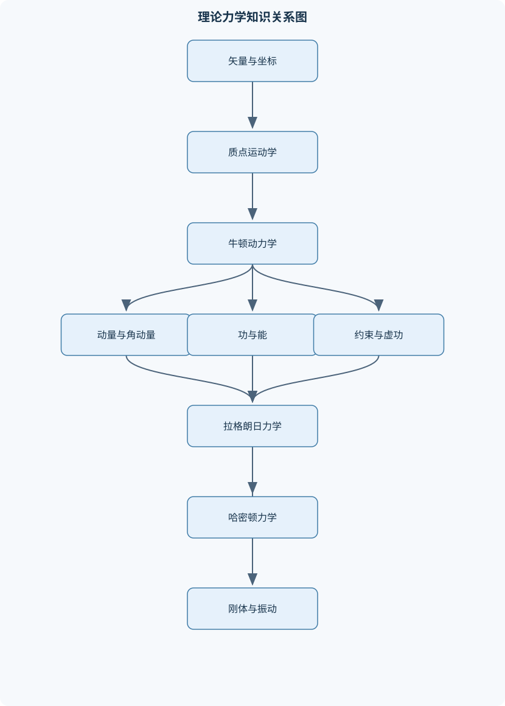
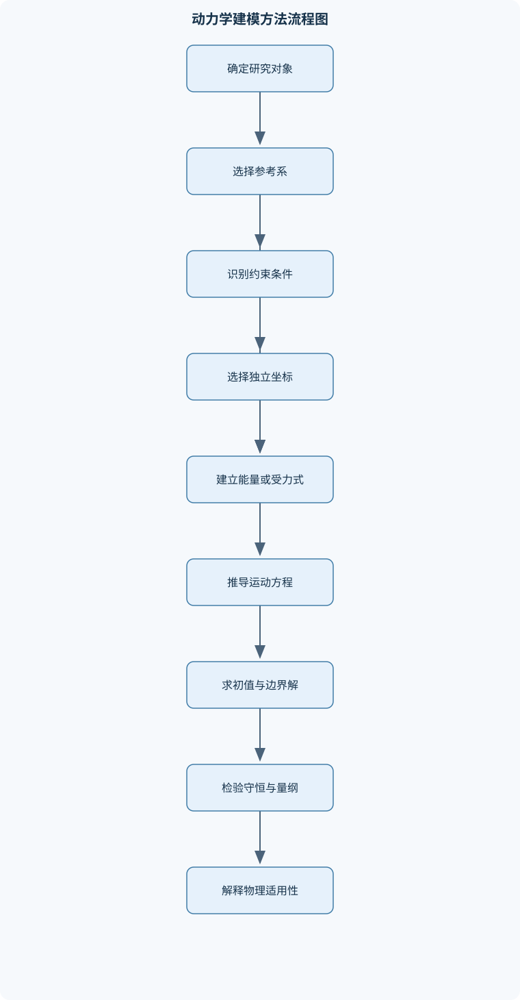

# 理论力学

## 一、课程整体知识框架

### 课程边界与先修知识

理论力学研究质点、质点系、刚体和连续体系在理想约束、外力与内力作用下的运动规律及其统一数学表述。课程通常覆盖运动学、牛顿力学、动量与角动量、功和能、碰撞、约束与虚功、拉格朗日力学、哈密顿力学、刚体运动、小振动及非线性动力学；静力学作为受力分析和动力学建模的基础。先修知识包括高等数学中的一元与多元微积分、常微分方程、线性代数、矢量分析和基础普通物理。课程默认经典力学适用，即物体速度远低于光速、尺度远大于量子效应显著的微观尺度；理想刚体、质点、光滑约束和保守力等模型需要在具体问题中说明近似条件。





### 1. 研究对象、基本假设与统一描述

理论力学研究质点、质点系、刚体以及连续体系在力和约束作用下的运动与平衡。其核心任务不是孤立地计算某个速度或位移，而是建立“几何描述—受力模型—运动方程—守恒量—初边值条件—结果验证”的完整链条。质点模型忽略物体的尺寸和转动，只保留质量 $m$；刚体模型要求任意两点间距离保持不变；质点系由若干相互作用的质点组成；连续体系则把质量、位移和应力视为空间位置的连续函数。

课程通常采用经典力学近似：物体速度远低于光速，系统尺度和作用量足以忽略量子效应，时空可视为绝对的欧氏空间。理想刚体、光滑接触、无质量绳、不可伸长约束和保守力场都是模型假设，不能无条件推广到真实系统。例如钢梁在小变形下可近似为刚体，但在振动或屈曲问题中必须考虑弹性变形；空气阻力在低速小尺度问题中可能可以忽略，在高速运动中则会显著改变能量和轨道。

运动学只描述运动的几何关系，不讨论力的来源。位置矢量记为 $\mathbf r(t)$，位移为 $\mathrm d\mathbf r$ 或 $\Delta\mathbf r$，速度和加速度分别为

$$
\mathbf v=\frac{\mathrm d\mathbf r}{\mathrm dt},\qquad
\mathbf a=\frac{\mathrm d\mathbf v}{\mathrm dt}
=\frac{\mathrm d^2\mathbf r}{\mathrm dt^2}.
$$

时间 $t$ 的单位为秒，位置和位移的单位为米，速度为米每秒，加速度为米每二次方秒。动力学在惯性系中由牛顿第二定律建立：

$$
\sum \mathbf F=m\mathbf a,
$$

其中力的单位为牛顿。若参考系加速或转动，不能直接套用该式的惯性系形式，必须加入相应的惯性力，或将方程写成相对运动形式。

### 2. 从几何运动到动力学方程

在直角坐标中，若 $\mathbf r=x\mathbf e_x+y\mathbf e_y+z\mathbf e_z$，则

$$
\mathbf v=\dot x\mathbf e_x+\dot y\mathbf e_y+\dot z\mathbf e_z,\qquad
\mathbf a=\ddot x\mathbf e_x+\ddot y\mathbf e_y+\ddot z\mathbf e_z.
$$

在平面极坐标 $(r,\varphi)$ 中，基矢量本身随时间变化，因此

$$
\mathbf v=\dot r\,\mathbf e_r+r\dot\varphi\,\mathbf e_\varphi,
$$

$$
\mathbf a=(\ddot r-r\dot\varphi^2)\mathbf e_r+
(r\ddot\varphi+2\dot r\dot\varphi)\mathbf e_\varphi.
$$

其中 $-\!r\dot\varphi^2$ 是法向加速度来源，$2\dot r\dot\varphi$ 是径向运动与转动耦合产生的项。若只保留直线运动，不能使用这些极坐标项；若 $r$ 为常量，则径向加速度为 $-r\dot\varphi^2$。自然坐标沿轨道切线和法线分解：

$$
\mathbf a=\dot v\,\mathbf e_t+\frac{v^2}{\rho}\mathbf e_n,
$$

其中 $v$ 为速率，$\rho$ 为曲率半径。曲线运动中速度可以始终切向，而加速度通常同时含切向和法向分量，不能把三者误认为同一方向。

相对运动需要明确参考系。若两个参考系之间只做匀速直线运动，伽利略变换可写为

$$
\mathbf r=\mathbf R+\mathbf r',\qquad
\mathbf v=\mathbf V+\mathbf v',\qquad
\mathbf a=\mathbf a',
$$

因此牛顿力学在这类惯性系之间形式不变。若参考系有加速度，则 $\mathbf a$ 不再等于 $\mathbf a'$；若参考系转动，还会出现科里奥利项、离心项和欧拉惯性项。相关运动、约束运动和参数方程都必须先说明坐标自由度及其约束关系。

### 3. 力、约束与守恒定律的统一结构

受力分析的基本对象是选定的研究系统。对单个物体画自由体图时，支持力、摩擦力、弹力、重力和阻力等外力都必须列出；对整体质点系研究时，内部作用力可在总动量方程中成对抵消，但这不表示每个物体不受内力。内力为零只是在求整体合力时成立，并且要求作用力与反作用力满足大小相等、方向相反且作用在同一时刻。

动量定义为 $\mathbf p=m\mathbf v$。质点系总动量为

$$
\mathbf P=\sum_i m_i\mathbf v_i=M\mathbf V_{\rm cm},
$$

其中 $M$ 是总质量，$\mathbf V_{\rm cm}$ 是质心速度。对系统求和可得

$$
\frac{\mathrm d\mathbf P}{\mathrm dt}=\sum\mathbf F_{\rm ext}.
$$

所以外力合力为零时，质心速度守恒，而不是每个质点的速度都守恒。力的冲量为

$$
\mathbf J=\int_{t_1}^{t_2}\mathbf F\,\mathrm dt=\Delta\mathbf p,
$$

单位为牛顿秒，也等价于千克米每秒。碰撞时间很短且外部冲量可忽略时，碰撞方向上的总动量近似守恒。

关于定点的角动量为 $\mathbf L=\mathbf r\times\mathbf p$，力矩为 $\boldsymbol\tau=\mathbf r\times\mathbf F$。若取矩点为固定点，或取质心且满足相应的质心运动条件，则

$$
\frac{\mathrm d\mathbf L}{\mathrm dt}=\sum\boldsymbol\tau_{\rm ext}.
$$

外力矩为零时角动量守恒。关于任意运动点取矩时，角动量导数会出现由取矩点运动引起的附加项，不能直接套用固定点公式。

力的功是沿实际路径的线积分：

$$
W=\int_{\mathcal C}\mathbf F\cdot\mathrm d\mathbf r.
$$

由 $\mathbf F=m\mathbf a$ 和 $\mathbf a=\mathrm d\mathbf v/\mathrm dt$ 可得

$$
W=\int m\mathbf v\cdot\mathrm d\mathbf v
=\frac12mv_2^2-\frac12mv_1^2=\Delta T.
$$

这就是动能定理。保守力满足 $\mathbf F=-\nabla V$，于是机械能

$$
E=T+V
$$

在只有保守力做功、约束反力不做功且系统边界不交换能量时守恒。摩擦力、流体阻力和外部驱动通常会改变机械能。功率为 $P=\mathbf F\cdot\mathbf v$；效率则必须明确输入功率与有用输出功率的定义，不能把功率和能量混为一谈。

### 4. 约束、拉格朗日力学与哈密顿力学

约束是限制系统允许运动的几何或速度条件。完整约束可以写成 $f_a(q,t)=0$，只依赖坐标和时间；非完整约束还涉及速度，通常不能化为单纯的坐标方程。定常约束不显含时间，非定常约束随时间变化。独立广义坐标 $q_i$ 的数量等于系统自由度；它可以是长度、角度或其他参数，因此不必具有长度单位。

虚位移是在固定时刻、满足约束的假想位移；真实位移是系统在时间 $\mathrm dt$ 内实际发生的变化。理想约束要求约束反力对所有允许虚位移的虚功为零。虚功原理给出平衡条件：

$$
\delta W=\sum_i\mathbf F_i\cdot\delta\mathbf r_i=0.
$$

将惯性力 $-m_i\mathbf a_i$ 加入，可得达朗贝尔原理，并在广义坐标中推出

$$
\frac{\mathrm d}{\mathrm dt}
\left(\frac{\partial L}{\partial\dot q_i}\right)
-\frac{\partial L}{\partial q_i}
=Q_i,
$$

其中 $L=T-V$ 为拉格朗日量，$Q_i$ 为非保守力对应的广义力。若所有非保守力已经由势能描述，则右端为零。推导要求广义坐标独立、运动足够光滑，且约束处理方式与虚位移定义一致。

哈密顿原理令作用量

$$
S=\int_{t_1}^{t_2}L(q,\dot q,t)\,\mathrm dt
$$

在端点固定的变分下取驻值。对 $\dot q_i$ 项分部积分，并利用端点变分为零，得到欧拉—拉格朗日方程。定义正则动量

$$
p_i=\frac{\partial L}{\partial\dot q_i},
$$

若从速度到正则动量的映射非奇异，即速度 Hessian 不退化，则可作勒让德变换

$$
H(q,p,t)=\sum_i p_i\dot q_i-L.
$$

由此得到哈密顿正则方程

$$
\dot q_i=\frac{\partial H}{\partial p_i},\qquad
\dot p_i=-\frac{\partial H}{\partial q_i}.
$$

相空间由 $(q_i,p_i)$ 构成，状态轨道是相空间中的曲线。泊松括号定义为

$$
\{f,g\}=\sum_i\left(
\frac{\partial f}{\partial q_i}\frac{\partial g}{\partial p_i}
-\frac{\partial f}{\partial p_i}\frac{\partial g}{\partial q_i}
\right).
$$

若 $f$ 不显含时间且 $\{f,H\}=0$，则它是运动积分。正则变换保持辛结构和泊松括号关系；哈密顿—雅可比方程则试图通过选择合适生成函数把动力学积分化。刘维尔定理说明哈密顿流保持相空间体积，但不表示每条轨道的能量或坐标都不变。

### 5. 两体问题、刚体与连续体系

两体相互作用若只依赖相对位置，可引入质心坐标和相对坐标，将问题化为约化质量

$$
\mu=\frac{m_1m_2}{m_1+m_2}
$$

在中心力场中的单体运动。中心力矩为零，所以角动量守恒，轨道始终位于垂直于角动量的固定平面内。能量积分可写为径向等效运动：

$$
E=\frac12\mu\dot r^2+
\underbrace{\left[V(r)+\frac{L^2}{2\mu r^2}\right]}_{V_{\rm eff}(r)}.
$$

有效势中的第二项是离心势。允许运动区间满足 $E\ge V_{\rm eff}(r)$，等号对应转向点；圆轨道满足 $V_{\rm eff}'(r)=0$，其稳定性还需检查 $V_{\rm eff}''(r)$ 的符号。开普勒型轨道只是特定反平方中心力下的结果，不能推广到任意中心力。

刚体运动可分解为质心平动和绕质心转动。角速度记为 $\boldsymbol\omega$，角动量记为 $\mathbf H$，转动惯量张量记为 $\mathbf I$：

$$
\mathbf H=\mathbf I\boldsymbol\omega,\qquad
T_{\rm rot}=\frac12\boldsymbol\omega\cdot\mathbf I\boldsymbol\omega.
$$

惯量张量依赖参考点和坐标轴。平行轴定理为

$$
\mathbf I_O=\mathbf I_{\rm cm}
+M\left[(\mathbf d\cdot\mathbf d)\mathbf 1-\mathbf d\mathbf d^{\mathsf T}\right],
$$

其中 $\mathbf d$ 是质心到新参考点的位移。实对称惯量张量可正交对角化，所得方向为惯量主轴。刚体本体坐标中的欧拉方程含有 $\boldsymbol\omega\times\mathbf H$ 项；若将本体坐标和惯性坐标混用，就会遗漏该项。欧拉角能够描述姿态，但在某些姿态存在坐标奇异性，数值计算时可改用旋转矩阵或四元数。

小振动研究平衡位置附近的微小偏离。将势能在平衡点展开到二阶，保留二次项，得到

$$
\mathbf M\ddot{\mathbf q}+\mathbf C\dot{\mathbf q}
+\mathbf K\mathbf q=\mathbf f(t),
$$

其中 $\mathbf M$、$\mathbf C$、$\mathbf K$ 分别为质量、阻尼和刚度矩阵。无阻尼自由振动设 $\mathbf q=\mathbf a e^{i\omega t}$，得到

$$
\det(\mathbf K-\omega^2\mathbf M)=0.
$$

要求质量矩阵正定且扰动足够小。简正模是不同自由度按固定比例协同振动的模式。大振幅、强非线性或接近失稳时，线性固有频率不能代表真实运动。

单自由度阻尼振子满足

$$
m\ddot x+c\dot x+kx=f(t).
$$

无阻尼时固有角频率为 $\omega_0=\sqrt{k/m}$；阻尼比决定欠阻尼、临界阻尼和过阻尼。简谐驱动下，稳态响应与驱动频率有关，共振峰会受到阻尼影响。非线性系统还可出现振幅依赖频率、参数共振、极限环、吸引子、倍周期分岔和混沌。庞加莱截面把连续轨道转换为离散点集；李雅普诺夫指数的正值表示局部轨道分离速度为指数增长，但单凭有限时间计算不能断言系统必然混沌。

## 二、章节和模块划分

### 核心知识覆盖清单

本清单用于检查正文是否覆盖本课程的主要知识模块：

- **矢量力学与运动学基础**：参考系、坐标系与自由度、位置、位移、速度和加速度、直角坐标、极坐标与自然坐标、相对运动与伽利略变换、质点运动的参数方程、约束运动与相关运动、角速度、角加速度与转动描述。
- **质点动力学与受力分析**：牛顿三定律及适用条件、惯性系与非惯性系、自由体图与受力分解、重力、弹力、摩擦力和阻力模型、直角坐标动力学方程、切向法向动力学方程、极坐标动力学方程、平衡条件与静力学极限。
- **动量、角动量与碰撞**：质点和质点系的动量、冲量—动量定理、质心运动定理、关于定点和质心的角动量、角动量定理与守恒条件、内力与外力的区分、一维和二维碰撞、恢复系数及其适用范围、碰撞中的能量损失。
- **功、能与动力学积分**：力的功与线积分、动能定理、保守力与势能、机械能守恒条件、质点系的动能分解、功率、效率与约束反力做功、有效势与一维运动、周期运动和转向点、能量方法与微分方程方法的比较。
- **约束、虚功与达朗贝尔原理**：完整约束与非完整约束、定常约束与非定常约束、广义坐标和广义速度、虚位移与真实位移、理想约束和约束反力、虚功原理与平衡条件、达朗贝尔原理、拉格朗日方程的牛顿力学推导、拉格朗日乘子与约束反力。
- **拉格朗日力学及其应用**：拉格朗日量与作用量、哈密顿原理、第二类拉格朗日方程、循环坐标与运动积分、时间齐次性与能量守恒、空间平移和转动对称性、小振动的二次型近似、带电粒子在电磁场中的拉格朗日量、连续体系的拉格朗日描述。
- **两体问题与多自由度系统**：两体问题的质心约化、约化质量、中心力场与角动量守恒、轨道方程与有效势、开普勒型轨道的动力学结构、散射角与冲量参数、线性化平衡与稳定性、多自由度小振动方程、质量矩阵、刚度矩阵和简正模。
- **哈密顿力学**：正则动量与勒让德变换、哈密顿正则方程、相空间与状态轨道、泊松括号及其代数性质、正则变换与生成函数、哈密顿—雅可比方程、作用量变量与角变量、相空间体积与刘维尔定理、经典力学向统计和量子理论的衔接边界。
- **刚体运动与转动动力学**：刚体平动和转动的分解、欧拉角与角速度、瞬时转轴和瞬时转动中心、转动惯量张量、惯量积与惯量主轴、平行轴定理、刚体角动量与动能、欧拉动力学方程、对称陀螺和进动、平面刚体一般运动。
- **振动与非线性动力学**：单自由度无阻尼自由振动、黏性阻尼和临界阻尼、简谐受迫振动与共振、多自由度简正坐标、参数振动和稳定性、非线性平衡点与相平面、极限环和吸引子、庞加莱截面、倍周期分岔与混沌、李雅普诺夫指数和分形结构。


### 1. 矢量力学与运动学基础、质点动力学和静力学

本模块先建立参考系、坐标系、自由度和参数方程。典型流程是先写 $\mathbf r(t)$，再求 $\mathbf v$ 和 $\mathbf a$，最后根据几何约束消去不独立变量。直角坐标适合约束方向固定的问题；极坐标适合中心运动；自然坐标适合已知轨道曲线的问题。

随后进行受力分析。输入为几何约束、质量、外力和初始条件，输出为运动微分方程。步骤为：选惯性系，确定研究对象，绘制自由体图，列出外力，选择坐标，写约束方程，按坐标分解牛顿方程，并检查量纲和初始条件。静力学是动力学建模的极限情形，满足

$$
\sum\mathbf F=0,\qquad \sum\boldsymbol\tau=0.
$$

摩擦力方向应反向于相对运动或运动趋势；静摩擦力大小不是总等于极限值，而是满足 $0\le f_s\le\mu_sN$。若计算出的所需摩擦力超过上限，原静止假设失效。

### 2. 动量、角动量、碰撞、功和能

质点系模块重点区分系统边界。碰撞分析先判断碰撞时间是否足够短，确定哪些方向的外部冲量可忽略；再沿碰撞法线使用动量方程和恢复系数，切向方向根据光滑或粗糙接触模型处理。恢复系数是碰后法向相对分离速度与碰前接近速度之比，通常适用于短时接触，不能直接描述持续接触、复杂塑性变形或强烈能量耗散过程。

能量方法适合力函数已知、约束反力不做功或功容易计算的问题。若一维运动满足

$$
\frac12m\dot x^2+V(x)=E,
$$

则允许区间由 $E\ge V(x)$ 决定，$\dot x=0$ 的位置是转向点。能量积分通常比直接求时间函数更容易判断可达区域和稳定性，但它未必能给出 $x(t)$ 的显式表达；遇到非保守力、外部驱动或显式时间依赖时，应回到微分方程或扩展能量平衡。

### 3. 约束、虚功、拉格朗日和哈密顿方法

选择拉格朗日方法时，应优先使用独立广义坐标消去几何约束；若约束反力本身是所求量，则保留约束并引入拉格朗日乘子：

$$
\frac{\mathrm d}{\mathrm dt}
\left(\frac{\partial L}{\partial\dot q_i}\right)
-\frac{\partial L}{\partial q_i}
=\sum_a\lambda_a\frac{\partial f_a}{\partial q_i}.
$$

联立 $f_a(q,t)=0$ 求出坐标和乘子，最后检查反力方向及符号。约束反力在虚功中置零只适用于理想约束和允许虚位移，不能对任意摩擦约束、非完整约束或不满足约束的试探位移使用。

### 4. 两体问题、刚体运动和小振动

两体问题的分析顺序是：写质心和相对坐标，求约化质量，检查中心力条件，使用角动量和能量积分，再构造有效势。刚体问题的顺序是：求质量和质心，选择参考点，计算惯量张量，必要时使用平行轴定理，求主轴，最后结合欧拉方程和姿态运动学。欧拉角运动学方程与动力学方程必须同时使用，不能只由角速度直接推断姿态角。

多自由度小振动按“求平衡点—计算二阶导数—建立矩阵—求特征值—检验模态”的顺序进行。若 $\mathbf M$ 或 $\mathbf K$ 由于坐标依赖而奇异，应先检查是否使用了重复坐标或未处理约束；若刚度矩阵存在负特征值，平衡点可能是不稳定的。

### 5. 代表性算法与流程

#### 受力建模与守恒量判定流程

输入为物体质量、几何关系、力函数、约束、初始状态和系统边界；输出为运动方程及可用积分。先判断参考系是否惯性系，再画自由体图；随后检查外力合力、外力矩、力是否为保守力、拉格朗日量是否显含时间，以及是否存在循环坐标。只有外力合力为零才能使用总动量守恒，只有外力矩为零才能使用相应角动量守恒，只有机械能交换条件满足时才能使用机械能守恒。

#### 多自由度小振动算法

输入为平衡构型、质量矩阵 $\mathbf M$ 和势能 $V$；输出为固有频率和简正模。先解 $\partial V/\partial q_i=0$ 得平衡点，再计算 $\mathbf K$ 的二阶导数。建立 $\mathbf M\ddot{\mathbf q}+\mathbf K\mathbf q=0$，设 $\mathbf q=\mathbf a e^{i\omega t}$，求 $\det(\mathbf K-\omega^2\mathbf M)=0$，再对每个 $\omega$ 求特征向量并归一化。该流程的终止条件是所有独立模态均已求出，并且代回原矩阵方程后残差足够小。直接求行列式适合自由度较少的系统，大规模系统应采用对称广义特征值算法；线性代数运算的复杂度通常随自由度数 $n$ 呈立方增长。

#### 常微分方程数值积分伪代码

```python
# Python-like pseudocode
# 输入：一阶方程 y_dot = f(t, y)，初值 y0，区间 [t0, tf]，步长 h
# 输出：时间序列 ts 和状态序列 ys

def rk4(f, t0, tf, y0, h):
    t = t0
    y = y0
    ts = [t]
    ys = [y]

    while t < tf:
        h_now = min(h, tf - t)
        k1 = f(t, y)
        k2 = f(t + h_now/2, y + h_now*k1/2)
        k3 = f(t + h_now/2, y + h_now*k2/2)
        k4 = f(t + h_now, y + h_now*k3)

        y = y + h_now*(k1 + 2*k2 + 2*k3 + k4)/6
        t = t + h_now

        ts.append(t)
        ys.append(y)

    return ts, ys
```

该算法输入必须是正规的一阶初值问题，输出为离散轨迹。每一步利用四个斜率近似区间平均导数，固定步长下局部截断误差为五阶量级、全局误差为四阶量级。对刚性系统不宜盲目使用固定步长显式方法；对守恒系统还应监测能量漂移，并用步长减半比较结果是否收敛。

### 6. 代表性例题

#### 例题一：极坐标运动的加速度

**题干：**质点满足 $r=at^2$、$\varphi=bt$，其中 $a,b$ 为常量，求速度和加速度。

**分析：**使用极坐标公式，$\dot r=2at$、$\ddot r=2a$，$\dot\varphi=b$、$\ddot\varphi=0$。

**逐步解答：**

$$
\mathbf v=2at\,\mathbf e_r+ab t^2\,\mathbf e_\varphi,
$$

$$
\mathbf a=(2a-ab^2t^2)\mathbf e_r+4abt\,\mathbf e_\varphi.
$$

第一项来自径向二阶变化和向心项，第二项来自径向速度与角速度的耦合。

**结果验证：**当 $b=0$ 时，运动退化为直线运动，得到 $\mathbf a=2a\mathbf e_r$；当 $a=0$ 时质点固定在原点，速度和加速度均为零。

**变式：**若 $r=R$，则 $\mathbf a=-Rb^2\mathbf e_r$，说明匀速圆周运动加速度纯粹指向圆心。

#### 例题二：斜面连接悬挂物

**题干：**质量为 $m_1$ 的物体位于倾角 $\theta$ 的粗糙斜面上，通过无质量不可伸长绳和理想滑轮连接悬挂质量 $m_2$。动摩擦系数为 $\mu$。求物体沿“$m_2$ 下落、$m_1$ 上滑”方向运动时的加速度。

**分析：**取两物体为研究对象，绳长约束给出两者加速度大小相等。若假定 $m_1$ 上滑，摩擦力向下。

**逐步解答：**沿绳方向列式：

$$
T-m_1g\sin\theta-\mu m_1g\cos\theta=m_1a,
$$

$$
m_2g-T=m_2a.
$$

两式相加得

$$
a=\frac{m_2g-m_1g\sin\theta-\mu m_1g\cos\theta}{m_1+m_2}.
$$

**结果验证：**若分子为正，假设方向成立；若分子为负，实际运动方向相反或系统保持静止。静止可能性还需检查

$$
|m_2g-m_1g\sin\theta|\le \mu_s m_1g\cos\theta.
$$

**变式：**若滑轮有转动惯量，绳两侧张力不再相等，必须加入滑轮转动方程。

#### 例题三：一维完全非弹性碰撞

**题干：**质量 $m_1,m_2$ 的两个质点沿同一直线运动，碰撞后黏在一起。碰前速度为 $u_1,u_2$，求碰后速度及动能损失。

**分析：**碰撞时间短，若外部冲量可忽略，则总动量守恒；完全非弹性碰撞不守恒动能。

**解答：**

$$
m_1u_1+m_2u_2=(m_1+m_2)v,
$$

所以

$$
v=\frac{m_1u_1+m_2u_2}{m_1+m_2}.
$$

碰前后动能差为

$$
\Delta T
=\frac12m_1u_1^2+\frac12m_2u_2^2
-\frac12(m_1+m_2)v^2
=\frac12\frac{m_1m_2}{m_1+m_2}(u_1-u_2)^2.
$$

**结果验证：**动能损失非负，且只有 $u_1=u_2$ 时为零。

**变式：**若恢复系数为 $e$，应联立动量守恒与 $v_2-v_1=e(u_1-u_2)$，不能再令两碰后速度相等。

#### 例题四：中心力圆轨道稳定性

**题干：**粒子在势能 $V(r)=-k/r$ 中运动，$k>0$。判断半径 $r_0$ 的圆轨道条件及稳定性。

**分析：**有效势为

$$
V_{\rm eff}(r)=\frac{L^2}{2\mu r^2}-\frac{k}{r}.
$$

圆轨道要求一阶导数为零。

**解答：**

$$
V_{\rm eff}'(r)=-\frac{L^2}{\mu r^3}+\frac{k}{r^2}=0,
$$

从而

$$
r_0=\frac{L^2}{\mu k}.
$$

二阶导数为

$$
V_{\rm eff}''(r)=\frac{3L^2}{\mu r^4}-\frac{2k}{r^3}.
$$

代入 $r_0$ 得

$$
V_{\rm eff}''(r_0)=\frac{k}{r_0^3}>0,
$$

因此圆轨道对径向小扰动稳定。

**结果验证：**有效势在 $r_0$ 附近有极小值，径向扰动会引起往复振荡而非无限远离。

**变式：**改变为一般势能 $V=-k/r^n$ 后，稳定性由有效势二阶导数决定，不能照搬反平方力结果。

#### 例题五：阻尼受迫振动的稳态响应

**题干：**系统满足 $m\ddot x+c\dot x+kx=F_0\cos\Omega t$，求稳态振幅和相位。

**分析：**瞬态解随时间衰减，稳态解设为 $x_s=A\cos(\Omega t-\delta)$。

**解答：**

$$
A=\frac{F_0}
{\sqrt{(k-m\Omega^2)^2+c^2\Omega^2}},
$$

$$
\tan\delta=\frac{c\Omega}{k-m\Omega^2}.
$$

相位应根据象限使用反正切函数判断。无阻尼极限下，$\Omega$ 接近 $\sqrt{k/m}$ 时振幅显著增大；有阻尼时峰值有限且共振频率不必等于无阻尼固有频率。

**结果验证：**当 $\Omega\to0$ 时，$A\to F_0/k$，即系统趋于静态位移；当 $\Omega$ 很大时，$A$ 近似按 $1/(m\Omega^2)$ 衰减。

**变式：**若外力改为阶跃载荷，不能直接使用上述稳态公式，必须重新求瞬态和稳态叠加解。

### 7. 实验与项目流程

#### 实验一：单自由度阻尼振动参数识别

**输入数据：**质量 $m$、弹簧刚度的初始估计、位移传感器采集的 $x(t)$、采样时间间隔和若干不同初始位移。

**步骤：**先在小振幅下测量自由衰减曲线，利用相邻峰值估计对数减量；再由振荡周期估计阻尼固有频率；最后用模型

$$
m\ddot x+c\dot x+kx=0
$$

拟合 $c$ 和 $k$。改变初始位移，检查线性模型是否保持一致。

**评价标准：**拟合曲线与实测曲线的主要峰值和周期应一致；参数在不同初始位移下不应出现系统性漂移；能量衰减应符合阻尼模型而非无规律跳变。

**排错方法：**若周期随振幅明显变化，可能存在非线性刚度；若峰值衰减不稳定，应检查传感器零点、摩擦和采样饱和；若数值拟合能量增加，则检查时间步长、符号和阻尼项方向。

#### 项目二：双摆小振动与数值验证

**输入数据：**两摆长、两质点质量、平衡姿态、初始小角度和采样时间。

**步骤：**选择两个角度为广义坐标，写出动能和势能，在平衡点附近保留二次项，构造 $\mathbf M$ 和 $\mathbf K$；求广义特征值获得两个固有频率及模态；再用完整非线性方程数值积分，将数值频谱与线性预测比较。

**评价标准：**小角度下两种模型的频率和相位应接近；减小初始角度后误差应下降；模态向量代回特征方程的残差应足够小；改变积分步长后主要频率不应显著漂移。

**排错方法：**若质量矩阵不对称，检查动能展开和坐标顺序；若出现负的 $\omega^2$，检查平衡点是否为稳定平衡；若非线性轨迹快速偏离，先确认初始角度是否已超出小振动范围，再检查积分步长和角度单位。

### 8. 岗位关联

理论力学知识可用于机械系统动力学分析、机器人运动学与动力学、航天器轨道和姿态分析、车辆与多体系统仿真、结构振动诊断、旋转机械和精密陀螺设计。实际任务通常包括建立自由体图和多体模型、推导运动方程、识别参数、进行数值积分、判断稳定性以及解释实验数据。主要产出包括动力学方程、参数表、仿真轨迹、模态和频响结果、误差分析报告及可复现实验脚本。验收标准应包括坐标和单位明确、约束满足、极限情形正确、守恒量或能量平衡通过检查、网格或步长收敛、模型假设与适用边界被完整说明。

## 三、核心概念的详细解释

### 1. 参考系、自由度与运动描述

理论力学中的运动必须相对于参考系描述。若参考系中自由质点满足 $\sum\mathbf F=m\mathbf a$，则称该参考系为惯性参考系。两个彼此做匀速直线运动的惯性系之间满足伽利略变换：

$$
\mathbf r=\mathbf R(t)+\mathbf r',\qquad
\mathbf v=\mathbf V+\mathbf v',\qquad
\mathbf a=\mathbf a',
$$

其中 $\mathbf R(t)$ 是两个原点的位置，$\mathbf V$ 为参考系间的相对速度。该变换假定时间在不同参考系中相同，适用于速度远小于光速的经典力学范围。若参考系存在平动加速度或旋转，则它通常不是惯性系，必须引入平动惯性力、离心力、科里奥利力和欧拉惯性力。

自由度是确定系统构型所需的独立参数个数。一个空间质点通常有三个自由度；若质点被限制在固定曲面上，独立坐标减少为两个；若被限制在固定曲线上，则只剩一个自由度。刚体在三维空间中一般有六个自由度，即质心的三个平动自由度和姿态的三个转动自由度。自由度的计算必须扣除彼此独立的约束，不能仅按坐标数量判断。例如两个质点分别用三维位置坐标描述，共有六个坐标；若二者间距离固定，则只剩五个独立自由度。

### 2. 位置、速度、加速度与曲线运动

位置矢量 $\mathbf r(t)$ 表示质点相对于原点的位置，速度和加速度分别为

$$
\mathbf v=\frac{\mathrm d\mathbf r}{\mathrm dt},\qquad
\mathbf a=\frac{\mathrm d\mathbf v}{\mathrm dt}.
$$

位移 $\Delta\mathbf r$ 是两个位置矢量之差，而微元位移 $\mathrm d\mathbf r$ 是沿实际运动曲线的切向微分。位移的单位为米，速度单位为米每秒，加速度单位为米每二次方秒。位移是矢量，路程是标量，二者在曲线运动中通常不相等。

在平面极坐标中，位置写为 $\mathbf r=r\mathbf e_r$。由于 $\mathbf e_r$ 和 $\mathbf e_\varphi$ 随方向变化，速度和加速度为

$$
\mathbf v=\dot r\,\mathbf e_r+r\dot\varphi\,\mathbf e_\varphi,
$$

$$
\mathbf a=(\ddot r-r\dot\varphi^2)\mathbf e_r+
(r\ddot\varphi+2\dot r\dot\varphi)\mathbf e_\varphi.
$$

其中 $-\!r\dot\varphi^2$ 是由于方向改变产生的径向加速度；$2\dot r\dot\varphi$ 是径向运动和角向运动共同造成的耦合项。若 $r$ 为常量，运动为圆周运动，径向加速度为 $-r\dot\varphi^2$；若 $\dot\varphi=0$，则退化为直线径向运动。

自然坐标沿轨道切线和法线建立：

$$
\mathbf a=\dot v\,\mathbf e_t+\frac{v^2}{\rho}\mathbf e_n,
$$

其中 $v=|\mathbf v|$ 为速率，$\rho$ 为曲率半径。切向分量改变速率，法向分量改变速度方向。匀速圆周运动虽然 $\dot v=0$，但仍有 $v^2/\rho$ 的法向加速度，因此不能把“速度恒定”误解为“加速度为零”。

### 3. 牛顿动力学、受力分析与约束反力

牛顿第二定律在惯性系中写为

$$
\sum\mathbf F=m\mathbf a.
$$

它描述的是选定研究对象所受外力的合力。自由体图必须只画作用在该对象上的力，包括重力、弹力、支持力、摩擦力、阻力和其他外加力。牛顿第三定律的作用力与反作用力作用在两个不同物体上，因此不能在同一个物体的自由体图中相互抵消。

理想光滑接触的约束力沿接触面的法线方向，不做允许虚位移的功；粗糙接触还可能有切向摩擦力。静摩擦力并不总等于最大静摩擦力，而是满足

$$
|\mathbf f_s|\leq \mu_s N,
$$

其中 $N$ 为法向支持力，$\mu_s$ 为静摩擦因数。只有在即将滑动的临界状态，才有 $|\mathbf f_s|=\mu_sN$。动摩擦常用模型为 $f_k=\mu_kN$，但真实摩擦还可能依赖速度、温度、材料和接触状态。

静力平衡要求合力和合力矩均为零。对质点只有

$$
\sum\mathbf F=\mathbf 0;
$$

对刚体还必须满足关于任意固定点的

$$
\sum\boldsymbol\tau=\mathbf 0.
$$

平衡是动力学方程在加速度为零时的特殊情形，不意味着物体不受力，而是所有外力和外力矩相互平衡。

### 4. 动量、角动量与质心运动

质点动量定义为

$$
\mathbf p=m\mathbf v.
$$

在恒质量条件下，牛顿第二定律等价于

$$
\frac{\mathrm d\mathbf p}{\mathrm dt}=\mathbf F.
$$

对时间积分得到冲量—动量定理：

$$
\mathbf J=\int_{t_1}^{t_2}\mathbf F\,\mathrm dt
=\mathbf p_2-\mathbf p_1.
$$

冲量的单位为牛顿秒，与动量单位千克米每秒等价。碰撞问题中接触时间很短，若外部冲量相对于接触冲量可以忽略，则碰撞前后总动量近似守恒。

质点系总质量为 $M$，质心位置为

$$
\mathbf R=\frac{1}{M}\sum_i m_i\mathbf r_i.
$$

总动量满足

$$
\mathbf P=\sum_i m_i\mathbf v_i=M\mathbf V_{\rm cm}.
$$

由内部作用力成对抵消，得到质心运动定理：

$$
M\mathbf A_{\rm cm}=\sum\mathbf F_{\rm ext}.
$$

因此，外力合力为零时，质心速度保持不变，但各质点仍可能因内部力发生复杂运动。例如爆炸后的各碎片速度不同，整体质心仍可保持原有速度。

关于固定点的角动量为

$$
\mathbf L_O=\mathbf r\times\mathbf p,
$$

力矩为

$$
\boldsymbol\tau_O=\mathbf r\times\mathbf F.
$$

固定点条件下，

$$
\frac{\mathrm d\mathbf L_O}{\mathrm dt}
=\sum\boldsymbol\tau_O.
$$

若外力矩为零，则关于该点的角动量守恒。对质点系取质心为参考点时，角动量可分解为质心平动部分和相对于质心的内禀转动部分。若取矩点本身运动，则求导时还会出现与取矩点速度有关的附加项，不能直接套用固定点公式。

### 5. 功、动能、势能与有效势

力沿实际路径所做的功是线积分：

$$
W_{1\to2}=\int_{\mathbf r_1}^{\mathbf r_2}\mathbf F\cdot\mathrm d\mathbf r.
$$

由 $\mathbf F=m\mathbf a$ 和 $\mathrm d\mathbf r=\mathbf v\,\mathrm dt$，

$$
W=\int m\mathbf a\cdot\mathbf v\,\mathrm dt
=\int m\mathbf v\cdot\mathrm d\mathbf v
=\frac12mv_2^2-\frac12mv_1^2.
$$

因此动能定理为

$$
W_{\rm total}=\Delta T,\qquad T=\frac12mv^2.
$$

功率为

$$
P=\frac{\mathrm dW}{\mathrm dt}=\mathbf F\cdot\mathbf v.
$$

若力场满足路径无关性，则为保守力，可定义势能 $V$，并满足

$$
\mathbf F=-\nabla V.
$$

于是

$$
E=T+V
$$

在只有保守力做功、约束不改变机械能且系统边界不交换能量时守恒。动摩擦、空气阻力和外部驱动一般会使机械能发生变化，但总能量仍可在扩大后的系统中守恒。

在一维保守运动中，

$$
\frac12m\dot r^2+V_{\rm eff}(r)=E.
$$

对于中心力，角动量守恒使角向运动可并入有效势：

$$
V_{\rm eff}(r)=V(r)+\frac{L^2}{2mr^2}.
$$

第二项为离心势垒。允许运动区域满足 $E\geq V_{\rm eff}(r)$，等号对应径向速度为零的转向点。圆轨道要求 $V_{\rm eff}'(r_0)=0$；若再有 $V_{\rm eff}''(r_0)>0$，则圆轨道对径向小扰动稳定。

### 6. 约束、虚功与拉格朗日描述

约束方程可写为

$$
f_a(q_1,\ldots,q_n,t)=0.
$$

不显含时间的约束称定常约束，否则称非定常约束。能够写成坐标关系的约束称完整约束；不能仅由坐标关系表示、而涉及速度或微分形式的约束称非完整约束。虚位移是在同一时刻、满足约束的假想微小位移，不等同于实际运动在时间间隔内产生的位移。

若约束反力对所有允许虚位移的虚功均为零，则称约束为理想约束。此时可以只使用独立广义坐标 $q_i$ 描述系统，而不必显式求约束反力。广义力 $Q_i$ 由虚功定义：

$$
\delta W=\sum_iQ_i\delta q_i.
$$

由于 $q_i$ 可以是长度、角度或其他参数，$Q_i$ 的量纲不一定是力；若 $q_i$ 为角度，$Q_i$ 通常具有力矩量纲。

### 7. 拉格朗日量、哈密顿量与对称性

拉格朗日量定义为

$$
\mathcal L(q,\dot q,t)=T-V.
$$

这里用 $\mathcal L$ 表示拉格朗日量，以避免与角动量 $\mathbf L$ 混淆。对于理想完整约束和适当光滑运动，第二类拉格朗日方程为

$$
\frac{\mathrm d}{\mathrm dt}
\left(\frac{\partial\mathcal L}{\partial\dot q_i}\right)
-\frac{\partial\mathcal L}{\partial q_i}
=Q_i^{\rm nc},
$$

其中 $Q_i^{\rm nc}$ 是未包含在势能中的非保守广义力。若某坐标 $q_j$ 不显含于 $\mathcal L$，则称为循环坐标，其共轭动量保持守恒。

若 $\mathcal L$ 不显含时间，则相应能量函数

$$
E=\sum_i\dot q_i
\frac{\partial\mathcal L}{\partial\dot q_i}-\mathcal L
$$

保持守恒。在通常的自然系统中，该量等于 $T+V$。空间平移、旋转和时间平移对称性分别对应动量、角动量和能量守恒；这些结论要求系统边界和外部作用也具有相应对称性。

正则动量定义为

$$
p_i=\frac{\partial\mathcal L}{\partial\dot q_i}.
$$

若速度到正则动量的映射非奇异，即速度二阶矩阵可逆，则可进行勒让德变换，定义哈密顿量

$$
H(q,p,t)=\sum_i p_i\dot q_i-\mathcal L.
$$

哈密顿正则方程为

$$
\dot q_i=\frac{\partial H}{\partial p_i},\qquad
\dot p_i=-\frac{\partial H}{\partial q_i}.
$$

哈密顿力学在相空间 $(q_i,p_i)$ 中描述系统状态，而拉格朗日力学在配置空间及其速度空间中描述系统。二者描述同一经典动力学，但适用的变量和数学结构不同。

### 8. 刚体运动与转动动力学

刚体内任意两点间距离保持不变。刚体一般运动可分解为质心平动和绕质心的转动。刚体角速度为 $\boldsymbol\omega$，相对于参考点的角动量为

$$
\mathbf H=\mathbf I\boldsymbol\omega,
$$

其中 $\mathbf I$ 为转动惯量张量。转动动能为

$$
T_{\rm rot}=\frac12\boldsymbol\omega\cdot\mathbf I\boldsymbol\omega.
$$

若质量连续分布，转动惯量张量的分量为

$$
I_{ij}=\int\left(r^2\delta_{ij}-x_ix_j\right)\,\mathrm dm.
$$

它是实对称张量，因此可以通过正交变换对角化。对角化后的坐标轴称惯量主轴，主轴方向上的惯量称主惯量。平行轴定理为

$$
I_O=I_C+Md^2
$$

（标量形式适用于绕彼此平行的轴），其中 $I_C$ 是过质心的平行轴惯量，$d$ 是两轴距离。

在刚体本体坐标系中，欧拉动力学方程为

$$
\mathbf M
=\left(\frac{\mathrm d\mathbf H}{\mathrm dt}\right)_{\rm space}
=\left(\frac{\mathrm d\mathbf H}{\mathrm dt}\right)_{\rm body}
+\boldsymbol\omega\times\mathbf H.
$$

若选惯量主轴，且主惯量为 $I_1,I_2,I_3$，则

$$
\begin{aligned}
M_1&=I_1\dot\omega_1+(I_3-I_2)\omega_2\omega_3,\\
M_2&=I_2\dot\omega_2+(I_1-I_3)\omega_3\omega_1,\\
M_3&=I_3\dot\omega_3+(I_2-I_1)\omega_1\omega_2.
\end{aligned}
$$

本体坐标中的角动量和惯量矩阵不能直接与惯性坐标中的量混用。

### 9. 振动、稳定性与非线性运动

单自由度线性振动方程为

$$
m\ddot q+c\dot q+kq=f(t).
$$

无阻尼自由振动的固有角频率为

$$
\omega_0=\sqrt{\frac{k}{m}}.
$$

对于自由响应，特征方程为

$$
ms^2+cs+k=0.
$$

当 $c^2<4mk$ 时为欠阻尼，响应为衰减振荡；当 $c^2=4mk$ 时为临界阻尼；当 $c^2>4mk$ 时为过阻尼。简谐外力会产生稳态响应，共振峰受到阻尼影响。线性模型只适用于平衡位置附近的小扰动，不能直接用于大振幅摆动或强非线性弹簧。

多自由度小振动在平衡点附近可写为

$$
\mathbf M\ddot{\mathbf q}
+\mathbf C\dot{\mathbf q}
+\mathbf K\mathbf q
=\mathbf f(t).
$$

无阻尼自由振动取 $\mathbf q=\mathbf a e^{i\omega t}$，得到

$$
(\mathbf K-\omega^2\mathbf M)\mathbf a=\mathbf0,
\qquad
\det(\mathbf K-\omega^2\mathbf M)=0.
$$

特征值给出固有频率，特征向量给出简正模。若质量矩阵正定、刚度矩阵在平衡点处正定，则该平衡点通常具有局部稳定性。

非线性系统的平衡点由 $\dot{\mathbf x}=\mathbf0$ 确定。在线性化后，雅可比矩阵的特征值可判断局部稳定性，但当存在零实部特征值时，线性化往往不能给出结论。相平面中的极限环是孤立闭轨道，吸引子是长期轨道趋近的集合。庞加莱截面可把连续流转化为离散映射，用于观察周期轨道、倍周期分岔和复杂轨道结构。李雅普诺夫指数描述邻近轨道的平均指数分离；正指数表示局部初值敏感性，但单凭有限时间数值结果不能独立断言系统必然混沌。

## 四、重要定义、公式、定理和推导

### 专业审校补充：关键定义与适用边界

非完整约束是理论力学中必须与完整约束区分的边界。完整约束可写成坐标与时间的方程 f_a(q,t)=0，能够直接减少独立自由度；非完整约束通常表现为速度关系 A_{a i}(q,t)\dot q_i+A_{a0}(q,t)=0，且不能积分为仅含 q、t 的方程。例如无滑动滚动约束 v-R\omega=0 在某些一维运动中可积分，但一般平面滚动还包含方向变化，不能随意把接触点坐标消去。对非完整约束，允许虚位移必须满足同一时刻的齐次速度约束 A_{a i}\delta q_i=0；达朗贝尔原理中的约束反力只需对这些允许虚位移不做虚功，不能直接套用把约束代入拉格朗日量的完整约束处理法。应使用拉格朗日—达朗贝尔方程或乘子形式，并联立约束求解。符号 q_i 为广义坐标，单位可为米或弧度；\dot q_i 为广义速度。若约束含时间、存在滑动或摩擦，约束力可能做真实功，机械能也不必守恒。


### 1. 质点系质心定理的推导

设质点系由 $N$ 个质量为 $m_i$ 的质点组成。对第 $i$ 个质点写牛顿方程：

$$
m_i\mathbf a_i=\mathbf F_i^{\rm ext}
+\sum_{j\ne i}\mathbf F_{ij}.
$$

对全部质点求和：

$$
\sum_i m_i\mathbf a_i
=\sum_i\mathbf F_i^{\rm ext}
+\sum_i\sum_{j\ne i}\mathbf F_{ij}.
$$

若内部作用力满足牛顿第三定律，$\mathbf F_{ij}=-\mathbf F_{ji}$，则内部力的双重求和为零。因此

$$
\sum_i m_i\mathbf a_i=\sum\mathbf F_{\rm ext}.
$$

由

$$
\mathbf R=\frac{1}{M}\sum_i m_i\mathbf r_i
$$

且质量恒定，有

$$
M\mathbf A_{\rm cm}
=\sum_i m_i\mathbf a_i.
$$

最终得到

$$
M\mathbf A_{\rm cm}=\sum\mathbf F_{\rm ext}.
$$

该定理的关键边界是系统边界必须明确。若把一部分物体排除在系统之外，原本的内部力会变成外力；若存在质量流入流出，则还需考虑质量携带的动量通量，不能直接套用恒质量形式。

### 2. 角动量定理与中心力运动

关于固定点 $O$，质点角动量为

$$
\mathbf L_O=\mathbf r\times m\mathbf v.
$$

求时间导数：

$$
\frac{\mathrm d\mathbf L_O}{\mathrm dt}
=\dot{\mathbf r}\times m\mathbf v
+\mathbf r\times m\mathbf a.
$$

由于 $\dot{\mathbf r}=\mathbf v$，第一项为零，于是

$$
\frac{\mathrm d\mathbf L_O}{\mathrm dt}
=\mathbf r\times\mathbf F
=\boldsymbol\tau_O.
$$

若中心力满足 $\mathbf F=F(r)\mathbf e_r$，则力与 $\mathbf r$ 共线，因而

$$
\boldsymbol\tau_O=\mathbf0,\qquad
\mathbf L_O=\text{常量}.
$$

角动量方向固定意味着位置矢量和速度始终位于垂直于 $\mathbf L_O$ 的同一平面内，轨道因此是平面曲线。极坐标下角动量大小为

$$
L=mr^2\dot\varphi.
$$

定义单位质量的角动量常数 $h=L/m$，则面积速度满足

$$
\frac{\mathrm dA}{\mathrm dt}
=\frac12r^2\dot\varphi
=\frac h2,
$$

即中心力运动中面积速度恒定。

### 3. 有效势与轨道方程

中心力运动的能量为

$$
E=\frac12m\dot r^2+\frac12mr^2\dot\varphi^2+V(r).
$$

由 $L=mr^2\dot\varphi$ 得

$$
\frac12mr^2\dot\varphi^2
=\frac{L^2}{2mr^2}.
$$

因此径向运动等效为

$$
E=\frac12m\dot r^2+V_{\rm eff}(r),
\qquad
V_{\rm eff}(r)=V(r)+\frac{L^2}{2mr^2}.
$$

这说明角动量虽不改变总能量形式，却在径向方程中表现为离心项。转向点由

$$
E=V_{\rm eff}(r)
$$

确定。圆轨道半径 $r_0$ 应满足

$$
V_{\rm eff}'(r_0)=0.
$$

令 $r=r_0+\eta$，并在 $\eta$ 很小时展开：

$$
V_{\rm eff}(r)
\approx V_{\rm eff}(r_0)
+\frac12V_{\rm eff}''(r_0)\eta^2.
$$

于是径向小扰动近似满足

$$
m\ddot\eta+V_{\rm eff}''(r_0)\eta=0.
$$

若 $V_{\rm eff}''(r_0)>0$，扰动频率为

$$
\omega_r=\sqrt{\frac{V_{\rm eff}''(r_0)}{m}},
$$

圆轨道稳定；若二阶导数小于零，扰动会增长，圆轨道不稳定。

### 4. 碰撞、恢复系数与能量损失

两质点沿碰撞法线方向发生短时碰撞。若碰撞期间外部法向冲量可忽略，则

$$
m_1u_{1n}+m_2u_{2n}
=m_1v_{1n}+m_2v_{2n}.
$$

恢复系数定义为分离相对速度与接近相对速度之比：

$$
e=\frac{v_{2n}-v_{1n}}{u_{1n}-u_{2n}},
\qquad 0\le e\le1
$$

（常见被动碰撞模型）。$e=1$ 表示完全弹性法向碰撞，$e=0$ 表示完全非弹性法向碰撞。联立动量方程和恢复系数方程可得

$$
v_{1n}
=\frac{m_1-e m_2}{m_1+m_2}u_{1n}
+\frac{(1+e)m_2}{m_1+m_2}u_{2n},
$$

$$
v_{2n}
=\frac{(1+e)m_1}{m_1+m_2}u_{1n}
+\frac{m_2-e m_1}{m_1+m_2}u_{2n}.
$$

若接触面光滑，切向速度不受碰撞冲量改变；若接触面粗糙，还必须引入切向冲量和摩擦模型。碰撞后的动能损失为

$$
\Delta T
=T_{\rm after}-T_{\rm before}
=-\frac12\mu(1-e^2)(u_{1n}-u_{2n})^2,
$$

其中

$$
\mu=\frac{m_1m_2}{m_1+m_2}
$$

为约化质量。该结果仅反映法向碰撞耗散，不适用于持续接触、明显变形或接触力随时间变化不可忽略的情形。

### 5. 达朗贝尔原理到拉格朗日方程

对第 $i$ 个质点，牛顿方程为

$$
m_i\mathbf a_i=\mathbf F_i.
$$

移项并对任意满足约束的虚位移 $\delta\mathbf r_i$ 做内积：

$$
\sum_i(\mathbf F_i-m_i\mathbf a_i)
\cdot\delta\mathbf r_i=0.
$$

对于理想约束，约束反力虚功为零，只需保留已知外力。若用独立广义坐标表示虚位移：

$$
\delta\mathbf r_i
=\sum_j\frac{\partial\mathbf r_i}{\partial q_j}\delta q_j,
$$

则外力虚功为

$$
\delta W=\sum_jQ_j\delta q_j.
$$

动能为

$$
T=\frac12\sum_i m_i\mathbf v_i^2.
$$

可证明

$$
\sum_i m_i\mathbf a_i\cdot\delta\mathbf r_i
=\sum_j\left[
\frac{\mathrm d}{\mathrm dt}
\left(\frac{\partial T}{\partial\dot q_j}\right)
-\frac{\partial T}{\partial q_j}
\right]\delta q_j.
$$

代入达朗贝尔原理，由于 $\delta q_j$ 相互独立，每个系数必须为零：

$$
\frac{\mathrm d}{\mathrm dt}
\left(\frac{\partial T}{\partial\dot q_j}\right)
-\frac{\partial T}{\partial q_j}
=Q_j.
$$

若保守力满足 $Q_j=-\partial V/\partial q_j$，则

$$
\frac{\mathrm d}{\mathrm dt}
\left(\frac{\partial (T-V)}{\partial\dot q_j}\right)
-\frac{\partial (T-V)}{\partial q_j}=0,
$$

即

$$
\frac{\mathrm d}{\mathrm dt}
\left(\frac{\partial\mathcal L}{\partial\dot q_j}\right)
-\frac{\partial\mathcal L}{\partial q_j}=0.
$$

该推导要求广义坐标独立、运动足够光滑、约束理想且虚位移满足约束。若约束反力不做虚功的条件不成立，必须保留广义约束力或使用拉格朗日乘子。

### 6. 哈密顿原理与欧拉—拉格朗日方程

作用量定义为

$$
S[q]=\int_{t_1}^{t_2}\mathcal L(q,\dot q,t)\,\mathrm dt.
$$

真实运动使作用量在固定端点条件下满足 $\delta S=0$。对一个坐标变分：

$$
\delta S
=\int_{t_1}^{t_2}
\left(
\frac{\partial\mathcal L}{\partial q}\delta q+
\frac{\partial\mathcal L}{\partial\dot q}\delta\dot q
\right)\mathrm dt.
$$

由于 $\delta\dot q=\mathrm d(\delta q)/\mathrm dt$，分部积分得

$$
\int_{t_1}^{t_2}
\frac{\partial\mathcal L}{\partial\dot q}\delta\dot q\,\mathrm dt
=
\left[
\frac{\partial\mathcal L}{\partial\dot q}\delta q
\right]_{t_1}^{t_2}
-\int_{t_1}^{t_2}
\frac{\mathrm d}{\mathrm dt}
\left(\frac{\partial\mathcal L}{\partial\dot q}\right)
\delta q\,\mathrm dt.
$$

端点变分为零，边界项消失，于是

$$
\delta S
=\int_{t_1}^{t_2}
\left[
\frac{\partial\mathcal L}{\partial q}
-\frac{\mathrm d}{\mathrm dt}
\left(\frac{\partial\mathcal L}{\partial\dot q}\right)
\right]\delta q\,\mathrm dt.
$$

由于区间内 $\delta q$ 任意，得到

$$
\frac{\mathrm d}{\mathrm dt}
\left(\frac{\partial\mathcal L}{\partial\dot q}\right)
-\frac{\partial\mathcal L}{\partial q}=0.
$$

哈密顿原理是变分形式，要求运动轨迹和允许变分满足相同的边界与约束条件；它不是说系统会在所有路径中随意选择能量最小的路径，而是说真实路径使作用量的一阶变分为零。

### 7. 泊松括号与守恒量判据

对相空间函数 $f(q,p,t)$ 和 $g(q,p,t)$，泊松括号定义为

$$
\{f,g\}
=\sum_i\left(
\frac{\partial f}{\partial q_i}
\frac{\partial g}{\partial p_i}
-\frac{\partial f}{\partial p_i}
\frac{\partial g}{\partial q_i}
\right).
$$

由哈密顿正则方程可得任意相空间函数的时间导数：

$$
\frac{\mathrm df}{\mathrm dt}
=\{f,H\}+\frac{\partial f}{\partial t}.
$$

若 $f$ 不显含时间且 $\{f,H\}=0$，则 $f$ 为守恒量。基本括号满足

$$
\{q_i,q_j\}=0,\qquad
\{p_i,p_j\}=0,\qquad
\{q_i,p_j\}=\delta_{ij}.
$$

泊松括号具有反对称性、双线性和雅可比恒等式。正则变换必须保持这些基本辛结构，使变换后的变量仍满足同样的正则方程。该结构是哈密顿力学区别于普通坐标变换的重要条件，并为相空间体积保持和刘维尔定理提供基础。

### 8. 刚体主轴与平行轴定理的推导

设质点相对于质心 $C$ 的位置为 $\boldsymbol\rho$，相对于另一点 $O$ 的位置为

$$
\mathbf r=\boldsymbol\rho+\mathbf d,
$$

其中 $\mathbf d$ 为从 $O$ 指向 $C$ 的矢量。转动惯量张量包含积分项

$$
\int\left(r^2\mathbf E-\mathbf r\mathbf r^{\mathsf T}\right)\mathrm dm.
$$

代入 $\mathbf r=\boldsymbol\rho+\mathbf d$ 后，交叉项含有 $\int\boldsymbol\rho\,\mathrm dm$。由于 $C$ 是质心，

$$
\int\boldsymbol\rho\,\mathrm dm=\mathbf0,
$$

所以剩余结果为

$$
\mathbf I_O=\mathbf I_C+
M\left(d^2\mathbf E-\mathbf d\mathbf d^{\mathsf T}\right).
$$

若转轴方向与 $\mathbf d$ 垂直，取该轴上的标量转动惯量即可得到

$$
I_O=I_C+Md^2.
$$

转动惯量张量实对称，因此存在正交单位向量组成的主轴基底，使其矩阵对角化。主轴方向的物理意义是：绕主轴转动时，角动量与角速度平行；一般方向转动时，二者不平行，欧拉方程中会出现陀螺耦合项。

### 9. 小振动的二次近似

设系统在 $\mathbf q=\mathbf q_0$ 处处于平衡状态，令小偏离为 $\boldsymbol\eta=\mathbf q-\mathbf q_0$。若势能在平衡点附近可展开，则

$$
V(\mathbf q_0+\boldsymbol\eta)
\approx V_0+
\frac12\boldsymbol\eta^{\mathsf T}
\mathbf K\boldsymbol\eta,
$$

其中

$$
K_{ij}
=\left.
\frac{\partial^2V}{\partial q_i\partial q_j}
\right|_{\mathbf q_0}.
$$

动能保留速度的二次项：

$$
T\approx\frac12\dot{\boldsymbol\eta}^{\mathsf T}
\mathbf M\dot{\boldsymbol\eta}.
$$

代入拉格朗日方程得到

$$
\mathbf M\ddot{\boldsymbol\eta}
+\mathbf K\boldsymbol\eta=\mathbf0.
$$

设解为

$$
\boldsymbol\eta=\mathbf a e^{i\omega t},
$$

得到广义特征值问题：

$$
(\mathbf K-\omega^2\mathbf M)\mathbf a=\mathbf0.
$$

非零模态向量存在的条件为

$$
\det(\mathbf K-\omega^2\mathbf M)=0.
$$

若 $\mathbf M$ 正定，则质量定义为正；若 $\mathbf K$ 正定，则所有 $\omega^2>0$，平衡点为局部稳定的小振动平衡。若 $\mathbf K$ 含负特征值，则至少存在一个指数增长方向；若存在零特征值，可能对应刚体模态、连续对称性或更高阶项决定的中性稳定性。

### 10. 线性化稳定性与李雅普诺夫指数

对一阶自治系统

$$
\dot{\mathbf x}=\mathbf f(\mathbf x),
$$

平衡点 $\mathbf x_0$ 满足 $\mathbf f(\mathbf x_0)=\mathbf0$。令 $\mathbf x=\mathbf x_0+\boldsymbol\xi$，一阶展开为

$$
\dot{\boldsymbol\xi}
=\mathbf J(\mathbf x_0)\boldsymbol\xi,
$$

其中雅可比矩阵

$$
\mathbf J_{ij}
=\left.
\frac{\partial f_i}{\partial x_j}
\right|_{\mathbf x_0}.
$$

若全部特征值实部小于零，平衡点局部渐近稳定；若存在正实部特征值，则不稳定；若存在零实部特征值，线性化结论通常不足，需要考虑高阶项或构造李雅普诺夫函数。

邻近轨道扰动可写成

$$
\|\delta\mathbf x(t)\|
\approx
\|\delta\mathbf x(0)\|e^{\lambda t}.
$$

极限形式

$$
\lambda
=\lim_{t\to\infty}
\frac1t\ln
\frac{\|\delta\mathbf x(t)\|}
{\|\delta\mathbf x(0)\|}
$$

定义李雅普诺夫指数。最大指数为正表示某些方向上存在平均指数分离，但数值计算必须检验初始扰动大小、积分时间、步长和归一化方法；有限时间正指数本身不能替代对不变集、周期轨道和参数依赖性的完整分析。

## 五、算法、流程和实现思路

### 方法与流程覆盖索引

下列方法或流程应在正文中说明输入、步骤、适用条件、结果检查和边界：

- 受力建模流程：输入为几何约束、质量、外力和初始条件；输出为运动微分方程。过程是选定惯性参考系、确定研究对象、绘制自由体图、分解全部外力、选择坐标、写出约束关系并检查量纲。若研究多个物体，必须标明内力在整体方程中抵消的条件。
- 守恒量判定流程：输入为力函数、约束和系统边界；输出为可用的动量、角动量或能量积分。依次检查外力合力、外力矩、力是否保守、拉格朗日量是否显含时间以及坐标是否为循环坐标；只有满足相应条件才能使用对应守恒定律。
- 拉格朗日建模流程：输入为自由度、约束和动能势能；输出为广义坐标微分方程。选择独立广义坐标，写出 T 和 V，构造 L=T−V，计算每个坐标的偏导和时间导数，代入 d/dt(∂L/∂q̇_i)−∂L/∂q_i=Q_i；若存在非保守力，补充广义力。终止条件是所有独立坐标方程和必要的代数约束均已列出。
- 拉格朗日乘子流程：输入为含约束方程 f_a(q,t)=0 的系统；输出为坐标方程和约束反力。先将约束保留在坐标中，构造扩展方程 d/dt(∂L/∂q̇_i)−∂L/∂q_i=Σ_a λ_a∂f_a/∂q_i，联立原约束求解 q_i 和 λ_a；结果必须检验约束力方向和反力符号。未知量为 n 个坐标与相应乘子，方程数须相等。
- 多自由度小振动流程：输入为平衡构型、质量矩阵和势能；输出为固有频率与简正模。先求平衡点，计算二阶导数得到 K，建立 M q̈+Kq=0，设 q=a exp(iωt)，求 det(K−ω²M)=0，再求各特征值对应特征向量并归一化。适用条件是扰动足够小且线性化矩阵在该平衡点附近近似恒定。
- 刚体转动分析流程：输入为质量分布、参考点、外力矩和初始姿态；输出为角速度、角动量或姿态演化。先求质心和惯量张量，必要时通过平行轴定理换点，再求主轴并在本体坐标中写欧拉方程，最后结合欧拉角运动学方程积分。终止条件是姿态变量和角速度满足初始条件；欧拉角存在奇异姿态时应改用旋转矩阵或四元数。
- 碰撞分析流程：输入为碰撞前速度、质量、接触方向和恢复系数；输出为碰撞后速度和动量变化。先确定碰撞时间短且外部冲量可忽略的方向，沿法向使用动量方程和恢复系数，切向方向根据光滑或粗糙接触模型处理，再检查动能变化和速度方向。恢复系数模型不适用于持续接触、显著变形或复杂耗散未被等效描述的情形。
- 非线性相平面分析流程：输入为一阶自治系统和参数；输出为平衡点类型、轨道结构和可能的极限环。先求平衡点，计算雅可比矩阵和特征值，再绘制零流线与代表轨道；对局部不确定情形使用数值积分或庞加莱截面，改变参数后比较分岔结构。数值步长和积分时间必须经过收敛检查。
- 数值求解常微分方程流程：输入为一阶状态方程、初值、时间区间和误差容限；输出为离散状态轨迹。将高阶方程改写为一阶系统，使用显式或隐式积分方法，逐步计算并估计局部误差，根据误差调整步长，直到达到终止时间或事件条件。刚性系统不宜直接使用固定步长显式方法，守恒系统还应检查能量漂移。





### 1. 统一建模流程：从物理系统到运动方程

理论力学问题的可靠求解，应当遵循“系统边界—参考系—自由度—受力或能量—约束—方程—初始条件—验证”的顺序。输入包括几何关系、质量分布、外力、约束条件和初始状态；输出可以是位移、速度、加速度、约束反力、守恒量、固有频率或稳定性结论。

#### 1.1 受力建模与坐标选择

第一步明确研究对象。若只分析一个物体，绳张力、支持力和摩擦力通常属于外力；若把相互作用的多个物体作为整体，内部作用力在满足牛顿第三定律且作用点内消的条件下可以抵消。第二步选择惯性参考系，并在必要时说明非惯性参考系中的惯性力。第三步绘制自由体图，分别标出重力、弹力、支持力、摩擦力、阻力、外加驱动力和约束反力。

坐标应尽量与几何约束或运动方向一致。直线运动常选直角坐标；中心力问题适合极坐标；沿已知曲线运动的问题适合自然坐标。极坐标中必须保留

$$
\mathbf a=(\ddot r-r\dot\varphi^2)\mathbf e_r+
(r\ddot\varphi+2\dot r\dot\varphi)\mathbf e_\varphi,
$$

其中 $r$ 的单位为米，$\varphi$ 为弧度，$\dot\varphi$ 的单位为弧度每秒。若误把 $\ddot r$ 当作全部径向加速度，将遗漏方向改变产生的 $-r\dot\varphi^2$ 项。

第四步写出独立约束。例如不可伸长绳可写为

$$
f(q_1,\ldots,q_n,t)=0,
$$

由约束对时间求导得到速度关系，再求导得到加速度关系。约束方程数量不能超过独立坐标数量，否则会造成冗余或不相容。

### 2. 守恒量判定与动力学方法选择

#### 2.1 守恒量判定流程

输入为系统边界、力函数、约束和参考系；输出为可使用的动量、角动量、机械能或广义动量积分。

1. 检查外力合力是否为零。若
   $$
   \sum\mathbf F_{\rm ext}=0,
   $$
   则质点系总动量 $\mathbf P=M\mathbf V_{\rm cm}$ 守恒。这里 $M$ 的单位为千克，$\mathbf P$ 的单位为千克·米每秒。该结论不意味着每个质点的动量分别守恒。
2. 检查关于同一固定点的外力矩是否为零。若
   $$
   \sum\boldsymbol\tau_O=0,
   $$
   则关于该点的角动量守恒。若取矩点随时间运动，不能直接使用固定点公式，必须加入取矩点运动造成的附加项。
3. 检查力是否能写成
   $$
   \mathbf F=-\nabla V.
   $$
   若存在势能 $V$ 且约束反力不做虚功或不改变机械能，则
   $$
   E=T+V
   $$
   守恒。动摩擦、空气阻力和外部驱动通常破坏机械能守恒。
4. 在拉格朗日表述中检查对称性。若拉格朗日量不显含时间，则能量函数通常守恒；若某坐标 $q_i$ 未显式出现在拉格朗日量中，则相应的正则动量
   $$
   p_i=\frac{\partial L}{\partial\dot q_i}
   $$
   守恒。
5. 若系统发生碰撞，先判断碰撞持续时间是否足够短，使外部冲量可忽略。动量守恒不等于动能守恒；完全非弹性碰撞中两物体碰后速度相同，动能损失通常最大。

#### 2.2 牛顿法、能量法与拉格朗日法的选择

牛顿法直接处理力和加速度，适用于自由体图清晰、约束反力需要求出的系统。能量法适合保守力主导、只关心速度或转向点而不必求时间的系统。拉格朗日法适合多约束、多自由度和曲线坐标问题，能够通过独立广义坐标自动消去理想约束反力；若必须得到反力，则应保留约束并引入拉格朗日乘子。

### 3. 拉格朗日方程与约束乘子流程

#### 3.1 无乘子的建模算法

输入为独立广义坐标 $q_i$、动能 $T$、势能 $V$ 和非保守广义力 $Q_i^{(nc)}$；输出为所有自由度的微分方程。

1. 选取彼此独立的 $q_1,\ldots,q_n$，并写出位置、速度与约束关系。
2. 根据质量分布计算
   $$
   T=T(q,\dot q,t),\qquad V=V(q,t).
   $$
3. 构造拉格朗日量
   $$
   L=T-V.
   $$
4. 对每个 $q_i$ 计算
   $$
   \frac{\mathrm d}{\mathrm dt}
   \left(\frac{\partial L}{\partial\dot q_i}\right)
   -\frac{\partial L}{\partial q_i}
   =Q_i^{(nc)}.
   $$
5. 联立初始位置和初始速度，检查方程数是否等于独立自由度数。
6. 检验量纲、极限情形和约束是否满足。

拉格朗日量的量纲是能量，即焦耳；它不等于机械能，也不等于角动量。若 $q_i$ 是角度，广义动量 $p_i$ 的量纲通常是角动量；若 $q_i$ 是长度，$p_i$ 的量纲通常是动量。

#### 3.2 拉格朗日乘子算法

当约束写成 $f_a(q,t)=0$ 且不便消去时，保留全部坐标并写

$$
\frac{\mathrm d}{\mathrm dt}
\left(\frac{\partial L}{\partial\dot q_i}\right)
-\frac{\partial L}{\partial q_i}
=
\sum_a\lambda_a
\frac{\partial f_a}{\partial q_i}.
$$

未知量包括 $n$ 个坐标和相应的 $\lambda_a$；方程包括 $n$ 个动力学方程及全部代数约束。求得 $\lambda_a$ 后，必须根据约束力方向、符号和极限状态解释其物理含义。乘子为负不一定错误，错误通常来自约束函数符号、坐标正方向或反力方向定义不一致。

### 4. 多自由度小振动与刚体运动流程

#### 4.1 小振动算法

输入为平衡构型、质量分布和势能；输出为质量矩阵、刚度矩阵、固有频率和简正模。

1. 解平衡条件 $\partial V/\partial q_i=0$，得到 $\mathbf q_0$。
2. 令 $\boldsymbol\eta=\mathbf q-\mathbf q_0$，对势能作二阶展开。
3. 构造
   $$
   \mathbf M\ddot{\boldsymbol\eta}+\mathbf K\boldsymbol\eta=\mathbf0.
   $$
4. 设 $\boldsymbol\eta=\mathbf a e^{i\omega t}$，求
   $$
   \det(\mathbf K-\omega^2\mathbf M)=0.
   $$
5. 求每个 $\omega^2$ 对应的特征向量 $\mathbf a$，并按质量内积
   $$
   \mathbf a_i^{\mathsf T}\mathbf M\mathbf a_j
   $$
   进行归一化。
6. 检查 $\mathbf M$ 是否正定、$\mathbf K$ 是否对称以及特征方程残差是否足够小。

若出现负的 $\omega^2$，通常表示平衡点不稳定或势能二阶矩阵存在负特征值；若出现零特征值，可能对应平移、转动等连续对称性产生的刚体模态。

#### 4.2 刚体转动算法

输入为质量分布、参考点、外力矩和初始姿态；输出为角速度、角动量和姿态演化。

1. 计算质心
   $$
   \mathbf R=\frac1M\int\mathbf r\,\mathrm dm
   $$
   或离散形式 $\mathbf R=M^{-1}\sum m_i\mathbf r_i$。
2. 关于质心计算惯量张量
   $$
   \mathbf I=\int\left(r^2\mathbf 1-\mathbf r\mathbf r^{\mathsf T}\right)\mathrm dm.
   $$
3. 利用实对称张量的正交对角化求惯量主轴；若换取平行参考轴，使用平行轴定理。
4. 在本体坐标中使用欧拉方程
   $$
   \mathbf I\dot{\boldsymbol\omega}
   +\boldsymbol\omega\times(\mathbf I\boldsymbol\omega)
   =\boldsymbol\tau.
   $$
5. 联立欧拉角、旋转矩阵或四元数的运动学方程。欧拉角在某些姿态存在奇异性，长时间姿态积分宜采用旋转矩阵或四元数并定期归一化。
6. 检验无外力矩时角动量和动能是否保持不变。

### 5. 常微分方程数值求解实现

高阶运动方程先改写成一阶状态方程。设单自由度系统为

$$
m\ddot x+c\dot x+kx=F(t),
$$

令 $y_1=x,\ y_2=\dot x$，则

$$
\dot y_1=y_2,\qquad
\dot y_2=\frac{F(t)-cy_2-ky_1}{m}.
$$

下面代码仅进行局部数值积分，不联网、不读写文件。它采用四阶显式方法，适合非刚性、状态维数较低且误差要求中等的系统。

```python
import math

def rk4_step(fun, t, y, h):
    k1 = fun(t, y)
    y2 = [yi + 0.5 * h * ki for yi, ki in zip(y, k1)]
    k2 = fun(t + 0.5 * h, y2)
    y3 = [yi + 0.5 * h * ki for yi, ki in zip(y, k2)]
    k3 = fun(t + 0.5 * h, y3)
    y4 = [yi + h * ki for yi, ki in zip(y, k3)]
    k4 = fun(t + h, y4)
    return [
        yi + h * (a + 2*b + 2*c + d) / 6.0
        for yi, a, b, c, d in zip(y, k1, k2, k3, k4)
    ]

def oscillator_rhs(t, y, m, c, k, force):
    x, v = y
    return [v, (force(t) - c * v - k * x) / m]

def integrate(t0, tf, h, y0, rhs):
    t = t0
    y = list(y0)
    trajectory = [(t, y[:])]
    while t < tf - 1e-14:
        step = min(h, tf - t)
        y = rk4_step(rhs, t, y, step)
        t += step
        trajectory.append((t, y[:]))
    return trajectory

m, c, k = 1.0, 0.2, 4.0
omega_force = 1.5
force = lambda t: math.cos(omega_force * t)
rhs = lambda t, y: oscillator_rhs(t, y, m, c, k, force)

data = integrate(0.0, 20.0, 0.01, [0.0, 0.0], rhs)
```

输入是质量 $m$、阻尼系数 $c$、刚度 $k$、外力函数、初值、时间区间和步长；输出是离散状态轨迹。循环在达到终止时间后停止。固定步长四阶方法每步计算次数为常数，若有 $N$ 个时间步，时间复杂度为 $O(N)$，存储全部轨迹的空间复杂度为 $O(Nd)$，其中 $d$ 是状态维数；若只保存当前状态，则空间复杂度为 $O(d)$。刚性系统、长时间哈密顿系统或高精度问题不宜仅依赖该方法，应使用隐式方法、自适应步长方法或保持几何结构的算法，并检查能量漂移。

### 6. 代表性例题

#### 例题一：斜面—滑轮—悬挂物系统

**题干：**质量为 $m_1$ 的物体位于倾角为 $\theta$ 的斜面上，与质量为 $m_2$ 的悬挂物由无质量、不可伸长绳连接。斜面粗糙，动摩擦因数为 $\mu$。假设 $m_2$ 向下运动，求系统加速度及绳张力。

**分析：**取沿斜面向上为 $m_1$ 正方向，取 $m_2$ 向下为正方向。绳长约束给出两物体加速度大小相同，记为 $a$。支持力为 $N=m_1g\cos\theta$，滑动摩擦力大小为 $\mu m_1g\cos\theta$，方向沿斜面向下。

**解答：**

$$
T-m_1g\sin\theta-\mu m_1g\cos\theta=m_1a,
$$

$$
m_2g-T=m_2a.
$$

相加得

$$
a=
\frac{m_2g-m_1g(\sin\theta+\mu\cos\theta)}
{m_1+m_2}.
$$

再由第二式

$$
T=m_2(g-a).
$$

若计算所得 $a<0$，说明预设运动方向不成立，应重新判断静摩擦或反向运动。若物体静止，必须先检验所需静摩擦力是否不超过最大静摩擦力。

**验证：**当 $\mu=0$ 时恢复光滑斜面结果；当 $m_2=m_1(\sin\theta+\mu\cos\theta)$ 时加速度为零；总系统中张力属于内部力，写整体方程时相互抵消。

**变式：**若滑轮具有转动惯量 $I$，两侧张力不再相等，还需加入

$$
(T_2-T_1)R=I\alpha,\qquad a=R\alpha.
$$

#### 例题二：二维斜碰撞

**题干：**两个质点碰撞，碰撞法线方向单位向量为 $\mathbf n$，质量分别为 $m_1,m_2$，碰前速度为 $\mathbf v_1,\mathbf v_2$，恢复系数为 $e$。接触光滑，求碰后速度。

**分析：**光滑接触不产生切向冲量，因此切向速度不变；法向相对速度满足恢复系数关系

$$
(\mathbf v_2'-\mathbf v_1')\cdot\mathbf n
=
-e(\mathbf v_2-\mathbf v_1)\cdot\mathbf n.
$$

设冲量大小为 $J$，则

$$
\mathbf v_1'=\mathbf v_1+\frac{J}{m_1}\mathbf n,\qquad
\mathbf v_2'=\mathbf v_2-\frac{J}{m_2}\mathbf n.
$$

代入恢复系数关系，得到

$$
J=
\frac{(1+e)(\mathbf v_1-\mathbf v_2)\cdot\mathbf n}
{1/m_1+1/m_2}.
$$

**结果验证：**总动量变化为零；当 $e=1$ 时法向相对速度反号且动能守恒；当 $e=0$ 时碰后法向速度相同。若碰撞前两物体沿法线分离，即法向相对速度符号不满足接近条件，则不应强行套用碰撞公式。

**变式：**粗糙接触时还需根据切向冲量和摩擦模型判断是否发生滑动；若接触持续时间不可忽略，瞬时恢复系数模型可能失效。

#### 例题三：中心力场中的有效势

**题干：**质量为 $m$ 的质点受中心力 $\mathbf F=F(r)\mathbf e_r$ 作用，角动量大小为 $\ell$。说明轨道平面不变，并写出径向等效运动方程。

**分析：**中心力矩为

$$
\boldsymbol\tau=\mathbf r\times\mathbf F=\mathbf0.
$$

因此角动量 $\mathbf L$ 守恒，质点始终在垂直于 $\mathbf L$ 的固定平面内运动。极坐标中

$$
\ell=mr^2\dot\varphi.
$$

动能为

$$
T=\frac12m\dot r^2+\frac12mr^2\dot\varphi^2
=\frac12m\dot r^2+\frac{\ell^2}{2mr^2}.
$$

若中心力保守，势能记为 $V(r)$，则有效势为

$$
V_{\rm eff}(r)=V(r)+\frac{\ell^2}{2mr^2}.
$$

径向运动满足

$$
\frac12m\dot r^2+V_{\rm eff}(r)=E.
$$

**验证：**允许运动区间满足 $E\ge V_{\rm eff}(r)$；满足 $\dot r=0$ 的位置为转向点；圆轨道要求 $V_{\rm eff}'(r_0)=0$，其稳定性由 $V_{\rm eff}''(r_0)>0$ 判断。

**变式：**若存在阻力或非中心力，角动量和有效势积分通常不再保持，必须回到微分方程或摄动分析。

#### 例题四：多自由度小振动

**题干：**系统在线性平衡点附近的质量矩阵和刚度矩阵分别为

$$
\mathbf M=
\begin{pmatrix}
2&0\\0&1
\end{pmatrix},\qquad
\mathbf K=
\begin{pmatrix}
6&-2\\-2&2
\end{pmatrix}.
$$

求固有频率。

**解答：**代入广义特征值条件：

$$
\det(\mathbf K-\omega^2\mathbf M)
=
\begin{vmatrix}
6-2\omega^2&-2\\
-2&2-\omega^2
\end{vmatrix}=0.
$$

展开得

$$
(6-2\omega^2)(2-\omega^2)-4=0,
$$

即

$$
2\omega^4-10\omega^2+8=0,
$$

所以

$$
\omega^2=1,\quad 4,
\qquad
\omega_1=1,\quad \omega_2=2
$$

单位为弧度每秒。将每个 $\omega^2$ 代回矩阵方程即可求相应模态。由于 $\mathbf M$、$\mathbf K$ 均为对称矩阵且二者正定，两个频率为实数，平衡点在线性近似下稳定。

**验证：**将特征向量代回 $(\mathbf K-\omega^2\mathbf M)\mathbf a=\mathbf0$，残差应为零；改变模态归一化方式不会改变固有频率。

**变式：**加入阻尼矩阵 $\mathbf C$ 后，特征值通常为复数，不能再直接把 $\omega$ 解释为无阻尼固有频率。

#### 例题五：阻尼受迫振动的稳态响应

**题干：**单自由度系统满足

$$
m\ddot x+c\dot x+kx=F_0\cos\Omega t.
$$

求稳态振幅和相位，并说明共振峰与无阻尼固有频率的关系。

**解答：**设稳态解为

$$
x_{\rm s}=A\cos(\Omega t-\delta).
$$

代入方程，得到

$$
A=
\frac{F_0}
{\sqrt{(k-m\Omega^2)^2+(c\Omega)^2}},
$$

$$
\tan\delta=\frac{c\Omega}{k-m\Omega^2}.
$$

当阻尼为零时，$\Omega=\sqrt{k/m}$ 处振幅发散，线性模型出现理想共振；当 $c>0$ 时振幅有限，峰值频率一般略低于无阻尼固有频率，且阻尼越大峰值越不明显。

**结果验证：**总响应应包括由初始条件决定的瞬态项和上述稳态项；若直接把稳态解当作全部运动，将无法满足任意初始条件。改变 $c$ 的符号会导致能量注入而非耗散，物理上应重新检查模型。

### 7. 实验与项目流程

#### 项目一：阻尼振子参数识别

**输入数据：**质量 $m$、弹簧刚度的初始估计、位移—时间采样序列和采样间隔。

**步骤：**先测量无外力自由衰减，记录相邻峰值 $x_k,x_{k+1}$；由对数减量估计阻尼，再用周期估计阻尼固有频率；将识别出的 $m,c,k$ 代入微分方程，重建位移曲线并与实验数据比较。

**评价标准：**参数单位一致；拟合曲线在主要衰减周期内与实验峰值、周期和相位相符；改变拟合时间区间后参数不应发生不合理的大幅变化；缩短积分步长后数值结果应收敛。

**排错方法：**若振幅增加，检查位移零点、传感器偏置和阻尼符号；若周期漂移，检查非线性弹簧或大振幅效应；若拟合初期准确而后期偏离，检查外部摩擦是否并非黏性阻尼。

#### 项目二：双摆小振动与非线性比较

**输入数据：**两摆长、两质点质量、平衡姿态、小角度初值和积分时间。

**步骤：**以两个摆角为广义坐标，写出完整动能和势能；在平衡点二阶展开得到 $\mathbf M,\mathbf K$；求两个简正频率；分别积分线性方程和完整非线性方程，比较不同初始振幅下的周期、相位和能量变化。

**评价标准：**初始角度减小时，非线性频率应趋近线性预测；模态向量代入特征方程的残差应小；减小时间步长后主要频率和能量误差应收敛；完整模型若无阻尼，应保持总能量在数值误差范围内近似不变。

**排错方法：**若 $\mathbf M$ 不对称，检查动能交叉项；若固有频率出现负平方，检查平衡姿态和势能符号；若能量单调漂移，检查积分步长、角度单位和方程中的速度耦合项。

## 六、概念之间的关系与对比

### 1. 运动学、动力学与静力学

运动学只回答“怎样运动”，使用位置、速度、加速度和几何约束，不涉及力。动力学回答“为什么这样运动”，通过牛顿方程、拉格朗日方程或哈密顿方程联系力与运动。静力学是动力学在加速度为零或平衡条件下的特殊情形，要求

$$
\sum\mathbf F=\mathbf0,\qquad
\sum\boldsymbol\tau=\mathbf0.
$$

但静力平衡不必意味着每个力都为零；多个力可以合力和合力矩同时抵消。一个静止平衡位置还可能是不稳定的，例如倒立摆的理想竖直位置满足静力条件，却不能抵抗小扰动。

### 2. 质点、质点系、刚体与连续体系

质点模型忽略尺寸和转动，适用于物体尺寸相对于运动尺度很小的情形。质点系保留多个质点间的相互作用，可由质心运动、相对运动和内部能量分解描述。刚体要求任意两点间距离恒定，适合变形相对于整体运动足够小的物体；连续体系则需要质量密度、位移场、应力或连续介质方程。

刚体的平动和转动可以分解为质心平动与绕质心转动：

$$
T=\frac12M V_{\rm cm}^2+
\frac12\boldsymbol\omega\cdot\mathbf I_{\rm cm}\boldsymbol\omega.
$$

当弹性变形、振动模态或冲击变形不可忽略时，刚体近似会失效，必须引入连续介质或柔性多体模型。

### 3. 直角坐标、极坐标与自然坐标

直角坐标的基矢量固定，分量求导简单，适合直线、矩形边界和笛卡尔外力。极坐标把径向和角向运动分开，适合中心力、圆周和摆类问题，但基矢量随时间变化，产生 $-r\dot\varphi^2$ 与 $2\dot r\dot\varphi$ 项。自然坐标直接沿切线和法线分解，适合已知轨道，且

$$
a_t=\dot v,\qquad a_n=\frac{v^2}{\rho}.
$$

三种坐标描述的是同一运动；不同之处在于几何约束是否被显式表达，而不是物理规律不同。

### 4. 牛顿方程、达朗贝尔原理与拉格朗日方程

牛顿法在惯性系中对每个物体写合力方程，受力解释直接，但复杂约束会产生许多未知反力。达朗贝尔原理把惯性项移到力的一侧：

$$
\sum_i(\mathbf F_i-m_i\mathbf a_i)\cdot\delta\mathbf r_i=0.
$$

在理想约束下，约束反力对允许虚位移的虚功为零，于是可以只对独立广义坐标列方程。拉格朗日方程是该原理在广义坐标中的系统表达。三者在适用条件满足时等价，但计算组织方式不同。

### 5. 完整约束、非完整约束与理想约束

完整约束可以写成位置和时间的方程 $f(q,t)=0$，能够直接减少自由度。非完整约束通常表现为速度或微分形式的不等式、不可积条件，不能简单地用一个坐标消去。定常约束不显含时间，非定常约束会随时间移动。

理想约束的关键不是“约束力为零”，而是约束力对所有允许虚位移的虚功为零。光滑固定曲面上的支持力通常满足该条件；滚动接触、摩擦约束和耗散约束则需具体判断，不能一概把约束力从虚功中删去。

### 6. 动量、角动量与能量

动量描述平移运动：

$$
\mathbf P=M\mathbf V_{\rm cm}.
$$

角动量描述相对于某点的转动状态：

$$
\mathbf L_O=\sum_i\mathbf r_i\times\mathbf p_i.
$$

能量描述做功能力和运动状态的标量关系。动量守恒要求外力合力为零；角动量守恒要求关于指定点的外力矩为零；机械能守恒要求能量交换可由势能表示且不存在未计入的耗散或外部功。三种守恒条件不同，不能互相替代。例如滑动碰撞可守恒总动量，却损失机械能；中心力系统可守恒角动量，但若存在非保守径向阻力，机械能仍会减少。

### 7. 冲量—动量法与功—能法

碰撞持续时间很短、接触力很大时，直接求瞬时加速度通常困难，适合使用冲量

$$
\mathbf J=\int_{t_1}^{t_2}\mathbf F\,\mathrm dt
$$

和动量变化关系 $\mathbf J=\Delta\mathbf p$。功—能法把力沿位移积分，适合求速度、转向点和位移关系，不能直接给出完整时间历程。若需要时间、相位或约束反力，应采用微分方程或拉格朗日方程。

### 8. 质心系与实验室系

实验室系便于使用已知外力和初始速度；质心系使总动量为零，特别适合两体碰撞和两体问题。两体系统中令相对坐标为 $\mathbf r=\mathbf r_1-\mathbf r_2$，可约化为约化质量

$$
\mu=\frac{m_1m_2}{m_1+m_2}
$$

在中心力场中的单粒子运动。约化并不意味着原来的两个物体消失；求得相对运动后，还需利用质心运动还原 $\mathbf r_1,\mathbf r_2$。

### 9. 作用量表述与哈密顿表述

拉格朗日力学使用配置空间中的 $q_i,\dot q_i$，其基本量为

$$
L(q,\dot q,t)=T-V.
$$

哈密顿力学通过勒让德变换进入相空间 $(q_i,p_i)$，其中

$$
H(q,p,t)=\sum_i p_i\dot q_i-L.
$$

在变换非奇异时满足

$$
\dot q_i=\frac{\partial H}{\partial p_i},
\qquad
\dot p_i=-\frac{\partial H}{\partial q_i}.
$$

拉格朗日方法适合处理约束、坐标变换和建模；哈密顿方法突出相空间结构、正则变换、泊松括号和守恒量。两者不是不同物理规律，而是同一经典动力学的不同几何表述。

### 10. 线性振动与非线性动力学

线性小振动假定偏离平衡点足够小，只保留势能和动能的二次项，因此可以使用叠加原理、矩阵特征值和简正模。非线性系统含有高阶项，频率会随振幅变化，可能出现极限环、分岔、混沌和吸引子。线性化可以判断双曲平衡点附近的局部稳定性，但不能单独说明大范围轨道结构。

相平面中的闭合轨道可能表示周期运动；孤立的稳定闭合轨道可能是极限环；混沌迹象包括初值敏感性、复杂庞加莱截面和正的最大李雅普诺夫指数。但有限时间数值轨迹、单个正指数或外观复杂的图形都不能单独构成完整混沌证明。

### 11. 刚体转动与质点轨道的对比

质点绕固定中心运动时，角动量通常为

$$
\mathbf L=\mathbf r\times m\mathbf v,
$$

而刚体的角动量一般为

$$
\mathbf H=\mathbf I\boldsymbol\omega.
$$

只有当转动惯量张量与角速度方向满足特殊关系时，$\mathbf H$ 才与 $\boldsymbol\omega$ 平行。非对称刚体存在惯量积和主轴问题，不能直接套用平面圆盘的标量转动惯量。平行轴定理换点时必须以质心轴为基准，且新旧轴必须平行。

### 12. 具体易错点与纠正方法

1. 将位移当作路程；曲线运动中路程是标量，位移是首末位置差。
2. 认为速度恒定必然加速度为零；匀速圆周运动有法向加速度。
3. 在旋转参考系中直接使用 $\sum\mathbf F=m\mathbf a$；必须补充惯性力或改用惯性系。
4. 把作用力和反作用力画在同一自由体图中；它们作用于不同物体。
5. 把整体系统内力抵消误解为每个物体不受内力。
6. 未判断运动方向就给动摩擦力指定方向；摩擦力应反向于相对运动或相对运动趋势。
7. 把动量守恒误当成动能守恒；非弹性碰撞通常损失动能。
8. 未说明取矩点就使用角动量守恒；外力矩必须相对于指定点判断。
9. 把约束反力全部从虚功中删除；只有理想约束下才可如此。
10. 选取相互依赖的广义坐标，造成质量矩阵奇异或方程重复。
11. 将拉格朗日量 $L=T-V$ 当作总能量；能量守恒量通常为 $T+V$。
12. 将广义坐标都当作长度；角坐标的广义力具有力矩量纲。
13. 忽略极坐标基矢量的时间变化，漏掉科里奥利型耦合项。
14. 计算刚体惯量时不注明参考点；惯量值随参考点变化。
15. 混用本体坐标与惯性坐标中的角速度、角动量和惯量矩阵。
16. 把小振动频率用于大振幅运动；线性近似只在平衡点附近有效。
17. 用固定步长显式算法求刚性系统；可能导致不稳定或严重误差。
18. 仅凭数值轨迹外观断言混沌；必须进行步长、初值和时间长度检验。

### 13. 典型笔试问题及解答思路

#### 问题一：推导极坐标加速度

从 $\mathbf r=r\mathbf e_r$ 出发，使用 $\dot{\mathbf e}_r=\dot\varphi\mathbf e_\varphi$ 和 $\dot{\mathbf e}_\varphi=-\dot\varphi\mathbf e_r$，先求速度，再对速度求导，得到径向项 $\ddot r-r\dot\varphi^2$ 和切向项 $r\ddot\varphi+2\dot r\dot\varphi$。

#### 问题二：推导质心运动定理

对每个质点写 $m_i\mathbf a_i=\mathbf F_i^{\rm ext}+\mathbf F_i^{\rm int}$，求和后利用内部力成对抵消，得到

$$
M\mathbf A_{\rm cm}=\sum\mathbf F_{\rm ext}.
$$

说明该结论要求系统边界固定、内部作用满足成对抵消，并不要求每个质点运动相同。

#### 问题三：说明机械能守恒条件

由动能定理 $\Delta T=W$，若力可写为保守力并定义 $\Delta V=-W$，则 $\Delta(T+V)=0$。若有摩擦、阻力或外部驱动，应把非保守功写入能量平衡，而不能直接令 $T+V$ 为常数。

#### 问题四：用虚功推导拉格朗日方程

将真实运动方程写为达朗贝尔形式，对允许虚位移取虚功；利用
$$
\delta\mathbf r=\sum_i\frac{\partial\mathbf r}{\partial q_i}\delta q_i
$$
和理想约束虚功为零，收集独立的 $\delta q_i$，得到第二类拉格朗日方程。

#### 问题五：解释循环坐标

若 $\partial L/\partial q_k=0$，则
$$
\frac{\mathrm d}{\mathrm dt}
\left(\frac{\partial L}{\partial\dot q_k}\right)=0,
$$
所以 $p_k$ 守恒。必须区分“坐标不显含于 $L$”和“坐标值不随时间变化”，前者不代表 $\dot q_k=0$。

#### 问题六：推导中心力问题的有效势

先由零力矩得到 $\ell=mr^2\dot\varphi$，再把角向动能写为 $\ell^2/(2mr^2)$，与势能合并为 $V_{\rm eff}$。根据 $E\ge V_{\rm eff}$ 判断允许运动区间，根据 $V_{\rm eff}$ 的极值判断圆轨道及其稳定性。

#### 问题七：求多自由度小振动频率

先求平衡点，再计算动能二次型的质量矩阵和势能二次型的刚度矩阵；代入 $\det(\mathbf K-\omega^2\mathbf M)=0$。若 $\mathbf M$ 正定、$\mathbf K$ 正定，则线性固有频率为实数且平衡点局部稳定。

#### 问题八：比较碰撞中的动量和能量

碰撞时间短且外部冲量可忽略时，系统总动量守恒。动能是否守恒取决于恢复系数：$e=1$ 为完全弹性碰撞，$0<e<1$ 有动能损失，$e=0$ 为完全非弹性碰撞。恢复系数只描述法向相对速度，不能自动决定切向冲量。

### 14. 典型面试问题、参考答案与追问要点

#### 问题一：如何建立一个多体系统动力学模型？

参考答案：先定义系统边界和惯性参考系，再选独立坐标，绘制自由体图或写出动能、势能，加入几何约束和初始条件，最后用牛顿法或拉格朗日法建立方程。应通过量纲、极限情形、约束残差和守恒量检查模型。追问时应说明如何处理柔性构件、摩擦、碰撞和参数不确定性。

#### 问题二：什么时候优先使用拉格朗日方法？

参考答案：当系统自由度多、约束复杂、坐标不是直角坐标或不关心每个约束反力时，拉格朗日方法通常更紧凑。若需要接触力、支持力或绳张力，则应保留约束并使用乘子，或在牛顿方程中直接求解。追问重点是理想约束和非保守广义力的处理。

#### 问题三：如何判断仿真结果可信？

参考答案：检查单位、初始条件、约束满足情况、时间步长收敛、能量或动量平衡、极限工况以及与解析解或实验数据的对比。追问时还应区分模型误差、离散误差和测量误差，不能只看一条轨迹是否平滑。

#### 问题四：如何处理非惯性参考系？

参考答案：先写出参考系原点加速度和角速度，再使用相对加速度变换，加入平动惯性力、离心力、科里奥利力和欧拉惯性力。追问应说明旋转坐标基矢量的导数规则，以及何时选择非惯性系反而更便于描述。

#### 问题五：为什么刚体角动量不一定与角速度平行？

参考答案：三维刚体满足 $\mathbf H=\mathbf I\boldsymbol\omega$，惯量张量一般不是标量倍数单位阵，除非绕主轴或具有足够对称性，否则 $\mathbf H$ 与 $\boldsymbol\omega$ 不平行。追问可进一步讨论惯量主轴、自由转动稳定性和欧拉方程中的叉乘项。

#### 问题六：如何区分线性振动和非线性振动？

参考答案：线性振动方程中的状态变量及其导数只以一次形式出现，满足叠加原理；非线性振动含有平方、乘积、三角函数或状态相关参数，可能出现幅频耦合、分岔和混沌。追问应说明线性化的局部性，以及如何用相平面、庞加莱截面和李雅普诺夫指数进行辅助分析。

#### 问题七：数值积分出现能量漂移时如何排错？

参考答案：先减小步长并观察结果是否收敛，再检查力和势能符号、初始条件、单位和状态变量排列；对保守系统比较不同算法，必要时改用辛积分或能量控制方法。追问时应说明能量漂移可能来自模型中的真实耗散，不能把所有变化都归咎于数值误差。

#### 问题八：如何验证碰撞模型的适用性？

参考答案：确认接触时间相对系统运动时间足够短，外部冲量可忽略，接触法线明确，恢复系数在速度和材料条件下具有合理性，并分别处理切向摩擦。追问时应说明持续接触、显著变形、旋转物体碰撞和多点接触不能简单套用单一质点恢复系数模型。

### 15. 岗位关联、实际任务与验收标准

#### 15.1 机械系统动力学与多体仿真

实际任务包括建立连杆、齿轮、滑块、弹簧和阻尼器模型，推导或生成运动方程，计算约束反力、载荷谱和响应。主要使用牛顿—欧拉方程、拉格朗日乘子、碰撞模型、数值积分和小振动理论。产出包括坐标定义、参数表、方程文件、仿真轨迹、反力曲线和误差报告。验收应检查约束残差、单位、极限姿态、步长收敛和实验对比。

#### 15.2 机器人运动学与动力学

实际任务包括正逆运动学、关节速度映射、惯量建模、驱动力矩计算和轨迹跟踪。需要区分配置空间、速度空间和相空间，正确处理旋转矩阵、角速度、惯量张量及关节约束。产出包括运动学链、动力学方程、关节力矩和稳定性分析。验收标准包括姿态变换闭合、奇异位形识别、能量一致性和末端轨迹误差满足指标。

#### 15.3 航天器轨道与姿态分析

轨道分析使用中心力、角动量、有效势和摄动思想；姿态分析使用刚体转动、欧拉方程、惯量主轴和姿态参数化。产出包括轨道状态、姿态角速度、控制所需力矩和长期积分结果。验收重点是参考系定义、时间尺度、角动量变化、姿态表示奇异性和长时间数值稳定性。

#### 15.4 结构振动与旋转机械

实际任务包括建立质量—阻尼—刚度模型，求固有频率、简正模、频响和共振风险，识别阻尼变化与故障特征。需要使用小振动矩阵、特征值问题、受迫振动和实验参数识别。产出包括模态频率、振型、频响曲线和诊断报告。验收标准包括模态残差、频率误差、采样与积分收敛、边界条件说明以及对非线性和温度变化等现实限制的说明。

## 七、典型例题和应用场景

### 专业审校补充：综合例题

题干：均匀实心圆柱质量为 m=2.0 kg、半径 R=0.10 m，从倾角 θ=30° 的粗糙斜面上由静止开始纯滚动下滑。设斜面足够长，圆柱不滑动，求质心加速度、静摩擦力及质心下降 1.0 m 后的速度，并判断静摩擦方向。取 g=9.8 m/s²。分析：圆柱沿斜面向下平动，同时绕质心转动。实心圆柱的转动惯量为 I=\tfrac12mR²。沿斜面方向列平动方程，取向下为正：mg\sin\theta-f=ma；关于质心列转动方程：fR=I\alpha。纯滚动约束给出 a=R\alpha。逐步解答：由转动方程，f=I a/R²=(I/R²)a=\tfrac12ma。代入平动方程，得到 mg\sin\theta=ma+\tfrac12ma=\tfrac32ma，因此 a=\tfrac23g\sin\theta=\tfrac23×9.8×0.5=3.27 m/s²。静摩擦力 f=\tfrac12ma=0.5×2.0×3.27=3.27 N，方向沿斜面向上；它提供使圆柱角速度增加的转矩，并非总是阻碍质心运动。下降高度 h=1.0 m 时，沿斜面位移 s=h/\sin\theta=2.0 m。由 v²=2as，得 v²=2×3.27×2.0=13.07，故 v=3.62 m/s。结果验证：用能量法，mgh=\tfrac12mv²+\tfrac12I(v/R)²=\tfrac12mv²+\tfrac14mv²=\tfrac34mv²，故 v²=4gh/3=13.07，与动力学结果一致。纯滚动还要求所需静摩擦满足 f\leq\mu_s mg\cos\theta，因此 \mu_s\geq f/(mg\cos\theta)=3.27/(2.0×9.8×0.866)=0.193；若低于该值将发生滑动，以上结果失效。变式：若物体改为薄壁圆筒，I=mR²，则 a=\tfrac12g\sin\theta=2.45 m/s²，所需摩擦力为 f=ma=4.90 N，所需最小静摩擦因数约为 0.289。


### 典型题型与应用覆盖索引

建议通过下列题型或应用检查概念是否能够迁移：

- 斜面连接滑轮和悬挂物的系统：画出各物体自由体图，利用绳长约束建立加速度关系，再用牛顿方程或拉格朗日方程求加速度和张力，并讨论摩擦系数的边界。
- 变质量或受约束质点的运动：给定极坐标轨道或时间参数，求速度、加速度、约束力和曲率半径，比较直角坐标、极坐标与自然坐标方法。
- 二维斜碰撞问题：给定两个质点的质量、初速度和恢复系数，沿碰撞法线和切线分解速度，联立动量方程求碰后速度，并计算动能损失。
- 中心力场中的轨道问题：从角动量和能量积分出发，构造有效势，判断允许运动区间、转向点和圆轨道稳定性，进一步求轨道微分方程。
- 双摆或耦合摆的小振动：选择两个独立角度，写出动能和势能，在平衡点附近展开，求质量矩阵、刚度矩阵、固有频率和两个简正模。
- 带约束小车—摆系统：使用拉格朗日乘子或消去约束坐标两种方法求运动方程，比较两种方法得到的约束反力和计算复杂度。
- 带电粒子在均匀电磁场中的运动：从含矢势和标势的拉格朗日量出发，推导洛伦兹力方程，分析速度平行和垂直磁场分量的不同运动。
- 刚体绕固定点转动：由质量分布计算惯量张量，求惯量主轴，使用欧拉方程分析无外力矩转动，并验证角动量和动能守恒。
- 对称陀螺的进动：建立欧拉角描述，利用轴对称惯量和重力势能求稳态进动条件，并说明快速自转近似的适用边界。
- 阻尼受迫振动：给定质量、阻尼、刚度和外力频率，求稳态振幅和相位，判断共振峰位置，区分瞬态响应与稳态响应。
- 非线性摆的相平面：求平衡点和分离轨，比较小角度线性近似与完整非线性方程，说明周期随振幅变化的原因。
- 受迫非线性振子数值实验：输入驱动幅值和频率，积分状态方程，绘制相图和庞加莱点集，分析周期轨道、倍周期和混沌迹象，同时进行步长收敛检验。


### 1. 斜面—滑轮—悬挂物系统：约束、摩擦与拉格朗日方程

#### 题干

质量为 $m_1$ 的物块放在倾角为 $\theta$ 的斜面上，通过不可伸长、无质量绳绕过理想定滑轮与质量为 $m_2$ 的悬挂物相连。斜面与物块之间存在滑动摩擦，动摩擦因数为 $\mu$。设绳与滑轮之间无相对滑动，求系统可能的运动方向、加速度和绳张力。重力加速度为 $g$。

#### 分析

取斜面向上为物块 $m_1$ 的正方向，悬挂物向下为 $m_2$ 的正方向。由于绳不可伸长，两物体沿绳方向的加速度大小相等，记为 $a$。若假设 $m_2$ 向下运动，则 $m_1$ 沿斜面向上运动，摩擦力方向与运动方向相反，指向斜面下方。

对物块 $m_1$ 绘制自由体图。沿斜面方向有张力 $T$、重力分量 $m_1g\sin\theta$ 和摩擦力 $\mu m_1g\cos\theta$。垂直斜面方向支持力为

$$
N=m_1g\cos\theta.
$$

沿正方向列牛顿方程：

$$
T-m_1g\sin\theta-\mu m_1g\cos\theta=m_1a.
$$

对悬挂物 $m_2$ 取竖直向下为正方向：

$$
m_2g-T=m_2a.
$$

两式相加，消去内力张力 $T$：

$$
a=
\frac{m_2g-m_1g\sin\theta-\mu m_1g\cos\theta}
{m_1+m_2}.
$$

再由悬挂物方程得到

$$
T=m_2(g-a).
$$

#### 结果验证与边界

若计算得到 $a>0$，说明初始假设的运动方向正确；若 $a<0$，实际运动方向与假设相反，此时摩擦力方向也必须重新判断。若系统由静止开始，必须先检查静摩擦条件，而不能直接使用动摩擦因数。静止可能成立的条件是所需静摩擦力不超过最大静摩擦力：

$$
|f_s|\leq \mu_sN.
$$

当

$$
m_2g\leq m_1g\sin\theta+\mu_sm_1g\cos\theta
$$

且反向运动趋势也不能克服静摩擦时，系统可以保持静止。若滑轮具有显著转动惯量，绳两侧张力不再相等，应增加滑轮转动方程

$$
(T_2-T_1)R=I\alpha,\qquad a=R\alpha.
$$

这里 $I$ 的单位为千克·米平方，$R$ 为滑轮半径，$\alpha$ 为角加速度。

#### 拉格朗日方法比较

若采用广义坐标 $q$ 表示物块沿斜面向上的位移，则悬挂物下降距离也是 $q$。系统动能为

$$
T=\frac12(m_1+m_2)\dot q^2,
$$

势能可取为

$$
V=m_1gq\sin\theta-m_2gq.
$$

若物块沿斜面运动产生摩擦，摩擦广义力为

$$
Q_f=-\mu m_1g\cos\theta\,\operatorname{sgn}(\dot q).
$$

代入

$$
\frac{\mathrm d}{\mathrm dt}
\left(\frac{\partial L}{\partial \dot q}\right)
-\frac{\partial L}{\partial q}=Q_f,
\qquad L=T-V,
$$

可得与牛顿法相同的加速度。拉格朗日法便于处理多个连接物体，但若要求支持力和张力，仍需使用受力方程或拉格朗日乘子。

---

### 2. 极坐标给定轨道：由运动学求约束力

#### 题干

一质点质量为 $m$，沿平面轨道

$$
r=b\varphi
$$

运动，其中 $b$ 为长度常数，且

$$
\varphi=\omega t
$$

，$\omega$ 为常量。求质点的速度、加速度，并求在给定外力条件下的约束力表达式。

#### 逐步解答

由 $r=b\omega t$ 得

$$
\dot r=b\omega,\qquad \ddot r=0,
$$

并且

$$
\dot\varphi=\omega,\qquad \ddot\varphi=0.
$$

极坐标速度为

$$
\mathbf v
=b\omega\,\mathbf e_r+b\omega t\,\omega\,\mathbf e_\varphi.
$$

因此速率为

$$
v=b\omega\sqrt{1+\omega^2t^2}.
$$

极坐标加速度为

$$
\mathbf a=
\left(0-b\omega t\,\omega^2\right)\mathbf e_r
+
\left(0+2b\omega\omega\right)\mathbf e_\varphi,
$$

即

$$
\mathbf a=
-b\omega^3t\,\mathbf e_r+
2b\omega^2\,\mathbf e_\varphi.
$$

若外力分量为 $F_r$ 和 $F_\varphi$，则约束力分量满足

$$
N_r=m(-b\omega^3t)-F_r,
$$

$$
N_\varphi=2mb\omega^2-F_\varphi.
$$

约束力大小为

$$
N=\sqrt{N_r^2+N_\varphi^2}.
$$

#### 结果验证与变式

在 $t=0$ 时，径向加速度为零，但切向加速度不为零，说明“径向坐标初始为零”不等于“加速度为零”。若改为 $r=r_0$，则 $\dot r=\ddot r=0$，加速度退化为圆周运动形式

$$
\mathbf a=-r_0\omega^2\mathbf e_r.
$$

若 $\omega$ 不是常量，还必须保留角向加速度项 $r\ddot\varphi$。本题表明，极坐标中的基矢量随时间变化，不能只对标量坐标 $r$、$\varphi$分别求二阶导数。

---

### 3. 二维斜碰撞：动量、恢复系数与能量损失

#### 题干

质量分别为 $m_1$ 和 $m_2$ 的两个质点发生碰撞。碰撞瞬间的单位法向量为 $\mathbf n$，接触面切向单位向量为 $\mathbf t$。碰撞前速度为 $\mathbf u_1,\mathbf u_2$，恢复系数为 $e$，接触面光滑。求碰撞后速度，并计算动能损失。

#### 分析与解答

由于接触时间很短，若外部冲量相对接触冲量可以忽略，则总动量守恒：

$$
m_1\mathbf v_1+m_2\mathbf v_2
=m_1\mathbf u_1+m_2\mathbf u_2.
$$

光滑接触意味着切向冲量为零，因此

$$
\mathbf v_1\cdot\mathbf t=\mathbf u_1\cdot\mathbf t,
\qquad
\mathbf v_2\cdot\mathbf t=\mathbf u_2\cdot\mathbf t.
$$

法向相对速度满足恢复系数关系：

$$
(\mathbf v_2-\mathbf v_1)\cdot\mathbf n
=
-e(\mathbf u_2-\mathbf u_1)\cdot\mathbf n.
$$

定义法向速度标量

$$
u_{1n}=\mathbf u_1\cdot\mathbf n,\qquad
u_{2n}=\mathbf u_2\cdot\mathbf n.
$$

则法向碰撞后的速度为

$$
v_{1n}
=
\frac{m_1-em_2}{m_1+m_2}u_{1n}
+
\frac{(1+e)m_2}{m_1+m_2}u_{2n},
$$

$$
v_{2n}
=
\frac{(1+e)m_1}{m_1+m_2}u_{1n}
+
\frac{m_2-em_1}{m_1+m_2}u_{2n}.
$$

最后恢复矢量速度：

$$
\mathbf v_1=v_{1n}\mathbf n+
(\mathbf u_1\cdot\mathbf t)\mathbf t,
$$

$$
\mathbf v_2=v_{2n}\mathbf n+
(\mathbf u_2\cdot\mathbf t)\mathbf t.
$$

碰撞前后动能差为

$$
\Delta T=T_{\rm after}-T_{\rm before}
=
-\frac12\mu(1-e^2)
\left[(\mathbf u_2-\mathbf u_1)\cdot\mathbf n\right]^2,
$$

其中

$$
\mu=\frac{m_1m_2}{m_1+m_2}
$$

为约化质量。因为 $0\leq e\leq1$，所以 $\Delta T\leq0$。当 $e=1$ 时为完全弹性碰撞，法向动能不损失；当 $e=0$ 时为完全非弹性法向碰撞，法向相对速度变为零。

#### 适用边界

若接触面粗糙，切向冲量不能忽略，必须引入摩擦冲量及其方向；若碰撞持续时间较长，重力、驱动和支撑等外部冲量不能简单忽略；若物体明显变形，单一恢复系数只能作为等效模型，不能直接替代接触动力学。

---

### 4. 中心力场中的有效势与轨道判断

#### 题干

质点在中心力场中运动，力为

$$
\mathbf F(r)=F(r)\mathbf e_r.
$$

求轨道平面、有效势和径向运动的转向条件，并判断圆轨道的稳定性。

#### 解答

由于中心力矩为零，

$$
\boldsymbol\tau=\mathbf r\times\mathbf F=\mathbf0.
$$

因此角动量

$$
\mathbf L=\mathbf r\times m\mathbf v
$$

守恒。初始位置和初始速度确定的 $\mathbf L$ 方向固定，运动始终位于垂直于 $\mathbf L$ 的固定平面内。

若中心力为保守力，可定义势能 $V(r)$，满足

$$
F(r)=-\frac{\mathrm dV}{\mathrm dr}.
$$

平面极坐标下动能为

$$
T=\frac12m\dot r^2+\frac12mr^2\dot\varphi^2.
$$

角动量守恒给出

$$
\ell=mr^2\dot\varphi,
$$

其中 $\ell$ 为角动量大小。代入总能量

$$
E=\frac12m\dot r^2+\frac{\ell^2}{2mr^2}+V(r),
$$

定义有效势

$$
V_{\rm eff}(r)=V(r)+\frac{\ell^2}{2mr^2}.
$$

径向运动等效为一维运动：

$$
\frac12m\dot r^2+V_{\rm eff}(r)=E.
$$

允许运动区域满足

$$
E\geq V_{\rm eff}(r).
$$

转向点满足 $\dot r=0$，因此是方程

$$
E=V_{\rm eff}(r)
$$

的根。圆轨道半径 $r_0$ 满足

$$
\left.\frac{\mathrm dV_{\rm eff}}{\mathrm dr}\right|_{r_0}=0.
$$

若进一步有

$$
\left.\frac{\mathrm d^2V_{\rm eff}}{\mathrm dr^2}\right|_{r_0}>0,
$$

则圆轨道对径向小扰动稳定；若二阶导数小于零，则不稳定。二阶导数为零时，必须保留更高阶项，不能仅凭二阶判据下结论。

---

### 5. 双自由度耦合振动：质量矩阵、刚度矩阵与简正模

#### 题干

两个质量均为 $m$ 的小车由三个相同弹簧连接，左、右端分别固定于墙面，中间弹簧连接两个小车，弹簧劲度系数为 $k$。设两车偏离平衡位置的位移为 $q_1,q_2$，求固有频率和简正模。

#### 建模

系统动能为

$$
T=\frac12m\dot q_1^2+\frac12m\dot q_2^2,
$$

势能为

$$
V=\frac12kq_1^2+\frac12k(q_2-q_1)^2+\frac12kq_2^2.
$$

整理得

$$
V=\frac12
\begin{bmatrix}q_1&q_2\end{bmatrix}
\begin{bmatrix}
2k&-k\\
-k&2k
\end{bmatrix}
\begin{bmatrix}q_1\\q_2\end{bmatrix}.
$$

因此

$$
\mathbf M=
\begin{bmatrix}m&0\\0&m\end{bmatrix},
\qquad
\mathbf K=
\begin{bmatrix}2k&-k\\-k&2k\end{bmatrix}.
$$

小振动方程为

$$
\mathbf M\ddot{\mathbf q}+\mathbf K\mathbf q=\mathbf0.
$$

设

$$
\mathbf q=\mathbf a e^{i\omega t},
$$

得到

$$
\det(\mathbf K-\omega^2\mathbf M)=0.
$$

即

$$
(2k-m\omega^2)^2-k^2=0.
$$

所以

$$
m\omega_1^2=k,\qquad
m\omega_2^2=3k,
$$

从而

$$
\omega_1=\sqrt{\frac{k}{m}},
\qquad
\omega_2=\sqrt{\frac{3k}{m}}.
$$

当 $\omega_1$ 时，特征向量满足 $q_1=q_2$，两个小车同相运动；当 $\omega_2$ 时，满足 $q_1=-q_2$，两个小车反相运动。

#### 验证与变式

矩阵 $\mathbf M$ 和 $\mathbf K$ 均为对称矩阵，且 $m>0,k>0$ 时均正定，因此两个固有频率为实数。若去掉中间弹簧，两个频率将退化；若两质量不同，则需解一般广义特征值问题，不能直接使用上述对称模态。若加入黏性阻尼，方程变为

$$
\mathbf M\ddot{\mathbf q}
+\mathbf C\dot{\mathbf q}
+\mathbf K\mathbf q=\mathbf f(t),
$$

此时固有频率可能为复数，且模态正交关系需根据阻尼类型重新讨论。

---

### 6. 阻尼受迫振动的幅频响应

对单自由度系统

$$
m\ddot x+c\dot x+kx=F_0\cos\Omega t,
$$

其中 $m$ 的单位为千克，$c$ 的单位为牛顿·秒每米，$k$ 的单位为牛顿每米，$F_0$ 为外力幅值，$\Omega$ 为驱动角频率。设稳态响应为

$$
x_{\rm s}(t)=A\cos(\Omega t-\delta),
$$

则振幅和相位满足

$$
A=
\frac{F_0}
{\sqrt{(k-m\Omega^2)^2+(c\Omega)^2}},
$$

$$
\tan\delta=\frac{c\Omega}{k-m\Omega^2}.
$$

总响应还包括由初始条件决定的瞬态响应。欠阻尼情况下，瞬态部分随时间衰减；只有经过足够长时间后，测得的振幅才接近稳态幅频曲线。无阻尼模型在 $\Omega=\sqrt{k/m}$ 附近会出现理想共振发散，现实系统中材料阻尼、空气阻力和非线性通常会限制振幅，因此不能把理想发散直接解释为真实位移无限增大。

---

### 7. 代表性动力学建模算法

#### 7.1 拉格朗日方程自动组装流程

**输入：**独立广义坐标 $q_i$、速度 $\dot q_i$、动能 $T(q,\dot q,t)$、势能 $V(q,t)$、非保守广义力 $Q_i$。

**输出：**每个独立坐标的运动微分方程。

**过程：**

1. 检查 $q_i$ 是否彼此独立，并确认坐标数量等于系统自由度。
2. 写出 $T$ 和 $V$，构造 $L=T-V$。
3. 对每个 $q_i$ 计算 $\partial L/\partial q_i$ 和 $\partial L/\partial\dot q_i$。
4. 对 $\partial L/\partial\dot q_i$ 对时间求全导数。
5. 组成
   $$
   \frac{\mathrm d}{\mathrm dt}
   \left(\frac{\partial L}{\partial\dot q_i}\right)
   -
   \frac{\partial L}{\partial q_i}
   =Q_i.
   $$
6. 检查每个方程的量纲、约束和初始条件。
7. 若保留约束坐标，则增加约束方程和拉格朗日乘子方程。

**终止条件：**所有独立坐标均有方程，且代数约束数量与乘子数量相容。

**适用条件：**坐标可微，系统可用有限个广义坐标描述，约束关系在所研究区域内保持独立。若存在非完整约束，不能简单把约束方程当作普通坐标消元关系。

#### 7.2 常微分方程数值积分与守恒量检查

将二阶方程改写为一阶状态方程。例如

$$
m\ddot x+c\dot x+kx=F(x,\dot x,t)
$$

令 $y_1=x,y_2=\dot x$，则

$$
\dot y_1=y_2,
\qquad
\dot y_2=
\frac{F(y_1,y_2,t)-cy_2-ky_1}{m}.
$$

数值积分后应同时输出状态轨迹、步长信息和守恒量误差。以下代码使用四阶显式 Runge—Kutta 方法，演示无阻尼简谐振子的积分和能量误差检查。

```python
import math

def rk4_step(state, t, h, rhs):
    k1 = rhs(t, state)
    k2 = rhs(t + 0.5 * h,
             [state[i] + 0.5 * h * k1[i] for i in range(len(state))])
    k3 = rhs(t + 0.5 * h,
             [state[i] + 0.5 * h * k2[i] for i in range(len(state))])
    k4 = rhs(t + h,
             [state[i] + h * k3[i] for i in range(len(state))])
    return [
        state[i] + h * (k1[i] + 2*k2[i] + 2*k3[i] + k4[i]) / 6.0
        for i in range(len(state))
    ]

m = 1.0
k = 4.0
h = 0.01
t_end = 10.0

def rhs(t, state):
    x, v = state
    return [v, -(k / m) * x]

state = [1.0, 0.0]
t = 0.0
initial_energy = 0.5 * m * state[1]**2 + 0.5 * k * state[0]**2
max_relative_error = 0.0

while t < t_end - 1e-12:
    state = rk4_step(state, t, h, rhs)
    t += h
    x, v = state
    energy = 0.5 * m * v**2 + 0.5 * k * x**2
    relative_error = abs(energy - initial_energy) / initial_energy
    max_relative_error = max(max_relative_error, relative_error)

print("final_time =", t)
print("final_state =", state)
print("maximum_relative_energy_error =", max_relative_error)
```

该流程的输入是状态方程、初值、步长和终止时间，输出是离散状态及能量误差。改变 $h$ 为原来的一半后，若轨迹和能量误差明显变化，应继续进行步长收敛分析。对于长时间保守系统，四阶方法仍可能产生累积能量误差；若关注长期相轨道，需考虑辛积分方法。

## 八、实验、实践和项目相关知识

### 专业审校补充：实践任务

任务：比较不同转动惯量物体在斜面纯滚动中的加速度，检验平动、转动和约束方程的统一性。输入材料：可调倾角斜面、实心圆柱、薄壁圆筒或圆环、球形物体，电子秤、游标卡尺、量角器、米尺、视频记录设备；记录各物体质量 m、半径 R、斜面角 θ 和滚动距离 s。分析流程：先测量几何参数，估算转动惯量 I；对每个物体从同一高度静止释放，至少记录三次位移—时间过程。由视频提取质心位置，用 s(t)=s_0+v_0t+\tfrac12at² 在中段拟合加速度，避开释放瞬间。理论预测为 a=mg\sinθ/(m+I/R²)，前提是刚体近似、纯滚动、斜面刚性足够且空气阻力可忽略。再由能量关系 v²=2as 或 mgh=\tfrac12mv²+\tfrac12I(v/R)² 独立验证末速度。输出：参数表、每种物体的理论与实测加速度、相对误差、位移—时间拟合图及误差解释；另报告是否出现滑动，并估算所需静摩擦因数。评价标准：量纲一致；实测趋势应显示 I/(mR²) 越大，加速度越小；重复测量结果应具有可解释的离散性；改变斜面角后应近似满足 a\propto\sinθ；能量法和运动学法计算的末速度应彼此一致。排错方法：若加速度明显偏小，检查滚动摩擦、轴承阻力和斜面角测量；若物体发生滑移，不能继续使用纯滚动约束，应改用含动摩擦模型；若拟合残差弯曲，检查释放是否有初速度或斜面是否不均匀；若不同物体结果几乎相同，检查是否误将转动惯量项漏入理论计算。


### 1. 斜面—滑轮系统的加速度与摩擦实验

#### 实验目标

验证牛顿第二定律在受约束系统中的应用，测量斜面角度、物体质量和运动加速度，比较理想无摩擦模型、含动摩擦模型与实验结果的差异。

#### 输入数据与装置

输入数据包括斜面角度 $\theta$、斜面物块质量 $m_1$、悬挂质量 $m_2$、滑轮半径 $R$、滑轮转动惯量 $I$、位移—时间数据和估计的摩擦因数。实验装置可由带刻度斜面、滑轮、细绳、质量块、位移传感器或视频跟踪系统组成。

若考虑滑轮转动惯量，假定绳不打滑，则

$$
(T_2-T_1)R=I\alpha,\qquad a=R\alpha.
$$

与物块方程和悬挂物方程联立，可得到

$$
a=
\frac{m_2g-m_1g\sin\theta-f}
{m_1+m_2+I/R^2},
$$

其中 $f$ 表示与假定运动方向相反的摩擦力。这个公式要求绳质量、滑轮轴摩擦和绳的弹性可以忽略，且物块始终保持接触。

#### 实验步骤

1. 测量 $m_1,m_2,R$，记录仪器分辨率和可能的系统误差。
2. 调节斜面角度，确认绳沿滑轮切线方向，物块运动过程中不发生明显摆动。
3. 释放系统，记录至少多个运动周期或足够长的位移—时间序列。
4. 对位移数据进行平滑或分段拟合，优先用
   $$
   s(t)=s_0+v_0t+\frac12at^2
   $$
   的区间拟合获得 $a$，避免直接对含噪位移数据进行两次微分。
5. 改变 $m_2$ 或 $\theta$，重复测量，比较实验加速度与理论预测。
6. 由
   $$
   f_{\rm exp}
   =
   m_2g-
   \left(m_1+m_2+\frac{I}{R^2}\right)a_{\rm exp}
   -
   m_1g\sin\theta
   $$
   反推出等效摩擦力，并在不同法向力下检验其是否近似满足 $f\propto N$。

#### 评价标准

实验结果应满足以下检查：

- 加速度随驱动力增加而总体增加；
- 反向改变运动趋势时，摩擦力方向随之改变；
- 引入 $I/R^2$ 后，若滑轮质量不可忽略，理论预测应较无转动惯量模型更接近实验；
- 减小拟合时间步长或改变拟合区间后，加速度结果应基本收敛；
- 由不同实验条件反推出的摩擦因数应在合理误差范围内相近。

#### 排错方法

若实验加速度明显小于理论值，检查滑轮轴摩擦、绳与滑轮打滑、斜面不水平和物块起动阶段的静摩擦。若加速度符号反复变化，检查运动是否接近临界平衡。若位移拟合残差呈系统弯曲，说明加速度可能随时间变化，不能继续使用恒加速度模型。

---

### 2. 单摆周期与小角度近似实验

#### 实验目标

测量单摆周期，验证小角度近似

$$
\sin\theta\approx\theta
$$

的适用范围，并比较线性模型与完整非线性模型。

#### 理论模型

长度为 $l$、摆球质量为 $m$ 的理想单摆，以摆角 $\theta$ 为广义坐标。无阻尼运动方程为

$$
\ddot\theta+\frac{g}{l}\sin\theta=0.
$$

当 $|\theta|\ll1$ 且 $\theta$ 用弧度表示时，

$$
\sin\theta\approx\theta,
$$

得到简谐振动方程

$$
\ddot\theta+\frac{g}{l}\theta=0,
$$

周期为

$$
T_0=2\pi\sqrt{\frac{l}{g}}.
$$

该结果不含摆球质量，但要求摆线质量相对摆球质量可忽略、支点摩擦较小、摆角足够小且摆长定义清楚。较大振幅时，真实周期会随振幅增加而增加，不能继续使用 $T_0$ 作为高精度结果。

#### 实验步骤

1. 测量支点到摆球质心的长度 $l$，而不是只测绳长。
2. 分别设置小、中、大三组初始角度，例如约 $5^\circ$、$15^\circ$ 和更大角度。
3. 对每组角度释放摆球，避免施加初速度。
4. 用光电门、视频或计时器记录连续 $N$ 个完整周期，总时间为 $\Delta t$，取
   $$
   T_{\rm exp}=\frac{\Delta t}{N}.
   $$
5. 对不同摆长重复实验，绘制 $T^2$ 与 $l$ 的关系。小角度理想模型预测
   $$
   T^2=\frac{4\pi^2}{g}l.
   $$
6. 将实验周期与数值积分完整方程所得周期比较，分析振幅影响。

#### 评价标准

- 小角度下 $T^2$—$l$ 图线应近似线性；
- 斜率可用于估计 $g$，截距应接近零；
- 增大初始角度后，实验周期相对 $T_0$ 的偏差应增大；
- 多次测量的周期标准差应小于设定的实验误差；
- 改变采样频率或计时窗口后，周期估计应具有收敛性。

#### 排错方法

若周期随摆球质量显著变化，检查摆线质量、空气阻力和支点摩擦。若 $T^2$—$l$ 图线有明显非零截距，检查摆长测量基准和计时延迟。若大角度数据仍严格符合小角度公式，检查角度是否实际未达到设定值，或是否在数据处理中错误使用了弧度与角度制。

---

### 3. 双摆小振动与非线性响应项目

#### 项目目标

建立双摆在平衡位置附近的小振动模型，求质量矩阵、刚度矩阵和固有频率，再用完整非线性方程验证线性模型的适用边界。

#### 输入数据

输入包括两摆长 $l_1,l_2$、两摆质量 $m_1,m_2$、重力加速度 $g$、初始角度、初始角速度、积分时间和数值步长。角度必须统一使用弧度，质量单位为千克，长度单位为米。

#### 实施步骤

1. 选择两个独立摆角 $q_1,q_2$，明确角度相对于竖直方向的定义。
2. 根据质点位置写出速度，构造动能 $T(q,\dot q)$。
3. 写出重力势能 $V(q)$，求平衡位置。
4. 在平衡点附近对 $T$ 和 $V$ 作二阶展开，得到
   $$
   \mathbf M\ddot{\mathbf q}+\mathbf K\mathbf q=\mathbf0.
   $$
5. 求解
   $$
   \det(\mathbf K-\omega^2\mathbf M)=0
   $$
   获得固有频率和模态向量。
6. 用完整非线性拉格朗日方程进行数值积分，记录角度、角速度、总能量和相图。
7. 逐步增大初始角度，比较线性模型与非线性模型的周期、频谱和相位差。

#### 评价标准

- $\mathbf M$ 和 $\mathbf K$ 应为对称矩阵；
- 稳定平衡点附近的 $\omega^2$ 应为非负；
- 将特征向量代回 $(\mathbf K-\omega^2\mathbf M)\mathbf a$ 后，残差应足够小；
- 初始角度减小时，非线性数值结果应趋近线性预测；
- 减小积分步长后，主要频率、能量误差和相图结构应基本稳定；
- 无阻尼模型中总能量的长期漂移应受到监测，不能只比较瞬时位移。

#### 排错方法

若质量矩阵出现非对称项，通常是速度展开或坐标顺序错误。若出现负的 $\omega^2$，应先检查平衡构型是否为稳定平衡，再检查势能二阶导数符号。若线性模型与非线性轨迹很快分离，应区分两种原因：一是初始振幅已超出小振动范围，二是数值积分步长过大。若能量随时间单调增加，应检查速度符号、势能表达式和积分算法。

---

### 4. 受迫非线性振子与庞加莱截面项目

#### 项目目标

研究受迫、阻尼非线性振子的周期响应、倍周期分岔和混沌迹象，理解有限时间数值轨迹不能单独证明混沌的原因。

#### 模型与输入

可选模型为

$$
\ddot x+2\zeta\omega_0\dot x+\omega_0^2x+\beta x^3
=A\cos(\Omega t),
$$

其中 $\omega_0$ 为线性固有角频率，$\zeta$ 为无量纲阻尼比，$\beta$ 为非线性系数，$A$ 为驱动幅值，$\Omega$ 为驱动角频率。输入还包括初始状态、积分时间、舍弃瞬态的时间长度和采样步长。

#### 实施步骤

1. 将方程改写为一阶系统：
   $$
   \dot x=v,
   $$
   $$
   \dot v=
   -2\zeta\omega_0v-\omega_0^2x-\beta x^3+A\cos(\Omega t).
   $$
2. 固定参数，先积分足够长时间以舍弃初始瞬态。
3. 绘制 $(x,v)$ 相平面，观察轨道是否闭合、是否出现多周期结构。
4. 每隔一个驱动周期
   $$
   T_d=\frac{2\pi}{\Omega}
   $$
   记录一次 $(x,v)$，形成庞加莱点集。
5. 改变 $A$ 或 $\Omega$，比较单点、多点、闭合曲线和复杂点集的变化。
6. 改变积分步长和积分时长，检验庞加莱图、频谱和最大李雅普诺夫指数估计是否稳定。
7. 对相邻初始条件分别积分，观察轨道分离，但不能仅凭一次分离就断言混沌。

#### 评价标准

- 周期响应在庞加莱截面上表现为有限个重复点；
- 准周期响应通常表现为闭合或稠密曲线结构；
- 混沌迹象应同时具有非周期性、初值敏感性、复杂截面结构或正的长期最大李雅普诺夫指数；
- 不同步长和积分器得到的定性结构应具有一致性；
- 参数扫描应记录步长、积分时长、初始条件和舍弃瞬态时间，否则结果不可复现。

#### 排错方法

若相图呈现异常发散，检查阻尼符号、非线性项符号和步长稳定性。若庞加莱点集只有少数点，可能是系统处于周期响应，也可能是积分时间不足。若所谓“混沌”只在某一个步长下出现，应优先怀疑数值误差。若最大李雅普诺夫指数随积分时间剧烈变化，应增加积分时间、采用扰动向量定期归一化，并区分瞬态增长与长期平均增长。

---

### 5. 刚体转动惯量与无外力矩验证项目

#### 项目目标

通过质量分布模型测量或计算转动惯量，验证刚体绕主轴转动时角动量和动能的关系，并认识本体坐标与惯性坐标之间的区别。

#### 输入数据与步骤

输入包括刚体质量分布、几何尺寸、质心位置、初始角速度、转轴方向和外力矩估计。先求质心，再在质心处构造惯量张量

$$
I_{ij}=\int
\left(r^2\delta_{ij}-x_ix_j\right)\,\mathrm dm.
$$

对离散质量点，也可使用求和形式

$$
I_{ij}=\sum_a m_a
\left(r_a^2\delta_{ij}-x_{a,i}x_{a,j}\right).
$$

由于惯量张量为实对称矩阵，可通过正交对角化求得惯量主轴和主惯量 $I_1,I_2,I_3$。若无外力矩，在本体主轴系中欧拉方程为

$$
I_1\dot\omega_1+(I_3-I_2)\omega_2\omega_3=0,
$$

$$
I_2\dot\omega_2+(I_1-I_3)\omega_3\omega_1=0,
$$

$$
I_3\dot\omega_3+(I_2-I_1)\omega_1\omega_2=0.
$$

验证量包括

$$
T_{\rm rot}
=\frac12\boldsymbol\omega\cdot\mathbf I\boldsymbol\omega
$$

和角动量在惯性系中的守恒。若实验存在轴承摩擦，能量会缓慢下降，但角动量也可能因外部摩擦力矩改变，不能将有耗散实验直接当作无力矩模型。

#### 评价标准与排错

应检查惯量矩阵的对称性、主惯量非负性、单位是否为千克·米平方，以及数值积分后角动量和能量的漂移是否随步长减小而降低。若角动量方向看似不守恒，先确认比较的是同一个惯性参考系中的矢量；若在本体坐标中观察，角动量分量本身可以随时间变化，这并不违反惯性系中的角动量守恒。

## 九、常见错误和易混淆内容

### 重点易错项核对清单

复习和回答问题时应逐项检查以下边界：

- 把位移、速度和加速度误认为沿同一方向；曲线运动中加速度通常同时含切向和法向分量。
- 忽略参考系是否为惯性系；在旋转或加速参考系中必须加入相应的惯性力。
- 自由体图中遗漏支持力、摩擦力或约束反力，或者把作用力和反作用力错误地画在同一物体上。
- 把内力为零误解为每个物体不受力；内力只在选取整个质点系时按牛顿第三定律相互抵消。
- 未经判断就使用机械能守恒；动摩擦、非保守阻力和外部驱动通常会改变机械能。
- 混淆动量守恒和机械能守恒；完全非弹性碰撞一般守恒总动量但不守恒动能。
- 在变质量问题中直接套用恒质量形式的 F=ma，未说明质量交换的动量通量。
- 将广义坐标当作长度单位量；广义坐标可以是角度、长度或其他独立参数，广义力的量纲随坐标变化。
- 把拉格朗日量、动能和机械能混为一谈；L=T−V 并不是系统总能量。
- 使用拉格朗日方程时选取了相互依赖的坐标，导致质量矩阵奇异或方程重复。
- 把约束反力在虚功中置零推广到所有约束；只有理想约束且虚位移满足约束时才可这样处理。
- 计算刚体转动惯量时忽略参考点；平行轴定理必须使用质心轴与平行参考轴之间的距离。
- 在本体坐标和惯性坐标之间混用角速度、角动量或惯量矩阵，导致欧拉方程的附加叉乘项遗漏。
- 把小振动固有频率用于大振幅运动；线性化只在平衡点附近和扰动足够小时可靠。
- 将相图中的轨线方向、稳定性和能量曲线方向混淆；应根据微分方程和特征值共同判断。
- 仅凭有限时间的数值轨迹断言混沌；需要检查初值敏感性、截面结构、参数收敛和数值误差。


### 1. 参考系、坐标和自由度的误判

#### 1.1 把任意参考系都当作惯性系

牛顿第二定律的直接形式 $\sum\mathbf F=m\mathbf a$ 适用于惯性参考系。若参考系存在平动加速度 $\mathbf A$，则在该参考系中应加入平动惯性力 $-m\mathbf A$；若参考系以角速度 $\boldsymbol\omega$ 转动，还要考虑离心力、科里奥利力和欧拉惯性力。遗漏这些项会导致加速度方向和大小均错误。

判断方法是先问：参考系原点是否加速？坐标轴方向是否随时间转动？若坐标轴转动，基矢量的时间导数不能视为零。只有两个参考系之间做匀速直线运动时，伽利略变换才保持加速度不变。

#### 1.2 混淆坐标数量和自由度数量

自由度是确定系统构型所需的独立参数数量，而不是人为写下的坐标数量。两个质点在三维空间中有六个坐标；若两质点间距离固定，则有一个独立完整约束，自由度变为五。若再有一个质点被限制在固定平面上，还需继续扣除相互独立的约束。

选取相互依赖的坐标会使质量矩阵奇异、方程重复或约束关系无法满足。使用拉格朗日方程前，应明确坐标是否独立；若保留冗余坐标，则必须同时列出约束方程并使用拉格朗日乘子。

### 2. 运动学公式的误用

#### 2.1 把速度、位移和路程混为一谈

位移 $\Delta\mathbf r$ 是末位置与初位置之差，具有方向；路程是轨迹长度，为标量。曲线运动中路程通常大于位移的模。速度 $\mathbf v=\mathrm d\mathbf r/\mathrm dt$ 是矢量，速率 $v=|\mathbf v|$ 是标量。匀速圆周运动的速率不变，但速度方向不断变化，因此加速度不为零。

#### 2.2 漏掉极坐标中的基矢量变化项

平面极坐标中

$$
\mathbf v=\dot r\,\mathbf e_r+r\dot\varphi\,\mathbf e_\varphi,
$$

$$
\mathbf a=(\ddot r-r\dot\varphi^2)\mathbf e_r+
(r\ddot\varphi+2\dot r\dot\varphi)\mathbf e_\varphi.
$$

其中 $r$ 的单位为米，$\varphi$ 用弧度表示，$\dot\varphi$ 的单位为弧度每秒。$-r\dot\varphi^2$ 来自径向基矢量方向的变化，$2\dot r\dot\varphi$ 来自径向运动和角向运动的耦合。只有在 $\dot\varphi=0$ 或 $\dot r=0$ 等特殊条件下，相关项才可能消失。

自然坐标中的法向加速度为 $v^2/\rho$，方向指向曲率中心。不能因为速率不变就令加速度为零，也不能把法向加速度误写成 $\dot v$。

### 3. 受力分析和牛顿方程中的错误

#### 3.1 自由体图遗漏力或错误配对

自由体图只画研究对象所受的外力。支持力、张力、摩擦力、重力、阻力和外部驱动力都必须根据实际接触和相互作用逐一判断。牛顿第三定律的作用力与反作用力作用在两个不同物体上，不能在同一个物体的受力图中相互抵消。

例如物块压在斜面上，物块受到斜面的支持力，斜面受到物块的压力；这两个力大小相等、方向相反，但分别作用于不同物体。若研究“物块—地球—斜面”整体，某些内力才可以成对抵消。

#### 3.2 未区分静摩擦和滑动摩擦

静摩擦力不是固定等于 $\mu_sN$，而是满足

$$
|f_s|\leq \mu_sN.
$$

只有达到即将滑动状态时，才有 $|f_s|=\mu_sN$。滑动后才使用

$$
f_k=\mu_kN.
$$

解题时若系统可能静止，应先设静摩擦力为未知量，检查其是否落在允许范围内；若超过最大静摩擦力，才判定发生滑动并改用滑动摩擦模型。

#### 3.3 直接套用恒质量形式处理变质量问题

对于质量变化的系统，$\mathbf F=m\mathbf a$ 不能在未说明边界的情况下直接使用。必须确定质量流入或流出携带的动量，并写出适用于所选系统边界的动量平衡。火箭、喷流和漏沙问题中，质量通量的速度相对于系统边界尤为重要。

### 4. 动量、角动量和碰撞的混淆

#### 4.1 将“内力抵消”误解为每个物体不受内力

对整个封闭质点系，满足牛顿第三定律的内部作用力在总动量方程中成对抵消，因此

$$
\frac{\mathrm d\mathbf P}{\mathrm dt}
=\sum\mathbf F_{\rm ext}.
$$

外力合力为零时，只有总动量 $\mathbf P$ 守恒，并不意味着每个质点的速度或动量分别不变。质点之间仍可通过内力交换动量。

#### 4.2 混淆动量守恒和机械能守恒

碰撞时间短且外部冲量可忽略时，系统总动量通常守恒。完全非弹性碰撞中两物体碰后速度相同，但机械能不守恒。动能损失为

$$
\Delta T=T_{\rm after}-T_{\rm before}\leq 0,
$$

损失部分转化为形变能、内能、声能等。只有弹性碰撞才同时满足动量守恒和动能守恒。恢复系数描述碰撞法向相对速度的变化，不能自动处理切向摩擦、旋转和持续接触。

#### 4.3 取运动点为参考点时仍使用固定点公式

关于固定点 $O$，角动量满足

$$
\frac{\mathrm d\mathbf L_O}{\mathrm dt}
=\sum\boldsymbol\tau_O.
$$

若取矩点随时间运动，角动量导数与参考点运动有关，不能简单照搬固定点公式。关于质心取矩时，常可利用质心平动方程分离平动和转动，但必须明确质心是系统质心，且所用角动量和力矩必须在同一参考系中表达。

### 5. 功、能和势能的边界

#### 5.1 未经判断就使用机械能守恒

机械能

$$
E=T+V
$$

守恒的条件是所有改变机械能的非保守功为零，且势能确实对应保守力。重力、理想弹簧力可定义势能；动摩擦、线性阻力、空气阻力和外部驱动通常不能简单并入单值势能。

约束反力是否做功要根据运动和约束判断。固定光滑轨道的支持力通常与瞬时位移垂直，因此不做功；移动约束、滚动接触、阻尼约束或非理想接触则不能直接置零。

#### 5.2 混淆拉格朗日量和机械能

拉格朗日量定义为

$$
L=T-V,
$$

而机械能为 $E=T+V$。二者符号不同、物理作用不同。拉格朗日量的量纲仍为能量，但它不是系统总能量。若 $L$ 不显含时间，在常规正则条件下可得到能量积分；若存在速度相关势、非保守力或显含时间约束，则需重新判断。

### 6. 约束、虚功和拉格朗日方法的错误

#### 6.1 混淆真实位移和虚位移

真实位移 $\mathrm d\mathbf r$ 是系统在时间 $\mathrm dt$ 内实际发生的运动，满足运动方程；虚位移 $\delta\mathbf r$ 是固定时刻、满足几何约束的假想无穷小位移。非定常约束下，虚位移与真实位移尤其不能混同。

理想约束的约束力对所有允许虚位移的虚功为零，而不是对任意位移都不做功。只有在虚位移满足约束且约束属于理想类型时，才能在虚功方程中消去约束反力。

#### 6.2 把广义坐标当作必须以米计量的坐标

广义坐标可以是长度、角度或无量纲参数。若 $q$ 是长度，广义力 $Q$ 的单位为牛顿；若 $q$ 是角度，广义力的单位为牛顿·米，通常对应力矩。统一写成

$$
\delta W=\sum_i Q_i\delta q_i
$$

最不容易发生量纲错误。角度在数学表达中通常视为无量纲，但相应广义力仍具有力矩量纲。

#### 6.3 忽略拉格朗日乘子的物理含义

含约束方程 $f_a(q,t)=0$ 的扩展方程为

$$
\frac{\mathrm d}{\mathrm dt}
\left(\frac{\partial L}{\partial\dot q_i}\right)
-\frac{\partial L}{\partial q_i}
=\sum_a\lambda_a
\frac{\partial f_a}{\partial q_i}.
$$

$\lambda_a$ 通常与约束反力有关，但其正负号取决于约束方程的写法。求出乘子后必须代回原受力关系，检查反力方向、接触条件和张力非负条件。若所得支持力为负，可能表示接触已失效，而不是简单接受该数学结果。

### 7. 刚体、转动和振动中的常见错误

#### 7.1 忽略转动惯量的参考点

平行轴定理为

$$
\mathbf I_O=\mathbf I_C+
M\left(d^2\mathbf 1-\mathbf d\mathbf d^{\mathsf T}\right),
$$

其中 $C$ 为质心，$\mathbf d$ 是从质心到新参考点的位移，$M$ 的单位为千克，惯量单位为千克·米平方。不能把任意轴的转动惯量直接加上 $Md^2$ 而不说明两轴是否平行以及其中一条轴是否过质心。

#### 7.2 混用本体坐标和惯性坐标

在本体坐标中，惯量张量的分量通常固定，但角动量分量可能变化；在惯性坐标中，无外力矩时角动量矢量保持不变，但惯量张量随姿态变化。欧拉方程中的附加叉乘项正是两种坐标描述转换的结果。必须注明 $\boldsymbol\omega$、$\mathbf H$ 和 $\mathbf I$ 属于哪个坐标系。

#### 7.3 把小振动频率用于大振幅运动

小振动方程

$$
\mathbf M\ddot{\boldsymbol\eta}
+\mathbf K\boldsymbol\eta=\mathbf0
$$

只描述平衡点附近的线性响应。非线性摆在大振幅下的周期会随振幅变化，不能一直使用小角度公式。若刚度矩阵含负特征值，平衡点至少沿一个方向不稳定；若存在零特征值，不能仅凭线性结果判断稳定性。

### 8. 非线性和数值分析中的错误

相图中的轨线方向必须由微分方程确定，不能仅凭等势线判断。有限时间内两条数值轨道分离，也不能直接断言系统混沌；应同时检查步长收敛、积分时间、初始扰动、庞加莱截面和参数变化。正的有限时间李雅普诺夫指数只能说明局部轨道分离，不能单独完成混沌判定。

数值计算还应检查量纲、初始条件、约束残差和守恒量漂移。刚性系统不宜使用固定步长显式算法；保守系统的长期积分应关注能量是否出现非物理的单调漂移。若模型包含真实阻尼，能量下降并不必然是数值错误。

## 十、笔试重点、题型和解题方法

### 专业审校补充：笔试题型

题型一：非完整滚动约束与拉格朗日—达朗贝尔方程。题目方向：平面圆盘或小车在无侧滑条件下运动，要求判断约束能否积分、建立运动方程并求约束反力。解题关键：写出速度约束而非未经证明的坐标约束，明确允许虚位移，使用乘子或拉格朗日—达朗贝尔原理；最后联立约束求乘子。常见失分点：把所有无滑动约束都当作完整约束；直接将约束代入拉格朗日量却未检验可积性；漏掉接触点速度关系或把静摩擦力方向预先固定。题型二：哈密顿方程与泊松括号。题目方向：给定一维或二维系统的 L(q,\dot q,t)，求正则动量、哈密顿量和正则方程，再用泊松括号判断某量是否守恒。解题关键：先完成勒让德变换 H=\sum_i p_i\dot q_i-L，并确认速度到动量的映射非奇异；使用 \dot F=\{F,H\}+\partial F/\partial t。常见失分点：把广义速度误当正则动量；忽略 H 显含时间时能量不守恒；泊松括号次序和偏导变量写错。题型三：刚体自由转动的主轴与稳定性。题目方向：给定惯量张量和初始角速度，求角动量、转动能，并判断绕某一主轴转动的稳定性。解题关键：先对称化并求惯量主值，再在本体主轴系写欧拉方程；对中间主惯量附近作小扰动，线性化扰动方程，依据增长指数判断稳定性。常见失分点：在惯性系和本体系混用角速度分量；将角动量简单写成 I\boldsymbol\omega 而不说明张量或主轴条件；只看转动能守恒就断言所有姿态稳定，忽略中间主轴的不稳定性。


### 1. 统一解题流程

多数理论力学笔试题都可按以下顺序处理：

1. 明确研究对象、参考系和系统边界。
2. 写出独立自由度及约束关系。
3. 选择最适合的坐标，标明正方向。
4. 绘制自由体图，或写出动能、势能和广义力。
5. 判断是否可用动量、角动量、机械能或循环坐标守恒。
6. 列出微分方程、代数约束和初始条件。
7. 求解后检查单位、极限情况、符号和约束是否满足。

### 2. 典型笔试问题一：极坐标运动学

**题型：**给定 $r(t)$ 和 $\varphi(t)$，求速度和加速度。

**解题方法：**直接使用

$$
\mathbf v=\dot r\,\mathbf e_r+r\dot\varphi\,\mathbf e_\varphi,
$$

$$
\mathbf a=(\ddot r-r\dot\varphi^2)\mathbf e_r+
(r\ddot\varphi+2\dot r\dot\varphi)\mathbf e_\varphi.
$$

先分别计算 $\dot r,\ddot r,\dot\varphi,\ddot\varphi$，再代入径向和切向分量。验证时检查：若 $r$ 为常量，径向项是否退化为向心加速度；若 $\varphi$ 为常量，结果是否成为直线运动。

### 3. 典型笔试问题二：斜面、滑轮和摩擦

**题型：**两个物体由绳相连，求加速度、张力并判断运动方向。

**解题方法：**分别画自由体图，沿绳方向列方程。先假定一个运动方向，按该假设确定摩擦力方向。联立方程后，若加速度为负，说明假设方向相反，必须重新确定摩擦方向。若系统可能静止，应优先检查静摩擦范围，不能直接使用动摩擦系数。

结果验证包括张力不能为负、支持力满足接触条件、极限 $\mu\to0$ 时退化为光滑情形。

### 4. 典型笔试问题三：质心和动量

**题型：**多个质点相互作用，求质心运动或碰撞后的整体速度。

**解题方法：**写出

$$
\mathbf P=\sum_i m_i\mathbf v_i=M\mathbf V_{\rm cm}.
$$

若外力合力为零，则 $\mathbf P$ 守恒。碰撞题中先按矢量方向分解动量，再结合恢复系数或完全非弹性条件求未知速度。不要把每个质点的动量分别设为守恒。若外力冲量不可忽略，应使用冲量—动量定理，而不是直接使用动量守恒。

### 5. 典型笔试问题四：中心力和有效势

**题型：**判断中心力场中的允许区域、转向点、圆轨道和稳定性。

**解题方法：**中心力关于力心取矩为零，因此角动量守恒，运动限制在垂直于角动量的固定平面内。极坐标下角动量给出

$$
\ell=mr^2\dot\varphi.
$$

机械能可写为

$$
E=\frac12m\dot r^2+
V_{\rm eff}(r),
$$

其中

$$
V_{\rm eff}(r)=V(r)+\frac{\ell^2}{2mr^2}.
$$

转向点满足 $E=V_{\rm eff}(r)$；圆轨道满足 $V_{\rm eff}'(r_0)=0$；若 $V_{\rm eff}''(r_0)>0$，则圆轨道对径向小扰动稳定。注意有效势中的第二项不是新的实际势能，而是角动量守恒后径向方程中的等效项。

### 6. 典型笔试问题五：虚功和拉格朗日方程

**题型：**带理想约束的多自由度系统，要求建立运动方程。

**解题方法：**先选独立广义坐标 $q_i$，再写

$$
L=T-V.
$$

对每个坐标使用

$$
\frac{\mathrm d}{\mathrm dt}
\left(\frac{\partial L}{\partial\dot q_i}\right)
-\frac{\partial L}{\partial q_i}=Q_i.
$$

保守力已包含在 $V$ 中，非保守力通过 $Q_i$ 加入。若约束未消去，则增加约束方程和拉格朗日乘子。推导中要说明虚位移满足约束，且约束反力对允许虚位移的虚功为零。

### 7. 典型笔试问题六：哈密顿正则方程

**题型：**由拉格朗日量求正则动量、哈密顿量和正则方程。

**解题方法：**先求

$$
p_i=\frac{\partial L}{\partial\dot q_i},
$$

再进行勒让德变换

$$
H(q,p,t)=\sum_i p_i\dot q_i-L.
$$

该变换要求速度到正则动量的映射非奇异，即速度 Hessian 矩阵可逆。随后使用

$$
\dot q_i=\frac{\partial H}{\partial p_i},
\qquad
\dot p_i=-\frac{\partial H}{\partial q_i}.
$$

若 $H$ 不显含时间，在标准条件下通常守恒；但含速度相关势或非自然约束时，不能机械地把 $H$ 等同于 $T+V$。

### 8. 典型笔试问题七：刚体转动

**题型：**给定质量分布，求惯量张量、角动量、转动能或无力矩运动。

**解题方法：**先确定参考点，优先在质心处计算

$$
I_{ij}=\int(r^2\delta_{ij}-x_ix_j)\,\mathrm dm.
$$

利用实对称矩阵的正交对角化求主轴。刚体转动动能为

$$
T_{\rm rot}
=\frac12\boldsymbol\omega\cdot\mathbf I\boldsymbol\omega,
$$

角动量为

$$
\mathbf H=\mathbf I\boldsymbol\omega.
$$

若在本体主轴系且无外力矩，使用欧拉方程；若在惯性系讨论守恒，应比较角动量矢量而不是本体坐标分量。

### 9. 典型笔试问题八：小振动和受迫振动

**题型：**求固有频率、简正模、阻尼响应或共振条件。

**解题方法：**先求平衡构型，再计算质量矩阵 $\mathbf M$ 和刚度矩阵 $\mathbf K$。设

$$
\boldsymbol\eta=\mathbf a e^{i\omega t},
$$

得到

$$
\det(\mathbf K-\omega^2\mathbf M)=0.
$$

求出 $\omega$ 后，将每个特征值代回求模态向量。阻尼受迫振动还需区分瞬态响应和稳态响应；共振峰不一定恰好发生在无阻尼固有频率处，阻尼会改变峰值位置和幅度。验证时检查 $\mathbf M$ 对称正定、频率单位为弧度每秒，并将模态代回原方程。

### 10. 常见面试问题及参考回答

#### 问题一：如何建立一个机械系统的动力学模型？

参考回答：先定义系统边界和坐标系，再确定自由度与约束；随后画自由体图或写出动能、势能，选择牛顿法、拉格朗日法或哈密顿法建立方程；最后加入初始条件并进行单位、约束、极限情形和实验数据验证。

深入追问要点：说明约束是否理想、反力是否需要输出、参数是否随时间变化，以及模型的刚体、无摩擦或小振动假设何时失效。

#### 问题二：什么时候优先使用拉格朗日法？

参考回答：当系统具有多个自由度、复杂几何约束或曲线坐标时，拉格朗日法通常比逐物体列牛顿方程更简洁。它通过独立广义坐标自动处理理想约束；但若要求接触力、支持力或张力，则应保留约束并使用乘子或补充受力方程。

深入追问要点：解释广义力的量纲、非保守力的加入方式，以及冗余坐标导致的奇异质量矩阵。

#### 问题三：如何判断一个数值仿真结果是否可信？

参考回答：检查单位、初始条件、约束残差、步长收敛和守恒量；将模型在可解析的特殊情形下与理论解比较，并改变步长、容差和积分算法观察结果是否稳定。含真实耗散的系统还要区分物理能量损失和数值能量漂移。

深入追问要点：刚性系统采用隐式方法，长期保守系统考虑辛积分，并说明有限时间轨迹不能独立证明混沌。

#### 问题四：碰撞模型中恢复系数有什么局限？

参考回答：恢复系数主要描述法向相对速度，适合短时接触、接触法线明确且外部冲量可忽略的理想化碰撞。若存在持续接触、明显变形、多点接触、旋转耦合或复杂摩擦，仅靠一个恢复系数不足以完整描述过程。

深入追问要点：分别处理法向动量、切向摩擦和角动量，并检查碰撞后动能不能增加到违反被动接触模型的程度。

#### 问题五：为什么转动惯量和角速度不能总是用标量相乘？

参考回答：三维刚体中

$$
\mathbf H=\mathbf I\boldsymbol\omega,
$$

$\mathbf I$ 是二阶张量。只有绕主轴转动，或物体具有足够对称性时，才可在相应方向上写成 $H=I\omega$。一般情况下角动量与角速度不平行。

深入追问要点：说明惯量主轴由实对称张量正交对角化得到，并区分本体坐标分量与惯性坐标矢量。

#### 问题六：小振动近似的判据是什么？

参考回答：系统应在稳定或至少可线性化的平衡构型附近运动，偏离量足够小，使动能和势能的高阶项相对于二次项可以忽略。线性化后质量矩阵和刚度矩阵应在该平衡点附近近似恒定。

深入追问要点：若刚度矩阵不正定、存在零模态或振幅增大导致频率明显变化，则应分析高阶非线性项，不能继续使用固定固有频率。

#### 问题七：如何分析非线性系统是否存在混沌？

参考回答：先求平衡点并线性化，了解局部稳定性；再通过相平面、庞加莱截面、频谱和轨道对初值的敏感性观察全局结构。可以计算李雅普诺夫指数，但必须进行步长、积分时间、扰动大小和归一化收敛检查。

深入追问要点：正李雅普诺夫指数是重要证据但不是唯一判据，周期轨道、准周期轨道和数值误差都可能造成误判。

#### 问题八：理论力学知识如何用于工程岗位？

参考回答：在机械、多体、机器人、航天器、旋转机械和结构振动任务中，需要用运动学描述构型，用牛顿—欧拉或拉格朗日方法建立动力学，用守恒量和量纲检查验证模型，再通过数值积分、模态分析和实验数据完成预测。产出通常包括方程、参数表、仿真轨迹、反力或力矩曲线、模态结果和误差报告。

深入追问要点：验收应包括坐标定义明确、约束残差达标、极限情形正确、步长收敛、实验误差可解释，以及模型假设和失效边界完整记录。

## 十一、面试重点、追问方向和回答要点

### 专业审校补充：面试追问

问题一：为什么理想约束反力对虚位移不做功，却可能对真实运动做功？参考回答：虚位移是在固定时刻、满足几何约束的任意微小可能位移，不是实际经过一段时间的位移。理想光滑接触的约束反力垂直于允许虚位移，因此虚功为零，这使约束反力能够在拉格朗日方程中被消去。但真实运动中约束面可能随时间移动，或约束点本身发生位移，此时反力与真实速度的点积可以不为零，因而反力能改变系统能量。深入追问回答要点：固定光滑曲面上的法向力通常不做真实功；移动支点、主动驱动约束或滚动接触中的接触点分析必须重新判断，不能由“理想约束”四字直接推出机械能守恒。问题二：如何判断哈密顿量是否等于系统机械能？参考回答：对自然系统 L=T−V，且动能是速度的二次齐次函数、势能不含速度时，勒让德变换给出 H=\sum_i p_i\dot q_i-L=T+V，因此哈密顿量等于机械能。若拉格朗日量含显式时间、速度相关势、电磁矢势或非标准速度项，则 H 仍是正则生成函数，但不一定等于通常意义的机械能。深入追问回答要点：若 L 不显含时间，H 通常守恒，但守恒量的具体物理解释仍需由勒让德变换计算；电磁场中正则动量含矢势，不能直接把它当作机械动量 m\mathbf v。


### 1. 如何从实际机械系统建立理论力学模型？

**参考答案：**建模应按“系统边界—参考系—自由度—约束—受力或能量—方程—初始条件—验证”的顺序进行。首先明确研究对象，例如单个构件、多个相互作用的刚体，还是包含弹性变形的连续体系；然后选择惯性参考系或明确非惯性参考系的运动状态。其次根据几何约束选取独立广义坐标，不能把相互依赖的几何量都当成独立变量。之后绘制自由体图，区分外力、内力和约束反力，或者直接写出动能、势能及非保守广义力。最后列出牛顿—欧拉方程或拉格朗日方程，并用量纲、极限情形、守恒量和实验数据进行检查。

若系统包含不可伸长绳、铰链、滚动接触等约束，应明确约束方程。例如完整约束可写为 $f_a(q,t)=0$。若采用独立坐标消去约束，方程数较少但约束反力不一定直接得到；若保留冗余坐标，则可使用拉格朗日乘子，同时求出坐标运动和约束反力。

**深入追问要点：**

- 选取整个质点系时，内部作用力只有在成对抵消、作用点和模型条件满足时才能从整体动量方程中消去；不能据此认为每个构件都不受内力。
- 理想光滑约束的约束反力对允许虚位移不做虚功，但这不等于所有约束反力在真实运动中都不做功。
- 若参考系加速或转动，需要加入平动惯性力、离心力、科里奥利力和欧拉惯性力。
- 量纲必须闭合，例如力矩单位为牛顿·米，转动惯量单位为千克·米平方，角速度单位为弧度每秒。

### 2. 如何判断一个守恒定律是否可以使用？

**参考答案：**守恒定律必须与系统边界和外界作用相匹配。对总动量，检查系统所受外力合力是否为零：

$$
\frac{\mathrm d\mathbf P}{\mathrm dt}
=\sum\mathbf F_{\mathrm{ext}}.
$$

若外力合力为零，则总动量 $\mathbf P=M\mathbf V_{\rm cm}$ 守恒，其中 $M$ 为总质量，单位为千克，$\mathbf V_{\rm cm}$ 为质心速度。对关于固定点 $O$ 的角动量，检查外力矩是否为零：

$$
\frac{\mathrm d\mathbf L_O}{\mathrm dt}
=\sum\boldsymbol\tau_O.
$$

对机械能，必须确认相关力可由势能描述，且非保守力、外部驱动和耗散不改变机械能。若 $L=T-V$ 不显含时间，通常可构造守恒的能量函数；若某个广义坐标 $q_i$ 是循环坐标，即拉格朗日量不显含 $q_i$，则正则动量

$$
p_i=\frac{\partial L}{\partial\dot q_i}
$$

守恒。

**深入追问要点：**碰撞中常能近似守恒总动量，但完全非弹性碰撞通常不守恒机械能；角动量守恒必须说明取矩点，关于运动点取矩时不能直接套用固定点形式；“内力抵消”只适用于整体方程，不能代替对单个物体的受力分析。

### 3. 为什么极坐标加速度中会出现 $-r\dot\varphi^2$ 和 $2\dot r\dot\varphi$？

**参考答案：**极坐标基矢量会随方位角变化。位置为 $\mathbf r=r\mathbf e_r$，速度为

$$
\mathbf v=\dot r\mathbf e_r+r\dot\varphi\mathbf e_\varphi.
$$

由于

$$
\frac{\mathrm d\mathbf e_r}{\mathrm dt}
=\dot\varphi\mathbf e_\varphi,\qquad
\frac{\mathrm d\mathbf e_\varphi}{\mathrm dt}
=-\dot\varphi\mathbf e_r,
$$

对速度求导得到

$$
\mathbf a=(\ddot r-r\dot\varphi^2)\mathbf e_r+
(r\ddot\varphi+2\dot r\dot\varphi)\mathbf e_\varphi.
$$

其中 $-r\dot\varphi^2$ 表示即使半径不变，速度方向变化也产生指向曲率中心的加速度；$2\dot r\dot\varphi$ 是径向运动和角向运动耦合的结果。若 $r$ 恒定，运动退化为圆周运动；若 $\dot\varphi=0$，则退化为直线径向运动。

**深入追问要点：**自然坐标中的加速度为 $\dot v\,\mathbf e_t+v^2\mathbf e_n/\rho$，切向项改变速率，法向项改变方向；匀速圆周运动不是零加速度运动。

### 4. 什么时候使用牛顿法，什么时候使用拉格朗日法？

**参考答案：**牛顿法直接对每个物体列出 $\sum\mathbf F=m\mathbf a$，适合自由体图清楚、未知约束反力较少的系统。它能够直接得到支持力、张力、摩擦力等局部载荷。拉格朗日法以独立广义坐标描述系统，适合多自由度、复杂几何约束和曲线坐标问题。对于保守系统，先写

$$
L=T-V,
$$

再使用

$$
\frac{\mathrm d}{\mathrm dt}
\left(\frac{\partial L}{\partial\dot q_i}\right)
-\frac{\partial L}{\partial q_i}
=Q_i
$$

建立方程，其中 $Q_i$ 为非保守广义力。

拉格朗日法并非自动消除所有约束。若坐标已经独立，理想约束可被几何关系消去；若保留冗余坐标，则需要加入拉格朗日乘子并联立约束方程求解。实际选择取决于目标：求运动轨迹可优先使用拉格朗日法，求接触反力和局部载荷则往往需要牛顿—欧拉方程或乘子方法。

**深入追问要点：**广义坐标可以是角度，不能预先假定其单位一定是米；相应广义力的量纲取决于功的表达式 $\delta W=Q_i\delta q_i$。使用拉格朗日方程前要检查坐标独立性，否则质量矩阵可能奇异。

### 5. 为什么刚体角动量一般不与角速度平行？

**参考答案：**刚体绕质心或固定点转动时，

$$
\mathbf H=\mathbf I\boldsymbol\omega,
$$

其中 $\mathbf I$ 为转动惯量张量。若刚体形状不具备足够对称性，$\mathbf I$ 不是标量，而是包含惯性积的二阶张量，因此 $\mathbf H$ 与 $\boldsymbol\omega$ 的方向可以不同。只有当角速度沿惯量主轴，或刚体在相关方向上具有对称性时，才可简化为 $H=I\omega$。

在本体坐标的主轴系中，若外力矩为零，欧拉方程为

$$
I_1\dot\omega_1+(I_3-I_2)\omega_2\omega_3=0,
$$

并有循环置换得到另外两式。惯性系中角动量矢量守恒，但其在本体坐标中的分量可能随刚体姿态变化。

**深入追问要点：**惯量张量由质量分布决定，具有实对称性，可以正交对角化得到惯量主轴；平行轴定理只能在已知质心惯量并沿平行轴换点时使用，不能随意把任意轴的惯量直接相加。

### 6. 如何解释中心力问题中的有效势和轨道稳定性？

**参考答案：**中心力满足 $\mathbf F=F(r)\mathbf e_r$，关于力心的力矩为零，因此角动量守恒，运动始终位于固定轨道平面内。平面极坐标下角动量可写为

$$
\ell=mr^2\dot\varphi,
$$

从而

$$
\dot\varphi=\frac{\ell}{mr^2}.
$$

总能量可整理为径向一维形式：

$$
E=\frac12m\dot r^2+V_{\rm eff}(r),
$$

其中

$$
V_{\rm eff}(r)=V(r)+\frac{\ell^2}{2mr^2}.
$$

第二项是角动量造成的离心势垒。允许运动区域满足 $E\geq V_{\rm eff}(r)$，等号对应转向点。圆轨道要求 $V_{\rm eff}'(r_0)=0$；若进一步有 $V_{\rm eff}''(r_0)>0$，则径向小扰动通常稳定，若小于零则不稳定。

**深入追问要点：**有效势只是在角动量固定后对径向运动的等效描述，不能把它误认为原始三维势能；轨道是否闭合还取决于中心力形式，非保守力或外加力会破坏相应积分。

### 7. 小振动分析的条件是什么？固有频率代表什么？

**参考答案：**先求平衡构型 $\mathbf q_0$，使一阶势能导数为零。令 $\boldsymbol\eta=\mathbf q-\mathbf q_0$，在平衡点附近保留二阶项：

$$
T\approx\frac12\dot{\boldsymbol\eta}^{\mathsf T}
\mathbf M\dot{\boldsymbol\eta},\qquad
V\approx V_0+\frac12\boldsymbol\eta^{\mathsf T}
\mathbf K\boldsymbol\eta.
$$

得到

$$
\mathbf M\ddot{\boldsymbol\eta}
+\mathbf K\boldsymbol\eta=\mathbf0.
$$

设 $\boldsymbol\eta=\mathbf a e^{i\omega t}$，则

$$
(\mathbf K-\omega^2\mathbf M)\mathbf a=\mathbf0,
$$

并由

$$
\det(\mathbf K-\omega^2\mathbf M)=0
$$

求固有频率。$\omega$ 的单位为弧度每秒，$\mathbf a$ 是相应简正模。若 $\mathbf M$ 正定且 $\mathbf K$ 正定，平衡点在小扰动下稳定。

**深入追问要点：**固有频率只描述线性化平衡点附近的响应，不适用于任意大振幅；阻尼和外部激励会使系统出现复特征根、频率响应和共振峰；零特征值可能对应刚体模态或连续对称性，不应简单判定为不稳定。

### 8. 如何判断数值计算结果是否可信？

**参考答案：**首先检查模型和单位：位置、速度、角速度、质量、力矩、阻尼系数必须量纲一致。其次检查初始条件和约束残差，例如不可伸长绳的长度误差、铰链几何误差或接触穿透量。再次进行步长和容差收敛测试：逐步减小步长，观察位移、频率、能量和反力是否趋于稳定。对保守系统检查能量漂移，对无外力矩系统检查惯性系中的角动量变化，对小振动问题检查数值频率与特征值结果是否一致。

刚性较强的系统不宜直接使用固定步长显式算法；长期积分的保守系统还要注意相空间结构和能量误差。数值轨迹出现混沌样态时，必须改变步长、积分时间和初始扰动重复计算，不能只凭一条有限时间曲线断言混沌。

**深入追问要点：**能量变化可能是真实阻尼或外部驱动造成的，不应一律认定为数值误差；同样，约束漂移可能来自算法结构、容差设置或约束方程编码错误。

### 9. 如何分析非线性振动和混沌现象？

**参考答案：**先把二阶方程改写成一阶状态方程，求平衡点并计算雅可比矩阵，得到局部稳定性。对于自治系统，可绘制相平面、零流线和代表性轨道；对于周期受迫系统，可在固定驱动相位采样形成庞加莱截面。改变驱动幅值、频率或阻尼等参数，观察周期轨道、倍周期分岔、准周期结构和复杂吸引子是否出现。

李雅普诺夫指数可通过邻近轨道的平均指数分离定义。最大指数为正说明局部轨道对扰动具有指数敏感性，但必须排除数值误差、暂态过程和有限精度影响。混沌判断应结合相图、截面、频谱、参数连续性和收敛测试，而不能只依据轨线“不规则”。

**深入追问要点：**线性化只能给出平衡点附近的局部信息；全局分离轨、极限环和吸引子可能无法由特征值直接判断。非线性摆在小角度下可近似简谐运动，但大振幅时周期和轨道结构会发生明显变化。

### 10. 理论力学笔试中如何组织完整解答？

**解答思路：**先写清研究对象、参考系、坐标正方向和已知量，再画自由体图或定义广义坐标；随后写约束方程，选择牛顿法、能量法或拉格朗日法。每个关键公式都应说明适用条件，例如机械能守恒要求无非保守功，碰撞动量守恒要求外部冲量可忽略，刚体公式要求质量分布和参考点明确。最后检查单位、符号、极限情形和物理意义。

常见笔试问题包括：极坐标加速度的推导、质心运动定理、角动量定理、碰撞中的动量与能量区别、约束与虚功、拉格朗日方程推导、哈密顿正则方程、刚体惯量主轴以及多自由度小振动特征值问题。高质量解答不只给出最终公式，还应说明从定义到结论的中间步骤及结论失效的边界。

## 十二、与岗位技能和实际工作的关联

### 1. 机械系统动力学分析工程师

#### 实际任务

工作内容通常包括建立齿轮、连杆、滑块、弹簧、阻尼器和接触机构的动力学模型，计算位移、速度、加速度、关节反力和载荷谱，并分析机构在启动、制动、碰撞和周期运动下的响应。理论力学中的自由体图、约束方程、牛顿—欧拉方程和拉格朗日乘子方法是建立模型的基础。

#### 主要产出与验收

产出包括坐标定义文件、质量和惯量参数表、运动方程、仿真轨迹、接触反力曲线和误差分析报告。验收时应检查所有约束残差，确认绳长、杆长或铰接关系在数值计算中保持；检查无阻力极限、零质量极限和对称工况是否给出合理结果；通过改变积分步长确认响应收敛，并核对能量或动量平衡。

### 2. 机器人运动学与动力学工程师

#### 实际任务

机器人岗位需要处理多刚体串联或并联机构，包括末端位置姿态、关节速度映射、惯量矩阵、驱动力矩、轨迹跟踪和奇异位形。运动学依赖参考系变换、角速度和自由度分析；动力学依赖拉格朗日方程、牛顿—欧拉递推和关节约束。

#### 主要产出与验收

产出包括坐标系定义、正逆运动学模型、质量矩阵、科里奥利和离心项、重力项、关节力矩曲线及仿真程序。验收应检查坐标变换是否闭合，末端位姿是否满足几何约束，动力学方程在静止姿态下是否退化为重力力矩；还应检查接近奇异位形时速度和力矩是否出现理论上可解释的放大，而不是把数值病态误认为物理现象。

### 3. 航天器轨道与姿态分析人员

#### 实际任务

轨道分析使用中心力、角动量、能量积分和有效势判断轨道半径、转向点和长期变化；姿态分析使用刚体转动惯量、欧拉方程、惯量主轴和姿态参数化描述自旋、进动及控制力矩。若参考系涉及轨道坐标系、惯性系和本体系，必须明确各向量和惯量矩阵所属坐标系。

#### 主要产出与验收

产出包括轨道状态向量、姿态角速度、角动量、控制力矩、长期积分轨迹和稳定性报告。验收应检查无外力矩时惯性系角动量守恒，检查轨道积分的能量误差和步长依赖，确认欧拉角奇异姿态已被识别；必要时使用旋转矩阵或四元数避免姿态参数化奇异。

### 4. 车辆与多体系统仿真工程师

#### 实际任务

车辆动力学涉及车体平动和转动、悬架约束、轮胎接触、摩擦、碰撞和道路激励。工作中需要区分车辆整体的质心运动与各悬架构件的局部运动，建立质量矩阵、阻尼矩阵和刚度矩阵，并在必要时加入轮胎非线性和接触切向摩擦。

#### 主要产出与验收

产出包括车辆纵向、横向和垂向响应，悬架载荷，轮胎法向力和侧向力，以及转向、制动和路面冲击下的稳定性结果。验收应检查轮胎不发生不合理的负法向力或穿透，确认摩擦模型在静止、滑移和反向运动时方向正确；碰撞计算还要检查外部冲量是否可忽略、恢复系数是否适用于当前接触状态。

### 5. 结构振动与故障诊断工程师

#### 实际任务

该岗位通过质量—阻尼—刚度模型分析结构固有频率、简正模、频响和共振风险，并结合实验信号识别刚度下降、阻尼变化、松动和不平衡。多自由度小振动理论提供特征值问题，受迫振动理论解释激励频率附近的幅值和相位变化。

#### 主要产出与验收

产出包括模态频率、振型、频响曲线、阻尼估计和故障诊断报告。验收应检查质量矩阵和刚度矩阵的对称性、特征向量残差、测量采样条件和频率分辨率；实验结果与模型不一致时，要区分边界条件误差、参数误差、非线性接触和测量噪声，不能仅通过调整一个参数强行拟合。

### 6. 精密仪器、陀螺与旋转机械研发

#### 实际任务

旋转机械和陀螺系统需要分析转动惯量、主轴方向、进动、章动、轴承力矩和不平衡响应。理论力学用于预测自旋稳定性、外力矩引起的姿态变化以及转子在不同转速下的模态和临界转速。

#### 主要产出与验收

产出包括惯量张量、主惯量、角速度演化、转子临界转速和振动响应。验收应确认惯量张量对称、主惯量单位正确、质量分布与几何模型一致；比较角动量时必须在同一个惯性参考系中进行。若实验有轴承摩擦，能量下降是合理现象，但还应量化摩擦力矩，不能直接使用无外力矩刚体模型解释全部数据。

### 7. 计算物理与科学计算工程师

#### 实际任务

工作包括把高阶动力学方程改写为一阶状态方程，选择显式或隐式积分算法，处理刚性系统、事件触发、接触切换和长期守恒性质，并通过参数扫描研究稳定性和分岔。对于非线性系统，还需要绘制相平面、庞加莱截面和响应频谱。

#### 主要产出与验收

产出包括可复现的计算脚本、状态轨迹、误差和收敛报告、参数敏感性分析及可视化结果。验收标准包括初值和单位明确、步长或容差收敛、约束残差可控、守恒量误差符合预期，并能区分真实耗散与数值耗散。对声称存在混沌的结果，应报告积分时间、步长、初始扰动、李雅普诺夫指数计算方法和重复试验结果。

### 8. 理论力学或大学物理课程教师

#### 实际任务

教学工作不仅是给出公式，还要将运动学、动力学、守恒律、约束、拉格朗日力学、哈密顿力学、刚体转动和振动组织成统一体系。需要通过自由体图、实验数据、数值模拟和反例说明理想模型的适用边界。

#### 主要产出与验收

产出包括概念讲义、推导过程、例题、实验或数值演示、作业评价标准和错误诊断说明。内容验收应检查符号前后一致、公式推导无跳步、每个守恒结论注明系统边界和外力条件，并同时说明质点、刚体、连续体、线性化和非线性模型之间的区别。对于学生常见的“能量守恒”“内力抵消”“匀速即无加速度”等误解，应提供可计算的反例，而不能只作口头提醒。
