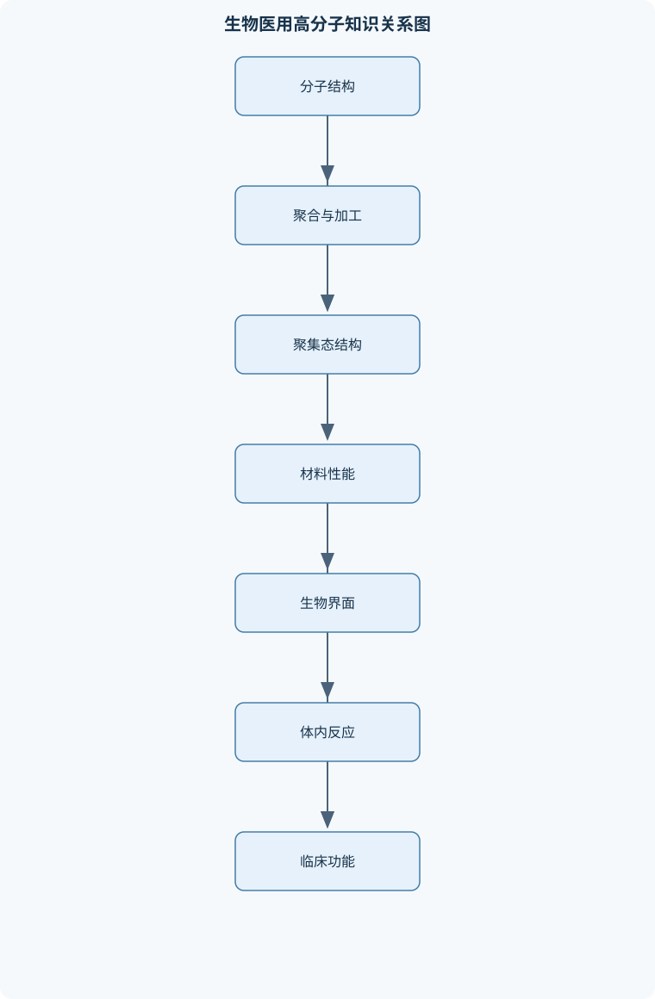
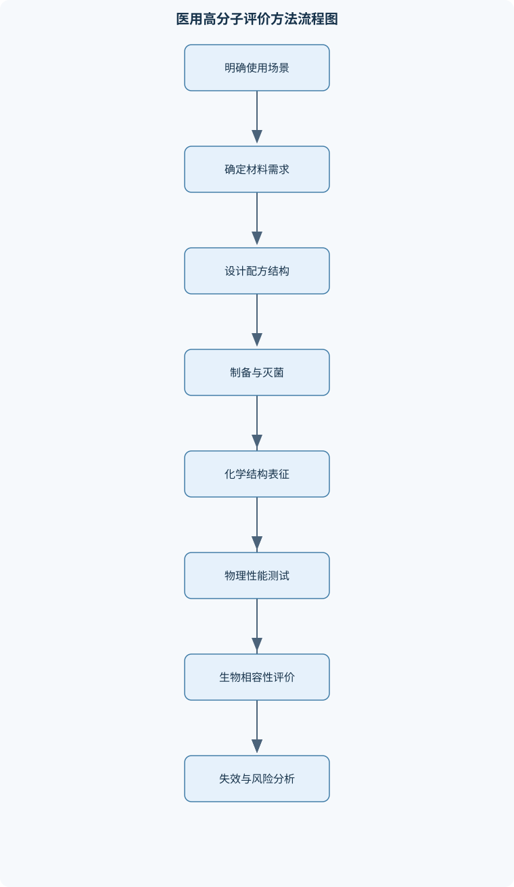

# 生物医用高分子

## 一、课程整体知识框架

### 课程边界与先修知识

本课程研究用于诊断、治疗、修复、替代、辅助或控制人体组织与生理功能的高分子材料，涵盖天然高分子、合成高分子、聚合物共混物、复合材料、表面改性材料、水凝胶、可降解材料及其加工、表征、体内作用和监管评价。课程边界包括高分子化学结构与聚集态、聚合反应、分子量与分布、力学与黏弹性、溶胀与扩散、降解与药物释放、界面与生物相容性、组织工程支架、医用器械应用及安全性评价；不以细胞生物学、药物剂量设计、临床诊疗或具体产品注册要求为主要内容。先修知识包括有机化学中的官能团、加成与消除、取代和重排反应，基础化学热力学与动力学，微积分和概率统计，材料力学基础，细胞与组织生物学，以及基本实验数据处理方法。





### 1. 研究对象、功能边界与设计逻辑

生物医用高分子是指能够用于诊断、治疗、修复、替代、辅助或控制人体组织与生理功能的高分子材料。其研究对象不只是“某一种聚合物”，而是由材料化学结构、聚集态、加工历史、表面状态、使用环境和人体反应共同构成的材料系统。植入材料强调长期力学稳定性、界面反应和降解安全性；体外诊断材料强调选择性识别、低非特异吸附、信号稳定性和批次一致性；药物递送材料则强调载药、保护、释放和体内清除之间的平衡。

材料设计通常遵循“分子结构—聚集态与加工—宏观性能—生物界面—临床功能”的因果链。主链柔顺性、侧基极性、分子量和交联程度会影响玻璃化转变、结晶、溶胀和力学性能；加工过程会改变取向、孔结构、残余应力和表面化学；这些因素进一步决定细胞黏附、血液接触、降解和组织整合。生物相容性并不等于“材料无毒”，还包括血液相容性、免疫相容性、组织相容性和降解产物相容性。功能相容性是材料完成特定功能的能力，例如支架应具有适当孔结构和力学支持，人工血管内表面应尽量降低血栓风险。可制造性则要求配方、工艺、灭菌、包装和批次质量能够稳定重复。

短期接触材料主要关注浸出物、表面刺激和瞬时功能；长期植入材料必须增加疲劳、磨损、慢性炎症、包膜形成和长期降解评价；可降解材料还必须使降解速率、组织形成速率、力学保持率和降解产物清除相互匹配。理想均匀、恒温、无菌的实验模型不能完全代表人体内存在的体液流动、蛋白覆盖、细胞更新、免疫反应、机械循环和个体差异。材料失效可能来自断裂、疲劳、磨损、脱层、降解过快、降解过慢、突释、堵塞、感染风险或界面炎症，因此风险控制要同时覆盖材料、工艺和使用场景。

### 2. 高分子化学结构与构象

高分子可用 $[-\mathrm{M}-]_n$ 表示，其中 $\mathrm{M}$ 是重复结构单元，$n$ 是平均聚合度，无量纲。主链决定基本化学稳定性和链段运动，侧基影响极性、疏水性、玻璃化转变和生物识别，端基可能影响降解、反应活性和毒性，交联点决定网络结构和溶胀限制。按主链组成可区分碳链高分子和含氧、氮、硅等元素的杂链高分子；芳香结构通常提高刚性和热稳定性，脂肪族结构通常具有较高柔顺性，但实际性能还受分子量、结晶度和取向影响。

链构型是化学键连接方式，构象是单键旋转产生的空间形态。旋转受位阻、共轭、氢键和环结构限制时，链段柔顺性下降。立构规整性、顺反结构和共聚序列会改变链的堆积方式及结晶能力。线型分子可发生缠结；支化结构会改变黏度和结晶；交联结构形成网络，通常提高尺寸稳定性和弹性回缩，但降低熔融加工能力。结构缺陷、残余单体、低聚物、催化剂和溶剂可能迁移至体液或组织，因此“聚合物主体无毒”不能推出“最终制品无风险”。

### 3. 聚合反应与分子量控制

链增长聚合通常先由自由基、阳离子或阴离子活性中心引发单体，再经连续加成延长链；典型步骤包括引发、链增长、链转移和终止。逐步增长聚合则由双官能或多官能分子逐步反应，分子量在高转化率阶段才显著增加。加成、缩合和开环描述反应形式，链增长和逐步增长描述增长机制，不能将两组分类简单等同。

数均分子量为

$$
M_n=\frac{\sum_iN_iM_i}{\sum_iN_i},
$$

其中 $N_i$ 是分子量为 $M_i$ 的分子数。重均分子量为

$$
M_w=\frac{\sum_iN_iM_i^2}{\sum_iN_iM_i},
$$

它对高分子量组分赋予更大权重。分子量分布指数为

$$
Đ=\frac{M_w}{M_n}.
$$

由于质量平方项会提高高分子量分子的贡献，正数分布满足 $M_w\geq M_n$，故 $Đ\geq1$；只有理想单分散极限才接近 $1$。$Đ$ 是样品分布宽度，不是某个分子的分子量。转化率为

$$
p=\frac{n_0-n_t}{n_0},
$$

其中 $n_0$ 和 $n_t$ 是初始及时间 $t$ 时可聚合官能团的物质的量，二者单位相同，$p$ 无量纲。

给电子基团通常有利于稳定阳离子链端，吸电子基团通常有利于稳定阴离子链端，但溶剂、对离子、温度、位阻、杂质和引发体系同样决定反应是否可行。共聚物的投料组成、瞬时组成和最终累计组成可能不同；嵌段共聚物通过不同链段的顺序组合获得分区结构，接枝共聚物则将支链连接到主链上。凝胶点是形成无限网络的临界转化率，具体数值取决于官能度、计量比和支化假设，不能只凭“已交联”三个字确定。

### 4. 天然高分子与可降解合成高分子

胶原、明胶、透明质酸、壳聚糖、海藻酸盐、纤维蛋白和丝素蛋白具有细胞外基质模拟、亲水、可加工或生物降解等特点。天然高分子通常具有较好的生物识别性，但来源、提取和纯化会导致批次差异；残余蛋白、内毒素、交联剂或免疫原性组分可能引起组织反应。天然来源不等于绝对安全。

聚乳酸、聚乙醇酸及其共聚物、聚己内酯、聚羟基脂肪酸酯、可降解聚碳酸酯和部分聚氨酯、聚醚、聚酯可通过结构调整获得不同的柔韧性、降解性和加工窗口。聚酯中的酯键可被水解：水先进入材料并切断分子链，使分子量下降；随后低分子产物扩散出去，才表现为明显质量损失。非晶区通常较易进水，结晶区堆积紧密、扩散较慢，因此结晶度会影响吸水、降解和力学保持率。降解可能由水解、酶解、氧化或表面侵蚀主导。整体水解常导致内部链断裂；表面侵蚀则表现为外层逐渐变薄。降解产物可能造成局部酸碱变化，其影响取决于生成量、扩散和组织清除，不能仅依据聚合物名称判断。

### 5. 聚集态、热性能与加工

玻璃化转变温度 $T_g$ 是非晶链段运动显著改变的温度范围，不是绝对固定常数；测量频率、升温速率、含水量和热历史都会影响结果。熔融温度对应晶区有序结构的破坏，结晶温度反映冷却或加热过程中的晶体形成。结晶区通常提高刚度、强度和阻隔性，非晶区通常有利于扩散和降解。取向可提高特定方向强度，但也会造成各向异性；退火可改变晶度和残余应力。

溶液浇铸适合不能稳定熔融或需制备薄膜的体系，但残余溶剂必须控制；熔融加工、注塑和挤出效率高，却可能引发热降解和剪切降解。静电纺丝可制备仿细胞外基质的纤维结构，冷冻干燥和相分离可形成多孔支架。三维打印要求材料在挤出、铺层和固化之间具有合适流变窗口；黏度太低会塌陷，太高会堵塞或导致层间结合不足。灭菌可能引发断链、交联、氧化、变色、分子量下降或力学变化，灭菌适配必须与材料、包装和预期保存期共同评价。

### 6. 水凝胶、溶胀与传质

水凝胶是由亲水高分子链形成的三维网络，可通过物理交联、化学交联或动态可逆键构建。溶剂进入网络时，混合熵和渗透压推动溶胀；网络弹性回缩抵抗无限膨胀，平衡含水量由二者竞争决定。溶胀比可定义为

$$
Q=\frac{m_{\mathrm{swollen}}}{m_{\mathrm{dry}}},
$$

其中湿态质量和干态质量必须明确测量条件；若采用体积比，应使用另一套定义，不能混用。

溶质传输可由扩散、对流和渗透共同决定。扩散系数 $D$ 的单位为面积每时间，表示浓度梯度驱动的迁移能力。网孔尺寸较大时，大分子更易通过；高交联密度通常降低溶胀和通透性，但提高尺寸稳定性。温度、pH和离子强度可改变电离程度、链构象和网络收缩，形成刺激响应水凝胶。高含水量有利于柔软和传质，却不保证强度；韧性、自修复、黏附和抗疲劳还取决于耗散机制和网络缺陷。脱水、循环压缩、长期溶胀和溶胀诱导裂纹会造成尺寸与性能漂移。

### 7. 生物界面、生物相容性与力学行为

材料进入体液后，蛋白质先吸附并可能发生构象变化，随后影响血小板、凝血、补体、巨噬细胞和细胞黏附。表面能、润湿性、粗糙度、电荷和化学基团会改变蛋白吸附，但接触角 $\theta$ 只能反映液滴润湿状态，不能单独等同于生物相容性。抗蛋白吸附、抗菌和抗血栓表面通常需要亲水层、带电层、接枝链或释放性功能的协同设计；涂层长期可能脱落、重排、被蛋白覆盖或因磨损失效。

应力为

$$
\sigma=\frac{F}{A},
$$

其中 $F$ 为载荷，单位为牛顿，$A$ 为受力面积，$\sigma$ 的单位通常为帕斯卡。工程应变为

$$
\varepsilon=\frac{\Delta L}{L_0},
$$

其中 $L_0$ 和 $\Delta L$ 均为长度，$\varepsilon$ 无量纲。在小应变、单轴和线性弹性条件下，弹性模量为 $E=\sigma/\varepsilon$；对大变形、软水凝胶或强黏弹性材料，不能直接把整条曲线斜率称为恒定模量。

黏弹性源于链段松弛、缠结和交联约束。短时间或高频率下链段来不及重排，材料更像弹性固体；长时间或低频率下链段能够松弛，更像黏性流体。Maxwell模型适合描述应力松弛，Kelvin模型适合描述延迟弹性，标准线性固体可同时表示瞬时弹性和部分长期松弛。动态测试中储能模量为 $G'$，损耗模量为 $G''$，损耗因子为

$$
\tan\delta=\frac{G''}{G'}.
$$

循环载荷会造成疲劳、裂纹扩展和性能衰减。组织力学匹配可降低应力遮挡，但“模量越接近越好”并不充分，还需考虑负荷方向、频率、湿态、界面固定和长期重塑。

### 8. 药物递送、组织工程与器械应用

药物释放可由扩散、溶胀、降解或多种机制共同控制。药物释放分数为 $M_t/M_\infty$，其中 $M_t$ 是时间 $t$ 已释放质量，$M_\infty$ 是平台阶段总可释放质量。零级模型强调单位时间释放量近似恒定，一级模型强调释放速率与剩余药物量相关，早期平板扩散近似下释放量常与 $t^{1/2}$ 相关；但该近似要求无显著对流、扩散系数近似恒定且早期扰动较小。突释、药物聚集、失活、灭菌损伤和体外—体内介质差异都可能使模型失效。

微球、纳米粒、胶束和脂质—高分子复合载体分别适用于不同溶解性、稳定性和释放需求。提高疏水相互作用可能增加疏水药物载量，却可能降低有效扩散并增加残留；提高孔隙率可加快释放，却可能导致突释和强度下降。组织工程支架需同时考虑孔隙率、孔径、连通性、渗透性、细胞黏附基序、力学支持和降解速率。孔隙率为

$$
\phi=\frac{V_{\mathrm{pore}}}{V_{\mathrm{total}}},
$$

但高孔隙率不代表高连通性。水凝胶适合模拟含水微环境，静电纺丝纤维适合模拟纤维基质，多孔块体适合提供体积支撑，致密膜则适合屏障功能。血管化、免疫调控和空间呈递需要与细胞、材料和力学微环境共同设计。

典型器械包括缝合线、导管、人工血管、骨修复材料、隐形眼镜、牙科树脂、组织胶、透析膜、过滤膜和诊断芯片。评价不能只看初始性能，还要覆盖无菌屏障、包装相容性、灭菌适配、批次一致性、可追溯性和失效分析。体外细胞结果不能直接替代动物或临床结论，人体资料也不能不加区别地外推到动物；不同物种的免疫、代谢、组织力学和血液反应存在边界。

## 二、章节和模块划分

### 核心知识覆盖清单

本清单用于检查正文是否覆盖本课程的主要知识模块：

- **生物医用高分子概论与材料设计逻辑**：生物医用高分子的定义、功能边界与分类、植入材料、体外诊断材料和药物递送材料的差异、材料结构、加工过程、性能和临床功能之间的因果链、生物相容性、功能相容性和可制造性的区别、短期接触、长期植入和可降解材料的设计约束、理想材料模型与真实人体环境的差异、材料失效模式与风险控制思路。
- **高分子化学结构与构象**：重复单元、主链、侧基、端基和交联点、碳链、杂链、芳香族和脂肪族高分子、官能团极性、氢键、离子作用和疏水相互作用、链构型、构象、旋转受限与柔顺性、立构规整性、顺反结构和序列结构、线型、支化、交联和网络结构、结构缺陷、残余单体和低聚物对安全性的影响。
- **聚合反应与分子量控制**：链增长聚合与逐步增长聚合的反应特征、自由基、阳离子和阴离子链增长机制、引发、链增长、链转移和终止步骤、加成聚合、缩合聚合与开环聚合、链转移剂、引发剂和催化体系的作用、数均分子量、重均分子量和分子量分布、转化率、聚合度和凝胶点的关系、共聚组成、嵌段共聚和接枝共聚、残留催化剂、溶剂和未反应单体的控制。
- **天然高分子与可降解合成高分子**：胶原、明胶、透明质酸、壳聚糖和海藻酸盐、纤维蛋白、丝素蛋白和多糖网络、聚乳酸、聚乙醇酸及其共聚物、聚己内酯、聚羟基脂肪酸酯和聚碳酸酯、聚氨酯、聚醚和聚酯的结构特点、水解、酶解、氧化和表面侵蚀降解、降解产物的局部酸碱变化与代谢清除、天然高分子的批次差异、免疫原性和纯化要求。
- **聚集态结构、热性能与加工**：玻璃化转变温度、熔融温度和结晶温度、结晶度、晶粒和非晶区对性能的影响、取向、退火和热历史、溶液浇铸、熔融加工、注塑和挤出、静电纺丝、冷冻干燥和相分离成孔、3D打印中的流变窗口与层间结合、热降解、剪切降解和加工残余应力、灭菌过程对分子量、颜色和力学性能的影响。
- **水凝胶、溶胀与传质**：物理交联、化学交联和动态交联网络、平衡溶胀、渗透压和网络弹性、亲水性、含水率与溶质分配、扩散、对流和渗透传输机制、网孔尺寸与大分子通透性的关系、刺激响应水凝胶的温度、pH和离子响应、凝胶强度、韧性、自修复和黏附性能、水凝胶脱水、疲劳和长期尺寸稳定性。
- **生物界面与生物相容性**：蛋白质吸附、构象变化和界面置换、血液接触材料中的血小板、凝血和补体反应、炎症、巨噬细胞反应和异物巨细胞形成、细胞黏附、铺展、迁移和分化、表面能、润湿性、粗糙度和电荷、抗蛋白吸附、抗菌和抗血栓表面、材料降解产物与局部组织反应、体外、离体、动物体内和临床评价的边界。
- **力学性能、黏弹性与疲劳**：应力、应变、弹性模量、强度和断裂伸长率、线性黏弹性与时间依赖响应、蠕变、应力松弛和动态力学分析、Maxwell模型、Kelvin模型和标准线性固体模型、储能模量、损耗模量和损耗因子、断裂韧性、裂纹扩展和缺口敏感性、循环载荷、疲劳寿命和环境加速老化、组织力学匹配与应力遮挡效应。
- **药物递送与控释系统**：扩散控制、溶胀控制和降解控制释放、微球、纳米粒、胶束、脂质-高分子复合载体、药物包封率、载药量和释放曲线、亲水药物与疏水药物的载体选择、零级、一级和扩散近似释放模型、局部递送、靶向递送和刺激响应释放、突释、聚集、失活和灭菌对药物的影响、释放介质、采样方式和体外体内相关性。
- **组织工程支架与再生医学材料**：支架的孔隙率、孔径、连通性和渗透性、细胞黏附基序与细胞外基质模拟、支架力学支持与组织重塑的平衡、可降解支架的降解速率匹配、水凝胶、纤维支架和多孔块体的比较、生物活性因子固定、释放和空间呈递、血管化、免疫调控和组织整合、细胞-材料-力学微环境的耦合。
- **医用高分子表征与质量评价**：核磁共振、红外和拉曼光谱的结构鉴定、凝胶渗透色谱测定分子量与分布、差示扫描量热法和热重分析、X射线衍射和偏光方法分析结晶结构、接触角、表面能和表面化学分析、拉伸、压缩、剪切和动态力学测试、溶胀、降解、质量损失和产物分析、细胞毒性、血液相容性和炎症评价、实验重复、对照组、误差分析和结果边界。
- **医用器械应用、风险与转化**：缝合线、导管、人工血管和骨修复材料、隐形眼镜、接触镜和眼科水凝胶、可吸收植入物与长期植入物、牙科树脂、组织胶和封闭材料、透析膜、过滤膜和诊断芯片材料、无菌屏障、包装相容性和灭菌适配、材料风险、工艺风险和使用场景风险、批次一致性、可追溯性和失效分析、体外性能与临床有效性之间的转化限制。


### 1. 模块组织与学习主线

课程按“化学结构与聚合—聚集态与加工—溶胀、降解和传质—力学与界面—递送和组织工程—表征、质量与转化”组织。每个模块既讨论理想模型，也指出真实材料的缺陷、误差和适用边界。

### 2. 代表性分析流程

#### 2.1 分子量数据处理流程

输入为分子量—信号数据。先扣除基线并排除溶剂峰，再依据校准关系得到各分子量区间，计算 $M_n$、$M_w$ 和 $Đ$，最后检查积分范围、校准材料适用性和重复性。对 $N$ 个离散数据点进行一次遍历，计算部分的时间复杂度为 $O(N)$；复杂度不包括仪器采集和校准建模。

```python
# Python：由离散分子数数据计算 Mn、Mw 和 Đ
molar_masses = [1.0e4, 2.0e4, 5.0e4]  # g/mol
numbers = [80, 15, 5]                  # 相对分子数，比例即可

total_number = sum(numbers)
mn = sum(n * m for n, m in zip(numbers, molar_masses)) / total_number
mw = sum(n * m * m for n, m in zip(numbers, molar_masses)) / \
     sum(n * m for n, m in zip(numbers, molar_masses))
dispersity = mw / mn

print(f"Mn = {mn:.2f} g/mol")
print(f"Mw = {mw:.2f} g/mol")
print(f"Đ = {dispersity:.3f}")
```

不变量是所有分子数和分子量均为正值，且 $M_w\geq M_n$。若结果违反该关系，应检查单位、权重定义或数据积分错误。该流程不能解决校准聚合物与待测样品化学组成差异造成的系统误差。

#### 2.2 水凝胶溶胀评价流程

输入为干态质量、不同时间的湿态质量、温度、介质组成和样品尺寸。统一样品尺寸和吸液时间，取出后用相同方式去除表面液体，计算各时刻 $Q$，绘制溶胀曲线；连续多个时间点的变化小于预设实验误差时，可判定接近平衡。需同时记录盐浓度、pH和温度，因为固定电荷、渗透压和网络弹性都会改变结果。排错重点包括表面液体未去除、样品尚未达到平衡、样品破裂以及湿质量和体积定义混用。

#### 2.3 药物释放评价流程

输入为时间点、样品浓度、取样体积、补液体积、载体质量和初始药物量。先依据取样和补液记录修正累计药物量，再计算 $M_t/M_\infty$，绘制释放曲线，比较零级、一级和扩散近似模型。评价不能只看相关系数，还要观察残差是否有系统趋势，并判断是否存在突释、平台、药物降解或载体侵蚀。终止条件可以是达到预定观察期或连续时间点释放变化低于测定误差。

#### 2.4 材料失效分析流程

输入为断裂位置、颜色变化、质量损失、分子量、力学保持率、灭菌记录和组织反应。先区分加工缺陷、灭菌损伤、机械疲劳、降解和界面反应，再用对照样品确定因果关系。若断裂前分子量大幅下降，优先考虑链断裂；若分子量变化小但表面出现裂纹，需检查疲劳、磨损和残余应力；若周围组织炎症明显，应进一步检测浸出物、颗粒和降解产物。结论必须说明直接证据、间接证据及尚不能由现有数据推出的部分。

### 3. 代表性例题

#### 例题一：分子量与分散指数

**题干：** 某样品含 $1.0\times10^4$、$2.0\times10^4$ 和 $5.0\times10^4\ \mathrm{g/mol}$ 的分子，分子数比为 $80:15:5$，求 $M_n$、$M_w$ 和 $Đ$。

**分析：** $M_n$ 按分子数加权，$M_w$ 按分子数与分子量平方加权。

**解答：**

$$
M_n=\frac{80(10^4)+15(2\times10^4)+5(5\times10^4)}{100}
=1.55\times10^4\ \mathrm{g/mol}.
$$

$$
M_w=\frac{80(10^4)^2+15(2\times10^4)^2+5(5\times10^4)^2}
{80(10^4)+15(2\times10^4)+5(5\times10^4)}
\approx2.26\times10^4\ \mathrm{g/mol}.
$$

因此 $Đ\approx1.46$。验证时应满足 $M_w\geq M_n$。若将 $M_w$ 错算为普通算术平均，会低估少量高分子量组分的影响。

**变式：** 若高分子量组分比例增加，$M_w$ 通常比 $M_n$ 增长更明显，因为其平方权重更大。

#### 例题二：聚酯降解顺序

**题干：** 两种聚酯分别为高结晶度和低结晶度样品。浸泡后前者质量变化很小但分子量下降，后者较快出现质量损失，解释原因。

**分析：** 水先进入较易扩散的区域并切断酯键；质量损失需要低分子产物扩散离开。结晶区限制水进入和产物迁移。

**解答：** 高结晶度样品可能已经发生内部链断裂，但低分子产物仍滞留，因此表现为分子量先下降、质量变化较小。低结晶度样品水扩散和产物外逸较快，质量损失更早出现。不能仅凭质量保持率判断力学性能，因为链断裂可能先使强度显著下降。

**变式：** 若材料发生表面侵蚀，可能先观察到表面厚度减少，而内部平均分子量变化不明显。

#### 例题三：水凝胶溶胀

**题干：** 干态水凝胶质量为 $0.20\ \mathrm{g}$，在低盐介质中平衡湿质量为 $4.20\ \mathrm{g}$，在高盐介质中为 $2.20\ \mathrm{g}$，求两种条件下的 $Q$ 并解释差异。

**解答：**

$$
Q_{\mathrm{low}}=\frac{4.20}{0.20}=21,
\qquad
Q_{\mathrm{high}}=\frac{2.20}{0.20}=11.
$$

低盐条件下固定电荷产生较大的渗透驱动力；高盐条件下离子屏蔽增强，网络内外渗透压差减小，溶胀受到抑制。若样品表面未擦干，$Q$ 会被高估；若高盐同时改变交联键稳定性，还不能只用离子屏蔽解释全部结果。

#### 例题四：黏弹性模型判断

**题干：** 材料施加阶跃应变后，应力立即出现较高值，随后逐渐下降但长期保持非零平台，判断适合的模型。

**分析：** 需要同时解释瞬时弹性、有限应力松弛和长期残余弹性。

**解答：** 标准线性固体模型比单纯 Maxwell 或 Kelvin 模型更合适。Maxwell模型可描述应力松弛但长期应力趋近于零；Kelvin模型不能产生理想瞬时应变；标准线性固体可包含平行或串联的弹簧—黏壶组合，从而表现出瞬时响应、有限松弛和长期平台。模型参数必须在给定温度、频率和应变范围内解释，不能把拟合参数直接当作材料在所有环境下的常数。

#### 例题五：药物释放计算

**题干：** 载体初始可释放药物为 $10\ \mathrm{mg}$。某时间点样品中累计修正释放量为 $3.5\ \mathrm{mg}$，求释放分数；若前两小时释放 $2.8\ \mathrm{mg}$，之后四小时仅释放 $0.7\ \mathrm{mg}$，如何判断释放特征？

**解答：**

$$
\frac{M_t}{M_\infty}=\frac{3.5}{10}=0.35.
$$

前两小时占总释放量的 $80\%$，提示明显突释或表面药物快速扩散；后续阶段释放速率降低，可能受扩散路径增长、聚合物溶胀或降解控制。必须检查取样体积和补液修正，否则累计释放量会被低估。模型选择应结合残差和机制，不能仅因曲线“看起来像”某种模型就下结论。

### 4. 实验与项目任务

#### 4.1 水凝胶溶胀与力学关联实验

**输入数据：** 不同交联密度水凝胶的干态质量、湿态质量、样品尺寸、介质盐浓度、平衡时间和压缩载荷。

**步骤：**  
1. 统一制备尺寸并记录干态质量。  
2. 在规定温度和介质中分时取样，去除表面液体后称重。  
3. 计算 $Q$，判断是否达到平台。  
4. 对平衡样品进行压缩或剪切测试，比较溶胀和模量。  
5. 将交联密度、溶胀比和力学性能关联分析。

**评价标准：** 质量称量重复性、平台判定合理性、$Q$ 定义一致性、力学测试边界条件清楚，并能解释高溶胀与低强度可能同时出现。

**排错方法：** 若重复样品差异大，检查样品厚度、表面残液、交联不均和介质温度；若质量持续增加，不能提前宣称达到平衡；若压缩曲线异常，检查样品滑移、尺寸测量和含水状态。

#### 4.2 可降解支架综合项目

**输入数据：** 材料配方、孔隙率、孔径与连通性、初始力学性能、不同时间的质量、分子量、pH、降解产物和细胞结果。

**步骤：**  
1. 根据目标组织的力学和输运需求提出孔结构范围。  
2. 选择加工方式并记录热历史、溶剂和灭菌条件。  
3. 并行测定质量损失、分子量、吸水率、pH和力学保持率。  
4. 区分整体水解、表面侵蚀和酶促降解。  
5. 将支架降解时间与预期组织形成时间比较，并提出风险控制方案。

**评价标准：** 不把孔隙率当作连通性，不把细胞存活率直接当作临床安全性；需同时报告结构、力学、降解和界面证据，并明确体外结果的边界。

**排错方法：** 若质量变化小但强度骤降，应检查分子量和裂纹；若细胞结果差，需区分孔结构不足、残余溶剂、灭菌损伤、浸出物和表面化学原因；若降解产物使局部 pH 明显变化，应增加缓冲能力和产物清除分析。

### 5. 易错点、笔试与面试内容

#### 5.1 具体易错点

1. 将链增长聚合等同于加成聚合，忽略分类维度不同。  
2. 认为所有含双键单体都能在相同条件下进行三类活性聚合。  
3. 将 $Đ$ 当作单个分子的分子量。  
4. 只用平均分子量预测强度，忽略结晶、取向、交联和残余溶剂。  
5. 把 $T_g$ 当作与频率、含水量无关的固定常数。  
6. 认为含水量越高，水凝胶力学性能越好。  
7. 用接触角单独判断生物相容性。  
8. 把体外细胞存活率直接等同于长期体内安全性。  
9. 只测质量损失，不测分子量和力学保持率。  
10. 忽略药物释放中的取样损失和补液修正。  
11. 把孔隙率与孔连通性混为一谈。  
12. 认为灭菌只影响微生物，不影响高分子结构。  
13. 把天然来源等同于无免疫原性。  
14. 认为降解越快越好，忽略组织形成和力学需求。  
15. 只依据拟合相关系数选择释放模型。  
16. 认为表面改性初始有效就能长期稳定。  

#### 5.2 典型笔试问题及解答思路

1. **比较 $M_n$ 与 $M_w$。** 先写定义，再说明 $M_w$ 对高分子量组分权重更大，并验证 $M_w\geq M_n$。  
2. **判断聚合机理。** 观察乙烯基双键、环状结构、官能团数目和副产物，区分活性链端连续增长与逐步反应。  
3. **解释聚酯降解。** 按“进水—酯键断裂—分子量下降—低分子扩散—质量损失”建立时间顺序。  
4. **解释高结晶度对降解的影响。** 比较晶区与非晶区的堆积和扩散，不作绝对化判断。  
5. **计算水凝胶溶胀比。** 统一湿质量、干质量和表面液体处理方式，再讨论离子强度与网络弹性。  
6. **选择黏弹性模型。** 根据是否有瞬时弹性、应力松弛、长期平台和蠕变特征判断。  
7. **计算累计释放量。** 逐点修正取样和补液，最后计算 $M_t/M_\infty$。  
8. **设计组织工程支架。** 同时讨论孔结构、力学支持、降解速率、细胞界面和血管化，不能只选“高孔隙率”。  

#### 5.3 典型面试问题、参考答案与追问要点

1. **如何判断一种可降解聚酯是否发生水解？**  
   参考答案：并行观察分子量、质量、吸水率、pH和力学保持率；分子量下降早于质量损失通常支持内部链断裂。  
   追问要点：如何排除表面侵蚀、酶促作用和灭菌造成的断链。

2. **为什么高含水量水凝胶仍可能很脆？**  
   参考答案：高含水量降低链间有效相互作用，若网络均匀且耗散机制不足，裂纹会快速扩展。  
   追问要点：引入双网络、动态键或纳米增强后，如何区分强度提高和韧性提高。

3. **接触角小是否代表材料一定更安全？**  
   参考答案：不代表。蛋白构象、表面电荷、粗糙度、可浸出物和血液反应也会决定相容性。  
   追问要点：如何补充蛋白吸附、血液相容性和细胞实验。

4. **如何减少药物突释？**  
   参考答案：降低表面药物比例、优化粒径和孔结构、增强药物—载体相互作用或增加包覆层，但需防止载药量下降和药物失活。  
   追问要点：怎样通过释放介质和体外—体内相关性验证调整有效。

5. **灭菌后分子量下降，如何处理？**  
   参考答案：比较未灭菌对照、不同灭菌方式和包装条件，检测分子量、颜色、力学及浸出物，再选择适配工艺。  
   追问要点：如何判断断链、氧化和交联的差别。

6. **支架孔隙率越高越好吗？**  
   参考答案：不是。孔隙率提高有利于细胞进入和传质，却会降低承载截面积；还必须考察孔连通性、孔径分布和力学保持率。  
   追问要点：如何在目标组织环境下确定取舍。

7. **体外细胞实验阳性，能否说明材料可植入？**  
   参考答案：不能。体外实验主要用于筛查细胞毒性和初步界面行为，仍需结合血液、炎症、降解、动物和使用场景评价。  
   追问要点：如何设置阴性、阳性和材料浸提液对照。

8. **植入后发生断裂和炎症，如何建立失效树？**  
   参考答案：从加工缺陷、灭菌损伤、疲劳、降解、磨损颗粒、浸出物和界面反应逐层排查，并用材料表征和组织观察对应验证。  
   追问要点：如何区分“断裂导致炎症”和“炎症加速降解”的先后关系。

#### 5.4 岗位关联

医用高分子材料研发工程师需要根据结构、加工和界面数据筛选配方，产出材料规格和验证报告，验收重点是性能重复性、风险闭环和使用场景匹配。聚合工艺工程师负责单体转化率、分子量、残余单体、催化剂和批次稳定性，验收包括工艺窗口和批间差异。组织工程支架工程师需要整合孔结构、力学、降解和细胞结果，产出候选支架及失效风险清单。药物递送工程师负责载药量、包封率、释放曲线和灭菌后稳定性，验收应包括取样修正、模型适用性和突释控制。表征工程师负责光谱、热分析、色谱、力学和降解数据，必须报告重复数、误差和结论边界。生物相容性评价工程师根据接触部位和接触时间设计细胞、血液、炎症及组织反应评价，不能用单一体外结果替代完整风险判断。质量与验证工程师则关注批次一致性、包装、灭菌、可追溯性和失效分析，最终产出应能把材料性能与实际使用风险对应起来。

## 三、核心概念的详细解释

### 3.1 生物医用高分子的设计对象与约束

生物医用高分子不是单纯由某种聚合物组成的化学品，而是由材料组成、加工历史、表面状态、使用环境和人体反应共同决定的材料系统。材料设计的基本因果链可表示为“分子结构—聚集态与加工—宏观性能—生物界面—使用功能”。例如，聚乳酸的酯键决定其可水解性；分子量、结晶度和孔结构进一步影响水进入材料的速度、链断裂速率和力学保持率；最终表现为植入物在体内能否维持支撑以及降解后是否产生局部酸化。

植入材料、体外诊断材料和药物递送材料的约束不同。植入材料需要同时考虑力学载荷、磨损、疲劳、组织包膜、血液或组织接触以及长期降解。体外诊断材料通常更强调表面选择性、低非特异吸附、信号稳定性、尺寸精度和批次一致性。药物递送材料则需要在药物包封、载药量、保护药物活性、释放速率、体内清除和灭菌适配之间取得平衡。某种材料在一个场景中表现良好，并不能推出其适用于其他场景。

生物相容性、功能相容性和可制造性是三个不同概念。生物相容性关注材料及其浸出物、降解产物和颗粒引起的细胞、血液、免疫和组织反应；功能相容性关注材料能否完成特定功能，例如人工血管的通血、支架的细胞进入和药物载体的可控释放；可制造性关注材料能否通过稳定、可重复、可灭菌和可追溯的工艺生产。材料无明显细胞毒性，不代表其具有足够疲劳寿命；支架孔隙率合适，也不代表其灭菌后仍能保持孔结构。

人体环境与理想模型存在差异。体外试验常采用恒温、静止、成分相对明确的介质，而人体内存在蛋白质竞争吸附、液体流动、机械循环、免疫细胞、酶、氧化环境和个体差异。因此，体外结果主要用于机制分析和风险筛查，不能单独替代长期体内评价。材料失效还可能具有时间顺序：灭菌造成分子链断裂，随后疲劳加速断裂；降解产生酸性小分子，局部酸化又可能加速进一步水解；表面涂层初始降低蛋白吸附，但在体内可能因磨损或蛋白覆盖而失去原有表面性质。

### 3.2 分子结构、构象与聚集态

高分子可表示为 $[-\mathrm{M}-]_n$。其中 $\mathrm{M}$ 为重复结构单元，$n$ 为平均聚合度，无量纲。主链决定链段运动和基本化学稳定性，侧基影响极性、疏水性、空间位阻、玻璃化转变和生物界面，端基可能参与降解或引起浸出风险，交联点则把多个链段连接成网络。

碳链高分子通常具有较好的水解稳定性，但其具体性能仍受侧基和结晶度影响；含氧、含氮等杂链高分子可能具有更强的极性和氢键作用，也可能含有易水解的酯键、酰胺键或碳酸酯键。芳香环、共轭结构和环状结构通常限制旋转、提高刚性；脂肪族柔性链段通常提高柔顺性，但也可能降低耐热性和尺寸稳定性。极性基团能够增强与水的相互作用，但极性提高并不必然带来更好的血液相容性，因为蛋白吸附数量和构象变化还受表面电荷、粗糙度和动态重排影响。

构型是化学键连接方式，构象是单键旋转产生的空间形态。构型改变通常需要断键或发生化学反应，而构象可以通过热运动改变。链段是否柔顺，取决于旋转势垒、位阻、氢键、离子作用和主链共轭。线型高分子可以通过链缠结提高熔体强度；支化会改变黏度、结晶和溶解行为；交联网络具有尺寸稳定性和弹性回缩，但通常不能像线型高分子那样重新熔融加工。

结晶区和非晶区共同构成许多半结晶聚合物。结晶区堆积较紧密，通常提高强度、模量和阻隔性能；非晶区有利于链段运动、溶剂进入和降解。结晶度提高可能降低吸水率和降解速率，但也可能使材料变脆或延长降解时间。加工中的冷却速度、拉伸取向、退火和溶剂挥发都会改变晶体尺寸、取向和残余应力，因此同一种化学组成不一定具有相同的生物医用性能。

### 3.3 聚合反应、共聚与分子量控制

链增长聚合的特征是活性链端连续加成单体。以乙烯基单体为例，引发剂先与碳碳双键反应，形成自由基、正离子或负离子链端；链端随后与另一单体反应，重复发生链增长。自由基聚合通常包括引发、增长、链转移和终止。阳离子聚合要求链端正离子得到稳定，给电子取代基、合适溶剂和对离子可能有利；阴离子聚合则要求负离子链端稳定，吸电子取代基在某些条件下有利。实际可行性还受位阻、杂质、水分、温度和引发体系影响，不能仅根据一个取代基作绝对判断。

逐步增长聚合通常由双官能或多官能单体逐步反应。低聚物之间也能继续反应，因而分子量往往在高转化率阶段才显著上升。缩合聚合可能生成水、醇或其他小分子，但“缩合”描述的是反应形式，“逐步增长”描述的是增长机制；开环聚合也可能表现为链增长机制。因而不能把链增长简单等同于加成，也不能把逐步增长简单等同于缩合。

共聚物的投料组成、瞬时组成和最终累计组成可能不同。若两种单体反应活性差异明显，活性较高的单体会先被消耗，使后续反应体系的组成发生漂移。嵌段共聚物在同一链上形成不同化学区段，接枝共聚物则以主链和侧链的形式组合不同组分；它们可能形成微相分离结构，从而兼具亲水、疏水、柔性和强度等性能。

残余单体、引发剂分解物、催化剂、溶剂和低聚物必须作为最终制品风险的一部分评价。聚合物主体的细胞毒性较低，不代表残余小分子同样安全。纯化、干燥、真空处理和后处理能够降低残留，但必须通过化学分析和浸提液评价确认，而不能仅凭工艺推断。

### 3.4 天然高分子、可降解高分子与降解机制

胶原、明胶、透明质酸、壳聚糖、海藻酸盐、纤维蛋白和丝素蛋白具有天然生物来源和一定的细胞识别优势，但天然来源不等同于绝对安全。原料批次、提取方法、纯化程度、内毒素、免疫原性和交联残留都会影响最终性能。天然高分子常需要通过交联、共混、接枝或复合增强其湿态强度和尺寸稳定性。

聚乳酸、聚乙醇酸、聚己内酯、聚羟基脂肪酸酯和部分聚碳酸酯含有可水解结构。聚酯水解通常经历三个阶段：水进入材料并使酯键断裂；分子链长度下降而整体质量可能变化不大；低分子产物扩散离开后才出现明显质量损失。若材料为厚块体，内部产生的酸性产物可能扩散受限，造成内部酸化和自催化水解。高结晶区不易进水，非晶区通常先发生水解，因此结晶度会影响降解空间分布。

降解还可能由酶促作用、氧化或表面侵蚀主导。整体水解常表现为材料内部同时发生分子量下降；表面侵蚀则主要表现为外层厚度逐渐减少。仅测质量损失不能确定机制，必须联合测量分子量、吸水率、形貌、降解产物、pH和力学保持率。

### 3.5 聚集态、加工与水凝胶

玻璃化转变温度 $T_g$ 是非晶区链段运动明显增强的温度范围，不是严格固定的单点常数。测量频率、升温速率、含水量、分子量、增塑剂和热历史都会改变其表观位置。熔融温度 $T_m$ 与晶体结构有关，结晶温度反映冷却过程中晶体形成的温度范围。水和增塑剂通常增加链段运动，使 $T_g$ 降低，但可能同时削弱湿态强度。

溶液浇铸适合不能稳定熔融或需要较低加工温度的材料，但溶剂残留和干燥收缩必须评价；熔融加工、注塑和挤出效率较高，却可能引起热降解和剪切降解；静电纺丝可形成纤维网络，但纤维直径、取向和残余溶剂会影响细胞行为；冷冻干燥和相分离可制备多孔支架，但孔结构可能存在梯度和低连通区域。三维打印必须同时满足可挤出、可成形、层间结合和成形后强度要求，流动性过低会堵塞，流动性过高则会塌陷。

水凝胶是由亲水链段和交联网络构成的含水材料。物理交联依赖氢键、疏水缔合、结晶区或离子作用，通常具有可逆性；化学交联通过共价键形成稳定网络；动态交联利用可逆共价键或配位作用，使材料具备自修复或应力耗散能力。水进入网络产生混合熵和渗透驱动力，交联网络的弹性回缩抵抗继续膨胀，达到平衡时形成有限溶胀。高含水量有利于传质和柔软性，却可能降低承载和抗疲劳能力；双网络、牺牲键、纳米增强和动态键可提高韧性，但可能改变降解和细胞界面。

### 3.6 生物界面、力学行为与应用评价

材料接触体液后，通常先发生蛋白吸附，而不是细胞直接识别材料本体。蛋白质的吸附数量、取向和构象变化会影响血小板、补体、巨噬细胞和细胞黏附。表面能、润湿性、电荷、粗糙度和化学基团能够调节这一过程，但接触角 $\theta$ 只能反映液滴润湿状态，不能单独预测生物相容性。抗蛋白吸附、抗菌和抗血栓表面还必须考察长期稳定性、磨损、蛋白覆盖和灭菌后变化。

应力、应变和黏弹性决定材料在组织环境中的力学响应。高分子链在短时间或高频率下不能充分重排，材料更接近弹性固体；在长时间或低频率下，链段逐步松弛，黏性行为增加。蠕变是恒定应力下应变随时间增加，应力松弛是恒定应变下应力随时间下降。组织工程支架必须在支撑能力和组织重塑之间平衡：孔隙率和连通性有利于细胞迁移、营养运输和血管化，但通常降低承载截面积；模量过高可能造成应力遮挡，过低则不能维持空间结构。

药物递送可按控制机制分为扩散控制、溶胀控制和降解控制。亲水药物适合水相通道或亲水网络，疏水药物可使用疏水域、胶束、纳米颗粒或复合载体。提高药物—载体相互作用可能提高载药量，却也可能降低扩散系数并增加残留；增加孔隙率可加快释放，却可能产生突释和力学下降。体外释放试验必须明确介质体积、采样体积、补液方式、搅拌条件、温度和药物稳定性，否则累计释放量不可直接比较。

### 3.7 典型表征与证据边界

红外和拉曼光谱主要用于官能团和化学键环境分析；核磁共振可用于重复结构、端基和溶液状态结构鉴定；凝胶渗透色谱用于分子量分布，但结果依赖溶解性、校准关系和检测器；差示扫描量热法可分析 $T_g$、熔融和结晶，热重分析可观察热失重过程；X射线衍射和偏光方法可辅助判断晶体结构和取向；接触角反映润湿性；拉伸、压缩、剪切和动态力学测试反映不同加载方式下的力学行为。

表征结论必须区分直接证据和间接证据。例如，分子量下降是链断裂的直接支持证据，而颜色变深只能间接提示氧化、热历史或杂质变化。细胞存活率下降可提示浸出物或材料界面风险，但不能直接确定体内炎症机制。任何结论都应注明测试条件、重复数、误差、对照和适用边界。

## 四、重要定义、公式、定理和推导

### 专业审校补充：关键定义与适用边界

“生物降解”与“生物吸收”不是同义概念。生物降解是高分子主链或侧基通过水解、酶解、氧化等过程发生化学断裂，产物可以仍然滞留于材料周围；生物吸收则要求降解产物或溶解片段能够被组织液带走、被细胞处理或进入机体代谢清除。因此，材料在体外介质中质量下降，不能直接证明其在体内能够安全吸收。评价可降解植入材料时，至少应并行观察分子量、质量损失、尺寸变化、力学保持率、局部酸碱变化、颗粒形成和组织反应。聚酯材料可能先发生分子量下降而质量基本不变；若低分子产物扩散受限，局部酸性物质积累，可能加速内部水解并诱发炎症。该判断适用于具有可断裂化学键的材料，不适用于把不可降解聚合物的磨损碎片简单称为“降解产物”的情形；后者更接近物理破碎和颗粒清除问题。


### 4.1 分子量统计量及其推导

数均分子量为

$$
M_n=\frac{\sum_iN_iM_i}{\sum_iN_i},
$$

其中 $N_i$ 为分子量为 $M_i$ 的分子数，$M_i$ 的单位通常为 $\mathrm{g\,mol^{-1}}$。重均分子量为

$$
M_w=\frac{\sum_iN_iM_i^2}{\sum_iN_iM_i}.
$$

数均分子量按分子数加权，重均分子量按分子质量贡献加权，因此高分子量组分会对 $M_w$ 产生更大影响。令分子数总和为 $N=\sum_iN_i$，则有

$$
M_n=\frac{1}{N}\sum_iN_iM_i.
$$

由于加权平均中较大 $M_i$ 被赋予更高权重，正数分布满足

$$
M_w\geq M_n.
$$

因此分子量分布指数

$$
Đ=\frac{M_w}{M_n}
$$

满足 $Đ\geq1$。若所有分子质量完全相同，则 $M_w=M_n$，$Đ=1$；实际聚合物通常存在链长差异，故 $Đ>1$。该结论不能用于判断单个分子的分子量，也不能单独预测强度，因为结晶度、交联、取向和残余溶剂同样影响性能。

**例题一：分子量统计。**某样品含 $100$ 个分子量为 $10\,000$ 的分子和 $10$ 个分子量为 $100\,000$ 的分子。求 $M_n$、$M_w$ 和 $Đ$。

**分析与解答：**

总分子数为 $110$，所以

$$
M_n=\frac{100\times10000+10\times100000}{110}
=\frac{2\,000\,000}{110}
\approx18\,182\ \mathrm{g\,mol^{-1}}.
$$

重均分子量为

$$
M_w=
\frac{100\times10000^2+10\times100000^2}
{100\times10000+10\times100000}
=\frac{200\,000\,000\,000}{2\,000\,000}
=100\,000\ \mathrm{g\,mol^{-1}}.
$$

因此

$$
Đ=\frac{100000}{18182}\approx5.50.
$$

少量高分子量组分显著提高了 $M_w$，说明 $M_w$ 对长链特别敏感。验证条件是 $M_w\geq M_n$ 且 $Đ>1$，结果符合分子量分布的一般性质。若将高分子量分子数量减少为零，体系变为单分散理想模型，$Đ$ 将降为 $1$。

### 4.2 转化率、聚合度与凝胶形成

可聚合官能团转化率定义为

$$
p=\frac{n_0-n_t}{n_0},
$$

其中 $n_0$ 和 $n_t$ 分别为初始时刻和时刻 $t$ 的可聚合官能团物质的量，$p$ 无量纲，范围为 $0\leq p\leq1$。当 $p=0.90$ 时，表示初始官能团中有 $90\%$ 已反应，而不是表示聚合物质量增加了 $90\%$。

逐步增长体系中，线型双官能单体的数均聚合度在理想等当量条件下可近似写为

$$
X_n=\frac{1}{1-p}.
$$

该关系说明高分子量需要非常高的转化率。例如 $p=0.90$ 时，$X_n=10$；$p=0.99$ 时，$X_n=100$。其适用条件包括官能团反应活性近似相同、无明显环化、无单官能杂质、计量比接近相等且反应为理想逐步增长。存在单官能杂质或计量失衡时，聚合度会明显降低。

含有平均官能度大于二的单体或交联剂时，体系可能形成无限网络。达到凝胶点后，体系出现不溶、不熔的网络部分；凝胶点不是固定常数，其临界转化率取决于官能度分布、计量比、环化和支化假设。工业配方中常需通过流变突变、溶胶—凝胶分离或溶胀实验判断凝胶形成，而不能只依据理论值。

### 4.3 应力、应变和黏弹性模型

应力定义为

$$
\sigma=\frac{F}{A},
$$

其中 $F$ 为载荷，单位为牛顿，$A$ 为受力面积，$\sigma$ 的单位为帕斯卡。工程应变定义为

$$
\varepsilon=\frac{\Delta L}{L_0},
$$

其中 $L_0$ 为初始长度，$\Delta L$ 为长度变化，$\varepsilon$ 无量纲。在线性弹性、小应变和单轴受力近似下，

$$
E=\frac{\sigma}{\varepsilon},
$$

其中 $E$ 为弹性模量。若材料存在明显颈缩、大变形、孔结构塌陷或时间依赖行为，不能把整条非线性曲线的应力除以应变都称为弹性模量。

Maxwell模型由弹簧与黏壶串联构成，适合描述应力松弛。阶跃应变后，其应力可写为

$$
\sigma(t)=\sigma_0\exp\left(-\frac{t}{\tau}\right),
$$

其中 $\sigma_0$ 为初始应力，$\tau=\eta/E$ 为松弛时间，$\eta$ 为黏度，单位为 $\mathrm{Pa\,s}$，$E$ 为弹簧模量。该模型长期应力趋近于零，但不能描述具有长期静态弹性的平台。

Kelvin模型由弹簧与黏壶并联构成，适合描述延迟弹性和蠕变，但在理想阶跃应变下不能产生瞬时应变。标准线性固体模型由一个Maxwell元件与弹簧组合而成，既能描述瞬时弹性，也能描述部分应力松弛，常用于更接近真实高分子材料的近似。

动态力学测试中，储能模量 $G'$ 表示周期变形中可恢复的弹性能，损耗模量 $G''$ 表示黏性耗散，损耗因子为

$$
\tan\delta=\frac{G''}{G'}.
$$

$\tan\delta$ 越大，说明在该频率和温度下黏性耗散相对越明显，但不能脱离测试频率、应变幅值和温度比较不同材料。

**例题二：应力松弛。**某水凝胶在阶跃应变后初始应力为 $20\ \mathrm{kPa}$，松弛时间为 $50\ \mathrm{s}$。求 $t=100\ \mathrm{s}$ 时的应力。

$$
\sigma(100)=20\exp\left(-\frac{100}{50}\right)
=20e^{-2}\approx2.71\ \mathrm{kPa}.
$$

该计算只适用于单一指数松弛、线性黏弹性和恒定温度等假设。若实验曲线出现多个松弛阶段，应使用多元件模型；若应变过大导致网络损伤，指数模型的参数不再具有稳定物理意义。

### 4.4 水凝胶溶胀与扩散

溶胀比可定义为

$$
Q=\frac{m_{\mathrm{swollen}}}{m_{\mathrm{dry}}},
$$

其中 $m_{\mathrm{swollen}}$ 为达到规定时间或平衡状态的湿态质量，$m_{\mathrm{dry}}$ 为干态质量，二者单位必须一致。若采用体积比，则必须明确写出体积定义，不能把质量溶胀比和体积溶胀比混用。

水凝胶溶胀来自溶剂进入网络的混合驱动力和网络弹性回缩的竞争。理想均匀网络中，平衡状态可概念性表示为

$$
\Pi_{\mathrm{mix}}+\Pi_{\mathrm{ion}}+\Pi_{\mathrm{other}}+\Pi_{\mathrm{el}}=0,
$$

其中 $\Pi_{\mathrm{mix}}$ 为混合渗透压，$\Pi_{\mathrm{ion}}$ 为固定电荷与可移动离子造成的渗透贡献，$\Pi_{\mathrm{el}}$ 为网络弹性回缩项。符号的正负取决于压力方向约定，核心是溶剂进入驱动力与网络回缩力达到平衡。盐浓度升高时，带电水凝胶的固定电荷渗透效应可能被屏蔽，溶胀下降；但具体变化还受离子结合、交联密度和网络异质性影响。

扩散通量可由Fick第一定律表示为

$$
J=-D\frac{\partial C}{\partial x},
$$

其中 $J$ 为单位面积单位时间的物质通量，$D$ 为扩散系数，单位为 $\mathrm{m^2\,s^{-1}}$，$C$ 为浓度，$x$ 为空间坐标。负号表示物质从高浓度向低浓度方向迁移。该关系要求扩散系数在所考察范围内近似恒定，且传输主要由浓度梯度驱动。

Fick第二定律为

$$
\frac{\partial C}{\partial t}
=D\frac{\partial^2C}{\partial x^2}.
$$

在平板、无对流、恒定 $D$、初始药物均匀分布且早期释放阶段等条件下，释放量常近似与 $t^{1/2}$ 成正比。若材料明显溶胀、降解、孔道变化或药物发生聚集，该近似会失效。

**例题三：水凝胶溶胀。**干态样品质量为 $0.20\ \mathrm{g}$，在低盐介质中平衡湿态质量为 $4.0\ \mathrm{g}$，在高盐介质中为 $2.0\ \mathrm{g}$。两种条件下的质量溶胀比分别为

$$
Q_{\mathrm{low}}=\frac{4.0}{0.20}=20,
\qquad
Q_{\mathrm{high}}=\frac{2.0}{0.20}=10.
$$

高盐介质使溶胀比下降一半。该结果支持离子强度屏蔽固定电荷渗透作用的解释，但不能仅凭两个质量数据证明网络交联密度发生变化。若湿态样品表面残留液体未擦除，$Q$ 会被高估；若不同样品干燥程度不同，比较也不成立。

### 4.5 药物释放量的质量守恒修正

药物释放分数定义为

$$
\frac{M_t}{M_\infty},
$$

其中 $M_t$ 是时间 $t$ 前累计释放的药物质量，$M_\infty$ 是最终可释放总质量。若每次取样后补回等体积新介质，且第 $j$ 次取样体积为 $V_s$、释放介质总体积为 $V_0$、第 $j$ 个样品测得浓度为 $C_j$，则截至第 $k$ 次取样的累计质量可写为

$$
M_k=V_0C_k+\sum_{j=1}^{k-1}V_sC_j.
$$

第一项表示当前容器内剩余介质中的药物，求和项表示此前取走样品带出的药物。若每次取样后不补液，则计算式需要根据实际剩余体积重新建立，不能直接套用补液公式。

**例题四：释放量修正。**释放介质总体积为 $10\ \mathrm{mL}$，每次取样 $1\ \mathrm{mL}$ 并补充等体积介质。第1、2、3次测得浓度分别为 $2$、$3$、$4\ \mathrm{mg\,mL^{-1}}$。第三次取样时的累计释放量为

$$
M_3=10\times4+1\times2+1\times3=45\ \mathrm{mg}.
$$

若忽略前两次取样带走的药物，则只计算为 $40\ \mathrm{mg}$，会低估累计释放量。进一步分析时，应将 $M_t/M_\infty$ 对时间作图，并检查初始突释、后续平台和残差结构。若释放曲线后期仍持续上升，则不能把第三次数据当作 $M_\infty$。

### 4.6 降解、质量损失与力学保持率的联合判断

质量损失率可表示为

$$
L_m(t)=\frac{m_0-m_t}{m_0}\times100\%,
$$

其中 $m_0$ 为初始干质量，$m_t$ 为时间 $t$ 的干质量。力学保持率可表示为

$$
R_E(t)=\frac{E_t}{E_0}\times100\%,
$$

其中 $E_0$ 和 $E_t$ 分别为初始和时间 $t$ 的相应模量。若聚合物内部先发生链断裂，可能出现分子量和模量明显下降，而质量损失仍很小；若主要发生表面侵蚀，则质量和尺寸变化可能先于整体分子量显著下降。

**例题五：降解机制判断。**材料在四周后的质量损失仅为 $5\%$，但数均分子量下降 $60\%$、拉伸强度下降 $50\%$，并且样品内部出现微孔。该结果更支持体积型水解或内部链断裂，而不是单纯表面侵蚀。理由是内部链断裂可以先降低分子量和力学性能，低分子产物尚未完全扩散时，整体质量损失仍有限。若要排除酶促作用，应设置无酶介质对照；若要排除灭菌损伤，应比较灭菌前后初始分子量和力学性能。

### 4.7 代表性数据分析流程

#### 分子量数据处理流程

**输入：**色谱保留时间或散射信号、校准关系、溶剂峰位置和重复测量结果。  
**输出：**$M_n$、$M_w$、$Đ$ 及其重复性评价。

1. 扣除基线并排除溶剂峰、噪声峰和明显异常区间。
2. 根据校准关系将保留时间转换为分子量，说明校准聚合物与待测样品之间的适用性。
3. 对离散数据按数目权重或质量权重计算 $M_n$ 和 $M_w$。
4. 计算 $Đ=M_w/M_n$，检查是否满足 $M_w\geq M_n$。
5. 比较平行样，报告均值、离散程度和积分范围。
6. 若样品不能完全溶解，必须说明测到的是可溶部分，不能直接称为整体分子量。

对 $N$ 个离散数据点进行一次遍历即可完成求和，时间复杂度为 $O(N)$；但实验不确定性主要来自溶解、校准、基线和检测器响应，而不是计算复杂度。

#### 药物释放数据处理流程

**输入：**各时间点浓度、取样体积、补液体积、介质总体积、载体质量和初始载药量。  
**输出：**累计释放量、释放分数、突释比例和适用模型。

1. 核对每次取样和补液记录。
2. 按质量守恒修正取样造成的药物损失。
3. 计算 $M_t/M_\infty$，其中 $M_\infty$ 应由充分释放或独立测定得到。
4. 绘制释放分数—时间曲线，识别突释、平台和多阶段释放。
5. 分别检验零级、一级或扩散近似，但不能只以相关系数最大者作为最终模型。
6. 检查残差是否呈系统性偏离，并结合溶胀、降解和药物稳定性解释。

模型适用条件不满足时，参数不具有清晰的机制含义。例如，材料明显降解而仍使用恒定扩散系数，会把降解造成的孔道变化错误归因于扩散加快。

```python
# 仅用于离线计算补液释放实验的累计释放量
# 输入浓度单位为 mg/mL，体积单位为 mL，输出质量单位为 mg

def cumulative_release(concentrations, medium_volume, sample_volume):
    """
    concentrations: 按时间顺序排列的各次取样浓度
    medium_volume: 释放容器中的介质总体积
    sample_volume: 每次取样并补液的体积
    """
    if medium_volume <= 0 or sample_volume < 0:
        raise ValueError("体积必须为正，且取样体积不能为负")
    if any(c < 0 for c in concentrations):
        raise ValueError("浓度不能为负")

    cumulative = []
    previous_samples = 0.0

    for current_concentration in concentrations:
        current_container_mass = medium_volume * current_concentration
        total_mass = current_container_mass + previous_samples
        cumulative.append(total_mass)

        # 当前样品将在下一时间点作为“历史取样损失”计入
        previous_samples += sample_volume * current_concentration

    return cumulative
```

该程序的输入是按时间排列的浓度序列、介质总体积和每次取样体积；输出是各时间点累计释放质量。其不变量是：每个时间点的累计质量等于容器内当前药物质量与此前所有取样带走的药物质量之和。若实验不补液、每次取样体积不同或介质发生蒸发，应修改质量守恒关系，不能直接使用该程序。

### 4.8 实验与项目流程

#### 实验一：水凝胶溶胀与盐浓度效应

**输入数据：**干态样品质量、低盐和高盐介质组成、恒温条件、不同时间点湿态质量、样品尺寸和重复数。  
**步骤：**

1. 对所有样品统一干燥至质量稳定，记录 $m_{\mathrm{dry}}$。
2. 将样品置于规定介质中，在相同温度和时间条件下培养。
3. 取出样品，使用统一方法去除表面自由液体，立即称量湿态质量。
4. 计算每个时间点的 $Q=m_{\mathrm{swollen}}/m_{\mathrm{dry}}$。
5. 绘制 $Q$—时间曲线，判断连续多个时间点变化是否低于预设误差，以确定平衡。
6. 比较不同盐浓度下的平衡溶胀、达到平衡所需时间和样品尺寸变化。

**评价标准：**重复样之间差异应处于预设实验误差范围；曲线应具有合理的吸水和平台趋势；不同盐条件的差异必须结合固定电荷、离子屏蔽和网络弹性解释。  
**排错方法：**若溶胀比异常偏高，检查表面液体是否未擦除；若重复性差，检查样品厚度、交联程度和干燥终点；若质量持续下降，排查样品溶解、降解或网络破裂。该实验只能评价体外溶胀行为，不能直接推断植入后的长期尺寸稳定性。

#### 实验二：可降解聚酯的联合降解评价

**输入数据：**材料初始质量、分子量、结晶度、样品尺寸、培养介质、时间点、降解液pH、质量损失、分子量和力学数据。  
**步骤：**

1. 设置未降解初始对照，并建立无酶和含酶介质条件。
2. 对不同结晶度或不同厚度样品进行平行培养。
3. 在规定时间点测定干质量、分子量、吸水率、pH和拉伸或压缩性能。
4. 观察表面裂纹、孔洞、变色和断面形貌。
5. 将质量损失率、分子量保持率和力学保持率按时间对应绘图。
6. 根据分子量先下降、质量先损失或表面逐步变薄等特征，判断体积型水解、表面侵蚀或酶促降解的可能性。
7. 比较灭菌前后初始数据，排除灭菌导致的预先断链或交联。

**评价标准：**必须同时报告化学、质量、形貌和力学指标；不能仅以质量损失率定义降解速率。结论应说明介质、温度、样品厚度和观察周期。  
**排错方法：**若不同批次分子量差异过大，检查聚合反应、纯化和色谱校准；若pH变化异常，检查缓冲容量和样品质量比；若力学下降但分子量无变化，排查孔洞、脱层、含水量变化和测试方向差异；若含酶和无酶条件无差异，检查酶活性、介质更新和样品表面是否被污染。

### 4.9 支架筛选的综合判定

支架设计不能只优化一个参数。孔隙率定义为

$$
\phi=\frac{V_{\mathrm{pore}}}{V_{\mathrm{total}}},
$$

其中 $V_{\mathrm{pore}}$ 为孔隙体积，$V_{\mathrm{total}}$ 为材料总体积，二者单位相同，$\phi$ 无量纲。孔隙率不等于连通性：封闭孔可增加孔隙率，却不能有效支持细胞进入和营养运输。筛选支架时，应依次明确目标组织力学需求、细胞迁移和黏附需求、预期降解周期、孔径和连通性、灭菌方式以及降解产物清除条件。

骨修复支架通常需要较高的湿态支撑和互连孔结构；软骨或皮肤相关材料可能更重视含水性、柔顺性和细胞外基质模拟；纤维支架适合模拟纤维状基质，但厚度方向传质可能受限；水凝胶利于细胞包埋和分子扩散，却可能缺少足够的抗压强度；多孔块体便于形成整体结构，但内部孔道和降解均匀性需要重点验证。最终判定必须同时满足结构、力学、降解和界面证据，不能由孔隙率或单次细胞实验单独决定。

## 五、算法、流程和实现思路

### 方法与流程覆盖索引

下列方法或流程应在正文中说明输入、步骤、适用条件、结果检查和边界：

- 聚合反应机理判定流程：输入为反应式、单体结构、引发体系和副产物信息；先判断是否存在乙烯基双键或环状可开环结构，再区分活性链端持续加成与官能团逐步反应，随后标记引发、增长、转移、终止或缩合步骤；输出为聚合类型、主要活性中心和可能副产物。适用条件是结构和反应条件明确，不能仅凭最终聚合物名称判断机理。
- 分子量数据处理流程：输入为色谱或光散射得到的分子质量-信号数据；先进行基线扣除和溶剂峰排除，再按校准关系转换为分子量分布，分别计算 $M_n$、$M_w$ 和 $Đ$，最后检查积分范围、校准聚合物适用性和重复测量差异；输出为分子量统计量及不确定性。复杂度主要为对 $N$ 个离散数据点进行一次遍历，时间复杂度为 $O(N)$。
- 水凝胶溶胀分析流程：输入为干态质量、不同时间的湿态质量、温度、介质组成和样品尺寸；统一擦拭表面液体，计算各时间点溶胀比，绘制质量或体积随时间变化曲线，判断是否达到平台，并比较交联密度或介质条件；输出为平衡溶胀比、吸水动力学和条件依赖性。终止条件是连续多个时间点变化低于预设实验误差。
- 药物释放数据分析流程：输入为各时间点样品浓度、取样体积、补液体积、载体质量和初始药物量；先进行取样损失和补液修正，再计算累计释放量与释放分数，绘制时间曲线，依次比较零级、一级和扩散近似模型的残差，最后检查是否存在突释、平台或降解干扰；输出为释放特征和适用模型。模型选择不能只依据相关系数，还要结合残差结构和实验机制。
- 力学-黏弹性测试流程：输入为试样尺寸、加载方式、载荷或位移时间序列；先进行尺寸校正和零点校正，再计算应力-应变曲线、模量、强度和断裂参数；对时间依赖材料进行蠕变、应力松弛或频率扫描，拟合合适的黏弹性模型并报告拟合区间；输出为静态和动态力学参数。适用条件是加载模式、应变范围和边界条件可重复。
- 降解评价流程：输入为材料初始质量、分子量、形貌、培养介质、时间点和降解产物；并行测定质量损失、分子量变化、吸水率、pH和力学保持率，区分整体水解、表面侵蚀和酶促降解，建立时间顺序；输出为降解机制、速率指标和失效风险。终止条件为材料完全失去可测结构或达到预定观察周期。
- 生物相容性证据分级流程：输入为材料接触部位、接触时间、目标细胞或组织和潜在危害；先识别化学浸出物与颗粒风险，再设计细胞毒性、血液相容性、炎症和组织反应评价，设置阴性和阳性对照，区分筛查性结果与体内结论；输出为与具体使用场景对应的风险判断。任何单一体外实验都不能直接替代长期体内评价。
- 支架设计筛选流程：输入为目标组织的力学需求、细胞类型、预期降解周期和输运需求；依次确定材料类别、孔隙率与孔径范围、表面生物活性、加工方法和灭菌方法，再检查强度保持率、降解产物和细胞结果；输出为候选配方和需要验证的关键参数。适用条件是目标组织和使用期限已明确。





### 5.1 聚合反应机理判定流程

#### 5.1.1 输入、输出与适用边界

该流程用于根据单体结构、反应条件和副产物信息，判断反应属于链增长、逐步增长、开环聚合或其他聚合形式，并进一步识别主要活性中心。输入包括：

- 单体结构式或重复单元；
- 是否存在乙烯基双键、环氧环、内酯环、内酰胺环等可反应结构；
- 引发剂、催化剂、溶剂、温度和气氛；
- 是否有小分子副产物生成；
- 产物的端基、分子量和交联特征。

输出包括聚合类型、主要活性中心、增长步骤、可能的链转移或终止方式，以及残留单体、溶剂、催化剂和副产物等风险来源。该流程适用于反应信息较完整的情形；若只知道最终材料名称，不能可靠地反推出聚合机理。

#### 5.1.2 判定步骤

第一步，检查是否存在可连续加成的活性结构。乙烯基单体中的碳碳双键能够在自由基、阳离子或阴离子活性中心作用下连续打开并连接新的单体单元。若反应表现为“引发—链增长—链转移—终止”，通常属于链增长聚合。

第二步，检查是否存在两种或多种官能团之间的逐步反应。例如，二元醇与二元酸、二异氰酸酯与多元醇分别通过官能团反应形成聚酯或聚氨酯。逐步增长体系中，单体、低聚物和长链之间都可能发生反应，分子量通常只有在官能团转化率很高时才显著增加。

第三步，检查是否存在环状单体开环。环状结构在催化剂或引发剂作用下断开环张力，生成新的链端并继续与其他环状单体反应，此时应记录为开环聚合。开环聚合在增长机制上可以表现为链增长，也可能受到逐步反应特征影响，不能只根据是否有副产物判断。

第四步，判断反应类别与增长机制。加成、缩合和开环强调化学反应形式；链增长和逐步增长强调分子链形成方式。例如，某些开环聚合是链增长过程，而某些聚合反应虽没有小分子脱除，也未必属于典型链增长。因此必须同时报告两个分类维度。

第五步，识别分子量控制因素。自由基聚合中，活性中心浓度、引发速率、终止速率和链转移会影响分子量；阴离子聚合需要控制水、氧和酸性杂质；逐步增长聚合则高度依赖官能团计量比和转化率。若单体含有三个或更多可反应官能团，还必须检查支化和凝胶形成风险。

#### 5.1.3 不变量、终止条件与复杂度

判定过程中应保持三个不变量：第一，所有被判定为“链增长”的步骤都必须存在可延续的活性链端；第二，所有逐步增长反应都必须能追踪到官能团之间的反应；第三，聚合类型判断不能脱离反应条件和副产物证据。

当主要反应步骤已覆盖、活性中心和增长方式已经明确，并且没有新的反应路径能够解释剩余结构时，流程终止。若有 $N$ 个结构特征和反应条件需要检查，顺序判定的时间复杂度通常为 $O(N)$；实际难点不在计算量，而在化学证据是否充分。

---

### 5.2 分子量分布数据处理流程

#### 5.2.1 数据预处理

输入为色谱保留时间或光散射信号、仪器响应、校准关系和样品浓度。首先扣除基线，删除溶剂峰、杂质峰和明显超出校准范围的信号。不能把所有色谱信号直接当作分子数分布，因为不同分子量组分的响应可能不同，且色谱保留时间通常需要通过校准关系转换为分子量。

将分子量范围离散为若干组后，设第 $i$ 组的分子量为 $M_i$，分子数为 $N_i$。数均分子量为

$$
M_n=\frac{\sum_iN_iM_i}{\sum_iN_i},
$$

重均分子量为

$$
M_w=\frac{\sum_iN_iM_i^2}{\sum_iN_iM_i},
$$

分子量分布指数为

$$
Đ=\frac{M_w}{M_n}.
$$

$M_n$ 和 $M_w$ 的单位通常为克每摩尔，$Đ$ 无量纲。计算时必须保证所有 $M_i$ 使用相同单位，且积分范围、校准标准和样品溶解状态保持一致。

#### 5.2.2 结果检查

由于高分子量组分在 $M_w$ 中按质量贡献被进一步放大，正数分布满足

$$
M_w\geq M_n,
$$

因此应有 $Đ\geq1$。若计算得到 $M_w<M_n$，通常说明数据归一化、权重定义或单位转换存在错误。若少量高分子量组分使 $M_w$ 明显增加，而 $M_n$ 变化不大，说明该样品中存在高分子量尾部；这会影响熔体黏度、疲劳性能、溶解性和加工稳定性。

流程的输出应至少包含 $M_n$、$M_w$、$Đ$、分子量分布曲线、积分范围、校准方法和重复测量差异。不能仅报告一个平均分子量，因为相同的 $M_n$ 可能对应完全不同的分布宽度、支化程度和性能。

#### 5.2.3 伪代码实现

```python
# Python：根据离散分子量数据计算 Mn、Mw 和 Đ
def molecular_weight_statistics(masses, numbers):
    """
    masses:  分子量列表，单位必须统一，例如 g/mol
    numbers: 对应的分子数或与分子数成正比的权重
    return:  Mn, Mw, Đ
    """
    if len(masses) != len(numbers) or len(masses) == 0:
        raise ValueError("分子量和权重数据长度必须相同且非空")

    if any(m <= 0 for m in masses):
        raise ValueError("分子量必须为正数")
    if any(n < 0 for n in numbers):
        raise ValueError("分子数权重不能为负数")

    total_number = sum(numbers)
    total_mass = sum(n * m for n, m in zip(numbers, masses))
    total_mass_square = sum(n * m * m for n, m in zip(numbers, masses))

    if total_number == 0 or total_mass == 0:
        raise ValueError("有效权重不能全为零")

    mn = total_mass / total_number
    mw = total_mass_square / total_mass
    dispersity = mw / mn

    if mw < mn:
        raise ArithmeticError("结果违反 Mw >= Mn，请检查输入或权重定义")

    return mn, mw, dispersity


masses = [1.0e4, 3.0e4, 8.0e4]
numbers = [80, 15, 5]

mn, mw, dispersity = molecular_weight_statistics(masses, numbers)
print(f"Mn = {mn:.2f} g/mol")
print(f"Mw = {mw:.2f} g/mol")
print(f"Đ = {dispersity:.3f}")
```

该程序的输入是离散分子量和相应权重，输出为三个统计量。程序不负责判断色谱峰是否属于样品、校准关系是否适用或支化对检测信号的影响，因此不能把计算结果自动等同于绝对分子量。对于 $N$ 个离散数据点，一次遍历即可完成计算，时间复杂度为 $O(N)$，额外空间复杂度为 $O(1)$，不计输入数据存储。

---

### 5.3 水凝胶溶胀与传质分析流程

#### 5.3.1 输入与实验条件

输入包括干态质量 $m_{\mathrm{dry}}$、各时间点湿态质量 $m_{\mathrm{swollen}}$、温度、介质组成、盐浓度、pH、样品尺寸和交联方式。溶胀比可定义为

$$
Q=\frac{m_{\mathrm{swollen}}}{m_{\mathrm{dry}}},
$$

其中两种质量单位必须相同，$Q$ 无量纲。若采用质量增加率，则应明确使用

$$
\frac{m_{\mathrm{swollen}}-m_{\mathrm{dry}}}{m_{\mathrm{dry}}},
$$

两者不能混用。

实验中每次称量前应去除样品表面附着液体，但不能挤压样品内部液体。对含有可溶组分的凝胶，还应区分吸水导致的质量增加和网络溶出导致的质量减少。

#### 5.3.2 分析步骤与物理解释

首先记录溶胀比随时间的变化，判断是否出现快速吸水阶段、缓慢松弛阶段和平台阶段。连续多个时间点的变化低于预先设定的实验误差时，可将其作为近似平衡溶胀状态，但必须报告观察时间和误差范围。

水进入网络的驱动力来自聚合物与水混合产生的渗透倾向；交联网络的弹性回缩抵抗无限膨胀。若网络带有固定电荷，反离子分布还会形成额外的渗透压。提高离子强度通常会屏蔽固定电荷，降低电荷排斥和渗透驱动力，因而可能降低带电水凝胶的溶胀比；但具体结果还取决于离子结合、网络电荷密度和溶剂质量。

对溶质传输，应区分扩散、对流和渗透。静止且无明显流动时，扩散占主导，可用扩散系数 $D$ 描述分子迁移能力。样品越厚、网孔越小或溶质与网络作用越强，表观扩散通常越慢。大分子通透性不能只由含水率决定，还受到网孔尺寸、网络缺陷、溶质构象和可逆结合的共同影响。

#### 5.3.3 终止条件、排错与边界

当溶胀曲线达到平台、样品未发生明显破裂或溶解，并且重复样品的平衡值差异处于实验误差范围内时，流程可以终止。若质量持续增加，可能是尚未达到平衡，也可能是网络逐渐松弛或降解。若质量突然下降，应检查样品溶出、断裂、表面液体处理和称量误差。

理想均匀网络模型不能解释所有真实水凝胶。实际样品可能存在交联密度不均、物理缠结、相分离、气泡、未反应单体和溶胀诱导裂纹。因此，溶胀比只能反映宏观吸液结果，不能单独确定网孔尺寸或体内传质性能。

---

### 5.4 药物释放数据分析流程

#### 5.4.1 数据输入与累计释放修正

输入包括各时间点样品浓度、释放介质总体积、每次取样体积、补液体积、载体质量和初始药物量。若每次取样后补回等体积新介质，累计释放量不能简单地把各次测得浓度相加，因为早期释放的药物已经随取样被移出体系。

对于每次取样体积为 $V_s$、释放体系总体积为 $V_0$、第 $i$ 次取样浓度为 $C_i$ 的情形，可根据实际补液方式进行质量守恒修正。若每次取样后补回等体积介质，则时刻 $k$ 的累计释放质量可表示为

$$
M_k=V_0C_k+V_s\sum_{i=1}^{k-1}C_i,
$$

其中 $V_0C_k$ 表示当前体系中剩余释放介质所含药物，求和项表示此前各次被取出的药物。释放分数为

$$
\frac{M_t}{M_\infty},
$$

其中 $M_t$ 为时间 $t$ 已释放质量，$M_\infty$ 为最终可释放总量。若采用破坏性取样、每个时间点使用独立样品，则计算方式不同，不能直接套用上述公式。

#### 5.4.2 释放曲线与模型筛选

先绘制累计释放质量和释放分数随时间的曲线，识别是否存在突释、平台、滞后期和多阶段释放。早期阶段若满足无对流、扩散系数近似恒定、载体结构变化不显著等条件，平板体系的释放量可能近似与 $t^{1/2}$ 成正比。该扩散近似不能用于明显溶胀、降解、药物结晶变化或强结合体系。

零级模型描述单位时间释放量近似恒定；一级模型描述释放速率与剩余药物量相关；扩散近似模型则强调浓度梯度和路径长度。模型选择不能只看相关系数，还应观察残差是否随机、参数是否具有物理意义，以及实验误差是否足以区分模型。

突释通常提示药物集中在颗粒表面、载体孔道过大、包覆层不连续或药物与载体结合较弱。降低突释可通过减少表面药物、优化粒径和孔结构、增加包覆层或增强可逆相互作用实现，但这些措施可能降低载药量、延长释放时间或造成药物失活。

---

## 六、概念之间的关系与对比

### 6.1 结构、加工、性能与生物反应的因果关系

生物医用高分子性能不能由化学名称单独决定。完整因果链为：

$$
\text{分子结构}
\rightarrow
\text{聚集态与加工历史}
\rightarrow
\text{宏观性能}
\rightarrow
\text{界面反应}
\rightarrow
\text{使用功能与失效模式}.
$$

分子结构决定主链稳定性、侧基极性、链段柔顺性和可反应官能团；分子量、分子量分布、支化和交联进一步影响熔体流动、溶解、缠结和网络弹性。加工过程中的温度、剪切、冷却速度、拉伸和溶剂挥发会改变结晶度、取向、孔结构和残余应力。宏观性能因此不仅是“化学结构的直接结果”，还包含加工历史的贡献。

例如，同一种聚酯在高结晶度状态下可能具有较高模量、较低吸水率和较慢降解；在低结晶度多孔状态下则可能更易吸水和降解，但力学保持率较低。若只根据酯键存在与否判断降解速度，会忽略水扩散、结晶区阻隔、样品厚度和局部酸化。

#### 理想模型与现实材料的区别

理想均匀网络假设交联点均匀、链段长度一致、溶剂充分混合且没有缺陷。现实水凝胶常含有悬挂链、未交联链段、物理缠结、微孔、相分离区域和局部高交联区。因此，理论溶胀值、弹性模量和扩散系数通常只能作为近似解释，不能替代对实际样品的测试。

---

### 6.2 链增长聚合与逐步增长聚合

| 比较维度 | 链增长聚合 | 逐步增长聚合 |
|---|---|---|
| 主要增长方式 | 活性链端连续加成单体 | 任意两个具有反应官能团的分子逐步反应 |
| 早期产物 | 可形成少量较长链 | 主要为单体、二聚体和低聚物 |
| 高分子量出现条件 | 活性链端能够持续增长 | 官能团转化率接近完全且计量比准确 |
| 典型控制因素 | 引发、终止、链转移和活性中心稳定性 | 官能团比例、转化率、温度和副产物移除 |
| 常见风险 | 残余单体、引发剂残留、链转移 | 低聚物、未反应官能团、计量偏差 |
| 交联风险 | 多乙烯基单体可形成网络 | 多官能单体易发生支化和凝胶 |

链增长和逐步增长是增长机制的分类；加成、缩合和开环是反应形式的分类。两组概念不能互相替代。例如，开环聚合可能是链增长机制；某些逐步增长反应也可以通过加成而不释放小分子完成。因此判定时必须同时回答“反应如何发生”和“分子链如何增长”。

---

### 6.3 分子量、分子量分布与性能

$M_n$ 主要反映分子数平均状态，对低分子量组分较敏感；$M_w$ 对高分子量组分更敏感；$Đ$ 反映样品分布宽度。三者都不能单独决定材料性能。

高分子量通常有利于提高链缠结、拉伸强度、耐疲劳性和熔体黏度，但也可能增加加工难度、降低溶解速度并延长降解时间。低分子量组分可能提高溶出和降解初期速率，但会降低力学稳定性。宽分子量分布有时有利于加工流动性，却可能造成溶解、降解和疲劳行为不均匀。

分子量与性能的关系还受到结晶度、取向、支化、交联、增塑剂、含水量和残余溶剂影响。对水凝胶而言，交联密度往往比单纯的分子量更直接地控制溶胀和弹性；对线型熔融加工聚合物而言，分子量和缠结则更为关键。

---

### 6.4 热性能、聚集态与加工方式

玻璃化转变温度 $T_g$ 表示非晶链段运动发生显著变化的温度范围，熔融温度 $T_m$ 与晶体结构失序有关，结晶温度反映冷却过程中形成晶体的过程。$T_g$ 不是绝对固定常数，会受到测量频率、升温速率、含水量、分子量、增塑剂和热历史影响。

当使用温度低于 $T_g$ 时，非晶链段运动受限，材料通常较硬；接近或高于 $T_g$ 时，链段运动增强，材料可能变柔软并表现出更明显的黏弹性。水常作为增塑剂降低某些亲水聚合物的有效 $T_g$，因此干态性能不能直接代表湿态植入性能。

退火可能增加结晶度、释放残余应力并提高尺寸稳定性，但也可能降低延伸性。快速冷却可能抑制结晶，形成较多非晶区。注塑、挤出和3D打印都可能产生取向、焊接界面和残余应力；静电纺丝则形成高比表面积纤维结构，但纤维间孔隙可能限制厚度方向传质。

---

### 6.5 水凝胶、弹性体与多孔支架的对比

| 材料形态 | 主要优势 | 主要限制 | 典型关注指标 |
|---|---|---|---|
| 水凝胶 | 含水量高、柔软、适合细胞包埋和溶质扩散 | 强度、疲劳和长期尺寸稳定性可能不足 | 溶胀比、网孔、模量、韧性、降解 |
| 弹性体 | 可承受较大可逆形变，适合柔性器械 | 可能存在蠕变、疲劳和残余物风险 | 弹性模量、断裂伸长、循环寿命 |
| 多孔块体 | 可提供整体形状和一定力学支撑 | 内部传质、孔连通性和降解均匀性需控制 | 孔隙率、孔径、连通性、渗透性 |
| 静电纺丝纤维 | 模拟纤维状细胞外基质，比表面积大 | 厚度方向细胞进入和传质可能受限 | 纤维直径、取向、孔结构、层间结合 |
| 致密膜 | 阻隔性和尺寸稳定性较好 | 细胞进入和营养扩散受限 | 膜厚、渗透性、强度、表面性质 |

含水量高不等于力学性能好。水可降低链间有效作用并增加黏性耗散，也可能使网络软化。提高水凝胶强度需要增强网络连接、引入双网络、动态键或纳米填料，但增强相可能降低延伸性、影响细胞迁移或改变降解行为。强度、韧性、弹性和疲劳寿命必须分别测量，不能用单一模量代替。

---

### 6.6 降解机制与表现形式

| 降解类型 | 主要机制 | 典型表现 | 关键影响因素 |
|---|---|---|---|
| 体积型水解 | 水进入材料内部并切断易水解键 | 先分子量下降，后质量损失可能增加 | 水扩散、结晶度、样品厚度、局部pH |
| 表面侵蚀 | 反应速率快于水向内部扩散 | 外层逐步变薄，内部较完整 | 表面积、几何尺寸、化学结构 |
| 酶促降解 | 特定酶识别并切断链段或网络 | 具有介质和组织特异性 | 酶种类、浓度、表面可及性 |
| 氧化降解 | 活性氧引起链断裂或官能团变化 | 变色、脆化、分子量下降 | 氧化环境、抗氧化组分、表面状态 |
| 溶出或解聚 | 低分子或弱交联组分离开网络 | 质量迅速下降、孔洞形成 | 溶剂、交联密度、组分相容性 |

分子量下降、质量损失和力学下降并不一定同步。聚酯内部发生链断裂时，分子量和力学性能可能先下降，而低分子产物尚未扩散出去，因此质量损失仍很小。相反，表面侵蚀可能使质量和尺寸明显变化，但内部高分子链仍保持较高分子量。降解评价必须联合测定分子量、质量、形貌、pH和力学保持率。

---

### 6.7 表面亲水性、生物相容性与界面反应

接触角 $\theta$ 反映液滴在表面的润湿状态，但不能单独等同于生物相容性。表面润湿性会影响蛋白质接近和吸附，但蛋白吸附数量还受到表面电荷、粗糙度、化学异质性、离子环境和时间变化影响。蛋白吸附后可能发生构象改变，随后影响血小板、补体、巨噬细胞和细胞黏附。

抗蛋白吸附表面、抗菌表面和抗血栓表面具有不同目标。减少非特异蛋白吸附有助于降低某些界面反应，但也可能削弱特定细胞黏附；抗菌表面若依赖可浸出成分，则需评价其对组织细胞的影响；抗血栓设计还需同时考虑凝血、血小板和补体反应。接触角下降只能说明润湿性发生变化，不能直接推出血液相容性改善。

表面改性还存在长期稳定性问题。涂层可能脱落、磨损、重排或被蛋白覆盖；等离子体处理形成的活性基团可能随时间衰减；化学接枝层可能在降解或灭菌后改变。因此，表面改性应在初始状态、灭菌后、浸泡后和机械循环后分别评价。

---

### 6.8 力学、黏弹性与组织匹配

弹性模量 $E=\sigma/\varepsilon$ 只适用于小应变、单轴受力和近似线性弹性区域。高分子材料在人体内通常表现为黏弹性，加载速度、频率、温度、含水量和历史都会影响测量结果。短时间或高频率下，链段来不及重排，材料更接近弹性固体；长时间或低频率下，链段松弛，黏性特征增强。

在动态剪切测试中，储能模量 $G'$ 表示可逆储存的弹性能，损耗模量 $G''$ 表示耗散能，损耗因子为

$$
\tan\delta=\frac{G''}{G'}.
$$

$G'$ 较大不一定意味着材料抗裂性好；材料可能刚而脆。韧性取决于裂纹尖端的能量耗散、网络重排和缺陷敏感性。双网络、动态键和牺牲键能够提高耗散能力，但也可能产生滞后、恢复不完全和长期疲劳。

组织力学匹配不能简单理解为模量数值相同。还要考虑应变范围、加载频率、方向性、湿态条件和组织重塑。植入物过硬可能产生应力遮挡，使周围组织承受的有效载荷减少；过软则可能失去支撑或发生形变。可降解支架还必须同时满足早期支撑和后期组织接管。

---

### 6.9 孔隙率、孔连通性与传质

孔隙率 $\phi$ 只表示孔隙体积占总体积的比例，不表示孔是否彼此连通。高孔隙率但孔道封闭的材料，可能仍不利于细胞进入、液体流动和营养运输。孔径分布、孔道曲折度、表面粗糙度和孔间连接共同决定有效渗透性。

提高孔隙率通常会降低承载截面积和整体强度；减小孔径可能增加比表面积，却限制细胞进入和大分子传输；提高连通性有利于传质，但可能形成应力集中和结构薄弱区。因此，支架设计需要在力学、传质、细胞迁移和降解之间进行权衡，不能把“孔越多越好”作为普遍原则。

---

### 6.10 体外、离体、动物体内与临床评价的边界

体外实验适合研究材料浸提液、细胞毒性、细胞黏附、降解化学和释放动力学；离体实验可在较接近真实组织或血液成分的条件下观察短期界面行为；动物实验用于评价复杂组织环境、免疫反应、血液接触和植入后时序变化；临床评价还涉及人体个体差异、疾病状态、操作方式和实际获益。

这些评价层级不是简单的“低级到高级”替代关系。体外细胞存活率良好，不能推出长期植入安全；动物组织反应较小，也不能完全排除人体中的差异。人体资料不能不加区别地外推到其他动物，动物模型的组织结构、免疫系统、代谢和负载条件可能不同。正确做法是根据材料接触部位、接触时间、降解机制和潜在危害建立分层证据链。

### 6.11 材料失效、工艺失效与使用场景失效

材料失效是材料本体在化学、力学或界面层面发生性能丧失，例如断裂、疲劳、降解过快、磨损或溶胀失控。工艺失效来自聚合、纯化、成型、灭菌、包装或储存过程，例如残余单体过高、分子量批间差异、孔结构不均或灭菌断链。使用场景失效则由实际载荷、植入位置、操作方式和组织环境造成，例如实验室静态测试合格，但在循环载荷下疲劳断裂。

建立失效因果树时，应分别检查材料组成、加工历史、灭菌过程、包装相容性、体内环境和机械边界条件。植入后断裂并伴随炎症，可能是疲劳裂纹产生颗粒后引发炎症，也可能是炎症和氧化环境先加速降解，二者需要通过时间序列、断口形貌、分子量、组织学和对照实验区分。最终评价应把失效现象、可验证机制、风险控制措施和验收指标一一对应。

## 七、典型例题和应用场景

### 专业审校补充：综合例题

题干：某可吸收聚酯植入条带灭菌前数均分子量为 80 000 g/mol，重均分子量为 160 000 g/mol；灭菌后分别变为 60 000 g/mol 和 135 000 g/mol。材料的湿态拉伸强度由 12.0 MPa 降至 8.4 MPa，质量变化小于 1%。判断灭菌后发生了什么变化，并计算两种状态的分散指数和强度保持率。分析：质量几乎不变而两个分子量指标下降，说明主要变化不是材料大量溶出，而是主链断裂或其他导致分子链缩短的过程。不能仅根据颜色或质量变化判断灭菌损伤。解答：灭菌前分散指数为 Đ₁=160 000/80 000=2.00；灭菌后 Đ₂=135 000/60 000=2.25。说明灭菌后平均分子量下降，同时分子量分布相对变宽，可能存在不同程度的链断裂。拉伸强度保持率为 8.4/12.0×100%=70%，即下降 30%。若材料使用性能要求强度至少保持原始值的 80%，则该批材料不应直接按原工艺放行。结果验证：灭菌后仍应检查残余水分、结晶度、孔隙和试样含水量，因为湿态力学变化不一定全部由分子链断裂造成；还应比较灭菌前后红外谱、热分析和分子量重复测定结果。若仅有表面变色而分子量和力学性能无显著变化，则不能据此判定功能失效。变式：若灭菌后 Mn 降至 60 000 g/mol，但 Mw 仍为 160 000 g/mol，应计算 Đ=2.67，并重点考虑少量超长链保留、分布变宽或色谱校准适用性；此时不能只报告 Mn，而应结合 Mw、Đ 和力学保持率判断风险。


### 典型题型与应用覆盖索引

建议通过下列题型或应用检查概念是否能够迁移：

- 链增长聚合机理题：给出苯乙烯、甲基丙烯酸甲酯、丙烯腈和甲基丙烯酸氰基酯，要求根据取代基电子效应比较阳离子或阴离子聚合倾向，并写出引发、链增长和链端稳定化的结构推理；解答必须说明电子效应只是初步判断，仍需考虑溶剂、温度和引发剂。
- 分子量计算题：给出若干组分子量及其分子数，逐项计算 $M_n$、$M_w$ 和 $Đ$，并解释为什么少量高分子量组分会显著提高 $M_w$；需统一单位并检查 $M_w\geq M_n$。
- 共聚物组成题：给出两种单体的初始物质的量、转化率和最终产物质量，计算平均组成，并讨论反应性差异可能造成的组成漂移；需区分投料组成、瞬时组成和累计产物组成。
- 聚酯降解题：给出不同结晶度材料在缓冲介质中的质量、分子量和力学数据，判断是先发生分子量下降还是表面质量损失，并结合水扩散和结晶区解释原因。
- 水凝胶溶胀题：给出干态质量和不同盐浓度下的平衡湿态质量，计算溶胀比并比较离子强度对网络膨胀的影响；解答要说明固定电荷、渗透压和网络弹性之间的竞争。
- 黏弹性模型题：给出阶跃应变下的应力松弛曲线，判断材料更接近Maxwell模型、Kelvin模型还是标准线性固体模型，并说明每种模型能否描述瞬时弹性、长期松弛和蠕变。
- 药物释放题：给出各时间点采样浓度、取样体积、补液体积和载体初始载药量，逐点修正累计释放量，绘制释放分数曲线，并比较零级、一级和扩散近似模型；解答要识别突释阶段与后续控制阶段。
- 支架参数选择题：给出骨、软骨和皮肤组织的目标力学环境及细胞迁移要求，比较致密膜、静电纺丝纤维、水凝胶和多孔块体的适用性；需从力学、孔结构、降解和细胞界面四方面作出选择。
- 表征综合题：给出红外光谱、热分析、凝胶渗透色谱、接触角和拉伸曲线，判断一种可降解聚酯是否发生水解、结晶度是否变化以及表面是否被改性；要求区分直接证据、间接证据和不能由现有数据推出的结论。
- 材料失效分析题：给出植入后断裂、变色、质量损失和周围组织炎症的观察结果，按加工缺陷、灭菌损伤、疲劳、降解产物和界面反应建立因果树，并提出需要补充的对照实验。


### 7.1 分子量统计与分散指数

#### 例题：由离散分子量数据计算 $M_n$、$M_w$ 和 $Đ$

**题干：**某聚合物样品含有三组分子：分子量分别为 $2.0\times10^4$、$5.0\times10^4$ 和 $1.0\times10^5\ \mathrm{g/mol}$，相应分子数分别为 $50$、$30$ 和 $20$。计算数均分子量、重均分子量和分子量分布指数。

**分析：**数均分子量按分子数加权，重均分子量按质量贡献加权。先计算总分子数、总质量以及质量平方加权和。

**解答：**

总分子数为

$$
\sum_iN_i=50+30+20=100
$$

总质量贡献为

$$
\sum_iN_iM_i
=50(2.0\times10^4)+30(5.0\times10^4)+20(1.0\times10^5)
=4.5\times10^6\ \mathrm{g/mol}
$$

因此

$$
M_n=\frac{4.5\times10^6}{100}
=4.5\times10^4\ \mathrm{g/mol}
$$

重均分子量为

$$
M_w=
\frac{50(2.0\times10^4)^2+
30(5.0\times10^4)^2+
20(1.0\times10^5)^2}
{4.5\times10^6}
$$

分子量平方加权和为

$$
2.0\times10^{10}+7.5\times10^{10}+2.0\times10^{11}
=2.95\times10^{11}
$$

所以

$$
M_w\approx6.56\times10^4\ \mathrm{g/mol}
$$

分散指数为

$$
Đ=\frac{M_w}{M_n}
=\frac{6.56\times10^4}{4.5\times10^4}
\approx1.46
$$

**结果验证：**$M_w$ 应不小于 $M_n$，这里 $6.56\times10^4>4.5\times10^4$，符合要求。少量高分子量组分虽然分子数较少，但在 $M_w$ 中以 $M_i^2$ 加权，因此显著提高 $M_w$。

**变式：**若只增加少量 $1.0\times10^5\ \mathrm{g/mol}$ 组分，$M_n$ 会逐步升高，而 $M_w$ 通常升高得更明显。若所有分子分子量相同，则 $M_w=M_n$，因此 $Đ=1$。实际聚合物通常存在分布，$Đ$ 大于1。

---

### 7.2 聚酯降解与失效判断

#### 例题：由质量、分子量和力学保持率判断降解机制

**题干：**两种聚酯支架在相同水性介质中培养。第30天，材料A的质量损失为3%，数均分子量下降45%，压缩模量下降35%；材料B的质量损失为25%，数均分子量仅下降10%，表面出现明显变薄。判断两种材料的主要降解特征。

**分析：**若水进入材料内部并随机切断酯键，通常先出现分子量下降，低分子产物扩散后才产生明显质量损失；若表面层优先溶解或侵蚀，则质量和尺寸变化可能先出现，而内部平均分子量变化相对较小。

**解答：**

材料A的分子量下降明显，而质量损失较小，说明大量酯键已在材料内部断裂，但低分子产物尚未全部扩散离开。其压缩模量同步下降，说明链断裂已经削弱了缠结和承载网络。材料A更接近体积型水解或内部水解主导的过程。

材料B的质量损失明显，且表面变薄，而分子量下降较小，说明材料主要从外层逐步移除，内部尚未发生大规模随机断链。材料B更接近表面侵蚀或表面溶解控制的降解。

**结果验证：**不能只根据质量损失判断降解程度。材料A虽然质量几乎保持，但力学性能已经显著下降，若将质量保持率误认为结构保持率，会低估失效风险。

**变式：**若材料内部形成酸性降解产物，局部酸化会进一步加速聚酯水解；厚样品、低结晶度材料和吸水性较高的材料更容易出现内部水解不均。提高结晶度可能降低水进入和链段运动，但也可能使降解周期延长、后期产生力学突然下降。

---

### 7.3 水凝胶溶胀与离子强度

#### 例题：比较不同盐浓度下的平衡溶胀

**题干：**某带负电荷的水凝胶干态质量为 $0.20\ \mathrm{g}$。在低盐介质中达到平衡后的湿质量为 $4.20\ \mathrm{g}$；在较高盐浓度介质中为 $2.60\ \mathrm{g}$。按

$$
Q=\frac{m_{\mathrm{swollen}}}{m_{\mathrm{dry}}}
$$

计算两种条件下的溶胀比，并解释差异。

**解答：**

低盐条件下

$$
Q_{\mathrm{low}}=\frac{4.20}{0.20}=21
$$

高盐条件下

$$
Q_{\mathrm{high}}=\frac{2.60}{0.20}=13
$$

低盐环境中，凝胶固定电荷造成较大的内外离子不均衡，渗透驱动力促使更多水进入网络；网络弹性回缩则抵抗继续膨胀，二者平衡后得到 $Q=21$。盐浓度提高后，外部离子屏蔽固定电荷，内外渗透压差减小，因此平衡溶胀比下降至13。

**结果验证：**计算中湿质量和干质量单位均为克，$Q$ 无量纲。若直接用含水率代替溶胀比，必须明确含水率定义为水质量占湿样品质量，不能与这里的质量比混用。

**变式：**若水凝胶含有可电离基团，pH变化会改变其电离程度，进而影响溶胀；若交联密度提高，网络弹性增强，通常会降低平衡溶胀，但有利于尺寸稳定性和抗流动变形能力。

---

### 7.4 药物释放数据修正

#### 例题：补液和取样条件下的累计释放量

**题干：**释放体系总体积为 $10\ \mathrm{mL}$，每次取样 $1\ \mathrm{mL}$ 后补充等体积新介质。第1、2、3次取样测得浓度分别为 $2$、$3$、$4\ \mathrm{mg/mL}$。忽略吸附和降解，计算第3次取样后的累计释放质量。

**分析：**不能只用当前浓度乘总体积，因为前两次已经取走了部分药物。累计释放量应包括当前容器中剩余药物和历史取样带走的药物。

**解答：**

第1次取样后，取出药物质量为

$$
m_1=1\times2=2\ \mathrm{mg}
$$

第2次取样时，取出药物质量为

$$
m_2=1\times3=3\ \mathrm{mg}
$$

第3次取样时，取出药物质量为

$$
m_3=1\times4=4\ \mathrm{mg}
$$

第3次取样后，体系内剩余药物质量为

$$
m_{\mathrm{remain}}=10\times4=40\ \mathrm{mg}
$$

因此累计释放量为

$$
M_3=m_1+m_2+m_3+m_{\mathrm{remain}}
=2+3+4+40=49\ \mathrm{mg}
$$

若初始可释放药物为 $M_\infty=60\ \mathrm{mg}$，则释放分数为

$$
\frac{M_3}{M_\infty}=\frac{49}{60}\approx0.817
$$

即约为81.7%。

**结果验证：**累计释放量必须随时间不减，且不能超过初始可释放药物量。若实验中计算出累计释放量大于初始载药量，通常说明补液修正、浓度单位或取样体积使用错误。

**变式：**若取样后不补液，累计释放量只需累加各次取样质量并加上末次体系剩余量；若药物发生降解，则测得的浓度不一定等于完整药物质量，需使用具有选择性的分析方法区分释放、降解和失活。

---

### 7.5 支架材料的应用选择

#### 例题：根据目标组织需求选择支架形式

**题干：**需要设计三类支架：骨修复支架、软组织细胞包埋支架和模拟天然纤维基质的支架。候选材料形式包括多孔块体、水凝胶和静电纺丝纤维。分别选择合适形式，并说明依据。

**解答：**

骨修复支架优先考虑多孔块体。其优势是能够提供整体形状和一定湿态力学支撑，并通过互连孔道支持液体交换和细胞进入。主要风险是孔隙率提高会降低强度，必须同时评价孔连通性、压缩性能、降解速率和降解产物。

软组织细胞包埋更适合水凝胶。水凝胶含水量高，网络孔道有利于小分子和部分大分子扩散，可在形成凝胶时将细胞均匀分布于材料内部。其限制是湿态强度、抗疲劳性和长期尺寸稳定性通常不足，需要通过交联结构、双网络或复合增强改善。

模拟天然纤维基质更适合静电纺丝纤维。纤维直径和排列方式可调节细胞黏附、取向和迁移，适合构建类似纤维状细胞外基质的表面环境。但厚度方向孔隙和传质可能受限，必须评价纤维层致密化、细胞进入深度和灭菌后的结构保持。

**结果验证：**选择不是由材料名称决定，而是由“力学—孔结构—降解—界面”四项要求共同决定。高孔隙率不等于高连通性，细胞存活良好也不等于支架具有足够的长期承载能力。

---

### 7.6 典型应用场景比较

| 应用场景 | 主要功能 | 关键材料性能 | 主要失效风险 |
|---|---|---|---|
| 可吸收缝合线 | 暂时维持组织闭合 | 湿态强度、柔韧性、降解速率 | 断裂、降解过快、局部炎症 |
| 导管和人工血管 | 输送体液或血液 | 柔顺性、抗折曲、低血栓风险 | 堵塞、扭结、蛋白吸附、疲劳 |
| 眼科水凝胶 | 保持含水和光学形状 | 透明性、含水量、尺寸稳定性 | 脱水、蛋白沉积、透氧不足 |
| 组织工程支架 | 支持细胞和组织重塑 | 孔隙率、连通性、湿态力学、降解匹配 | 孔道堵塞、强度不足、降解产物刺激 |
| 药物递送微球 | 保护并控制释放药物 | 包封率、粒径、释放稳定性 | 突释、聚集、药物失活 |
| 牙科树脂与组织胶 | 粘接、填充或封闭 | 固化程度、黏附、耐磨和低浸出 | 残余单体、脱粘、磨损 |
| 透析或过滤膜 | 选择性传质 | 孔径分布、通量、选择性、抗污染 | 蛋白污染、堵塞、机械破裂 |

### 7.7 失效分析的因果流程

#### 输入、输出与步骤

输入包括失效样品、未使用对照、批次信息、加工与灭菌记录、植入或使用时间、载荷条件、质量和分子量数据、断口形貌以及组织反应资料。输出为候选失效机制、证据等级、补充实验和风险控制措施。

分析时先区分失效发生在材料本体、表面界面还是使用过程；再检查加工缺陷、孔洞、残余应力、灭菌断链、疲劳裂纹、磨损颗粒、降解产物和蛋白或细胞反应。每个候选原因都必须有可验证预测。例如，若怀疑灭菌造成断链，应比较灭菌前后分子量和力学性能；若怀疑疲劳，应观察断口的循环裂纹特征并进行模拟载荷测试；若怀疑降解产物引起炎症，应检测局部化学环境和组织反应的时间顺序。

终止条件是主要候选机制已经能够解释失效现象，且补充实验结果不再支持新的主要路径。不能仅凭“植入后变色”直接判定氧化，也不能仅凭炎症直接判定材料有毒。

## 八、实验、实践和项目相关知识

### 专业审校补充：实践任务

项目任务：比较两种表面处理对聚合物薄膜蛋白吸附和细胞黏附的影响，材料可选未处理薄膜与经亲水化处理的同批薄膜。输入材料包括尺寸一致的薄膜、缓冲液、标准蛋白溶液、细胞培养体系、蛋白定量试剂、接触角测试设备或替代性润湿观察方法，以及未加薄膜的空白孔。步骤如下：先记录薄膜厚度、质量、表面形貌和初始接触角；将薄膜置于相同体积和浓度的蛋白溶液中，在恒温条件下孵育，设置多个时间点；取出薄膜并用统一方式轻柔清洗，测定洗液和薄膜表面残留蛋白，计算单位面积吸附量；随后使用相同来源、相同传代范围的细胞进行短时黏附实验，洗去未黏附细胞后采用细胞计数或代谢活性方法比较。输出包括蛋白吸附量—时间曲线、接触角或润湿性结果、细胞黏附结果及重复样本的平均值和离散程度。评价标准是处理组与对照组差异应能在重复实验中保持方向一致，同时报告蛋白浓度、孵育时间、面积、清洗强度和细胞状态；不能把接触角变化单独当作生物相容性结论。排错时，若所有样品吸附量都接近零，应检查蛋白定量线性范围、薄膜是否遮挡检测信号及清洗是否过强；若重复差异很大，应检查样品面积、表面污染、薄膜卷曲和细胞接种均匀性；若亲水化处理后细胞黏附下降，应考虑蛋白吸附量减少、蛋白构象改变、表面电荷变化或处理残留物，而不能简单归因于“亲水性过高”。


### 8.1 水凝胶溶胀与传质实验

#### 实验目的与输入

实验用于比较交联密度、盐浓度或pH对水凝胶平衡溶胀和吸水动力学的影响。输入包括干态质量、样品尺寸、介质组成、温度、不同时间点的湿态质量和重复样本数据。

#### 实验步骤

1. 制备尺寸和交联条件尽量一致的水凝胶样品，充分洗涤以去除未反应单体、低聚物和可溶性残留物。
2. 在恒定温度下分别浸入不同盐浓度或不同pH介质。
3. 按预设时间取出样品，使用一致方法去除表面液体，立即称量湿质量。
4. 继续浸泡，直到连续多个时间点的溶胀比变化小于预先设定的实验误差。
5. 计算

$$
Q_t=\frac{m_t}{m_{\mathrm{dry}}}
$$

其中 $m_t$ 为时间 $t$ 的湿质量，$m_{\mathrm{dry}}$ 为干质量。
6. 比较平衡溶胀比、达到平衡所需时间以及样品是否出现破裂、溶解或永久形变。

#### 评价标准与排错

评价时必须报告平均值、离散程度、介质组成和温度。若高盐条件下溶胀比没有下降，应检查水凝胶是否不含可电离基团、盐浓度是否配置错误或称量时表面液体未统一去除。若不同重复样品差异很大，应检查样品厚度、交联不均和干燥终点。该实验能够说明体外溶胀和离子响应，不能直接证明材料在组织内具有长期尺寸稳定性。

---

### 8.2 可降解聚酯的联合降解项目

#### 项目目标

建立“分子量变化—质量损失—力学保持率—降解产物”的关联，区分体积型水解、表面侵蚀和酶促降解，避免只用单一质量指标评价材料寿命。

#### 输入数据与分组

样品应记录初始质量、尺寸、分子量、结晶度和力学性能。实验组至少包括不同结晶度或不同厚度的材料，并设置无酶介质、含酶介质和未降解初始对照。若研究灭菌影响，还应设置灭菌前后对照。

#### 实验步骤

1. 将样品置于组成、温度和液固比明确的降解介质中。
2. 在多个时间点取样，记录质量、尺寸、吸水率和介质pH。
3. 测量样品分子量和分子量分布，观察是否发生分子链断裂。
4. 进行拉伸、压缩或弯曲测试，记录模量、强度和断裂参数。
5. 观察表面裂纹、孔洞、变色和断面形貌。
6. 绘制质量保持率、分子量保持率和力学保持率随时间的曲线。
7. 将不同指标的先后顺序与降解机制对应：分子量先下降通常提示内部链断裂；质量和外层厚度先减少则支持表面侵蚀；含酶和无酶条件差异明显则提示酶促作用参与。

#### 评价标准

项目结果必须同时给出化学、形貌、质量和力学证据，并说明样品厚度、介质、温度和观察周期。若材料质量基本不变但力学保持率显著下降，说明材料已经出现功能失效，不能以质量保持率作为唯一寿命指标。若降解过程中介质pH下降，应进一步判断降解产物积累、缓冲能力和局部酸化对材料及组织的潜在影响。

#### 排错方法

若重复样品分子量差异过大，检查聚合批次、纯化过程、色谱校准和样品溶解完全性；若质量损失异常迅速，排查样品边缘破裂、表面残留溶剂和样品被介质冲散；若力学下降但分子量变化不大，检查含水量、孔洞、裂纹、测试方向和夹具滑移；若含酶组与无酶组完全相同，应检查酶活性、介质更新、温度和样品表面是否存在阻隔层。

---

### 8.3 药物释放数据分析流程

#### 输入、输出与模型边界

输入包括各时间点药物浓度、总体积、取样体积、补液体积、载体初始载药量和检测方法。输出包括累计释放量、释放分数、突释比例、平台值及其适用模型。

首先修正取样造成的质量损失，再计算

$$
\frac{M_t}{M_\infty}
$$

其中 $M_t$ 为时间 $t$ 已释放质量，$M_\infty$ 为达到平台时总可释放质量。随后比较零级、一级和早期扩散近似。零级模型假设单位时间释放量近似恒定；一级模型假设释放速率与剩余药物量有关；早期扩散近似常表现为释放量与 $t^{1/2}$ 相关。

模型选择不能只看相关系数。若残差在早期连续为正、后期连续为负，说明模型可能遗漏突释或阶段转换；若材料发生溶胀、降解或药物失活，单一扩散模型通常不再适用。释放介质、搅拌条件、采样方式和温度应与研究目的相匹配，体外曲线不能未经验证直接等同于体内释放过程。

---

### 8.4 生物相容性评价实践

#### 工作流程

首先根据材料接触部位、接触时间、是否接触血液、是否降解以及可能释放的化学物质识别风险。然后分别设计浸提液评价、直接接触评价、细胞毒性筛查、血液相容性评价、炎症相关评价和降解产物评价。

实验必须设置适当的阴性对照、阳性对照和材料空白。材料浸提液中的溶剂、pH、渗透压和残余颗粒可能影响细胞结果，因此不能把所有细胞活性下降都归因于聚合物主体。细胞存活率良好只能说明在特定细胞、特定时间和特定培养条件下未观察到明显毒性，不能替代血液、免疫和长期组织评价。

#### 结果判定与边界

若材料表面接触角下降，应进一步测量蛋白吸附、蛋白构象变化、细胞黏附和血液反应；若材料具有抗菌功能，应同时评价对组织细胞的影响以及抗菌效果在浸泡和机械摩擦后的保持程度；若可降解材料出现炎症，应区分残余单体、催化剂、颗粒、酸性降解产物和机械损伤等不同来源。人体、动物和体外数据必须分别说明适用边界，不能不加区别地互相外推。

---

### 8.5 课程综合项目：组织工程支架候选方案筛选

#### 项目任务

围绕一个明确的目标组织，提出两到三种支架方案，比较材料组成、加工方式、孔结构、湿态力学、降解速率、细胞界面和灭菌适配性，最终形成候选方案及失效风险清单。

#### 项目步骤

1. 明确目标组织的主要机械环境、细胞迁移需求和预期支撑时间。
2. 初选水凝胶、静电纺丝纤维、多孔块体或复合材料等结构形式。
3. 确定孔隙率、孔径分布和连通性评价方法，不能只报告一个总孔隙率。
4. 测量湿态压缩、拉伸或剪切性能，并考虑循环加载和疲劳。
5. 在规定介质中评价吸水、降解、质量损失、分子量和力学保持率。
6. 通过细胞黏附、铺展、迁移或浸提液实验进行初步界面筛查。
7. 比较热、辐照、气体或化学灭菌对分子量、孔结构、颜色和力学性能的影响。
8. 建立风险矩阵，列出风险发生原因、可观察指标、验证实验和控制措施。

#### 评价标准

候选方案必须同时满足结构、传质、力学、降解和生物界面要求。验收不能只依据细胞存活率或初始强度，而应检查湿态性能、批次重复性、灭菌后性能、降解产物和长期失效风险。项目最终产出包括材料配方或组成范围、加工流程、关键表征数据、对照组设置、失效模式及后续验证计划。

#### 常见排错

若支架孔隙率高但细胞进入不足，应检查孔连通性、孔道曲折度和表面润湿性；若初始强度合格但降解后快速失效，应增加分子量和力学保持率的时间序列；若灭菌后支架变脆，应排查辐照断链、热历史、残余溶剂和水分；若细胞实验重复性差，应统一细胞接种量、样品表面积、浸提液比例和培养时间。

## 九、常见错误和易混淆内容

### 重点易错项核对清单

复习和回答问题时应逐项检查以下边界：

- 把链增长聚合与逐步增长聚合简单等同于加成聚合和缩合聚合；前两者强调增长机制，后两者强调反应形式，分类维度并不完全相同。
- 认为存在双键的所有单体都能在相同条件下自由基、阳离子和阴离子聚合；活性中心稳定性、取代基、溶剂和杂质会改变聚合可行性。
- 把分子量分布指数 $Đ$ 当作单个分子的分子量；$Đ$ 描述的是整个样品分布宽度。
- 只用平均分子量预测材料性能；结晶度、支化、交联、取向、残余溶剂和加工历史同样重要。
- 把玻璃化转变温度当作固定常数而忽略测量频率、升温速率、含水量和样品热历史。
- 把含水率高等同于水凝胶力学性能好；高含水量常有利于传质和柔软性，但可能降低强度和抗疲劳能力。
- 用接触角单独判断生物相容性；蛋白吸附构象、离子环境、表面粗糙度和可浸出物都会改变体内反应。
- 把体外细胞存活率直接等同于临床安全性；体内免疫反应、血液接触、降解产物和长期疲劳需要分别评价。
- 只测降解后的质量损失而不测分子量和力学保持率；聚合物可能在质量变化很小的阶段已经显著分子链断裂。
- 忽略补液和取样造成的药物质量损失，导致累计释放量计算偏低。
- 把孔隙率与孔连通性混为一谈；高孔隙率但低连通性的支架可能仍然不利于细胞进入和营养输运。
- 认为灭菌只影响微生物而不影响材料；辐照、热、气体或化学灭菌可能引起断链、交联、氧化、残留或性能变化。
- 用理想均匀网络模型解释所有水凝胶；实际材料常存在交联密度不均、缺陷、物理缠结、相分离和溶胀诱导裂纹。
- 把材料降解速率越快越好作为普遍原则；降解应与组织形成、力学需求、产物清除和临床使用期限匹配。
- 把天然高分子天然来源等同于绝对安全；提取纯化、内毒素、免疫原性、批次差异和交联残留都可能造成风险。
- 将有机反应中的加成、消除、取代和重排分类直接套用到所有聚合反应，而不检查反应物数目、链端过程和副产物。


### 9.1 概念分类与材料设计逻辑中的错误

#### 9.1.1 将“链增长/逐步增长”与“加成/缩合”混为同一分类

链增长和逐步增长描述的是分子链如何形成：链增长依靠活性链端连续加入单体，逐步增长则由单体、低聚物和长链之间逐步发生官能团反应。加成、缩合和开环描述的是化学反应形式。两组概念存在交叉，不能简单一一对应。

例如，乙烯基单体的自由基聚合属于链增长，也通常属于加成型聚合；聚酯形成常属于逐步增长和缩合反应；某些内酯开环聚合属于链增长，但其单体通过环结构打开而连接。因此，判断聚合类型时，应分别回答“增长机制是什么”和“化学反应形式是什么”。

#### 9.1.2 认为材料主体无毒就等于最终制品安全

最终制品还可能含有残余单体、低聚物、催化剂、引发剂分解物、溶剂、增塑剂、交联剂和加工污染物。灭菌、储存和降解还可能产生新的浸出物。评价安全性时，应区分聚合物主体、配方组分、加工残留和降解产物，并根据接触组织、接触时间及是否与血液接触选择评价内容。

#### 9.1.3 把生物相容性、功能相容性和可制造性等同

生物相容性主要描述材料及其产物引起的细胞、血液、免疫和组织反应；功能相容性描述材料能否完成通血、支撑、封闭、控释或传质等目标；可制造性则强调配方和工艺能否稳定、重复、无菌和可追溯。一个材料可能细胞毒性较低，但疲劳强度不足；也可能功能性能良好，却因批次差异和灭菌不稳定而不适合实际制造。

### 9.2 结构、分子量与聚集态中的错误

#### 9.2.1 将平均分子量当作单个分子的实际分子量

$M_n$ 和 $M_w$ 是整个样品的统计量，不代表某一条分子的分子量。数均分子量为

$$
M_n=\frac{\sum_iN_iM_i}{\sum_iN_i},
$$

重均分子量为

$$
M_w=\frac{\sum_iN_iM_i^2}{\sum_iN_iM_i}.
$$

由于 $M_w$ 对高分子量组分赋予更大权重，通常有 $M_w\geq M_n$，从而 $Đ=M_w/M_n\geq1$。少量超高分子量组分可能对 $M_w$ 影响明显，却对 $M_n$ 影响相对有限。

#### 9.2.2 只依据分子量预测所有宏观性能

分子量提高通常有利于链缠结、强度和韧性，但性能还受到分子量分布、支化、交联、结晶度、取向、残余溶剂、含水量和加工热历史影响。交联水凝胶没有通常意义上的可溶分子量，若强行用线型聚合物的分子量解释其性能，会忽略网络缺陷、有效交联密度和物理缠结。

#### 9.2.3 将玻璃化转变温度当作绝对固定常数

玻璃化转变是链段运动时间尺度与测量时间尺度相匹配的区域，不是所有条件下都唯一固定的温度。测量频率、升温速率、含水量、残余溶剂、分子量和热历史都会影响测得的玻璃化转变区间。水对许多亲水高分子具有增塑作用，吸水后玻璃化转变温度可能下降。比较不同材料时，必须说明测试方法和样品状态。

#### 9.2.4 忽视结晶区和非晶区的差别

水、酶和小分子通常更容易进入排列无序的非晶区，结晶区则因堆积紧密而扩散受限。结晶度提高可能降低吸水率和初期降解速率，同时提高模量和尺寸稳定性，但也可能降低延展性。聚合物的热处理、冷却速率、拉伸取向和退火都会改变结晶结构，因此同一化学组成的样品不一定具有相同性能。

### 9.3 聚合反应与共聚判断中的错误

#### 9.3.1 认为所有含双键单体都能进行三种活性聚合

存在碳碳双键只是发生链增长的结构基础之一，并不意味着在相同条件下都能进行自由基、阳离子和阴离子聚合。活性中心的稳定性、取代基电子效应、空间位阻、溶剂、对离子、温度、水和氧等杂质都会改变反应可行性。

通常，给电子取代基有利于稳定正离子链端，吸电子取代基可能有利于稳定负离子链端，但这只是初步判断。若单体位阻很大、链端易发生转移或活性中心与溶剂强烈反应，单靠电子效应不能作绝对结论。

#### 9.3.2 把转化率直接等同于高分子量

链增长和逐步增长对转化率的依赖方式不同。逐步增长体系中，只有当官能团转化率接近完全时，长链比例才会显著增加；计量比偏离还会限制可达到的分子量。链增长体系中，转化率高也可能伴随链转移、终止或支化，最终分子量不一定按比例增加。

多官能单体还可能形成支化和凝胶。凝胶点由官能度、计量比和反应转化率共同决定，不能使用一个适用于均匀二官能体系的固定数值。

#### 9.3.3 忽略共聚物的组成漂移

投料组成、瞬时生成组成和最终累计产物组成不一定相同。若两种单体的反应性不同，反应初期可能优先消耗某一种单体，随后剩余单体比例改变，导致共聚组成沿反应过程发生漂移。嵌段共聚、无规共聚和接枝共聚在序列结构、相分离和界面性能上也不同，不能仅依据总组成判断材料行为。

### 9.4 水凝胶、溶胀和传质中的错误

#### 9.4.1 认为含水量越高，力学性能越好

水凝胶的高含水量有利于柔软性、离子传输和某些细胞环境模拟，但水会降低有效链间作用并增加链段运动。网络交联密度不足、缺陷较多或耗散机制有限时，水凝胶可能含水量很高却强度低、抗撕裂性差。强度、模量、韧性、自修复和疲劳寿命是不同指标，不能用一个指标代替全部力学性能。

#### 9.4.2 把溶胀比的不同定义直接比较

溶胀比可定义为

$$
Q=\frac{m_{\mathrm{swollen}}}{m_{\mathrm{dry}}},
$$

其中湿态质量和干态质量单位必须一致。也有人使用吸收水质量与干质量之比，或使用湿态体积与干态体积之比。若不说明定义，数值不能直接比较。擦拭样品表面液体的方式、干燥终点、盐浓度、pH、温度和样品尺寸都会影响结果。

#### 9.4.3 把水凝胶网孔尺寸等同于几何孔径

网络网孔是分子链或交联点形成的纳米尺度有效通道，几何孔径通常是多孔支架中微米至毫米尺度的孔。二者都会影响传质，但不是同一个概念。大分子能否通过水凝胶，不仅取决于网孔尺寸，还取决于分子大小、形状、电荷、溶解性、载体相互作用和网络的动态变化。

#### 9.4.4 直接用早期 $t^{1/2}$ 关系拟合全部释放过程

平板扩散模型早期可在无对流、扩散系数近似恒定、载体几何和边界条件明确时使用，释放分数可能与 $t^{1/2}$ 近似相关。若材料持续溶胀、降解、侵蚀、药物溶解度变化或释放介质被耗尽，模型会失效。判断模型不能只看相关系数，还应检查残差是否有系统性偏差，并确认参数具有明确物理意义。

### 9.5 生物界面和相容性中的错误

#### 9.5.1 认为接触角小就一定生物相容性好

接触角 $\theta$ 只能反映特定液体在表面的润湿状态。它不能单独代表蛋白吸附量、蛋白构象变化、血小板激活、补体反应、细胞黏附或炎症程度。表面粗糙度、表面电荷、化学异质性、动态重排和可浸出物都可能改变体内反应。

#### 9.5.2 将抗蛋白吸附、抗菌和抗血栓混为一谈

抗蛋白吸附表面主要减少非特异性蛋白沉积；抗菌表面针对微生物黏附、繁殖或存活；抗血栓表面则需要降低血小板激活、凝血和相关血液反应。三者可能有共同设计基础，但并不互相等价。表面接枝的抗菌组分还可能影响组织细胞，抗血栓性能也必须在动态血液环境中评价。

#### 9.5.3 把细胞存活率直接等同于临床安全性

细胞实验受细胞类型、培养时间、接种密度、浸提液比例、材料表面积和检测方法影响。细胞存活率良好，只能说明在特定体外条件下未观察到明显细胞毒性，不能排除血液相容性问题、慢性炎症、颗粒反应、疲劳破坏和长期降解风险。生物相容性证据应与材料接触部位和接触时间对应。

### 9.6 降解、灭菌和器械应用中的错误

#### 9.6.1 只测质量损失，不测分子量和力学保持率

可降解聚酯可能先发生内部酯键断裂，分子量和力学性能已经显著下降，但质量变化很小。反过来，表面侵蚀材料可能质量快速减少，而内部分子量变化相对有限。完整降解评价至少应结合质量、分子量、吸水率、pH、形貌、降解产物和力学保持率。

#### 9.6.2 认为降解越快越好

支架降解过快可能在组织尚未形成前失去支撑，也可能造成局部酸化、渗透压变化或炎症；降解过慢则可能阻碍组织重塑或形成长期异物。合理速率应与组织形成、机械需求、产物清除和实际使用期限匹配。

#### 9.6.3 忽视灭菌对材料的影响

灭菌可能引起断链、交联、氧化、颜色变化、残留物增加、晶体结构改变或力学性能下降。辐照、热、气体和化学方法的作用机制不同；包装材料还可能吸附、渗透或释放某些成分。灭菌评价不能只检查无菌结果，还应比较灭菌前后的分子量、力学、表面、降解和浸出物。

#### 9.6.4 把实验室静态性能外推到实际器械寿命

缝合线、导管、人工血管、透析膜和植入支架受到的载荷、流体剪切、弯折、摩擦和温度条件不同。静态拉伸合格不代表循环疲劳合格，短期浸泡稳定不代表长期组织环境中稳定。必须根据使用场景设计动态、湿态、灭菌后和老化后的评价。

## 十、笔试重点、题型和解题方法

### 专业审校补充：笔试题型

题型一：给出某医用高分子表面处理前后的接触角、蛋白吸附量、细胞黏附率和血小板黏附结果，要求判断表面性质变化与生物界面结果之间的关系。解题关键是区分润湿性、蛋白吸附、蛋白构象变化、细胞行为和血液反应；接触角只能提供表面润湿性的间接信息，不能单独证明生物相容性。常见失分点是把接触角越小直接等同于越安全，或把细胞黏附减少直接解释为抗炎、抗血栓。题型二：给出动态力学分析中的频率、储能模量 G′、损耗模量 G″和温度数据，要求判断材料在不同时间尺度下更接近弹性固体还是黏性流体，并解释其对植入或支架功能的意义。解题关键是说明 G′反映储存弹性能量，G″反映耗散能量，损耗因子可写为 tanδ=G″/G′；高频或短时间下链段来不及松弛，低频或长时间下黏弹性松弛更明显。常见失分点是忽略测试频率、应变在线性范围内的前提，或把单个频率下的模量当作材料固定常数。题型三：给出灭菌前后分子量、分子量分布、结晶度、颜色和拉伸性能，要求建立失效判定流程并提出补充验证。解题关键是分别判断链断裂、交联、氧化、结晶度变化、残余应力和含水量变化的证据，比较未灭菌对照、灭菌空白和重复批次，并把材料性能与实际使用场景联系起来。常见失分点是仅凭颜色变化判定降解，或只测质量损失而忽略分子量和湿态力学保持率；还容易遗漏灭菌后包装、储存和再吸湿条件对结果的影响。


### 10.1 结构—加工—性能—功能综合论述题

#### 典型问题

说明医用高分子材料中“分子结构—聚集态—加工过程—宏观性能—生物功能”的因果关系，并分析为什么同一种聚合物经过不同加工后可能表现不同。

#### 解题思路与参考答案

先从分子结构写起：主链影响化学稳定性和链段运动，侧基影响极性、疏水性和位阻，端基和交联点影响反应性、降解与网络稳定性。再说明分子量、分子量分布、支化、结晶度和取向如何决定聚集态。

随后分析加工过程。熔融加工可能引起热降解和剪切降解；溶液浇铸涉及溶剂挥发、相分离和残余溶剂；静电纺丝形成取向纤维；冷冻干燥形成与冰晶模板有关的孔结构；三维打印还受流变窗口、层间结合和打印路径影响。

最后连接到功能：结晶度和分子量影响力学保持率，孔结构影响细胞进入和传质，表面化学影响蛋白吸附和细胞行为，灭菌又可能改变上述性能。结论不能写成“结构决定一切”，而应指出加工历史和使用环境会共同改变最终材料系统。

#### 常见追问

若材料表面性能改善但长期效果消失，应考虑涂层脱落、表面重排、蛋白覆盖和机械磨损；若体外性能良好但体内失效，应进一步检查血液流动、免疫反应、疲劳载荷和降解产物。

### 10.2 聚合机理判断题

#### 典型问题

给出一种乙烯基单体及引发体系，判断其属于自由基、阳离子还是阴离子链增长聚合，并写出引发、链增长和终止步骤。

#### 解题方法

第一步检查单体是否有可打开的碳碳双键。第二步识别引发剂提供的活性中心：过氧化物等可能产生自由基，强酸或路易斯酸体系可能形成正离子，强碱或有机金属体系可能形成负离子。第三步分析取代基对链端稳定性的影响。第四步写出一个单体加成到活性链端的结构变化，再说明重复增长。

解答中必须强调条件依赖性。电子效应只能提供初步倾向，溶剂、对离子、温度、杂质和链转移都会影响结果。若题目给出副产物或端基信息，还应利用这些证据排除其他机理。

### 10.3 $M_n$、$M_w$ 和 $Đ$ 计算题

#### 典型问题

某样品中不同分子量组分的数量已知，要求计算 $M_n$、$M_w$ 和 $Đ$，并解释为什么少量高分子量组分会显著影响 $M_w$。

#### 分步方法

1. 列出每一组的 $M_i$ 和 $N_i$，统一分子量单位。
2. 计算 $\sum_iN_i$ 和 $\sum_iN_iM_i$。
3. 用
   $$
   M_n=\frac{\sum_iN_iM_i}{\sum_iN_i}
   $$
   计算数均分子量。
4. 计算 $\sum_iN_iM_i^2$。
5. 用
   $$
   M_w=\frac{\sum_iN_iM_i^2}{\sum_iN_iM_i}
   $$
   计算重均分子量。
6. 计算 $Đ=M_w/M_n$。
7. 检查单位、数量级以及 $M_w\geq M_n$。

若结果出现 $M_w<M_n$，通常说明加权公式、分子数和质量分数的使用发生混淆，或数据单位不一致。

### 10.4 溶胀和水凝胶判断题

#### 典型问题

给出同一水凝胶在不同盐浓度下的干态质量和湿态平衡质量，计算溶胀比，并解释盐浓度变化的原因。

#### 解题方法

先确认题目采用的定义。若使用

$$
Q=\frac{m_{\mathrm{swollen}}}{m_{\mathrm{dry}}},
$$

则将湿态质量除以干态质量即可。若定义为吸收水质量与干质量之比，则应使用

$$
Q'=\frac{m_{\mathrm{swollen}}-m_{\mathrm{dry}}}{m_{\mathrm{dry}}}.
$$

计算后比较趋势：带固定电荷的网络通常因反离子渗透压和电荷排斥而吸水；盐浓度提高会屏蔽电荷、降低渗透驱动力，常使溶胀下降。但具体结果还受到网络弹性、离子结合、pH、温度和样品是否达到平衡的影响。

#### 结果边界

不能由一次平衡溶胀数据直接确定交联密度，也不能由盐浓度变化单独判断网络结构发生化学变化。需要结合时间曲线、力学测试和化学表征。

### 10.5 黏弹性模型题

#### 典型问题

根据阶跃应变下的应力—时间曲线，判断材料更接近 Maxwell 模型、Kelvin 模型还是标准线性固体模型。

#### 解题方法

Maxwell 模型由弹簧和黏壶串联组成，受到阶跃应变后可表现为应力随时间松弛，长期应力趋近于零；它适合描述明显应力松弛，但不能同时良好描述瞬时弹性和长期固体状态。

Kelvin 模型由弹簧和黏壶并联组成，受到阶跃应力时通常表现为延迟形变，不能产生理想的瞬时应变；它适合描述蠕变延迟，但不适合直接描述瞬时应力松弛。

标准线性固体模型含有平行或串联组合的弹簧和黏壶，能够描述瞬时弹性、部分应力松弛以及长期保留的弹性响应。选择模型时不能只看拟合优度，还应看曲线初始值、长期极限和模型参数是否具有物理意义。

### 10.6 降解机理综合题

#### 典型问题

两种聚酯分别表现为“分子量先明显下降、质量变化较小”和“质量快速下降、表面逐渐变薄”，判断其主要降解方式。

#### 参考答案

前者说明水已进入材料内部并造成酯键随机断裂，低分子产物尚未完全扩散出去，属于内部水解或体积型降解特征。后者说明表层材料优先移除，内部平均分子量变化相对较小，更接近表面侵蚀或表面溶解。

完整回答还应讨论结晶度、样品尺寸、水扩散、pH变化和酶的作用。判断不能只依据质量损失，还应结合分子量、力学保持率、吸水率、断面形貌和产物分析。

### 10.7 药物释放计算题

#### 典型问题

给出各时间点取样浓度、取样体积、释放介质总体积和补液体积，计算累计释放量并判断是否存在突释。

#### 解题方法

若每次取样后补回等体积新介质，当前容器中的药物量应与此前取样带走的药物量相加。第 $k$ 次取样后的累计释放量应包括：

1. 当前容器剩余介质中的药物量；
2. 历次取样带走的药物量；
3. 若存在换液，还要根据换液时间和体积修正。

再以初始可释放药物总量 $M_\infty$ 归一化，计算

$$
\frac{M_t}{M_\infty}.
$$

曲线初期若出现短时间内大量释放，且后续速率明显降低，可判定存在突释倾向。模型比较应按机制进行：恒速释放可尝试零级模型，浓度依赖释放可尝试一级模型，早期扩散控制可尝试扩散近似。不能忽略药物降解、载体溶胀和采样损失。

### 10.8 支架选择题

#### 典型问题

比较水凝胶、静电纺丝纤维、多孔块体和致密膜在骨、软骨或皮肤组织工程中的适用性。

#### 参考答案的组织方式

从四个方面比较：

1. **力学：**骨支架通常要求较高湿态支撑；水凝胶一般柔软，需通过双网络、复合或外部支撑增强。
2. **孔结构：**多孔块体和纤维支架有利于形成空间结构，但应检查孔连通性；致密膜主要适合屏障或表面覆盖。
3. **传质与细胞行为：**水凝胶利于细胞包埋和分子扩散；纤维支架可模拟纤维性细胞外基质；致密膜不利于厚度方向细胞进入。
4. **降解与界面：**降解速率应与组织形成匹配，表面黏附基序、亲水性和免疫反应需要分别验证。

选择不能只由组织名称决定，还要考虑目标部位载荷、血管化、细胞类型、支架厚度和预期使用时间。

### 10.9 表征综合题

#### 典型问题

给出红外光谱、热分析、凝胶渗透色谱、接触角和拉伸曲线，判断可降解聚酯是否发生水解、结晶度是否变化以及表面是否被改性。

#### 解题方法

红外光谱可用于观察官能团变化，例如酯基、羟基或羧基相关吸收的变化，但峰强也受厚度、基线和取样方式影响。凝胶渗透色谱可直接支持分子量和分布变化，是判断链断裂的重要证据。热分析可观察玻璃化转变、熔融和结晶行为，结晶度变化需要结合熔融焓、样品质量和测试条件解释。接触角可证明润湿性改变，但不能单独证明生物相容性改善。拉伸曲线可支持模量、强度和断裂伸长率变化，但必须说明湿态、应变速率和试样方向。

结论应区分直接证据、间接证据和不能推出的结论。例如，分子量下降是链断裂的直接支持；接触角下降是表面润湿性变化的直接支持，但不能单独推出抗血栓性能提高。

### 10.10 失效分析题

#### 典型问题

某植入材料出现断裂、变色、质量损失和周围组织炎症，要求建立因果树并提出补充实验。

#### 参考答案

应从以下路径排查：

- **加工缺陷：**孔洞、夹杂、焊接缺陷、残余应力和尺寸偏差；
- **灭菌损伤：**断链、氧化、交联、颜色变化和力学下降；
- **疲劳失效：**循环载荷、缺口敏感性和裂纹扩展；
- **降解反应：**分子量下降、酸性产物、局部pH变化和质量损失；
- **颗粒或浸出物：**磨损颗粒、残余单体、催化剂和低聚物；
- **界面反应：**蛋白吸附、巨噬细胞反应、异物巨细胞和包膜形成。

补充实验应包括断口形貌、灭菌前后分子量和力学比较、降解产物分析、浸提液评价、颗粒分析、局部pH、组织学和适当对照。还要建立时间顺序，以区分“断裂引发炎症”和“炎症加速降解”。

### 10.11 常见面试问题与参考回答

#### 问题一：如何设计一种可吸收聚酯支架？

**参考回答：**先明确目标组织的力学需求、支撑时间和细胞传质需求，再选择聚合物组成、分子量和结晶度。随后确定孔隙率、孔径、连通性和加工方法，评价湿态力学、循环载荷、降解产物、pH、分子量保持率和细胞界面。灭菌和包装必须在早期纳入设计，因为它们可能改变分子量和孔结构。

**深入追问要点：**如何处理降解过快导致的酸化；如何用分子量和力学保持率而非仅用质量损失评价寿命；如何验证批次一致性。

#### 问题二：如何减少药物递送系统的突释？

**参考回答：**首先确认突释来源，是表面药物、孔道中未结合药物、粒径分布过宽，还是载体快速溶胀。可通过降低表面药物比例、优化粒径和孔结构、增加包覆层或调整药物—载体相互作用来减少突释，但要同步关注载药量下降、药物失活和后期释放不完全。

**深入追问要点：**如何修正取样和补液；如何区分扩散控制与载体降解控制；为什么不能只用相关系数选择释放模型。

#### 问题三：灭菌后材料变脆，如何排查？

**参考回答：**设置未灭菌对照，比较不同灭菌方式、剂量或时间以及包装条件。检测分子量、分子量分布、热性能、颜色、表面化学、拉伸或压缩性能和浸出物。分子量下降提示断链，凝胶分数增加可能提示交联，颜色和氧化信号变化可能提示氧化反应，但需要结合多种证据。

**深入追问要点：**如何区分灭菌损伤与储存吸湿造成的脆化；如何验证灭菌后长期稳定性。

#### 问题四：高含水量水凝胶为什么仍然可能很脆？

**参考回答：**含水量主要影响柔软性和传质，不自动产生裂纹耗散机制。均匀网络中裂纹可能快速扩展，且链间有效相互作用被水削弱。通过双网络、动态键、牺牲键或纳米增强可提高能量耗散，但要分别测强度、模量、断裂能、疲劳和恢复性能。

**深入追问要点：**如何区分“强度提高”和“韧性提高”；动态键的恢复是否依赖时间、温度和介质。

#### 问题五：接触角下降后能否直接宣布生物相容性改善？

**参考回答：**不能。接触角只反映润湿性。还需检测蛋白吸附量和构象、细胞黏附与铺展、血小板和凝血反应、补体、炎症相关反应以及浸出物。表面改性还要在灭菌、浸泡、机械摩擦和蛋白覆盖后复测，以判断长期稳定性。

**深入追问要点：**为什么相同接触角的表面仍可能产生不同体内反应；如何设计表面化学和粗糙度的对照。

#### 问题六：如何判断支架降解速率是否合适？

**参考回答：**把降解速率与组织形成、早期力学支撑、产物清除和预期使用期限相匹配。同步记录质量损失、分子量、吸水率、pH、力学保持率和形貌变化。若分子量先下降而力学快速丧失，说明即使质量仍在，功能寿命也可能已经结束。

**深入追问要点：**如何区分体积型水解和表面侵蚀；如何考虑样品厚度和结晶度的影响。

#### 问题七：细胞实验结果重复性差，如何排错？

**参考回答：**先检查细胞状态、接种密度、培养时间、样品表面积、浸提液比例、灭菌状态和材料表面污染。确认对照组、阳性组和阴性组稳定，再检查样品尺寸、表面粗糙度、含水量和批次差异。结果应报告重复数和变异，不应只挑选单次阳性结果。

**深入追问要点：**如何区分材料效应与培养条件效应；如何把浸提液实验和直接接触实验结合起来。

#### 问题八：植入物断裂伴随炎症，如何确定先后因果？

**参考回答：**需要结合时间序列和多层证据。检查断口形貌、疲劳条纹、磨损颗粒、分子量、降解产物、局部pH和组织学；与未断裂样品、未植入样品、不同灭菌批次和不同时间点对照。若先出现裂纹和颗粒，再出现巨噬细胞和炎症，支持机械失效诱发炎症；若先出现炎症、氧化或降解，再出现性能下降，则支持组织反应促进材料失效。

**深入追问要点：**如何排除手术损伤和感染；如何把体外加速实验与体内观察相互印证。

### 10.12 岗位关联与成果验收

#### 医用高分子材料研发工程师

实际任务包括根据目标功能筛选聚合物、共混物、复合材料和表面处理方案，建立结构—加工—性能关系。主要使用分子量、结晶度、流变、力学、溶胀、降解和界面评价知识。产出包括配方范围、工艺窗口、材料规格、风险清单和验证报告。验收重点是性能重复性、灭菌后稳定性、使用场景匹配和风险闭环。

#### 聚合工艺工程师

实际任务包括控制单体转化率、引发体系、分子量、分子量分布、残余单体、催化剂和溶剂。需要判断链增长、逐步增长、开环和交联风险，并根据过程数据调整温度、时间、计量比和纯化步骤。产出包括工艺参数、批次数据和异常处理记录。验收重点是批次一致性、分子量统计、残留控制和可追溯性。

#### 组织工程支架研发工程师

实际任务包括设计水凝胶、静电纺丝纤维、多孔块体或复合支架，协调孔隙率、孔连通性、传质、湿态力学和降解速率。产出包括支架结构参数、加工方案、细胞界面数据、降解曲线和失效模式分析。验收不能只看孔隙率或细胞存活率，还要检查湿态力学、力学保持率、灭菌后结构和批次重复性。

#### 药物递送系统研发工程师

实际任务包括选择微球、纳米粒、胶束或水凝胶载体，优化亲水或疏水药物的包封、载药量和释放。需要修正取样、补液和换液造成的质量变化，识别突释、扩散控制、溶胀控制和降解控制阶段。产出包括载药与包封数据、释放曲线、模型分析、灭菌后药物稳定性和残留风险。验收重点是数据修正完整、模型与机制一致、药物活性保持和批间差异可接受。

#### 生物材料表征工程师

实际任务包括使用核磁共振、红外、拉曼、凝胶渗透色谱、热分析、衍射、接触角和力学测试识别材料结构与性能变化。产出必须说明样品状态、测试条件、重复数、误差、校准方式和结论边界。验收重点是直接证据与推断结论分开，不能用接触角代替全部相容性，也不能用质量损失代替完整降解分析。

#### 生物相容性评价工程师

实际任务是根据接触组织、接触时间、血液接触方式和降解风险设计浸提液、直接接触、细胞毒性、血液相容性、炎症和组织反应评价。产出包括试验设计、对照组、原始数据、统计结果和风险解释。验收重点是评价场景与实际用途对应，人体、动物和体外结果不混用，单一阳性或阴性结果不被夸大为完整安全结论。

#### 医疗器械质量、验证与失效分析工程师

实际任务包括批次一致性、包装相容性、灭菌适配、储存稳定性、失效模式和纠正措施分析。需要把断裂、变色、脱层、堵塞、降解过快、突释和炎症等现象分解为材料、工艺和使用场景原因。产出包括失效因果树、补充试验方案、验证报告和风险控制措施。验收标准是每个失效假设都有可验证证据，纠正措施能够对应具体原因，并且材料性能与实际使用风险建立清晰联系。

## 十一、面试重点、追问方向和回答要点

### 专业审校补充：面试追问

问题一：为什么同一种高分子材料在体外细胞实验中表现良好，植入后仍可能出现明显炎症？参考回答：体外实验通常只覆盖特定细胞、培养介质、浸提条件和有限时间，不能完整模拟血液流动、蛋白吸附与构象变化、巨噬细胞反应、异物巨细胞形成、机械疲劳以及降解产物在组织中的局部积累。植入评价还必须考虑材料表面、磨损颗粒、残余单体、灭菌副产物和组织力学环境。深入追问：若炎症与材料分子量下降同时出现，如何区分因果关系？回答要点：建立时间序列并设置未降解材料、降解产物浸提液、颗粒和工艺残留物对照；同时检测局部酸碱变化、颗粒形貌、细胞因子或组织学指标，不能仅凭两个现象同时出现就确定因果。问题二：为什么提高水凝胶交联密度常能增强强度，却可能降低药物释放和细胞迁移？参考回答：交联点增多会限制链段运动，减小网络溶胀和有效网孔尺寸，通常提高抗形变能力和尺寸稳定性；但溶质扩散路径受限，大分子药物和细胞更难通过，材料也可能变脆、降低细胞重塑空间。深入追问：如何避免只通过降低交联密度改善传质而造成支架失稳？回答要点：可采用空间梯度或双网络设计，在承载区域提高网络约束，在细胞进入区域保留较大连通孔；同时联合测定湿态力学、溶胀、扩散系数、疲劳保持率和降解速率，以功能需求而非单一强度指标进行取舍。


### 11.1 解释生物医用高分子材料的设计逻辑

#### 常见问题

**问题：如何建立从高分子结构到临床功能的因果链？为什么不能只根据材料名称判断其是否适合医用？**

**参考回答：**  
应沿着“分子结构—聚集态与加工—宏观性能—生物界面—实际功能”的顺序分析。分子结构中的主链、侧基、端基、交联点和可水解键决定链段柔顺性、极性、化学稳定性、结晶能力和降解路径；分子量及其分布、支化程度、结晶度、孔结构和取向等聚集态因素进一步决定强度、韧性、溶胀、扩散和疲劳行为；加工和灭菌又可能改变分子量、取向、孔结构、残余应力和表面化学。最终，材料与蛋白质、细胞、血液和免疫系统的相互作用决定其生物界面表现，宏观性能是否满足使用场景则决定其实际功能。

例如，同为可降解聚酯，薄膜、微球和多孔支架的表面积、扩散路径和力学边界不同，降解和药物释放行为也会不同。因此，“某材料可降解”不能直接推出其适合骨修复、药物递送或长期植入。

还应区分三个概念：生物相容性关注材料及其浸出物、颗粒和降解产物引起的生物反应；功能相容性关注材料能否完成支撑、通血、封闭、传质或控释等任务；可制造性关注配方、加工、灭菌、包装和批次质量能否稳定重复。

**深入追问：如果材料体外细胞毒性低，是否可以直接进入植入应用？**

**回答要点：**  
不能。细胞毒性试验通常只覆盖特定细胞、培养介质、浸提比例和观察时间，不能替代血液相容性、免疫反应、炎症、长期疲劳、降解产物和组织整合评价。还要根据接触部位、接触时间、是否与血液接触以及材料是否降解，建立与使用场景对应的证据链。

### 11.2 聚合反应机理与分子量控制

#### 常见问题

**问题：如何区分链增长聚合和逐步增长聚合？如何进一步区分加成、缩合和开环？**

**参考回答：**  
链增长聚合的核心是活性链端连续加成单体，典型步骤包括引发、链增长、链转移和终止；自由基、阳离子和阴离子聚合都属于这一增长逻辑，但活性中心及其稳定条件不同。逐步增长聚合则依靠单体、低聚物和长链之间的官能团反应，分子量通常在官能团转化率接近完全时才显著增加。

加成、缩合和开环属于另一种分类维度。加成强调反应过程中没有小分子副产物脱除；缩合通常伴随水、醇或其他小分子生成；开环强调环状单体断开并接入链中。不能把“链增长”等同于“加成”，也不能把“逐步增长”等同于“缩合”，因为这些分类依据不同。

**问题：给定一组分子量数据，如何计算 $M_n$、$M_w$ 和 $Đ$？**

**参考回答：**  
若第 $i$ 组分子量为 $M_i$、分子数为 $N_i$，则

$$
M_n=\frac{\sum_iN_iM_i}{\sum_iN_i},
\qquad
M_w=\frac{\sum_iN_iM_i^2}{\sum_iN_iM_i},
\qquad
Đ=\frac{M_w}{M_n}.
$$

$M_n$ 和 $M_w$ 的单位通常为 $\mathrm{g/mol}$，$Đ$ 无量纲。计算时先统一分子量单位，再分别求分子数总和、质量加权和及平方加权和。结果必须满足 $M_w\geq M_n$、$Đ\geq1$。少量高分子量组分对 $M_w$ 的影响尤其明显，因为其贡献含有 $M_i^2$。

**深入追问：为什么同样的平均分子量，材料性能仍可能不同？**

**回答要点：**  
平均分子量不能反映分子量分布、支化、交联、端基、结晶度、取向、残余溶剂和加工历史。线型高分子可通过缠结提高熔体强度，而交联网络可能没有通常意义上的可溶分子量；半结晶材料中结晶区和非晶区的比例也会显著影响吸水、力学和降解。

### 11.3 可降解材料的降解机制与风险判断

#### 常见问题

**问题：如何判断聚酯材料是体积型水解还是表面侵蚀？**

**参考回答：**  
不能只看质量损失，应同时记录分子量、质量、吸水率、形貌、pH和力学保持率。体积型水解通常表现为水进入材料内部并随机切断酯键，早期分子量明显下降，而质量损失可能较小；当低分子产物扩散出去后，质量才明显下降。表面侵蚀则可能表现为外层厚度逐步减少、质量和尺寸变化较早出现，但内部平均分子量下降相对有限。

结晶度会影响水和酶的进入。非晶区通常更易吸水和降解，结晶区堆积紧密、扩散受限，因此高结晶度可能减慢初期降解并提高力学保持率。不过，结晶区与非晶区的不均匀降解可能造成裂纹、孔洞和局部应力集中。

**深入追问：如果材料质量几乎不变，但力学性能已经明显下降，能否认为降解不严重？**

**回答要点：**  
不能。链断裂可能先降低分子量和缠结程度，尚未形成足够多的可溶小分子，所以质量变化不明显，但强度、模量和疲劳寿命已经下降。应联合分析分子量保持率、力学保持率、吸水率、断面形貌和降解液成分。还需排查灭菌造成的预先断链、氧化和交联。

### 11.4 水凝胶的溶胀、传质与力学性能

#### 常见问题

**问题：为什么水凝胶吸水量高，却可能强度低、易疲劳或易撕裂？**

**参考回答：**  
水凝胶的平衡溶胀由溶剂化和混合熵产生的渗透驱动力，与交联网络的弹性回缩共同决定。溶胀比可写为

$$
Q=\frac{m_{\mathrm{swollen}}}{m_{\mathrm{dry}}},
$$

其中 $m_{\mathrm{swollen}}$ 和 $m_{\mathrm{dry}}$ 分别为湿态和干态质量，必须明确擦除样品表面液体并统一测量条件。高含水量通常有利于柔软性和溶质扩散，但也会降低单位体积内有效承载链段的比例。若网络均匀、缺少牺牲键或能量耗散机制，裂纹扩展会很快。

增强水凝胶时，应区分强度和韧性。提高交联密度可能提高模量和强度，却降低伸长率和抗裂性；双网络、动态键、物理缠结或纳米增强可增加耗散机制，但可能引起滞后、恢复不完全、长期疲劳或注射性能下降。

**深入追问：盐浓度或溶液离子强度为什么会影响带电水凝胶的溶胀？**

**回答要点：**  
带电网络内部存在固定电荷和可移动反离子。低离子强度下，内外离子分布差异可能产生较强渗透驱动力，促进溶胀；盐浓度升高后，电荷屏蔽增强，网络内外渗透压差减小，溶胀可能下降。具体结果还取决于电荷密度、交联密度、介质组成和凝胶是否发生离子配位或收缩。

### 11.5 黏弹性、疲劳和组织力学匹配

#### 常见问题

**问题：如何解释高分子材料的蠕变、应力松弛和频率依赖性？**

**参考回答：**  
高分子链段具有不同时间尺度的运动。短时间或高频加载时，链段来不及重排，材料表现更接近弹性固体；长时间或低频加载时，链段逐渐松弛，黏性特征增强。蠕变是在恒定应力下应变随时间增加；应力松弛是在恒定应变下应力随时间下降。

Maxwell模型由弹簧和黏壶串联，能描述应力松弛，但长期恒定应变下应力可趋近于零；Kelvin模型由弹簧和黏壶并联，适合描述延迟弹性和蠕变，但不能自然描述瞬时应变；标准线性固体模型可同时描述瞬时弹性和部分应力松弛，适用于更复杂的黏弹性响应。动态测试中，储能模量 $G'$ 表示可逆储能，损耗模量 $G''$ 表示能量耗散，损耗因子为

$$
\tan\delta=\frac{G''}{G'}.
$$

**深入追问：为什么不能只比较植入材料和组织的一个弹性模量？**

**回答要点：**  
组织和材料都可能具有黏弹性、各向异性和湿态依赖性。应同时考虑加载频率、应变范围、受力方向、循环次数、含水量、疲劳寿命和界面约束。植入物过硬可能产生应力遮挡，过软则不能提供支撑；可降解支架还需使材料失去承载能力的时间与新组织形成和接管相匹配。

### 11.6 药物递送与释放数据分析

#### 常见问题

**问题：如何设计一个减少突释的高分子药物递送系统？**

**参考回答：**  
首先判断突释来源，常见原因包括药物位于颗粒表面、载体孔道过大、包封不均、载体快速溶胀或药物与载体相互作用过弱。可通过降低表面药物比例、优化粒径与孔结构、增加包覆层、提高药物在载体中的有效分配或采用多层结构进行控制。但增强疏水相互作用可能提高疏水药物载药量，却也可能降低有效扩散系数、增加残留和影响释放完全性。

释放分数定义为

$$
\frac{M_t}{M_\infty},
$$

其中 $M_t$ 为时间 $t$ 已释放质量，$M_\infty$ 为平台状态下总可释放质量。若分阶段取样并补液，累计释放量必须修正之前取样带走的药物。模型选择不能只看相关系数，还要检查零级、一级或扩散近似的假设、残差结构和是否存在突释、降解或药物失活。

**深入追问：如何评价体外释放结果与体内表现的相关性？**

**回答要点：**  
应明确释放介质、温度、搅拌或流动条件、载体形态、采样方式和药物稳定性。体外恒温静态介质可能不能反映体内蛋白吸附、液体交换、酶作用、局部清除和组织屏障。体外结果可用于比较配方和识别机制，但不能未经验证直接等同于体内浓度—时间过程。

### 11.7 组织工程支架和表面改性

#### 常见问题

**问题：支架孔隙率越高越好吗？**

**参考回答：**  
不是。孔隙率为

$$
\phi=\frac{V_{\mathrm{pore}}}{V_{\mathrm{total}}},
$$

其中 $V_{\mathrm{pore}}$ 为孔隙体积，$V_{\mathrm{total}}$ 为总体积，$\phi$ 无量纲。高孔隙率通常有利于细胞进入、营养运输和血管化，但会降低承载截面积和整体强度。还必须考察孔径分布、孔连通性、孔道曲折度、渗透性和降解后的结构保持。高孔隙率但连通性差的支架，可能仍不利于细胞迁移和液体交换。

**问题：如何判断表面改性是否真正改善了生物相容性？**

**参考回答：**  
接触角 $\theta$ 只能反映液滴在表面的润湿状态，不能单独等同于生物相容性。应同时评价表面化学、粗糙度、电荷、蛋白吸附数量与构象、细胞黏附和铺展，以及血液或炎症相关反应。若改性层依赖涂层或可浸出成分，还需检查灭菌、浸泡、机械摩擦和长期储存后的稳定性。表面改性后的初始性能改善不代表体内长期保持。

### 11.8 表征数据的证据等级与失效分析

#### 常见问题

**问题：红外、热分析、凝胶渗透色谱、接触角和拉伸数据分别能说明什么？哪些结论不能直接推出？**

**参考回答：**  
红外和拉曼主要用于官能团和化学键环境分析；核磁共振可辅助确认化学结构、组成和端基；凝胶渗透色谱用于获得分子量及分布，但结果依赖溶解状态和校准体系；差示扫描量热法可分析玻璃化转变、熔融和结晶行为，热重分析可反映热失重过程；X射线衍射和偏光方法可辅助判断结晶结构和取向；接触角反映润湿状态；拉伸、压缩、剪切和动态力学测试反映规定边界条件下的力学响应。

这些数据必须区分直接证据、间接证据和不能推出的结论。例如，接触角减小可以证明润湿性改变，但不能单独证明血液相容性提高；质量损失可以证明有物质离开样品，但不能单独判断是表面侵蚀还是体积型水解；细胞存活率较高也不能直接证明长期植入安全。

**深入追问：植入物出现断裂、变色和周围炎症时，如何建立失效分析流程？**

**回答要点：**  
先固定样品状态和时间信息，避免清洗或搬运造成二次损伤；随后检查断口形貌、疲劳条纹、孔洞、脱层、磨损颗粒和颜色变化。并行测定未使用对照、同批未植入样品、灭菌前后样品、分子量、力学性能、降解产物和浸出物。组织侧需观察炎症细胞、异物巨细胞、纤维包膜和颗粒分布。最后建立时间顺序，区分“材料断裂引发炎症”和“炎症、氧化或降解先导致断裂”。

## 十二、与岗位技能和实际工作的关联

### 12.1 医用高分子材料研发工程师

#### 实际任务

根据目标器械的接触部位、使用时间、载荷和功能要求筛选聚合物、共混物、复合材料或表面改性方案。需要把主链结构、分子量、结晶度、交联密度、加工方式、灭菌和包装共同纳入设计，而不是只比较材料牌号。

#### 需要使用的课程知识

需要掌握结构—性能因果链、聚合反应和分子量控制、热性能、力学与黏弹性、降解、生物界面和表征方法。对于植入材料，还要判断长期疲劳、磨损、包膜和降解产物风险；对于体外诊断耗材，则更重视非特异吸附、表面稳定性、信号一致性和批次差异。

#### 主要产出与验收标准

产出包括候选材料矩阵、配方筛选报告、结构与性能关联分析、风险清单和验证计划。验收重点是性能数据可重复、测试条件完整、对照合理、结论不超过证据范围，并且能够解释材料为什么适合特定使用场景。

### 12.2 高分子合成与聚合工艺工程师

#### 实际任务

负责单体、引发剂、催化剂、溶剂和链转移体系的选择，控制反应温度、时间、转化率、分子量、分子量分布、支化和凝胶形成。还要处理残余单体、低聚物、催化剂、溶剂和引发剂分解物的去除。

#### 需要使用的课程知识

需要判断链增长、逐步增长和开环反应机理，理解自由基、阳离子和阴离子活性中心对水、氧、溶剂和温度的敏感性；掌握

$$
p=\frac{n_0-n_t}{n_0}
$$

所表示的转化率，其中 $n_0$ 和 $n_t$ 为初始时刻和时刻 $t$ 的可聚合官能团物质的量。还需理解转化率、聚合度、官能团计量比和凝胶点之间的关系。

#### 主要产出与验收标准

产出包括工艺参数窗口、批次分子量和转化率数据、残留物控制结果、纯化方案和放大风险分析。验收应包括分子量及 $Đ$ 的稳定性、残余物水平、反应重复性、产率和后续加工适配性。若出现分子量漂移，应区分引发速率、链转移、温度波动、单体纯度和混合传热等原因。

### 12.3 可吸收植入材料研发工程师

#### 实际任务

开发聚乳酸、聚乙醇酸、共聚酯、聚己内酯、聚羟基脂肪酸酯、聚碳酸酯或天然—合成复合材料，设计其吸水、力学保持、降解和组织整合行为。

#### 需要使用的课程知识

需要分析酯键、碳酸酯键等化学结构的水解倾向，区分体积型水解、表面侵蚀、酶解和氧化降解，并联合测量分子量、质量、pH、形貌和力学变化。还要考虑结晶区和非晶区的差异、样品厚度、孔结构、局部酸碱变化和降解产物清除。

#### 主要产出与验收标准

产出包括降解动力学数据、力学保持率、降解产物分析、组织反应风险和使用期限匹配评价。验收不能只看质量损失率，应明确材料在预期支撑阶段是否仍保持功能，降解产物是否可能局部积累，且灭菌和包装后初始分子量与力学性能是否发生不可接受变化。

### 12.4 组织工程支架研发工程师

#### 实际任务

根据骨、软骨、皮肤、血管或其他目标组织的细胞迁移、传质和力学要求，选择水凝胶、静电纺丝纤维、多孔块体、复合支架或打印结构，并优化孔隙率、孔径、连通性、表面生物活性和降解速率。

#### 需要使用的课程知识

需要掌握孔隙率与连通性的区别、溶胀和扩散、湿态力学、黏弹性、细胞黏附基序、降解—组织重塑匹配以及加工过程对取向、孔结构和层间结合的影响。3D打印还需关注流变窗口、喷嘴剪切、成形精度和层间融合；冷冻干燥和相分离则要关注孔结构不均和干燥收缩。

#### 主要产出与验收标准

产出包括支架结构参数、湿态力学数据、渗透或传质结果、降解曲线、细胞界面结果和灭菌后性能。验收标准是孔结构具有足够连通性，支架在预期时间内保持必要支撑，降解不产生不可接受的局部环境变化，且不同批次之间结构与性能差异受控。

### 12.5 药物递送系统研发工程师

#### 实际任务

开发微球、纳米粒、胶束、水凝胶、脂质—高分子复合载体或局部植入递送系统，解决药物包封、载药、保护、释放和灭菌稳定性问题。

#### 需要使用的课程知识

需要根据药物亲水性、疏水性、分子大小和稳定性选择载体，理解药物—载体分配、孔道扩散、溶胀、降解和局部滞留之间的关系。应计算包封率、载药量和释放分数，修正取样与补液造成的累计质量偏差，并识别突释、聚集、药物失活和载体降解的影响。

#### 主要产出与验收标准

产出包括配方筛选数据、包封与载药结果、释放曲线、模型分析、药物稳定性和灭菌后性能。验收不能只依据拟合相关系数，应结合残差、阶段性机制和质量守恒检查模型是否合理。对于低释放量或平台不明确的体系，应说明 $M_\infty$ 的定义和测定边界，避免将未释放药物误认为已稳定滞留。

### 12.6 医用水凝胶配方工程师

#### 实际任务

设计物理交联、化学交联或动态交联水凝胶，用于组织填充、细胞包埋、局部递送、组织胶黏附、眼科材料或诊断芯片。需要平衡注射、成胶时间、溶胀、黏附、力学、疲劳和灭菌适配。

#### 需要使用的课程知识

需要理解交联密度、网孔尺寸、亲水性、离子作用、氢键和动态键对溶胀、扩散和力学的影响。对刺激响应体系，还要分析温度、pH和离子强度变化是否会引起过度收缩、脱水、疲劳或尺寸不稳定。高含水量并不等同于高韧性，动态键的可逆性也不等同于长期耐疲劳。

#### 主要产出与验收标准

产出包括溶胀动力学、平衡溶胀比、扩散或释放数据、储能模量与损耗模量、黏附性能、循环稳定性和细胞相容性结果。验收应明确湿态测试条件、频率、应变范围、样品厚度和终止标准，并对长期脱水、疲劳、破裂和表面液体残留造成的误差进行控制。

### 12.7 医用材料表面改性工程师

#### 实际任务

通过等离子体处理、化学接枝、涂层、纳米结构、抗蛋白吸附层、抗菌层或抗血栓层调节材料表面，改善细胞黏附、血液接触、润湿性或组织整合。

#### 需要使用的课程知识

需要理解表面能、接触角、粗糙度、电荷、蛋白吸附与构象变化，以及蛋白层如何进一步影响血小板、补体、巨噬细胞和细胞黏附。表面改性必须考虑涂层脱落、蛋白置换、机械磨损、灭菌和长期浸泡后的稳定性。

#### 主要产出与验收标准

产出包括表面化学与形貌数据、接触角、蛋白吸附、细胞或血液相容性结果、改性层耐久性和灭菌后稳定性。验收不能只看初始接触角变化，而应验证表面在实际介质、机械循环和预期储存条件下是否保持功能。

### 12.8 生物材料表征工程师

#### 实际任务

建立从化学结构、聚集态、热性能、表面性质到力学和降解的综合表征方案，负责原始数据质量、重复性和结论边界。

#### 需要使用的课程知识

需要合理组合核磁共振、红外、拉曼、凝胶渗透色谱、差示扫描量热、热重、X射线衍射、偏光、接触角、拉伸、压缩、剪切、动态力学、溶胀和降解测试。每项方法都要明确其直接测量对象、前处理要求、校准关系和不能推出的结论。

#### 主要产出与验收标准

产出包括测试方案、原始数据、统计结果、误差分析和综合表征报告。验收重点是样品状态一致、重复数充分、阴性或空白对照合理、仪器校准有效，并且将直接证据、间接证据和推断结论分开表述。

### 12.9 医疗器械质量与验证工程师

#### 实际任务

负责工艺验证、批次一致性、灭菌适配、包装相容性、储存稳定性、变更控制和可追溯性。需要关注聚合物在热、辐照、气体、化学灭菌和储存过程中可能发生的断链、交联、氧化、颜色变化和性能漂移。

#### 需要使用的课程知识

需要将材料结构、加工历史、灭菌方式和最终功能联系起来，设计灭菌前后分子量、力学、表面、降解和浸出物对照。还要理解包装可能吸附、渗透或释放某些小分子，包装相容性不能只根据外观判断。

#### 主要产出与验收标准

产出包括验证方案、批次数据、灭菌适配报告、包装相容性报告、储存稳定性结果和变更风险分析。验收重点是关键性能在规定条件下保持稳定，批次间差异可解释、可追溯，且任何工艺变更都能说明对结构、性能和生物风险的影响。

### 12.10 生物相容性评价与注册技术文档工程师

#### 实际任务

根据材料接触部位、接触时间、降解特征、血液接触方式和潜在危害，组织浸提液、直接接触、细胞毒性、血液相容性、炎症和组织反应评价，并将材料、工艺和使用场景风险形成完整技术论证。

#### 需要使用的课程知识

需要区分体外、离体、动物体内和临床层面的证据边界，理解材料浸出物、颗粒、降解产物、蛋白吸附、血小板、凝血、补体、巨噬细胞和异物巨细胞反应。不能用人体资料不加区别地外推到动物，也不能用单一体外阴性结果替代长期安全评价。

#### 主要产出与验收标准

产出包括生物学评价计划、试验矩阵、风险分析、材料组成与工艺说明、证据链和结论边界。验收标准是每项评价都与实际接触场景匹配，阴性和阳性对照清楚，材料空白和浸提液条件可解释，所有安全结论均不超出试验时间、模型和样品状态所支持的范围。
