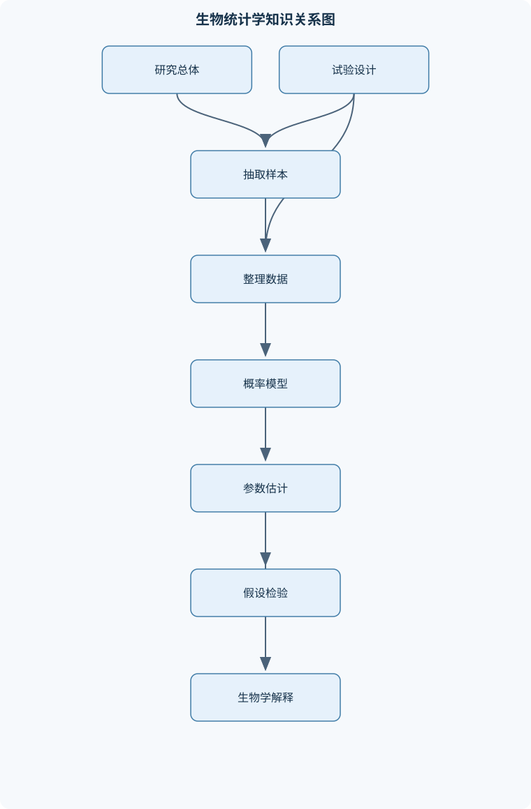
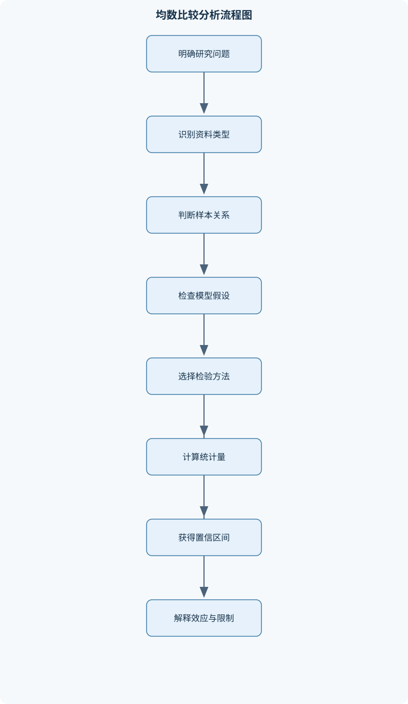

# 生物统计学

## 一、课程整体知识框架

### 课程边界与先修知识

生物统计学研究生物科学、动物科学、医学、农业与生态研究中的数据收集、整理、概率建模、参数估计、假设检验、试验设计和关系建模。课程覆盖描述统计、概率分布、抽样分布、均数与率的推断、方差分析、列联表分析、相关与回归、协方差分析、非线性变换和样本量设计。课程重点是根据研究问题、资料类型、试验设计和模型假设选择方法，并正确解释估计值、置信区间、P值、效应量和统计结论。先修知识包括初等代数、函数与图表阅读、基本微积分概念、求和符号、概率初步和基础实验设计。课程不以特定软件操作为边界，但应能将手算公式、统计软件输出和研究结论相互对应。





### 1. 学科对象与研究逻辑

生物统计学研究如何把生物、动物、医学、农业和生态研究中的观测资料转化为可检验、可重复、可解释的数量结论。其基本链条是：提出研究问题，界定总体和变量，选择抽样或试验设计，获得并审核样本资料，进行描述统计，建立概率或统计模型，估计总体参数或检验科学假设，最后结合效应大小、置信区间、研究设计和生物学机制解释结果。

总体是研究结论所要推广到的全部对象，例如某养殖场全部肉鸡、某地区符合条件的患者或某生态区域内的某种植物；个体是总体中的一个观察单位；样本是实际抽取并测量的一部分个体。总体均数记为 $\mu$，总体方差记为 $\sigma^2$，总体标准差记为 $\sigma$，总体率记为 $p$；样本均数记为 $\bar{x}$，样本方差记为 $s^2$，样本标准差记为 $s$，样本率记为 $\hat p$。总体参数通常未知，样本统计量则由观测数据计算得到。

变量是个体具有的可测属性，观测值是该变量在某个个体上的具体记录。例如“体重”是变量，某只动物的体重 $2.35\ \mathrm{kg}$ 是观测值。连续资料可在区间内取任意实数，如体温、体长；离散资料通常以可数的整数表示，如产仔数、疾病发生次数。分类资料以类别表示，如性别、是否发病、血型；计数资料记录事件次数，常具有非负整数边界。定类尺度只有类别差异，定序尺度还具有顺序关系，定距尺度的差值有意义但零点不一定表示“无”，定比尺度具有有意义的绝对零点，因而倍数比较有意义。资料尺度决定可以使用的统计量和图形，不能把类别编码为数字后就把它当作连续变量分析。

准确性表示观测值或估计值接近真值的程度，精确性表示重复测量或重复抽样结果彼此接近的程度。仪器始终高估体重时，测量结果可能很精确但不准确；随机误差较大时，结果可能平均接近真值但不精确。随机误差使结果产生抽样波动，通常可通过增加样本量或改进测量减少其影响；系统误差来自选择偏倚、仪器校准错误、测量流程固定偏差或混杂因素，增加样本量不能自动消除。

### 2. 数据整理与描述统计

原始数据分析前应审核变量名称、单位、编码、重复记录、缺失值、异常值和分组关系。每个变量都应能回答“测量对象是谁、测量单位是什么、取值范围是什么、缺失如何表示”。例如体重不能把克和千克混用，疾病状态不能同时用“是/否”和“1/2”而不建立编码表。描述统计的输入是经过审核的样本，输出应包含有效样本量、统计量、单位及必要的图形。

频数分布记录各类别或区间出现的次数，频率为频数除以总数。定类资料常用频数和构成比，连续资料可按区间制作频数分布。算术平均数为
$$
\bar{x}=\frac{1}{n}\sum_{i=1}^{n}x_i,
$$
其中 $x_i$ 是第 $i$ 个观测值，$n$ 是有效观测数。不同观测具有权重时使用加权平均数
$$
\bar{x}_w=\frac{\sum w_i x_i}{\sum w_i},
$$
权重 $w_i$ 必须有明确含义，例如样本量、抽样权重或重复次数，不能为了得到期望结果任意设置。

中位数是排序后位于中央位置的值，适合偏态分布或含极端值的资料；众数是出现次数最多的取值，尤其适合分类资料。分位数把排序资料按比例分割，四分位距为
$$
IQR=Q_3-Q_1,
$$
它描述中间约一半观测值的离散程度。几何平均数适用于正值且具有乘法关系的资料，通常为
$$
G=\left(\prod_{i=1}^{n}x_i\right)^{1/n},
$$
或先取对数、求算术平均后反变换；含零或负值时不能直接使用。调和平均数
$$
H=\frac{n}{\sum_{i=1}^{n}1/x_i}
$$
适用于速率等倒数关系资料，要求各 $x_i$ 为正。

样本方差和标准差分别为
$$
s^2=\frac{\sum_{i=1}^{n}(x_i-\bar{x})^2}{n-1},\qquad s=\sqrt{s^2}.
$$
分母使用 $n-1$ 是为了对总体方差进行无偏估计。标准差描述个体观测值的离散程度，标准误 $SE$ 描述统计量在重复抽样中的波动，二者不能互换。均数标准误为
$$
SE(\bar{x})=\frac{\sigma}{\sqrt n},
$$
总体标准差未知时通常用 $s/\sqrt n$ 估计。变异系数为
$$
CV=\frac{s}{\bar{x}}\times100\%,
$$
仅适用于均值为正、零点有实际意义且比例比较合理的资料；均值接近零或可含负值时，$CV$ 会极不稳定。

极差为最大值减最小值，容易受单个极端值影响。箱线图可显示中位数、四分位数和潜在异常值；直方图用于连续变量的分布形状，条形图用于类别频数，二者不能仅凭外观混用。偏度描述分布不对称方向，峰度描述尾部和峰部相对形态。异常值应先核查录入、单位和测量流程，不能未经说明直接删除；真实极端值可能正是重要的生物学现象。

### 3. 概率、随机变量与常用分布

概率模型描述随机现象的可能结果及其概率。事件是样本空间中的结果集合。互斥事件不能同时发生，独立事件则表示一个事件发生不改变另一个事件的概率，二者不是同义词。条件概率为
$$
P(A\mid B)=\frac{P(A\cap B)}{P(B)},\quad P(B)>0.
$$
若 $A$ 与 $B$ 独立，则 $P(A\cap B)=P(A)P(B)$；若互斥且均有正概率，则通常不独立。

离散型随机变量以概率函数描述，连续型随机变量以概率密度函数 $f(x)$ 描述。连续变量在单点的概率为 $P(X=x)=0$，密度值本身不是概率，区间概率必须积分：
$$
P(a<X\le b)=\int_a^b f(x)\,dx.
$$
分布函数为 $F(x)=P(X\le x)$；若可导，则 $f(x)=F'(x)$，且全范围密度积分为 $1$。随机变量的期望表示长期平均水平，方差表示围绕期望的波动。若 $E(X)=\mu$、$Var(X)=\sigma^2$，则
$$
E(a+bX)=a+b\mu,\qquad Var(a+bX)=b^2\sigma^2.
$$

二项分布适用于固定次数 $n$、每次只有成功或失败、成功概率恒为 $p$ 且各次试验独立的情形：
$$
P(X=x)=\binom nx p^x(1-p)^{n-x}.
$$
例如随机抽取 $10$ 头动物，统计超过标准的头数，必须说明抽样近似独立且总体足够大；若不放回抽样且总体不大，二项模型可能不适用。泊松分布常用于固定时间、面积或空间范围内的稀有事件次数，参数为单位范围内平均事件数 $\lambda$：
$$
P(X=x)=\frac{e^{-\lambda}\lambda^x}{x!}.
$$
正态分布记为 $N(\mu,\sigma^2)$。标准化变换
$$
Z=\frac{X-\mu}{\sigma}
$$
把正态变量转换为标准正态变量。二项分布在 $np$ 与 $n(1-p)$ 均不太小时可近似正态分布，必要时使用连续性校正；当事件稀少、$n$ 大且 $p$ 小而 $np$ 适中时可用泊松近似。近似不是无条件替代，边界比例、极小样本和强依赖资料应采用更合适模型。

### 4. 抽样分布、参数估计与样本量

样本均数不是固定值，而是随样本改变的随机变量。若观测独立且总体方差为 $\sigma^2$，则
$$
Var(\bar{x})=\frac{\sigma^2}{n},\qquad SE(\bar{x})=\frac{\sigma}{\sqrt n}.
$$
因此样本量增加四倍，均数抽样标准误才约减少一半。中心极限定理说明，在独立、同分布且方差有限等条件下，样本量足够大时，样本均数的分布趋近正态；总体强偏态、存在极端重尾或观测不独立时，不能机械套用小样本正态近似。

点估计用一个数估计参数，如 $\bar{x}$ 估计 $\mu$，$\hat p$ 估计 $p$。区间估计同时给出估计值和不确定性。总体标准差已知时，均数双侧置信区间为
$$
\bar{x}\pm z_{\alpha/2}\frac{\sigma}{\sqrt n}.
$$
$\sigma$ 未知且总体近似正态时使用
$$
\bar{x}\pm t_{\alpha/2,n-1}\frac{s}{\sqrt n}.
$$
置信水平为 $1-\alpha$，不能解释为“参数落入本次区间的概率为 $1-\alpha$”；在重复使用同一构造方法时，约有该比例的区间覆盖真参数。

无偏性表示估计量的期望等于目标参数，一致性表示样本量增大时估计量趋近参数，有效性通常比较估计量的方差。总体率的点估计为 $\hat p=x/n$，其区间估计在小样本或比例接近 $0$、$1$ 时不宜机械使用简单正态区间。已知 $\sigma$、允许误差为 $d$ 时，均数估计所需样本量为
$$
n=\frac{z_{\alpha/2}^2\sigma^2}{d^2},
$$
结果必须向上取整，并根据失访、无效记录、分层或整群设计效应增加样本量。样本量不由显著性水平单独决定，还取决于目标效应大小、方差、功效、分配比例和研究设计。

### 5. 假设检验、均数比较与方差分析

假设检验先提出原假设 $H_0$ 和备择假设 $H_1$。例如检验总体均数是否为 $\mu_0$，可设 $H_0:\mu=\mu_0$，双侧备择为 $H_1:\mu\ne\mu_0$。方向性明确且在查看数据前确定时，才使用单侧检验。显著性水平为 $\alpha$，第一类错误是实际为真却拒绝 $H_0$，第二类错误概率为 $\beta$，检验功效为 $1-\beta$。降低 $\alpha$ 通常会使在其他条件不变时功效降低，增加样本量或增大真实效应则常提高功效。

单样本 $t$ 统计量为
$$
t=\frac{\bar{x}-\mu_0}{s/\sqrt n},\quad df=n-1.
$$
两独立样本比较应先确认观察单位独立。方差近似相等时可使用合并方差方法，方差不齐时使用 Welch 方法；同一对象前后测量或匹配对象比较时，应先计算每个对象的差值 $d_i$，再对差值做单样本检验：
$$
t=\frac{\bar d}{s_d/\sqrt n}.
$$
$t$ 检验要求误差近似正态；大样本时可借助中心极限定理，但严重偏态、异常值或依赖结构仍可能破坏结论。

P 值是在 $H_0$ 及模型假设成立时，观察到当前或更极端数据的概率，不是 $H_0$ 为真的概率，也不是效应大小。统计报告应同时给出估计差、置信区间、P 值、样本量和实际单位。

单因素方差分析将总变异分解为组间和组内部分：
$$
SS_{\text{总}}=SS_{\text{组间}}+SS_{\text{组内}},
$$
$$
MS_{\text{组间}}=\frac{SS_{\text{组间}}}{k-1},\quad
MS_{\text{组内}}=\frac{SS_{\text{组内}}}{N-k},\quad
F=\frac{MS_{\text{组间}}}{MS_{\text{组内}}}.
$$
$k$ 为组数，$N$ 为总样本量。若误差独立、近似正态且方差齐，原假设成立时 $F$ 服从 $F_{k-1,N-k}$ 分布。显著的总体 $F$ 检验只说明至少有一组均数不同，不能说明所有组两两不同；进一步比较应使用预先规定的 LSD、Bonferroni 或其他方法，并说明多重比较造成的第一类错误控制方式。固定效应表示研究关注的具体水平，随机效应表示从更大水平集合中抽取的来源；混合效应模型同时包含两类效应，适用于区组、重复测量和层级资料。

### 6. 双因素、区组、嵌套与重复测量设计

双因素交叉设计同时研究因素 $A$、因素 $B$ 及其交互作用 $A\times B$。主效应是某因素在另一个因素各水平上平均后的效应；简单效应是在另一个因素固定于某一水平时的比较。交互作用表示一个因素的效应随另一个因素水平改变而改变。若交互作用显著，应优先解释简单效应或各水平组合，而不能孤立解释主效应。

随机区组设计把实验单位按已知差异分成相对同质的区组，在每个区组内随机安排处理。模型把区组差异从误差中分离，若区组确实能够控制变异，处理比较会更精确；区组不能被错误当作独立处理重复。嵌套设计中一个分类因素的水平只出现在另一个因素某一水平内部，例如多个个体嵌套于群体，不能按交叉设计处理。

重复测量资料来自同一对象多个时间点或条件，观测间通常相关。若把同一动物的多次记录当作独立样本，会低估标准误并夸大显著性。应使用配对分析、重复测量方差分析或能表达个体相关性的混合效应模型。缺失观测和不平衡数据会改变自由度及模型估计，应记录缺失机制，不能简单用均值填补后假装获得独立观测。

### 7. 率、频数与列联表

率通常表示单位时间、单位人口或风险集中的事件发生程度；构成比表示总数中各类别所占比例；概率是随机事件发生的数值度量。三者在分母和解释上不同。二项率可用 $\hat p=x/n$ 估计，但区间方法应根据样本量和边界选择。两个率比较时，必须明确分母是否来自相同观察机会、观察时间和风险定义。

列联表的观察频数记为 $O$。在独立性原假设下，单元格期望频数为
$$
E_{ij}=\frac{(\text{第 }i\text{ 行合计})(\text{第 }j\text{ 列合计})}{\text{总计}}.
$$
卡方统计量为
$$
\chi^2=\sum\frac{(O-E)^2}{E}.
$$
适合性检验比较一个分类变量是否符合理论比例；独立性检验判断两个分类变量是否有关联。$r\times c$ 独立性检验自由度为 $(r-1)(c-1)$，$2\times2$ 表自由度为 $1$。期望频数过小时，大样本卡方近似可能不可靠，应合并具有科学意义的类别或使用适用的精确方法，不能为满足条件随意改动数据。二分类结果还可报告风险差、相对风险和优势比，并结合置信区间解释，而不能只报告卡方 P 值。

### 8. 相关、回归、协方差分析与变换

相关分析研究两个变量的线性关联。定义
$$
SS_x=\sum(x_i-\bar{x})^2,\quad
SS_y=\sum(y_i-\bar{y})^2,
$$
$$
SP_{xy}=\sum(x_i-\bar{x})(y_i-\bar{y}),\quad
r=\frac{SP_{xy}}{\sqrt{SS_xSS_y}}.
$$
$r$ 的正负表示线性方向，绝对值反映线性关联程度；它不证明因果关系，也不保证不存在非线性关系。简单线性回归模型为
$$
y_i=\beta_0+\beta_1x_i+\varepsilon_i.
$$
最小二乘法使残差平方和最小，得到
$$
b_1=\frac{SP_{xy}}{SS_x},\qquad b_0=\bar y-b_1\bar x.
$$
在含截距模型中，
$$
SS_y=SS_{\text{回归}}+SS_{\text{残差}},\qquad
R^2=1-\frac{SS_{\text{残差}}}{SS_y}.
$$
$R^2$ 表示样本响应变异中被模型解释的比例，不等于因果强度或模型正确性。回归应检查线性、独立性、残差近似正态、等方差、异常点和高杠杆点；不得把模型外推到观测范围之外而不说明风险。

多元回归加入多个解释变量，可用于预测或调整混杂，但变量选择不能只按 P 值机械进行，还应考虑科学问题、共线性、缺失模式、预测误差和可解释性。协方差分析用处理变量比较响应，同时以处理前确定的连续协变量进行调整。其重要条件包括协变量与响应变量关系近似线性、各组回归斜率同质，以及协变量与处理分配独立或合理平衡。若协变量已受处理影响，事后调整可能把真实处理效应错误扣除。

计数资料的方差常随均数增加时，可尝试平方根变换；乘性变异或各组变异系数相近时可尝试对数变换；比例资料在特定边界条件下可考虑反正弦平方根变换。变换前后应比较残差分布、方差齐性和模型解释；变换尺度上的均值不能直接当作原尺度均值，必要时应反变换。幂函数、指数函数和双曲线关系可通过取对数或倒数等方式线性化，但线性化会改变误差结构，不能只因能画直线就认为模型成立。

## 二、章节和模块划分

### 核心知识覆盖清单

本清单用于检查正文是否覆盖本课程的主要知识模块：

- **生物统计学基础与研究数据**：总体、个体与样本、参数与统计量、变量与观测值、准确性与精确性、连续资料与离散资料、计数资料与分类资料、定类定序定距定比尺度、随机误差与系统误差、抽样调查与试验研究、描述统计与统计推断。
- **数据整理与描述统计**：原始数据的审核与编码、频数分布与频率分布、算术平均数与加权平均数、中位数、众数与分位数、几何平均数与调和平均数、极差、四分位距与平均绝对离差、方差、标准差与标准误、变异系数的计算与比较、条形图、直方图与箱线图、偏度、峰度与异常值识别。
- **概率、随机变量与常用分布**：事件运算与条件概率、独立事件与互斥事件、离散型随机变量与概率函数、连续型随机变量与概率密度函数、分布函数与密度积分关系、数学期望与方差的线性变换、二项分布及其生物学应用、泊松分布及计数资料应用、正态分布与标准化、二项和泊松分布的近似条件。
- **抽样分布与参数估计**：样本均数的抽样分布、中心极限定理的适用条件、均数标准误、点估计与区间估计、无偏性、一致性与有效性、总体均数的置信区间、总体方差的置信区间、总体率的估计、样本量与允许误差、置信水平和区间宽度的关系。
- **假设检验与均数比较**：原假设与备择假设、单侧检验与双侧检验、检验统计量与拒绝域、第一类错误与第二类错误、检验功效与效应量、P值的定义与解释、单样本均数检验、两独立样本均数检验、配对样本均数检验、正态近似检验与t检验的选择。
- **方差分析与多重比较**：方差分析的基本思想、组间平方和与组内平方和、总平方和分解、均方与F统计量、单因素完全随机设计、方差分析的独立性假定、方差分析的正态性假定、方差齐性假定与诊断、LSD、Bonferroni和Duncan比较、固定效应、随机效应与混合效应。
- **双因素、区组与重复测量设计**：双因素交叉分类设计、主效应与简单效应、交互作用及其图形解释、随机区组设计、区组因素的局部控制、嵌套分类设计、重复测量资料的相关性、缺失观测与不平衡数据、自由度的来源与分配、试验设计的随机化、重复与局部控制。
- **率、频数与列联表分析**：率、构成比与概率的区别、二项率的区间估计、单个率的假设检验、两个率的比较、列联表的观察频数与期望频数、卡方适合性检验、卡方独立性检验、2×2列联表与自由度、小期望频数的处理边界、优势比与相对风险的解释。
- **相关、简单回归与多元回归**：统计相关与因果关系的区别、离均差平方和与乘积和、协方差与Pearson相关系数、相关系数的显著性检验、简单线性回归模型、最小二乘法与回归系数、决定系数与残差平方和、回归系数的假设检验、回归模型的残差诊断、多元相关、偏相关与变量选择。
- **协方差分析、变换与综合研究流程**：协变量与辅助变量、协方差分析的调整思想、协方差分析的平行回归假定、平方根变换及计数资料、对数变换及乘性变异、反正弦变换及比例资料边界、幂函数、指数函数与双曲线模型、模型线性化与反变换、从研究问题到统计报告、结果的生物学解释与统计限制。


### 第一章 生物统计学基础与研究数据

本章先建立总体、个体、样本、参数和统计量的对应关系，再区分变量、观测值、连续资料、离散资料、计数资料和分类资料。章节案例可采用“动物体重、体长、发病状态、产仔数”四类变量，要求说明单位、尺度、分母和可用统计量。随后比较抽样调查与试验研究：抽样调查重点是样本对总体的代表性，试验研究还要求处理分配、随机化和对照。简单随机抽样使每个个体有相等抽中机会；分层随机抽样先按重要特征分层，再在层内抽样，适合各层差异明显的总体。描述统计回答“样本是什么样”，统计推断回答“总体可能是什么样”，二者不能混为一谈。

### 第二章 数据整理与描述统计

本章依次处理数据审核、编码、频数分布、集中趋势、离散趋势和图形表达。重点比较均数与中位数在偏态和异常值下的差异，并要求根据变量尺度选择条形图、直方图或箱线图。体重和体长的单位不同，不能直接比较标准差；若两者均为正且比例尺度有意义，可比较 $CV$。若一组数据含极端值，应用中位数和 $IQR$ 辅助描述，而不是只报告均数和标准差。

### 第三章 概率、随机变量与常用分布

本章从事件运算和条件概率出发，解释独立与互斥的区别，再建立离散随机变量、连续随机变量、概率函数、密度函数和分布函数。二项分布用于固定次数的成功—失败资料，泊松分布用于一定暴露范围内的事件次数，正态分布用于许多连续性状的近似建模。所有分布都必须说明随机机制和边界条件，不能仅凭变量名称选择分布。

### 第四章 抽样分布与参数估计

本章推导样本均数方差。若 $X_1,\ldots,X_n$ 独立且方差均为 $\sigma^2$，则
$$
Var(\bar{x})=Var\left(\frac{1}{n}\sum X_i\right)
=\frac{1}{n^2}\sum Var(X_i)
=\frac{n\sigma^2}{n^2}
=\frac{\sigma^2}{n}.
$$
因此 $SE(\bar{x})=\sigma/\sqrt n$。随后区分点估计、置信区间、无偏性、一致性和有效性，练习均数、方差和率的区间估计，并讨论置信水平、区间宽度和样本量的关系。

### 第五章 假设检验与均数比较

本章按“提出假设—确定方向—选择统计量—计算 P 值或拒绝域—报告效应和区间”的顺序组织。单样本、两独立样本和配对样本的关键区别不在公式外观，而在研究设计和独立性结构。选择配对检验时，分析对象是每一对的差值；选择独立样本检验时，两组观测单位必须相互独立。报告“不拒绝 $H_0$”比写“接受 $H_0$”更严谨，因为证据不足不等于原假设已被证明正确。

### 第六章 方差分析与多重比较

本章从总平方和分解进入单因素完全随机设计，再扩展到固定效应、随机效应和混合效应。学生应能根据组均数、样本量和平方和补全方差分析表，解释 $df$、$SS$、$MS$ 和 $F$ 的来源。方差分析显著后才进行针对性多重比较，不能用大量两两 $t$ 检验代替总体检验。残差独立性主要依赖设计，正态性和方差齐性主要检查模型残差；原始观测值不要求严格服从正态分布。

### 第七章 双因素、区组、嵌套与重复测量

本章使用“饲料类型×性别”说明主效应、简单效应和交互作用。若交互作用显著，应分别在不同性别内比较饲料，而不能只解释饲料平均效应。随机区组用于控制区组间已知差异，嵌套设计用于层级结构，重复测量用于同一对象多次观察。章节同时讨论缺失观测、不平衡数据、自由度分配以及随机化、重复和局部控制三项试验设计原则。

### 第八章 率、频数与列联表分析

本章先用同一组数据区分率、构成比和概率，再进行单个率、两个率和列联表分析。适合性检验比较实际分类分布与理论比例；独立性检验比较两个分类变量的联合分布。应从观察频数计算期望频数和 $\chi^2$，并根据期望频数判断卡方近似是否可用。四格表结果还应转化为风险差、相对风险或优势比，使统计关联具有更清晰的实际含义。

### 第九章 相关、简单回归与多元回归

本章由离均差平方和和乘积和推导 $r$、斜率和截距，再解释 $R^2$、残差平方和及回归系数检验。分析流程必须先画散点图，防止把曲线、分组结构或单个高杠杆点误判为总体线性关系。多元回归用于多个变量同时调整或预测，但变量选择应结合研究问题和共线性诊断，不能把自动筛选结果直接视为生物学机制。

### 第十章 协方差分析、变换与综合研究流程

本章将协变量调整、平行回归假定、平方根变换、对数变换、反正弦变换和非线性模型放在统一框架中。完整研究流程应从研究问题和主要结局开始，预先确定设计、样本量和分析方案；数据收集后审核质量、描述分布、拟合模型、检查残差，再报告效应量、置信区间、P 值、单位和限制。统计显著不等于生物学重要，模型假设不满足时，应说明替代方法或结论边界。

### 代表性算法与流程

#### 1. 描述统计流程

**输入：** 原始观测值、变量定义、单位和分组信息。  
**过程：** 检查缺失、重复、非法编码、单位和异常值；按变量类型生成频数或分组表；计算均数、中位数、分位数、标准差或 $IQR$；绘制合适图形；保留有效样本量。  
**输出：** 可追溯的数据摘要、统计量及单位。  
**不变量与终止条件：** 每个统计量都能追溯到明确变量和有效观测；每个变量都有缺失说明。  
**适用条件：** 适用于探索性描述，不替代假设检验。若数据重复测量，描述时也应保留个体和时间结构。  
**复杂度：** 对 $n$ 个观测值，扫描和计算主要统计量通常为 $O(n)$；排序求中位数和分位数通常为 $O(n\log n)$。

#### 2. 单样本均数检验伪代码

```text
输入：x[1..n]，待检验均数 μ0，显著性水平 α，检验方向
计算：x̄ = mean(x)
      s = sample_standard_deviation(x)
      t = (x̄ - μ0) / (s / sqrt(n))
      df = n - 1
根据方向和 df 计算 P 值或临界值
输出：均数差、t、df、P 值、置信区间和结论
检查：观测是否独立；样本或差值是否近似正态；s 是否为零
终止：完成结果报告，并说明不拒绝不等于证明 H0 正确
```

#### 3. 单因素方差分析流程

输入 $k$ 个组的观测值和设计信息，先计算总均数及各组均数，再计算组间、组内和总平方和，除以相应自由度得到均方，计算 $F$ 并检查残差独立性、正态性和方差齐性。若总体检验显著，按照预先规定的方法进行多重比较。若方差严重不齐，应考虑稳健方法、变换或适合不等方差结构的模型，而不是只报告常规 $F$ 值。

#### 4. 协方差分析流程

输入处理变量、响应变量和处理前协变量。先画协变量与响应变量散点图，再拟合包含处理、协变量及处理与协变量交互项的模型。若交互项不显著且平行回归假定合理，使用共同斜率计算调整均数；若交互显著，应解释不同协变量水平下的处理差异，不能套用单一调整均数。协变量受处理影响、测量误差严重或组间范围完全不重叠时，普通协方差分析的解释会失效。

### 代表性例题

#### 例题一：描述统计与变异系数

**题干：** 某组动物体重为 $2,2,3,3,4\ \mathrm{kg}$，体长为 $20,21,21,22,26\ \mathrm{cm}$。分别求均数、中位数、极差，并说明能否直接比较两变量的标准差。

**分析：** 两变量单位不同，标准差具有原变量单位，不能直接比较。  
**解答：** 体重均数为 $14/5=2.8\ \mathrm{kg}$，中位数为 $3\ \mathrm{kg}$，极差为 $4-2=2\ \mathrm{kg}$。体长均数为 $110/5=22\ \mathrm{cm}$，中位数为 $21\ \mathrm{cm}$，极差为 $26-20=6\ \mathrm{cm}$。  
**结果验证：** 排序后的第 3 个数分别为 $3$ 和 $21$，最大值减最小值分别为 $2$ 和 $6$。  
**变式：** 若两变量均为正且比例尺度有意义，可进一步计算 $CV$；若均值接近零，则不应使用 $CV$。

#### 例题二：二项分布

**题干：** 某性状理论发生率为 $p=0.30$，随机抽取 $10$ 个相互独立个体，求恰有 $5$ 个发生以及至少 $2$ 个发生的概率。

**分析：** 每个个体只有发生和不发生两种结果，次数固定且假定独立，故令 $X\sim B(10,0.30)$。  
**解答：**
$$
P(X=5)=\binom{10}{5}(0.3)^5(0.7)^5.
$$
至少 $2$ 个可用补事件：
$$
P(X\ge2)=1-P(X=0)-P(X=1),
$$
其中
$$
P(X=0)=0.7^{10},\quad
P(X=1)=\binom{10}{1}(0.3)(0.7)^9.
$$
代入计算器或软件即可得到数值。  
**结果验证：** $P(X\ge2)$ 应介于 $0$ 和 $1$，且大于 $P(X=5)$。  
**变式：** 若抽样不独立或总体很小，应考虑超几何模型，而不能继续使用二项分布。

#### 例题三：总体均数的置信区间

**题干：** 样本均数为 $24$，样本标准差为 $4$，$n=50$，构造总体均数的 $95\%$ 置信区间。

**分析：** 总体标准差未知，使用 $t$ 区间，自由度为 $49$。  
**解答：**
$$
SE=\frac{s}{\sqrt n}=\frac{4}{\sqrt{50}}\approx0.566.
$$
区间为
$$
24\pm t_{0.025,49}\times0.566.
$$
取 $t_{0.025,49}\approx2.009$，误差界限约为 $1.137$，故区间约为
$$
(22.863,\ 25.137).
$$
**结果验证：** 样本量固定时，置信水平提高，临界值增大，区间应变宽。  
**变式：** 若已知总体标准差为 $4$，应改用 $z$ 区间，而不能仍使用 $t$ 临界值。

#### 例题四：单样本均数检验

**题干：** 某性状样本均数为 $24$，样本标准差为 $4$，$n=50$，检验总体均数是否为 $25$，取双侧 $\alpha=0.05$。

**分析：** 设 $H_0:\mu=25$，$H_1:\mu\ne25$。  
**解答：**
$$
t=\frac{24-25}{4/\sqrt{50}}\approx-1.768,\quad df=49.
$$
将 $|t|$ 与双侧临界值约 $2.009$ 比较，$1.768<2.009$，因此在 $0.05$ 水平下不拒绝 $H_0$。  
**结果验证：** 该结论不表示证明 $\mu=25$，只能说明当前样本不足以提供反对 $H_0$ 的充分证据。  
**变式：** 若研究问题事先明确为“均数是否低于 $25$”，可设置单侧备择，但不能看到样本均数为 $24$ 后再临时改变检验方向。

#### 例题五：两因素交互作用

**题干：** 研究两种饲料和两种性别对增重的影响。结果显示饲料×性别交互作用显著，问应如何解释。

**分析：** 交互作用显著说明饲料差异随性别改变，饲料的平均主效应可能掩盖不同性别中的相反或不同效应。  
**解答：** 分别在雄性内比较两种饲料，再在雌性内比较两种饲料；或者分别在每种饲料内比较性别。报告各简单效应的均数差、置信区间和调整后的 P 值。  
**结果验证：** 交互作用图中两因素效应线条不平行通常提示交互，但图形不能替代正式检验。  
**变式：** 若交互作用不显著且模型假设合理，才可更集中地解释两个主效应。

### 实验与项目流程

#### 项目一：动物生长试验的描述与均数比较

**输入数据：** 每只动物的编号、处理组、性别、初始体重、终点体重和测量单位；至少记录处理分配方式和缺失原因。  
**步骤：**  
1. 审核编号重复、单位统一、缺失和异常值；  
2. 计算增重或分析终点体重，并检查组内分布；  
3. 若只有两个独立处理组，依据方差情况选择 Welch 或等方差方法；  
4. 若为同一动物前后测量，计算配对差值；  
5. 报告均数差、$95\%$ 置信区间、P 值和实际单位；  
6. 若使用初始体重调整，检查协方差分析的平行斜率条件。  
**评价标准：** 处理组定义清楚，独立性与配对结构正确，单位统一，结果包含效应量和区间，异常值有审计记录，结论不超出试验设计。  
**排错方法：** 若软件自由度异常，检查是否把同一动物多次记录当作独立样本；若区间极宽，检查样本量、缺失和标准差；若结果与手算不符，核对分母是 $n$ 还是 $n-1$、是否误用了标准误。

#### 项目二：疾病发生率与四格表分析

**输入数据：** 每个独立观察单位的处理状态、疾病状态、观察时间和是否完成随访。  
**步骤：**  
1. 明确分母是随机分配的动物数、有效随访数还是风险集；  
2. 汇总处理×疾病的 $2\times2$ 表；  
3. 计算期望频数，判断卡方近似是否适用；  
4. 计算风险差、相对风险或优势比及其置信区间；  
5. 期望频数过小时，采用有科学依据的合并或精确方法；  
6. 解释结果时区分统计关联、免疫保护效果和因果结论。  
**评价标准：** 每个频数可追溯到独立个体，分母明确，未把重复观察当作新个体，效应指标与研究设计匹配，结论同时报告不确定性。  
**排错方法：** 若总数与原始记录不一致，检查重复编号和缺失编码；若相对风险无法解释，检查是否存在零频数或分母为零；若卡方结果异常，重新核查期望频数和类别编码。

## 三、核心概念的详细解释

### 1. 研究对象、资料类型与统计推断

#### 1.1 总体、样本、参数与统计量

总体是研究结论希望推广到的全部对象，样本是从总体中实际观察到的一部分个体。总体均数 $\mu$、总体方差 $\sigma^2$、总体率 $p$ 和总体相关系数 $\rho$ 是参数；样本均数 $\bar{x}$、样本方差 $s^2$、样本率 $\hat p$ 和样本相关系数 $r$ 是统计量。参数通常未知，统计量由样本数据计算得到，并用于估计参数或检验关于参数的假设。

抽样方法决定样本能否代表总体。简单随机抽样要求总体中每个个体被抽中的机会相等；分层随机抽样先按重要特征划分互不重叠的层，再在各层中随机抽样，适合各层差异明显且希望保证各层代表性的情形。方便抽样虽然成本低，但容易产生选择偏倚。增加方便样本的数量只能降低随机波动，不能消除系统偏倚。

#### 1.2 变量尺度与资料类型

定类尺度只有类别差异，例如处理组、性别和疾病状态；定序尺度具有顺序关系，但相邻等级差距未必相等，例如轻度、中度和重度；定距尺度的差值有意义，但零点不表示属性完全不存在；定比尺度具有有意义的绝对零点，倍数比较有实际含义，例如体重和长度。

连续资料可以在区间内取任意实数，如体温和血压；离散资料通常取可数值，如产仔数。计数资料记录事件发生次数，通常为非负整数；分类资料记录类别或状态。将“发病”和“未发病”编码为 $1$ 和 $0$，并不意味着该变量已经成为可任意进行加减运算的连续变量。编码数字只是类别标签，必须根据资料性质选择分析方法。

准确性表示观测值接近真值的程度，精确性表示重复观测之间的一致程度。仪器始终比真实值高 $2$ 个单位时，测量结果可能精确但不准确。随机误差可通过增加样本量、改进测量和标准化操作减弱；系统误差来自选择偏倚、仪器校准错误、信息偏倚或混杂，增加样本量不能自动消除。

### 2. 描述统计与数据分布

#### 2.1 数据审核与图形选择

数据整理必须检查变量定义、单位、编码、重复编号、缺失值和不可能取值。例如体重记录同时出现 $\mathrm{g}$ 和 $\mathrm{kg}$ 时，必须先统一单位；缺失值不能直接当作零；同一动物的重复记录不能在不说明的情况下当作多个独立个体。

定类资料宜报告频数和构成比，用条形图表示；连续资料可用直方图展示分布，用箱线图观察中位数、四分位距和异常值。直方图的柱宽影响形状判断，箱线图标出的离群点是需要核查的观测，不等同于错误数据。异常值可能来自录入错误，也可能是真实但极端的个体，不能仅因其影响显著性就删除。

#### 2.2 位置与离散程度

算术平均数为

$$
\bar{x}=\frac{1}{n}\sum_{i=1}^{n}x_i,
$$

其中 $x_i$ 是第 $i$ 个观测值，$n$ 是有效观测数。加权平均数为

$$
\bar{x}_w=\frac{\sum_i w_i x_i}{\sum_i w_i},
$$

权重 $w_i$ 必须具有抽样权重、重复次数或样本量等明确含义。中位数对极端值较稳健，适合偏态资料；众数适合分类资料。四分位距为 $IQR=Q_3-Q_1$，描述中间约一半观测值的离散程度。

样本方差和标准差分别为

$$
s^2=\frac{\sum_{i=1}^{n}(x_i-\bar{x})^2}{n-1},\qquad s=\sqrt{s^2}.
$$

分母使用 $n-1$ 是为了在独立随机抽样条件下对总体方差进行无偏估计。标准差描述个体观测值的离散程度，标准误描述统计量的抽样波动，二者不能混用。均数的标准误通常为

$$
SE(\bar{x})=\frac{s}{\sqrt n}.
$$

变异系数为

$$
CV=\frac{s}{\bar{x}}\times100\%.
$$

它用于均值为正、零点具有实际意义的比例尺度资料，以比较不同单位或不同均值水平下的相对变异。均值接近零、含负值或零点任意的数据不宜使用变异系数。

### 3. 概率、随机变量与常用分布

#### 3.1 概率与条件概率

事件的并表示至少一个事件发生，交表示多个事件同时发生，补事件表示该事件不发生。条件概率为

$$
P(A\mid B)=\frac{P(A\cap B)}{P(B)},\qquad P(B)>0.
$$

若 $P(A\cap B)=P(A)P(B)$，则 $A$ 与 $B$ 独立。互斥事件不能同时发生，若 $A$ 与 $B$ 互斥，则 $P(A\cap B)=0$；互斥并不等于独立，除非至少一个事件概率为零。

#### 3.2 随机变量、密度与期望

离散随机变量由概率函数描述；连续随机变量由概率密度函数 $f(x)$ 描述。密度在某一点的函数值不是该点的概率，连续变量满足 $P(X=x)=0$。若分布函数 $F(x)$ 可导，则

$$
f(x)=F'(x),\qquad P(a<X\le b)=\int_a^b f(x)\,dx,
$$

并且全体可能取值上的密度积分为 $1$。

数学期望表示长期平均水平，方差表示围绕期望的波动。若 $E(X)=\mu$、$Var(X)=\sigma^2$，则

$$
E(a+bX)=a+b\mu,\qquad Var(a+bX)=b^2\sigma^2.
$$

加上常数不改变方差，乘以 $b$ 会使方差乘以 $b^2$。

#### 3.3 二项、泊松与正态分布

二项分布适用于固定次数 $n$、每次只有成功或失败、成功概率为 $p$ 且各次独立的试验。成功次数 $X$ 的概率为

$$
P(X=x)=\binom{n}{x}p^x(1-p)^{n-x}.
$$

例如随机抽取 $10$ 个个体且每个个体超标准概率为 $0.30$，恰有 $5$ 个超标准的概率为

$$
\binom{10}{5}(0.30)^5(0.70)^5.
$$

若是无放回抽样且总体不大，个体之间可能不独立，二项模型只是近似。

泊松分布适用于固定时间、面积或空间范围内的稀有事件计数，其参数 $\lambda$ 同时是均数和方差：

$$
P(X=x)=\frac{e^{-\lambda}\lambda^x}{x!}.
$$

当二项分布中 $n$ 较大、$p$ 较小且 $np=\lambda$ 适中时，可用泊松分布近似，但应说明近似条件。

正态分布记为 $N(\mu,\sigma^2)$。标准化变换为

$$
Z=\frac{X-\mu}{\sigma},
$$

可将区间概率转化为标准正态分布的累计概率。例如 $P(a<X<b)$ 等于标准化后两个 $Z$ 值之间的面积。正态模型对连续性状常有用，但有界资料、严重偏态资料和明显混合分布不宜机械套用。

### 4. 抽样分布、置信区间与假设检验

#### 4.1 样本均数的抽样分布

若 $X_1,\ldots,X_n$ 独立同分布，且总体方差为 $\sigma^2$，则

$$
Var(\bar{x})=\frac{\sigma^2}{n},\qquad SE(\bar{x})=\frac{\sigma}{\sqrt n}.
$$

推导来自独立观测方差可加：

$$
Var(\bar{x})=Var\left(\frac{1}{n}\sum X_i\right)
=\frac{1}{n^2}\sum Var(X_i)
=\frac{n\sigma^2}{n^2}
=\frac{\sigma^2}{n}.
$$

因此样本量增加四倍，均数标准误才减少为原来的一半。中心极限定理说明，在独立、同分布且方差有限的条件下，样本量足够大时，样本均数的分布趋近正态；但强偏态、重尾、极端相关或有效样本量很小时，不能只依赖这一近似。

#### 4.2 置信区间与样本量

总体标准差已知时，均数的双侧置信区间为

$$
\bar{x}\pm z_{\alpha/2}\frac{\sigma}{\sqrt n}.
$$

总体标准差未知且总体近似正态时，使用

$$
\bar{x}\pm t_{\alpha/2,n-1}\frac{s}{\sqrt n}.
$$

置信水平 $1-\alpha$ 表示重复进行同样抽样和构造区间时，长期约有 $1-\alpha$ 的区间包含真实参数；不宜解释为“本次参数落在区间中的概率”。

已知 $\sigma$、允许误差为 $d$ 时，均数估计所需样本量为

$$
n=\frac{z_{\alpha/2}^2\sigma^2}{d^2}.
$$

例如 $\sigma=5$、$d=0.5$、置信水平为 $95\%$，则

$$
n=\frac{1.96^2\times5^2}{0.5^2}=384.16,
$$

必须向上取整为 $385$。若存在失访、分层、整群抽样或有限总体修正，应进一步调整。

#### 4.3 假设检验与错误类型

原假设 $H_0$ 通常表示无差异、无关联或参数等于指定值；备择假设 $H_1$ 表示研究者希望检验的差异或方向。双侧检验用于“是否不同”，单侧检验用于方向在研究开始前已有明确科学依据的情形。

第一类错误是在 $H_0$ 真实时错误拒绝它，概率为 $\alpha$；第二类错误是在 $H_0$ 不真实时未拒绝它，概率为 $\beta$；检验功效为 $1-\beta$。降低 $\alpha$、减小样本量或减小真实效应通常会降低功效。P 值是在 $H_0$ 及模型条件成立时，获得当前或更极端数据的概率，不是 $H_0$ 为真的概率。

单样本均数检验使用

$$
t=\frac{\bar{x}-\mu_0}{s/\sqrt n},\qquad df=n-1.
$$

例如 $\bar{x}=24$、$s=4$、$n=50$、检验 $\mu_0=25$，则

$$
t=\frac{24-25}{4/\sqrt{50}}\approx-1.768.
$$

在双侧 $\alpha=0.05$ 下，$df=49$ 的临界绝对值约为 $2.009$，因此不拒绝 $H_0$。这并不证明总体均数等于 $25$，只表示证据不足以拒绝该假设。

### 5. 均数比较、方差分析与试验设计

#### 5.1 两组均数与配对资料

两独立样本均数比较要求两组观察单位相互独立。方差近似相等时可用合并方差方法；方差不齐时使用 Welch 方法。配对资料应先对每一对观测计算差值 $d_i$，再对差值进行单样本检验：

$$
t=\frac{\bar d}{s_d/\sqrt n},\qquad df=n-1.
$$

同一动物处理前后的测量、匹配个体和同一对象的两种条件测量通常属于配对资料。把配对资料错误地当作独立样本，会忽略配对间相关性并改变标准误。

#### 5.2 单因素方差分析

设有 $k$ 个处理组，组 $j$ 的均数为 $\bar{x}_j$，总样本量为 $N$。总平方和分解为

$$
SS_{\text{总}}=SS_{\text{组间}}+SS_{\text{组内}},
$$

其中

$$
SS_{\text{组间}}=\sum_{j=1}^{k}n_j(\bar{x}_j-\bar{x})^2,
$$

$$
SS_{\text{组内}}=\sum_{j=1}^{k}\sum_{i=1}^{n_j}(x_{ij}-\bar{x}_j)^2.
$$

相应均方为

$$
MS_{\text{组间}}=\frac{SS_{\text{组间}}}{k-1},\qquad
MS_{\text{组内}}=\frac{SS_{\text{组内}}}{N-k},
$$

F 统计量为

$$
F=\frac{MS_{\text{组间}}}{MS_{\text{组内}}}.
$$

在误差独立、近似正态且方差齐的条件下，$H_0$ 成立时

$$
F\sim F_{k-1,N-k}.
$$

F 检验显著只说明至少有一个组均数不同，不能说明所有两两比较都不同。若继续比较，应使用预先规定的 LSD、Bonferroni 或其他多重比较方法，并报告多次比较造成的错误控制方式。Duncan 方法较宽松，使用时应明确其控制性质和研究目的。

#### 5.3 双因素、区组、嵌套与重复测量

双因素模型通常包括因素 A、因素 B 及其交互作用：

$$
y_{ijk}=\mu+\alpha_i+\beta_j+(\alpha\beta)_{ij}+\varepsilon_{ijk}.
$$

主效应是某因素在另一因素各水平上平均后的效应；简单效应是在另一因素某一固定水平下比较该因素；交互作用表示一个因素的效应随另一个因素水平改变而改变。交互作用显著时，应优先分析简单效应或各水平组合，不能孤立解释主效应。

随机区组设计把相似个体组成区组，在每个区组内随机安排处理，以控制区组间差异。区组不是处理重复，不能把区组数量错误地当作处理样本量。嵌套设计中一个因素的水平只出现在另一个因素某个水平之内，误差项不能照搬交叉设计。

同一动物多次测量形成重复测量资料，各次观测通常相关。若忽略相关性，标准误可能被低估。应考虑配对分析、重复测量方差分析或混合效应模型；缺失观测和不平衡数据需要根据缺失机制和模型结构处理，不能随意补零。

### 6. 率、列联表与关联指标

#### 6.1 率、构成比与概率

构成比表示某类别占总数的比例，所有类别构成比之和为 $1$；率通常表示事件在一定观察时间或风险集中的发生速度；概率是随机事件发生可能性的数学度量。三者分母含义不同，不能混用。

二项率的点估计为

$$
\hat p=\frac{x}{n}.
$$

大样本近似下，其标准误为

$$
SE(\hat p)=\sqrt{\frac{\hat p(1-\hat p)}{n}},
$$

但当 $n\hat p$ 或 $n(1-\hat p)$ 较小时，正态区间可能超出 $[0,1]$ 或覆盖率不可靠，应采用更稳健的二项区间方法。

#### 6.2 卡方检验与四格表

适合性检验比较一个分类变量的观察分布与理论分布；独立性检验判断两个分类变量是否有关联。两者都使用

$$
\chi^2=\sum\frac{(O-E)^2}{E},
$$

其中 $O$ 是观察频数，$E$ 是原假设下期望频数。独立性检验中

$$
E_{ij}=\frac{(\text{第 }i\text{ 行合计})(\text{第 }j\text{ 列合计})}{N},
$$

自由度为

$$
df=(r-1)(c-1).
$$

期望频数过小时，卡方近似可能失效，应合并具有科学意义的类别或使用精确方法，不能为了满足条件而任意修改数据。

$2\times2$ 表可报告风险差、相对风险和优势比。若处理组风险为 $p_1$、对照组风险为 $p_0$，则

$$
RD=p_1-p_0,\qquad RR=\frac{p_1}{p_0}.
$$

优势比为

$$
OR=\frac{p_1/(1-p_1)}{p_0/(1-p_0)}.
$$

当结局较少见时，OR 可能近似 RR；结局常见时二者不能混同。关联显著不自动证明因果关系，因果解释还需要随机分配、时间顺序和混杂控制。

### 7. 相关、回归、协方差分析与变换

#### 7.1 相关与简单线性回归

定义

$$
SP_{xy}=\sum_i(x_i-\bar{x})(y_i-\bar{y}),
$$

$$
SS_x=\sum_i(x_i-\bar{x})^2,\qquad SS_y=\sum_i(y_i-\bar{y})^2.
$$

Pearson 相关系数为

$$
r=\frac{SP_{xy}}{\sqrt{SS_xSS_y}}.
$$

$r$ 的符号表示线性方向，绝对值反映线性关联程度，但不表示因果强度。非线性关系、异常值和范围受限都可能使 $r$ 失真。

简单线性回归模型为

$$
y_i=\beta_0+\beta_1x_i+\varepsilon_i.
$$

最小二乘法使残差平方和最小，得到

$$
b_1=\frac{SP_{xy}}{SS_x},\qquad b_0=\bar{y}-b_1\bar{x}.
$$

因此预测方程为 $\hat y=b_0+b_1x$。含截距模型满足

$$
SS_y=SS_{\text{回归}}+SS_{\text{残差}},
$$

决定系数为

$$
R^2=\frac{SS_{\text{回归}}}{SS_y}
=1-\frac{SS_{\text{残差}}}{SS_y}.
$$

$R^2$ 表示样本中响应变量变异被模型解释的比例，不等于模型正确率，也不能替代残差诊断。回归解释要求线性、独立、残差近似正态和等方差；超出观测范围外推尤其危险。

#### 7.2 多元回归与变量选择

多元回归同时纳入多个解释变量，可用于预测或调整混杂。偏相关表示在控制其他变量后两个变量的关联。解释变量高度相关时会产生多重共线性，使系数不稳定、标准误增大。变量不能只按单个 P 值机械筛选，应结合研究问题、先验知识、共线性、预测误差和模型可解释性。

#### 7.3 协方差分析与非线性变换

协方差分析在比较处理组时引入处理前确定的连续协变量。模型可写为

$$
y_{ij}=\mu+\tau_i+\beta(x_{ij}-\bar{x})+\varepsilon_{ij}.
$$

关键条件包括协变量与响应变量近似线性、各处理组回归斜率同质、协变量测量可靠且不受处理影响。应先检验处理与协变量的交互作用；若斜率不同，单一共同斜率的调整均数没有通常意义。

计数资料常尝试平方根变换，尤其适合方差随均数增加的资料；乘性变异或变异系数近似稳定时可使用对数变换；比例资料在接近 $0$ 或 $1$ 且方差不齐时可考虑反正弦平方根变换。变换不是自动修复模型的方法，必须比较变换前后的残差、方差齐性和解释性。反变换后的均值通常不等于变换均值的简单反变换，报告时应说明尺度。

## 四、重要定义、公式、定理和推导

### 专业审校补充：关键定义与适用边界

生物统计中的“实验单位”是能够独立接受处理并作为随机化对象的最小单位；“观测单位”是实际记录数据的对象，二者不一定相同。例如以栏舍随机分配饲料时，栏舍是实验单位，栏内多只动物只是子样本，不能把每只动物都当作相互独立的重复，否则会产生伪重复并低估标准误。若每个实验单位内有平均数为 m 的个体，组内相关系数为 ρ，则简单平均数方差可近似写为 Var(x̄)=σ²[1+(m−1)ρ]/n，其中 σ²为个体层面方差，n为实验单位数；方括号内的 1+(m−1)ρ 称设计效应，等效样本量约为 nm/[1+(m−1)ρ]。ρ=0时个体信息近似独立；ρ>0时同栏个体提供的新增信息少于独立个体。该公式依赖各簇规模近似、相关结构相近和随机抽样等条件，不能代替对分层、区组或重复测量模型的正式分析。


### 1. 统计量与抽样分布的基本推导

若 $X_i$ 相互独立且 $Var(X_i)=\sigma^2$，则

$$
Var\left(\sum_{i=1}^{n}X_i\right)=n\sigma^2.
$$

由于 $\bar X=n^{-1}\sum X_i$，

$$
Var(\bar X)=\frac{1}{n^2}n\sigma^2=\frac{\sigma^2}{n}.
$$

该结果要求观测之间独立；若存在相关性，则

$$
Var(\bar X)
=\frac{1}{n^2}\left(\sum Var(X_i)+2\sum_{i<j}Cov(X_i,X_j)\right),
$$

协方差项不能被忽略。重复测量资料因此不能直接套用独立样本标准误。

样本方差使用 $n-1$ 的原因可由

$$
\sum_{i=1}^{n}(X_i-\bar X)^2
=\sum_{i=1}^{n}(X_i-\mu)^2-n(\bar X-\mu)^2
$$

推出。取期望后，左侧的期望为 $(n-1)\sigma^2$，所以除以 $n-1$ 才得到无偏估计。

### 2. 假设检验的通用流程

#### 输入

输入包括研究设计、响应变量、分组变量、有效样本量、估计值、变异程度、待检验参数和显著性水平 $\alpha$。设计信息必须先于计算确认，包括独立样本、配对、区组、重复测量或嵌套结构。

#### 过程

1. 明确研究问题与总体参数；
2. 写出 $H_0$ 和 $H_1$，提前决定单侧或双侧；
3. 选择与资料类型和设计匹配的统计量；
4. 计算统计量、自由度和 P 值或拒绝域；
5. 检查独立性、分布、方差和期望频数等条件；
6. 同时报告效应量和置信区间；
7. 将统计结论与生物学意义、测量单位和设计限制结合解释。

#### 输出与终止条件

输出应包括估计差、置信区间、检验统计量、自由度、P 值、样本量和适用条件。只有当数据定义、分析单位、模型条件和结果解释均可追溯时，流程才算完成。P 值小于 $\alpha$ 时拒绝 $H_0$；否则是不拒绝 $H_0$，不能写成“接受 $H_0$”。

### 3. 方差分析的计算流程

输入 $k$ 个处理组的原始观测值。先计算总均数 $\bar{x}$ 和各组均数 $\bar{x}_j$，再计算组间平方和与组内平方和，最后求均方和 F 值。若总体 F 检验不显著，通常不宜进行大量无计划的两两比较；若显著，应根据事先设定的多重比较方案判断具体差异。

不变量是平方和分解：

$$
SS_{\text{总}}-SS_{\text{组间}}-SS_{\text{组内}}=0
$$

在计算精度允许的范围内成立。若不成立，应检查组均数、总均数、分母和缺失值处理。算法对 $N$ 个观测值的计算量为 $O(N)$，但统计有效性取决于设计和模型假定，而非仅取决于计算速度。

### 4. 相关与回归系数的推导

令残差平方和为

$$
Q(b_0,b_1)=\sum_{i=1}^{n}(y_i-b_0-b_1x_i)^2.
$$

分别对 $b_0$ 和 $b_1$ 求偏导并令其为零：

$$
\frac{\partial Q}{\partial b_0}
=-2\sum_i(y_i-b_0-b_1x_i)=0,
$$

$$
\frac{\partial Q}{\partial b_1}
=-2\sum_i x_i(y_i-b_0-b_1x_i)=0.
$$

第一式给出拟合直线通过 $(\bar{x},\bar{y})$，即

$$
b_0=\bar{y}-b_1\bar{x}.
$$

代入第二式后得到

$$
b_1=\frac{\sum_i(x_i-\bar{x})(y_i-\bar{y})}
{\sum_i(x_i-\bar{x})^2}
=\frac{SP_{xy}}{SS_x}.
$$

该推导要求 $SS_x>0$，即解释变量不能所有观测都相同。斜率检验通常检验 $H_0:\beta_1=0$，但斜率显著只说明线性关联证据，不自动产生因果关系。

### 5. 卡方统计量与期望频数

在独立性原假设下，行变量和列变量的边际分布决定单元格的期望频数：

$$
E_{ij}=\frac{R_iC_j}{N},
$$

其中 $R_i$ 是第 $i$ 行合计，$C_j$ 是第 $j$ 列合计，$N$ 是总频数。观察频数与期望频数差异越大，统计量

$$
\chi^2=\sum_{i,j}\frac{(O_{ij}-E_{ij})^2}{E_{ij}}
$$

越大。每个单元格的贡献为 $(O_{ij}-E_{ij})^2/E_{ij}$，可用于定位关联主要来自哪些类别组合。该检验要求每个个体只贡献一个独立计数；若同一对象多次出现，应使用适合重复资料的方法。

### 6. 代表性计算示例

#### 示例一：二项概率

某性状理论发生率为 $p=0.30$，随机观察 $10$ 个相互独立个体。恰有 $5$ 个发生的概率为

$$
P(X=5)=\binom{10}{5}(0.3)^5(0.7)^5.
$$

至少 $2$ 个发生的概率应写为

$$
P(X\ge2)=1-P(X=0)-P(X=1),
$$

而不能只计算 $P(X=2)$。若抽样个体来自很小总体且无放回，独立性假设需要重新评估。

#### 示例二：均数置信区间

若 $\bar{x}=24$、$s=4$、$n=50$，总体标准差未知，则

$$
SE=\frac{4}{\sqrt{50}}\approx0.566.
$$

以 $95\%$ 置信水平构造区间时使用 $t_{0.025,49}$，区间为

$$
24\pm t_{0.025,49}\times0.566.
$$

结果的单位与原始均数相同。若错误使用 $\sigma/\sqrt n$，相当于把未知总体标准差当作已知，需说明其依据。

#### 示例三：四格表

设处理组发病 $a$ 例、未发病 $b$ 例，对照组发病 $c$ 例、未发病 $d$ 例。处理组风险为

$$
\hat p_1=\frac{a}{a+b},
$$

对照组风险为

$$
\hat p_0=\frac{c}{c+d}.
$$

先按行列合计计算四个期望频数，再计算 $\chi^2$。若期望频数过小，不应机械使用卡方近似。报告时至少给出风险差或相对风险，不能只写“有显著差异”。

#### 示例四：单因素方差分析

三组均数分别为 $\bar{x}_1,\bar{x}_2,\bar{x}_3$，样本量为 $n_1,n_2,n_3$。先计算加权总均数

$$
\bar{x}=\frac{n_1\bar{x}_1+n_2\bar{x}_2+n_3\bar{x}_3}
{n_1+n_2+n_3}.
$$

再计算

$$
SS_{\text{组间}}=\sum_{j=1}^{3}n_j(\bar{x}_j-\bar{x})^2,
$$

并从组内观测计算 $SS_{\text{组内}}$。自由度分别为 $2$ 和 $N-3$。若 F 检验显著，再使用预先规定的比较方法。若三组均数有一个极端值，必须同时检查其对方差齐性和组内平方和的影响。

#### 示例五：相关与回归

给出成对观测 $(x_i,y_i)$ 后，先计算 $\bar{x}$、$\bar{y}$、$SS_x$、$SS_y$ 和 $SP_{xy}$，再得到

$$
r=\frac{SP_{xy}}{\sqrt{SS_xSS_y}},
\qquad
b_1=\frac{SP_{xy}}{SS_x},
\qquad
b_0=\bar y-b_1\bar x.
$$

验证方法包括检查回归线是否通过 $(\bar{x},\bar{y})$，并验证

$$
SS_y=SS_{\text{回归}}+SS_{\text{残差}}.
$$

若散点图显示弯曲关系，即使 $r$ 接近零，也不能据此断言两个变量完全无关。

### 7. 可复现的描述统计代码

```python
# Python 3
from math import sqrt

def describe(values):
    """输入非空数值列表，输出常用描述统计量。"""
    if not values:
        raise ValueError("values 不能为空")
    n = len(values)
    mean = sum(values) / n
    ordered = sorted(values)

    if n % 2 == 1:
        median = ordered[n // 2]
    else:
        median = (ordered[n // 2 - 1] + ordered[n // 2]) / 2

    ss = sum((x - mean) ** 2 for x in values)
    variance = ss / (n - 1) if n > 1 else None
    sd = sqrt(variance) if variance is not None else None
    cv = sd / mean * 100 if sd is not None and mean > 0 else None

    return {
        "n": n,
        "mean": mean,
        "median": median,
        "minimum": min(values),
        "maximum": max(values),
        "range": max(values) - min(values),
        "sample_variance": variance,
        "sample_sd": sd,
        "cv_percent": cv
    }

result = describe([2.1, 2.4, 2.4, 2.8, 3.0])
for key, value in result.items():
    print(f"{key}: {value}")
```

该流程的输入是经过单位统一和缺失审核的数值观测，输出包含样本量、均数、中位数、极差、样本方差、标准差和适用条件下的变异系数。算法遍历数据若干次，时间复杂度为 $O(n)$，排序求中位数使复杂度为 $O(n\log n)$。若均值不为正，代码将变异系数设为 `None`，避免产生没有合理解释的结果。

## 五、算法、流程和实现思路

### 方法与流程覆盖索引

下列方法或流程应在正文中说明输入、步骤、适用条件、结果检查和边界：

- 描述统计流程：输入原始观测值、变量定义和分组信息；审核缺失值、重复值、单位和异常编码；按资料类型选择频数表、均数或中位数、标准差或四分位距；绘制合适图形；输出统计量及其单位。终止条件是每个变量均有可追溯的定义、有效样本数和描述结果。适用于探索性分析；不替代正式推断。复杂度为O(n)，其中n为观测数。
- 单样本均数t检验：输入样本均数x̄、样本标准差s、样本量n和待检验均数μ₀；提出H₀:μ=μ₀及双侧或单侧H₁；计算t=(x̄−μ₀)/(s/√n)；自由度df=n−1；根据t分布求P值或与临界值比较；报告估计差、置信区间和结论。独立不变量是观测值独立且误差近似正态；大样本时可依赖中心极限定理近似。
- 两独立样本均数比较流程：输入两组x̄₁、x̄₂、s₁、s₂、n₁、n₂；先依据设计确认两组独立，再检查分布和方差；方差近似相等时使用合并方差t检验，方差不齐时使用Welch t检验；计算差值、标准误、t值和自由度；报告均数差、置信区间与P值。两组来自配对个体或同一对象前后测量时不得使用独立样本流程。
- 配对t检验流程：输入每个配对对象的两次观测值；计算差值dᵢ；对差值进行单样本t检验，t=d̄/(s_d/√n)，df=n−1；检查差值的独立性和近似正态性；输出平均差及其置信区间。适用于配对个体、同一动物处理前后或匹配设计，不适用于仅有组别标签的独立样本。
- 单因素方差分析流程：输入k个处理组的观测值和试验设计；计算总均数、各组均数、SS组间、SS组内和总SS；分别除以自由度得到两个均方；计算F=MS组间/MS组内；检查残差独立性、正态性和方差齐性；若总体检验显著，再进行预先说明的多重比较；输出方差分析表、效应量和组间比较。复杂度为O(N)。
- 双因素交叉方差分析流程：输入因子A、因子B及每个水平组合的重复观测；建立含A主效应、B主效应和A×B交互作用的模型；计算各来源平方和、自由度和均方；先检验交互作用；交互作用显著时分析简单效应或水平组合，不直接依赖主效应；检查各组合的残差诊断。适用于每个A水平与每个B水平组合均有观察的交叉设计。
- 随机区组分析流程：输入处理、区组和响应值；将区组作为控制来源纳入模型；分解总变异为处理、区组和误差；计算处理F值并检查区组设计是否合理；处理显著时进行多重比较。适用于区组内部相似、区组之间存在可控制差异的设计；区组不能被误当作处理重复。
- 卡方独立性检验流程：输入r×c列联表的观察频数；计算各单元期望频数Eᵢⱼ；计算χ²=Σ(Oᵢⱼ−Eᵢⱼ)²/Eᵢⱼ；自由度为(r−1)(c−1)；根据χ²分布求P值；若期望频数过小，合并有科学意义的类别或采用适用的精确方法；报告关联方向和效应量。前提是观测单位独立，不能把同一对象重复记录当作独立频数。
- 简单线性回归流程：输入成对观测(xᵢ,yᵢ)；绘制散点图；计算x̄、ȳ、SSₓ、SPₓᵧ；求b₁=SPₓᵧ/SSₓ和b₀=ȳ−b₁x̄；计算预测值、残差、R²和斜率检验；检查线性、独立性、残差正态性、等方差性和异常点；仅在研究设计支持时解释预测或因果含义。复杂度为O(n)。
- 多元回归变量选择流程：输入响应变量、候选解释变量和研究设计；先依据科学问题预设核心变量；检查共线性、缺失模式和变量尺度；可比较全模型、向后剔除、向前选择或逐步方法，但不能只按P值机械选变量；评估交叉验证误差、残差和模型可解释性；报告变量选择规则、系数不确定性和模型限制。适用于预测或调整，不自动产生因果结论。





### 1. 从研究问题到统计结论的通用流程

生物统计分析不是先选软件菜单，再寻找能够支持研究结论的检验，而应从研究问题、观测单位、资料类型和试验设计出发。一个可追溯的分析流程包括以下步骤：

1. **明确研究对象和总体**：说明结论希望推广到哪些动物、患者、农田、群体或生态单元。总体参数如 $\mu$、$\sigma^2$、$p$ 和 $\rho$ 是研究目标，样本统计量如 $\bar{x}$、$s^2$、$\hat p$ 和 $r$ 是从样本获得的证据。
2. **确定观测单位和变量**：明确一行数据代表一只动物、一个患者、一个地块、一个家庭，还是同一对象的一次测量。重复测量不能在没有相关结构处理时当作多个独立个体。
3. **审核资料**：检查变量定义、单位、编码、缺失值、重复编号、范围错误和异常值。缺失值不能自动编码为零，分类编码为 $0$ 和 $1$ 也不意味着可以忽略其分类性质。
4. **描述数据**：分类资料报告频数和构成比；近似对称的连续资料可报告均数和标准差；偏态资料宜报告中位数和四分位距。图形应与资料类型匹配，条形图适合分类资料，直方图适合连续资料，箱线图适合比较分布位置和离散程度。
5. **依据设计选择模型**：两个独立组均数比较、配对均数比较、多个处理组比较、双因素试验、随机区组、重复测量、列联表和回归分析不能仅按变量名称选择，而要结合分组关系和随机化结构。
6. **检查假设并记录处理方式**：重点检查独立性、残差正态性、方差齐性、线性关系、异常点和缺失机制。假设不满足时，应考虑变换、稳健方法、广义模型或重新定义分析对象。
7. **同时报告估计值和不确定性**：报告效应量、标准误、置信区间和 $P$ 值。$P$ 值不能替代效应大小，也不能说明原假设为真的概率。
8. **结合设计解释**：随机分配且混杂控制充分时，结果才可能支持因果解释；观察性研究通常首先支持关联解释。结论不得超出样本来源、测量范围和模型适用范围。

### 2. 描述统计与数据审核算法

#### 2.1 输入、输出与过程

**输入**包括原始观测值、变量定义、测量单位、分组变量和缺失编码。**输出**包括有效样本量、频数或频率、均数、中位数、标准差、四分位距、极差、变异系数及适合的图形。

处理过程如下：

1. 统一单位，例如将克转换为千克，但必须保留原始单位与换算规则。
2. 检查每个观测是否属于变量允许范围。
3. 区分真实零值、缺失值和未测量值。
4. 对分类变量建立唯一编码表。
5. 对连续变量计算
   $$
   \bar{x}=\frac{1}{n}\sum_{i=1}^{n}x_i,\qquad
   s^2=\frac{\sum_{i=1}^{n}(x_i-\bar{x})^2}{n-1}.
   $$
6. 若均值为正且具有比例尺度，再计算
   $$
   CV=\frac{s}{\bar{x}}\times100\%.
   $$
7. 检查均值与中位数的差异、箱线图中的极端观测和分布偏斜。
8. 当每个变量均有可追溯定义、有效样本量和单位时终止。

该算法扫描和汇总数据的主要部分复杂度为 $O(n)$；若需要排序计算中位数，通常为 $O(n\log n)$。它适用于探索性分析和数据质量控制，不能替代假设检验，也不能自动证明样本代表总体。

#### 2.2 可执行的描述统计示例

```python
from math import sqrt

def describe(values):
    if len(values) == 0:
        raise ValueError("观测值不能为空")

    n = len(values)
    mean = sum(values) / n
    ordered = sorted(values)

    if n % 2 == 1:
        median = ordered[n // 2]
    else:
        median = (ordered[n // 2 - 1] + ordered[n // 2]) / 2

    sample_variance = None
    sample_sd = None
    cv_percent = None

    if n > 1:
        ss = sum((x - mean) ** 2 for x in values)
        sample_variance = ss / (n - 1)
        sample_sd = sqrt(sample_variance)

        if mean > 0:
            cv_percent = sample_sd / mean * 100

    return {
        "n": n,
        "mean": mean,
        "median": median,
        "minimum": min(values),
        "maximum": max(values),
        "range": max(values) - min(values),
        "sample_variance": sample_variance,
        "sample_sd": sample_sd,
        "cv_percent": cv_percent
    }

result = describe([2.1, 2.4, 2.4, 2.8, 3.0])
for name, value in result.items():
    print(name, value)
```

程序的输入是同一单位下的数值观测，输出中的标准差是个体观测的离散程度，不能误称为均数的标准误。若要计算均数标准误，应另行使用 $SE(\bar{x})=s/\sqrt n$。当均值为零或为负时，程序不计算变异系数，这是因为比例尺度条件或相对变异解释已经失效。

### 3. 均数比较的算法

#### 3.1 单样本均数检验

**输入**为 $\bar{x}$、$s$、$n$ 和假设均数 $\mu_0$。先提出原假设和备择假设，例如：

$$
H_0:\mu=\mu_0,\qquad H_1:\mu\ne\mu_0.
$$

总体标准差未知且总体近似正态时，计算

$$
t=\frac{\bar{x}-\mu_0}{s/\sqrt n},\qquad df=n-1.
$$

若为双侧检验，则根据 $t$ 分布两侧尾概率求 $P$ 值；若事先指定 $\mu<\mu_0$ 或 $\mu>\mu_0$，则使用单侧概率。检验方向必须在查看结果前确定。

**例题：**样本均数为 $24$，样本标准差为 $4$，$n=50$，检验总体均数是否为 $25$。

$$
t=\frac{24-25}{4/\sqrt{50}}\approx-1.768,\qquad df=49.
$$

在双侧 $\alpha=0.05$ 下，$|t|$ 小于相应临界值，因此不拒绝 $H_0$。这不等于证明 $\mu=25$，而是说明当前数据没有提供足够证据否定该假设。应同时报告均数差 $-1$ 及其置信区间。

#### 3.2 两独立样本均数比较

先确认两组由不同且相互独立的观测单位组成。若方差近似相等，可使用合并方差：

$$
s_p^2=\frac{(n_1-1)s_1^2+(n_2-1)s_2^2}{n_1+n_2-2}.
$$

检验统计量为

$$
t=\frac{\bar{x}_1-\bar{x}_2}
{s_p\sqrt{1/n_1+1/n_2}},
\qquad df=n_1+n_2-2.
$$

若两组方差明显不同或样本量差异较大，应使用 Welch 方法，其标准误为

$$
SE(\bar{x}_1-\bar{x}_2)
=\sqrt{\frac{s_1^2}{n_1}+\frac{s_2^2}{n_2}},
$$

自由度采用 Welch–Satterthwaite 近似，而不能继续使用 $n_1+n_2-2$。若两次测量来自同一动物或匹配个体，则不能使用独立样本流程。

#### 3.3 配对均数比较

配对资料应先对每个对象计算差值：

$$
d_i=x_{i1}-x_{i2}.
$$

之后对差值进行单样本 $t$ 检验：

$$
t=\frac{\bar d}{s_d/\sqrt n},\qquad df=n-1.
$$

独立性要求的是不同配对对象之间相互独立，而不是同一对象的两次测量彼此独立。检查重点是差值的分布，而不是分别检查两次测量是否正态。配对分析通常能够消除个体基线差异，但若配对关系定义错误，反而会引入偏倚。

### 4. 方差分析、区组和双因素分析流程

#### 4.1 单因素完全随机设计

设有 $k$ 个处理组，总样本量为 $N$。先计算总均数和各组均数，再分解变异：

$$
SS_{\text{总}}
=
SS_{\text{组间}}+SS_{\text{组内}}.
$$

其中

$$
SS_{\text{组间}}
=
\sum_{j=1}^{k}n_j(\bar{x}_j-\bar{x})^2,
$$

表示各组均数与总均数之间的差异；组内平方和表示同组个体围绕本组均数的变异。相应均方为

$$
MS_{\text{组间}}=\frac{SS_{\text{组间}}}{k-1},\qquad
MS_{\text{组内}}=\frac{SS_{\text{组内}}}{N-k}.
$$

检验统计量为

$$
F=\frac{MS_{\text{组间}}}{MS_{\text{组内}}}.
$$

在误差独立、近似正态且方差齐的条件下，原假设成立时，

$$
F\sim F_{k-1,N-k}.
$$

$F$ 显著只说明至少有一个组均数不同，不能说明每两组都不同。若需要两两比较，必须使用事先规定的 LSD、Bonferroni、Duncan 或其他方法，并说明多重比较造成的第一类错误控制方式。

#### 4.2 随机区组设计

当试验单位可按体重、日龄、地块位置或批次划分为相对同质的区组时，可在每个区组内随机安排处理。模型中同时纳入处理和区组来源，将总变异分解为处理、区组和误差。区组的作用是减少背景差异，不能把区组数误认为处理重复数。

**输入**为处理标签、区组标签和响应变量；**输出**为处理效应、区组效应、误差均方、处理检验和必要的多重比较。适用条件是区组内部相似、区组之间存在可控制差异，并且处理在区组内有合理随机化。

#### 4.3 双因素交叉分类设计

对因素 $A$ 和 $B$ 的全部水平组合均有观测时，建立包含 $A$ 主效应、$B$ 主效应和 $A\times B$ 交互作用的模型。交互作用表示一个因素的效应随另一个因素水平改变。例如饲料对雄性动物有明显作用，但对雌性动物作用很小，则饲料效应依赖性别。

分析顺序应为：

1. 检查交互作用及残差条件；
2. 若交互作用重要，分析简单效应，例如在每个性别内比较饲料；
3. 若交互作用不重要且模型合理，再解释主效应；
4. 报告各水平组合的均数、差异、置信区间和多重比较调整结果。

交互作用图中线条不平行可以提示交互作用，但不能替代正式检验。

### 5. 列联表、率与风险指标流程

#### 5.1 卡方独立性检验

对于 $r\times c$ 列联表，单元格观察频数为 $O_{ij}$。在行变量和列变量独立的原假设下，期望频数为

$$
E_{ij}
=
\frac{(\text{第 }i\text{ 行合计})(\text{第 }j\text{ 列合计})}
{\text{总计}}.
$$

卡方统计量为

$$
\chi^2=\sum_{i=1}^{r}\sum_{j=1}^{c}
\frac{(O_{ij}-E_{ij})^2}{E_{ij}},
$$

自由度为

$$
df=(r-1)(c-1).
$$

**输入**是每个独立观察单位的两个分类变量；**输出**是期望频数、$\chi^2$、自由度、$P$ 值及风险差、相对风险或优势比。期望频数太小时，卡方近似可能不可靠，应合并有科学意义的类别或使用适用的精确方法，不能为了满足要求随意改动数据。

适合性检验与独立性检验都基于观察频数和期望频数，但问题不同：适合性检验考察一个分类变量是否符合给定理论比例；独立性检验考察两个分类变量是否有关联。前者的期望比例来自理论分布，后者的期望频数由行列合计推导。

#### 5.2 率、构成比和风险

构成比表示某类别在总数中的比例，各类别分母通常是同一个总数；率通常涉及事件发生与观察对象、时间或风险集。把构成比称为发生率，会造成分母和解释错误。

在处理组和对照组中，常见指标包括风险差、相对风险和优势比。风险差反映两组事件概率的绝对差异；相对风险是两组风险之比；优势比比较事件优势而非直接比较风险。疾病较常见时，优势比可能明显偏离相对风险，不能将二者混称。

### 6. 相关、回归与协方差分析流程

#### 6.1 简单线性回归

模型为

$$
y_i=\beta_0+\beta_1x_i+\varepsilon_i.
$$

其中 $y_i$ 是响应变量，$x_i$ 是解释变量，$\beta_0$ 是截距，$\beta_1$ 是斜率，$\varepsilon_i$ 是随机误差。先绘制散点图，再计算

$$
SS_x=\sum_i(x_i-\bar{x})^2,\qquad
SP_{xy}=\sum_i(x_i-\bar{x})(y_i-\bar{y}).
$$

最小二乘估计为

$$
b_1=\frac{SP_{xy}}{SS_x},\qquad
b_0=\bar{y}-b_1\bar{x}.
$$

相关系数为

$$
r=\frac{SP_{xy}}{\sqrt{SS_xSS_y}}.
$$

含截距模型中，

$$
R^2=1-\frac{SS_{\text{残差}}}{SS_y}
$$

表示样本中响应变量变异被模型解释的比例。应检查线性、独立性、残差正态性、等方差性和异常点。高 $R^2$ 不代表模型正确，也不代表存在因果关系；回归外推到观测范围之外尤其需要谨慎。

#### 6.2 多元回归与变量选择

多元回归可同时调整多个解释变量，但解释变量之间高度相关会造成共线性，使系数不稳定、标准误增大。变量选择不能只按单变量 $P$ 值机械进行。应先依据研究问题确定核心变量，检查缺失模式和共线性，再比较模型的残差、预测误差、可解释性和稳定性。逐步选择、向前选择和向后剔除都可能造成选择偏倚，最终模型应报告选择规则和不确定性。

#### 6.3 协方差分析

协方差分析在比较处理组时调整连续协变量，例如比较终点体重时调整处理前的初始体重。模型至少包括处理、协变量以及处理与协变量的交互项。若交互项不显著，可在共同斜率条件下比较调整均数。

关键条件包括：协变量与响应变量近似线性相关；各处理组回归斜率同质；协变量测量可靠；协变量最好在处理前确定，并且与处理分配独立或达到合理平衡。若协变量受处理影响，事后将其纳入模型可能把真实处理效应“校正掉”。

### 7. 变换和样本量设计流程

平方根变换适合均值与方差随计数水平变化、近似泊松型的资料，常用于计数值，零值可进行适当处理。对数变换适合正值、乘性误差或变异系数相近但方差随均值增大的资料。反正弦平方根变换传统上用于比例资料，但比例接近 $0$ 或 $1$、分母差异很大或原始二项结构明显时，应优先考虑直接使用二项模型或其他适当方法。变换后应重新检查残差和方差齐性，不能把变换尺度上的均数直接当作原始尺度均数解释。

样本量设计至少需要输入目标效应大小、标准差或预期率、显著性水平 $\alpha$、目标功效 $1-\beta$、单侧或双侧方向、组间分配和失访比例。已知 $\sigma$、允许误差为 $d$ 时，均数估计所需样本量为

$$
n=\frac{z_{\alpha/2}^{\,2}\sigma^2}{d^2}.
$$

例如 $\sigma=5$、$d=0.5$、置信水平为 $95\%$ 时：

$$
n=\frac{1.96^2\times5^2}{0.5^2}=384.16.
$$

样本量必须向上取整为 $385$。若存在失访、无效记录、分层抽样或整群抽样，还需相应增加样本量或乘以设计效应。

### 8. 实验和项目实施流程

#### 8.1 生长试验分析项目

**输入数据：** 个体编号、处理、区组或性别、初始体重、终点体重、测量单位、随机分配记录和缺失原因。

**步骤：**

1. 统一体重单位，核对编号和处理分配；
2. 计算增重或以终点体重为响应变量；
3. 绘制各组分布，检查异常值和缺失；
4. 两独立组使用合适的独立样本方法，同一对象前后测量使用配对方法；
5. 多处理组使用方差分析，交互设计使用双因素模型；
6. 若调整初始体重，先检验协方差分析的斜率同质性；
7. 报告效应量、置信区间、$P$ 值、单位和模型假设。

**评价标准：** 处理定义清楚，观测单位独立性正确，随机化结构得到反映，单位和缺失记录完整，结果可由原始数据复算，结论不超出试验范围。

**排错方法：** 若样本量与软件输出不符，检查缺失值和重复编号；若自由度异常，检查是否把重复测量当作独立样本；若手算和软件不符，核对方差分母、配对方向和是否使用了加权数据。

#### 8.2 疾病发生资料项目

**输入数据：** 独立个体编号、处理状态、疾病状态、随访完成情况、观察时间和失访原因。

**步骤：**

1. 明确分母是分配对象、有效随访对象还是风险集；
2. 汇总处理与疾病状态的四格表；
3. 计算期望频数，判断卡方近似是否适用；
4. 计算风险差、相对风险或优势比；
5. 对小样本采用合适的精确方法或有依据的类别处理；
6. 报告效应量和置信区间，区分统计关联和因果解释。

**评价标准：** 每个频数均可追溯到独立个体，分母明确，重复观察处理正确，统计方法与设计一致。

**排错方法：** 总数不一致时核查重复编号和失访编码；相对风险无法计算时检查分母是否为零；卡方值异常时重新计算行列合计和期望频数。

## 六、概念之间的关系与对比

### 1. 总体参数、样本统计量与推断结论

| 概念 | 含义 | 典型符号 | 主要用途 |
|---|---|---|---|
| 总体参数 | 总体真实但通常未知的数量特征 | $\mu,\sigma^2,p,\rho$ | 研究目标 |
| 样本统计量 | 由样本计算的数量 | $\bar{x},s^2,\hat p,r$ | 估计参数、构造检验 |
| 点估计 | 用一个数估计参数 | $\bar{x}$ 或 $\hat p$ | 给出中心位置 |
| 区间估计 | 给出估计值和不确定性范围 | 置信区间 | 表达精度 |
| 假设检验 | 在假设条件下评价证据 | $t,F,\chi^2$ | 判断数据与假设是否相容 |

置信区间宽度受置信水平、样本量和变异程度共同影响。样本量增加时，均数标准误按 $1/\sqrt n$ 下降，而不是按 $1/n$ 下降。提高置信水平会使区间变宽，因为需要覆盖更多可能的样本波动。

### 2. 标准差、标准误与变异系数

标准差 $s$ 描述个体观测值的离散程度，单位与原变量相同；标准误 $SE$ 描述统计量在重复抽样中的波动，均数标准误单位也与原变量相同，但其大小通常随 $n$ 增大而下降；变异系数 $CV$ 是无量纲的相对离散程度。

例如体重标准差为 $0.4\ \mathrm{kg}$，表示个体体重的离散程度；若 $n=100$，均数标准误约为 $0.04\ \mathrm{kg}$，表示样本均数的抽样波动。不能把 $0.04\ \mathrm{kg}$ 解释为个体体重都只相差这么多。CV 只有在均值为正、零点有实际意义且比例比较合理时才适用，因此不宜用于均值接近零或可取负值的变量。

### 3. 准确性、精确性、随机误差与系统误差

精确性高表示重复结果彼此接近，准确性高表示接近真值。随机误差通常增加结果的离散程度，增加样本量可降低其对均数估计的影响；系统误差会使结果整体偏离真值，增加样本量只会使偏差估计得更精确，并不会消除偏差。

例如电子秤每次读数都比真实体重高 $0.2\ \mathrm{kg}$，读数可能很稳定但不准确；若电子秤读数围绕真实值上下波动很大，则精确性不足。校准、盲法、随机化和统一测量流程主要用于减少系统误差，增加重复测量和样本量主要用于降低随机波动。

### 4. 概率密度、概率质量与分布函数

离散随机变量用概率质量描述单点概率，例如二项分布中 $P(X=x)$ 可以直接表示取值为 $x$ 的概率。连续随机变量的密度 $f(x)$ 不是单点概率，因为

$$
P(X=x)=0.
$$

连续区间概率由积分得到：

$$
P(a<X\le b)=\int_a^b f(x)\,dx.
$$

分布函数为

$$
F(x)=P(X\le x),
$$

若 $F(x)$ 可导，则 $f(x)=F'(x)$。密度可以大于 $1$，但在具有长度单位的变量中，密度的单位是“概率/变量单位”，全范围积分必须等于 $1$。

### 5. 二项分布、泊松分布与正态近似

二项分布适用于固定次数 $n$、每次只有成功或失败、成功概率为固定 $p$ 且各次独立的情形：

$$
P(X=x)=\binom nx p^x(1-p)^{n-x}.
$$

泊松分布适合一定时间、空间或面积内事件次数的建模，参数 $\lambda$ 同时是期望和方差。二项分布在试验次数较大、成功概率较小且 $\lambda=np$ 合理时可近似为泊松分布；二项或泊松资料在条件合适且样本量足够时也可使用正态近似，但应检查概率是否接近边界、期望频数是否足够以及是否需要连续性校正。

### 6. 单侧检验、双侧检验与错误类型

双侧检验关注“是否不同”，拒绝域分布在两端；单侧检验关注“是否大于”或“是否小于”，拒绝域在一端。研究方向必须在观察数据前确定，不能根据结果方向临时选择单侧检验。

第一类错误是在 $H_0$ 正确时拒绝 $H_0$，概率由 $\alpha$ 控制；第二类错误是在 $H_1$ 为真时没有拒绝 $H_0$，概率为 $\beta$；检验功效为 $1-\beta$。降低 $\alpha$ 通常会使检验更保守，在其他条件不变时可能降低功效。增大样本量、增大真实效应或降低测量误差通常可以提高功效。

$P$ 值是在原假设和模型条件成立时，观察到当前或更极端数据的概率，不是“原假设为真的概率”。不拒绝 $H_0$ 也不等于接受或证明 $H_0$。

### 7. 两独立样本、配对样本与重复测量

| 资料结构 | 观测关系 | 合适思路 | 常见错误 |
|---|---|---|---|
| 两独立组 | 两组对象不同且相互独立 | 独立样本 $t$ 检验或 Welch 方法 | 把前后测量当独立组 |
| 配对资料 | 每个对象有自然匹配对象或两次测量 | 对差值进行单样本 $t$ 检验 | 忽略配对关系 |
| 重复测量 | 同一对象多次测量 | 重复测量模型、混合效应模型等 | 把每次测量当新个体 |
| 多处理组 | 三组或以上处理 | 方差分析及多重比较 | 多次两两 $t$ 检验 |

重复测量之间通常相关，忽略相关性会低估标准误并夸大显著性。混合效应模型可把个体或区组作为随机效应，以反映同一对象内相关结构；固定效应适用于研究者关心的具体处理水平，随机效应适用于希望代表更大随机抽取群体的因素。

### 8. 方差分析、$t$ 检验和多重比较

两组均数比较的方差分析与双侧 $t$ 检验在相同设计和假设下具有关系：

$$
F=t^2.
$$

但当组数超过两组时，整体 $F$ 检验只回答“是否至少有一组均数不同”。它不能直接回答哪两组不同。若在三组资料中反复进行三次两两 $t$ 检验，整体第一类错误率会高于单次检验设定的 $\alpha$，因此需要多重比较调整。

LSD 方法较宽松，适合有明确整体检验和较少预先比较的情形；Bonferroni 控制较保守，适用于比较数量有限且需要明确控制错误率的情形；Duncan 方法更偏向区分均数，但其错误控制解释与严格家族错误率方法不同。报告时不能只写“字母不同即显著”，还应说明比较方法和显著性水平。

### 9. 主效应、简单效应与交互作用

主效应是某因素跨越另一个因素各水平后的平均影响；简单效应是在另一个因素固定于某一水平时的比较；交互作用表示一个因素的效应依赖另一个因素水平。

若交互作用显著，平均主效应可能没有清晰的生物学含义。例如一种饲料使雄性增重增加、却使雌性增重减少，平均后可能得到接近零的主效应，但这不能说明饲料没有作用。此时应优先报告各性别内的简单效应和相应置信区间。

### 10. 适合性检验、独立性检验与同质性问题

适合性检验只有一个分类变量，比较观察频数是否符合理论比例，例如性状比例是否为 $3:1$。独立性检验有两个分类变量，判断处理与疾病状态是否有关联。某些研究问题也可表述为不同组的分类分布是否相同，这与同质性检验相近，但分析时必须明确抽样设计和研究目标。

三类问题都可能使用卡方统计量，但期望频数来源和自由度解释不同。理论比例若由样本估计，自由度还需要扣除估计参数数目，不能固定使用“类别数减一”。

### 11. 相关、回归、决定系数与因果关系

相关系数 $r$ 衡量线性关联方向和强度，取值范围为 $[-1,1]$；回归模型描述在给定 $x$ 时 $y$ 的条件均值变化。相关分析不区分明确的预测方向，回归分析也不自动产生因果结论。

$r$ 接近零只说明线性关联弱，不排除非线性关系；$r$ 较大也可能由混杂变量造成。$R^2$ 高表示样本中响应变量变异有较大比例被模型解释，但可能来自变量范围宽、模型过度拟合或共同趋势。因果解释需要随机分配、时间顺序、混杂控制和合理机制支持。

### 12. 变换、原始尺度与模型解释

平方根变换主要压缩较大的计数值，对泊松型资料有助于稳定方差；对数变换把乘性差异转化为加性差异，反变换后常涉及几何均数或比值解释；反正弦平方根变换可改变比例资料的边界行为，但不应机械用于所有百分率资料。

变换后检验的是变换尺度上的均值或模型参数。若模型在对数尺度上估计差异，反变换后往往表现为比值而不是简单的原始尺度差值。报告必须说明使用的变换、模型诊断结果和反变换方式。

### 13. 典型易错点

1. 把 $\bar{x}$ 当作总体参数 $\mu$。
2. 把标准差当作标准误。
3. 把缺失值编码为零。
4. 将类别编码 $0/1$ 当作普通连续变量。
5. 把连续变量密度 $f(x)$ 当作单点概率。
6. 认为 $P$ 值是 $H_0$ 为真的概率。
7. 把“不拒绝 $H_0$”写成“接受 $H_0$”。
8. 看到结果后才改用单侧检验。
9. 用多次两两 $t$ 检验替代整体方差分析。
10. 认为方差分析显著就表示所有组均不同。
11. 交互作用显著时仍孤立解释主效应。
12. 把重复测量当作独立观测。
13. 把相关关系直接解释为因果关系。
14. 把高 $R^2$ 当作模型正确的证明。
15. 在观测范围外进行没有依据的回归外推。
16. 期望频数过小时机械使用卡方近似。
17. 混淆率、构成比和概率的分母。
18. 对均值接近零的变量使用CV。
19. 将受处理影响的协变量进行事后调整。
20. 只报告 $P$ 值而不报告效应量和置信区间。

### 14. 常见笔试问题及解答思路

#### 问题一：为什么均数标准误为 $s/\sqrt n$？

若观测独立且每个观测方差为 $\sigma^2$，则

$$
\operatorname{Var}(\bar{x})
=
\operatorname{Var}\left(\frac{1}{n}\sum x_i\right)
=
\frac{1}{n^2}\sum \sigma^2
=
\frac{\sigma^2}{n}.
$$

开平方得到 $\sigma/\sqrt n$，用 $s$ 估计 $\sigma$ 后得到 $s/\sqrt n$。若观测相关，这一推导不再直接成立。

#### 问题二：方差分析如何分解总变异？

总离均差平方和等于各观测值与总均数差异的平方和。将每个差异拆为“本组观测与本组均数的差”和“本组均数与总均数的差”，交叉项求和为零，因此得到

$$
SS_{\text{总}}=SS_{\text{组间}}+SS_{\text{组内}}.
$$

#### 问题三：为什么不应把不拒绝写成接受？

检验只评价数据对 $H_0$ 的反对证据是否足够。样本量小、变异大或效应小都可能导致证据不足，因此不拒绝只能表示当前数据不足以否定 $H_0$，不能证明其绝对正确。

#### 问题四：卡方独立性检验的期望频数如何计算？

在独立假设下，行变量和列变量的联合概率等于边际概率乘积，所以单元格期望频数为行合计乘以列合计再除以总计。该推导依赖观测单位独立和分类表结构正确。

#### 问题五：交互作用显著时如何解释？

交互作用显著表示一个因素的效应在另一个因素不同水平下不相同。应固定一个因素，分析另一个因素的简单效应，并报告分层比较的效应量与置信区间，不直接用总体主效应概括所有组合。

#### 问题六：相关系数为零是否说明没有关系？

不一定。$r=0$ 主要说明线性关联为零，非线性关系仍可能存在。应结合散点图、残差图和可能的非线性模型判断。

#### 问题七：为什么要使用多重比较方法？

每次两两比较都可能犯第一类错误，比较次数增加会提高至少一次错误拒绝的概率。多重比较方法通过调整临界值或 $P$ 值，控制整体错误率或提供明确的错误风险解释。

#### 问题八：样本量增加能否消除偏倚？

不能。增加样本量主要降低随机误差和置信区间宽度；抽样偏倚、测量偏倚、混杂和系统性漏报需要通过研究设计、随机化、盲法、校准和适当调整解决。

### 15. 常见面试问题及回答要点

#### 问题一：拿到一份生物实验数据后先做什么？

先确认研究问题、总体、观测单位、处理分配和变量定义，再审核单位、缺失、重复和异常编码。之后做描述统计和图形探索，最后依据设计选择模型。不能一开始只看 $P$ 值。

#### 问题二：两组数据应选择哪种 $t$ 检验？

先判断两组是否独立。若同一对象前后测量或存在匹配关系，使用配对 $t$ 检验；若对象不同，使用独立样本方法。方差不齐时优先考虑 Welch 方法，而不是强行使用合并方差。

#### 问题三：软件输出显著，但效应量很小，如何报告？

同时报告效应量、实际单位、置信区间和 $P$ 值。统计显著说明数据与零效应假设不太相容，不能自动说明生物学或临床意义重要。还要结合预先定义的实际重要性界限。

#### 问题四：如何判断方差分析是否可靠？

检查随机化和独立性，观察残差图，评估残差正态性、方差齐性和异常点。重点是模型残差而非机械要求原始观测严格正态。若偏离严重，可考虑变换、稳健方法或其他模型。

#### 问题五：缺失值如何处理？

先判断缺失原因和缺失模式，区分随机漏测、失访和因结果异常而缺失。不能直接用均值填补后当作真实观测。处理方式应与研究设计和缺失机制相符，并进行敏感性分析。

#### 问题六：为什么不能把重复测量当成独立样本？

同一对象的多次测量通常相关，独立样本方法会低估标准误、扩大有效样本量并夸大显著性。应使用配对分析、重复测量模型或混合效应模型。

#### 问题七：何时使用回归而不是相关？

若研究目的是描述两个变量的线性关联，相关系数可以作为概括；若需要根据解释变量预测响应变量、调整协变量或估计斜率，则使用回归。无论哪种方法，都不能仅凭统计结果证明因果。

#### 问题八：如何处理小样本列联表？

先检查期望频数和观测单位独立性。期望频数过小时不能机械依赖卡方渐近近似，可合并具有科学意义的类别或采用精确方法；同时报告风险指标和区间，而不只报告一个检验结果。

#### 深入追问的共同回答要点

面对“为什么这样选方法”的追问，应说明四个依据：研究问题、资料尺度、试验设计和模型假设。面对“结果与预期不符”的追问，应先核查数据和编码，再检查效应方向、置信区间、功效、异常值、混杂和模型设定，不能为了得到预期结论而删除数据或更换检验方向。

### 16. 岗位任务与验收标准

| 岗位任务 | 使用的知识 | 主要产出 | 验收标准 |
|---|---|---|---|
| 临床研究统计分析 | 率、均数比较、列联表、回归、缺失处理 | 分析数据集、统计报告、表格 | 分母明确，分析集定义清楚，效应量和区间完整 |
| 动物试验数据分析 | 随机化、区组、方差分析、协方差分析 | 试验设计方案、方差分析表、图形 | 处理重复与区组结构正确，单位统一，结论可复算 |
| 农业试验设计 | 随机区组、双因素、交互作用、样本量 | 田间试验布局和分析方案 | 随机化、重复和局部控制明确，主效应与交互作用解释正确 |
| 流行病学分析 | 率、风险差、相对风险、优势比 | 四格表、风险估计、敏感性分析 | 分母和观察时间清楚，不能把关联误写成因果 |
| 生物信息与实验数据分析 | 回归、变换、异常值、质量控制 | 数据质控报告、模型结果 | 原始记录可追溯，变换和筛选规则预先说明 |
| 统计编程与质量控制 | 算法、数据审核、结果复算 | 程序、日志、自动化表格 | 输入输出明确、边界条件有处理、结果能与独立手算核对 |

统计分析成果的最终验收，不是看是否得到显著 $P$ 值，而是看数据结构是否识别正确、方法是否与设计匹配、假设是否得到检查、结果是否可复算、效应量和不确定性是否完整，以及生物学解释是否没有超出证据边界。

## 七、典型例题和应用场景

### 专业审校补充：综合例题

题干：某动物试验比较两种处理对终点体重的影响。处理A和B各有5只动物，基线体重x（kg）均为1、2、3、4、5；终点体重y（kg）分别为A组10、13、13、16、18，B组12、15、15、18、20。已知基线体重可能影响终点体重，要求用协方差分析比较处理效应，并说明平行回归假定。
分析：协方差分析把终点体重作为响应变量，把处理作为分类因素，把处理前测得的基线体重作为协变量。模型为 yᵢ=β₀+β₁xᵢ+τgᵢ+εᵢ，其中β₁表示控制处理因素后基线体重每增加1 kg，终点体重的平均变化；τ表示在相同基线水平下两处理的调整均数差。该模型要求协变量在处理前测量、误差近似独立且方差结构合理，并要求两组回归斜率相同。
逐步解答：两组基线均数均为3 kg，A组终点均数为14 kg，B组为16 kg。以x=3为参照，先计算共同斜率。相对x均数的离差为−2、−1、0、1、2，所有10个观测的SPₓᵧ为40，SSₓ为20，因此β̂₁=40/20=2。A组在x=3处的调整均数为14 kg，B组为16 kg，调整处理差为2 kg，表示在相同基线体重下B组终点体重平均高2 kg。按该斜率计算残差，A组残差为0、1、−1、0、0，B组相同，故残差平方和SSE=4。模型估计参数包括截距、协变量斜率和处理效应，残差自由度为10−4=6，MSE=4/6=0.667。处理差的标准误为√[MSE(1/5+1/5)]≈0.516，t=2/0.516≈3.87，自由度为6；双侧5%临界值约为2.447，因此处理差具有统计证据。95%置信区间约为2±2.447×0.516，即(0.74，3.26) kg。
结果验证：两组调整均数差的单位仍为kg；残差平方和应非负，且总自由度、模型自由度和残差自由度相加一致。应先加入处理×基线体重交互项检查斜率是否平行；若交互作用明显，不能使用一个共同斜率报告单一调整差，而应报告不同基线水平下的简单效应。变式：若基线体重是在处理结束后测量，或受到处理影响，则它不是合适的协变量，强行调整可能阻断处理效应或引入偏倚，此时应改用预先确定的终点分析或变化量分析，并说明选择依据。


### 典型题型与应用覆盖索引

建议通过下列题型或应用检查概念是否能够迁移：

- 描述统计例题：给出若干头动物的体重和体长，分别计算均数、中位数、极差、样本方差、标准差和变异系数；说明体重与体长单位不同，比较相对变异程度应优先比较CV，而不是直接比较标准差。
- 概率例题：某牛群中超过规定产奶量的理论比例为0.30，随机抽取10头，计算恰好5头超过标准的概率和至少2头超过标准的概率；明确使用二项分布，写出组合数、成功概率和失败概率，并解释独立抽样假设。
- 正态分布例题：设动物某生产性状服从N(μ,σ²)，计算低于某阈值、高于某阈值和落在两个阈值之间的比例；先标准化为Z，再用标准正态累计分布函数相减，说明正态近似的边界。
- 置信区间例题：给出样本均数、样本标准差和样本量，构造总体均数的95%置信区间；先判断总体标准差是否已知，再选择z区间或t区间，写出标准误、临界值、误差界限和最终区间。
- 样本量例题：已知性状标准差为5厘米，要求95%置信水平下均数估计误差不超过0.5厘米；使用n=z²σ²/d²，代入z=1.96、σ=5、d=0.5，计算n=384.16并向上取385；说明有限总体、失访和设计效应可能改变结果。
- 假设检验例题：样本均数为24，样本标准差为4，n=50，检验总体均数是否为25；写出H₀:μ=25和H₁:μ≠25，计算t=(24−25)/(4/√50)≈−1.768，df=49，再根据双侧P值作出不拒绝或拒绝H₀的结论，并区分统计证据与实际意义。
- 两独立样本例题：两种饲料各有若干动物，给出两组均数、标准差和样本量；先判断独立性和方差条件，再计算合并方差t或Welch t；报告均数差、自由度、P值及置信区间，不能只写显著或不显著。
- 单因素方差分析例题：三种饲料处理的增重数据给出各组样本量、均数和部分平方和；补全处理间、处理内和总变异的df、SS、MS与F；若总体F检验显著，使用LSD或其他预先规定方法比较各处理，并解释多重比较结果。
- 双因素例题：比较不同饲料和性别对增重的影响；建立含饲料、性别及交互作用的模型，先检验交互作用；若交互作用显著，分别在各性别内比较饲料，而不把两个主效应作孤立解释。
- 卡方适合性例题：观察到某群体中两类性状的频数，检验是否符合理论比例3∶1；计算总数、理论频数、各类别贡献值和χ²，自由度为类别数减1；说明理论比例若由数据估计，自由度需要进一步扣除估计参数数。
- 2×2独立性例题：给出处理组与疾病发生情况的四格表；计算期望频数和χ²，自由度为1；若期望频数过小，说明不能机械套用大样本卡方近似，应考虑精确方法；报告风险差、相对风险或优势比。
- 相关与回归例题：给出20只小鸡体重和鸡冠重量；计算x̄、ȳ、SSₓ、SPₓᵧ、r、回归方程和R²；检验斜率是否为零，明确回归方程用于给定范围内预测，不能把相关关系直接称为因果关系。


### 1. 描述统计与资料分布的综合例题

#### 题干

某试验记录 5 只动物的体重，单位为 $\mathrm{kg}$：

$$
2.1,\ 2.4,\ 2.4,\ 2.8,\ 3.0.
$$

要求计算均数、中位数、极差、样本方差、样本标准差和变异系数，并说明这些指标的含义。

#### 分析与解答

样本容量为 $n=5$，样本均数为

$$
\bar{x}=\frac{2.1+2.4+2.4+2.8+3.0}{5}
=\frac{12.7}{5}=2.54\ \mathrm{kg}.
$$

数据已经按从小到大排列，中间第 3 个观测值为中位数，因此

$$
\mathrm{Median}=2.4\ \mathrm{kg}.
$$

最大值为 $3.0\ \mathrm{kg}$，最小值为 $2.1\ \mathrm{kg}$，极差为

$$
R=3.0-2.1=0.9\ \mathrm{kg}.
$$

样本方差使用分母 $n-1$：

$$
\begin{aligned}
s^2
&=\frac{\sum_{i=1}^{5}(x_i-\bar{x})^2}{5-1}\\
&=\frac{(-0.44)^2+(-0.14)^2+(-0.14)^2+(0.26)^2+(0.46)^2}{4}\\
&=\frac{0.1936+0.0196+0.0196+0.0676+0.2116}{4}\\
&=\frac{0.512}{4}=0.128\ \mathrm{kg}^2.
\end{aligned}
$$

样本标准差为

$$
s=\sqrt{0.128}\approx0.358\ \mathrm{kg}.
$$

由于体重为有意义的比例尺度，且均数为正，可以计算变异系数：

$$
CV=\frac{s}{\bar{x}}\times100\%
=\frac{0.358}{2.54}\times100\%
\approx14.1\%.
$$

#### 结果解释与验证

均数 $2.54\ \mathrm{kg}$ 表示样本体重的算术平均水平；中位数 $2.4\ \mathrm{kg}$ 小于均数，提示较大的观测值对均数有一定上拉作用。标准差 $0.358\ \mathrm{kg}$ 与原变量使用相同单位，描述个体体重围绕均数的离散程度。变异系数没有单位，适合在均值为正、零点有实际意义且两个变量或两组资料需要比较相对变异程度时使用。

若比较体重和体长的变异程度，不能直接比较标准差，因为体重单位为 $\mathrm{kg}$、体长单位为 $\mathrm{cm}$，量纲不同。此时可分别计算 $CV$，但如果某变量均值接近零、可取负值或零点不是绝对零点，$CV$ 的解释会失去稳定性。

#### 变式

若某变量为疾病严重程度，编码为 $0$、$1$、$2$ 分别表示轻、中、重，则这些数字主要是定序标签，不能仅因编码为数字就计算有实际比例意义的变异系数。此时宜报告各等级频数、构成比和中位等级。

---

### 2. 二项分布与概率计算

#### 题干

某群体中，单个个体超过规定生产标准的理论概率为 $p=0.30$。随机抽取 $n=10$ 个体，设 $X$ 为超过标准的个体数。求：

1. 恰好有 5 个体超过标准的概率；
2. 至少有 2 个体超过标准的概率。

#### 分析

若每个个体只有“超过标准”和“未超过标准”两种结果，且每次观察相互独立、成功概率相同，则

$$
X\sim B(n=10,p=0.30).
$$

二项分布的概率函数为

$$
P(X=k)=\binom{n}{k}p^k(1-p)^{n-k},
$$

其中 $k$ 为成功次数，$\binom{n}{k}$ 为组合数。

#### 逐步解答

恰好 5 个体超过标准：

$$
\begin{aligned}
P(X=5)
&=\binom{10}{5}(0.30)^5(0.70)^5\\
&=252\times0.00243\times0.16807\\
&\approx0.040.
\end{aligned}
$$

至少 2 个体超过标准可用补事件计算：

$$
P(X\ge2)=1-P(X=0)-P(X=1).
$$

其中

$$
P(X=0)=\binom{10}{0}(0.30)^0(0.70)^{10}
\approx0.02825,
$$

$$
P(X=1)=\binom{10}{1}(0.30)^1(0.70)^9
\approx0.12106.
$$

因此

$$
P(X\ge2)=1-0.02825-0.12106\approx0.85069.
$$

#### 结果验证与适用边界

两项概率均在 $0$ 与 $1$ 之间，且“至少 2 次”概率应大于“恰好 5 次”概率，结果符合直观判断。二项模型要求成功概率基本恒定、个体之间近似独立。如果从一个很小的有限群体中不放回抽样，个体结果会相互影响，直接使用二项分布可能不准确；如果不同个体的成功概率明显不同，也不能简单使用一个共同的 $p$。

若事件是在单位时间、单位面积或单位体积内发生的稀疏计数，且事件发生率相对稳定，可以考虑泊松模型。泊松分布常用于事件次数，而二项分布强调固定试验次数和成功/失败结果，二者不能仅按“数据是整数”进行选择。

---

### 3. 正态分布、标准化与置信区间

#### 题干

某性状近似服从正态分布 $N(\mu,\sigma^2)$。设总体均数为 $\mu=100$，总体标准差为 $\sigma=15$。求一个体性状值低于 $80$ 的概率，以及落在 $85$ 到 $115$ 之间的概率。

#### 解答

标准化公式为

$$
Z=\frac{X-\mu}{\sigma}.
$$

当 $X=80$ 时，

$$
z_1=\frac{80-100}{15}=-1.333.
$$

因此

$$
P(X<80)=P(Z<-1.333).
$$

查标准正态累计分布函数可得该概率约为 $0.092$。

对于区间 $85<X<115$：

$$
z_2=\frac{85-100}{15}=-1,
\qquad
z_3=\frac{115-100}{15}=1.
$$

所以

$$
P(85<X<115)=P(-1<Z<1)
=\Phi(1)-\Phi(-1)
\approx0.6827.
$$

#### 边界说明

正态分布是连续分布，单点概率满足

$$
P(X=x)=0.
$$

因此“低于 80”和“低于或等于 80”在连续模型下概率相同，但实际测量值若经过四舍五入，观测记录可能已不是严格连续值，此时应说明测量精度和分组规则。若数据明显偏态、存在大量零值或受到上下界截断，不能仅凭均值和标准差强行使用正态模型。

---

### 4. 单样本均数检验与置信区间

#### 题干

某批动物的样本均数为 $\bar{x}=24$，样本标准差为 $s=4$，样本容量为 $n=50$。检验总体均数是否为 $\mu_0=25$，取双侧显著性水平 $\alpha=0.05$。

#### 分析

总体标准差未知，且研究目标是检验一个总体均数，因此采用单样本 $t$ 检验：

$$
H_0:\mu=25,\qquad H_1:\mu\ne25.
$$

检验统计量为

$$
t=\frac{\bar{x}-\mu_0}{s/\sqrt n}
=\frac{24-25}{4/\sqrt{50}}
\approx-1.768.
$$

自由度为

$$
df=n-1=49.
$$

双侧检验的临界值约为 $t_{0.025,49}=2.009$。由于

$$
|t|=1.768<2.009,
$$

所以在 $\alpha=0.05$ 水平下不拒绝 $H_0$。

#### 结果解释

结论应写为：现有样本没有提供足够证据表明总体均数不同于 $25$。不能写成“证明总体均数等于 $25$”，因为不拒绝原假设只是证据不足，并不等价于原假设必然正确。

均数差的点估计为

$$
\bar{x}-\mu_0=-1.
$$

其近似 $95\%$ 置信区间为

$$
-1\pm t_{0.025,49}\frac{4}{\sqrt{50}}
\approx -1\pm1.136,
$$

即约为

$$
(-2.136,\ 0.136).
$$

该区间包含 $0$，与双侧检验不显著的结果一致。

#### 变式与方法边界

若研究问题在观察数据前已明确为“总体均数是否低于 $25$”，可以设置

$$
H_1:\mu<25.
$$

但不能看到样本均数为 $24$ 后再临时把双侧检验改为单侧检验。若观测值高度偏态且样本量很小，应考虑数据变换、稳健方法或非参数方法；大样本时中心极限定理可以使均数近似正态，但独立性和抽样代表性仍然重要。

---

### 5. 两独立样本均数比较

#### 题干

两种饲料分别用于两组不同动物。试验组样本容量为 $n_1=12$，均数为 $\bar{x}_1=18.4\ \mathrm{g}$，标准差为 $s_1=2.1\ \mathrm{g}$；对照组样本容量为 $n_2=10$，均数为 $\bar{x}_2=16.8\ \mathrm{g}$，标准差为 $s_2=1.5\ \mathrm{g}$。问两组均数是否存在差异。

#### 分析

两组由不同动物组成，若每只动物只贡献一次独立观测，则属于独立样本。不能因两组变量名称相同就使用配对检验。先观察两组标准差，并结合残差或方差诊断判断方差齐性。若方差不齐，使用 Welch $t$ 检验更稳妥。

均数差为

$$
\Delta=\bar{x}_1-\bar{x}_2=18.4-16.8=1.6\ \mathrm{g}.
$$

Welch 方法的标准误为

$$
SE(\Delta)=
\sqrt{\frac{s_1^2}{n_1}+\frac{s_2^2}{n_2}}
=
\sqrt{\frac{2.1^2}{12}+\frac{1.5^2}{10}}
\approx0.766\ \mathrm{g}.
$$

检验统计量为

$$
t=\frac{1.6}{0.766}\approx2.09.
$$

Welch 自由度使用近似公式：

$$
df=
\frac{\left(s_1^2/n_1+s_2^2/n_2\right)^2}
{\dfrac{(s_1^2/n_1)^2}{n_1-1}
+\dfrac{(s_2^2/n_2)^2}{n_2-1}}.
$$

代入后自由度约为 $20$。在双侧 $\alpha=0.05$ 下，$|t|$ 略大于相应临界值，结果接近显著边界，正式报告应给出精确 $P$ 值和置信区间，而不能只写“显著”。

#### 结果验证与变式

均数差的 $95\%$ 置信区间可写为

$$
1.6\pm t_{0.025,df}\times0.766.
$$

若该区间不包含 $0$，则与双侧检验显著相一致。若同一批动物在处理前后各测一次，应对每只动物计算差值 $d_i$，再进行配对 $t$ 检验；此时分析对象是差值，而不是把前后两列当作互相独立的两组。

---

### 6. 单因素方差分析与多重比较

#### 题干

比较 $k=3$ 种饲料对增重的影响，共有 $N=18$ 只动物。经计算得到处理组间平方和

$$
SS_{\text{组间}}=120,
$$

处理组内平方和

$$
SS_{\text{组内}}=255.
$$

求方差分析表中的自由度、均方和 $F$ 值，并说明后续分析。

#### 逐步解答

总平方和为

$$
SS_{\text{总}}=120+255=375.
$$

组间自由度为

$$
df_{\text{组间}}=k-1=3-1=2.
$$

组内自由度为

$$
df_{\text{组内}}=N-k=18-3=15.
$$

均方分别为

$$
MS_{\text{组间}}=\frac{120}{2}=60,
$$

$$
MS_{\text{组内}}=\frac{255}{15}=17.
$$

因此

$$
F=\frac{MS_{\text{组间}}}{MS_{\text{组内}}}
=\frac{60}{17}\approx3.529.
$$

方差分析表可表示为：

| 变异来源 | $SS$ | $df$ | $MS$ | $F$ |
|---|---:|---:|---:|---:|
| 组间 | 120 | 2 | 60 | 3.529 |
| 组内 | 255 | 15 | 17 | — |
| 总计 | 375 | 17 | — | — |

#### 结果解释

在误差独立、近似正态和方差齐性的条件下，原假设成立时

$$
F\sim F_{2,15}.
$$

若 $F$ 的 $P$ 值小于预设显著性水平，则只能说明至少有一个处理均数不同，不能说明三组两两均不同。只有在总体检验具有足够证据后，才进行预先规定的多重比较，例如 Bonferroni、LSD 或其他适合设计的方法，并说明多次比较造成的第一类错误控制方式。

若研究中存在性别、批次或栏位等系统差异，应考虑双因素模型、随机区组设计或混合效应模型，而不是把所有资料直接塞入单因素方差分析。

---

### 7. 双因素设计与交互作用

#### 题干

研究两种饲料和两种性别对增重的影响，模型为

$$
y_{ijk}=\mu+\alpha_i+\beta_j+(\alpha\beta)_{ij}+\varepsilon_{ijk},
$$

其中 $\alpha_i$ 为饲料效应，$\beta_j$ 为性别效应，$(\alpha\beta)_{ij}$ 为交互作用。

若饲料与性别交互作用显著，应如何解释？

#### 解答

交互作用显著表示饲料的效应依赖于性别。此时不能只报告“饲料主效应显著”或“性别主效应显著”，因为跨性别平均后的主效应可能掩盖各性别内的不同模式。

应进一步进行简单效应分析，例如：

1. 在雄性内比较两种饲料；
2. 在雌性内比较两种饲料；
3. 或在每种饲料内比较两种性别；
4. 对多次比较采用适当的错误率控制；
5. 报告每个简单效应的均数差、置信区间和 $P$ 值。

交互作用图中若两条线明显不平行，常提示交互作用，但图形只是探索工具，正式判断仍依赖模型检验。若交互作用不显著且模型条件合理，才可较直接地解释两个主效应。

---

### 8. 列联表、率和效应量

#### 题干

某疫苗试验中，试验组和对照组各有 $200$ 个独立观察单位。记录是否发病形成 $2\times2$ 列联表。要求判断疫苗是否与发病状态有关，并选择合适的效应指标。

#### 分析流程

首先明确分母。若每个动物都接受相同观察期并完成随访，则可以把每组总数作为风险分母；若观察时间不同，则简单发病比例可能不能代表发生率。

设四格表为：

| 组别 | 发病 | 未发病 | 合计 |
|---|---:|---:|---:|
| 试验组 | $a$ | $b$ | $a+b$ |
| 对照组 | $c$ | $d$ | $c+d$ |

各单元期望频数为

$$
E_{ij}=\frac{\text{第 }i\text{ 行合计}\times\text{第 }j\text{ 列合计}}{\text{总计}}.
$$

卡方统计量为

$$
\chi^2=\sum_{i,j}\frac{(O_{ij}-E_{ij})^2}{E_{ij}},
$$

自由度为

$$
df=(2-1)(2-1)=1.
$$

若期望频数足够大，可使用卡方近似；若期望频数过小，不能机械套用卡方检验，应考虑具有科学意义的类别合并或精确方法。

#### 效应量解释

试验组风险为

$$
R_1=\frac{a}{a+b},
$$

对照组风险为

$$
R_0=\frac{c}{c+d}.
$$

风险差为

$$
RD=R_1-R_0.
$$

相对风险为

$$
RR=\frac{R_1}{R_0},
$$

优势比为

$$
OR=\frac{ad}{bc},
$$

其中分母不能为零。$RR<1$ 可表示试验组风险低于对照组，但是否具有实际保护意义还要看置信区间、绝对风险差、观察时间和研究设计。列联表检验显示的是关联，不自动证明疫苗具有因果免疫作用；随机分配、随访完整和混杂控制是因果解释的重要条件。

---

### 9. 相关、回归与协方差分析

#### 9.1 相关与简单线性回归

给定成对观测 $(x_i,y_i)$，定义

$$
SS_x=\sum_i(x_i-\bar{x})^2,
$$

$$
SS_y=\sum_i(y_i-\bar{y})^2,
$$

$$
SP_{xy}=\sum_i(x_i-\bar{x})(y_i-\bar{y}).
$$

Pearson 相关系数为

$$
r=\frac{SP_{xy}}{\sqrt{SS_xSS_y}}.
$$

简单线性回归模型为

$$
y_i=\beta_0+\beta_1x_i+\varepsilon_i.
$$

最小二乘估计为

$$
b_1=\frac{SP_{xy}}{SS_x},
\qquad
b_0=\bar{y}-b_1\bar{x}.
$$

其中 $b_1$ 的单位是“响应变量单位/解释变量单位”，表示在观测范围内，$x$ 每增加一个单位时，模型预测的 $y$ 平均改变多少。截距 $b_0$ 是 $x=0$ 时的模型预测值，但如果 $x=0$ 不在实际观测范围内，截距未必具有生物学含义。

含截距的简单线性回归满足

$$
SS_y=SS_{\text{回归}}+SS_{\text{残差}},
$$

决定系数为

$$
R^2=1-\frac{SS_{\text{残差}}}{SS_y}.
$$

$R^2$ 表示样本中响应变量变异被模型解释的比例，不等于因果强度，也不保证模型形式正确。正式分析应检查散点图、残差与拟合值关系、异常点、线性、独立性和等方差性。不得将模型外推到远离观测范围的区域。

#### 9.2 协方差分析

比较两种处理对终点体重的影响，同时记录处理前体重时，可以把初始体重作为协变量。协方差分析的基本思想是先利用协变量解释一部分响应变量变异，再比较处理调整后的均数。

模型可包含

$$
y_i=\beta_0+\tau_i+\beta x_i+\varepsilon_i,
$$

其中 $y_i$ 为终点体重，$x_i$ 为初始体重，$\tau_i$ 为处理效应。使用共同斜率前，应先检验处理与协变量的交互项。如果交互作用显著，说明不同处理的回归斜率不同，简单的共同斜率调整均数可能不适用。

协变量原则上应在处理前确定，并且不能是处理导致的中间结果。若用处理后的变量进行“校正”，可能把真实处理效应的一部分错误扣除。协变量还应与响应变量具有合理的线性关系，且处理组间不能存在严重的协变量不平衡。

---

### 10. 数据变换的应用

#### 平方根变换

对计数资料可考虑

$$
y'=\sqrt{y}
$$

或在存在零值时使用

$$
y'=\sqrt{y+c},
$$

其中 $c$ 是预先规定的常数。平方根变换常用于方差随均数增加而增加的计数资料，但变换后应重新检查残差和方差齐性。

#### 对数变换

对正值资料可使用

$$
y'=\log(y)
$$

或对含零资料使用

$$
y'=\log(y+c).
$$

对数变换适合乘性变异或变异系数相近的资料，也常将右偏分布变得更接近对称。变换后均数、差异和置信区间位于对数尺度，反变换后通常对应几何均数或比值，而不一定等于原尺度算术均数。

#### 反正弦平方根变换

对比例资料可使用

$$
y'=\arcsin\sqrt{\hat p},
$$

其中 $\hat p$ 为比例，取值在 $0$ 到 $1$ 之间。该变换在比例接近边界时可能改善方差结构，但现代分析中也应考虑二项模型或其他适合比例资料的方法。不能为了使数据满足正态要求而不加说明地变换，报告中应说明变换原因、模型尺度和反变换方式。

## 八、实验、实践和项目相关知识

### 专业审校补充：实践任务

任务：完成一个“栏舍随机化与个体观测”案例分析，识别伪重复并比较不同分析单位的结果。输入材料包括8个栏舍、每栏6只动物的终点增重数据，每栏对应一种处理；同时提供栏舍编号、处理分配、动物编号、初始体重、终点体重和缺失原因。数据应至少包含同栏动物间数值相近的情形，以便观察组内相关性。
步骤：第一，建立变量字典，确认随机化单位是栏舍还是动物，计算每栏动物数、栏均值和栏内标准差。第二，以栏舍均值作为独立观测，比较两处理的均值差，并报告均值差、标准误和置信区间。第三，另行把个体记录作为观测，计算个体层面的结果，但必须明确这只是错误独立性假设下的对照分析。第四，估计组内相关系数ρ，并用设计效应1+(m−1)ρ解释两种标准误为何不同；若课程条件允许，可将栏舍作为区组或随机效应进行扩展分析。第五，检查初始体重是否存在处理前不平衡，并讨论以栏均值分析或以基线调整分析的适用条件。第六，绘制每栏散点图、处理组箱线图和栏内个体轨迹图。
输出：数据字典、随机化单位判定表、每栏描述统计、两种分析单位的比较表、设计效应解释、图形、分析代码或手算记录，以及不超过300字的研究结论。
评价标准：正确识别实验单位占30%；分母、有效栏数和单位清楚占20%；能解释组内相关导致的有效样本量下降占20%；结果同时报告效应量和不确定性占15%；图形、缺失处理和结论边界占15%。
排错方法：若软件给出的样本量是48而独立重复数应为8，检查是否误把动物编号当作随机化单位；若ρ估计为负或超过1，检查栏内和总体方差计算、缺失记录及编码；若两种分析的P值差异很大，先核对标准误和自由度，不要仅以P值较小者为正确结果；若初始体重被误当作处理后变量，回查测量时间并重新确定协变量。


### 1. 描述统计与数据质量控制项目

#### 项目目标与输入

项目目标是将一份动物生长数据整理为可复算的描述性结果。输入至少包括动物编号、处理组、性别、初始体重、终点体重、测量日期、单位和缺失原因。每一行必须明确代表一只动物的一次规定测量，不能让同一编号在没有重复测量标识的情况下出现多条记录。

#### 实施步骤

1. 建立变量字典，记录变量名称、含义、单位、允许范围和缺失编码。
2. 检查编号重复、单位混用、负值、超出合理范围的值和日期顺序。
3. 区分真实的零值、未测量、失访和录入错误。
4. 统一单位，例如将所有体重转换为 $\mathrm{kg}$，并保留换算规则。
5. 计算各处理组的有效样本量、均数、中位数、标准差和四分位距。
6. 用条形图表示分类变量，用直方图和箱线图观察连续变量。
7. 对异常观测回查原始记录，不能仅因其导致结果不显著而删除。
8. 若分析增重，明确使用终点体重减初始体重，还是使用协方差分析比较终点体重。
9. 输出数据审核日志、描述统计表和异常值处理记录。

#### 评价标准

每个统计量都能追溯到有效观测值；变量单位统一；缺失值没有被误当作零；分母和有效样本量明确；图形与资料尺度匹配；均数、标准差和标准误没有混用。若比较不同量纲变量的相对变异程度，应说明 $CV$ 的适用条件。

#### 排错方法

若均数与手算不一致，检查是否包含了缺失编码或重复记录；若标准差异常小，检查是否误用了标准误或把所有值四舍五入；若软件中的方差与手算不同，核对分母是 $n$ 还是 $n-1$；若箱线图出现大量离群点，先检查单位和小数点位置，再判断是否为真实生物变异。

---

### 2. 动物生长试验的均数比较项目

#### 研究设计

比较两种饲料对动物增重的影响。随机将动物分配到两种处理组，记录初始体重和终点体重。若每只动物只贡献一个终点观测，两组可作为独立样本；若同一动物在处理前后均测量并研究变化，应根据配对结构分析差值。

#### 输入数据

输入包括动物编号、处理组、性别或区组、初始体重、终点体重、测量单位、处理分配方式和缺失原因。随机化单位必须与分析单位一致。例如以栏位为单位分配饲料时，同一栏动物之间可能相关，不能简单把每只动物都当作完全独立的试验重复。

#### 分析步骤

1. 核查处理分配、编号、缺失和测量单位。
2. 描述各组初始体重和终点体重。
3. 绘制各组分布图，检查异常值和明显偏态。
4. 两组独立时，根据方差情况选择 Welch 方法或等方差方法。
5. 同一动物前后测量时，计算
   $$
   d_i=x_{i,\text{后}}-x_{i,\text{前}},
   $$
   再对 $d_i$ 进行配对分析。
6. 若处理前体重对终点体重有明显影响，可拟合协方差模型。
7. 报告均数差或调整均数差、$95\%$ 置信区间、$P$ 值和实际单位。
8. 结合生物学阈值判断差异是否具有实际意义。

#### 评价标准

处理组和观测单位定义清楚；没有把配对数据当作独立数据；方差不齐时没有机械使用合并方差；协方差分析中的协变量是在处理前测得且平行斜率条件得到检查；结果同时包含效应大小和不确定性。

#### 排错方法

若自由度与预期不符，检查是否遗漏了缺失记录或错误指定了配对结构；若结果显著性极不稳定，检查样本量、极端观测和方差不齐；若调整后处理差异方向发生反转，检查初始体重不平衡、协变量测量误差和是否误用了受处理影响的变量。

---

### 3. 疾病发生率与列联表项目

#### 研究目标

评价某处理是否与疾病发生有关，并区分“发生比例”“构成比”和“发生率”。若每个动物观察时间相同，可以比较风险；若不同动物观察时间不同，应考虑人时或动物时分母，不能简单用发病数除以总数代替发生率。

#### 输入数据

每条记录包括独立观察单位编号、处理状态、疾病状态、进入观察时间、退出时间、是否完成随访和缺失原因。重复随访记录必须标识为同一观察单位的纵向记录，不能直接汇总为多个独立个体。

#### 实施步骤

1. 明确研究总体和纳入标准。
2. 确定风险分母，记录失访和观察时间。
3. 生成处理状态×疾病状态的四格表。
4. 计算各单元期望频数。
5. 期望频数满足近似条件时使用卡方独立性检验；不满足时使用精确方法或合并具有科学意义的类别。
6. 计算风险差、相对风险或优势比。
7. 对效应量给出置信区间，并说明零频数和小样本处理方法。
8. 结合随机化和随访完整性解释因果边界。

#### 评价标准

每个频数可追溯到独立个体；行百分比和列百分比没有混淆；分母明确；没有把构成比误写成发生率；卡方检验的自由度、期望频数和独立性前提正确；结论同时报告效应量和不确定性。

#### 排错方法

若四格表总数与原始数据不一致，检查重复编号、缺失编码和排除标准；若相对风险无法计算，检查对照组是否为零事件或分母为零；若卡方结果异常，重新计算期望频数；若不同汇总表得到相反结论，检查使用的是行百分比还是列百分比。

---

### 4. 双因素和随机区组试验

#### 设计目的

双因素设计同时研究两个因素及其交互作用，可以提高信息利用率，但要求各因素水平组合有合理的观察。随机区组设计则将具有相似环境条件的试验单位组成区组，把区组差异从误差中分离，以提高处理比较的精确性。

#### 输入与模型

双因素交叉设计的输入包括因素 $A$、因素 $B$、每个水平组合的重复观测和响应变量。模型可写为

$$
y_{ijk}=\mu+\alpha_i+\beta_j+(\alpha\beta)_{ij}+\varepsilon_{ijk}.
$$

随机区组设计还需要记录处理、区组和响应值，模型可写为

$$
y_{ij}=\mu+\tau_i+\gamma_j+\varepsilon_{ij},
$$

其中 $\tau_i$ 为处理效应，$\gamma_j$ 为区组效应。区组是局部控制因素，不等同于处理重复，也不能在分析中被随意当作额外处理。

#### 实施步骤

1. 明确试验单位、处理因素和区组形成依据。
2. 在每个区组内随机安排处理。
3. 检查各处理×区组组合是否有观测，以及是否存在缺失。
4. 拟合包含主效应、交互作用或区组效应的模型。
5. 先检查交互作用；交互作用显著时进行简单效应分析。
6. 检查残差独立性、正态性和方差齐性。
7. 对多个处理比较使用预先规定的多重比较方法。
8. 报告平方和、自由度、均方、$F$ 值、效应量和置信区间。

#### 评价标准与排错

评价重点是随机化是否真正实施、区组是否具有内部相似性、每个处理是否在各区组中出现，以及分析模型是否反映试验结构。若软件报告自由度异常，检查空单元格、缺失值和不平衡设计；若主效应与图形方向不一致，检查是否存在交互作用；若区组效应非常大，回查区组划分是否合理以及区组内处理是否随机。

---

### 5. 回归模型与实验数据诊断

#### 项目目标

利用体重、体长、初始测量值或环境指标预测响应变量，并判断线性模型是否适用。该项目重点不是只计算相关系数，而是完成从散点图、模型拟合到残差诊断的完整过程。

#### 输入数据

输入为成对或多变量观测：

$$
(x_i,y_i),\quad i=1,\ldots,n.
$$

需要记录每个变量的单位、测量时间、观测对象和可能的分组结构。若同一对象有多次测量，应增加对象编号和时间变量，不能直接套用普通独立回归。

#### 分析步骤

1. 绘制 $x$ 与 $y$ 的散点图，识别线性、曲线、分层和异常点。
2. 计算
   $$
   \bar{x},\quad \bar{y},\quad SS_x,\quad SS_y,\quad SP_{xy}.
   $$
3. 计算
   $$
   b_1=\frac{SP_{xy}}{SS_x},\qquad
   b_0=\bar{y}-b_1\bar{x}.
   $$
4. 得到预测方程
   $$
   \hat{y}=b_0+b_1x.
   $$
5. 计算残差
   $$
   e_i=y_i-\hat{y}_i.
   $$
6. 检查残差与拟合值关系、残差分布、等方差性、异常点和独立性。
7. 报告斜率、置信区间、$P$ 值、$R^2$ 和残差诊断结果。
8. 仅在观测范围内进行预测，避免无依据外推。

#### 评价标准

模型形式有科学依据；斜率单位清楚；报告包括效应量和区间；没有将高 $R^2$ 直接解释为因果关系；残差诊断没有被省略；多元回归中的变量选择依据研究问题、混杂结构和预测目标，而不是机械按单个 $P$ 值删变量。

#### 排错方法

若 $SS_x=0$，说明解释变量没有变化，无法估计斜率；若残差呈漏斗形，可能存在异方差，应考虑变换或方差结构；若散点图呈弯曲形状，线性模型可能不适合；若某个观测强烈改变斜率，应核查测量、记录和影响点，而不是直接删除。

---

### 6. 样本量设计与研究方案评估

#### 研究输入

样本量设计至少需要明确主要结局、目标效应大小、预期标准差或基线率、显著性水平 $\alpha$、目标功效 $1-\beta$、单侧或双侧检验、组间分配比例、失访率和试验设计结构。

已知总体标准差 $\sigma$、允许误差为 $d$、置信水平为 $1-\alpha$ 时，估计总体均数所需样本量为

$$
n=\frac{z_{\alpha/2}^2\sigma^2}{d^2}.
$$

例如 $\sigma=5\ \mathrm{cm}$、$d=0.5\ \mathrm{cm}$、$95\%$ 置信水平时，

$$
n=\frac{1.96^2\times5^2}{0.5^2}
=384.16.
$$

样本量必须向上取整，因此至少需要 $385$ 个有效观测。若预计有 $10\%$ 失访，可按

$$
n_{\text{计划}}=\frac{385}{1-0.10}
\approx428
$$

进行调整，并根据实际分组规则取整。

#### 评价标准

样本量计算必须说明所有输入假设，尤其是目标效应大小、变异程度、功效和失访率。随机区组、整群分配和重复测量可能产生设计效应，不能直接使用完全随机设计公式。样本量不足会导致真实效应难以被发现；样本量过大则可能造成资源浪费或产生统计显著但实际意义很小的差异。

#### 排错方法

若计算得到的样本量异常小，检查允许误差是否误填、单位是否统一以及是否漏掉置信水平；若分组后每组人数不均衡，检查分配比例和取整规则；若研究开始后才根据观察到的 $P$ 值反推样本量，不应把这种事后计算替代正式的事前设计。

## 九、常见错误和易混淆内容

### 重点易错项核对清单

复习和回答问题时应逐项检查以下边界：

- 把样本统计量当作总体参数；样本均数x̄是统计量，μ是未知或已知设定的总体参数。
- 把准确性和精确性混为一谈；估计值可重复但整体偏离真值，说明精确而不准确。
- 把标准差、标准误和方差混用；标准差描述个体观测值离散程度，标准误描述统计量抽样波动。
- 把连续变量的概率密度值当作单点概率；连续变量区间概率必须通过密度积分或分布函数差值计算。
- 认为P值是原假设为真的概率；P值是在原假设及模型条件成立时，得到当前或更极端数据的概率。
- 把不拒绝原假设写成接受原假设；证据不足不能证明原假设正确。
- 选择单侧检验后再根据结果方向改变方向；检验方向应在查看结果前依据科学问题确定。
- 忽视第一类错误累积；对多个均数反复进行两两t检验会提高总体错误率，应使用方差分析和适当多重比较。
- 只看到方差分析显著就断言所有处理两两不同；总体F检验只说明至少一组均数不同。
- 将方差分析的正态性和方差齐性要求误说成原始观测值必须严格正态；实际主要检查模型残差，且大样本下对轻微偏离具有一定稳健性。
- 把交互作用显著时的主效应作一般性解释；交互作用表示一个因素效应依赖另一个因素水平，应优先分析简单效应。
- 把相关关系解释为因果关系；因果结论需要随机分配、时间顺序、混杂控制和合理研究设计支持。
- 用回归模型外推到观测范围之外；线性关系、方差结构和生物学机制在外推区间可能不成立。
- 把R²高等同于模型正确或因果关系强；R²受变量范围、模型形式和测量误差影响，不能代替残差诊断。
- 把重复测量或同一动物多次记录当作独立样本；忽视相关性会低估标准误并夸大显著性。
- 在列联表中混淆适合性检验和独立性检验；前者比较一个分类变量与理论分布，后者检验两个分类变量是否关联。


### 1. 总体、样本、参数与统计量的混淆

总体是研究结论希望推广到的全部对象，样本是实际观察到的一部分对象。总体均数 $\mu$、总体方差 $\sigma^2$、总体标准差 $\sigma$、总体率 $p$ 和总体相关系数 $\rho$ 是总体参数；样本均数 $\bar{x}$、样本方差 $s^2$、样本标准差 $s$、样本率 $\hat p$ 和样本相关系数 $r$ 是样本统计量。

例如，研究某地区全部肉鸡的平均体重时，全部肉鸡构成总体，抽取的若干肉鸡构成样本，样本均数 $\bar{x}$ 是对总体均数 $\mu$ 的估计。不能把样本均数直接写成总体均数，也不能把一个样本的统计量当作没有误差的真值。统计推断的目标正是利用统计量估计参数，并量化抽样不确定性。

### 2. 准确性、精确性、随机误差和系统误差混淆

准确性表示测量值或估计值接近真值的程度，精确性表示重复测量结果彼此接近的程度。某仪器每次都比真实体重高 $0.2\ \mathrm{kg}$，其测量结果可能十分集中，因而精确，但整体偏离真值，因而不准确。

随机误差会造成样本间或重复测量间的波动，增加样本量通常可以降低统计量的抽样波动。例如均数标准误为

$$
SE(\bar{x})=\frac{\sigma}{\sqrt n},
$$

使用样本标准差估计时通常写为 $s/\sqrt n$。样本量增加到原来的 $4$ 倍，均数标准误理论上约降为原来的 $1/2$。系统误差则可能来自抽样框不完整、仪器未校准、分组方法有偏或混杂因素，增加样本量不能自动消除系统误差。

### 3. 标准差、标准误、方差和变异系数混淆

样本方差为

$$
s^2=\frac{\sum_{i=1}^{n}(x_i-\bar{x})^2}{n-1},
$$

样本标准差为 $s=\sqrt{s^2}$。方差的单位是原变量单位的平方，标准差与原变量单位相同。标准差描述个体观测值的离散程度，例如动物体重在个体之间的差异；标准误描述统计量在重复抽样中的波动，例如不同样本均数之间的差异。

变异系数为

$$
CV=\frac{s}{\bar{x}}\times100\%.
$$

它适合比较均值为正、零点具有实际意义且比例关系有解释意义的资料。体重、产量等定比资料通常可以讨论 $CV$；温度若使用摄氏度，零点并非绝对零点，直接比较摄氏温度的 $CV$ 通常没有合理的比例解释；均值接近零或可取负值时，$CV$ 也会非常不稳定。

### 4. 把分类编码当作连续变量

“发病”和“未发病”编码为 $1$ 和 $0$，只是为了记录和计算频数，不表示该变量具备连续尺度。对二分类资料，通常应计算率、风险差、相对风险、优势比或进行列联表分析，而不是把编码后的均数简单解释为连续性状均值。

定序资料如“轻度、中度、重度”具有顺序，但相邻等级之间的距离未必相等。将其编码为 $1,2,3$ 后直接计算均数，只有在明确接受等距近似并且解释范围有限时才可能成立。更稳妥的描述通常包括各等级频数、构成比和中位等级。

### 5. 频率、构成比、率和概率混淆

频率通常指某类别出现的次数或相对频数；构成比表示某类别占总数的比例，各类别构成比之和为 $1$ 或 $100\%$。率通常涉及事件发生的风险集、观察时间或发生速度，例如发病率可能以“每千人年”为单位。概率是随机事件发生可能性的数学量，取值在 $0$ 到 $1$ 之间。

某组中有 $20$ 只动物，其中 $5$ 只发病，则 $5/20=25\%$ 可以描述该组样本的发病比例，但是否称为发病率，还要看研究设计是否规定了观察时间和风险集。横断面资料、队列资料和重复随访资料的分母定义不同，不能只根据分子和分母的形式命名。

### 6. 连续变量的密度值与概率混淆

连续变量在单点取值的概率为

$$
P(X=x)=0.
$$

概率密度函数 $f(x)$ 表示单位区间长度上的概率密度，不是点概率。区间概率必须通过积分计算：

$$
P(a<X\le b)=\int_a^b f(x)\,dx.
$$

密度可以大于 $1$，只要其在全定义域上的积分等于 $1$ 即可。使用密度图时，真正代表概率的是曲线与横轴之间的面积，而不是某个点的纵坐标。

### 7. 误解正态分布与中心极限定理

正态分布应写明均数和方差，例如 $X\sim N(\mu,\sigma^2)$。标准化变换为

$$
Z=\frac{X-\mu}{\sigma}.
$$

标准化后，原变量的测量单位被消除，可以使用标准正态分布的累计概率。若要求 $P(a<X<b)$，应计算

$$
P(a<X<b)
=P\left(\frac{a-\mu}{\sigma}<Z<\frac{b-\mu}{\sigma}\right).
$$

中心极限定理主要说明在一定条件下，独立观测的样本均数经过标准化后可近似服从正态分布。它不等同于“任何小样本原始数据都正态”，也不意味着观测值必须相互独立以外的条件都可以忽略。强偏态、极端离群、相关观测或有效样本量很小时，正态近似可能不可靠。

### 8. 把置信区间解释成参数落入区间的概率

在频率学派解释中，参数 $\mu$ 是固定但未知的，区间端点随样本变化。以重复抽样构造大量同样方法得到的 $95\%$ 置信区间，长期看约有 $95\%$ 的区间能够覆盖真实参数。对于已经计算出的某一个区间，不能严格说“$\mu$ 有 $95\%$ 的概率落在该区间内”。

总体标准差已知时，均数的双侧置信区间为

$$
\bar{x}\pm z_{\alpha/2}\frac{\sigma}{\sqrt n}.
$$

总体标准差未知且总体近似正态时，使用

$$
\bar{x}\pm t_{\alpha/2,n-1}\frac{s}{\sqrt n}.
$$

不能因为样本量较大就自动忽略设计结构、异常值和相关性。

### 9. $P$ 值、显著性水平与错误类型混淆

$P$ 值是在原假设 $H_0$ 及其模型条件成立时，观察到当前数据或比当前数据更极端结果的概率。它不是原假设为真的概率，也不是研究结论正确的概率。

第一类错误是在 $H_0$ 为真时错误拒绝 $H_0$，其概率由显著性水平 $\alpha$ 控制；第二类错误是在备择情形真实存在时未拒绝 $H_0$，其概率记为 $\beta$；检验功效为 $1-\beta$。在其他条件相同的情况下，降低 $\alpha$ 往往会使拒绝域变小、第二类错误风险增加，但实际关系还受到效应大小、样本量和误差变异的影响。

“不拒绝原假设”不等于“接受原假设”或“证明原假设正确”。它只能说明当前资料未提供足够证据拒绝 $H_0$。

### 10. 单侧检验和双侧检验的方向错误

若研究问题是“处理是否改变均数”，应设置双侧备择假设，例如

$$
H_0:\mu=\mu_0,\qquad H_1:\mu\ne\mu_0.
$$

若在研究开始前已有充分科学依据，只关心“是否降低”，才可设置

$$
H_1:\mu<\mu_0.
$$

不能先查看样本结果，发现均数降低后再选择左侧检验；也不能在双侧检验不显著时改用单侧检验以获得显著结果。检验方向必须在查看主要结果前依据研究问题确定。

### 11. 独立样本和配对样本混淆

两组样本是否独立取决于观测单位和研究设计，而不是取决于两列数据是否分别输入软件。同一动物处理前后测量、同一患者治疗前后测量、按体重匹配的两个个体，均存在配对关系。

配对 $t$ 检验先计算每个配对对象的差值 $d_i$，再检验差值总体均数是否为零：

$$
t=\frac{\bar d}{s_d/\sqrt n},\qquad df=n-1.
$$

若把配对数据误用独立样本检验，就忽略了配对内部的相关性，可能使标准误估计不合理。反过来，若两组来自互不关联的个体，也不能人为配对以提高显著性。

### 12. 多次两两比较与多重比较错误

单因素方差分析的原假设通常为

$$
H_0:\mu_1=\mu_2=\cdots=\mu_k.
$$

总平方和分解为

$$
SS_{\text{总}}=SS_{\text{组间}}+SS_{\text{组内}},
$$

并计算

$$
F=\frac{MS_{\text{组间}}}{MS_{\text{组内}}}.
$$

总体 $F$ 检验显著，只能说明至少有一个组均数不同，不能说明所有组两两不同。若直接对多个组反复使用普通两独立样本 $t$ 检验，整体第一类错误概率会增加。应根据研究目的选择预先规定的比较方法，例如 Bonferroni、LSD 或其他适当的多重比较程序，并说明调整规则。

Duncan 方法、LSD 方法与更保守的多重比较方法控制错误的方式不同，不能只看字母分组而不说明方法。样本量、方差齐性和比较次数都会影响结果。

### 13. 把原始数据正态性当作方差分析唯一条件

方差分析的正态性假定主要针对误差或模型残差，而不是要求所有原始观测值严格服从正态分布。实际分析中应结合残差图、分组样本量、偏态程度、异常值和方差齐性判断。

独立性通常由随机化和研究设计保证，不能靠正态性检验补救。若同一动物多次测量，原始数据即使近似正态，也不能使用忽略相关性的普通方差分析。若方差明显不齐，可考虑变换、Welch 方法、稳健方法或适合的混合模型。

### 14. 交互作用与主效应、简单效应混淆

双因素模型可包含因素 $A$、因素 $B$ 及交互作用 $A\times B$。主效应是某因素跨越另一因素各水平后的平均影响；简单效应是在另一因素某一特定水平下比较该因素的效应；交互作用表示一个因素的效应依赖于另一个因素的水平。

若饲料与性别交互作用显著，不能只报告“饲料总体有影响”或“性别总体有影响”。此时应在各性别内比较饲料，或在各饲料内比较性别，并报告简单效应的估计值、置信区间和多重比较处理。交互作用图中线条不平行可以提示交互，但不能替代正式检验。

### 15. 卡方适合性检验和独立性检验混淆

适合性检验只有一个分类变量，用于比较观察频数是否符合给定理论比例。例如检验性状比例是否符合 $3:1$。独立性检验有两个分类变量，用于判断处理与结局、性别与疾病状态是否有关。

卡方统计量为

$$
\chi^2=\sum\frac{(O-E)^2}{E},
$$

其中 $O$ 为观察频数，$E$ 为原假设下的期望频数。独立性检验中

$$
E_{ij}=\frac{(\text{第 }i\text{ 行合计})(\text{第 }j\text{ 列合计})}{N},
$$

自由度为

$$
df=(r-1)(c-1).
$$

适合性检验的自由度通常为类别数减 $1$，若理论比例中的参数由样本估计，还需扣除估计参数数目。

### 16. 小期望频数时机械使用卡方检验

卡方分布是大样本近似。若多个单元期望频数过小，$\chi^2$ 近似可能不可靠。此时可以合并具有科学意义的类别，但不能为满足计算条件而任意合并；也可以使用适当的精确方法或其他适合小样本的模型。

在 $2\times2$ 表中，除了报告检验结果，还应报告风险差、相对风险或优势比。若某单元频数为零，优势比或相对风险可能无法直接计算，应说明零频数处理方法，不能把无穷大或无法定义的结果写成普通有限数值。

### 17. 相关、回归与因果关系混淆

Pearson 相关系数为

$$
r=\frac{SP_{xy}}{\sqrt{SS_xSS_y}},
$$

其中

$$
SP_{xy}=\sum(x_i-\bar{x})(y_i-\bar{y}),\quad
SS_x=\sum(x_i-\bar{x})^2,\quad
SS_y=\sum(y_i-\bar{y})^2.
$$

$r$ 的正负表示线性方向，绝对值反映线性关联程度，但不能证明因果。第三变量可能同时影响 $X$ 和 $Y$，也可能存在反向因果、选择偏倚或测量误差。

简单线性回归模型为

$$
y_i=\beta_0+\beta_1x_i+\varepsilon_i,
$$

最小二乘估计为

$$
b_1=\frac{SP_{xy}}{SS_x},\qquad b_0=\bar y-b_1\bar x.
$$

回归斜率显著不等于 $X$ 导致 $Y$ 改变。回归方程也不应随意外推到观测范围之外。

### 18. 把 $R^2$ 高等同于模型正确

含截距的简单线性回归中，

$$
R^2=1-\frac{SS_{\text{残差}}}{SS_y}
=\frac{SS_{\text{回归}}}{SS_y}.
$$

$R^2$ 表示样本响应变量变异中可由模型解释的比例，但它不说明模型一定正确，也不说明因果关系强。加入更多解释变量通常会使普通 $R^2$ 不下降，即使新变量没有实际意义，因此变量选择不能只追求更高的 $R^2$。

必须检查散点图、残差与拟合值图、残差正态性、等方差性、异常点和高影响点。线性回归还要求在研究范围内，响应变量的均值结构近似线性；预测区间越远离观测范围，不确定性通常越大。

### 19. 重复测量、伪重复与自由度错误

同一动物、同一地块或同一患者的多次记录通常相关。若将每次记录当作独立个体，会夸大有效样本量，低估标准误并增加假阳性风险。正确做法可能是分析配对差值、使用重复测量方差分析、广义估计方程或混合效应模型。

区组不是处理重复。随机区组设计中，区组用于控制环境或基线差异，模型应将处理、区组和误差来源分开。自由度必须由实际试验结构决定，不能套用完全随机设计的分母自由度。

### 20. 数据变换和协方差分析的边界

平方根变换常用于非负计数资料，特别是方差随均数增加的情形；对数变换常用于正值、乘性变异或变异系数相近的资料；反正弦平方根变换曾用于比例资料，尤其是接近 $0$ 或 $1$、方差不稳定的情形。变换不是自动修复模型的工具，必须比较变换前后的残差、方差齐性和解释性。

变换后均值位于变换尺度上，不能直接当作原尺度均值解释。报告时应说明变换形式，必要时进行反变换；但反变换后的均值一般不等于变换均值的简单反变换，尤其在对数尺度下要注意几何均值与算术均值的区别。

协方差分析使用协变量调整处理组比较，要求协变量与响应变量关系合理、回归斜率具有同质性，且协变量最好在处理前测量并与处理分配独立。不能把受处理影响的终点变量当作协变量进行事后校正，否则可能把真实处理效应“调整掉”。

## 十、笔试重点、题型和解题方法

### 专业审校补充：笔试题型

题型一：实验单位、伪重复与设计效应。题目方向：给出按栏舍随机分配处理、每栏若干动物的资料，要求判断独立观测数、计算栏均值，并说明为何不能直接用动物总数进行两独立样本t检验。解题关键是区分随机化单位、实验单位和观测单位，指出同栏个体存在相关性，并可用1+(m−1)ρ解释有效样本量。常见失分点是把每只动物都当作独立重复、用动物数确定自由度、把标准差与标准误混淆，或只说“有相关性”而不说明其对推断的具体影响。
题型二：协方差分析与平行回归假定。题目方向：给出两组基线值和终点值，要求写出模型、计算共同斜率、调整均数差并解释处理效应。解题关键是确认协变量在处理前测量，先检验处理×协变量交互作用；交互作用不明显时才能使用共同斜率调整。常见失分点是把协变量系数当作处理效应、忽略调整差的单位、把基线不平衡自动解释为处理造成，或在斜率不平行时仍报告单一调整均数差。
题型三：重复测量与缺失观测的分析判断。题目方向：同一动物在处理前、处理中和处理后多次测量，部分动物缺失一个时间点，要求选择配对、重复测量或其他分析思路并解释时间效应、处理效应和交互作用。解题关键是识别同一动物内观测相关，不能把所有记录当作独立样本；若资料完整，可按重复测量设计分析，先关注处理×时间交互作用；出现缺失时要说明完整病例分析的代价和不能随意用均值填补。常见失分点是把每个时间点分别做大量t检验、忽视多重比较、将时间主效应误写成处理有效，或在缺失机制未知时声称结果无偏。


### 1. 名词解释题：必须包含定义、对象和边界

名词解释不能只写关键词，应说明概念描述的对象、数学含义和使用边界。常见术语可按以下结构作答：

- **标准误**：统计量抽样分布的标准差，用于描述统计量在重复抽样中的波动。样本均数的标准误通常为 $s/\sqrt n$，它不是个体观测值的标准差。
- **极差**：最大观测值与最小观测值之差，记为 $R=x_{\max}-x_{\min}$，计算简单但只利用两个极端值，容易受异常值影响。
- **显著性水平**：在原假设为真时允许犯第一类错误的概率，记为 $\alpha$，常见设定包括 $0.05$ 或 $0.01$，但不能把 $\alpha$ 解释为原假设为真的概率。
- **主效应**：某因素跨越另一因素各水平后得到的平均效应。
- **简单效应**：在另一因素某一固定水平下，比较当前因素不同水平的效应。
- **交互作用**：一个因素的效应随另一因素水平改变而改变。
- **随机区组设计**：先按重要局部差异划分区组，再在每个区组内随机安排处理，以减少区组差异对处理比较的干扰。

### 2. 简答题：小概率事件与假设检验

#### 题型

解释“小概率事件实际不可能性原理”，并说明它在假设检验中的作用。

#### 解题方法

应分三步回答。第一，说明在某一假设和模型成立时，某些结果发生概率很小。第二，若实际观察到该小概率结果，则认为当前资料与该假设不相容，转而拒绝原假设。第三，指出这不是逻辑上的绝对不可能，小概率事件仍可能发生，拒绝原假设也可能犯第一类错误，其概率由 $\alpha$ 控制。

规范表述是：在 $H_0$ 成立且模型条件满足时，若当前数据或更极端数据的概率小于预先设定的 $\alpha$，则拒绝 $H_0$；否则不拒绝 $H_0$。不能写成“$P<0.05$ 就证明备择假设正确”。

### 3. 置信区间计算题：先判定标准差是否已知

#### 题型

样本均数为 $\bar{x}=24$，样本标准差为 $s=4$，样本容量为 $n=50$，构造总体均数的 $95\%$ 置信区间。

#### 解题步骤

由于题目给出的是样本标准差而不是已知总体标准差，应使用 $t$ 区间：

$$
\bar{x}\pm t_{0.025,49}\frac{s}{\sqrt n}.
$$

标准误为

$$
SE=\frac{4}{\sqrt{50}}\approx0.566.
$$

因此区间为

$$
24\pm t_{0.025,49}\times0.566.
$$

若查表得到 $t_{0.025,49}\approx2.009$，误差界限约为

$$
2.009\times0.566\approx1.137.
$$

故 $95\%$ 置信区间约为

$$
(22.863,\ 25.137).
$$

#### 结果验证

区间应以样本均数为中心，半宽度应随 $s$ 增大而增大，随 $n$ 增大而减小。若误用了 $z=1.96$，在总体标准差未知且按小样本或有限样本推断时，临界值选择就不严谨。若题目明确给出总体标准差 $\sigma$，才使用 $z_{\alpha/2}\sigma/\sqrt n$。

### 4. 样本量计算题：允许误差必须与单位一致

#### 题型

已知总体标准差估计为 $\sigma=5\ \mathrm{cm}$，要求在 $95\%$ 置信水平下，均数估计误差不超过 $d=0.5\ \mathrm{cm}$。求所需样本量。

#### 解题步骤

均数估计的样本量公式为

$$
n=\frac{z_{\alpha/2}^2\sigma^2}{d^2}.
$$

双侧 $95\%$ 置信水平下，$z_{0.025}=1.96$，因此

$$
n=\frac{1.96^2\times5^2}{0.5^2}
=\frac{3.8416\times25}{0.25}
=384.16.
$$

样本量必须向上取整，因此至少需要

$$
n=385.
$$

#### 结果验证与边界

样本量不能四舍五入为 $384$，因为这样不能保证允许误差要求。该结果依赖随机抽样、独立观测、标准差估计合理和完全回收数据等条件。若预计失访率为 $10\%$，可按

$$
n_{\text{调整}}=\frac{385}{1-0.10}
\approx427.8
$$

向上取整为 $428$。若采用整群抽样、区组设计或重复测量，还需考虑设计效应，不能直接套用简单随机抽样公式。

### 5. 单样本 $t$ 检验题：完整写出假设、统计量和结论

#### 题型

某样本有 $n=50$，均数 $\bar{x}=24$，标准差 $s=4$。检验总体均数是否为 $\mu_0=25$，取 $\alpha=0.05$。

#### 解题步骤

研究问题是“是否为”，因此采用双侧检验：

$$
H_0:\mu=25,\qquad H_1:\mu\ne25.
$$

检验统计量为

$$
t=\frac{\bar{x}-\mu_0}{s/\sqrt n}
=\frac{24-25}{4/\sqrt{50}}
\approx-1.768,
$$

自由度为

$$
df=n-1=49.
$$

双侧 $0.05$ 水平的临界值约为 $2.009$。因为

$$
|t|=1.768<2.009,
$$

所以不拒绝 $H_0$。

#### 规范结论

在显著性水平 $0.05$ 下，当前样本没有提供足够证据表明总体均数不同于 $25$。不能写成“证明总体均数等于 $25$”，也不能只写“无显著差异”而不报告均数差和区间。还应结合实际单位、置信区间和研究功效判断是否可能存在具有生物学意义但未被检出的差异。

### 6. 两独立样本均数比较题：先判断设计，再判断方差

#### 题型

两种饲料分别用于两组不同动物，要求比较终点体重。

#### 解题步骤

第一步确认两组动物相互独立，且每只动物只贡献一个主要终点观测。若为同一动物前后测量，则改用配对分析。

第二步查看两组分布、样本量、异常值和方差。若方差不能视为相等，使用 Welch $t$ 检验；若方差近似相等且设计条件合理，可使用合并方差方法。报告内容至少包括两组均数、均数差、置信区间、检验统计量、自由度和 $P$ 值。

#### 常见失分点

不能先看到两组数据再决定单侧或双侧方向；不能用两组标准差的简单平均代替合并方差；不能把“方差齐性检验不显著”机械当作方差必然相等；不能只报告 $P<0.05$ 而不说明差异方向和实际单位。

### 7. 配对 $t$ 检验题：对差值而不是两列均数做检验

#### 题型

同一批动物在处理前后分别测量体重，问处理后是否改变体重。

#### 解题步骤

对每只动物计算

$$
d_i=x_{i,\text{后}}-x_{i,\text{前}}.
$$

以差值为分析对象，提出

$$
H_0:\mu_d=0,\qquad H_1:\mu_d\ne0.
$$

计算

$$
t=\frac{\bar d}{s_d/\sqrt n},\qquad df=n-1.
$$

检查的是差值的独立性和近似正态性，而不是简单比较两次观测各自的分布。结果应报告平均变化量 $\bar d$、其置信区间和 $P$ 值。

如果前后测量相关性较强，配对分析往往比把两次测量当作独立样本更有效；若存在多个时间点，则需考虑重复测量模型及时间、处理和交互作用。

### 8. 单因素方差分析题：补全平方和、均方和自由度

#### 题型

有 $k$ 个处理组，总样本量为 $N$，给出各组均数、总均数和部分平方和，要求完成方差分析表。

#### 解题步骤

总自由度为

$$
df_{\text{总}}=N-1.
$$

组间自由度为

$$
df_{\text{组间}}=k-1.
$$

组内自由度为

$$
df_{\text{组内}}=N-k.
$$

平方和满足

$$
SS_{\text{总}}=SS_{\text{组间}}+SS_{\text{组内}}.
$$

均方为

$$
MS_{\text{组间}}=\frac{SS_{\text{组间}}}{k-1},\qquad
MS_{\text{组内}}=\frac{SS_{\text{组内}}}{N-k}.
$$

最后计算

$$
F=\frac{MS_{\text{组间}}}{MS_{\text{组内}}}.
$$

若 $F$ 检验显著，只能说明至少两个处理均数存在差异。要定位差异来源，必须进行预先规定的多重比较，并控制多次比较的错误风险。

### 9. 双因素方差分析题：先看交互作用

#### 题型

比较不同饲料和性别对增重的影响，要求解释主效应和交互作用。

#### 解题方法

建立含三个来源的模型：

$$
Y_{ijk}=\mu+\alpha_i+\beta_j+(\alpha\beta)_{ij}+\varepsilon_{ijk},
$$

其中 $\alpha_i$ 是因素 $A$ 的效应，$\beta_j$ 是因素 $B$ 的效应，$(\alpha\beta)_{ij}$ 是交互作用，$\varepsilon_{ijk}$ 是随机误差。

先检验交互作用。若交互作用显著，说明饲料效应随性别而改变，应分别在雄性和雌性内比较饲料，或分别在每种饲料内比较性别。若交互作用不显著且模型假设合理，才可集中解释主效应。

交互作用显著时，单独解释“饲料平均效应”可能掩盖某一性别中的真实差异，甚至可能出现方向相反的简单效应。

### 10. 列联表和卡方检验题：先算期望频数

#### 题型

某疫苗试验中，试验组和对照组各有 $200$ 只动物，记录是否发病，要求判断疫苗是否具有免疫保护作用。

#### 解题步骤

先建立处理状态与疾病状态的 $2\times2$ 列联表，观察频数记为 $O_{ij}$。对每个单元计算

$$
E_{ij}=\frac{(\text{行合计})(\text{列合计})}{N}.
$$

再计算

$$
\chi^2=\sum_{i=1}^{2}\sum_{j=1}^{2}
\frac{(O_{ij}-E_{ij})^2}{E_{ij}},
$$

自由度为

$$
df=(2-1)(2-1)=1.
$$

将计算值与相应临界值比较，或报告 $P$ 值。若期望频数过小，不能机械使用卡方近似，应考虑精确方法或有科学依据的类别合并。

#### 结果解释

“疫苗组发病比例较低”是描述性结论；“处理与发病状态有关”是列联表检验结论；“疫苗具有免疫力”属于更强的因果解释，需要随机分组、观察时间一致、疾病判定标准一致且混杂因素受到控制。还应报告风险差、相对风险或优势比，而不是只报告 $\chi^2$ 和 $P$ 值。

### 11. 相关与回归题：从离均差平方和开始

#### 题型

给出 $20$ 只小鸡的体重 $x$ 和鸡冠重量 $y$，要求建立回归方程并判断线性关系。

#### 解题步骤

先绘制散点图，检查是否存在明显非线性和异常点。然后计算

$$
SS_x=\sum(x_i-\bar{x})^2,\qquad
SP_{xy}=\sum(x_i-\bar{x})(y_i-\bar{y}).
$$

相关系数为

$$
r=\frac{SP_{xy}}{\sqrt{SS_xSS_y}}.
$$

简单线性回归斜率和截距为

$$
b_1=\frac{SP_{xy}}{SS_x},\qquad
b_0=\bar y-b_1\bar x.
$$

回归方程为

$$
\hat y=b_0+b_1x.
$$

斜率 $b_1$ 的单位是“鸡冠重量单位/体重单位”，表示体重每增加一个单位时，模型预测鸡冠重量的平均变化量。决定系数为

$$
R^2=1-\frac{SS_{\text{残差}}}{SS_y}.
$$

最后检查残差独立性、线性、正态性和等方差性。不能将回归方程外推到远离样本观测范围的体重区间，也不能仅凭显著斜率断言体重导致鸡冠重量改变。

### 12. 选择题和判断题的稳定解题规则

#### 12.1 比较不同单位资料的变异程度

体重和体长单位不同，不能直接比较标准差。若两者均为正的比例尺度，宜比较

$$
CV=\frac{s}{\bar{x}}\times100\%.
$$

若资料不满足比例尺度条件，不能机械选 $CV$。

#### 12.2 正态分布面积

从 $\mu$ 到 $\mu+2.58\sigma$ 的面积为

$$
P(0<Z<2.58)=\Phi(2.58)-0.5,
$$

约为 $0.495$，而不是 $0.99$。$0.99$ 左右对应的是从 $-2.58\sigma$ 到 $+2.58\sigma$ 的中央面积。

#### 12.3 $P$ 值越小意味着什么

在相同检验和模型条件下，$P$ 值越小，说明数据与原假设的相容性越弱，反对原假设的统计证据越强。但它不表示效应一定更大，也不表示实际意义一定更重要。

#### 12.4 回归中扣除 $X$ 影响后 $Y$ 的变异

在简单回归中，扣除 $X$ 线性解释部分后，$Y$ 的剩余变异由残差平方和描述。若题目问“未被 $X$ 解释的变异程度”，应关注 $SS_{\text{残差}}$、残差均方或残差标准差，而不是直接选择相关系数。

#### 12.5 可出现负值的统计量

方差、标准差、标准误和平方和不可能为负；均数差、回归斜率、协方差、相关系数和离均差乘积和可以为负。选择题中应先根据数学定义判断取值范围，再结合研究意义判断方向。

### 13. 面试题：如何从研究问题选择统计方法？

#### 参考答案

先确定响应变量的资料类型和尺度，再明确观测单位、分组关系、处理是否随机分配、是否存在配对或重复测量。两个独立组的连续响应可考虑独立样本比较；同一对象前后测量使用配对方法；多个处理组可使用方差分析；两个分类变量可用列联表；连续响应与解释变量的关系可用回归。最终方法还需经过独立性、分布、方差齐性、线性关系和异常值诊断。

#### 深入追问要点

如果假设不满足，应说明是采用 Welch 方法、变换、稳健方法、广义模型还是混合效应模型，并解释为什么。不能仅回答“使用软件中的默认检验”。

### 14. 面试题：如何解释“统计显著但生物学意义很小”？

#### 参考答案

统计显著说明数据在模型条件下与零效应假设不太相容，但效应大小是否有实际意义还要看实际单位、置信区间、预先定义的最小重要差异和研究背景。样本量很大时，极小差异也可能达到显著；样本量很小时，具有实际意义的差异也可能未达到显著。

#### 深入追问要点

应报告效应估计、置信区间、样本量、测量误差和功效，而不是只报告“显著”或“不显著”。

### 15. 面试题：发现异常值后是否删除？

#### 参考答案

先核查原始记录、单位、测量仪器和录入过程。若确认是录入或测量错误，应依据预先规定的质量控制规则更正或排除，并保留审计记录；若是真实的极端个体，不能仅因为其影响结果就删除。应比较包含和不包含该观测的敏感性分析，并报告处理依据。

#### 深入追问要点

还要判断异常值是否改变了均数、回归斜率、方差齐性或检验结论。回归中应特别检查高杠杆点和高影响点，不能只看标准化残差。

### 16. 面试题：如何处理缺失数据？

#### 参考答案

先统计缺失比例、变量分布和缺失模式，查明缺失是随机漏测、失访、设备故障，还是因结局异常而缺失。不能把缺失值直接编码为零，也不能未经说明使用均值填补。处理方案应结合研究设计和缺失机制，并进行敏感性分析。

#### 深入追问要点

若缺失与处理组、基线特征或结局相关，完整案例分析可能产生偏倚。报告中应说明分析集、排除数量、缺失原因和不同处理方案下的结论稳定性。

### 17. 面试题：如何判断方差分析的假设？

#### 参考答案

独立性主要由随机化、抽样和观测单位定义保证；正态性和等方差性重点检查模型残差。可结合残差图、分组散点图、箱线图、样本量和科学背景判断，不能只依赖单个正态性检验的 $P$ 值。若方差不齐，可考虑变换、Welch 方法或适当的混合模型。

#### 深入追问要点

若有重复测量，首先处理相关结构，而不是继续使用普通完全随机设计方差分析。若样本量不平衡，应检查缺失和设计原因，不能只套用平衡数据公式。

### 18. 面试题：交互作用显著时如何报告？

#### 参考答案

交互作用显著表示一个因素的效应随另一个因素水平改变。应报告交互作用检验，并进一步进行简单效应分析。例如在每个性别内比较饲料，或者在每种饲料内比较性别，同时说明多重比较调整。不能把主效应当作在所有条件下都相同的普遍结论。

#### 深入追问要点

还要结合交互作用图观察效应方向和大小，但图形不能替代模型检验。若出现交叉趋势，应特别防止平均主效应掩盖相反的简单效应。

### 19. 面试题：如何区分相关和因果？

#### 参考答案

相关描述变量共同变化，因果要求存在合理时间顺序、机制依据、混杂控制和合适研究设计。随机分配的试验更能支持因果推断；观察性研究通常首先提供关联证据。即使相关系数很大，也可能由第三变量、选择偏倚或共同趋势造成。

#### 深入追问要点

应说明如何通过随机化、分层、匹配、协变量调整、敏感性分析或纵向设计减少混杂。协方差分析能调整已测量协变量，但不能自动消除未测量混杂，也不能把受处理影响的变量当作普通协变量。

### 20. 面试题：如何评价一个回归模型？

#### 参考答案

先看研究问题和模型形式，再检查散点图、残差与拟合值关系、等方差性、残差正态性、独立性、异常点和高影响点。报告系数、置信区间、$P$ 值、$R^2$ 或预测误差，并说明预测范围。不能只凭 $R^2$ 高低判断模型是否合适。

#### 深入追问要点

若解释变量高度相关，应检查共线性；变量选择不能只按单变量 $P$ 值机械进行，还要考虑科学依据、模型稳定性和交叉验证误差。外推必须说明不确定性和生物学边界。

### 21. 面试题：如何设计样本量？

#### 参考答案

先确定主要结局和主要比较，再给出目标效应大小、标准差或预期率、显著性水平、目标功效、单侧或双侧检验及分配比例。根据设计类型选择均数、率、相关或回归模型对应的公式，结果向上取整，并考虑失访、无效样本、分层、整群或重复测量造成的设计效应。

#### 深入追问要点

不能只根据预期 $P$ 值设计样本量，也不能用研究结束后的显著性替代事前功效设计。应保存计算中使用的所有假设，并在关键参数变化时进行敏感性分析。

### 22. 岗位关联：统计分析任务、知识应用和验收标准

#### 22.1 动物试验数据分析

实际任务包括审核动物编号、处理组、区组、性别、初始体重和终点指标，判断完全随机、随机区组、双因素或重复测量结构，并完成均数比较、方差分析或协方差分析。使用的知识包括随机化、局部控制、自由度、平方和分解、交互作用、残差诊断和多重比较。

主要产出包括数据字典、质量控制记录、描述统计表、模型分析表、均数差及置信区间、图形和结论说明。验收标准是每个观测可追溯，单位和编码一致，处理重复与区组结构正确，模型假设有记录，结果可由独立计算复核。

#### 22.2 临床或公共卫生数据分析

实际任务包括定义分析人群、整理基线资料、计算事件发生比例、构造四格表、比较风险并处理失访。使用的知识包括率与构成比的区别、二项率区间、相对风险、优势比、卡方检验、精确方法和缺失数据分析。

主要产出包括分析数据集、分母说明、列联表、风险指标及其置信区间、敏感性分析和统计报告。验收标准是每个分子和分母均可追溯，重复对象没有被当作独立个体，随访时间和观察窗口明确，统计关联没有被夸大为因果结论。

#### 22.3 农业试验设计与分析

实际任务包括根据地块差异安排区组和处理，确定重复数，分析处理、品种、环境及其交互作用。使用的知识包括随机化、重复、局部控制、随机区组设计、双因素交互作用、方差分析和样本量设计。

主要产出包括试验布局、随机化方案、变量记录表、方差分析表、处理均数比较和交互作用解释。验收标准是区组内条件相对同质，处理分配可复核，重复单位定义清楚，交互作用显著时报告简单效应，结论不超出试验地块和环境范围。

#### 22.4 生物实验与质量控制

实际任务包括审核仪器读数、重复测量、批次效应、检测下限和异常值，评价测量的准确性和精确性。使用的知识包括随机误差、系统误差、标准差、标准误、变异系数、变换和重复测量结构。

主要产出包括质控图表、重复性评估、异常记录、变换依据和模型诊断报告。验收标准是仪器单位统一、校准记录完整、异常值处理有依据、重复测量没有被误当作独立样本，报告同时包含测量误差和统计不确定性。

#### 22.5 统计编程与结果复核

实际任务包括将原始数据转换为分析数据集，自动计算描述统计、检验统计量和报告表格，并与手算或独立程序核对。算法必须明确输入、输出、处理过程、边界条件和终止条件。例如描述统计流程输入有效数值和变量定义，输出有效样本量、均数、标准差、四分位数和图形；遇到空数据、均值为零或单位不一致时应停止并报告错误。

验收标准包括程序结果可重复、缺失和异常编码处理明确、样本量和自由度与设计相符、公式中的分母正确、关键结果可由独立方法验证。不能把软件能够输出某个统计量当作方法选择正确，也不能以程序运行成功替代研究设计和模型假设检查。

## 十一、面试重点、追问方向和回答要点

### 专业审校补充：面试追问

问题一：为什么增加同一栏内的动物数，未必等价于增加同样数量的独立重复？参考回答：同栏动物共享环境、饲料和管理条件，观测之间通常正相关。增加栏数主要增加独立信息，增加每栏动物数则受到组内相关的限制；当组内相关系数ρ较大时，设计效应1+(m−1)ρ随每栏动物数m增加，等效样本量增长会明显低于个体数增长。因此研究设计阶段应优先考虑独立实验单位数量，并按随机化单位确定自由度。深入追问：若只能增加动物而不能增加栏数，如何降低误导？回答要点是明确栏舍为分析单位，报告栏均值或使用能反映聚类结构的模型，并进行敏感性分析；不能把个体层面显著结果直接当作独立重复证据。
问题二：协方差分析中为什么必须检查处理与协变量的交互作用？参考回答：普通协方差分析假定各处理组的回归斜率相同，即基线值对终点值的影响在各处理下相近。若处理×协变量交互作用存在，说明处理效果随基线水平变化，此时一个共同斜率和单一调整均数差不能充分描述结果，应报告不同基线水平下的简单效应或分层预测。协变量还必须在处理前测得，否则调整变量可能已经受到处理影响。深入追问：基线不平衡是否必然需要协方差调整？回答要点是否定。应依据研究问题、随机化设计、基线与结局的关联及预先规定的分析方案决定；不能仅因基线组间检验显著或不显著就机械选择调整与否。


### 1. 从研究问题选择统计方法

#### 常见问题：面对一组生物学数据，如何确定分析方法？

**参考回答：**不能只根据变量名称选择方法，应依次判断研究问题、观测单位、资料类型、试验设计和模型假设。首先明确研究目标是描述分布、估计总体参数、比较组间差异、分析变量关联，还是进行预测；其次确认响应变量是连续资料、计数资料、分类资料还是比例资料；再次判断样本是否独立、是否配对、是否重复测量，以及处理是否随机分配。最后检查独立性、正态性、方差齐性、线性关系和期望频数等条件。

例如，两个独立处理组的连续响应变量可考虑两独立样本均数比较；同一动物处理前后的测量应分析配对差值；三个以上处理组应先考虑方差分析；两个分类变量可使用列联表独立性检验；连续响应变量受多个因素影响时可使用回归或协方差分析。

**深入追问：如果软件可以同时输出多种检验，是否选择 $P$ 值最小的方法？**

不能。方法选择必须在查看结果前依据研究设计和资料性质确定。为了得到较小 $P$ 值而更换检验方法，会增加第一类错误风险，也破坏统计推断的有效性。应说明预先确定的主要分析方法，并将其他方法作为敏感性分析，同时解释结果差异的原因。

### 2. 总体、样本、参数与抽样误差

#### 常见问题：如何解释 $\mu$、$\bar{x}$、$\sigma$、$s$ 和标准误？

**参考回答：**$\mu$ 是总体均数，$\bar{x}$ 是样本均数；$\sigma$ 是总体标准差，$s$ 是样本标准差。总体参数描述目标总体，通常未知；样本统计量由实际观测值计算得到，用于估计总体参数。样本标准差描述个体观测值的离散程度，而均数标准误描述样本均数在重复抽样中的波动，通常为

$$
SE(\bar{x})=\frac{s}{\sqrt n}.
$$

这个关系来自独立观测条件下样本均数方差为 $\sigma^2/n$。因此，样本量增加会降低均数的抽样波动，但下降速度是 $1/\sqrt n$，样本量增加四倍，标准误理论上约减少一半。

**深入追问：增加样本量能否解决所有误差？**

不能。增加样本量主要降低随机误差和抽样波动，不能自动消除选择偏倚、仪器系统偏差、错误分组或混杂。一个大规模但不具有代表性的样本，可能比小规模但设计严谨的样本产生更稳定而错误的结论。回答时应区分准确性与精确性：精确性高表示结果彼此接近，准确性高表示接近真值。

### 3. 描述统计和数据质量控制

#### 常见问题：为什么不能只报告均数和标准差？

均数和标准差适合近似对称、无严重异常值的连续资料。若资料偏态明显或含有极端值，应同时检查中位数、四分位数和箱线图，必要时报告中位数和四分位距。分类资料应报告频数和构成比，不能把类别编码的均数当作有实际意义的连续均值。

样本方差为

$$
s^2=\frac{\sum_{i=1}^{n}(x_i-\bar{x})^2}{n-1},
$$

标准差为 $s=\sqrt{s^2}$，二者的单位分别为原单位的平方和原单位。变异系数为

$$
CV=\frac{s}{\bar{x}}\times100\%,
$$

仅适用于均值为正、零点具有实际意义且比例比较合理的资料。均值接近零或变量可取负值时，$CV$ 可能极不稳定，不能机械使用。

**深入追问：如何处理异常值？**

先核查原始记录、单位、录入过程和测量条件，区分录入错误、仪器故障和真实极端个体。错误数据应依据可追溯记录更正；真实观测不能仅因其使结果不显著而删除。可以报告包含和不包含该观测的敏感性分析，但必须说明排除规则和生物学依据。

### 4. 概率分布和抽样分布

#### 常见问题：二项分布、泊松分布和正态分布分别适用于什么资料？

二项分布适用于固定次数、每次只有成功或失败两种结果、成功概率相同且观察相互独立的场景，例如随机抽取固定数量个体后统计发病数。若单位时间或单位区域内随机事件次数是主要结果，且事件发生率相对稳定，可考虑泊松分布。正态分布适合许多连续性状的近似描述，但是否使用应由分布形状、样本量和模型残差诊断支持。

连续变量的概率密度函数 $f(x)$ 不是单点概率。连续变量满足 $P(X=x)=0$，区间概率应通过积分计算：

$$
P(a<X\le b)=\int_a^b f(x)\,dx.
$$

若 $X\sim N(\mu,\sigma^2)$，标准化为

$$
Z=\frac{X-\mu}{\sigma},
$$

即可将区间概率转化为标准正态分布的累计概率差。

**深入追问：中心极限定理是否意味着任意小样本均数都服从正态分布？**

不是。中心极限定理说明在适当独立性和有限方差条件下，样本量足够大时，样本均数的分布趋近正态。样本量多大取决于原总体偏态程度、异常值和尾部特征。强偏态、小样本或存在相关观测时，不能仅凭中心极限定理忽略分布检查。

### 5. 置信区间、假设检验与 $P$ 值

#### 常见问题：如何解释 $95\%$ 置信区间和 $P$ 值？

当总体标准差未知、总体近似正态时，总体均数的双侧置信区间通常为

$$
\bar{x}\pm t_{\alpha/2,n-1}\frac{s}{\sqrt n}.
$$

置信水平是构造方法的长期覆盖概率，不能严格解释为“本次区间中包含参数的概率为 $95\%$”。参数是固定的，随机性来自区间构造过程。

$P$ 值是在原假设及模型条件成立时，观察到当前或更极端数据的概率，不能解释为原假设为真的概率。若 $P<\alpha$，通常拒绝原假设；若 $P\ge\alpha$，是不拒绝原假设，而不是证明原假设正确。报告时应同时给出效应量、置信区间和实际测量单位。

**深入追问：结果不显著是否等于没有差异？**

不等于。可能原因包括真实效应很小、样本量不足、数据变异较大、测量误差较大或研究功效不足。应查看效应估计及置信区间：若区间很宽，说明不确定性较大；若区间足够窄且排除了具有实际意义的差异，才更有理由认为重要差异缺乏支持。

### 6. 两组比较和方差分析

#### 常见问题：独立样本、配对样本和方差分析如何区分？

独立样本比较要求两组观测单位相互独立；配对样本比较要求每个差值来自预先形成的配对，例如同一动物前后测量或匹配个体。配对 $t$ 检验实际是对差值 $d_i$ 进行单样本检验：

$$
t=\frac{\bar d}{s_d/\sqrt n},\qquad df=n-1.
$$

三个及以上独立组比较通常使用单因素方差分析。其基本分解为

$$
SS_{\text{总}}=SS_{\text{组间}}+SS_{\text{组内}},
$$

并计算

$$
F=\frac{MS_{\text{组间}}}{MS_{\text{组内}}}.
$$

显著的总体 $F$ 检验只能说明至少有一个组均数不同，不能说明所有组两两不同。若需要比较具体组别，应使用预先规定并考虑多重比较误差的方法。

**深入追问：方差分析要求原始数据严格正态吗？**

主要检查模型残差，而不是要求每个原始观测严格服从正态分布。轻度偏离且样本量和组间结构较合理时，方差分析可能具有一定稳健性；但严重偏态、极端异常值、方差明显不齐或观测不独立时，应考虑变换、Welch 方法、稳健方法或其他模型。

### 7. 双因素、区组和重复测量

#### 常见问题：如何解释主效应、简单效应和交互作用？

主效应是某因素跨越另一个因素各水平后的平均影响。简单效应是在另一个因素固定于某一水平时，比较目标因素的效应。交互作用表示一个因素的效应随另一个因素水平改变而改变。

例如饲料与性别存在显著交互作用，说明饲料差异在不同性别中的大小或方向不同。此时应分别在各性别内比较饲料，或分别在各饲料内比较性别，而不能孤立解释总体饲料主效应。交互作用图中的非平行趋势可作为直观提示，但不能替代正式检验。

随机区组设计把区组作为局部控制因素，用于减少地块、批次或环境差异造成的误差。区组不是处理重复，不能把区组内多次测量直接当作独立样本。重复测量资料具有同一对象内相关性，若忽略这种相关性，通常会低估标准误并夸大显著性。

### 8. 率、列联表与效应指标

#### 常见问题：如何分析两组疾病发生资料？

首先明确观测单位、观察时间和分母。若每个个体只记录一次疾病状态，可构造处理×疾病的列联表。独立性检验的期望频数为

$$
E_{ij}=\frac{(\text{第 }i\text{ 行合计})(\text{第 }j\text{ 列合计})}{\text{总计}},
$$

卡方统计量为

$$
\chi^2=\sum\frac{(O_{ij}-E_{ij})^2}{E_{ij}},
$$

自由度为 $(r-1)(c-1)$。期望频数过小时，不能机械使用卡方近似，应考虑合并有科学意义的类别或使用适当的精确方法。

除检验外，还应报告风险差、相对风险或优势比及置信区间。构成比只描述样本组成，率通常还涉及风险集或观察时间，不能把二者混用。

**深入追问：优势比能否直接解释为风险增加倍数？**

只有在特定设计和事件较少等条件下，优势比才可能近似相对风险。优势比比较的是优势，即发生概率与不发生概率之比；相对风险比较的是两个概率之比。若疾病并不罕见，优势比可能明显大于相对风险，报告时必须说明指标含义。

### 9. 相关、回归和因果解释

#### 常见问题：相关系数和回归模型分别回答什么问题？

Pearson 相关系数为

$$
r=\frac{SP_{xy}}{\sqrt{SS_xSS_y}},
$$

其中

$$
SP_{xy}=\sum(x_i-\bar{x})(y_i-\bar{y}),\quad
SS_x=\sum(x_i-\bar{x})^2,\quad
SS_y=\sum(y_i-\bar{y})^2.
$$

$r$ 描述两个变量线性关联的方向和强度。简单线性回归模型为

$$
y_i=\beta_0+\beta_1x_i+\varepsilon_i,
$$

最小二乘估计为

$$
b_1=\frac{SP_{xy}}{SS_x},\qquad
b_0=\bar y-b_1\bar x.
$$

回归斜率可用于描述 $x$ 增加一个单位时 $y$ 的平均变化，但解释必须限定在观测范围内。$R^2$ 表示模型解释的响应变量变异比例，不能证明模型正确，也不能证明因果关系。

**深入追问：什么时候可以讨论因果？**

因果解释需要时间顺序、合理机制、混杂控制和研究设计支持。随机分配的试验更有利于因果推断；观察性研究中的高相关只能说明关联。还应检查反向因果、选择偏倚、测量误差和遗漏变量。不能因为回归系数显著或 $R^2$ 较高就宣称一个变量导致另一个变量变化。

### 10. 协方差分析、变换和样本量设计

#### 常见问题：协方差分析的关键前提是什么？

协方差分析在比较处理组时调整连续协变量造成的差异。典型模型包含处理、协变量以及处理与协变量的交互项。首先应检查协变量与响应变量的线性关系，并检验回归斜率是否同质。只有在斜率近似相同、协变量测量可靠且通常在处理前确定时，调整均数才具有清楚解释。

若协变量本身受处理影响，事后将其作为协变量进行调整，可能把真实处理效应“校正掉”，导致偏倚。

平方根变换常用于计数资料，对数变换常用于乘性变异或右偏资料；反正弦平方根变换可用于一定范围内的比例资料，但当比例接近 $0$ 或 $1$、样本量不均衡或原始资料符合二项模型时，应谨慎选择。变换后应在变换尺度上进行模型诊断，必要时通过反变换解释结果。

样本量设计应事前指定主要结局、目标效应大小、变异程度或预期率、显著性水平、目标功效、分组比例和失访率。已知总体标准差 $\sigma$、允许误差为 $d$ 时，均数估计的基本公式为

$$
n=\frac{z_{\alpha/2}^2\sigma^2}{d^2},
$$

计算结果必须向上取整，并根据失访、整群抽样、区组或重复测量等设计因素调整。

## 十二、与岗位技能和实际工作的关联

### 1. 生物统计师和临床研究统计分析

#### 实际任务

工作通常包括制定统计分析计划、定义分析集、审核研究设计、计算样本量、比较组间结局、处理缺失数据、建立回归模型和撰写统计报告。临床或动物医学资料还要明确个体、就诊记录、治疗周期和随访时间，不能把同一对象多次记录当作多个独立个体。

#### 使用的知识

核心知识包括总体与样本、率和风险的定义、均数与率的区间估计、两组比较、列联表、回归、协方差分析、重复测量和样本量设计。若结局是疾病是否发生，需选择风险差、相对风险或优势比；若结局为连续指标，应根据配对或独立结构选择相应方法；若有基线值，应判断协方差分析是否合理。

#### 主要产出与验收标准

主要产出包括分析方案、数据说明、统计表、效应量及置信区间、模型诊断和结论段落。验收时应确认：

1. 主要结局、分析时间点和分析人群事先定义；
2. 分母、缺失处理和随访窗口清楚；
3. 方法与随机化、配对或重复测量结构一致；
4. 报告效应量、置信区间和 $P$ 值，而非只报告显著性；
5. 统计结论不超出研究设计支持的因果范围；
6. 表格结果能够从分析数据集和程序重新生成。

### 2. 动物试验数据分析

#### 实际任务

动物试验常涉及饲料、药物处理、品种、性别、日龄和环境等因素。实际任务包括确定试验单位、安排随机化和重复、分析体重或增重、处理缺失观测、比较处理均数以及判断处理与性别或环境是否存在交互作用。

#### 使用的知识

完全随机设计适用于试验单位条件较均一的情形；若批次、栏位或地块差异明显，应采用随机区组设计。若测量同一动物的初始体重和终点体重，应考虑增重或将初始体重作为处理前协变量，但不能随意对受处理影响的变量进行事后校正。多个处理组比较应先进行总体方差分析，再进行合理的多重比较。

#### 主要产出与验收标准

主要产出包括随机化表、数据字典、描述统计表、方差分析表、处理均数比较、残差诊断和图形。验收标准是处理重复、区组和试验单位定义清楚；总样本量、组内样本量和自由度一致；交互作用显著时优先解释简单效应；异常值有原始记录支持；结果使用正确单位并具有生物学解释。

### 3. 农业试验设计与田间数据分析

#### 实际任务

农业研究需要处理地块肥力、位置、批次、品种、施肥水平和环境条件造成的变异。统计人员需要确定区组、重复数和处理布局，评估双因素主效应及交互作用，并在不同环境或地点之间比较处理稳定性。

#### 使用的知识

随机化减少处理分配偏倚，重复用于估计误差，局部控制通过区组降低已知环境差异。双因素设计中，应先检验交互作用；若品种与施肥存在交互，不能只报告跨施肥水平平均后的品种效应。连续性状可使用方差分析或回归，计数和比例结果则需根据分布和分母选择合适方法。

#### 主要产出与验收标准

产出包括试验布局、处理编码、区组记录、模型分析和处理比较。验收时要求每个处理有足够且可辨认的重复，区组内部具有合理同质性，随机化过程可追溯；报告中应说明环境范围、测量单位、模型假设和多重比较规则，不能把单一地点的结果无条件推广到所有环境。

### 4. 流行病学和公共卫生数据分析

#### 实际任务

实际工作包括整理暴露因素与疾病结局、计算发病风险、构造四格表、分析混杂因素、比较不同人群或动物群体，并根据观察时间区分横断面比例、队列风险和发生率。

#### 使用的知识

需要区分率、构成比和概率，明确分母和风险集；使用列联表检验分类变量关联，使用风险差、相对风险或优势比描述效应；在存在年龄、性别、地区等混杂因素时，可使用分层分析或回归调整。若个体有多次随访，必须处理同一对象内相关性，不能简单增加频数。

#### 主要产出与验收标准

产出包括数据字典、分母定义、分层表、效应估计、置信区间和敏感性分析。验收标准是每个事件均可追溯到独立观察单位，观察时间和失访记录完整，期望频数过小时采用适当方法，关联结果不被表述为未经设计支持的因果结论。

### 5. 生物信息与实验数据分析

#### 实际任务

实验数据岗位常需处理批次效应、重复测量、检测下限、技术重复、缺失值和异常读数。工作不仅是运行检验，还包括确认一行数据代表什么、哪些重复可以合并、测量误差是否影响结果，以及变换是否改善模型假设。

#### 使用的知识

准确性和精确性的区分用于评价测量质量；标准差描述重复观测离散程度，标准误描述统计量的不确定性；对数变换可处理乘性变异，平方根变换可改善部分计数资料的方差结构。变换后必须检查残差和反变换解释，不能把变换尺度上的差异直接当作原始单位差异。

#### 主要产出与验收标准

产出包括质量控制报告、重复性指标、异常记录、变换依据、模型诊断和可复算分析表。验收时应确保原始数据不被覆盖，单位和检测下限明确，技术重复与生物学重复区分清楚，异常值处理规则不依赖结果显著与否，程序输出能与手算或独立计算核对。

### 6. 质量控制与实验方法学

#### 实际任务

质量控制岗位需要评价仪器或方法的重复性、批内和批间变异、校准偏差、测量范围和异常批次，判断方法是否稳定以及不同批次结果是否具有可比性。

#### 使用的知识

需要掌握准确性、精确性、随机误差、系统误差、标准差、标准误和变异系数。若测量均值为正且属于比例尺度，可用 $CV$ 比较相对变异；若变量均值接近零或零点没有绝对意义，则不能机械使用 $CV$。异常批次必须结合校准记录和原始测量过程判断，不能仅凭统计阈值自动删除。

#### 主要产出与验收标准

产出包括测量重复性报告、批次比较、误差来源分析、质控规则和改进建议。验收标准是每个结论均有原始记录支持，系统偏差与随机误差区分明确，测量单位和仪器状态完整，报告既说明统计不确定性，也说明对实际测量和生物学判断的影响。

### 7. 统计编程与数据管理

#### 实际任务

统计编程人员负责建立数据清理流程、生成描述统计和分析表、执行模型、保存日志并实现结果复核。无论使用何种软件，都应先明确输入、输出、变量类型、缺失编码和终止条件。

#### 使用的知识

算法思维要求把数据审核、分组、统计量计算、模型诊断和报告生成拆成可验证步骤。例如描述统计流程应输入原始观测、变量定义和单位，输出有效样本量、均数、中位数、标准差或四分位距；遇到空数据、重复编号、单位冲突或均值不适合计算变异系数时，应停止或发出明确警告。

#### 主要产出与验收标准

产出包括分析数据集、数据字典、程序文件、运行日志、统计表和复核记录。验收标准包括：

- 变量名称、标签、单位和编码一致；
- 缺失值不被误当作零；
- 分母、自由度和样本量与研究设计一致；
- 关键公式和软件输出可由独立方法核对；
- 处理顺序、异常规则和变换规则有记录；
- 重新运行程序能够得到相同结果；
- 程序成功运行不被误认为统计方法一定正确。

### 8. 科研报告与跨学科沟通

#### 实际任务

岗位中常需要把统计结果转换为研究人员能够理解的结论，解释为什么选择某种方法，说明不确定性和局限，并避免把统计术语直接等同于生物学机制。

#### 使用的知识

报告应围绕研究问题组织：先说明研究对象和设计，再给出有效样本量、描述统计、效应量、置信区间和 $P$ 值，最后说明假设、偏倚、外推范围和生物学意义。统计显著不等于实际重要，相关不等于因果，模型解释比例高也不等于模型没有偏差。

#### 主要产出与验收标准

合格报告应使读者能够回答以下问题：研究对象是谁，观测单位是什么，比较的效应是什么，分母如何确定，方法为何适用，模型假设是否检查，结果有多大不确定性，结论能推广到哪里。若这些问题无法从报告中回答，即使表格中有完整的 $P$ 值，也不能认为统计分析已经完成。
