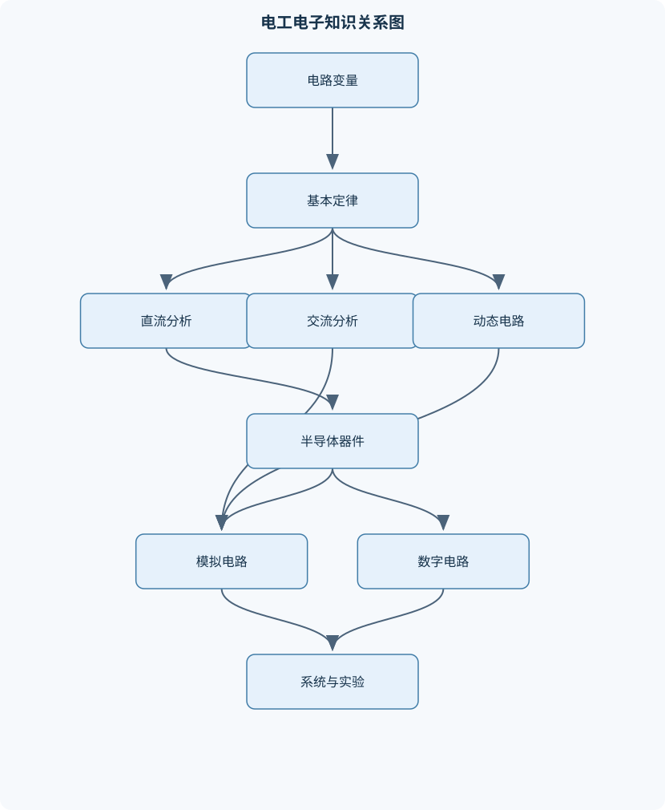
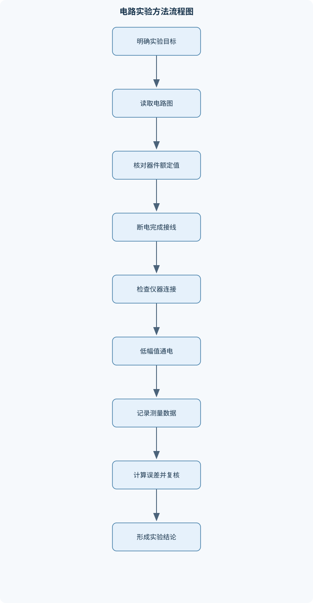

# 电工电子学及实验

## 一、课程整体知识框架

### 课程边界与先修知识

本课程覆盖低压直流电路、正弦交流电路、动态电路、变压器与三相电路、模拟电子技术、数字电子技术、功率电子与电机基础，以及常用电工电子实验方法。重点是建立电路模型，使用基本定律和等效方法进行分析，理解二极管、晶体管、运算放大器、逻辑门、触发器、整流滤波和振荡等基本电路的工作机理，并完成测量、故障判断和实验报告。先修知识包括代数与复数运算、基础微积分、初等物理中的电场磁场概念，以及基本电路图识读。课程不覆盖高频电磁场、复杂集成电路版图、微机原理和电力系统保护等专门内容。理想电路模型用于推导和定量计算，实际实验还必须考虑仪器输入阻抗、元件误差、寄生参数、温升、接线安全和测量带宽。





### 1. 课程目标与建模主线

《电工电子学及实验》以“建立模型—列写方程—求解响应—测量验证—分析偏差”为主线，研究电能和信号在电路、电子器件及机电装置中的传递与变换。课程并非只计算电压、电流，而是要求判断一个模型在什么条件下成立，以及实际元件、仪器和接线方式会怎样改变理想结果。

电路分析首先规定变量的参考方向。电压 $u_{ab}$ 定义为节点 $a$ 相对于节点 $b$ 的电势差，电流 $i$ 的正方向由箭头规定。若计算结果为负值，表示实际方向与参考方向相反，并不表示电路定律错误。电阻 $R$ 的单位为欧姆 $\Omega$，电导为 $G=1/R$，单位为西门子 S；电容 $C$ 的单位为法拉 F，电感 $L$ 的单位为亨利 H。理想电阻满足

$$
u=Ri
$$

理想电容和电感分别满足

$$
i=C\frac{du}{dt},\qquad u=L\frac{di}{dt}.
$$

电阻消耗功率，电容和电感则能够储存能量。采用关联参考方向时，元件瞬时功率为

$$
p(t)=u(t)i(t).
$$

电阻功率恒为非负；电容储能为

$$
w_C=\frac{1}{2}Cu^2
$$

电感储能为

$$
w_L=\frac{1}{2}Li^2.
$$

这些关系以集中参数模型为基础，即假定电路尺寸相对于信号波长足够小，电压和电流可以用集中变量描述。高频、长距离传输或明显存在辐射和分布参数时，必须使用传输线或电磁场模型，本课程不展开复杂高频电磁场分析。

### 2. 守恒定律与电路方程

基尔霍夫电流定律由电荷守恒得到：节点不能持续积累净电荷，因此任一节点处各支路电流的代数和为零，

$$
\sum_k i_k=0.
$$

基尔霍夫电压定律由能量守恒得到：沿任一闭合回路绕行一周，电势升降的代数和为零，

$$
\sum_k u_k=0.
$$

节点、支路和回路是列方程的基本结构。节点是三条或更多支路相连的连接点；支路是两个节点之间的一段电路；回路是从某点出发又回到该点的闭合路径。电压源、电流源和受控源都属于电路模型中的激励或控制元件。受控源的大小由电路中其他电压或电流决定，不能像独立源那样随意置零。

对电阻网络应用欧姆定律和基尔霍夫定律，可得到线性代数方程。若有 $n$ 个节点，选定一个参考节点后，通常需要建立 $n-1$ 个相互独立的节点方程。方程独立性比方程数量更重要：重复写出的节点方程不能增加有效信息。

### 3. 直流电路与等效分析

直流稳态下，电阻两端电压和电流不随时间变化。电阻串联时电流相同，等效电阻为

$$
R_{\mathrm{eq}}=R_1+R_2+\cdots+R_n.
$$

电阻并联时电压相同，等效电阻满足

$$
\frac{1}{R_{\mathrm{eq}}}
=\frac{1}{R_1}+\frac{1}{R_2}+\cdots+\frac{1}{R_n}.
$$

串并联变换的前提是外部电路只能从两个端口观察网络，并且变换前后端口电压与端口电流关系不变。不能因为两个元件在图形上靠近，就直接判定它们串联或并联；串联要求中间节点没有其他分支，并联要求两端连接于同一对节点。

戴维宁定理把任意线性二端网络等效为电压源 $U_{\mathrm{th}}$ 和电阻 $R_{\mathrm{th}}$ 串联。$U_{\mathrm{th}}$ 是端口开路电压；$R_{\mathrm{th}}$ 是独立源置零后从端口看入的等效电阻。独立电压源置零等效为短路，独立电流源置零等效为开路。若电路含受控源，受控源保留，应接入测试电压或测试电流，以

$$
R_{\mathrm{th}}=\frac{U_{\mathrm{test}}}{I_{\mathrm{test}}}
$$

求得等效电阻。诺顿等效为电流源 $I_N$ 与电阻 $R_N$ 并联，其中

$$
R_N=R_{\mathrm{th}},\qquad I_N=\frac{U_{\mathrm{th}}}{R_{\mathrm{th}}}.
$$

叠加定理只适用于线性网络。计算某一独立源单独作用时，其他独立电压源短路、独立电流源开路；受控源始终保留。叠加的是电压和电流，不能直接叠加各个独立源单独作用时的功率，因为功率与电压、电流的平方有关。

纯电阻网络从戴维宁等效看，负载功率为

$$
P_L=\frac{U_{\mathrm{th}}^2R_L}{(R_{\mathrm{th}}+R_L)^2}.
$$

对 $R_L$ 求极值，令导数为零，得到最大功率传输条件

$$
R_L=R_{\mathrm{th}},
\qquad
P_{L,\max}=\frac{U_{\mathrm{th}}^2}{4R_{\mathrm{th}}}.
$$

此时源端输出功率中只有一半传给负载，另一半消耗在等效内阻上。交流网络不能简单套用该结论，通常要求负载阻抗与源等效阻抗共轭匹配。

### 4. 正弦交流电路

正弦电压可写为

$$
u(t)=U_m\sin(\omega t+\varphi),
$$

其中 $U_m$ 为峰值，单位 V；$\omega$ 为角频率，单位 rad/s；$\varphi$ 为初相位，单位 rad。周期为 $T=2\pi/\omega$，频率为 $f=1/T$。正弦电压有效值为

$$
U=\frac{U_m}{\sqrt{2}},
$$

正弦电流有效值同理为 $I=I_m/\sqrt{2}$。有效值表示在相同电阻上产生相同平均热功率的直流等效值，不能与平均值、峰值或峰峰值混淆。非正弦信号必须按均方根定义

$$
X_{\mathrm{rms}}=\sqrt{\frac{1}{T}\int_0^T x^2(t)\,dt}
$$

计算。

在同一频率的正弦稳态下，可用相量表示电压和电流。取电阻为参考，相量用复数表示，$j^2=-1$。电阻、电感和电容的阻抗分别为

$$
Z_R=R,\qquad
Z_L=j\omega L,\qquad
Z_C=\frac{1}{j\omega C}.
$$

电阻电压与电流同相；电感电压超前电流 $90^\circ$；电容电流超前电压 $90^\circ$。复阻抗的实部表示电阻性成分，虚部表示储能性成分。复导纳为 $Y=1/Z$，适合处理并联电路。

交流功率包括有功功率、无功功率和视在功率：

$$
P=UI\cos\varphi,\qquad
Q=UI\sin\varphi,\qquad
S=UI.
$$

其中 $P$ 的单位为 W，$Q$ 的单位为 var，$S$ 的单位为 VA，功率因数为 $\cos\varphi=P/S$。式中 $U$、$I$ 必须为有效值。功率因数小表示同样的有功功率需要较大的线路电流，线路损耗会增大。

串联 RLC 电路的阻抗为

$$
Z=R+j\left(\omega L-\frac{1}{\omega C}\right).
$$

当

$$
\omega_0=\frac{1}{\sqrt{LC}}
$$

时，感抗和容抗相等，阻抗虚部为零，电流与输入电压同相，这就是串联谐振。并联谐振的输入电流在理想条件下最小，但支路内部电流可能很大。实际谐振频率、品质因数和带宽会受到电阻、线圈损耗、寄生电容及测量负载影响。

### 5. 动态电路与频率响应

含电容或电感的电路具有状态变量。电容电压和电感电流在普通有限能量换路中不能瞬间突变：

$$
u_C(0^+)=u_C(0^-),\qquad
i_L(0^+)=i_L(0^-).
$$

一阶电路的统一响应形式为

$$
x(t)=x(\infty)+[x(0^+)-x(\infty)]e^{-t/\tau}.
$$

其中 $x(t)$ 可以是电容电压或电感电流，$x(0^+)$ 为换路后初值，$x(\infty)$ 为换路后稳态值，$\tau$ 为时间常数。对 RC 电路，

$$
\tau=R_{\mathrm{eq}}C;
$$

对 RL 电路，

$$
\tau=\frac{L}{R_{\mathrm{eq}}}.
$$

这里的 $R_{\mathrm{eq}}$ 是从储能元件端口看入、并将独立源置零后的等效电阻，不一定是电路图中某一个单独电阻。零输入响应只由初始储能产生；零状态响应只由外部激励产生；两者之和为全响应。若有阶跃输入，初值和终值必须分别由换路前、换路后电路确定，不能把换路前的电阻网络直接用于整个过程。

二阶 RLC 电路的响应由特征方程决定，可能表现为过阻尼、临界阻尼或欠阻尼。欠阻尼时波形具有衰减振荡；理想无损模型可能持续振荡，但实际电阻和器件损耗会使振幅衰减。低通电路允许低频成分通过而抑制高频成分，高通电路则相反。频率响应由幅频特性和相频特性共同描述，不能只观察增益而忽略相位延迟。

### 6. 变压器与三相电路

电流变化产生磁场，变化的磁通在绕组中产生感应电动势。理想变压器满足

$$
\frac{U_1}{U_2}=\frac{N_1}{N_2},
\qquad
\frac{I_1}{I_2}=\frac{N_2}{N_1},
\qquad
U_1I_1=U_2I_2.
$$

其中 $N_1,N_2$ 是原、副边匝数。升压变压器电压比大于一时，理想情况下电流比小于一。实际变压器存在绕组电阻造成的铜耗、铁芯磁滞和涡流造成的铁耗、漏磁以及温升，因此输出电压会随负载变化，输入输出功率也不相等。负载阻抗折算到原边时，在理想条件下为

$$
Z'_L=\left(\frac{N_1}{N_2}\right)^2Z_L.
$$

对称三相电源的三相电压幅值相等、频率相同、相位依次相差 $120^\circ$。星形联结中，在对称条件下

$$
U_L=\sqrt{3}U_{\mathrm{ph}},
\qquad
I_L=I_{\mathrm{ph}}.
$$

三角形联结中

$$
U_L=U_{\mathrm{ph}},
\qquad
I_L=\sqrt{3}I_{\mathrm{ph}}.
$$

对称三相负载总有功功率为

$$
P=\sqrt{3}U_LI_L\cos\varphi.
$$

这些关系必须建立在对称电源、对称负载及明确联结方式的前提下。不对称负载时，三相电流不再相等；有中性线时，中性线电流为三相电流的相量和，不能用代数绝对值简单相加。

### 7. 半导体器件与整流电源

PN 结在正向偏置时势垒降低，电流较易通过；反向偏置时势垒升高，只有很小漏电流，电压过大可能发生击穿。理想二极管正向导通时压降取零，反向截止时电流取零；实际二极管具有正向压降、反向漏电流、结电容和最大反向电压限制。正向压降不是固定的普适常数，会随电流、温度和器件材料变化。

稳压二极管利用反向击穿区稳定电压，但必须配合限流电阻，且工作电流和功耗必须在额定范围内。发光二极管将部分电能转换为光能，也需要限流，不能直接接到理想电压源上。

半波整流只利用输入正弦波的一个半周，输出脉动频率等于输入频率；桥式全波整流利用两个半周，脉动频率为输入频率的两倍。理想桥式全波整流、变压器次级峰值为 $U_m$ 时，平均输出电压为

$$
U_{d0}=\frac{2U_m}{\pi}.
$$

实际桥式整流每个半周通常有两只二极管导通，输出峰值应扣除两只二极管的正向压降，并检查反向耐压和浪涌电流。电容滤波通过在峰值附近充电、在二极管截止期间向负载放电来降低纹波；负载越重、滤波电容越小，纹波越大。滤波电容不能替代稳压器，稳压电路还需满足输入范围、负载电流和散热条件。

### 8. 晶体管、运算放大器与模拟信号处理

双极型晶体管端子为基极 B、集电极 C、发射极 E，常见工作区包括截止、放大和饱和。静态工作点是无交流输入时的端电压和端电流。共射极电路通常提供较大的电压增益并产生反相；共集电极电路电压增益接近一，具有较高输入电阻和较低输出电阻，适合作缓冲。判断工作区必须同时检查端电压和端电流，不能只依据某一个偏置电阻。

场效应晶体管端子为栅极 G、漏极 D、源极 S，主要由栅源电压控制漏极电流，栅极输入电流理想情况下很小。差分放大器放大两个输入电压之差，并抑制共同变化的信号；共模抑制能力是其重要性能。

理想运算放大器具有无限大开环增益、无限大输入电阻和零输出电阻。在线性负反馈且输出未饱和时，可采用“虚短”和“虚断”：

$$
u_+=u_-,
\qquad
i_+=i_-=0.
$$

反相放大器、同相放大器、加法器和减法器都可由节点电流方程推导，而不能脱离反馈结构机械套公式。积分器和微分器分别利用电容的储能关系实现信号积分和微分，但实际电路必须限制直流漂移、噪声放大及高频寄生效应。比较器通常工作在开环或正反馈状态，不能使用线性放大区的虚短结论；施密特触发器利用迟滞提高抗噪能力。

有源滤波器用运算放大器和 R、C 网络实现增益与频率选择。正弦波振荡器依靠满足幅值和相位条件的正反馈产生振荡；方波和三角波发生器通常由比较器、施密特触发器及积分环节组成。实际振荡必须考虑启动条件、输出饱和、频率稳定性和器件非线性。

### 9. 数字逻辑、功率电子与电机

数字电路使用有限个逻辑电平。二进制、十进制、十六进制属于数制；BCD 等属于码制。布尔代数用于化简逻辑关系，基本门包括与门、或门、非门以及由其组合形成的与非门、或非门。组合逻辑输出只由当前输入决定，编码器、译码器、半加器和全加器属于组合逻辑。全加器的和位和进位位分别由当前两个加数与低位进位共同决定。

时序逻辑输出还取决于触发器保存的历史状态。触发器、寄存器和计数器必须分析时钟边沿、建立时间、保持时间、复位状态和无效状态。同步计数器的状态变化由同一时钟统一触发；若不满足建立保持时间，理论逻辑关系正确也可能出现实际误动作。

晶闸管具有单向导通和可控开通特性，可用于可控整流。直流斩波器通过快速开关改变平均输出电压；逆变器把直流变为交流，变频器通过改变输出频率和电压调节交流电机运行。实际功率电子电路还需处理开关损耗、散热、电磁干扰和保护。

直流电动机由定子磁场、转子绕组、换向装置等构成，电磁转矩来源于载流导体在磁场中的受力。异步电动机利用旋转磁场产生转矩，旋转磁场同步转速为

$$
n_s=\frac{60f}{p},
$$

其中 $f$ 为电源频率，$p$ 为极对数。转差率为

$$
s=\frac{n_s-n}{n_s},
$$

其中 $n$ 为转子机械转速。继电接触器控制利用按钮、继电器、接触器和热继电器实现启停、自锁、互锁及过载保护。

### 10. 实验测量与理论边界

实验工作必须先断电接线，确认电源、电压等级、元件额定值和接地方式。万用表测电压时并联，测电流时串联；电流档误接电源两端可能造成短路。示波器普通探头地夹通常与保护地相连，不能随意夹在浮动节点。探头衰减设置必须与示波器通道设置一致，否则幅值读数会按错误比例显示。

实验数据应同时记录理论值、实测值、单位、量程、环境条件和相对误差。例如相对误差可写为

$$
\varepsilon=\frac{|x_{\mathrm{meas}}-x_{\mathrm{theory}}|}
{|x_{\mathrm{theory}}|}\times100\%.
$$

误差来源包括电阻容差、仪器输入阻抗、探头负载、接触电阻、寄生参数、温升、读数分辨率和信号带宽。测量结果与理论值不一致时，应先检查接线、量程、参考地和模型条件，再讨论元件误差。课程覆盖低压电路、基础模拟与数字电路、常见功率变换和电机原理，不覆盖高频电磁场、复杂集成电路版图、微机原理及电力系统保护。

## 二、章节和模块划分

### 核心知识覆盖清单

本清单用于检查正文是否覆盖本课程的主要知识模块：

- **电路变量与基本定律**：电压电流参考方向、功率与能量计算、电阻电容电感模型、欧姆定律与伏安特性、基尔霍夫电流定律、基尔霍夫电压定律、受控源与电路模型、节点和回路概念。
- **直流电路分析方法**：串并联等效变换、电压源与电流源等效、戴维宁定理、诺顿定理、叠加定理、节点电压法、回路电流法、最大功率传输。
- **正弦交流电路**：正弦量有效值、相位与相量表示、复阻抗与复导纳、电阻电感电容特性、串联交流电路、并联交流电路、交流功率与功率因数、串联与并联谐振。
- **动态电路与频率响应**：一阶电路零输入响应、一阶电路零状态响应、RC和RL时间常数、阶跃响应与全响应、换路定律、二阶电路基本特征、低通与高通滤波、幅频和相频特性。
- **变压器与三相电路**：磁路与电磁感应、理想变压器关系、实际变压器损耗、变压器阻抗折算、三相对称电源、星形和三角形联结、线电压与相电压、三相功率计算。
- **半导体器件与整流电源**：PN结单向导电、二极管伏安特性、稳压二极管、发光二极管、单相半波整流、单相桥式整流、电容滤波与纹波、直流稳压电路。
- **晶体管与模拟放大电路**：双极型晶体管工作区、静态工作点、共射极放大电路、共集电极放大电路、场效应晶体管、差分放大电路、运算放大器理想模型、负反馈与放大器性能。
- **集成运算与信号处理**：反相和同相放大器、加法与减法电路、积分与微分电路、电压比较器、施密特触发器、有源滤波器、正弦波振荡器、三角波与方波产生。
- **数字逻辑与时序电路**：数制与码制、布尔代数、逻辑门电路、组合逻辑分析、编码器与译码器、半加器与全加器、触发器和寄存器、计数器与时序逻辑。
- **功率电子与电机基础**：晶闸管基本特性、可控整流原理、直流斩波器、逆变与变频概念、直流电动机结构、异步电动机旋转磁场、同步转速与转差率、继电接触器控制。
- **电工电子实验方法**：实验安全与接地、万用表正确接线、示波器探头补偿、信号发生器设置、直流电路测量、交流相位测量、器件伏安特性测量、实验数据误差分析。


### 第一模块 电路变量、基本定律与模型

#### 核心内容

本模块建立后续所有分析的语言。应先确定节点、支路、回路、参考节点和参考方向，再根据元件关系及 KCL、KVL 建立方程。电压源规定端电压，电流源规定支路电流；理想电压源电流可由外部电路决定，理想电流源电压可由外部电路决定。实际电源还具有内阻和额定电流，不能无限输出功率。

#### 代表性例题 1：节点方程与功率验证

题干：一个节点接入三个支路，第一支路有 $2\ \mathrm{A}$ 电流流入，第二支路有 $0.8\ \mathrm{A}$ 电流流出，第三支路电流参考方向取流出。求第三支路电流。

分析：以流入节点为正，应用 KCL。

逐步解答：

$$
2-0.8-i_3=0
$$

因此

$$
i_3=1.2\ \mathrm{A}.
$$

结果为正，说明第三支路实际方向与假定流出方向一致。若将第三支路参考方向改为流入，计算结果应为 $-1.2\ \mathrm{A}$。变式是把一个支路改为电流源或受控源，此时仍可列 KCL，但不能用欧姆定律替代电流源约束。验证时应检查所有支路电流代数和为零。

### 第二模块 直流电路分析方法

#### 节点电压法、回路电流法和等效变换

节点电压法以参考节点为零，未知量是各非参考节点电压；回路电流法以独立网孔电流为未知量，适用于平面电路。二者都要求统一参考方向并正确处理公共支路。节点法对电流源网络尤其方便，回路法对电压源较多的平面网络较方便。

戴维宁算法的输入是线性二端网络、端口和负载参数，输出是负载电流、电压和功率。过程为：断开负载；求开路电压 $U_{\mathrm{th}}$；独立源置零并求 $R_{\mathrm{th}}$；恢复负载；用串联电路求响应。终止条件是端口电压电流关系已经由两个参数完整确定。若存在受控源，必须使用测试源。线性方程组用高斯消元求解时，$n$ 个未知量通常需要约 $O(n^3)$ 次运算，适合规模有限的教学电路。

#### 代码化的节点电压求解示例

下面代码只进行离线数值计算，不涉及文件和网络操作。电路由节点导纳矩阵 $G$ 和电流向量 $b$ 表示，参考节点已删除。

```python
import numpy as np

# 三个非参考节点的导纳矩阵，单位为西门子 S
G = np.array([
    [ 3.0, -1.0,  0.0],
    [-1.0,  2.5, -0.5],
    [ 0.0, -0.5,  1.5]
], dtype=float)

# 注入各节点的电流，单位为安培 A
b = np.array([2.0, 0.0, 1.0], dtype=float)

# 求解 G V = b，输出节点电压，单位为伏特 V
V = np.linalg.solve(G, b)
print(V)

# 计算残差，理想情况下接近 0
residual = G @ V - b
print(residual)
```

输入是导纳矩阵和节点注入电流，输出是各节点相对于参考节点的电压。算法不变量是每一步消元后方程组与原方程组等价；终止条件是所有未知节点电压求出。若矩阵奇异，通常表示参考节点选择不当、存在浮置节点或方程不独立。实际测量中还需用 $i=(u_a-u_b)/R$ 回算支路电流，并检查功率平衡。

#### 代表性例题 2：戴维宁等效与最大功率

题干：某线性网络端口开路电压为 $12\ \mathrm{V}$，从端口看入的等效电阻为 $6\ \Omega$。接入负载 $R_L=3\ \Omega$。求负载电流、电压和功率；再求最大功率条件。

逐步解答：

$$
I_L=\frac{U_{\mathrm{th}}}{R_{\mathrm{th}}+R_L}
=\frac{12}{6+3}
=\frac{4}{3}\ \mathrm{A}.
$$

$$
U_L=I_LR_L=4\ \mathrm{V}.
$$

$$
P_L=I_L^2R_L
=\left(\frac{4}{3}\right)^2\times3
=\frac{16}{3}\ \mathrm{W}.
$$

最大功率条件为

$$
R_L=R_{\mathrm{th}}=6\ \Omega,
$$

最大功率为

$$
P_{L,\max}=\frac{12^2}{4\times6}=6\ \mathrm{W}.
$$

验证：当 $R_L=6\ \Omega$ 时，负载电流为 $1\ \mathrm{A}$，负载电压为 $6\ \mathrm{V}$，功率为 $6\ \mathrm{W}$。变式是交流阻抗网络，此时应采用共轭匹配，而不是直接令负载电阻等于等效电阻。

### 第三模块 正弦交流、谐振与动态电路

#### 相量分析流程

输入为同一频率的正弦激励及 $R,L,C$ 参数。先把元件替换为复阻抗，再用 KCL、KVL 或等效变换求复电压和复电流，最后计算有效值、相位、有功功率和功率因数。不同频率的信号不能合并为一个相量方程；非正弦周期信号应先分解为直流分量和各次谐波，或直接采用时域分析。

一阶暂态流程是：求换路前稳态；由换路定律确定 $u_C(0^+)$ 或 $i_L(0^+)$；求换路后终值；从储能元件端口求 $R_{\mathrm{eq}}$；计算 $\tau$；代入统一响应式；用初值和终值复核。

#### 代表性例题 3：串联 RLC 电路

题干：串联电路中 $R=10\ \Omega$，$L=0.1\ \mathrm{H}$，$C=100\ \mu\mathrm{F}$，电源频率 $f=50\ \mathrm{Hz}$，有效值 $U=20\ \mathrm{V}$。求感抗、容抗、阻抗、电流及功率因数。

逐步解答：

$$
\omega=2\pi f=100\pi\ \mathrm{rad/s}.
$$

$$
X_L=\omega L=31.42\ \Omega,
$$

$$
X_C=\frac{1}{\omega C}=31.83\ \Omega.
$$

因此

$$
Z=10+j(31.42-31.83)
\approx10-j0.41\ \Omega.
$$

阻抗幅值约为 $10.01\ \Omega$，电流有效值约为

$$
I=\frac{20}{10.01}\approx2.00\ \mathrm{A}.
$$

功率因数约为

$$
\cos\varphi=\frac{R}{|Z|}
\approx0.999.
$$

由于虚部为负，电路略呈容性，电流略超前电压。变式是提高频率，此时 $X_L$ 增大、$X_C$ 减小，电路可能转为感性。验证可检查有功功率 $P=I^2R\approx40\ \mathrm{W}$，且不应超过视在功率 $S=UI\approx40\ \mathrm{VA}$。

#### 代表性例题 4：RC 阶跃响应

题干：$R=10\ \mathrm{k}\Omega$，$C=100\ \mu\mathrm{F}$，电容初始电压为 $0$，输入在 $t=0$ 时从 $0$ 跃变为 $5\ \mathrm{V}$。求 $t=1\ \mathrm{s}$ 时电容电压。

时间常数为

$$
\tau=RC=10^4\times100\times10^{-6}=1\ \mathrm{s}.
$$

终值为 $5\ \mathrm{V}$，所以

$$
u_C(t)=5(1-e^{-t}).
$$

当 $t=1\ \mathrm{s}$ 时，

$$
u_C(1)=5(1-e^{-1})\approx3.16\ \mathrm{V}.
$$

初值为 $0$，终值趋近 $5\ \mathrm{V}$，与公式一致。电阻电流为

$$
i_R(t)=\frac{5-u_C(t)}{10\ \mathrm{k}\Omega}.
$$

变式是电容初始电压不为零，此时必须把 $u_C(0^+)$ 代入统一响应式；若电路含冲激源或特殊理想开关约束，不能直接套用普通连续性结论。

### 第四模块 变压器、三相电路与电机基础

#### 三相计算和电机运行量

三相题必须先判断星形或三角形、是否对称以及给出的是线量还是相量。对称星形负载中，线电流等于相电流；对称三角形负载中，线电流为相电流的 $\sqrt{3}$ 倍。异步电动机题先由频率和极对数求同步转速，再由实际转速求转差率。转差率为零时，理想异步电机没有相对切割磁场的速度，不能产生正常感应转矩。

#### 代表性例题 5：对称三相星形负载

题干：对称三相四线制电源线电压 $U_L=380\ \mathrm{V}$，星形负载每相阻抗为 $Z_{\mathrm{ph}}=10+j10\ \Omega$。求相电压、线电流和总有功功率。

相电压为

$$
U_{\mathrm{ph}}=\frac{U_L}{\sqrt3}
=\frac{380}{\sqrt3}\approx219.4\ \mathrm{V}.
$$

阻抗幅值为

$$
|Z_{\mathrm{ph}}|=\sqrt{10^2+10^2}
\approx14.14\ \Omega.
$$

相电流即线电流：

$$
I_L=I_{\mathrm{ph}}
=\frac{219.4}{14.14}
\approx15.51\ \mathrm{A}.
$$

功率因数为

$$
\cos\varphi=\frac{10}{14.14}\approx0.707.
$$

总有功功率为

$$
P=\sqrt3U_LI_L\cos\varphi
\approx7.22\ \mathrm{kW}.
$$

验证方法是按三相分别计算 $P_{\mathrm{ph}}=U_{\mathrm{ph}}I_{\mathrm{ph}}\cos\varphi$，再乘以三。变式是三角形负载，此时每相电压等于线电压，不能继续使用星形的相电压公式。

### 第五模块 半导体器件、整流电源与模拟放大

#### 器件模型的层次

分析二极管时可按理想模型、恒压降模型或分段线性模型逐步提高精度。模型越简单，计算越快，但与实际波形和温升的偏差可能越大。整流电路分析应依次确定导通区间、输出极性、峰值、平均值、负载电流、二极管反向耐压和滤波纹波。

晶体管放大电路先进行直流分析，确定静态工作点，再将交流信号置零并建立小信号模型，最后计算增益、输入电阻、输出电阻和最大不失真范围。若静态点靠近截止或饱和区，输入稍大就会产生削顶失真。负反馈通常降低闭环增益，却能扩大带宽、减小失真并提高稳定性。

#### 代表性例题 6：桥式整流平均值

题干：变压器次级电压有效值为 $12\ \mathrm{V}$，采用理想桥式全波整流，忽略滤波。求平均输出电压。

次级峰值为

$$
U_m=\sqrt2U=12\sqrt2\approx16.97\ \mathrm{V}.
$$

理想平均输出为

$$
U_{d0}=\frac{2U_m}{\pi}
\approx\frac{2\times16.97}{\pi}
\approx10.80\ \mathrm{V}.
$$

若每只导通二极管正向压降近似为 $0.7\ \mathrm{V}$，每个半周有两只导通，输出峰值需近似减去 $1.4\ \mathrm{V}$；平均值的精确计算应对削顶后的波形积分，不能简单认为所有情况下只减去一个固定电压。验证时应观察输出为全波脉动，脉动频率是输入频率的两倍。变式是半波整流，理想平均值为 $U_m/\pi$，且纹波更大。

### 第六模块 数字逻辑与实验方法

#### 组合逻辑和时序逻辑流程

组合逻辑设计输入、输出、有效电平和真值表，再用布尔代数或卡诺图化简，选择门电路实现并验证全部输入组合。时序逻辑还需列出当前状态和下一状态，确定触发器类型、时钟边沿、复位方式及非法状态处理。逻辑高低电平必须满足具体器件的输入阈值和输出驱动能力，不能把“1”和“0”当作无条件的理想电压。

#### 实验一：直流网络与等效定理验证

输入数据：电阻标称值及实测值、直流电源设定值、端口开路电压、负载电阻系列值、万用表量程和读数。实验步骤如下：

1. 断电检查电阻阻值、极性元件和电源电压范围。
2. 按参考电流方向完成接线，先测端口开路电压。
3. 将独立电压源短路或独立电流源开路，测量端口等效电阻；含受控源时使用测试源。
4. 依次接入不同负载，测量负载电压和电流。
5. 用 $U_L=U_{\mathrm{th}}R_L/(R_{\mathrm{th}}+R_L)$ 计算理论值，并求相对误差。
6. 检查电源输出功率、等效电阻消耗功率和负载功率是否近似满足能量平衡。

评价标准：接线无短路，电流表串联、电压表并联；理论与实测趋势一致；负载接近 $R_{\mathrm{th}}$ 时负载功率达到较大值；误差有明确来源分析。排错方法是先断电核对节点，再检查万用表档位、表笔插孔、参考地和电源内阻；若所有读数同时偏小，优先检查电源输出和仪表负载效应，若只有一个支路异常，检查局部接触和元件阻值。

#### 实验二：示波器测量 RC 阶跃与频率响应

输入数据：信号发生器幅值、偏置、频率、占空比，$R$、$C$ 实测值，示波器通道衰减、时间刻度和电压刻度。实验步骤如下：

1. 断电搭建 RC 电路，确认信号源地与示波器地处于允许连接的参考点。
2. 将探头衰减开关和示波器通道设置统一，先输入低幅值方波。
3. 调节触发电平，使波形稳定；记录输入和电容输出的峰峰值、周期和上升过程。
4. 测量输出达到终值约 $63.2\%$ 时的时间，作为时间常数的实验估计。
5. 改变输入频率，记录输出幅值比和相位差，判断低通特性。
6. 将实测时间常数与 $RC$ 理论值比较，分析探头输入电阻、电容、元件容差和示波器带宽造成的偏差。

评价标准：波形稳定、通道单位正确、探头补偿正常；时间常数随 $R$ 或 $C$ 的改变趋势正确；低频时输出接近输入，高频时输出衰减并产生相位滞后。排错时，若波形幅值整体差十倍，检查探头衰减设置；若波形抖动，检查触发源和触发电平；若时间常数明显偏大，检查电容实际值、探头电容及电阻是否存在并联通路；若出现危险接地路径，必须立即断电并重新确认测量方案。

## 三、核心概念的详细解释

### 1. 电路变量、模型与守恒关系

电路分析的第一步是建立端口、节点、支路及参考方向。电压 $u_{ab}$ 表示节点 $a$ 相对于节点 $b$ 的电势差；电流箭头规定电流的正方向。若计算所得电流或电压为负值，说明实际方向与参考方向相反，并不表示电路定律失效。采用关联参考方向时，元件吸收的瞬时功率为

$$
p(t)=u(t)i(t).
$$

$p>0$ 表示元件吸收能量，$p<0$ 表示元件向外部供能。电阻把电能转化为热能；电容和电感分别以电场和磁场形式储能：

$$
w_C=\frac12Cu^2,\qquad w_L=\frac12Li^2.
$$

电容电压和电感电流是状态变量。在没有冲激电流或冲激电压等特殊激励时，换路瞬间满足

$$
u_C(0^+)=u_C(0^-),\qquad i_L(0^+)=i_L(0^-).
$$

电阻、电容和电感均为理想集中参数模型。实际元件还具有漏电阻、寄生电容、寄生电感、温度系数和额定功率等限制。当电路尺寸不能忽略传播延迟，或工作频率足够高以至于分布参数显著时，不能继续把所有节点电压视为同时变化。

基尔霍夫电流定律（KCL）来源于电荷守恒。规定流入节点的电流为正、流出为负，则

$$
\sum_k i_k=0.
$$

基尔霍夫电压定律（KVL）来源于能量守恒。沿闭合路径规定统一绕行方向，电压升取正、压降取负，则

$$
\sum_k u_k=0.
$$

KCL适用于节点电荷没有持续积累的集中参数近似；KVL适用于回路中不显著存在时变磁通穿过回路的情形。在强电磁耦合或大面积回路中，应结合电磁感应效应修正模型。

### 2. 直流电路及等效方法

直流稳态电路中，电阻两端电压和电流为常量。串联元件具有相同电流，并联元件具有相同电压。两个电阻的等效关系为

$$
R_{\mathrm{串}}=R_1+R_2,
\qquad
R_{\mathrm{并}}=\frac{R_1R_2}{R_1+R_2}.
$$

串并联判定依据是节点关系，而不是图形上的远近：中间节点没有其他分支才可能串联；两个元件的两端分别接在同一对节点上才是并联。

线性二端网络可用戴维宁或诺顿等效表示。戴维宁模型为电压源 $U_{\mathrm{th}}$ 串联电阻 $R_{\mathrm{th}}$，其中 $U_{\mathrm{th}}$ 为端口开路电压。诺顿模型为电流源 $I_N$ 并联电阻 $R_N$，满足

$$
R_N=R_{\mathrm{th}},\qquad
I_N=\frac{U_{\mathrm{th}}}{R_{\mathrm{th}}}.
$$

求 $R_{\mathrm{th}}$ 时，独立电压源置零等效为短路，独立电流源置零等效为开路；受控源必须保留。含受控源网络应接入测试电压 $U_{\mathrm{test}}$ 或测试电流 $I_{\mathrm{test}}$，由

$$
R_{\mathrm{th}}=\frac{U_{\mathrm{test}}}{I_{\mathrm{test}}}
$$

求得等效电阻。等效变换只保证端口外部的电压—电流关系不变，不保证网络内部每个元件的电流、功率和电压保持不变。

叠加定理只适用于线性电路。计算某一个独立源的作用时，其他独立电压源短路、独立电流源开路；受控源不能被置零。叠加适用于电压、电流等线性响应，不应直接对功率叠加，因为功率是电压或电流的二次量。

### 3. 正弦交流电路与相量

正弦电压可写为

$$
u(t)=U_m\sin(\omega t+\varphi),
$$

其中 $U_m$ 为峰值，$\omega$ 为角频率，单位为 $\mathrm{rad/s}$，$\varphi$ 为初相位。周期和频率满足

$$
T=\frac{2\pi}{\omega},\qquad f=\frac1T.
$$

正弦量有效值由均方根定义。对正弦波，

$$
U=\frac{U_m}{\sqrt2},\qquad I=\frac{I_m}{\sqrt2}.
$$

非正弦波不能直接使用峰值除以 $\sqrt2$，必须按均方根定义计算：

$$
X_{\mathrm{rms}}=
\sqrt{\frac1T\int_0^T x^2(t)\,\mathrm dt}.
$$

相量法只适用于同一角频率下的正弦稳态分析。用复数表示相位后，电阻、电感和电容的阻抗分别为

$$
Z_R=R,\qquad
Z_L=j\omega L,\qquad
Z_C=\frac1{j\omega C}.
$$

电感电压超前电流 $90^\circ$，电容电流超前电压 $90^\circ$，电阻电压与电流同相。串联电路阻抗直接相加；并联电路应先求导纳

$$
Y=\frac1Z.
$$

交流有功功率、无功功率和视在功率分别为

$$
P=UI\cos\varphi,\qquad
Q=UI\sin\varphi,\qquad
S=UI,
$$

并满足

$$
S^2=P^2+Q^2.
$$

功率因数为 $\cos\varphi$。电感性负载吸收正无功，电容性负载通常提供负无功。功率因数补偿不能改变负载实际有功功率，但可减小线路电流和线路损耗。

串联RLC电路的阻抗为

$$
Z=R+j\left(\omega L-\frac1{\omega C}\right).
$$

当

$$
\omega_0=\frac1{\sqrt{LC}}
$$

时，感抗与容抗相等，阻抗虚部为零，电路发生串联谐振。理想串联谐振时电流最大、功率因数为1；实际电阻决定损耗和谐振曲线宽度。并联谐振的输入阻抗在理想条件下较大，但支路内部电流可能很大，不能把“输入电流小”误认为“各元件电流都小”。

### 4. 动态电路和频率响应

一阶RC电路的时间常数为

$$
\tau=R_{\mathrm{eq}}C,
$$

一阶RL电路的时间常数为

$$
\tau=\frac{L}{R_{\mathrm{eq}}}.
$$

这里的 $R_{\mathrm{eq}}$ 是从储能元件端口向外看、将独立源置零后得到的等效电阻。任意一阶状态变量均可写成

$$
x(t)=x(\infty)+[x(0^+)-x(\infty)]e^{-t/\tau}.
$$

零输入响应由初始储能决定，零状态响应由外部激励产生，全响应是二者之和。经过约 $5\tau$ 后，指数项小于约 $0.7\%$，通常可近似达到稳态，但这不是所有精密测量中的严格终止标准。

RC低通电路中，输出取电容两端，传递函数为

$$
H_{\mathrm{LP}}(j\omega)=\frac1{1+j\omega RC}.
$$

其幅值为

$$
|H_{\mathrm{LP}}|=\frac1{\sqrt{1+(\omega RC)^2}},
$$

截止角频率为

$$
\omega_c=\frac1{RC}.
$$

低频时电容近似开路，输出接近输入；高频时电容旁路信号，输出衰减。若输出取电阻两端，则构成高通电路，低频衰减、高频通过。实际频率响应还受信号源内阻、示波器输入阻抗、探头电容和器件寄生参数影响。

二阶电路的响应特征由阻尼和固有频率共同决定。阻尼过大时无振荡地衰减，阻尼较小时可能出现衰减振荡；理想无损模型会产生持续振荡，但实际电阻、铁损和辐射都会耗散能量。

### 5. 变压器与三相电路

变压器利用交变磁通和电磁感应实现电压变换与电气隔离。理想变压器满足

$$
\frac{U_1}{U_2}=\frac{N_1}{N_2},
\qquad
\frac{I_1}{I_2}=\frac{N_2}{N_1},
\qquad
U_1I_1=U_2I_2.
$$

$N_1,N_2$ 为原、副边匝数。升压时电压增大而电流减小，理想功率不变。实际变压器存在绕组电阻导致的铜耗、铁芯磁滞和涡流导致的铁耗、漏磁导致的漏抗以及温升和电压调整率。阻抗折算到另一侧时，阻抗按匝数比平方变化：

$$
Z_1=\left(\frac{N_1}{N_2}\right)^2Z_2.
$$

对称三相电源的三相电压幅值相等、相位互差 $120^\circ$。星形联结中，在负载对称时

$$
U_L=\sqrt3\,U_{\mathrm{ph}},
\qquad
I_L=I_{\mathrm{ph}}.
$$

三角形联结中

$$
U_L=U_{\mathrm{ph}},
\qquad
I_L=\sqrt3\,I_{\mathrm{ph}}.
$$

对称三相负载总有功功率为

$$
P=\sqrt3\,U_LI_L\cos\varphi.
$$

这些关系依赖对称条件。负载不对称时，星形系统的中性线电流一般不为零；若中性线断开，各相负载电压可能发生偏移，不能继续套用对称公式。

### 6. 半导体器件、整流和稳压

PN结具有单向导电特性。实际二极管正向电流随电压呈非线性变化，正向压降受电流、温度和器件类型影响；反向存在漏电流、结电容和反向击穿限制。理想模型把正向导通压降取零、反向电流取零，只适合初步判断导通状态。

稳压二极管工作在反向击穿区，通过串联限流电阻限制电流，使负载电压在一定电流范围内近似稳定。发光二极管将部分电能转化为光能，必须限制正向电流，不能直接接理想电压源。

单相桥式整流每个半周有两只二极管导通。若变压器次级电压峰值为 $U_m$，理想平均输出为

$$
U_{d0}=\frac{2U_m}{\pi}.
$$

实际桥式整流输出峰值约为 $U_m-2U_D$，其中 $U_D$ 为单只导通二极管的正向压降。电容滤波在峰值附近充电，在二极管截止期间向负载放电。全波整流的纹波频率约为输入频率的两倍，半波整流的纹波频率等于输入频率。电容过小会导致纹波增大，电容过大又会使充电脉冲电流增大、二极管和变压器发热。

### 7. 晶体管、运算放大器和模拟信号处理

双极型晶体管端子为基极 B、集电极 C、发射极 E。以常见共射极电路为例，截止区中基极电流和集电极电流均很小；放大区中集电极电流受基极电流控制；饱和区中集电极—发射极电压较低，不能继续按线性放大处理。静态工作点必须先由直流偏置确定，再在工作点附近建立小信号模型。

共射极放大器通常具有反相电压增益，输入变化增大时，集电极电压变化方向相反。共集电极放大器电压增益接近1，输入电阻较大、输出电阻较小，常用于缓冲。场效应晶体管由栅极电压控制漏极电流，栅极直流电流理想情况下接近零，但实际存在漏电和寄生电容。

理想运算放大器具有无限大开环增益、无限大输入电阻和零输出电阻。在负反馈、线性工作且输出未饱和时，可使用

$$
u_+=u_-,
\qquad
i_+=i_-=0.
$$

反相放大器输出为

$$
u_o=-\frac{R_f}{R_1}u_i,
$$

同相放大器输出为

$$
u_o=\left(1+\frac{R_f}{R_1}\right)u_i.
$$

虚短和虚断不是器件本身的绝对性质。正反馈、输入超出共模范围、输出接近电源轨或频率过高时，不能继续使用这些近似。负反馈通常降低增益，却能扩大带宽、减小失真、提高稳定性。

积分电路利用电容反馈实现

$$
u_o(t)=-\frac1{RC}\int u_i(t)\,\mathrm dt,
$$

微分电路则近似实现

$$
u_o(t)=-RC\frac{\mathrm du_i(t)}{\mathrm dt}.
$$

实际微分电路容易放大高频噪声，需增加限幅或频率补偿。比较器通常工作在开环或强正反馈状态，输出趋向高、低饱和电平。施密特触发器通过正反馈形成上下两个阈值，能把缓慢变化或含噪模拟信号整形成稳定逻辑信号。正弦振荡器必须同时满足起振条件和稳幅条件；方波、三角波发生器常由比较器、施密特触发器和积分器组合形成。

### 8. 数字逻辑、功率电子与电机基础

数字逻辑用高、低电平表示1和0，但实际高低电平是电压范围而不是两个绝对数值。逻辑门包括与、或、非及其组合形式。组合逻辑输出只由当前输入决定，编码器、译码器、半加器和全加器属于组合电路。全加器的和位与进位分别为

$$
S=A\oplus B\oplus C_{\mathrm{in}},
$$

$$
C_{\mathrm{out}}=AB+C_{\mathrm{in}}(A\oplus B).
$$

时序逻辑输出还取决于触发器保存的历史状态。寄存器保存多位信息，计数器按时钟改变状态。设计时必须检查时钟边沿、复位、建立时间、保持时间和非法状态。

晶闸管具有单向导通和受控开通特性，通常需要阳极—阴极正向偏置并施加门极触发；导通后能否关断取决于电流是否降至维持电流以下或电路是否提供换流条件。可控整流通过改变触发角调节平均直流输出；斩波器通过改变开关占空比调节直流平均电压；逆变器把直流变为交流，变频器通过改变输出频率和电压控制交流电机。

直流电动机由定子磁场、转子绕组、换向器和电刷等构成。异步电动机依靠旋转磁场在转子中感应电流，旋转磁场同步转速为

$$
n_s=\frac{60f}{p},
$$

其中 $f$ 为电源频率，$p$ 为极对数。转差率为

$$
s=\frac{n_s-n}{n_s}.
$$

异步电动机正常运行时转子转速低于同步转速，否则不会产生维持转矩所需的感应电流。继电接触器控制利用接触器主触点接通动力回路，辅助触点实现自锁、联锁和故障保护。

### 9. 实验测量的模型边界

万用表测电压时应并联，测电流时应串联；电流档误接电源两端可能造成短路。示波器普通探头地夹通常与保护地相连，不能任意夹在非参考地节点。测量浮地或非隔离高压电路时，必须使用符合安全条件的隔离测量方案。

示波器探头衰减档与通道设置必须一致。探头补偿不当会导致方波出现过冲或边沿变钝。信号发生器的幅值可能按峰值、峰峰值或有效值显示，设置时必须确认单位和负载条件。实验数据应同时记录理论值、实测值、单位、仪器量程和相对误差：

$$
\delta=
\frac{|x_{\mathrm{meas}}-x_{\mathrm{theory}}|}
{|x_{\mathrm{theory}}|}\times100\%.
$$

误差较大时应区分元件误差、仪器负载、接触电阻、接线错误、频率带宽不足和模型不适用等原因，不能只把偏差归因于“读数不准”。

## 四、重要定义、公式、定理和推导

### 专业审校补充：关键定义与适用边界

功率电子开关电路中，理想降压斩波器的连续电感电流条件不能与“输出平均值等于占空比乘输入值”混为一谈。输入直流电压为 $U_d$、开关周期为 $T$、导通时间为 $DT$ 时，在理想器件、稳态且电感电流连续的条件下，电感伏秒平衡给出 $U_o=DU_d$，其中 $D$ 为 $0$ 到 $1$ 之间的占空比。若电感电流降至零，则进入断续导电模式，输出电压还取决于负载、电感量和开关频率，不能直接使用该比例式。实际电路还存在开关压降、二极管压降、电感电阻、输出纹波和死区时间，因此测得的平均输出通常偏离理想值。判断工作模式应观察电感电流最小值：大于零为连续导电，等于零并保持一段时间为断续导电。功率开关的额定电压、电流和散热条件也必须同时满足，不能只按平均输出电压选型。


### 1. 直流节点法、回路法与戴维宁分析流程

#### 节点电压法

**输入：**电路拓扑、元件参数、独立源和受控源。  
**输出：**各节点电压、支路电流和功率。

1. 选择参考节点并令其电位为零。
2. 给其他独立节点标定电压。
3. 对每个非参考节点依据KCL列方程。
4. 用欧姆定律把支路电流写成节点电压之差除以电阻。
5. 求解线性方程组，再计算支路电流和功率。
6. 检查KCL及电源功率与负载功率是否平衡。

若有 $n$ 个节点，通常需要 $n-1$ 个独立方程。含理想电压源的两个非参考节点可用超节点处理。高斯消元对 $n$ 阶稠密方程的典型计算量约为 $O(n^3)$。不变量是每个已列节点的代数电流和为零；终止条件是所有独立节点电压均确定。

#### 回路电流法

适用于平面线性电路。选取独立网孔并统一回路方向，对每个网孔应用KVL。公共支路上的电压降由相邻回路电流之差决定。例如相邻网孔电流为 $I_1,I_2$，公共电阻上的压降可写为 $R(I_1-I_2)$。解出回路电流后，按支路所属关系求支路电流。不变量是每个独立网孔的电压代数和为零。含电流源的网孔需使用超网孔或直接利用电流约束。

#### 戴维宁等效流程

1. 断开负载端口。
2. 求端口开路电压 $U_{\mathrm{th}}$。
3. 将独立电压源短路、独立电流源开路。
4. 求从端口看入的 $R_{\mathrm{th}}$；有受控源时接入测试源。
5. 恢复负载，计算
   $$
   I_L=\frac{U_{\mathrm{th}}}{R_{\mathrm{th}}+R_L}.
   $$
6. 用
   $$
   U_L=I_LR_L,\qquad
   P_L=I_L^2R_L
   $$
   验证负载响应。

### 2. 正弦相量分析流程

**输入：**同一频率的正弦源、$R$、$L$、$C$ 和连接关系。  
**输出：**复电压、复电流、相位差、功率因数和功率。

1. 把峰值换为有效值，保留相位信息。
2. 将 $R,L,C$ 分别替换为 $R,j\omega L,1/(j\omega C)$。
3. 用KCL、KVL或等效变换求复量。
4. 取复数模得到有效值，取辐角得到相位。
5. 用 $P=UI\cos\varphi$ 等公式求功率。
6. 需要时恢复时域表达式。

不同频率的正弦源不能直接合并为一个相量方程；非正弦周期信号应先分解为傅里叶分量，或在时域直接分析。

### 3. 一阶暂态分析流程

**输入：**换路前后电路、开关动作、初始条件、$R$、$C$ 或 $L$。  
**输出：**储能元件电压或电流随时间的变化。

1. 求换路前稳态，得到 $u_C(0^-)$ 或 $i_L(0^-)$。
2. 用换路定律得到 $u_C(0^+)$ 或 $i_L(0^+)$。
3. 求换路后稳态终值 $x(\infty)$。
4. 将独立源置零，从储能元件端口求 $R_{\mathrm{eq}}$。
5. 写出 $\tau=R_{\mathrm{eq}}C$ 或 $\tau=L/R_{\mathrm{eq}}$。
6. 代入
   $$
   x(t)=x(\infty)+[x(0^+)-x(\infty)]e^{-t/\tau}.
   $$
7. 检查初值、终值和变化方向。

#### 例题一：戴维宁等效与负载功率

**题干：**端口网络的开路电压为 $12\ \mathrm V$，等效电阻为 $4\ \Omega$，接入负载 $R_L=8\ \Omega$。求负载电流、电压和功率；再判断最大功率条件。

**分析：**把外部网络替换为 $12\ \mathrm V$ 电压源串联 $4\ \Omega$。

**解答：**

$$
I_L=\frac{12}{4+8}=1\ \mathrm A,
$$

$$
U_L=I_LR_L=8\ \mathrm V,
$$

$$
P_L=I_L^2R_L=8\ \mathrm W.
$$

最大功率传输要求

$$
R_L=R_{\mathrm{th}}=4\ \Omega,
$$

此时

$$
P_{L,\max}=\frac{U_{\mathrm{th}}^2}{4R_{\mathrm{th}}}
=\frac{12^2}{16}=9\ \mathrm W.
$$

**验证：**$R_L=8\ \Omega$ 时负载功率低于 $9\ \mathrm W$，符合最大功率条件。变式是交流网络，此时负载应满足共轭匹配，而不是简单令电阻相等。

#### 例题二：串联RLC正弦稳态

**题干：**串联电路中 $R=10\ \Omega$，$L=0.1\ \mathrm H$，$C=100\ \mu\mathrm F$，电源频率 $50\ \mathrm{Hz}$，有效值为 $20\ \mathrm V$。求阻抗、电流、相位和有功功率。

**解答：**

$$
\omega=2\pi f\approx314.16\ \mathrm{rad/s},
$$

$$
X_L=\omega L\approx31.42\ \Omega,
$$

$$
X_C=\frac1{\omega C}\approx31.83\ \Omega.
$$

因此

$$
Z=10+j(31.42-31.83)
\approx10-j0.41\ \Omega.
$$

其模约为 $10.01\ \Omega$，电流有效值

$$
I=\frac{20}{10.01}\approx2.00\ \mathrm A.
$$

相位角

$$
\varphi=\arctan\frac{-0.41}{10}\approx-2.35^\circ.
$$

电路略呈容性，电流略超前电压。有功功率为

$$
P=I^2R\approx(2.00)^2\times10=40\ \mathrm W.
$$

**验证：**电抗接近零，说明工作频率接近谐振频率。变式是提高频率，此时 $X_L$ 增大、$X_C$ 减小，电路转为感性。

#### 例题三：RC阶跃响应

**题干：**$R=10\ \mathrm{k}\Omega$，$C=100\ \mu\mathrm F$，电容初始电压为零，接入 $5\ \mathrm V$ 直流源。求 $\tau$、$u_C(t)$ 以及 $t=\tau$ 时的电压。

**解答：**

$$
\tau=RC=10\,000\times100\times10^{-6}=1\ \mathrm s.
$$

初值为 $0$，终值为 $5\ \mathrm V$，因此

$$
u_C(t)=5(1-e^{-t})\ \mathrm V.
$$

当 $t=\tau=1\ \mathrm s$ 时，

$$
u_C(\tau)=5(1-e^{-1})\approx3.16\ \mathrm V.
$$

**验证：**该值约为终值的 $63.2\%$。变式是电容先充至 $5\ \mathrm V$ 再通过电阻放电，此时

$$
u_C(t)=5e^{-t/\tau}.
$$

#### 例题四：桥式整流

**题干：**变压器次级电压为 $12\ \mathrm V$ 有效值，采用理想桥式整流，求平均输出电压；若每只二极管压降约为 $0.7\ \mathrm V$，说明实际峰值变化。

**解答：**

次级峰值为

$$
U_m=\sqrt2\times12\approx16.97\ \mathrm V.
$$

理想全波桥式整流平均值为

$$
U_{d0}=\frac{2U_m}{\pi}
\approx10.80\ \mathrm V.
$$

每个半周有两只二极管导通，因此实际输出峰值约为

$$
U_{o,\mathrm{peak}}\approx16.97-2\times0.7=15.57\ \mathrm V.
$$

实际平均值应按削顶后的波形积分，不能在所有工作电流下简单固定减去 $1.4\ \mathrm V$。**验证：**示波器应观察到全波脉动，纹波频率为输入频率的两倍。变式是半波整流，理想平均值为 $U_m/\pi$，纹波更大。

#### 例题五：反相运算放大器

**题干：**理想运算放大器采用反相结构，输入电阻 $R_1=10\ \mathrm{k}\Omega$，反馈电阻 $R_f=100\ \mathrm{k}\Omega$，输入为 $0.2\ \mathrm V$。求输出电压。

**解答：**负反馈且未饱和时，虚短使反相端电压近似为同相端电压。若同相端接地，则反相端近似为虚地，输入电流为

$$
i=\frac{0.2}{10\,000}=20\ \mu\mathrm A.
$$

理想输入端不吸收电流，电流全部流经反馈电阻，因此

$$
u_o=-iR_f=-20\ \mu\mathrm A\times100\ \mathrm{k}\Omega=-2\ \mathrm V.
$$

也可直接使用

$$
u_o=-\frac{R_f}{R_1}u_i=-10\times0.2=-2\ \mathrm V.
$$

**验证：**输出极性与输入相反，增益为 $-10$。变式是若电源轨为 $\pm1.5\ \mathrm V$，理论输出超出供电范围，实际输出会饱和，虚短条件不再成立。

### 4. 实验与项目工作流程

#### 实验一：直流网络与戴维宁定理验证

**输入数据：**电阻标称值及实测值、电源设定值、端口开路电压、负载电阻系列值、万用表档位和读数。

**步骤：**

1. 断电检查电阻阻值、导线和电源极性。
2. 按电路图接线，先测端口开路电压。
3. 将独立电源置零，测端口等效电阻；含受控源时接入测试源。
4. 依次接入不同 $R_L$，记录负载电压和电流。
5. 用
   $$
   U_L=\frac{U_{\mathrm{th}}R_L}{R_{\mathrm{th}}+R_L}
   $$
   计算理论值。
6. 计算相对误差并比较负载功率随 $R_L$ 的变化。

**评价标准：**电流表串联、电压表并联；理论和实测随负载变化的趋势一致；$R_L$ 接近 $R_{\mathrm{th}}$ 时负载功率较大；误差分析能指出仪表内阻、接触电阻和电源内阻等具体原因。

**排错方法：**全部读数偏小时先检查电源输出和仪表负载；只有一个支路异常时检查局部接触和电阻值；开路电压为零时检查端口定义和电源极性。

#### 实验二：示波器测量RC阶跃与频率响应

**输入数据：**$R,C$ 实测值，信号发生器幅值、偏置、频率和占空比，探头衰减设置，示波器时间和电压刻度。

**步骤：**

1. 断电完成RC电路接线，确认信号源地和示波器地连接在允许的参考点。
2. 探头补偿并统一探头衰减开关与通道设置。
3. 输入低幅值方波，调节触发源和触发电平。
4. 记录输入、输出峰峰值，测量输出达到终值 $63.2\%$ 的时间。
5. 改变频率，记录幅值比和相位差。
6. 将实测时间常数与 $RC$ 比较，分析探头电容、元件容差和信号源内阻影响。

**评价标准：**波形稳定、单位正确、低频时输出接近输入、高频时输出衰减；实测截止趋势符合低通特性；数据表包含频率、输入幅值、输出幅值、相位和误差。

**排错方法：**幅值相差约十倍时检查探头衰减；波形抖动时检查触发源和触发电平；时间常数偏大时检查电容实际值、探头电容和并联通路；若发现探头地夹可能形成危险短路，应立即断电。

### 5. 典型易错点、笔试问题与面试问题

#### 具体易错点

1. 把负电压或负电流误认为计算错误；负号只表示方向相反。
2. 把参考节点电位为零误解为该节点不能有电流。
3. 把图上相邻元件直接当成串联或并联，忽略节点关系。
4. 把受控源像独立源一样置零。
5. 对功率使用叠加定理。
6. 将正弦峰值、有效值、平均值和峰峰值混用。
7. 在不同频率信号之间直接使用一个相量。
8. 把电容电压或电感电流在换路瞬间强行置零。
9. 用总电阻而不是储能元件端口看到的等效电阻计算时间常数。
10. 在运算放大器饱和时继续使用虚短。
11. 认为二极管正向压降在所有电流和温度下恒定。
12. 桥式整流只扣除一只二极管压降。
13. 对不对称三相负载套用对称三相线量关系。
14. 把逻辑“1”和“0”当作任意电压，而不检查输入阈值。
15. 示波器地夹接在浮动高压节点。
16. 万用表电流档并联到电源两端。
17. 晶体管只依据基极电流判断工作区，忽略端电压。
18. 只记录实验读数，不说明量程、接线和误差来源。

#### 常见笔试问题及解答思路

1. **如何判断两个电阻能否串并联等效？**  
   先标节点。串联要求中间节点无其他分支；并联要求两端分别接同一对节点。

2. **戴维宁等效电阻如何求？**  
   独立电压源短路、独立电流源开路；受控源保留并使用测试源。

3. **为什么电容电压不能突变？**  
   由 $i=C\,du/dt$ 可知，有限冲激电流只能造成有限电压变化；瞬间改变电压需要冲激电流。

4. **为什么串联RLC谐振时电流最大？**  
   谐振时虚部抵消，输入阻抗降为电阻 $R$，在电源电压一定时电流最大。

5. **桥式整流为什么每个半周有两只二极管导通？**  
   两个半周分别由不同的二极管对提供同一方向的负载电流。

6. **虚短和虚断的使用条件是什么？**  
   必须是负反馈、线性工作、输出未饱和且频率处于模型有效范围。

7. **星形和三角形负载的线量关系有何不同？**  
   星形为 $U_L=\sqrt3U_{\mathrm{ph}}$、$I_L=I_{\mathrm{ph}}$；三角形为 $U_L=U_{\mathrm{ph}}$、$I_L=\sqrt3I_{\mathrm{ph}}$，且需满足对称条件。

8. **组合逻辑和时序逻辑如何区分？**  
   组合逻辑只依赖当前输入；时序逻辑还依赖触发器状态，并需检查时钟、建立和保持时间。

#### 常见面试问题及参考回答要点

1. **怎样测量一个未知二端网络的戴维宁参数？**  
   先测端口开路电压，再置零独立源测等效电阻；说明受控源存在时需使用测试源。追问应回答仪表内阻和电源内阻会影响测量。

2. **示波器测量交流信号时最先检查什么？**  
   检查探头衰减、通道单位、地线位置、触发设置和信号源幅值定义。追问可说明峰峰值与有效值不能混用。

3. **如何判断共射极放大器是否失真？**  
   观察输出波形是否削顶，检查静态工作点是否偏离中间区域，并核对晶体管是否进入截止或饱和。追问包括温漂和负载变化影响。

4. **为什么实际RC时间常数可能大于理论值？**  
   可能由电容实际值偏大、探头电容、信号源内阻或并联支路改变等效电阻造成。应通过替换元件和断开测量附件定位。

5. **如何排查整流电源输出纹波过大？**  
   依次检查整流二极管方向、滤波电容容量和极性、负载电流、焊点及示波器耦合方式。追问可分析全波与半波纹波频率差异。

6. **负反馈为什么能提高稳定性？**  
   负反馈降低闭环增益对器件参数变化的敏感度，同时改善线性和带宽，但会降低增益并可能引入稳定性问题。

7. **如何判断三相电机转向和异常运行？**  
   先确认相序、接线方式、额定电压和负载，再测三相电流是否平衡。追问包括缺相、过载和转差率增大的表现。

8. **数字电路调试中输出不符合真值表怎么办？**  
   先确认电源和地，再核对输入有效电平、芯片引脚、悬空输入、时钟边沿和复位状态，最后检查负载扇出和竞争冒险。

### 6. 岗位任务与课程知识关联

电气工程技术员通常负责控制柜接线、低压电路测量、继电接触器控制和故障定位，产出是接线图、测量记录和合格判定；验收要求是绝缘、接地、通断逻辑及保护动作符合设计要求。

电子产品测试工程师需要使用万用表、示波器和信号发生器测量电源纹波、放大器增益、频率响应和逻辑电平，产出测试报告与异常记录；验收标准包括测量条件完整、数据可重复、误差有解释且不超出规定范围。

硬件研发工程师需要建立晶体管、运算放大器、整流滤波、数字逻辑和功率开关模型，完成原理图、参数计算和样机验证；验收包括功能、温升、波形、负载能力和极限条件测试。

自动化控制工程师需要理解传感器信号调理、比较器、施密特触发器、继电器和电机驱动，产出控制逻辑、I/O表和调试记录；验收标准包括动作顺序正确、联锁有效、故障状态安全。

电力电子工程师需要分析二极管整流、晶闸管可控整流、直流斩波、逆变和电机调速，重点检查开关应力、散热、纹波、效率和保护功能；不能只验证空载电压，还应在额定负载和异常工况下验收。

仪器仪表工程师和实验室测试人员需要校核量程、接地、探头补偿、带宽和不确定度，建立可重复的实验流程；实验报告应包含目的、原理、设备、步骤、数据处理、结果分析和安全说明，而不能只抄录示波器读数。

## 五、算法、流程和实现思路

### 方法与流程覆盖索引

下列方法或流程应在正文中说明输入、步骤、适用条件、结果检查和边界：

- 直流节点电压法：输入电路图、参考节点和元件参数；标定各非参考节点电压；依据KCL写出每个独立节点方程；求解节点电压；用欧姆定律求支路电流并检查功率平衡。方程数为独立节点数减一，适用于线性电阻、独立源和受控源网络；高斯消元通常需要时间复杂度约为 $O(n^3)$。
- 回路电流法：输入平面电路及元件参数；选取独立网孔和统一回路方向；对每个网孔按KVL列方程；公共支路电阻使用相邻回路电流之差；求解回路电流；回代获得各支路电压电流。适用于平面线性电路，方程规模为独立网孔数。
- 戴维宁等效分析：断开负载端口；计算端口开路电压；将独立电压源短路、独立电流源开路；从端口求等效电阻，存在受控源时接入测试电压或测试电流；恢复负载并计算负载电流和功率。适合比较同一网络接入不同负载时的响应。
- 正弦稳态相量分析：确认所有独立激励频率相同；将电阻、电感、电容替换为复阻抗；用KCL、KVL或等效变换求复电压和复电流；计算幅值、相位、有功功率和功率因数；最后按需要恢复时域表达式。不同频率的激励不能直接合并为一个相量方程。
- 一阶暂态分析：确定换路前稳态并求储能元件初值；依据换路定律确定电容电压或电感电流的连续值；求换路后的终值；从储能元件端口求等效电阻并计算时间常数；使用 $x(t)=x(\infty)+[x(0^+)-x(\infty)]e^{-t/\tau}$；检查初值和终值。
- 实验测量流程：阅读电路原理和额定值；断电完成接线并由电源端逐项核对；先用万用表检查短路和电阻值；示波器地夹只接允许的参考地；通电后从小量程和低幅值开始；同步记录理论值、实测值、单位和误差；改变单一变量重复测量；断电拆线并分析偏差。
- 放大电路静态工作点分析：先将交流信号置零；按直流通路求基极、栅极、集电极或漏极电压电流；判断晶体管处于截止、放大或饱和区；在工作点附近建立小信号模型；求增益、输入电阻和输出电阻；再检查最大不失真输出范围。
- 组合逻辑设计流程：明确输入、输出和有效电平；列真值表；用布尔代数或卡诺图化简；选择门电路实现；逐项验证所有输入组合；检查竞争冒险、扇出和逻辑电平兼容性。
- 时序逻辑分析流程：确定触发器类型和时钟边沿；列出当前状态、输入和下一状态关系；建立状态转移表或状态图；检查复位和无效状态；按时钟逐拍推演；验证建立时间、保持时间和最大工作频率。





### 1. 直流线性电路的节点电压法

节点电压法适用于由电阻、独立源和受控源组成的线性网络。输入是电路拓扑、各元件参数、独立源值及参考方向；输出是各非参考节点电压、支路电流和功率。方法的核心是选定一个参考节点并令其电位为零，对其余独立节点依据基尔霍夫电流定律列方程。

具体步骤如下：

1. 标出全部节点，选择连接支路较多或便于列方程的节点作为参考节点。
2. 为每个非参考节点定义电压 $V_1,V_2,\ldots,V_n$。
3. 对每个非参考节点列写 KCL。若节点通过电阻 $R_k$ 接到节点 $a$ 和节点 $b$，从节点 $a$ 流出的电流可写为
   $$
   \frac{V_a-V_b}{R_k}.
   $$
4. 遇到电压源连接两个非参考节点时，建立“超节点”，同时列写超节点 KCL 和电压源约束方程。
5. 解线性方程组，再由欧姆定律求支路电流。
6. 检查电源功率与电阻消耗功率的代数和是否接近零。

例如，节点 $V_1$ 通过 $R_1$ 接地、通过 $R_2$ 接节点 $V_2$，并有电流源 $I_s$ 注入该节点，则有

$$
\frac{V_1}{R_1}+\frac{V_1-V_2}{R_2}-I_s=0.
$$

其中电压单位为 V，电阻单位为 $\Omega$，电流单位为 A。节点法的方程数通常为独立节点数，采用高斯消元求解 $n$ 个未知量时，时间复杂度约为 $O(n^3)$，存储复杂度约为 $O(n^2)$。稀疏大型电路可利用稀疏矩阵方法降低实际计算量。

节点法的关键不变量是：每一步列出的方程都必须保持节点电荷守恒。若计算结果中某支路电流为负，表示实际方向与预设方向相反。节点法不要求电路为平面电路，但含理想电压源的节点必须正确处理超节点。

### 2. 平面电路的回路电流法

回路电流法以 KVL 为基础，适用于可识别独立网孔的平面线性电路。输入是平面电路、元件参数和电源值；输出是各网孔电流及支路电流。流程如下：

1. 选择所有独立网孔，并统一规定各网孔电流方向，通常均取顺时针。
2. 沿每个网孔绕行一周，根据电阻压降和电源电压列写 KVL。
3. 若某电阻为两个网孔共用，其支路电流为相邻网孔电流之差。例如网孔电流为 $I_1$、$I_2$，公共电阻为 $R$，则在第一个网孔中的压降为
   $$
   R(I_1-I_2).
   $$
4. 解出网孔电流，回代得到支路电流和元件电压。
5. 用 KCL 或功率平衡进行校验。

若两个网孔分别含电阻 $R_1$、$R_2$，公共电阻为 $R_3$，电压源等效激励分别为 $U_1$、$U_2$，则方程可写成

$$
(R_1+R_3)I_1-R_3I_2=U_1,
$$

$$
-R_3I_1+(R_2+R_3)I_2=U_2.
$$

回路法的终止条件是所有独立网孔方程均已建立并求解。它不适合直接处理非平面电路，也不如节点法适合大量电流源网络；但对于网孔较少、支路电压关系清晰的电路，方程数量可能少于节点法。

### 3. 戴维宁等效与负载变化分析

当同一线性网络需要反复接入不同负载时，戴维宁等效比每次重新分析整个电路更有效。输入是待等效网络和端口；输出是端口开路电压 $U_{\mathrm{th}}$、等效电阻 $R_{\mathrm{th}}$ 以及接入负载后的电压、电流和功率。

操作步骤为：

1. 从端口断开负载。
2. 计算端口开路电压，得到 $U_{\mathrm{th}}$。
3. 将独立电压源置零为短路，将独立电流源置零为开路。
4. 从端口看入求 $R_{\mathrm{th}}$。若有受控源，保留受控源并接入测试源：
   $$
   R_{\mathrm{th}}=\frac{U_{\mathrm{test}}}{I_{\mathrm{test}}}.
   $$
5. 接入负载 $R_L$，计算
   $$
   I_L=\frac{U_{\mathrm{th}}}{R_{\mathrm{th}}+R_L},
   $$
   $$
   U_L=\frac{U_{\mathrm{th}}R_L}{R_{\mathrm{th}}+R_L},
   \qquad
   P_L=\frac{U_{\mathrm{th}}^2R_L}{(R_{\mathrm{th}}+R_L)^2}.
   $$

在纯电阻直流网络中，对 $R_L$ 求极值可得最大功率条件 $R_L=R_{\mathrm{th}}$，最大功率为

$$
P_{L,\max}=\frac{U_{\mathrm{th}}^2}{4R_{\mathrm{th}}}.
$$

但此时效率只有约 $50\%$，因此“最大负载功率”与“最高传输效率”不是同一设计目标。交流网络中等效阻抗为复数，最大功率条件应改为负载阻抗等于源等效阻抗的共轭。

### 4. 正弦稳态相量分析流程

相量法的输入必须是同一角频率 $\omega$ 的正弦稳态激励。将时域微分关系转化为复数代数关系：

$$
Z_R=R,\qquad Z_L=j\omega L,\qquad Z_C=\frac{1}{j\omega C}.
$$

流程包括：

1. 确定频率、有效值和相位参考。
2. 将电阻、电感、电容替换成复阻抗。
3. 用 KCL、KVL、节点法或等效变换求复电压和复电流。
4. 由复功率
   $$
   \underline S=\underline U\underline I^*=P+jQ
   $$
   求有功功率 $P$、无功功率 $Q$ 和视在功率 $|\underline S|$。
5. 计算功率因数
   $$
   \cos\varphi=\frac{P}{|\underline S|}.
   $$
6. 根据相量幅值和相位恢复时域表达式。

不同频率的信号不能直接放入同一个相量方程。非正弦周期信号可按傅里叶分解分别分析各次谐波，但总功率和器件应力不能只看基波。

### 5. 一阶动态电路分析流程

一阶电路的输入包括换路前后电路、储能元件初始状态、元件值和观察变量；输出是完整响应、时间常数和指定时刻的数值。步骤如下：

1. 求换路前稳态，得到 $u_C(0^-)$ 或 $i_L(0^-)$。
2. 使用换路定律：
   $$
   u_C(0^+)=u_C(0^-),\qquad i_L(0^+)=i_L(0^-).
   $$
3. 分析换路后的最终稳态，得到 $x(\infty)$。
4. 从储能元件端口看入，求等效电阻 $R_{\mathrm{eq}}$。
5. 计算时间常数：
   $$
   \tau=R_{\mathrm{eq}}C
   $$
   或
   $$
   \tau=\frac{L}{R_{\mathrm{eq}}}.
   $$
6. 写出
   $$
   x(t)=x(\infty)+[x(0^+)-x(\infty)]e^{-t/\tau},\qquad t\geq 0.
   $$
7. 检查 $t=0^+$ 和 $t\rightarrow\infty$ 的结果。

对于 RC 充电，若初始电压为零、最终电压为 $U_s$，则 $u_C(t)=U_s(1-e^{-t/RC})$；在 $t=\tau$ 时达到终值的约 $63.2\%$。该结论只适用于单一独立储能状态的一阶模型，二阶 RLC 电路可能出现过阻尼、临界阻尼或欠阻尼，不能强行套用一阶指数公式。

### 6. 典型分析例题

#### 例题一：戴维宁等效

**题干：** 某端口网络的开路电压为 $12\ \mathrm{V}$，从端口看入的等效电阻为 $6\ \Omega$，接入负载 $R_L=3\ \Omega$。求负载电流、电压和功率。

**分析与解答：**

$$
I_L=\frac{12}{6+3}=\frac43\ \mathrm{A},
$$

$$
U_L=I_LR_L=4\ \mathrm{V},
$$

$$
P_L=U_LI_L=\frac{16}{3}\ \mathrm{W}\approx5.33\ \mathrm{W}.
$$

验证：

$$
P_{R_{\mathrm{th}}}=I_L^2R_{\mathrm{th}}
=\left(\frac43\right)^2\times6
\approx10.67\ \mathrm{W},
$$

源端输出功率约为 $16\ \mathrm{W}$，等于两部分电阻功率之和。若变式为 $R_L=6\ \Omega$，则负载功率达到最大值 $6\ \mathrm{W}$，但负载电压变为 $6\ \mathrm{V}$。

#### 例题二：串联 RLC 电路

**题干：** $R=10\ \Omega$，$L=0.1\ \mathrm{H}$，$C=100\ \mu\mathrm{F}$，电源有效值为 $10\ \mathrm{V}$，频率为 $50\ \mathrm{Hz}$。求感抗、容抗、总阻抗和电流。

**解答：**

$$
\omega=2\pi f=100\pi\ \mathrm{rad/s}.
$$

$$
X_L=\omega L\approx31.42\ \Omega,
$$

$$
X_C=\frac1{\omega C}\approx31.83\ \Omega.
$$

总阻抗为

$$
Z=R+j(X_L-X_C)
\approx10-j0.41\ \Omega.
$$

因此

$$
|Z|\approx10.01\ \Omega,\qquad
I=\frac{10}{10.01}\approx1.00\ \mathrm{A}.
$$

电路略呈容性，电流相位略超前电压。若频率提高，$X_L$ 增大而 $X_C$ 减小，电路将转为感性；在 $\omega_0=1/\sqrt{LC}$ 附近，虚部为零。

#### 例题三：RC 阶跃响应

**题干：** $R=10\ \mathrm{k}\Omega$，$C=10\ \mu\mathrm{F}$，电容初始电压为 $0$，输入阶跃最终值为 $5\ \mathrm{V}$。求时间常数和 $t=0.1\ \mathrm{s}$ 时的电容电压。

**解答：**

$$
\tau=RC=10^4\times10^{-5}=0.1\ \mathrm{s}.
$$

$$
u_C(0.1)=5(1-e^{-1})
\approx5\times0.632
\approx3.16\ \mathrm{V}.
$$

验证时，$t=0$ 得 $u_C=0$，$t\rightarrow\infty$ 得 $u_C=5\ \mathrm{V}$。若电容有初始电压 $2\ \mathrm{V}$，则响应改为

$$
u_C(t)=5+(2-5)e^{-t/0.1}.
$$

#### 例题四：桥式整流

**题干：** 变压器次级正弦电压有效值为 $12\ \mathrm{V}$，求理想桥式全波整流的平均输出电压。

**解答：**

$$
U_m=\sqrt2\times12\approx16.97\ \mathrm{V},
$$

$$
U_{d0}=\frac{2U_m}{\pi}
\approx10.80\ \mathrm{V}.
$$

实际桥式整流每个半周通常有两只二极管导通，输出峰值应扣除两只二极管的正向压降；电容滤波后平均值接近峰值而非未滤波平均值，但会受到负载电流、滤波电容和纹波频率影响。变式为半波整流时，理想平均值变为 $U_m/\pi$，纹波频率也降低。

#### 例题五：共射极放大器工作区

**题干：** 某晶体管直流工作点为 $U_{CE}=0.2\ \mathrm{V}$，基极—发射极电压达到正常导通范围，集电极电流随基极电流变化不再近似线性。判断工作区并说明输出波形影响。

**解答：** 集电极—发射极电压很低且电流受限，晶体管处于饱和区，而不是放大区。若输入信号继续增大，输出不能按小信号增益线性变化，集电极电压会出现削顶。设计放大器时应通过偏置将静态工作点置于放大区中部，并检查最大不失真摆幅。若基极电流近似为零且集电极电流也近似为零，则应判断为截止区。

### 7. 实验与故障排查流程

#### 实验一：直流网络和戴维宁定理验证

**输入数据：** 电阻实测值、电源设定值、端口开路电压、负载电阻系列值及仪表量程。

**步骤：**

1. 断电检查电阻值、极性元件和电源输出范围。
2. 电压表并联测端口开路电压，电流表串联测负载电流。
3. 按独立源置零规则测量或计算 $R_{\mathrm{th}}$。
4. 依次接入不同 $R_L$，记录 $U_L$、$I_L$ 和 $P_L$。
5. 以
   $$
   P_L=\frac{U_{\mathrm{th}}^2R_L}{(R_{\mathrm{th}}+R_L)^2}
   $$
   计算理论值并求相对误差。
6. 检查负载功率变化趋势及功率平衡。

**评价标准：** 接线无短路，端口电压随负载变化趋势正确，实测与理论差异能由电阻误差、内阻和仪表负载解释。若所有电压同时偏小，应检查电源设定和电压表内阻；若某一支路异常，应检查局部接触、表笔插孔和电阻实际值。

#### 实验二：示波器测量 RC 频率响应

**输入数据：** $R$、$C$ 实测值，信号发生器频率、幅值和偏置，探头衰减设置及示波器刻度。

**步骤：**

1. 断电接线，确认信号源地与示波器地的连接安全。
2. 先用低幅值方波观察阶跃响应。
3. 调节触发电平，使波形稳定。
4. 测量输出达到终值 $63.2\%$ 的时间并与 $RC$ 比较。
5. 改变频率，记录输入输出幅值比和相位差。
6. 绘制幅频变化并判断低通特性。

**评价标准：** 探头补偿正常、单位和衰减设置一致、波形不削顶，低频输出接近输入，高频输出衰减并滞后。若波形整体差十倍，检查探头设置；若波形抖动，检查触发源和触发电平；若时间常数偏大，检查探头电容、并联电阻和电容实际值。

### 8. 可复用的电路计算伪代码

```text
输入：节点集合、支路集合、元件参数、独立源、参考节点
输出：各节点电压、各支路电流、功率平衡结果

1. 删除参考节点，建立未知量 V[1...n]
2. 初始化矩阵 A 和向量 b
3. 对每条电阻支路 (a, b, R)：
       若 a 不是参考节点：
           A[a,a] += 1/R
           若 b 不是参考节点：A[a,b] -= 1/R
       若 b 不是参考节点：
           A[b,b] += 1/R
           若 a 不是参考节点：A[b,a] -= 1/R
4. 对每个独立电流源：
       按方向将源电流加入对应节点方程右端
5. 若存在连接两个非参考节点的理想电压源：
       增加超节点未知量和约束方程
6. 用高斯消元求解 A·V=b
7. 对每条支路计算 I=(Va-Vb)/R
8. 计算每个元件功率 P=UI
9. 若总功率平衡误差超过允许范围：
       检查方向约定、单位、源极性和接线拓扑
10. 输出 V、I、P
```

该伪代码只适用于线性静态模型；二极管的分段导通、晶体管非线性和含开关的时变电路需要迭代求解或分段分析，不能直接把非线性器件当作固定电阻。

## 六、概念之间的关系与对比

### 1. 节点法、回路法与等效法

| 方法 | 基本方程 | 适用特点 | 主要限制 |
|---|---|---|---|
| 节点电压法 | KCL | 适合电流源多、非平面电路 | 电压源跨节点时需超节点 |
| 回路电流法 | KVL | 适合平面电路、网孔少 | 非平面电路不便直接使用 |
| 戴维宁法 | 端口等效关系 | 适合反复改变负载 | 只保证端口行为，不保留内部细节 |
| 诺顿法 | 端口等效关系 | 适合并联负载和短路电流分析 | 含受控源时仍需测试源 |

节点法和回路法是直接建立守恒方程；戴维宁和诺顿法是先压缩网络再计算。三者在满足线性条件时应得到一致结果。

### 2. 电压源置零、叠加与受控源处理

“电压源置零”不是删除电压源，而是令其端电压为零，因此等效为短路；“电流源置零”则令其电流为零，因此等效为开路。叠加定理只适用于线性电阻、线性受控源和线性储能元件组成的网络。受控源的控制关系依赖电路状态，不能随意短路或开路。

功率不能直接按各独立源产生的功率叠加，因为

$$
P=UI
$$

是电压和电流的乘积。可以先叠加电压或电流，再计算总功率；也可以在正弦稳态下使用复功率统一处理。

### 3. 理想模型与实际元件

| 理想模型 | 主要假设 | 实际偏差 |
|---|---|---|
| 理想电阻 | 电阻值恒定、无寄生参数 | 温升使阻值变化，存在功率额定值 |
| 理想电容 | 只储存电场能量 | 有漏电阻、等效串联电阻和寄生电感 |
| 理想电感 | 只储存磁场能量 | 有线圈电阻、磁芯损耗和饱和 |
| 理想二极管 | 导通压降为零、截止电流为零 | 有正向压降、漏电流、结电容和反向耐压 |
| 理想运算放大器 | 无限增益、无限输入电阻、零输出电阻 | 有有限带宽、输入失调、输出摆幅和压摆率 |
| 理想逻辑门 | 高低电平明确且无延迟 | 有阈值、电平噪声容限、传播延迟和扇出限制 |

理想模型用于抓住主导关系和完成一阶计算；器件选型、实验验收和安全判断必须回到实际参数。

### 4. 直流稳态、正弦稳态与暂态

直流稳态研究时间不变的电压电流；正弦稳态研究所有暂态已经衰减后的同频正弦响应；暂态研究开关、阶跃或初始储能导致的时间变化。相量法不能处理刚换路的瞬间，也不能直接合并不同频率信号。动态分析必须保留初始条件，正弦稳态分析则通常隐含“已经运行足够长时间”的条件。

### 5. 电阻、电感与电容的相位关系

电阻中电压与电流同相；电感中电压超前电流 $90^\circ$；电容中电流超前电压 $90^\circ$。因此串联 RLC 电路的总电抗为

$$
X=X_L-X_C=\omega L-\frac1{\omega C}.
$$

当 $X=0$ 时发生串联谐振，输入阻抗的虚部为零；并联电路的谐振判断则应从总导纳虚部为零出发，不能把串联公式不加条件地套用到并联结构。

### 6. 一阶与二阶动态电路

一阶电路只有一个独立储能状态，响应通常由一个指数项决定。二阶 RLC 电路具有两个独立状态，特征根决定过阻尼、临界阻尼或欠阻尼。若响应出现振荡，说明系统存在复共轭极点，不能用单个时间常数描述。实际电阻会消耗能量，使振荡逐渐衰减；理想无损模型的持续振荡并不代表实际电路可以无限维持。

### 7. 整流、滤波和稳压的关系

整流改变电压极性，使交流变为单向脉动；滤波利用电容或电感削弱脉动；稳压进一步抑制输入和负载变化造成的输出变化。三者不能混为一谈。电容滤波提高平均输出电压，但会增大二极管充电脉冲电流；负载越重，放电越快，纹波通常越大。桥式全波整流的纹波频率为输入频率的两倍，而半波整流的纹波频率等于输入频率。

### 8. 共射极、共集电极与运算放大器

共射极电路具有电压增益并产生反相，适合电压放大；共集电极电压增益接近 1，但输入电阻较高、输出电阻较低，适合缓冲。运算放大器在负反馈、未饱和且工作频率适当时可采用虚短、虚断；在比较器或正反馈电路中，输入端电压不必近似相等，不能继续使用虚短。

### 9. 组合逻辑与时序逻辑

组合逻辑输出只由当前输入决定，例如译码器、加法器；时序逻辑输出还取决于触发器保存的状态，例如寄存器、计数器。组合逻辑重点检查真值表和逻辑化简，时序逻辑还必须检查时钟边沿、建立时间、保持时间、复位和非法状态。逻辑“1”和“0”不是抽象的无限精确数值，而是必须落在具体器件规定的输入输出电压范围内。

### 10. 十二个以上典型易错点

1. 把电压表串联或把电流表并联，导致测量错误甚至短路。
2. 把负电流误认为计算失败，忽略参考方向的约定。
3. 仅凭图形远近判断串联、并联，而不检查节点连接关系。
4. 求戴维宁电阻时把受控源也置零。
5. 把功率直接用于叠加定理。
6. 将峰值、有效值、平均值和峰峰值混为一谈。
7. 对不同频率信号直接使用一个相量方程。
8. 忽略电容电压和电感电流的换路连续性。
9. 在正反馈或运算放大器饱和时使用虚短。
10. 认为二极管正向压降在所有电流和温度下都是固定值。
11. 忽略桥式整流每个半周有两只二极管导通。
12. 对不对称三相负载直接套用对称三相公式。
13. 只根据基极电流判断晶体管工作区，不检查集电极—发射极电压。
14. 把逻辑高电平简单等同于某个固定电压。
15. 示波器探头地夹接到不允许接地的浮动节点。
16. 实验报告只记录读数，不说明量程、接线、理论模型和误差来源。

### 11. 典型笔试问题及解答思路

1. **为什么节点电压法需要选参考节点？**  
   所有节点电压只确定到一个公共电位差，选择参考节点可消除任意电势常数，使未知量减少一个。

2. **含受控源时如何求戴维宁电阻？**  
   受控源保留，接入测试电压或测试电流，用 $R_{\mathrm{th}}=U_{\mathrm{test}}/I_{\mathrm{test}}$ 求值。

3. **最大功率传输是否意味着最高效率？**  
   不是。纯电阻网络在 $R_L=R_{\mathrm{th}}$ 时功率最大，但源内阻和负载各消耗一半功率，效率约为 $50\%$。

4. **为什么电容电压不能突变？**  
   由 $i=C\,du/dt$ 可知，有限电流下瞬间改变电压需要无限大电流；普通换路中不允许这种冲激，因此电容电压连续。

5. **串联谐振时为什么电流可能很大？**  
   感抗和容抗相互抵消，输入阻抗的虚部为零，阻抗主要由电阻决定；若电阻较小，电流会明显增大。

6. **桥式整流为什么输出平均值不是峰值？**  
   未滤波输出是全波整流正弦波，其瞬时值随时间下降，平均值为 $2U_m/\pi$；只有电容足够大且负载适当时，滤波输出才接近峰值。

7. **运算放大器虚断和虚短的条件是什么？**  
   虚断依赖高输入阻抗，虚短依赖高开环增益和负反馈，且必须处于线性区；比较器饱和时不能使用虚短。

8. **组合逻辑和时序逻辑如何区分？**  
   观察输出是否依赖历史状态。只依赖当前输入的是组合逻辑；含触发器、时钟或状态保存的是时序逻辑。

### 12. 面试问题、参考答案与追问要点

1. **如何排查一个直流电路输出偏低？**  
   先断电核对拓扑，再检查电源设定、负载电阻、仪表内阻和接触电阻，最后比较端口开路和带载电压。追问时应说明如何用戴维宁模型定位源内阻过大或负载过重。

2. **示波器测量浮动节点时最先注意什么？**  
   注意普通探头地夹通常与保护地相连，不能随意夹到浮动高压节点。追问应涉及差分探头、隔离测量和额定共模电压。

3. **如何判断晶体管削顶来自截止还是饱和？**  
   观察输出波形方向及静态端电压：集电极电流趋近零通常对应截止，集电极—发射极电压很低通常对应饱和。追问应说明如何调整静态工作点和输入幅值。

4. **为什么给放大器增加负反馈？**  
   虽然闭环增益通常下降，但带宽、线性度、稳定性和输入输出特性可改善。追问应分析反馈过强或相位裕度不足时可能引起振荡。

5. **如何验证一个整流电源设计？**  
   不仅测空载直流电压，还要测额定负载、纹波、二极管峰值电流、变压器温升和稳压范围。追问应说明滤波电容增大可能带来的浪涌电流问题。

6. **逻辑电路偶发误动作如何定位？**  
   检查电源去耦、输入悬空、阈值裕量、传播延迟、竞争冒险和时钟边沿。追问应区分组合逻辑毛刺与时序逻辑建立保持时间违例。

7. **如何选择节点法还是回路法？**  
   电流源多或电路非平面时优先节点法；平面电路且网孔少时回路法更简洁。追问应说明含电压源时节点法需要超节点，含电流源时回路法可能需要特殊处理。

8. **实验数据与理论值差异较大时如何写结论？**  
   先确认单位、量程、探头衰减和接线无误，再区分系统误差、随机误差和模型误差，给出误差方向及改进措施。追问时应强调不能仅以“仪器误差”笼统解释。

### 13. 岗位任务与课程知识的联系

电气工程技术员需要依据原理图完成低压控制柜、继电接触器和电机回路接线，使用 KCL、KVL、三相功率和安全接地知识；产出是接线记录、绝缘检查和功能测试报告，验收要求包括动作顺序正确、保护联锁有效、无异常发热。

电子产品测试工程师需要测量整流电源纹波、放大器增益、频率响应和数字接口电平，使用相量、动态响应、示波器触发和误差分析知识；产出为测试数据和异常复现记录，验收要求是条件完整、数据可重复、量程和探头设置可追溯。

硬件研发工程师需要完成二极管、晶体管、运算放大器、逻辑门和功率开关电路的参数设计，使用静态工作点、负反馈、整流滤波和热功率计算；产出为原理图、计算说明和样机验证报告，验收不仅包括空载功能，还包括额定负载、温升、波形和极限条件。

自动化控制工程师需要处理传感器信号调理、比较器、施密特触发器、继电器和电机控制，使用逻辑时序、三相电路和电机基础知识；产出为控制逻辑、I/O 表和调试记录，验收要求包括启动、停止、联锁、故障复位和失电后的安全状态。

电力电子工程师需要设计整流、斩波、逆变和电机调速电路，重点分析开关器件耐压耐流、纹波、效率、散热和保护；产出为参数表、波形记录和可靠性测试报告，不能仅凭理论平均值判断设计合格。

仪器仪表与实验室测试人员需要校核万用表、示波器、信号发生器及探头的量程、带宽、接地和补偿状态；产出为规范实验记录和不确定度分析，验收要求是操作安全、数据单位统一、理论模型明确、异常读数可复现并能给出排错路径。

## 七、典型例题和应用场景

### 专业审校补充：综合例题

题干：采用理想降压斩波器，将 $U_d=24\,\mathrm{V}$ 的直流电压变为负载电阻 $R=6\,\Omega$ 两端的直流电压。开关频率为 $f_s=20\,\mathrm{kHz}$，占空比 $D=0.5$，电感 $L=1\,\mathrm{mH}$，输出电容足够大。求连续电流假设下的输出平均电压、负载平均电流、电感电流纹波峰峰值，并判断该假设是否成立。分析：理想降压斩波器在连续导电、稳态时满足 $U_o=DU_d$。开关周期为 $T=1/f_s=50\,\mu\mathrm{s}$，导通时间为 $DT=25\,\mu\mathrm{s}$。导通期间电感电压为 $U_d-U_o$，关断期间电感电压为 $-U_o$。解答：输出平均电压为 $U_o=0.5\times24=12\,\mathrm{V}$；负载平均电流为 $I_o=U_o/R=12/6=2\,\mathrm{A}$。导通期间电感电流上升量为 $\Delta i_L=(U_d-U_o)DT/L=(24-12)\times25\times10^{-6}/(1\times10^{-3})=0.30\,\mathrm{A}$。稳态时关断期间下降量同样为 $U_o(1-D)T/L=12\times25\times10^{-6}/(1\times10^{-3})=0.30\,\mathrm{A}$，所以电感电流纹波峰峰值为 $0.30\,\mathrm{A}$。连续导电判断可用平均电流减去半个纹波估计最小电流：$i_{L,min}\approx2-0.30/2=1.85\,\mathrm{A}>0$，故连续导电假设自洽。结果验证：电感一周期电压平均值为 $12\times25\,\mu\mathrm{s}+(-12)\times25\,\mu\mathrm{s}=0$；理想电路输入平均功率为 $24\times2\times0.5=24\,\mathrm{W}$，输出功率为 $12^2/6=24\,\mathrm{W}$，功率平衡成立。变式：若负载改为 $R=30\,\Omega$，仍先按连续模式计算 $I_o=0.4\,\mathrm{A}$，估计最小电流为 $0.25\,\mathrm{A}$，仍可连续；若电感减小到 $0.1\,\mathrm{mH}$，纹波增为 $3.0\,\mathrm{A}$，连续假设失效，应改用断续导电分析。


### 典型题型与应用覆盖索引

建议通过下列题型或应用检查概念是否能够迁移：

- 含两个电源和多个电阻的双回路直流电路：指定电流参考方向，使用KCL和KVL列方程，解出各支路电流，并通过每个电阻功率与电源供出功率相等检验结果。
- 含负载电阻的戴维宁等效题：先求端口开路电压，再求独立源置零后的等效电阻，接入负载后计算负载电流、电压和功率，并比较负载变化对端口响应的影响。
- 串联RLC正弦稳态题：给定 $R$、$L$、$C$ 和频率，计算感抗、容抗、总阻抗、电流、相位差、有功功率和功率因数，说明频率变化导致的相位变化。
- RC阶跃响应题：给定初始电容电压、阶跃源和电阻电容值，求时间常数、初值、终值以及指定时刻的电容电压和电阻电流，绘制定性波形。
- 桥式整流电源题：给定变压器次级有效值、负载电阻和滤波电容，计算理想平均输出、电流和近似纹波，比较无滤波、半波滤波和全波滤波的差异。
- 共射极放大器题：由偏置电阻确定静态工作点，判断晶体管工作区，再用小信号参数计算电压增益、输入电阻和输出电阻，说明削顶失真的原因。
- 理想运算放大器综合题：分别分析反相、同相、加法和积分电路，列出虚短虚断条件，计算输出表达式，并讨论输出饱和、电阻误差和输入共模范围的限制。
- 三相对称负载题：分别按星形和三角形联结计算相电压、线电压、相电流、线电流和总有功功率，解释负载不对称时中性线电流的变化。
- 全加器与同步计数器题：由真值表得到和位、进位逻辑表达式；再根据触发器状态方程分析计数序列、复位状态和时钟边沿。
- 示波器实验题：测量正弦信号的峰峰值、周期、频率和相位差，说明探头衰减设置、接地方式、触发条件和读数不确定度对结果的影响。


### 1. 直流网络的节点电压法与功率校验

#### 题干

某直流电路以参考节点为地，节点 $V_1$ 通过 $R_1=2\,\Omega$ 接地，通过 $R_2=4\,\Omega$ 接节点 $V_2$；节点 $V_2$ 通过 $R_3=6\,\Omega$ 接地。另有电流源 $I_s=3\,\mathrm{A}$ 从地注入节点 $V_1$。求 $V_1$、$V_2$ 以及各电阻支路电流。

#### 分析与解答

取从节点流出的电流为正。对节点 $V_1$ 列写 KCL：

$$
\frac{V_1}{2}+\frac{V_1-V_2}{4}-3=0.
$$

对节点 $V_2$ 列写 KCL：

$$
\frac{V_2}{6}+\frac{V_2-V_1}{4}=0.
$$

分别乘以 4 和 12，得到

$$
3V_1-V_2=12,
$$

$$
-3V_1+5V_2=0.
$$

由第一式得 $V_2=3V_1-12$，代入第二式：

$$
-3V_1+5(3V_1-12)=0,
$$

因此

$$
12V_1=60,\qquad V_1=5\,\mathrm{V},
$$

$$
V_2=3\,\mathrm{V}.
$$

各支路电流为

$$
I_{R_1}=\frac{V_1}{R_1}=\frac{5}{2}=2.5\,\mathrm{A},
$$

$$
I_{R_2}=\frac{V_1-V_2}{R_2}=\frac{2}{4}=0.5\,\mathrm{A},
$$

$$
I_{R_3}=\frac{V_2}{R_3}=\frac{3}{6}=0.5\,\mathrm{A}.
$$

节点 $V_1$ 的流出电流为 $2.5+0.5=3\,\mathrm{A}$，等于电流源注入值；节点 $V_2$ 流入 $0.5\,\mathrm{A}$、流出 $0.5\,\mathrm{A}$，满足 KCL。电阻总功率为

$$
P_R=2.5^2\times2+0.5^2\times4+0.5^2\times6
=12.5+1+1.5=15\,\mathrm{W}.
$$

电流源输出功率为 $3\times5=15\,\mathrm{W}$，功率平衡成立。

#### 变式与边界

若电流源方向反向，方程右端的符号必须改变，所得节点电压可能为负值。若节点之间连接理想电压源，不能直接用欧姆定律写该支路电流，而应建立超节点，并增加电压源约束。节点电压法适用于线性电阻、独立源和受控源网络；含二极管等非线性器件时，需要先确定工作区或采用分段线性模型。

### 2. 戴维宁等效与最大功率传输

#### 题干

某线性直流网络从端口看出的开路电压为 $U_{\mathrm{th}}=12\,\mathrm{V}$，独立源置零后测得等效电阻 $R_{\mathrm{th}}=4\,\Omega$。端口接入负载 $R_L$。求 $R_L=8\,\Omega$ 时的负载电压、电流和功率，并求最大功率条件。

#### 分析与解答

戴维宁等效电路为 $12\,\mathrm{V}$ 电压源串联 $4\,\Omega$ 电阻。接入 $R_L=8\,\Omega$ 后，回路电流为

$$
I_L=\frac{U_{\mathrm{th}}}{R_{\mathrm{th}}+R_L}
=\frac{12}{4+8}=1\,\mathrm{A}.
$$

负载电压为

$$
U_L=I_LR_L=1\times8=8\,\mathrm{V}.
$$

负载功率为

$$
P_L=I_L^2R_L=1^2\times8=8\,\mathrm{W}.
$$

纯电阻直流网络中，最大功率传输条件为

$$
R_L=R_{\mathrm{th}}=4\,\Omega.
$$

此时

$$
I_{L,\max}=\frac{12}{4+4}=1.5\,\mathrm{A},
$$

$$
P_{L,\max}=I_{L,\max}^2R_L
=1.5^2\times4=9\,\mathrm{W},
$$

也可由

$$
P_{L,\max}=\frac{U_{\mathrm{th}}^2}{4R_{\mathrm{th}}}
=\frac{12^2}{4\times4}=9\,\mathrm{W}
$$

得到。

#### 验证与应用

当 $R_L$ 很大时，负载电压接近 $U_{\mathrm{th}}$，但电流和功率较小；当 $R_L$ 很小时，电流较大而负载电压很低。最大功率条件并不意味着最大效率，此时负载和等效内阻消耗功率相等，理想效率只有 $50\%$。因此，传感器接口常重视电压稳定和低负载效应，而不一定追求最大功率传输。交流网络中若存在电抗，最大功率条件应改为负载阻抗等于源等效阻抗的共轭，而不是简单令电阻相等。

### 3. 串联 RLC 电路的正弦稳态分析

#### 题干

串联 RLC 电路参数为 $R=10\,\Omega$、$L=0.1\,\mathrm{H}$、$C=100\,\mu\mathrm{F}$，加上有效值 $U=20\,\mathrm{V}$、频率 $f=50\,\mathrm{Hz}$ 的正弦电压。求总阻抗、电流有效值、功率因数和有功功率。

#### 分析与解答

角频率为

$$
\omega=2\pi f=100\pi\approx314.16\,\mathrm{rad/s}.
$$

感抗为

$$
X_L=\omega L=314.16\times0.1\approx31.42\,\Omega.
$$

容抗为

$$
X_C=\frac{1}{\omega C}
=\frac{1}{314.16\times100\times10^{-6}}
\approx31.83\,\Omega.
$$

串联阻抗为

$$
Z=R+j(X_L-X_C)
\approx10-j0.41\,\Omega.
$$

阻抗幅值为

$$
|Z|=\sqrt{10^2+(-0.41)^2}
\approx10.01\,\Omega.
$$

电流有效值为

$$
I=\frac{U}{|Z|}
\approx\frac{20}{10.01}
\approx2.00\,\mathrm{A}.
$$

阻抗角约为

$$
\theta=\arctan\frac{-0.41}{10}\approx-2.35^\circ.
$$

因此电流相对于电压超前约 $2.35^\circ$，电路略呈容性。功率因数为

$$
\cos\varphi=\frac{R}{|Z|}
\approx0.999.
$$

有功功率为

$$
P=I^2R\approx2.00^2\times10=40\,\mathrm{W}.
$$

#### 结果验证与变式

电感和电容的无功作用方向相反，本题中 $X_C>X_L$，所以总电抗为负。若调节频率使

$$
\omega_0=\frac{1}{\sqrt{LC}}
\approx316.23\,\mathrm{rad/s},
$$

即 $f_0\approx50.33\,\mathrm{Hz}$，则串联电路接近谐振，阻抗虚部为零，电流达到较大值，功率因数接近 1。理想谐振不代表电感和电容两端电压为零；二者电压幅值可能分别很大，且相位相反。实际电阻、线圈损耗和电容损耗决定谐振电流、品质因数和带宽。

### 4. RC 阶跃响应与滤波特性

#### 题干

一个低通 RC 电路由 $R=10\,\mathrm{k}\Omega$ 和 $C=0.1\,\mu\mathrm{F}$ 构成。输入在 $t=0$ 时从 $0$ 跳变为 $5\,\mathrm{V}$，电容初始电压为零。求时间常数、任意时刻的电容电压，并求 $t=1\,\mathrm{ms}$ 时的电阻电流。

#### 分析与解答

时间常数为

$$
\tau=RC
=10\times10^3\times0.1\times10^{-6}
=1\,\mathrm{ms}.
$$

对于零初始电压、终值为 $5\,\mathrm{V}$ 的充电过程，

$$
u_C(t)=5\left(1-e^{-t/\tau}\right)\,\mathrm{V}.
$$

在 $t=1\,\mathrm{ms}=\tau$ 时，

$$
u_C(\tau)=5(1-e^{-1})
\approx3.16\,\mathrm{V},
$$

即达到终值的约 $63.2\%$。电阻两端电压为

$$
u_R(t)=5-u_C(t)=5e^{-t/\tau},
$$

因此电阻电流为

$$
i_R(t)=\frac{u_R(t)}{R}
=\frac{5}{10\,\mathrm{k}\Omega}e^{-t/\tau}.
$$

在 $t=\tau$ 时，

$$
i_R(\tau)=0.5\,\mathrm{mA}\times e^{-1}
\approx0.184\,\mathrm{mA}.
$$

#### 验证与边界

$t=0^+$ 时，电容电压仍为零，电阻电流为 $5/R=0.5\,\mathrm{mA}$；当 $t\to\infty$ 时，电容电压趋近 $5\,\mathrm{V}$，电阻电流趋近零，符合换路定律和直流稳态特征。若输入为正弦信号，低通电路的截止角频率为

$$
\omega_c=\frac{1}{RC},
$$

频率远低于截止频率时输出接近输入；频率远高于截止频率时输出幅值衰减并产生相位滞后。若将输出取在电阻两端，则构成高通电路，不能继续套用电容电压的低通公式。

### 5. 桥式整流、电容滤波与纹波

#### 题干

变压器次级电压为 $12\,\mathrm{V}$（有效值），采用单相桥式整流。负载电阻为 $100\,\Omega$，滤波电容为 $1000\,\mu\mathrm{F}$。忽略二极管压降，估算整流峰值、负载电流和全波纹波峰峰值。设电源频率为 $50\,\mathrm{Hz}$。

#### 分析与解答

次级峰值为

$$
U_m=\sqrt{2}\times12\approx16.97\,\mathrm{V}.
$$

桥式整流无滤波时，理想平均输出为

$$
U_{d0}=\frac{2U_m}{\pi}
\approx10.80\,\mathrm{V}.
$$

使用电容滤波后，电容在每个峰值附近充电，并在两个峰值之间向负载放电。全波纹波频率为

$$
f_r=2f=100\,\mathrm{Hz}.
$$

初步估计负载电流为

$$
I_L\approx\frac{U_{\mathrm{dc}}}{R_L}.
$$

若忽略纹波，$U_{\mathrm{dc}}\approx U_m=16.97\,\mathrm{V}$，则

$$
I_L\approx\frac{16.97}{100}=0.170\,\mathrm{A}.
$$

电容放电近似产生的纹波峰峰值为

$$
\Delta U\approx\frac{I_L}{f_rC}
=\frac{0.170}{100\times1000\times10^{-6}}
\approx1.70\,\mathrm{V}.
$$

因此直流输出平均值可粗略估为

$$
U_{\mathrm{dc}}\approx U_m-\frac{\Delta U}{2}
\approx16.12\,\mathrm{V}.
$$

用该值重新估计电流约为 $0.161\,\mathrm{A}$，说明初次估算与修正值相近。

#### 应用边界

实际桥式整流每个半周有两只二极管导通，输出峰值应扣除两只二极管的正向压降；二极管还必须满足反向耐压、峰值电流和散热要求。增大电容可以降低纹波，但会增加上电浪涌和二极管充电脉冲电流。稳压电路还必须检查输入电压最低值是否高于稳压器所需的压差，否则负载变化时输出会掉压。

### 6. 共射极放大器与运算放大器应用

#### 题干

某共射极放大器静态测得集电极电压接近电源电压，集电极电流很小。接入正弦小信号后，输出波形在一个半周出现削顶。判断故障原因并提出改进方法。

#### 分析与解答

集电极电压接近电源电压且集电极电流很小，说明晶体管静态工作点接近截止区。输入信号使晶体管在一个方向上进一步截止，输出电压受到电源轨限制，于是出现单侧削顶。若静态工作点偏向饱和区，则集电极—发射极电压接近很小，另一方向的输出更容易削顶。

改进时应先将交流信号置零，重新测量基极、集电极和发射极的直流电压电流；通过调整偏置电阻，使静态集电极电压通常位于允许输出摆幅的中间区域，再逐渐增加输入信号。还需确认晶体管最大功耗、集电极电流和温升不超过限制。

若使用理想运算放大器构成反相放大器，输入电阻为 $R_1$、反馈电阻为 $R_f$，在线性负反馈、未饱和且输入电流近似为零时，

$$
u_o=-\frac{R_f}{R_1}u_i.
$$

“虚短”只表示两输入端电压近似相等，“虚断”只表示输入端电流近似为零，二者都不是实际导线连接。输出接近电源轨、输入共模范围不满足或反馈极性错误时，不能使用该近似。

### 7. 组合逻辑、全加器与时序控制

#### 题干

全加器有输入 $A$、$B$ 和低位进位 $C_{\mathrm{in}}$，输出和位 $S$ 与进位 $C_{\mathrm{out}}$。写出逻辑表达式并说明验证方法。

#### 分析与解答

当三个输入中有奇数个逻辑 1 时，和位为 1，因此

$$
S=A\oplus B\oplus C_{\mathrm{in}}.
$$

当至少两个输入为 1 时产生进位，因此

$$
C_{\mathrm{out}}=AB+AC_{\mathrm{in}}+BC_{\mathrm{in}}.
$$

验证时应列出 8 种输入组合，逐行计算门电路输出，并与真值表比较。若使用实际逻辑器件，还要检查高、低电平输入阈值、输出驱动能力、传播延迟和输入端是否悬空。

同步计数器则不能只看组合逻辑表达式，还需确定触发器类型、时钟有效边沿、复位方式和下一状态。若出现跳码或偶发错误，应检查建立时间、保持时间、时钟抖动以及组合逻辑传播延迟；不能简单认为“逻辑表达式正确”就代表时序电路一定可靠。

### 8. 常用分析流程的伪代码

下面的伪代码用于对直流电阻网络进行节点电压分析。它假定电路中没有直接连接两个非参考节点的理想电压源；若存在此类电压源，应扩展为超节点方程。

```text
输入：
    节点集合 N
    参考节点 n0
    电阻支路列表 (na, nb, R)
    注入节点电流列表 (n, Is)

输出：
    各非参考节点电压 V[n]
    各电阻支路电流 I[branch]

过程：
    1. 为每个非参考节点建立未知量 V[n]，参考节点电压设为 0。
    2. 建立系数矩阵 A 和右端向量 b，初值均为 0。
    3. 对每条电阻支路 (na, nb, R)：
         g = 1 / R
         若 na 不是参考节点：
             A[na, na] += g
         若 nb 不是参考节点：
             A[nb, nb] += g
         若 na 和 nb 都不是参考节点：
             A[na, nb] -= g
             A[nb, na] -= g
    4. 对每个注入电流 (n, Is)：
         若 n 不是参考节点：
             b[n] += Is
    5. 求解 A * V = b。
    6. 对每条电阻支路：
         I[branch] = (V[na] - V[nb]) / R
    7. 对每个非参考节点检查：
         流出电流代数和是否等于注入电流。
    8. 若残差超过规定容差，报告拓扑、单位或参数错误。
```

该流程的核心不变量是每个非参考节点均满足 KCL；终止条件是线性方程组求解完成并通过残差检查。对 $n$ 个节点使用普通高斯消元时，计算复杂度约为 $O(n^3)$；电路规模较大且矩阵稀疏时，应使用稀疏矩阵方法。电阻值必须使用统一单位，若把 $\mathrm{k}\Omega$ 和 $\Omega$ 混用，结果可能产生 $10^3$ 倍误差。

## 八、实验、实践和项目相关知识

### 专业审校补充：实践任务

实验任务：验证低压降压斩波器的占空比控制关系，并识别连续、断续导电边界。输入材料包括隔离的低压直流电源、带限流功能的PWM信号源或低压开关模块、功率电感、肖特基二极管、无极性电容、可变电阻负载、示波器、差分或合适的低端测量探头、万用表和额定值记录表。实验电压应处于器件和仪器允许范围内，禁止把普通示波器地夹接到非地参考的开关节点。步骤：先断电核对二极管方向、开关管引脚、输出电容极性和公共地；用万用表检查电源端无短路。设定固定输入电压和开关频率，从较小占空比开始，分别取三至五个占空比，记录输出平均电压、输入电流和负载电流。用示波器观察开关节点、电感电流或电感两端电压，改变负载电阻，记录电感电流是否降为零。对每个工作点计算理想值 $U_o=DU_d$、纹波近似值和相对误差。输出应包括接线图、参数表、波形截图、测量数据、误差计算、连续或断续模式判定及结论。评价标准：接线和极性正确；测量点与接地方式安全；至少改变一个变量并保持其他条件不变；模式判定有波形依据；误差分析能区分开关压降、导线电阻、仪器带宽和占空比误差。若一通电即限流，断电检查输出电容反接、二极管短路和开关管引脚；若输出几乎为零，检查PWM幅值、公共地和占空比设置；若波形有尖峰，缩短测量回路、检查探头补偿并降低回路寄生电感；若理论比例式偏差随负载增大而明显增大，应检查器件压降和电源内阻。


### 1. 实验安全、接线与仪器核查

#### 输入数据与评价标准

实验前应明确电源类型、最大电压和电流、元件额定值、仪器量程、信号频率及接地关系。低压实验也必须先断电接线，确认电流表串联、电压表并联，电源正负端没有直接短接。电容可能在断电后保持电荷，拆线前应按规范放电；电感和继电器断开时可能产生反向感应电压，不能忽略抑制措施。

评价标准包括：接线与原理图一致；极性元件方向正确；仪器档位和表笔插孔正确；示波器地夹没有造成危险短路；通电后电源电流处于合理范围；实验结束时先断电再拆线。普通示波器探头地夹常与保护地相连，不能随意接在非隔离电源的浮动高压节点。测量市电或其他危险电压时，必须使用符合额定类别、绝缘和共模电压要求的测量方案。

#### 常见排错顺序

若电源一通电就限流或掉压，先断电，再检查电源正负端是否短路、芯片电源脚是否接反、二极管和电解电容极性是否错误。若万用表读数为零，应检查量程、表笔插孔、保险丝和测量点是否位于同一节点。若示波器波形整体差十倍，优先检查探头衰减开关与通道设置是否一致；若波形抖动，检查触发源、触发电平和信号源同步；若波形出现异常尖峰，检查地线长度、回路面积、负载突变和探头补偿。

### 2. 实验一：直流电路、戴维宁定理与最大功率

#### 实验目的和输入数据

实验对象为一个含直流电源和多个电阻的线性二端网络。输入数据包括电源设定值、各电阻标称值与实测值、端口开路电压、等效电阻、负载电阻系列值以及万用表量程。实验目标是测量 $U_{\mathrm{th}}$ 和 $R_{\mathrm{th}}$，验证负载电压公式

$$
U_L=\frac{U_{\mathrm{th}}R_L}{R_{\mathrm{th}}+R_L}
$$

及负载功率变化规律。

#### 操作步骤

1. 断电识读原理图，测量电阻实际阻值，并确认电源电压范围。
2. 按电路图接线，端口暂不接负载，通电测量开路电压 $U_{\mathrm{oc}}$，将其作为 $U_{\mathrm{th}}$ 的实验值。
3. 断电并将独立电压源短路；若电路含独立电流源，则将其开路。重新接通电源前确认短接方式正确。
4. 使用电阻测量法或接入测试源测量 $R_{\mathrm{th}}$。含受控源时不能简单关闭受控源。
5. 依次接入多个 $R_L$，测量负载电压和电流，计算
   $$
   P_L=U_LI_L.
   $$
6. 将实测值与戴维宁模型计算值比较，绘制或列表记录 $R_L$、$U_L$、$I_L$ 和 $P_L$。
7. 断电拆线，检查电阻是否发热，记录异常情况。

#### 评价标准与排错

当 $R_L$ 增大时，负载电流应减小，负载电压通常增大；当 $R_L$ 接近 $R_{\mathrm{th}}$ 时，负载功率应出现较大值。若所有带载电压均明显偏低，可能是电源内阻、接触电阻或电压表负载影响；若只有某一负载点偏差异常，优先检查负载阻值、接线端接触和量程切换。实验报告应给出相对误差

$$
\delta=\frac{|x_{\mathrm{meas}}-x_{\mathrm{calc}}|}{|x_{\mathrm{calc}}|}\times100\%.
$$

不能只列出误差百分比，还应说明误差是由元件容差、仪器分辨率、接触电阻、模型近似还是电源输出能力造成。

### 3. 实验二：二极管伏安特性与桥式整流

#### 实验目的和输入数据

实验使用直流可调电源、限流电阻、普通二极管、稳压二极管或发光二极管以及万用表。输入数据包括二极管类型、限流电阻、输入电压步进、电流量程和器件额定值。目标是测量正向和反向伏安特性，并观察半波、桥式整流及电容滤波波形。

#### 操作步骤

1. 二极管串联限流电阻，确认电流不超过器件允许范围。
2. 从低电压开始逐步增加电源电压，记录二极管电压 $U_D$ 和电流 $I_D$。
3. 改变电源极性测量反向区域，但必须限制反向电压，不能将普通二极管推入击穿。
4. 使用低幅值正弦源连接半波整流电路，观察输出脉动波形。
5. 改接桥式整流，确认四只二极管方向和负载极性，记录整流前后峰值和频率。
6. 并联滤波电容，先使用较小容量，再改变电容值，比较直流平均值和纹波峰峰值。
7. 断电放电后拆线，检查二极管和限流电阻温升。

#### 评价标准与排错

正向电流应随正向电压非线性增加；反向区域电流应很小，但不能把“完全为零”作为实际器件要求。桥式整流输出频率应为输入频率的两倍，滤波后纹波频率不变而幅度减小。若输出极性反向，检查桥式结构的交流输入端和直流输出端；若波形只有半波，检查是否有一只二极管断路或方向接反；若滤波后纹波反而增大，检查电容极性、容量单位和接触情况。评价时还要考虑二极管正向压降随电流和温度变化，不能用一个固定电压解释全部电流范围。

### 4. 实验三：RC 暂态与低通、高通频率响应

#### 实验目的和输入数据

实验使用电阻、电容、方波或正弦信号源、示波器和探头。输入数据包括 $R$、$C$ 的实测值，方波幅值、偏置、占空比和频率，示波器时间刻度、电压刻度、探头衰减及输入耦合方式。

#### 操作步骤

1. 断电搭建 RC 电路，确认输出取自电容还是电阻。
2. 输入低频、低幅值方波，调节触发使上升和下降过程稳定显示。
3. 测量输入阶跃后的电容电压，在达到最终值的 $63.2\%$ 时读取时间，得到实验时间常数 $\tau_{\mathrm{meas}}$。
4. 用实测元件值计算
   $$
   \tau_{\mathrm{calc}}=RC
   $$
   并比较相对误差。
5. 改变信号频率，记录输入、输出峰峰值及两者时间差。由周期 $T$ 和时间差 $\Delta t$ 求相位差：
   $$
   |\varphi|=360^\circ\frac{\Delta t}{T}.
   $$
6. 若输出取电容，验证低通特性；若输出取电阻，验证高通特性。
7. 逐渐提高频率，观察示波器带宽、探头电容和面包板寄生参数造成的影响。

#### 评价标准与排错

低通电路在低频时输出幅值接近输入，高频时衰减；高通电路在高频时输出较易通过，低频时衰减。若时间常数明显大于理论值，检查电容实际容量、探头输入电容和是否存在并联电阻；若时间常数明显偏小，检查电阻是否接错量程或存在额外并联通路。若相位差符号判断错误，应结合波形先后关系：低通输出相对于输入通常滞后，高通输出在相应频段可能表现为超前。实验报告必须标明峰值、峰峰值、有效值和平均值的区别，不能把示波器的峰峰值直接代入有效值公式。

### 5. 实验四：共射极放大器与运算放大器

#### 实验目的和输入数据

实验对象包括带偏置网络的共射极放大器、反相放大器或同相放大器。输入数据包括电源电压、偏置电阻、集电极电阻、发射极电阻、反馈电阻、输入信号频率和幅值。测量内容包括静态工作点、输入输出幅值、相位、增益和失真。

#### 操作步骤

1. 断开交流信号，将输入端交流源置零，测量晶体管各端直流电压和电流。
2. 根据端电压和端电流判断晶体管处于截止、放大或饱和区。
3. 接入小幅值正弦信号，测量输入与输出峰峰值，计算电压增益
   $$
   A_v=\frac{U_o}{U_i}.
   $$
   $$
   $$
   共射极中应重点观察输出反相；运算放大器反相电路中，在线性负反馈条件下增益近似为 $-R_f/R_1$。
4. 逐渐增大输入幅值，记录输出开始削顶的临界值。
5. 改变频率，记录幅频和相频变化，判断低频耦合电容、高频寄生参数或运算放大器带宽的影响。
6. 断电后再改变偏置或反馈参数，重复测量。

#### 评价标准与排错

静态工作点必须位于所需工作区；小信号范围内输出应近似线性，增益和相位应具有重复性；输入过大时出现削顶属于超出线性范围，不应继续用小信号公式解释。若输出无信号，检查电源极性、输入输出参考地、反馈回路是否断开；若运算放大器输出固定在某一电源轨，检查反馈极性、输入共模范围、输出摆幅和是否发生饱和；若增益与理论值差异较大，检查反馈电阻实际值、负载电阻、仪器输入阻抗和探头衰减。

### 6. 实验五：数字逻辑、触发器和计数器

#### 实验目的与步骤

实验使用逻辑门、触发器、时钟源和发光指示或示波器观察输出。首先明确输入有效电平，列出组合逻辑真值表，再逐项施加输入组合。对于触发器和计数器，确定时钟边沿和复位状态，按时钟逐拍记录当前状态与下一状态。

组合逻辑评价标准是所有输入组合的输出均符合真值表；时序逻辑还应检查复位后初始状态、计数序列、时钟边沿和非法状态恢复。若输入悬空，逻辑状态可能不稳定；若多个门级信号同时改变，传播延迟可能造成短暂毛刺。若计数器漏计或多计，排错顺序应为：检查时钟幅值和边沿、复位脉冲宽度、芯片电源去耦、输入悬空、建立时间和保持时间。不能用肉眼观察高速信号判断全部时序问题，应使用示波器同时观察时钟、数据和输出。

### 7. 综合项目：可调直流稳压电源

#### 项目输入、过程与产出

项目输入包括交流低压源或隔离直流源、整流器件、滤波电容、稳压电路、负载电阻和测量仪器。设计过程为：

1. 根据目标输出电压和最大负载电流选择变压器或输入电源范围。
2. 设计桥式整流和滤波，估算峰值电压、负载电流及纹波。
3. 检查二极管的反向耐压、平均电流、浪涌电流和散热。
4. 选择稳压器件，确认最低输入电压始终高于稳压所需压差。
5. 在空载、半载和额定负载下测量输出电压、纹波和温升。
6. 改变输入电压和负载，记录稳压范围及异常状态。
7. 输出原理图、参数计算表、测试波形、误差分析和安全说明。

验收标准包括输出极性正确、额定负载下电压稳定、纹波满足设计目标、器件温升在允许范围内、短路或过载时保护行为可控。若空载电压正常而带载明显下降，应检查变压器内阻、整流压降、滤波电容容量和稳压器压差；若电源启动时二极管或保险元件损坏，应检查电容充电浪涌和限流措施。

### 8. 综合项目：三相异步电动机继电接触器控制

#### 项目输入、过程与产出

项目输入包括三相电源、异步电动机、接触器、热继电器、停止按钮、启动按钮和自锁辅助触点。控制过程应包含主回路和控制回路：按下启动按钮后，接触器线圈得电，主触点接通三相电源，辅助触点保持线圈供电；按下停止按钮或热继电器动作时，控制回路断开，接触器释放，电动机停机。

调试步骤如下：

1. 断电核对三相主回路、控制回路及保护触点。
2. 测量绝缘和接线连续性，确认停止按钮和保护触点处于允许启动状态。
3. 在不接电动机或采用安全测试条件下检查接触器动作逻辑。
4. 接入电动机，短时点动确认旋转方向。
5. 进行连续启动、停止和过载保护试验。
6. 记录线电压、线电流、启动过程、运行温升和保护动作结果。

评价标准包括启动和停止顺序正确、失电后不能自行危险重启、热继电器动作能够切断控制回路、三相电流基本平衡、接线端子无异常发热。若电动机只发出嗡鸣而不转，检查是否缺相、负载卡滞或接触器触点接触不良；若停止按钮无效，检查其常闭触点接线和控制回路旁路；若运行电流不平衡，检查三相电压、接线端子、绕组状态和机械负载。三相功率可在对称负载条件下估算为

$$
P=\sqrt{3}U_LI_L\cos\varphi,
$$

但不对称、非正弦或含明显变频器谐波时，必须采用适合实际波形的功率测量方法，不能机械套用对称正弦公式。

## 九、常见错误和易混淆内容

### 重点易错项核对清单

复习和回答问题时应逐项检查以下边界：

- 电压和电流的正负取决于参考方向；计算得到负值表示实际方向与假定方向相反，不代表定律失效。
- 节点法中的参考节点电位被定义为零，不等于该节点在所有物理条件下都没有电压或不能承载电流。
- 叠加定理只适用于线性电路；计算某独立源作用时，其他独立电压源置零为短路，独立电流源置零为开路，受控源不能随意置零。
- 电容电压和电感电流不能在理想换路中瞬间突变；若电路含冲激源或理想开关的特殊约束，必须重新检查模型条件。
- 有效值、平均值、峰值和峰峰值不是同一概念；正弦波的峰值与有效值关系不能直接用于任意非正弦波。
- 相量法只适用于同一频率的正弦稳态；开关暂态、非正弦周期信号和不同频率信号应采用暂态分析或傅里叶分解。
- 理想运算放大器的虚短只在负反馈且未饱和时成立；正反馈、输入超范围或输出接近电源轨时不能使用虚短。
- 二极管的正向压降不是恒定普适值；其数值受电流、温度、器件类型和模型精度影响。
- 示波器普通探头的地夹通常与保护地相连，不能随意夹在浮动高压节点；测量市电或非隔离电源必须使用符合安全条件的测量方案。
- 电流表必须串联、电压表必须并联；电流档误接在电源两端可能造成短路和仪表损坏。
- 晶体管放大区、饱和区和截止区的判断必须结合端电压与端电流，不能只依据某一个电阻或输入信号幅值。
- 逻辑门的高低电平不是抽象的绝对电压，必须符合具体器件的输入阈值、输出驱动能力和供电范围。
- 桥式整流中每个半周通常有两只二极管导通，输出峰值应考虑两只器件的正向压降及反向耐压要求。
- 三相系统的线量与相量关系依赖联结方式和对称条件；不对称负载不能直接套用对称三相公式。
- 实验报告不能只抄录读数，还应说明仪器量程、接线条件、理论模型、误差来源和结论的适用范围。


### 1. 参考方向、参考极性与功率符号

#### 1.1 电压、电流正负不能脱离参考方向解释

电压的正负由电压参考极性决定，电流的正负由电流箭头决定。若规定电流从元件电压正端流入，则采用关联参考方向，元件功率为

$$
p=ui.
$$

当 $p>0$ 时，元件吸收功率；当 $p<0$ 时，元件向外部电路供出功率。计算得到负电流，只表示实际电流方向与假定方向相反，不表示基尔霍夫定律或欧姆定律失效。

常见错误是先写出电阻电流的数值，再凭直觉判断电源“消耗”或“提供”功率。正确做法是先标出每个元件的电压极性和电流方向，再统一使用 $p=ui$。对电源而言，若采用关联参考方向且计算得到正功率，表示电源吸收功率；若得到负功率，才表示电源向外供能。

#### 1.2 节点、支路、回路不能按图形位置判断

节点是具有相同电位的导电连接点；支路是两个节点之间的一段电路；回路是闭合路径。两个电阻只有在中间节点没有其他分支时才可判定为串联；只有两端分别接在同一对节点上时才是并联。图形上画得很近，并不等于电气连接；交叉导线是否连接，要看连接标记和节点关系。

参考节点的电位被定义为零，是坐标选择，不意味着该节点“没有电压”或“不能流过电流”。其他节点的电压都是相对于参考节点定义的。

### 2. 基尔霍夫定律和直流等效方法

#### 2.1 KCL、KVL 的符号混乱

列 KCL 时，必须先规定流入为正或流出为正，并在同一个方程中保持一致。列 KVL 时，必须先规定回路绕行方向，经过电阻沿电流方向通常记为电压降，反向经过则记为电压升；经过电源时要根据从负端到正端还是从正端到负端确定符号。

KCL反映电荷守恒，KVL反映能量守恒。在强时变磁场耦合或高频分布参数明显的场景中，简单集中参数 KVL 可能需要修正；普通低频实验电路通常可采用集中参数模型。

#### 2.2 串并联等效和源变换的适用边界

电阻串联等效为

$$
R_{\mathrm{eq}}=\sum_k R_k,
$$

并联等效为

$$
\frac{1}{R_{\mathrm{eq}}}=\sum_k\frac{1}{R_k}.
$$

串并联变换只保证端口外部的电压—电流关系不变，不保证内部每个元件的电压、电流和功率不变。将一个内部支路替换为等效电阻后，不能继续要求该支路内部的原有电流关系仍然成立。

电压源置零应短路，电流源置零应开路。这里的“置零”不是把元件从电路中删除，也不是把电压源换成电阻。含受控源时，受控源由控制量决定，不能随意置零；应保留受控源并接入测试源求等效电阻。

#### 2.3 叠加定理不能直接用于功率

叠加定理只适用于线性电路，并且叠加的是电压、电流等线性响应。分别计算各独立源作用时，其他独立源按上述规则置零，受控源保留。功率为

$$
P=UI=I^2R=\frac{U^2}{R},
$$

是电压或电流的二次量，不能把各独立源单独产生的功率直接相加作为总功率。必须先叠加得到总电压或总电流，再计算功率。

#### 2.4 戴维宁等效参数的误用

戴维宁电压 $U_{\mathrm{th}}$ 是端口开路电压，不是任意带载时的端口电压；$R_{\mathrm{th}}$ 是从端口看入的等效电阻，不是某一个元件的电阻。含受控源时，不能简单地把所有源置零后用串并联电阻求 $R_{\mathrm{th}}$，而应使用

$$
R_{\mathrm{th}}=\frac{U_{\mathrm{test}}}{I_{\mathrm{test}}}.
$$

最大功率传输在纯电阻直流网络中满足

$$
R_L=R_{\mathrm{th}},
$$

但这并不表示系统效率最大。此时负载功率最大，理想电阻网络的负载效率约为 $50\%$。交流网络中若等效阻抗为复数，应使用负载阻抗与源等效阻抗共轭匹配的条件，不能机械套用电阻相等。

### 3. 正弦交流、相量和交流功率

#### 3.1 峰值、有效值、平均值和峰峰值混淆

正弦电压

$$
u(t)=U_m\sin(\omega t+\varphi)
$$

的有效值为

$$
U=\frac{U_m}{\sqrt{2}},
$$

峰峰值为 $U_{\mathrm{pp}}=2U_m$。有效值用于计算电阻发热和交流功率；平均值需要说明平均的时间区间和波形。正弦量在完整周期内的代数平均值为零，但整流后的平均值不为零。

只有对正弦波才能直接使用峰值与有效值的 $\sqrt{2}$ 关系。方波、三角波、含直流偏置的波形必须根据均方根定义计算：

$$
X_{\mathrm{rms}}
=
\sqrt{\frac{1}{T}\int_0^T x^2(t)\,\mathrm{d}t}.
$$

示波器读数若设置为峰峰值，不能直接代入有效值交流功率公式。

#### 3.2 相量法的频率条件和相位约定

相量法适用于同一频率的正弦稳态。不同频率的正弦源不能合并成一个相量方程；应分别分析各频率分量，或采用傅里叶方法处理非正弦周期信号。开关暂态、阶跃响应和初始储能状态也不能直接用单一稳态相量代替。

理想元件阻抗为

$$
Z_R=R,\qquad
Z_L=j\omega L,\qquad
Z_C=\frac{1}{j\omega C}.
$$

电感电压相位超前电流 $90^\circ$，电容电流相位超前电压 $90^\circ$。由于

$$
\frac{1}{j}=-j,
$$

电容阻抗的虚部为负。把电容阻抗误写成 $j\omega C$，会导致相位、谐振频率和无功功率符号全部错误。

#### 3.3 有功、无功、视在功率不可混为一谈

正弦稳态下，视在功率为

$$
S=UI,
$$

有功功率为

$$
P=UI\cos\varphi,
$$

无功功率为

$$
Q=UI\sin\varphi,
$$

其中 $U$、$I$ 是有效值，$\varphi$ 是电压与电流的相位差。功率因数为 $\cos\varphi$，不能把它写成 $\sin\varphi$，也不能把峰值电压和有效值电流混用。

纯电阻负载的功率因数为 1；感性负载电流滞后电压，容性负载电流超前电压。非正弦电压或电流存在谐波时，仅用一个相位差可能不足以描述真实功率，应根据实际波形测量或分解计算。

#### 3.4 谐振不是“所有电压都为零”

串联 RLC 电路谐振角频率为

$$
\omega_0=\frac{1}{\sqrt{LC}}.
$$

谐振时感抗与容抗大小相等、符号相反，输入阻抗虚部为零。串联谐振时总阻抗可能最小、回路电流较大，但电感和电容两端的电压可能分别很大；并联谐振时输入电流可能较小，但支路内部电流可能较大。谐振频率只由 $L$、$C$ 决定的说法限于理想模型；实际元件损耗、寄生参数和负载会改变谐振点及品质因数。

### 4. 动态电路和频率响应

#### 4.1 换路定律不是所有电压、电流都连续

在没有理想冲激源的通常换路条件下，电容电压和电感电流连续：

$$
u_C(0^+)=u_C(0^-),\qquad
i_L(0^+)=i_L(0^-).
$$

电容电流和电感电压可以突变；不能把“电容相当于短路”或“电感相当于开路”无条件用于换路瞬间。直流稳态时，未受初始条件影响的理想电容可视为开路，理想电感可视为短路；但在 $t=0^+$ 的瞬间，应先用换路定律确定状态量，再分析其余电路。

一阶响应的一般形式为

$$
x(t)=x(\infty)+[x(0^+)-x(\infty)]e^{-t/\tau}.
$$

RC 电路 $\tau=R_{\mathrm{eq}}C$，RL 电路 $\tau=L/R_{\mathrm{eq}}$，其中 $R_{\mathrm{eq}}$ 是从储能元件端口看入、独立源置零后得到的等效电阻。不能只取电路图中某一个电阻作为时间常数中的 $R$。

#### 4.2 零输入、零状态和全响应的区别

零输入响应由初始储能引起，外部独立源置零；零状态响应由外部激励引起，初始储能置零；全响应是两者之和。若题目给出非零初始电容电压或电感电流，却只计算阶跃源引起的零状态响应，所得结果通常不满足初值条件。

低通和高通的判断要结合输出取样位置及频率极限。RC低通在低频时输出接近输入，高频时电容旁路作用增强，输出衰减；高通则相反。实验中探头电容、负载电阻和信号源内阻都会改变截止频率与幅相特性。

### 5. 变压器与三相电路

#### 5.1 理想变压器关系不能直接用于实际端电压

理想变压器满足

$$
\frac{U_1}{U_2}=\frac{N_1}{N_2},\qquad
\frac{I_1}{I_2}=\frac{N_2}{N_1},
$$

并近似满足输入输出功率相等。实际变压器存在铜耗、铁耗、漏磁和绕组电阻，带载时次级电压会下降，输入功率大于输出功率。变压器不能用于直流稳态变换，因为恒定直流不能在理想绕组中持续产生变化磁通；直流接入可能造成绕组过流和发热。

阻抗折算必须明确折算到哪一侧。例如把次级阻抗折算到原边，阻抗按匝数比的平方变化：

$$
Z_2'= \left(\frac{N_1}{N_2}\right)^2Z_2.
$$

#### 5.2 线量、相量和联结方式

对称三相星形联结中，

$$
U_L=\sqrt{3}U_{\mathrm{ph}},\qquad I_L=I_{\mathrm{ph}},
$$

三角形联结中，

$$
U_L=U_{\mathrm{ph}},\qquad I_L=\sqrt{3}I_{\mathrm{ph}}.
$$

这些关系要求三相对称，并且线量、相量的定义一致。不能将星形负载的线电流公式用于三角形负载。对称三相总有功功率为

$$
P=\sqrt{3}U_LI_L\cos\varphi.
$$

若负载不对称，中性线电流一般不为零；中性线断开可能造成各相负载端电压重新分配，不能继续使用对称负载公式。

### 6. 二极管、整流滤波和稳压

#### 6.1 二极管压降不是固定常数

理想二极管正向导通时压降取零、反向截止时电流取零，只适合定性分析。实际二极管的正向压降随电流、温度和器件类型变化，存在反向漏电流、结电容和最大反向电压。把所有二极管都固定为某个压降，只能作为近似模型，并且必须说明工作电流范围。

桥式整流每个半周通常有两只二极管导通，因此输出峰值近似为

$$
U_{\mathrm{om}}\approx U_m-2U_D.
$$

同时必须检查二极管反向耐压、峰值电流和平均电流。半波和全波整流的脉动频率不同；全波整流的脉动频率为输入频率的两倍。不能把桥式整流误认为只有一只二极管承担导通压降。

#### 6.2 电容滤波并非只会“提高电压”

滤波电容在峰值附近充电，在两个峰值之间向负载放电，因此会提高平均输出并降低纹波，但也会造成较大的充电浪涌电流，使整流二极管和变压器承受更大峰值电流。全波整流电容滤波下，若负载电流近似为 $I_L$、纹波频率为 $f_r$，常用近似为

$$
\Delta U\approx \frac{I_L}{f_rC}.
$$

该式假定纹波较小、放电近似线性，不能用于严重断续导通或负载剧烈变化的情况。稳压电路还要检查输入电压范围、负载电流、功耗和温升，不能只测空载输出电压。

### 7. 晶体管、运算放大器和模拟电路

#### 7.1 晶体管工作区必须综合判断

双极型晶体管的截止、放大和饱和状态不能只根据基极电流或某一个电阻判断。共射极电路中，放大区通常要求基极—发射极结正向、集电极—基极结反向；饱和时集电极—发射极电压较低；截止时集电极电流接近零。

静态工作点应先在输入交流信号置零时求出，再判断工作区，然后建立小信号模型。若静态点靠近截止或饱和边界，输入信号稍大就会削顶失真。共射极放大通常电压反相；共集电极电压增益接近 1，但输入电阻较高、输出电阻较低，适合缓冲，不能只以电压增益评价其作用。

场效应晶体管的栅极电流理想情况下近似为零，但实际仍有漏电流、栅极击穿限制和跨导变化。不能因为栅极电流小，就忽略栅极电压范围和静态偏置。

#### 7.2 运算放大器“虚短”有严格条件

理想运算放大器在负反馈、线性工作、输出未饱和时可近似满足

$$
u_+=u_-,\qquad i_+\approx i_-\approx0.
$$

“虚短”不是输入端实际短接，“虚断”也不是输入端完全没有任何物理电流。正反馈、开环比较、输入共模范围超限或输出接近电源轨时，不能使用虚短。反相、同相、加法、积分和微分电路的公式都依赖这些条件以及运算放大器带宽足够、输入失调可忽略等假设。

实际运算放大器存在有限开环增益、输入偏置电流、输入失调电压、转换速率和输出摆幅限制。积分器若无泄漏通路，直流偏置会使输出逐渐饱和；微分器对高频噪声敏感，实际电路通常需要限带宽。

#### 7.3 反馈方向和比较器容易混淆

负反馈把输出变化的一部分反馈到反相方向，通常降低增益、扩大带宽、减小失真并提高稳定性；正反馈可能形成滞回或振荡。比较器工作在开环或强非线性状态，输出通常接近正、负饱和电平，不能用线性放大器的虚短关系计算。施密特触发器利用正反馈产生上下不同的阈值，输入缓慢变化或含噪声时可以避免输出抖动。

### 8. 数字逻辑、功率电子与电机

#### 8.1 组合逻辑和时序逻辑不能混用

组合逻辑输出只由当前输入决定；时序逻辑输出还取决于触发器保存的状态。分析触发器、寄存器和计数器时，必须明确时钟有效边沿、复位方式、当前状态和下一状态。只列输入与输出而不列状态，不能完成时序逻辑分析。

逻辑“1”和“0”不是抽象的绝对电压，而是必须满足具体器件的输入高低电平阈值、输出驱动能力和扇出要求。输入悬空可能导致随机状态；组合逻辑输入变化不同步时可能产生竞争冒险；时序电路还要满足建立时间和保持时间。

#### 8.2 功率开关不是理想开关

晶闸管通常需要满足正向偏置并施加触发信号才能导通，导通后是否关断取决于电流是否降到维持电流以下或电路是否提供换流条件。不能把晶闸管当作接收到触发脉冲就立即关断的普通晶体管。

斩波器、逆变器和变频器中的开关器件存在导通损耗、开关损耗、电压电流尖峰和电磁干扰。只计算理想平均输出电压，不能替代器件耐压、耐流、散热、死区时间和保护设计。

#### 8.3 电机转速、同步转速和转差率

异步电动机旋转磁场同步转速为

$$
n_s=\frac{60f}{p},
$$

其中 $f$ 为电源频率，$p$ 为磁极对数，转速单位为转每分钟。转差率为

$$
s=\frac{n_s-n}{n_s},
$$

其中 $n$ 是转子机械转速。异步电动机正常运行时转子转速低于同步转速；若错误地认为转子始终以同步转速运行，就无法解释感应电流和电磁转矩的产生。

继电接触器控制中，启动自锁、停止按钮、热继电器和失电保护必须按控制逻辑检查。接触器主触点接通不等于电动机一定正常运行，还要检查缺相、过载、旋转方向和三相电流平衡。

### 9. 实验仪器与数据处理

#### 9.1 万用表和示波器的接线错误

电流表必须串联，电压表必须并联。万用表处于电流档时内阻很小，若直接并接在电源两端，可能形成近似短路。测量电阻必须断电，并确认电路中没有并联电源或其他支路影响读数。

普通示波器探头地夹通常与保护地相连，不能随意夹在浮动高压节点。测量非隔离电源或市电相关节点时，应采用符合安全条件的差分或隔离测量方案，不能通过拆除保护地来“解决”短路问题。探头衰减开关、示波器通道设置必须一致；若探头设为 $10\times$ 而通道设为 $1\times$，幅值读数可能相差十倍。

#### 9.2 示波器波形和实验误差

波形抖动时，应检查触发源、触发边沿和触发电平；波形幅值异常时，应检查探头衰减、通道耦合、量程和信号源输出方式；相位测量应统一两个通道的地参考，并根据时间差计算

$$
\varphi=360^\circ\frac{\Delta t}{T},
$$

其中 $T$ 为周期，$\Delta t$ 为同一特征点之间的时间差。若选择不同类型的特征点，如一个通道选上升过零点、另一个选峰值，所得相位没有明确物理意义。

实验误差应区分元件容差、仪器分辨率、仪器输入阻抗、探头电容、接触电阻、温升和模型近似。不能把所有偏差笼统写成“人为误差”，也不能只比较理论值和实测值而不说明误差方向。

## 十、笔试重点、题型和解题方法

### 专业审校补充：笔试题型

题型一：给定降压斩波器的输入电压、占空比、频率、电感和负载，要求求输出平均值、电感纹波并判断连续导电。解题关键是先写开关周期和导通时间，再用电感伏秒平衡；连续模式下使用 $U_o=DU_d$，并以 $i_{L,min}=I_o-\Delta i_L/2$ 检查假设。常见失分点是把开关频率当成周期、纹波峰值与峰峰值混淆，或未验证连续模式就直接套公式。题型二：给出变压器原副边匝数、负载和绕组电阻，要求计算实际副边端电压、铜耗和效率。解题关键是先按匝数比折算负载或分别列原副边电流，再计算绕组铜耗 $P_{cu}=I^2R$，效率为输出功率除以输入功率。常见失分点是电流比方向写反、把匝数比直接用于阻抗而未平方折算，以及忽略额定值和负载条件。题型三：给出同步时序电路的时钟波形、触发器类型和初始状态，要求画出若干个时钟沿后的状态并判断是否存在异步复位影响。解题关键是只在规定的有效边沿采样输入，先写下一状态，再按时间顺序更新所有触发器；异步清零或置位应在时钟边沿之外立即执行。常见失分点是把电平触发误判为边沿触发、用更新后的状态再次参与同一时刻逻辑计算，或遗漏初始状态、复位释放和建立保持时间条件。


### 1. 直流电路分析题

#### 典型问题

给定含多个电阻、独立源或受控源的直流网络，求支路电流、节点电压、元件功率，或要求用节点法、回路法、戴维宁定理分析。

#### 解题方法

先标出节点、参考节点、支路电流方向和电压极性，再判断能否直接串并联化简。不能直接化简时，节点法按 KCL 列方程；平面且网孔较少时，可使用回路电流法。含电压源连接两个非参考节点时使用超节点；含受控源求等效电阻时保留受控源并加测试源。

算出结果后至少进行一种验证：检查某个节点的 KCL、某个回路的 KVL，或检查总功率平衡。出现负电流时，不要重新改箭头；只需说明实际方向与参考方向相反。

### 2. 戴维宁、诺顿与最大功率题

#### 典型问题

已知一个线性二端网络，求其戴维宁等效、诺顿等效、接入负载后的电压电流，并讨论负载变化或最大功率传输。

#### 解题方法

先断开负载，计算端口开路电压 $U_{\mathrm{th}}$；再将独立源置零，求 $R_{\mathrm{th}}$。若有受控源，接入测试源。接入负载后直接使用

$$
I_L=\frac{U_{\mathrm{th}}}{R_{\mathrm{th}}+R_L},
\qquad
U_L=I_LR_L,
\qquad
P_L=I_L^2R_L.
$$

直流纯电阻网络的最大功率条件为 $R_L=R_{\mathrm{th}}$。常见追问是比较开路电压、带载电压和负载功率，说明负载增大时电流减小、端口电压升高，而负载功率在匹配点达到最大。

### 3. 正弦稳态 RLC 题

#### 典型问题

给出 $R$、$L$、$C$、频率和输入电压，求总阻抗、电流、相位差、有功功率、功率因数或谐振条件。

#### 解题方法

先统一使用有效值或统一使用峰值，不能混用。角频率为

$$
\omega=2\pi f.
$$

然后计算

$$
X_L=\omega L,\qquad
X_C=\frac{1}{\omega C}.
$$

串联 RLC 的阻抗为

$$
Z=R+j\left(X_L-X_C\right).
$$

求出 $|Z|$ 和阻抗角后，再计算 $I=U/|Z|$。若 $X_L>X_C$，电路呈感性，电流滞后；若 $X_L<X_C$，电路呈容性，电流超前；若二者相等，输入阻抗虚部为零。最后根据

$$
P=UI\cos\varphi
$$

计算有功功率，并检查单位是否为 W。

### 4. 一阶动态电路题

#### 典型问题

给定开关换路前后的电路，求电容电压、电感电流、时间常数、指定时刻响应或绘制阶跃响应。

#### 解题方法

第一步分析 $t<0$ 的稳态，求 $u_C(0^-)$ 或 $i_L(0^-)$；第二步使用换路定律得到 $0^+$ 初值；第三步分析 $t\to\infty$ 的终值；第四步从储能元件端口看入求 $R_{\mathrm{eq}}$，得到 $\tau$；最后代入

$$
x(t)=x(\infty)+[x(0^+)-x(\infty)]e^{-t/\tau}.
$$

结果必须同时满足初值、终值和变化方向。例如电容电压若从 $2\,\mathrm{V}$ 最终上升到 $8\,\mathrm{V}$，则在 $t>0$ 应单调趋近 $8\,\mathrm{V}$，不应越过终值。若出现不符合物理意义的跳变，通常是初值、终值或等效电阻求错。

### 5. 变压器与三相电路题

#### 典型问题

求理想变压器次级电压、电流、阻抗折算，或求三相星形、三角形负载的线电压、相电压、线电流和总有功功率。

#### 解题方法

变压器题先确定电压、电流分别属于原边还是副边，再使用匝数比。负载折算时阻抗按匝数比平方变化，并检查输入输出功率方向。三相题先判断电源和负载的联结方式，再写出线量与相量关系，最后计算功率。

对称三相系统可使用

$$
P=\sqrt{3}U_LI_L\cos\varphi.
$$

若题目说明负载不对称或中性线断开，必须重新列相量或节点方程，不能直接套用对称公式。若给出的是单相相电压而不是线电压，也不能直接代入三相功率公式。

### 6. 整流滤波和稳压题

#### 典型问题

求半波、桥式全波整流的平均输出、输出峰值、负载电流、纹波，比较电容滤波前后波形，或判断二极管的导通区间和耐压要求。

#### 解题方法

先判断整流拓扑和二极管导通数量。理想桥式全波整流中，若变压器次级峰值为 $U_m$，平均输出为

$$
U_{d0}=\frac{2U_m}{\pi}.
$$

实际桥式整流的导通峰值需近似扣除两只二极管的正向压降。电容滤波时，应判断电容在峰值附近充电、在相邻峰值之间放电，并根据纹波频率使用近似关系

$$
\Delta U\approx \frac{I_L}{f_rC}.
$$

题目若要求实际设计，还要检查二极管反向耐压、浪涌电流、负载变化和稳压器功耗。不能只根据平均电压判断电路是否安全。

### 7. 晶体管和模拟放大电路题

#### 典型问题

由偏置电阻、电源和晶体管参数求静态工作点，判断截止、放大或饱和区，再求共射极或共集电极小信号增益、输入电阻和输出电阻。

#### 解题方法

先令交流输入为零，建立直流通路，求基极、集电极、发射极电压和电流。根据端电压及端电流判断工作区，不能先假定放大区而不验证。确认工作点后，再在工作点附近使用小信号模型计算增益。

共射极放大通常具有反相电压增益；若输出波形一侧削顶，结合集电极静态电压判断是进入截止还是饱和。若静态点偏离中间位置，应先调整偏置，而不是单纯减小输入信号。共集电极电压增益接近 1，但具有较高输入电阻和较低输出电阻，常用作电压缓冲。

### 8. 理想运算放大器综合题

#### 典型问题

分析反相、同相、加法、减法、积分、微分、比较器或施密特触发器，求输出表达式并判断饱和情况。

#### 解题方法

先判断电路是否处于负反馈线性状态。只有在该条件下，才能使用

$$
u_+\approx u_-,
\qquad
i_+\approx i_-\approx0.
$$

反相放大器利用反相端节点的 KCL 求增益；同相放大器利用反馈分压关系求增益；加法器将多个输入电流在虚地节点相加；积分器根据电容电流关系建立输入与输出的积分关系。

求出理论输出后，必须与电源供电范围比较。如果计算所得输出超出输出摆幅，实际输出将饱和，线性公式不再成立。比较器和施密特触发器不能直接使用虚短，而应根据输入电压与阈值的关系判断输出状态。

### 9. 数字逻辑与时序电路题

#### 典型问题

根据文字功能列真值表、化简逻辑表达式、设计译码器或全加器，或分析触发器、寄存器、计数器的状态转移。

#### 解题方法

组合逻辑题先明确输入、输出和有效电平，再列真值表，用布尔代数或卡诺图化简。全加器的和位和进位分别由三个输入决定，不能把半加器的两输入关系直接套用到全加器。

时序逻辑题必须明确触发器类型、时钟边沿、复位方式和当前状态。建立当前状态—输入—下一状态表，再逐个时钟推演。检查无效状态、自启动能力、建立时间、保持时间和传播延迟。若电路出现偶发错误，应考虑输入悬空、竞争冒险和时序约束，而不能只检查逻辑表达式。

### 10. 功率电子与电机基础题

#### 典型问题

判断晶闸管导通和关断条件，分析可控整流、直流斩波、逆变或异步电动机转速与转差率，设计继电接触器控制逻辑。

#### 解题方法

晶闸管题先判断阳极—阴极电压极性，再判断门极触发条件和负载电流是否维持导通。斩波题区分开关导通、关断、续流及负载类型，不能只用占空比推导平均电压而忽略电感电流连续性。

异步电动机题先由频率和极对数求同步转速，再根据实际转速求转差率。继电接触器题应分开分析主回路和控制回路，检查启动、自锁、停止、过载保护和失电复位。涉及三相功率时，要确认系统是否对称、波形是否接近正弦。

### 11. 实验数据和仪器分析题

#### 典型问题

解释万用表读数异常、示波器波形不稳定、RC时间常数偏差、交流相位测量误差，或设计一个完整实验流程。

#### 解题方法

按“安全—接线—量程—设置—读数—模型—误差”的顺序排查。首先断电检查接线和额定值；其次确认电流表串联、电压表并联；再检查示波器探头衰减、通道耦合、触发条件和信号源幅值定义。最后比较理论模型与实测结果，分析仪器输入阻抗、探头电容、元件容差、温升和接触电阻。

实验报告应包括目的、原理、仪器、步骤、原始数据、数据处理、误差分析和结论。结论应说明“在何种频率、负载、量程和接线条件下成立”，不能只写“实验成功”或“误差较小”。

### 12. 常见面试问题及参考回答

#### 12.1 为什么电流表必须串联，电压表必须并联？

参考答案：电流表要求测量通过被测支路的电流，因此应串联；理想电流表内阻接近零。电压表测量两节点间电压，因此应并联；理想电压表内阻很大。若把电流档直接并联到电源两端，可能形成大电流并损坏仪表。深入追问时，应说明实际仪表存在有限内阻，会分别造成分流和分压误差。

#### 12.2 示波器测量浮动节点时为什么不能随意接地夹？

参考答案：普通示波器探头地夹通常与仪器保护地相连，接到浮动节点可能把该节点直接连接到保护地，造成短路、设备损坏或触电危险。深入追问时，应说明差分探头、隔离示波器和额定共模电压的作用，且不能通过拆除保护地解决测量问题。

#### 12.3 如何判断共射极放大器的失真是截止还是饱和？

参考答案：需要结合静态工作点和输出波形判断。集电极电流趋近于零、集电极电压接近电源端时通常进入截止；集电极—发射极电压降到较低值、集电极电流受负载限制时通常进入饱和。深入追问时，应说明通过调整基极偏置、减小输入幅度或提高电源电压改善削顶的方法。

#### 12.4 为什么负反馈能改善放大器性能？

参考答案：负反馈使输出变化的一部分抵消输入误差，通常降低闭环增益，但可扩大带宽、降低非线性失真、提高增益稳定性，并能改善输入或输出电阻。深入追问时，应指出反馈网络存在相移时可能转化为正反馈，引起振荡，因此必须检查稳定性和带宽。

#### 12.5 如何验证一个桥式整流电源是否设计合格？

参考答案：应测量空载和额定负载输出电压、纹波、二极管温升、变压器温升、启动浪涌及稳压范围。还要检查二极管反向耐压和峰值电流是否满足额定值。深入追问时，应说明增大滤波电容可减小纹波，但会提高充电浪涌和整流器件峰值电流。

#### 12.6 数字逻辑电路为什么会出现偶发误动作？

参考答案：可能原因包括输入悬空、电源噪声、去耦不足、逻辑电平不兼容、竞争冒险、传播延迟以及触发器建立时间或保持时间违例。深入追问时，应区分组合逻辑毛刺和时序逻辑采样错误，并说明可以通过同步化、增加滞回、改善布线和设置合适时序裕量解决。

#### 12.7 如何选择节点电压法和回路电流法？

参考答案：节点法通常适合节点较少、电流源较多或非平面电路；回路法适合平面电路且独立网孔较少、网孔电流关系清晰的情况。含理想电压源的节点法需要超节点，含理想电流源的回路法可能需要特殊处理。深入追问时，应说明两种方法最终都来源于 KCL、KVL，选择原则是减少独立未知量和避免复杂约束。

#### 12.8 实测值与理论值差异很大时如何排错？

参考答案：先确认单位、量程、接线、探头衰减和电源设定；再检查元件实际值、仪器输入阻抗、信号源内阻和负载条件；最后判断是随机误差、系统误差还是理想模型不适用。深入追问时，应说明不能笼统归因于“仪器误差”，而应根据偏差方向定位，例如所有带载电压偏低可能与源内阻或负载效应有关。

### 13. 岗位任务、课程知识与验收产出

#### 13.1 电气工程技术员和设备维修调试技术员

实际任务包括低压控制回路接线、继电器与接触器检查、三相电机试运行、故障点定位和保护回路验证。需要使用 KCL、KVL、三相电路、继电接触器控制、测量仪表和接地安全知识。产出包括接线记录、绝缘与通断检查表、故障分析记录和试运行报告。验收标准是动作顺序正确、停止和过载保护有效、失电后状态安全、三相电流无明显异常且接线端子不过热。

#### 13.2 电子产品测试工程师和仪器仪表工程师

实际任务包括测量整流电源纹波、放大器增益、滤波器截止频率、数字接口电平和交流相位。需要使用相量、频率响应、运算放大器、逻辑门、示波器触发与探头补偿知识。产出包括测试方案、原始数据、波形记录、误差分析和异常复现步骤。验收标准是测试条件可重复、量程和探头设置完整、数据单位统一、结果满足规定范围，且异常能够根据波形和电路模型定位。

#### 13.3 硬件研发工程师和嵌入式硬件工程师

实际任务包括晶体管偏置、运算放大器信号调理、整流滤波、数字逻辑接口、功率开关和电机驱动电路设计。需要使用静态工作点、小信号模型、负反馈、时序逻辑、斩波与逆变基础以及热功率分析。产出包括原理图、参数计算、样机测试记录和设计变更说明。验收不应只看空载功能，还应检查额定负载、电源波动、温升、输出削顶、逻辑时序、保护动作和长期稳定性。

#### 13.4 自动化控制工程师

实际任务包括传感器信号调理、比较器和施密特触发器设计、继电器逻辑、电机启停及故障联锁。需要使用模拟放大、滞回比较、数字时序、三相电机和安全控制知识。产出包括 I/O 表、控制逻辑、接线图、调试记录和故障处理流程。验收标准包括启动、停止、复位、联锁和过载动作符合设计；传感器信号在阈值附近变化时不发生异常抖动；断电或故障状态不会导致危险自动重启。

#### 13.5 电力电子工程师

实际任务包括二极管整流、晶闸管可控整流、直流斩波、逆变和电机调速系统设计。需要分析导通区间、平均值、纹波、开关损耗、器件耐压耐流、散热和保护。产出包括器件选型表、驱动与保护方案、关键节点波形、效率和温升测试报告。验收标准不仅包括理想计算值，还应覆盖启动浪涌、额定负载、异常短时工况、过压过流保护及热稳定性。

## 十一、面试重点、追问方向和回答要点

### 专业审校补充：面试追问

问题一：为什么降压斩波器在连续导电时可用 $U_o=DU_d$，而负载变轻后可能失效？参考回答：稳态连续导电时，电感电流每周期回到原值，因此电感平均电压为零。导通和关断两个区间的电感电压加权平均为零，得到 $U_o=DU_d$。负载变轻时平均电感电流降低；若纹波谷值降到零，电路进入断续导电，关断期间还存在零电流区间，输出电压由负载、电感和频率共同决定。深入追问：实际输出为什么通常低于理想值？回答要点包括开关管导通压降、二极管正向压降、电感电阻、导线压降、输出纹波、占空比非线性和控制死区。问题二：示波器测量开关节点时，为什么不能随意使用普通探头地夹？参考回答：普通示波器探头地夹通常与仪器保护地相连，夹到非参考节点可能把该节点直接短接到保护地，造成短路、器件损坏甚至触电危险。应先确认电路是否隔离、测量点的共模范围和仪器额定类别；必要时使用差分探头或经过安全评估的隔离测量方案。深入追问：波形出现高频尖峰应如何判断来源？回答要点包括先排除探头地线过长造成的测量伪影，再检查开关回路面积、二极管反向恢复、寄生电感、负载突变和探头带宽；应通过缩短接地弹簧、改变带宽限制并比较不同测量方式验证，而不能仅凭一张波形断定器件故障。


### 1. 电路建模、参考方向与守恒定律

#### 常见问题：为什么电路分析必须先规定电压极性和电流方向？

参考方向是建立方程的符号约定。电压 $u_{ab}$ 表示节点 $a$ 相对于节点 $b$ 的电势差，电流箭头规定电流的正方向。采用关联参考方向时，元件吸收功率为

$$
p=ui.
$$

若计算得到电流为负值，说明实际电流方向与假定方向相反，并不说明基尔霍夫定律或欧姆定律失效。面试回答不能只说“方向可以任意”，还应补充：方向可以任意选择，但同一个方程中必须保持符号一致；电源功率正负也必须依据参考极性判断。

#### 深入追问：基尔霍夫定律的物理依据和适用边界是什么？

基尔霍夫电流定律来源于电荷守恒。对一个集中参数节点，若没有电荷持续积累，则流入和流出电流的代数和为零：

$$
\sum_k i_k=0.
$$

基尔霍夫电压定律来源于能量守恒，在回路中各元件电压升降的代数和为零：

$$
\sum_k u_k=0.
$$

普通低频、小尺寸电路可以采用该模型；当回路面积较大、时变磁通明显，或信号频率足够高而传输线和分布参数不可忽略时，不能不加判断地套用简单集中参数模型。

### 2. 直流电路分析与等效定理

#### 常见问题：什么时候使用节点电压法，什么时候使用回路电流法？

节点电压法以 KCL 为基础，适合节点较少、电流源较多以及非平面电路。步骤是选择参考节点、定义各节点电压、列写 KCL、求解节点电压，再由欧姆定律求支路电流。含有连接两个非参考节点的理想电压源时，应建立超节点，并增加电压源的电压约束。

回路电流法以 KVL 为基础，适合平面电路且独立网孔较少的情况。公共支路中的电流应写成相邻网孔电流之差，例如公共电阻为 $R$ 时，某一网孔中的压降为 $R(I_1-I_2)$。回路法不适合直接处理非平面电路，也可能因电流源存在而需要增加约束。

#### 常见问题：如何求戴维宁等效电阻？含受控源时有什么不同？

首先断开负载，求端口开路电压 $U_{\mathrm{th}}$。求等效电阻时，独立电压源置零为短路，独立电流源置零为开路；受控源不能置零，必须保留。若网络含受控源，可在端口接测试电压 $U_{\mathrm{test}}$，测得或计算测试电流 $I_{\mathrm{test}}$，再求

$$
R_{\mathrm{th}}=\frac{U_{\mathrm{test}}}{I_{\mathrm{test}}}.
$$

恢复负载后，负载电流和功率分别为

$$
I_L=\frac{U_{\mathrm{th}}}{R_{\mathrm{th}}+R_L},
\qquad
P_L=I_L^2R_L.
$$

纯电阻直流网络在 $R_L=R_{\mathrm{th}}$ 时负载功率最大，但这不是效率最大条件；最大功率时等效内阻也消耗与负载相同的功率。交流网络若存在电抗，应使用共轭匹配，而不能直接套用纯电阻结论。

#### 深入追问：叠加定理能否用于功率计算？

叠加定理只适用于线性电路，并且直接叠加的是电压、电流等线性响应。计算某个独立源作用时，其他独立电压源短路、独立电流源开路，受控源保留。功率是电压或电流的二次量，不能把各独立源单独产生的功率直接相加。正确做法是先得到总电压或总电流，再计算总功率。

### 3. 正弦交流电路、相量与功率因数

#### 常见问题：有效值、峰值、平均值有什么区别？

正弦电压

$$
u(t)=U_m\sin(\omega t+\varphi)
$$

的有效值为

$$
U=\frac{U_m}{\sqrt{2}}.
$$

有效值表示该交流量在电阻上产生与某一直流量相同的平均热功率。峰值是瞬时量的最大绝对值，峰峰值是最大值与最小值之差，平均值则是按时间区间求平均。正弦波的峰值、有效值和峰峰值之间存在固定关系，但非正弦信号必须按均方根定义计算，不能直接使用 $U_m/\sqrt{2}$。

#### 常见问题：如何判断电阻、电感和电容中电压电流的相位关系？

稳态正弦条件下，复阻抗分别为

$$
Z_R=R,\qquad Z_L=j\omega L,\qquad
Z_C=\frac{1}{j\omega C}.
$$

电阻电压与电流同相；电感电压超前电流 $90^\circ$；电容电流超前电压 $90^\circ$。串联电路总阻抗为各阻抗之和，并联电路应优先使用导纳或节点法。相量法要求所有独立激励具有相同频率，并且电路处于正弦稳态；开关暂态、不同频率激励和明显非正弦信号不能直接合并成一个相量方程。

交流有功功率、视在功率和功率因数分别为

$$
P=UI\cos\varphi,\qquad S=UI,\qquad
\lambda=\cos\varphi.
$$

其中 $U$ 和 $I$ 为有效值，单位分别为 V 和 A；$P$ 的单位为 W，$S$ 的单位为 VA。电感性负载通常电流滞后电压，容性负载通常电流超前电压。功率因数低会使同样有功功率对应更大的线路电流，从而增加导线损耗和压降。

#### 深入追问：串联 RLC 电路的谐振条件是什么？

串联 RLC 电路的总阻抗为

$$
Z=R+j\left(\omega L-\frac{1}{\omega C}\right).
$$

当虚部为零时发生谐振，因此

$$
\omega_0=\frac{1}{\sqrt{LC}}.
$$

理想条件下，谐振时电路输入阻抗为纯电阻，电源电流达到较大值；但电感和电容上的电压可能分别较大，不能据此认为元件电压都很小。实际电阻、线圈损耗、寄生电容和仪器负载会改变谐振频率及品质因数。并联谐振的输入阻抗特征与串联谐振不同，不能只记忆“谐振时电流最大”这一句话。

### 4. 动态电路与频率响应

#### 常见问题：如何分析一阶 RC 或 RL 电路的阶跃响应？

首先分析换路前稳态，得到电容初始电压或电感初始电流。换路瞬间，在没有冲激源的正常条件下满足

$$
u_C(0^+)=u_C(0^-),\qquad
i_L(0^+)=i_L(0^-).
$$

然后求换路后的终值，从储能元件端口看入等效电阻，得到时间常数：

$$
\tau_{RC}=R_{\mathrm{eq}}C,\qquad
\tau_{RL}=\frac{L}{R_{\mathrm{eq}}}.
$$

任一一阶状态量可写为

$$
x(t)=x(\infty)+[x(0^+)-x(\infty)]e^{-t/\tau}.
$$

约一个时间常数时完成约 $63.2\%$ 的最终变化，实际达到完全终值需要理论上无限长时间。若电路含开关冲激、理想电压源直接并联电容或理想电流源直接串联电感，必须重新检查模型是否存在不相容约束。

#### 深入追问：RC 低通电路为什么具有幅值衰减和相位滞后？

以电阻串联、电容接地并取电容电压为输出的 RC 电路为例，其传递函数为

$$
H(j\omega)=\frac{1}{1+j\omega RC}.
$$

幅值为

$$
|H|=\frac{1}{\sqrt{1+(\omega RC)^2}},
$$

相位为

$$
\angle H=-\arctan(\omega RC).
$$

低频时 $\omega RC\ll1$，输出幅值接近输入；高频时 $\omega RC\gg1$，输出显著衰减并产生相位滞后。实际截止频率还会受到信号源内阻、示波器输入电阻和探头电容的影响，因此不能只用标称 $R$、$C$ 判断实测结果。

### 5. 变压器、三相电路与电机基础

#### 常见问题：理想变压器的电压电流关系如何推导？

理想变压器绕组匝数分别为 $N_1$、$N_2$。由同一交变磁通在绕组中产生感应电动势，电压比满足

$$
\frac{U_1}{U_2}=\frac{N_1}{N_2}.
$$

忽略损耗时输入输出功率相等，即 $U_1I_1=U_2I_2$，因此

$$
\frac{I_1}{I_2}=\frac{N_2}{N_1}.
$$

负载阻抗折算到原边时为

$$
Z_1=\left(\frac{N_1}{N_2}\right)^2Z_2.
$$

实际变压器存在铜耗、铁耗、漏磁和电压调整率，负载增加时次级端电压通常会下降。不能把理想电压比直接当作各种负载下的实测端电压。

#### 常见问题：三相星形和三角形联结如何区分线量与相量？

对称三相星形联结中，

$$
U_L=\sqrt{3}U_{\mathrm{ph}},\qquad
I_L=I_{\mathrm{ph}}.
$$

三角形联结中，

$$
U_L=U_{\mathrm{ph}},\qquad
I_L=\sqrt{3}I_{\mathrm{ph}}.
$$

对称正弦三相负载的总有功功率为

$$
P=\sqrt{3}U_LI_L\cos\varphi.
$$

这些关系以三相对称和正弦稳态为前提。不对称负载中，三相电流不再相等；三线制系统的中性点和中性线电流也不能按对称条件直接处理。

异步电动机的同步转速为

$$
n_s=\frac{60f}{p},
$$

其中 $f$ 为电源频率，单位 Hz；$p$ 为极对数。转子转速低于同步转速，转差率为

$$
s=\frac{n_s-n}{n_s}.
$$

若转差率为零，转子与旋转磁场相对静止，异步电动机不能维持正常感应转矩。变频调速本质上是改变电源频率，并配合电压控制维持适当磁通。

### 6. 半导体器件、整流与稳压

#### 常见问题：如何判断二极管是否导通？

理想二极管正向导通时压降取零，反向截止时电流取零；实际二极管存在正向压降、反向漏电流、结电容和最大反向电压限制。分析时可先根据外加电压判断极性，再选择理想模型、恒压降模型或指数模型。恒压降不能被当作普适常数，因为压降受器件类型、电流、温度和工作点影响。

桥式全波整流每个半周通常有两只二极管导通。理想情况下，若变压器次级电压峰值为 $U_m$，平均输出为

$$
U_{d0}=\frac{2U_m}{\pi}.
$$

实际输出峰值还应扣除两只导通二极管的正向压降，并校核二极管的平均电流、峰值电流和反向耐压。电容滤波可以降低纹波，但会增加启动浪涌和二极管峰值充电电流；电容过大并不自动意味着电源设计更好。

#### 深入追问：稳压电路失效时应如何排查？

先检查输入电压是否在稳压器允许范围内，再检查负载电流、器件温升、输出是否短路以及输入输出电容是否符合电路要求。若输出空载正常、带载下降，可能是限流、输入电压不足、串联器件压降过大或散热不良；若输出纹波异常，应检查整流二极管、滤波电容的容量和极性、接地以及示波器测量回路。不能只测直流平均值，还应观察纹波波形和负载变化下的稳定性。

### 7. 晶体管、运算放大器与模拟信号处理

#### 常见问题：如何判断晶体管工作区和放大器失真原因？

双极型晶体管应结合基极、集电极和发射极电压，以及基极电流、集电极电流判断工作区。截止区电流很小；放大区中集电极电流受基极电流控制；饱和区中集电极—发射极电压较低，不能再按线性放大关系处理。场效应晶体管则应依据栅源电压、漏源电压及器件特性判断工作状态。

共射极放大器在中频小信号条件下通常具有反相电压增益。静态工作点偏向截止区时，输入正负半周可能使晶体管截止；偏向饱和区时，另一方向可能出现饱和，输出表现为不对称削顶。排查时应先断开交流信号，测量静态电压电流，再逐步增加输入幅值观察波形。

#### 常见问题：理想运算放大器的“虚短”和“虚断”何时成立？

理想运算放大器在负反馈、线性工作且输出未饱和时，输入电流近似为零，称为虚断；两输入端电压近似相等，称为虚短。反相放大器的理想关系为

$$
u_o=-\frac{R_f}{R_1}u_i,
$$

同相放大器的理想关系为

$$
u_o=\left(1+\frac{R_f}{R_1}\right)u_i.
$$

若输入过大导致输出接近电源轨、反馈断开、采用正反馈或输入共模范围超限，虚短不能使用。比较器和施密特触发器通常工作在非线性区，不能把它们按线性负反馈放大器处理。

负反馈通常降低开环增益，但可以改善增益稳定性、扩大带宽、减小失真并改变输入输出电阻。若反馈网络引入过大相位延迟，负反馈可能在某些频率变成等效正反馈而产生振荡。

### 8. 数字逻辑、功率电子与实验测量

#### 常见问题：组合逻辑和时序逻辑有什么区别？

组合逻辑输出只由当前输入决定，设计流程是明确输入输出和有效电平、列真值表、用布尔代数或卡诺图化简、选择门电路并验证全部输入组合。编码器、译码器、半加器和全加器属于组合逻辑。

时序逻辑输出还取决于触发器保存的历史状态。分析时必须确定时钟边沿、复位方式、当前状态和下一状态，检查建立时间、保持时间、传播延迟和非法状态。计数器和寄存器不能只根据某一时刻的输入电平判断，必须按时钟逐拍推演。

#### 深入追问：如何排查数字电路偶发误动作？

先检查电源电压、去耦电容、地线和输入是否悬空；再检查逻辑高低电平是否满足具体器件的输入阈值，输出是否超出扇出能力。若是组合逻辑，应分析竞争冒险和传播延迟；若是时序逻辑，应检查时钟边沿、建立时间、保持时间和复位释放过程。施密特触发器可用于提高缓慢或带噪输入的抗干扰能力，但不能替代正确的接地、屏蔽和电源设计。

#### 常见问题：实验中万用表和示波器分别如何正确使用？

电流表必须串联，电压表必须并联；电流档误接电源两端可能造成短路。测量前应确认表笔插孔、量程、极性和被测点电压等级。示波器应检查探头衰减开关与通道设置是否一致，并进行探头补偿。普通探头地夹通常与保护地相连，不能随意夹在浮动高压节点。测量正弦信号时，应记录峰峰值、周期、频率、偏置和相位差，并说明触发条件、带宽和读数不确定度。

### 9. 综合面试情境题：如何处理“理论正确但实测异常”？

#### 参考回答

应按“安全—接线—仪器—模型—器件—数据”的顺序排查。首先断电确认不存在短路、反接、危险接地和超额定电压；其次核对节点关系、参考地、表笔插孔和示波器探头衰减；再次检查电源实际输出、负载电流、元件标称值与实测值。若接线和仪器无误，再判断理论模型是否忽略了仪器输入阻抗、探头电容、二极管正向压降、晶体管温升、变压器内阻或寄生参数。最后比较理论值和实测值的趋势，区分系统误差、随机误差和模型误差，并记录可重复的排错过程。

回答中应避免笼统说“可能是仪器误差”。例如 RC 时间常数偏大，可能是示波器探头电容与电路并联，也可能是电容实际值偏大；整流电压偏低，可能是两只二极管压降、变压器内阻或负载过重；数字电路毛刺，可能是竞争冒险、地弹噪声或时钟建立保持时间违例。可靠的结论必须说明证据、排查动作和改进措施。

## 十二、与岗位技能和实际工作的关联

### 1. 电气工程技术员

#### 典型任务

电气工程技术员常需要依据原理图完成低压配电、继电接触器控制、三相电动机启停和现场故障检查。课程中的 KCL、KVL、三相电路、变压器、继电器控制和实验安全知识用于判断回路是否闭合、控制触点是否按预期动作、三相线量是否平衡以及保护触点是否可靠。

#### 主要产出与验收

主要产出包括接线记录、端子检查表、绝缘和通断测试记录、启动停止试验记录及故障处理报告。验收要求包括电流表串联、电压表并联、保护接地可靠、停止和过载保护有效、失电后不会出现危险自启动、三相电流没有异常不平衡以及端子无异常发热。若电动机只嗡鸣不转，应检查缺相、机械卡滞、接触器触点和启动控制回路，而不能只更换电动机。

### 2. 电子产品测试工程师

#### 典型任务

电子产品测试工程师需要测量直流电源输出、整流滤波纹波、放大器增益、滤波器频率响应、数字逻辑电平和接口时序。课程中的有效值、相量、动态响应、运算放大器、逻辑门、触发器和示波器操作直接用于设置测试条件和判断波形。

例如测量 RC 低通电路，应改变输入频率并记录输出幅值比和相位差，而不是只测一个频点。测量放大器时应同时记录输入峰峰值、输出峰峰值、直流偏置、频率、负载和波形削顶情况。测量数字电路时应检查高电平、低电平、上升下降时间、时钟边沿和建立保持时间。

#### 主要产出与验收

产出包括测试方案、原始数据、波形截图或记录、异常复现条件、误差分析和结论。验收标准是测试条件完整可重复，探头衰减和仪器量程明确，数据单位统一，理论趋势与实测一致，异常现象有定位过程。报告不能只写“结果正常”，还应说明在何种电源、频率、负载和温度条件下正常。

### 3. 硬件研发工程师

#### 典型任务

硬件研发工程师需要进行电源、信号调理、模拟放大、数字逻辑和接口电路设计。直流等效、戴维宁定理和节点法用于电阻网络及偏置计算；二极管和晶体管模型用于整流、限幅、开关和放大；运算放大器和负反馈用于增益、滤波、比较和信号变换；时序逻辑用于复位、计数和状态控制。

设计晶体管放大器时，应先按直流通路求静态工作点，判断截止、放大或饱和，再建立小信号模型计算增益和输入输出电阻。完成设计后，要用示波器检查中频增益、低频和高频衰减、相位变化及大信号削顶，不能只依据一个理论增益数值验收。

#### 主要产出与验收

主要产出包括原理图、参数计算表、器件选型依据、样机测试记录和设计变更说明。验收应覆盖额定电源、最小和最大负载、输入幅值范围、温升、输出纹波、启动过程和异常输入。实际设计必须考虑元件容差、器件最大额定值、散热、寄生参数、信号完整性及测试仪器负载。

### 4. 嵌入式硬件工程师

#### 典型任务

嵌入式硬件工程师虽然不一定直接设计处理器内部逻辑，但需要处理电源、复位、时钟、传感器接口、电平转换、开关量输入和执行器驱动。数字逻辑中的高低电平、门电路、触发器、寄存器和时序约束用于判断接口是否兼容；模拟电子技术中的运算放大器、比较器和滤波器用于传感器信号调理。

#### 主要产出与验收

产出包括接口电气参数表、原理图、上电时序记录、逻辑分析或示波器测试数据、异常状态处理说明。验收要检查上电复位是否可靠、输入是否悬空、逻辑阈值是否有足够裕量、输出驱动是否超过能力、噪声是否导致误触发，以及断电或插拔时是否出现过压过流。若输入信号变化缓慢，应考虑比较器回差或施密特触发，而不能仅靠软件反复采样掩盖不稳定的硬件电平。

### 5. 自动化控制工程师

#### 典型任务

自动化控制工程师常处理传感器信号、比较器、继电器、接触器、电机和安全联锁。课程中的运算放大器、比较器、施密特触发器、数字时序、三相电路和异步电动机知识可用于构建信号调理和执行机构控制链路。

控制逻辑设计应明确输入、输出、有效电平、启动条件、停止条件、故障条件和复位方式。正常运行、传感器断线、急停、过载和失电等状态都应有明确输出，不能只设计“设备正常运行”这一条路径。

#### 主要产出与验收

产出包括 I/O 表、控制逻辑、联锁表、状态转换说明、调试记录和故障复现报告。验收要求包括启动顺序正确、停止优先级明确、急停和过载能够切断危险动作、故障后不会自动恢复到危险状态、触点和线圈额定值匹配。现场调试应先断电核对，再在低风险条件下点动，最后进行连续运行和异常保护测试。

### 6. 电力电子工程师

#### 典型任务

电力电子工程师涉及二极管整流、晶闸管可控整流、直流斩波、逆变、变频和电机驱动。课程中的二极管伏安特性、整流滤波、功率计算、晶闸管导通条件、开关器件应力和电机转差率是基础分析工具。

整流电路验收不能只测空载平均电压，还应检查负载下的输出压降、纹波、二极管反向耐压、峰值电流、变压器温升和启动浪涌。斩波和逆变电路则应观察开关节点电压、电感电流、输出纹波和器件温升，并确认死区、续流路径和过流保护有效。对于非正弦波形，不能直接使用纯正弦三相功率公式，应使用适合实际波形的功率测量方法。

#### 主要产出与验收

主要产出包括功率级原理图、器件耐压耐流校核、散热计算、驱动时序、波形测试记录和保护试验报告。验收标准包括额定负载下功能正常、温升不超过设计限制、开关应力有裕量、输出纹波符合要求、短路或过流保护能够及时动作，且保护动作后系统处于可控安全状态。

### 7. 仪器仪表工程师

#### 典型任务

仪器仪表工程师需要理解被测对象和测量系统之间的相互影响。万用表输入电阻会改变高阻节点电压；示波器探头的输入电阻和电容会改变 RC 时间常数；探头衰减设置错误会造成幅值读数偏差；普通探头地夹错误连接可能形成危险短路。

测量方案设计应明确被测量、量程、带宽、采样或读数方式、参考地和允许共模电压。测量交流信号时，应区分峰值、峰峰值、有效值和平均值；测量相位差时，应使用同一时间基准并记录周期与时间差的关系：

$$
\varphi=360^\circ\frac{\Delta t}{T}.
$$

#### 主要产出与验收

产出包括测量规程、仪器配置表、校验记录、原始数据、不确定度分析和异常排查流程。验收标准是测量结果可重复、仪器设置可追溯、接地和绝缘符合安全要求、误差来源有定量或定性说明。若波形整体差十倍，应先检查探头衰减和通道设置；若波形抖动，应检查触发源、触发电平和信号源稳定性；若幅值随接入示波器明显下降，应分析输入阻抗和负载效应。

### 8. 设备维修与调试技术员

#### 典型任务

设备维修与调试技术员需要根据现象建立故障树，例如设备不启动、启动后跳闸、输出电压偏低、信号波形削顶、继电器反复吸合或电机运行电流异常。课程中的节点电压法、戴维宁等效、二极管和晶体管工作区、三相电路、继电接触器控制及实验测量流程可用于逐级定位故障。

推荐的现场顺序是先确认安全状态，再检查电源输入和保护元件，随后按信号流或能量流逐级测量。对于“电源正常但负载不工作”，应区分控制回路断路、驱动器件截止、负载开路和保护动作；对于“空载正常但带载异常”，应重点检查内阻、限流、热保护、接触电阻和功率器件应力。

#### 主要产出与验收

产出包括故障现象记录、测点电压电流表、替换或维修记录、根因分析和复测报告。验收要求是故障能够稳定复现或排除，维修后在额定负载和必要的异常条件下复测，不能只证明“重新通电后暂时工作”。

### 9. 实验室测试与质量工程师

#### 典型任务

实验室测试与质量工程师需要将理论模型转化为可重复的实验流程。实验记录至少应包括实验目的、原理、仪器设备、操作步骤、原始数据、数据处理、结果分析和安全说明。测量直流网络时，应记录电源设定值、元件实测值、仪表量程和接线条件；测量动态电路时，应记录信号幅值、偏置、频率、占空比、探头设置和触发条件。

#### 主要产出与验收

验收标准包括接线无短路、数据单位统一、理论值计算过程完整、实测与理论的差异有解释、重复测量结果具有一致性。误差分析应区分元件容差、仪器精度、读数分辨率、接触电阻、输入阻抗、温度变化和理想模型近似。实验报告不能只抄录示波器读数，也不能把所有偏差归结为“实验误差”；应说明偏差方向、影响机制以及下一步如何验证。
