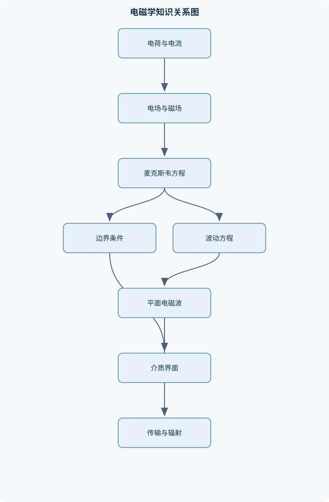
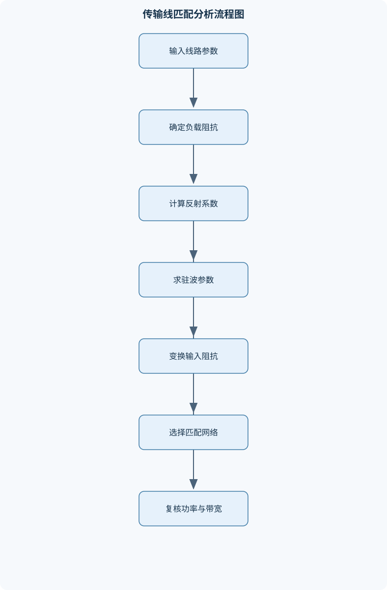

# 电磁场与电磁波

## 一、课程整体知识框架

### 课程边界与先修知识

本课程研究静止电荷、稳恒电流、时变电磁场及电磁波在真空、介质、导体、波导和传输线中的产生、传播、反射、折射、辐射与能量传输规律。内容边界包括矢量分析、电磁场基本方程、边界条件、静态场、准静态场、均匀平面波、极化、导体中的传播、传输线、波导、天线基础和电磁兼容初步。先修知识包括高等数学中的多元微积分、矢量分析、常微分方程、复数与傅里叶思想，以及大学物理中的力学、电路、磁学和基本电磁感应。课程默认采用经典宏观电磁学、线性介质和正弦稳态分析；涉及高频、强场、非线性、量子效应、相对论效应或复杂数值计算时，应明确说明理想化假设及适用边界。





### 1. 研究对象、物理主线与基本假设

《电磁场与电磁波》研究电荷和电流如何产生电场、磁场，以及时变电磁场如何在空间传播、反射、折射、辐射并传递能量。课程对象覆盖真空、介质、导体、传输线、波导和天线等系统。其知识主线可以概括为：

$$
\text{源与介质}\longrightarrow \text{场方程}\longrightarrow \text{边界条件}\longrightarrow \text{场的求解}
\longrightarrow \text{波的传播}\longrightarrow \text{能量传输与工程应用}
$$

电场强度记为 $\mathbf E$，单位为 V/m；磁场强度记为 $\mathbf H$，单位为 A/m；电通量密度记为 $\mathbf D$，单位为 C/m$^2$；磁感应强度记为 $\mathbf B$，单位为 T。自由电荷体密度为 $\rho_v$，单位为 C/m$^3$；传导电流密度为 $\mathbf J$，单位为 A/m$^2$。在线性、各向同性、局部介质模型中，

$$
\mathbf D=\varepsilon\mathbf E,\qquad
\mathbf B=\mu\mathbf H,\qquad
\mathbf J=\sigma\mathbf E,
$$

其中 $\varepsilon$、$\mu$ 和 $\sigma$ 分别为介电常数、磁导率和电导率，单位分别为 F/m、H/m 和 S/m。$\mathbf E$ 与 $\mathbf D$、$\mathbf H$ 与 $\mathbf B$ 不是同一物理量；它们通过本构关系联系，但在非线性、各向异性或色散介质中不能简单地用常数比例表示。

课程默认采用经典宏观电磁学和线性介质模型，并以正弦稳态分析为重要工具。时间因子统一取为 $e^{j\omega t}$，实际物理场是复数表达式乘以 $e^{j\omega t}$ 后取实部。若空间项写为 $e^{-j\mathbf k\cdot\mathbf r}$，则波沿 $\mathbf k$ 的正方向传播。这里 $\mathbf r$ 是位置矢量，坐标为 $x,y,z$；$\omega=2\pi f$，其中 $f$ 是频率，单位为 Hz；$\mathbf k$ 是波矢，$\beta=|\mathbf k|$ 是相位常数，单位为 rad/m；波长为 $\lambda=2\pi/\beta$，相速为 $v_p=\omega/\beta$。

这些假设有明确边界。低频集中参数电路模型把电压和电流看作只随时间变化，适用于结构尺寸远小于波长的情形；当尺寸与波长可比时，必须使用分布参数传输线或全波模型。高频、强场、铁磁饱和、介质非线性、材料色散、量子效应、相对论效应和复杂三维结构不能直接套用最简单的均匀线性模型，需在相应章节中保留频率相关参数、复数参数或数值求解。

### 2. 从数学语言到物理规律

电磁场是定义在空间和时间上的场。标量场在每一点只有一个数值，例如电势；矢量场在每一点具有大小和方向，例如 $\mathbf E$ 和 $\mathbf H$。梯度、散度和旋度分别描述标量场变化方向、矢量场源汇性质以及局部环流性质。

对标量函数 $\phi$，梯度 $\nabla\phi$ 指向函数增长最快方向，单位为 $\phi$ 的单位除以长度。对矢量场 $\mathbf A$，散度 $\nabla\cdot\mathbf A$ 描述单位体积的净流出强度，旋度 $\nabla\times\mathbf A$ 描述局部旋转趋势。散度定理将闭合曲面积分与体积分联系起来：

$$
\oint_S\mathbf A\cdot d\mathbf S
=
\iiint_V\nabla\cdot\mathbf A\,dV.
$$

斯托克斯定理将闭合曲线环量与曲面旋度联系起来：

$$
\oint_C\mathbf A\cdot d\mathbf l
=
\iint_S(\nabla\times\mathbf A)\cdot d\mathbf S.
$$

因此，积分形式和微分形式不是两套独立定律，而是在场足够光滑、区域和边界满足相应条件时的两种表达。场线用于表示矢量场方向，通量表示穿过曲面的场量，环量表示沿闭合路径的切向积累。场线密度可以辅助图像理解，但不能替代定量计算。

### 3. 统一的方程—边界—能量框架

宏观电磁场基本方程为

$$
\nabla\cdot\mathbf D=\rho_v,
$$

$$
\nabla\cdot\mathbf B=0,
$$

$$
\nabla\times\mathbf E=-\frac{\partial\mathbf B}{\partial t},
$$

$$
\nabla\times\mathbf H=\mathbf J+\frac{\partial\mathbf D}{\partial t}.
$$

对应的积分形式分别表达电通量、磁通量、电磁感应和传导电流加位移电流的关系。第一式说明自由电荷是电位移的源；第二式表明不存在孤立磁荷，磁力线没有起点和终点；第三式说明变化的磁场产生旋电场；第四式说明传导电流和变化的电位移共同产生旋磁场。

对安培—麦克斯韦方程取散度，利用恒等式 $\nabla\cdot(\nabla\times\mathbf H)=0$，得到

$$
\nabla\cdot\mathbf J+
\frac{\partial}{\partial t}(\nabla\cdot\mathbf D)=0.
$$

代入 $\nabla\cdot\mathbf D=\rho_v$，可得电荷连续性方程

$$
\nabla\cdot\mathbf J=-\frac{\partial\rho_v}{\partial t}.
$$

它表达局部电荷守恒。位移电流密度 $\partial\mathbf D/\partial t$ 不等同于自由电荷在导体中的传导电流，但它是使场方程与电荷守恒相容的必要项。例如电容器充电时，极板间没有穿过介质间隙的自由传导电流，变化的电场仍能产生磁场。

边界条件来自跨越极薄闭合面的高斯定理和跨越极窄回路的斯托克斯定理。若法向单位矢量 $\hat{\mathbf n}$ 从区域1指向区域2，则

$$
\hat{\mathbf n}\cdot(\mathbf D_2-\mathbf D_1)=\rho_s,
$$

$$
\hat{\mathbf n}\cdot(\mathbf B_2-\mathbf B_1)=0,
$$

$$
\hat{\mathbf n}\times(\mathbf E_2-\mathbf E_1)=\mathbf 0,
$$

$$
\hat{\mathbf n}\times(\mathbf H_2-\mathbf H_1)=\mathbf J_s.
$$

其中 $\rho_s$ 为自由表面电荷密度，单位为 C/m$^2$；$\mathbf J_s$ 为自由表面电流密度，单位为 A/m。如果界面没有自由表面电荷和表面电流，则法向 $\mathbf D$、法向 $\mathbf B$ 和切向 $\mathbf E$、切向 $\mathbf H$ 分量分别连续。导体表面是特殊边界：理想导体内部 $\mathbf E=\mathbf 0$，静电平衡时电荷分布在表面，表面外侧电场法向分量由表面电荷决定；有限电导率导体则存在有限穿透深度和损耗，不能直接使用理想导体结论。

能量守恒由坡印廷定理表达。坡印廷矢量为

$$
\mathbf S=\mathbf E\times\mathbf H,
$$

单位为 W/m$^2$，方向表示瞬时电磁能流方向。正弦稳态下，若 $\mathbf E$ 和 $\mathbf H$ 使用峰值复振幅，则平均坡印廷矢量为

$$
\langle\mathbf S\rangle
=
\frac12\operatorname{Re}(\mathbf E\times\mathbf H^*).
$$

星号表示复共轭。这个公式中的 $1/2$ 只适用于峰值相量；若相量采用有效值，则平均功率表达式不再额外乘 $1/2$。有功功率表示平均能量传输，无功功率表示场能量在电场和磁场之间的往返交换。

## 二、章节和模块划分

### 核心知识覆盖清单

本清单用于检查正文是否覆盖本课程的主要知识模块：

- **矢量分析与电磁场基本概念**：标量场与矢量场、梯度、散度与旋度、高斯定理与斯托克斯定理、坐标系与单位矢量、场线、通量与环量、电场强度与磁场强度、电通量密度与磁感应强度、介电常数磁导率与电导率。
- **静电场与静磁场**：库仑定律与叠加原理、高斯定律及对称性求场、电势与电势差、泊松方程与拉普拉斯方程、导体静电平衡、电容与静电能量、毕奥-萨伐尔定律、安培环路定律与磁矢势。
- **麦克斯韦方程组与边界条件**：微分形式与积分形式、电荷守恒与连续性方程、位移电流、法拉第电磁感应定律、安培-麦克斯韦定律、理想介质边界条件、导体表面边界条件、电磁场初始条件与源条件。
- **时谐场与复数表示**：正弦稳态场的相量表示、复振幅与相位约定、相量微分算子、复介电常数与传播常数、波阻抗的复数形式、复坡印廷矢量、有功功率与无功功率、时谐场叠加与频域适用条件。
- **均匀平面电磁波**：波动方程的推导、均匀平面波的传播方向、电场磁场与波矢关系、相速波长频率与相位常数、本征阻抗、线极化圆极化与椭圆极化、右旋左旋极化的约定、平均坡印廷矢量与能量流。
- **电磁波在介质和导体中的传播**：无损介质中的传播、有损介质传播常数、良导体近似、趋肤效应与趋肤深度、相速与群速的区别、色散与损耗、介质界面的反射折射、全反射与临界角。
- **电磁波的反射折射与辐射基础**：垂直入射菲涅耳系数、斜入射的平行与垂直极化、布儒斯特角、反射相位变化、导体表面反射、电磁波在多层介质中的干涉、电偶极子辐射、近区远区与辐射功率。
- **均匀传输线理论**：分布参数电路模型、电报方程、传播常数与特征阻抗、入射波与反射波、反射系数与驻波比、输入阻抗变换、负载功率与功率守恒、无耗线四分之一波长变换。
- **阻抗匹配与传输线图解分析**：归一化阻抗与导纳、驻波节点和波腹定位、阻抗圆图的物理含义、串联电抗匹配、并联短截线匹配、四分之一波长变压器、多段传输线递推、匹配网络的频带限制。
- **波导、谐振腔与天线基础**：矩形波导模式、横电模与横磁模、截止频率与截止波长、导波波长与相速、波导功率传输、谐振腔模式与品质因数、天线方向性与增益、喇叭天线与基本测量。


### 1. 矢量分析与电磁场基本概念

本模块建立后续所有方程的数学和物理语言。直角坐标中，位置矢量可写为

$$
\mathbf r=x\hat{\mathbf x}+y\hat{\mathbf y}+z\hat{\mathbf z},
$$

其中 $\hat{\mathbf x}$、$\hat{\mathbf y}$、$\hat{\mathbf z}$ 是相互正交的单位矢量。球坐标使用 $\hat{\mathbf r}$、$\hat{\boldsymbol\theta}$、$\hat{\boldsymbol\phi}$，单位矢量随位置变化，因此对球坐标场求导时必须同时考虑坐标尺度因子和单位矢量变化。

散度用于判断场是否存在源汇，旋度用于判断场是否具有局部环流。无散场不等于处处为零，例如均匀非零电场的散度为零；无旋场也不等于没有场。静电场满足 $\nabla\times\mathbf E=0$，因此在单连通区域可以定义电势。磁感应强度满足 $\nabla\cdot\mathbf B=0$，可用磁矢势 $\mathbf A$ 表示为 $\mathbf B=\nabla\times\mathbf A$，但磁矢势并不唯一。

### 2. 静电场与静磁场

静电场由静止电荷产生，基本规律是库仑定律和叠加原理。点电荷 $q$ 在距离为 $R$ 的位置产生

$$
\mathbf E=
\frac{1}{4\pi\varepsilon}
\frac{q}{R^2}\hat{\mathbf R}.
$$

连续电荷分布可通过体积分、面积分或线积分叠加。对于具有球对称、柱对称或平面对称的分布，高斯定律可以把场积分化为通量乘面积，从而快速求得场。必须注意，对称性不足时不能强行假设场在高斯面上大小处处相同。

静电场是保守场，电势差定义为

$$
V(\mathbf r_2)-V(\mathbf r_1)
=
-\int_{\mathbf r_1}^{\mathbf r_2}\mathbf E\cdot d\mathbf l.
$$

因此 $\mathbf E=-\nabla V$。将其代入高斯定律，在均匀介质中得到泊松方程

$$
\nabla^2V=-\frac{\rho_v}{\varepsilon},
$$

无电荷区域则为拉普拉斯方程

$$
\nabla^2V=0.
$$

“无电荷”只说明电势满足拉普拉斯方程，不能推出电场处处为零；平行板间远离边缘的均匀电场就是常见反例。

导体静电平衡时，导体内部电场为零，导体是等势体，净自由电荷位于表面。两个导体之间形成电容，电容定义为 $C=Q/V$，单位为 F。电容储存的静电能为

$$
W_e=\frac12CV^2=\frac12QV=\frac{Q^2}{2C}.
$$

连续场形式为电能密度 $w_e=\frac12\mathbf E\cdot\mathbf D$，该形式要求线性介质；非线性介质应从能量对场的积分定义出发。

静磁场由稳恒电流产生。毕奥—萨伐尔定律适合直接计算有限电流分布的磁场，安培环路定律适合具有高度对称性的无限长电流、螺线管和环形磁路。磁矢势满足 $\mathbf B=\nabla\times\mathbf A$，在适当规范条件下可将磁场问题转化为对 $\mathbf A$ 的方程求解。静电场中的电势和静磁场中的磁矢势分别体现了保守场和无散场的数学结构。

### 3. 麦克斯韦方程组与边界条件

本模块把静态规律推广到时变场。位移电流使安培定律能够处理电容器充电和一般时变场；法拉第定律说明磁场变化会产生非保守电场。因此，时变电场与时变磁场相互耦合，电磁波正是这种耦合在空间中的传播形式。

对于含自由体电荷和自由电流的介质，方程组必须与本构关系共同使用。仅给出 $\mathbf E$ 或 $\mathbf H$ 的一个方程通常不足以确定全部场量，还需结合源分布、材料参数、初始条件和边界条件。初始条件规定某一时刻场的状态，源条件规定电荷和电流分布，边界条件规定界面两侧场的连接方式。忽略任一类条件，都可能得到数学上形式正确但物理上不唯一的解。

### 4. 时谐场与复数表示

当激励为单一频率的正弦量时，可以将时间微分替换为 $j\omega$。例如采用 $e^{j\omega t}$ 约定时，

$$
\frac{\partial}{\partial t}\longrightarrow j\omega.
$$

若瞬时量为 $A(t)=A_0\cos(\omega t+\phi)$，其峰值相量可写为 $\tilde A=A_0e^{j\phi}$，实际量为 $\operatorname{Re}[\tilde A e^{j\omega t}]$。不能把复振幅本身直接当作瞬时物理量。直流项和不同频率的乘积通常不能用单一频率相量表示；乘积可利用积化和差公式分解为新的频率分量。

在均匀介质中，传导电流和位移电流可合并为复系数。电磁波传播常用复传播常数 $\gamma=\alpha+j\beta$，其中 $\alpha$ 为衰减常数，单位为 Np/m，$\beta$ 为相位常数，单位为 rad/m。波阻抗也可能为复数，实部和虚部反映电场与磁场之间的幅相关系和相位差。复坡印廷矢量的实部对应平均有功功率，虚部与无功功率有关。

### 5. 均匀平面电磁波

在均匀、各向同性、无源介质中，电场波动方程可由麦克斯韦方程组推导。对法拉第定律取旋度，并使用恒等式

$$
\nabla\times(\nabla\times\mathbf E)
=
\nabla(\nabla\cdot\mathbf E)-\nabla^2\mathbf E,
$$

在无源均匀介质中 $\nabla\cdot\mathbf E=0$，得到

$$
\nabla^2\mathbf E-\mu\varepsilon
\frac{\partial^2\mathbf E}{\partial t^2}=0.
$$

磁场满足同样形式的波动方程。对于

$$
\mathbf E=\mathbf E_0e^{j\omega t-j\mathbf k\cdot\mathbf r},
$$

代入方程可得

$$
\beta=\omega\sqrt{\mu\varepsilon},
\qquad
v_p=\frac{\omega}{\beta}
=\frac{1}{\sqrt{\mu\varepsilon}},
\qquad
\eta=\sqrt{\frac{\mu}{\varepsilon}}.
$$

由散度方程得到 $\mathbf k\cdot\mathbf E=0$，由法拉第定律得到

$$
\mathbf H=\frac{1}{\eta}\hat{\mathbf k}\times\mathbf E.
$$

因此均匀各向同性无源介质中的理想平面波具有横向性，$\mathbf E$、$\mathbf H$ 和传播方向相互正交。但在近场、非均匀波、各向异性介质或存在纵向场分量的波导模式中，不能直接套用“两场和传播方向必然两两正交”的结论。

极化由电场两个正交分量的幅度比和相位差决定。相位差为 $0$ 或 $\pi$ 时为线极化；幅度相等且相位差为 $\pm\pi/2$ 时为圆极化；其他一般情形为椭圆极化。右旋和左旋必须同时说明观察方向和时间约定，否则同一波形可能被不同约定赋予相反旋向。平均功率沿 $\hat{\mathbf k}$ 方向流动，其大小由平均坡印廷矢量确定。

### 6. 电磁波在介质和导体中的传播

有损均匀介质中的传播常数为

$$
\gamma
=
\sqrt{j\omega\mu(\sigma+j\omega\varepsilon)}.
$$

其中 $\sigma$ 为电导率。若 $\sigma\ll\omega\varepsilon$，介质属于低损耗近似，传播主要由介电储能决定；若 $\sigma\gg\omega\varepsilon$，属于良导体近似，电磁场主要在表面附近传播。良导体中的趋肤深度近似为

$$
\delta\approx\sqrt{\frac{2}{\omega\mu\sigma}},
$$

表示场幅度衰减到表面值 $1/e$ 所对应的特征深度。频率越高、磁导率越大或电导率越高，趋肤深度越小。

有损介质中 $\alpha$ 控制幅度衰减，$\beta$ 控制相位变化；相速 $v_p=\omega/\beta$ 不一定等于真空光速。色散介质中相速、群速和能量传播速度需要区分，不能从一个相位速度直接推断信息传播速度。

### 7. 电磁波的反射、折射与辐射基础

电磁波到达不同介质界面时，切向相位必须匹配，从而产生反射和折射。垂直入射时，若两侧为无损介质，电场反射系数为

$$
\Gamma=\frac{\eta_2-\eta_1}{\eta_2+\eta_1}.
$$

当 $\eta_2<\eta_1$ 时，$\Gamma<0$，表示反射电场发生 $\pi$ 的相位反转。透射系数必须与所采用的场量定义保持一致，不能把电场系数、磁场系数和功率系数混为一谈。无损界面应满足入射功率等于反射功率与透射功率之和；有损介质中则还要计算介质吸收。

斜入射时需区分电场垂直于入射面的极化和电场平行于入射面的极化，两类极化具有不同的菲涅耳系数。布儒斯特角是某一极化反射系数为零的入射角；全反射发生时，透射侧仍可能存在沿界面传播、法向指数衰减的倏逝场，因此“没有传播功率穿透”不等于“透射侧场严格为零”。多层介质中，多个反射波相干叠加会产生干涉增强或相消。

天线辐射是加速电荷或时变电流向远区释放电磁能的过程。短电偶极子远区场具有明显的角向分布，辐射功率密度由远区平均坡印廷矢量给出。近区包含储能型场和较强的反应性分量，不能用远区辐射公式直接估算近距离功率；远区通常要求距离相对于波长和天线尺寸足够大。

### 8. 均匀传输线理论

传输线把电路模型扩展为分布参数模型。单位长度参数为电阻 $R'$、电感 $L'$、电导 $G'$ 和电容 $C'$，单位分别为 $\Omega$/m、H/m、S/m 和 F/m。电报方程为

$$
\frac{\partial V}{\partial z}
=-(R'+j\omega L')I,
\qquad
\frac{\partial I}{\partial z}
=-(G'+j\omega C')V.
$$

进一步可得

$$
\gamma=
\sqrt{(R'+j\omega L')(G'+j\omega C')},
$$

$$
Z_0=
\sqrt{\frac{R'+j\omega L'}{G'+j\omega C'}}.
$$

$Z_0$ 是传输线特征阻抗，不等同于自由空间波阻抗 $\eta$，也不等同于负载阻抗 $Z_L$。无耗线只有在 $R'=G'=0$ 时才有

$$
Z_0=\sqrt{\frac{L'}{C'}},
\qquad
\gamma=j\beta.
$$

负载不匹配时，线上同时存在入射波和反射波。反射系数为

$$
\Gamma_L=\frac{Z_L-Z_0}{Z_L+Z_0},
$$

驻波比为

$$
\rho=\frac{1+|\Gamma_L|}{1-|\Gamma_L|}.
$$

由电压最大值和最小值可得

$$
|\Gamma_L|
=
\frac{V_{\max}-V_{\min}}
{V_{\max}+V_{\min}}.
$$

驻波比只能确定反射系数幅度，不能单独确定负载阻抗的相位；还需知道节点位置、相位信息或复阻抗测量结果。

无耗线长度为 $l$ 时，输入阻抗为

$$
Z_{in}
=
Z_0
\frac{Z_L+jZ_0\tan(\beta l)}
{Z_0+jZ_L\tan(\beta l)}.
$$

当 $l=\lambda/4$ 时，

$$
Z_{in}=\frac{Z_0^2}{Z_L},
$$

表现为阻抗倒置；当 $l=\lambda/2$ 时，输入阻抗重复为 $Z_L$。负载平均功率为

$$
P_L=\frac12\operatorname{Re}(V_LI_L^*),
$$

其中有功部分被负载吸收，无功部分表示能量往返交换。

### 9. 阻抗匹配与传输线图解分析

阻抗匹配的目标是在指定频率和参考阻抗下使输入端反射尽可能小。常见方法包括四分之一波长变压器、串联电抗、并联电纳和短截线匹配。将负载阻抗归一化为 $z_L=Z_L/Z_0$，或使用归一化导纳 $y_L=Y_L/Y_0$，便于在不同特征阻抗系统之间比较。

串联匹配改变阻抗虚部，并保持电阻部分不变；并联匹配在导纳域中改变虚部。实际步骤是先求负载的归一化阻抗或导纳，再沿传输线变换，寻找可通过一个电抗或电纳消除虚部的位置，最后复算输入阻抗。匹配网络通常具有频带限制，因为传输线相位和元件电抗均随频率变化；寄生电阻、元件品质因数和连接结构会使理想匹配退化。

### 10. 波导、谐振腔与天线基础

矩形波导横向尺寸为 $a$、$b$，场分布由边界条件决定，模式分为横电模 $TE_{mn}$ 和横磁模 $TM_{mn}$。理想金属壁要求切向电场为零，导致横向波数离散化：

$$
k_c^2=
\left(\frac{m\pi}{a}\right)^2+
\left(\frac{n\pi}{b}\right)^2.
$$

传播条件为 $k>k_c$，其中 $k=\omega\sqrt{\mu\varepsilon}$。截止频率满足

$$
f_c=
\frac{1}{2\sqrt{\mu\varepsilon}}
\sqrt{\left(\frac{m}{a}\right)^2+
\left(\frac{n}{b}\right)^2}.
$$

理想波导中的纵向传播常数为

$$
\beta=\sqrt{k^2-k_c^2},
$$

导波波长为 $\lambda_g=2\pi/\beta$。只有工作频率高于截止频率的模式才能传播；低于截止频率时，纵向场呈指数衰减。主模是截止频率最低的允许模式，矩形波导通常以 $TE_{10}$ 作为主模，但具体判断仍需结合边界条件和尺寸关系。波导相速可能大于 $c$，但这不意味着信息或能量超光速；群速和信号速度必须单独分析。

谐振腔可看作封闭结构中的离散场模式，品质因数 $Q$ 衡量储存能量与每周期损耗的相对大小。天线基础包括方向性、增益、极化、输入阻抗、辐射效率和带宽。方向性描述辐射集中程度，增益还包含效率因素；二者不能混为一谈。喇叭天线利用渐变结构改善波导到自由空间的能量过渡，基本测量通常关注反射系数、辐射方向图、增益和极化纯度。

### 11. 课程综合应用边界

传输线适合描述尺寸沿传播方向变化缓慢、横向模式固定的结构；复杂连接器、天线阵列、腔体和非均匀三维结构需要全波分析。电磁兼容初步内容将静电耦合、磁场耦合、传导干扰和辐射干扰统一到场、边界和能量传输框架中，分析屏蔽、接地、滤波、线缆布局和端口匹配对干扰的影响。仿真或实验结果必须同时检查材料参数、边界条件、端口定义、网格收敛、仪器校准和能量守恒；场图或 $S$ 参数曲线不能脱离这些条件被直接视为真实系统结论。

## 三、核心概念的详细解释

### 1. 场、源与介质

电磁场是在空间和时间上分布的物理量。电场强度 $\mathbf E$ 表示单位正电荷所受的电场力，单位为 V/m；磁场强度 $\mathbf H$ 表示电流源在介质中产生磁场的强弱，单位为 A/m。电通量密度 $\mathbf D$ 和磁感应强度 $\mathbf B$ 分别描述电场和磁场与介质响应相关的量，单位为 C/m$^2$ 和 T。在各向同性线性介质中，

$$
\mathbf D=\varepsilon\mathbf E,\qquad
\mathbf B=\mu\mathbf H,\qquad
\mathbf J=\sigma\mathbf E,
$$

其中 $\varepsilon$、$\mu$、$\sigma$ 的单位分别为 F/m、H/m、S/m。$\mathbf E$ 与 $\mathbf D$ 并非同一物理量；在非线性、各向异性或色散介质中，比例关系可能变为张量关系或频率相关关系。

电荷密度 $\rho_v$、传导电流密度 $\mathbf J$ 是场的源。静止电荷产生静电场，稳恒电流产生静磁场，随时间变化的电场和磁场能够相互激发并形成电磁波。介质参数决定场的响应：$\varepsilon$ 主要影响电场储能和传播速度，$\mu$ 主要影响磁场储能，$\sigma$ 描述自由电荷的传导损耗。自由空间是 $\rho_v=0$、$\mathbf J=0$ 且 $\varepsilon=\varepsilon_0$、$\mu=\mu_0$ 的理想介质，但“无电荷区域”不等于“电场为零”，因为远处电荷、边界电荷或时变场仍可在该区域形成非零电场。

### 2. 矢量分析与场的几何描述

位置矢量记为 $\mathbf r=x\hat{\mathbf x}+y\hat{\mathbf y}+z\hat{\mathbf z}$。梯度、散度和旋度是描述场空间变化的三个基本运算。标量场 $\phi$ 的梯度为

$$
\nabla\phi
=
\hat{\mathbf x}\frac{\partial\phi}{\partial x}
+\hat{\mathbf y}\frac{\partial\phi}{\partial y}
+\hat{\mathbf z}\frac{\partial\phi}{\partial z},
$$

其方向是 $\phi$ 增长最快的方向。矢量场 $\mathbf A$ 的散度 $\nabla\cdot\mathbf A$ 描述单位体积的净流出强度，旋度 $\nabla\times\mathbf A$ 描述局部环流趋势。散度具有“源汇”含义，旋度则具有“局部旋转”含义，二者不能互相替代。

高斯定理把闭合曲面上的通量与体内散度联系起来：

$$
\oint_S\mathbf A\cdot d\mathbf S
=
\iiint_V\nabla\cdot\mathbf A\,dV.
$$

斯托克斯定理把闭合曲线上的环量与曲面上的旋度联系起来：

$$
\oint_C\mathbf A\cdot d\mathbf l
=
\iint_S(\nabla\times\mathbf A)\cdot d\mathbf S.
$$

因此，积分形式适合利用球对称、柱对称或平面对称直接求场，微分形式适合研究局部关系。对任意足够光滑的矢量场，有

$$
\nabla\cdot(\nabla\times\mathbf A)=0,
\qquad
\nabla\times(\nabla\phi)=0.
$$

在曲线坐标中，单位矢量可能随位置变化，不能把球坐标或柱坐标中的分量公式直接当作直角坐标公式使用。

### 3. 静电场与静磁场

点电荷 $q$ 在均匀介质中产生的电场服从库仑定律：

$$
\mathbf E(\mathbf r)
=
\frac{q}{4\pi\varepsilon}
\frac{\mathbf r-\mathbf r'}{|\mathbf r-\mathbf r'|^3}.
$$

多个电荷的场可按叠加原理相加，连续电荷分布则需要积分。对高度对称的电荷分布，高斯定律可显著简化求场。例如球对称情况下，半径为 $r$ 的球面上电场大小相同且沿法向，于是

$$
E(4\pi r^2)=\frac{Q_{\text{in}}}{\varepsilon}.
$$

这种简化依赖严格的对称性；只有“电荷总量已知”而没有球对称条件时，不能直接写成 $E=Q/(4\pi\varepsilon r^2)$。

静电场是无旋场：

$$
\nabla\times\mathbf E=0.
$$

因此可定义电势 $V$，满足

$$
\mathbf E=-\nabla V,
\qquad
V(\mathbf r_2)-V(\mathbf r_1)
=
-\int_{\mathbf r_1}^{\mathbf r_2}\mathbf E\cdot d\mathbf l.
$$

若介质均匀，结合 $\nabla\cdot\mathbf D=\rho_v$ 可得

$$
\nabla^2V=-\frac{\rho_v}{\varepsilon}
$$

即泊松方程；无电荷区域满足拉普拉斯方程 $\nabla^2V=0$。给定边界电势或法向场后，电势解通常由边界条件唯一确定，但必须说明边界条件和区域范围。

静电平衡时，理想导体内部 $\mathbf E=0$，导体是等势体，净自由电荷位于表面，表面电场的切向分量为零。导体表面外侧的法向电场与表面电荷密度 $\rho_s$ 有关。导体内部无电场并不意味着导体外部也无电场；外部场由表面电荷重新分布决定。电容器储存的能量可写为

$$
W_e=\frac12CV^2
=
\frac12QV
=
\frac{Q^2}{2C},
$$

连续场形式为

$$
W_e=\frac12\iiint_V\mathbf E\cdot\mathbf D\,dV.
$$

稳恒电流满足 $\partial\rho_v/\partial t=0$，因此 $\nabla\cdot\mathbf J=0$。电流产生磁场，毕奥—萨伐尔定律给出电流元的磁场贡献。安培环路定律在稳恒情形为

$$
\oint_C\mathbf H\cdot d\mathbf l=I_{\text{enc}},
$$

对具有圆柱对称的长直导线，可利用环路上 $H$ 大小相等求出磁场。磁通密度满足

$$
\nabla\cdot\mathbf B=0,
$$

说明磁力线没有独立起点和终点。磁矢势 $\mathbf A$ 可定义为

$$
\mathbf B=\nabla\times\mathbf A,
$$

但 $\mathbf A$ 存在规范自由度，必须结合规范条件才能唯一确定。

### 4. 麦克斯韦方程组与边界

宏观电磁学的基本方程为

$$
\nabla\cdot\mathbf D=\rho_v,
$$

$$
\nabla\cdot\mathbf B=0,
$$

$$
\nabla\times\mathbf E=-\frac{\partial\mathbf B}{\partial t},
$$

$$
\nabla\times\mathbf H
=
\mathbf J+\frac{\partial\mathbf D}{\partial t}.
$$

第一式说明自由电荷是电位移的源；第二式说明不存在孤立磁荷；第三式是法拉第电磁感应定律；第四式是含位移电流项的安培—麦克斯韦定律。位移电流密度为 $\partial\mathbf D/\partial t$，它不是自由电荷在导体中的传导电流，但能在方程中产生与传导电流相同的磁场旋度效应。

对安培—麦克斯韦定律取散度，利用“旋度的散度恒为零”，得到

$$
\nabla\cdot\mathbf J+
\frac{\partial}{\partial t}(\nabla\cdot\mathbf D)=0.
$$

再代入 $\nabla\cdot\mathbf D=\rho_v$，得到电荷连续性方程

$$
\nabla\cdot\mathbf J
=
-\frac{\partial\rho_v}{\partial t}.
$$

这说明电荷不会凭空产生或消失。若漏掉位移电流项，安培定律将与电荷守恒不一致，尤其无法正确描述电容器充电过程。

设法向单位矢量 $\hat{\mathbf n}$ 从区域1指向区域2，界面上的边界条件为

$$
\hat{\mathbf n}\cdot(\mathbf D_2-\mathbf D_1)=\rho_s,
$$

$$
\hat{\mathbf n}\cdot(\mathbf B_2-\mathbf B_1)=0,
$$

$$
\hat{\mathbf n}\times(\mathbf E_2-\mathbf E_1)=0,
$$

$$
\hat{\mathbf n}\times(\mathbf H_2-\mathbf H_1)=\mathbf J_s.
$$

其中 $\rho_s$ 是自由表面电荷密度，单位为 C/m$^2$；$\mathbf J_s$ 是自由表面电流密度，单位为 A/m。如果界面没有自由表面电荷和表面电流，则法向 $\mathbf D$、法向 $\mathbf B$ 以及切向 $\mathbf E$、切向 $\mathbf H$ 分别连续。导体表面是理想化极限：导体内部切向电场为零，表面外侧切向电场也为零；若存在表面电流，切向磁场可能发生跃变。

### 5. 时谐场、相量与能量

对于角频率 $\omega$ 的正弦稳态场，采用时间因子 $e^{j\omega t}$。若复振幅为 $\mathbf E(\mathbf r)$，实际场为

$$
\mathbf E(\mathbf r,t)
=
\operatorname{Re}\{\mathbf E(\mathbf r)e^{j\omega t}\}.
$$

例如 $3\cos\omega t-4\sin\omega t$ 可写成复振幅 $3+j4$，因为

$$
\operatorname{Re}\{(3+j4)e^{j\omega t}\}
=
3\cos\omega t-4\sin\omega t.
$$

常数项、不同频率的乘积一般不能用单一频率相量表示；相量法只适用于线性系统中的单频稳态分量。不同频率信号应分别分析，再按实际时域信号叠加。

在相量域中，时间微分变为 $j\omega$，麦克斯韦方程组写为

$$
\nabla\times\mathbf E=-j\omega\mathbf B,
\qquad
\nabla\times\mathbf H=\mathbf J+j\omega\mathbf D.
$$

有损介质中，传导电流和位移电流可合并为

$$
\mathbf J+j\omega\mathbf D
=
(\sigma+j\omega\varepsilon)\mathbf E.
$$

电磁能量流密度由坡印廷矢量表示：

$$
\mathbf S=\mathbf E\times\mathbf H.
$$

正弦稳态下，若 $\mathbf E$、$\mathbf H$ 使用峰值复振幅，平均坡印廷矢量为

$$
\langle\mathbf S\rangle
=
\frac12\operatorname{Re}
(\mathbf E\times\mathbf H^*).
$$

复功率的实部代表平均有功功率，虚部代表无功功率。使用有效值相量时，平均功率公式中的 $1/2$ 不再出现，因此必须统一峰值和有效值约定。

### 6. 均匀平面波与极化

均匀平面波的场量只依赖传播方向坐标，等相位面是无限延伸的平面。采用

$$
\mathbf E(\mathbf r,t)
=
\operatorname{Re}
\{\mathbf E_0e^{j\omega t-j\mathbf k\cdot\mathbf r}\},
$$

空间相位项中的 $\mathbf k$ 指示传播方向。因为相位为 $\omega t-\mathbf k\cdot\mathbf r$，保持相位不变时位置沿 $\mathbf k$ 增大，故波沿 $+\mathbf k$ 方向传播。

在均匀、各向同性、无源介质中，平面波是横波：

$$
\mathbf k\cdot\mathbf E=0,
\qquad
\mathbf k\cdot\mathbf H=0.
$$

由法拉第定律可得

$$
\mathbf H
=
\frac{1}{\eta}\hat{\mathbf k}\times\mathbf E,
$$

其中 $\eta$ 为介质本征波阻抗。无损介质中

$$
\eta=\sqrt{\frac{\mu}{\varepsilon}},
\qquad
\beta=\omega\sqrt{\mu\varepsilon},
$$

$$
v_p=\frac{\omega}{\beta}
=
\frac{1}{\sqrt{\mu\varepsilon}},
\qquad
\lambda=\frac{2\pi}{\beta}.
$$

在有损介质中，传播常数为复数 $\gamma=\alpha+j\beta$，其中 $\alpha$ 的单位为 Np/m，描述场幅度衰减，$\beta$ 的单位为 rad/m，描述相位变化。此时波阻抗也是复数，$\mathbf E$ 与 $\mathbf H$ 之间不仅有幅度比，还存在相位差。

极化由同一传播方向下两个正交电场分量的幅度和相位差决定。相位差为 $0$ 或 $\pi$ 时为线极化；两个分量幅度相等且相位差为 $\pm\pi/2$ 时为圆极化；其他一般情形为椭圆极化。左旋、右旋的判断必须说明观察方向，否则同一波可能被不同观察者采用相反命名。各向异性介质、近场或非均匀波中，$\mathbf E$、$\mathbf H$、$\mathbf k$ 不一定严格两两正交。

### 7. 有损介质、反射折射与辐射

均匀导电介质中的传播常数满足

$$
\gamma
=
\sqrt{j\omega\mu(\sigma+j\omega\varepsilon)}.
$$

当 $\sigma\ll\omega\varepsilon$ 时，可近似为低损耗介质；当 $\sigma\gg\omega\varepsilon$ 时为良导体。良导体中的趋肤深度近似为

$$
\delta=\sqrt{\frac{2}{\omega\mu\sigma}},
$$

场强在进入导体约一个趋肤深度后显著衰减。使用良导体公式前必须先检验 $\sigma/(\omega\varepsilon)$ 是否足够大。

两种介质界面处，切向相位必须匹配，导致斯涅尔定律。垂直入射时，电场反射系数为

$$
\Gamma
=
\frac{\eta_2-\eta_1}{\eta_2+\eta_1},
$$

透射电场系数为

$$
\tau_E
=
\frac{2\eta_2}{\eta_2+\eta_1}.
$$

无损介质中反射功率系数为 $|\Gamma|^2$，透射功率系数不能简单写成 $|\tau_E|^2$，还必须乘以两侧波阻抗修正因子。若从低折射率介质射向高折射率介质，超过临界角后出现全反射；透射侧仍可有指数衰减的倏逝场，但不代表存在沿法向传播的平均功率流。斜入射时应分别处理电场垂直入射面和平行入射面的两种极化，布儒斯特角只对特定极化和材料参数成立。

时变电流元会产生电偶极子辐射。近区含有随距离快速衰减的储能场，远区主要保留与 $1/r$ 成正比的辐射场，远区的 $\mathbf E$ 与 $\mathbf H$ 近似横向并满足固定波阻抗关系。不能用远区辐射公式估算天线附近的局部场，也不能把近场储能误认为远距离可传输功率。

### 8. 传输线、波导与天线

当结构尺寸与波长可比时，电压和电流沿位置变化，传输线应使用单位长度参数 $R'$、$L'$、$G'$、$C'$ 描述。电报方程为

$$
\frac{\partial V}{\partial z}
=
-(R'+j\omega L')I,
\qquad
\frac{\partial I}{\partial z}
=
-(G'+j\omega C')V.
$$

传播常数和特征阻抗分别为

$$
\gamma
=
\sqrt{(R'+j\omega L')(G'+j\omega C')},
$$

$$
Z_0
=
\sqrt{\frac{R'+j\omega L'}{G'+j\omega C'}}.
$$

无耗线只有在 $R'=G'=0$ 时才能写成

$$
Z_0=\sqrt{\frac{L'}{C'}},
\qquad
\gamma=j\beta.
$$

负载不匹配时，线上同时存在入射波和反射波。反射系数为

$$
\Gamma_L=\frac{Z_L-Z_0}{Z_L+Z_0},
$$

驻波比为

$$
\rho=\frac{1+|\Gamma_L|}{1-|\Gamma_L|}.
$$

驻波比只能确定 $|\Gamma_L|$，不能单独确定负载阻抗的相位。无耗线长度为 $l$ 时，

$$
Z_{\mathrm{in}}
=
Z_0
\frac{Z_L+jZ_0\tan(\beta l)}
{Z_0+jZ_L\tan(\beta l)}.
$$

当 $l=\lambda/4$ 时，$Z_{\mathrm{in}}=Z_0^2/Z_L$；当 $l=\lambda/2$ 时，输入阻抗重复为 $Z_L$。四分之一波长变换不仅适用于纯电阻，复负载同样适用，但变换结果通常仍为复数。

矩形波导中，横向边界条件使场只能以离散模式存在。理想矩形波导的截止波数为

$$
k_c^2=
\left(\frac{m\pi}{a}\right)^2+
\left(\frac{n\pi}{b}\right)^2,
$$

截止频率为

$$
f_c
=
\frac{1}{2\sqrt{\mu\varepsilon}}
\sqrt{\left(\frac{m}{a}\right)^2+\left(\frac{n}{b}\right)^2}.
$$

只有 $f>f_c$ 时模式才能传播，传播常数为

$$
\beta=\sqrt{k^2-k_c^2},
$$

导波波长为

$$
\lambda_g=\frac{2\pi}{\beta}.
$$

导波相速可大于 $1/\sqrt{\mu\varepsilon}$，但群速和信息传播速度不超过介质允许的因果速度。波导内的场分布、功率流和损耗取决于模式；不能把波导简单等同于两根导线。

天线把导行波转换为自由空间辐射波，也可完成反向接收。方向性描述辐射功率的空间集中程度，增益还包含辐射效率因素。喇叭天线通过渐变截面改善波导与自由空间的阻抗过渡。实际测试需同时关注反射系数、方向图、极化、增益、效率和测量环境，不能只用某一个场图或单点功率值评价天线性能。

## 四、重要定义、公式、定理和推导

### 专业审校补充：关键定义与适用边界

洛伦兹互易定理是线性互易电磁系统的重要边界工具。设同一角频率下，场组一由源 J₁、M₁ 激励，场组二由源 J₂、M₂ 激励；在体积 V 内介质满足线性、各向同性或更一般的互易条件 εᵀ=ε、μᵀ=μ，且不存在磁偏置、非互易材料或时变材料，则有 ∮∂V (E₁×H₂−E₂×H₁)·n dS = ∫V (E₂·J₁−E₁·J₂+H₁·M₂−H₂·M₁)dV。若无磁流源，则删除含 M 的两项。对于封闭理想导体边界，切向电场为零，表面积分通常消失；对于开放区域，还必须使用满足辐射条件的边界或足够远的吸收边界。该定理说明源与观测点可以交换而不改变相应耦合量，常用于天线互易性、接收与发射方向图等价性和端口网络参数对称性。它不适用于铁氧体偏置、时变介质、非线性介质或存在明显非互易元件的系统，也不能把互易性误认为结构几何对称性；不对称结构仍可能满足互易定理。


### 1. 电磁场基本方程的积分—微分对应

电通量定律的积分形式为

$$
\oint_S\mathbf D\cdot d\mathbf S
=
\iiint_V\rho_v\,dV.
$$

由高斯定理，左端可改写为体积分：

$$
\iiint_V\nabla\cdot\mathbf D\,dV
=
\iiint_V\rho_v\,dV.
$$

对任意体积成立，因此得到微分形式

$$
\nabla\cdot\mathbf D=\rho_v.
$$

同理，磁通连续性为

$$
\oint_S\mathbf B\cdot d\mathbf S=0
\quad\Longrightarrow\quad
\nabla\cdot\mathbf B=0.
$$

法拉第定律的积分形式为

$$
\oint_C\mathbf E\cdot d\mathbf l
=
-\frac{d}{dt}\iint_S\mathbf B\cdot d\mathbf S.
$$

利用斯托克斯定理得到

$$
\nabla\times\mathbf E
=
-\frac{\partial\mathbf B}{\partial t}.
$$

这些推导要求场在区域内具有足够的可积性；若存在理想表面电荷或表面电流，应使用边界条件处理场量的跃变，不能简单假设场处处连续。

### 2. 电场和磁场波动方程

在均匀、各向同性、无源介质中，$\rho_v=0$ 且 $\mathbf J=0$，所以

$$
\nabla\cdot\mathbf E=0,
\qquad
\nabla\cdot\mathbf H=0.
$$

对法拉第定律取旋度：

$$
\nabla\times(\nabla\times\mathbf E)
=
-\mu\frac{\partial}{\partial t}
(\nabla\times\mathbf H).
$$

代入 $\nabla\times\mathbf H=\varepsilon\partial\mathbf E/\partial t$，并使用恒等式

$$
\nabla\times(\nabla\times\mathbf E)
=
\nabla(\nabla\cdot\mathbf E)-\nabla^2\mathbf E,
$$

得到

$$
\nabla^2\mathbf E
-
\mu\varepsilon
\frac{\partial^2\mathbf E}{\partial t^2}
=0.
$$

同理，

$$
\nabla^2\mathbf H
-
\mu\varepsilon
\frac{\partial^2\mathbf H}{\partial t^2}
=0.
$$

波速为

$$
v=\frac{1}{\sqrt{\mu\varepsilon}}.
$$

这里使用了均匀介质条件，使 $\mu$、$\varepsilon$ 可以移出空间微分；使用了无源条件，使 $\nabla\cdot\mathbf E=0$。在有源、非均匀或各向异性介质中，波动方程会出现源项、参数梯度项或张量耦合，不能直接套用上述形式。

### 3. 有损介质传播常数的推导

在均匀有损介质中，时谐麦克斯韦方程为

$$
\nabla\times\mathbf E
=
-j\omega\mu\mathbf H,
$$

$$
\nabla\times\mathbf H
=
(\sigma+j\omega\varepsilon)\mathbf E.
$$

对第一式取旋度，代入第二式，并在无源均匀区域使用 $\nabla\cdot\mathbf E=0$，得到

$$
\nabla^2\mathbf E
=
j\omega\mu(\sigma+j\omega\varepsilon)\mathbf E.
$$

若场沿 $z$ 方向传播并写为 $e^{-\gamma z}$，则

$$
\gamma^2
=
j\omega\mu(\sigma+j\omega\varepsilon),
$$

所以

$$
\gamma=\alpha+j\beta
=
\sqrt{j\omega\mu(\sigma+j\omega\varepsilon)}.
$$

其中 $\alpha$ 表示幅度随距离衰减的速率，$\beta$ 表示相位随距离变化的速率。若 $\sigma=0$，则 $\alpha=0$，恢复无损介质结果。良导体条件 $\sigma\gg\omega\varepsilon$ 下，

$$
\alpha\approx\beta\approx\sqrt{\frac{\omega\mu\sigma}{2}},
$$

并得到

$$
\delta=\frac1\alpha
\approx
\sqrt{\frac{2}{\omega\mu\sigma}}.
$$

### 4. 垂直入射边界反射的推导

设波从介质1沿 $+z$ 入射到介质2，电场沿 $x$，磁场沿 $y$。在界面处，切向电场连续：

$$
E_i+E_r=E_t.
$$

切向磁场连续，反射波的磁场方向与入射波相反，因此

$$
\frac{E_i}{\eta_1}
-
\frac{E_r}{\eta_1}
=
\frac{E_t}{\eta_2}.
$$

令 $\Gamma=E_r/E_i$，联立两式得到

$$
\Gamma
=
\frac{\eta_2-\eta_1}{\eta_2+\eta_1}.
$$

透射电场系数为

$$
\tau_E=\frac{E_t}{E_i}=1+\Gamma
=
\frac{2\eta_2}{\eta_2+\eta_1}.
$$

无损介质中的平均功率密度为

$$
\langle S\rangle=\frac{|E|^2}{2\eta}.
$$

因此反射功率系数为

$$
R=|\Gamma|^2,
$$

透射功率系数为

$$
T
=
\frac{\eta_1}{\eta_2}|\tau_E|^2.
$$

代入反射、透射系数可验证 $R+T=1$。有损介质中 $\eta$ 为复数，透射功率还需根据界面法向平均坡印廷矢量计算，不能机械使用无损公式。

### 5. 传输线电报方程和输入阻抗

取长度为 $dz$ 的传输线微元。串联阻抗为 $(R'+j\omega L')dz$，并联导纳为 $(G'+j\omega C')dz$。根据基尔霍夫电压定律和电流定律，令 $dz\to0$，得到

$$
\frac{dV}{dz}
=
-(R'+j\omega L')I,
$$

$$
\frac{dI}{dz}
=
-(G'+j\omega C')V.
$$

再次求导并消去另一变量：

$$
\frac{d^2V}{dz^2}=\gamma^2V,
\qquad
\frac{d^2I}{dz^2}=\gamma^2I,
$$

其中

$$
\gamma
=
\sqrt{(R'+j\omega L')(G'+j\omega C')}.
$$

正向和反向行波可写为

$$
V(z)=V^+e^{-\gamma z}+V^-e^{\gamma z},
$$

$$
I(z)=\frac{V^+}{Z_0}e^{-\gamma z}
-\frac{V^-}{Z_0}e^{\gamma z},
$$

其中

$$
Z_0=
\sqrt{\frac{R'+j\omega L'}{G'+j\omega C'}}.
$$

无耗线末端距负载为 $l$ 时，利用负载条件 $V(l)/I(l)=Z_L$，可得

$$
Z_{\mathrm{in}}
=
Z_0
\frac{Z_L+Z_0\tanh(\gamma l)}
{Z_0+Z_L\tanh(\gamma l)}.
$$

若 $\gamma=j\beta$，则 $\tanh(j\beta l)=j\tan(\beta l)$，于是

$$
Z_{\mathrm{in}}
=
Z_0
\frac{Z_L+jZ_0\tan(\beta l)}
{Z_0+jZ_L\tan(\beta l)}.
$$

当 $l=\lambda/4$ 时，$\beta l=\pi/2$，取正切函数的极限可得

$$
Z_{\mathrm{in}}=\frac{Z_0^2}{Z_L}.
$$

当 $l=\lambda/2$ 时，$\beta l=\pi$，因此

$$
Z_{\mathrm{in}}=Z_L.
$$

### 6. 驻波、功率与匹配

无耗线上的电压幅度由入射波和反射波叠加形成。若反射系数幅度为 $|\Gamma|$，则

$$
V_{\max}=|V^+|(1+|\Gamma|),
\qquad
V_{\min}=|V^+|(1-|\Gamma|).
$$

因此

$$
\rho
=
\frac{V_{\max}}{V_{\min}}
=
\frac{1+|\Gamma|}{1-|\Gamma|},
$$

反解得

$$
|\Gamma|
=
\frac{\rho-1}{\rho+1}
=
\frac{V_{\max}-V_{\min}}
{V_{\max}+V_{\min}}.
$$

该式不包含反射系数相位，所以仅测得驻波比不能唯一确定 $Z_L$。若同时知道某个波腹或波节点到负载的距离，才能结合相位变化求出复反射系数。

负载吸收的平均有功功率为

$$
P_L
=
\frac12\operatorname{Re}(V_LI_L^*),
$$

其中 $V_L$、$I_L$ 使用峰值复振幅。复功率为

$$
\underline S
=
\frac12V_LI_L^*
=
P_L+jQ_L.
$$

$P_L$ 是真正转化为热、机械功或其他不可逆能量的部分，$Q_L$ 是电感和电容周期性交换的无功部分。无耗传输线不消耗净功率，反射波只是改变线上电压、电流分布；有耗传输线中还必须计入沿线衰减的功率损失。

### 7. 矩形波导模式与传播条件

矩形波导横截面为 $0<x<a$、$0<y<b$。理想导体壁面要求切向电场为零。将纵向场分量设为分离变量形式，可得到横向本征方程，其允许横向波数为

$$
k_c^2
=
\left(\frac{m\pi}{a}\right)^2+
\left(\frac{n\pi}{b}\right)^2.
$$

总波数满足

$$
k^2=\omega^2\mu\varepsilon
=
k_c^2+\beta^2,
$$

所以

$$
\beta=\sqrt{k^2-k_c^2}.
$$

当 $k>k_c$ 时，$\beta$ 为实数，模式沿波导传播；当 $k<k_c$ 时，$\beta$ 为纯虚数，场沿轴向指数衰减，属于截止状态。截止频率满足 $\beta=0$：

$$
f_c=
\frac{1}{2\sqrt{\mu\varepsilon}}
\sqrt{\left(\frac{m}{a}\right)^2+
\left(\frac{n}{b}\right)^2}.
$$

理想矩形波导通常以 $TE_{10}$ 作为最低截止频率的主模，但具体主模判断必须结合截面尺寸和边界条件。导波相速与群速分别为

$$
v_p=\frac{\omega}{\beta},
\qquad
v_g=\frac{d\omega}{d\beta}.
$$

对无损均匀波导，有

$$
v_pv_g=\frac1{\mu\varepsilon}.
$$

相速可能大于介质中的光速，而群速低于该速度；信息传播速度受因果性约束，不能由相速单独判断。

### 8. 电磁能量守恒定理

从麦克斯韦方程出发，利用恒等式

$$
\nabla\cdot(\mathbf E\times\mathbf H)
=
\mathbf H\cdot(\nabla\times\mathbf E)
-
\mathbf E\cdot(\nabla\times\mathbf H),
$$

代入

$$
\nabla\times\mathbf E=-\frac{\partial\mathbf B}{\partial t},
\qquad
\nabla\times\mathbf H=\mathbf J+\frac{\partial\mathbf D}{\partial t},
$$

可得

$$
\nabla\cdot\mathbf S
+
\mathbf J\cdot\mathbf E
+
\mathbf E\cdot\frac{\partial\mathbf D}{\partial t}
+
\mathbf H\cdot\frac{\partial\mathbf B}{\partial t}
=0.
$$

在线性、无色散介质中，

$$
\mathbf E\cdot\frac{\partial\mathbf D}{\partial t}
=
\frac{\partial}{\partial t}
\left(\frac12\mathbf E\cdot\mathbf D\right),
$$

$$
\mathbf H\cdot\frac{\partial\mathbf B}{\partial t}
=
\frac{\partial}{\partial t}
\left(\frac12\mathbf H\cdot\mathbf B\right).
$$

于是得到坡印廷定理：

$$
\frac{\partial u}{\partial t}
+
\nabla\cdot\mathbf S
+
\mathbf J\cdot\mathbf E
=0,
$$

其中

$$
u=
\frac12\mathbf E\cdot\mathbf D
+
\frac12\mathbf H\cdot\mathbf B
$$

是电磁能量密度。该式说明，场能量的减少等于能量流出和传导损耗之和。对于有色散、非线性或强磁性材料，能量密度表达式不能简单使用上述形式，必须采用与材料响应相符的能量模型。

## 五、算法、流程和实现思路

### 方法与流程覆盖索引

下列方法或流程应在正文中说明输入、步骤、适用条件、结果检查和边界：

- 均匀平面波场量分析流程：输入复电场或磁场表达式、介质参数和时间约定；提取空间相位得到波矢 $\mathbf k$，计算 $\beta=|\mathbf k|$、传播方向、频率和波长；利用 $\mathbf H=(1/\eta)\hat{\mathbf k}\times\mathbf E$ 求另一场量；检查场量是否满足横向性和麦克斯韦方程；输出传播方向、相速、极化、磁场和平均功率。适用于均匀各向同性无源介质中的单色平面波，复杂叠加场需先分解为基本波。
- 极化判定流程：输入同一传播方向下两个正交电场分量的幅度和相位；计算相位差 $\Delta\phi$；若相位差为0或$\pi$，判定为线极化；若两幅度相等且相位差为 $\pm\pi/2$，判定为圆极化；其余非退化情形为椭圆极化；固定观察方向后，根据时间变化方向判定旋向，并明确观察方向约定。
- 介质界面反射折射流程：输入两侧 $\varepsilon、\mu、\sigma$、入射频率、入射角和极化方向；先计算复波阻抗与复传播常数；用相位匹配条件确定切向波数，使用斯涅尔关系得到折射方向；分别对垂直极化和水平极化应用边界条件求反射、透射系数；计算功率系数并检查无损情形下的功率守恒；若出现全反射或强损耗，必须保留复数结果。
- 传输线输入阻抗递推流程：输入每段传输线的 $Z_0$、传播常数、长度和末端负载；从最末端开始使用 $Z_{in}=Z_0(Z_L+Z_0\tanh\gamma l)/(Z_0+Z_L\tanh\gamma l)$ 逐段向源端递推；无耗线可将双曲函数化为正切函数；同时计算各段反射系数、驻波比和功率；终止条件是递推到输入端或达到指定观察位置。对 $N$ 段线的直接递推时间复杂度为 $O(N)$，适用于分段均匀传输线。
- 阻抗匹配分析流程：输入 $Z_0$、$Z_L$、频率和可用元件类型；先归一化负载阻抗或导纳；沿传输线变换，寻找实部为1的阻抗点或导纳点；根据剩余虚部选择串联电抗或并联电纳；将电抗转换为电容或电感，计算物理长度和元件值；复算总输入阻抗并检查带宽、损耗和元件寄生参数。该流程适用于窄带线性匹配，不能保证宽带匹配。
- 矩形波导模式分析流程：输入波导尺寸 $a,b$、填充介质参数和工作频率；枚举允许的 $TE_{mn}$ 或 $TM_{mn}$ 模式，计算各自截止频率；筛选满足 $f>f_c$ 的传播模式；计算传播常数、导波波长、相速和群速；比较最低截止频率以判定主模，并检查工作频率是否落在单模区间。枚举 $M$ 个模式的计算复杂度为 $O(M)$，高阶模式数目受截断范围影响。
- 电磁仿真与实验数据分析流程：输入几何尺寸、材料参数、激励端口、边界条件和频率范围；先进行量纲检查和网格收敛检查；提取端口 $S$ 参数、场分布、驻波比、增益或辐射方向图；用理论模型计算参考结果；比较幅度、相位和能量守恒误差；最后区分模型误差、离散误差、仪器校准误差和连接损耗。仿真结果只有在边界、端口、材料和网格设置合理时才具有物理解释。





### 1. 均匀平面波场量分析流程

均匀平面波分析的输入包括复电场或复磁场表达式、时间因子约定、介质参数 $\varepsilon,\mu,\sigma$ 以及频率信息；输出包括传播方向、相位常数、波长、相速、另一场量、极化状态和平均功率流。该流程适用于均匀、各向同性、线性、无源介质中的单色平面波。近场、驻波、导波、各向异性介质和多个不同波矢叠加的场，不能直接套用全部结论。

设场采用统一时间因子 $e^{j\omega t}$，空间项写成

$$
\mathbf E(\mathbf r)=\mathbf E_0e^{-j\mathbf k\cdot\mathbf r}.
$$

其中 $\mathbf k$ 为波矢，$\beta=|\mathbf k|$ 为相位常数，单位为 rad/m。由于总相位为 $\omega t-\mathbf k\cdot\mathbf r$，保持相位不变时有

$$
\mathbf k\cdot d\mathbf r=\omega\,dt,
$$

因此波沿 $\mathbf k$ 的正方向传播。分析时依次执行以下步骤：

1. 从指数中的空间相位提取 $\mathbf k$，再计算 $\beta=|\mathbf k|$ 和单位传播方向 $\hat{\mathbf k}=\mathbf k/\beta$。
2. 根据材料是否有损，选择传播常数和波阻抗。无损介质中
   $$
   \beta=\omega\sqrt{\mu\varepsilon},\qquad
   \eta=\sqrt{\frac{\mu}{\varepsilon}}.
   $$
   有损介质中应使用复传播常数
   $$
   \gamma=\sqrt{j\omega\mu(\sigma+j\omega\varepsilon)}
   $$
   以及复波阻抗。
3. 若已知电场，利用
   $$
   \mathbf H=\frac{1}{\eta}\hat{\mathbf k}\times\mathbf E
   $$
   求磁场；若已知磁场，则利用
   $$
   \mathbf E=-\eta\hat{\mathbf k}\times\mathbf H.
   $$
4. 检查横向性：
   $$
   \mathbf k\cdot\mathbf E=0,\qquad
   \mathbf k\cdot\mathbf H=0.
   $$
   这一步只适用于均匀各向同性无源平面波，不能推广到近场或各向异性波。
5. 由电场两个正交分量的幅度和相位差判定极化；最后计算
   $$
   \langle\mathbf S\rangle
   =\frac12\operatorname{Re}(\mathbf E\times\mathbf H^*).
   $$

例如，真空中若

$$
\mathbf H(\mathbf r)
=
\frac{1}{377}
(\hat{\mathbf x}+j0.8\hat{\mathbf y}+j0.6\hat{\mathbf z})
e^{-j\pi(3y-4z)}\ \mathrm{A/m},
$$

则

$$
\mathbf k=\pi(3\hat{\mathbf y}-4\hat{\mathbf z})\ \mathrm{rad/m},
\qquad
\hat{\mathbf k}=\frac35\hat{\mathbf y}-\frac45\hat{\mathbf z},
$$

且 $\beta=5\pi\ \mathrm{rad/m}$。真空波长为

$$
\lambda=\frac{2\pi}{\beta}=0.4\ \mathrm m.
$$

由于真空中 $v_p=c$，频率为 $f=c/\lambda$，角频率为 $\omega=2\pi f$。电场由 $\mathbf E=-\eta_0\hat{\mathbf k}\times\mathbf H$ 得到。计算叉乘时必须保留复数系数，不能把 $j$ 当作普通幅度符号删除。结果还应验证 $\mathbf E\cdot\mathbf k=0$，并检查 $\mathbf E\times\mathbf H^*$ 的实部是否沿 $\hat{\mathbf k}$。

实现这一流程时，可采用如下伪代码：

```text
输入：复场 F(r)，场类型 E 或 H，介质参数 ε、μ、σ，频率 f
输出：k、β、传播方向、η、另一场量、极化、平均功率流

1. 读取空间指数，提取波矢 k
2. 计算 β = |k|，若 β = 0 则报告“不是传播平面波”
3. 计算传播方向 khat = k / β
4. 若 σ = 0：
       γ = jω√(με)
       η = √(μ/ε)
   否则：
       γ = √[jωμ(σ + jωε)]
       计算复波阻抗 η
5. 若 F 为 E：
       H = (1/η) khat × E
   否则：
       E = -η khat × H
6. 检查 k·E 和 k·H 是否接近零
7. 提取两个正交分量的幅度与相位，判定极化
8. 计算 <S> = 1/2 Re(E × H*)
9. 输出结果及检查误差
```

若用数值程序实现，向量叉乘、复共轭和单位换算是主要排错点。对单个平面波，该流程的代数运算量为常数级，可视为 $O(1)$；若场由 $N$ 个波矢分量组成，则逐分量分析的复杂度为 $O(N)$。

### 2. 极化判定与复相量转换

设传播方向固定，电场为

$$
\mathbf E=
\left(E_x\hat{\mathbf x}+E_y\hat{\mathbf y}\right)
e^{-j\mathbf k\cdot\mathbf r},
$$

其中

$$
E_x=A_xe^{j\phi_x},\qquad
E_y=A_ye^{j\phi_y}.
$$

相位差定义为 $\Delta\phi=\phi_y-\phi_x$。在固定空间位置，实际场为复场乘以 $e^{j\omega t}$ 后取实部。

- 当 $\Delta\phi=0$ 或 $\pi$ 时，两个分量同相或反相，电场端点沿一条直线运动，为线极化。
- 当 $A_x=A_y$ 且 $\Delta\phi=\pm\pi/2$ 时，两个分量幅度相等、相差四分之一周期，为圆极化。
- 其他非退化情况通常为椭圆极化。
- 若某一正交分量为零，则是沿另一个方向的线极化。

旋向必须说明观察方向。沿传播方向观察与迎着传播方向观察会使顺、逆时针判断相反，因此不能脱离观察约定直接写“右旋”或“左旋”。

相量转换必须遵守时间因子。若采用 $e^{j\omega t}$，则

$$
A\cos(\omega t+\phi)
\longleftrightarrow
Ae^{j\phi}.
$$

例如

$$
3\cos\omega t-4\sin\omega t
=
3\cos\omega t+4\cos(\omega t+\pi/2),
$$

所以相量为

$$
\widetilde A=3+j4.
$$

相量表示只适用于单一角频率的正弦稳态量。常数项、不同频率的乘积或非正弦宽带信号不能用一个单独相量完整表示；不同频率应进行傅里叶分解或采用时域分析。

### 3. 有损介质传播与近似选择流程

均匀介质中的传播常数可写为

$$
\gamma=\alpha+j\beta
=
\sqrt{j\omega\mu(\sigma+j\omega\varepsilon)}.
$$

若场沿 $+z$ 传播，则空间因子为

$$
e^{-\gamma z}=e^{-\alpha z}e^{-j\beta z}.
$$

其中 $\alpha$ 的单位为 Np/m，描述幅度衰减；$\beta$ 的单位为 rad/m，描述相位变化。计算时先比较传导电流与位移电流的幅度：

$$
\frac{|\mathbf J|}{|\partial\mathbf D/\partial t|}
=
\frac{\sigma}{\omega\varepsilon}.
$$

当 $\sigma/(\omega\varepsilon)\ll1$ 时，可采用低损耗介质近似；当 $\sigma/(\omega\varepsilon)\gg1$ 时，可采用良导体近似。良导体中常见近似为

$$
\alpha\approx\beta\approx\sqrt{\frac{\omega\mu\sigma}{2}},
$$

趋肤深度为

$$
\delta=\frac1\alpha
\approx
\sqrt{\frac{2}{\omega\mu\sigma}}.
$$

适用性检查必须放在公式使用之前，而不能先套公式再判断。若频率变化导致 $\sigma/(\omega\varepsilon)$ 跨越数量级，材料不能被整个频段视为同一种近似介质。

### 4. 介质界面反射、折射与功率检查流程

输入两侧的 $\varepsilon,\mu,\sigma$、频率、入射角和极化方向。第一步计算两侧复波数和复波阻抗；第二步由界面切向相位连续性确定切向波数。无损各向同性介质中，斯涅尔关系为

$$
n_1\sin\theta_i=n_2\sin\theta_t,
$$

其中 $n$ 为折射率，$\theta_i$ 和 $\theta_t$ 分别为入射角与折射角。第三步根据极化方向，将边界条件应用于电场、磁场的切向分量，求反射与透射系数。

垂直入射时，电场反射系数为

$$
\Gamma
=
\frac{\eta_2-\eta_1}{\eta_2+\eta_1},
$$

电场透射系数为

$$
T_E
=
\frac{2\eta_2}{\eta_2+\eta_1}.
$$

在无损介质中，功率反射系数为 $R=|\Gamma|^2$。透射功率系数不能简单写成 $|T_E|^2$，因为两侧波阻抗不同，应写为

$$
T_P=
\frac{\eta_1}{\eta_2}|T_E|^2
$$

并验证

$$
R+T_P=1.
$$

若介质有损，透射场可能包含衰减，波阻抗和传播常数必须保留复数。若入射角超过临界角，透射角成为复数，透射场不再是沿界面法向传播的普通行波，而是倏逝场；此时不能将“无远距离功率流”误认为“界面处没有场”。

### 5. 传输线输入阻抗递推与驻波分析

传输线的输入包括每段的 $Z_0$、传播常数 $\gamma$、长度 $l$ 和终端负载 $Z_L$。从最末端向源端递推：

$$
Z_{\mathrm{in}}
=
Z_0
\frac{Z_L+Z_0\tanh(\gamma l)}
{Z_0+Z_L\tanh(\gamma l)}.
$$

对于无耗线，$\gamma=j\beta$，利用 $\tanh(j\beta l)=j\tan(\beta l)$，得

$$
Z_{\mathrm{in}}
=
Z_0
\frac{Z_L+jZ_0\tan(\beta l)}
{Z_0+jZ_L\tan(\beta l)}.
$$

特殊长度具有清晰的物理意义：

- $l=\lambda/4$ 时，$\tan(\beta l)$ 发散，得到
  $$
  Z_{\mathrm{in}}=\frac{Z_0^2}{Z_L}.
  $$
- $l=\lambda/2$ 时，输入阻抗重复为
  $$
  Z_{\mathrm{in}}=Z_L.
  $$
- 一般长度下，负载的电阻和电抗都会随位置变换，纯电阻负载也不一定在任意位置呈纯电阻。

反射系数为

$$
\Gamma_L=\frac{Z_L-Z_0}{Z_L+Z_0},
$$

驻波比为

$$
\rho=\frac{1+|\Gamma_L|}{1-|\Gamma_L|}.
$$

由电压最大值和最小值可得

$$
|\Gamma_L|
=
\frac{V_{\max}-V_{\min}}
{V_{\max}+V_{\min}}
=
\frac{\rho-1}{\rho+1}.
$$

驻波比只确定 $|\Gamma_L|$，不能确定反射相位。若要得到复数负载，还必须测量节点位置、相位或复数 $S_{11}$。

对 $N$ 段分段均匀线，从最后一段逐段计算，直接递推复杂度为 $O(N)$。每一步都应保留复数阻抗，并在输入端复算总反射系数、驻波比和平均功率。无耗线中，负载吸收功率为

$$
P_L=\frac12\operatorname{Re}(V_LI_L^*),
$$

不能把电压幅值平方直接当作功率，除非阻抗和峰值、有效值约定已经明确。

### 6. 阻抗匹配流程

匹配分析的输入为 $Z_0,Z_L$、工作频率、允许的串联或并联元件以及可用传输线长度。首先将负载归一化：

$$
z_L=\frac{Z_L}{Z_0},
\qquad
y_L=\frac1{z_L}.
$$

若采用串联元件，应沿传输线寻找归一化阻抗实部为 $1$ 的位置，再用串联电抗抵消剩余虚部；若采用并联短截线，应转到导纳图，寻找实部为 $1$ 的位置，再用并联电纳抵消虚部。电抗与电纳转换为电感、电容时，必须结合频率 $\omega$：

$$
X_L=\omega L,\qquad
X_C=-\frac1{\omega C}.
$$

完成后要将匹配网络重新代入输入阻抗公式，检查总输入阻抗是否等于 $Z_0$。该过程适合窄带、线性、近似无源系统。元件寄生参数、介质损耗、连接器不连续性和频率偏移会使理想匹配偏离实际结果；单频点匹配也不能自动保证宽带匹配。

### 7. 矩形波导模式筛选流程

输入波导尺寸 $a,b$、填充介质的 $\varepsilon,\mu$ 和工作频率 $f$。矩形波导模式的截止波数为

$$
k_c^2=
\left(\frac{m\pi}{a}\right)^2+
\left(\frac{n\pi}{b}\right)^2.
$$

截止频率为

$$
f_c
=
\frac{1}{2\sqrt{\mu\varepsilon}}
\sqrt{\left(\frac{m}{a}\right)^2+
\left(\frac{n}{b}\right)^2}.
$$

对理想无损波导，工作波数 $k=\omega\sqrt{\mu\varepsilon}$，传播常数为

$$
\beta=\sqrt{k^2-k_c^2}.
$$

只有 $f>f_c$ 时 $\beta$ 为实数，模式才能沿波导传播；$f<f_c$ 时模式为截止状态，场沿传播方向指数衰减。计算流程为：

1. 枚举指定范围内的 $TE_{mn}$ 和 $TM_{mn}$ 模式。
2. 排除不满足模式边界条件的指标组合。
3. 计算每个模式的 $f_c$。
4. 保留满足 $f>f_c$ 的传播模式。
5. 比较最低截止频率确定主模，并检查工作频率是否位于单模区间。
6. 计算导波波长
   $$
   \lambda_g=\frac{2\pi}{\beta}
   $$
   和相速、群速。

对矩形波导通常最低截止模式为 $TE_{10}$，但该结论依赖截面尺寸、边界类型和填充介质。若工作频率接近高阶模式截止频率，制造误差、弯曲和不连续结构可能激发高阶模式，不能仅依据理想主模结论判断实际场分布。枚举 $M$ 个候选模式时，计算复杂度为 $O(M)$。

## 六、概念之间的关系与对比

### 1. 场量、源量与介质参数的区分

| 量 | 物理含义 | 单位 | 典型关系 |
|---|---|---:|---|
| $\mathbf E$ | 电场强度 | V/m | 电荷受力与电势变化 |
| $\mathbf D$ | 电通量密度 | C/m$^2$ | $\mathbf D=\varepsilon\mathbf E$ |
| $\mathbf H$ | 磁场强度 | A/m | 与自由电流和位移电流相关 |
| $\mathbf B$ | 磁感应强度 | T | $\mathbf B=\mu\mathbf H$ |
| $\mathbf J$ | 传导电流密度 | A/m$^2$ | $\mathbf J=\sigma\mathbf E$ |
| $\rho_v$ | 自由电荷体密度 | C/m$^3$ | $\nabla\cdot\mathbf D=\rho_v$ |

$\mathbf E$ 和 $\mathbf D$ 的区别在于前者描述电场本身，后者把介质极化响应纳入场量；$\mathbf H$ 和 $\mathbf B$ 的区别类似。在线性各向同性介质中可以用标量 $\varepsilon,\mu$ 联系，但在各向异性介质中，本构关系通常为张量关系，不能逐分量使用同一个标量。

“无电荷区域”只能说明 $\rho_v=0$，从而 $\nabla\cdot\mathbf D=0$；它不意味着 $\mathbf E=0$。例如远处点电荷产生的场在观察区域内没有局部电荷，但仍然非零。要判定场是否为零，还需结合边界条件、源分布和唯一性条件。

### 2. 散度、旋度与梯度的比较

梯度作用于标量场，表示标量增长最快方向；散度作用于矢量场，表示局部净流出；旋度作用于矢量场，表示局部环流。电磁学中：

$$
\nabla\cdot\mathbf D=\rho_v,
\qquad
\nabla\cdot\mathbf B=0,
$$

说明电场可以有电荷源，而磁感应线没有孤立磁荷源。另一方面，

$$
\nabla\times\mathbf E=-\frac{\partial\mathbf B}{\partial t},
$$

说明时变磁场能产生旋电场；静电场满足 $\nabla\times\mathbf E=0$，因此可以定义电势。安培—麦克斯韦定律

$$
\nabla\times\mathbf H
=
\mathbf J+\frac{\partial\mathbf D}{\partial t}
$$

说明传导电流和位移电流都能产生磁场旋度，但二者的物理机制不同。位移电流不是自由电荷穿过介质的传导电流，而是时间变化的电位移项。

### 3. 静态场、准静态场与全波模型

静电场中 $\partial/\partial t=0$，电场通常可用电势和泊松方程或拉普拉斯方程求解；静磁场中电流稳恒，常使用毕奥—萨伐尔定律、安培环路定律和磁矢势。准静态模型忽略传播延迟，适用于结构尺寸远小于波长且场变化缓慢的情形。全波模型保留位移电流、传播相位、辐射和反射，适用于尺寸与波长可比的结构。

三者不是按频率绝对划分，而取决于无量纲尺寸 $L/\lambda$、材料损耗、结构不连续性和所需精度。即使频率不高，长电缆也可能必须按传输线处理；即使结构尺寸较小，强辐射或快速边沿也可能使集中参数模型失效。

### 4. 电磁波、传输线和波导的对比

| 对象 | 主要空间特征 | 典型参数 | 适用模型 |
|---|---|---|---|
| 均匀平面波 | 横截面场分布均匀 | $\mathbf k,\eta,\beta$ | 麦克斯韦方程的平面波解 |
| 传输线 | 横向结构约束，沿线传播 | $R',L',G',C',Z_0,\gamma$ | 电报方程 |
| 波导 | 金属边界形成离散模式 | $m,n,k_c,\beta,\lambda_g$ | 模式展开与边界本征问题 |
| 近场结构 | 场随距离快速变化，可能有纵向分量 | 结构尺寸、源分布 | 全波或准静态场模型 |

均匀平面波中 $\mathbf E,\mathbf H,\mathbf k$ 在均匀各向同性无源条件下两两正交；传输线中的电压、电流是截面场的等效量；波导中的场由边界条件筛选为离散模式，通常不是简单的均匀平面波。把传输线特征阻抗 $Z_0$ 当作平面波波阻抗 $\eta$ 会导致概念错误：前者是电压与电流行波之比，后者是横向电场与磁场之比。

### 5. 相速、群速与能量速度

相速为

$$
v_p=\frac{\omega}{\beta},
$$

描述固定相位点的移动速度；群速为

$$
v_g=\frac{d\omega}{d\beta},
$$

描述窄带包络的传播速度。在无损均匀介质中，相速由 $\mu,\varepsilon$ 决定；在波导中有

$$
\beta=\sqrt{k^2-k_c^2},
$$

因此

$$
v_p=\frac{\omega}{\beta}
\quad\text{可能大于}\quad
\frac1{\sqrt{\mu\varepsilon}},
$$

而群速相应减小。相速大于光速并不表示信息超光速，因为相位本身不携带可独立解码的信息，信号前沿受因果性限制。色散介质中，群速还可能受到损耗、频带宽度和脉冲变形影响，不能机械地把群速等同于所有意义下的能量速度。

### 6. 波阻抗、特征阻抗与负载阻抗

波阻抗 $\eta$ 定义为传播波中横向电场与磁场的比值。无损均匀介质中

$$
\eta=\sqrt{\frac{\mu}{\varepsilon}}.
$$

特征阻抗 $Z_0$ 是传输线中单向行波电压与电流之比：

$$
Z_0=
\sqrt{\frac{R'+j\omega L'}
{G'+j\omega C'}}.
$$

仅当 $R'=G'=0$ 时，才有

$$
Z_0=\sqrt{\frac{L'}{C'}}.
$$

负载阻抗 $Z_L$ 描述终端器件对电压电流的关系。三者单位都为欧姆，但物理对象不同。负载与特征阻抗相等时无反射；负载与波阻抗相等只表示界面处没有平面波反射，不能直接推出任意传输线已经匹配。

### 7. 反射、驻波与功率守恒

反射是边界条件对入射场重新分配的结果。平面波界面反射主要由两侧波阻抗不连续造成；传输线反射由 $Z_L\ne Z_0$ 造成。两者数学结构相似，都可用复反射系数描述，但角度、模式和功率归一化方式可能不同。

入射波与反射波叠加形成驻波。驻波比

$$
\rho=\frac{V_{\max}}{V_{\min}}
$$

只能给出 $|\Gamma|$，不能给出反射相位。反射相位决定波腹、波节点相对于负载的位置，因此测得驻波比后仍需节点位置或相位测量才能确定复负载。

无损系统中功率守恒表现为入射功率等于反射功率与负载吸收功率之和；有损介质或有损传输线中，还必须计入体损耗、导体损耗和介质损耗。平均坡印廷矢量

$$
\langle\mathbf S\rangle
=
\frac12\operatorname{Re}(\mathbf E\times\mathbf H^*)
$$

描述场的平均功率流密度，单位为 W/m$^2$。复坡印廷矢量的虚部与局部储能往返交换有关，不能把它全部解释为实际消耗功率。

### 8. 反射、折射、全反射与倏逝场

反射波仍在入射介质中传播，折射波进入第二种介质并满足切向相位匹配。无损介质斜入射时，垂直极化和水平极化的菲涅耳系数不同，不能用同一个垂直入射公式代替。布儒斯特角只针对特定极化和介质条件出现，反射功率为零不等于所有极化都无反射。

全反射发生时，透射场的法向波数成为虚数，沿界面法向指数衰减，但界面附近仍可能存在非零电磁场，这就是倏逝场。倏逝场不把远距离平均功率作为普通传播波传入第二介质，但在另一界面足够接近时可能发生受抑全反射或隧穿耦合。因此“无远距离传播”不等于“透射场严格为零”。

### 9. 波导模式与传输线模式

传输线通常假定横向场形状基本固定，电压和电流沿传播方向变化；波导则由金属边界条件决定离散的 $TE_{mn}$、$TM_{mn}$ 模式。$TE$ 模式表示纵向电场分量为零，$TM$ 模式表示纵向磁场分量为零；理想单导体空心波导不存在非平凡的 TEM 模式。

波导存在截止频率，工作频率低于截止频率时不能形成沿轴向传播的行波。传输线理想 TEM 模式通常无截止频率，但多导体结构在高频时也可能激发高阶模式。波导的导波波长 $\lambda_g$ 大于同介质中的自由空间波长，不能将二者混用。

### 10. 天线方向性、增益与辐射效率

天线方向性描述辐射功率在空间角度上的集中程度；增益还包含辐射效率。设总输入功率中只有部分转化为辐射功率，则高方向性不必然意味着高增益。天线设计要同时考察输入阻抗、反射系数、辐射效率、方向图、极化和带宽。

短电偶极子的远区场具有典型的角向分布，辐射强度在天线轴向为零，在垂直于轴向的方向较强；近区则包含随距离更快衰减的储能场。不能使用近区电场公式估算远距离辐射功率，也不能仅凭单一方向的场强推断总辐射功率。喇叭天线通过渐变截面改善波导与自由空间的阻抗过渡，其测试应同时验证 $S_{11}$、方向图、增益和极化纯度。

### 11. 理论模型、仿真结果与实验结果

理论公式通常依赖理想导体、均匀介质、无限大界面、精确端口和无损边界等假设；仿真还受到网格、吸收边界、端口截面、材料模型和求解器误差影响；实验则增加了校准误差、连接器损耗、装配偏差、探头扰动和环境反射。

三者比较时应分别检查：

1. 几何尺寸和材料参数是否一致；
2. 频率、时间因子、端口参考阻抗和极化定义是否一致；
3. 网格加密后结果是否收敛；
4. 无源系统是否满足合理的功率守恒；
5. 偏差属于模型误差、离散误差、仪器误差还是连接损耗。

只有在这些条件被区分后，$S$ 参数、驻波比、增益或场分布才具有明确的物理解释。

## 七、典型例题和应用场景

### 专业审校补充：综合例题

题干：空气填充的理想矩形金属谐振腔尺寸为 a=0.30 m、b=0.20 m、d=0.10 m，考虑 TE₁₀₁ 模式。求其谐振频率；若该频率下腔内平均储能为 W=2.0 mJ，导体和介质损耗导致的平均功率损耗为 P_loss=20 W，求品质因数 Q 和近似半功率带宽 Δf。取 c=3.00×10⁸ m/s。分析：理想矩形腔的本征频率为 f_mnp=c/2·√[(m/a)²+(n/b)²+(p/d)²]。TE₁₀₁ 的 m=1、n=0、p=1，且该模式满足金属壁切向电场为零。解答：先计算空间波数因子：√[(1/0.30)²+(0/0.20)²+(1/0.10)²]=√111.11=10.541 m⁻¹。因此 f₁₀₁=(3.00×10⁸/2)×10.541=1.581×10⁹ Hz，即约 1.58 GHz。品质因数定义为 Q=ωW/P_loss=2πfW/P_loss。代入得 Q=2π×1.581×10⁹×2.0×10⁻³/20≈9.94×10⁵。对高 Q、弱损耗谐振，半功率带宽近似为 Δf=f/Q，因此 Δf≈1.581×10⁹/(9.94×10⁵)≈1.59×10³ Hz。结果验证：Q 无量纲，f 和 Δf 的单位均为 Hz；损耗功率增大时 Q 应降低，储能增大时 Q 应升高，符合定义。该计算假设腔体尺寸精确、壁面为理想导体且材料参数不随频率变化。变式：若 d 改为 0.12 m，其他条件不变，则 f₁₀₁=(c/2)√[(1/0.30)²+(1/0.12)²]≈1.346 GHz；若仍取相同 W 和 P_loss，则 Q 随 ω 成比例下降至约 8.46×10⁵。


### 典型题型与应用覆盖索引

建议通过下列题型或应用检查概念是否能够迁移：

- 矢量微分运算例题：给定含坐标函数的矢量场，逐项计算 $\nabla\cdot\mathbf A$ 和 $\nabla\times\mathbf A$，说明散度的单位和旋度的方向，并用恒等式检查 $\nabla\cdot(\nabla\times\mathbf A)=0$。
- 相量转换例题：将 $3\cos\omega t-4\sin\omega t$ 写成单一复相量形式，再由复相量恢复瞬时量；比较峰值相量与有效值相量的差异，统一说明相位正负号来自 $e^{j\omega t}$ 约定。
- 平面波参数例题：给定 $\mathbf E=\mathbf E_0e^{j\omega t-j(3\pi y-4\pi z)}$，求传播方向、波数、波长、频率、磁场、极化状态和平均坡印廷矢量，并验证 $\mathbf E\cdot\mathbf k=0$。
- 导电介质例题：给定 $\varepsilon、\mu、\sigma$ 和频率，计算传播常数、波阻抗、趋肤深度和传导电流与位移电流幅度之比；分别讨论良导体近似和低损耗介质近似何时成立。
- 介质界面例题：一均匀平面波垂直入射到两种无损介质界面，给定两侧介电常数和磁导率，求反射电场、透射电场、反射功率和透射功率，并讨论电场反射系数为负时的相位反转。
- 斜入射例题：给定入射角和两侧折射率，分别对垂直极化和水平极化求反射系数；计算临界角和布儒斯特角，并说明全反射时透射场仍可能存在倏逝场。
- 传输线驻波例题：给定 $Z_0$、驻波比、最近节点距负载的距离和工作波长，求反射系数相位、负载阻抗、负载功率及电压波腹波节位置；明确距离正方向，否则相位符号会改变。
- 传输线阻抗变换例题：给定 $Z_0$、复负载和线长，使用输入阻抗公式求 $Z_{in}$；分别计算四分之一波长、半波长和一般长度的结果，解释纯电阻负载不一定在任意位置保持纯电阻。
- 匹配网络例题：给定复负载、特征阻抗和频率，寻找串联电容或并联短截线的最短匹配位置，计算元件值，并分析频率偏移和元件品质因数对匹配深度的影响。
- 矩形波导例题：给定波导尺寸、介质参数和工作频率，计算 $TE_{10}$、$TE_{20}$、$TE_{01}$ 等模式的截止频率，判断单模传播区间，进一步求导波波长、相速、群速和功率流方向。
- 偶极子辐射例题：给定短电流元的长度、电流幅值和频率，写出远区电场与磁场的角向分布，计算辐射功率密度和总辐射功率，并说明近区公式不能用于远距离功率估算。
- 矢量网络分析实验例题：给定校准后的 $S_{11}$、$S_{21}$ 复数数据，计算反射系数、回波损耗、驻波比和插入损耗；检查被测网络近似无源时是否满足功率不增条件。


### 1. 矢量场微分运算与物理含义

设直角坐标系中的矢量场为

$$
\mathbf A
=
x^2y\,\hat{\mathbf x}
+
(yz+2x)\,\hat{\mathbf y}
+
(xz^2-y^2)\,\hat{\mathbf z}.
$$

求 $\nabla\cdot\mathbf A$ 和 $\nabla\times\mathbf A$，并说明结果的单位关系。

散度逐项计算：

$$
\nabla\cdot\mathbf A
=
\frac{\partial A_x}{\partial x}
+
\frac{\partial A_y}{\partial y}
+
\frac{\partial A_z}{\partial z}
=
2xy+z+2xz.
$$

旋度为

$$
\nabla\times\mathbf A
=
\begin{vmatrix}
\hat{\mathbf x}&\hat{\mathbf y}&\hat{\mathbf z}\\
\frac{\partial}{\partial x}&\frac{\partial}{\partial y}&\frac{\partial}{\partial z}\\
x^2y&yz+2x&xz^2-y^2
\end{vmatrix}.
$$

因此

$$
\nabla\times\mathbf A
=
\left(\frac{\partial A_z}{\partial y}-\frac{\partial A_y}{\partial z}\right)\hat{\mathbf x}
+
\left(\frac{\partial A_x}{\partial z}-\frac{\partial A_z}{\partial x}\right)\hat{\mathbf y}
+
\left(\frac{\partial A_y}{\partial x}-\frac{\partial A_x}{\partial y}\right)\hat{\mathbf z},
$$

即

$$
\nabla\times\mathbf A
=
(-2y-y)\hat{\mathbf x}
-z^2\hat{\mathbf y}
+(2-x^2)\hat{\mathbf z}.
$$

所以

$$
\nabla\times\mathbf A
=
-3y\hat{\mathbf x}
-z^2\hat{\mathbf y}
+(2-x^2)\hat{\mathbf z}.
$$

若 $\mathbf A$ 的单位为某物理量单位除以米，则散度的单位为该单位除以米，旋度也具有相同的量纲。结果验证可使用恒等式

$$
\nabla\cdot(\nabla\times\mathbf A)=0.
$$

直接对上述旋度取散度，确实得到零。该验证要求场分量具有足够的连续二阶偏导数；在点电荷、理想电流片等奇异源处，必须使用积分形式或广义函数观点，不能机械地在奇异点代入微分公式。

### 2. 相量表示与正弦稳态条件

设时间因子统一采用 $e^{j\omega t}$。将

$$
v(t)=3\cos\omega t-4\sin\omega t
$$

写成相量形式。由于

$$
\operatorname{Re}\{\tilde V e^{j\omega t}\}
=
\operatorname{Re}\{(V_r+jV_i)e^{j\omega t}\}
=
V_r\cos\omega t-V_i\sin\omega t,
$$

可得

$$
\tilde V=3+j4.
$$

其幅值和相位为

$$
|\tilde V|=5,\qquad
\arg\tilde V=\tan^{-1}\frac43.
$$

因此

$$
v(t)=5\cos\left(\omega t+\tan^{-1}\frac43\right).
$$

这里相量采用峰值表示；若采用有效值表示，应将相量除以 $\sqrt2$，并在功率计算中保持同一约定。只有单一角频率的正弦稳态量才能用一个相量表示。含有直流项、多个互不相同频率或非正弦乘积的信号，不能用一个单独的相量完整表示，但可以进行傅里叶分解后分别处理。

例如

$$
u(t)=\sin(\omega t+\pi/6)\cos(\omega t+\pi/3)
$$

利用积化和差公式可写为

$$
u(t)
=
\frac12\sin\left(2\omega t+\frac{\pi}{2}\right)
-\frac12\sin\left(-\frac{\pi}{6}\right),
$$

它同时含有 $2\omega$ 的交流分量和直流分量，因此不能用一个频率为 $\omega$ 的相量表示。

### 3. 均匀平面波综合分析

真空中给定磁场相量

$$
\mathbf H(\mathbf r)
=
\frac{1}{377}
(\hat{\mathbf x}+j0.8\hat{\mathbf y}+j0.6\hat{\mathbf z})
e^{-j\pi(3y-4z)}
\ \mathrm{A/m}.
$$

求传播方向、电场、波长和角频率。

空间相位为

$$
-\mathbf k\cdot\mathbf r=-\pi(3y-4z),
$$

所以

$$
\mathbf k=\pi(3\hat{\mathbf y}-4\hat{\mathbf z})\ \mathrm{rad/m},
\qquad
\beta=|\mathbf k|=5\pi\ \mathrm{rad/m}.
$$

传播方向单位矢量为

$$
\hat{\mathbf k}
=
\frac{\mathbf k}{\beta}
=
\frac35\hat{\mathbf y}-\frac45\hat{\mathbf z}.
$$

真空中 $\eta_0=377\ \Omega$，根据

$$
\mathbf E=-\eta_0\hat{\mathbf k}\times\mathbf H
$$

得到

$$
\mathbf E(\mathbf r)
=
\left(
-j\hat{\mathbf x}
+\frac45\hat{\mathbf y}
+\frac35\hat{\mathbf z}
\right)
e^{-j\pi(3y-4z)}
\ \mathrm{V/m}.
$$

检查横向性：

$$
\mathbf k\cdot\mathbf E
=
\pi(3\cdot\tfrac45+(-4)\cdot\tfrac35)=0,
$$

说明电场与传播方向正交；同理可验证 $\mathbf k\cdot\mathbf H=0$。

波长为

$$
\lambda=\frac{2\pi}{\beta}
=\frac{2\pi}{5\pi}
=0.4\ \mathrm m.
$$

真空中相速为 $c$，所以

$$
f=\frac{c}{\lambda}=7.5\times10^8\ \mathrm{Hz},
$$

$$
\omega=2\pi f=1.5\times10^9\pi\ \mathrm{rad/s}.
$$

该例还可用于判断极化：电场的三个分量中，$\hat{\mathbf y}$ 和 $\hat{\mathbf z}$ 分量同相，而 $\hat{\mathbf x}$ 分量与它们相差 $\pm\pi/2$。在垂直于 $\hat{\mathbf k}$ 的平面内观察，若两个独立正交分量幅值不等且相位差不是 $0$ 或 $\pi$，一般为椭圆极化，而不是线极化或圆极化。

### 4. 导电介质中的传播与趋肤效应

设均匀介质参数为 $\varepsilon$、$\mu$、$\sigma$，时间因子为 $e^{j\omega t}$。传播常数满足

$$
\gamma=\alpha+j\beta
=
\sqrt{j\omega\mu(\sigma+j\omega\varepsilon)}.
$$

其中 $\alpha$ 的单位为 $\mathrm{Np/m}$，描述场幅度的指数衰减；$\beta$ 的单位为 $\mathrm{rad/m}$，描述相位随距离的变化。均匀波沿 $+z$ 方向传播时，空间因子可写为

$$
e^{-\gamma z}=e^{-\alpha z}e^{-j\beta z}.
$$

判断介质是否为良导体，应比较 $\sigma$ 与 $\omega\varepsilon$。当

$$
\sigma\gg\omega\varepsilon
$$

时，传导电流远大于位移电流，可采用良导体近似：

$$
\alpha\approx\beta\approx\sqrt{\frac{\omega\mu\sigma}{2}},
$$

$$
\delta=\frac1\alpha
\approx\sqrt{\frac{2}{\omega\mu\sigma}},
$$

其中 $\delta$ 为趋肤深度，表示场幅度衰减到表面值的 $e^{-1}$ 所对应的距离。频率升高、磁导率增大或电导率增大时，趋肤深度减小，电流更集中在导体表面。

反之，当

$$
\sigma\ll\omega\varepsilon
$$

时，介质接近低损耗介质，不能使用良导体公式。应从完整复数表达式计算 $\alpha$、$\beta$ 和复波阻抗。该区别在高频电缆损耗、金属腔体品质因数和电磁屏蔽分析中十分重要。

### 5. 介质界面垂直入射

一均匀平面波从介质1垂直入射到介质2。若两侧均为无损、均匀、各向同性介质，波阻抗分别为 $\eta_1$、$\eta_2$。取入射电场幅值为 $E_i$，反射和透射电场幅值分别为 $E_r$、$E_t$。

电场切向连续条件给出

$$
E_i+E_r=E_t.
$$

由于反射波传播方向反向，磁场方向也随之改变，磁场边界条件给出

$$
\frac{E_i}{\eta_1}-\frac{E_r}{\eta_1}
=
\frac{E_t}{\eta_2}.
$$

联立两式，得到电场反射系数

$$
\Gamma
=
\frac{E_r}{E_i}
=
\frac{\eta_2-\eta_1}{\eta_2+\eta_1},
$$

以及透射电场系数

$$
T
=
\frac{E_t}{E_i}
=
\frac{2\eta_2}{\eta_2+\eta_1}.
$$

若介质无损，平均功率密度为 $|E|^2/(2\eta)$，所以反射功率系数和透射功率系数分别为

$$
R=|\Gamma|^2,
$$

$$
T_p=\frac{\eta_1}{\eta_2}|T|^2.
$$

代入上式可验证

$$
R+T_p=1.
$$

当 $\eta_2<\eta_1$ 时，$\Gamma<0$，表示反射电场相对于入射电场发生 $\pi$ 的相位反转；这不是功率为负，而是场幅相位发生改变。若介质有损，$\eta_1$、$\eta_2$ 必须使用复波阻抗，简单的实数功率系数公式不能直接照搬。

### 6. 传输线阻抗变换与驻波

无耗传输线特征阻抗为 $Z_0$，负载为 $Z_L$，负载距离输入端的线长为 $l$。输入阻抗为

$$
Z_{\mathrm{in}}
=
Z_0
\frac{Z_L+jZ_0\tan(\beta l)}
{Z_0+jZ_L\tan(\beta l)}.
$$

当 $l=\lambda/4$ 时，$\beta l=\pi/2$，取正切函数的极限可得

$$
Z_{\mathrm{in}}=\frac{Z_0^2}{Z_L}.
$$

这说明四分之一波长传输线能够实现阻抗倒置，但对复数负载也只是倒置变换，输入阻抗不一定是纯电阻。当 $l=\lambda/2$ 时，

$$
Z_{\mathrm{in}}=Z_L.
$$

负载阻抗每隔半个波长重复一次。

若测得电压驻波比为 $\rho$，则反射系数幅度为

$$
|\Gamma|
=
\frac{\rho-1}{\rho+1}.
$$

例如 $\rho=3$ 时，

$$
|\Gamma|=\frac{3-1}{3+1}=0.5.
$$

但驻波比不能确定反射系数相位，因此不能单独确定完整的复负载阻抗。还需要测量波节点位置、相位，或使用矢量网络分析仪直接获得复数 $S_{11}$。

### 7. 矩形波导截止频率

矩形波导横截面尺寸为 $a$ 和 $b$，填充均匀无损介质。模式 $TE_{mn}$ 或 $TM_{mn}$ 的截止波数为

$$
k_c^2
=
\left(\frac{m\pi}{a}\right)^2
+
\left(\frac{n\pi}{b}\right)^2.
$$

截止频率为

$$
f_c
=
\frac{1}{2\sqrt{\mu\varepsilon}}
\sqrt{
\left(\frac{m}{a}\right)^2+
\left(\frac{n}{b}\right)^2
}.
$$

工作频率满足 $f>f_c$ 时，轴向传播常数为

$$
\beta
=
\sqrt{k^2-k_c^2},
\qquad
k=\omega\sqrt{\mu\varepsilon}.
$$

若 $f<f_c$，则 $\beta$ 为虚数，模式沿波导轴向指数衰减，不能作为传播模。对于通常 $a>b$ 的空心矩形波导，$TE_{10}$ 模式具有最低截止频率，常作为主模。选择工作频率时既要高于 $TE_{10}$ 截止频率，又要低于下一高阶模式的截止频率，以保证单模传播。

导波波长为

$$
\lambda_g=\frac{2\pi}{\beta}
=
\frac{\lambda}{\sqrt{1-(f_c/f)^2}},
$$

其中 $\lambda$ 是同一填充介质中的无界平面波波长。接近截止频率时 $\lambda_g$ 很大，群速度降低，损耗和加工误差的影响也会更加明显。

### 8. 电偶极子辐射和应用判断

短电偶极子在远区的辐射场主要包含横向电场和磁场，场幅度随距离按 $1/r$ 衰减，平均功率密度按 $1/r^2$ 衰减。其方向图具有

$$
|E_\theta|\propto\sin\theta
$$

的特征，其中 $\theta$ 是观察方向与偶极子轴线的夹角。因此轴向 $\theta=0$ 或 $\pi$ 方向辐射为零，垂直于轴线方向辐射最强。

近区还存在按 $1/r^2$ 或 $1/r^3$ 衰减的储能场。在天线附近，电场和磁场不一定满足远区平面波的正交关系，坡印廷矢量也可能包含局部能量往返交换。因此，不能把近场探头读数直接当作远场辐射功率，也不能使用远区公式分析天线馈电点附近的场分布。

### 9. 平面波分析的程序化流程

下面的伪代码实现均匀各向同性介质中、已知电场相量和波矢时的基本检查。输入电场分量单位为 V/m，波矢单位为 rad/m，介质波阻抗单位为 $\Omega$；输出磁场单位为 A/m、波长单位为 m，并给出横向性检查结果。

```python
import math
import cmath

def analyze_plane_wave(E, k, eta):
    # E: 复电场三分量，单位 V/m
    # k: 实波矢三分量，单位 rad/m
    # eta: 波阻抗，单位 ohm
    k_norm = math.sqrt(sum(x * x for x in k))
    if k_norm == 0:
        raise ValueError("波矢不能为零")

    khat = tuple(x / k_norm for x in k)

    # khat × E
    H = (
        (khat[1] * E[2] - khat[2] * E[1]) / eta,
        (khat[2] * E[0] - khat[0] * E[2]) / eta,
        (khat[0] * E[1] - khat[1] * E[0]) / eta,
    )

    # k · E，用于检查横向性
    transverse_error = sum(k[i] * E[i] for i in range(3))

    wavelength = 2 * math.pi / k_norm
    return {
        "direction": khat,
        "H_A_per_m": H,
        "beta_rad_per_m": k_norm,
        "wavelength_m": wavelength,
        "transverse_check": transverse_error
    }
```

该流程的输入假设是单一传播方向的均匀平面波；若输入是入射波与反射波的叠加，场通常形成驻波，不能把总场直接代入单个行波公式。若介质有损，则 $\eta$ 和传播常数应为复数，波矢也需要用与衰减方向一致的复数形式处理。

## 八、实验、实践和项目相关知识

### 专业审校补充：实践任务

任务：建立并验证一个空气填充矩形金属谐振腔的 TE₁₀₁ 模式。输入材料包括腔体尺寸 a=0.30 m、b=0.20 m、d=0.10 m，空气参数 ε₀、μ₀，理想导体边界，频率扫描范围 1.2—1.9 GHz，以及可选的有限导电率壁面模型。步骤如下：先用 f_mnp=c/2·√[(m/a)²+(n/b)²+(p/d)²] 计算 TE₁₀₁、TE₁₀₂、TE₂₀₁ 等理论频率，并记录模式编号；再建立三维腔体模型，在腔内设置端口或初始场激励，扫描频率并提取总场能量、端口反射系数或损耗功率；定位共振峰，观察电场和磁场节点分布，依据场分布判断模式；最后逐步加密网格，并比较理想导体与有限导电率模型的峰值频率、峰宽和 Q 值。输出应包括理论频率表、仿真或测量共振曲线、模式场图、频率相对误差、Q 值及误差解释。评价标准：主模识别正确；网格加密后频率变化足够小；无损模型不应出现非物理功率消失或增益；有限损耗模型的共振峰应变宽、Q 值降低；场分布应满足金属壁切向电场近似为零。若峰值偏移，检查尺寸单位、材料参数和边界类型；若出现额外峰，检查高阶模、端口激励和模式混合；若 Q 随网格异常变化，检查损耗模型、端口归一化和网格在边界附近的质量。


### 1. 传输线驻波与阻抗测量实验

#### 1.1 实验目标

实验用于验证传输线上的入射波、反射波和驻波规律，测量负载反射系数幅度，分析驻波比、输入阻抗和四分之一波长阻抗变换。实验对象可以是同轴线、微带线或专用传输线平台。低频且线长远小于波长时，集中参数电路近似可能掩盖传播现象，因此应选择线长与波长具有可比性的频率范围。

#### 1.2 输入数据与设备条件

输入数据包括传输线特征阻抗 $Z_0$、工作频率 $f$、线长 $l$、负载阻抗类型以及传播速度或有效介电常数。测量设备可包括信号源、功率计、驻波测量装置或矢量网络分析仪。若使用网络分析仪，应先进行端口校准，并明确参考阻抗通常取 $50\ \Omega$。

当获得复反射系数 $S_{11}=\Gamma$ 后，可计算

$$
\rho=\frac{1+|\Gamma|}{1-|\Gamma|},
$$

$$
Z_L=Z_0\frac{1+\Gamma}{1-\Gamma}.
$$

若只测得电压最大值 $V_{\max}$ 和最小值 $V_{\min}$，则

$$
\rho=\frac{V_{\max}}{V_{\min}},
\qquad
|\Gamma|
=
\frac{V_{\max}-V_{\min}}
{V_{\max}+V_{\min}}.
$$

此时只能得到反射系数幅度；要恢复复负载，还需测量节点位置或相位。

#### 1.3 操作步骤

1. 断电连接并检查连接器、线缆和负载是否可靠，避免在高功率下接入未知负载。
2. 用已知标准负载进行校准或参考测量，记录系统本底反射。
3. 接入待测负载，扫描工作频率，记录 $S_{11}$ 的幅度和相位，或者沿传输线测量电压分布。
4. 由相邻波腹或波节间距估算
   $$
   \lambda\approx 2\Delta z.
   $$
5. 根据 $\Gamma$ 或驻波比计算负载阻抗，并将负载向源端递推：
   $$
   Z_{\mathrm{in}}
   =
   Z_0
   \frac{Z_L+jZ_0\tan(\beta l)}
   {Z_0+jZ_L\tan(\beta l)}.
   $$
6. 更换短路、开路、匹配和复数负载，比较不同边界条件下的反射相位和驻波形态。
7. 在 $l\approx\lambda/4$ 和 $l\approx\lambda/2$ 的条件下，检验阻抗倒置和阻抗重复。

#### 1.4 评价标准与排错方法

评价时应检查以下内容：

- 已知匹配负载应具有较小 $|S_{11}|$；
- 无源负载的平均吸收功率不应为负；
- 由驻波比得到的 $|\Gamma|$ 与直接测得的反射系数幅度应在测量不确定度内一致；
- 改变线长后，阻抗变换应符合正切函数周期性；
- 校准平面、连接器损耗和线缆弯曲不会被误认为负载本身的反射。

若结果出现驻波比小于1，通常是最大值和最小值记录顺序错误或仪器归一化设置错误；若四分之一波长变换不明显，应检查有效波长而不是直接使用自由空间波长；若反射系数相位整体偏移，优先检查参考面、线缆长度和校准状态。

### 2. 矩形波导模式与截止特性实验

#### 2.1 实验目标和输入数据

实验验证矩形波导的截止频率、主模传播和高阶模激发。输入数据包括波导宽边尺寸 $a$、窄边尺寸 $b$、填充介质 $\varepsilon$ 和 $\mu$、频率扫描范围以及激励端口位置。根据

$$
f_{c,mn}
=
\frac{1}{2\sqrt{\mu\varepsilon}}
\sqrt{
\left(\frac{m}{a}\right)^2+
\left(\frac{n}{b}\right)^2
}
$$

预先计算若干模式的理论截止频率。对空心矩形波导，通常比较 $TE_{10}$、$TE_{20}$、$TE_{01}$ 等模式。

#### 2.2 操作步骤

1. 测量波导内尺寸，并记录金属壁、连接法兰和填充材料信息。
2. 根据尺寸计算模式截止频率，确定理论单模区间。
3. 使用扫频源向波导输入信号，在输出端测量透射功率或 $S_{21}$。
4. 从低频逐步升高，记录输出信号明显增强的频率区间。
5. 在理论截止附近改变频率步长，避免因步长过大而错过截止变化。
6. 在多个横截面位置测量场强，比较主模与高阶模的场分布。
7. 计算传播频率下的
   $$
   \beta=\sqrt{k^2-k_c^2},
   \qquad
   \lambda_g=\frac{2\pi}{\beta},
   $$
   并通过相邻场节点间距估计导波波长。

#### 2.3 评价标准与排错方法

理论与实验的截止频率应在尺寸测量误差、介质参数误差和连接结构影响允许的范围内一致。工作频率位于主模单模区时，输出场分布应主要符合 $TE_{10}$ 模式；若频率接近高阶模式截止点，出现模式叠加和场分布变化是合理现象。

若低于理论截止频率仍测到明显输出，需检查是否存在波导外部泄漏、同轴馈电旁路、法兰接触不良或测量系统串扰。若截止频率整体偏移，应检查实际内尺寸和填充介质；若输出曲线有许多窄峰，可能来自连接器反射、波导段驻波或谐振腔效应，而不一定代表新的传播模式。实验中不能把导波波长直接当作自由空间波长，也不能用相速大于介质光速来判断测量错误，因为波导中的相速和群速度具有不同物理含义。

### 3. 电磁仿真项目：传输线到天线的综合分析

#### 3.1 项目任务

建立一个由传输线馈电的简单辐射结构或喇叭天线模型，分析输入反射、场分布、辐射方向图和功率守恒。项目重点不是获得某一条“漂亮曲线”，而是建立几何、材料、端口、边界和后处理量之间的对应关系。

输入包括：

- 几何尺寸及单位；
- 导体电导率和介质 $\varepsilon,\mu,\sigma$；
- 激励端口位置、端口阻抗和极化方向；
- 频率范围及频率步长；
- 开放边界或吸收区域设置；
- 网格尺寸及局部加密区域。

输出包括 $S_{11}$、输入阻抗、近场分布、远场方向图、增益或辐射效率，以及各功率项之间的关系。

#### 3.2 实施步骤

1. **量纲和模型检查。**  
   统一使用米、赫兹、欧姆等单位，检查结构尺寸与波长的比例。若结构最大尺寸远小于波长，不能期待明显的方向性；若尺寸与波长相当，则必须采用全波模型。

2. **材料和边界设置。**  
   理想导体可用于初步验证边界条件，但不能用来评估真实导体损耗。开放区域应足够远或使用合理的吸收边界，避免边界反射污染远场结果。

3. **端口定义。**  
   端口截面应覆盖实际传播模式，端口参考阻抗和模式归一化方式必须明确。端口放置过近可能包含强烈的局部近场，导致提取的 $S$ 参数难以解释。

4. **网格收敛。**  
   至少进行三组逐渐加密的网格，比较谐振频率、$S_{11}$ 谷值、最大场强和总功率。若关键结果随网格继续显著变化，模型尚未收敛。

5. **结果提取。**  
   由
   $$
   Z_{\mathrm{in}}
   =
   Z_0\frac{1+S_{11}}{1-S_{11}}
   $$
   将反射系数转换为输入阻抗；由远场角向分布提取主瓣方向、半功率波束宽度、旁瓣和极化分量；由输入功率、导体损耗、介质损耗和辐射功率检查能量平衡。

6. **理论对照。**  
   对馈线段使用传输线输入阻抗公式，对规则波导段使用截止频率和导波波长公式，对远区场使用辐射场的 $1/r$ 衰减规律。复杂结构的结果不应强行与单一理想公式完全相同，而应解释差异来自端部效应、模式转换、有限导体损耗或边界反射。

#### 3.3 评价标准和排错方法

项目结果应满足：

- 网格加密后主要指标收敛；
- 无源模型的输出功率、损耗功率和反射功率之间满足合理的能量关系；
- $S_{11}$ 的变化能与输入阻抗变化对应；
- 方向图的坐标、极化和归一化方式明确；
- 改变开放边界距离后，核心频段结果基本稳定；
- 去除损耗后，辐射效率和总功率变化符合物理预期。

若仿真出现非物理增益、无源网络功率增加或场强在开放边界附近异常增大，应先检查端口归一化、边界吸收和网格质量。若谐振频率偏移，检查几何尺寸、材料色散、端口长度和网格；若方向图不对称，检查结构是否真正对称、馈电是否偏心以及坐标轴和极化定义是否一致。仿真结果只有在这些检查通过后，才可用于指导实际结构设计。

### 4. 电磁兼容实践：屏蔽、接地与线缆耦合

电磁兼容分析通常包含干扰源、耦合路径和敏感设备三个部分。干扰可能以传导方式沿电源线、地线或信号线传播，也可能以辐射方式通过空间传播。屏蔽层并非对所有频率和所有场型都同样有效：高频电场屏蔽通常依赖连续导电表面，低频磁场屏蔽则更依赖材料磁导率、回路面积和磁通路径。

实践项目可以选择一段高速信号线与受扰线并行布置的结构，比较不同线间距、并行长度、接地方式和屏蔽结构下的串扰变化。输入包括信号上升时间、线长、介质参数、线间距、终端阻抗和参考平面。输出可使用近端串扰、远端串扰、接收端峰值干扰电压和频谱变化来评价。

排错时不能只更换接地线而不记录结构变化，因为接地、回流路径、寄生电感和屏蔽层连接方式会同时改变。应保持一次只改变一个主要变量，并用传输线反射、互电容、互电感和辐射耦合的模型解释结果。若线长相对于信号上升沿对应的传播距离不可忽略，必须采用分布参数模型，不能只用低频集中参数电路解释串扰。

## 九、常见错误和易混淆内容

### 重点易错项核对清单

复习和回答问题时应逐项检查以下边界：

- 把电场强度 $\mathbf E$ 与电通量密度 $\mathbf D$、磁场强度 $\mathbf H$ 与磁感应强度 $\mathbf B$ 混为一谈；介质关系只在相应线性模型下成立。
- 从相位项判断传播方向时忽略时间因子约定；在采用 $e^{j\omega t}$ 时，$e^{-j\mathbf k\cdot\mathbf r}$ 表示沿 $+\mathbf k$ 方向传播。
- 认为所有电磁波中 $\mathbf E、\mathbf H、\mathbf k$ 必然两两正交；各向异性介质、近场和非均匀波中该结论可能失效。
- 将复振幅直接当作瞬时量，或在平均坡印廷矢量中遗漏复共轭和 $1/2$ 因子；必须先明确采用峰值还是有效值表示。
- 把波阻抗 $\eta$、传输线特征阻抗 $Z_0$ 和负载阻抗 $Z_L$ 当作同一物理量；三者的定义、单位虽相同，但适用对象不同。
- 由驻波比只能得到 $|\Gamma|$，不能独立得到反射系数相位；必须结合节点位置、相位信息或阻抗测量确定复负载。
- 将相速大于光速误判为信息超光速；波导中的相速、群速和信号速度含义不同，必须区分。
- 使用无耗介质公式处理导体或有损介质，忽略复传播常数、衰减常数和复波阻抗。
- 认为位移电流是实际自由电荷的传导电流；位移电流是由时间变化的电位移引入的等效项，二者在物理机制上不同。
- 忽略边界法向方向和表面电荷、表面电流，导致边界条件符号错误；计算前应固定法向从区域1指向区域2。
- 把四分之一波长变换仅理解为电阻变换；对复负载仍可使用公式，但输入阻抗通常仍为复数。
- 把仿真场图、天线增益或 $S$ 参数直接视为真实值；端口定义、边界吸收、网格、校准和连接器都会造成偏差。


### 1. 场量、源量与介质参数的混淆

$\mathbf E$ 与 $\mathbf D$、$\mathbf H$ 与 $\mathbf B$ 不是同一物理量。$\mathbf E$ 的单位是 V/m，$\mathbf D$ 的单位是 C/m$^2$；$\mathbf H$ 的单位是 A/m，$\mathbf B$ 的单位是 T。在均匀、线性、各向同性介质中，才有

$$
\mathbf D=\varepsilon\mathbf E,\qquad
\mathbf B=\mu\mathbf H.
$$

因此，不能把“电场强度大”直接等同于“电通量密度大”，也不能在铁磁材料、各向异性介质或非线性介质中无条件使用常数 $\varepsilon$、$\mu$。同理，$\mathbf J=\sigma\mathbf E$ 只描述局部欧姆型传导，不能把传导电流密度 $\mathbf J$ 与位移电流密度 $\partial\mathbf D/\partial t$ 混为一谈。前者来自自由电荷的宏观定向运动，后者是时变电位移在安培—麦克斯韦方程中的等效项。

“无电荷区域”也不等于“电场为零”。无电荷区域只能推出

$$
\nabla\cdot\mathbf D=0,
$$

不能推出 $\mathbf D=\mathbf 0$。例如均匀平面波在无自由电荷的空间中仍有非零电场；平行板电容器极板之间的理想区域也可能近似无自由体电荷，但电场并不为零。

### 2. 散度、旋度、通量和环量的概念混淆

散度描述局部源汇性质，旋度描述局部环流性质。若

$$
\nabla\cdot\mathbf A=0,
$$

只能说明该场在局部没有净源汇，不代表 $\mathbf A$ 处处为零，也不代表 $\nabla\times\mathbf A=0$。同样，旋度为零只说明局部无环流，不能仅凭此判断场量恒为零。

高斯定理适用于闭合曲面：

$$
\oint_S\mathbf A\cdot d\mathbf S
=
\iiint_V\nabla\cdot\mathbf A\,dV.
$$

斯托克斯定理适用于闭合曲线及其所围曲面：

$$
\oint_C\mathbf A\cdot d\mathbf l
=
\iint_S(\nabla\times\mathbf A)\cdot d\mathbf S.
$$

使用高斯定律求场时，必须先确认对称性足以使场强在选定曲面上具有相同大小，或至少使通量积分可计算。没有球对称、柱对称或平面对称时，不能为了套用公式而随意把 $E$ 提到积分号外。

### 3. 静电场与静磁场公式的误用

静电场满足

$$
\nabla\times\mathbf E=0,
$$

因此可以定义电势，并有 $\mathbf E=-\nabla V$。但时变磁场存在时，法拉第定律给出

$$
\nabla\times\mathbf E=-\frac{\partial\mathbf B}{\partial t},
$$

此时电场可能具有非保守旋涡部分，不能简单地把任意闭合路径上的电场线积分当作零。

类似地，静磁场由稳恒电流产生，常用毕奥—萨伐尔定律或安培环路定律求解。安培环路定律在时变情况下必须修正为

$$
\nabla\times\mathbf H
=
\mathbf J+\frac{\partial\mathbf D}{\partial t}.
$$

若只使用 $\nabla\times\mathbf H=\mathbf J$，在电容器充电等电流不连续的情形会得到矛盾。位移电流项的引入保证了

$$
\nabla\cdot\mathbf J
+
\frac{\partial\rho_v}{\partial t}=0
$$

与电荷守恒相容。

### 4. 边界条件的法向、切向和符号错误

设法向单位矢量 $\hat{\mathbf n}$ 从区域1指向区域2，边界条件应统一写成

$$
\hat{\mathbf n}\cdot(\mathbf D_2-\mathbf D_1)=\rho_s,
$$

$$
\hat{\mathbf n}\cdot(\mathbf B_2-\mathbf B_1)=0,
$$

$$
\hat{\mathbf n}\times(\mathbf E_2-\mathbf E_1)=\mathbf 0,
$$

$$
\hat{\mathbf n}\times(\mathbf H_2-\mathbf H_1)=\mathbf J_s.
$$

其中 $\rho_s$ 是自由表面电荷密度，单位为 C/m$^2$；$\mathbf J_s$ 是自由表面电流密度，单位为 A/m。若题目改变法向方向，前两式和最后一式的符号也会随之改变。理想导体表面内部 $\mathbf E=\mathbf 0$，因此导体表面切向电场为零；但导体表面外侧的法向电场一般不为零，并与表面电荷有关。

### 5. 时间因子与传播方向判断错误

本课程统一采用时间因子 $e^{j\omega t}$。若空间因子为

$$
e^{-j\mathbf k\cdot\mathbf r},
$$

总相位为 $\omega t-\mathbf k\cdot\mathbf r$，所以波沿 $+\mathbf k$ 方向传播。若题目写成 $e^{+j\mathbf k\cdot\mathbf r}$，在相同时间约定下传播方向相反。

例如

$$
e^{-j\pi(3y-4z)}
$$

对应

$$
\mathbf k=\pi(3\hat{\mathbf y}-4\hat{\mathbf z}),
\qquad
\hat{\mathbf k}=\frac35\hat{\mathbf y}-\frac45\hat{\mathbf z}.
$$

不能只看指数中的某一个坐标，也不能忽略时间因子后凭经验判断方向。若采用 $e^{-j\omega t}$ 约定，传播方向判定规则会相反，因此相量、波阻抗和反射相位必须全程使用同一约定。

### 6. 相量、瞬时量、峰值和有效值混用

相量是正弦稳态场的复振幅，不是随时间变化的瞬时量。对时间因子 $e^{j\omega t}$，若

$$
\tilde V=V_r+jV_i,
$$

则对应瞬时量为

$$
v(t)=\operatorname{Re}\{\tilde V e^{j\omega t}\}
=V_r\cos\omega t-V_i\sin\omega t.
$$

因此

$$
3\cos\omega t-4\sin\omega t
$$

对应峰值相量

$$
\tilde V=3+j4=5e^{j\arctan(4/3)}.
$$

若采用有效值相量，所有相量都应除以 $\sqrt2$，不能只在功率公式中临时改变定义。峰值相量计算平均功率时使用

$$
\langle\mathbf S\rangle
=
\frac12\operatorname{Re}(\mathbf E\times\mathbf H^*),
$$

有效值相量计算时则不再额外乘 $1/2$。复共轭 $^*$ 不能遗漏，否则平均功率和无功功率的符号都可能错误。

### 7. 平面波横向性和波阻抗的适用边界

在均匀、各向同性、无源介质中的均匀平面波满足

$$
\mathbf k\cdot\mathbf E=0,\qquad
\mathbf k\cdot\mathbf H=0,
$$

并且

$$
\mathbf H=\frac1\eta\hat{\mathbf k}\times\mathbf E.
$$

这说明 $\mathbf E$、$\mathbf H$ 和传播方向两两正交。但该结论不能直接推广到近场、非均匀波、导波模式、表面波和各向异性介质。近场中可能存在纵向分量；各向异性介质中 $\mathbf D$ 不一定与 $\mathbf E$ 平行，波阻抗也可能表现为张量关系。

波阻抗 $\eta$、传输线特征阻抗 $Z_0$ 和负载阻抗 $Z_L$ 虽然单位都可写为欧姆，但物理含义不同。$\eta$ 是场中电场与磁场的比值，$Z_0$ 是传输线行波的电压与电流比值，$Z_L$ 是终端负载的端口电压电流比值，不能相互替换。

### 8. 有损介质、导体和趋肤效应中的近似错误

无损介质公式

$$
\beta=\omega\sqrt{\mu\varepsilon},
\qquad
\eta=\sqrt{\frac{\mu}{\varepsilon}}
$$

不能直接用于导体或有损介质。有损均匀介质中应使用

$$
\gamma
=
\sqrt{j\omega\mu(\sigma+j\omega\varepsilon)}
=
\alpha+j\beta,
$$

其中 $\alpha$ 表示幅度衰减常数，单位为 Np/m，$\beta$ 表示相位常数，单位为 rad/m。良导体条件通常要求

$$
\sigma\gg\omega\varepsilon.
$$

在此条件下，传播常数和趋肤深度可近似写为

$$
\alpha\approx\beta\approx\sqrt{\frac{\omega\mu\sigma}{2}},
\qquad
\delta=\frac1\alpha\approx\sqrt{\frac{2}{\omega\mu\sigma}}.
$$

若频率较低、介质损耗较小，应比较 $\sigma$ 与 $\omega\varepsilon$ 后再选择低损耗介质近似。不能看到“金属”二字就不检查频率，也不能把衰减常数误当作相位常数。

### 9. 极化旋向和相位差判断错误

设传播方向固定，并将电场分解为两个正交分量。若两个分量相位差为 $0$ 或 $\pi$，为线极化；若幅度相等且相位差为 $\pm\pi/2$，为圆极化；其他非退化情形通常为椭圆极化。判断右旋、左旋时必须说明观察方向，是沿传播方向观察还是迎着波观察。不同教材可能采用不同旋向约定，不能只写“右旋”而不说明观察视角。

### 10. 反射、折射和功率守恒的混淆

垂直入射到两种无损介质界面时，电场反射系数为

$$
\Gamma
=
\frac{\eta_2-\eta_1}{\eta_2+\eta_1},
$$

透射电场系数为

$$
T_E
=
\frac{2\eta_2}{\eta_2+\eta_1}.
$$

反射系数为负表示反射电场发生 $\pi$ 相位反转，不表示反射功率为负。功率反射系数为 $|\Gamma|^2$；透射功率还必须考虑两侧波阻抗或法向平均坡印廷矢量，不能直接将电场透射系数平方当成所有情况下的功率系数。

有损介质中 $\eta$ 为复数，功率计算应使用复坡印廷矢量。斜入射时必须区分垂直极化和水平极化，并使用切向波数连续条件。全反射时，第二介质中仍可能存在法向指数衰减的倏逝场，因此“透射功率为零”不等于“透射场为零”。

### 11. 传输线阻抗、反射系数和驻波比的误用

均匀传输线的反射系数为

$$
\Gamma_L=\frac{Z_L-Z_0}{Z_L+Z_0}.
$$

驻波比为

$$
\rho=\frac{1+|\Gamma_L|}{1-|\Gamma_L|}.
$$

由驻波比只能求出 $|\Gamma_L|$，即

$$
|\Gamma_L|
=
\frac{\rho-1}{\rho+1},
$$

不能单独确定反射系数的相位，也不能唯一确定复负载。要得到相位，还需利用驻波节点位置、阻抗圆图或直接测量复数 $S_{11}$。

无耗线输入阻抗为

$$
Z_{in}
=
Z_0
\frac{Z_L+jZ_0\tan(\beta l)}
{Z_0+jZ_L\tan(\beta l)}.
$$

当 $l=\lambda/4$ 时，

$$
Z_{in}=\frac{Z_0^2}{Z_L};
$$

当 $l=\lambda/2$ 时，

$$
Z_{in}=Z_L.
$$

四分之一波长变换适用于复负载，但输入阻抗不一定为纯电阻。只有负载和特征阻抗满足相应条件时，变换结果才可能为纯实数。

### 12. 波导、天线、仿真和实验结果的误判

矩形波导模式能否传播取决于工作频率是否高于截止频率。理想波导中

$$
\beta=\sqrt{k^2-k_c^2},
$$

只有 $k>k_c$ 时 $\beta$ 为实数，模式才沿轴向传播。低于截止频率时场仍可能存在，但沿轴向呈指数衰减。不能把自由空间波长 $\lambda$ 与导波波长 $\lambda_g$ 混用，也不能因为相速大于 $c$ 就判断违反因果律。

天线方向性不等于增益。方向性描述辐射分布集中程度，增益还受到辐射效率影响。近区场含有显著储能成分，不能用近区公式估算远区辐射功率。

仿真中的场图、增益和 $S$ 参数也不是自动正确的物理事实。必须检查材料模型、端口定义、边界吸收、网格收敛、参考阻抗、仪器校准和连接损耗。若仿真与实验不符，应分别排查模型误差、离散误差、结构加工误差和测量误差，而不是简单修改材料参数以“拟合”结果。

## 十、笔试重点、题型和解题方法

### 专业审校补充：笔试题型

题型一：给定两个不同位置的电流源和观测场，要求利用洛伦兹互易定理交换源与观测点，并写出适用条件。解题关键是明确两组场、统一角频率和时间约定，写出体积分源项及边界积分；若边界为理想导体，应说明边界项为何消失。常见失分点是把几何对称性当成互易性的必要条件，漏写材料互易条件，或忽略开放边界的辐射贡献。题型二：给出矩形谐振腔三边尺寸，要求计算指定 TE 或 TM 模式的谐振频率并判断模式是否允许。解题关键是先写 f_mnp=1/(2√με)·√[(m/a)²+(n/b)²+(p/d)²]，再根据 TE、TM 模式的指标限制排除不允许模式，最后统一单位。常见失分点是把波导截止频率当作腔体谐振频率，漏掉某一空间指标，或错误允许 TM₀₀p 模式。题型三：给定谐振频率、储能和平均损耗功率，要求求 Q、带宽并分析损耗变化。解题关键是使用 Q=ωW/P_loss，并在高 Q、弱损耗条件下用 Δf≈f/Q；需区分平均储能、瞬时能量和损耗功率。常见失分点是漏写 2π，把 Q 当作有单位量，或在低 Q、强耦合条件下无条件使用简单带宽公式。


### 1. 矢量分析与麦克斯韦方程组题

**典型问题：**给定矢量场 $\mathbf A(x,y,z)$，求散度、旋度，并判断该场是否可能表示某种电磁场。

**解题方法：**先写出直角坐标微分算子，再逐分量求导。若题目要求验证结果，可使用

$$
\nabla\cdot(\nabla\times\mathbf A)=0,
\qquad
\nabla\times(\nabla\phi)=0.
$$

若要求从积分形式推到微分形式，应明确使用高斯定理或斯托克斯定理。例如从

$$
\oint_S\mathbf D\cdot d\mathbf S
=
\iiint_V\rho_v\,dV
$$

对任意体积 $V$ 成立，利用高斯定理可得

$$
\nabla\cdot\mathbf D=\rho_v.
$$

答题时应说明该推导要求场在区域内具有足够的可积性；遇到点电荷或理想面电荷，应优先使用积分形式和边界条件。

### 2. 静电场、电势和电容题

**典型问题：**利用库仑定律、高斯定律或电势叠加求带电结构的场和电势，再计算电容或能量。

**解题方法：**先判断几何对称性。若具有球对称、柱对称或平面对称，优先使用高斯面；若是有限线段、离散点电荷或非对称结构，则使用库仑积分或电势积分。求电势时注意参考零点：

$$
V(\mathbf r)-V(\mathbf r_0)
=
-\int_{\mathbf r_0}^{\mathbf r}\mathbf E\cdot d\mathbf l.
$$

电容定义为 $C=Q/V$，但该关系通常要求线性介质和固定几何边界。静电能可以写为

$$
W_e=\frac12CV^2=\frac12QV=\frac{Q^2}{2C}.
$$

应检查单位：电势为 V，电容为 F，能量为 J。若题目给出分层介质，不能直接使用单一 $\varepsilon$，必须根据串联或并联场结构确定等效电容。

### 3. 边界条件推导题

**典型问题：**给出界面两侧介质参数、表面电荷或表面电流，求场的法向和切向关系。

**解题方法：**先画出区域1、区域2并固定 $\hat{\mathbf n}$ 从1指向2。用跨越界面的微小柱体推导法向条件，用跨越界面的微小矩形回路推导切向条件。最终写为

$$
\hat{\mathbf n}\cdot(\mathbf D_2-\mathbf D_1)=\rho_s,
$$

$$
\hat{\mathbf n}\times(\mathbf E_2-\mathbf E_1)=\mathbf 0,
$$

并根据是否存在自由表面电流使用磁场切向条件。答题不能只写“切向连续”，因为存在 $\mathbf J_s$ 时 $\mathbf H_t$ 不连续；也不能把 $\mathbf D$ 的切向分量和 $\mathbf E$ 的切向分量混为一谈。

### 4. 相量和时谐场题

**典型问题：**将时域正弦量转换为相量，或由相量恢复瞬时量。

**解题方法：**先确认时间约定。本课程采用 $e^{j\omega t}$，因此

$$
A\cos\omega t+B\sin\omega t
\longleftrightarrow
A-jB.
$$

例如

$$
3\cos\omega t-4\sin\omega t
\longleftrightarrow
3+j4.
$$

若表达式含有直流项，如 $1-\sin\omega t$，它不是单一频率的正弦稳态量，不能用一个同频相量完整表示；应分解为直流分量和正弦分量。若含有两个不同频率的乘积，应使用三角恒等式分解为多个频率分量后分别处理。

### 5. 均匀平面波综合题

**典型问题：**已知一个场量的复数表达式，求传播方向、波长、频率、另一场量、极化和平均功率。

**解题步骤：**

1. 从空间指数中提取 $\mathbf k$；
2. 计算 $\beta=|\mathbf k|$ 和 $\hat{\mathbf k}$；
3. 用 $\lambda=2\pi/\beta$；
4. 若已知介质参数，用 $\omega=\beta/\sqrt{\mu\varepsilon}$ 求频率；
5. 用
   $$
   \mathbf H=\frac1\eta\hat{\mathbf k}\times\mathbf E
   $$
   或
   $$
   \mathbf E=-\eta\hat{\mathbf k}\times\mathbf H
   $$
   求另一场量；
6. 检查 $\mathbf k\cdot\mathbf E=0$ 和 $\mathbf k\cdot\mathbf H=0$；
7. 通过两个正交分量的幅度与相位差判定极化；
8. 用复坡印廷矢量求平均功率。

例如真空中

$$
\mathbf H=
\frac1{377}
(\hat{\mathbf x}+j0.8\hat{\mathbf y}+j0.6\hat{\mathbf z})
e^{-j\pi(3y-4z)}
$$

有

$$
\mathbf k=\pi(3\hat{\mathbf y}-4\hat{\mathbf z}),
\quad
\beta=5\pi\ \mathrm{rad/m},
\quad
\hat{\mathbf k}=\frac35\hat{\mathbf y}-\frac45\hat{\mathbf z}.
$$

由 $\lambda=2\pi/\beta$ 得 $\lambda=0.4\ \mathrm m$。真空中 $f=c/\lambda$，再由 $\omega=2\pi f$ 得角频率。计算叉乘后必须验证所得 $\mathbf E$ 与 $\mathbf k$ 正交；若不正交，通常是叉乘顺序、单位矢量方向或指数符号出错。

### 6. 有损介质和导体传播题

**典型问题：**给定 $\varepsilon,\mu,\sigma,\omega$，求传播常数、衰减常数、相位常数、波阻抗和趋肤深度。

**解题方法：**先计算无量纲损耗比

$$
\frac{\sigma}{\omega\varepsilon}.
$$

若该比值远大于1，可采用良导体近似；若远小于1且损耗较小，可采用低损耗介质近似；否则应保留完整复数表达式

$$
\gamma=\sqrt{j\omega\mu(\sigma+j\omega\varepsilon)}.
$$

开平方时要选择符合被动介质条件的分支，使场沿传播方向衰减。结果中 $\alpha$ 的单位为 Np/m，$\beta$ 的单位为 rad/m；二者不能互换。还应比较传导电流和位移电流幅度：

$$
\frac{|J_c|}{|J_d|}
=
\frac{\sigma}{\omega\varepsilon}.
$$

### 7. 反射、折射与功率题

**典型问题：**求垂直入射或斜入射时的反射系数、透射系数、反射功率和透射功率。

**解题方法：**垂直入射时先求两侧波阻抗，再使用边界条件。反射电场系数为

$$
\Gamma=\frac{\eta_2-\eta_1}{\eta_2+\eta_1}.
$$

无损介质中反射功率比为 $|\Gamma|^2$，透射功率比应由两侧平均坡印廷矢量计算并检查

$$
P_i=P_r+P_t.
$$

斜入射时，先分解为垂直极化和水平极化，再使用切向波数连续条件。计算临界角时要求从高折射率侧入射到低折射率侧；布儒斯特角只适用于相应极化和介质条件。若出现全反射，应保留复折射角或复法向波数，说明透射场是倏逝场，而不是简单删除透射场。

### 8. 传输线和驻波题

**典型问题：**给定 $Z_0$、$Z_L$、工作频率和线长，求反射系数、驻波比、输入阻抗和负载功率。

**解题方法：**

1. 先统一阻抗单位并计算
   $$
   \Gamma_L=\frac{Z_L-Z_0}{Z_L+Z_0};
   $$
2. 由 $|\Gamma_L|$ 求
   $$
   \rho=\frac{1+|\Gamma_L|}{1-|\Gamma_L|};
   $$
3. 用
   $$
   Z_{in}
   =
   Z_0\frac{Z_L+jZ_0\tan\beta l}
   {Z_0+jZ_L\tan\beta l};
   $$
4. 若已知负载电压电流，则
   $$
   P_L=\frac12\operatorname{Re}(V_LI_L^*);
   $$
5. 检查特殊长度：$\lambda/4$ 变换为 $Z_0^2/Z_L$，$\lambda/2$ 重复负载。

若题目给出驻波最大值和最小值，只能先得到 $|\Gamma|$。要得到相位，必须利用节点或波腹距负载的位置。距离方向必须明确：若沿源到负载方向取正，反射相位与沿负载到源方向取正时会出现不同表达式。

### 9. 阻抗匹配题

**典型问题：**利用串联电抗、并联短截线或四分之一波长变压器实现负载匹配。

**解题方法：**先将负载归一化：

$$
z_L=\frac{Z_L}{Z_0}
\quad\text{或}\quad
y_L=\frac{Y_L}{Y_0}.
$$

串联匹配改变阻抗虚部，适合在阻抗形式下消除电抗；并联短截线改变导纳虚部，适合在导纳形式下消除电纳。若采用图解法，沿无耗线移动时应注意阻抗圆图和导纳圆图的旋转方向不同。求得归一化电抗或电纳后，再换算为电感、电容或短截线长度。

匹配结果必须复算总输入阻抗是否等于 $Z_0$，并说明匹配的频带限制。理想单频匹配不等于宽带匹配；实际器件还受品质因数、寄生参数、损耗和功率容量限制。

### 10. 矩形波导题

**典型问题：**给定波导尺寸 $a,b$、介质参数和工作频率，判断模式是否传播，并求截止频率、导波波长、相速和群速。

对矩形波导，截止波数一般为

$$
k_c^2=
\left(\frac{m\pi}{a}\right)^2+
\left(\frac{n\pi}{b}\right)^2.
$$

截止频率满足

$$
f_c=
\frac{1}{2\sqrt{\mu\varepsilon}}
\sqrt{\left(\frac{m}{a}\right)^2+
\left(\frac{n}{b}\right)^2}.
$$

先计算每个模式的 $f_c$，再判断 $f>f_c$。传播模式的轴向传播常数为

$$
\beta=\sqrt{\omega^2\mu\varepsilon-k_c^2},
$$

导波波长为

$$
\lambda_g=\frac{2\pi}{\beta}.
$$

主模是截止频率最低且允许存在的模式；通常还需比较下一高阶模式的截止频率，以确定单模工作区间。最后检查相速、群速与能量传输方向是否相容，不能把 $\lambda_g$ 直接当作填充介质中的普通波长。

### 11. 电磁仿真和实验分析题

**典型问题：**说明如何验证一个天线、波导、传输线或屏蔽结构的仿真结果。

**标准流程：**

1. 输入几何尺寸、材料参数、端口激励、频率范围和边界条件；
2. 进行量纲检查，确认长度、频率、介电常数和阻抗单位一致；
3. 加密网格并进行收敛性比较；
4. 提取 $S_{11}$、$S_{21}$、场分布、驻波比、方向图或增益；
5. 用理想理论模型计算参考结果；
6. 检查无源系统的功率守恒；
7. 区分模型误差、离散误差、仪器校准误差和连接损耗。

评价标准不能只看某一条曲线是否接近，还应同时比较幅度、相位、谐振频率、带宽、极化和能量平衡。若测量结果存在明显额外损耗，应先检查连接器、馈线、校准面和装配间隙，而不是立即归因于理论公式失效。

### 12. 常见面试问题与参考回答

#### 面试问题一：为什么位移电流是必要的？

**参考回答：**安培环路定律若只写成 $\nabla\times\mathbf H=\mathbf J$，对充电电容器选取不同跨越面的积分路径会得到矛盾。由电荷守恒，

$$
\nabla\cdot\mathbf J=-\frac{\partial\rho_v}{\partial t},
$$

而由高斯定律 $\rho_v=\nabla\cdot\mathbf D$，可知必须加入 $\partial\mathbf D/\partial t$，得到

$$
\nabla\times\mathbf H
=
\mathbf J+\frac{\partial\mathbf D}{\partial t}.
$$

**深入追问要点：**位移电流不是自由电荷穿过介质的传导电流；它表示时变电位移对磁场旋度的贡献。在理想电容介质中，传导电流可以近似为零，但位移电流仍然存在。

#### 面试问题二：相速超过光速是否违反相对论？

**参考回答：**不违反。相速是固定相位点的传播速度，波导中可有

$$
v_p=\frac{\omega}{\beta}>c.
$$

真正与能量和信息传输相关的量通常是群速或信号前沿速度。理想无损波导中相速和群速满足

$$
v_pv_g=v^2,
$$

其中 $v=1/\sqrt{\mu\varepsilon}$；相速增大时群速相应减小。

**深入追问要点：**在强色散、强损耗或脉冲严重畸变条件下，群速也不能机械地等同于信息速度，必须考察信号前沿和因果性。

#### 面试问题三：如何区分波阻抗和传输线特征阻抗？

**参考回答：**波阻抗是平面波中电场与磁场的比值，典型形式为 $\eta=E/H$；传输线特征阻抗是单向行波电压与电流之比。传输线中

$$
Z_0=
\sqrt{\frac{R'+j\omega L'}{G'+j\omega C'}},
$$

无耗时才简化为 $\sqrt{L'/C'}$。二者单位相同，但定义对象和边界条件不同。

**深入追问要点：**在复杂结构或高阶模式中，不能用一个标量阻抗概括全部场；还要说明模式、参考面和功率归一化方式。

#### 面试问题四：驻波比能否唯一确定负载阻抗？

**参考回答：**不能。驻波比只能给出反射系数的幅度：

$$
|\Gamma|=\frac{\rho-1}{\rho+1}.
$$

要确定复负载，还需要反射相位，通常通过驻波节点位置、矢量网络分析仪或阻抗圆图获得。

**深入追问要点：**相同驻波比对应一组位于同一等反射系数圆上的负载；匹配分析必须使用复数 $\Gamma$，不能只使用 $\rho$。

#### 面试问题五：为什么理想单导体空心矩形波导没有 TEM 模式？

**参考回答：**TEM 模式要求纵向电场和纵向磁场均为零，横向电场同时满足导体边界条件。对于单一连通导体边界，非零静电势差无法在横截面上形成满足全部边界条件的独立解，因此不存在非平凡 TEM 模式。矩形波导的基本模式是 TE 模式，通常为 $TE_{10}$。

**深入追问要点：**同轴线和双导体传输线可以支持 TEM 模式，因为横截面存在两个独立导体和电势差；高频时仍可能出现高阶模式。

#### 面试问题六：如何判断导体近似是否成立？

**参考回答：**比较传导电流与位移电流：

$$
\frac{|J_c|}{|J_d|}
=
\frac{\sigma}{\omega\varepsilon}.
$$

当该比值远大于1时，传导电流占主导，可采用良导体近似；否则应保留完整复传播常数。还应检查皮肤深度 $\delta$ 与导体厚度的关系，若厚度远大于 $\delta$，电流主要集中在表面附近。

**深入追问要点：**高频、薄膜、粗糙表面和磁性材料中，简单良导体公式可能不足，需要保留频率相关材料参数和表面阻抗。

#### 面试问题七：天线增益和方向性有什么区别？

**参考回答：**方向性表示辐射功率相对于各向同性天线的空间集中程度；增益还包含天线的辐射效率。若辐射效率为 $\eta_r$，通常有

$$
G=\eta_r D.
$$

因此高方向性天线若导体损耗或介质损耗很大，增益仍可能不高。

**深入追问要点：**实际验收还应同时检查输入反射系数、效率、方向图、交叉极化、带宽和功率容量，不能只看峰值增益。

#### 面试问题八：仿真与实验的 $S$ 参数不一致时如何排错？

**参考回答：**先确认几何尺寸、材料参数、频率扫描、端口参考阻抗和校准面一致；再检查端口模式、边界吸收、网格收敛和连接器装配。随后区分误差来源：谐振频率偏移通常与尺寸或材料参数相关，整体插入损耗偏大可能来自连接器和馈线，非物理增益或功率不守恒则可能来自端口或边界设置错误。

**深入追问要点：**应进行网格收敛、端口截面变化、边界距离变化和重复测量，并用无源性条件检查结果是否具有物理合理性。不能只通过平移曲线或修改损耗参数掩盖模型问题。

### 13. 岗位关联与结果验收

#### 电磁仿真与射频工程岗位

实际任务包括建立天线、连接器、波导、滤波器和屏蔽结构模型，设置材料、端口和边界，输出场分布、谐振频率、$S$ 参数、增益和辐射方向图。使用的知识包括麦克斯韦方程、边界条件、波导模式、传输线匹配、坡印廷定理和数值收敛。验收时不仅要求目标频段内反射和插入损耗满足设计指标，还要检查网格收敛、功率守恒、模型参数可追溯以及仿真与样机趋势一致。

#### 天线设计与测试岗位

实际任务包括确定天线结构、调整馈电和匹配网络、测量输入阻抗、驻波比、方向图、增益、效率和极化。使用的知识包括平面波极化、近区与远区、偶极子辐射、反射系数、阻抗匹配和喇叭天线测量。验收标准应同时覆盖工作频带、峰值增益、辐射效率、方向图稳定性、交叉极化和机械安装条件，不能用单点驻波比替代完整天线性能评价。

#### 射频测试与测量岗位

实际任务包括使用矢量网络分析仪测量 $S_{11}$、$S_{21}$，计算回波损耗、插入损耗和驻波比，并进行校准、参考面迁移和连接器重复性检查。使用的知识包括相量、复阻抗、反射系数、传输线输入阻抗和功率守恒。验收时应记录校准状态、频率步进、参考阻抗、连接器扭矩或连接方式，并检查无源网络是否满足合理的功率不增条件。

#### 电磁兼容与信号完整性岗位

实际任务包括分析传导干扰、辐射干扰、串扰、屏蔽泄漏和高速互连反射。使用的知识包括边界条件、位移电流、传输线分布参数、互电容、互电感、反射和坡印廷矢量。验收应包括干扰源定位、频域与时域测量、屏蔽和滤波措施前后对比，以及结构改动后信号完整性和系统功能是否仍满足要求。若线长相对于信号上升沿传播距离不可忽略，必须用分布参数模型，而不能继续使用理想集中参数电路。

## 十一、面试重点、追问方向和回答要点

### 专业审校补充：面试追问

问题一：为什么互易天线的发射方向图与接收方向图可以对应？参考回答：在线性、时不变、互易介质中，洛伦兹互易定理允许交换激励源和观测响应。对天线而言，某方向远区辐射场与反向入射平面波在天线端口产生的接收响应具有对应关系，因此发射与接收方向性可用同一方向图描述，但极化匹配、端口阻抗和参考方向必须保持一致。深入追问：铁氧体偏置后是否仍成立？要点是磁偏置使材料张量通常不满足对称互易条件，系统可能出现非互易传输，不能直接套用普通互易定理。问题二：谐振腔的 Q 值增大意味着什么？参考回答：Q=ωW/P_loss，表示单位周期内储存能量相对于损耗能量的尺度。Q 越大，损耗越小、共振峰越尖、衰减时间通常越长，在弱损耗条件下带宽约为 f/Q。但高 Q 不等于所有性能都更好，因为耦合、调谐速度和制造误差可能成为限制。深入追问：为什么有限导电率会降低 Q？要点是腔壁表面存在切向磁场，表面电阻产生焦耳损耗；损耗功率增大而储能近似不变，所以 Q 降低，谐振峰展宽。


### 1. 如何从麦克斯韦方程组说明电磁波能够在无源空间中传播

在无源、均匀、各向同性介质中，体电荷密度 $\rho_v=0$，传导电流密度 $\mathbf J=0$，本构关系为 $\mathbf D=\varepsilon\mathbf E$、$\mathbf B=\mu\mathbf H$。麦克斯韦方程组中的旋度方程为

$$
\nabla\times\mathbf E=-\mu\frac{\partial\mathbf H}{\partial t},
\qquad
\nabla\times\mathbf H=\varepsilon\frac{\partial\mathbf E}{\partial t}.
$$

对第一式取旋度，并代入第二式：

$$
\nabla\times(\nabla\times\mathbf E)
=
-\mu\frac{\partial}{\partial t}
(\nabla\times\mathbf H)
=
-\mu\varepsilon\frac{\partial^2\mathbf E}{\partial t^2}.
$$

利用恒等式

$$
\nabla\times(\nabla\times\mathbf E)
=
\nabla(\nabla\cdot\mathbf E)-\nabla^2\mathbf E.
$$

由于无自由电荷且介质均匀，$\nabla\cdot\mathbf E=0$，于是得到

$$
\nabla^2\mathbf E
-
\mu\varepsilon\frac{\partial^2\mathbf E}{\partial t^2}
=0.
$$

同理可得

$$
\nabla^2\mathbf H
-
\mu\varepsilon\frac{\partial^2\mathbf H}{\partial t^2}
=0.
$$

因此，变化的电场能够产生磁场，变化的磁场又能够产生电场，二者共同形成自持传播的电磁波。传播速度为

$$
v_p=\frac{1}{\sqrt{\mu\varepsilon}}.
$$

回答时必须说明该推导依赖均匀、线性、各向同性、无源和无损或近似无损条件。若介质存在电导率 $\sigma$，电场波动方程中会出现损耗项；若介质各向异性，$\varepsilon$ 应视为张量，电场、磁场和传播方向也不一定保持简单的两两正交关系。

#### 可能追问：无电荷区域是否意味着电场为零

不能。无电荷区域只能给出

$$
\nabla\cdot\mathbf D=0,
$$

这表示电通量的局部净源汇为零，并不表示 $\mathbf E=\mathbf 0$。均匀平面波在无自由电荷空间中仍可具有非零电场；电容器极板之间的理想区域也可近似无自由体电荷而存在明显电场。场的具体数值还由边界条件、远处源和初始条件共同决定。

### 2. 如何区分 $\mathbf E$、$\mathbf D$、$\mathbf H$、$\mathbf B$ 和电流密度

$\mathbf E$ 是电场强度，单位为 V/m；$\mathbf D$ 是电通量密度，单位为 C/m$^2$；$\mathbf H$ 是磁场强度，单位为 A/m；$\mathbf B$ 是磁感应强度，单位为 T。在线性、各向同性、局部介质中，

$$
\mathbf D=\varepsilon\mathbf E,\qquad
\mathbf B=\mu\mathbf H,\qquad
\mathbf J=\sigma\mathbf E.
$$

其中 $\mathbf J$ 是传导电流密度，单位为 A/m$^2$。这些关系是本构关系，不是纯粹的定义，只有在线性介质模型成立时才可用常数 $\varepsilon$、$\mu$、$\sigma$ 表示。

在边界问题中，$\mathbf D$ 和 $\mathbf B$ 的法向分量与表面电荷、磁通连续性相关，而 $\mathbf E$ 和 $\mathbf H$ 的切向分量与感应电场、表面电流相关。若法向单位矢量从区域1指向区域2，则

$$
\hat{\mathbf n}\cdot(\mathbf D_2-\mathbf D_1)=\rho_s,
$$

$$
\hat{\mathbf n}\cdot(\mathbf B_2-\mathbf B_1)=0,
$$

$$
\hat{\mathbf n}\times(\mathbf E_2-\mathbf E_1)=0,
$$

$$
\hat{\mathbf n}\times(\mathbf H_2-\mathbf H_1)=\mathbf J_s.
$$

若界面没有自由表面电荷和表面电流，则法向 $\mathbf D$、法向 $\mathbf B$ 以及切向 $\mathbf E$、切向 $\mathbf H$ 分量分别连续。

#### 可能追问：位移电流是不是实际的传导电流

不是。位移电流密度为

$$
\mathbf J_d=\frac{\partial\mathbf D}{\partial t},
$$

它源于时变电位移，在安培—麦克斯韦方程中与传导电流共同出现：

$$
\nabla\times\mathbf H
=
\mathbf J+\frac{\partial\mathbf D}{\partial t}.
$$

传导电流反映自由载流子的宏观定向运动，位移电流不要求存在自由电荷穿过介质。电容器充电时，导线中有传导电流，极板间主要由位移电流项维持磁场方程的连续性。

### 3. 给定相位项时，如何判断电磁波传播方向、极化和磁场方向

在统一时间因子 $e^{j\omega t}$ 下，若场写成

$$
\mathbf E(\mathbf r,t)
=
\operatorname{Re}
\left\{
\mathbf E_0e^{j\omega t-j\mathbf k\cdot\mathbf r}
\right\},
$$

则总相位为 $\omega t-\mathbf k\cdot\mathbf r$，保持相位不变可知波沿 $\mathbf k$ 方向传播。例如空间因子为

$$
e^{-j\pi(3y-4z)},
$$

则

$$
\mathbf k=\pi(3\hat{\mathbf y}-4\hat{\mathbf z})\ \mathrm{rad/m},
$$

传播方向单位矢量为

$$
\hat{\mathbf k}
=
\frac{3}{5}\hat{\mathbf y}
-
\frac{4}{5}\hat{\mathbf z}.
$$

波数大小为 $\beta=5\pi\ \mathrm{rad/m}$，波长为

$$
\lambda=\frac{2\pi}{\beta}=0.4\ \mathrm m.
$$

若介质为真空，则频率为

$$
f=\frac{c}{\lambda},
$$

角频率为 $\omega=2\pi f$。

在均匀各向同性无源介质中，平面波满足

$$
\mathbf k\cdot\mathbf E=0,\qquad
\mathbf k\cdot\mathbf H=0,
$$

并且

$$
\mathbf H=\frac{1}{\eta}\hat{\mathbf k}\times\mathbf E,
\qquad
\mathbf E=-\eta\hat{\mathbf k}\times\mathbf H.
$$

因此，确定磁场时必须先确认时间因子和传播方向，不能只根据坐标轴名称凭经验判断。

极化由传播方向垂直平面内的两个正交电场分量决定。相位差为 $0$ 或 $\pi$ 时为线极化；两个分量幅度相等、相位差为 $\pm\pi/2$ 时为圆极化；其他非退化情况通常为椭圆极化。右旋和左旋的判断必须说明观察方向，否则同一场在不同观察约定下可能得到相反旋向名称。

#### 可能追问：所有电磁波中 $\mathbf E$、$\mathbf H$ 和 $\mathbf k$ 都两两正交吗

不是。该结论适用于均匀各向同性介质中的均匀平面波。近场、倏逝场、非均匀波、波导中的复杂模式以及各向异性介质中的本征波，可能存在纵向场分量或复数传播常数，不能直接套用平面波的几何关系。

### 4. 如何解释有损介质中的传播常数、趋肤效应和良导体近似

有损均匀介质中的传播常数为

$$
\gamma=\alpha+j\beta
=
\sqrt{j\omega\mu(\sigma+j\omega\varepsilon)}.
$$

其中 $\alpha$ 是衰减常数，单位为 Np/m，描述场幅度随距离的指数衰减；$\beta$ 是相位常数，单位为 rad/m，描述相位随距离的变化。若场沿 $+z$ 方向传播，常见形式为

$$
\mathbf E(z)=\mathbf E_0e^{-\gamma z}
=
\mathbf E_0e^{-\alpha z}e^{-j\beta z}.
$$

良导体条件为

$$
\sigma\gg\omega\varepsilon.
$$

此时可近似得到

$$
\alpha\approx\beta\approx\sqrt{\frac{\omega\mu\sigma}{2}},
$$

趋肤深度为

$$
\delta=\frac{1}{\alpha}
\approx
\sqrt{\frac{2}{\omega\mu\sigma}}.
$$

频率越高、电导率越大或磁导率越大，趋肤深度通常越小，电流越集中在导体表面。趋肤效应会增加高频导体的等效交流电阻，并影响传输线损耗、谐振腔品质因数和屏蔽性能。

#### 可能追问：什么时候不能使用良导体近似

当 $\sigma$ 与 $\omega\varepsilon$ 同量级，或 $\sigma\ll\omega\varepsilon$ 时，不能忽略位移电流。此时应保留完整的复传播常数和复波阻抗。半导体、低损耗介质、频率较低的特殊材料以及强色散材料都可能不满足良导体条件。判断近似是否成立，必须先计算或估计比值 $\sigma/(\omega\varepsilon)$，不能只依据“材料名称”决定。

### 5. 如何解释介质界面的反射、折射和功率守恒

对于垂直入射到无损介质界面的平面波，电场反射系数为

$$
\Gamma
=
\frac{\eta_2-\eta_1}{\eta_2+\eta_1},
$$

其中 $\eta_1$、$\eta_2$ 是两侧介质的波阻抗。电场透射系数为

$$
T_E
=
\frac{2\eta_2}{\eta_1+\eta_2}.
$$

反射功率系数为

$$
R=|\Gamma|^2.
$$

对于无损介质，透射功率系数需按两侧平均坡印廷矢量计算；若为垂直入射，可写为

$$
T
=
\frac{\eta_1}{\eta_2}|T_E|^2.
$$

因此有

$$
R+T=1.
$$

电场反射系数为负表示反射电场相对于入射电场发生 $\pi$ 的相位反转，不表示反射功率为负，因为功率比例由 $|\Gamma|^2$ 决定。若介质有损，$\eta$ 和传播常数均可能为复数，必须使用复数边界条件和复坡印廷矢量，不能直接套用无损功率公式。

斜入射时，必须根据极化分为垂直极化和水平极化，并由切向波数连续性得到折射关系。全反射时，第二介质中可能存在沿界面传播、垂直界面指数衰减的倏逝场；“无远距离传播功率”不等于“第二介质中场量处处为零”。

### 6. 如何区分波阻抗、传输线特征阻抗和负载阻抗

波阻抗 $\eta$ 是电磁波中电场与磁场横向分量的比值，均匀平面波中有

$$
\eta=\frac{E}{H}.
$$

在无损均匀介质中，

$$
\eta=\sqrt{\frac{\mu}{\varepsilon}}.
$$

传输线特征阻抗 $Z_0$ 来自分布参数模型。对单位长度参数 $R'$、$L'$、$G'$、$C'$，有

$$
Z_0
=
\sqrt{\frac{R'+j\omega L'}{G'+j\omega C'}}.
$$

无耗传输线只有在 $R'=0$、$G'=0$ 时才能写成

$$
Z_0=\sqrt{\frac{L'}{C'}}.
$$

负载阻抗 $Z_L$ 是终端器件对端口电压电流的比值，输入阻抗 $Z_{in}$ 则取决于负载、线长、频率和传输线参数。三者单位都可为欧姆，但物理含义不同。混淆三者会导致反射系数、匹配结果和功率计算错误。

无耗传输线的输入阻抗为

$$
Z_{in}
=
Z_0
\frac{Z_L+jZ_0\tan(\beta l)}
{Z_0+jZ_L\tan(\beta l)}.
$$

当 $l=\lambda/4$ 时，

$$
Z_{in}=\frac{Z_0^2}{Z_L};
$$

当 $l=\lambda/2$ 时，

$$
Z_{in}=Z_L.
$$

四分之一波长变换不仅适用于纯电阻负载，对复数负载同样成立，但输入阻抗通常仍是复数。

#### 可能追问：驻波比能否唯一确定负载阻抗

不能。驻波比

$$
\rho=\frac{1+|\Gamma|}{1-|\Gamma|}
$$

只能得到反射系数幅度：

$$
|\Gamma|
=
\frac{\rho-1}{\rho+1}.
$$

反射系数相位仍未知，因此不能仅由驻波比确定负载电抗或完整复阻抗。还需要测量电压节点位置、反射相位，或直接获得复数 $S_{11}$。

### 7. 如何说明传输线输入阻抗递推的工程意义

对一段均匀有损传输线，长度为 $l$，输入阻抗可写为

$$
Z_{in}
=
Z_0
\frac{Z_L+Z_0\tanh(\gamma l)}
{Z_0+Z_L\tanh(\gamma l)}.
$$

其中

$$
\gamma=\alpha+j\beta.
$$

若线路无耗，$\gamma=j\beta$，利用 $\tanh(j\beta l)=j\tan(\beta l)$，即可得到无耗线公式。对于多段传输线，应从最末端开始逐段向源端计算：先将末端负载变换为最后一段的输入阻抗，再把这个输入阻抗作为前一段的等效负载，直到递推到输入端。

该方法适合分段均匀、横向模式稳定的传输线，例如同轴线、微带线、双绞线和部分连接结构。若结构存在明显三维不连续、模式转换、辐射或高阶模，单纯的传输线递推可能失效，需要全波仿真或测量验证。

### 8. 如何分析矩形波导的模式、截止和传播速度

矩形波导横向尺寸为 $a$ 和 $b$，填充均匀介质。模式指标为 $m,n$，截止波数为

$$
k_c^2
=
\left(\frac{m\pi}{a}\right)^2
+
\left(\frac{n\pi}{b}\right)^2.
$$

介质中的总波数为

$$
k=\omega\sqrt{\mu\varepsilon}.
$$

传播常数为

$$
\beta=\sqrt{k^2-k_c^2}.
$$

只有当 $k>k_c$，即工作频率高于截止频率时，$\beta$ 为实数，模式才能沿波导传播；当 $k<k_c$ 时，轴向场呈指数衰减，属于截止状态。导波波长为

$$
\lambda_g=\frac{2\pi}{\beta}.
$$

理想无损波导中的相速和群速为

$$
v_p=\frac{\omega}{\beta},
\qquad
v_g=\frac{d\omega}{d\beta}.
$$

相速可大于同一介质中的波速，但这不代表信息传播超越因果限制。矩形空心单导体波导通常不存在非平凡 TEM 模式，常见传播模式为 $TE_{mn}$ 和 $TM_{mn}$。分析工作频率时不仅要看最低截止频率，还要检查是否接近高阶模式截止频率，以判断是否处于单模区间。

### 9. 如何区分天线方向性、增益、效率、近区和远区

方向性描述辐射功率在空间方向上的集中程度，增益还包含辐射效率影响。若天线存在导体损耗、介质损耗或匹配损耗，仅有较高方向性并不一定具有同样高的增益。

近区内，场中可能同时存在储能场和辐射场，电场与磁场的幅相关系不一定等于远区波阻抗关系，平均功率流也可能出现局部往返。远区则以传播辐射场为主，场强随距离近似按 $1/r$ 衰减，电场与磁场近似满足固定波阻抗关系，平均功率密度主要表现为向外传播。

短电偶极子的远区辐射具有角向差异：沿偶极子轴向辐射趋近于零，在垂直于轴向的方向较强。不能将近区公式用于远距离功率估算，也不能只用某一个方向的场强判断总辐射功率。天线测试通常需要联合分析 $S_{11}$、驻波比、方向图、增益、效率和极化纯度。

### 10. 如何解释坡印廷矢量和射频系统中的功率守恒

瞬时坡印廷矢量为

$$
\mathbf S=\mathbf E\times\mathbf H,
$$

单位为 W/m$^2$，表示电磁能量流的方向和瞬时密度。正弦稳态、峰值相量约定下，平均坡印廷矢量为

$$
\langle\mathbf S\rangle
=
\frac12\operatorname{Re}
\left(\mathbf E\times\mathbf H^*\right).
$$

若采用有效值相量，前面的 $1/2$ 不应重复使用。复坡印廷矢量的实部表示平均有功功率流，虚部与电场、磁场储能的往返交换有关。

传输线负载吸收的平均有功功率为

$$
P_L
=
\frac12\operatorname{Re}(V_LI_L^*),
$$

其中 $V_L$、$I_L$ 为负载端峰值相量。无源网络中，入射功率应分配为负载吸收功率、导体和介质损耗、反射功率及可能的辐射功率。若仿真结果出现无源结构输出功率明显大于输入功率，应检查端口归一化、参考阻抗、材料损耗符号、边界条件和后处理定义，而不能立即将结果解释为“增益”。

## 十二、与岗位技能和实际工作的关联

### 1. 电磁仿真工程师

#### 实际任务

电磁仿真工程师通常负责建立天线、连接器、波导、滤波器、腔体、屏蔽结构和复杂三维组件的模型，设置材料、端口、边界和频率扫描范围，输出场分布、谐振频率、$S$ 参数、损耗、辐射效率和功率流。

#### 所需课程知识

建模首先依赖麦克斯韦方程组、边界条件和本构关系；端口设置依赖传输线模式和波导模式；结果解释依赖反射系数、复坡印廷矢量、谐振品质因数和能量守恒。对于开放区域天线问题，还必须理解近区、远区、辐射边界和吸收边界的物理含义。

#### 产出与验收

有效产出不只是彩色场图，而应包括模型假设、材料参数、网格设置、端口定义、收敛结果、关键频点数据和理论参考值。验收时应检查网格加密后谐振频率和 $S$ 参数是否稳定，端口功率是否合理，损耗和辐射功率是否符合能量守恒，并说明模型与实际结构之间的差异。

### 2. 射频与微波电路工程师

#### 实际任务

射频工程师设计和调试传输线、匹配网络、滤波器、功分器、耦合器、射频前端和功率接口，重点处理阻抗、反射、插入损耗、带宽、功率容量和频率稳定性。

#### 所需课程知识

核心知识包括电报方程、特征阻抗、传播常数、输入阻抗变换、驻波比、四分之一波长变换和串并联匹配。设计窄带匹配网络时，可以先将负载归一化，再沿传输线变换到适合串联电抗或并联电纳的位置，最后复算输入阻抗。

#### 产出与验收

设计产出通常包括原理图、传输线尺寸、元件参数、阻抗轨迹、$S_{11}$、$S_{21}$ 和功率预算。验收不仅要看中心频率处的匹配，还要考察目标带宽内的反射、插入损耗和元件寄生效应。四分之一波长变换器和短截线匹配具有明显频带限制，不能把单频点匹配结果直接推广到宽带系统。

### 3. 天线工程师

#### 实际任务

天线工程师负责天线形式选择、馈电设计、阻抗匹配、方向图优化、增益和效率提升，并进行暗室或近场测试。常见对象包括偶极子、阵列、喇叭、微带天线和终端设备内置天线。

#### 所需课程知识

需要综合使用平面波极化、反射折射、近区与远区、偶极子辐射、天线方向性、增益、辐射效率和传输线匹配。极化设计不仅要看电场两个正交分量的幅度，还要看相位差；圆极化要求两个正交分量幅度相等且相位差接近 $\pm\pi/2$。

#### 产出与验收

天线测试报告应至少包括输入反射系数、驻波比、工作带宽、方向图、峰值增益、效率和极化信息。验收时应明确测量距离是否满足远区条件，参考天线和测量环境是否合适，连接器和馈线损耗是否已扣除。仅凭单点 $S_{11}$ 很小，不能证明天线具有高效率或良好辐射性能。

### 4. 通信系统工程师

#### 实际任务

通信系统工程师分析无线链路中的传播损耗、极化匹配、馈线损耗、天线增益、接收功率、遮挡和多径效应，并将电磁特性转化为系统级链路预算。

#### 所需课程知识

需要掌握相速、波长、反射、折射、全反射、极化、天线增益和平均坡印廷矢量。自由空间或均匀介质中的平面波模型可用于建立基本链路，但复杂环境中还会出现散射、绕射、反射叠加和极化旋转，不能把理想均匀平面波结果直接当作所有场景的实测结果。

#### 产出与验收

产出包括频段选择、链路预算、天线配置、极化方案、馈线损耗估算和覆盖分析。验收应同时检查接收功率、信噪比、极化损耗、覆盖边界和频率变化下的稳定性。若系统存在明显多径，应进一步区分平均功率衰减、快速衰落和天线方向图变化。

### 5. EMC与EMI工程师

#### 实际任务

EMC与EMI工程师定位设备中的传导干扰、辐射干扰、串扰、屏蔽泄漏和抗扰度问题，并设计滤波、屏蔽、接地、布线和接口整改方案。

#### 所需课程知识

静电场知识用于分析电容性耦合，静磁场和感应定律用于分析磁场耦合；位移电流有助于理解高频电容性泄漏；边界条件解释屏蔽表面的场连续性和表面电流；传输线理论用于分析线缆、连接器和高速印制线的反射与串扰；坡印廷定理用于判断干扰能量的传播路径。

#### 产出与验收

整改报告应说明干扰源、耦合路径、受扰对象、频率范围和整改前后测量结果。验收不能只观察某个频点幅度下降，还应检查滤波器引入的信号失真、接地回路、屏蔽层连接、结构共振和高频寄生参数。低频有效的接地方案，在高频下可能因引线电感而失效，因此必须结合实际尺寸和电流回路分析。

### 6. 射频测试与测量工程师

#### 实际任务

测试工程师使用矢量网络分析仪、频谱仪、功率计、天线测试系统和时域反射设备，测量 $S$ 参数、驻波比、回波损耗、插入损耗、增益和辐射方向图。

#### 所需课程知识

测量 $S_{11}$ 时，反射系数就是端口归一化后的复数反射量；由其幅度可计算驻波比：

$$
\rho=\frac{1+|S_{11}|}{1-|S_{11}|}.
$$

回波损耗常由反射系数幅度换算，插入损耗则与传输系数相关。解释测量结果时必须区分幅度、功率、峰值相量和有效值，并明确参考阻抗。

#### 产出与验收

测试报告应包括仪器型号与校准状态、频率范围、端口配置、参考面、连接方式、重复性和不确定度说明。若测得无源二端口网络出现明显功率增益，应检查校准、端口方向、数据格式、参考阻抗和电缆连接。测试曲线中的尖峰或凹陷还可能来自连接器接触不良、夹具共振和环境反射，不能直接归因于被测器件本身。

### 7. 波导、谐振腔与微波器件工程师

#### 实际任务

该岗位涉及矩形波导、谐振腔、喇叭天线、滤波器、隔离器及其他高频无源器件的设计、调试和功率测试。

#### 所需课程知识

需要根据波导尺寸和介质参数计算 $TE_{mn}$、$TM_{mn}$ 模式的截止频率，判断工作频率是否位于单模区间，并计算导波波长、相速、群速和功率传输。谐振腔分析还要结合储能、损耗和品质因数；高品质因数意味着谐振峰较尖，但也可能导致带宽较窄和对尺寸误差敏感。

#### 产出与验收

验收指标包括截止频率、单模工作范围、插入损耗、回波损耗、谐振频率、品质因数、功率容量和温升。实际加工误差、表面粗糙度、接缝和连接法兰都会改变模式和损耗，因此理论设计必须通过仿真和样机测量进行校正。

### 8. 电力、高速互连与信号完整性工程师

#### 实际任务

该岗位分析电缆、母线、高速连接器、背板和印制线中的反射、损耗、串扰、阻抗不连续和电磁辐射。

#### 所需课程知识

当互连长度相对于信号上升沿对应的传播距离不可忽略时，电压和电流不再能视为瞬时均匀分布，必须使用传输线模型。特征阻抗由单位长度电感和电容等参数决定，终端不匹配会产生反射和驻波。相邻线之间的互电容和互电感分别产生电场耦合与磁场耦合，布局、回流路径和参考平面会显著影响串扰。

#### 产出与验收

产出包括阻抗控制方案、端接策略、时域反射曲线、眼图、串扰指标和电磁辐射评估。验收时应同时检查信号幅度、上升沿、过冲、振铃、建立时间和误码风险。不能只在低频条件下测得电阻正常，就认为高速互连满足要求；高频下的分布参数、趋肤效应、介质损耗和连接器模式转换都可能成为主导因素。

### 9. 电磁仿真与实验结果的通用验收流程

#### 输入数据

输入应包括几何尺寸、材料的 $\varepsilon$、$\mu$、$\sigma$ 或频率相关参数、激励端口、边界条件、频率范围、网格设置和测量参考面。若缺少其中关键条件，仿真结果往往无法与实验或理论直接比较。

#### 分析步骤

首先进行量纲和数量级检查，例如确认频率使用 Hz、角频率使用 rad/s、尺寸使用 m、波长与传播常数满足

$$
\lambda=\frac{2\pi}{\beta}.
$$

其次进行网格收敛检查，比较网格加密前后的谐振频率、峰值幅度和相位。再次使用理论模型进行交叉验证，例如用传输线公式检查端口反射，用截止频率公式检查波导模式，用坡印廷矢量检查功率流。

#### 评价标准

评价应同时关注幅度、相位、频率位置、能量守恒和趋势一致性。仿真与实验有偏差时，应区分模型误差、离散误差、材料参数误差、仪器校准误差、连接损耗和装配误差。一个合理的工程结论必须说明适用频段、假设条件、误差来源和结果边界，而不能只报告一条看似精确的曲线。
