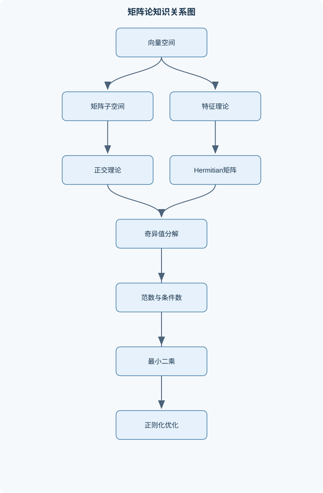
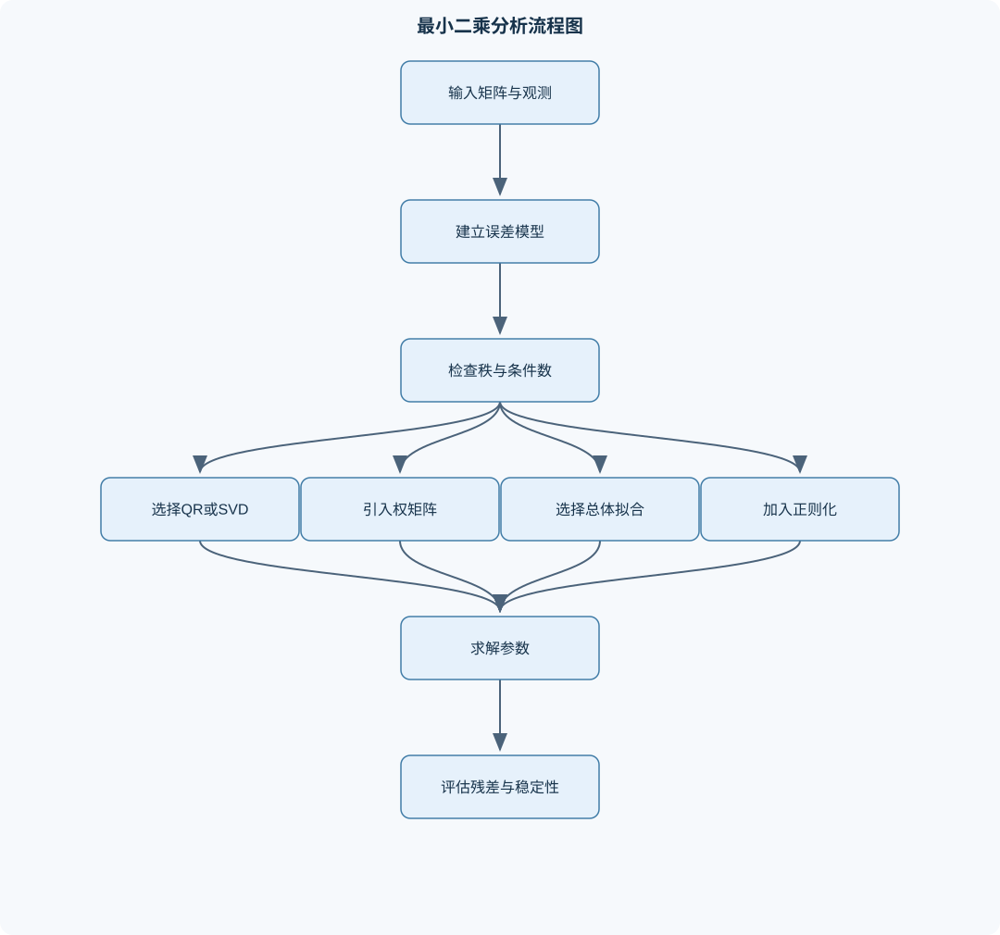

# 矩阵论

## 一、课程整体知识框架

### 课程边界与先修知识

《矩阵论》面向理工科本科高年级或研究生初阶学习者，研究矩阵与线性变换的代数结构、几何性质、谱性质、数值稳定性及其在方程求解、最小二乘、信号处理和优化中的应用。课程边界包括：线性方程组与四个基本子空间、矩阵分解、向量与矩阵范数、条件数、特征值与特征向量、相似变换、正规矩阵、Hermitian矩阵、正定矩阵、奇异值分解、广义逆、矩阵函数、矩阵微分、二次型优化、约束优化、普通最小二乘、加权最小二乘、总体最小二乘和Tikhonov正则化。不以抽象泛函分析、无限维算子谱理论或完整数值线性代数理论为主要内容。先修知识包括高等数学中的多元微积分与泰勒展开、线性代数中的行列式与基本初等变换、复数基础，以及概率论中期望和协方差的基本概念。





### 1. 课程对象、问题域与先修基础

《矩阵论》研究矩阵作为线性映射的代数结构、几何结构、谱结构以及数值计算性质。设实数域为 $\mathbb{R}$，复数域为 $\mathbb{C}$，$m\times n$ 矩阵记为 $A\in\mathbb{R}^{m\times n}$ 或 $A\in\mathbb{C}^{m\times n}$。本课程既讨论精确代数结论，也讨论有限精度计算中的误差传播、病态性和稳定算法。

课程的基本问题可以归纳为四类：

1. **结构识别问题**：判断矩阵是否可逆、是否满秩、是否可对角化、是否正定，并描述其值域、核空间和正交补。
2. **谱分析问题**：求或估计特征值、特征向量及奇异值，研究相似变换、酉相似变换和矩阵函数。
3. **几何与逼近问题**：用正交投影、QR分解、奇异值分解描述最小二乘、低秩逼近和噪声抑制。
4. **计算与优化问题**：求解线性方程组、约束或无约束二次优化问题，并通过正则化改善病态问题的稳定性。

先修知识包括多元微积分和二阶泰勒展开、行列式与初等变换、复数运算，以及期望和协方差的基本概念。课程不以无限维空间、抽象算子谱理论或完整的数值线性代数理论为主要内容；涉及数值算法时，重点放在有限维矩阵、误差来源、适用条件和结果验证上。

### 2. 统一符号与基本运算

$A^{\mathsf T}$ 表示转置，$A^{\mathsf H}$ 表示共轭转置。实矩阵满足 $A^{\mathsf H}=A^{\mathsf T}$。若 $A=A^{\mathsf H}$，则称 $A$ 为 Hermitian 矩阵；若矩阵为实数矩阵，则对应概念是实对称矩阵。

$I_n$ 表示 $n$ 阶单位矩阵，$0$ 表示维数适当的零矩阵；$\det(A)$ 表示方阵 $A$ 的行列式，$\operatorname{rank}(A)$ 表示秩。$\operatorname{ker}(A)$ 或 $\operatorname{Null}(A)$ 表示零空间，$\operatorname{Range}(A)$ 或 $\operatorname{Col}(A)$ 表示值域或列空间，$\operatorname{Row}(A)$ 表示行空间。

实内积写作

$$
\langle x,y\rangle=x^{\mathsf T}y,
$$

复内积写作

$$
\langle x,y\rangle=x^{\mathsf H}y.
$$

向量二范数为

$$
\|x\|_2=(x^{\mathsf H}x)^{1/2}.
$$

Frobenius 范数为

$$
\|A\|_{\mathrm F}
=\left(\sum_i\sum_j |a_{ij}|^2\right)^{1/2},
$$

诱导二范数为

$$
\|A\|_2=\max_{x\ne 0}\frac{\|Ax\|_2}{\|x\|_2}.
$$

若 $A$ 为 Hermitian 矩阵，$A\succeq0$ 表示对所有 $x$ 有 $x^{\mathsf H}Ax\ge 0$，$A\succ0$ 表示对所有非零 $x$ 有 $x^{\mathsf H}Ax>0$。$\lambda$ 表示特征值，$\sigma_i(A)$ 表示按非增顺序排列的奇异值，$A^+$ 或 $A^\dagger$ 表示 Moore–Penrose 广义逆。迹记为 $\operatorname{tr}(A)$，满足 $\operatorname{tr}(AB)=\operatorname{tr}(BA)$，但不能据此任意交换多个矩阵因子。

### 3. 从矩阵代数到应用的逻辑主线

矩阵乘法描述线性映射的复合；初等行变换揭示秩、解空间和可逆性；内积和正交性提供投影、最小距离和分解工具；特征值描述某些方向在变换下的伸缩因子；奇异值则描述任意矩阵在正交坐标系下的主伸缩方向。由此形成如下逻辑链：

$$
\text{矩阵代数}
\longrightarrow
\text{线性方程组与子空间}
\longrightarrow
\text{正交分解}
\longrightarrow
\text{谱分解与奇异值分解}
\longrightarrow
\text{最小二乘、优化与正则化}.
$$

对方程 $Ax=b$，可解性由 $b$ 是否属于 $\operatorname{Col}(A)$ 决定；解的唯一性由 $\operatorname{ker}(A)$ 是否只有零向量决定；当观测含噪声或系统病态时，需转向最小二乘、广义逆或正则化。因而矩阵论中的代数结论必须同时说明假设条件和数值边界。

---

## 二、章节和模块划分

### 核心知识覆盖清单

本清单用于检查正文是否覆盖本课程的主要知识模块：

- **矩阵代数与线性方程组**：矩阵乘法与分块矩阵、转置、共轭转置与Hermitian矩阵、初等矩阵与高斯消元、行列式、秩与可逆性、线性方程组的相容性、齐次方程组与非齐次方程组、秩—零度定理、逆矩阵与伴随矩阵、矩阵乘积的秩和逆序关系。
- **向量空间与矩阵基本子空间**：向量空间与子空间判定、线性组合、张成与生成集、线性相关与线性无关、基、维数与坐标、列空间与值域、零空间与核、行空间与左零空间、四个基本子空间的正交关系、基于行最简形求核空间基。
- **内积空间与正交理论**：实内积与复内积、向量范数与Cauchy–Schwarz不等式、正交集与标准正交集、Gram–Schmidt正交化、正交投影与投影矩阵、正交补与最小距离、QR分解的几何意义、酉矩阵与正交矩阵、白噪声与标准正交变换。
- **矩阵范数与条件数**：向量范数与范数等价性、矩阵范数的相容性、诱导1范数、2范数和无穷范数、Frobenius范数、谱半径与范数上界、矩阵扰动与解的误差放大、条件数的定义与物理意义、奇异值与2范数条件数、病态问题与尺度变换。
- **特征值与相似变换**：特征值、特征向量与特征空间、特征多项式与代数重数、几何重数与可对角化条件、相似变换及其不变量、迹、行列式与特征值关系、Cayley–Hamilton定理、Jordan标准形的基本思想、幂法与特征值估计、Rayleigh商与极值特征值。
- **Hermitian矩阵与二次型**：Hermitian矩阵的谱定理、实对称矩阵的正交对角化、半正定、正定与负定、二次型与合同变换、Sylvester惯性定理的应用边界、Cholesky分解、Rayleigh商的极值性质、广义Rayleigh商、矩阵平方根与正定矩阵分解。
- **奇异值分解与广义逆**：奇异值与左右奇异向量、奇异值分解的构造、AᵀA与AAᵀ的谱关系、四个基本子空间的SVD描述、Eckart–Young低秩逼近、Moore–Penrose广义逆、最小范数解与最小二乘解、谱范数保持与酉不变性、截断SVD与病态问题。
- **矩阵函数与矩阵微分**：多项式矩阵函数、由特征分解计算矩阵函数、Cayley–Hamilton降阶计算、矩阵指数与矩阵正弦、Fréchet微分的基本概念、迹函数微分、标量对向量的梯度与Hessian、矩阵变量的微分规则、行列式微分与逆矩阵微分。
- **最小二乘与拟合问题**：普通最小二乘模型、正规方程的推导、满列秩条件与唯一解、QR分解求最小二乘、加权最小二乘、协方差加权与白化变换、总体最小二乘、点到直线的正交距离、投影矩阵与残差正交性。
- **优化、正则化与统计估计**：无约束二次优化、最速下降法、Newton法、线性约束与拉格朗日乘子、混合外罚函数、混合内罚函数与对数障碍、增广Lagrangian方法、Tikhonov正则化、正则化参数与偏差—方差权衡、加权误差估计与线性滤波器。


### 1. 矩阵代数与线性方程组

矩阵乘法定义为

$$
(AB)_{ij}=\sum_{k=1}^{n}a_{ik}b_{kj},
$$

其中 $A\in\mathbb{C}^{m\times n}$、$B\in\mathbb{C}^{n\times p}$，结果 $AB\in\mathbb{C}^{m\times p}$。矩阵乘法通常不满足交换律，但满足结合律和分配律。分块矩阵可以把大型运算转化为小块运算，例如

$$
\begin{bmatrix}
A_{11}&A_{12}\\
A_{21}&A_{22}
\end{bmatrix}
\begin{bmatrix}
B_{11}\\B_{21}
\end{bmatrix}
=
\begin{bmatrix}
A_{11}B_{11}+A_{12}B_{21}\\
A_{21}B_{11}+A_{22}B_{21}
\end{bmatrix}.
$$

高斯消元通过交换行、某行乘非零常数、某行加上另一行的倍数，将增广矩阵化为阶梯形或行最简形。初等行变换等价于左乘可逆初等矩阵，因此保持方程组的解集和矩阵的秩。对增广矩阵 $[A,b]$，方程 $Ax=b$ 有解当且仅当

$$
\operatorname{rank}(A)=\operatorname{rank}([A,b]).
$$

若未知量个数为 $n$，则秩为 $n$ 时解唯一；若相容且秩小于 $n$，则至少存在一个自由变量，解有无穷多个。若两个秩不等，则出现形如 $[0\ \cdots\ 0\mid c]$ 且 $c\ne0$ 的矛盾行，方程无解。

对方阵 $A\in\mathbb{C}^{n\times n}$，以下条件等价：$A$ 可逆；$\det(A)\ne0$；$\operatorname{rank}(A)=n$；$\operatorname{ker}(A)=\{0\}$；列向量线性无关；对任意 $b$，$Ax=b$ 有唯一解。若 $A$ 可逆，则

$$
A^{-1}=\frac{\operatorname{adj}(A)}{\det(A)},
$$

但伴随矩阵公式主要用于理论推导，不适合大规模数值计算，因为直接计算行列式和余子式的代价高且可能放大舍入误差。

秩满足

$$
\operatorname{rank}(AB)\le \min\{\operatorname{rank}(A),\operatorname{rank}(B)\}.
$$

若 $A$、$B$ 可逆且维数相容，则

$$
(AB)^{-1}=B^{-1}A^{-1}.
$$

逆序关系不能写成 $A^{-1}B^{-1}$。边界反例是两个非交换矩阵：即使 $AB$ 有意义，通常也有 $AB\ne BA$。

### 2. 向量空间与矩阵基本子空间

向量空间要求对加法和数乘封闭，并包含零向量、加法逆元及满足结合律和分配律等公理。子空间判定通常只需检查：集合非空；对任意 $u,v$ 和标量 $\alpha,\beta$，有 $\alpha u+\beta v$ 仍在集合中。形如齐次方程 $Ax=0$ 的解集一定是子空间；非齐次方程 $Ax=b$ 的解集在 $b\ne0$ 时通常不是子空间，因为不含零向量。

列空间为

$$
\operatorname{Col}(A)=\{Ax:x\in\mathbb{C}^n\},
$$

零空间为

$$
\operatorname{Null}(A)=\{x:Ax=0\}.
$$

行空间由 $A$ 的行向量张成，左零空间为

$$
\operatorname{Null}(A^{\mathsf H})
=\{y:A^{\mathsf H}y=0\}.
$$

若 $A$ 为 $m\times n$ 矩阵，秩为 $r$，则

$$
\dim\operatorname{Col}(A)=\dim\operatorname{Row}(A)=r,
$$

$$
\dim\operatorname{Null}(A)=n-r,
\qquad
\dim\operatorname{Null}(A^{\mathsf H})=m-r.
$$

这就是秩—零度定理及其左侧对应形式。四个基本子空间满足

$$
\operatorname{Col}(A)^\perp=\operatorname{Null}(A^{\mathsf H}),
\qquad
\operatorname{Row}(A)^\perp=\operatorname{Null}(A).
$$

例如，若 $y\in\operatorname{Null}(A^{\mathsf H})$ 且 $z\in\operatorname{Col}(A)$，写成 $z=Ax$，则

$$
y^{\mathsf H}z=y^{\mathsf H}Ax=(A^{\mathsf H}y)^{\mathsf H}x=0.
$$

求零空间基时，应先把 $A$ 化为行最简形，识别主元变量和自由变量，再令每个自由变量依次取单位参数，得到参数向量。行变换改变具体行向量，却不改变零空间，因为 $EAx=0$ 与 $Ax=0$ 等价，其中 $E$ 可逆。

### 3. 内积空间、正交理论与 QR 分解

复向量的内积必须使用共轭转置。Cauchy–Schwarz 不等式为

$$
|\langle x,y\rangle|
\le \|x\|_2\|y\|_2.
$$

等号成立当且仅当两个向量线性相关。若一组非零向量两两正交，则它们必线性无关；再将每个向量除以其范数，就得到标准正交集。

Gram–Schmidt 过程对线性无关向量 $a_1,\ldots,a_k$ 逐步处理：

$$
v_j=a_j-\sum_{i=1}^{j-1}q_iq_i^{\mathsf H}a_j,
\qquad
q_j=\frac{v_j}{\|v_j\|_2}.
$$

第 $j$ 步中，$v_j$ 与前面所有 $q_i$ 正交；若输入列线性无关，则 $v_j\ne0$。于是得到 $Q=[q_1,\ldots,q_k]$，满足 $Q^{\mathsf H}Q=I$，并有

$$
A=QR,
$$

其中 $R$ 为上三角矩阵。若输入列相关，某一步残差为零，不能继续归一化；数值计算中普通 Gram–Schmidt 可能因舍入误差破坏正交性，改进型 Gram–Schmidt 或 Householder 方法通常更可靠。

投影到 $\operatorname{Col}(Q)$ 的正交投影为

$$
P=QQ^{\mathsf H},
\qquad
\widehat{x}=Px.
$$

若 $A$ 满列秩但列不正交，则

$$
P=A(A^{\mathsf H}A)^{-1}A^{\mathsf H}.
$$

该矩阵满足 $P^2=P$ 和 $P^{\mathsf H}=P$。若 $Pv=\mu v$ 且 $v\ne0$，则由 $P^2v=Pv$ 得 $\mu^2=\mu$，所以投影矩阵特征值只能为 $0$ 或 $1$。$P$ 的值域和零空间互为正交补。

正交矩阵或酉矩阵满足 $Q^{\mathsf H}Q=I$，因此保持二范数：

$$
\|Qx\|_2^2=x^{\mathsf H}Q^{\mathsf H}Qx=\|x\|_2^2.
$$

白噪声经标准正交变换后协方差仍保持为标量单位阵的形式；若噪声协方差不是单位阵，则仅靠一般线性变换不能直接断言噪声仍为白噪声。

### 4. 向量范数、矩阵范数与条件数

常见向量范数包括

$$
\|x\|_1=\sum_i|x_i|,
\qquad
\|x\|_2=\left(\sum_i|x_i|^2\right)^{1/2},
\qquad
\|x\|_\infty=\max_i|x_i|.
$$

有限维空间中的范数彼此等价，但“等价”只表示存在与维数有关的常数上下界，不表示数值完全相同。例如

$$
\|x\|_2\le \|x\|_1\le \sqrt n\,\|x\|_2.
$$

矩阵范数若满足 $\|AB\|\le\|A\|\|B\|$，称为相容范数。诱导 $1$ 范数是最大列绝对值和，诱导无穷范数是最大行绝对值和，诱导二范数等于最大奇异值：

$$
\|A\|_2=\sigma_{\max}(A).
$$

Frobenius 范数满足

$$
\|A\|_{\mathrm F}
=\left(\sum_i\sigma_i(A)^2\right)^{1/2},
$$

并且

$$
\|A\|_2\le\|A\|_{\mathrm F}\le\sqrt{\operatorname{rank}(A)}\,\|A\|_2.
$$

谱半径定义为

$$
\rho(A)=\max_i|\lambda_i(A)|.
$$

对任意相容矩阵范数，有

$$
\rho(A)\le\|A\|.
$$

若 $A$ 可逆，二范数条件数为

$$
\operatorname{cond}_2(A)
=\|A\|_2\|A^{-1}\|_2
=\frac{\sigma_{\max}(A)}{\sigma_{\min}(A)}.
$$

当 $\sigma_{\min}(A)=0$ 时，$A$ 不可逆，条件数视为无穷大。条件数描述输入扰动可能被放大的程度，而不是算法本身的运行时间。即使问题条件良好，算法也可能不稳定；即使算法稳定，病态问题也可能对数据误差高度敏感。

尺度变换可改变条件数。例如不同物理量直接拼入同一矩阵时，长度、时间和质量的单位差异可能造成列尺度悬殊。适当无量纲化或列缩放能够改善数值表现，但不能改变原问题的物理含义；缩放后必须把结果还原到原单位。

### 5. 特征值、相似变换与特征值估计

若存在非零向量 $v$ 使

$$
Av=\lambda v,
$$

则 $\lambda$ 为特征值，$v$ 为对应特征向量，所有对应向量构成特征空间 $\operatorname{ker}(A-\lambda I)$。特征值由

$$
p_A(\lambda)=\det(\lambda I-A)
$$

的根给出。代数重数是根在特征多项式中的重复次数，几何重数是对应特征空间的维数，二者满足

$$
1\le \text{几何重数}\le \text{代数重数}.
$$

矩阵可对角化当且仅当存在足够多的线性无关特征向量。重复特征值不必然导致不可对角化，例如单位矩阵有重复特征值但已经是对角矩阵；反之，Jordan 块

$$
\begin{bmatrix}
\lambda&1\\0&\lambda
\end{bmatrix}
$$

只有一个独立特征向量，不能对角化。

相似变换为 $B=S^{-1}AS$，其中 $S$ 可逆。相似矩阵具有相同的特征多项式、迹、行列式和 Jordan 结构，但具体元素、特征向量坐标和范数一般不同。由相似性及三角矩阵对角线元素等于特征值，可得

$$
\operatorname{tr}(A)=\sum_{i=1}^{n}\lambda_i,
\qquad
\det(A)=\prod_{i=1}^{n}\lambda_i,
$$

特征值按代数重数计算，不要求 $A$ 可对角化。

Cayley–Hamilton 定理说明矩阵满足自己的特征多项式。若

$$
p_A(t)=t^n+c_{n-1}t^{n-1}+\cdots+c_0,
$$

则

$$
A^n+c_{n-1}A^{n-1}+\cdots+c_0I=0.
$$

因此任意高次多项式 $q(A)$ 都可化为次数小于 $n$ 的矩阵多项式。该结论不等价于可对角化。

幂法从非零初始向量 $x_0$ 出发，反复计算

$$
y_k=Ax_k,\qquad
x_{k+1}=\frac{y_k}{\|y_k\|_2}.
$$

若最大模特征值唯一且严格大于其他特征值，并且初始向量在主特征向量方向上的分量不为零，则迭代通常收敛到主特征向量。主特征值可由 Rayleigh 商或尺度因子估计。若最大模特征值不唯一、初始向量恰好缺少主方向，幂法可能不收敛到所需结果。

Rayleigh 商为

$$
R_A(x)=\frac{x^{\mathsf H}Ax}{x^{\mathsf H}x}.
$$

当 $A$ 为 Hermitian 矩阵时，$R_A(x)$ 为实数，最大值和最小值分别是最大、最小特征值；极值向量属于相应特征空间。没有 Hermitian 条件时，不能直接使用这一结论。

### 6. Hermitian 矩阵、二次型与正定性

Hermitian 谱定理说明存在酉矩阵 $U$，使

$$
A=U\Lambda U^{\mathsf H},
$$

其中 $\Lambda$ 为实对角矩阵。实对称矩阵可写为 $A=Q\Lambda Q^{\mathsf T}$，其中 $Q$ 为正交矩阵。于是

$$
x^{\mathsf H}Ax
=(U^{\mathsf H}x)^{\mathsf H}\Lambda(U^{\mathsf H}x).
$$

因此，Hermitian 矩阵正定当且仅当所有特征值为正；半正定当且仅当所有特征值非负。正定不是“所有元素为正”，例如

$$
\begin{bmatrix}1&2\\2&1\end{bmatrix}
$$

含有正元素，但其特征值为 $3$ 和 $-1$，不是正定矩阵。

二次型 $x^{\mathsf H}Ax$ 只由 $A$ 的 Hermitian 部分决定，因为反 Hermitian 部分对实值二次型不产生贡献。合同变换为 $B=S^{\mathsf H}AS$，与相似变换不同；合同变换保持正定性和惯性，但一般不保持特征值。Sylvester 惯性定理讨论正、负、零特征值的个数在合同变换下保持不变，不能据此推出所有特征值数值不变。

若 $A\succ0$，则存在 Cholesky 分解

$$
A=LL^{\mathsf H},
$$

其中 $L$ 为对角线元素为正的下三角矩阵。对广义 Rayleigh 商

$$
R_{A,B}(x)=\frac{x^{\mathsf H}Ax}{x^{\mathsf H}Bx},
\qquad B\succ0,
$$

令 $y=B^{1/2}x$，则

$$
R_{A,B}(x)
=
\frac{y^{\mathsf H}B^{-1/2}AB^{-1/2}y}{y^{\mathsf H}y},
$$

所以其极值可转化为普通 Hermitian Rayleigh 商。矩阵平方根由谱分解定义：

$$
A^{1/2}=U\Lambda^{1/2}U^{\mathsf H},
$$

要求 $A$ 至少为 Hermitian 半正定；若要使用逆平方根，则通常要求 $A\succ0$。

### 7. 奇异值分解与广义逆

任意 $A\in\mathbb{C}^{m\times n}$ 都可写为

$$
A=U\Sigma V^{\mathsf H},
$$

其中 $U,V$ 为酉矩阵，$\Sigma$ 的非零对角元素为奇异值。由

$$
A^{\mathsf H}A
=V\Sigma^{\mathsf H}\Sigma V^{\mathsf H}
$$

可知，非零奇异值是 $A^{\mathsf H}A$ 非零特征值的平方根；同样也是 $AA^{\mathsf H}$ 非零特征值的平方根。

若非零奇异值个数为 $r$，则右奇异向量中对应非零奇异值的部分构成行空间的正交基，零奇异值对应的右奇异向量构成 $\operatorname{Null}(A)$ 的正交基；左奇异向量分别描述列空间和左零空间。因此

$$
\operatorname{rank}(A)=r.
$$

Eckart–Young 定理说明，在二范数或 Frobenius 范数下，截断 SVD

$$
A_k=\sum_{i=1}^{k}\sigma_i u_iv_i^{\mathsf H}
$$

是秩不超过 $k$ 的最佳近似。误差分别为

$$
\|A-A_k\|_2=\sigma_{k+1},
$$

以及

$$
\|A-A_k\|_{\mathrm F}
=\left(\sum_{i>k}\sigma_i^2\right)^{1/2}.
$$

Moore–Penrose 广义逆为

$$
A^+=V\Sigma^+U^{\mathsf H},
$$

其中 $\Sigma^+$ 将非零奇异值取倒数并转置到相应位置。最小二乘问题

$$
\min_x\|Ax-b\|_2
$$

的所有解中，$A^+b$ 是最小二范数解。满列秩时

$$
A^+=(A^{\mathsf H}A)^{-1}A^{\mathsf H};
$$

满行秩时

$$
A^+=A^{\mathsf H}(AA^{\mathsf H})^{-1}.
$$

秩亏时不能直接写 $(A^{\mathsf H}A)^{-1}$，应使用 SVD、秩揭示 QR 或广义逆。

### 8. 矩阵函数与矩阵微分

对多项式

$$
p(t)=\sum_{k=0}^{s}c_kt^k,
$$

定义

$$
p(A)=\sum_{k=0}^{s}c_kA^k.
$$

若 $A=U\Lambda U^{-1}$ 可对角化，则

$$
f(A)=Uf(\Lambda)U^{-1},
$$

其中 $f(\Lambda)$ 为逐对角元素计算。对 Hermitian 矩阵，$U^{-1}=U^{\mathsf H}$。不可对角化时需结合 Jordan 结构或插值多项式，不能无条件使用特征向量公式。

矩阵指数定义为

$$
e^A=\sum_{k=0}^{\infty}\frac{A^k}{k!},
$$

并用于线性系统 $\dot{x}=Ax$ 的解 $x(t)=e^{tA}x(0)$。Cayley–Hamilton 定理可将幂级数中的高次幂化为低次矩阵多项式，但实际数值计算还要考虑舍入误差和算法稳定性。

本课程采用列梯度约定：对标量函数 $f(x)$，梯度 $\nabla f(x)$ 为列向量。若

$$
f(x)=x^{\mathsf H}Ax-b^{\mathsf H}x+c,
$$

则对一般复矩阵情形需明确实变量或复变量微分约定；在实变量且 $A$ 为实矩阵时，

$$
\nabla f(x)=(A+A^{\mathsf T})x-b.
$$

若 $A$ 对称，则

$$
\nabla f(x)=2Ax-b,
\qquad
\nabla^2f(x)=2A.
$$

对一般矩阵，不能错误写成 $2Ax-b$。矩阵微分示例为

$$
d\,\operatorname{tr}(X^{\mathsf T}X)
=\operatorname{tr}(dX^{\mathsf T}X+X^{\mathsf T}dX)
=2\operatorname{tr}(X^{\mathsf T}dX),
$$

以及可逆矩阵的

$$
d(A^{-1})=-A^{-1}(dA)A^{-1},
$$

$$
d\det(A)=\det(A)\operatorname{tr}(A^{-1}dA).
$$

### 9. 最小二乘、加权拟合与总体最小二乘

普通最小二乘以

$$
\min_x\|Ax-b\|_2^2
$$

为目标。展开并求导：

$$
\|Ax-b\|_2^2
=x^{\mathsf H}A^{\mathsf H}Ax
-2\operatorname{Re}(b^{\mathsf H}Ax)+b^{\mathsf H}b,
$$

得到正规方程

$$
A^{\mathsf H}Ax=A^{\mathsf H}b.
$$

若 $A$ 满列秩，则 $A^{\mathsf H}A$ 正定且解唯一：

$$
\widehat{x}=(A^{\mathsf H}A)^{-1}A^{\mathsf H}b.
$$

但数值计算中不宜先形成 $A^{\mathsf H}A$，因为其条件数约为 $\operatorname{cond}(A)^2$；通常优先使用 QR 或 SVD。QR 方法中 $A=QR$，先求

$$
R\widehat{x}=Q^{\mathsf H}b.
$$

残差 $r=b-A\widehat{x}$ 满足

$$
A^{\mathsf H}r=0,
$$

说明残差与列空间正交。

加权最小二乘目标为

$$
\min_x (b-Ax)^{\mathsf H}W(b-Ax),
$$

其中 $W=W^{\mathsf H}\succ0$。求导得到

$$
A^{\mathsf H}WA\widehat{x}=A^{\mathsf H}Wb.
$$

若误差协方差为 $\Sigma$，且 $W=\Sigma^{-1}$，则该目标相当于先进行白化变换。若 $W$ 不是正定矩阵，目标可能不是严格凸函数，唯一解和几何距离解释都需重新判断。

总体最小二乘同时允许 $A$ 和 $b$ 受到扰动，目标可写为寻找最小的 $\Delta=[\Delta A,\Delta b]$，使

$$
(A+\Delta A)x=b+\Delta b.
$$

将数据矩阵 $C=[A,b]$ 作 SVD，取其最小奇异值对应的右奇异向量 $v$，将 $v$ 分成前 $n$ 个分量和最后一个分量，即可构造齐次关系 $[A,b]v=0$ 的拟合模型。它与普通最小二乘的区别在于：普通最小二乘通常只修正观测向量 $b$，总体最小二乘同时修正自变量矩阵和观测量。

### 10. 二次优化、约束方法与正则化

对可微函数，局部极小点必须满足

$$
\nabla f(x)=0,
$$

并且在适当条件下满足

$$
\nabla^2f(x)\succeq0.
$$

若 Hessian 在邻域内正定，则该点为严格局部极小点。对二次函数

$$
f(x)=x^{\mathsf T}Ax-b^{\mathsf T}x+c,
$$

若 $A=A^{\mathsf T}\succ0$，则函数严格凸，唯一极小点满足

$$
2Ax-b=0.
$$

最速下降法沿负梯度方向更新；Newton 法使用

$$
x_{k+1}=x_k-\left[\nabla^2f(x_k)\right]^{-1}\nabla f(x_k).
$$

Newton 法局部收敛速度快，但要求 Hessian 可逆，且初值不佳时可能离开合理区域。

对等式约束 $h(x)=0$，构造

$$
\mathcal{L}(x,\mu)=f(x)+\mu^{\mathsf T}h(x),
$$

KKT 方程包括驻点条件、原始可行性条件和约束资格条件。对不等式约束，外罚函数允许从不可行点出发，例如

$$
F_\rho(x)=f(x)+\rho\sum_i\max(0,-g_i(x))^2.
$$

内罚函数要求始终满足严格不等式约束，典型对数障碍为

$$
F_\mu(x)=f(x)-\mu\sum_i\log g_i(x),
\qquad g_i(x)>0.
$$

增广 Lagrangian 同时使用乘子估计和适度罚项，通常比单纯把罚参数增大更稳定。

Tikhonov 正则化问题为

$$
\min_x\|Ax-b\|_2^2+\lambda\|Lx\|_2^2,
\qquad \lambda>0.
$$

求导得

$$
(A^{\mathsf H}A+\lambda L^{\mathsf H}L)x
=A^{\mathsf H}b.
$$

当 $L=I$ 且 $\lambda>0$ 时，即使 $A$ 秩亏，系统通常也会因 $\lambda I$ 而变为正定。$\lambda$ 太小，噪声放大问题仍然明显；$\lambda$ 太大，解会过度平滑并产生较大偏差。因此正则化体现偏差—方差权衡，而不是简单地“参数越大越稳定”。

### 11. 代表性算法、代码流程与复杂度

#### 11.1 高斯消元与秩判定

**输入**：矩阵 $A$、右端项 $b$、数值容差 $\varepsilon$。  
**输出**：秩、相容性、唯一解或参数解。  
**过程**：构造 $[A,b]$，选择绝对值较大的主元进行部分选主元，交换行并消元；根据主元数量判定秩，根据增广列是否产生矛盾行判定相容性。  
**不变量**：每次初等行变换都保持原方程组解集不变。  
**终止条件**：所有可能主元列处理完毕。  
**复杂度**：方阵规模为 $n$ 时约为 $O(n^3)$。  
**边界**：主元很小时直接除法会放大舍入误差，必须使用选主元或容差判断。

#### 11.2 QR 最小二乘

**输入**：$A\in\mathbb{C}^{m\times n}$、$b\in\mathbb{C}^m$，通常 $m\ge n$。  
**输出**：最小二乘解 $\widehat{x}$。  
**过程**：计算 $A=QR$；利用 $Q^{\mathsf H}Q=I$，令残差正交，得到 $R\widehat{x}=Q^{\mathsf H}b$；回代求解上三角系统。  
**不变量**：当前残差始终被分解为列空间方向和正交补方向。  
**终止条件**：三角系统求解完成，或残差满足指定容差。  
**复杂度**：约为 $O(mn^2)$。  
**适用条件**：满列秩时解唯一；秩亏时应采用秩揭示 QR 或 SVD。

```python
import numpy as np

def least_squares_qr(A, b, tol=1e-12):
    """
    输入:
        A: m×n 实矩阵或复矩阵
        b: m 维向量
        tol: 秩判断容差
    输出:
        x: QR 最小二乘解
        residual_norm: 残差二范数
    """
    Q, R = np.linalg.qr(A, mode="reduced")
    diagonal = np.abs(np.diag(R))
    if diagonal.size == 0 or np.min(diagonal) <= tol:
        raise ValueError("矩阵可能秩亏，应改用SVD或秩揭示QR。")

    x = np.linalg.solve(R, Q.conj().T @ b)
    residual = A @ x - b
    return x, np.linalg.norm(residual, 2)
```

#### 11.3 幂法

**输入**：矩阵 $A$、初始向量 $x_0\ne0$、最大迭代次数和容差。  
**输出**：主模特征值近似 $\mu_k$ 和特征向量近似 $x_k$。  
**过程**：计算 $y_k=Ax_k$，归一化 $x_{k+1}=y_k/\|y_k\|_2$，用 Rayleigh 商估计 $\mu_k$。  
**不变量**：若主特征方向在初始向量中有非零分量，迭代方向逐渐增强该分量。  
**终止条件**：

$$
\|Ax_k-\mu_kx_k\|_2\le\varepsilon.
$$

**适用条件**：最大模特征值唯一且严格占优。若存在相同模的多个特征值，迭代可能振荡或不收敛。

#### 11.4 Tikhonov 共轭梯度

将

$$
H=A^{\mathsf H}A+\lambda L^{\mathsf H}L
$$

视为 Hermitian 正定线性算子，求解 $Hx=A^{\mathsf H}b$。从 $x_0$ 出发，计算残差和共轭方向，沿方向更新。每一步保持搜索方向关于 $H$ 共轭，二次目标函数不增。当残差或相邻迭代差低于容差时终止。该方法适合大规模稀疏问题，单步主要代价是矩阵向量乘法；若 $H$ 不是正定，不能直接使用标准共轭梯度。

### 12. 代表性例题

#### 例题一：线性方程组的相容性与自由变量

**题干**：讨论参数 $\alpha$ 对系统

$$
\begin{cases}
x+y+z=2,\\
2x+2y+2z=4,\\
x+y+\alpha z=3
\end{cases}
$$

解的影响。

**分析**：第二行始终是第一行的两倍。第三行与第一行的差为 $(\alpha-1)z=1$。

**解答**：若 $\alpha=1$，第三行左端与第一行相同，但右端分别为 $3$ 和 $2$，产生矛盾，因此无解。若 $\alpha\ne1$，则

$$
z=\frac{1}{\alpha-1},
\qquad
x+y=2-\frac{1}{\alpha-1}.
$$

此时有一个自由变量，解有无穷多个。

**结果验证**：代入第三行可得 $x+y+\alpha/(\alpha-1)=3$。  
**变式**：若未知量增加为四个而秩仍为 $2$，相容时自由变量数变为 $4-2=2$。

#### 例题二：四个基本子空间

**题干**：设

$$
A=
\begin{bmatrix}
1&2&3\\
2&4&6
\end{bmatrix}.
$$

求四个基本子空间的基和维数。

**解答**：第二行是第一行的两倍，因此秩为 $1$。行空间基可取 $\{(1,2,3)\}$，列空间基可取第一列 $\{(1,2)^{\mathsf T}\}$。零空间满足

$$
x+2y+3z=0.
$$

令 $y=s,z=t$，得

$$
x=-2s-3t,
$$

所以零空间基为

$$
\{(-2,1,0)^{\mathsf T},(-3,0,1)^{\mathsf T}\}.
$$

左零空间满足 $A^{\mathsf T}w=0$，即 $w_1+2w_2=0$，可取基 $(-2,1)^{\mathsf T}$。

**结果验证**：$(1,2)^{\mathsf T}$ 与 $(-2,1)^{\mathsf T}$ 内积为 $0$；零空间维数为 $3-1=2$，左零空间维数为 $2-1=1$。  
**变式**：把第二行改为不成比例的行，秩可能升为 $2$，零空间维数相应降为 $1$。

#### 例题三：正交投影与最小二乘

**题干**：给定

$$
A=
\begin{bmatrix}
1\\1\\1
\end{bmatrix},
\qquad
b=
\begin{bmatrix}
1\\2\\4
\end{bmatrix},
$$

求 $b$ 在 $\operatorname{Col}(A)$ 上的投影。

**解答**：由于 $A$ 满列秩，

$$
\widehat{x}=(A^{\mathsf T}A)^{-1}A^{\mathsf T}b.
$$

计算得

$$
A^{\mathsf T}A=3,\qquad
A^{\mathsf T}b=7,
$$

所以 $\widehat{x}=7/3$，投影向量为

$$
p=A\widehat{x}
=\begin{bmatrix}7/3\\7/3\\7/3\end{bmatrix}.
$$

残差为

$$
r=b-p
=\begin{bmatrix}-4/3\\-1/3\\5/3\end{bmatrix}.
$$

**结果验证**：

$$
A^{\mathsf T}r=-4/3-1/3+5/3=0.
$$

因此残差与列空间正交。  
**变式**：若 $A$ 有重复列或秩亏，不能直接使用 $(A^{\mathsf T}A)^{-1}$，应使用 QR 或 SVD。

#### 例题四：Rayleigh 商极值

**题干**：设

$$
A=
\begin{bmatrix}
2&0\\0&5
\end{bmatrix},
$$

求

$$
R(x)=\frac{x^{\mathsf T}Ax}{x^{\mathsf T}x}
$$

的最大值和最小值。

**解答**：令 $x=(x_1,x_2)^{\mathsf T}\ne0$，则

$$
R(x)=\frac{2x_1^2+5x_2^2}{x_1^2+x_2^2}.
$$

这是 $2$ 和 $5$ 按非负权重的加权平均，因此

$$
2\le R(x)\le5.
$$

最大值 $5$ 在 $x=(0,1)^{\mathsf T}$ 的方向上取得，最小值 $2$ 在 $x=(1,0)^{\mathsf T}$ 的方向上取得。

**结果验证**：这两个向量分别是对应特征向量。  
**变式**：若矩阵不对称，Rayleigh 商可能不是实数，不能直接使用最大、最小特征值结论。

#### 例题五：Tikhonov 正则化

**题干**：设

$$
A=
\begin{bmatrix}1&1\\1&1\end{bmatrix},
\qquad
b=
\begin{bmatrix}2\\2\end{bmatrix},
$$

求 $L=I$ 时的正则化解。

**解答**：目标为

$$
\|Ax-b\|_2^2+\lambda\|x\|_2^2,
\qquad \lambda>0.
$$

有

$$
A^{\mathsf T}A=
\begin{bmatrix}2&2\\2&2\end{bmatrix},
\qquad
A^{\mathsf T}b=
\begin{bmatrix}4\\4\end{bmatrix}.
$$

因此

$$
\left(
\begin{bmatrix}2&2\\2&2\end{bmatrix}
+\lambda I
\right)x
=
\begin{bmatrix}4\\4\end{bmatrix}.
$$

由对称性设 $x_1=x_2=t$，得

$$
(4+ \lambda)t=4,
\qquad
t=\frac{4}{4+\lambda}.
$$

所以

$$
x_\lambda=
\frac{4}{4+\lambda}
\begin{bmatrix}1\\1\end{bmatrix}.
$$

**结果验证**：当 $\lambda\to0^+$ 时，得到最小范数精确解 $[1,1]^{\mathsf T}$；当 $\lambda$ 增大时，解的范数下降，但拟合残差增大。  
**变式**：若 $L$ 为差分矩阵，则正则化惩罚的是相邻分量变化，而不是解的绝对大小。

### 13. 实验与项目流程

#### 实验一：普通最小二乘、QR 与 SVD 的稳定性比较

**输入数据**：构造

$$
A=
\begin{bmatrix}
1&1\\
1&1+\delta
\end{bmatrix},
\qquad
b=
\begin{bmatrix}
2\\
2+\delta
\end{bmatrix},
$$

其中 $\delta$ 依次取 $10^{-2},10^{-6},10^{-10}$，并加入小幅随机扰动。

**步骤**：

1. 用正规方程计算解；
2. 用 QR 分解计算解；
3. 用 SVD 计算解；
4. 分别记录残差 $\|Ax-b\|_2$、解的变化量和估计条件数；
5. 改变 $\delta$，观察矩阵接近秩亏时三种方法的差异。

**评价标准**：比较残差、解的相对误差、正交性误差 $\|Q^{\mathsf H}Q-I\|$，并检查不同方法是否给出一致的几何投影。不能只以残差最小作为唯一标准，因为病态问题中不同解可能具有相近残差。

**排错方法**：若复数数据使用了 $A^{\mathsf T}$，应改为 $A^{\mathsf H}$；若正规方程结果异常，检查是否因形成 $A^{\mathsf H}A$ 导致条件数平方放大；若 SVD 的小奇异值被误判为非零，应明确相对容差。

#### 实验二：Tikhonov 正则化参数评价

**输入数据**：给定病态矩阵 $A$、带噪观测 $b=b_0+e$，取 $L=I$，选择一组递增参数 $\lambda$。

**步骤**：

1. 计算无正则化最小二乘解；
2. 对每个 $\lambda$ 求解
   $$
   (A^{\mathsf H}A+\lambda I)x_\lambda=A^{\mathsf H}b;
   $$
3. 记录残差范数 $\|Ax_\lambda-b\|_2$ 和解范数 $\|x_\lambda\|_2$；
4. 若有真实解 $x_0$，计算 $\|x_\lambda-x_0\|_2$；
5. 绘制或列表比较 $\lambda$ 与残差、解范数、误差之间的关系。

**评价标准**：小 $\lambda$ 应更贴合观测但可能放大噪声，大 $\lambda$ 应更稳定但可能产生较大偏差；最终参数应依据验证误差、噪声水平或偏差—方差折中选择，不能以“最大或最小参数”为原则。

**排错方法**：检查 $\lambda$ 是否严格为正；检查 $A^{\mathsf H}A+\lambda I$ 是否 Hermitian；若解随 $\lambda$ 变化反常，检查矩阵维数、共轭转置和单位尺度；若把不同物理量直接拼接，先进行合理尺度归一化。

## 三、核心概念的详细解释

### 1. 矩阵、线性映射与四个基本子空间

设 $A\in\mathbb{C}^{m\times n}$。矩阵 $A$ 将向量 $x\in\mathbb{C}^n$ 映射为 $Ax\in\mathbb{C}^m$。矩阵乘法表示线性映射的复合：若 $A\in\mathbb{C}^{m\times n}$、$B\in\mathbb{C}^{n\times p}$，则 $AB\in\mathbb{C}^{m\times p}$，并且
$$
(AB)x=A(Bx).
$$
一般情况下 $AB\ne BA$，因此矩阵因子的顺序不可任意交换。分块矩阵乘法仍遵循“行块乘列块并求和”的规则，但各分块必须具有相容维数。

矩阵的列空间、零空间、行空间和左零空间分别定义为
$$
\operatorname{Col}(A)=\{Ax:x\in\mathbb{C}^n\},
$$
$$
\operatorname{Null}(A)=\{x\in\mathbb{C}^n:Ax=0\},
$$
$$
\operatorname{Row}(A)=\operatorname{Col}(A^{\mathsf H}),
$$
$$
\operatorname{Null}(A^{\mathsf H})
=\{y\in\mathbb{C}^m:A^{\mathsf H}y=0\}.
$$

其中 $\operatorname{Col}(A)$ 是 $\mathbb{C}^m$ 的子空间，$\operatorname{Null}(A)$ 是 $\mathbb{C}^n$ 的子空间。四个基本子空间满足
$$
\operatorname{Col}(A)^\perp=\operatorname{Null}(A^{\mathsf H}),
\qquad
\operatorname{Row}(A)^\perp=\operatorname{Null}(A).
$$
例如，若 $y\in\operatorname{Null}(A^{\mathsf H})$，而 $z\in\operatorname{Col}(A)$，则存在 $x$ 使 $z=Ax$，从而
$$
y^{\mathsf H}z=y^{\mathsf H}Ax=(A^{\mathsf H}y)^{\mathsf H}x=0.
$$

秩是列空间的维数，也等于行空间的维数。秩—零度定理为
$$
\operatorname{rank}(A)+\dim\operatorname{Null}(A)=n.
$$
因此，$A$ 的列向量线性无关当且仅当 $\operatorname{Null}(A)=\{0\}$；当 $A$ 为 $n\times n$ 方阵时，下列条件等价：$A$ 可逆、$\det(A)\ne0$、$\operatorname{rank}(A)=n$、零空间仅含零向量、列向量线性无关，以及对任意 $b$，方程 $Ax=b$ 有唯一解。

### 2. 线性方程组与高斯消元

方程组 $Ax=b$ 有解，当且仅当
$$
\operatorname{rank}(A)=\operatorname{rank}([A,b]).
$$
若未知量个数为 $n$，则：

- 当公共秩为 $n$ 时，解唯一；
- 当公共秩小于 $n$ 且方程组相容时，存在自由变量，解有无穷多个；
- 两个秩不相等时无解。

高斯消元通过初等行变换把增广矩阵化为阶梯形或行最简形。交换两行、用非零数乘某一行、将某行加上另一行的倍数，都不会改变方程组的解集。数值计算时应优先进行部分选主元，即在当前列中选取绝对值较大的元素作为主元，以降低舍入误差放大的风险。

若 $E$ 是可逆矩阵，左乘 $E$ 不改变秩：
$$
\operatorname{rank}(EA)=\operatorname{rank}(A).
$$
但一般的非可逆左乘可能降低秩。矩阵乘积满足
$$
\operatorname{rank}(AB)\le
\min\{\operatorname{rank}(A),\operatorname{rank}(B)\}.
$$
若两个方阵均可逆，则
$$
(AB)^{-1}=B^{-1}A^{-1},
$$
逆矩阵的顺序与原乘积相反。

### 3. 内积、正交投影与 QR 分解

在 $\mathbb{C}^n$ 中，内积采用
$$
\langle x,y\rangle=x^{\mathsf H}y.
$$
它满足共轭对称性 $\langle x,y\rangle=\overline{\langle y,x\rangle}$。Cauchy–Schwarz 不等式为
$$
|x^{\mathsf H}y|\le \|x\|_2\|y\|_2.
$$
等号成立当且仅当两个非零向量线性相关。

若 $q_1,\ldots,q_k$ 是标准正交向量，令
$$
Q=[q_1,\ldots,q_k],
$$
则 $Q^{\mathsf H}Q=I_k$。向量 $x$ 在 $\operatorname{Col}(Q)$ 上的正交投影为
$$
\hat{x}=QQ^{\mathsf H}x.
$$
因为投影系数为 $Q^{\mathsf H}x$，且投影误差满足
$$
Q^{\mathsf H}(x-\hat{x})=0.
$$

若 $A\in\mathbb{C}^{m\times n}$ 满列秩，则其列空间投影矩阵为
$$
P=A(A^{\mathsf H}A)^{-1}A^{\mathsf H}.
$$
它满足
$$
P^2=P,\qquad P^{\mathsf H}=P.
$$
若 $Pv=\mu v$，则由 $P^2v=Pv$ 得 $\mu^2=\mu$，所以投影矩阵的特征值只能是 $0$ 或 $1$。特征值为 $1$ 的特征空间是 $\operatorname{Range}(P)$，特征值为 $0$ 的特征空间是 $\operatorname{Null}(P)$，二者互为正交补。

Gram–Schmidt 正交化将线性无关向量 $a_1,\ldots,a_n$ 变为标准正交向量：
$$
v_j=a_j-\sum_{i=1}^{j-1}q_iq_i^{\mathsf H}a_j,
\qquad
q_j=\frac{v_j}{\|v_j\|_2}.
$$
于是
$$
a_j=\sum_{i=1}^{j}q_i r_{ij},
\qquad
A=QR,
$$
其中 $Q^{\mathsf H}Q=I$，$R$ 为上三角矩阵。该推导要求输入列向量线性无关；若某个 $v_j=0$，说明当前列可由前面列线性表示。有限精度下，经典 Gram–Schmidt 可能破坏正交性，改进型 Gram–Schmidt 或 Householder 变换通常更稳定。

### 4. 范数、谱半径与条件数

向量范数衡量向量大小，常见形式为
$$
\|x\|_1=\sum_i|x_i|,
\qquad
\|x\|_2=\left(\sum_i|x_i|^2\right)^{1/2},
\qquad
\|x\|_\infty=\max_i|x_i|.
$$
有限维空间中的不同范数彼此等价，但“等价”只表示存在与维数有关的常数，不表示数值相同。

矩阵范数满足非负性、齐次性、三角不等式；若还满足
$$
\|AB\|\le \|A\|\|B\|,
$$
则称为相容范数。常用诱导范数为
$$
\|A\|_1=\max_j\sum_i|a_{ij}|,
\qquad
\|A\|_\infty=\max_i\sum_j|a_{ij}|,
$$
以及
$$
\|A\|_2=\max_{x\ne0}\frac{\|Ax\|_2}{\|x\|_2}.
$$
Frobenius 范数为
$$
\|A\|_{\mathrm F}
=\left(\sum_{i=1}^m\sum_{j=1}^n|a_{ij}|^2\right)^{1/2}.
$$
有关系
$$
\|A\|_2\le\|A\|_{\mathrm F}
\le\sqrt{\operatorname{rank}(A)}\,\|A\|_2.
$$

方阵 $A$ 的谱半径为
$$
\rho(A)=\max_i|\lambda_i|.
$$
对任意相容矩阵范数都有
$$
\rho(A)\le\|A\|.
$$
但某个特定范数等于谱半径并不总是成立。若 $A$ 可逆，二范数条件数为
$$
\operatorname{cond}_2(A)
=\|A\|_2\|A^{-1}\|_2
=\frac{\sigma_{\max}(A)}{\sigma_{\min}(A)}.
$$
当 $\sigma_{\min}(A)$ 很小时，输入误差可能被显著放大；当 $\sigma_{\min}(A)=0$ 时，$A$ 不可逆，通常不定义有限的普通条件数。

### 5. 特征值、相似变换与矩阵函数

若存在非零向量 $v$ 使
$$
Av=\lambda v,
$$
则 $\lambda$ 是特征值，$v$ 是对应特征向量。特征值由
$$
p_A(\lambda)=\det(\lambda I-A)=0
$$
确定。特征值的代数重数是其作为特征多项式根的重数，几何重数是对应特征空间的维数。几何重数不超过代数重数；矩阵可对角化当且仅当每个特征值的几何重数等于代数重数。

若
$$
B=S^{-1}AS,
$$
则 $A$ 与 $B$ 相似。相似矩阵有相同的特征多项式、特征值及其代数重数、迹、行列式和最小多项式，但元素通常不同。由三角矩阵的对角线特征值可得
$$
\operatorname{tr}(A)=\sum_{i=1}^n\lambda_i,
\qquad
\det(A)=\prod_{i=1}^n\lambda_i,
$$
其中按代数重数计数，不要求 $A$ 可对角化。

Cayley–Hamilton 定理指出，矩阵满足自己的特征多项式。若
$$
p_A(t)=t^n+c_{n-1}t^{n-1}+\cdots+c_0,
$$
则
$$
A^n+c_{n-1}A^{n-1}+\cdots+c_0I=0.
$$
因此任何高次多项式 $f(A)$ 都可以化为次数小于 $n$ 的矩阵多项式。矩阵指数可由幂级数定义：
$$
e^A=\sum_{k=0}^{\infty}\frac{A^k}{k!}.
$$
若 $A=S\Lambda S^{-1}$，则
$$
f(A)=Sf(\Lambda)S^{-1},
$$
其中 $f(\Lambda)$ 只需对角线元素逐个施加函数。该公式要求可对角化；不可对角化时需使用 Jordan 结构或其他矩阵函数方法，不能直接把特征值函数当作完整结论。

### 6. Hermitian 矩阵、二次型与正定性

Hermitian 矩阵满足
$$
A=A^{\mathsf H}.
$$
谱定理保证存在酉矩阵 $U$ 和实对角矩阵 $\Lambda$，使
$$
A=U\Lambda U^{\mathsf H}.
$$
实对称矩阵对应正交对角化。对任意 $x$，
$$
x^{\mathsf H}Ax
=(U^{\mathsf H}x)^{\mathsf H}\Lambda(U^{\mathsf H}x).
$$
因此
$$
A\succ0
\Longleftrightarrow \lambda_i(A)>0\ \text{对所有 }i,
$$
$$
A\succeq0
\Longleftrightarrow \lambda_i(A)\ge0\ \text{对所有 }i.
$$
正定不是“所有元素为正”。例如
$$
\begin{bmatrix}1&2\\2&1\end{bmatrix}
$$
含有正元素，但其特征值为 $3$ 和 $-1$，不是正定矩阵。

Rayleigh 商定义为
$$
R_A(x)=\frac{x^{\mathsf H}Ax}{x^{\mathsf H}x},
\qquad x\ne0.
$$
对约束 $x^{\mathsf H}x=1$ 求极值，构造
$$
\mathcal{L}(x,\mu)=x^{\mathsf H}Ax-\mu(x^{\mathsf H}x-1).
$$
驻点条件给出
$$
Ax=\mu x.
$$
因此 Hermitian 矩阵的 Rayleigh 商最大值是最大特征值，最小值是最小特征值；达到极值的向量属于对应特征空间。若 $B\succ0$，广义 Rayleigh 商
$$
R_{A,B}(x)=\frac{x^{\mathsf H}Ax}{x^{\mathsf H}Bx}
$$
令 $y=B^{1/2}x$，即可转化为
$$
\frac{y^{\mathsf H}B^{-1/2}AB^{-1/2}y}{y^{\mathsf H}y}.
$$
这要求 $B$ 为正定，从而 $B^{1/2}$ 可逆。

正定矩阵存在 Cholesky 分解
$$
A=LL^{\mathsf H},
$$
其中 $L$ 为对角线元素为正的下三角矩阵。正定性还保证二次函数的 Hessian 正定，从而使无约束二次优化具有唯一严格极小点。

### 7. 奇异值分解与广义逆

任意 $A\in\mathbb{C}^{m\times n}$ 都可写为
$$
A=U\Sigma V^{\mathsf H},
$$
其中 $U$、$V$ 为酉矩阵，$\Sigma$ 的非零对角元为
$$
\sigma_1\ge\sigma_2\ge\cdots\ge\sigma_r>0.
$$
由
$$
A^{\mathsf H}A
=V\Sigma^{\mathsf H}\Sigma V^{\mathsf H}
$$
可知，非零奇异值满足
$$
\sigma_i(A)=\sqrt{\lambda_i(A^{\mathsf H}A)}.
$$
对应关系为
$$
Av_i=\sigma_i u_i,
\qquad
A^{\mathsf H}u_i=\sigma_i v_i.
$$

SVD 直接描述四个基本子空间：非零右奇异向量张成 $\operatorname{Row}(A)$，零奇异值对应的右奇异向量张成 $\operatorname{Null}(A)$；非零左奇异向量张成 $\operatorname{Col}(A)$，其余左奇异向量张成 $\operatorname{Null}(A^{\mathsf H})$。秩 $r$ 等于非零奇异值个数。

Moore–Penrose 广义逆为
$$
A^+=V\Sigma^+U^{\mathsf H},
$$
其中 $\Sigma^+$ 将非零奇异值 $\sigma_i$ 替换为 $1/\sigma_i$，再转置其矩形位置。它满足四个 Penrose 条件：
$$
AA^+A=A,\quad A^+AA^+=A^+,
$$
$$
(AA^+)^{\mathsf H}=AA^+,\quad
(A^+A)^{\mathsf H}=A^+A.
$$
最小二乘问题
$$
\min_x\|Ax-b\|_2
$$
的所有解中，$A^+b$ 是二范数最小的解。若 $A$ 满列秩，
$$
A^+=(A^{\mathsf H}A)^{-1}A^{\mathsf H};
$$
若 $A$ 满行秩，
$$
A^+=A^{\mathsf H}(AA^{\mathsf H})^{-1}.
$$

### 8. 最小二乘、加权拟合与总体最小二乘

普通最小二乘只把观测向量 $b$ 视为含误差量，目标函数为
$$
f(x)=\|Ax-b\|_2^2.
$$
展开并求列梯度：
$$
\nabla f(x)=2A^{\mathsf H}(Ax-b).
$$
令梯度为零得到正规方程
$$
A^{\mathsf H}Ax=A^{\mathsf H}b.
$$
当 $A$ 满列秩时，$A^{\mathsf H}A$ 正定且解唯一。直接形成 $A^{\mathsf H}A$ 会使条件数近似平方放大，因此数值计算通常优先采用 QR 或 SVD。

若误差协方差不同，使用加权目标
$$
f_W(x)=(b-Ax)^{\mathsf H}W(b-Ax),
$$
其中 $W=W^{\mathsf H}\succ0$。求导得到
$$
A^{\mathsf H}WAx=A^{\mathsf H}Wb.
$$
满列秩时
$$
\hat{x}=(A^{\mathsf H}WA)^{-1}A^{\mathsf H}Wb.
$$
若 $W=C^{-\mathsf H}C^{-1}$，可令 $\tilde A=C^{-1}A$、$\tilde b=C^{-1}b$，把加权最小二乘转化为普通最小二乘，这一过程称为白化。

总体最小二乘同时允许 $A$ 和 $b$ 受到扰动。令增广矩阵
$$
D=[A,b],
$$
取最小奇异值对应的单位右奇异向量 $v=[v_1;v_{n+1}]$；当 $v_{n+1}\ne0$ 时定义 $x_{\mathrm{TLS}}=-v_1/v_{n+1}$。若末分量为零，需报告退化情形，不能直接宣称存在普通唯一解。它不同于普通最小二乘：普通最小二乘只沿 $b$ 的方向修正，而总体最小二乘在增广数据空间中寻找最小扰动。

### 9. 矩阵微分与优化模型

对标量函数采用列梯度约定：
$$
df=(\nabla_x f)^{\mathsf H}dx.
$$
若
$$
f(x)=x^{\mathsf H}Ax-b^{\mathsf H}x+c,
$$
以下梯度公式限定为实变量情形：若 $x,A,b,c$ 为实数，则 $\nabla f=(A+A^{\mathsf T})x-b$。若讨论复变量，应先规定实值 Hermitian 目标并使用 Wirtinger 微分，例如 $f=x^{\mathsf H}Ax-2\operatorname{Re}(b^{\mathsf H}x)+c$、$A=A^{\mathsf H}$ 时关于 $x^*$ 的梯度为 $Ax-b$。

$$
\nabla_x f=(A+A^{\mathsf H})x-b.
$$
当 $A$ 为 Hermitian 时，
$$
\nabla_x f=2Ax-b,
\qquad
\nabla_x^2f=2A.
$$
若采用不含二分之一的目标 $\frac12x^{\mathsf H}Ax-b^{\mathsf H}x$，梯度和 Hessian 中的系数会相应改变，不能混用。

迹函数满足
$$
d\,\operatorname{tr}(X^{\mathsf H}X)
=\operatorname{tr}(dX^{\mathsf H}X+X^{\mathsf H}dX).
$$
在实矩阵情形，由迹的循环性质可得
$$
d\,\operatorname{tr}(X^{\mathsf T}X)
=2\operatorname{tr}(X^{\mathsf T}dX).
$$
对可逆矩阵，
$$
d(A^{-1})=-A^{-1}(dA)A^{-1},
$$
$$
d\det(A)=\det(A)\operatorname{tr}(A^{-1}dA).
$$
这些公式要求 $A$ 可逆；在奇异点不能直接使用普通逆矩阵公式。

无约束极小点的必要条件为 $\nabla f(x)=0$。二阶必要条件是 $\nabla^2f(x)\succeq0$；若 Hessian 在候选点附近连续且 $\nabla^2f(x)\succ0$，则该点是严格局部极小点。对凸二次函数，驻点同时是全局极小点。

等式约束
$$
\min_x f(x),\qquad Cx=d
$$
可构造
$$
\mathcal{L}(x,\lambda)=f(x)+\lambda^{\mathsf H}(Cx-d).
$$
驻点方程为
$$
\nabla f(x)+C^{\mathsf H}\lambda=0,\qquad Cx=d.
$$
线性约束梯度满行秩时，KKT 方程具有清晰的解结构。含不等式约束时还需满足原始可行性、对偶可行性和互补条件。

外罚函数允许迭代点暂时不可行，例如
$$
F_\rho(x)=f(x)+\rho\sum_i\max(0,-g_i(x))^2.
$$
内罚函数要求 $g_i(x)>0$，对数障碍的一般形式为
$$
F_\mu(x)=f(x)-\mu\sum_i\log g_i(x),
\qquad \mu>0.
$$
增广 Lagrangian 同时使用乘子估计和适度罚项，在不把罚参数无限增大的情况下改善约束处理。

Tikhonov 正则化目标为
$$
J(x)=\|Ax-b\|_2^2+\lambda\|Lx\|_2^2,
\qquad \lambda>0.
$$
求导得到
$$
(A^{\mathsf H}A+\lambda L^{\mathsf H}L)x
=A^{\mathsf H}b.
$$
当 $L=I$ 时，即使 $A$ 秩亏，矩阵
$$
A^{\mathsf H}A+\lambda I
$$
也是正定的，因此解唯一。但增大 $\lambda$ 会减小解的范数和噪声放大，同时引入更大偏差；减小 $\lambda$ 可降低偏差，却可能恢复病态放大效应。

## 四、重要定义、公式、定理和推导

### 专业审校补充：关键定义与适用边界

广义特征值问题不能无条件地套用普通特征值结论。设 $A,B\in\mathbb{C}^{n\times n}$，且 $A=A^{\mathsf H}$、$B=B^{\mathsf H}\succ0$，广义问题为 $Av=\lambda Bv$。由于 $B$ 可作唯一的 Hermitian 正定平方根分解，令 $y=B^{1/2}v$，则问题等价于 $B^{-1/2}AB^{-1/2}y=\lambda y$。变换后的矩阵仍为 Hermitian，因此所有广义特征值为实数，并且可取一组满足 $v_i^{\mathsf H}Bv_j=\delta_{ij}$ 的 $B$-正交特征向量。对应的广义 Rayleigh 商为 $\rho(v)=\frac{v^{\mathsf H}Av}{v^{\mathsf H}Bv}$，其最大、最小值分别是最大、最小广义特征值。这里 $B\succ0$ 是关键条件；若 $B$ 仅半正定或不定，分母可能为零，变换可能不存在，特征值也不必全为实数。广义特征值问题中的“正交”应明确是 $B$-内积，而非通常的 Euclidean 内积。


### 1. 代表性算法与流程

#### 高斯消元与秩判定

**输入：** $A\in\mathbb{C}^{m\times n}$、$b\in\mathbb{C}^m$。  
**输出：** $\operatorname{rank}(A)$、$\operatorname{rank}([A,b])$、相容性及参数解。

过程如下：

1. 构造增广矩阵 $[A,b]$；
2. 在当前列选择非零主元，数值计算时进行部分选主元；
3. 用行变换消去主元下方元素；
4. 统计 $A$ 主元个数和增广矩阵主元个数；
5. 若出现 $[0,\ldots,0\mid c]$ 且 $c\ne0$，则无解；
6. 否则根据主元变量和自由变量写出参数解。

不变量是行变换前后方程组解集相同。消元完成或所有列均已检查时终止。对 $n\times n$ 稠密矩阵，计算量约为 $O(n^3)$，存储量约为 $O(n^2)$。该算法适用于中小规模稠密问题；极端病态问题应结合条件数和残差进行结果验证。

#### QR 最小二乘

**输入：** $A\in\mathbb{C}^{m\times n}$、$b\in\mathbb{C}^m$，其中 $m\ge n$ 且 $A$ 满列秩。  
**输出：** 最小二乘解 $\hat x$。

先分解
$$
A=QR,\qquad Q^{\mathsf H}Q=I_n,
$$
其中 $R$ 为可逆上三角矩阵。由
$$
\|A x-b\|_2^2
=\|R x-Q^{\mathsf H}b\|_2^2+\|(I-QQ^{\mathsf H})b\|_2^2
$$
以及正交变换保持二范数，最小化等价于令
$$
R\hat{x}=Q^{\mathsf H}b.
$$
最后通过回代求 $\hat{x}$。验证条件为
$$
\|A\hat{x}-b\|_2
\quad\text{较小，且}\quad
A^{\mathsf H}(A\hat{x}-b)\approx0.
$$
Householder QR 对稠密矩阵的复杂度约为 $O(mn^2)$。

#### Tikhonov 共轭梯度流程

令
$$
H=A^{\mathsf H}A+\lambda L^{\mathsf H}L,
\qquad
g=A^{\mathsf H}b.
$$
若 $H\succ0$，可用共轭梯度法求解 $Hx=g$。

**输入：** $A,b,L,\lambda>0$，初始向量 $x_0$，容差 $\varepsilon$。  
**输出：** 正则化解 $x$。

设
$$
r_0=g-Hx_0,\qquad p_0=r_0.
$$
第 $k$ 步计算
$$
\alpha_k=\frac{r_k^{\mathsf H}r_k}{p_k^{\mathsf H}Hp_k},
$$
$$
x_{k+1}=x_k+\alpha_kp_k,
$$
$$
r_{k+1}=r_k-\alpha_kHp_k,
$$
$$
\beta_k=\frac{r_{k+1}^{\mathsf H}r_{k+1}}
{r_k^{\mathsf H}r_k},
\qquad
p_{k+1}=r_{k+1}+\beta_kp_k.
$$
当
$$
\|r_k\|_2\le\varepsilon\|g\|_2
$$
或相邻迭代差小于给定阈值时终止。其不变量是搜索方向两两 $H$-共轭，单步成本主要是计算 $Av$、$A^{\mathsf H}v$、$Lv$ 和 $L^{\mathsf H}v$，适合大规模稀疏问题。

```python
import numpy as np

def tikhonov_qr(A, b, lam, L=None):
    """求解 ||A x-b||_2^2 + lam ||L x||_2^2 的正则化解。"""
    A = np.asarray(A, dtype=float)  # 此实现只接受实数输入；复数版本需使用 complex 和共轭转置
    b = np.asarray(b, dtype=float)

    m, n = A.shape
    if L is None:
        L = np.eye(n)
    L = np.asarray(L, dtype=float)

    if lam <= 0:
        raise ValueError("lam 必须为正数")

    # 增广系统：最小化 ||[A; sqrt(lam)L]x-[b;0]||_2
    A_aug = np.vstack((A, np.sqrt(lam) * L))
    b_aug = np.concatenate((b, np.zeros(L.shape[0])))

    Q, R = np.linalg.qr(A_aug, mode="reduced")
    x = np.linalg.solve(R, Q.T @ b_aug)
    if np.linalg.matrix_rank(A_aug) < n:
        raise ValueError("增广矩阵数值秩不足，QR回代不可靠")

    residual = np.linalg.norm(A @ x - b)
    penalty = np.linalg.norm(L @ x)
    return x, residual, penalty
```

该实现使用 QR 而不是显式构造 $A^{\mathsf T}A$，避免不必要的条件数平方放大。它要求增广矩阵的列具有足够秩；若仍秩亏，应使用 SVD 或显式检查小奇异值。

### 2. 代表性例题

#### 例题一：参数方程组的相容性

**题干：** 讨论方程组
$$
\begin{cases}
x+y+z=1,\\
2x+2y+2z=2,\\
x+y+\alpha z=2
\end{cases}
$$
随参数 $\alpha$ 的解的情况。

**分析与解答：** 前两行线性相关。第三行减去第一行得到
$$
(\alpha-1)z=1.
$$
当 $\alpha\ne1$ 时，$z=1/(\alpha-1)$，再由第一式可取一个自由变量，故有无穷多解。此时
$$
\operatorname{rank}(A)=\operatorname{rank}([A,b])=2<3.
$$
当 $\alpha=1$ 时，第三行左端与第一行相同，但右端为 $2$ 而不是 $1$，出现矛盾，故无解：
$$
\operatorname{rank}(A)=2,\qquad
\operatorname{rank}([A,b])=3.
$$

**结果验证：** $\alpha\ne1$ 时带入 $z=1/(\alpha-1)$，可由 $x+y=1-z$ 验证；$\alpha=1$ 时两条相同左端对应不同右端。

**变式：** 若第三式右端也改为 $1$，则 $\alpha=1$ 时秩为 $1$，自由变量有两个，解仍为无穷多组。

#### 例题二：正交投影与最小二乘

**题干：** 设
$$
A=\begin{bmatrix}1\\1\end{bmatrix},
\qquad
b=\begin{bmatrix}2\\4\end{bmatrix},
$$
求 $b$ 在 $\operatorname{Col}(A)$ 上的正交投影和最小二乘解。

**解答：** 由于
$$
A^{\mathsf T}A=2,
\qquad
A^{\mathsf T}b=6,
$$
故
$$
\hat x=(A^{\mathsf T}A)^{-1}A^{\mathsf T}b=3.
$$
投影向量为
$$
\hat b=A\hat x
=\begin{bmatrix}3\\3\end{bmatrix},
$$
残差为
$$
r=b-\hat b
=\begin{bmatrix}-1\\1\end{bmatrix}.
$$
验证
$$
A^{\mathsf T}r=(-1)+1=0,
$$
因此残差与列空间正交。残差平方和为
$$
\|r\|_2^2=2.
$$

**变式：** 若 $A$ 有两列但列相关，不能直接写 $(A^{\mathsf T}A)^{-1}$，应使用 QR、SVD 或广义逆。

#### 例题三：Rayleigh 商极值

**题干：** 设
$$
A=\begin{bmatrix}2&0\\0&5\end{bmatrix},
$$
求
$$
R(x)=\frac{x^{\mathsf T}Ax}{x^{\mathsf T}x}
$$
的最大值、最小值及全部极值向量。

**解答：** $A$ 为实对称矩阵，特征值为 $2,5$。根据 Rayleigh 商极值定理，
$$
\min_{x\ne0}R(x)=2,\qquad
\max_{x\ne0}R(x)=5.
$$
最大值在 $x=t(0,1)^{\mathsf T}$、$t\ne0$ 时取得；最小值在 $x=t(1,0)^{\mathsf T}$ 时取得。若两个特征值相同，则整个空间中的非零向量都是极值向量；因此“极值向量唯一”并非一般结论。

#### 例题四：奇异值和广义逆

**题干：** 求
$$
A=\begin{bmatrix}3&0\\0&0\end{bmatrix}
$$
的奇异值和 Moore–Penrose 广义逆。

**解答：**
$$
A^{\mathsf T}A=
\begin{bmatrix}9&0\\0&0\end{bmatrix},
$$
其特征值为 $9,0$，故奇异值为 $3,0$。将非零奇异值取倒数，得到
$$
A^+=
\begin{bmatrix}1/3&0\\0&0\end{bmatrix}.
$$
对任意 $b=(b_1,b_2)^{\mathsf T}$，
$$
A^+b=\begin{bmatrix}b_1/3\\0\end{bmatrix}
$$
是 $\|Ax-b\|_2$ 的最小范数最小二乘解。第二个分量无法由 $A$ 产生，因而残差的第二个分量不可消除。

#### 例题五：Tikhonov 正则化

**题干：** 设
$$
A=\begin{bmatrix}1&0\\0&0.01\end{bmatrix},
\qquad
b=\begin{bmatrix}1\\1\end{bmatrix},
\qquad L=I.
$$
求正则化解的一般表达式，并解释 $\lambda$ 的作用。

**解答：**
$$
A^{\mathsf T}A+\lambda I
=
\begin{bmatrix}
1+\lambda&0\\
0&0.0001+\lambda
\end{bmatrix},
$$
因此
$$
\hat x_\lambda
=
\begin{bmatrix}
\dfrac{1}{1+\lambda}\\[6pt]
\dfrac{0.01}{0.0001+\lambda}
\end{bmatrix}.
$$
当 $\lambda=0$ 时，第二个分量为 $100$，小奇异值导致观测误差被放大；当 $\lambda$ 增大时，第二个分量被压缩，解更加稳定，但不再完全拟合数据。正则化不能凭空增加信息，只能在拟合误差和解的复杂度之间进行权衡。

### 3. 实验与项目流程

#### 实验一：比较正规方程、QR 和 SVD 的稳定性

**输入数据：** 构造
$$
A_\varepsilon=
\begin{bmatrix}
1&1\\
1&1+\varepsilon
\end{bmatrix},
\qquad
b=\begin{bmatrix}2\\2+\varepsilon\end{bmatrix},
$$
取 $\varepsilon=10^{-2},10^{-6},10^{-10}$，并加入幅度约为 $10^{-8}$ 的观测扰动。

**步骤：**

1. 分别用正规方程、QR 和 SVD 求最小二乘解；
2. 计算残差 $\|A\hat x-b\|_2$；
3. 计算解误差 $\|\hat x-x_{\mathrm{true}}\|_2$；
4. 计算 $\sigma_{\max}/\sigma_{\min}$；
5. 比较不同方法随 $\varepsilon$ 减小时的变化。

**评价标准：** 不仅看残差，还要看解误差和正交性残差
$$
\|A^{\mathsf H}(A\hat x-b)\|_2.
$$
病态问题中，残差很小不代表解很准确。

**排错方法：** 若复数数据中使用了转置而非共轭转置，应检查 $A^{\mathsf H}$；若正规方程结果异常而 QR、SVD 结果一致，应检查条件数和是否显式形成了 $A^{\mathsf H}A$；若矩阵被误读为满列秩，应检查最小奇异值。

#### 实验二：Tikhonov 参数与偏差—方差权衡

**输入数据：** 选取病态矩阵 $A$、真实向量 $x_{\mathrm{true}}$，生成
$$
b=Ax_{\mathrm{true}}+e,
$$
其中 $e$ 为给定幅度的随机扰动。取多个正则化参数 $\lambda$，例如从很小值逐步增大。

**步骤：**

1. 对每个 $\lambda$ 求解
   $$
   \|Ax-b\|_2^2+\lambda\|x\|_2^2;
   $$
   2. 记录数据残差、解范数和真实解误差；
3. 绘制或列表比较 $\|A\hat x_\lambda-b\|_2$ 与 $\|\hat x_\lambda\|_2$；
4. 观察 $\lambda$ 过小时的噪声放大和过大时的过度平滑；
5. 用验证误差或 L 曲线等准则选择候选参数。

**评价标准：** 正则化解应在噪声扰动下保持较小的解误差，同时不能以异常增大的数据残差为代价。若没有真实解，至少检查残差、解范数和相邻参数下的稳定性。

**排错方法：** 若所有 $\lambda$ 给出的解几乎相同，检查 $A$ 是否实际病态、$\lambda$ 是否改变；若 $\lambda$ 增大后解范数不下降，检查目标函数中是否正确使用了 $\lambda L^{\mathsf H}L$；若迭代法不收敛，检查系统矩阵是否 Hermitian 正定以及停止条件是否采用相对残差。

## 五、算法、流程和实现思路

### 方法与流程覆盖索引

下列方法或流程应在正文中说明输入、步骤、适用条件、结果检查和边界：

- 高斯消元与秩判定：输入A和b；输出秩、相容性及方程组参数解；过程是构造增广矩阵、部分选主元、行化简并识别主元列和自由变量；不变量是初等行变换保持解集等价；终止条件是所有列完成消元；适用于中小规模精确或数值线性方程组，朴素复杂度约为O(n³)。
- Gram–Schmidt正交化：输入线性无关列向量a₁,…,aₖ；输出标准正交向量q₁,…,qₖ及上三角矩阵R；第j步减去前面投影后归一化；不变量是前j个q向量标准正交且已表示前j个a向量；当残差为零时说明输入列相关并终止；适用于构造QR，复杂度约为O(mk²)，数值计算更推荐改进型Gram–Schmidt。
- 幂法：输入矩阵A、初始向量x₀和容差；输出主模特征值及特征向量近似；反复计算yₖ=Axₖ并归一化xₖ₊₁=yₖ/∥yₖ∥；不变量是xₖ逐步趋向主特征向量分量；当残差∥Axₖ−μₖxₖ∥₂小于容差时终止；要求主特征值模严格大于其他特征值，单步复杂度由矩阵乘向量决定。
- Rayleigh商迭代：输入Hermitian矩阵A和非零初始向量；输出特征值和特征向量近似；计算μₖ=xₖᴴAxₖ/(xₖᴴxₖ)，求解(A−μₖI)yₖ=xₖ并归一化；以残差作为终止条件；适用于靠近某个特征值的高精度局部计算，但每步需要线性方程求解且可能因移位奇异而失败。
- SVD构造流程：输入A；输出U、Σ、V使A=UΣVᴴ；先求AᴴA的正交特征分解，再取σᵢ=√λᵢ并由uᵢ=Avᵢ/σᵢ求左奇异向量，最后补全零空间正交基；不变量是奇异向量正交且重构误差为零；适用于秩、伪逆和低秩近似，直接特征分解的复杂度通常为O(mn²)或O(nm²)。
- QR最小二乘：输入满列秩A和b；输出x̂；先分解A=QR，再解上三角方程Rx̂=Qᴴb；不变量是残差与Col(A)正交；当三角求解完成或残差满足容差时终止；适用于普通最小二乘，复杂度约为O(mn²)，比形成AᴴA更稳定。
- Tikhonov共轭梯度：输入A、b、L、λ>0、初始x₀和容差；输出正则化解；将系统H=AᴴA+λLᴴL、g=Aᴴb形成线性算子，按共轭方向更新并计算残差；不变量是搜索方向对H共轭且二次目标函数不增；残差或相邻迭代差小于容差时终止；要求H为Hermitian正定，适合大规模稀疏问题，单步成本主要为矩阵向量乘法。
- 约束优化KKT流程：输入目标函数、等式和不等式约束及初值；输出满足KKT条件的候选解；构造Lagrangian，写出驻点、原始可行性、对偶可行性和互补条件，采用Newton或内点迭代求解；不变量是迭代点的可行性或障碍参数逐步下降；当KKT残差和约束违反量均低于容差时终止；凸问题并满足适当约束资格时，KKT条件具有充分性。





### 1. 线性方程组的高斯消元与秩判定

**输入：** $A\in\mathbb{C}^{m\times n}$、$b\in\mathbb{C}^{m}$。  
**输出：** $\operatorname{rank}(A)$、$\operatorname{rank}([A,b])$、方程组的相容性及参数解。

将增广矩阵 $[A,b]$ 通过初等行变换化为行阶梯形。交换两行、某行乘以非零常数、某行加上另一行的倍数，都相当于左乘可逆初等矩阵，因此不改变方程组的解集，也不改变系数矩阵的秩。数值计算中，当前列应优先选择绝对值较大的非零元素作为主元，以减小舍入误差。

处理完成后，若出现形如

$$
[0\ \cdots\ 0\mid c],\qquad c\ne0,
$$

则方程组无解，因为增广矩阵多出一个主元：

$$
\operatorname{rank}(A)<\operatorname{rank}([A,b]).
$$

若不存在矛盾行，则方程组相容。当公共秩等于未知量个数 $n$ 时解唯一；当公共秩小于 $n$ 时存在自由变量，解有无穷多个。该判定不要求 $A$ 为方阵。

对 $n\times n$ 的方阵，以下条件等价：$A$ 可逆、$\det(A)\ne0$、$\operatorname{rank}(A)=n$、$\operatorname{Null}(A)=\{0\}$、列向量线性无关，以及对任意 $b$ 方程 $Ax=b$ 有唯一解。对于矩形矩阵，不能直接使用“行列式非零”判定，因为行列式只对方阵定义。

高斯消元的主要计算量为 $O(\min\{m,n\}mn)$，方阵情形约为 $O(n^3)$。它适合中小规模稠密系统；大规模稀疏系统应尽量保持稀疏结构，避免无谓填充。若只需判断秩，实际计算中还必须给出相对阈值，因为浮点数中的“零”通常表示相对于矩阵尺度足够小的数，而不是严格等于零。

### 2. Gram–Schmidt 正交化与 QR 分解

**输入：** 线性无关列向量 $a_1,\ldots,a_k\in\mathbb{C}^m$。  
**输出：** 标准正交向量 $q_1,\ldots,q_k$ 和上三角矩阵 $R$，满足

$$
A=QR,\qquad Q^{\mathsf H}Q=I_k.
$$

第 $j$ 步先计算

$$
r_{ij}=q_i^{\mathsf H}a_j,\qquad i=1,\ldots,j-1,
$$

再构造正交残差

$$
v_j=a_j-\sum_{i=1}^{j-1}q_i r_{ij}.
$$

若 $\|v_j\|_2>0$，令

$$
r_{jj}=\|v_j\|_2,\qquad q_j=\frac{v_j}{r_{jj}}.
$$

若 $\|v_j\|_2$ 小于给定相对阈值，则说明输入列向量线性相关或数值上近似相关，不能继续产生新的标准正交向量。算法不变量是：前 $j$ 个 $q_i$ 两两正交、范数均为 $1$，并且前 $j$ 个 $a_i$ 都属于 $\operatorname{Col}(q_1,\ldots,q_j)$。

经典 Gram–Schmidt 直接使用原始向量计算投影，浮点舍入可能使本应正交的向量失去正交性。改进型 Gram–Schmidt 将投影逐步更新，通常更稳定；Householder 变换在高质量数值库中常用于构造 QR。复杂度约为 $O(mk^2)$。

当 $A$ 满列秩时，$A=QR$ 中 $R$ 可逆。普通最小二乘问题

$$
\min_x\|Ax-b\|_2^2
$$

可以转化为

$$
\min_x\|QRx-b\|_2^2
=\min_x\left\|\begin{bmatrix}R\\0\end{bmatrix}x-
\begin{bmatrix}Q^{\mathsf H}b\\ *\end{bmatrix}\right\|_2^2,
$$

因此只需解上三角方程

$$
Rx=Q^{\mathsf H}b.
$$

QR 方法避免了直接形成 $A^{\mathsf H}A$，因为后者会使条件数近似平方放大。

### 3. 幂法与 Rayleigh 商迭代

#### 3.1 幂法

**输入：** 方阵 $A$、初始向量 $x_0\ne0$、容差 $\varepsilon$。  
**输出：** 主模特征值及其特征向量近似。

反复执行

$$
y_k=Ax_k,\qquad x_{k+1}=\frac{y_k}{\|y_k\|_2}.
$$

可用 Rayleigh 商估计特征值：

$$
\mu_k=\frac{x_k^{\mathsf H}Ax_k}{x_k^{\mathsf H}x_k}.
$$

以残差

$$
\|Ax_k-\mu_kx_k\|_2
$$

作为终止标准，而不应只观察 $\|x_{k+1}-x_k\|_2$。若 $A$ 可对角化，且主特征值满足

$$
|\lambda_1|>|\lambda_2|\ge\cdots,
$$

同时 $x_0$ 在主特征向量方向上的分量不为零，则幂法通常收敛。收敛速度主要由 $|\lambda_2/\lambda_1|$ 决定；当两者接近时收敛很慢。若最大模特征值有多个，或初始向量恰好缺少主方向分量，算法可能不收敛到唯一方向。

每步主要成本是一次矩阵—向量乘法。对稀疏矩阵，成本可接近非零元个数，而不必达到稠密矩阵的 $O(n^2)$。

#### 3.2 Rayleigh 商迭代

对于 Hermitian 矩阵，先计算

$$
\mu_k=\frac{x_k^{\mathsf H}Ax_k}{x_k^{\mathsf H}x_k},
$$

再求解

$$
(A-\mu_k I)y_k=x_k,
$$

并归一化 $x_{k+1}=y_k/\|y_k\|_2$。该方法通常具有很快的局部收敛速度，但每步都需要解线性方程组。若 $A-\mu_kI$ 接近奇异，数值误差会被放大；在有限精度下应使用分解、残差和条件估计监控过程。

### 4. 奇异值分解、广义逆与低秩逼近

**输入：** $A\in\mathbb{C}^{m\times n}$。  
**输出：** 酉矩阵 $U,V$ 和非负对角矩阵 $\Sigma$，满足

$$
A=U\Sigma V^{\mathsf H}.
$$

理论构造可先求 Hermitian 矩阵 $A^{\mathsf H}A$ 的特征分解：

$$
A^{\mathsf H}A v_i=\lambda_i v_i,\qquad
\sigma_i=\sqrt{\lambda_i}.
$$

对于 $\sigma_i>0$，定义

$$
u_i=\frac{Av_i}{\sigma_i}.
$$

再补充零空间方向的正交基，得到完整的 $U$ 和 $V$。非零奇异值是 $A^{\mathsf H}A$ 的非零特征值的平方根，也是 $AA^{\mathsf H}$ 的非零特征值平方根。实际软件通常不直接形成 $A^{\mathsf H}A$，而采用双对角化等更稳定的流程。

若 $\operatorname{rank}(A)=r$，则

$$
A^+=V\Sigma^+U^{\mathsf H},
$$

其中 $\Sigma^+$ 将每个非零 $\sigma_i$ 替换为 $1/\sigma_i$，零奇异值仍置零。对任意 $b$，$x=A^+b$ 是最小二乘解中二范数最小者：

$$
x\in\arg\min_z\|Az-b\|_2,
\qquad
\|x\|_2=\min\{\|z\|_2: z\text{ 为最小二乘解}\}.
$$

若 $A$ 满列秩，

$$
A^+=(A^{\mathsf H}A)^{-1}A^{\mathsf H};
$$

若 $A$ 满行秩，

$$
A^+=A^{\mathsf H}(AA^{\mathsf H})^{-1}.
$$

若矩阵病态，可将小奇异值对应的倒数截断，形成截断 SVD。该操作降低噪声放大，但会产生偏差。Eckart–Young 结论表明，保留最大的 $k$ 个奇异值所得矩阵是二范数和 Frobenius 范数意义下的最佳秩不超过 $k$ 近似之一。

### 5. Tikhonov 正则化与共轭梯度

考虑

$$
\min_x\ \|Ax-b\|_2^2+\lambda\|Lx\|_2^2,
\qquad \lambda>0.
$$

其中 $A$ 是观测模型，$x$ 是待估参数，$b$ 是观测向量，$L$ 是惩罚算子，$\lambda$ 是正则化参数。若 $L=I$，惩罚的是解的整体能量；若 $L$ 是差分矩阵，则惩罚解的变化率或曲率。各项必须具有一致的量纲；若 $A x$ 与 $b$ 的单位不同，模型需要先进行尺度归一化。

求导得到

$$
(A^{\mathsf H}A+\lambda L^{\mathsf H}L)x=A^{\mathsf H}b.
$$

令

$$
H=A^{\mathsf H}A+\lambda L^{\mathsf H}L,\qquad
g=A^{\mathsf H}b.
$$

当 $H$ 为 Hermitian 正定时，可用共轭梯度法。

**输入：** $A,b,L,\lambda>0$、初值 $x_0$、容差 $\varepsilon$。  
**输出：** 正则化解 $x_\lambda$。

初始化

$$
r_0=g-Hx_0,\qquad p_0=r_0.
$$

每一步计算

$$
\alpha_k=\frac{r_k^{\mathsf H}r_k}{p_k^{\mathsf H}Hp_k},
$$

$$
x_{k+1}=x_k+\alpha_kp_k,
$$

$$
r_{k+1}=r_k-\alpha_kHp_k.
$$

若 $\|r_{k+1}\|_2$ 或相对残差低于容差，则终止；否则令

$$
\beta_k=\frac{r_{k+1}^{\mathsf H}r_{k+1}}
{r_k^{\mathsf H}r_k},
\qquad
p_{k+1}=r_{k+1}+\beta_kp_k.
$$

不变量是搜索方向关于 $H$ 共轭，且二次目标函数不增。单步主要成本是矩阵—向量乘法，适合大规模稀疏问题。$\lambda$ 过小不能抑制病态放大，过大则过度平滑并增加偏差；应同时检查残差、解范数、扰动敏感性和验证数据误差。

### 6. 约束优化的 KKT 流程

设问题为

$$
\min_x f(x)
$$

满足

$$
g_i(x)\le0,\quad i=1,\ldots,m,
\qquad
h_j(x)=0,\quad j=1,\ldots,q.
$$

构造 Lagrange 函数

$$
\mathcal L(x,\mu,\nu)
=f(x)+\sum_{i=1}^m\mu_i g_i(x)+\sum_{j=1}^q\nu_jh_j(x).
$$

候选解应满足：

1. 驻点条件：$\nabla_x\mathcal L=0$；
2. 原始可行性：$g_i(x)\le0$、$h_j(x)=0$；
3. 对偶可行性：$\mu_i\ge0$；
4. 互补条件：$\mu_i g_i(x)=0$。

凸优化且满足适当约束资格时，KKT 条件不仅是必要条件，也具有充分性。非凸问题中，KKT 点可能只是局部极小点、鞍点甚至其他驻点，不能仅凭 KKT 条件断言全局最优。

外罚法把约束违反量加入目标函数，例如

$$
F_\rho(x)=f(x)+\rho\left(
\sum_i\max\{0,g_i(x)\}^2+\sum_j h_j(x)^2
\right),
$$

允许从不可行点开始，但 $\rho$ 过大时会造成病态。内罚法要求迭代点保持严格可行，例如对 $g_i(x)<0$ 使用

$$
-\mu\sum_i\log(-g_i(x)),
$$

并逐渐减小 $\mu$。增广 Lagrangian 同时使用乘子估计和适度罚项，通常比单纯外罚更稳定。

### 7. 典型例题与逐步解答

#### 例题一：参数方程组的相容性

设

$$
A_\alpha=
\begin{bmatrix}
1&1\\
2&2
\end{bmatrix},
\qquad
b_\alpha=
\begin{bmatrix}
1\\
\alpha
\end{bmatrix}.
$$

分析增广矩阵。系数矩阵秩恒为 $1$。当 $\alpha=2$ 时，第二行是第一行的 $2$ 倍，增广矩阵秩也为 $1$，故有无穷多解：

$$
x_1+x_2=1.
$$

令 $x_2=t$，则

$$
x=\begin{bmatrix}1-t\\t\end{bmatrix}.
$$

当 $\alpha\ne2$ 时，增广矩阵出现矛盾，秩为 $2$，故无解。这个例子说明“相容”不等于“唯一”，还需比较公共秩与未知量个数。

#### 例题二：正交投影

设

$$
A=\begin{bmatrix}1\\1\end{bmatrix},
\qquad
b=\begin{bmatrix}2\\0\end{bmatrix}.
$$

由于 $A$ 满列秩，

$$
\hat x=(A^{\mathsf T}A)^{-1}A^{\mathsf T}b
=\frac{1}{2}(2)=1.
$$

投影向量为

$$
\hat b=A\hat x=
\begin{bmatrix}1\\1\end{bmatrix},
$$

残差为

$$
r=b-\hat b=
\begin{bmatrix}1\\-1\end{bmatrix}.
$$

验证

$$
A^{\mathsf T}r=[1\ 1]
\begin{bmatrix}1\\-1\end{bmatrix}=0,
$$

说明残差与列空间正交。若 $A$ 不满列秩，不能直接使用 $(A^{\mathsf T}A)^{-1}$，应使用 QR 或广义逆。

#### 例题三：Rayleigh 商

设

$$
A=\begin{bmatrix}2&0\\0&5\end{bmatrix}.
$$

令 $x=(x_1,x_2)^{\mathsf T}\ne0$，则

$$
R(x)=\frac{2|x_1|^2+5|x_2|^2}
{|x_1|^2+|x_2|^2}.
$$

这是 $2$ 和 $5$ 的加权平均，因此

$$
2\le R(x)\le5.
$$

最大值 $5$ 在 $x$ 属于 $\operatorname{span}\{(0,1)^{\mathsf T}\}$ 时取得，最小值 $2$ 在 $x$ 属于 $\operatorname{span}\{(1,0)^{\mathsf T}\}$ 时取得。若 $A$ 非 Hermitian，不能直接使用“Rayleigh 商最大值等于最大特征值”的结论。

#### 例题四：矩阵微分

设

$$
f(x)=x^{\mathsf H}Ax-b^{\mathsf H}x+c.
$$

对复变量的实值二次函数，若 $A$ 为 Hermitian，则

$$
\nabla f(x)=2Ax-b-b^\ast
$$

的具体写法取决于采用的复梯度约定。若课程采用实变量列梯度，且 $A,b,x$ 为实数，则

$$
\nabla f(x)=(A+A^{\mathsf T})x-b.
$$

当 $A=A^{\mathsf T}$ 时，

$$
\nabla f(x)=2Ax-b,\qquad
\nabla^2f(x)=2A.
$$

若 $A\succ0$，则 Hessian 正定，函数严格凸，驻点是唯一全局极小点。不能在 $A$ 非对称时直接写成 $2Ax-b$。

#### 例题五：总体最小二乘直线拟合

要拟合直线

$$
y=ax+c,
$$

将每个点 $(x_i,y_i)$ 写成

$$
[a,\ c,\ -1]
\begin{bmatrix}x_i\\1\\y_i\end{bmatrix}=0.
$$

构造数据矩阵 $Z$，取 $Z$ 最小奇异值对应的右奇异向量 $v=(v_1,v_2,v_3)^{\mathsf T}$，得到齐次直线

$$
v_1x+v_2-v_3y=0.
$$

若 $v_3\ne0$，则

$$
y=\frac{v_1}{v_3}x+\frac{v_2}{v_3}.
$$

该方法同时允许修正 $x$ 和 $y$；普通最小二乘则通常只把误差放在 $y$ 方向。若 $v_3=0$，拟合结果表示竖直线，不能强行改写为 $y=ax+c$。

### 8. 实验与项目流程

#### 实验一：比较正规方程、QR 和 SVD 的最小二乘稳定性

**输入数据：** 构造一个列向量近似相关的矩阵 $A$，例如

$$
A=
\begin{bmatrix}
1&1\\
1&1+\delta\\
1&1+2\delta
\end{bmatrix},
$$

其中 $\delta$ 取较小正数；给定 $b$ 并加入可控扰动。

**步骤：**

1. 分别用正规方程、QR 和 SVD 求 $\hat x$；
2. 计算残差 $\|A\hat x-b\|_2$；
3. 计算解的变化量
   $\|\hat x_{\text{扰动}}-\hat x_{\text{原始}}\|_2$；
4. 估计 $\operatorname{cond}_2(A)$；
5. 改变 $\delta$，观察病态程度对结果的影响。

**评价标准：** 三种方法的残差应基本接近，但正规方程所得解在病态时可能对扰动更敏感；QR 和 SVD 应具有更好的稳定性。还应检查 $A^{\mathsf H}(b-A\hat x)$ 是否接近零，以验证最小二乘正交条件。

**排错方法：** 若残差异常大，检查矩阵维数和共轭转置；若只比较解而不比较残差，可能把非唯一解误判为算法错误；若条件数没有随 $\delta$ 变小而增大，应检查条件数计算是否使用了正确的奇异值。

#### 实验二：Tikhonov 正则化的参数影响

**输入数据：** 给定病态矩阵 $A$、观测向量 $b$、正则化矩阵 $L=I$，选择多个 $\lambda>0$。

**步骤：**

1. 对每个 $\lambda$ 求解
   $(A^{\mathsf H}A+\lambda I)x=A^{\mathsf H}b$；
2. 记录残差 $\|Ax-b\|_2$ 和解范数 $\|x\|_2$；
3. 若有真实解 $x_{\mathrm{true}}$，计算
   $\|x-x_{\mathrm{true}}\|_2$；
4. 绘制或列表比较 $\lambda$ 与残差、解范数、验证误差的关系；
5. 用共轭梯度求解，并以相对残差作为停止条件。

**评价标准：** 随 $\lambda$ 增大，解范数通常下降，残差通常上升；合理参数应在抑制噪声与保持拟合之间取得平衡。不能以残差最小作为唯一标准，因为 $\lambda=0$ 可能产生很小训练残差，却放大观测噪声。

**排错方法：** 若正则化系统不是 Hermitian 正定，检查 $L^{\mathsf H}L$、共轭转置和 $\lambda$ 符号；若迭代残差不下降，检查共轭梯度的方向更新和初始残差；若改变 $\lambda$ 后结果几乎不变，检查是否实际将正则项加入了系统矩阵。

```python
import numpy as np

def tikhonov_cg(A, b, lam, L=None, x0=None, tol=1e-8, max_iter=1000):
    """求解 min ||Ax-b||_2^2 + lam*||Lx||_2^2。仅使用矩阵乘法。"""
    A = np.asarray(A)
    b = np.asarray(b)
    n = A.shape[1]
    if L is None:
        L = np.eye(n)
    if x0 is None:
        x = np.zeros(n, dtype=np.result_type(A, b, float))
    else:
        x = np.array(x0, dtype=np.result_type(A, b, float), copy=True)

    def H(v):
        return A.conj().T @ (A @ v) + lam * (L.conj().T @ (L @ v))

    g = A.conj().T @ b
    r = g - H(x)
    p = r.copy()
    rr = np.vdot(r, r)

    for _ in range(max_iter):
        if np.sqrt(np.real(rr)) <= tol * max(1.0, np.linalg.norm(g)):
            break
        Hp = H(p)
        denom = np.vdot(p, Hp)
        if np.real(denom) <= 0:
            raise ValueError("系统矩阵未表现为 Hermitian 正定，不能直接使用共轭梯度法。")
        alpha = rr / denom
        x = x + alpha * p
        r_new = r - alpha * Hp
        rr_new = np.vdot(r_new, r_new)
        beta = rr_new / rr
        p = r_new + beta * p
        r, rr = r_new, rr_new
    return x
```

## 六、概念之间的关系与对比

### 1. 四个基本子空间与秩—零度定理

对 $A\in\mathbb{C}^{m\times n}$，四个基本子空间及其维数为：

| 子空间 | 所在空间 | 维数 | 正交补 |
|---|---|---:|---|
| $\operatorname{Col}(A)$ | $\mathbb{C}^m$ | $r$ | $\operatorname{Null}(A^{\mathsf H})$ |
| $\operatorname{Null}(A)$ | $\mathbb{C}^n$ | $n-r$ | $\operatorname{Row}(A)$ |
| $\operatorname{Row}(A)$ | $\mathbb{C}^n$ | $r$ | $\operatorname{Null}(A)$ |
| $\operatorname{Null}(A^{\mathsf H})$ | $\mathbb{C}^m$ | $m-r$ | $\operatorname{Col}(A)$ |

这里 $r=\operatorname{rank}(A)$。秩—零度定理

$$
r+\dim\operatorname{Null}(A)=n
$$

描述的是定义域 $\mathbb{C}^n$ 中的维数分解；不能误写成 $r+\dim\operatorname{Null}(A)=m$。

### 2. 相似、合同与酉相似

相似变换写为

$$
B=S^{-1}AS,\qquad S\text{ 可逆}.
$$

它保持特征多项式、特征值、迹、行列式、秩以及 Jordan 结构。相似矩阵表示同一个线性变换在不同基下的矩阵，但通常不保持元素大小、二范数或正定性表达式的直接形式。

合同变换写为

$$
B=S^{\mathsf H}AS.
$$

它主要用于二次型。对 Hermitian 矩阵，合同变换保持正惯性指数、负惯性指数和零惯性指数，但一般不保持特征值本身。正定性在可逆合同变换下保持，因为

$$
x^{\mathsf H}S^{\mathsf H}ASx=(Sx)^{\mathsf H}A(Sx).
$$

酉相似变换是

$$
B=U^{\mathsf H}AU,\qquad U^{\mathsf H}U=I.
$$

它既保持特征值，也保持所有奇异值和二范数。Hermitian 矩阵可通过酉相似变换对角化；一般矩阵不一定能正交或酉对角化。

### 3. 特征值与奇异值的区别

特征值由

$$
Av=\lambda v,\qquad v\ne0
$$

定义，只对方阵成立，可能为复数，也可能为负数或零。奇异值由

$$
\sigma_i(A)=\sqrt{\lambda_i(A^{\mathsf H}A)}
$$

定义，适用于任意矩形矩阵，且始终为非负实数。

特征值依赖矩阵的相似结构，奇异值依赖矩阵的长度放大性质。对任意矩阵，

$$
\|A\|_2=\sigma_{\max}(A),
\qquad
\operatorname{rank}(A)=\#\{i:\sigma_i(A)>0\}.
$$

对 Hermitian 正半定矩阵，特征值与奇异值相同；对一般非 Hermitian 矩阵，两者可能完全不同。例如旋转矩阵的特征值可能为复数，而奇异值都等于 $1$。

### 4. 范数、谱半径与条件数

常用矩阵范数包括：

$$
\|A\|_1=\max_j\sum_i|a_{ij}|,
$$

$$
\|A\|_\infty=\max_i\sum_j|a_{ij}|,
$$

$$
\|A\|_{\mathrm F}
=\left(\sum_{i,j}|a_{ij}|^2\right)^{1/2},
$$

以及诱导二范数 $\|A\|_2$。它们均满足非负性、齐次性和三角不等式；相容矩阵范数还满足

$$
\|AB\|\le\|A\|\,\|B\|.
$$

谱半径为

$$
\rho(A)=\max_i|\lambda_i(A)|.
$$

对任意相容矩阵范数，

$$
\rho(A)\le\|A\|.
$$

但一般不存在 $\rho(A)=\|A\|$；当 $A$ 为 Hermitian 时，二范数等于最大特征值绝对值。

可逆矩阵的二范数条件数为

$$
\operatorname{cond}_2(A)
=\|A\|_2\|A^{-1}\|_2
=\frac{\sigma_{\max}(A)}{\sigma_{\min}(A)}.
$$

$\operatorname{cond}_2(A)=1$ 表示所有方向的长度放大相同；条件数很大表示问题对输入扰动敏感。条件数描述问题本身的病态性，算法稳定性则还取决于所使用的计算过程。矩阵接近奇异时，不应把 $\sigma_{\min}(A)=0$ 代入普通可逆条件数公式；此时应说明矩阵奇异，或使用有效秩与截断方法。

### 5. 普通最小二乘、加权最小二乘与总体最小二乘

普通最小二乘求解

$$
\min_x\|Ax-b\|_2^2,
$$

隐含假设误差主要位于观测向量 $b$，并且各观测误差具有相同尺度。其正规方程为

$$
A^{\mathsf H}Ax=A^{\mathsf H}b.
$$

加权最小二乘使用

$$
\min_x(b-Ax)^{\mathsf H}W(b-Ax),
\qquad W\succ0.
$$

若 $W=\Sigma^{-1}$，其中 $\Sigma$ 是误差协方差矩阵，则较小方差的观测获得较大权重。通过取 $W=C^{\mathsf H}C$，可转化为白化后的普通最小二乘：

$$
\min_x\|C(b-Ax)\|_2^2.
$$

总体最小二乘允许同时扰动 $A$ 和 $b$：

$$
\min_{\Delta A,\Delta b}\|[\Delta A,\Delta b]\|_{\mathrm F}
$$

满足

$$
(A+\Delta A)x=b+\Delta b.
$$

它适合自变量和因变量都存在测量误差的场景。三者的差异不是“计算公式不同”这么简单，而是误差模型不同：普通最小二乘只修正右端观测，加权最小二乘进一步描述观测可靠性，总体最小二乘则把模型矩阵也视为含误差。

### 6. 正交投影、QR 与 SVD

投影到 $\operatorname{Col}(Q)$ 的正交投影为

$$
P=QQ^{\mathsf H},
\qquad Q^{\mathsf H}Q=I.
$$

若 $A$ 满列秩但列不正交，则

$$
P=A(A^{\mathsf H}A)^{-1}A^{\mathsf H}.
$$

投影矩阵满足

$$
P^2=P,\qquad P^{\mathsf H}=P.
$$

因此其特征值只能是 $0$ 或 $1$：若 $Px=\mu x$，则 $P^2x=\mu^2x$，同时 $P^2x=Px=\mu x$，故 $\mu^2=\mu$。$P$ 的值域是投影子空间，核是其正交补。

QR 主要利用列空间的正交基，适合最小二乘和正交化；SVD 同时揭示列空间、行空间、零空间、左零空间以及各方向的伸缩程度，适合秩判定、伪逆、低秩逼近和病态分析。QR 通常比 SVD 计算更快，SVD 通常提供更完整的谱信息和更可靠的秩判断。

### 7. 正定性、凸性与优化

对 Hermitian 矩阵 $A$，下列条件等价：

1. $A\succ0$；
2. 对所有非零 $x$，$x^{\mathsf H}Ax>0$；
3. 所有特征值均为正；
4. 存在可逆矩阵 $R$ 使 $A=R^{\mathsf H}R$；
5. 存在 Cholesky 分解 $A=LL^{\mathsf H}$。

函数

$$
f(x)=x^{\mathsf H}Ax-b^{\mathsf H}x+c
$$

在实变量列梯度约定下，其 Hessian 为 $A+A^{\mathsf T}$。因此，若对称部分

$$
\frac{A+A^{\mathsf T}}2\succeq0,
$$

函数为凸函数；若该矩阵正定，则函数严格凸。只有在 $A$ 对称时，才能把 Hessian 简写为 $2A$。

无约束二次优化的最速下降法每次沿负梯度方向前进，计算简单但在病态问题中可能锯齿收敛；Newton 法利用 Hessian 进行尺度校正，局部速度快，但每步需要求解线性系统，且 Hessian 必须可逆或经过适当修正。正定 Hessian 保证局部严格极小；半正定只能给出二阶必要条件，不能单独保证严格极小。

### 8. 易错点及纠正

1. 把 $A^{\mathsf T}$ 当作复矩阵的内积转置；复内积必须使用 $A^{\mathsf H}$。
2. 把 $\operatorname{rank}(A)=\operatorname{rank}([A,b])$ 误认为唯一解；唯一性还要求公共秩等于未知量个数。
3. 把列空间当作方程组的解集；列空间是所有 $Ax$ 的集合，零空间才是齐次方程的解集。
4. 未检查满列秩就写 $(A^{\mathsf H}A)^{-1}$；秩亏时应使用 QR、SVD 或广义逆。
5. 把相似变换和合同变换混同；前者保持谱结构，后者主要保持二次型惯性。
6. 认为重复特征值必然不可对角化；代数重数和几何重数可能相等，也可能不等。
7. 忽略 Hermitian 条件，直接断言特征值实数或 Rayleigh 商达到最大特征值。
8. 把正定矩阵理解为每个元素都为正；正定性由 $x^{\mathsf H}Ax$ 的符号决定。
9. 把谱半径等同于任意矩阵范数；一般只有 $\rho(A)\le\|A\|$。
10. 把 $\|A\|_{\mathrm F}$、$\|A\|_2$ 和元素最大范数混用；不同范数的界和条件数不可直接替换。
11. 把普通最小二乘和总体最小二乘混同；二者的误差模型不同。
12. 在 $A$ 非对称时把 $x^{\mathsf T}Ax$ 的梯度写成 $2Ax$；正确形式是 $(A+A^{\mathsf T})x$。
13. 把 Cayley–Hamilton 定理误解为可对角化定理；它不要求存在完整特征向量组。
14. 幂法中忽略主特征值模严格占优，导致错误判断不收敛原因。
15. 最小奇异值为零时仍使用普通可逆条件数；此时矩阵奇异，伪逆或有效条件数更合适。
16. 认为正则化参数越大越稳定且越好；过大的 $\lambda$ 会增加偏差并抹去有效信号。
17. 把外罚法和内罚法的可行域要求混同；外罚可从不可行点开始，内罚通常要求严格可行。
18. 把 KKT 必要条件当作所有非凸问题的全局最优判据；充分性通常需要凸性等条件。

### 9. 典型笔试问题与解答思路

#### 问题一：证明方程组相容性的秩判据

写出增广矩阵的行阶梯形。若出现矛盾行，则增广矩阵比系数矩阵多一个主元；若没有矛盾行，右端列可由系数列的主元关系表示，因此有解。由此得到

$$
Ax=b\text{ 有解}
\Longleftrightarrow
\operatorname{rank}(A)=\operatorname{rank}([A,b]).
$$

#### 问题二：证明四个基本子空间的正交关系

取 $y\in\operatorname{Null}(A^{\mathsf H})$ 和 $z=Ax\in\operatorname{Col}(A)$，则

$$
y^{\mathsf H}z=y^{\mathsf H}Ax
=(A^{\mathsf H}y)^{\mathsf H}x=0.
$$

再结合维数相加，可得正交补关系而不仅是包含关系。

#### 问题三：推导最小二乘正规方程

展开

$$
f(x)=\|Ax-b\|_2^2
=x^{\mathsf H}A^{\mathsf H}Ax
-x^{\mathsf H}A^{\mathsf H}b
-b^{\mathsf H}Ax+b^{\mathsf H}b.
$$

求列梯度并令其为零，得到

$$
A^{\mathsf H}Ax=A^{\mathsf H}b.
$$

说明唯一性需要 $A$ 满列秩；数值实现不建议直接形成 $A^{\mathsf H}A$。

#### 问题四：说明 Hermitian 矩阵可酉对角化

引用谱定理并说明存在酉矩阵 $U$ 和实对角矩阵 $\Lambda$，使

$$
A=U\Lambda U^{\mathsf H}.
$$

于是

$$
x^{\mathsf H}Ax
=(U^{\mathsf H}x)^{\mathsf H}\Lambda(U^{\mathsf H}x),
$$

故正定性等价于 $\Lambda$ 的所有对角元为正。

#### 问题五：证明投影矩阵特征值只能为 $0$ 或 $1$

由 $P^2=P$，若 $Px=\mu x$，则

$$
\mu^2x=P^2x=Px=\mu x.
$$

由于 $x\ne0$，有 $\mu^2=\mu$，所以 $\mu\in\{0,1\}$。

#### 问题六：解释幂法的收敛条件

将初始向量展开为特征向量线性组合。乘以 $A^k$ 后，各方向系数乘以 $\lambda_i^k$。当 $|\lambda_1|>|\lambda_2|$ 且主方向系数不为零时，其他方向相对比例按 $|\lambda_i/\lambda_1|^k$ 衰减。

#### 问题七：推导广义 Rayleigh 商

当 $B\succ0$ 时令 $y=B^{1/2}x$，则

$$
\frac{x^{\mathsf H}Ax}{x^{\mathsf H}Bx}
=
\frac{y^{\mathsf H}B^{-1/2}AB^{-1/2}y}{y^{\mathsf H}y}.
$$

因此其极值等于 Hermitian 矩阵 $B^{-1/2}AB^{-1/2}$ 的极值特征值，等价于广义特征值问题 $Ax=\lambda Bx$。

#### 问题八：推导 Tikhonov 正则化方程

对

$$
\|Ax-b\|_2^2+\lambda\|Lx\|_2^2
$$

求导，得到

$$
2A^{\mathsf H}(Ax-b)+2\lambda L^{\mathsf H}Lx=0,
$$

整理为

$$
(A^{\mathsf H}A+\lambda L^{\mathsf H}L)x=A^{\mathsf H}b.
$$

说明正则化改善稳定性但引入偏差。

### 10. 面试问题、参考答案与追问要点

#### 问题一：为什么工程中通常不用正规方程直接求最小二乘？

**参考答案：** 因为形成 $A^{\mathsf H}A$ 会使条件数近似平方放大，增加舍入误差。满列秩时优先使用 QR；需要秩判断或处理严重病态时使用 SVD。  
**追问要点：** 说明 QR 的三角求解过程、SVD 如何识别小奇异值，以及何时可以接受正规方程，例如矩阵条件良好且规模较小。

#### 问题二：如何判断一个线性系统是否病态？

**参考答案：** 计算或估计 $\operatorname{cond}_2(A)=\sigma_{\max}/\sigma_{\min}$，观察最小奇异值、扰动前后解的变化以及残差与解误差的差异。  
**追问要点：** 区分病态问题与不稳定算法；稳定算法不能消除问题本身的敏感性。

#### 问题三：SVD 在信号处理中有什么作用？

**参考答案：** 奇异值表示不同正交方向上的能量或增益，可用于降噪、低秩压缩、子空间估计和伪逆求解。截断小奇异值可抑制噪声放大。  
**追问要点：** 讨论截断阈值、信号秩未知以及过度截断造成的信息损失。

#### 问题四：正则化参数如何选择？

**参考答案：** 根据验证误差、噪声水平、残差与解范数平衡或谱滤波特征选择。不能只让训练残差最小。  
**追问要点：** 解释 $\lambda$ 过小导致方差大、过大导致偏差大，并说明不同 $L$ 对平滑性质的影响。

#### 问题五：QR 分解的几何意义是什么？

**参考答案：** $Q$ 给出列空间的标准正交坐标，$R$ 记录原始列向量在该正交基下的坐标；最小二乘残差位于列空间正交补。  
**追问要点：** 比较经典 Gram–Schmidt、改进 Gram–Schmidt 和 Householder 的数值稳定性。

#### 问题六：什么时候使用总体最小二乘？

**参考答案：** 当模型矩阵和观测向量都含有不可忽略的测量误差时使用；若只认为观测向量含误差，则普通最小二乘更符合模型。  
**追问要点：** 说明总体最小二乘依赖误差尺度；不同列单位不一致时需先标准化或引入加权模型。

#### 问题七：KKT 条件是否总能保证最优？

**参考答案：** 不是。KKT 条件通常是局部最优的必要条件；在凸目标、凸约束和适当约束资格下，KKT 条件才可成为全局最优的充分条件。  
**追问要点：** 解释互补条件、活跃约束以及非凸问题中的鞍点可能性。

#### 问题八：如何验证一个数值算法的结果可信？

**参考答案：** 同时检查维数、残差、相对残差、正交性、重构误差、约束违反量和对输入扰动的敏感性。  
**追问要点：** 对 SVD 检查 $\|A-U\Sigma V^{\mathsf H}\|$；对最小二乘检查 $A^{\mathsf H}(A\hat x-b)$；对 KKT 检查驻点、可行性、对偶可行性和互补残差。

### 11. 岗位任务与知识应用

| 实际岗位任务 | 使用的矩阵论知识 | 主要产出 | 验收标准 |
|---|---|---|---|
| 算法工程师建立线性预测模型 | 最小二乘、QR、正则化、条件数 | 参数估计模块和误差报告 | 残差、验证集误差和数值稳定性达标 |
| 信号处理工程师进行降噪 | SVD、特征子空间、截断策略 | 降噪信号与频域或时域指标 | 信噪比改善，不能明显破坏有效结构 |
| 通信算法工程师处理信道估计 | 加权最小二乘、伪逆、正则化 | 信道参数估计和误差界 | 估计误差、抗噪性和运行时间满足约束 |
| 控制系统工程师求解状态估计 | QR、协方差矩阵、正定性 | 状态估计器和稳定性诊断 | 残差一致、协方差半正定、闭环响应稳定 |
| 计算机视觉工程师进行几何拟合 | 总体最小二乘、SVD、正交距离 | 直线、平面或变换参数 | 重投影误差或正交距离达标，异常点处理明确 |
| 机器学习算法工程师处理病态回归 | Tikhonov 正则化、条件数、偏差—方差分析 | 正则化模型和参数选择流程 | 验证误差改善，参数变化具有可解释性 |
| 科学计算工程师求解大规模稀疏系统 | 共轭梯度、预条件思想、谱性质 | 迭代求解器和收敛日志 | 相对残差达到阈值，内存和时间满足限制 |
| 数据科学家处理相关特征 | SVD、QR、秩判定、尺度变换 | 降维模型和特征诊断 | 重构误差、预测性能和特征稳定性均可复现 |
| 统计建模工程师处理异方差数据 | 加权最小二乘、协方差白化 | 加权估计结果和不确定性分析 | 权重定义合理，残差结构得到改善 |
| 金融量化分析师构造因子模型 | 最小二乘、低秩逼近、条件数 | 因子暴露和风险分解 | 回测指标、稳定性和异常情形检查通过 |

## 七、典型例题和应用场景

### 专业审校补充：综合例题

题目：设
$A=\begin{bmatrix}2&1\\1&2\end{bmatrix}$，$B=\begin{bmatrix}2&0\\0&1\end{bmatrix}$，求广义特征值问题 $Av=\lambda Bv$ 的全部特征值和特征向量，并验证其 $B$-正交性。

分析：矩阵 $A$、$B$ 都是实对称矩阵，且 $B\succ0$，所以广义特征值应为实数，并可选取 $B$-正交特征向量。非零解存在的条件是 $\det(A-\lambda B)=0$。

逐步解答：
$A-\lambda B=\begin{bmatrix}2-2\lambda&1\\1&2-\lambda\end{bmatrix}$，故
$\det(A-\lambda B)=(2-2\lambda)(2-\lambda)-1=2\lambda^2-6\lambda+3$。
解此二次方程得
$\lambda_1=\frac{3+\sqrt3}{2}$，$\lambda_2=\frac{3-\sqrt3}{2}$。
由第一行方程 $(2-2\lambda)x+y=0$，可令 $x=1$，于是 $y=2\lambda-2$。因此可取
$v_1=\begin{bmatrix}1\\1+\sqrt3\end{bmatrix}$，$v_2=\begin{bmatrix}1\\1-\sqrt3\end{bmatrix}$。
验证第一组：$Av_1=\begin{bmatrix}3+\sqrt3\\3+\sqrt3\end{bmatrix}$，而 $Bv_1=\begin{bmatrix}2\\1+\sqrt3\end{bmatrix}$，乘以 $\lambda_1$ 后两者相等；第二组同理。再算
$v_1^{\mathsf T}Bv_2=2+(1+\sqrt3)(1-\sqrt3)=0$，故两向量确实 $B$-正交。最后，$v_i^{\mathsf T}Av_i/v_i^{\mathsf T}Bv_i=\lambda_i$，验证了广义 Rayleigh 商结论。

变式：令 $B_\beta=\operatorname{diag}(2,\beta)$，其中 $\beta>0$。特征方程变为 $(2-2\lambda)(2-\beta\lambda)-1=0$。只有在保持 $\beta>0$ 时，才能直接使用正定广义谱理论；若令 $\beta=0$，则 $B_\beta$ 不可逆，原有的平方根化归和标准结论不能直接套用。


### 典型题型与应用覆盖索引

建议通过下列题型或应用检查概念是否能够迁移：

- 线性方程组参数讨论：对含参数α的三元方程组计算系数矩阵和增广矩阵的秩，分别判断唯一解、无解和无穷多解，并写出每种情形的判定依据。
- 子空间与四个基本子空间：给定由若干向量组成的矩阵A，求Col(A)、Null(A)、Row(A)和Null(Aᴴ)的基与维数，并验证Col(A)⊥Null(Aᴴ)。
- 正交投影拟合：给定非满列秩或满列秩矩阵A和向量b，使用QR或SVD求最小二乘解、投影向量、残差及残差平方和，比较正规方程与QR结果。
- 奇异值分解：对一个矩形矩阵先求AᴴA的特征值和特征向量，再求非零奇异值、右奇异向量、左奇异向量，补全U和V并验证A=UΣVᴴ。
- 特征多项式与矩阵函数：对给定三阶矩阵求特征多项式，利用Cayley–Hamilton将sin(A)或eᴬ化为低次矩阵多项式。
- Rayleigh商极值：给定Hermitian矩阵，求xᴴAx/(xᴴx)的最大值及全部极值向量；再给定正定B，利用B¹ᐟ²转化并求广义Rayleigh商最大值。
- 矩阵微分：证明d[tr(XᵀX)]=2tr(XᵀdX)，并求xᵀAx−bᵀx+c的梯度、Hessian，以及det(A)的微分公式。
- 总体最小二乘直线拟合：对平面三点构造齐次直线方程矩阵，取其最小奇异值对应的右奇异向量得到直线，并计算点到直线的距离平方和；比较普通最小二乘只沿纵向修正的结果。
- 加权最小二乘估计：给定y=Ac+e、正定权矩阵W，推导无约束解；再加入cᴴy=1约束，用拉格朗日乘子求解并检查约束满足性。
- Tikhonov正则化：给定病态矩阵A、观测b和λ，求解∥Ax−b∥₂²+λ∥x∥₂²，比较不同λ下残差、解范数和条件数变化，并解释正则化的稳定化作用。


### 1. 线性方程组、秩与四个基本子空间

#### 例题一：参数方程组的相容性与解的结构

设

$$
A_\alpha=
\begin{bmatrix}
1&1&1\\
2&2&\alpha\\
1&2&2
\end{bmatrix},
\qquad
b=
\begin{bmatrix}
1\\2\\2
\end{bmatrix},
$$

讨论 $A_\alpha x=b$ 的解的情况。

**分析。** 方程组是否有解，取决于

$$
\operatorname{rank}(A_\alpha)
=
\operatorname{rank}([A_\alpha,b]).
$$

先对系数矩阵作行变换：

$$
\begin{bmatrix}
1&1&1\\
2&2&\alpha\\
1&2&2
\end{bmatrix}
\longrightarrow
\begin{bmatrix}
1&1&1\\
0&0&\alpha-2\\
0&1&1
\end{bmatrix}.
$$

若 $\alpha\ne2$，矩阵有三个主元，故 $\operatorname{rank}(A_\alpha)=3$，方程组对任意 $b\in\mathbb C^3$ 都有唯一解。代入本题右端向量并消元可得唯一解。

若 $\alpha=2$，则

$$
A_2\sim
\begin{bmatrix}
1&1&1\\
0&0&0\\
0&1&1
\end{bmatrix},
$$

此时第二行原方程为第一行的两倍，增广矩阵相应的第二行也是第一行的两倍，因此系统相容，秩为 $2<3$。令 $x_3=t$，由

$$
x_1+x_2+x_3=1,\qquad x_2+x_3=1
$$

得到 $x_1=0$、$x_2=1-t$，故

$$
x=
\begin{bmatrix}
0\\1\\0
\end{bmatrix}
+t
\begin{bmatrix}
0\\-1\\1
\end{bmatrix}.
$$

**结果验证。** 将该参数解代回 $A_2x=b$，各个 $t$ 均满足方程；向量 $(0,-1,1)^{\mathsf T}$ 属于 $\operatorname{Null}(A_2)$，说明非齐次解集是一个特解加上零空间。

**变式。** 若把右端改为 $b=(1,3,2)^{\mathsf T}$，当 $\alpha=2$ 时，增广矩阵会出现形如

$$
[0\quad0\quad0\mid1]
$$

的矛盾行，因而无解。由此可见，$\operatorname{rank}(A)<n$ 并不自动意味着无穷多解，还必须先检验相容性。

### 2. 正交投影与最小二乘

#### 例题二：用投影求直线拟合

给定

$$
A=
\begin{bmatrix}
1\\1\\1
\end{bmatrix},
\qquad
b=
\begin{bmatrix}
2\\3\\4
\end{bmatrix},
$$

求常数模型 $Ax\approx b$ 的最小二乘解。

这里 $A$ 的列空间是由向量 $(1,1,1)^{\mathsf T}$ 张成的一维子空间。投影矩阵为

$$
P=A(A^{\mathsf T}A)^{-1}A^{\mathsf T}.
$$

由于

$$
A^{\mathsf T}A=3,
$$

所以

$$
\hat x=(A^{\mathsf T}A)^{-1}A^{\mathsf T}b
=\frac13(2+3+4)=3.
$$

拟合向量为

$$
A\hat x=
\begin{bmatrix}
3\\3\\3
\end{bmatrix},
$$

残差为

$$
r=b-A\hat x=
\begin{bmatrix}
-1\\0\\1
\end{bmatrix}.
$$

验证残差正交性：

$$
A^{\mathsf T}r=(-1)+0+1=0.
$$

残差平方和为 $\|r\|_2^2=2$。这说明最小二乘解不是使每个观测值都相等，而是使观测向量到模型子空间的欧氏距离最小。

**变式。** 若观测值的误差方差不同，应使用加权目标

$$
\min_x(b-Ax)^{\mathsf H}W(b-Ax),
$$

其中 $W\succ0$。此时满足

$$
A^{\mathsf H}WA\hat x=A^{\mathsf H}Wb.
$$

$W$ 越大表示相应观测误差的可信度越高，但权重必须与误差协方差的逆相容，不能仅凭数值大小随意指定。

### 3. 特征值、Rayleigh 商与正定性

#### 例题三：Rayleigh 商的极值

设

$$
A=
\begin{bmatrix}
2&0\\
0&5
\end{bmatrix},
\qquad
R(x)=\frac{x^{\mathsf T}Ax}{x^{\mathsf T}x},
\quad x\ne0.
$$

令 $x=(x_1,x_2)^{\mathsf T}$，则

$$
R(x)=\frac{2x_1^2+5x_2^2}{x_1^2+x_2^2}.
$$

将分子写成

$$
2(x_1^2+x_2^2)+3x_2^2,
$$

可得

$$
2\le R(x)\le5.
$$

当 $x_1=0$ 时取最大值 $5$，全部最大值向量为 $(0,t)^{\mathsf T}$，其中 $t\ne0$；当 $x_2=0$ 时取最小值 $2$。这与 $A$ 的最大、最小特征值一致。

若 $A$ 为任意 Hermitian 矩阵，谱定理给出 $A=U\Lambda U^{\mathsf H}$。令 $y=U^{\mathsf H}x$，则

$$
R(x)=\frac{\sum_i\lambda_i|y_i|^2}{\sum_i|y_i|^2},
$$

它是特征值的加权平均，因此必处于最小特征值与最大特征值之间。Hermitian 条件不可省略；非 Hermitian 矩阵的 Rayleigh 商可能为复数，不能直接使用该极值结论。

#### 例题四：判断正定性并进行 Cholesky 分解

设

$$
A=
\begin{bmatrix}
4&2\\
2&3
\end{bmatrix}.
$$

对于二阶实对称矩阵，正定的一个判据是顺序主子式均为正：

$$
4>0,\qquad
\det(A)=12-4=8>0.
$$

所以 $A\succ0$。令

$$
A=LL^{\mathsf T},\qquad
L=
\begin{bmatrix}
\ell_{11}&0\\
\ell_{21}&\ell_{22}
\end{bmatrix}.
$$

比较元素得到

$$
\ell_{11}=2,\qquad
\ell_{21}=1,\qquad
\ell_{22}=\sqrt2.
$$

因此

$$
L=
\begin{bmatrix}
2&0\\
1&\sqrt2
\end{bmatrix}.
$$

**结果验证。** 直接计算 $LL^{\mathsf T}$ 恢复原矩阵。若矩阵不是 Hermitian，或者某一步 Cholesky 对角元素出现非正实数，则不能据此断言其正定；“所有元素为正”也不是正定的定义。

### 4. 奇异值分解、广义逆与低秩逼近

#### 例题五：秩亏系统的最小范数最小二乘解

设

$$
A=
\begin{bmatrix}
1&1\\
2&2
\end{bmatrix},
\qquad
b=
\begin{bmatrix}
1\\2
\end{bmatrix}.
$$

矩阵 $A$ 的两列相关，秩为 $1$，因此 $A^{\mathsf T}A$ 不可逆，不能直接使用

$$
(A^{\mathsf T}A)^{-1}A^{\mathsf T}.
$$

方程 $Ax=b$ 等价于

$$
x_1+x_2=1.
$$

所有精确解为

$$
x=
\begin{bmatrix}
1-t\\t
\end{bmatrix}.
$$

其中范数平方为

$$
\|x\|_2^2=(1-t)^2+t^2.
$$

求导得 $4t-2=0$，所以 $t=1/2$，最小范数解为

$$
x^\dagger=
\begin{bmatrix}
1/2\\1/2
\end{bmatrix}.
$$

它满足 $Ax^\dagger=b$，且与 $\operatorname{Null}(A)$ 正交。一般情况下，Moore–Penrose 广义逆 $A^+$ 给出最小二乘解集合中的最小范数解。若 $A$ 满列秩，

$$
A^+=(A^{\mathsf H}A)^{-1}A^{\mathsf H};
$$

若 $A$ 满行秩，

$$
A^+=A^{\mathsf H}(AA^{\mathsf H})^{-1}.
$$

### 5. 总体最小二乘与普通最小二乘的区别

设平面点为 $(2,4)$、$(5,1)$、$(2,1)$，用直线

$$
ax+by+c=0
$$

拟合。构造齐次数据矩阵

$$
Z=
\begin{bmatrix}
2&4&1\\
5&1&1\\
2&1&1
\end{bmatrix}.
$$

总体最小二乘寻找单位向量 $v=(a,b,c)^{\mathsf T}$，使

$$
\|Zv\|_2
$$

最小。因此 $v$ 是 $Z$ 最小奇异值对应的右奇异向量，直线方程由 $Zv\approx0$ 给出。每个点到直线的距离为

$$
d_i=\frac{|ax_i+by_i+c|}{\sqrt{a^2+b^2}},
$$

距离平方和为

$$
\sum_i d_i^2
=\frac{\|Zv\|_2^2}{a^2+b^2}.
$$

实际计算时应注意：如果第三列常数项和坐标列的单位差异很大，直接使用 SVD 可能受尺度影响，需先进行中心化、尺度归一化或采用带权总体最小二乘。

普通最小二乘通常假设 $A$ 无误差、只修正 $b$；总体最小二乘同时允许 $A$ 与 $b$ 发生扰动。若模型中的自变量测量误差明显，普通最小二乘可能产生系统偏差。

### 6. 二次优化与 Tikhonov 正则化

对

$$
f(x)=\|Ax-b\|_2^2+\lambda\|Lx\|_2^2,
\qquad \lambda\ge0,
$$

求导：

$$
\nabla f(x)
=2A^{\mathsf H}(Ax-b)+2\lambda L^{\mathsf H}Lx.
$$

令梯度为零，得到

$$
(A^{\mathsf H}A+\lambda L^{\mathsf H}L)x
=A^{\mathsf H}b.
$$

当 $L=I$ 且 $\lambda>0$ 时，若 $A$ 秩亏，矩阵 $A^{\mathsf H}A+\lambda I$ 仍为 Hermitian 正定，因为对任意 $x\ne0$，

$$
x^{\mathsf H}(A^{\mathsf H}A+\lambda I)x
=\|Ax\|_2^2+\lambda\|x\|_2^2>0.
$$

但正则化不是无代价的：$\lambda$ 增大可抑制噪声放大，却会使解偏离无正则化解；$\lambda$ 过小则稳定化不足，过大则过度平滑。

在线性约束 $Cx=d$ 下，可构造

$$
\mathcal L(x,\mu)
=\frac12x^{\mathsf H}Hx-g^{\mathsf H}x+\mu^{\mathsf H}(Cx-d),
$$

得到 KKT 方程

$$
\begin{bmatrix}
H&C^{\mathsf H}\\
C&0
\end{bmatrix}
\begin{bmatrix}
x\\\mu
\end{bmatrix}
=
\begin{bmatrix}
g\\d
\end{bmatrix}.
$$

该方程的解需要同时满足驻点条件和约束条件；当目标函数凸、约束为线性且约束条件具有适当秩时，KKT 条件可用于判定全局最优。

## 八、实验、实践和项目相关知识

### 专业审校补充：实践任务

任务：实现并验证一个对称正定广义特征值问题的化归流程，比较直接解法与标准化后的普通特征值解法。

输入材料：给定实对称矩阵 $A\in\mathbb{R}^{n\times n}$ 和对称正定矩阵 $B\in\mathbb{R}^{n\times n}$，例如
$A=\begin{bmatrix}4&1&0\\1&3&1\\0&1&2\end{bmatrix}$，$B=\begin{bmatrix}2&0&0\\0&1&0\\0&0&3\end{bmatrix}$。输入还应包括数值容差 $\varepsilon$。

步骤：先用 Cholesky 分解 $B=LL^{\mathsf T}$；构造 $C=L^{-1}A L^{-\mathsf T}$，并检查 $\|C-C^{\mathsf T}\|_2$；求 $C$ 的正交特征分解 $Cq_i=\lambda_iq_i$；令 $v_i=L^{-\mathsf T}q_i$，得到广义特征向量；按特征值排序后，分别计算广义残差 $r_i=Av_i-\lambda_iBv_i$ 和 $B$-正交性误差矩阵 $V^{\mathsf T}BV-I$。禁止显式求 $B^{-1}$，应使用三角方程求解。

输出：特征值列表、特征向量矩阵 $V$、最大相对残差 $\max_i\|r_i\|_2/(\|A\|_2\|v_i\|_2+|\lambda_i|\|B\|_2\|v_i\|_2)$、正交性误差 $\|V^{\mathsf T}BV-I\|_2$ 以及 $A$、$B$ 的对称性检查结果。

评价标准：$B$ 的最小特征值应为正；所有特征值的虚部在容差内为零；残差和正交性误差应与机器精度、矩阵条件数相匹配；重构关系 $AV\approx BV\Lambda$ 应成立。

排错方法：若 Cholesky 失败，先检查 $B$ 是否对称正定而非仅半正定；若特征值出现明显虚部，检查是否误用了非对称化矩阵或普通转置；若 $V^{\mathsf T}BV$ 偏离单位阵，检查变换是否写成了 $L^{-1}$ 而不是 $L^{-\mathsf T}$；若残差很小但正交性差，检查特征值重复或近重复，并采用同一特征子空间内的 $B$-正交化。


### 1. 实验一：比较正规方程、QR 与 SVD 的最小二乘稳定性

#### 实验目标

构造一个列向量近似相关的矩阵，比较三种方法在解、残差、条件数和扰动敏感性方面的差异。重点验证：形成 $A^{\mathsf H}A$ 会使条件数近似平方放大，而 QR 和 SVD 通常更稳定。

#### 输入数据

取

$$
A_\varepsilon=
\begin{bmatrix}
1&1\\
1&1+\varepsilon\\
1&1+2\varepsilon
\end{bmatrix},
\qquad
b=
\begin{bmatrix}
2\\2.01\\1.99
\end{bmatrix},
$$

分别令 $\varepsilon=10^{-2},10^{-8}$。矩阵列向量随 $\varepsilon$ 变小而近似相关。计算

$$
\kappa_2(A)=\frac{\sigma_{\max}(A)}{\sigma_{\min}(A)}.
$$

#### 实验步骤

1. 用正规方程求解 $(A^{\mathsf H}A)\hat x=A^{\mathsf H}b$。
2. 用 QR 分解 $A=QR$，求解 $R\hat x=Q^{\mathsf H}b$。
3. 用 SVD $A=U\Sigma V^{\mathsf H}$，按奇异值阈值计算 $\hat x=\Sigma^+U^{\mathsf H}b$。
4. 对 $b$ 加入大小约为 $10^{-8}$ 的扰动，重复三种计算。
5. 记录相对残差、解的相对变化、$\|Q^{\mathsf H}Q-I\|_2$ 和重构误差。

#### 参考代码

```python
import numpy as np

def least_squares_compare(eps):
    A = np.array([[1.0, 1.0],
                  [1.0, 1.0 + eps],
                  [1.0, 1.0 + 2.0 * eps]])
    b = np.array([2.0, 2.01, 1.99])

    # 正规方程
    x_normal = np.linalg.solve(A.T @ A, A.T @ b)

    # QR 方法
    Q, R = np.linalg.qr(A, mode="reduced")
    x_qr = np.linalg.solve(R, Q.T @ b)

    # SVD 方法
    U, s, Vt = np.linalg.svd(A, full_matrices=False)
    tolerance = np.finfo(float).eps * max(A.shape) * s[0]
    s_inv = np.array([1.0 / z if z > tolerance else 0.0 for z in s])
    x_svd = Vt.T @ (s_inv * (U.T @ b))

    residuals = [
        np.linalg.norm(A @ x_normal - b),
        np.linalg.norm(A @ x_qr - b),
        np.linalg.norm(A @ x_svd - b)
    ]
    return np.linalg.cond(A), x_normal, x_qr, x_svd, residuals

for eps in [1e-2, 1e-8]:
    print(eps, least_squares_compare(eps))
```

#### 评价标准与排错

评价不能只看残差，因为病态问题中不同解可能产生几乎相同的残差。应同时报告：

- $\|A\hat x-b\|_2/\|b\|_2$；
- $\|\hat x_{\mathrm{perturbed}}-\hat x\|_2/\|\hat x\|_2$；
- $\kappa_2(A)$；
- SVD 截断的奇异值数量；
- QR 正交性误差。

若正规方程结果明显异常，首先检查 $A^{\mathsf H}A$ 是否因病态而失去有效位数；若 SVD 解突变，检查奇异值阈值是否与矩阵尺度相称；若复数数据参与实验，必须把 `.T` 改为共轭转置对应的运算，不能把普通转置当作 $A^{\mathsf H}$。

### 2. 实验二：Tikhonov 正则化解决病态反演

#### 实验目标与输入

设未知向量 $x$ 表示离散化后的参数，$A$ 是由物理模型产生的响应矩阵，$b$ 是带噪观测。构造 Hilbert 型矩阵

$$
A_{ij}=\frac{1}{i+j-1},
\qquad i,j=1,\ldots,n,
$$

并取真实参数 $x_{\mathrm{true}}$，生成

$$
b=Ax_{\mathrm{true}}+e,
$$

其中 $e$ 为小幅随机扰动。该矩阵通常病态，适合比较不同 $\lambda$ 的稳定化效果。

#### 实验步骤

1. 计算无正则化最小二乘解，并估计 $\kappa_2(A)$。
2. 选取一组递增的 $\lambda$，求解

   $$
   (A^{\mathsf H}A+\lambda I)x_\lambda=A^{\mathsf H}b.
   $$

3. 对每个 $\lambda$ 记录残差 $\|Ax_\lambda-b\|_2$、解范数 $\|x_\lambda\|_2$ 和真实误差 $\|x_\lambda-x_{\mathrm{true}}\|_2$。
4. 使用相对残差和相对解变化作为终止标准；大规模问题中不显式形成 $A^{\mathsf H}A$，而使用矩阵向量乘法和共轭梯度。
5. 绘制或列表比较 $\lambda$ 与误差、残差、解范数的关系。

#### 评价标准

合理的 $\lambda$ 应在残差不过大和解范数不过度增长之间取得平衡。若已知噪声水平 $\|e\|_2$，可以优先考察残差与噪声规模相当的参数；若不知道噪声水平，可使用交叉验证、L 曲线或广义交叉验证等原则，但必须明确评价指标和数据划分方式。

#### 排错方法

- 若 $\lambda$ 增大后解范数不下降，检查是否误写成 $A^{\mathsf H}A+\lambda L$，正确形式是 $\lambda L^{\mathsf H}L$。
- 若迭代法不收敛，检查 $A^{\mathsf H}A+\lambda L^{\mathsf H}L$ 是否 Hermitian 正定。
- 若不同单位的变量被同时正则化，先检查尺度；$L=I$ 对各分量施加相同数值惩罚，但不一定对应相同物理意义。
- 若 $\lambda=0$ 时矩阵奇异，不应调用普通线性方程求解器，应使用 SVD、QR 或正则化。
- 若结果过度平滑，通常是 $\lambda$ 过大或 $L$ 选择不当，而不是简单增加迭代次数即可解决。

### 3. 实验三：低秩近似与噪声抑制

#### 输入与步骤

将一组观测数据排列成矩阵 $M\in\mathbb R^{m\times n}$，例如时间—传感器数据或灰度数据矩阵。计算

$$
M=U\Sigma V^{\mathsf H}.
$$

取前 $k$ 个奇异值构造

$$
M_k=U_{[:,1:k]}\Sigma_{1:k,1:k}
V_{[:,1:k]}^{\mathsf H}.
$$

比较不同 $k$ 下的重构误差

$$
\|M-M_k\|_{\mathrm F}
=
\left(\sum_{i>k}\sigma_i^2\right)^{1/2}.
$$

根据 Eckart–Young 定理，$M_k$ 是 Frobenius 范数和谱范数意义下的最佳秩不超过 $k$ 近似。评价时应同时考察压缩率、重构误差和任务性能；若矩阵含有尖峰异常值，单纯 SVD 可能把异常值当作重要主成分，需要先进行稳健预处理。

### 4. 代表性算法流程与复杂度

#### 幂法估计主特征值

**输入：** 矩阵 $A$、非零初始向量 $x_0$、容差 $\tau$。  
**输出：** 主模特征值近似 $\mu$ 和特征向量近似 $x$。

重复计算

$$
y_k=Ax_k,\qquad
x_{k+1}=\frac{y_k}{\|y_k\|_2},
\qquad
\mu_k=\frac{x_k^{\mathsf H}Ax_k}{x_k^{\mathsf H}x_k}.
$$

当

$$
\|Ax_k-\mu_kx_k\|_2
\le \tau\|A\|_2\|x_k\|_2
$$

时停止。其适用条件是最大模特征值唯一且严格大于其他特征值的模；若存在多个同模主特征值，幂法可能不收敛或发生振荡。每步主要成本是矩阵—向量乘法，稠密 $n\times n$ 矩阵约为 $O(n^2)$。

#### Tikhonov 共轭梯度流程

**输入：** $A,b,L,\lambda>0$、初值 $x_0$、容差 $\tau$。  
**输出：** 正则化解 $x$。

令

$$
H=A^{\mathsf H}A+\lambda L^{\mathsf H}L,
\qquad
g=A^{\mathsf H}b.
$$

在不显式形成 $H$ 的情况下，用

$$
Hv=A^{\mathsf H}(Av)+\lambda L^{\mathsf H}(Lv)
$$

计算矩阵—向量乘积，再对 $Hx=g$ 使用共轭梯度。每一步保持搜索方向之间关于 $H$ 的共轭性；当相对残差

$$
\frac{\|Hx_k-g\|_2}{\|g\|_2}
$$

低于 $\tau$，或相邻迭代解的相对变化低于阈值时终止。要求 $H$ 为 Hermitian 正定。大规模稀疏问题中，单步成本主要由 $A$、$A^{\mathsf H}$、$L$ 和 $L^{\mathsf H}$ 的乘法决定。

### 5. 实际项目中的任务、产出与验收

| 项目任务 | 主要知识 | 产出 | 验收标准 |
|---|---|---|---|
| 传感器数据拟合 | 加权最小二乘、QR、协方差矩阵 | 参数估计与残差报告 | 加权残差合理，残差结构无明显系统偏差 |
| 图像或数据压缩 | SVD、低秩逼近、谱截断 | 压缩矩阵与重构结果 | 重构误差、压缩率和下游任务性能达标 |
| 病态反演 | 条件数、SVD、Tikhonov | 正则化解与参数选择报告 | 对噪声扰动不敏感，正则化参数可解释 |
| 线性系统求解 | 高斯消元、QR、迭代法 | 求解器与收敛日志 | 相对残差达到阈值，内存与时间满足约束 |
| 几何直线或平面拟合 | 总体最小二乘、正交投影 | 几何模型与距离误差 | 点到模型的正交距离达标，坐标尺度处理明确 |
| 约束资源分配 | KKT 条件、二次优化、内点法 | 最优解与约束诊断 | 原始约束、对偶约束和互补残差均达标 |

项目验收不能只提交一个数值解。至少应同时给出输入矩阵的维数和尺度、算法及适用条件、停止准则、残差或重构误差、条件数或奇异值诊断，以及对扰动和参数变化的敏感性分析。对于正则化和低秩近似，还应说明引入偏差的原因；对于约束优化，还必须分别检查目标函数值、约束违反量和 KKT 残差。

## 九、常见错误和易混淆内容

### 重点易错项核对清单

复习和回答问题时应逐项检查以下边界：

- 把矩阵的转置Aᵀ与复矩阵的共轭转置Aᴴ混用；复数内积必须使用共轭转置。
- 把rank(A)=rank([A,b])误认为一定有唯一解；唯一性还要求未知量个数等于列秩。
- 把列空间和零空间都理解为方程Ax=b的解集；零空间对应齐次方程，列空间是所有Ax的集合。
- 未经满列秩条件就写(AᴴA)⁻¹；秩亏时应使用QR、SVD或广义逆。
- 把普通最小二乘和总体最小二乘混同；前者通常只修正b，后者同时修正A和b。
- 忽略Hermitian条件就直接断言特征值实数或Rayleigh商极值等于最大特征值。
- 将代数重数与几何重数混淆；特征值重复不代表矩阵不可对角化，也不代表一定有足够特征向量。
- 将谱范数、Frobenius范数和元素最大范数混用；不同范数的条件数和误差界不能直接互换。
- 把相似变换、合同变换和酉相似变换混为一谈；它们保持的不变量不同。
- 在矩阵微分中忽略变量矩阵的对称性，或在A非对称时错误使用2Ax作为xᵀAx的梯度。
- 把Cayley–Hamilton定理写成矩阵可对角化的结论；该定理不要求可对角化。
- 在幂法中忽略主特征值模必须严格占优，或在最小奇异值为零时仍使用普通条件数公式。
- 将正定矩阵定义误写为所有元素为正；正定性由xᴴAx对所有非零x的符号决定。
- 外罚函数可以从不可行点开始，内罚函数通常要求严格满足不等式约束；两者的可行域和参数极限不同。
- 正则化参数λ并非越大越好；λ过大将显著增加偏差并过度平滑，λ过小则可能保留病态放大误差。


### 1. 转置、共轭转置与 Hermitian 矩阵

对实矩阵，$A^{\mathsf H}=A^{\mathsf T}$；对复矩阵，$A^{\mathsf H}=\overline A^{\mathsf T}$，不能把二者无条件混用。复内积应定义为

$$
\langle x,y\rangle=x^{\mathsf H}y,
$$

这样才满足共轭对称性 $\langle x,y\rangle=\overline{\langle y,x\rangle}$，并且 $\langle x,x\rangle\ge 0$。例如，若 $x=(1,\mathrm i)^{\mathsf T}$，则

$$
x^{\mathsf H}x=1+1=2,
$$

而 $x^{\mathsf T}x=1+\mathrm i^2=0$，后者不能作为复向量的平方范数。

类似地，复矩阵的 Hermitian 性应写作 $A=A^{\mathsf H}$，而不是 $A=A^{\mathsf T}$。只有实矩阵中，对称矩阵与 Hermitian 矩阵才是同一概念。关于正定性、正交投影、奇异值分解和加权最小二乘的公式，复数情形都必须使用共轭转置。

### 2. 秩、相容性与唯一性不是同一条件

方程 $Ax=b$ 有解的条件是

$$
\operatorname{rank}(A)=\operatorname{rank}([A,b]).
$$

这只说明相容性，不能直接推出解唯一。若 $A$ 有 $n$ 个未知量，则：

- 公共秩为 $n$ 时，解唯一；
- 公共秩小于 $n$ 且系统相容时，存在自由变量，解有无穷多个；
- 两个秩不相等时，无解。

例如，$A$ 为 $2\times3$ 矩阵且 $\operatorname{rank}(A)=\operatorname{rank}([A,b])=2$，虽然方程有解，但未知量有三个，至少有一个自由变量，因此不可能唯一。判断唯一性时必须同时比较公共秩和未知量个数。

还要区分列空间与零空间。$\operatorname{Col}(A)$ 是所有 $Ax$ 构成的集合，属于输出空间；$\operatorname{Null}(A)$ 是满足 $Ax=0$ 的输入向量集合。非齐次方程的解集若非空，具有形式

$$
x=x_0+\operatorname{Null}(A),
$$

而不是零空间本身。

### 3. 行变换、列变换与秩的关系

初等行变换相当于左乘可逆矩阵，因此保持秩和方程组解集的等价性：

$$
\operatorname{rank}(EA)=\operatorname{rank}(A).
$$

但列变换一般会改变具体的列空间，也会改变方程 $Ax=b$ 中未知量的含义。虽然可逆列变换仍保持矩阵的秩，但不能把列变换后矩阵的列向量直接当作原矩阵的列空间基。

行最简形中的主元列可以用来确定秩和自由变量，但若要给出原矩阵列空间的一组基，应取原矩阵中对应主元列，而不是直接取行最简形中的主元列。这个区别在求四个基本子空间时尤其重要。

### 4. 正交投影矩阵的适用条件

若 $Q$ 的列向量标准正交，即 $Q^{\mathsf H}Q=I$，则投影到 $\operatorname{Col}(Q)$ 的矩阵为

$$
P=QQ^{\mathsf H}.
$$

若 $A$ 满列秩但列不正交，则应使用

$$
P=A(A^{\mathsf H}A)^{-1}A^{\mathsf H}.
$$

若 $A$ 秩亏，$(A^{\mathsf H}A)^{-1}$ 不存在，不能强行套用该式。此时可以使用 Moore–Penrose 广义逆：

$$
P=AA^+.
$$

投影矩阵必须满足

$$
P^2=P,\qquad P^{\mathsf H}=P.
$$

前者表示投影一次和投影多次结果相同，后者表示这是正交投影。只有满足这两个条件，才能断言

$$
\operatorname{Range}(P)\perp\operatorname{Null}(P),
$$

并且 $P$ 的特征值只能是 $0$ 或 $1$。一般的幂等矩阵只满足 $P^2=P$，不一定是正交投影，也不一定满足 $P=P^{\mathsf H}$。

### 5. 范数、谱半径与条件数的混淆

诱导矩阵范数由向量范数产生，例如

$$
\|A\|_2=\max_{x\ne0}\frac{\|Ax\|_2}{\|x\|_2},
\qquad
\|A\|_1=\max_j\sum_i|a_{ij}|,
\qquad
\|A\|_\infty=\max_i\sum_j|a_{ij}|.
$$

Frobenius 范数为

$$
\|A\|_{\mathrm F}
=\left(\sum_{i,j}|a_{ij}|^2\right)^{1/2}.
$$

$\|A\|_{\mathrm F}$ 通常不等于 $\|A\|_2$。例如 $A=I_n$ 时，

$$
\|A\|_2=1,\qquad \|A\|_{\mathrm F}=\sqrt n.
$$

谱半径

$$
\rho(A)=\max_i|\lambda_i(A)|
$$

满足

$$
\rho(A)\le\|A\|
$$

对任意相容矩阵范数成立，但一般不能把谱半径直接当作二范数。只有当 $A$ 为正规矩阵时，才有 $\|A\|_2=\rho(A)$。

对于可逆方阵，

$$
\operatorname{cond}_2(A)
=\|A\|_2\|A^{-1}\|_2
=\frac{\sigma_{\max}(A)}{\sigma_{\min}(A)}.
$$

若 $A$ 奇异，则 $\sigma_{\min}(A)=0$，普通条件数取无穷大，而不是写成一个有限数。条件数大说明问题对输入扰动敏感，但不等于某一次计算必然失败；算法稳定性和问题病态性是两个不同层面。

### 6. 特征值重数与可对角化

代数重数是特征值作为特征多项式根的重数，几何重数是对应特征空间的维数。对任意特征值 $\lambda$，有

$$
1\le \text{几何重数}\le \text{代数重数}.
$$

矩阵可对角化的必要且充分条件是每个特征值的几何重数等于代数重数，并且所有特征向量合起来能够构成一组基。重复特征值本身并不说明矩阵不可对角化。例如单位矩阵的唯一特征值为 $1$，代数重数为 $n$，几何重数也为 $n$，因此可对角化。

相反，

$$
A=
\begin{bmatrix}
1&1\\
0&1
\end{bmatrix}
$$

只有一个线性无关的特征向量，几何重数为 $1$，而代数重数为 $2$，因此不可对角化。Cayley–Hamilton 定理不要求矩阵可对角化；它只说明矩阵满足自身的特征多项式。

### 7. 相似变换、合同变换与酉相似变换

相似变换写作

$$
B=S^{-1}AS,\qquad S\text{ 可逆},
$$

保持特征多项式、特征值、迹、行列式和 Jordan 结构。合同变换写作

$$
B=S^{\mathsf H}AS,
$$

主要用于研究二次型、正定性和惯性指数；它通常不保持特征值。酉相似变换写作

$$
B=U^{\mathsf H}AU,\qquad U^{\mathsf H}U=I,
$$

既是相似变换，又保持二范数和 Frobenius 范数。

不能因为两个矩阵合同就断言它们有相同特征值，也不能因为两个矩阵有相同特征值就断言它们相似。特征值相同只是相似的必要条件之一，缺少 Jordan 结构信息时并不充分。

### 8. 正定、半正定与“元素为正”

正定矩阵不是指所有元素为正，而是指 Hermitian 矩阵满足

$$
x^{\mathsf H}Ax>0,\qquad \forall x\ne0.
$$

Hermitian 矩阵正定的等价条件包括：

1. 所有特征值均为正；
2. $x^{\mathsf H}Ax>0$ 对所有非零 $x$ 成立；
3. 存在可逆矩阵 $C$ 使 $A=C^{\mathsf H}C$；
4. 存在 Cholesky 分解 $A=LL^{\mathsf H}$，其中 $L$ 对角元为正。

半正定只要求不等式改为 $\ge0$，允许存在零特征值。非 Hermitian 矩阵即使所有元素为正，也不能直接使用 Hermitian 正定理论。讨论 Rayleigh 商极值时，必须明确 $A$ 是 Hermitian；否则商可能为复数，且极值结论不成立。

### 9. 普通最小二乘、总体最小二乘与加权最小二乘

普通最小二乘通常假设模型矩阵 $A$ 已知，误差主要位于 $b$：

$$
\min_x\|Ax-b\|_2^2.
$$

若 $A$ 满列秩，正规方程给出

$$
A^{\mathsf H}Ax=A^{\mathsf H}b,
\qquad
\hat x=(A^{\mathsf H}A)^{-1}A^{\mathsf H}b.
$$

但直接形成 $A^{\mathsf H}A$ 会使条件数近似平方化，因此数值计算优先使用 QR 或 SVD。

总体最小二乘同时允许 $A$ 和 $b$ 受到扰动，适用于自变量和因变量都含测量误差的场景。它不是普通最小二乘的简单替代，所得几何距离通常是点到拟合直线或超平面的正交距离。若不同数据列单位不同，应先做尺度处理，否则最小奇异向量会受到单位选择影响。

加权最小二乘目标函数为

$$
J(x)=(b-Ax)^{\mathsf H}W(b-Ax),
$$

其中 $W=W^{\mathsf H}\succ0$。若 $A$ 满列秩，则

$$
\hat x=(A^{\mathsf H}WA)^{-1}A^{\mathsf H}Wb.
$$

若 $W$ 不是 Hermitian 正定矩阵，目标函数未必是实数或严格凸函数，不能直接使用该解。协方差矩阵为 $\Sigma\succ0$ 时，常取 $W=\Sigma^{-1}$；这相当于先进行白化变换，再求普通最小二乘。

### 10. 矩阵微分中的排列和对称性

采用列梯度约定时，对实变量

$$
f(x)=x^{\mathsf T}Ax-b^{\mathsf T}x+c
$$

有

$$
\nabla f(x)=(A+A^{\mathsf T})x-b,
$$

而不是无条件写成 $2Ax-b$。只有当 $A=A^{\mathsf T}$ 时，才有

$$
\nabla f(x)=2Ax-b.
$$

对复变量应使用适合复微积分的处理方式，不能把实变量公式未经说明地照搬。矩阵变量微分也必须注意变量是否被限制为对称矩阵、Hermitian 矩阵或一般矩阵。例如

$$
d\,\operatorname{tr}(X^{\mathsf T}X)
=2\operatorname{tr}(X^{\mathsf T}dX)
$$

依赖实矩阵和普通转置；复矩阵情形应写成相应的共轭形式。

常用公式包括

$$
d(A^{-1})=-A^{-1}(dA)A^{-1},
$$

以及可逆方阵的

$$
d\det(A)=\det(A)\operatorname{tr}(A^{-1}dA).
$$

这里要求 $A$ 在所讨论点附近可逆。若 $A$ 奇异，$A^{-1}$ 和上述公式不能使用。

### 11. 幂法、Rayleigh 商迭代与停止条件

幂法要求主特征值满足

$$
|\lambda_1|>|\lambda_2|\ge\cdots,
$$

并且初始向量在主特征向量方向上有非零分量。若最大模特征值不唯一，或者初始向量恰好与主特征向量正交，幂法可能不收敛到期望结果。

停止条件应优先检查残差：

$$
\|Ax_k-\mu_kx_k\|_2
$$

或相对残差，而不能只看 $\|x_{k+1}-x_k\|_2$。向量方向存在符号或相位不唯一性，实数情形可能出现 $x_{k+1}\approx-x_k$，但对应特征方向已经稳定。

Rayleigh 商

$$
R(x)=\frac{x^{\mathsf H}Ax}{x^{\mathsf H}x}
$$

在 $A$ 为 Hermitian 时才保证为实数，并且最大值等于最大特征值。对一般矩阵，Rayleigh 商不具备同样的极值解释。

### 12. 正则化参数与约束优化方法

Tikhonov 正则化问题为

$$
\min_x\|Ax-b\|_2^2+\lambda\|Lx\|_2^2,
\qquad \lambda>0.
$$

其正规方程为

$$
(A^{\mathsf H}A+\lambda L^{\mathsf H}L)x=A^{\mathsf H}b.
$$

$\lambda$ 过小时，病态方向上的噪声仍会被放大；$\lambda$ 过大时，解被过度压缩或过度平滑，偏差增大。因此不能简单地认为 $\lambda$ 越大越稳定、越小越准确。

外罚函数允许迭代点位于不可行域，通过增大罚参数逼近约束；内罚函数或对数障碍要求不等式约束严格成立。二者的可行域、初始点要求和极限过程不同。增广 Lagrangian 同时使用乘子估计和适度罚项，不能简单等同于外罚函数。

## 十、笔试重点、题型和解题方法

### 专业审校补充：笔试题型

1. 题目方向：给定 $A=A^{\mathsf H}$、$B=B^{\mathsf H}\succ0$，证明广义特征值问题 $Av=\lambda Bv$ 可化为普通 Hermitian 特征值问题，并证明广义特征值为实数。解题关键是写出 $B=LL^{\mathsf H}$ 或 $B^{1/2}$，令 $y=B^{1/2}v$，得到 $B^{-1/2}AB^{-1/2}y=\lambda y$，再调用 Hermitian 谱定理。常见失分点是把化归矩阵写成 $B^{-1}A$ 并直接断言其 Hermitian；一般 $B^{-1}A$ 并不以通常内积为 Hermitian。

2. 题目方向：计算 $\rho(x)=\frac{x^{\mathsf H}Ax}{x^{\mathsf H}Bx}$ 的极值，并说明极值向量满足什么方程。解题关键是先确认 $B\succ0$，再用拉格朗日乘子约束 $x^{\mathsf H}Bx=1$，得到 $Ax=\lambda Bx$；最大、最小函数值分别对应最大、最小广义特征值。常见失分点是忘记排除 $x=0$，或把分母写成 $x^{\mathsf H}x$，从而把广义 Rayleigh 商误写成普通形式。

3. 题目方向：比较普通最小二乘、加权最小二乘与广义特征值化归中的正定矩阵作用。给定正定权矩阵 $W$，推导 $\min_x(Ax-b)^{\mathsf H}W(Ax-b)$ 的正规方程。解题关键是将目标写成加权内积，求导得到 $A^{\mathsf H}WAx=A^{\mathsf H}Wb$；若 $A$ 满列秩且 $W\succ0$，则系数矩阵正定。常见失分点是把 $W$ 写成任意可逆矩阵、遗漏共轭转置，或在 $W$ 非正定时仍声称目标函数是平方范数。


### 1. 线性方程组的秩讨论题

**典型题目：** 给定含参数 $\alpha$ 的矩阵 $A_\alpha$ 和向量 $b$，讨论 $A_\alpha x=b$ 在不同 $\alpha$ 下的解的情况。

**解题方法：**

1. 写出增广矩阵 $[A_\alpha,b]$；
2. 进行参数消元，找出可能使主元为零的特殊参数；
3. 分别计算 $\operatorname{rank}(A_\alpha)$ 与 $\operatorname{rank}([A_\alpha,b])$；
4. 根据秩判定相容性；
5. 相容时比较公共秩与未知量个数；
6. 对无穷多解写出自由变量和参数解。

常见失分点是只计算 $\det(A_\alpha)$。行列式只能帮助判断方阵是否可逆，不能单独处理增广矩阵不相容的情况。

### 2. 四个基本子空间题

**典型题目：** 给定 $A\in\mathbb C^{m\times n}$，求 $\operatorname{Col}(A)$、$\operatorname{Null}(A)$、$\operatorname{Row}(A)$ 和 $\operatorname{Null}(A^{\mathsf H})$ 的基与维数。

**解题方法：**

- 用原矩阵的主元列给出列空间基；
- 用行最简形解 $Ax=0$，给出零空间参数基；
- 行空间可由行最简形的非零行给出；
- 左零空间通过求解 $A^{\mathsf H}y=0$ 得到；
- 用
  $$
  \dim\operatorname{Col}(A)=\operatorname{rank}(A),
  \quad
  \dim\operatorname{Null}(A)=n-\operatorname{rank}(A)
  $$
  检查维数；
- 验证 $\operatorname{Col}(A)^\perp=\operatorname{Null}(A^{\mathsf H})$。

若在复数域中计算，必须使用 $A^{\mathsf H}$ 而不是 $A^{\mathsf T}$。

### 3. 投影与最小二乘题

**典型题目：** 求 $\min_x\|Ax-b\|_2$ 的解、投影向量和残差。

若 $A$ 满列秩，可由正规方程得到

$$
A^{\mathsf H}A\hat x=A^{\mathsf H}b.
$$

但答题时应说明几何条件：

$$
A^{\mathsf H}(b-A\hat x)=0.
$$

这说明残差与 $\operatorname{Col}(A)$ 正交。投影向量为

$$
\hat b=A\hat x,
$$

残差为

$$
r=b-\hat b.
$$

若题目要求数值稳定性，应指出实际计算优先使用 QR：

$$
A=QR,\qquad R\hat x=Q^{\mathsf H}b.
$$

若 $A$ 秩亏，则最小二乘解可能不唯一；SVD 或广义逆可给出最小范数解。

### 4. 范数和条件数题

**典型题目：** 计算 $\|A\|_1$、$\|A\|_\infty$、$\|A\|_{\mathrm F}$ 或 $\operatorname{cond}_2(A)$，并解释误差放大。

计算时应先明确范数定义：

$$
\|A\|_1=\max_j\sum_i|a_{ij}|,
\qquad
\|A\|_\infty=\max_i\sum_j|a_{ij}|,
$$

$$
\|A\|_{\mathrm F}
=\left(\sum_{i,j}|a_{ij}|^2\right)^{1/2}.
$$

若已知奇异值 $\sigma_1\ge\cdots\ge\sigma_r>0$，且 $A$ 可逆，则

$$
\operatorname{cond}_2(A)=\frac{\sigma_1}{\sigma_n}.
$$

解题时还应说明：条件数反映相对输入误差可能被放大的程度，不是实际误差的精确值；实际误差还取决于算法舍入误差、数据扰动方向和残差大小。

### 5. 特征值、可对角化与 Cayley–Hamilton 题

**典型题目：** 求特征值和特征向量，判断可对角化性，或将高次矩阵多项式化简。

步骤为：

1. 求特征多项式
   $$
   p(\lambda)=\det(\lambda I-A);
   $$
2. 求每个特征值对应的零空间 $\operatorname{Null}(A-\lambda I)$；
3. 比较代数重数和几何重数；
4. 若特征向量能构成基，则写 $A=SDS^{-1}$；
5. 若要求 $A^k$ 或 $f(A)$，可使用对角化或 Cayley–Hamilton。

若

$$
p(\lambda)=\lambda^n+c_{n-1}\lambda^{n-1}+\cdots+c_0,
$$

则

$$
p(A)=A^n+c_{n-1}A^{n-1}+\cdots+c_0I=0.
$$

因此 $A^n$ 可以用 $I,A,\ldots,A^{n-1}$ 表示。此结论不依赖可对角化条件。

### 6. Hermitian 矩阵与 Rayleigh 商题

若 $A=A^{\mathsf H}$，则存在酉矩阵 $U$ 使

$$
A=U\Lambda U^{\mathsf H},
$$

其中 $\Lambda$ 为实对角矩阵。令 $x=Uy$，则

$$
R(x)=\frac{x^{\mathsf H}Ax}{x^{\mathsf H}x}
=\frac{y^{\mathsf H}\Lambda y}{y^{\mathsf H}y}
=\frac{\sum_i\lambda_i|y_i|^2}{\sum_i|y_i|^2}.
$$

它是特征值的加权平均，因此

$$
\lambda_{\min}\le R(x)\le\lambda_{\max}.
$$

最大值在 $x$ 属于最大特征值对应的特征空间时取得，最小值同理。若题目出现广义 Rayleigh 商

$$
\frac{x^{\mathsf H}Ax}{x^{\mathsf H}Bx},
\qquad B\succ0,
$$

可令 $y=B^{1/2}x$，转化为

$$
\frac{y^{\mathsf H}B^{-1/2}AB^{-1/2}y}{y^{\mathsf H}y}.
$$

### 7. SVD、广义逆与低秩逼近题

设

$$
A=U\Sigma V^{\mathsf H},
$$

其中 $\Sigma$ 的非零对角元为奇异值。应掌握以下关系：

$$
\operatorname{rank}(A)=\#\{i:\sigma_i>0\},
$$

$$
\operatorname{Null}(A)=\operatorname{span}\{v_i:\sigma_i=0\},
$$

$$
\operatorname{Col}(A)=\operatorname{span}\{u_i:\sigma_i>0\}.
$$

广义逆为

$$
A^+=V\Sigma^+U^{\mathsf H},
$$

其中 $\Sigma^+$ 将非零奇异值 $\sigma_i$ 替换为 $1/\sigma_i$，并转置其矩形结构。最小二乘最小范数解为

$$
\hat x=A^+b.
$$

截断 SVD 保留最大的 $k$ 个奇异值：

$$
A_k=\sum_{i=1}^k\sigma_i u_i v_i^{\mathsf H}.
$$

在二范数或 Frobenius 范数意义下，它是秩不超过 $k$ 的最佳低秩逼近。若奇异值衰减缓慢，任意低秩截断都会产生较大重构误差，不能只凭“保留少数奇异值”断言效果良好。

### 8. 矩阵微分与二次优化题

对

$$
f(x)=x^{\mathsf H}Ax-b^{\mathsf H}x+c
$$

在实对称或复 Hermitian 条件下，常写为

$$
\nabla f(x)=2Ax-b,
\qquad
\nabla^2 f(x)=2A.
$$

若 $A\succ0$，则 Hessian 正定，$f$ 严格凸，驻点是唯一全局极小点：

$$
2A\hat x-b=0,
\qquad
\hat x=\frac12A^{-1}b.
$$

若原目标写成

$$
f(x)=\|Ax-b\|_2^2,
$$

则展开后得到

$$
\nabla f(x)=2A^{\mathsf H}(Ax-b),
$$

正规方程为

$$
A^{\mathsf H}Ax=A^{\mathsf H}b.
$$

作答时应区分是否包含 $\frac12$ 的系数；系数会改变梯度表达式，但不会改变极小点。

### 9. 约束优化与 KKT 题

对于

$$
\min_x f(x)
$$

满足

$$
g_i(x)\le0,\qquad h_j(x)=0,
$$

构造 Lagrangian

$$
\mathcal L(x,\mu,\nu)
=f(x)+\sum_i\mu_i g_i(x)+\sum_j\nu_jh_j(x).
$$

KKT 条件包括：

1. 驻点条件：
   $$
   \nabla_x\mathcal L=0;
   $$
2. 原始可行性：
   $$
   g_i(x)\le0,\quad h_j(x)=0;
   $$
3. 对偶可行性：
   $$
   \mu_i\ge0;
   $$
4. 互补松弛：
   $$
   \mu_i g_i(x)=0.
   $$

在凸优化、适当约束资格和连续可微条件下，KKT 条件通常也是全局最优的充分条件；非凸问题中，满足 KKT 只能说明是候选点，可能是局部极大点或鞍点。

### 10. Tikhonov 正则化与算法设计题

**典型题目：** 设计算法求解

$$
\min_x\|Ax-b\|_2^2+\lambda\|Lx\|_2^2.
$$

**标准解题流程：**

1. 说明输入为 $A,b,L,\lambda$，其中 $\lambda>0$；
2. 求梯度：
   $$
   \nabla J(x)
   =2A^{\mathsf H}(Ax-b)+2\lambda L^{\mathsf H}Lx;
   $$
3. 得到线性系统：
   $$
   Hx=g,
   $$
   其中
   $$
   H=A^{\mathsf H}A+\lambda L^{\mathsf H}L,\qquad
   g=A^{\mathsf H}b;
   $$
4. 若规模较小，可用 Cholesky 或 QR；若 $H$ 为大规模 Hermitian 正定矩阵，可用共轭梯度；
5. 以相对残差
   $$
   \frac{\|Hx_k-g\|_2}{\|g\|_2}
   $$
   或目标函数变化量作为停止条件。

当 $L=I$ 且 $\lambda>0$ 时，即使 $A$ 秩亏，$A^{\mathsf H}A+\lambda I$ 也是正定的，因为对任意 $x\ne0$，

$$
x^{\mathsf H}(A^{\mathsf H}A+\lambda I)x
=\|Ax\|_2^2+\lambda\|x\|_2^2>0.
$$

但正则化并非无代价：它改变了原问题的精确解，降低方差的同时引入偏差。

### 11. 常见面试问题与回答要点

#### 问题一：为什么不推荐直接用正规方程求最小二乘？

**参考答案：** 因为正规方程形成 $A^{\mathsf H}A$，其条件数满足近似关系

$$
\operatorname{cond}_2(A^{\mathsf H}A)
=\operatorname{cond}_2(A)^2
$$

在可逆或满列秩条件下成立。若 $A$ 已经病态，平方化会显著放大舍入误差。实际实现通常优先使用 QR，严重病态或秩亏时使用 SVD。

**深入追问要点：** QR 通过正交变换保持二范数，SVD 还能直接识别数值秩并构造广义逆。

#### 问题二：如何判断一个矩阵是否适合 Cholesky 分解？

**参考答案：** 对实数情形，矩阵应为对称正定；对复数情形，应为 Hermitian 正定。仅有对角元为正或所有元素为正都不够。分解失败可能说明矩阵不满足正定性，也可能说明输入存在较大数值误差。

**深入追问要点：** 半正定矩阵通常需要特征分解、SVD 或带修正的分解方法，不能直接假定标准 Cholesky 成功。

#### 问题三：SVD 在工程中最重要的用途是什么？

**参考答案：** SVD 能同时揭示秩、列空间、零空间、条件数和主要能量方向，因此可用于降维、低秩逼近、伪逆、病态反演和噪声抑制。

**深入追问要点：** 小奇异值方向通常对应对噪声敏感的反演分量；截断 SVD 或连续正则化可以抑制这些方向。

#### 问题四：普通最小二乘的残差具有什么几何性质？

**参考答案：** 最小二乘解满足

$$
A^{\mathsf H}(b-A\hat x)=0,
$$

因此残差与 $\operatorname{Col}(A)$ 正交，$A\hat x$ 是 $b$ 在列空间上的正交投影。

**深入追问要点：** 若采用加权最小二乘，正交关系变为 $A^{\mathsf H}W(b-A\hat x)=0$，对应的是加权内积下的投影。

#### 问题五：什么时候需要总体最小二乘？

**参考答案：** 当模型矩阵 $A$ 与观测向量 $b$ 都存在不可忽略的测量误差时使用。普通最小二乘默认 $A$ 固定且误差主要在 $b$ 中，因此二者对应不同的误差模型。

**深入追问要点：** 总体最小二乘对变量尺度敏感，实际应用中要考虑单位、标准化和误差协方差。

#### 问题六：条件数大是否意味着算法一定不稳定？

**参考答案：** 不一定。条件数描述问题本身对输入扰动的敏感性，算法稳定性描述算法是否引入额外误差。病态问题即使使用稳定算法也可能对数据噪声敏感，但不稳定算法还会进一步放大舍入误差。

**深入追问要点：** 可通过 SVD、残差、扰动实验和不同算法交叉验证区分问题病态性与实现问题。

#### 问题七：为什么正则化能够稳定病态反演？

**参考答案：** SVD 表示下，普通反演会将观测分量除以小奇异值；当小奇异值接近零时，噪声被大幅放大。Tikhonov 正则化把反演因子由 $1/\sigma_i$ 改为

$$
\frac{\sigma_i}{\sigma_i^2+\lambda}
$$

在 $L=I$ 的情形下，小奇异值方向的增益显著降低。

**深入追问要点：** $\lambda$ 需要在残差、解范数和预测性能之间折中，过大将造成过度平滑。

#### 问题八：如何评价一个线性代数程序的正确性？

**参考答案：** 不能只检查程序是否运行结束，应检查维数、重构误差、残差、正交性、约束违反量和参数扰动敏感性。例如 QR 分解检查 $\|A-QR\|$ 和 $\|Q^{\mathsf H}Q-I\|$；SVD 检查 $\|A-U\Sigma V^{\mathsf H}\|$；最小二乘检查 $\|A^{\mathsf H}(A\hat x-b)\|$。

**深入追问要点：** 误差应使用相对尺度，不能把绝对阈值直接用于所有不同量级的数据。

### 12. 岗位关联、产出与验收标准

| 实际任务 | 主要使用知识 | 产出 | 验收标准 |
|---|---|---|---|
| 构造线性回归或预测模块 | QR、SVD、最小二乘、条件数 | 参数估计器、残差报告 | 验证误差达标，秩和病态性有诊断 |
| 进行信号降噪和压缩 | SVD、截断策略、低秩逼近 | 降噪信号、压缩矩阵 | 重构误差、信噪比和有效结构保持情况达标 |
| 处理通信信道估计 | 加权最小二乘、伪逆、正则化 | 信道参数和误差评估 | 噪声扰动下估计稳定，残差和运行时间符合要求 |
| 进行视觉中的直线或平面拟合 | 总体最小二乘、SVD、尺度变换 | 几何模型参数 | 点到模型的正交距离满足阈值，单位处理明确 |
| 求解控制系统状态估计问题 | 正定矩阵、Cholesky、QR、协方差 | 状态估计和不确定性指标 | 协方差半正定，残差一致，闭环响应稳定 |
| 处理病态反演问题 | 奇异值分析、Tikhonov、条件数 | 正则化解和参数选择报告 | 对噪声扰动不敏感，残差与解范数具有合理折中 |
| 开发大规模稀疏求解器 | Hermitian 正定性、共轭梯度、谱性质 | 迭代求解器和日志 | 相对残差达到要求，迭代次数、内存和时间可接受 |
| 构造约束资源分配模型 | 二次优化、KKT、内点法、增广 Lagrangian | 可行最优解和约束诊断 | 原始可行性、对偶可行性、互补残差和目标值均通过 |

在实际项目中，验收不能只提交一个最终向量。至少应同时报告输入矩阵的维数、数值尺度、秩或奇异值诊断、所用算法、停止准则、相对残差、重构误差和参数扰动结果。对于正则化模型，还应说明偏差—方差折中及 $\lambda$ 的选择依据；对于约束优化，还必须分别检查原始约束、对偶约束和互补条件。

## 十一、面试重点、追问方向和回答要点

### 专业审校补充：面试追问

问题一：为什么一个可对角化矩阵不一定能被酉对角化？
参考回答：可对角化只要求存在可逆矩阵 $S$ 使 $A=S\Lambda S^{-1}$，特征向量不必正交；酉对角化要求存在酉矩阵 $U$ 使 $A=U\Lambda U^{\mathsf H}$，这等价于 $A$ 为正规矩阵，即 $A^{\mathsf H}A=AA^{\mathsf H}$。Hermitian、实对称和酉矩阵都属于正规矩阵，但一般可对角化矩阵未必正规。例如 $\begin{bmatrix}1&1\\0&2\end{bmatrix}$ 有两个不同特征值而可对角化，但通常不满足正规性，因此不能保证酉对角化。
深入追问：正规矩阵的 Schur 分解为什么会退化为对角化？回答要点是任意复方阵可写成 $A=QTQ^{\mathsf H}$，其中 $Q$ 酉、$T$ 上三角；若 $A$ 正规，则 $T$ 也正规，而上三角正规矩阵必须为对角矩阵。

问题二：在广义特征值问题中，为什么特征向量满足的是 $B$-正交而不是普通正交？
参考回答：对 $Av_i=\lambda_iBv_i$ 和 $Av_j=\lambda_jBv_j$，利用 $A=A^{\mathsf H}$ 可得 $(\lambda_i-\overline{\lambda_j})v_j^{\mathsf H}Bv_i=0$。当特征值不同时，便有 $v_j^{\mathsf H}Bv_i=0$。因此自然内积是 $\langle x,y\rangle_B=x^{\mathsf H}By$，而不是 $x^{\mathsf H}y$。
深入追问：若 $B$ 不是正定而是不定，会发生什么？回答要点是 $\langle x,x\rangle_B$ 可能为负或为零，不能作为范数；广义特征值可能不全为实数，且不同特征值对应向量的正交关系需要重新限定，不能直接套用正定情形结论。


### 1. 线性代数结构、方程组与基本子空间

面试中解释线性方程组时，应区分“是否有解”和“解是否唯一”。对于 $A\in\mathbb C^{m\times n}$、$b\in\mathbb C^m$，方程 $Ax=b$ 有解当且仅当 $\operatorname{rank}(A)=\operatorname{rank}([A,b])$；在相容的前提下，只有当 $\operatorname{rank}(A)=n$ 时解才唯一。若秩小于 $n$，齐次解空间非零，非齐次方程的解集为一个特解加上 $\operatorname{Null}(A)$。

判断子空间时，需验证包含零向量、对加法封闭、对数乘封闭。矩阵的四个基本子空间通过正交关系连接：$\operatorname{Col}(A)^\perp=\operatorname{Null}(A^{\mathsf H})$，$\operatorname{Row}(A)^\perp=\operatorname{Null}(A)$。这不只是定义关系，也解释了最小二乘残差为什么与模型列空间正交：残差属于 $\operatorname{Null}(A^{\mathsf H})$。

#### 问题一：秩能告诉我们什么？怎样判断欠定系统的解结构？

**参考答案：** 秩是线性映射值域的维数，也等于行空间的维数。由秩—零度定理，$\dim\operatorname{Null}(A)=n-\operatorname{rank}(A)$。因此，当系统相容时，零空间维数就是自由度；零空间只有零向量才可能唯一。

**深入追问要点：** 初等行变换相当于左乘可逆矩阵，保持秩及方程组解集的等价性。列变换虽保持秩，却会改变未知量坐标，不能把变换后矩阵的列直接当成原矩阵列空间的基。要求列空间基时，先在行化简中识别主元列，再回到原矩阵选取对应列。

#### 问题二：为什么复数问题必须使用共轭转置？

**参考答案：** 复内积定义为 $\langle x,y\rangle=x^{\mathsf H}y$，使 $\langle x,x\rangle$ 为非负实数，并满足共轭对称性。用 $x^{\mathsf T}x$ 代替可能得到负数或零，不能代表平方范数。复数情形的正交投影、正规方程和 Hermitian 性也都需使用共轭转置。

**深入追问要点：** Hermitian 矩阵满足 $A=A^{\mathsf H}$，其特征值为实数且可酉对角化。实对称矩阵是其特例。不能把“转置对称”直接用于一般复矩阵。

### 2. 内积、正交化、范数与数值稳定性

若 $Q^{\mathsf H}Q=I$，则 $QQ^{\mathsf H}x$ 是 $x$ 在 $\operatorname{Col}(Q)$ 上的正交投影。若 $A$ 满列秩但列不正交，投影矩阵为 $A(A^{\mathsf H}A)^{-1}A^{\mathsf H}$；若 $A$ 秩亏，该逆矩阵不存在，应采用广义逆或 SVD 表达。

向量范数衡量向量大小，矩阵范数衡量矩阵作用的放大能力。诱导二范数等于最大奇异值，故 $\|A\|_2=\sigma_{\max}(A)$。对可逆方阵，$\operatorname{cond}_2(A)=\sigma_{\max}(A)/\sigma_{\min}(A)$。条件数大表示问题对输入扰动敏感，不等同于算法必然不稳定；稳定算法可以减小计算额外引入的误差，却不能消除问题本身的敏感性。

#### 问题三：为什么最小二乘优先用 QR 或 SVD，而不直接解正规方程？

**参考答案：** 普通最小二乘的正规方程为 $A^{\mathsf H}Ax=A^{\mathsf H}b$。若 $A$ 满列秩，该方程有唯一解，但 $\operatorname{cond}_2(A^{\mathsf H}A)=\operatorname{cond}_2(A)^2$，形成 $A^{\mathsf H}A$ 会平方条件数，可能损失有效数字。QR 将问题转为上三角求解；SVD 还能揭示近似秩亏并提供截断策略。

**深入追问要点：** 满列秩只是正规方程可逆的代数条件，不保证数值上稳定。应按规模、稀疏性、条件数和是否需要秩揭示选择 QR、SVD 或适合结构的迭代法。

#### 问题四：如何区分病态问题和不稳定算法？

**参考答案：** 病态是问题自身对输入扰动敏感，可由条件数等量刻画；算法不稳定是计算过程额外放大舍入误差。病态问题即使使用稳定算法也可能只能得到有限精度的结果，改善算法不能改变原问题的条件数。

**深入追问要点：** 用扰动实验、残差和前向误差共同诊断。残差小表示计算结果近似满足方程，不必然意味着解接近真实解；当矩阵病态时，小残差可能对应较大的解误差。

### 3. 特征值、正定性、SVD 与矩阵函数

相似矩阵 $B=S^{-1}AS$ 表示同一线性变换在不同基下的矩阵，其特征值、迹、行列式和特征多项式不变，但矩阵元素和向量坐标会改变。相似不等于酉相似；只有酉相似才保持二范数意义下的几何结构。一般矩阵不一定可对角化，特征值的代数重数大于几何重数时，特征向量不足以构成基。Jordan 形式表达这种缺陷，但数值计算通常不直接依赖 Jordan 分解，因为它对扰动敏感。

Hermitian 矩阵可酉对角化。若 $A=U\Lambda U^{\mathsf H}$，则 $x^{\mathsf H}Ax$ 的符号由特征值决定，因此 $A\succ0$ 等价于所有特征值均为正。正定性不是“元素都为正”。正定矩阵可进行 Cholesky 分解 $A=LL^{\mathsf H}$，适用于对称或 Hermitian 正定系统。

SVD 将任意矩形矩阵写成 $A=U\Sigma V^{\mathsf H}$。非零奇异值是 $A^{\mathsf H}A$ 非零特征值的平方根；右奇异向量描述输入方向，左奇异向量描述输出方向。SVD 可用于秩判定、伪逆、低秩逼近和病态诊断。由奇异值分解构造广义逆时，对零奇异值取零；数值计算中还需根据尺度设定截断阈值。

矩阵多项式可直接代入矩阵。若 $A$ 可对角化为 $S\Lambda S^{-1}$，且标量函数在相应特征值处有定义，则常用谱分解计算矩阵函数 $f(A)=Sf(\Lambda)S^{-1}$。该公式不能不加条件地用于不可对角化矩阵；一般情形可用 Jordan 理论或数值算法定义。Cayley–Hamilton 定理则允许把高次多项式降为次数低于矩阵阶数的表达式，不要求矩阵可对角化。

#### 问题五：特征值分解与 SVD 的适用范围有什么区别？

**参考答案：** 特征值分解通常针对方阵，且要讨论是否可对角化；Hermitian 方阵有完整的酉特征分解。SVD 适用于任意矩形矩阵，左右奇异向量分别处在输入和输出空间，并且总能存在。奇异值非负，不能与一般矩阵可能为复数的特征值混为一谈。

**深入追问要点：** $\operatorname{rank}(A)$ 等于非零奇异值个数；$\operatorname{Null}(A)$ 由零奇异值对应的右奇异向量张成，$\operatorname{Null}(A^{\mathsf H})$ 由左侧零奇异方向张成。截断 SVD 是对小奇异值方向降权或舍弃，不是对所有问题都无偏。

#### 问题六：Rayleigh 商的极值结论有哪些条件？

**参考答案：** 对 Hermitian 矩阵 $A$，在约束 $\|x\|_2=1$ 下极值 $x^{\mathsf H}Ax$ 为最大和最小特征值，取到极值的向量属于相应特征空间。若 $A$ 非 Hermitian，Rayleigh 商一般不是实值，也不能直接使用该结论。

**深入追问要点：** 广义 Rayleigh 商 $x^{\mathsf H}Ax/(x^{\mathsf H}Bx)$ 需满足 $B\succ0$。令 $y=B^{1/2}x$ 可将其化为 $B^{-1/2}AB^{-1/2}$ 的普通 Rayleigh 商。

### 4. 最小二乘、微分、优化与正则化

#### 问题七：普通最小二乘、加权最小二乘和总体最小二乘分别描述什么误差？

**参考答案：** 普通最小二乘通常认为设计矩阵 $A$ 固定、误差只在观测向量 $b$ 中，最小化 $\|Ax-b\|_2^2$。加权最小二乘按误差协方差或重要性对残差加权。总体最小二乘允许 $A$ 和 $b$ 均存在扰动，最小化使方程成立所需的联合扰动。

**深入追问要点：** 加权矩阵应 Hermitian 半正定；若需用逆协方差白化，通常要求协方差正定。总体最小二乘依赖对 $A$ 各列误差尺度的建模，单位不一致时应先缩放或制定加权误差度量。不能仅因总体最小二乘“更对称”就默认它更合适。

#### 问题八：Tikhonov 正则化解决什么问题？参数如何理解？

**参考答案：** 它在拟合误差之外惩罚不稳定或不符合先验结构的解。目标为 $\|Ax-b\|_2^2+\lambda\|Lx\|_2^2$，驻点满足 $(A^{\mathsf H}A+\lambda L^{\mathsf H}L)x=A^{\mathsf H}b$。$\lambda$ 增大通常增强稳定化，但会增加偏差；过小则可能保留噪声放大。

**深入追问要点：** $L=I$ 惩罚解的整体大小，差分矩阵可惩罚不平滑变化。选择参数可依据噪声水平、验证误差、残差—解范数折中或统计估计原则；参数应结合 $A$、$L$ 的尺度解释，不能机械比较不同单位下的数值。

#### 问题九：矩阵变量求导时最容易犯什么错？

**参考答案：** 忽略变量是否对称、把标量微分与矩阵梯度布局混淆，以及在非对称 $A$ 时把 $x^{\mathsf T}Ax$ 的梯度写成 $2Ax$。采用列梯度约定时，
$$
\nabla_x(x^{\mathsf T}Ax)=(A+A^{\mathsf T})x.
$$
只有 $A$ 对称时才化为 $2Ax$。

**深入追问要点：** 用微分展开并整理成 $df=(\nabla f)^{\mathsf T}dx$，可避免记忆规则错误。迹函数可利用 $\operatorname{tr}(BC)=\operatorname{tr}(CB)$ 循环移位，但不允许任意重排因子。

#### 问题十：二次优化的 KKT 条件何时足以保证最优？

**参考答案：** 拉格朗日函数的驻点、原始可行性、对偶可行性和互补条件构成 KKT 条件。一般非凸问题中，满足 KKT 只代表候选点，不保证全局最优。凸目标、凸约束及适当约束资格下，KKT 条件具有全局充分性。

**深入追问要点：** 外罚法可从不可行点开始，但罚参数增大可能导致系统病态；对数障碍要求严格可行初始点；增广 Lagrangian 同时更新乘子并控制约束违反，常可避免单纯外罚所需的极大罚参数。

### 5. 常见笔试问题及解答思路

以下题型用于检查定义、推导与边界条件是否真正掌握。

1. **题目：证明 $Ax=b$ 相容当且仅当 $\operatorname{rank}(A)=\operatorname{rank}([A,b])$。**  
   **思路：** 若有解 $x$，则 $b=Ax$，所以 $b$ 属于 $A$ 的列空间，增广列不增加列空间维数。反之，秩相同意味着 $b$ 是 $A$ 列向量的线性组合，故存在 $x$ 使 $Ax=b$。

2. **题目：求给定矩阵的四个基本子空间维数并验证正交关系。**  
   **思路：** 先求秩 $r$；列空间和行空间维数均为 $r$，零空间维数为 $n-r$，左零空间维数为 $m-r$。再用定义验证 $y^{\mathsf H}Ax=0$ 的正交关系。

3. **题目：推导正交投影公式。**  
   **思路：** 设拟合向量为 $Ax$，令残差 $r=b-Ax$ 与列空间正交，即 $A^{\mathsf H}(b-Ax)=0$。满列秩时解得投影矩阵 $A(A^{\mathsf H}A)^{-1}A^{\mathsf H}$；列正交时化为 $QQ^{\mathsf H}$。

4. **题目：给定 $A$，证明 $\operatorname{rank}(A)$ 等于非零奇异值个数。**  
   **思路：** 由 SVD $A=U\Sigma V^{\mathsf H}$，左右酉矩阵不改变秩，$\Sigma$ 的秩就是非零对角元个数。

5. **题目：推导普通最小二乘正规方程并说明唯一性条件。**  
   **思路：** 展开 $\|Ax-b\|_2^2$，对列向量 $x$ 求梯度，令梯度为零得 $A^{\mathsf H}Ax=A^{\mathsf H}b$。唯一解要求 $A$ 满列秩；数值实现宜使用 QR 或 SVD。

6. **题目：证明 Hermitian 正定矩阵的特征值均为正。**  
   **思路：** 若 $Av=\lambda v$ 且 $v\ne0$，则 $\lambda=v^{\mathsf H}Av/(v^{\mathsf H}v)>0$。反向由酉谱分解写出二次型为正特征值加权的平方模之和。

7. **题目：求 $x^{\mathsf T}Ax$ 的梯度，说明何时可写成 $2Ax$。**  
   **思路：** 微分为 $dx^{\mathsf T}Ax+x^{\mathsf T}A\,dx$，整理得梯度 $(A+A^{\mathsf T})x$；仅当 $A=A^{\mathsf T}$ 时等于 $2Ax$。

8. **题目：说明总体最小二乘直线如何由 SVD 得到。**  
   **思路：** 将点坐标组成齐次方程矩阵，最小化系数向量单位范数约束下的残差。取最小奇异值对应的右奇异向量作为直线系数，再计算各点到直线的正交距离。

9. **题目：解释外罚、内罚和增广 Lagrangian 的差别。**  
   **思路：** 比较初始点要求、迭代可行性、罚参数行为与乘子处理。外罚通常可从不可行点开始；内罚须在严格可行域；增广 Lagrangian 使用乘子估计和适度罚项。

10. **题目：解释 Tikhonov 参数增大对解、残差和条件数的影响。**  
    **思路：** 对 $L=I$，增大 $\lambda$ 通常减小解范数、改善正则化系统的稳定性，但会增加拟合偏差。残差一般不减小；比较时同时检查解范数、残差和验证表现，不能只看某一个指标。

### 6. 面试回答的验证方式

面试中给出公式后应说明前提，并用一个可检验的量闭合回答。例如，最小二乘解应检查 $A^{\mathsf H}(A\hat x-b)$ 是否接近零；SVD 应检查重构误差 $\|A-U\Sigma V^{\mathsf H}\|_{\mathrm F}$ 和正交误差 $\|U^{\mathsf H}U-I\|_{\mathrm F}$；约束优化应检查 KKT 残差和约束违反量。回答“使用了算法”而不说明输入结构、条件、停止准则和验证指标，不能充分说明方案可靠。

## 十二、与岗位技能和实际工作的关联

### 1. 从数学模型到可验收产出

实际任务通常从观测数据、物理约束和误差假设出发。矩阵论用于把这些关系表示成线性映射、二次型、谱分解或约束优化问题。工程交付不只是一个向量或矩阵，还应包括模型假设、输入输出单位、数值方法、停止准则、残差或误差指标、条件数诊断，以及失效边界。

建模时先确定误差落在哪里：若只认为观测 $b$ 含噪声，使用普通最小二乘；若各观测方差不同，使用加权最小二乘；若设计矩阵 $A$ 也存在测量误差，考虑总体最小二乘或更一般的误差变量模型。选择不匹配的误差模型，即使优化求解准确，估计结果仍可能有系统偏差。

#### 项目流程一：病态线性反演与正则化

**目标：** 从观测 $b$ 估计未知状态 $x$，模型为 $b=Ax+e$。例如，$A$ 可代表传感器响应或离散化后的成像过程；$x$ 和 $b$ 的单位由具体物理量决定，不能仅因使用同一套线性代数公式就默认它们同单位。

**输入数据：** 标定得到的矩阵 $A$、观测向量 $b$、噪声估计或噪声协方差、适当的先验算子 $L$。先检查维数、缺失值、尺度和明显异常值；若矩阵列对应不同量纲，应在模型层面进行有依据的缩放或加权。

**步骤：**
1. 用 QR 或 SVD 求解未正则化最小二乘，并查看奇异值、数值秩和条件数。
2. 若小奇异值方向会显著放大观测扰动，构造 $\|Ax-b\|_2^2+\lambda\|Lx\|_2^2$。选择 $L$ 时说明所编码的先验：$L=I$ 惩罚解幅度，差分型 $L$ 惩罚变化。
3. 对多个有物理或统计依据的 $\lambda$ 值求解，采用稳定的 QR、SVD 或正定系统迭代法；大规模问题可用共轭梯度型方法，但须确保相应系统 Hermitian 正定。
4. 在与拟合数据分离的验证数据、已知噪声试验或可信物理约束上评价模型，避免仅以训练残差选参数。

**评价标准：** 记录残差 $\|A\hat x-b\|_2$、解范数 $\|L\hat x\|_2$、相对残差、对噪声扰动的敏感性和运算成本。验收阈值应根据噪声模型、工程容差和量纲确定，而非套用与问题无关的固定数字。

**排错方法：** 若解振荡或幅值异常，检查小奇异值方向、输入尺度和 $\lambda$；若残差很小而验证误差很大，检查过拟合及模型失配；若改变单位后估计显著变化，检查权重和正则项是否随单位作了相应变换；若迭代不收敛，检查算子实现、正定性、预条件和相对残差定义。

### 2. 算法、科学计算与仿真岗位

算法工程师和数值计算工程师常面对线性系统、参数估计和大规模矩阵运算。高斯消元适合一般稠密方阵直接求解；QR 适合稳定的最小二乘；SVD 适合秩揭示、伪逆和低秩近似；对大型稀疏正定系统，可用共轭梯度等迭代法。方法选择取决于矩阵结构、精度要求、存储限制和是否需要反复求解，而不是只看渐近复杂度。

**典型任务：** 建立求解模块、比较直接法与迭代法、诊断秩亏和误差传播。  
**知识使用：** 秩、条件数、QR/SVD、矩阵范数、谱性质和停止准则。  
**产出：** 求解器、收敛日志、精度与资源评估。  
**验收：** 相对残差与真实误差在可验证场景中达标；对不同尺度和近似秩亏输入行为可解释；内存、时间和复现性满足系统要求。

科学计算与仿真还要求区分离散化误差、输入数据误差和线性求解误差。减小线性方程残差不一定减小总模型误差；若离散模型本身有偏差，继续收紧求解容差可能增加计算成本，却不改善物理预测。

### 3. 信号处理、通信与雷达阵列岗位

信号处理和通信任务常把观测写成多个通道或多个时刻的线性模型。最小二乘用于信道或参数估计，协方差加权可处理不同观测可靠度，正交变换和 SVD 可用于去相关、子空间估计与降噪。

**典型任务：** 从含噪多通道观测估计信号成分或系统参数。  
**知识使用：** Hermitian 协方差矩阵、特征值分解、SVD、加权最小二乘和条件数。  
**产出：** 参数估计、滤波或子空间分解模块，以及噪声敏感性分析。  
**验收：** 在规定噪声和信号条件下，估计偏差、方差、误检或漏检指标符合需求；协方差矩阵满足应有的半正定性质；处理延迟和资源消耗达标。

协方差矩阵的非负特征值对应各正交方向上的方差。若数值计算得到明显负特征值，应检查样本构造、共轭转置、归一化和舍入误差；不能仅通过把负值截成零就宣称模型正确。对于白噪声，酉变换保持二范数与能量；对于有色噪声，变换后的协方差通常不再是单位阵，需先白化或显式使用协方差模型。

### 4. 控制系统与状态估计岗位

控制系统涉及状态、输入、输出及其线性化模型。矩阵谱用于分析线性系统的模态与稳定性；正定矩阵常出现在能量函数、协方差和二次代价中；线性方程与最小二乘用于状态估计、参数辨识和约束控制。

**典型任务：** 由传感器观测估计系统状态，或求解带约束的二次控制问题。  
**知识使用：** 特征值、正定性、QR、加权最小二乘、KKT 条件和数值条件。  
**产出：** 状态估计器、优化控制器、协方差或稳定性诊断。  
**验收：** 状态残差与协方差一致性检查通过；约束违反量在容差内；闭环响应满足稳定性和性能指标。

协方差矩阵应 Hermitian 半正定；若算法反复更新协方差，应监控对称误差和最小特征值。有限精度可能产生微小非对称或负特征值，但修正方法须与估计器推导一致，不能把任意矩阵强行“对称化”后视为无影响。

### 5. 计算机视觉与几何拟合岗位

视觉中的点、线、平面和变换估计常涉及最小二乘与 SVD。普通最小二乘将误差放在指定坐标方向，例如纵坐标残差；总体最小二乘关注点到拟合几何对象的正交距离，更适合横纵坐标都存在同等意义测量误差的场景。

#### 项目流程二：含噪点集的直线拟合

**目标：** 给定平面点集，估计描述点集主方向或拟合点到直线正交距离的直线模型。

**输入数据：** 点坐标矩阵 $Z\in\mathbb R^{N\times2}$，每行包含一个点的两个坐标；同时记录坐标单位、点的测量精度和是否存在异常点。若两个坐标轴单位或精度不同，应先进行尺度处理或采用加权误差模型。

**步骤：**
1. 若拟合带截距的正交直线，计算点集中心并中心化坐标。
2. 对中心化矩阵作 SVD。最小奇异值对应的右奇异向量给出近似法向量；将中心作为线上一点，组成直线方程。
3. 计算每个点到直线的有符号正交距离，汇总平方和及最大距离。
4. 与指定方向残差的普通最小二乘拟合比较，判断两种误差假设哪一种符合数据采集机制。
5. 对点集作轻微扰动或重复采样，检查拟合方向和截距是否稳定。若有异常点，应单独说明所用稳健估计流程；单纯 SVD 不会自动抵抗异常值。

**评价标准：** 正交距离平方和、最大偏差、参数对扰动的稳定性、几何约束残差及坐标尺度处理均应报告。验收标准取决于成像精度和应用容差，不能只用训练点上的平方和。

**排错方法：** 若直线方向与预期不符，检查是否取了最小而非最大奇异方向、数据是否中心化、坐标轴顺序是否一致；若换单位后结果变化，检查尺度权重；若结果被单个点显著拉动，检查异常点并考虑与 SVD 目标不同的稳健损失。

### 6. 机器学习、数据科学与统计建模岗位

设计矩阵中的相关特征会造成近似线性相关，使估计系数不稳定。SVD 可揭示数值秩和主要变化方向；QR 可稳定地求解满列秩回归；Tikhonov 正则化可限制系数幅度。统计估计中，加权最小二乘适用于误差方差不等的观测；协方差白化可把相关误差转换为单位协方差形式，但前提是协方差模型可靠且相应分解可计算。

**典型任务：** 诊断回归特征共线性，建立正则化估计与可复现的参数选择流程。  
**知识使用：** 秩、奇异值、条件数、普通及加权最小二乘、偏差—方差权衡。  
**产出：** 特征诊断、估计参数、验证结果与不确定性说明。  
**验收：** 在独立验证数据上达到性能目标；系数对样本扰动不过度敏感；数据预处理、正则项和单位变换在训练与部署阶段一致。

统计建模中，预测误差较低不意味着每个系数都可解释。近似共线时，多个系数组合可能预测稳定而单个系数波动很大。此时应区分预测目标与参数解释目标，报告估计稳定性和模型假设。

### 7. 金融量化与约束资源配置岗位

因子模型、风险分解和投资权重优化都会形成矩阵问题。低秩分解可提取共同变化结构；协方差矩阵的谱性质影响风险估计；二次目标与线性约束可通过 KKT 系统或内点方法求解。

**典型任务：** 在风险、预算或暴露约束下估计因子并求配置方案。  
**知识使用：** 二次型、正定性、最小二乘、低秩近似、KKT 条件和条件数诊断。  
**产出：** 因子暴露、风险矩阵诊断、约束优化解与敏感性报告。  
**验收：** 原始约束满足、目标值可复现、协方差矩阵满足模型要求；对样本窗口或输入扰动的敏感性被量化。

历史样本协方差在样本不足或变量高度相关时可能近似秩亏。此时直接求逆会放大估计误差，可考虑结构化估计或正则化，但应说明引入的先验及其对风险和权重的影响。优化器返回的可行数值解也不自动代表方案稳健，仍须对输入窗口、约束边界和参数变化进行检验。
