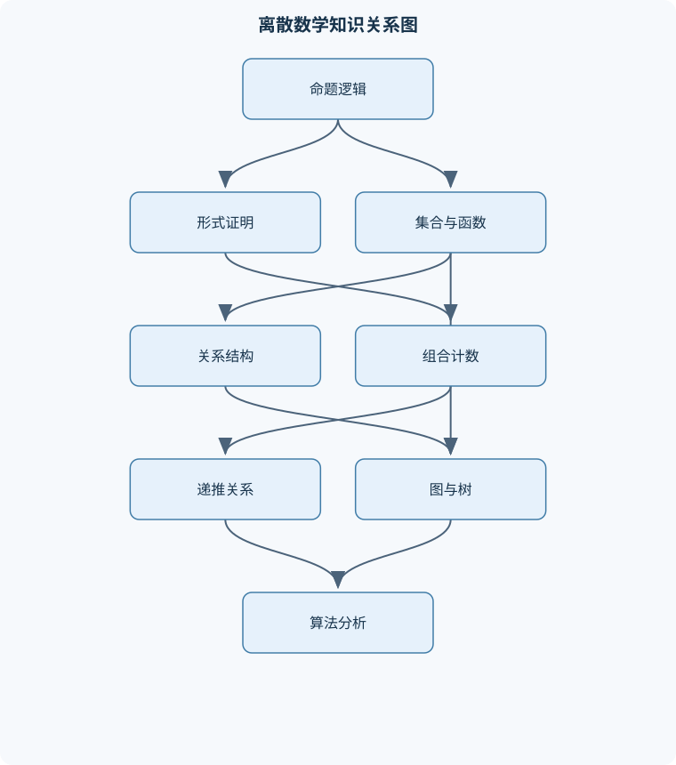
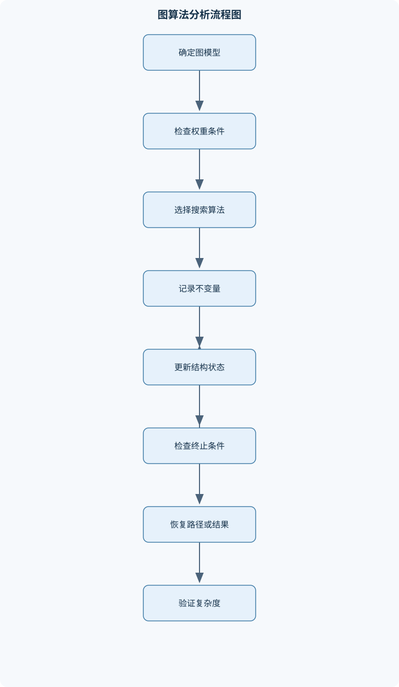

# 离散数学

## 一、课程整体知识框架

### 课程边界与先修知识

离散数学研究有限或可数的数学结构及其组合、逻辑和算法性质，主要服务于数学、计算机科学、信息工程与数据科学等专业。课程边界包括命题与谓词逻辑、集合与函数、关系、整数与数论基础、计数与组合、递推与生成函数、图与树、布尔代数及离散概率初步；重点训练形式化建模、证明、计数、结构分析和算法复杂度分析。先修知识为高中代数、基本函数运算、集合的初步概念和基础程序设计常识；不要求微积分。课程不以连续数学、抽象代数的系统理论、现代密码协议实现或复杂度理论的完整证明为主要内容，但可说明它们与离散结构的联系。





### 1. 课程对象、目标与知识主线

离散数学研究有限结构、可数结构以及这些结构中的组合关系、逻辑关系和算法性质。与以连续变化为主要对象的微积分不同，离散数学通常讨论整数、有限集合、图、树、逻辑命题、递推序列和有限状态系统。其核心问题不是“如何对连续函数求极限”，而是“对象如何被形式化表示”“结构之间具有什么性质”“怎样证明结论成立”“怎样有效计算或搜索”。

课程的知识主线可以概括为：

1. **逻辑形式化**：把自然语言陈述转化为命题公式或含量词公式，分析真值、蕴含关系和可满足性。
2. **集合化表示**：用集合、笛卡尔积、幂集和函数描述对象及对象之间的对应关系。
3. **关系与结构分类**：通过自反性、对称性、反对称性和传递性，将关系划分为等价关系、偏序关系等类型。
4. **整数与代数运算**：研究整除、最大公因数、同余和线性同余方程，为编码、校验和信息安全中的离散运算提供基础。
5. **有限对象计数**：利用加法原理、乘法原理、排列、组合、容斥原理和抽屉原理计算方案数量。
6. **递推与生成**：用递推关系描述按阶段增长的离散对象，再用特征根法或生成函数求解和分析。
7. **图与网络建模**：把实体抽象为顶点，把连接、依赖、路线或冲突抽象为边，研究连通性、路径、回路和权重。
8. **布尔与状态结构**：将逻辑关系转化为布尔函数、逻辑门和有限状态系统，用于数字电路、软件验证和离散控制。
9. **概率与综合建模**：在有限样本空间中结合计数、条件概率和期望，分析随机选择、可靠性和离散系统行为。
10. **证明与算法统一**：证明回答“为什么结论对所有允许对象成立”，算法回答“怎样在有限步骤内得到结果”，复杂度回答“输入规模增大时计算代价如何增长”。

课程使用的基本符号具有固定含义。命题用 $P,Q,R$ 表示，$\neg P$ 表示非 $P$，$P\land Q$ 表示合取，$P\lor Q$ 表示析取，$P\to Q$ 表示蕴含，$P\leftrightarrow Q$ 表示等价。集合用 $A,B,C$ 表示，$\varnothing$ 表示空集，$A\cup B$、$A\cap B$、$A\setminus B$ 和 $A^{\mathrm c}$ 分别表示并集、交集、差集和相对于全集 $U$ 的补集。有限集合 $A$ 的元素个数写作 $|A|$，幂集写作 $\mathcal P(A)$，笛卡尔积写作 $A\times B$。

整数集合记为 $\mathbb Z$，自然数集合记为 $\mathbb N$；不同教材可能从 $0$ 或 $1$ 开始定义 $\mathbb N$，使用递推或归纳时必须明确起始下标。$a\mid b$ 表示存在整数 $k$ 使得 $b=ak$；$a\equiv b\pmod m$ 表示 $m\mid(a-b)$，通常规定模数 $m>0$。图记作 $G=(V,E)$，$V$ 是顶点集，$E$ 是边集；无向边写作 $\{u,v\}$，有向边写作 $(u,v)$，顶点 $v$ 的度数写作 $\deg(v)$。路径长度按边数计算；带权图中，路径长度是边权之和，边权非负是直接使用标准最短路径贪心算法的重要条件。

### 2. 理想模型与实际限制

离散数学中的结构通常是理想化模型。例如，将城市、网页或设备表示为顶点，将道路、超链接或通信连接表示为边；这种表示保留了连接关系，却可能忽略道路容量、延迟、方向变化和故障概率。又如，将一次抽样的所有结果组成有限样本空间，并假设各结果等可能，便于使用组合数计算概率，但实际抽样可能存在偏差。

因此，建立离散模型时需要明确四类条件：

- **对象边界**：哪些实体被纳入集合或顶点集，哪些实体被排除；
- **关系含义**：边、序对或关系中的“相连”“先于”“兼容”究竟表示什么；
- **计数单位**：对象是否可区分，排列顺序是否影响结果，是否允许重复选择；
- **算法假设**：图是否有向、边权是否非负、输入是否有限、数据是否完整。

若忽略这些条件，形式推导即使正确，结论也可能不适用于实际问题。例如，$f:A\to B$ 的值域是 $\{f(a):a\in A\}$，不一定等于陪域 $B$；因此不能仅凭表达式看起来“有输出”就判断函数满射。类似地，最小生成树的目标是使整棵树的边权总和最小，而最短路径树的目标是使源点到各顶点的路径分别尽可能短，两者目标不同，所得树也可能不同。

### 3. 证明、计算与复杂度

课程中的证明方法包括直接证明、逆否命题证明、反证法、分类讨论、数学归纳法和强归纳法。证明不是把若干例子列出，而是从定义、已知条件和逻辑规则出发，说明结论对所有满足条件的对象成立。

数学归纳法通常包含两个步骤。设命题为 $P(n)$，首先验证起始值，如 $P(0)$ 或 $P(1)$；然后假设任意固定的 $n$ 满足 $P(n)$，在此基础上推导 $P(n+1)$。关键是归纳步骤必须对任意允许的 $n$ 成立，而不能只验证有限多个初始值。强归纳法则假设从起始值到 $n$ 的全部命题均成立，再推出 $P(n+1)$，适用于当前对象依赖多个较小对象的情况。

算法分析关注输入规模和基本操作次数。若图的顶点数为 $|V|$、边数为 $|E|$，宽度优先搜索和深度优先搜索使用邻接表时通常需要 $O(|V|+|E|)$ 时间；若关系矩阵有 $n$ 个元素，传递闭包的 Warshall 算法需要 $O(n^3)$ 时间。这里的 $O$ 表示增长阶，不等于实际运行秒数，也不自动包含输入读取、内存访问和具体硬件差异。复杂度结论必须结合数据结构、输入表示和算法前提理解。

## 二、章节和模块划分

### 核心知识覆盖清单

本清单用于检查正文是否覆盖本课程的主要知识模块：

- **命题逻辑与证明方法**：命题、真值与逻辑联结词、真值表与逻辑等价、重言式、矛盾式与可满足性、条件命题及逆命题、否命题、析取范式与合取范式、直接证明与逆否命题证明、反证法与分类讨论、数学归纳法与强归纳法。
- **谓词逻辑与集合基础**：谓词、个体域与量词、全称量词和存在量词的否定、含量词命题的推理、集合的表示与包含关系、集合运算与文氏图、幂集与笛卡尔积、有限集合的基数、集合恒等式的证明。
- **函数与关系**：函数的定义域、陪域和值域、单射、满射与双射、函数复合与逆函数、关系的表示方法、自反、对称、反对称与传递性、等价关系与商集、偏序关系与哈斯图、闭包运算及其性质。
- **整数与数论基础**：整除性与整除的基本性质、最大公因数与最小公倍数、欧几里得算法、贝祖等式与扩展欧几里得算法、素数与算术基本定理、同余关系与模运算、线性同余方程、中国剩余定理的基本形式。
- **组合计数**：加法原理与乘法原理、排列、组合与多重集计数、二项式系数及其恒等式、容斥原理、抽屉原理及其加强形式、错排与典型计数模型、递推式的组合解释、组合恒等式的双计数证明。
- **递推关系与生成函数**：递推关系的建模、一阶线性递推关系、常系数齐次递推关系、特征根法与重根情形、非齐次递推关系的特解、递推算法的正确性与复杂度、普通生成函数的定义、生成函数求系数与计数应用。
- **图论基础**：图、顶点、边与度数、简单图、多重图与有向图、握手定理、路径、回路与连通性、欧拉通路与欧拉回路、哈密顿路径与哈密顿回路、二分图及其判定、图的同构与邻接矩阵。
- **树与网络结构**：树的定义与等价刻画、根树、叶和层次、树的遍历、生成树与生成森林、最小生成树、割、桥与割边、有向无环图与拓扑排序、带权图中的最短路径。
- **布尔代数与离散结构应用**：布尔运算与布尔代数公理、逻辑表达式与布尔函数、析取范式和合取范式的规范形式、逻辑门与组合电路抽象、卡诺图化简的基本思想、编码、校验与错误检测模型、有限状态结构的离散表示、离散数学在数据库和软件验证中的应用。
- **离散概率与综合建模**：有限样本空间与事件、概率的加法与乘法法则、条件概率与独立性、随机变量与期望、计数方法在概率中的应用、图模型中的可达性分析、证明、算法与复杂度的统一视角、离散结构综合建模案例。


### 1. 命题逻辑与证明方法

命题是能够明确判断真或假的陈述，命题的真值只有真、假两种。若 $P$、$Q$ 为命题，则 $P\land Q$ 只有在二者都真时为真；$P\lor Q$ 在至少一个为真时为真；$P\to Q$ 仅在 $P$ 真而 $Q$ 假时为假。由真值表可得：

$$
P\to Q\equiv \neg P\lor Q
$$

条件命题的逆命题是 $Q\to P$，否命题是 $\neg P\to\neg Q$，逆否命题是 $\neg Q\to\neg P$。原命题与逆否命题等价，但通常不与逆命题等价。例如，“若整数 $n$ 能被 $4$ 整除，则 $n$ 为偶数”为真；其逆命题“若 $n$ 为偶数，则 $n$ 能被 $4$ 整除”为假。

重言式对所有真值赋值都为真，矛盾式对所有赋值都为假，可满足式至少存在一种赋值使其为真。德摩根律为：

$$
\neg(P\land Q)\equiv \neg P\lor\neg Q,\qquad
\neg(P\lor Q)\equiv \neg P\land\neg Q
$$

析取范式是若干合取项的析取，合取范式是若干析取项的合取。将逻辑公式化为规范形式时，必须考虑所有变量组合；不能因为公式在若干测试赋值下成立，就断定它是重言式。

### 2. 谓词逻辑与集合基础

谓词 $P(x)$ 的真假依赖个体 $x$。写作 $\forall x\in D,\ P(x)$ 表示个体域 $D$ 中每个元素都满足 $P$；写作 $\exists x\in D,\ P(x)$ 表示至少存在一个元素满足 $P$。量词否定必须同时交换量词并否定谓词：

$$
\neg(\forall x\in D,\ P(x))\equiv \exists x\in D,\ \neg P(x)
$$

$$
\neg(\exists x\in D,\ P(x))\equiv \forall x\in D,\ \neg P(x)
$$

量词作用域必须明确。例如，“每个学生都选修某门课程”与“存在一门课程被每个学生选修”并不等价，因为量词顺序不同。

集合相等可用双包含法证明，即证明 $A\subseteq B$ 和 $B\subseteq A$。集合运算满足交换律、结合律、分配律和德摩根律，例如：

$$
A\cap(B\cup C)=(A\cap B)\cup(A\cap C)
$$

证明时可任取元素 $x$，由 $x\in A\cap(B\cup C)$ 得到 $x\in A$ 且 $x\in B$ 或 $x\in C$，再分类得到右侧；反向同理。若 $|A|=n$ 且 $n$ 为有限非负整数，则：

$$
|\mathcal P(A)|=2^n
$$

因为每个元素都有“加入子集”或“不加入子集”两种独立选择。笛卡尔积 $A\times B$ 由所有有序对 $(a,b)$ 构成；若 $A,B$ 有限，则 $|A\times B|=|A||B|$，这里顺序重要，$(a,b)$ 与 $(b,a)$ 通常不同。

### 3. 函数与关系

函数 $f:A\to B$ 要求定义域 $A$ 中每个元素恰有一个像，陪域为 $B$，值域为 $\{f(a):a\in A\}$。单射满足不同输入不会得到同一输出；满射要求值域等于陪域；双射同时满足单射和满射。若有限集合 $A,B$ 之间存在双射，则 $|A|=|B|$。函数复合按先右后左执行：

$$
(g\circ f)(a)=g(f(a))
$$

逆函数 $f^{-1}$ 只有在 $f$ 为双射时才是从 $B$ 到 $A$ 的函数；但符号 $f^{-1}(S)$ 也可表示集合 $S$ 的原像，不要求 $f$ 为双射。

关系 $R$ 是有序对集合，$aRb$ 等价于 $(a,b)\in R$。关系的主要性质为：自反性要求 $aRa$；对称性要求 $aRb$ 推出 $bRa$；反对称性要求 $aRb$ 且 $bRa$ 时必有 $a=b$；传递性要求 $aRb$ 且 $bRc$ 推出 $aRc$。等价关系同时具有自反、对称、传递性，并将集合划分成互不相交的等价类。偏序关系具有自反、反对称、传递性，但不要求任意两个元素可比较。哈斯图省略自反边和由传递性得到的边，用于表示有限偏序的覆盖关系。

关系闭包是在保持原关系必要性质的前提下加入尽可能少的序对。例如传递闭包加入所有“可通过有限长度路径到达”的序对。有限关系可用矩阵表示，矩阵中的第 $i,j$ 项为 $1$ 表示元素 $i$ 与元素 $j$ 有关系；这使关系性质和可达性能够转化为矩阵运算或图搜索问题。

### 4. 整数与数论基础

整除关系 $a\mid b$ 的定义是存在整数 $k$ 使 $b=ak$。若 $a\mid b$ 且 $a\mid c$，则 $a\mid(bx+cy)$，其中 $x,y\in\mathbb Z$。最大公因数 $\gcd(a,b)$ 是同时整除 $a,b$ 的最大正整数；最小公倍数是同时被 $a,b$ 整除的最小正整数。对正整数有：

$$
\gcd(a,b)\operatorname{lcm}(a,b)=ab
$$

欧几里得算法反复使用 $\gcd(a,b)=\gcd(b,a\bmod b)$。余数严格减小，因此算法终止。扩展欧几里得算法还能求出整数 $x,y$，使：

$$
ax+by=\gcd(a,b)
$$

素数是大于 $1$ 且只有 $1$ 与自身两个正因子的整数。算术基本定理说明每个大于 $1 的整数都能唯一表示为素数乘积，唯一性忽略因子的排列顺序。

同余关系 $a\equiv b\pmod m$ 等价于 $m\mid(a-b)$，因此可以在模 $m$ 的剩余类中进行加法和乘法。线性同余方程 $ax\equiv b\pmod m$ 有解，当且仅当 $\gcd(a,m)\mid b$。当 $\gcd(a,m)=1$ 时，$a$ 在模 $m$ 下存在逆元，可用扩展欧几里得算法求得。中国剩余定理的基本形式要求模数两两互素；在此条件下，多个同余条件存在模各模数乘积意义下唯一的解。

### 5. 组合计数

加法原理适用于互斥分类：若方案只能属于互不相交的类别 $A_1,\ldots,A_k$，总数为 $\sum_i|A_i|$。乘法原理适用于分阶段选择：若第 $i$ 步有 $n_i$ 种选择且选择条件已由前面步骤确定，则总数为 $\prod_i n_i$。

从 $n$ 个不同对象中有序选取 $k$ 个，方案数为：

$$
P(n,k)=n(n-1)\cdots(n-k+1)=\frac{n!}{(n-k)!}
$$

无序选取 $k$ 个，方案数为：

$$
C(n,k)=\binom nk=\frac{n!}{k!(n-k)!},\qquad 0\le k\le n
$$

二项式定理为：

$$
(a+b)^n=\sum_{k=0}^{n}\binom nk a^{n-k}b^k
$$

若对象有重复，必须先判断对象是否可区分。排列字母时，重复元素造成相同排列，应除以各重复次数的阶乘；若只关心各类数量而不关心同类对象身份，则属于多重集计数模型。

容斥原理通过交集的交替加减纠正重复计数：

$$
\left|\bigcup_{i=1}^{n}A_i\right|
=\sum|A_i|-\sum|A_i\cap A_j|+\sum|A_i\cap A_j\cap A_k|-\cdots
$$

抽屉原理指出，将超过 $k$ 个对象放入 $k$ 个抽屉，至少有一个抽屉包含两个对象。加强形式是，若有 $N$ 个对象放入 $k$ 个抽屉，则某抽屉至少包含 $\lceil N/k\rceil$ 个对象。错排问题要求没有元素处于原位置，可用容斥原理求解。

### 6. 递推关系与生成函数

递推关系用前面项定义后面项。例如斐波那契型关系 $a_n=a_{n-1}+a_{n-2}$ 描述对象由两类较小对象构成的情形。建立递推时必须说明初值、下标范围和每一项的含义，否则同一递推式可能对应不同序列。

常系数齐次递推关系可通过特征方程求解。对于二阶关系：

$$
a_n=c_1a_{n-1}+c_2a_{n-2}
$$

设 $a_n=r^n$，得到特征方程：

$$
r^2-c_1r-c_2=0
$$

若根 $r_1,\ldots,r_k$ 互异，则齐次解为 $\sum_i d_i r_i^n$；若根 $r$ 的重数为 $s$，则对应解为：

$$
(d_0+d_1n+\cdots+d_{s-1}n^{s-1})r^n
$$

非齐次递推还需寻找特解，再与齐次解相加，并利用初值确定常数。求得通项后必须代回原递推式和初值验证。递推算法的效率可能远低于其数学通项，例如直接递归可能重复计算，而保存中间结果可以降低计算次数。

普通生成函数把序列 $(a_n)_{n\ge0}$ 表示为形式幂级数：

$$
A(x)=\sum_{n\ge0}a_nx^n
$$

在组合数学中，$x^n$ 的系数记录大小为 $n$ 的对象数量。生成函数可以通过乘法组合独立选择，通过系数提取得到满足总大小约束的方案数。形式幂级数方法关注系数运算，不必先讨论数值收敛；若将其视为实函数，则还需额外说明收敛范围。

### 7. 图论基础

图 $G=(V,E)$ 用顶点表示对象，用边表示二元联系。简单图不含环边和重边；多重图允许同一对顶点之间存在多条边；有向图的边具有方向。顶点度数是与其相接的边数，有向图还区分入度和出度。握手定理为：

$$
\sum_{v\in V}\deg(v)=2|E|
$$

因为每条无向边对两个端点各贡献一次度数。对有向图，所有顶点入度之和以及出度之和都等于有向边数。

路径是相邻顶点构成的序列，简单路径不重复顶点；回路是起点和终点相同的闭合路径。连通性描述顶点之间是否存在路径。欧拉通路关注每条边恰好经过一次；无向图有欧拉回路当且仅当所有非零度顶点属于同一连通分支且所有顶点度数为偶数；有欧拉通路但无欧拉回路时恰有两个奇度顶点。哈密顿路径和回路则关注顶点是否恰好访问一次，不能与欧拉性质混同。

二分图的顶点可以分成两个不相交部分，使每条边连接两部分中的顶点。二分图不含奇长度回路；宽度优先搜索交替着色失败时，可据此发现奇回路。图的邻接矩阵第 $i,j$ 项记录顶点 $i,j$ 是否相邻。图同构要求存在顶点之间的双射，并保持邻接关系不变；顶点数、边数、度数序列等可用于排除同构，但相同度数序列不保证同构。

### 8. 树与网络结构

树是连通且无回路的无向图。以下性质等价：任意两顶点之间存在唯一简单路径；删除任意一条边都会使图不连通；添加任意一条新边都会产生回路；含 $n$ 个顶点的树有 $n-1$ 条边。根树指定一个根顶点，其他顶点按父子关系组织；没有子节点的顶点称为叶，根到顶点的边数给出层次或深度。

树遍历包括先序、中序、后序和层序遍历，具体顺序取决于树的有序结构。生成树是连通图中包含全部顶点且本身为树的边子集；连通图的每棵生成树都有 $|V|-1$ 条边。割是将顶点分成两部分的边集，桥是删除后使连通分支数增加的边。

有向无环图简称 DAG，可用拓扑排序表示依赖先后关系。若图中存在有向回路，则不存在满足所有边方向约束的线性顺序。带权图中，最短路径按边权总和定义；边权非负时可使用 Dijkstra 算法，含负权边时必须改用适合负权的其他方法。最小生成树与最短路径问题目标不同，不能用一个结论替代另一个问题。

### 9. 布尔代数与离散结构应用

布尔变量只有 $0$ 和 $1$ 两个值，布尔运算通常包括与、或、非，分别对应逻辑中的 $\land,\lor,\neg$。布尔代数满足交换律、结合律、分配律、单位元律、互补律和德摩根律。布尔函数可以由逻辑表达式、真值表或逻辑门电路表示。

任意有限变量布尔函数都可写成析取范式或合取范式。规范析取范式由函数值为 $1$ 的最小项析取而成，规范合取范式由函数值为 $0$ 的最大项合取而成。卡诺图利用相邻格之间只改变一个变量的特点，将可合并项圈选，从而消去不必要变量；变量较多时，手工化简容易出错，应以真值表或代数变形复核。

编码把信息映射为有限符号串，校验模型通过增加冗余位检测错误。例如奇偶校验能检测奇数个位翻转，但不能保证发现偶数个位翻转。有限状态结构用有限个状态、输入以及状态转移描述系统行为，可用于协议状态、用户界面流程和软件模型检查。数据库中的关系、连接和依赖可用集合与关系表示；软件验证则可把前置条件、后置条件和状态可达性转化为逻辑或图搜索问题。

### 10. 离散概率与综合建模

有限样本空间 $\Omega$ 包含所有可能结果，事件是 $\Omega$ 的子集。若各基本结果等可能，则：

$$
P(E)=\frac{|E|}{|\Omega|}
$$

概率满足 $P(\Omega)=1$、$P(\varnothing)=0$，并具有加法性质。对任意事件 $E,F$：

$$
P(E\cup F)=P(E)+P(F)-P(E\cap F)
$$

当 $P(F)>0$ 时，条件概率定义为：

$$
P(E\mid F)=\frac{P(E\cap F)}{P(F)}
$$

因此：

$$
P(E\cap F)=P(E\mid F)P(F)
$$

若 $E,F$ 独立，则 $P(E\cap F)=P(E)P(F)$。独立不等于互斥；当两个事件概率都为正时，互斥事件不可能独立。

随机变量 $X$ 将样本结果映射为数值，有限情形下期望为：

$$
\mathbb E[X]=\sum_x xP(X=x)
$$

计数方法可以直接计算概率分子和分母，例如不放回抽取问题通常先计算“至少出现一个目标对象”的补事件，再用 $1-P(\text{一个也没有})$ 得到结果。综合建模时，应依次完成对象定义、关系或状态定义、约束表达、数学性质分析和结果验证，使逻辑证明、算法过程、计数公式与复杂度分析相互一致。

## 三、核心概念的详细解释

### 1. 命题逻辑、谓词逻辑与证明方法

命题是能够明确判断真或假的陈述句，真值只有“真”和“假”两种。命题字母 $P,Q,R$ 表示基本命题，复合命题由逻辑联结词构成：$\neg P$ 表示否定，$P\land Q$ 表示合取，$P\lor Q$ 表示析取，$P\to Q$ 表示蕴含，$P\leftrightarrow Q$ 表示等价。条件命题 $P\to Q$ 只有在 $P$ 真而 $Q$ 假时为假，因此有

$$
P\to Q\equiv \neg P\lor Q.
$$

这一定义说明“若 $P$ 则 $Q$”并不表示 $P$ 和 $Q$ 都必须为真。当 $P$ 为假时，$P\to Q$ 在逻辑上为真。原命题 $P\to Q$ 的逆命题是 $Q\to P$，否命题是 $\neg P\to\neg Q$，逆否命题是 $\neg Q\to\neg P$。原命题与逆否命题等价，但通常不与逆命题等价。例如，“若一个整数能被 $4$ 整除，则它能被 $2$ 整除”为真，而逆命题“若一个整数能被 $2$ 整除，则它能被 $4$ 整除”为假。

如果公式在所有真值赋值下都为真，则称为重言式；如果在所有赋值下都为假，则称为矛盾式；如果至少存在一种赋值使其为真，则称为可满足式。逻辑等价可以通过真值表逐行比较，也可以利用基本恒等式变形。德摩根律为

$$
\neg(P\land Q)\equiv\neg P\lor\neg Q,
\qquad
\neg(P\lor Q)\equiv\neg P\land\neg Q.
$$

析取范式是若干合取项的析取，合取范式是若干析取项的合取。规范析取范式和规范合取范式分别由完整的极小项和极大项构成，可由真值表中公式为真的行或为假的行直接建立。逻辑推理的可靠性要求：只要所有前提为真，结论就不能为假，即前提集合蕴含结论。

谓词命题含有变量、个体域和量词。写作 $\forall x\in D,P(x)$ 表示个体域 $D$ 中每个对象都满足 $P(x)$；写作 $\exists x\in D,P(x)$ 表示至少存在一个对象满足 $P(x)$。量词作用域必须清楚，否则同一符号排列可能对应不同命题。量词否定必须同时改变量词并否定谓词：

$$
\neg(\forall x\in D,\ P(x))
\equiv
\exists x\in D,\ \neg P(x),
$$

$$
\neg(\exists x\in D,\ P(x))
\equiv
\forall x\in D,\ \neg P(x).
$$

证明方法与命题结构相适应。直接证明从已知条件出发，经定义和已知定理推出结论；逆否命题证明把证明 $P\to Q$ 转化为证明 $\neg Q\to\neg P$；反证法假设结论不成立并推出矛盾。分类讨论要求各分类覆盖所有可能情形，且不同类别通常互不重叠。数学归纳法包括基础步骤和归纳步骤：先验证起始值，再假设第 $n$ 项成立并推出第 $n+1$ 项成立。强归纳法允许在归纳步骤中同时使用所有较小下标的结论。仅验证若干初始值不能构成归纳证明。

### 2. 集合、函数与关系

集合是具有明确成员资格的对象整体。集合可以用列举法或描述法表示。$A\subseteq B$ 表示 $A$ 的每个元素都属于 $B$；$A=B$ 当且仅当 $A\subseteq B$ 且 $B\subseteq A$。并集、交集、差集和补集分别表示至少属于一个集合、同时属于两个集合、属于第一个而不属于第二个以及不属于给定集合的部分。集合恒等式可用元素法证明：任取元素 $x$，逐步把“属于集合”转化为逻辑命题，证明两侧的成员条件等价。例如，

$$
A\cap(B\cup C)=(A\cap B)\cup(A\cap C)
$$

的左侧成员条件为 $x\in A$ 且 $(x\in B$ 或 $x\in C)$，由分配律等价于“$x\in A\cap B$ 或 $x\in A\cap C$”。

幂集 $\mathcal P(A)$ 是 $A$ 的全部子集组成的集合。若 $|A|=n$，则

$$
|\mathcal P(A)|=2^n,
$$

因为 $A$ 的每个元素都有“选入子集”和“不选入子集”两种独立选择。笛卡尔积 $A\times B$ 是所有有序对 $(a,b)$ 的集合，其中 $a\in A,b\in B$。若 $A,B$ 有限，则 $|A\times B|=|A||B|$；有序对中的位置不能随意交换。

函数 $f:A\to B$ 要求定义域中的每个元素恰有一个像，陪域是预先指定的 $B$，值域是实际出现的像的集合，值域可以是陪域的真子集。若不同输入不会得到相同输出，则 $f$ 是单射；若陪域每个元素都被取到，则 $f$ 是满射；同时满足二者时是双射。双射存在时，逆函数 $f^{-1}:B\to A$ 才是函数。函数复合按先右后左计算，即 $(g\circ f)(x)=g(f(x))$。例如 $f(n)=2n+1$ 从 $\mathbb Z$ 到 $\mathbb Z$ 是单射但不是满射，因为偶数不在其值域中。

关系 $R$ 是有序对的集合，若 $(a,b)\in R$，可写作 $aRb$。在集合 $A$ 上，关系的自反性要求所有 $a\in A$ 都有 $aRa$；对称性要求 $aRb$ 必然推出 $bRa$；反对称性要求当 $aRb$ 且 $bRa$ 时有 $a=b$；传递性要求 $aRb$ 且 $bRc$ 必然推出 $aRc$。反对称性不是“不能存在两个互相关联的不同元素”，而是禁止不同元素之间同时双向关联。

同时满足自反、对称、传递的关系是等价关系。等价关系把集合划分成互不相交的等价类，每个元素属于且只属于一个等价类。若在整数上定义 $aRb$ 当且仅当 $3\mid(a-b)$，则 $R$ 是等价关系，$0$ 的等价类为所有 $3$ 的倍数。自反、反对称、传递的关系是偏序关系；偏序下不一定任意两个元素都可比较。哈斯图只保留覆盖关系，省略自反边和由传递性产生的边。

关系闭包是添加尽可能少的有序对，使关系满足某种性质。自反闭包添加所有 $(a,a)$，对称闭包加入逆关系中的有序对，传递闭包加入所有可由有限步关系链到达的有序对。有限关系可用邻接矩阵表示，传递闭包可通过逐步允许中间点的方法计算。

### 3. 整数、整除、同余与数论结构

对整数 $a,b$，若存在 $k\in\mathbb Z$ 使 $b=ak$，则称 $a\mid b$。当 $a\neq0$ 时，整除关系具有传递性：若 $a\mid b$ 且 $b\mid c$，则 $a\mid c$。最大公因数 $\gcd(a,b)$ 是同时整除 $a,b$ 的最大正整数，最小公倍数 $\operatorname{lcm}(a,b)$ 是同时被 $a,b$ 整除的最小正整数。对非零整数，二者满足

$$
\gcd(a,b)\operatorname{lcm}(a,b)=|ab|.
$$

欧几里得算法利用

$$
\gcd(a,b)=\gcd(b,a\bmod b)
$$

反复取余。余数严格变小，因而算法终止。扩展欧几里得算法还能求出整数 $x,y$，使

$$
ax+by=\gcd(a,b).
$$

这称为贝祖等式。若 $d=\gcd(a,b)$，则线性方程 $ax+by=c$ 有整数解当且仅当 $d\mid c$。

素数是大于 $1$ 且只有 $1$ 和自身两个正因数的整数。算术基本定理说明每个大于 $1$ 的整数都能唯一分解为素数乘积，唯一性忽略素因子的排列顺序。该结论可用于计算最大公因数、最小公倍数和约数个数，但直接分解大整数的计算代价可能很高。

同余关系定义为

$$
a\equiv b\pmod m
\quad\Longleftrightarrow\quad
m\mid(a-b),
\qquad m>0.
$$

同余允许在模 $m$ 下进行加法、减法和乘法：

$$
a\equiv b\pmod m,\ c\equiv d\pmod m
\Rightarrow
a+c\equiv b+d\pmod m,
$$

$$
ac\equiv bd\pmod m.
$$

约去公因子不能无条件进行；若从 $ac\equiv bc\pmod m$ 推出 $a\equiv b\pmod m$，需要 $c$ 与 $m$ 互素。线性同余方程 $ax\equiv b\pmod m$ 有解当且仅当 $\gcd(a,m)\mid b$。当 $\gcd(a,m)=1$ 时，$a$ 存在模 $m$ 的逆元，可用扩展欧几里得算法求得。

中国剩余定理的基本形式要求模数两两互素。若

$$
x\equiv a_1\pmod {m_1},\quad
x\equiv a_2\pmod {m_2},
$$

且 $\gcd(m_1,m_2)=1$，则在模 $m_1m_2$ 意义下存在唯一解。模数不互素时，还必须检查余数是否满足相容条件。

### 4. 组合计数、递推关系与生成函数

加法原理适用于互不重叠的分类：若方案分为 $k$ 类，第 $i$ 类有 $n_i$ 种，则总数为 $\sum_i n_i$。乘法原理适用于连续完成的多个步骤：第 $i$ 步有 $n_i$ 种选择，则总数为 $\prod_i n_i$。从 $n$ 个不同对象中选取有序的 $k$ 个对象，排列数为

$$
P(n,k)=n(n-1)\cdots(n-k+1)=\frac{n!}{(n-k)!};
$$

无序选取 $k$ 个对象，组合数为

$$
C(n,k)=\binom nk=\frac{n!}{k!(n-k)!},
\qquad 0\le k\le n.
$$

若对象有重复，必须先说明对象是否可区分。相同对象组成的多重集排列数为

$$
\frac{n!}{n_1!n_2!\cdots n_r!},
$$

其中 $n_i$ 是第 $i$ 类对象的重复次数。二项式定理为

$$
(a+b)^n=\sum_{k=0}^{n}\binom nk a^{n-k}b^k.
$$

其系数 $\binom nk$ 表示在 $n$ 个因子中选择 $k$ 个因子取 $b$ 的方案数。帕斯卡恒等式

$$
\binom nk=\binom{n-1}{k-1}+\binom{n-1}{k}
$$

可由“是否选取最后一个对象”分类得到。

容斥原理用于校正重复计数。两个集合满足

$$
|A\cup B|=|A|+|B|-|A\cap B|.
$$

三个集合则为

$$
|A\cup B\cup C|
=|A|+|B|+|C|
-|A\cap B|-|A\cap C|-|B\cap C|
+|A\cap B\cap C|.
$$

一般地，交集阶数为奇数时加，阶数为偶数时减。抽屉原理说明，将 $n+1$ 个对象放入 $n$ 个抽屉，至少一个抽屉包含至少两个对象。加强形式是：若有 $N$ 个对象放入 $k$ 个抽屉，则某个抽屉至少有 $\lceil N/k\rceil$ 个对象。

递推关系用前面项描述后面项。递推建模必须说明初值、下标范围和每项的实际含义。常系数齐次递推

$$
a_n=c_1a_{n-1}+c_2a_{n-2}+\cdots+c_ka_{n-k}
$$

对应特征方程

$$
r^k-c_1r^{k-1}-c_2r^{k-2}-\cdots-c_k=0.
$$

若特征根互异，则通解是根的幂的线性组合；若根 $r$ 重数为 $s$，则对应部分为

$$
(c_0+c_1n+\cdots+c_{s-1}n^{s-1})r^n.
$$

非齐次递推还需寻找特解，再与齐次通解相加。递推算法的正确性可用归纳法证明，复杂度则依据递归分支、循环次数和每次基本操作估计。

普通生成函数把序列 $(a_n)_{n\ge0}$ 表示为形式幂级数

$$
A(x)=\sum_{n\ge0}a_nx^n.
$$

这里的 $x$ 是形式变量，不必讨论数值收敛。序列移位、卷积和递推关系可以转化为生成函数方程，再通过代数变形求出系数。生成函数适合处理分拆、路径计数、受限选取和递推序列；如果只关心有限项，直接递推可能更简单。

### 5. 图、树、网络与搜索结构

图 $G=(V,E)$ 由顶点集和边集组成。无向边 $\{u,v\}$ 不区分方向，有向边 $(u,v)$ 表示从 $u$ 指向 $v$。简单图不含自环和重边，多重图允许同一对顶点之间存在多条边。有向图中每个顶点有入度和出度；无向图中顶点度数是与其关联的边数，自环在度数计算中通常贡献 $2$。

握手定理为

$$
\sum_{v\in V}\deg(v)=2|E|.
$$

因此无向图中奇度顶点的个数必为偶数。有向图满足所有顶点入度之和和出度之和都等于 $|E|$。路径长度按边数计算，带权图则按边权总和计算。连通表示任意两个相关顶点之间存在路径；连通分支是极大的连通子图。

欧拉通路要求每条边恰好经过一次，欧拉回路还要求回到起点。无向图存在欧拉回路，当且仅当所有非零度顶点属于同一连通分支且所有顶点度数为偶数；存在欧拉通路但不存在欧拉回路时，恰有两个奇度顶点。哈密顿路径和回路关注顶点是否恰好经过一次，与欧拉性质不是同一问题。一般情况下，存在欧拉回路的图不一定存在哈密顿回路。

二分图的顶点可分为两个不相交部分，使每条边的两个端点分属不同部分。图是二分图，当且仅当不含奇长度回路。宽度优先搜索交替使用两种颜色；若发现一条边连接两个同色顶点，则可据搜索树路径构造奇回路。

树是连通且无回路的无向图。以下条件彼此等价：图是树；任意两顶点之间存在唯一简单路径；图连通且有 $|V|-1$ 条边；图无回路且有 $|V|-1$ 条边；在任意两个不相邻顶点之间加一条边都会产生回路。树的叶是度数为 $1$ 的顶点。根树具有父子关系、层次和深度，可进行先序、中序和后序遍历。生成树包含原图全部顶点且本身是树；连通图的每棵生成树都有 $|V|-1$ 条边。

带权连通图的最小生成树使全部树边权重之和最小，Kruskal算法按权重递增选择不会形成回路的边。最短路径问题则分别最小化源点到各顶点的路径权重，目标与最小生成树不同。Dijkstra算法要求边权非负；存在负权边时应改用适合该条件的算法。割边是删除后增加连通分支数的边，树中的每条边都是桥。

有向无环图可以进行拓扑排序。拓扑序要求每条有向边 $(u,v)$ 中的 $u$ 排在 $v$ 之前。若反复删除入度为零的顶点后仍有顶点剩余，则原图存在有向回路。

### 6. 布尔代数、离散概率与综合建模

布尔代数中的变量取值为 $0$ 或 $1$，基本运算为与、或、非，分别对应 $\land,\lor,\neg$。布尔函数可写成逻辑表达式，也可转化为规范析取范式或规范合取范式。逻辑门是布尔运算的物理抽象，组合电路的输出只由当前输入决定；有限状态系统还需要状态变量，其下一状态由当前状态和输入共同决定。

卡诺图通过相邻单元合并消去不必要变量，适合变量数量较少的布尔函数化简。编码将对象映射为有限位串，校验位则用于检测某些错误。错误检测能力取决于编码集合中不同码字之间的最小汉明距离；距离为 $d$ 的码至少能够检测 $d-1$ 位错误，但具体纠错能力还取决于编码结构和错误模型。

有限概率模型由样本空间 $\Omega$ 和事件集合组成。若所有基本结果等可能，则

$$
P(E)=\frac{|E|}{|\Omega|}.
$$

概率满足 $0\le P(E)\le1$、$P(\Omega)=1$，并且互斥事件的概率可相加。条件概率为

$$
P(E\mid F)=\frac{P(E\cap F)}{P(F)},
\qquad P(F)>0.
$$

因此

$$
P(E\cap F)=P(E\mid F)P(F).
$$

若 $E,F$ 独立，则 $P(E\cap F)=P(E)P(F)$。独立与互斥不同：概率均为正的互斥事件不可能独立。有限随机变量 $X$ 的期望为

$$
\mathbb E[X]=\sum_xxP(X=x).
$$

离散数学的综合建模过程通常包括：确定对象边界；选择集合、关系、函数、图或状态作为模型；明确约束和权重；用定理验证结构性质；选择算法求解；最后检查结果是否满足原问题的语义条件。模型若忽略方向、重复、容量、负权或概率分布等因素，形式计算可能正确，但结论不一定适用于现实对象。

## 四、重要定义、公式、定理和推导

### 专业审校补充：关键定义与适用边界

欧拉图与哈密顿图必须严格区分。设有限无向图G=(V,E)连通，忽略度数为0的孤立顶点。G存在欧拉回路，当且仅当每个顶点的度数都是偶数；G存在欧拉通路但不存在欧拉回路，当且仅当恰有两个顶点的度数为奇数。必要性来自“沿回路每次进入顶点后必须离开”，因此相关边成对使用；充分性可通过逐步拼接未使用边构造回路。该判据只约束边的使用，不要求每个顶点只访问一次。哈密顿回路则要求恰好访问每个顶点一次再返回起点，通常不存在像欧拉判据那样的简单充要条件。若图有孤立顶点，不能仅凭全图连通性直接套用欧拉判据；若讨论有向图，还需分别检查除起点和终点外各顶点入度等于出度，并要求相关顶点处于同一可达结构中。由此可见，欧拉问题关注“边”，哈密顿问题关注“顶点”，二者不能用同一判定方法替代。


### 1. 逻辑与集合恒等式

由真值表可得：

$$
P\to Q\equiv\neg P\lor Q,
\qquad
P\leftrightarrow Q\equiv(P\to Q)\land(Q\to P).
$$

结合德摩根律，可将含有否定、合取、析取和蕴含的公式化为合取范式或析取范式。集合运算与逻辑运算一一对应：

$$
x\in A\cup B\Longleftrightarrow (x\in A)\lor(x\in B),
$$

$$
x\in A\cap B\Longleftrightarrow (x\in A)\land(x\in B),
$$

$$
x\in A^{\mathrm c}\Longleftrightarrow \neg(x\in A).
$$

因此集合德摩根律为

$$
(A\cap B)^{\mathrm c}=A^{\mathrm c}\cup B^{\mathrm c},
\qquad
(A\cup B)^{\mathrm c}=A^{\mathrm c}\cap B^{\mathrm c}.
$$

集合相等的标准证明是双包含法，而不是只证明一个方向。若 $A$ 和 $B$ 为有限集合，则

$$
|A\cup B|=|A|+|B|-|A\cap B|.
$$

这一公式来自先相加时交集元素被计算两次，再减去一次进行校正。

### 2. 函数、关系与有限结构定理

有限集合 $A,B$ 之间存在双射，当且仅当 $|A|=|B|$。若 $f:A\to B$ 为单射，则 $|A|\le |B|$；若为满射，则 $|A|\ge |B|$。对有限集合而言，若 $|A|=|B|$，单射与满射可以互相推出，但对无限集合不能直接使用这种有限基数直觉。

关系的自反、对称、反对称和传递性必须逐项验证。等价关系的等价类形成一个划分：不同等价类没有公共元素，所有等价类的并集为原集合。反过来，集合的任意划分也能定义一个等价关系：两个元素属于同一分块，当且仅当它们等价。偏序关系通常表示“包含”“不超过”或“可整除”等比较结构，但并非任意两元素都可比较。

### 3. 数论定理与算法不变量

欧几里得算法的核心不变量是

$$
\gcd(a,b)=\gcd(b,a\bmod b).
$$

设 $a=bq+r$，则 $r=a-bq$。若整数 $d$ 同时整除 $a,b$，则整除 $r$；反之，若同时整除 $b,r$，则整除 $a=r+bq$，所以两组数的公因数完全相同。由于余数满足 $0\le r<b$，迭代必终止。

扩展欧几里得算法在终止时得到 $d=\gcd(a,b)$，并通过回代构造

$$
ax+by=d.
$$

若 $\gcd(a,m)=1$，则存在 $x$ 使 $ax\equiv1\pmod m$，该 $x$ 是 $a$ 的模逆元。线性同余方程 $ax\equiv b\pmod m$ 可转化为整数方程 $ax-my=b$，因此有解条件为 $\gcd(a,m)\mid b$。

### 4. 计数公式与递推求解

排列、组合的边界条件必须明确：当 $k<0$ 或 $k>n$ 时，通常约定 $\binom nk=0$；当 $k=0$ 或 $k=n$ 时，$\binom nk=1$。组合数具有对称性：

$$
\binom nk=\binom n{n-k}.
$$

这是因为选择 $k$ 个对象等价于排除剩余的 $n-k$ 个对象。二项式定理可通过对 $(a+b)^n$ 的每个因子选择 $a$ 或 $b$ 推导；选出 $k$ 个 $b$ 的位置共有 $\binom nk$ 种。

容斥原理的一般形式为

$$
\left|\bigcup_{i=1}^{n}A_i\right|
=
\sum_{\varnothing\ne I\subseteq\{1,\ldots,n\}}
(-1)^{|I|+1}
\left|\bigcap_{i\in I}A_i\right|.
$$

使用时必须准确说明每个 $A_i$ 的含义。若目标是“至少满足一个限制”，可直接计算坏事件并使用容斥；若目标是“恰好满足一个限制”，还需进一步扣除同时满足多个限制的对象。

一阶线性递推可以通过逐步展开求解。例如

$$
a_n=ra_{n-1}+b
$$

展开得

$$
a_n=r^na_0+b(1+r+r^2+\cdots+r^{n-1}).
$$

当 $r\ne1$ 时，

$$
a_n=r^na_0+b\frac{r^n-1}{r-1};
$$

当 $r=1$ 时，

$$
a_n=a_0+nb.
$$

分情况是必要的，因为等比求和公式在 $r=1$ 时分母为零。生成函数求递推时，需要根据初值处理低次项，不能直接把下标移位而忽略边界项。

### 5. 图论定理与算法流程

宽度优先搜索的输入是图 $G=(V,E)$ 和起点 $s$，输出从 $s$ 可达顶点的层次、前驱和搜索树。算法将未发现顶点放入队列，每次取出队首并扫描其邻接点。其不变量是：顶点第一次被发现时，记录的层数等于从 $s$ 到该顶点的最短边数。使用邻接表时，时间复杂度为 $O(|V|+|E|)$，适用于无权图最短路和二分图判定。

```text
BFS(G, s):
    对每个顶点 v:
        color[v] = 未发现
        distance[v] = ∞
        parent[v] = NIL
    color[s] = 已发现
    distance[s] = 0
    将 s 放入队列 Q

    当 Q 非空时:
        u = Q.dequeue()
        对 u 的每个邻接点 v:
            如果 color[v] == 未发现:
                color[v] = 已发现
                distance[v] = distance[u] + 1
                parent[v] = u
                将 v 放入 Q
        color[u] = 已完成
```

深度优先搜索使用递归或栈深入探索，适合求连通分支、检测回路和构造拓扑序。拓扑排序可通过入度为零的队列完成：每删除一个顶点，就把其出边终点的入度减一。若最终输出少于 $|V|$ 个顶点，说明存在有向回路；因此算法只对有向无环图产生完整拓扑序。

Kruskal算法输入带权无向连通图，按边权非降序检查边；若边的两个端点属于不同连通分量，则加入该边，否则跳过。选边过程保持“已选边无回路”，当选出 $|V|-1$ 条边时得到生成树。其正确性依赖割性质：跨越某个割的最轻边可以安全地加入某棵最小生成树。排序通常带来 $O(|E|\log|E|)$ 的复杂度。

Dijkstra算法输入非负边权图和源点。每轮选择暂定距离最小且尚未确定的顶点，并对其出边进行松弛：

$$
d(v)\leftarrow\min\{d(v),d(u)+w(u,v)\}.
$$

非负权保证已经确定的 $d(u)$ 不会被未来路径改小；若存在负权边，这一贪心不变量可能失效。最小生成树和最短路径树都使用图，但优化目标不同，不能用一个结论替代另一个。

### 6. 代表性例题与验证

#### 例题一：命题蕴含

**题干**：证明 $(P\to Q)\land(Q\to R)$ 蕴含 $P\to R$。

**分析**：只需考虑结论前件 $P$ 为真的情形。若前提为真，则由 $P\to Q$ 得 $Q$ 真，再由 $Q\to R$ 得 $R$ 真。

**结果验证**：当 $P$ 为假时，$P\to R$ 自动为真；当 $P$ 为真时，前提强制 $R$ 为真。因此结论在所有前提为真的赋值下成立。若把 $Q\to P$ 当作前提，则不能得到同样结论，说明逆命题不能随意替换原命题。

#### 例题二：集合恒等式

**题干**：证明 $A\cap(B\cup C)=(A\cap B)\cup(A\cap C)$。

**逐步解答**：任取 $x$。若 $x\in A\cap(B\cup C)$，则 $x\in A$ 且 $x\in B$ 或 $x\in C$。分两种情况：若 $x\in B$，则 $x\in A\cap B$；若 $x\in C$，则 $x\in A\cap C$。故 $x$ 属于右侧。反向地，若 $x$ 属于 $A\cap B$ 或 $A\cap C$，则 $x\in A$ 且 $x\in B\cup C$，故属于左侧。

**结果**：两侧互相包含，恒等式成立。只证明左侧包含右侧只能得到包含关系，不能证明集合相等。

#### 例题三：最大公因数

**题干**：求 $\gcd(252,198)$，并写成 $252x+198y$。

**解答**：

$$
252=198+54,
$$

$$
198=3\times54+36,
$$

$$
54=36+18,
$$

$$
36=2\times18.
$$

所以最大公因数为 $18$。回代：

$$
18=54-36
=54-(198-3\times54)
=4\times54-198
$$

且 $54=252-198$，因此

$$
18=4(252-198)-198
=4\times252-5\times198.
$$

故 $x=4,y=-5$。代回可验证 $252\times4+198\times(-5)=18$。

#### 例题四：递推关系

**题干**：求

$$
a_n=3a_{n-1}-2a_{n-2},\quad a_0=1,\ a_1=2
$$

的通项。

**解答**：特征方程为

$$
r^2-3r+2=0=(r-1)(r-2).
$$

根为 $1,2$，故

$$
a_n=c_1+c_2 2^n.
$$

代入初值：

$$
c_1+c_2=1,\qquad c_1+2c_2=2.
$$

相减得 $c_2=1,c_1=0$，所以

$$
a_n=2^n.
$$

验证：$2^n=3\cdot2^{n-1}-2\cdot2^{n-2}$，且初值满足条件，故通项正确。若特征根为重根 $r$，则不能只写一个 $cr^n$，必须加入 $n r^n$ 等因子。

#### 例题五：二分图判定

**题干**：判断一个无向图是否为二分图。

**解答流程**：从任意未着色顶点开始赋色 $0$，将其所有邻接点赋色 $1$，再将这些顶点的未着色邻接点赋色 $0$，重复进行；对非连通图，要从每个未着色分支重新开始。若发现某条边的两个端点颜色相同，则图不是二分图；若所有边都连接不同颜色，则得到二分划分。

**结果验证**：若出现同色相邻顶点，沿搜索树回溯两点之间的路径，再加上该边，可得到奇长度回路。若没有冲突，所有边均跨越两个颜色类，因而图为二分图。该方法只依据边连接关系，不适用于把带权大小直接当作颜色依据。

### 7. 实验与项目流程

#### 实验一：关系性质与传递闭包

**输入数据**：有限集合 $A=\{1,2,\ldots,n\}$ 及关系矩阵 $M$，其中 $M[i][j]=1$ 表示 $iRj$。

**步骤**：先逐项检查主对角线判断自反性；检查 $M[i][j]$ 与 $M[j][i]$ 判断对称性和反对称性；再使用三重循环计算传递闭包：当 $i$ 可达 $k$ 且 $k$ 可达 $j$ 时，将 $i$ 到 $j$ 标记为可达。

**评价标准**：输出每项性质的真值；传递闭包应满足闭包后的矩阵具有传递性，并且不删除原关系中的任何有序对。算法复杂度为 $O(n^3)$。

**排错方法**：若把反对称性误判为对称性，应检查条件是否为“两个方向同时成立时只能是同一元素”；若传递闭包遗漏链式路径，应确认中间点是否按 $1$ 到 $n$ 逐步开放，而不是只检查原始边。

#### 实验二：带权图的最短路与验证

**输入数据**：带权图 $G=(V,E)$、非负边权和源点 $s$。

**步骤**：使用邻接表记录边；初始化 $d(s)=0$，其余距离为无穷；每轮选取暂定距离最小的未确定顶点，松弛其所有出边；保存前驱，最后从目标顶点沿前驱逆向回溯路径。

**评价标准**：每条输出路径必须由图中实际存在的边组成；路径权重应等于边权之和；对于所有可达顶点，不应存在权重更小的已知路径。使用优先队列时复杂度通常为 $O((|V|+|E|)\log|V|)$。

**排错方法**：若距离异常减小，检查是否重复处理过时的优先队列记录；若前驱形成回路，检查松弛条件是否使用严格更小；若图含负权边，不应继续使用该算法，而应更换适合负权条件的流程。

## 五、算法、流程和实现思路

### 方法与流程覆盖索引

下列方法或流程应在正文中说明输入、步骤、适用条件、结果检查和边界：

- 欧几里得算法：输入正整数a、b，输出gcd(a,b)。反复用(a,b)替换为(b,a mod b)，直到余数为0，输出此时的b。不变量是当前两数的最大公因数保持不变；余数严格下降，因此必终止。适用于整数最大公因数计算，时间复杂度为O(log min(a,b))次除法运算。
- 扩展欧几里得算法：输入整数a、b，输出d、x、y，使d=gcd(a,b)且ax+by=d。先递归计算(b,a mod b)的系数，再由a mod b=a−⌊a/b⌋b回代更新系数。终止条件为b=0；适用于求模逆元和线性同余方程，算术运算次数为O(log min(|a|,|b|))。
- 关系传递闭包的Warshall算法：输入含n个元素集合上的关系矩阵M，输出其传递闭包。依次允许顶点1至k作为中间点，更新M[i][j]为M[i][j]或(M[i][k]且M[k][j])。不变量是第k轮后矩阵准确表示只允许前k个中间点的可达性；时间复杂度O(n³)，适用于有限关系。
- 宽度优先搜索：输入无向图或有向图G和起点s，输出从s可达的顶点层次及一棵搜索树。将s入队，反复取出队首并访问尚未发现的邻接点，同时记录前驱。队列为空时终止；不变量是已出队顶点按非递减距离处理，边数复杂度为O(|V|+|E|)，适用于无权最短路和二分图判定。
- 深度优先搜索：输入图G，输出访问顺序、搜索森林及时间戳。对未访问顶点递归或用栈探索邻接点，完成一个顶点后记录结束时间。每条边和顶点被处理有限次，终止条件是所有可达顶点均完成；复杂度O(|V|+|E|)，适用于连通分量、回路检测和拓扑排序。
- 拓扑排序：输入有向图G，输出所有顶点的线性序列，或报告存在有向回路。可用入度为0的顶点队列反复删除并更新邻接点入度；若输出顶点数少于|V|则有回路。每次删除保持剩余图的入度信息正确，复杂度O(|V|+|E|)，仅适用于有向无环图。
- Kruskal最小生成树算法：输入带权无向连通图，输出一棵最小生成树。按权重非降序处理边，若边连接不同连通分量则加入并合并分量。循环不变量是已选边不形成回路且可扩展为某棵最小生成树；使用并查集时复杂度约为O(|E|log|E|)，适用于边权可比较的连通图。
- Dijkstra算法：输入边权非负的带权图和源点，输出源点到各顶点的最短距离及前驱。每轮选择当前暂定距离最小且未确定的顶点，并松弛其出边。已确定顶点的距离在非负权条件下不可再改进；优先队列实现复杂度为O((|V|+|E|)log|V|)，不适用于含负权边的情形。
- 递推展开与特征根分析：输入常系数线性递推及初值，输出显式通项或渐近阶。先写特征方程，求根及重数，再求待定常数并代入初值；通过代回递推式验证。适用于线性常系数递推，若系数随n变化或含非线性项则需改用其他方法。
- 容斥计数流程：输入有限对象集合及若干限制条件，输出满足至少一个条件或满足全部条件的数量。先定义坏事件，再按交集阶数交替加减，最后用总数相减得到目标数量。必须明确每个交集的含义；直接枚举可能为指数复杂度，结构规则明确时可通过动态规划或生成函数优化。





### 1. 从数学定义到可执行算法

离散数学中的算法不是把公式机械地翻译成程序，而是将对象表示、操作规则、正确性依据和终止条件组织成有限步骤。一个完整算法至少应说明输入、输出、过程、不变量、终止条件、适用条件和复杂度。

以图算法为例，输入不仅是“一个图”，还要明确图是有向还是无向、是否带权、边权是否允许为负、图采用邻接表还是邻接矩阵表示。相同的任务在不同条件下可能需要不同算法：无权图最短路可用宽度优先搜索；非负权图可用 Dijkstra 算法；含负权边时不能直接使用 Dijkstra；最小生成树则不是求某个源点到其他顶点的最短路径，而是求覆盖全部顶点且总边权最小的树。

复杂度分析依赖输入规模和基本操作的定义。对图 $G=(V,E)$，通常以 $|V|$ 表示顶点数，以 $|E|$ 表示边数。使用邻接表遍历图时，访问所有顶点和边的时间复杂度通常为 $O(|V|+|E|)$；使用邻接矩阵检查任意一条边是否存在只需 $O(1)$，但扫描一个顶点的全部邻接点通常需要 $O(|V|)$。因此，表示方法本身会影响算法复杂度。

### 2. 欧几里得算法与扩展欧几里得算法

#### 2.1 最大公因数的递归结构

对整数 $a,b$，假设 $a\ge b>0$，有

$$
\gcd(a,b)=\gcd(b,a\bmod b).
$$

原因是若 $a=qb+r$，则 $r=a-qb$。一个整数同时整除 $a$ 和 $b$，当且仅当它同时整除 $b$ 和 $r$，所以两组数的公因数集合相同。

**输入**：正整数 $a,b$。  
**输出**：$\gcd(a,b)$。  
**过程**：反复用 $(b,a\bmod b)$ 替换 $(a,b)$，直到余数为 $0$。  
**不变量**：每一轮中的两个数与原始 $a,b$ 具有相同的最大公因数。  
**终止条件**：当前第二个数为 $0$。  
**适用条件**：整数最大公因数；若输入含负数，可先取绝对值。  
**复杂度**：除法步骤数为 $O(\log\min(a,b))$)。

```text
算法 Euclid(a, b)
输入：正整数 a, b
输出：gcd(a, b)

while b ≠ 0 do
    r ← a mod b
    a ← b
    b ← r
return a
```

例如计算 $\gcd(252,198)$：

$$
252=1\times198+54,
$$

$$
198=3\times54+36,
$$

$$
54=1\times36+18,
$$

$$
36=2\times18+0.
$$

因此 $\gcd(252,198)=18$。余数序列严格下降且始终为非负整数，所以算法必然终止。

扩展欧几里得算法进一步输出整数 $x,y$，使

$$
ax+by=\gcd(a,b).
$$

由上例回代：

$$
18=54-36,
$$

$$
36=198-3\times54,
$$

所以

$$
18=4\times54-198.
$$

又因为 $54=252-198$，故

$$
18=4(252-198)-198=4\times252-5\times198.
$$

因此一组贝祖系数为 $x=4,y=-5$。当 $\gcd(a,m)=1$ 时，扩展算法可以求出 $ax+my=1$，从而 $ax\equiv1\pmod m$，此时 $x$ 是 $a$ 的模 $m$ 逆元。若最大公因数不为 $1$，则不存在模逆元。

### 3. 关系矩阵与传递闭包

设有限集合 $A=\{a_1,\ldots,a_n\}$ 上有关系 $R$。用矩阵 $M$ 表示它：

$$
M[i][j]=
\begin{cases}
1,&(a_i,a_j)\in R,\\
0,&(a_i,a_j)\notin R.
\end{cases}
$$

关系性质可以直接转化为矩阵条件：

- 自反：所有对角线元素均为 $1$；
- 对称：$M[i][j]=M[j][i]$；
- 反对称：当 $i\ne j$ 时，不能同时有 $M[i][j]=1$ 和 $M[j][i]=1$；
- 传递：若 $M[i][k]=1$ 且 $M[k][j]=1$，则必须有 $M[i][j]=1$。

传递闭包是包含原关系的最小传递关系。Warshall 算法逐步允许顶点作为中间点：

```text
算法 Warshall(M, n)
输入：n × n 的关系矩阵 M
输出：关系 R 的传递闭包矩阵

for k ← 1 to n do
    for i ← 1 to n do
        for j ← 1 to n do
            M[i][j] ← M[i][j] or (M[i][k] and M[k][j])
return M
```

第 $k$ 轮结束后，$M[i][j]=1$ 的含义是：从 $a_i$ 到 $a_j$ 存在一条路径，并且其中间顶点只允许来自 $\{a_1,\ldots,a_k\}$。这就是算法的不变量。三重循环结束后，允许全部顶点作为中间点，矩阵便表示传递闭包。

**复杂度**：时间为 $O(n^3)$，空间为 $O(n^2)$。  
**边界**：该算法适合有限关系；若研究无限集合，不能直接用有限矩阵和有限循环代替证明。

### 4. 图搜索：宽度优先与深度优先

#### 4.1 宽度优先搜索

宽度优先搜索（BFS）从起点 $s$ 出发，按照距离由近到远访问顶点。使用队列保存待处理顶点。对无权图，第一次发现顶点时得到的边数距离就是从 $s$ 到该顶点的最短距离。

**输入**：图 $G=(V,E)$ 和起点 $s$。  
**输出**：可达顶点、距离、前驱和搜索树。  
**过程**：将 $s$ 入队；每次取出队首，扫描其邻接点，将未发现的邻接点标记、记录距离和前驱并入队。  
**不变量**：队列中的顶点按非递减距离排列；顶点一旦被发现，就已获得一条最短距离候选。  
**终止条件**：队列为空。  
**复杂度**：邻接表表示下为 $O(|V|+|E|)$。  
**适用条件**：无权图，或每条边代价相同。

BFS 还可用于二分图判定。给每个顶点标记颜色 $0$ 或 $1$，要求每条边的两个端点颜色不同。若扫描边 $\{u,v\}$ 时发现 $u,v$ 已被赋予相同颜色，则图不是二分图。该冲突可沿搜索树回溯形成奇长度回路。若图不连通，必须从每个未访问顶点重新开始搜索。

#### 4.2 深度优先搜索

深度优先搜索（DFS）沿一条路径尽可能深入，无法继续时回退。它可以用递归实现，也可以用显式栈实现。DFS 常用于寻找连通分量、检测回路、生成搜索森林和拓扑排序。

**输入**：图 $G=(V,E)$。  
**输出**：访问顺序、搜索森林、发现时间和完成时间。  
**不变量**：已完成顶点的所有需要处理的邻接关系均已检查。  
**终止条件**：所有顶点均已完成。  
**复杂度**：邻接表表示下为 $O(|V|+|E|)$。

在有向图中，若 DFS 访问某条边 $(u,v)$ 时，$v$ 仍处于“已发现但未完成”状态，则存在回路。若图无回路，可按顶点完成时间递减排列得到拓扑序列。拓扑排序只对有向无环图有意义；有向图有回路时，不存在满足全部先后约束的线性排列。

### 5. 拓扑排序与依赖流程

拓扑排序把有向无环图的偏序约束转化为线性顺序。例如，课程先修关系、软件构建依赖和项目工序都可建模为 DAG。若边 $(u,v)$ 表示“$u$ 必须先于 $v$”，则拓扑序列中 $u$ 必须出现在 $v$ 之前。

基于入度的算法如下：

1. 计算每个顶点的入度；
2. 将所有入度为 $0$ 的顶点加入队列；
3. 取出一个顶点加入结果序列；
4. 删除它发出的边，使相邻顶点入度减 $1$；
5. 新出现入度为 $0$ 的顶点入队；
6. 队列为空时结束。

若结果序列包含全部 $|V|$ 个顶点，则得到拓扑序列；若提前结束，则图中存在有向回路。其原因是：有向回路中的每个顶点至少有一条来自回路内部的入边，因此不可能全部被删除。该算法复杂度为 $O(|V|+|E|)$。

拓扑序列通常不唯一。例如两个顶点之间没有路径约束时，它们可以交换位置。算法输出的某一个序列只表示满足约束，不代表唯一的正确答案。

### 6. 最小生成树与最短路径

#### 6.1 Kruskal 算法

在带权无向连通图中，生成树包含全部顶点且没有回路。最小生成树使所有树边权重之和最小。Kruskal 算法按边权非降序处理边，若当前边连接两个不同连通分量，就加入该边；若两端已在同一分量中，则加入会形成回路，应跳过。

**输入**：带权无向连通图。  
**输出**：最小生成树及其总权重。  
**不变量**：已选择边不形成回路，并且可扩展为某棵最小生成树。  
**终止条件**：选出 $|V|-1$ 条边，或所有边处理完毕。  
**复杂度**：排序需 $O(|E|\log|E|)$；配合并查集时总复杂度通常为 $O(|E|\log|E|)$。  
**边界**：图不连通时只能得到最小生成森林；相同权重可能导致多棵不同的最小生成树，但总权重相同。

Kruskal 的贪心依据是割性质：对任意把顶点划分为两部分的割，连接两部分的最轻边可以安全地加入某棵最小生成树。注意，最小生成树最小化的是全部树边的总权重，并不保证某个指定源点到其他顶点的路径分别最短。

#### 6.2 Dijkstra 算法

Dijkstra 算法求源点 $s$ 到各顶点的最短路径。初始化 $d(s)=0$，其他顶点距离为无穷大；每轮选择暂定距离最小且尚未确定的顶点 $u$，再对每条出边 $(u,v)$ 执行松弛：

$$
d(v)\leftarrow\min\{d(v),d(u)+w(u,v)\}.
$$

**输入**：边权非负的带权图和源点。  
**输出**：最短距离及前驱。  
**不变量**：已确定顶点的距离就是最终最短距离。  
**终止条件**：所有可达顶点均确定，或不存在可继续确定的顶点。  
**复杂度**：优先队列实现通常为 $O((|V|+|E|)\log|V|)$。  
**适用条件**：所有边权必须非负。若存在负权边，已经确定的顶点仍可能通过后来发现的负权路径变得更短，贪心不变量失效。

### 7. 递推关系与生成函数的计算流程

对于常系数齐次递推，例如

$$
a_n=c_1a_{n-1}+c_2a_{n-2},
$$

先设 $a_n=r^n$，代入得到特征方程

$$
r^2-c_1r-c_2=0.
$$

若有两个不同根 $r_1,r_2$，通解为

$$
a_n=A r_1^n+B r_2^n.
$$

若根 $r$ 是二重根，则通解为

$$
a_n=(A+Bn)r^n.
$$

系数 $A,B$ 必须由初值确定，最后还要把通项代回原递推式验证。若递推含非齐次项，例如

$$
a_n-3a_{n-1}+2a_{n-2}=f(n),
$$

应先求齐次解，再根据 $f(n)$ 的形式设特解，最后用初值确定常数。特征根法不适用于任意非线性递推或系数随 $n$ 任意变化的递推。

普通生成函数把序列编码为形式幂级数：

$$
A(x)=\sum_{n\ge0}a_nx^n.
$$

在组合计数中，乘法表示独立阶段的组合，系数提取表示满足总规模条件的方案数。例如每个对象可选取 $0$ 次或 $1$ 次时，对应因子 $1+x$；有 $n$ 个彼此独立的对象时生成函数为 $(1+x)^n$，其中 $x^k$ 的系数为 $\binom nk$。形式幂级数的运算不要求数值收敛，因此不能把生成函数方法误解为必须先讨论实数级数的极限。

### 8. 计数、概率与算法流程的结合

容斥原理适合处理“至少满足一个条件”的计数。对有限集合 $A_1,\ldots,A_m$：

$$
\left|\bigcup_{i=1}^{m}A_i\right|
=
\sum_i|A_i|
-\sum_{i<j}|A_i\cap A_j|
+\sum_{i<j<k}|A_i\cap A_j\cap A_k|
-\cdots.
$$

符号交替的原因是：同时属于多个集合的对象在低阶加法中被重复计算，需要逐层校正。若只计算单集合数量而忽略高阶交集，结果通常错误。容斥流程应先定义“坏事件”，明确每个交集的含义，再按交集阶数加减。

概率计算常将计数作为基础。若有限样本空间中的结果等可能，则

$$
P(E)=\frac{|E|}{|\Omega|}.
$$

不放回抽样中的“至少出现一个目标对象”可用补事件处理：

$$
P(\text{至少一个})=1-P(\text{一个也没有}).
$$

使用该公式的前提是样本空间定义清楚，且分母与分子采用同一抽样模型。若抽取结果不等可能，不能直接用方案数之比代替概率。

## 六、概念之间的关系与对比

### 1. 命题逻辑、谓词逻辑与集合运算

命题逻辑处理不含自由变量的真假组合；谓词逻辑进一步加入个体域、变量和量词。集合运算可以看成逻辑运算的外延形式：

| 逻辑表达 | 集合表达 |
|---|---|
| $x\in A\lor x\in B$ | $x\in A\cup B$ |
| $x\in A\land x\in B$ | $x\in A\cap B$ |
| $x\in A\land x\notin B$ | $x\in A\setminus B$ |
| $\neg(x\in A)$ | $x\in A^{\mathrm c}$ |

因此证明集合恒等式时，可以把两侧分别转化为关于任意元素 $x$ 的逻辑公式。例如

$$
x\in A\cap(B\cup C)
\leftrightarrow
(x\in A)\land((x\in B)\lor(x\in C)),
$$

由逻辑分配律可得

$$
((x\in A)\land(x\in B))\lor((x\in A)\land(x\in C)),
$$

这正是 $x\in(A\cap B)\cup(A\cap C)$。但集合的补集必须相对于全集 $U$ 定义；没有指定全集时，$A^{\mathrm c}$ 的含义并不完整。

### 2. 单射、满射、双射与逆函数

对函数 $f:A\to B$：

- 单射要求不同输入具有不同输出：$f(a_1)=f(a_2)\Rightarrow a_1=a_2$；
- 满射要求每个陪域元素都被命中：对任意 $b\in B$，存在 $a\in A$ 使 $f(a)=b$；
- 双射同时满足单射和满射。

单射强调“不丢失输入区别”，满射强调“覆盖整个陪域”。值域是实际得到的输出集合，陪域是函数定义时规定的目标集合，二者不能混同。函数 $f:\mathbb Z\to\mathbb Z$，$f(n)=2n+1$ 是单射，但偶数不在值域中，因此不是满射。

只有双射才存在从 $B$ 到 $A$ 的真正逆函数 $f^{-1}:B\to A$。若 $f$ 不是双射，符号 $f^{-1}(S)$ 仍可表示集合 $S$ 的原像：

$$
f^{-1}(S)=\{a\in A:f(a)\in S\},
$$

这不等于每个输出都有唯一逆像。

### 3. 关系性质、等价关系与偏序关系

| 性质 | 条件 | 结构含义 |
|---|---|---|
| 自反 | $aRa$ | 每个元素与自身相关 |
| 对称 | $aRb\Rightarrow bRa$ | 关系方向可反转 |
| 反对称 | $aRb$ 且 $bRa\Rightarrow a=b$ | 不同元素不能双向相关 |
| 传递 | $aRb,bRc\Rightarrow aRc$ | 关系可沿链传播 |

等价关系满足自反、对称、传递，将集合划分为互不相交的等价类。模 $m$ 同余关系就是典型等价关系：$a\equiv b\pmod m$ 当且仅当 $m\mid(a-b)$。偏序关系满足自反、反对称、传递，适合表示“包含”“整除”“先于”等不一定可比较的关系。偏序中的两个元素可能既不满足 $aRb$，也不满足 $bRa$；这称为不可比。

反对称不等于“不允许两个不同元素有任何关系”。它只禁止两个方向同时成立。例如集合包含关系 $\subseteq$ 是反对称的，因为 $A\subseteq B$ 且 $B\subseteq A$ 必然推出 $A=B$；但可能存在 $A\subseteq B$ 而没有 $B\subseteq A$。

### 4. 等价类、商集与划分

等价关系把元素按“具有相同特征”分组。若 $R$ 是等价关系，元素 $a$ 的等价类为

$$
[a]=\{x\in A:xRa\}.
$$

等价类具有两个关键性质：任意两个等价类要么相等，要么不相交；所有等价类的并集为整个集合 $A$。由全部等价类构成的集合称为商集，记作 $A/R$。

例如整数按模 $3$ 分类时只有三个等价类：

$$
[0],[1],[2].
$$

每个整数恰好属于其中一类。若某个关系满足自反、对称但不传递，则不能直接形成这种稳定划分，因为同一元素可能通过关系链被归入互相冲突的类别。

### 5. 整除、同余与线性同余方程

整除关系 $a\mid b$ 关注是否存在整数 $k$ 使 $b=ak$；同余关系 $a\equiv b\pmod m$ 关注差值是否被 $m$ 整除。二者有关但不相同。例如 $8\equiv2\pmod3$，因为 $3\mid(8-2)$，但这不是说 $8$ 能被 $2$ 整除。

线性同余方程

$$
ax\equiv b\pmod m
$$

有解的必要且充分条件是 $\gcd(a,m)\mid b$。当 $\gcd(a,m)=1$ 时，$a$ 有模 $m$ 逆元，解可写为

$$
x\equiv a^{-1}b\pmod m.
$$

若最大公因数大于 $1$ 但仍整除 $b$，通常会得到多个模 $m$ 的剩余类解；若不整除，则无解。不能在没有确认互素的情况下直接“约去”同余式中的系数。

中国剩余定理处理模数两两互素的方程组，例如

$$
x\equiv a_1\pmod {m_1},\qquad
x\equiv a_2\pmod {m_2},
$$

当 $\gcd(m_1,m_2)=1$ 时，在模 $m_1m_2$ 意义下存在唯一解。模数不互素时，必须额外检查余数是否相容，不能无条件套用互素情形的结论。

### 6. 排列、组合、重复计数与容斥

排列关注顺序，组合不关注顺序。由 $n$ 个不同对象选取 $k$ 个：

- 有序排列数为
  $$
  P(n,k)=\frac{n!}{(n-k)!};
  $$
- 无序组合数为
  $$
  \binom nk=\frac{n!}{k!(n-k)!}.
  $$

若同一组对象的不同排列被视为同一种结果，应使用组合而不是排列。若对象本身不可区分，还要使用多重集模型，不能把每个物件都当作不同对象。例如“选三种颜色各若干个”与“从编号球中选三个”具有不同样本空间。

容斥原理适合“至少一个限制被违反”或“至少满足一个条件”；抽屉原理适合证明“必然存在重复”。若 $N$ 个对象放入 $k$ 个抽屉且 $N>k$，至少一个抽屉含有两个对象。加强形式为：至少有一个抽屉含有不少于 $\lceil N/k\rceil$ 个对象。抽屉原理通常给出存在性结论，不直接告诉具体对象是哪一个。

### 7. 递推、数学归纳法与算法正确性

数学归纳法证明一个命题对所有允许下标成立，递推关系则描述相邻项之间的数值或结构联系。二者都具有“从较小规模推出较大规模”的思想，但对象不同：

- 归纳法的目标是证明命题；
- 递推式的目标是定义或计算序列；
- 递归算法用较小输入解决较大输入问题；
- 递推复杂度用于估计算法代价。

归纳证明必须包含基础步骤和归纳步骤。递归算法还必须有规模严格减小的调用和明确的基例，否则可能无限递归。比如欧几里得算法中的余数严格下降，既保证递归终止，也构成正确性证明的重要部分。

### 8. 欧拉性质、哈密顿性质与连通性质

连通性只要求顶点之间存在路径；欧拉性质关注边；哈密顿性质关注顶点：

| 概念 | 核心要求 |
|---|---|
| 连通图 | 任意两顶点之间存在路径 |
| 欧拉通路 | 每条边恰好经过一次 |
| 欧拉回路 | 每条边恰好经过一次并回到起点 |
| 哈密顿路径 | 每个顶点恰好访问一次 |
| 哈密顿回路 | 每个顶点恰好访问一次并回到起点 |

无向图有欧拉回路的条件是所有非零度顶点属于同一连通分支且每个顶点度数为偶数；有欧拉通路但无欧拉回路时，恰有两个奇度顶点。哈密顿回路没有同样简单且普遍的度数充要条件，因此不能把欧拉判定规则套到哈密顿问题上。

### 9. 树、生成树、最小生成树与最短路径树

树是连通且无回路的无向图。以下条件彼此等价：图是树；任意两顶点之间存在唯一简单路径；图连通且有 $|V|-1$ 条边；删除任意一条边都会断开图；添加任意一条新边都会产生回路。

生成树是原图的边子集，包含原图全部顶点且本身为树。连通图可以有多棵生成树，但每棵生成树都有 $|V|-1$ 条边。最小生成树在所有生成树中最小化总边权。

最短路径树则以指定源点为中心，使源点到每个可达顶点的路径分别最短。它的目标与最小生成树不同：最短路径树不一定具有最小总边权，最小生成树也不一定保留源点到每个顶点的最短路线。实际使用时必须先判断任务是“整体连接成本最小”还是“从指定源点到各点距离最小”。

### 10. 布尔代数、逻辑电路与有限状态结构

布尔代数中的变量通常只取 $0$ 或 $1$，基本运算对应逻辑的否定、合取和析取。逻辑表达式可以转为布尔函数，再映射为逻辑门电路。析取范式对应若干“与项”再“或”起来，合取范式对应若干“或项”再“与”起来。规范形式要求每个项都包含全部变量，便于由真值表直接构造，但项数可能很多。

卡诺图通过把相邻输入组合排列为只相差一个变量的位置，将相邻的 $1$ 合并，从而消去不必要变量。它适合变量数较少的手工化简；变量较多或需要自动化处理时，应采用程序化逻辑最小化方法。

有限状态系统用有限个状态、输入、状态转移和输出描述离散行为。状态可看作顶点，转移可看作有向边；从初始状态出发的可达性可以用 DFS 或 BFS 检查。若某个错误状态可达，验证流程应输出一条具体路径作为反例；若不可达，结论只在所建模型、初始状态和转移规则均准确时成立。

### 11. 离散概率中的独立、互斥与条件关系

互斥事件满足

$$
E\cap F=\varnothing,
$$

因此

$$
P(E\cap F)=0.
$$

独立事件满足

$$
P(E\cap F)=P(E)P(F).
$$

若 $P(E)>0$ 且 $P(F)>0$，互斥事件不可能独立，因为互斥要求交集概率为 $0$，而独立要求交集概率为正。条件概率为

$$
P(E\mid F)=\frac{P(E\cap F)}{P(F)},
$$

其中必须有 $P(F)>0$。独立性意味着观察 $F$ 不改变 $E$ 的概率，即 $P(E\mid F)=P(E)$；但“某次观察后看起来没有关联”不能替代对联合概率的数学验证。

离散随机变量把样本结果映射为数值，有限情形下

$$
\mathbb E[X]=\sum_x xP(X=x).
$$

期望具有线性性：

$$
\mathbb E[X+Y]=\mathbb E[X]+\mathbb E[Y],
$$

即使 $X,Y$ 不独立也成立。独立性通常是乘法概率、联合分布分解和某些方差计算中的额外条件，不能由期望线性性反推出独立。

### 12. 证明、算法与复杂度的统一边界

证明的结论是对所有满足条件的对象成立；算法是在给定有限输入上产生结果；复杂度描述输入规模增大时资源消耗的增长趋势。三者相互支持但不能互相替代：

- 一个程序在若干测试样例上运行正确，不等于已经证明对所有输入正确；
- 一个命题存在证明，不等于已经给出高效计算方法；
- 算法具有正确性，不等于其复杂度适合大规模输入；
- $O(n^2)$ 只描述渐近增长阶，不代表实际运行时间一定小于 $O(n)$ 的程序，因为常数、硬件、数据结构和输入分布也会影响实际表现。

离散数学的综合建模通常遵循“定义对象—明确关系—提出性质—选择算法—证明正确—分析复杂度—验证边界”的流程。只有当模型边界、算法前提和输出验收标准彼此一致时，数学结论才能可靠地转化为程序、数据库约束、网络分析或软件验证结果。

## 七、典型例题和应用场景

### 专业审校补充：综合例题

题干：求满足同余方程组 x≡2（mod 3）、x≡3（mod 5）、x≡2（mod 7）的最小非负整数解，并写出全部整数解。变式：若第三个方程改为 x≡5（mod 7），说明解如何变化。分析：模数3、5、7两两互素，因此中国剩余定理保证方程组存在唯一模105的解。先合并前两个方程。令x=2+3k，代入第二式得2+3k≡3（mod 5），即3k≡1（mod 5）。因为3的模5逆元为2，所以k≡2（mod 5），令k=2+5t，得到x=8+15t。再代入第三式：8+15t≡2（mod 7）。由于8≡1、15≡1（mod 7），故1+t≡2（mod 7），即t≡1（mod 7）。令t=1+7s，得到x=8+15(1+7s)=23+105s。最小非负解为23，全部整数解为x≡23（mod 105）。结果验证：23−2=21可被3整除，23−3=20可被5整除，23−2=21可被7整除；因此三个同余式均成立。变式中前两式仍给出x=8+15t，第三式变为8+15t≡5（mod 7），即1+t≡5（mod 7），所以t≡4（mod 7），从而x=8+15(4+7s)=68+105s，最小非负解为68。这里模数两两互素是直接使用中国剩余定理的条件；若模数不互素，必须先检查任意两方程的右端是否模其最大公因数同余，不能机械套用105作为总模数。


### 典型题型与应用覆盖索引

建议通过下列题型或应用检查概念是否能够迁移：

- 命题逻辑例题：证明(P→Q)∧(Q→R)蕴含(P→R)。完整解答应列出P、Q、R的关键真值情形，或将前提改写为(¬P∨Q)∧(¬Q∨R)，说明当P为真时必有Q为真，再由第二个前提得到R为真。
- 量词否定例题：将“对所有实数x，存在实数y使x+y=0”否定并判断真假。应先交换量词并分别否定，得到“存在实数x，使对所有实数y都有x+y≠0”；原命题为真，否定命题为假。
- 集合证明例题：证明A∩(B∪C)=(A∩B)∪(A∩C)。应任取元素x，从x属于左侧出发使用析取分类，再证明右侧元素必属于左侧，完成双包含。
- 函数例题：判断f:ℤ→ℤ，f(n)=2n+1是否为单射、满射。若f(a)=f(b)可推出a=b，所以是单射；方程2n+1=m只在m为奇数时有整数解，因此不是满射到ℤ。
- 关系例题：在整数集合上定义aRb当且仅当a−b为3的倍数，证明R是等价关系并写出0的等价类。应分别验证自反、对称、传递性，得到[0]={…,−6,−3,0,3,6,…}。
- 数论例题：求252与198的最大公因数，并写成252x+198y的形式。欧几里得算法得到gcd=18，再通过回代求出一组贝祖系数，例如18=252×4+198×(−5)。
- 组合例题：从含有重复颜色的球中选取指定数量，比较“球相同”和“球可区分”两种模型。解答必须先判断对象是否可区分，再分别使用多重集计数或组合数，并说明不能混用排列与组合。
- 递推例题：求a_n=3a_{n−1}−2a_{n−2}，a_0=1，a_1=2的通项。特征方程为r²−3r+2=0，根为1和2，因此a_n=c₁+c₂2ⁿ；代入初值得c₁=0、c₂=1，故a_n=2ⁿ。
- 图论例题：给定邻接表，判断图是否为二分图并给出分组。用宽度优先搜索从每个未访问顶点开始交替着色；若发现相邻顶点同色，则构造奇回路证据并判定不是二分图。
- 最小生成树例题：给出带权无向图，按Kruskal算法列出边的排序、并查集状态和最终树。每加入一条边都说明其不会形成回路，并验证最终包含|V|−1条边且连通。
- 最短路径例题：给出含非负权的有向图和源点，执行Dijkstra算法，逐轮列出已确定集合、暂定距离和前驱；最后沿前驱回溯指定终点的最短路径，并核对路径权重。
- 概率例题：从有限集合中不放回抽取对象，求至少出现一个目标对象的概率。先用补事件计算“一个也未出现”的概率，再用1减去该值，并明确样本空间等可能性假设。


### 1. 命题逻辑与谓词逻辑：从自然语言到形式证明

**题目**：判断论证“如果系统通过身份验证，则允许访问；系统没有允许访问；因此系统没有通过身份验证”是否有效。

设：

- $P$：系统通过身份验证；
- $Q$：系统允许访问。

论证形式为：

$$
P\to Q,\qquad \neg Q,\qquad \therefore \neg P.
$$

这是逆否推理。因为

$$
P\to Q\equiv \neg Q\to\neg P,
$$

所以由 $P\to Q$ 和 $\neg Q$ 可以推出 $\neg P$，论证有效。

需要区分几个相似但不等价的形式：

- 肯定前件：$P\to Q,\ P\Rightarrow Q$，有效；
- 否定后件：$P\to Q,\ \neg Q\Rightarrow\neg P$，有效；
- 肯定后件：$P\to Q,\ Q\Rightarrow P$，一般无效；
- 否定前件：$P\to Q,\ \neg P\Rightarrow\neg Q$，一般无效。

例如，若“通过身份验证”是允许访问的充分条件，但管理员也可能通过人工审批允许访问，则 $Q$ 成立时不一定有 $P$ 成立。

**谓词逻辑变式**：将“每个用户都存在一个可访问资源”写为

$$
\forall u\in U,\ \exists r\in R,\ A(u,r),
$$

其中 $U$ 是用户集合，$R$ 是资源集合，$A(u,r)$ 表示用户 $u$ 可以访问资源 $r$。其否定为

$$
\exists u\in U,\ \forall r\in R,\ \neg A(u,r).
$$

这里量词顺序不能交换。原命题允许不同用户对应不同资源；命题

$$
\exists r\in R,\ \forall u\in U,\ A(u,r)
$$

则表示存在同一个资源被所有用户访问，条件明显更强。

### 2. 集合、函数与关系：验证数据约束和分类结构

**题目**：证明

$$
A\cap(B\cup C)=(A\cap B)\cup(A\cap C).
$$

证明集合相等需要证明双包含。

先取任意 $x\in A\cap(B\cup C)$。则 $x\in A$，且 $x\in B\cup C$，所以 $x\in B$ 或 $x\in C$。若 $x\in B$，则 $x\in A\cap B$；若 $x\in C$，则 $x\in A\cap C$。两种情况下都有

$$
x\in(A\cap B)\cup(A\cap C).
$$

因此

$$
A\cap(B\cup C)\subseteq(A\cap B)\cup(A\cap C).
$$

反过来，取任意 $x\in(A\cap B)\cup(A\cap C)$。若 $x\in A\cap B$，则 $x\in A$ 且 $x\in B\cup C$；若 $x\in A\cap C$，同理也有 $x\in A$ 且 $x\in B\cup C$。所以

$$
x\in A\cap(B\cup C).
$$

于是得到另一方向的包含关系，等式成立。

**函数变式**：判断

$$
f:\mathbb Z\to\mathbb Z,\qquad f(n)=2n+1
$$

是否为单射和满射。

若 $f(a)=f(b)$，则

$$
2a+1=2b+1\Rightarrow a=b,
$$

所以 $f$ 是单射。若要证明满射，对任意 $m\in\mathbb Z$ 求解 $2n+1=m$，得到

$$
n=\frac{m-1}{2}.
$$

当 $m$ 为奇数时，$n$ 是整数；当 $m$ 为偶数时，不存在整数 $n$。因此值域是奇数集合，严格小于陪域 $\mathbb Z$，函数不是满射。

**关系变式**：在 $\mathbb Z$ 上定义

$$
aRb\Longleftrightarrow 3\mid(a-b).
$$

自反性来自 $a-a=0$ 可被 $3$ 整除；对称性来自若 $3\mid(a-b)$，则 $3\mid(b-a)$；传递性来自若 $3\mid(a-b)$ 且 $3\mid(b-c)$，则

$$
a-c=(a-b)+(b-c)
$$

也能被 $3$ 整除。因此 $R$ 是等价关系。$0$ 的等价类为

$$
[0]=\{a\in\mathbb Z:3\mid a\}
=\{\ldots,-6,-3,0,3,6,\ldots\}.
$$

该关系把整数划分为模 $3$ 的三个等价类，适用于按余数分类、校验周期和状态压缩。

### 3. 数论与同余：求解周期性约束

**题目**：求 $252$ 与 $198$ 的最大公因数，并求一组贝祖系数。

欧几里得算法的计算过程为：

$$
252=1\times198+54,
$$

$$
198=3\times54+36,
$$

$$
54=1\times36+18,
$$

$$
36=2\times18+0.
$$

因此

$$
\gcd(252,198)=18.
$$

回代：

$$
18=54-36
=54-(198-3\times54)
=4\times54-198,
$$

又因 $54=252-198$，所以

$$
18=4(252-198)-198
=4\times252-5\times198.
$$

故一组贝祖系数为 $x=4,y=-5$。

**算法条件**：欧几里得算法输入整数，通常先将负数取绝对值；终止依据是非负余数严格下降。其除法步骤数为 $O(\log\min(|a|,|b|))$。

**线性同余变式**：求解

$$
14x\equiv 8\pmod{20}.
$$

先计算 $\gcd(14,20)=2$。因为 $2\mid8$，所以方程有解。两边同除以 $2$，得到

$$
7x\equiv4\pmod{10}.
$$

由 $7^{-1}\equiv3\pmod{10}$，因为 $7\times3=21\equiv1\pmod{10}$，所以

$$
x\equiv3\times4\equiv12\equiv2\pmod{10}.
$$

因此所有整数解为

$$
x=2+10k,\qquad k\in\mathbb Z.
$$

若 $\gcd(a,m)\nmid b$，则 $ax\equiv b\pmod m$ 无解，不能直接“约去”系数。

### 4. 组合计数、容斥与离散概率

**题目**：从 $10$ 名学生中选出 $3$ 人组成小组，要求至少有一名学生来自甲组。甲组有 $4$ 人，乙组有 $6$ 人。

总选法为

$$
\binom{10}{3}=120.
$$

不满足条件的情况是三人全部来自乙组，数量为

$$
\binom{6}{3}=20.
$$

因此满足条件的选法为

$$
120-20=100.
$$

若将每个选法视为等可能结果，则“至少一名来自甲组”的概率为

$$
\frac{100}{120}=\frac56.
$$

该方法本质上是补事件法，适用于“至少一个”“至少一次”等条件。直接按甲组人数分类也可得到：

$$
\binom41\binom62+
\binom42\binom61+
\binom43\binom60
=60+36+4=100.
$$

**容斥变式**：在 $1$ 到 $100$ 中，求能被 $3$ 或 $5$ 整除的整数个数。设

$$
A=\{n:3\mid n\},\qquad B=\{n:5\mid n\}.
$$

则

$$
|A|=\left\lfloor\frac{100}{3}\right\rfloor=33,
\quad
|B|=\left\lfloor\frac{100}{5}\right\rfloor=20,
$$

且同时被 $3$ 和 $5$ 整除的数是 $15$ 的倍数：

$$
|A\cap B|=\left\lfloor\frac{100}{15}\right\rfloor=6.
$$

所以

$$
|A\cup B|=33+20-6=47.
$$

不能简单相加 $33+20$，因为 $15,30,45,60,75,90$ 被重复计数。

**抽屉原理变式**：从集合 $\{1,2,\ldots,13\}$ 中任取 $7$ 个整数，证明其中至少有两个整数之和为 $14$。

将整数分成抽屉：

$$
\{1,13\},\{2,12\},\ldots,\{6,8\},\{7\}.
$$

前六个抽屉中的两个数之和都是 $14$，单独的 $\{7\}$ 不构成一对。若选出 $7$ 个数而每个抽屉至多选一个，最多只能选出 $7$ 个，但要避免和为 $14$，还必须注意 $\{7\}$ 只能选一次。更直接地，将 $1$ 至 $13$ 分成 $6$ 个互补数对和一个单元素抽屉；若选取 $7$ 个数，必有一个互补数对被同时选中，因而两数之和为 $14$。

### 5. 递推关系与生成函数：分析逐阶段增长

**题目**：求递推式

$$
a_n=3a_{n-1}-2a_{n-2},
\qquad a_0=1,\ a_1=2
$$

的通项。

对应特征方程为

$$
r^2-3r+2=0,
$$

分解得

$$
(r-1)(r-2)=0.
$$

根为 $1$ 和 $2$，且互异，所以齐次解写为

$$
a_n=c_1\cdot1^n+c_2\cdot2^n
=c_1+c_2 2^n.
$$

代入初值：

$$
c_1+c_2=1,
$$

$$
c_1+2c_2=2.
$$

两式相减得 $c_2=1$，再得 $c_1=0$，所以

$$
a_n=2^n.
$$

验证：

$$
3a_{n-1}-2a_{n-2}
=3\cdot2^{n-1}-2\cdot2^{n-2}
=2^n.
$$

**重根变式**：若递推式的特征方程为 $(r-2)^2=0$，通项不能只写成 $c2^n$，而应写成

$$
a_n=(c_1+c_2n)2^n.
$$

因重根需要增加 $n$ 的一次因子。若根 $r$ 的重数为 $s$，则对应形式为

$$
r^n(c_0+c_1n+\cdots+c_{s-1}n^{s-1}).
$$

### 6. 图论典型题：二分图、欧拉性质和邻接结构

**题目**：判断无向图是否为二分图，并给出分组。

**算法输入**：无向图 $G=(V,E)$，可用邻接表表示；输出为“是”及两个顶点集合，或“否”及冲突证据。

从任意未着色顶点开始，赋颜色 $0$；将其所有邻接点赋颜色 $1$，再将颜色 $1$ 顶点的未着色邻接点赋颜色 $0$。若遇到一条边 $\{u,v\}$ 使 $u,v$ 已同色，则判定不是二分图。非连通图必须对每个未着色分支重复过程。

正确性依据是：二分图当且仅当不含奇长度回路。若搜索发现同色相邻顶点，沿搜索树回溯两点间的路径，再加上冲突边，可形成奇回路；若没有冲突，所有边都连接不同颜色的两个集合。

该算法的时间复杂度为

$$
O(|V|+|E|),
$$

因为每个顶点入队或出队有限次，每条边至多被检查有限次。

**欧拉性质变式**：若无向图中所有非零度顶点属于同一个连通分支，则：

- 所有顶点度数为偶数时，存在欧拉回路；
- 恰有两个奇度顶点时，存在从一个奇度顶点到另一个奇度顶点的欧拉通路；
- 奇度顶点多于两个时，不存在欧拉通路。

欧拉性质关注边是否恰好经过一次；哈密顿性质关注顶点是否恰好经过一次，二者不能混用。

### 7. 树、最小生成树与最短路径

**题目**：给出带权无向连通图，使用 Kruskal 算法求最小生成树。

**输入**：顶点集 $V$、边集 $E$ 及每条边的权重；权重可以相等，但必须可比较。  
**输出**：包含全部顶点、无回路且总权重最小的边集。

步骤如下：

1. 按边权非降序排序；
2. 初始时每个顶点为一个独立连通分量；
3. 依次考察当前最小边；
4. 若边的两个端点属于不同分量，则加入该边并合并两个分量；
5. 若两个端点已在同一分量，则跳过该边，因为加入会形成回路；
6. 选出 $|V|-1$ 条边后终止。

其正确性依赖割性质：对任意将当前顶点集合分成两部分的割，跨越该割的最轻边可以安全地加入某棵最小生成树。使用并查集维护分量时，排序主要贡献复杂度，通常为

$$
O(|E|\log|E|).
$$

**最短路径变式**：给定非负权有向图和源点 $s$，使用 Dijkstra 算法。初始化 $d(s)=0$，其余顶点距离为无穷大；每次选择暂定距离最小且尚未确定的顶点 $u$，对每条出边 $(u,v)$ 执行松弛：

$$
d(v)\leftarrow\min\{d(v),d(u)+w(u,v)\}.
$$

非负权保证一旦 $u$ 被确定，之后不存在经过其他未确定顶点的更短路径。若存在负权边，该保证失效，不能直接使用 Dijkstra 算法。

### 8. 布尔代数、有限状态与软件验证

布尔变量只能取 $0$ 或 $1$。基本运算对应逻辑运算：

$$
x\land y,\qquad x\lor y,\qquad \neg x.
$$

例如，门禁系统要求“持有效凭证且通过身份验证，或者由管理员临时授权”，可写为

$$
F=(C\land A)\lor M.
$$

其中 $C,A,M$ 分别表示凭证有效、身份验证通过和临时授权。该表达式可以转化为逻辑门电路，也可以作为软件访问控制条件。

若要化简，可使用分配律、吸收律和德摩根律。例如：

$$
x\lor(x\land y)=x.
$$

含义是：只要 $x$ 已成立，额外要求“同时满足 $x$ 和 $y$”不会改变结果。

有限状态系统可用状态集合、输入集合、转移函数和输出函数表示。软件验证中，可把“登录未认证”“已认证”“账户锁定”等状态作为顶点，把输入事件作为有向边，再用深度优先搜索或宽度优先搜索检查某状态是否可达。若从初始状态可以到达违反安全性质的状态，搜索路径即可作为反例。

## 八、实验、实践和项目相关知识

### 专业审校补充：实践任务

任务：对一个有向无环图执行拓扑排序，并进一步计算每个任务的最早完成时间。输入材料包括顶点集合V、带有任务持续时间的顶点，以及有向边集合E；边u→v表示任务v必须在任务u完成后才能开始。要求输出一种拓扑序列、每个顶点的最早开始时间和项目总工期。步骤如下：先检查输入是否存在重复顶点、指向不存在顶点的边或自环；建立邻接表和每个顶点的入度。将所有入度为0的顶点放入队列，反复取出队首顶点，将其加入序列，并删除它发出的边；若某邻接点入度降为0则入队。若处理顶点数少于|V|，输出“存在有向回路”，不能继续进行工期计算。得到拓扑序后，初始化无前驱任务的最早开始时间为0，按拓扑序处理每条边u→v，更新v的最早开始时间为max(当前值，u的最早开始时间加u的持续时间)。最终总工期为所有任务最早开始时间加自身持续时间的最大值。输出还应给出使该最大值成立的一条关键路径，并核对路径上的相邻约束均满足。评价标准：拓扑序必须使每条边的起点排在终点之前；每个时间值都满足所有前驱约束；总工期与逐项计算一致；能正确报告回路。时间复杂度为O(|V|+|E|)。排错时，若队列初始为空，应检查是否有回路或入度统计错误；若时间被错误覆盖，应使用最大值而不是最后一次更新值；若关键路径不连续，应逐条验证边是否真实存在。


### 1. 实验一：命题公式真值表与规范形式

#### 1.1 实验目标与输入

输入一个只含变量 $P,Q,R$ 及联结词 $\neg,\land,\lor,\to,\leftrightarrow$ 的命题公式，例如

$$
F=((P\to Q)\land(Q\to R))\to(P\to R).
$$

输出包括：

1. 所有变量赋值下的真值表；
2. 公式是否为重言式、矛盾式或可满足式；
3. 若可满足，给出至少一个使公式为真的赋值；
4. 根据真值表构造规范析取范式或规范合取范式。

#### 1.2 操作步骤

若有 $n$ 个命题变量，则共有 $2^n$ 行赋值。逐行计算最内层子公式，再计算外层公式。不得把 $P\to Q$ 当作 $P\land Q$；应按

$$
P\to Q\equiv\neg P\lor Q
$$

计算。

若公式有 $k$ 行为真，则规范析取范式由这 $k$ 行对应的极小项析取得到。若某一行中 $P=1$，极小项使用 $P$；若 $P=0$，使用 $\neg P$。规范合取范式则依据公式为假的行构造极大项。

#### 1.3 评价与排错

评价标准包括：

- 变量赋值是否覆盖全部 $2^n$ 种情况；
- 每个中间子公式是否按定义计算；
- 结论是否与真值表完全一致；
- 规范形式中每个项是否包含全部变量。

常见错误是遗漏变量、混淆逆命题与逆否命题、把“至少一行为真”误判为重言式。若公式声称为重言式，应逐行检查是否存在反例；只要找到一行使公式为假，就不能称为重言式。

### 2. 实验二：关系矩阵、性质判定与传递闭包

#### 2.1 输入与输出

输入有限集合 $A=\{a_1,\ldots,a_n\}$ 上的关系矩阵 $M$，其中

$$
M[i][j]=1\Longleftrightarrow a_iRa_j.
$$

输出：

- 是否自反、对称、反对称、传递；
- 若是等价关系，输出等价类；
- 若是偏序关系，输出可比较关系或用于绘制哈斯图的数据；
- 关系的传递闭包矩阵。

#### 2.2 判定流程

自反性要求所有对角元素为 $1$。对称性要求任意 $i,j$ 满足

$$
M[i][j]=M[j][i].
$$

反对称性要求当 $i\ne j$ 时，不能同时有 $M[i][j]=1$ 和 $M[j][i]=1$。传递性要求若 $M[i][j]=1$ 且 $M[j][k]=1$，则必须有 $M[i][k]=1$。

传递闭包可使用 Warshall 算法。依次允许 $a_1,\ldots,a_k$ 作为中间点，更新：

$$
M[i][j]\leftarrow M[i][j]\lor(M[i][k]\land M[k][j]).
$$

输入、输出和终止条件明确；三重循环结束后得到传递闭包。时间复杂度为 $O(n^3)$，空间复杂度为 $O(n^2)$。

#### 2.3 评价与排错

闭包必须满足两个条件：

1. 包含原关系，即原来为 $1$ 的位置不能变为 $0$；
2. 具有传递性。

若传递闭包遗漏间接路径，应检查中间点是否按固定顺序逐步加入，而不是只对原矩阵扫描一次。判断反对称性时不能要求矩阵对称；反对称与对称是不同性质。

### 3. 实验三：欧几里得算法和线性同余求解

#### 3.1 输入数据

输入整数 $a,b$，以及可选的线性同余方程

$$
ax\equiv c\pmod m,
\qquad m>0.
$$

输出 $\gcd(a,b)$、贝祖系数，或输出同余方程无解及全部解的同余类。

#### 3.2 参考伪代码

```text
算法 ExtendedGCD(a, b)
输入：整数 a, b
输出：d, x, y，使得 d = gcd(a, b)，且 ax + by = d

if b = 0 then
    return (|a|, sign(a), 0)

(d, x1, y1) ← ExtendedGCD(b, a mod b)
x ← y1
y ← x1 - floor(a / b) × y1
return (d, x, y)
```

实现时应根据所使用的整数除法定义处理负数；若输入限定为非负整数，则可直接使用标准递归形式。

#### 3.3 同余方程验收

求解 $ax\equiv c\pmod m$ 时先计算 $d=\gcd(a,m)$：

- 若 $d\nmid c$，报告无解；
- 若 $d\mid c$，约去公因子后求模逆元；
- 原方程在模 $m$ 下通常有 $d$ 个不同解类。

验证时，将所得代表元代回，检查

$$
m\mid(ax-c).
$$

不能只检查一个近似小数结果，也不能把模运算当作普通实数除法。

### 4. 实验四：组合计数与概率模拟

#### 4.1 实验问题

研究不放回抽样中“至少出现一个目标对象”的概率。设总体含 $N$ 个对象，其中 $K$ 个为目标对象，抽取 $r$ 个，且所有大小为 $r$ 的子集等可能。

目标事件为“至少抽到一个目标对象”。直接计数为

$$
P(\text{至少一个})
=
1-\frac{\binom{N-K}{r}}{\binom Nr},
$$

其中当 $r>N-K$ 时，$\binom{N-K}{r}=0$。

#### 4.2 操作步骤

1. 明确对象是否可区分；若对象只是颜色而不可区分，不能直接使用 $\binom Nr$；
2. 明确是否放回；放回抽样与不放回抽样的样本空间不同；
3. 计算补事件“一个目标对象也没有”；
4. 用 $1$ 减去补事件概率；
5. 可用有限次数随机模拟估计结果，但模拟值只是在样本量有限时的近似。

#### 4.3 评价与排错

理论值与模拟值不必完全相同，但随着独立试验次数增加，模拟比例通常趋近理论概率。排错时检查：

- 分母是否使用了正确的样本空间；
- 抽样是否真的实现不放回；
- 每次试验是否重新初始化对象；
- “至少一个”是否误写成“恰好一个”。

若对象独立抽取且每次概率固定，可使用乘法法则；若是不放回抽样，连续抽取结果通常不独立，不能直接使用固定概率的幂。

### 5. 实验五：图搜索、二分图判定与可达性分析

#### 5.1 输入与输出

输入图 $G=(V,E)$，可以是有向图或无向图，另给起点 $s$。输出：

- 从 $s$ 可达的顶点集合；
- 搜索树及每个顶点的前驱；
- 无权图中的最短边数距离；
- 图是否为二分图；
- 若存在冲突，输出一条冲突边及其搜索证据。

#### 5.2 宽度优先搜索过程

宽度优先搜索使用队列：

1. 将 $s$ 标记为已发现，距离设为 $0$，放入队列；
2. 取出队首顶点 $u$；
3. 扫描 $u$ 的每个邻接点 $v$；
4. 若 $v$ 未发现，则令
   $$
   d(v)=d(u)+1,
   $$
   记录前驱 $u$，并将 $v$ 入队；
5. 队列为空时终止。

不变量是：顶点出队的顺序按从 $s$ 的距离非递减排列。对无权图，第一次发现顶点时得到的距离就是最短边数。邻接表实现的时间复杂度为

$$
O(|V|+|E|).
$$

#### 5.3 评价与排错

路径验收需检查相邻顶点确实存在边，且路径边数等于输出距离。二分图验收需检查每条边两端颜色不同。若图不连通，不能只从一个顶点开始；若存在多个分支，应对所有未访问顶点重新启动搜索。

常见排错方法包括：

- 队列误写成栈会改变搜索性质；
- 已发现顶点重复入队会造成距离和前驱混乱；
- 只检查搜索树边而不检查非树边，可能漏掉同色冲突；
- 将带权路径总权重误当作 BFS 的边数距离。

### 6. 实验六：最小生成树与最短路径的比较项目

#### 6.1 项目任务

给定一个带权无向连通图，分别计算：

1. 一棵最小生成树；
2. 以指定源点为起点的最短路径树；
3. 两种结果的总边权；
4. 源点到每个顶点的路径长度。

项目要说明两者目标不同：

- 最小生成树最小化所有树边权重之和；
- 最短路径树使指定源点到各顶点的路径分别尽可能短。

因此，最小生成树不一定包含每个顶点到源点的最短路径，最短路径树也不一定是总权重最小的生成树。

#### 6.2 实施步骤

先检查图是否连通、是否存在负权边。使用 Kruskal 算法时：

1. 对边按权重排序；
2. 用并查集维护连通分量；
3. 只有连接不同分量的边才加入；
4. 加入 $|V|-1$ 条边后停止。

使用 Dijkstra 算法时：

1. 初始化源点距离为 $0$，其他为无穷；
2. 反复选择未确定的最小暂定距离顶点；
3. 松弛出边并更新前驱；
4. 所有可达顶点确定后结束。

#### 6.3 验收标准

最小生成树必须满足：

- 包含全部顶点；
- 边数为 $|V|-1$；
- 无回路；
- 连通；
- 与可替代生成树比较时总权重不更大。

最短路径结果必须满足：

- 每条路径由原图中的边组成；
- 路径权重等于边权之和；
- 对每个可达顶点，没有发现更小的合法路径；
- 源点距离为 $0$。

若 Dijkstra 输出错误，优先检查是否含负权边、是否重复处理过时的优先队列记录，以及松弛时是否错误地使用了边数而不是边权。若 Kruskal 输出回路，检查并查集的合并操作是否正确，不能仅依据端点编号判断是否同一分量。

### 7. 综合项目：有限状态系统的建模与验证

#### 7.1 项目场景

设计一个具有“未登录”“已登录”“锁定”三个状态的账户系统。输入事件包括登录成功、登录失败、退出登录和管理员解锁。要求验证：

1. 锁定状态下普通登录是否仍能进入已登录状态；
2. 未登录状态能否直接执行退出操作；
3. 从初始状态是否存在到达已登录状态的路径；
4. 是否存在无法退出锁定状态的状态环。

#### 7.2 建模方法

将状态集合写为

$$
S=\{\text{未登录},\text{已登录},\text{锁定}\}.
$$

将事件作为有向边标签，构造状态转移关系。若一次事件导致状态 $s$ 转移到状态 $t$，则加入有向边 $(s,t)$。安全性质可写成逻辑条件，例如：

$$
\text{锁定状态}\land\text{普通登录成功}
\Rightarrow
\text{下一状态不是已登录}.
$$

使用深度优先搜索检查状态可达性，使用路径记录生成反例。若发现一条路径违反性质，应输出初始状态、输入事件序列和最终状态，而不是只报告“验证失败”。

#### 7.3 评价标准

项目产出应包含：

- 状态集合和事件集合；
- 每条转移的前置条件与结果；
- 初始状态；
- 待验证性质；
- 可达性搜索结果；
- 违反性质时的最短或代表性反例；
- 对不可达状态或死循环的解释。

验收重点不是状态数量，而是模型是否覆盖所有合法事件、转移条件是否互相矛盾、输出反例是否能逐步复现。若把“登录失败次数”这一额外信息忽略，就可能无法准确表示进入锁定状态的条件；这说明抽象模型必须保留影响后续行为的状态变量。

### 8. 综合项目：数据库关系与布尔约束分析

#### 8.1 项目任务

将用户、角色和权限抽象为集合：

- $U$：用户集合；
- $R$：角色集合；
- $P$：权限集合；
- $M\subseteq U\times R$：用户与角色的关系；
- $N\subseteq R\times P$：角色与权限的关系。

用户 $u$ 的有效权限可表示为

$$
\operatorname{Perm}(u)
=
\{p\in P:\exists r\in R,\ (u,r)\in M\land(r,p)\in N\}.
$$

这实际上是关系复合和存在量词的结合。

#### 8.2 实施步骤

1. 检查关系中的元素是否属于规定的笛卡尔积；
2. 通过关系连接计算每个用户的角色和权限；
3. 对敏感权限建立布尔约束，例如必须同时满足“已认证”和“具有管理员角色”；
4. 使用可达性或集合包含关系检查权限是否被意外扩散；
5. 构造边界数据，包括无角色用户、无权限角色和重复关系。

#### 8.3 评价与排错

验收标准包括：

- 不存在用户被赋予未定义角色；
- 不存在角色关联未定义权限；
- 权限查询结果符合关系复合定义；
- 删除某个角色后，依赖该角色的权限应相应消失；
- 布尔表达式在全部输入组合下与权限策略一致。

常见错误是把关系方向写反，将 $(u,r)$ 误读为“角色 $r$ 属于用户 $u$”之外的其他含义；或将存在量词错误改成全称量词，导致用户必须拥有所有角色才能获得权限。实际系统还可能包含时间、继承、拒绝规则和审计要求，基础关系模型需要明确哪些因素被抽象掉，不能把模型结果直接等同于完整安全结论。

## 九、常见错误和易混淆内容

### 重点易错项核对清单

复习和回答问题时应逐项检查以下边界：

- 把P→Q误认为P和Q同时为真；条件命题只在P真且Q假时为假。
- 混淆逆命题Q→P、否命题¬P→¬Q和逆否命题¬Q→¬P；原命题只与逆否命题必然等价。
- 量词否定时只否定谓词而不交换量词，或忽略量词作用域，都会导致错误。
- 证明集合相等只验证一个方向是不充分的；应使用双包含或元素等价变形。
- 把函数的陪域和值域混同；值域可以是陪域的真子集，因此函数未必满射。
- 把反对称关系误解为“不存在两个不同元素互相关联”；反对称只禁止a≠b时同时有aRb和bRa。
- 将a≡b (mod m)理解为a除以m和b除以m的商相等；正确含义是m整除a−b。
- 排列和组合的区别取决于顺序是否影响结果；有重复对象时还要区分对象是否可区分。
- 使用容斥原理时漏掉高阶交集，或将“至少一个”与“恰好一个”混用。
- 递推特征根重根时漏写n的幂次因子，导致通项无法满足初值或递推式。
- 把连通图、欧拉图和哈密顿图混为一谈；欧拉性质关注边是否恰走一次，哈密顿性质关注顶点是否恰走一次。
- 将树的“无回路”误认为任意无回路图都是树；树还必须连通。
- Dijkstra算法默认边权非负，含负权边时其贪心确定性可能失效。
- 最小生成树与最短路径树目标不同：前者最小化所有树边总权重，后者分别最小化源点到各点的路径权重。
- 概率中的独立性不是互斥性；两个概率非零的互斥事件不可能独立。
- 渐近复杂度只描述规模增长阶，不等同于实际运行时间，也不能忽略输入表示和基本操作定义。


### 1. 命题逻辑、谓词逻辑与证明方法

#### 1.1 混淆条件命题、逆命题与逆否命题

$P\to Q$ 的含义是：只在 $P$ 真而 $Q$ 假时为假，因此不能把它理解为“$P$ 和 $Q$ 同时成立”。其等价式为

$$
P\to Q\equiv \neg P\lor Q.
$$

原命题的逆命题是 $Q\to P$，否命题是 $\neg P\to\neg Q$，逆否命题是 $\neg Q\to\neg P$。只有原命题与逆否命题必然等价。例如，“若整数能被 $4$ 整除，则能被 $2$ 整除”为真，但其逆命题一般为假。解题时若要证明 $P\to Q$，可以直接证明，也可以证明逆否命题；不能未经论证直接交换前件和后件。

#### 1.2 量词否定和量词顺序错误

量词否定必须同时改变量词并否定谓词：

$$
\neg(\forall x\in D,\ P(x))
\equiv \exists x\in D,\ \neg P(x),
$$

$$
\neg(\exists x\in D,\ P(x))
\equiv \forall x\in D,\ \neg P(x).
$$

“每个用户都能访问某个资源”表示

$$
\forall u\in U,\ \exists r\in R,\ A(u,r),
$$

其否定是“存在一个用户不能访问任何资源”，即

$$
\exists u\in U,\ \forall r\in R,\ \neg A(u,r).
$$

不能把它误写为“存在一个资源被所有用户访问”。量词顺序通常决定命题强弱，交换 $\forall$ 与 $\exists$ 不是形式上的简化。

#### 1.3 把验证若干项当作数学归纳法

数学归纳法必须包括基础步骤和归纳步骤。若命题从 $n_0$ 开始，必须先证明 $P(n_0)$，再假设任意 $n\ge n_0$ 的 $P(n)$ 成立，并推出 $P(n+1)$。只验证 $P(1),P(2),P(3)$，即使结果正确，也不能说明所有自然数情形成立。强归纳法则允许在证明 $P(n)$ 时使用所有 $P(n_0),\ldots,P(n-1)$，但也必须明确归纳范围和起始条件。

#### 1.4 反证法中没有形成矛盾

反证法不是“假设结论不成立后发现不方便”，而是要从该假设与已知条件推出逻辑矛盾，例如同一个整数同时为奇数和偶数，或得到 $0<0$。若只能得到一个新事实，不能称为矛盾。分类讨论也必须覆盖全部可能情形，且每一类的推理条件明确；遗漏边界情形会使证明不完整。

### 2. 集合、函数与关系

#### 2.1 混淆属于、包含和真包含

$x\in A$ 表示 $x$ 是集合 $A$ 的元素；$A\subseteq B$ 表示 $A$ 的每个元素都属于 $B$。若 $A=\{1,2\}$，则 $1\in A$，但 $1\not\subseteq A$；同时 $\{1\}\subseteq A$。证明 $A=B$ 不能只证明一个方向，必须证明 $A\subseteq B$ 和 $B\subseteq A$，或证明任意元素满足等价的成员条件。

空集满足 $\varnothing\subseteq A$，但通常不能把 $\varnothing$ 当作任意集合的元素。补集 $A^{\mathrm c}$ 依赖全集 $U$，没有指定全集时，补集并不唯一。

#### 2.2 混淆幂集基数与集合基数

若有限集合 $A$ 有 $n$ 个元素，则

$$
|\mathcal P(A)|=2^n,
$$

因为每个元素都有“选入子集”或“不选入子集”两种独立选择。这里 $\mathcal P(A)$ 是由 $A$ 的全部子集组成的集合，通常有 $A\ne\mathcal P(A)$。笛卡尔积 $A\times B$ 的元素是有序对，若 $|A|=m,|B|=n$，则 $|A\times B|=mn$；有序性意味着 $(a,b)$ 和 $(b,a)$ 一般不同。

#### 2.3 混淆陪域、值域和原像

函数写作 $f:A\to B$ 时，$A$ 是定义域，$B$ 是陪域，值域是实际出现的像的集合，值域可以是陪域的真子集。对于 $f:\mathbb Z\to\mathbb Z,\ f(n)=2n+1$，值域是奇数集合，因此它是单射但不是满射。符号 $f^{-1}$有两种常见含义：双射时可表示逆函数；对任意函数，也可表示集合的原像，例如 $f^{-1}(S)=\{a\in A:f(a)\in S\}$，不能在函数非双射时随意当作逆函数使用。

#### 2.4 混淆反对称与非对称

反对称关系满足：若 $aRb$ 且 $bRa$，则 $a=b$。它并不要求不存在两个方向的关系，而只禁止不同元素之间同时双向关联。偏序关系要求自反、反对称、传递；等价关系要求自反、对称、传递。一个关系可以同时具有多种性质，但等价关系通常不满足反对称，除非不同等价类中没有双向关系。

### 3. 整数、同余与数论

#### 3.1 误解整除和除法商

$a\mid b$ 的定义是存在整数 $k$ 使 $b=ak$，不要求普通除法的商在某种近似意义上成立。$a\equiv b\pmod m$ 的定义是 $m\mid(a-b)$，不是说 $a$ 除以 $m$ 与 $b$ 除以 $m$ 的商相同。例如 $17\equiv5\pmod6$，因为 $17-5=12$ 是 $6$ 的倍数。

模运算中必须保持模数条件。通常规定 $m>0$；若题目使用负数，应先按约定转换为正模数。加法和乘法可以在同余类上进行，但不能把一般实数除法直接搬入模运算。只有当除数与模数互素时，除法才可通过模逆元实现。

#### 3.2 欧几里得算法的边界

欧几里得算法使用

$$
\gcd(a,b)=\gcd(b,a\bmod b),
$$

适用于整数最大公因数。执行时余数必须采用非负余数，且第二个数为 $0$ 时终止。扩展欧几里得算法求出的贝祖等式为

$$
ax+by=\gcd(a,b).
$$

线性同余方程 $ax\equiv b\pmod m$ 有解，当且仅当 $\gcd(a,m)\mid b$；若最大公因数为 $1$，则模逆元存在，解在模 $m$ 意义下唯一。忽略这一可解条件而直接“约去系数”，是常见错误。

### 4. 计数、递推与生成函数

#### 4.1 混淆加法原理、乘法原理、排列和组合

互斥方案相加，分阶段且每阶段选择相互组合的方案相乘。排列关注顺序，组合不关注顺序：

$$
P(n,k)=\frac{n!}{(n-k)!},\qquad
C(n,k)=\frac{n!}{k!(n-k)!}.
$$

若对象有重复，还要先判断对象是否可区分。将相同球当作不同球会过计数；把不同对象当作相同对象则会漏计。多重集分配中，“球相同、盒子有区别”和“球有区别、盒子有区别”对应不同模型，不能只套一个公式。

#### 4.2 容斥原理中的交集层数

“至少满足一个条件”适合用容斥原理：

$$
\left|\bigcup_{i=1}^{n}A_i\right|
=
\sum_i|A_i|
-\sum_{i<j}|A_i\cap A_j|
+\sum_{i<j<k}|A_i\cap A_j\cap A_k|
-\cdots.
$$

漏掉三重及更高阶交集会产生系统性误差。“至少一个”和“恰好一个”也不同：后者要求对象只落入一个集合，不能直接使用并集公式。抽屉原理的结论通常只保证存在性，不直接给出具体对象；加强形式必须准确计算抽屉数量和对象数量的商与余数。

#### 4.3 递推特征根的重根问题

若常系数齐次递推的特征方程有互异根 $r_1,\ldots,r_k$，通解为相应指数项的线性组合。若根 $r$ 的重数为 $s$，必须使用

$$
(c_0+c_1n+\cdots+c_{s-1}n^{s-1})r^n。
$$

例如二重根 $r$ 的对应部分是 $(c_1+c_2n)r^n$，不能只写 $cr^n$。非齐次递推还需先求特解，再与齐次通解相加，并通过初值确定常数。最终应代回递推式和初值验证。

普通生成函数

$$
A(x)=\sum_{n\ge0}a_nx^n
$$

在离散计数中可作为形式幂级数，不必先讨论数值收敛。求生成函数时要保持下标一致；漏掉 $a_0$ 或错误移动下标，会导致系数整体偏移。

### 5. 图、树和网络算法

#### 5.1 混淆欧拉性质和哈密顿性质

欧拉通路关注边：每条边恰好经过一次；哈密顿通路关注顶点：每个顶点恰好访问一次。无向图有欧拉回路的条件是所有非零度顶点属于同一连通分支且所有顶点度数为偶数；有欧拉通路但无欧拉回路时恰有两个奇度顶点。哈密顿回路没有同样简单的充分必要判据，不能用“奇度顶点数量”直接判断。

#### 5.2 把无回路图误认为树

树必须同时满足连通和无回路。含 $n$ 个顶点的树有 $n-1$ 条边，任意两点间存在唯一简单路径。森林可以无回路但不连通，因此不是树。生成树必须包含原图全部顶点且边为原图边的子集；最小生成树最小化所有树边总权重，而最短路径树最小化从指定源点到各顶点的路径距离，两者目标不同。

#### 5.3 错用图算法的前提

宽度优先搜索适合无权图中的最少边数路径，不能直接把边权当作边数。Dijkstra 算法要求边权非负，含负权边时“当前最小距离一旦确定便不会改善”的不变量失效。拓扑排序只适用于有向无环图；若删除入度为 $0$ 的顶点后仍有顶点未输出，应报告有向回路，而不是强行排列。

Kruskal 算法处理带权无向图，通过按权非降序选取不形成回路的边构造最小生成树。若图不连通，结果是最小生成森林，不是覆盖全部顶点的生成树。邻接矩阵和邻接表也不能混用复杂度：前者适合稠密图和快速查边，后者通常适合稀疏图遍历。

### 6. 布尔代数、概率与复杂度

#### 6.1 布尔代数化简中的符号误用

布尔代数中的加法、乘法分别对应析取、合取，但不能把普通整数代数的所有规则无条件照搬。规范析取范式由真值表中为真的完整项构成，规范合取范式由为假的完整项构成。卡诺图化简要求按相邻的 $1$ 或 $0$ 分组，分组大小通常为 $2$ 的幂，并允许环绕相邻；不能凭视觉随意删除变量。

#### 6.2 混淆互斥与独立

互斥事件满足 $E\cap F=\varnothing$，独立事件满足

$$
P(E\cap F)=P(E)P(F).
$$

若两个互斥事件概率都大于 $0$，它们不可能独立。条件概率

$$
P(E\mid F)=\frac{P(E\cap F)}{P(F)}
$$

要求 $P(F)>0$。不放回抽样通常不是独立试验；只有在适当模型下，放回抽样才可能形成独立重复试验。期望的线性性不要求独立，但用乘法分解联合概率时必须检查独立条件。

#### 6.3 把复杂度当作精确运行时间

$O(n^2)$ 表示规模增长时的渐近上界，不等于实际运行时间，也不代表任何规模下都比 $O(n^3)$ 快。复杂度分析必须说明 $n$ 的含义、基本操作和数据结构。图算法通常以 $|V|$ 和 $|E|$ 为规模；若输入采用邻接矩阵，读取全部数据本身就可能需要 $O(|V|^2)$。算法通过测试样例不等于完成正确性证明，复杂度较低也不等于模型或输出一定正确。

## 十、笔试重点、题型和解题方法

### 专业审校补充：笔试题型

题型一：生成函数求递推数列。题目方向是给定递推关系、初值或一个受限组合模型，要求写出普通生成函数并求通项或指定系数。解题关键是先明确生成函数F(x)=Σa_nx^n的下标范围，再将递推式乘以适当的x次幂后求和，单独处理初始项，最后通过部分分式、已知级数或系数比较提取a_n。常见失分点是漏掉低下标项、把a_0与a_1的贡献混入递推求和范围，或将生成函数的形式正确地写出却没有完成系数提取。题型二：图的欧拉性质与度数判定。题目方向是给定无向图的边集或度数序列，判断是否存在欧拉通路、欧拉回路，并在存在时给出一条路线。解题关键是先检查非孤立顶点是否连通，再统计奇度顶点个数：0个对应欧拉回路，2个对应欧拉通路但非回路，其他情况均不存在。构造路线时每条边必须恰好使用一次。常见失分点是把“所有顶点连通”当作唯一条件、遗漏孤立顶点边界、重复使用边，或把哈密顿回路的顶点条件误套到欧拉问题。题型三：容斥原理与限制计数。题目方向是统计满足多个禁限条件的排列、字符串或集合数量，尤其是“至少满足一个条件”和“恰好满足一个条件”的区别。解题关键是先定义事件，再按交集层数写出容斥式；若求恰好一个事件，应统计每个事件减去与其他事件的重叠，不能直接把各事件大小相加。解答必须说明对象是否可区分、顺序是否重要以及限制事件是否覆盖全部情况。常见失分点是漏写三重或更高阶交集、符号正负交替错误、把“至少一个”当成“恰好一个”，以及未检查计数结果是否超过总样本数或出现负值。


### 1. 命题等价、蕴含与真值表题

**常见题型**：证明 $(P\to Q)\land(Q\to R)$ 蕴含 $P\to R$，或判断某个公式是否为重言式。

**解题方法**：先把蕴含改写为析取，例如 $P\to Q\equiv\neg P\lor Q$；若采用真值表，应列出全部变量组合并比较前提为真的行；若采用推理，应从前提逐步推出结论。三变量真值表有 $2^3=8$ 行，不能漏行。验证时特别检查前提为真而结论为假的可能性。

### 2. 量词否定与自然语言形式化题

**常见题型**：否定“对任意 $x$ 存在 $y$ 使 $P(x,y)$”，或判断量词顺序是否可交换。

**解题方法**：先加括号明确作用域，再从外向内逐层否定并改变量词：

$$
\neg\forall x\exists y\,P(x,y)
\equiv \exists x\forall y\,\neg P(x,y).
$$

最后用自然语言复述，检查是否确实表示“找到一个反例”。若题目要求判断真假，应根据个体域给出构造或反例，而不是只完成形式变换。

### 3. 集合恒等式证明题

**常见题型**：证明分配律、德摩根律或包含关系。

**解题方法**：集合相等优先使用双包含法。任取 $x$，把 $x\in A\cup B$ 转为“或”，把 $x\in A\cap B$ 转为“且”，把 $x\in A^{\mathrm c}$ 转为“$x\notin A$”。每一个逻辑变形都要说明依据。也可使用特征函数或文氏图辅助检查，但正式证明不能只写“由图可知”。

### 4. 函数单射、满射和逆函数题

**常见题型**：判断给定函数是否单射、满射、双射，并求逆函数或原像。

**解题方法**：单射从 $f(a)=f(b)$ 出发证明 $a=b$；满射取任意陪域元素 $y$，解方程 $f(x)=y$ 并检查解是否属于定义域。双射同时满足二者。判断满射时必须使用题目指定的陪域，例如 $f:\mathbb Z\to\mathbb Z$ 与 $f:\mathbb Z\to$ 奇数集合的结论可能不同。求逆函数前先确认双射，求原像集合则不要求函数可逆。

### 5. 关系性质、等价类和偏序题

**常见题型**：判断关系是否自反、对称、反对称、传递；证明等价关系或画偏序的哈斯图。

**解题方法**：逐项对照定义。自反检查所有 $(a,a)$；对称检查 $aRb$ 是否必推出 $bRa$；反对称检查双向关系是否迫使 $a=b$；传递检查任意 $aRb,bRc$ 是否推出 $aRc$。等价关系要写出等价类并验证类之间相等或不交；偏序哈斯图省略自反边和由传递性得到的边，只保留覆盖关系。

### 6. 最大公因数、贝祖等式和同余题

**常见题型**：用欧几里得算法求最大公因数，求贝祖系数、模逆元或解线性同余方程。

**解题方法**：先连续作带余除法，再从最后一个非零余数回代。解 $ax\equiv b\pmod m$ 前先计算 $d=\gcd(a,m)$，只有 $d\mid b$ 时才有解。若 $d=1$，由扩展欧几里得算法求 $a^{-1}\pmod m$，再乘以 $b$。验证时把所得解代回，并说明解是模 $m$ 的剩余类，而非唯一整数。

### 7. 组合计数、容斥和抽屉原理题

**常见题型**：排列组合、含限制的分配、至少一个目标对象、重复对象计数和抽屉原理证明。

**解题方法**：先回答三个问题：对象是否可区分，顺序是否重要，条件是否互斥。至少一个通常优先考虑补集；多个重叠限制使用容斥。分配相同物品时要区分盒子是否有区别，并检查是否允许空盒。抽屉原理题应明确“对象”“抽屉”及每个抽屉允许的最大容量，不能只写结论不说明映射。

### 8. 递推关系与生成函数题

**常见题型**：求常系数递推通项、处理重根或非齐次项、建立计数递推。

**解题方法**：先整理为标准形式，再写特征方程。互异根对应指数项，重根对应带 $n$ 的多项式因子；随后代入初值求常数。非齐次递推先求齐次解，再根据右端形式设特解。每道题都应将通项代回递推式验证。生成函数题要统一从 $n=0$ 或指定起点求和，移动下标时单独处理初始项。

### 9. 图论结构判断题

**常见题型**：根据边集或邻接矩阵判断连通性、欧拉性、二分性、同构性，或计算顶点度数。

**解题方法**：先确认图是有向、无向、简单图还是多重图。无向图使用握手定理：

$$
\sum_{v\in V}\deg(v)=2|E|.
$$

二分图可用宽度优先搜索交替着色；若出现同色相邻顶点，则得到奇回路证据。判断欧拉性质先检查非零度顶点连通性和奇度顶点数量；不要用欧拉条件判断哈密顿性质。邻接矩阵应注意无向图矩阵对称，有向图矩阵不一定对称。

### 10. 树、拓扑排序、最小生成树和最短路题

**常见题型**：证明树的边数、列出遍历序列、执行 Kruskal 或 Dijkstra、给出拓扑序列。

**解题方法**：树题可使用“连通且无回路”“任意两点唯一简单路径”“有 $n-1$ 条边”等等价刻画。拓扑排序每次选入度为 $0$ 的顶点；若最终输出少于 $|V|$，说明存在回路。Kruskal 按权重排序，只有连接不同分量的边才加入，并记录是否成环。Dijkstra 每轮确定当前最小暂定距离，松弛出边；必须在题目确认所有边权非负后使用。结果验证包括边数、连通性、路径权重和前驱回溯。

### 11. 布尔函数、范式和电路化简题

**常见题型**：由真值表写规范析取范式或规范合取范式，用布尔恒等式或卡诺图化简表达式。

**解题方法**：规范析取范式选取真值表中输出为 $1$ 的行，每行写一个包含全部变量的合取项；规范合取范式选取输出为 $0$ 的行，每行写一个析取项。卡诺图分组时优先寻找最大的 $1$ 组或 $0$ 组，组大小为 $1,2,4,\ldots$，允许边界环绕。化简后要用真值表或代入关键输入组合验证，避免因变量顺序不一致导致错误。

### 12. 离散概率与综合建模题

**常见题型**：有限等可能样本空间、条件概率、独立性、期望和不放回抽样。

**解题方法**：先说明样本空间及等可能假设，再用

$$
P(E)=\frac{|E|}{|\Omega|}
$$

计算概率。求“至少一个”常用补事件。条件概率必须明确条件事件概率非零；独立性需要验证联合概率等式，不能仅凭事件互不影响的直觉判断。期望按所有可能取值加权求和，注意随机变量取值和事件本身不是同一概念。

### 13. 典型面试问题与参考回答

#### 问题一：为什么 $P\to Q$ 等价于 $\neg P\lor Q$？

**参考答案**：按条件命题真值定义，$P\to Q$ 只有 $P$ 真、$Q$ 假时为假；$\neg P\lor Q$ 也只有在 $\neg P$ 假且 $Q$ 假，即 $P$ 真、$Q$ 假时为假，所以二者真值逐行相同。

**追问要点**：说明这不意味着“$P$ 假时现实中发生了 $Q$”；逻辑上的蕴含只由真值定义决定，并可用于程序条件和形式验证。

#### 问题二：单射、满射在软件中有什么含义？

**参考答案**：单射表示不同输入不会映射到同一输出，信息区分不会丢失；满射表示陪域中的每个目标都有输入来源。单射适合分析唯一标识和无冲突编码，满射适合检查资源覆盖或接口返回值是否完整。

**追问要点**：指出陪域和值域的区别，并说明有限集合中同样基数下单射、满射和双射之间的关系。

#### 问题三：为什么等价关系能产生分类？

**参考答案**：自反性保证每个元素属于自身等价类，对称性和传递性保证两个等价类若相交就必须相同，因此所有等价类两两不交并覆盖全集，形成集合划分。

**追问要点**：给出模 $m$ 同余关系作为例子，并解释商集不是把元素删除，而是把等价元素按类组织。

#### 问题四：Dijkstra 算法为什么不能直接处理负权边？

**参考答案**：算法依赖非负权条件：当前暂定距离最小的顶点一旦确定，任何未来经过其他顶点的路径都不能通过负边把它改得更小。负权边破坏这一不变量，因此可能提前确定错误距离。

**追问要点**：区分负权与负环；若存在负环，某些最短路甚至没有有限定义。还应说明最短路径与最小生成树目标不同。

#### 问题五：如何判断一个图是否为二分图？

**参考答案**：从每个未访问顶点开始宽度优先搜索或深度优先搜索，给相邻顶点赋相反颜色。若发现一条边两端同色，则不是二分图；若无冲突，则颜色类构成二分。其理论依据是图二分当且仅当不含奇长度回路。

**追问要点**：说明非连通图必须从每个分量开始；复杂度使用邻接表为 $O(|V|+|E|)$。

#### 问题六：Kruskal 和 Dijkstra 有什么本质区别？

**参考答案**：Kruskal 求连通带权无向图的最小生成树，目标是所有选中边权重之和最小；Dijkstra 从一个源点求到各点的最短路径，目标是每个源点到目标的路径权重最小。前者不需要源点，后者必须指定源点。

**追问要点**：解释 Kruskal 用并查集防止成环，并指出负权边不影响 Kruskal 的基本适用性，但图必须按边权可比较。

#### 问题七：互斥事件和独立事件有什么区别？

**参考答案**：互斥表示不能同时发生，$P(E\cap F)=0$；独立表示一个事件发生不改变另一个事件概率，$P(E\cap F)=P(E)P(F)$。两个正概率的互斥事件不可能独立。

**追问要点**：说明条件概率定义及放回、 不放回抽样对独立性的影响；指出期望线性性不需要独立。

#### 问题八：如何证明一个递推算法正确？

**参考答案**：先明确输入输出和边界条件，再证明基础情形正确；对于递归或迭代步骤，假设较小规模输入正确，证明当前步骤保持结果正确；最后证明规模严格减小或循环变量向终止条件推进，从而保证终止。

**追问要点**：区分正确性证明与复杂度分析；说明不变量是循环每轮都保持的性质，终止时不变量与终止条件共同推出输出正确。

#### 问题九：如何评价一个图算法的复杂度？

**参考答案**：先定义 $|V|$ 和 $|E|$，再说明图的存储方式和基本操作。例如邻接表遍历所有顶点和边通常为 $O(|V|+|E|)$，邻接矩阵扫描邻接关系可能为 $O(|V|^2)$。还要分别分析排序、堆操作或并查集操作的代价。

**追问要点**：说明渐近复杂度不等同于实际运行时间，输入稠密程度、常数、内存访问和实现细节都会影响实际表现。

#### 问题十：布尔代数如何用于电路和软件验证？

**参考答案**：把输入状态表示为 $0/1$，逻辑联结词表示为与、或、非门，将系统约束写成布尔函数。通过等价变形或真值表验证化简前后的函数一致，可检查电路输出或软件条件分支是否满足规格。

**追问要点**：区分规范范式与化简表达式；说明状态空间较大时不能简单穷举，应利用结构化验证、约束分解或可达性分析。

### 14. 岗位任务中的知识应用与验收标准

#### 14.1 软件开发与测试验证

实际任务包括将业务规则转化为逻辑条件、用集合和关系表示权限与依赖、用状态图检查异常流程。产出可以是形式化规格、状态转换表、测试用例和不变量说明。验收标准包括条件覆盖完整、边界状态可达性明确、禁止路径确实不可达，并且实现行为与逻辑规格一致。

#### 14.2 算法工程与运筹分析

实际任务包括在无权图中搜索可达节点、在非负权网络中求最短路、在带权无向网络中求最小生成树以及分析组合方案。产出包括算法说明、输入输出约定、正确性依据、复杂度和测试结果。验收时应检查算法前提是否满足、路径或树是否有效、总权重是否正确，并用小规模可枚举实例交叉验证。

#### 14.3 数据库与数据工程

关系、集合运算和函数依赖可用于分析表之间的连接、去重、覆盖和约束。产出包括关系模式、查询逻辑、约束规则和异常数据报告。验收标准包括连接条件方向正确、空集和重复记录处理明确、查询结果满足预期基数关系，且不存在因错误使用全称或存在条件而产生的漏查、误查。

#### 14.4 数字电路、嵌入式系统与信息安全

布尔代数可用于逻辑门组合和状态机验证；整数同余、最大公因数和组合计数可用于理解编码、校验和离散安全算法的数学基础。产出包括逻辑表达式、状态转移表、错误检测规则或同余计算过程。验收标准包括所有输入状态有明确输出、非法状态有处理策略、校验规则能检出规定范围内的错误，并且不把基础数学模型误称为完整的安全协议或实际可靠性证明。

## 十一、面试重点、追问方向和回答要点

### 专业审校补充：面试追问

问题一：为什么树具有“任意两点间存在唯一简单路径”这一性质？参考回答：树定义为连通且无回路的无向图。连通性保证任意两点至少存在一条路径；若存在两条不同的简单路径，则从两条路径首次分叉处到再次汇合处可形成回路，与无回路矛盾，因此路径至多一条，合起来就是唯一性。由此还可推出树中任意一条边都是桥，删除它会把图分成两个连通分量。深入追问：为什么树有|V|−1条边？回答要点是可用数学归纳法证明：单个顶点有0条边；向已有树增加一个新顶点时，为保持连通且不产生回路，必须且只能增加一条连接边；因此n个顶点的树有n−1条边。问题二：如何区分最小生成树、最短路径树和最小生成森林？参考回答：最小生成树针对带权无向连通图，要求连接全部顶点且总边权最小；最短路径树以指定源点为参照，要求树中从源点到各顶点的路径分别达到全图最短距离，但树的总边权未必最小；若图不连通，则不能有覆盖全图的生成树，只能在每个连通分量中分别求最小生成树，所得结构称最小生成森林。深入追问：为什么Dijkstra的结果不能直接当作最小生成树？回答要点是两者优化目标不同，Dijkstra比较源点到顶点的路径距离，Prim或Kruskal比较连接结构的总边权；即使输入边权非负，最短路径树也可能包含较重的边，而最小生成树可能不保持源点到各顶点的最短距离。


### 1. 面试回答的统一结构：定义、条件、证明、算法与边界

离散数学相关问题不宜只给出术语或结论。较完整的回答应依次说明：对象如何定义，结论在什么条件下成立，为什么成立，若需要计算应采用什么算法，以及条件改变后结论是否仍然成立。例如回答“Dijkstra算法能否用于最短路径”时，不能只说“可以”，还必须指出图是带权图、边权必须非负、输出是源点到各顶点的最短距离和前驱；若存在负权边，算法的贪心确定性可能失效。

面试中还应区分三种层次。第一层是**数学性质**，如树有 $|V|-1$ 条边、等价关系产生集合划分；第二层是**算法过程**，如宽度优先搜索逐层访问顶点、Kruskal算法按边权非降序选边；第三层是**工程验收**，如输入表示是否正确、异常输入如何处理、输出是否可验证、复杂度是否满足规模要求。只说其中一层，通常不能说明已经理解问题。

### 2. 逻辑形式化与证明方法

#### 面试问题一：为什么 $P\to Q$ 与 $\neg Q\to\neg P$ 等价，而与 $Q\to P$ 不一定等价？

**参考答案**：根据条件命题的真值定义，

$$
P\to Q\equiv \neg P\lor Q.
$$

而

$$
\neg Q\to\neg P\equiv \neg(\neg Q)\lor\neg P
\equiv Q\lor\neg P
\equiv\neg P\lor Q.
$$

因此二者等价。逆命题 $Q\to P$ 的形式为 $\neg Q\lor P$，一般与 $\neg P\lor Q$ 不同。例如“能被 $4$ 整除的整数能被 $2$ 整除”为真，但“能被 $2$ 整除的整数能被 $4$ 整除”为假。

**深入追问要点**：应进一步说明条件命题只在前件真、后件假时为假；“若系统通过认证则允许访问”并不表示“允许访问就一定通过认证”。如果题目要求证明命题，既可以直接证明 $P\to Q$，也可以证明逆否命题，但不能把逆命题当作等价变形。

#### 面试问题二：如何解释量词否定和量词顺序的差异？

**参考答案**：

$$
\neg(\forall x\in D,\ P(x))
\equiv \exists x\in D,\ \neg P(x),
$$

$$
\neg(\exists x\in D,\ P(x))
\equiv \forall x\in D,\ \neg P(x).
$$

例如“每个用户都存在一个可访问资源”表示

$$
\forall u\in U,\ \exists r\in R,\ A(u,r).
$$

其否定是

$$
\exists u\in U,\ \forall r\in R,\ \neg A(u,r),
$$

意思是存在一个用户不能访问任何资源。它不同于“存在一个资源被所有用户访问”：

$$
\exists r\in R,\ \forall u\in U,\ A(u,r).
$$

**深入追问要点**：说明量词作用域必须明确；交换 $\forall$ 和 $\exists$ 通常会改变命题强度。数据库权限、配置约束和测试条件中，量词顺序错误会造成系统过度放行或过度拒绝。

#### 面试问题三：数学归纳法和程序循环不变量有什么联系？

**参考答案**：数学归纳法证明对所有允许下标成立，循环不变量证明程序每次循环开始或结束时都保持某个性质。二者都包括初始成立和由当前状态推出下一状态两个部分。以数组求和为例，不变量可以是“处理前 $i$ 个元素后，变量 `sum` 等于前 $i$ 个元素之和”。初始化对应基础步骤，循环体执行后仍满足不变量对应归纳步骤，循环终止时结合终止条件得到最终结论。

**深入追问要点**：只测试若干输入不能替代归纳证明；不变量必须足够强，既能在初始化时成立，又能推出循环结束后的目标。强归纳法对应某一步可同时依赖多个更小规模子问题，例如递归分解整数或分析递推算法。

### 3. 集合、函数与关系

#### 面试问题四：如何判断一个函数是单射、满射还是双射？

**参考答案**：对函数 $f:A\to B$：

- 单射：$f(a_1)=f(a_2)$ 能推出 $a_1=a_2$，表示不同输入不会映射到同一输出；
- 满射：对每个 $b\in B$，都存在 $a\in A$ 使 $f(a)=b$，表示陪域中的每个元素都被覆盖；
- 双射：同时单射和满射，因此存在逆函数 $f^{-1}:B\to A$。

例如

$$
f:\mathbb Z\to\mathbb Z,\qquad f(n)=2n+1
$$

是单射，因为 $2a+1=2b+1$ 可推出 $a=b$；但不是满射，因为偶数不在值域中。这里必须区分陪域 $\mathbb Z$ 与值域，即实际得到的奇数集合。

**深入追问要点**：若把陪域改成奇数集合，函数就成为双射；这说明单射、满射不是只由表达式决定，还取决于定义域和陪域。函数的“逆像集合”与只有双射时定义的逆函数也不能混淆。

#### 面试问题五：等价关系和偏序关系分别适合表示什么？

**参考答案**：等价关系满足自反、对称、传递性，用于表达“属于同一类”。例如在 $\mathbb Z$ 上定义 $aRb$ 当且仅当 $a-b$ 是 $3$ 的倍数，则 $R$ 是等价关系，整数被划分为三个等价类。偏序关系满足自反、反对称、传递性，用于表达层次、包含或依赖关系，例如集合包含关系和任务先后关系。

等价关系的等价类互不相交并覆盖全集；偏序关系中不一定任意两个元素都可比较，因此可用哈斯图表示其覆盖关系。反对称并不是“不能有两个方向的边”，而是当 $aRb$ 且 $bRa$ 时必须有 $a=b$。

**深入追问要点**：说明闭包操作的含义。给定关系后加入全部必要的有序对，可得到自反闭包、对称闭包或传递闭包；传递闭包可用 Warshall 算法计算，有限集合上时间复杂度为 $O(n^3)$。

### 4. 整数、数论与同余

#### 面试问题六：欧几里得算法为什么正确？扩展算法有什么额外用途？

**参考答案**：若 $a=qb+r$，则 $a$ 与 $b$ 的公因数集合等于 $b$ 与 $r$ 的公因数集合，因为 $r=a-qb$。因此

$$
\gcd(a,b)=\gcd(b,a\bmod b).
$$

每次余数严格减小，最终得到余数 $0$，此时非零数就是最大公因数。算法的除法步骤数为 $O(\log\min(a,b))$。

扩展欧几里得算法还输出 $x,y$，使

$$
ax+by=\gcd(a,b).
$$

当 $\gcd(a,m)=1$ 时，存在 $x$ 满足 $ax\equiv1\pmod m$，因此可以求模逆元；线性同余方程 $ax\equiv b\pmod m$ 有解的必要充分条件是 $\gcd(a,m)\mid b$。

**深入追问要点**：解释同余不是商相等，而是 $m\mid(a-b)$。中国剩余定理的基本形式要求模数两两互素，才能把若干模约束合并为模数乘积下的唯一剩余类。若模数不互素，必须额外检查约束是否相容。

### 5. 组合计数、递推与生成函数

#### 面试问题七：排列、组合、容斥原理和抽屉原理分别解决什么问题？

**参考答案**：排列适用于顺序影响结果的选择，组合适用于顺序不影响结果的选择：

$$
C(n,k)=\frac{n!}{k!(n-k)!}.
$$

若对象有重复，还要明确对象是否可区分；“颜色相同的球”与“编号不同但颜色相同的球”对应不同计数模型。加法原理处理互斥分类，乘法原理处理分阶段选择。

容斥原理用于修正重叠计数。例如两个集合满足

$$
|A\cup B|=|A|+|B|-|A\cap B|.
$$

多个集合时按交集阶数交替加减。抽屉原理说明当 $n+1$ 个对象放入 $n$ 个抽屉时，至少有一个抽屉包含至少两个对象；加强形式是放入 $N$ 个对象到 $k$ 个抽屉时，某抽屉至少有 $\lceil N/k\rceil$ 个对象。

**深入追问要点**：必须说明“至少一个”和“恰好一个”不同；恰好一个事件不能只用一次容斥的“并集”公式。计数结果还可用于概率，前提是样本空间结果等可能。

#### 面试问题八：如何分析常系数线性递推及其复杂度？

**参考答案**：对齐次递推

$$
a_n=c_1a_{n-1}+\cdots+c_ka_{n-k},
$$

设 $a_n=r^n$，得到特征方程。若根 $r_1,\ldots,r_k$ 互异，则通解为

$$
a_n=\sum_{i=1}^k d_ir_i^n.
$$

若根 $r$ 的重数为 $s$，则对应形式为

$$
(d_0+d_1n+\cdots+d_{s-1}n^{s-1})r^n.
$$

非齐次递推还需要求特解。求出通项后必须代入初值并回代递推式验证。若直接递归计算相同子问题，可能产生指数级重复计算；使用记忆化或自底向上动态规划可将许多线性递推的计算降为 $O(n)$，矩阵快速幂在适当条件下还可进一步降低对数级的乘法次数。

**深入追问要点**：生成函数

$$
A(x)=\sum_{n\ge0}a_nx^n
$$

是形式幂级数，不要求先讨论数值收敛。将递推式乘以适当幂次的 $x$ 并求和，可以得到关于 $A(x)$ 的代数方程，再通过系数提取得到 $a_n$。

### 6. 图论、树与网络算法

#### 面试问题九：欧拉路径、哈密顿路径和最短路径有什么区别？

**参考答案**：欧拉路径关注边：要求每条边恰好经过一次；无向图有欧拉回路当且仅当非零度顶点在同一连通分支且所有顶点度数为偶数；有欧拉通路但无欧拉回路时恰有两个奇度顶点。哈密顿路径关注顶点：要求每个顶点恰好访问一次，不能用度数条件简单完全判定。最短路径则在带权图中优化路径权重总和，允许经过中间顶点，但目标是总权重最小。

**深入追问要点**：握手定理为

$$
\sum_{v\in V}\deg(v)=2|E|,
$$

因此奇度顶点数必为偶数。二分图不能含奇长度回路，可用宽度优先搜索交替着色判定；若发现相邻顶点同色，可据搜索树构造奇回路证据。

#### 面试问题十：最小生成树与最短路径树有何不同？

**参考答案**：最小生成树针对带权无向连通图，目标是选取连接全部顶点且无回路的边集，使所有选中边的总权重最小。Kruskal算法按边权非降序处理边，只有在不会形成回路时才加入，使用并查集可将复杂度控制在约 $O(|E|\log|E|)$。

最短路径树通常以指定源点为中心，要求源点到各顶点的路径分别最短；它不一定使树中全部边的总权重最小。Dijkstra算法要求边权非负，每轮确定当前暂定距离最小的顶点并松弛出边；优先队列实现复杂度通常为 $O((|V|+|E|)\log|V|)$。

**深入追问要点**：Kruskal适用于无向图的最小生成树，图不连通时输出的是最小生成森林；Dijkstra不适用于负权边。若图无权，宽度优先搜索按边数求最短路；若要处理负权边，应使用其他满足相应前提的算法。

### 7. 布尔代数、状态结构与概率

#### 面试问题十一：布尔代数化简与软件条件化简有什么联系？

**参考答案**：布尔变量只有 $0$ 和 $1$ 两种取值，运算可对应逻辑非、合取、析取。布尔表达式可以用德摩根律、分配律、吸收律等化简，也可以从真值表构造规范析取范式或规范合取范式。逻辑门电路是布尔函数的物理实现；卡诺图通过合并相邻的 $1$ 区域或 $0$ 区域减少项数和门数量。

在软件中，条件判断同样可以抽象为布尔函数。化简条件可能减少重复判断，但必须保持所有输入组合下的真值一致。有限状态机则用状态集合、输入、状态转移和输出描述离散系统，适合表示协议流程、设备工作模式和控制逻辑。

**深入追问要点**：不能只凭少量测试样例判断两个表达式等价；应使用真值表、逻辑推导或形式化等价检查。状态模型还需要明确初始状态、非法状态和终止或恢复策略。

#### 面试问题十二：独立性和互斥性为什么不能混淆？

**参考答案**：互斥事件满足

$$
E\cap F=\varnothing,\qquad P(E\cap F)=0.
$$

独立事件满足

$$
P(E\cap F)=P(E)P(F).
$$

若 $P(E)>0$ 且 $P(F)>0$，互斥事件不可能独立，因为右侧为正而左侧为零。条件概率定义为

$$
P(E\mid F)=\frac{P(E\cap F)}{P(F)},
$$

要求 $P(F)>0$。有限样本空间中，必须先确认结果是否等可能，才能用“有利结果数除以总结果数”的方式计算概率。

**深入追问要点**：期望

$$
\mathbb E[X]=\sum_x xP(X=x)
$$

具有线性性，即使 $X,Y$ 不独立也有 $\mathbb E[X+Y]=\mathbb E[X]+\mathbb E[Y]$。因此不能由期望可加反推出独立性。抽样问题中，放回与不放回会改变条件概率和计数分母，必须明确模型。

## 十二、与岗位技能和实际工作的关联

### 1. 软件开发工程师：用逻辑和不变量保证程序行为

#### 实际任务与使用知识

软件开发中，离散数学直接用于条件逻辑、数据结构、递归程序、状态转换和权限规则。开发者需要把需求中的“所有用户”“至少一个条件”“只有在……时才……”转化为明确的谓词和量词；用集合运算分析数据集合的并集、交集、差集和去重；用函数的单射或满射性质检查编码映射、键值映射和接口转换是否丢失信息。

递归程序通常对应递推关系。若程序每次把规模减小一个单位，可以建立 $a_n$ 与 $a_{n-1}$ 的关系；若存在重复子问题，需要比较朴素递归和动态规划的复杂度。循环不变量和数学归纳法可用于说明数组遍历、累加、排序局部性质以及递归函数的正确性。

#### 产出与验收标准

应产出形式化需求、关键不变量、边界条件、测试用例和复杂度说明。验收时检查：

1. 条件表达式与需求中的逻辑量词一致；
2. 空集合、空输入、重复元素和极值输入有明确行为；
3. 循环终止条件可证明，不能存在无界循环；
4. 对递归函数给出规模递减量和终止依据；
5. 输出不仅在样例上正确，还能由不变量或归纳论证支持。

### 2. 算法工程师：图、递推、计数与复杂度分析

#### 实际任务与使用知识

算法工程师常处理搜索、路径、网络连接、调度和组合优化问题。无权可达性与最短路可建模为图上的宽度优先搜索；依赖关系可建模为有向无环图并进行拓扑排序；非负边权网络可使用 Dijkstra算法；连接全部节点且总连接成本最小的问题可使用 Kruskal等最小生成树算法。

组合计数可用于估计方案数量、状态空间大小和暴力搜索规模。容斥原理适合处理多个限制条件，但当限制数目增大时可能出现指数级项数；递推和生成函数可以揭示状态增长规律。复杂度分析要结合 $|V|$、$|E|$、状态数、输入位数和数据结构，而不能只写一个脱离模型的 $O(n)$。

#### 产出与验收标准

算法设计文档至少包括输入、输出、适用前提、伪代码或代码、不变量、终止条件、正确性说明和复杂度。验收时应：

- 用小规模图手工核对路径、树边数和权重；
- 检查非连通图、重复边、孤立顶点和空图等边界；
- 对 Dijkstra 验证不存在负权边；
- 对拓扑排序验证输出顶点数是否等于 $|V|$；
- 对最小生成树验证边数为 $|V|-1$、连通且无回路；
- 对二分图判定保留冲突边或奇回路作为反例证据。

### 3. 数据工程师与数据库开发工程师：关系、集合和约束

#### 实际任务与使用知识

关系模型把表中的记录看作元素，把连接条件看作关系。集合的并、交、差可解释数据合并、交集筛选和差集排除；笛卡尔积说明不加连接条件时可能产生的组合规模；函数的单射性质可帮助分析唯一键是否能唯一标识记录；函数依赖则可用于理解属性之间的确定关系。

谓词逻辑可表达数据约束。例如“每个订单都必须对应一个客户”接近全称条件，“存在至少一条满足异常条件的记录”是存在性条件。关系方向错误、空值处理不当和全称条件误写为存在条件，都会导致漏查或误查。

#### 产出与验收标准

实际产出包括关系模式、字段约束、查询逻辑、数据质量报告和异常记录集合。验收标准包括：

1. 每个连接条件明确说明左侧和右侧属性；
2. 主键或唯一标识不产生不应有的重复映射；
3. 空表、空交集和重复记录的结果符合定义；
4. 查询结果能够通过小型手工数据集验证；
5. 约束违反时能定位具体记录，而不是只返回“失败”。

传递闭包适合分析依赖链，例如任务依赖、组织层级或可达关系。若有 $n$ 个对象，可用 Warshall算法求任意两点之间的可达性，时间复杂度为 $O(n^3)$；当数据规模很大时，应结合稀疏表示、增量更新或其他工程方法，而不能机械套用矩阵算法。

### 4. 信息安全工程师：数论、同余、编码与形式约束

#### 实际任务与使用知识

整数整除、最大公因数、贝祖等式和模运算是理解离散安全算法的基础。扩展欧几里得算法可求模逆元；线性同余方程可描述某些离散约束；中国剩余定理说明在模数满足互素条件时，可以将多个模约束合并。算术基本定理则说明整数素因子分解具有唯一性，但基础数论知识本身不等于完整密码协议实现。

布尔代数和校验模型可用于理解错误检测。校验规则通常把数据映射为有限结构中的某种约束，接收端重新计算并比较结果。需要明确可检测错误的范围；一个校验规则能检测某类错误，不代表能检测所有错误，也不等同于保密性或身份认证。

#### 产出与验收标准

产出包括同余计算过程、密钥或参数的合法性检查、校验规则、错误类型分析和安全边界说明。验收时应检查：

- 模数是否满足 $m>0$；
- 求逆元前是否验证最大公因数为 $1$；
- 中国剩余定理使用前是否验证模数条件；
- 溢出、负数取模和大整数表示是否处理一致；
- 明确区分错误检测、完整性、认证和保密等不同目标。

### 5. 测试与验证工程师：逻辑、可达性和状态机

#### 实际任务与使用知识

测试人员可将需求转化为命题公式和有限状态模型。真值表适合检查少量布尔条件的全部组合；规范析取范式和合取范式有助于发现遗漏条件。状态机用于描述登录、支付、设备控制或协议流程；状态可达性分析可以发现不可达状态、死状态和非法转移。

深度优先搜索可用于寻找回路、连通分量和状态可达性；宽度优先搜索可寻找无权意义下的最少步骤路径。若模型中存在“错误状态”，应检查是否存在从初始状态到错误状态的路径，而不仅是检查几个手工操作序列。

#### 产出与验收标准

应产出状态集合、转移表、初始状态、错误状态、覆盖路径和反例序列。验收标准包括：

1. 每个合法输入和状态组合都有明确转移；
2. 非法输入不会静默进入未定义状态；
3. 发现性质违反时能给出完整反例路径；
4. 对状态图说明搜索是否覆盖所有连通分支；
5. 对逻辑等价性不能只使用少量样例，应采用真值表、形式推导或等价检查。

### 6. 运筹与优化分析师：网络、匹配和组合模型

#### 实际任务与使用知识

运输、通信、任务分配和资源调度都可以抽象为图或关系。顶点表示地点、任务或资源，边表示可行连接、依赖或冲突，边权表示成本、距离或时间。最短路径适合单源路径成本问题，最小生成树适合连接全部节点的基础网络设计；二分图可表示人员与任务、设备与端口等两类对象之间的匹配关系。

组合计数用于估计候选方案空间，抽屉原理可用于证明资源冲突必然发生的条件，递推可描述分阶段决策数量。实际优化还受到容量、时间窗、不可拆分任务和故障风险影响，因此基础离散模型必须明确哪些约束被忽略。

#### 产出与验收标准

产出包括对象定义、约束集合、目标函数的离散表达、可行方案、成本计算和敏感性分析。验收时应区分：

- 可行性：是否满足所有约束；
- 最优性：是否达到目标函数的最小或最大值；
- 鲁棒性：输入变化或边故障后结果是否仍可接受；
- 可解释性：每条边、每个变量和每项约束的现实含义是否明确。

不能把最小生成树的总权重最小误当作每个节点到某源点的距离最小，也不能把局部贪心选择未经证明地称为全局最优。

### 7. 人工智能与机器学习工程师：图搜索、概率和离散状态

#### 实际任务与使用知识

知识图谱、推荐关系、状态空间搜索和离散决策都依赖图结构。图的顶点可以表示实体或状态，边表示关系、动作或转移；可达性分析用于判断目标状态是否存在；带权路径可表示代价。二分图可用于用户—物品关系建模，关系的对称性和方向性决定了推荐或传播规则。

离散概率用于有限样本预测、分类错误分析和随机策略评价。条件概率必须根据观测条件重新定义样本空间或使用公式计算；独立性不能凭直觉判断。期望可用于评价平均收益或平均代价，但平均值不反映所有极端情况，仍需分析分布、边界和方差等额外信息。

#### 产出与验收标准

应产出图或状态模型、概率假设、计数方法、搜索策略和评价指标。验收时检查模型是否存在重复节点、错误方向、不可达状态和概率总和不为 $1$ 等问题；对随机抽样必须说明是否放回、结果是否等可能；对搜索算法必须报告状态数、边数、终止条件以及最坏情况下的空间和时间消耗。

### 8. 嵌入式与数字电路工程师：布尔函数和有限状态结构

#### 实际任务与使用知识

数字电路可将传感器输入、控制信号和输出动作表示为布尔变量。通过真值表、规范析取范式或规范合取范式建立逻辑函数，再利用布尔恒等式和卡诺图进行化简。化简目标通常是减少逻辑项、门数量或传播层级，但必须保持全部输入组合下的功能等价。

有限状态机用于描述设备待机、启动、运行、故障和恢复等状态。状态转移由当前状态和输入决定，输出可以依赖状态，也可以依赖状态与输入。设计时必须处理复位、非法状态、输入抖动和故障恢复等现实问题。

#### 产出与验收标准

产出包括输入输出定义、真值表、化简后的布尔表达式、状态转移表和异常状态策略。验收标准是：

1. 所有规定输入组合的输出与需求一致；
2. 状态机从合法初态出发不会进入无定义状态；
3. 故障或非法输入有明确处理；
4. 化简前后真值完全一致；
5. 若涉及实际时序，还需额外检查延迟、竞争和同步问题，不能仅凭静态布尔表达式作出完整硬件可靠性结论。

### 9. 综合岗位中的统一工作流程

离散数学知识在实际工作中可以统一为以下分析流程：

1. **定义对象**：明确集合、顶点、状态、变量和输入边界；
2. **定义关系或约束**：说明边的方向、关系的含义、逻辑作用域和权重单位；
3. **判断结构性质**：检查自反性、对称性、传递性、连通性、二分性或可满足性；
4. **选择算法或证明方法**：根据图是否带权、权重是否非负、关系规模和约束形式选择流程；
5. **说明正确性**：使用等价变形、双包含、归纳、不变量、贪心不变量或反例；
6. **分析复杂度与资源**：说明输入规模、时间复杂度、空间复杂度和表示方式；
7. **验证输出**：检查路径、树、概率总和、计数边界、状态可达性和约束满足情况；
8. **说明现实边界**：指出模型忽略的因素、算法不适用的输入以及需要额外工程验证的部分。

例如，一个“寻找最低成本连接方案”的任务，不能直接套用某个图算法。首先要确认连接是否必须覆盖全部节点，若是，则可能是最小生成树；若任务关心从一个源点到各节点的最低成本，则是最短路径；若存在容量、方向或时间约束，基础模型还需要扩展。最终验收不只是程序返回一个数字，而是要能解释对象、条件、算法、证明、复杂度和结果为何满足实际任务。
$
