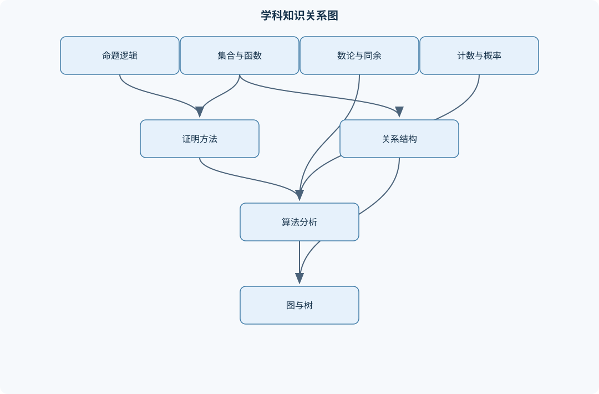
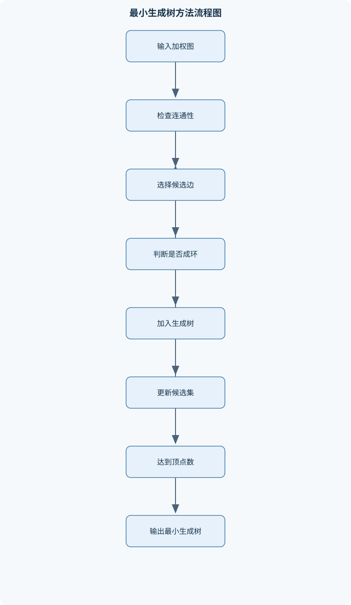

# 离散数学及其应用

## 一、课程整体知识框架

### 课程边界与先修知识

本课程研究有限、离散对象的表示、结构、性质、证明与算法，覆盖命题逻辑与谓词逻辑、集合与函数、证明方法、算法复杂度、整数与数论、递归与递推、计数与概率、关系、图、树、布尔代数、形式语言与有限自动机等内容。课程重点是把自然语言问题形式化为离散结构，使用严格证明说明结论，并分析算法的正确性与复杂度。先修知识包括高中代数、基本函数与集合直觉，以及阅读和书写简单数学证明的能力；不要求微积分。概率部分只涉及有限样本空间和离散概率，图算法部分以有限图为对象。复杂度分析通常采用渐近模型，默认基本算术和比较操作的代价为常数；对于大整数、外存访问和并行计算等现实因素，需要另行说明。





### 1. 课程对象、目标与先修约定

离散数学研究有限或可数的离散对象，以及这些对象之间的关系、结构、性质、证明方法和可执行过程。与以连续变化为主要对象的微积分不同，离散数学关注命题真值、集合元素、整数、有限序列、图的顶点与边、树的节点、字符串和自动机状态等对象。课程的核心任务不是孤立记忆定理，而是完成如下转换：

$$
\text{自然语言问题}\longrightarrow\text{形式结构}\longrightarrow\text{性质或算法}\longrightarrow\text{证明与验证}.
$$

例如，“若某任务依赖于另外两个任务，则依赖任务必须先完成”可以表示为有向图；“每个对象恰好属于一个类别”可以表示为集合划分；“程序只有在输入满足条件时才输出正确结果”可以表示为条件命题；“某字符串是否符合格式”可以表示为形式语言的成员判定问题。

本课程默认具备高中代数、基本函数和集合直觉，并能阅读含定义、假设、结论和证明步骤的简单数学论证。不要求微积分。除特别说明外，自然数采用

$$
\mathbb N=\{0,1,2,\ldots\}.
$$

若某一命题只对正整数成立，应明确写出 $n\ge 1$；不能把含 $0$ 和不含 $0$ 的两种自然数约定混用。复杂度分析通常采用渐近模型，把一次基本算术、比较、赋值或数组访问视为常数代价；对于大整数运算、磁盘访问、缓存、并行执行等情况，这一模型不能直接给出真实运行时间。

### 2. 从逻辑到结构、再到算法

课程知识可以分成四条相互联系的主线。

第一条是**形式化与证明主线**。命题逻辑把陈述表示为命题变量和逻辑联结词，谓词逻辑进一步引入变量、定义域和量词。形式化之后，可以使用真值表、逻辑等价变换、直接证明、逆否证明、反证法、分类讨论、数学归纳法和反例等工具判断结论是否成立。证明不仅用于说明定理，也用于说明算法的正确性。例如，循环不变量描述循环每一轮开始时始终保持的条件；终止性则需要说明某个规模指标不断下降并最终达到边界。

第二条是**对象与映射主线**。集合提供统一的对象语言，函数描述输入到输出的确定性对应，关系描述对象之间可能满足的联系。集合运算、笛卡儿积、函数复合、逆像、等价关系和偏序关系构成许多后续结构的基础。等价关系把对象划分成互不相交的等价类，偏序关系则表达“部分可比较”的层次结构。有限集合的基数、单射、满射和双射进一步说明不同集合之间能否建立一一对应。

第三条是**计数、概率与递推主线**。加法原理和乘法原理处理分步选择，排列、组合、容斥原理和鸽巢原理处理有限计数问题。有限概率建立在样本空间和事件上，条件概率与独立性描述信息改变后的概率关系。递推关系把规模为 $n$ 的对象数量与较小规模对象联系起来；递归算法、递归树、特征方程和生成函数则提供求解或估计这些关系的方法。

第四条是**图、树、自动机与算法主线**。图用顶点和边表示网络，树是连通且无环的特殊图；有向图适合表示依赖和流程，网络流适合表示容量、运输和匹配问题。深度优先搜索、广度优先搜索、拓扑排序、最小生成树和霍夫曼编码把结构描述转化为可执行算法。形式语言与自动机研究字符串集合的描述和识别，有限自动机能够识别正则语言，但不能保存任意长度的无界计数信息。

### 3. 统一的证明与算法评价框架

一个完整证明通常应明确四类内容：假设、待证结论、中间推理和适用边界。证明集合相等时，通常证明两个包含关系：

$$
A=B\quad\Longleftrightarrow\quad A\subseteq B\ \text{且}\ B\subseteq A.
$$

证明蕴涵命题 $p\to q$ 时，不能只列举若干满足条件的例子；可以直接假设 $p$ 并推出 $q$，也可以假设 $\neg q$ 并推出 $\neg p$。原命题与逆否命题

$$
p\to q\equiv \neg q\to\neg p
$$

逻辑等价，但原命题通常不等价于逆命题 $q\to p$。逻辑等价只说明在每种真值赋值下真值相同，不表示两个自然语言表达在语用、强调重点或因果含义上完全相同。

算法分析至少要说明输入、输出、过程、正确性依据、终止条件和复杂度。若输入规模记为 $n$，则

$$
f(n)=O(g(n))
$$

表示存在常数 $C>0$ 和 $n_0$，使得当 $n\ge n_0$ 时，

$$
0\le f(n)\le Cg(n).
$$

这里 $f(n)$ 可以是操作次数或空间单元数，$n$ 是输入规模；$O$ 是渐近上界，不等于精确运行时间。$\Omega$ 表示渐近下界，$\Theta$ 表示上下界同阶。最坏情形、最好情形和平均情形必须区分；平均情形还需要说明输入分布，否则“平均复杂度”没有确定含义。

### 4. 理想模型与现实限制

离散数学中的对象通常是有限集合、有限图、有限字符串或整数。理论模型可以忽略机器字长和存储层次，但实际实现不能如此处理。例如，欧几里得算法的迭代次数可写为 $O(\log\min(a,b))$，这里默认一次取模操作的成本为常数；当 $a,b$ 是位数随输入增长的大整数时，取模本身需要时间，实际复杂度还应按比特长度分析。

同样，图算法的邻接表复杂度常写为 $O(|V|+|E|)$，其中 $|V|$ 是顶点数，$|E|$ 是边数；这假设访问相邻边的成本与表中记录数量成正比。若使用邻接矩阵，单次判断两顶点是否相邻可能方便，但存储需要 $O(|V|^2)$ 空间，即使图很稀疏也会占用大量空间。因而算法结论必须与数据表示、输入规模和运算模型一起解释。

## 二、章节和模块划分

### 核心知识覆盖清单

本清单用于检查正文是否覆盖本课程的主要知识模块：

- **命题逻辑与证明基础**：命题、真值与逻辑联结词、真值表与逻辑等价、条件命题与逆否命题、重言式、矛盾式与可满足性、逻辑推理与有效论证、谓词、量词与量词否定、嵌套量词的语义、直接证明与反证法、逆否证明与分类讨论、反例与存在性证明。
- **集合、函数与基数**：集合表示与集合运算、子集、幂集与笛卡儿积、集合恒等式与文氏图证明、集合的划分、函数的定义域、陪域和值域、单射、满射与双射、函数复合与逆函数、有限集合的基数比较、可数集合的基本性质、鸽巢原理及其推广。
- **算法、复杂度与数学归纳法**：算法的输入输出与确定性、算法正确性与循环不变量、伪代码、跟踪表与终止性、时间复杂度与空间复杂度、大O、大Ω与大Θ记号、最坏、最好与平均情形、二分查找与欧几里得算法、数学归纳法、强归纳法与良序原理、递归算法的复杂度分析。
- **整数、整除与数论算法**：整除关系与线性组合、素数、合数与唯一分解、最大公因数与最小公倍数、辗转相除法、贝祖等式与扩展欧几里得算法、同余关系与模运算、模逆与线性同余方程、中国剩余定理、费马小定理与欧拉定理、RSA公钥密码的数学结构。
- **递归、递推与生成函数**：递归定义与递归算法、递推关系的建模、常系数线性齐次递推、特征方程法、非齐次递推的特解、分治递推式、迭代展开与递归树、生成函数的定义、生成函数求解递推关系、递归结构的正确性证明。
- **计数原理与离散概率**：加法原理与乘法原理、排列与组合、带重复元素的排列、多重集组合、二项式系数与恒等式、容斥原理、鸽巢原理的计数应用、有限概率空间与等可能模型、条件概率与独立性、离散随机变量与期望。
- **关系、偏序与布尔结构**：二元关系的表示、关系的自反、对称、反对称与传递性、关系的复合与逆关系、等价关系与商集、偏序集与可比性、极小元、极大元与极值元、哈斯图、格与有界格的基本概念、布尔代数公理与对偶原理、布尔函数与逻辑电路化简。
- **图论基础**：简单图、多重图与伪图、顶点、边、度与握手定理、图的连通性与连通分支、路径、回路与距离、欧拉通路与欧拉回路、哈密顿路径与哈密顿回路、二分图及其判定、图的同构与不变量、平面图与欧拉公式、图的着色与色数。
- **有向图与网络模型**：有向图与有向路径、有向图的入度和出度、有向图的强连通性、有向无环图与拓扑排序、邻接矩阵与关联矩阵、有向图的可达性、网络流的容量与守恒、割与最大流最小割思想、匹配问题的图模型、图模型在依赖关系中的应用。
- **树、遍历与编码**：树的定义与基本性质、根树、层次与高度、有序树与二叉树、满m叉树的顶点叶子关系、树的先序、中序与后序遍历、二叉搜索树的查找和插入、生成树与深度优先搜索、广度优先搜索与最短边数路径、最小生成树、前缀码与霍夫曼编码。
- **图算法与优化分析**：深度优先搜索的标记机制、广度优先搜索的队列机制、连通分支与生成森林、拓扑排序算法、Prim最小生成树算法、Kruskal最小生成树算法、并查集在Kruskal算法中的作用、加权图中的路径代价、贪心选择性质、算法正确性与复杂度比较。
- **形式语言、自动机与计算模型**：字母表、字符串与语言、正则表达式、有限自动机的状态转移、确定有限自动机与非确定有限自动机、自动机接受语言的定义、正则表达式与有限自动机的联系、上下文无关文法、推导、语法树与歧义、图灵机的基本组成、可计算性与不可判定问题的入门边界。


### 1. 命题逻辑与证明基础

命题是能够判定真或假的陈述，命题变量用小写字母如 $p,q$ 表示。否定、合取、析取、条件和双条件分别记为 $\neg p$、$p\land q$、$p\lor q$、$p\to q$、$p\leftrightarrow q$。条件命题只有在前件为真、后件为假时为假，因此不能把 $p\to q$误解为“$p$和$q$都为真”。例如，$p\to q$与逆否命题 $\neg q\to\neg p$等价，而与逆命题 $q\to p$通常不等价。

真值表可以直接判断复合命题在所有赋值下的真值。恒为真的式子称为重言式，恒为假的式子称为矛盾式，至少有一种赋值为真的式子具有可满足性。常用等价式包括德摩根律：

$$
\neg(p\land q)\equiv\neg p\lor\neg q,\qquad
\neg(p\lor q)\equiv\neg p\land\neg q,
$$

以及蕴涵等价式：

$$
p\to q\equiv\neg p\lor q.
$$

谓词逻辑把“某对象具有某性质”写成谓词，并用全称量词 $\forall$ 和存在量词 $\exists$ 表示范围。量词否定必须改变量词并否定条件：

$$
\neg\forall x\,P(x)\equiv\exists x\,\neg P(x),\qquad
\neg\exists x\,P(x)\equiv\forall x\,\neg P(x).
$$

嵌套量词的顺序一般不能交换。例如“对每个 $n$ 存在 $m$”与“存在一个 $m$ 对所有 $n$”含义不同。证明方法包括直接证明、逆否证明、反证法、分类讨论和存在性证明；要否定一个全称命题，只需给出满足定义域条件且使结论失败的反例。

### 2. 集合、函数与基数

集合用列举法或描述法表示，全集记为 $U$，空集记为 $\varnothing$，补集记为 $\overline A=U\setminus A$，差集记为 $A\setminus B$，笛卡儿积记为 $A\times B$。属于关系写作 $x\in A$，子集关系写作 $A\subseteq B$，二者不能混用。幂集 $\mathcal P(A)$ 是 $A$ 的所有子集构成的集合；若 $|A|=n$，则

$$
|\mathcal P(A)|=2^n.
$$

集合恒等式可用元素法证明。例如证明分配律

$$
A\cap(B\cup C)=(A\cap B)\cup(A\cap C)
$$

时，任取元素 $x$，依次将 $x\in A\cap(B\cup C)$ 转化为 $x\in A$ 且 $(x\in B$ 或 $x\in C)$，再根据逻辑分配律得到右侧条件。集合相等必须完成两个方向的包含证明，或证明任意元素满足等价的成员条件。

函数写作 $f:A\to B$，其中 $A$ 是定义域，$B$ 是陪域，值域为 $f(A)$，可能严格小于陪域。单射表示不同输入不会产生相同输出；满射表示陪域中的每个元素都被取到；同时单射且满射的函数称为双射。单射函数存在左逆，满射函数存在右逆，双射函数存在唯一逆函数。有限集合且定义域与陪域基数相同的条件下，单射、满射和双射彼此等价；无限集合不能直接套用这一结论。

集合划分是把集合分成非空、两两不交且并集为全集的若干块。有限集合的基数比较可以通过建立单射或双射完成。可数集合通常指能与自然数集合建立双射或至少建立适当枚举的集合。鸽巢原理指出，把多于 $k$ 个对象放入 $k$ 个鸽巢，至少有一个鸽巢包含至少两个对象；更一般地，把 $N$ 个对象放入 $k$ 个鸽巢时，某个鸽巢至少包含

$$
\left\lceil\frac Nk\right\rceil
$$

个对象。该结论要求对象确实被映射到有限个鸽巢，且“对象数大于鸽巢数”只是推出重复的条件之一，不能替代具体映射的说明。

### 3. 算法、复杂度与数学归纳法

算法是有限步骤组成的确定性过程，必须明确输入、输出、每一步操作和终止条件。二分查找要求数组已经按非降序排列。维护当前区间，使“目标若存在则位于区间内”始终成立；比较中间元素后舍弃不可能的一半，区间为空时报告不存在，复杂度为 $O(\log n)$。若数组未排序，直接二分会破坏不变量，结论无效。

循环不变量是在每轮循环开始或结束时保持为真的命题。证明算法正确性通常分为初始化、保持和终止三步。终止性则要找到随循环推进而严格下降的非负整数指标，例如剩余区间长度或余数。最好、最坏和平均复杂度必须按不同输入情况分别分析。

数学归纳法用于证明对所有 $n\in\mathbb N$ 成立的命题。先证明基步，再假设 $P(k)$ 成立，推出 $P(k+1)$ 成立。强归纳法允许在归纳步使用所有较小规模的结论。其思想与自然数的良序原理相联系：每个非空自然数集合都有最小元素。递归算法的复杂度可通过递推式、迭代展开或递归树估计，不能只根据代码中出现了递归就断言复杂度为对数或线性。

### 4. 整数、整除与数论算法

整除关系 $a\mid b$ 表示存在整数 $k$ 使 $b=ak$。最大公因数记为 $\gcd(a,b)$，最小公倍数可由

$$
\operatorname{lcm}(a,b)=\frac{|ab|}{\gcd(a,b)}
$$

计算，其中不应在 $a=b=0$ 时直接使用该式。素数大于 $1 且只有两个正因数，合数大于 $1 且不是素数；算术基本定理说明每个大于 $1$ 的整数都能唯一分解为素数乘积，忽略因子排列意义下唯一。

辗转相除法使用

$$
\gcd(a,b)=\gcd(b,a\bmod b),
$$

因为 $a=bq+r$ 时，$a,b$ 的公因数恰好也是 $b,r$ 的公因数。重复取余直到余数为 $0$，最后一个非零余数即为最大公因数。扩展欧几里得算法通过回代得到

$$
sa+tb=\gcd(a,b),
$$

这组等式称为贝祖等式。整数 $a$ 在模 $m$ 下有逆元，当且仅当 $\gcd(a,m)=1$。线性同余方程 $ax\equiv b\pmod m$ 有解的条件是 $\gcd(a,m)\mid b$。

同余关系满足自反、对称和传递性，因此可以按模数划分整数。中国剩余定理要求模数两两互素；若模数为 $m_1,\ldots,m_k$，则联立同余式在模 $M=m_1\cdots m_k$ 意义下有唯一解。构造时先令 $M_i=M/m_i$，求 $M_i$ 在模 $m_i$ 下的逆元，再将各项合并。费马小定理要求模数为素数且 $\gcd(a,p)=1$；欧拉定理要求 $\gcd(a,n)=1$，结论为 $a^{\varphi(n)}\equiv1\pmod n$。RSA利用大整数分解困难、模逆和欧拉函数构造公钥密码，但数学结构本身不等于完整的安全性证明。

### 5. 递归、递推与生成函数

递归定义必须给出基例和递归规则，否则定义可能不完整或允许无限回溯。递推关系用已知较小下标项表示当前项，例如

$$
a_n=3a_{n-1}-2a_{n-2}.
$$

对于常系数线性齐次递推，设解形如 $a_n=r^n$，代入可得到特征方程。若特征根互异，通项为相应指数项的线性组合；若根 $r$ 的重数为 $s$，则对应部分为

$$
(c_0+c_1n+\cdots+c_{s-1}n^{s-1})r^n.
$$

非齐次递推还需寻找特解，并与齐次解相加。分治递推应逐层展开，记录每层子问题数量、每个子问题规模和本层额外代价；不能只看递归深度。生成函数

$$
A(x)=\sum_{n\ge0}a_nx^n
$$

把数列编码为形式幂级数，可通过移项、相乘和系数比较求解递推关系。生成函数方法需要注意初值项和下标起点，漏掉边界项会得到错误系数。

### 6. 计数原理与离散概率

加法原理适用于互斥的分类选择，乘法原理适用于连续步骤的组合选择。排列考虑顺序，组合不考虑顺序：

$$
P(n,k)=\frac{n!}{(n-k)!},\qquad
\binom nk=\frac{n!}{k!(n-k)!}.
$$

含重复元素的排列需除以各重复元素的阶乘；从 $n$ 类物品中允许重复选取 $k$ 个且不计顺序时，数量为

$$
\binom{n+k-1}{k}.
$$

二项式系数满足

$$
(x+y)^n=\sum_{k=0}^{n}\binom nkx^{n-k}y^k,
$$

并可由“按是否包含某一固定元素分类”推出帕斯卡恒等式。容斥原理用交集修正重复计数：

$$
\left|\bigcup_{i=1}^{n}A_i\right|
=\sum_i|A_i|-\sum_{i<j}|A_i\cap A_j|+\cdots.
$$

有限概率空间由样本空间和事件组成；等可能模型下，事件概率为有利结果数除以总结果数。条件概率为

$$
P(A\mid B)=\frac{P(A\cap B)}{P(B)},\qquad P(B)>0.
$$

若事件相互独立，则 $P(A\cap B)=P(A)P(B)$；独立与互斥不是同一概念。有限划分 $B_1,\ldots,B_k$ 两两互斥且覆盖样本空间时，

$$
P(A)=\sum_{i=1}^kP(A\mid B_i)P(B_i),
$$

并可进一步得到贝叶斯公式。离散随机变量 $X$ 把结果映射为数值，期望为

$$
E[X]=\sum_x xP(X=x),
$$

求和必须覆盖所有可能取值。

### 7. 关系、偏序与布尔结构

二元关系写作 $R\subseteq A\times A$，可用有序对集合、关系矩阵或关系图表示。自反要求每个 $(a,a)$ 属于关系；对称要求 $(a,b)$ 导致 $(b,a)$；反对称要求当 $(a,b)$ 和 $(b,a)$ 同时成立时必有 $a=b$；传递要求 $(a,b)$ 与 $(b,c)$ 导致 $(a,c)$。对称与反对称不能简单理解为相反性质。

等价关系是自反、对称且传递的关系，每个元素产生等价类 $[a]$，所有等价类构成集合划分。偏序关系是自反、反对称且传递的关系，通常记为 $\preceq$。偏序中的两个元素不一定可比；极小元、极大元只要求没有更小或更大的相关元素，最小元、最大元则要求与所有元素比较，二者不可混同。哈斯图省略自反边和可由传递性推出的边，只保留覆盖关系。

格中的任意两元素都有最大下界和最小上界；有界格还具有全下界和全上界。布尔代数满足补、交、并等公理，并具有对偶原理：交换“并”与“交”、全下界与全上界后可得到对应命题。布尔函数可用于逻辑电路化简，但化简结果不一定唯一，且最少文字数与最少门数是不同优化目标。

### 8. 图论基础、有向图与网络模型

图记为 $G=(V,E)$，其中 $V$ 是顶点集，$E$ 是边集；无向边写作 $\{u,v\}$，有向边写作 $(u,v)$。简单图不含环和重边，多重图允许重边，伪图还允许环。顶点 $v$ 的度记为 $\deg(v)$，路径长度按边数计算。握手定理为

$$
\sum_{v\in V}\deg(v)=2|E|,
$$

因此奇度顶点数必为偶数；该结论不能直接把有向图的入度和出度混在一起。有向图中分别记入度和出度为 $\deg^-(v)$、$\deg^+(v)$。

连通性、路径、回路和距离描述图中顶点间的可达程度。欧拉通路关注每条边恰好使用一次，欧拉回路还要求回到起点；哈密顿路径和回路关注每个顶点恰好访问一次，二者条件不同。无向图是二分图，当且仅当不存在奇回路，也可以在搜索时进行二染色判定。图同构要求存在保持邻接关系的顶点双射，顶点数、边数、度数多重集等是不变量，但相同不变量不一定保证同构。

平面图可在平面上无边交叉地画出。连通平面图满足欧拉公式

$$
|V|-|E|+|F|=2,
$$

其中 $F$ 为面数；不连通时公式需按连通分支修正。图着色要求相邻顶点使用不同颜色，最少所需颜色称为色数。

有向图用方向表示先后、依赖和流程。强连通要求任意两个顶点之间都存在相互可达的有向路径。有向无环图可进行拓扑排序；若排序输出顶点数少于总数，则存在有向环。邻接矩阵适合快速判断边是否存在，关联矩阵记录顶点与边的关联关系。网络流给每条边设置容量，除源点和汇点外满足流量守恒；割把顶点分成两部分，最大流最小割思想说明最大可行流值等于最小割容量。匹配问题可用图模型描述任务分配、配对和资源冲突。

### 9. 树、遍历、编码与图算法

树是连通且无环的无向图。含 $n$ 个顶点的树恰有 $n-1$ 条边：删去任意一条边会使树断开，或从单顶点树开始每增加一个顶点必须增加一条连接边。根树指定根 $r$，顶点层数是从根到该顶点的路径长度，树高是最大层数。若满 $m$ 叉树有 $i$ 个内部顶点，则

$$
|V|=mi+1,\qquad
\text{叶子数}=(m-1)i+1,
$$

前提是每个内部顶点恰有 $m$ 个孩子。

二叉树有先序、中序和后序遍历。二叉搜索树要求左子树键值小于根、右子树键值大于根；因此中序遍历有序，但任意二叉树不具有这一性质。生成树是包含原图所有顶点的树。深度优先搜索使用栈或递归，广度优先搜索使用队列；广度优先搜索在无权图中首次发现顶点时得到最少边数距离。

最小生成树要求在连通加权无向图中连接所有顶点且总权重最小。Kruskal算法按边权递增扫描，若新边不形成环则加入；并查集维护当前连通分量。Prim算法从一个顶点开始，每次选择连接当前树与外部顶点的最小权边。两者正确性分别依赖割性质和环性质；边权相同时最小生成树可能不唯一，但最小总权值相同。采用邻接表和二叉堆时，Prim通常为 $O(|E|\log|V|)$，Kruskal通常为 $O(|E|\log|E|)$。

霍夫曼编码反复合并权重最小的两棵树，得到前缀码。由于任一符号都不是另一个符号编码的前缀，编码可无分隔符解码；优先队列实现的复杂度通常为 $O(k\log k)$，其中 $k$ 是符号种类数。

### 10. 形式语言、自动机与计算模型

字母表是有限符号集合，字符串是有限符号序列，空字符串记为 $\varepsilon$，语言是字符串集合。正则表达式通过基本符号、连接、并集 $\cup$ 和克林闭包 $*$ 描述模式；克林闭包表示重复零次或任意有限次，不是“恰好重复一次”。

有限自动机由有限状态集、输入字母表、状态转移规则、初态和终态集合组成。确定有限自动机对每个状态和输入符号至多有一个后继状态；非确定有限自动机允许多个后继状态或空转移。自动机从初态开始逐字符转移，读完后若当前状态属于终态集合，则接受该字符串。有限自动机模拟的基本时间复杂度为 $O(\ell)$，其中 $\ell$ 是字符串长度，前提是转移查询为常数时间。

正则表达式、有限自动机和正则语言具有相同的表达能力，但等价不意味着构造后状态数相同；某些转换会显著增加状态数量。上下文无关文法由终结符、非终结符、产生式和开始符号组成，推导可表示为语法树；同一字符串存在多个不同语法树时产生歧义。图灵机增加了可读写纸带和更一般的状态转移，用于讨论可计算性。有限自动机不能识别所有语言，尤其不能仅凭有限状态记忆任意长度的无界计数；不可判定问题则标志着“存在算法”这一边界本身，而不仅是算法效率较低。

## 三、核心概念的详细解释

### 1. 命题逻辑与谓词逻辑

命题是能够明确判断真假的陈述句，真值只有“真”和“假”两种。若用 $p,q$ 表示命题，则常用联结词分别为否定 $\lnot p$、合取 $p\land q$、析取 $p\lor q$、条件 $p\to q$ 和双条件 $p\leftrightarrow q$。其中，$p\to q$ 仅在 $p$ 真而 $q$ 假时为假；因此“若程序终止，则输出正确”并不等同于“程序终止且输出正确”。

条件命题满足逆否等价式：

$$
p\to q\equiv \lnot q\to \lnot p.
$$

原命题的逆命题 $q\to p$ 和否命题 $\lnot p\to\lnot q$ 一般不与原命题等价。例如，“若一个整数能被 $4$ 整除，则它能被 $2$ 整除”为真，但逆命题“若能被 $2$ 整除，则能被 $4$ 整除”为假。真值表可以机械地检验有限个命题变量构成的复合命题；若一个公式在所有赋值下为真，称为重言式；在所有赋值下为假，称为矛盾式；至少存在一种赋值使其为真，则称为可满足式。

谓词是含变量的陈述形式，例如 $P(x)$ 表示“$x$ 具有性质 $P$”。量词 $\forall x\,P(x)$ 表示定义域中的每个 $x$ 都满足 $P$，$\exists x\,P(x)$ 表示至少有一个 $x$ 满足 $P$。量词否定必须同时改变量词和谓词：

$$
\lnot(\forall x\,P(x))\equiv \exists x\,\lnot P(x),
\qquad
\lnot(\exists x\,P(x))\equiv \forall x\,\lnot P(x).
$$

嵌套量词的顺序通常不能交换。例如，在整数域中，“对任意 $n$，存在 $m>n$”为真，而“存在一个 $m$，使任意 $n$ 都有 $m>n$”为假。量词的定义域也是语义的一部分；同一公式在整数域、实数域和有限集合上的真假可能不同。

证明命题时，直接证明从假设出发推导结论；逆否证明把目标改为证明 $\lnot q\to\lnot p$；反证法假设结论不成立并推出矛盾。存在性命题可以构造满足条件的对象，也可以证明对象必然存在。全称命题只要找到一个反例即可否定，但验证若干正例不能证明全称命题。

### 2. 集合、函数与基数

集合是确定对象的总体。元素属于集合记为 $x\in A$，集合包含关系记为 $A\subseteq B$，二者不能混淆。集合的并、交、差和补集分别记为 $A\cup B$、$A\cap B$、$A\setminus B$ 和 $\overline A=U\setminus A$。幂集 $\mathcal P(A)$ 是 $A$ 的所有子集构成的集合；若 $|A|=n$，则

$$
|\mathcal P(A)|=2^n.
$$

笛卡儿积 $A\times B$ 由所有有序对 $(a,b)$ 组成。若 $A,B$ 为有限集，则 $|A\times B|=|A||B|$。集合恒等式通常用元素法证明。例如，证明 $A\cap(B\cup C)=(A\cap B)\cup(A\cap C)$ 时，对任意 $x$ 有

$$
x\in A\cap(B\cup C)
\Longleftrightarrow x\in A\land(x\in B\lor x\in C),
$$

再利用命题逻辑分配律即可得到右侧条件。集合相等必须证明两个方向的包含关系，证明一个方向只能得到子集关系。

集合划分是由若干非空子集组成的集合族，这些子集两两不交且并集为全集。等价关系产生划分：若 $R$ 是集合 $A$ 上的等价关系，则等价类 $[a]=\{x\in A:xRa\}$ 两两相同或不交，并覆盖 $A$。

函数 $f:A\to B$ 为每个 $a\in A$ 指定唯一的 $f(a)\in B$。$A$ 是定义域，$B$ 是陪域，值域 $f(A)$ 是实际输出集合，通常有 $f(A)\subseteq B$。单射要求不同输入有不同输出；满射要求陪域中每个元素都被取到；双射同时满足二者。逆像定义为

$$
f^{-1}(C)=\{a\in A:f(a)\in C\},
$$

即使 $f$ 没有逆函数，逆像仍然有定义。

若 $f$ 为单射，则可在其值域上构造左逆；若 $f$ 为满射，则可选择每个陪域元素的一个原像，构造右逆；若 $f$ 为双射，则逆函数唯一存在。有限集合之间，若定义域和值域基数相同，则单射、满射和双射彼此等价；无限集合不能直接使用这一结论。例如，$\mathbb N$ 与偶数集合可以建立双射，说明无限集合的真子集也可能与全集等势。

鸽巢原理的基本形式是：若把 $N$ 个对象放入 $k$ 个鸽巢且 $N>k$，则至少一个鸽巢含有两个对象。推广形式为，若 $N>k(r-1)$，则至少一个鸽巢含有至少 $r$ 个对象。使用时必须明确对象、鸽巢以及从对象到鸽巢的映射。

### 3. 算法、复杂度与归纳证明

算法是有限步骤组成的确定性过程，必须说明输入、输出、每一步操作以及终止条件。算法正确性包括部分正确性和终止性：部分正确性表示若算法终止，则输出满足要求；终止性表示对允许的输入，算法必定在有限步骤后停止。

循环不变量是在每轮循环开始或结束时都成立的命题。证明循环正确通常包含三步：初始化证明第一次循环前不变量成立；保持性证明若本轮开始时成立，执行循环体后下一轮仍成立；终止性证明循环结束条件与不变量共同推出目标结论。若循环中某个非负整数指标每轮严格减少，则可用良序性说明循环不能无限执行。

渐近记号描述规模增大时的增长关系。若存在常数 $C>0$ 和 $n_0$，使得对所有 $n\ge n_0$ 有 $0\le f(n)\le Cg(n)$，则记为 $f(n)=O(g(n))$；$\Omega(g(n))$ 表示渐近下界，$\Theta(g(n))$ 表示上下界同阶。大 $O$ 不是精确运行时间，也不说明常数、低阶项、缓存和输入分布。最坏情形考察所有同规模输入中的最大代价，最好情形取最小代价，平均情形还需要给出输入概率分布。

二分查找要求数组已按非降序排列。每次比较中间元素，并保留仍可能含目标值的区间。区间长度每轮约减半，因此时间复杂度为 $O(\log n)$；未排序数组不满足其适用条件。欧几里得算法反复使用

$$
(a,b)\leftarrow(b,a\bmod b),
$$

直到 $b=0$，输出 $a$。其不变量是当前两数的最大公因数保持不变，迭代次数为 $O(\log\min(a,b))$，但大整数除法的真实位复杂度不一定是常数时间。

数学归纳法适用于由自然数索引的命题。先证明基步，再假设 $P(k)$ 成立并证明 $P(k+1)$。强归纳法在归纳步中可以同时使用所有 $P(0),\ldots,P(k)$。良序原理断言每个非空自然数集合都有最小元素，三者在常见数学体系中表达相同的基础思想。归纳证明不能只验证若干小数值，也不能在归纳步未经证明就直接使用待证结论。

### 4. 整数、整除与数论算法

对整数 $a,b$，若存在整数 $k$ 使 $b=ak$，则称 $a\mid b$。最大公因数 $\gcd(a,b)$ 是同时整除 $a,b$ 的最大正整数；最小公倍数可由

$$
\operatorname{lcm}(a,b)=\frac{|ab|}{\gcd(a,b)}
$$

计算，其中 $a,b$ 不同时为零。每个大于 $1$ 的整数都能分解为素数乘积，且分解在因子顺序之外唯一。

带余除法给出

$$
a=bq+r,\qquad 0\le r<|b|.
$$

因为 $a=bq+r$，所以 $a,b$ 的公因数恰好也是 $b,r$ 的公因数，从而

$$
\gcd(a,b)=\gcd(b,a\bmod b).
$$

扩展欧几里得算法在此基础上回代，得到贝祖等式

$$
sa+tb=\gcd(a,b).
$$

整数 $a$ 在模 $m$ 下存在乘法逆元，当且仅当 $\gcd(a,m)=1$。线性同余方程 $ax\equiv b\pmod m$ 有解的充要条件是 $\gcd(a,m)\mid b$；若 $d=\gcd(a,m)$，则在模 $m$ 意义下通常有 $d$ 个不同解。

同余关系满足加法和乘法相容性：

$$
a\equiv b\pmod m,\ c\equiv d\pmod m
\Longrightarrow
a+c\equiv b+d\pmod m,\ ac\equiv bd\pmod m.
$$

中国剩余定理要求模数两两互素。若 $m_1,\ldots,m_k$ 两两互素，则同余组

$$
x\equiv a_i\pmod {m_i}\qquad(1\le i\le k)
$$

在模 $M=m_1m_2\cdots m_k$ 下有唯一解。构造时令 $M_i=M/m_i$，求 $M_i$ 在模 $m_i$ 下的逆元 $y_i$，则

$$
x\equiv\sum_{i=1}^k a_iM_iy_i\pmod M.
$$

费马小定理在素数 $p$ 且 $p\nmid a$ 时给出 $a^{p-1}\equiv1\pmod p$；欧拉定理在 $\gcd(a,n)=1$ 时给出

$$
a^{\varphi(n)}\equiv1\pmod n.
$$

RSA利用大整数分解困难的计算假设：选择大素数 $p,q$，令 $n=pq$，计算 $\varphi(n)=(p-1)(q-1)$，选择与 $\varphi(n)$ 互素的公钥指数 $e$，再求 $d\equiv e^{-1}\pmod{\varphi(n)}$。加密和解密分别使用模幂运算。这里的数学结构不等于完整安全性证明，实际系统还需要随机填充、密钥管理和抗攻击设计。

### 5. 递归、递推与生成函数

递归定义由基准情形和递归规则组成。例如，阶乘满足 $0!=1$、$n!=n(n-1)!$。递归算法必须使子问题规模向基准规模下降，否则可能不终止。递推关系描述数列项与较小下标项之间的关系，例如

$$
a_n=3a_{n-1}-2a_{n-2}.
$$

对齐次线性递推，设解形如 $a_n=r^n$，代入得到特征方程

$$
r^2-3r+2=0.
$$

若根为不同的 $r_1,r_2$，通解为 $a_n=C_1r_1^n+C_2r_2^n$；若有重根 $r$，通解为

$$
a_n=(C_1+C_2n)r^n.
$$

重根时出现 $n$ 因子是为了提供线性无关的两个解。非齐次递推的通解为齐次解加特解，特解形式必须根据右端项选择，并代入原递推验证。

分治算法常写为

$$
T(n)=aT(n/b)+f(n),
$$

但只有在子问题规模、子问题数量和分割代价明确时，才能正确展开。递归树按层计算每层总成本，再加上叶节点成本；不能只看递归深度而忽略每层的子问题数量。

生成函数把数列 $(a_n)_{n\ge0}$ 编成形式幂级数

$$
A(x)=\sum_{n\ge0}a_nx^n.
$$

递推关系乘以适当的 $x^n$ 后求和，可以把移位项转化为 $xA(x)$ 或类似表达式，从而得到关于 $A(x)$ 的代数方程。生成函数求得后，再通过系数展开或部分分式分解恢复 $a_n$。它可以统一处理计数问题、递推关系和组合结构，但形式幂级数的运算不自动说明对应数值级数的收敛性。

### 6. 计数原理与离散概率

加法原理适用于互不重叠的选择情形；乘法原理适用于按步骤完成的选择。排列关注顺序，组合不关注顺序：

$$
P(n,k)=\frac{n!}{(n-k)!},
\qquad
\binom nk=\frac{n!}{k!(n-k)!}.
$$

若有重复元素，设总数为 $n$，各类重复次数为 $n_1,\ldots,n_r$，则不同排列数为

$$
\frac{n!}{n_1!n_2!\cdots n_r!}.
$$

从 $n$ 类对象中选择 $k$ 个且允许重复、顺序不重要时，结果为

$$
\binom{n+k-1}{k},
$$

其依据是隔板法。

容斥原理的两集合形式为

$$
|A\cup B|=|A|+|B|-|A\cap B|.
$$

对三个集合还需加回三重交集：

$$
|A\cup B\cup C|
=\sum|A_i|-\sum|A_i\cap A_j|+|A\cap B\cap C|.
$$

有限概率空间中，样本空间 $\Omega$ 的概率满足 $P(\Omega)=1$，互斥事件概率可相加。若 $P(B)>0$，则

$$
P(A\mid B)=\frac{P(A\cap B)}{P(B)}.
$$

事件独立要求 $P(A\cap B)=P(A)P(B)$，与互斥不同；若两个非零概率事件互斥，则通常不独立。若 $B_1,\ldots,B_k$ 是两两互斥且并为 $\Omega$ 的划分，则

$$
P(A)=\sum_{i=1}^kP(A\mid B_i)P(B_i),
$$

并且

$$
P(B_j\mid A)
=\frac{P(A\mid B_j)P(B_j)}
{\sum_iP(A\mid B_i)P(B_i)}.
$$

离散随机变量 $X$ 的期望为

$$
E[X]=\sum_x xP(X=x),
$$

要求和遍历所有可能取值。期望具有线性性，即使变量不独立，也有 $E[X+Y]=E[X]+E[Y]$。

### 7. 关系、偏序与布尔结构

关系 $R\subseteq A\times A$ 可以用有序对集合、关系矩阵或有向图表示。自反性要求每个 $a$ 都满足 $aRa$；对称性要求 $aRb$ 推出 $bRa$；反对称性要求 $aRb$ 且 $bRa$ 时必有 $a=b$；传递性要求 $aRb$ 且 $bRc$ 推出 $aRc$。

等价关系同时满足自反、对称和传递性，并产生等价类划分。偏序关系满足自反、反对称和传递性，通常记为 $\preceq$。偏序中并非任意两个元素都可比较。极小元只要求不存在严格更小的元素；最小元要求它小于或等于所有元素，因此最小元若存在则唯一，而极小元可能有多个。极大元和最大元同理。

哈斯图省略自反边、传递边和方向箭头，用于表示有限偏序的覆盖关系。关系复合表示先执行一个关系再执行另一个关系；逆关系交换有序对方向。有限关系的传递性可通过检查长度为二的可复合路径判断，直接矩阵实现的典型复杂度为 $O(n^3)$。

布尔代数中的运算通常记为并、交和补，满足交换律、结合律、分配律、单位元律和互补律。对偶原理指出，将并与交、$0$ 与 $1$ 互换后，成立的布尔恒等式仍成立。布尔函数可用真值表、代数表达式或逻辑电路表示；德摩根律可用于化简和转换门电路结构，但代数化简必须保持输入到输出的全部真值关系。

### 8. 图论、有向图与网络

图记为 $G=(V,E)$。简单无向图不含环和重边；多重图允许重边；伪图还允许环。顶点 $v$ 的度 $\deg(v)$ 是与其关联的边数，环在无向图中对度贡献 $2$。握手定理为

$$
\sum_{v\in V}\deg(v)=2|E|.
$$

因此奇度顶点的数目必为偶数，但满足该必要条件的度数序列不一定都能构成图。

路径长度按边数计算，回路是首尾相同的闭路径。连通分支是极大的连通子图。欧拉回路要求每条边恰好经过一次；连通无向图存在欧拉回路当且仅当所有顶点度为偶数，存在欧拉通路但无欧拉回路当且仅当恰有两个奇度顶点。哈密顿回路要求每个顶点恰好经过一次，与欧拉条件不是同一条件；一般图中判断哈密顿回路没有同样简单的度数充要条件。

二分图的顶点可分为两个互不相交部分，使每条边连接两部分。无向图为二分图，当且仅当不含奇长度回路；也可以用广度优先搜索进行二染色，若发现相邻顶点颜色相同则不是二分图。图同构要求存在保持邻接关系的顶点双射，顶点数、边数、度数多重集和回路结构等是不变量，但单个不变量相同不保证同构。

有向图的入度 $\deg^-(v)$ 是进入顶点的边数，出度 $\deg^+(v)$ 是离开顶点的边数，且

$$
\sum_v\deg^-(v)=\sum_v\deg^+(v)=|E|.
$$

强连通要求任意两个顶点互相可达。有向无环图可以进行拓扑排序；若拓扑排序输出的顶点少于总顶点数，则图中存在有向环。邻接矩阵适合快速查询特定边，空间为 $O(|V|^2)$；邻接表对稀疏图更节省空间，遍历复杂度通常为 $O(|V|+|E|)$。

网络流在有向边上赋予非负容量，流量不超过容量，并在除源点和汇点外的顶点满足流入等于流出。割把顶点分为含源点和含汇点的两部分，割容量为从前一部分指向后一部分的边容量之和。最大流最小割思想说明最大可行流值等于最小割容量。匹配问题可用二分图建模，其中每个顶点至多参与一条匹配边。

### 9. 树、遍历、优化与编码

树是连通且无环的无向图。含 $n$ 个顶点的树恰有 $n-1$ 条边；删去任意一条边会使其不连通，加入任意一条新边会产生回路。根树指定根 $r$，顶点层数是从根到该顶点的路径长度，高度是最大层数。有序树规定孩子的排列顺序，二叉树的每个顶点至多有两个孩子。

若满 $m$ 叉树有 $i$ 个内部顶点，则每个内部顶点恰有 $m$ 条出边，边数为 $mi$；树的边数也为总顶点数减一，因此

$$
n=mi+1,
\qquad
\ell=n-i=(m-1)i+1,
$$

其中 $\ell$ 为叶子数。公式要求“满”条件；若内部顶点可以少于 $m$ 个孩子，则不能直接使用。

深度优先搜索使用栈或递归，优先深入未访问邻接点；广度优先搜索使用队列，按与起点距离非递减的层次访问。对无权图，广度优先搜索首次发现顶点时得到的路径具有最少边数。邻接表实现两者的时间复杂度均为 $O(|V|+|E|)$。

二叉搜索树要求每个顶点左子树键值小于节点键值，右子树键值大于节点键值；若允许重复键，必须另行规定重复键的放置规则。中序遍历产生非降序键序列，查找和插入的时间与树高 $h$ 成正比，最坏可达 $O(n)$，平衡时约为 $O(\log n)$。

最小生成树连接连通加权无向图的所有顶点且不含回路，并使总边权最小。Kruskal算法按权值递增扫描边，若加入后不成环则加入；Prim算法维护已扩展顶点集，每次选择连接当前集合与外部顶点的最小边。二者依赖割性质：对任意割，跨割的最轻边是某棵最小生成树中的安全边。相同权值可能导致不同的最小生成树，但总权值相同。Kruskal配合并查集通常为 $O(|E|\log|E|)$；Prim配合二叉堆通常为 $O(|E|\log|V|)$。

霍夫曼编码每次合并频率最小的两棵树，最终形成前缀码树。前缀码中任一符号编码都不是另一个符号编码的前缀，因此可以无分隔符解码。优先队列实现的构造复杂度为 $O(k\log k)$，其中 $k$ 是符号种类数；编码最优性指在给定频率下加权路径长度最小，不表示每个单独字符串都最短。

### 10. 形式语言、自动机与计算模型

字母表 $\Sigma$ 是有限符号集合，字符串是 $\Sigma$ 中符号的有限序列，空字符串记为 $\varepsilon$，语言是字符串集合。语言的连接把两个字符串首尾相接，克林闭包 $L^*$ 包含从 $L$ 中选取零个或任意有限个字符串进行连接所得的所有字符串，因此总包含 $\varepsilon$。

确定有限自动机由有限状态集、输入字母表、确定的转移函数、初态和终态集合组成。读入每个字符时，当前状态唯一确定下一个状态；读完整个字符串后，若状态属于终态集合则接受。非确定有限自动机允许一个状态和输入符号对应多个后继状态，也可以含空转移；它的多条可能运行中只要存在一条到达终态的路径，就接受该字符串。

有限自动机模拟长度为 $\ell$ 的字符串时，在转移查询为常数时间的前提下，时间复杂度为 $O(\ell)$。正则表达式、有限自动机和正则语言表达能力相同，但具体构造的状态数可能不同；非确定自动机转换为确定自动机时，状态数最坏可能指数增长。有限自动机不能识别需要无界计数的语言，例如

$$
\{0^n1^n:n\ge0\},
$$

因为有限状态数无法永久记住任意大的 $n$。

上下文无关文法由终结符、非终结符、产生式和开始符号构成。推导可以表示为语法树；若同一字符串存在不同语法树，则文法有歧义。图灵机具有可读写纸带和读写头，能够表达比有限自动机更一般的计算过程。可计算性研究某个问题是否存在终止算法；不可判定并不只是运行时间很长，而是不存在对所有合法输入都保证终止并给出正确答案的通用算法。

## 四、重要定义、公式、定理和推导

### 专业审校补充：关键定义与适用边界

网络流中的“可行流”与“最大流”必须区分。给定有向网络 G=(V,E)、源点 s、汇点 t 及容量 c(u,v)≥0，流 f 需满足容量约束 0≤f(u,v)≤c(u,v)，并在除 s、t 外的每个顶点满足流量守恒：流入量等于流出量。流值 |f| 是源点净流出量。残量网络中，正向边剩余容量为 c(u,v)−f(u,v)，反向边容量为 f(u,v)；反向边表示撤销既有流量的可能性，不能简单忽略。不断寻找从 s 到 t 的增广路径并沿路径增加瓶颈容量，直到残量网络中不存在增广路径时，所得流为最大流。最大流最小割定理说明最大流值等于所有 s−t 割的最小容量。该结论要求容量非负且网络有限；若边容量为实数，算法仍可讨论，但整数容量时增广过程每次增加整数流量。不能把“源点出边容量之和”直接当作最大流，除非还证明存在达到该上界的可行流。


### 1. 逻辑与集合的基本定理

德摩根律为

$$
\lnot(p\land q)\equiv\lnot p\lor\lnot q,
\qquad
\lnot(p\lor q)\equiv\lnot p\land\lnot q.
$$

集合版本为

$$
\overline{A\cap B}=\overline A\cup\overline B,
\qquad
\overline{A\cup B}=\overline A\cap\overline B.
$$

证明第一式时，对任意 $x\in U$，

$$
x\in\overline{A\cap B}
\Longleftrightarrow x\notin A\cap B
\Longleftrightarrow \lnot(x\in A\land x\in B),
$$

再使用命题德摩根律即可得到 $x\in\overline A\cup\overline B$。由于任意 $x$ 的归属条件等价，两个集合相等。

蕴涵的等价式为

$$
p\to q\equiv\lnot p\lor q.
$$

因此可由真值表逐行验证；但逻辑等价只表示真值相同，不保证两个自然语言表达式在语境、强调重点或因果解释上完全相同。

### 2. 函数与有限基数定理

若 $f:A\to B$ 为单射，则存在函数 $g:f(A)\to A$，使

$$
g(f(a))=a\qquad(a\in A).
$$

证明时对每个 $y\in f(A)$，存在唯一的 $a\in A$ 使 $f(a)=y$；唯一性正是单射保证的，因此可令 $g(y)=a$。若把陪域扩大到 $B$，还需对 $B\setminus f(A)$ 的元素另行指定取值。

若 $f:A\to B$ 为满射，则可对每个 $b\in B$ 选择一个 $a_b\in A$ 使 $f(a_b)=b$，定义 $g(b)=a_b$，即可得到

$$
f(g(b))=b.
$$

当 $f$ 同时单射和满射时，左右逆均存在且相同，得到唯一逆函数 $f^{-1}:B\to A$。

若有限集合 $A,B$ 满足 $|A|=|B|$，则 $f:A\to B$ 单射必为满射。原因是单射使 $|f(A)|=|A|=|B|$，而 $f(A)\subseteq B$；有限集合的子集若与全集等大，只能等于全集。无限集合中不能使用这一步的有限性结论。

### 3. 鸽巢原理与排序下界

把 $N$ 个对象映射到 $k$ 个鸽巢。若每个鸽巢至多含 $r-1$ 个对象，则对象总数至多为 $k(r-1)$。因此当

$$
N>k(r-1)
$$

时，至少一个鸽巢含有至少 $r$ 个对象。等价地，要保证某个鸽巢至少有 $r$ 个对象，所需最少对象数为

$$
k(r-1)+1.
$$

比较排序的决策树中，每个内部节点表示一次二元比较，每条从根到叶的路径对应一种比较结果。对 $n$ 个互异元素，可能的输入排列有 $n!$ 种，因此决策树至少需要 $n!$ 个叶。高度为 $h$ 的二叉树最多有 $2^h$ 个叶，所以

$$
2^h\ge n!,
\qquad
h\ge\lceil\log_2(n!)\rceil.
$$

由 $\log_2(n!)=\Omega(n\log n)$，得到基于二元比较的排序算法最坏比较次数下界为 $\Omega(n\log n)$。该结论只针对比较模型，不排除利用键值范围、位表示或额外结构的非比较排序。

### 4. 数论定理的推导

设 $d=\gcd(a,b)$。扩展欧几里得算法回代得到整数 $s,t$，使

$$
sa+tb=d.
$$

当 $\gcd(a,m)=1$ 时，存在 $s,t$ 使 $sa+tm=1$。模 $m$ 后得到

$$
sa\equiv1\pmod m,
$$

所以 $s$ 是 $a$ 的模逆。若存在逆元 $u$，则 $au\equiv1\pmod m$，任何同时整除 $a,m$ 的正整数也必须整除 $1$，故 $\gcd(a,m)=1$。这证明了模逆存在的充要条件。

中国剩余定理的构造中，令

$$
M=\prod_{i=1}^k m_i,\qquad M_i=M/m_i.
$$

由于模数两两互素，$\gcd(M_i,m_i)=1$，所以存在 $y_i$ 使

$$
M_iy_i\equiv1\pmod {m_i}.
$$

令

$$
x=\sum_{i=1}^k a_iM_iy_i.
$$

对固定的 $j$ 取模 $m_j$ 时，除第 $j$ 项外，其余各项都含有因子 $m_j$，因而

$$
x\equiv a_jM_jy_j\equiv a_j\pmod {m_j}.
$$

若 $x,x'$ 都满足同余组，则每个 $m_i$ 都整除 $x-x'$。由于模数两两互素，乘积 $M$ 整除 $x-x'$，故解在模 $M$ 下唯一。

### 5. 递推与归纳推导

对二阶递推

$$
a_n=\alpha a_{n-1}+\beta a_{n-2},
$$

设 $a_n=r^n$，得到

$$
r^n=\alpha r^{n-1}+\beta r^{n-2}.
$$

当 $r\ne0$ 时除以 $r^{n-2}$，得特征方程

$$
r^2-\alpha r-\beta=0.
$$

若根为互异的 $r_1,r_2$，则

$$
a_n=C_1r_1^n+C_2r_2^n.
$$

两个初值用于解出 $C_1,C_2$。若特征根为重根 $r$，则两个线性无关解为 $r^n$ 和 $nr^n$，所以通解为

$$
a_n=(C_1+C_2n)r^n.
$$

推导出的通项必须代回递推式并检查所有初值；只满足特征方程而未满足初值的表达式仍不是该递推的唯一解。

数学归纳法的逻辑基础可以由最小反例说明。若基步成立但结论并非对所有自然数成立，则存在最小反例 $m$。由于基步成立，$m$ 不在基准范围；而归纳假设对 $m-1$ 成立，归纳步便推出 $P(m)$ 成立，矛盾。因此不存在反例。

### 6. 计数与概率定理

二项式定理为

$$
(x+y)^n=\sum_{k=0}^n\binom nk x^{n-k}y^k.
$$

比较两边 $x^{n-k}y^k$ 的系数，可知 $\binom nk$ 统计从 $n$ 个位置中选择 $k$ 个位置放置 $y$ 的方案数。令 $x=y=1$ 得

$$
\sum_{k=0}^n\binom nk=2^n,
$$

说明 $n$ 元集合的所有子集总数为 $2^n$。令 $x=1,y=-1$ 得偶数项组合数之和等于奇数项组合数之和。

容斥原理可由“先相加、再纠正重复”推导。$A\cup B$ 中属于交集的元素被计算两次，因此减去 $|A\cap B|$。三个集合中，三重交集先被计算三次，减去三对交集后变为零，还需再加一次，得到交替加减结构。

条件概率的乘法公式为

$$
P(A\cap B)=P(A\mid B)P(B)=P(B\mid A)P(A),
$$

前提是相应条件概率有定义。若 $B_1,\ldots,B_k$ 是有限划分，则每个事件 $A$ 可写成互不相交的并：

$$
A=(A\cap B_1)\cup\cdots\cup(A\cap B_k).
$$

对互不相交事件相加，即得全概率公式。贝叶斯公式只是将乘法公式与全概率公式结合后的结果，不是“把两个条件概率直接互换”。

### 7. 图与树的结构定理

证明树含 $n-1$ 条边可用归纳法。单顶点树含 $0=1-1$ 条边。若树含至少两个顶点，则存在叶子顶点；删去一个叶子及其唯一关联边，剩余图仍是树。按归纳假设剩余图有 $n-2$ 条边，加回一条边得 $n-1$ 条边。

也可从连通性和无环性说明：连通图至少含 $n-1$ 条边，因为每加入一个新顶点至少需要一条边连接到已有部分；无环图至多含 $n-1$ 条边，否则在逐步加入边时必形成回路。树同时满足两者，故恰含 $n-1$ 条边。

深度优先搜索和广度优先搜索在发现未访问顶点时记录一条发现边。每个非起点顶点只在第一次发现时记录，因此生成边不会造成重复发现；若生成边构成回路，则回路中某个顶点应已被发现，不可能再次作为未访问顶点加入。对连通图，搜索会不断处理边界，直到所有顶点均被发现，所得生成边数为 $|V|-1$，因而形成生成树。

Kruskal算法的正确性来自割性质。设当前已选边组成若干连通分量，算法选择跨某个割的最轻边。若某棵最小生成树不含此边，把该边加入该树必产生回路；回路中必有另一条跨该割的边，其权值不小于所选边。用所选边替换它不会增加总权值，因此存在包含所选边的最小生成树。重复此过程即可得到最小生成树。

Prim算法同样每次选择当前树与外部顶点之间的最轻边，该边跨越当前顶点集合与其补集构成的割，因此是安全边。边权相等时“最轻”边可能有多条，算法的选择顺序会影响树的形状，但不影响最小总权值。

### 8. 自动机接受性与表达能力边界

给定确定有限自动机

$$
M=(Q,\Sigma,\delta,q_0,F),
$$

其中 $Q$ 是有限状态集，$\Sigma$ 是字母表，$\delta:Q\times\Sigma\to Q$ 是转移函数，$q_0$ 是初态，$F\subseteq Q$ 是终态集。将转移函数扩展到字符串，定义

$$
\delta^*(q,\varepsilon)=q,
$$

以及

$$
\delta^*(q,wa)=\delta(\delta^*(q,w),a),
$$

其中 $w$ 是字符串，$a$ 是单个符号。自动机接受语言为

$$
L(M)=\{w\in\Sigma^*:\delta^*(q_0,w)\in F\}.
$$

这个递归定义说明模拟过程必须从左到右处理全部输入；读完字符串后才依据最终状态作出接受或拒绝判断。

正则语言对并、连接和克林闭包封闭：若 $L_1,L_2$ 为正则语言，则 $L_1\cup L_2$、$L_1L_2$ 和 $L_1^*$ 仍为正则语言。正则表达式与有限自动机之间的互相转换说明它们表达能力相同，但不保证状态数相同，也不保证转换后的表达式长度保持不变。对于需要比较两个无界计数的语言，有限状态的记忆能力不足，因此必须使用更强的模型，例如上下文无关文法或带栈自动机。

## 五、算法、流程和实现思路

### 方法与流程覆盖索引

下列方法或流程应在正文中说明输入、步骤、适用条件、结果检查和边界：

- 欧几里得算法：输入非负整数 a、b，输出 gcd(a,b)；反复令 (a,b)←(b,a mod b)，直到 b=0，输出 a。循环不变量是当前两数的最大公因数不变；当余数为0时终止。适用于整数输入，迭代次数为 O(log min(a,b))。
- 扩展欧几里得算法：输入整数 a、b，输出 d=gcd(a,b) 及 s、t，使 sa+tb=d；递归计算较小余数并回代系数。终止条件为余数为0；适用于求贝祖系数和模逆，时间复杂度为 O(log min(a,b))。
- 二分查找：输入已按非降序排列的数组和目标值，输出目标位置或不存在；每轮比较中间元素并保留必含目标的一半区间。区间不变量是目标若存在则位于当前区间；区间为空时终止，时间复杂度 O(log n)，不适用于未排序数组。
- 深度优先搜索：输入有限图和起始顶点，输出可达顶点的访问次序及生成树或生成森林；访问顶点后递归或用栈处理未访问邻接点。标记不变量是已标记顶点不会重复加入；栈或递归栈为空时终止，邻接表实现复杂度 O(|V|+|E|)。
- 广度优先搜索：输入有限图和起始顶点，输出按距离分层的访问次序及生成树；将起点入队，反复取队首并把未访问邻居入队。队列中的顶点按发现距离非递减排列；队列为空时终止，可求无权图最少边数距离，复杂度 O(|V|+|E|)。
- 拓扑排序：输入有向无环图，输出所有顶点的线性序列，使每条有向边都从前者指向后者；计算入度并把入度为0的顶点入队，删除其出边并更新入度。若输出顶点数少于总数则存在有向环；复杂度 O(|V|+|E|)。
- Kruskal算法：输入连通加权无向图，输出最小生成树；按边权非降序扫描，若加入该边不形成环则加入。并查集维护连通分量，加入 n−1 条边后终止；适用于稀疏图，常见实现复杂度 O(|E|log|E|)。
- Prim算法：输入连通加权无向图和起点，输出最小生成树；维护已在树中的顶点集合，每次选择连接集合与外部顶点的最小权边。树边始终连接已扩展区域与外部区域；加入 |V|−1 条边时终止，二叉堆实现通常为 O(|E|log|V|)。
- 霍夫曼编码：输入带正频率的符号集合，输出前缀编码树；反复取权重最小的两棵树合并，直到只剩一棵，再按左右分支标记0和1。每次合并减少一棵树，剩一棵时终止；使用优先队列复杂度 O(k log k)，适用于构造最小加权路径长度前缀码。
- 递推式迭代展开：输入递推关系、初值和规模参数，输出显式解或渐近界；逐层代入直到达到基准规模，再求和并核对初值。终止条件是参数下降到基准范围；适用于分治递推和复杂度估计，但需要检查每层代价与子问题规模。





### 1. 从问题描述到可验证算法

离散数学中的算法把有限、明确的输入转换为符合要求的输出。设计算法时，先把自然语言条件写成输入约束和输出规格，再确定数据表示、循环或递归步骤，最后分别证明正确性与终止性。若算法只在输入满足某些条件时正确，这些条件必须写清楚；例如，二分查找要求输入数组已经按非降序排列，不能把它直接用于任意数组。

正确性通常分为部分正确性和终止性。部分正确性表示：如果算法终止，输出满足规格。终止性表示：算法对所有允许输入都在有限步内结束。循环不变量用于证明部分正确性：它是在循环每次开始时都成立的断言。证明时需验证初始化、保持和结束三部分：第一次进入循环前不变量成立；若某轮开始时成立，执行循环体后下一轮仍成立；循环结束时结合不变量和退出条件推出目标性质。终止性则常通过一个非负整数值度量证明，例如剩余区间长度、尚未处理的顶点数或余数。每轮严格减小该度量，且它不能无限下降，因此算法终止。

复杂度分析需先声明规模参数。例如，数组算法的规模通常记为元素个数 $n$；图算法的规模涉及顶点数 $|V|$ 和边数 $|E|$；整数算法还需考虑二进制表示的位数。常见课程模型把基本算术、比较和数组访问视为常数代价。在这一模型下，$O(g(n))$ 是渐近上界，$\Omega(g(n))$ 是渐近下界，$\Theta(g(n))$ 表示同阶界；这些符号不直接给出实际秒数，也不包括被模型忽略的存储、缓存、大整数运算或并行成本。

### 2. 二分查找：区间不变量与规模减半

**输入：**按非降序排列的有限数组 $A[0],\ldots,A[n-1]$ 和目标值 $x$。  
**输出：**若 $x$ 出现，返回一个对应下标；否则报告不存在。  
**适用条件：**数组必须有序，且索引和区间边界采用一致约定。

下面的实现使用左闭右开区间 $[L,R)$，这样空数组对应 $L=R=0$。

```text
过程 BinarySearch(A, x)
    L ← 0
    R ← length(A)

    while L < R
        M ← floor((L + R) / 2)

        if A[M] < x
            L ← M + 1
        else if A[M] > x
            R ← M
        else
            return M

    return NOT_FOUND
```

循环不变量是：如果 $x$ 在数组中出现，则它至少有一个出现位置位于当前区间 $[L,R)$。初始化时当前区间包含整个数组，不变量成立。若 $A[M]<x$，由于数组非降序，所有下标不大于 $M$ 的元素都小于 $x$，可将 $L$ 更新为 $M+1$；若 $A[M]>x$，所有下标不小于 $M$ 的元素都大于 $x$，可将 $R$ 更新为 $M$。每次更新后不变量仍成立。若相等则立即返回一个匹配下标。区间为空时，若数组中存在 $x$，不变量要求它位于空区间内，这不可能，因此可以报告不存在。

区间长度每轮至多约减半，故比较次数为 $O(\log n)$，额外空间为 $O(1)$。对于 $n=0$，循环不执行并正确报告不存在。对有重复元素的数组，该版本返回的下标不一定是第一次出现的位置；若规格要求最左下标，必须在相等时继续向左收缩，并在终止后检查候选位置。

### 3. 欧几里得算法与扩展计算

**输入：**非负整数 $a,b$。  
**输出：**最大公因数 $\gcd(a,b)$；扩展版本还输出整数 $s,t$，满足 $sa+tb=\gcd(a,b)$。  
**终止条件：**当前第二个数为 $0$。  
**适用边界：**定义 $\gcd(a,0)=a$；当 $a=b=0$ 时，若应用需要处理此情形，须另行规定，因为任意整数都整除 $0$，通常不把其最大公因数当作正整数定义。

欧几里得算法反复执行 $(a,b)\leftarrow(b,a\bmod b)$。其依据是，对 $b>0$，存在整数 $q,r$ 使 $a=qb+r$ 且 $0\le r<b$。一个整数同时整除 $a,b$，当且仅当它同时整除 $b,r$，因此
$$
\gcd(a,b)=\gcd(b,a\bmod b).
$$
每一步第二个数变成严格更小的非负余数；当余数为零时，当前第一个数就是最大公因数。循环不变量是当前数对与原始数对具有相同最大公因数。余数序列严格下降，算法必然终止。其迭代次数为 $O(\log\min(a,b))$，这是以取模操作次数计的界；若输入用二进制表示，实际位运算成本还取决于整数位数。

扩展欧几里得算法把余数表示为原始输入的线性组合。若某一步有 $r_{i-1}=q_i r_i+r_{i+1}$，则
$$
r_{i+1}=r_{i-1}-q_i r_i.
$$
从最后一个非零余数开始逐步回代，便得到 $s,t$ 使 $sa+tb=\gcd(a,b)$。例如，求 $26$ 与 $7$ 的最大公因数：
$$
26=3\cdot7+5,\qquad 7=1\cdot5+2,\qquad 5=2\cdot2+1.
$$
回代得 $1=5-2\cdot2=3\cdot5-2\cdot7=3\cdot26-11\cdot7$，所以 $3\cdot26-11\cdot7=1$。因此 $3$ 是 $26$ 模 $7$ 的逆元，因为 $3\cdot26\equiv1\pmod 7$。一般而言，$a$ 模 $m$ 有逆元当且仅当 $\gcd(a,m)=1$；贝祖等式给出构造逆元的方法。

### 4. 图搜索、拓扑排序与生成树流程

对有限图 $G=(V,E)$，深度优先搜索使用栈或递归沿未访问边深入；广度优先搜索使用队列，按与起点的边数距离逐层访问。两种搜索都须在发现顶点时标记，避免重复入栈或入队。邻接表实现中，每个顶点至多被处理一次，每条边至多被检查常数次，时间复杂度为 $O(|V|+|E|)$，空间复杂度为 $O(|V|)$，不计输入图本身的存储。

广度优先搜索的队列按发现距离非递减排列。起点距离设为 $0$；从距离为 $d$ 的顶点发现未访问邻居时，将其距离设为 $d+1$。由于任何长度为 $d+1$ 的路径，其前缀长度为 $d$，队列按层处理保证不会先发现更远的路径。因此它在无权图中给出最少边数路径；若边有不同权重，层次距离不再代表最小总权重，需改用适合权重条件的最短路算法。

拓扑排序处理有向无环图。计算每个顶点的入度，把入度为零的顶点放入队列；每次取出一个顶点加入序列，并将其所有出边删除，相应更新邻居入度。入度变为零的邻居入队。若最终输出了全部 $|V|$ 个顶点，所得序列满足每条边 $(u,v)$ 中 $u$ 排在 $v$ 前；若有顶点未输出，则剩余部分必含有向环，因为剩余顶点都无法通过不断删除零入度顶点来消除。使用邻接表实现，时间复杂度为 $O(|V|+|E|)$。拓扑序可能不唯一；只有在每一步可选的零入度顶点唯一时，排序过程才被迫得到唯一序列。

最小生成树算法适用于连通加权无向图。Kruskal算法将边按权重非降序排列，依次尝试加入不会形成环的边；并查集用于判断两个端点是否已属于同一连通分量。加入 $|V|-1$ 条边后得到生成树。其时间复杂度通常由排序主导，为 $O(|E|\log|E|)$。Prim算法从一个顶点开始，每次选择连接当前树内顶点与树外顶点的最小权边；使用二叉堆和邻接表时，通常为 $O(|E|\log|V|)$。两者的贪心选择都由割性质支持：跨越任一割的最轻边是某棵最小生成树中的安全边。相同权重可能导致不同的最小生成树，但它们的总权值相同。若图不连通，Kruskal会得到最小生成森林；Prim从单个起点只覆盖其所在连通分量。

### 5. 递推式、递归算法与归纳证明

递推关系用较小下标的项定义较大下标的项，必须同时给出足够的初值。例如，$a_n=3a_{n-1}-2a_{n-2}$ 对 $n\ge2$ 的项由 $a_0,a_1$ 决定。线性齐次递推可尝试令 $a_n=r^n$，代入后得到特征方程
$$
r^2-3r+2=0,
$$
其根为 $1,2$。两个不同根给出 $a_n=C_1+C_2 2^n$，其中常数由初值确定。若特征方程存在重根 $r$，解的形式需包含 $n$ 的因子，例如二重根时为 $(C_1+C_2n)r^n$。求得的闭式必须代回递推关系并核验所有初值；只满足递推式但不满足初值，不能确定为原数列。

递归程序的正确性通常用结构归纳或强归纳法证明。证明时说明基准规模正确，再假定所有更小规模的实例正确，证明当前规模的结果由这些较小实例正确组合而成。还须证明递归调用的规模确实下降，且最终到达基准规模。递归复杂度可通过展开递推式、递归树或适用条件明确的主定理分析。例如，$T(n)=2T(n/2)+\Theta(n)$ 在规模均分且每层合并成本为线性的条件下有 $T(n)=\Theta(n\log n)$。若子问题规模不均、合并代价不同或规模不能整除，不能不加检查地套用该结论。

### 6. 计数、概率与关系判定的工作流程

计数问题先明确对象是否有顺序、是否允许重复、各阶段选择是否互斥。互斥情形用加法原理，分阶段选择用乘法原理。若从 $n$ 个不同对象中选取 $k$ 个且顺序重要，数量为
$$
P(n,k)=\frac{n!}{(n-k)!};
$$
若顺序不重要，数量为
$$
\binom nk=\frac{n!}{k!(n-k)!},
\qquad 0\le k\le n.
$$
两式都要求对象彼此可区分且不重复选取。若排列中有重复对象，需除去相同对象互换造成的重复计数；例如总数为 $n$、其中各类重复数为 $n_1,\ldots,n_j$ 时，排列数为 $n!/(n_1!\cdots n_j!)$，并要求 $\sum_i n_i=n$。

容斥原理修正“先分别计数再相加”造成的重叠。对两个集合，
$$
|A\cup B|=|A|+|B|-|A\cap B|.
$$
对更多集合，需按交集大小交替加减。有限概率空间中，只有在各样本点等可能时，事件概率才能直接写成有利样本点数除以总样本点数。一般定义是 $P(A)=\sum_{\omega\in A}P(\{\omega\})$。若事件 $B$ 概率为正，则
$$
P(A\mid B)=\frac{P(A\cap B)}{P(B)}.
$$
互斥事件划分 $B_1,\ldots,B_k$ 若覆盖样本空间且各自概率非零，则
$$
P(A)=\sum_{i=1}^k P(A\mid B_i)P(B_i),
\qquad
P(B_j\mid A)=\frac{P(A\mid B_j)P(B_j)}{P(A)}\quad(P(A)>0).
$$
独立性要求 $P(A\cap B)=P(A)P(B)$；互斥不是独立的同义词。

关系性质判定可先把关系写成矩阵。若底集有 $n$ 个元素，自反要求对角线全为 $1$；对称要求矩阵关于主对角线对称；反对称要求对不同元素 $a,b$，不能同时有 $aRb$ 与 $bRa$；传递要求只要 $aRb$ 且 $bRc$，就有 $aRc$。直接检查所有三元组可在 $O(n^3)$ 时间内判定传递性。等价关系满足自反、对称、传递，由此等价类覆盖集合且两两相同或不交，形成划分。偏序满足自反、反对称、传递；哈斯图省略自环和可由传递性推出的边，只保留覆盖关系，因此不是原关系的完整有向图。

### 7. 实验与项目流程

#### 实验一：搜索算法的正确性与代价比较

**输入数据：**构造若干按非降序排列的整数数组，包含空数组、单元素数组、目标在首尾、中间不存在、重复元素和较大规模数据；另准备同样元素但未排序的数组作为边界测试。  
**步骤：**实现线性查找和二分查找；逐次记录二分查找的 $L,R,M,A[M]$；将结果与线性查找结果对照。对重复元素，明确规格是“返回任意匹配项”还是“返回最左匹配项”。  
**评价标准：**所有符合前提的输入均返回正确存在性和允许的下标；空区间能终止；测试记录显示二分区间每轮严格缩小；比较次数随 $n$ 增长符合对数级趋势，而非把有限样本曲线当作复杂度证明。  
**排错方法：**若首尾元素漏检，检查闭区间与半开区间是否混用；若目标不存在时返回错误位置，检查终止后是否直接报告不存在；若未排序输入出错，这是违反前提，不应靠修改区间规则掩盖。

#### 实验二：加权图上的最小生成树

**输入数据：**建立一个连通加权无向图，含多个环、不同权值以及至少两条相同权值的边；另建立一个不连通图测试适用边界。  
**步骤：**分别运行Kruskal和Prim，记录候选边、权重、并查集分量或当前树顶点集合，以及每次接受或拒绝边的理由。最后核对输出边数、连通性和无环性。  
**评价标准：**连通图输出恰有 $|V|-1$ 条边；所有顶点连通且没有环；总权重与另一算法的结果一致。边权重复时允许输出边集不同，但总权值应相同。对不连通图，程序应明确报告无法得到单棵生成树，或按规格返回生成森林。  
**排错方法：**Kruskal结果含环时，检查是否在加入边前正确比较两个端点的并查集代表；Prim跨分量失败时，检查是否只从单个起点启动；若总权值错误，检查是否把当前树内部边误当作Prim的跨割候选边，或误按边的输入顺序代替权重排序。

## 六、概念之间的关系与对比

### 1. 证明方法、逻辑形式与归纳原理

| 方法 | 证明结构 | 适合的问题 | 常见失误 |
|---|---|---|---|
| 直接证明 | 假设前提成立，逐步推出结论 | 定义可直接展开、构造自然的蕴涵 | 在推理中暗用结论 |
| 逆否证明 | 证明 $\lnot q\to\lnot p$，利用其与 $p\to q$ 等价 | 结论的否定较容易推出前提不成立 | 把逆命题当成逆否命题 |
| 反证法 | 假设结论为假，推出矛盾 | 否定假设产生强约束或矛盾 | 矛盾与原假设无关 |
| 分类讨论 | 将所有可能情形分成穷尽且可处理的类别 | 定义本身分段，或对象按奇偶、符号等分情况 | 分类不穷尽或类别重叠而未处理 |
| 数学归纳法 | 基步加上 $P(k)\to P(k+1)$ | 对自然数或有序递增结构的全称命题 | 基步漏掉，或归纳步并未使用充分假设 |
| 强归纳法 | 假设所有较小规模结论成立，再证当前规模 | 递归依赖多个较小规模的构造 | 较小规模范围写错，基准情形不足 |

数学归纳法不是用若干个例子猜规律，而是由基步建立链条起点，再用归纳步证明每一环能传递到下一环。强归纳法允许在归纳步使用所有较小规模的结论；它与普通归纳法在自然数上具有相同证明能力，但对递归分解问题往往更方便。良序原理说每个非空自然数子集有最小元，可用于反证式证明：若命题存在反例，取最小反例，再利用构造说明它不是最小反例，从而矛盾。三者体现同一离散递进基础，但书写结构不同。

### 2. 集合、关系、函数与图模型

集合是对象的总体；二元关系是笛卡儿积的子集 $R\subseteq A\times A$；函数是满足每个定义域元素恰有一个对应值的特殊关系。因而函数可以用有序对集合表示，但不是任意关系。函数的陪域是定义时指定的目标集合，值域是实际输出集合，且 $f(A)\subseteq B$。单射保证不同输入不映到同一输出；满射保证陪域中每个元素都被命中；双射同时满足二者，因而存在逆函数 $f^{-1}:B\to A$。

单射与满射的关系依赖集合大小条件。有限集合 $A,B$ 且 $|A|=|B|$ 时，$f:A\to B$ 单射当且仅当满射；这是有限集合元素数相同造成的限制。若基数不同，不能无条件套用。例如，从两元素集到三元素集的函数可能是单射但不可能满射；从三元素集到两元素集的函数可能是满射但不可能单射。无限集合上也不能仅靠“大小看起来相同”推断，要用双射或适当的基数论证。

任意有向图可把顶点关系表示为边集合；关系矩阵可视为邻接矩阵的一种。关系的复合对应沿两步边可达，传递性表示两步可达蕴含一步关系存在。等价关系与偏序关系都是集合上的特殊关系，但结构要求不同：等价关系强调互换和分类，偏序强调方向上的层次与可比较性。哈斯图是有限偏序的简化表示，不等于原关系矩阵，也不保留自反环和冗余传递边。

### 3. 计数中的选择模型与概率模型

排列、组合和多重集计数回答不同问题。若同一批对象的次序改变会产生不同结果，用排列；若只关心选出的对象集合，用组合；若允许同类对象重复选取，则应使用允许重复的模型。判断前应明确对象是否可区分、选择是否有序、是否放回以及限制是否重叠。把这些条件省略，公式即使代数计算无误，也可能对应错误样本空间。

鸽巢原理是有限计数结论：把 $N$ 个对象放入 $k$ 个类别，若 $N>k$，至少一类包含两个对象。更一般地，若每类至多容纳 $r$ 个对象，则总数至多为 $kr$；所以 $N>kr$ 时至少一类有至少 $r+1$ 个对象。它的关键不是“看起来会重复”，而是对象到类别的映射及容量上界。

概率建立在样本空间上，但等可能只是一个特别模型。若所有样本点等可能，才有 $P(A)=|A|/|\Omega|$；若样本点权重不同，必须求和各点概率。条件概率是把观察到 $B$ 后的分析限制到 $B$ 内并重新归一化。独立性表示观察一个事件不改变另一个事件的概率，不表示两事件没有共同结果。若 $A,B$ 互斥且 $P(A),P(B)>0$，则 $P(A\cap B)=0$，但 $P(A)P(B)>0$，所以它们不独立。

### 4. 渐近复杂度、实际运行代价与下界

大 $O$ 表示渐近上界，不是精确运行时间；大 $\Omega$ 表示渐近下界；大 $\Theta$ 同时给出上下界。分析还要说明讨论的是最好、最坏还是平均情形。平均复杂度须指定输入分布，若没有分布假设，“平均”没有确定含义。比较算法时也要保持计算模型一致：将任意大整数乘法算作一次操作，适合抽象算法比较，却会低估数论算法在长整数上的真实成本。

比较排序的下界来自决策树。对 $n$ 个互异元素，正确排序必须区分 $n!$ 种输入次序；每次二元比较最多产生两个分支，高度为 $h$ 的二叉决策树最多有 $2^h$ 个叶子。因此
$$
2^h\ge n!,\qquad h\ge\lceil\log_2(n!)\rceil=\Omega(n\log n).
$$
此结论限定于基于二元比较、且输入元素互异的比较排序模型；它不是所有排序方法的无条件下界。利用键值范围、位表示或非比较操作的算法不受该决策树论证直接限制。

### 5. 无向图、有向图与网络的不同性质

无向图的边没有方向，顶点度数是关联边数；有向图需要区分入度和出度。对无向图，握手定理为
$$
\sum_{v\in V}\deg(v)=2|E|,
$$
因为每条边在两个端点各贡献一次度数，自环则按约定贡献两次。因此奇度顶点数必为偶数。对有向图，相应恒等式分别为入度总和与出度总和都等于边数；不能把有向边简单按无向度数混计。

连通性描述顶点间是否存在路径；强连通性则要求有向图中每对顶点互相可达。欧拉通路关注每条边恰好使用一次，哈密顿路径关注每个顶点恰好访问一次。欧拉条件有基于度数和连通性的刻画；一般图的哈密顿问题没有对应的简单度数判据。混淆二者会把“覆盖所有连接”错误地替换为“访问所有地点”。

二分图的顶点可分为两部分，边只连接不同部分；等价地，无向图可二染色，或不含奇数长度回路。平面图能在平面上无边交叉绘制，面数与顶点、边数满足适用条件下的欧拉关系 $|V|-|E|+|F|=2$（连通平面图）。图同构则要求存在保持邻接关系的一一映射；顶点数、边数、度数多重集等是同构不变量，但不变量相同只说明尚未排除同构，不能单独证明同构。

### 6. 路径、生成树、最短路与最小生成树

路径的长度按边数计算；加权图路径的权重是边权总和。无权图中广度优先搜索给出最少边数路径，但在带权图中最少边数不一定权重最小。最短路问题优化的是指定起点到目标点的路径代价；最小生成树问题优化的是连通全部顶点的边集总权重。最小生成树不保证任意两点之间的树上路径是原图最短路径。

生成树是连通图覆盖所有顶点的无环子图。含 $n$ 个顶点的树恰有 $n-1$ 条边：从单顶点树出发，每次添加一个新顶点并用一条边连接，边数随顶点数同步增加；反过来，树删去任一边会断开，若有更多边则存在回路。连通图总含生成树，可从连通图中逐条删去回路上的边，直到无环且仍连通。最小生成树是在所有生成树中总权重最小者，不是边数更少的树；所有生成树的边数都固定为 $n-1$。

Kruskal与Prim解决同一优化目标，但维护状态不同。Kruskal按全图边权顺序扩展若干连通分量，必须拒绝形成环的边；Prim维护一棵正在扩展的树，只能从当前树到外部顶点的跨割边中选择最轻者。前者常适合稀疏图，后者的具体优势依实现和图密度而变，不能仅凭算法名称断言现实运行时间。相同权重会产生多个合法贪心选择，故最小生成树可能不唯一。

### 7. 递归、递推、归纳与算法终止

递归是定义或程序对较小实例的自我调用；递推是数列项之间的关系；归纳法是证明按规模成立命题的方法。三者经常共同出现，却不是同一概念。递归算法需要基准情形与规模下降；递推式描述运行时间或对象数量；归纳法证明每个规模的结果正确。只写出递归式不能证明算法正确，只证明算法对小规模正确也不能说明递归一定终止。

分治算法常产生形如 $T(n)=aT(n/b)+f(n)$ 的复杂度递推，其中 $a$ 是子问题数，$n/b$ 是子问题规模，$f(n)$ 是拆分和合并成本。这些参数必须对应实际算法，规模不均时需写成不同子问题规模之和。迭代展开或递归树可估计各层成本；所得渐近式还需与基准规模和舍入边界一致。特征方程法则用于常系数线性递推数列，根的重数决定解中是否出现 $n$ 的多项式因子。两类递推外形相似，但一个常用于算法运行时间，一个常用于数列项，求解依据和变量含义不同。

### 8. 有限自动机、正则表达式与更强计算模型

字母表 $\Sigma$ 是有限符号集，字符串是其有限序列，语言是 $\Sigma^*$ 的子集。有限自动机通过有限个状态记录输入处理到当前为止所需的信息；确定自动机在给定状态和输入符号下只有一个后继状态，非确定自动机允许多个可能后继。两类有限自动机在可识别语言的表达能力上等价，但转换可能改变状态数，且非确定性的模拟可用状态集合表示，可能带来状态数增长。

正则表达式提供语言的代数式描述：并集表示两种模式任选其一，连接表示先后拼接，克林闭包表示重复零次或任意有限次。正则表达式、有限自动机和正则语言描述的是同一类语言，但并非每种语言都正则。上下文无关文法可描述嵌套结构，语法树表示推导过程；若同一字符串有不同语法树，文法对该字符串有歧义。图灵机拥有可读写的无界纸带，是更一般的计算模型。有限自动机、上下文无关文法和图灵机的能力层级不能互换：复杂度高不等于不可计算，不可判定则表示不存在对所有输入都正确终止的判定算法。

## 七、典型例题和应用场景

### 专业审校补充：综合例题

题目：有向网络的边及容量如下：s→a 为4，s→b 为3，a→b 为1，a→c 为2，a→t 为1，b→c 为2，b→t 为2，c→t 为4。求从源点 s 到汇点 t 的最大流，并给出验证。

分析：源点只有两条出边，因此任意流的流值不超过 c(s,a)+c(s,b)=4+3=7。这只是上界，还需构造流值为7的可行流。

逐步增广：第一条路径取 s→a→t，瓶颈为 min(4,1)=1，当前流值为1。第二条路径取 s→a→c→t，瓶颈为 min(3,2,4)=2，当前流值为3。此时 s→a 尚余1，a→c 已满，a→t 已满。第三条路径取 s→b→t，瓶颈为 min(3,2)=2，当前流值为5。第四条路径取 s→a→b→c→t，瓶颈为 min(1,1,2,2)=1，当前流值为6。第五条路径取 s→b→c→t，瓶颈为 min(1,2,1)=1，当前流值为7。

最终非零流量为 f(s,a)=4，f(s,b)=3，f(a,t)=1，f(a,c)=2，f(a,b)=1，f(b,t)=2，f(b,c)=2，f(c,t)=4。检查容量约束可知每条边流量均未超过容量；a 点流入4、流出4，b 点流入4、流出4，c 点流入4、流出4，故中间顶点均满足守恒。源点净流出7，汇点净流入7。

验证：割 S={s}、T=V∖S 的容量为 c(s,a)+c(s,b)=7，因此任意流值不超过7。已构造流值7的可行流，故最大流为7。

变式：若把 a→c 的容量改为1，则上述流量分配不能原样使用。应重新在残量网络中寻找增广路径，并再次用某个割的容量给出上界；不能只把原答案中的一条边容量机械地减去1。


### 典型题型与应用覆盖索引

建议通过下列题型或应用检查概念是否能够迁移：

- 命题推理例题：把“若程序终止则输出正确；程序未输出正确”形式化，使用逆否或反证法判断能否推出“不终止”，并指出缺少的前提。
- 量词例题：否定“对任意整数 n，存在整数 m 使 m>n 且满足某性质”，逐层交换量词并说明否定后条件的变化。
- 函数例题：给定有限集合间的映射，逐项判断单射、满射和双射，并构造逆函数或证明逆函数不存在。
- 鸽巢原理例题：从有限范围整数中选取若干数，证明必有两个数模某个整数相同，并计算保证出现指定重复次数所需的最少对象数。
- 归纳法例题：证明前 n 个正整数之和、前 n 个奇数之和以及二叉树边数公式；完整写出基步、归纳假设和归纳步。
- 数论例题：使用扩展欧几里得算法求某个整数的模逆，再验证乘积模 m 等于1；若逆元不存在，要由最大公因数说明原因。
- 中国剩余定理例题：求满足多个两两互素线性同余式的最小非负解，展示模乘积、部分积、模逆和合并过程。
- 递推例题：求 a_n=3a_{n−1}−2a_{n−2} 的通项，分别讨论特征方程有两个不同根、重根时的解法，并代入初值校验。
- 计数例题：计算含重复字符的排列数、至少满足一个限制的安排数，比较直接计数、补集法和容斥原理的结果。
- 概率例题：从有限样本空间中抽取对象，先求条件概率，再用全概率公式和贝叶斯公式反推原因事件概率。
- 关系例题：给定关系矩阵，判断其性质，求等价类或偏序集的极小元、极大元，并绘制对应哈斯图。
- 图论例题：给定图的边集，求各顶点度数、判断连通性和二分性，寻找欧拉回路或证明不存在，并区分欧拉条件与哈密顿条件。


### 1. 命题、量词与证明方法综合题

**题目。**在整数域中判断命题：

> 对任意整数 $n$，存在整数 $m$，使得 $m>n$ 且 $m$ 是偶数。

写出该命题的否定，并判断原命题真假。

**分析。**原命题的形式为

$$
\forall n\in\mathbb Z,\ \exists m\in\mathbb Z,\ (m>n)\land \operatorname{Even}(m).
$$

否定量词时要逐层交换 $\forall$ 与 $\exists$，同时否定谓词：

$$
\neg\left[\forall n\in\mathbb Z,\ \exists m\in\mathbb Z,\ P(n,m)\right]
\equiv
\exists n\in\mathbb Z,\ \forall m\in\mathbb Z,\ \neg P(n,m).
$$

其中

$$
P(n,m)\equiv(m>n)\land \operatorname{Even}(m).
$$

因此否定为：

> 存在整数 $n$，使得对任意整数 $m$，都有 $m\le n$ 或 $m$ 不是偶数。

**解答。**原命题为真。给定任意整数 $n$，取

$$
m=2\left(\left\lfloor\frac n2\right\rfloor+1\right).
$$

该 $m$ 是偶数，并且 $m>n$。也可以按 $n$ 的奇偶性分类：若 $n$ 为偶数，取 $m=n+2$；若 $n$ 为奇数，取 $m=n+1$。

**结果验证。**例如 $n=6$ 时取 $m=8$；$n=7$ 时取 $m=8$。这两个例子不能单独证明全称命题，但构造方法对任意 $n$ 都成立。

**变式。**若把“存在整数 $m$”改为“存在一个固定整数 $m$，使对任意整数 $n$ 都有 $m>n$ 且 $m$ 为偶数”，则命题为假，因为整数没有最大元。这个变式说明

$$
\forall n\exists m
$$

与

$$
\exists m\forall n
$$

通常不等价。

---

### 2. 函数、集合与鸽巢原理综合题

**题目。**设 $A=\{1,2,\ldots,13\}$。证明从 $A$ 中任取 $7$ 个数，必有两个数的和为 $14$ 或两个数之差为 $1$。

**分析。**直接把所有可能的数对逐一检查较繁琐。可以把对象按“可能产生冲突”的方式分组：

$$
\{1,13\},\{2,12\},\{3,11\},\{4,10\},\{5,9\},\{6,8\},\{7\}.
$$

这七个集合构成 $A$ 的一个划分。若从前六组中的某一组取出两个数，就得到和为 $14$ 的数对；若从相邻位置取数，则得到差为 $1$ 的数对。为了严谨地使用鸽巢原理，需要选择一组确实覆盖所有“安全选择”。

可以构造如下七个鸽巢：

$$
\{1,13\},\{2,12\},\{3,11\},\{4,10\},\{5,9\},\{6,8\},\{7\}.
$$

若在每个鸽巢中至多取一个数，最多只能取 $7$ 个数，达到 $7$ 个并不强制产生冲突，因此单纯的七鸽巢划分不足以推出结论。进一步观察相邻数的影响，可给出反例检验。

**反例。**集合

$$
\{1,3,5,7,9,11,13\}
$$

含有 $7$ 个数。任意两个数之差为偶数，不会等于 $1$；任意两个数之和为偶数，但可能出现 $14$，例如 $1+13=14$。因此该集合仍满足第一种条件，不能作为反例。

再考虑

$$
\{1,2,3,4,5,6,7\}.
$$

其中 $1+13$ 等条件不涉及缺失的 $13$，但相邻数大量存在，因此满足差为 $1$ 的条件。

这道题的关键在于命题本身可能需要精确核对。若题目改为“任取 $8$ 个数，必有两个数的和为 $14$”，则结论成立。因为六个互补数对

$$
\{1,13\},\ldots,\{6,8\}
$$

加上单点 $\{7\}$ 共有 $7$ 个鸽巢；取 $8$ 个数时，必有一个鸽巢包含两个数。若两个数来自互补数对，则和为 $14$；若来自 $\{7\}$，不可能取出两个不同元素。因此必有互补数对。

**结果验证。**选择

$$
\{1,2,3,4,5,6,8,13\}
$$

时，$1+13=14$；选择任意 $8$ 个数都能按相同分组证明。

**结论。**使用鸽巢原理前，必须明确对象、鸽巢以及“同一鸽巢”所代表的结论。若分组不足以推出目标，必须重新设计鸽巢或检查题干是否缺少条件。

---

### 3. 数论、模逆与中国剩余定理题

**题目。**求解同余方程组

$$
x\equiv 2\pmod 3,\qquad
x\equiv 3\pmod 5,\qquad
x\equiv 2\pmod 7.
$$

求最小非负解。

**解答。**三个模数两两互素，因此中国剩余定理保证解在模

$$
M=3\cdot5\cdot7=105
$$

的意义下唯一。

令

$$
M_1=\frac{105}{3}=35,\quad
M_2=\frac{105}{5}=21,\quad
M_3=\frac{105}{7}=15.
$$

分别求模逆：

$$
35\equiv2\pmod3,\qquad 2^{-1}\equiv2\pmod3,
$$

因为 $2\cdot2=4\equiv1\pmod3$；

$$
21\equiv1\pmod5,\qquad 1^{-1}\equiv1\pmod5;
$$

$$
15\equiv1\pmod7,\qquad 1^{-1}\equiv1\pmod7.
$$

于是

$$
x\equiv 2\cdot35\cdot2+3\cdot21\cdot1+2\cdot15\cdot1\pmod{105}.
$$

计算得

$$
x\equiv140+63+30=233\equiv23\pmod{105}.
$$

所以最小非负解为

$$
\boxed{x=23}.
$$

**结果验证。**

$$
23\equiv2\pmod3,\qquad
23\equiv3\pmod5,\qquad
23\equiv2\pmod7.
$$

**变式。**若某个数与模数不互素，例如求 $3x\equiv2\pmod6$，由于 $\gcd(3,6)=3$ 而 $3\nmid2$，方程无解。一般地，

$$
ax\equiv b\pmod m
$$

有解当且仅当 $\gcd(a,m)\mid b$；当 $\gcd(a,m)=1$ 时，$a$ 才具有模逆。

---

### 4. 递推关系与复杂度题

**题目。**设

$$
a_n=3a_{n-1}-2a_{n-2}\quad(n\ge2),
\qquad a_0=1,\ a_1=2.
$$

求 $a_n$ 的显式表达式，并判断增长阶。

**解答。**对应特征方程为

$$
r^2-3r+2=0.
$$

因式分解得

$$
(r-1)(r-2)=0,
$$

所以两个不同特征根为 $1$ 和 $2$。通解为

$$
a_n=C_1\cdot1^n+C_2\cdot2^n=C_1+C_2 2^n.
$$

由初值：

$$
C_1+C_2=1,
$$

$$
C_1+2C_2=2.
$$

相减得 $C_2=1$，再得 $C_1=0$。因此

$$
\boxed{a_n=2^n}.
$$

验证递推式：

$$
3a_{n-1}-2a_{n-2}
=3\cdot2^{n-1}-2\cdot2^{n-2}
=2^n.
$$

因此数列的增长阶为

$$
\Theta(2^n).
$$

**变式。**若特征方程有重根 $r$，则通解不是简单的 $C r^n$，而是

$$
(C_1+C_2n)r^n.
$$

例如

$$
a_n=2a_{n-1}-a_{n-2}
$$

的特征方程为 $(r-1)^2=0$，通解为 $a_n=C_1+C_2n$。重根时缺少 $n$ 因子会导致初值无法覆盖全部解空间。

---

### 5. 图论、树与最小生成树题

**题目。**给定加权无向图，顶点为

$$
V=\{A,B,C,D,E\},
$$

边及权值如下：

$$
AB:1,\quad BC:2,\quad AC:4,\quad BD:3,\quad CD:5,\quad CE:1,\quad DE:4.
$$

使用 Kruskal 算法求最小生成树。

**逐步解答。**按边权非降序排列：

$$
AB:1,\ CE:1,\ BC:2,\ BD:3,\ AC:4,\ DE:4,\ CD:5.
$$

初始时每个顶点各自构成一个连通分量。

1. 选择 $AB$，不会形成环，加入。当前分量为 $\{A,B\},\{C\},\{D\},\{E\}$。
2. 选择 $CE$，不会形成环，加入。当前分量为 $\{A,B\},\{C,E\},\{D\}$。
3. 选择 $BC$，连接两个不同分量，加入。当前分量为 $\{A,B,C,E\},\{D\}$。
4. 选择 $BD$，连接两个不同分量，加入。此时已有 $4=|V|-1$ 条边，算法终止。

得到最小生成树

$$
T=\{AB,CE,BC,BD\},
$$

总权值为

$$
1+1+2+3=7.
$$

**正确性说明。**每次选择当前最小且连接两个不同连通分量的边。割性质保证：对由当前分量划分形成的割，跨割的最小边可以安全加入某棵最小生成树。并查集用于判断两个端点是否已经在同一分量中；若在同一分量中，加入该边会形成环，应跳过。

**变式。**若多条边权相同，Kruskal可能得到不同的边集，但只要算法正确，所得生成树总权值仍为最小值。最小生成树不必唯一，唯一性通常需要所有边权互不相同等更强条件。

---

### 6. 典型笔试问题与解答思路

#### 问题一：为什么 $p\to q$ 与 $q\to p$ 不等价？

条件命题只有在 $p$ 真、$q$ 假时为假。交换前件和后件会改变这一唯一的假值组合。只有原命题与逆否命题

$$
p\to q\equiv\neg q\to\neg p
$$

必然等价。

#### 问题二：如何证明两个集合相等？

证明 $A\subseteq B$ 和 $B\subseteq A$。元素法中任取 $x$，分别从 $x\in A$ 推出 $x\in B$，再反向推导。只证明一个方向不能得到集合相等。

#### 问题三：什么时候有限集合上的单射等价于满射？

若定义域和值域都是同一个有限基数 $n$，则函数 $f:A\to B$ 满足 $|A|=|B|=n$ 时，单射、满射和双射三者等价。若两个集合基数不同，则单射与满射不再等价。

#### 问题四：如何证明欧几里得算法正确？

利用

$$
\gcd(a,b)=\gcd(b,a\bmod b).
$$

因为 $a=qb+r$，整数同时整除 $a,b$ 当且仅当同时整除 $b,r$。余数严格减小，因此算法终止；终止时第二个数为 $0$，第一个数就是最大公因数。

#### 问题五：为什么图中奇度顶点数为偶数？

握手定理给出

$$
\sum_{v\in V}\deg(v)=2|E|.
$$

左侧总和为偶数，因此其中奇数项的数量必须为偶数。该结论针对无向图；有向图应分别讨论入度和出度，不能把二者混为无向度数。

#### 问题六：为什么 BFS 能求无权图最短路径？

BFS 按距离分层访问：起点距离为 $0$，由距离 $k$ 的顶点首次发现的顶点距离为 $k+1$。队列保证较小距离层先处理，因此顶点第一次被发现时得到的就是最少边数距离。

#### 问题七：为什么比较排序至少需要 $\lceil\log_2(n!)\rceil$ 次比较？

$n$ 个互异元素有 $n!$ 种可能排列。一次二元比较最多把可能性分成两类，进行 $h$ 次比较最多产生 $2^h$ 个叶节点。若算法能区分全部排列，则

$$
2^h\ge n!,
$$

所以

$$
h\ge\lceil\log_2(n!)\rceil=\Omega(n\log n).
$$

#### 问题八：正则表达式和有限自动机是否完全相同？

它们的表达能力相同，都描述正则语言，但表示规模、构造步骤和使用方式不同。某些正则表达式转换为自动机时会增加状态数；自动机也可能需要进一步确定化或最小化。表达能力相同不等于结构大小相同。

---

### 7. 常见面试问题与深入追问

#### 面试问题一：如何证明一个循环正确？

参考答案应包括循环不变量、初始化、保持和终止四部分。深入追问通常要求说明循环结束时如何由不变量和退出条件推出输出规格，并指出终止性需要独立证明，不能把“结果看起来正确”当作终止性证明。

#### 面试问题二：二分查找为什么容易出现边界错误？

因为算法同时涉及闭区间、开区间、空区间和中间位置。应先固定区间约定，例如使用 $[L,R)$，明确初始化、更新和终止条件。深入追问可要求处理重复元素、空数组以及整数溢出；中点可写为 $L+\lfloor(R-L)/2\rfloor$。

#### 面试问题三：DFS 与 BFS 的主要区别是什么？

DFS 使用递归或栈，适合连通分支、拓扑相关的深度结构和回溯；BFS 使用队列，适合求无权图按边数计算的最短路径。邻接表实现二者时间复杂度均为 $O(|V|+|E|)$。深入追问应指出 BFS 的最短路结论不直接适用于带不同权值的图。

#### 面试问题四：Kruskal 和 Prim 如何选择？

Kruskal按边排序并合并连通分量，通常适合边较少的稀疏图；Prim从一个顶点扩展当前树，使用优先队列时通常为 $O(|E|\log|V|)$。深入追问包括：图不连通时 Kruskal得到最小生成森林，而 Prim从单一顶点只能覆盖其所在连通分支。

#### 面试问题五：为什么模逆不一定存在？

$a$ 在模 $m$ 下有逆元，当且仅当

$$
\gcd(a,m)=1.
$$

若存在 $ax\equiv1\pmod m$，则某个整数 $k$ 满足 $ax-mk=1$，这就是贝祖等式，说明最大公因数必须为 $1$。深入追问可要求用扩展欧几里得算法构造逆元。

#### 面试问题六：如何区分等价关系和偏序关系？

等价关系满足自反、对称、传递，产生等价类和集合划分；偏序关系满足自反、反对称、传递，允许不同元素不可比，适合表达层次和依赖。深入追问可要求解释哈斯图为何省略自反边和由传递性可推出的边。

#### 面试问题七：霍夫曼编码为什么可以无分隔符解码？

霍夫曼编码构造的是前缀码：任何一个符号的编码都不是另一个符号编码的前缀。读取比特串时，一旦到达叶节点即可唯一确定一个符号，不会与其他编码产生歧义。深入追问可讨论相同频率导致不同编码树，但带权路径长度仍可达到最优值。

#### 面试问题八：有限自动机的能力边界是什么？

有限自动机只有有限个状态，能够记忆有限模式，却不能保存任意长度的计数。例如语言

$$
\{0^n1^n:n\ge0\}
$$

需要比较两个无界计数，不能由有限自动机识别。深入追问应区分“某个自动机状态数不够”和“任何有限自动机都不能识别”这两种不同结论。

### 8. 离散数学在岗位任务中的应用

软件开发工程师会把条件判断形式化为命题，把数据组织为集合、映射、树和图，并使用不变量验证循环。实际产出包括接口约束、数据结构实现、单元测试和复杂度说明；验收标准是输入边界明确、输出符合规格、异常情况可处理。

算法工程师需要设计搜索、排序、递归、图遍历、最小生成树和动态规划方法。实际产出包括算法说明、正确性证明、复杂度分析和测试报告；验收时不仅检查样例，还要检查空输入、重复元素、极端规模和不满足前提的输入。

密码学与信息安全工程师使用素数、最大公因数、模逆、中国剩余定理和欧拉函数。实际任务包括密钥参数检查、同余计算和协议中的整数运算；验收标准包括模数条件满足、逆元存在性经过验证、边界输入不会导致错误。

数据库工程师使用集合运算、函数、关系和偏序描述数据模式与依赖关系。实际产出包括关系模式、约束条件、查询逻辑和一致性检查；验收标准是结果不重复、不遗漏，主键和依赖条件得到保持。

编译器与程序语言工程师使用正则表达式、有限自动机、上下文无关文法和语法树处理词法与语法。实际产出包括词法分析器、语法分析器和错误定位信息；验收标准是合法字符串被接受，非法字符串被拒绝，歧义或错误位置能够解释。

## 八、实验、实践和项目相关知识

### 专业审校补充：实践任务

实验任务：实现有向网络的最大流算法，并用最小割验证结果。输入材料包括有限顶点集、源点 s、汇点 t，以及每条有向边的容量；要求容量为非负整数，若出现重边，应先合并容量或明确分别存储的规则。输出最大流值、每条边的最终流量、残量网络中从 s 可达的顶点集合 S，以及割 (S,V∖S) 的容量。

步骤如下：先建立容量矩阵或邻接表，并为每条正向边建立对应反向残量边；初始化所有流量为0。重复执行：从 s 在残量网络中用 BFS 寻找一条可达 t 的路径，记录每个顶点的前驱；若 t 不可达则终止；沿前驱链回溯，计算路径上的最小残量，即瓶颈值；同时增加正向残量、减少反向残量，并累计流值。终止后，再从 s 在最终残量网络中做一次 BFS，得到可达集 S。

输出应包含增广路径序列、每次瓶颈值、最终流值、割边及其容量。评价标准为：每条流量满足容量约束；除源汇外各点流入等于流出；终止时残量网络中不存在从 s 到 t 的路径；最大流值等于输出割容量。若采用邻接表和 BFS 增广，时间复杂度可写为 O(VE²)，其中 V 为顶点数、E 为边数；该界限对应整数容量的经典增广实现分析，不应写成所有最大流算法的统一复杂度。

排错时，若流量守恒失败，应逐顶点核对正向边与反向边更新是否同步；若最终仍能从 s 到 t，应检查 BFS 是否把残量为0的边误当作可用边；若割容量小于流值，应检查割边方向和可达集合是否取自终止后的残量网络。还应测试源点与汇点无路、并行边、零容量边、多个最小割以及网络不连通等边界情形。


### 1. 实验一：有限关系性质判定与等价类构造

#### 实验目标

给定有限集合

$$
A=\{1,2,3,4,6,12\},
$$

定义关系 $R$：

$$
aRb\Longleftrightarrow a\mid b.
$$

判断 $R$ 是否具有自反性、对称性、反对称性和传递性，并构造其关系矩阵和偏序结构。

#### 输入数据与步骤

1. 按固定顺序排列 $A$，行列均采用该顺序。
2. 对每一对 $(a,b)$ 检查 $a\mid b$，若成立则矩阵对应位置记为 $1$，否则记为 $0$。
3. 检查主对角线是否全为 $1$，判断自反性。
4. 对每个非对角位置检查 $R(a,b)$ 与 $R(b,a)$，判断对称性。
5. 检查是否存在 $a\ne b$ 且同时满足 $aRb,bRa$，判断反对称性。
6. 对所有 $a,b,c$ 检查若 $aRb$ 且 $bRc$，是否有 $aRc$，判断传递性。
7. 若关系是偏序，删除自反边和由传递性可推出的边，保留覆盖关系，得到哈斯图所需边集。

#### 结果与评价标准

整除关系具有自反性，因为 $a\mid a$；不具有对称性，例如 $2\mid6$ 但 $6\nmid2$；具有反对称性，因为正整数中若 $a\mid b$ 且 $b\mid a$，则 $a=b$；具有传递性，因为 $a\mid b$ 且 $b\mid c$ 可推出 $a\mid c$。因此 $R$ 是偏序关系，不是等价关系。

评价标准包括：矩阵行列顺序标明；四种性质逐项给出证明或反例；不能用“图形看起来成立”替代定义检查；哈斯图不能保留自反环和传递冗余边。

#### 排错方法

若误判对称性，应寻找一个方向成立而反向不成立的数对。若误判传递性，应检查是否漏掉中间元素。若哈斯图边过多，检查是否删除了例如 $1\prec6$ 这类可由 $1\prec2\prec6$ 推出的传递边。

---

### 2. 实验二：图遍历、连通性与最短边数路径

#### 实验目标

对有限无向图实现 DFS 和 BFS，输出访问次序、连通分支，并验证 BFS 得到的距离确实是无权图中的最短边数距离。

#### 输入数据

设

$$
V=\{A,B,C,D,E,F\},
$$

边集为

$$
E=\{\{A,B\},\{A,C\},\{B,D\},\{C,D\},\{D,E\}\}.
$$

顶点 $F$ 为孤立顶点。输入还包括起点 $A$。

#### 实验步骤

1. 使用邻接表存储图，并规定每个顶点的邻接点按字典序处理，以便访问顺序可复现。
2. DFS 从 $A$ 开始，标记 $A$，递归或入栈处理未访问邻居。
3. BFS 从 $A$ 开始，将 $A$ 入队，记录距离 $d(A)=0$；每次取出队首，将未访问邻居的距离设置为当前距离加 $1$。
4. 从未访问顶点 $F$ 重新启动搜索，形成生成森林。
5. 对每条边 $\{u,v\}$ 检查是否满足
   $$
   |d(u)-d(v)|\le1
   $$
   的相邻层约束；对每个顶点，通过枚举简单路径或独立算法核对其最短距离。
6. 统计访问顶点数和检查边数，验证邻接表实现复杂度为 $O(|V|+|E|)$。

#### 预期现象

从 $A$ 出发可到达 $A,B,C,D,E$，而 $F$ 不可达，因此图有两个连通分支。BFS 距离为

$$
d(A)=0,\quad d(B)=d(C)=1,\quad d(D)=2,\quad d(E)=3.
$$

DFS 的访问次序可能因邻接点处理顺序而不同，但访问集合和生成树覆盖范围应一致。

#### 评价标准与排错

评价标准包括：每个顶点只标记一次；队列中的顶点按发现距离非递减排列；不可达顶点不会被错误赋予有限距离；连通分支数量正确。若出现重复入队，通常是把“出队时标记”误写成“入队时标记”，应在顶点第一次入队时立即标记。若 BFS 得到的距离不是最短距离，检查是否误用了栈，或是否在发现更长路径后覆盖了已有的较短距离。

---

### 3. 实验三：Kruskal、Prim 与并查集比较

#### 实验目标

在同一个加权无向图上分别执行 Kruskal 和 Prim，比较候选边选择、环检测、总权值和运行步骤。

#### 输入数据与操作流程

输入连通加权图 $G=(V,E)$、起点以及边权。Kruskal流程如下：

1. 按权值非降序排序所有边。
2. 初始化每个顶点为独立集合。
3. 依次扫描边 $(u,v)$。
4. 若 $\operatorname{find}(u)\ne\operatorname{find}(v)$，加入该边并执行 union；否则跳过。
5. 加入 $|V|-1$ 条边后终止。

Prim流程如下：

1. 将起点加入已扩展集合 $S$。
2. 将所有连接 $S$ 与 $V\setminus S$ 的边放入候选结构。
3. 选择权值最小的候选边。
4. 若其外部端点不在 $S$ 中，则加入该边和该顶点。
5. 更新新顶点产生的候选边，直到所有顶点加入。

#### 评价标准

两种算法均应输出 $|V|-1$ 条边，且输出结果无环、连通，总权值达到最小。记录表应包含：每一步候选边、是否加入、拒绝原因、当前连通分量或当前树集合。相同权值下边的处理顺序必须说明，否则不同实现可能输出不同但同样最优的树。

#### 排错方法

Kruskal若产生环，说明并查集的合并或查找不正确，或者只检查边的两个端点是否已在某棵“当前树”中而未维护全部连通分量。Prim若选出了两个外部顶点之间的边，说明没有限制候选边必须跨越当前集合与外部集合。若图不连通，Kruskal应报告只能得到最小生成森林，Prim从一个起点不能覆盖全部顶点。

---

### 4. 实验四：有限自动机模拟与语言成员判定

#### 实验目标

构造一个识别“以 $01$ 结尾的二进制字符串”的确定有限自动机，并实现字符串接受判定。

#### 自动机设计

设状态含义如下：

- $q_0$：尚未形成可能的结尾模式；
- $q_1$：最近读入的有效后缀为 $0$；
- $q_2$：最近两个字符为 $01$，为接受状态。

初态为 $q_0$，终态集合为 $\{q_2\}$。转移规则可按“当前最长相关后缀”设计：

- 从 $q_0$ 读 $0$ 到 $q_1$，读 $1$ 留在 $q_0$；
- 从 $q_1$ 读 $0$ 留在 $q_1$，读 $1$ 到 $q_2$；
- 从 $q_2$ 读 $0$ 到 $q_1$，读 $1$ 回到 $q_0$。

#### 输入、输出与伪代码

输入是字母表 $\{0,1\}$ 上的字符串 $w$；输出为接受或拒绝。假设转移表查询为常数时间。

```python
def accepts_ending_in_01(word: str) -> bool:
    state = "q0"

    transition = {
        ("q0", "0"): "q1",
        ("q0", "1"): "q0",
        ("q1", "0"): "q1",
        ("q1", "1"): "q2",
        ("q2", "0"): "q1",
        ("q2", "1"): "q0",
    }

    for symbol in word:
        if symbol not in {"0", "1"}:
            return False
        state = transition[(state, symbol)]

    return state == "q2"
```

算法不变量是：读入当前前缀后，状态准确表示该前缀的最长相关后缀状态。字符串长度为 $\ell$ 时，处理时间为 $O(\ell)$，额外状态空间为 $O(1)$。

#### 测试数据与验证

- 输入 `01`：接受；
- 输入 `101`：接受；
- 输入 `0101`：接受；
- 输入 `0`：拒绝；
- 输入 `011`：拒绝；
- 输入空字符串：拒绝；
- 输入含字符 `2` 的字符串：拒绝。

排错时应逐字符记录“输入符号—旧状态—新状态”。若 `0101` 被拒绝，通常是从 $q_2$ 读入 `0` 时错误地回到 $q_0$，导致后续模式丢失。若空字符串被接受，应检查初态是否被错误地加入终态集合。

---

### 5. 综合项目：依赖关系分析系统

#### 项目任务

将课程、软件任务或项目步骤表示为有向图。若任务 $u$ 必须先于任务 $v$ 完成，则加入有向边 $(u,v)$。系统需要判断是否存在循环；若无循环，输出一个拓扑序列；若有循环，输出一个可解释的环。

#### 输入与过程

输入为顶点集合 $V$ 和有向边集合 $E$。采用入度法：

1. 计算每个顶点入度。
2. 将所有入度为 $0$ 的顶点加入队列。
3. 每次取出一个顶点并输出，删除其出边。
4. 若某个邻接点入度降为 $0$，加入队列。
5. 队列为空时终止。
6. 若输出顶点数少于 $|V|$，说明图中存在有向环。

#### 验收标准

对输出序列 $v_1,\ldots,v_n$，每条边 $(u,v)$ 都必须满足 $u$ 出现在 $v$ 之前。若存在环，系统不能输出虚假的完整序列，而应报告“无法完成拓扑排序”。使用邻接表时，时间复杂度为

$$
O(|V|+|E|).
$$

#### 排错方法

若顶点重复输出，检查输出后是否仍保留该顶点的入度。若有入度为零的顶点却未处理，检查初始队列构造。若无环图被报告为有环，检查删除出边时是否漏删平行边；若允许多重有向边，每条边都必须单独使入度减一。

---

### 6. 项目报告的统一评价框架

离散数学实践报告不能只提交程序运行截图，应至少包含以下内容：

1. **问题形式化。**说明对象、输入、输出、约束和边界条件。
2. **数据结构。**说明使用集合、关系矩阵、邻接表、队列、栈、堆或并查集的原因。
3. **算法过程。**给出可执行步骤，并说明终止条件。
4. **正确性依据。**写出循环不变量、割性质、关系定义或自动机状态语义。
5. **复杂度分析。**明确规模参数，例如 $n$、$|V|$、$|E|$ 或字符串长度 $\ell$。
6. **测试覆盖。**至少包括正常输入、空输入、单元素输入、重复元素、边界值和违反前提的输入。
7. **错误解释。**不能只写“程序错误”，应指出错误发生在表示、边界、状态转移、环检测或复杂度假设的哪一层。
8. **结果验收。**通过独立方法核对，例如用定义验证关系性质，用暴力枚举核对小规模最短路，用代入检验递推式，用余数计算验证同余解。

实验结论还应区分理想模型与现实限制。例如，复杂度中的一次算术运算视为常数，并不意味着任意长度整数的乘法都具有常数成本；邻接表的 $O(|V|+|E|)$ 结论也不包含磁盘读取、缓存未命中和并行调度开销。只有明确这些前提，算法评价才具有可复核性。

## 九、常见错误和易混淆内容

### 重点易错项核对清单

复习和回答问题时应逐项检查以下边界：

- 把 p→q 误解为 p 与 q 都为真；当 p 为假时，条件命题在经典逻辑中为真。
- 混淆逆命题、否命题和逆否命题；只有原命题与逆否命题必然等价。
- 把集合属于符号 ∈ 与子集符号 ⊆ 混用；元素属于集合，集合才可能是另一个集合的子集。
- 证明 A⊆B 后直接声称 A=B；集合相等通常需要证明两个方向的包含关系。
- 把函数的陪域当作值域；值域可以严格小于陪域。
- 使用鸽巢原理时没有明确对象、鸽巢及对象到鸽巢的映射。
- 归纳证明中只验证几个数值，或在归纳步未经证明就使用待证结论。
- 将 O(g(n)) 当作精确运行时间；大O只表示渐近上界，隐藏常数和低阶项。
- 辗转相除法中忘记处理 b=0 或负整数，导致终止条件和最大公因数符号不清。
- 只有 gcd(a,m)=1 时 a 才有模逆；不能把普通分数的约分规则直接用于同余式。
- 使用中国剩余定理时忽略模数两两互素条件，或忘记解只在模乘积意义下唯一。
- 把组合数、排列数和允许重复的选择混为一谈；必须先判断对象是否有顺序、是否可重复。
- 把事件独立误认为互斥；非零概率事件若互斥，通常不可能独立。
- 由握手定理误判任意给定度数序列都能构成图；握手定理只是必要条件，不是充分条件。
- 把欧拉回路和哈密顿回路混淆；前者要求经过每条边，后者要求经过每个顶点。
- 认为连通图的所有生成树都相同；生成树可能很多，最小生成树在权值重复时也可能不唯一。


### 1. 逻辑命题与证明

#### 条件命题及其相关命题

在经典命题逻辑中，$p\to q$ 只有在 $p$ 真、$q$ 假时为假；当前件 $p$ 为假时，整个条件命题为真。这不表示现实中的因果关系，也不表示 $p$ 和 $q$ 同时成立。把“若程序终止，则输出正确”误读为“程序终止且输出正确”，会错误地从条件命题推出程序确实终止。

原命题 $p\to q$ 与逆否命题 $\neg q\to\neg p$ 逻辑等价；逆命题 $q\to p$ 和否命题 $\neg p\to\neg q$ 通常不等价。例如，“若整数能被 $4$ 整除，则它能被 $2$ 整除”为真，而逆命题不成立。写证明时应先辨清所需结论，不能仅因为句子看起来相似就交换条件与结论。

#### 量词次序与否定

量词既依赖定义域，也依赖排列顺序。$\forall x\,\exists y\,P(x,y)$ 允许每个 $x$ 对应不同的 $y$；$\exists y\,\forall x\,P(x,y)$ 要求存在同一个 $y$ 适用于所有 $x$。例如，在整数域中，“对每个 $n$，存在 $m>n$”为真；“存在一个整数 $m$，大于所有整数 $n$”为假。

否定量词时，应逐层交换量词并否定谓词：

$$
\neg(\forall x\,P(x))\equiv \exists x\,\neg P(x),
\qquad
\neg(\exists x\,P(x))\equiv \forall x\,\neg P(x).
$$

因此，“每个整数都有一个更大的偶数”否定为“存在一个整数，使任何更大的整数都不是偶数”，而不是简单地把原句中的“每个”换成“存在”而保留其余条件。

#### 证明、例证与反例

有限个例子能说明某个实例成立，不能证明一个全称命题。对全称命题，一个合法反例足以推翻结论，但反例必须满足原命题的定义域和前提。证明“存在某对象”时，构造出对象并验证其性质是一种直接方法；仅说明“看起来应该存在”不是证明。

数学归纳法需要基步、归纳假设和归纳步。归纳步应从已证明的假设推出下一规模的结论，不能把待证结论本身作为未解释的前提。强归纳法允许在归纳步中使用所有较小规模的结论，但同样需要证明基步覆盖所有递归依赖的起始规模。对于某个命题不适用归纳范围的值，例如只对 $n\ge 1$ 成立的公式，不能把基步写成不相关的 $n=0$。

### 2. 集合、函数与计数

#### 属于与包含、相等与单向包含

$x\in A$ 表示对象 $x$ 是集合 $A$ 的元素；$A\subseteq B$ 表示 $A$ 的每个元素都是 $B$ 的元素。即使 $A$ 是集合，也不能因此把“$A\in B$”和“$A\subseteq B$”混为一谈。证明集合相等通常要证明 $A\subseteq B$ 与 $B\subseteq A$；只证明一个方向得到的只是包含关系。

集合的补集依赖全集 $U$，因此没有指定全集时，$\overline A$ 的含义可能不确定。类似地，笛卡儿积中的元素是有序对，$(a,b)$ 与 $(b,a)$ 一般不同；除非另外证明，不能把有序对当成无序集合。

#### 函数的陪域、值域与可逆性

函数 $f:A\to B$ 的定义域是 $A$，陪域是指定的 $B$，值域是实际得到的像集 $f(A)\subseteq B$。函数可能不是满射，因而值域可以严格小于陪域。函数有逆函数 $f^{-1}:B\to A$ 当且仅当它是双射；单射保证不同输入不映到同一输出，满射保证陪域中的每个元素都被取到，两者不能互相替代。

对于有限集合 $A,B$，若 $|A|=|B|$，则从 $A$ 到 $B$ 的单射也是满射，反之亦然。若集合大小不同，不能直接套用这一结论；例如从较小有限集到较大有限集可以单射而不满射。

#### 计数时先确定对象模型

排列、组合和允许重复的选择回答的是不同问题。若对象有顺序且不重复，$n$ 个不同对象选 $k$ 个有序排列数为 $n!/(n-k)!$；若只看无序子集，则为 $\binom nk$；若允许从 $n$ 类中重复选取 $k$ 个且不区分顺序，则为 $\binom{n+k-1}{k}$。使用公式前，应说明选择是否有顺序、是否允许重复、对象是否可区分。

容斥原理中的交集项必须按交叠情况计入。对两个有限集合：

$$
|A\cup B|=|A|+|B|-|A\cap B|.
$$

只把两个集合大小相加会重复计算交集元素。对三个及以上集合，加入两两交集后，还需减去三重交集等更高阶项。鸽巢原理也必须明确对象、鸽巢以及每个对象被分配到哪个鸽巢；对象数不超过鸽巢数时，不能仅凭原理断言一定有重复。

### 3. 算法、数论与递推

#### 大 $O$ 不是精确运行时间

$f(n)=O(g(n))$ 表示从某个规模开始，$f(n)$ 被常数倍的 $g(n)$ 上界，不表示运行时间恰好等于 $g(n)$，也不表示不同实现具有相同耗时。$O$ 上界、$\Omega$ 下界和 $\Theta$ 同阶界的含义不同。复杂度结论还依赖计算模型：若把大整数算术视为常数操作，分析的是抽象模型；对位数很大的整数，实际加法和乘法成本需另行计算。

最坏情形、最好情形和平均情形不能互换。平均复杂度必须说明对哪些输入分布取平均；若没有指定分布，就不能把平均情形当作一般保证。空间复杂度也需说明是否包含输入存储、递归栈或输出。

#### 循环正确性与终止性是两件事

循环不变量通常用于证明：若算法终止，结果满足要求。它不能单独证明算法一定结束。终止性需要另行说明某个非负整数度量每轮严格下降，或使用其他可靠的终止论证。二分查找若区间端点更新不严谨，可能遗漏候选位置或在边界处无限循环；使用左闭右开区间时，必须始终保持 $0\le L\le R\le n$，并使区间长度在每轮严格缩小。

#### 整除、同余与逆元

$a\mid b$ 表示存在整数 $k$ 使 $b=ak$；$a\equiv b\pmod m$ 表示 $m\mid(a-b)$。同余是关于模数的等价关系，不能把模运算的约简误当成普通实数等式。$a$ 在模 $m$ 下有乘法逆元，当且仅当 $\gcd(a,m)=1$。例如，模 $12$ 下 $8$ 没有逆元，因为 $\gcd(8,12)=4$。

辗转相除法每步把 $(a,b)$ 替换成 $(b,a\bmod b)$，并利用

$$
\gcd(a,b)=\gcd(b,a\bmod b).
$$

当第二个数为 $0$ 时停止，结果为第一个数。对负整数输入，应先约定最大公因数取非负值，并相应规范化余数。中国剩余定理的经典形式要求模数两两互素；不满足时不能直接使用“模数乘积唯一”这一结论，方程组是否有解还需检查同余条件。

#### 递推求解与递归实现

递推关系必须配有足够的初值，才能确定数列。特征方程法适用于常系数线性齐次递推；若特征根重复，通解包含根的幂次因子，例如重根 $r$ 对应的项可能为 $(c_1+c_2n)r^n$。非齐次递推还需要求特解，并检查特解形式是否与齐次解发生共振。递推式的闭式和递归算法的运行时间是不同问题：前者描述数列项，后者描述执行成本。

### 4. 关系、图、树与自动机

#### 关系性质不可互相替代

关系 $R$ 的自反、对称、反对称和传递是不同性质。反对称不是“若 $aRb$ 则不对称”，而是：若 $aRb$ 且 $bRa$，则必须有 $a=b$。因此“小于等于”是反对称关系，而“相等或互为相邻”一类关系未必反对称。等价关系需要自反、对称、传递；偏序需要自反、反对称、传递。缺少任一条件都不能直接推出等价类划分或偏序结构。

偏序中的极小元不一定是最小元。极小元只要求不存在严格小于它的元素；最小元要求它小于等于所有元素。偏序集可能有多个极小元，却至多有一个最小元。极大元和最大元也有相同区别。哈斯图省略自反环和可由传递性推得的边，只保留覆盖关系，不能把图中未画出的可比性误判为不可比。

#### 度数、欧拉性质与哈密顿性质

无向图的握手定理为

$$
\sum_{v\in V}\deg(v)=2|E|.
$$

每条无向边对总度数贡献 $2$，所以奇度顶点数为偶数。这是度数序列可实现为简单图的必要检查之一，但不是充分条件；通过奇度数量检查，并不保证一定存在相应简单图。

欧拉回路要求每条边恰好经过一次；哈密顿回路要求每个顶点恰好经过一次。前者主要由边使用与连通性条件刻画，后者一般没有同样简单的充要判据。不能从“所有顶点度数至少为 $2$”直接推出哈密顿回路存在。

#### 树、遍历和最小生成树

树是连通无环无向图。含 $n$ 个顶点的树有 $n-1$ 条边；“连通且有 $n-1$ 条边”和“无环且有 $n-1$ 条边”等价于树，但单独知道有 $n-1$ 条边不够。生成树必须覆盖原图所有顶点；若原图不连通，就不存在覆盖所有顶点的生成树，只能讨论生成森林。

Kruskal每次从全体尚未决定的边中考虑权值最小的边，并且只有在加入后不形成环时才接受。Prim则只在连接当前树与外部顶点的边中选择最小边。把Prim误写成“每步从全图选最小边”可能选出不与当前树相连的边。边权相同会导致最小生成树不唯一；只要都满足最小性，它们的总权值相同。

#### 自动机与正则表达式

正则表达式中的克林闭包 $L^*$ 表示 $L$ 中字符串连接零次或任意有限次，因此一定包含空字符串 $\varepsilon$。它不是“恰好重复一次”。确定有限自动机对每个状态和输入符号至多有一个后继；非确定有限自动机允许多个可能后继，接受条件是至少存在一条从初态出发的运行路径到达终态。

正则表达式和有限自动机表达同一类语言，但转换不保证状态数或表达式长度不变。有限自动机只有有限状态，不能记忆任意大的无界计数；因此“字符串中 $a$ 的数量等于 $b$ 的数量”这类条件一般不能由有限自动机识别。

### 5. 易错点速查

| 易错判断 | 正确理解 |
|---|---|
| $p\to q$ 表示 $p,q$ 同时为真 | 它只在 $p$ 真而 $q$ 假时为假 |
| 原命题与逆命题等价 | 原命题一般只与逆否命题等价 |
| 验证很多例子就证明全称命题 | 例子不能替代一般证明；一个反例可推翻全称命题 |
| $A\in B$ 与 $A\subseteq B$ 相同 | 前者表示元素关系，后者表示包含关系 |
| 陪域就是值域 | 值域是实际输出，可能只是陪域的真子集 |
| 单射必然有逆函数 | 只有双射才有从整个陪域到定义域的逆函数 |
| 组合数与排列数可互换 | 是否计顺序、是否允许重复决定模型 |
| 鸽巢原理只需对象多于鸽巢 | 还要明确对象到鸽巢的分配方式及所需重复结论 |
| $O(n)$ 是精确运行时间 | 它是渐近上界，隐藏常数和低阶项 |
| 循环不变量能证明算法必停 | 正确性与终止性需要分别论证 |
| 每个模数下都有逆元 | $a$ 有模 $m$ 逆元当且仅当 $\gcd(a,m)=1$ |
| 非两两互素模数也可直接套用中国剩余定理 | 经典构造要求模数两两互素；一般情形须另查相容性 |
| 握手定理足以判定度数序列可实现 | 握手定理只是必要条件，不是充分条件 |
| 欧拉回路和哈密顿回路相同 | 欧拉按边，哈密顿按顶点 |
| 连通图只有一棵生成树 | 生成树可有多棵；权值重复时最小生成树也可能不唯一 |
| 最小生成树算法每步只取全图最轻边 | Prim受当前树的割约束，Kruskal受无环约束 |
| 二叉树的中序遍历一定有序 | 只有满足二叉搜索树键值约束时才有序 |
| $L^*$ 表示恰好一次连接 | 它表示零次或任意有限次连接 |

## 十、笔试重点、题型和解题方法

### 专业审校补充：笔试题型

题型一：最大流与最小割综合题。给定带容量有向图，要求用增广路径求最大流，并列出每轮残量变化，最后给出一个容量相同的 s−t 割。解题关键是区分正向剩余容量和反向容量，检查每个中间顶点的流量守恒，并用“流值等于割容量”完成最优性证明。常见失分点是只给出一个可行流就声称它最大，忽略反向残量边，或把所有从源点出发的边容量之和误当成必然可达的流值。

题型二：递推关系与算法复杂度综合题。给出递归算法或递推式，例如 T(n)=2T(⌊n/2⌋)+n，并要求用递归树、代入法或主定理适用条件分析渐近阶。解题关键是明确基例、每层子问题数量、每个节点的非递归代价及树高；本例每层总代价为 Θ(n)，层数为 Θ(log n)，故 T(n)=Θ(n log n)。常见失分点是把递归深度误写成 n，遗漏地板函数不影响渐近阶的说明，或只写 O(n log n) 却没有给出相应下界，因而不能推出 Θ。

题型三：关系的闭包与性质判定题。给定有限集合上的关系矩阵，要求判断自反、对称、反对称、传递性，并求其自反闭包、对称闭包或传递闭包。解题关键是严格按定义检查；传递闭包可把长度至少为1的可达性纳入关系，利用布尔矩阵乘法或 Warshall 方法逐步更新。常见失分点是把反对称误解为“不存在两个方向的边”，忽略同一元素的自反边；把传递性只检查相邻边而不检查更长路径；以及把传递闭包误写成普通数值矩阵乘法结果而未使用布尔或逻辑运算。


### 1. 常见考法：题型与解题步骤

#### 题型一：命题形式化、等价变换与论证有效性

**题目。**已知“若程序终止，则输出正确”，并观察到“输出不正确”。能否推出程序不终止？

**分析与解答思路。**令 $p$ 表示“程序终止”，$q$ 表示“输出正确”。前提为 $p\to q$ 和 $\neg q$，结论目标为 $\neg p$。这正是逆否推理：$p\to q$ 等价于 $\neg q\to\neg p$，故可以推出 $\neg p$。如果只有“程序输出正确”而没有其他条件，则不能反向推出它终止；条件命题本身不提供逆命题。

**验证与变式。**用真值表检查：若 $q$ 假且 $p\to q$ 真，则 $p$ 必假。变式是把观察改为“程序已终止”，能否推出输出正确？可以，因为前提正是 $p\to q$；若去掉前提则不能。

#### 题型二：量词否定与嵌套量词

**题目。**否定命题“对任意整数 $n$，存在整数 $m>n$，使 $m$ 为偶数”。

**解答。**原式为

$$
\forall n\in\mathbb Z\ \exists m\in\mathbb Z:
(m>n)\land \operatorname{Even}(m).
$$

逐层交换量词并否定谓词，得到

$$
\exists n\in\mathbb Z\ \forall m\in\mathbb Z:
(m\le n)\lor \neg\operatorname{Even}(m).
$$

原命题为真：给定任意整数 $n$，若 $n$ 为偶数，取 $m=n+2$；若 $n$ 为奇数，取 $m=n+1$。两种情况下 $m>n$ 且 $m$ 为偶数。

**检查要点。**否定合取时变析取，$m>n$ 的否定是 $m\le n$；不能把“存在偶数 $m$”误作“所有 $m$ 都是偶数”。

#### 题型三：函数的单射、满射与逆函数

**题目。**令 $f:\mathbb Z\to\mathbb Z$，$f(n)=2n$。判断单射、满射和双射性质，并讨论逆函数。

**解答。**若 $f(a)=f(b)$，则 $2a=2b$，故 $a=b$，所以 $f$ 为单射。值域是偶整数集合，不等于陪域 $\mathbb Z$，因此不是满射，也不是双射。不存在从整个陪域 $\mathbb Z$ 到定义域 $\mathbb Z$ 的逆函数；对偶整数可定义逆像 $y/2$，但奇整数没有原像。

**验证与变式。**若把陪域改成 $2\mathbb Z$，则同一个规则成为双射，逆函数为 $f^{-1}(y)=y/2$。这表明函数是否满射取决于陪域，而不只取决于公式。

#### 题型四：归纳法证明与边界检查

**题目。**证明对所有 $n\ge1$，

$$
1+3+\cdots+(2n-1)=n^2.
$$

**解答。**基步 $n=1$ 时左侧为 $1$，右侧为 $1$。假设对某个 $n\ge1$ 有前 $n$ 个奇数之和为 $n^2$。则

$$
1+3+\cdots+(2n-1)+(2n+1)
=n^2+2n+1=(n+1)^2.
$$

因此结论对 $n+1$ 成立，按数学归纳法，命题对所有 $n\ge1$ 成立。

**检查要点。**归纳假设只用于替换前 $n$ 项之和；新增项是第 $n+1$ 个奇数 $2n+1$。若命题范围改成 $n\ge0$，还须验证 $n=0$，并说明空和取 $0$。

#### 题型五：扩展欧几里得算法与模逆

**题目。**求 $7$ 在模 $26$ 下的乘法逆元。

**逐步解答。**辗转相除：

$$
26=3\cdot7+5,\qquad 7=1\cdot5+2,\qquad 5=2\cdot2+1.
$$

回代得

$$
1=5-2\cdot2
=5-2(7-5)
=3\cdot5-2\cdot7
=3(26-3\cdot7)-2\cdot7
=3\cdot26-11\cdot7.
$$

故 $-11\cdot7\equiv1\pmod{26}$，而 $-11\equiv15\pmod{26}$，所以逆元为 $15$。

**验证。**$7\cdot15=105=4\cdot26+1$，确有 $7\cdot15\equiv1\pmod{26}$。存在逆元的条件是 $\gcd(7,26)=1$；若最大公因数不为 $1$，就不存在模逆。

#### 题型六：计数与容斥

**题目。**从 $1$ 到 $100$ 中，求能被 $2$ 或 $5$ 整除的整数个数。

**解答。**令 $A$ 为能被 $2$ 整除的数，$B$ 为能被 $5$ 整除的数，则

$$
|A|=\left\lfloor\frac{100}{2}\right\rfloor=50,\qquad
|B|=\left\lfloor\frac{100}{5}\right\rfloor=20.
$$

同时被 $2$ 和 $5$ 整除即被 $10$ 整除，因此 $|A\cap B|=10$。容斥得到

$$
|A\cup B|=50+20-10=60.
$$

**验证与变式。**可将 $1$ 到 $100$ 分为被 $2$ 整除、被 $5$ 整除但不被 $2$ 整除、两者都不整除等互斥类别核对。若题目改为“被 $2$ 或 $5$ 整除但不能同时被两者整除”，则答案为 $50+20-2\cdot10=50$。

#### 题型七：有限概率、条件概率与独立性

**题目。**一枚公平六面骰掷一次。令 $A$ 为“结果为偶数”，$B$ 为“结果大于 $3$”。求 $P(A\mid B)$，并判断 $A,B$ 是否独立。

**解答。**样本空间为 $\{1,2,3,4,5,6\}$，各结果等可能。$B=\{4,5,6\}$，$A\cap B=\{4,6\}$，所以

$$
P(A\mid B)=\frac{P(A\cap B)}{P(B)}
=\frac{2/6}{3/6}=\frac23.
$$

又 $P(A)=3/6=1/2$，因此 $P(A\mid B)\ne P(A)$，事件不独立。等价地，$P(A\cap B)=2/6$，但 $P(A)P(B)=(1/2)(1/2)=1/4$，两者不等。

**边界说明。**条件概率要求 $P(B)>0$。互斥事件若都具有正概率，不能独立，因为互斥会令交集概率为 $0$，而独立要求交集概率等于两个正概率之积。

#### 题型八：关系性质与偏序

**题目。**在正整数集合上定义 $aRb$ 当且仅当 $a\mid b$。判断它是否为偏序，并区分极小元和最小元。

**解答思路。**每个正整数整除自身，故自反；若 $a\mid b$ 且 $b\mid a$，对正整数有 $a=b$，故反对称；若 $a\mid b$ 且 $b\mid c$，则存在整数 $k,l$ 使 $b=ak,c=bl$，从而 $c=a(kl)$，故传递。因此整除关系是偏序。

在全体正整数中，$1$ 是最小元，因为 $1$ 整除每个正整数；也是唯一的极小元。若考察子集 $\{2,3,6\}$，极小元为 $2,3$，没有最小元：$2$ 不整除 $3$，$3$ 也不整除 $2$。这说明极小元只排除更小的可比元素，最小元必须与所有元素可比且不大于它们。

#### 题型九：图的欧拉性质与度数检查

**题目。**一个连通无向图的顶点度数依次为 $2,2,3,3$。能否据此断定图有欧拉回路？

**解答思路。**连通无向图有欧拉回路的条件是每个顶点度数为偶数。此图有两个奇度顶点，因此没有欧拉回路；在连通前提下，恰有两个奇度顶点则有欧拉通路而无欧拉回路。度数和为 $10$，对应 $|E|=5$，与握手定理一致。

**检查要点。**握手定理只用于校验度数总和；不能仅凭度数和偶数就判断欧拉回路。还须检查连通性，并且欧拉问题按边，哈密顿问题按顶点。

#### 题型十：最小生成树算法跟踪

**题目。**对连通加权无向图应用Kruskal算法，说明每一步的接受条件和终止条件。

**解答思路。**先将边按权值非降序排序，再依次考察。若候选边连接两个不同连通分量，则接受；若两端已经连通，接受会形成环，故跳过。加入 $|V|-1$ 条边时停止。并查集可用来维护连通分量；排序通常需要 $O(|E|\log|E|)$，并查集操作的摊销成本较低。

**验证方法。**最终边数为 $|V|-1$，且无环，因此构成生成树；再依据割性质说明每次接受的轻边都是安全选择。边权相同时可以得到不同树，但最小总权值相同。

#### 题型十一：常系数递推

**题目。**求 $a_n=3a_{n-1}-2a_{n-2}$（$n\ge2$），其中 $a_0=1,a_1=2$。

**解答思路。**设解形如 $r^n$，代入得到特征方程

$$
r^2-3r+2=0=(r-1)(r-2).
$$

根为 $1,2$，互异，故

$$
a_n=c_1+c_2\,2^n.
$$

由 $a_0=1$ 得 $c_1+c_2=1$；由 $a_1=2$ 得 $c_1+2c_2=2$，解得 $c_1=0,c_2=1$，所以 $a_n=2^n$。

**验证与变式。**代入递推式有 $3\cdot2^{n-1}-2\cdot2^{n-2}=2^n$。若特征方程有重根 $r$，通解形式需加入 $n r^n$ 等项，不能照搬两个互异根的公式。

### 2. 代表性算法与流程

#### 流程一：有限关系的性质判定

**输入：**有限集合 $A=\{a_1,\ldots,a_n\}$ 及关系矩阵 $M$，其中 $M[i,j]=1$ 当且仅当 $a_iRa_j$。  
**输出：**自反、对称、反对称、传递性质的判定结果。  
**过程：**

1. 检查每个 $i$ 是否有 $M[i,i]=1$，判断自反性。
2. 检查所有 $i,j$ 是否满足 $M[i,j]=M[j,i]$，判断对称性。
3. 检查若 $M[i,j]=M[j,i]=1$，是否必有 $i=j$，判断反对称性。
4. 对所有 $i,j,k$ 检查：若 $M[i,j]=1$ 且 $M[j,k]=1$，是否有 $M[i,k]=1$，判断传递性。

```python
def relation_properties(matrix):
    n = len(matrix)

    reflexive = all(matrix[i][i] for i in range(n))

    symmetric = all(
        matrix[i][j] == matrix[j][i]
        for i in range(n)
        for j in range(n)
    )

    antisymmetric = all(
        i == j or not (matrix[i][j] and matrix[j][i])
        for i in range(n)
        for j in range(n)
    )

    transitive = all(
        not (matrix[i][j] and matrix[j][k]) or matrix[i][k]
        for i in range(n)
        for j in range(n)
        for k in range(n)
    )

    return reflexive, symmetric, antisymmetric, transitive
```

**正确性与复杂度。**每种性质都按定义逐项检查，因此矩阵表示正确时，检查结果与定义等价。传递性检查需要 $O(n^3)$ 次布尔判断；存储矩阵需 $O(n^2)$ 空间。输入必须是方阵，且行列采用同一元素顺序。空关系可能是空泛地满足对称、反对称和传递，但通常不自反；这不是程序错误，而是定义的逻辑结果。

#### 流程二：拓扑排序

**输入：**有限有向图 $G=(V,E)$。  
**输出：**若图无环，输出一个拓扑序；若存在有向环，报告不存在拓扑序。  
**过程：**计算每个顶点的入度，将所有入度为 $0$ 的顶点加入队列；反复取出一个顶点加入输出序列，并删除它的出边，对邻接点入度减一；新变为 $0$ 的顶点入队。若输出包含全部顶点，则得到拓扑序；否则图有有向环。

**不变量与终止。**每次取出的顶点在当前剩余图中没有前驱，因此把它放在已输出序列末尾不会违反任何尚未处理的依赖。每轮至少删除一个顶点，故至多处理 $|V|$ 个顶点后结束。使用邻接表实现，时间复杂度为 $O(|V|+|E|)$，空间复杂度为 $O(|V|+|E|)$。队列中若同时有多个入度为零的顶点，选择次序可能不同，因此拓扑序通常不唯一。

#### 流程三：Kruskal最小生成树

**输入：**连通加权无向图 $G=(V,E)$。  
**输出：**总权值最小的生成树。  
**过程：**边按权值非降序排序；从空边集开始扫描。若当前边端点属于不同连通分量，则加入该边并合并两个分量；否则跳过。加入 $|V|-1$ 条边后停止。

**正确性与复杂度。**当前分量与其余顶点之间的轻边由割性质保证安全；跳过已连通端点的边可避免成环。并查集维护分量，排序是主要成本，复杂度为 $O(|E|\log|E|)$。若图不连通，扫描完后边数不足 $|V|-1$，结果是最小生成森林，不是生成树。若边权相同，算法可返回不同的最小生成树。

### 3. 实验与项目流程

#### 实验一：用穷举核对小规模计数公式

**目标。**比较含重复元素的排列计数公式与直接枚举结果，并检查“顺序是否重要”对计数的影响。

**输入数据。**使用多重集 $\{A,A,B\}$，枚举其所有长度为 $3$ 的排列；另用两个不同符号构造长度为 $3$ 的字符串，允许重复。

**步骤。**

1. 明确每种实验中对象是否有标签、是否重复、是否区分位置。
2. 用程序生成全部候选排列或字符串，并用集合去重。
3. 对 $\{A,A,B\}$ 核对公式 $3!/2!=3$；对两个符号的长度为 $3$ 字符串核对 $2^3=8$。
4. 改变对象数量或符号种类数，重复计算并记录公式值与枚举值。

**评价标准。**每组实验的枚举结果应与适用公式一致；程序生成的对象不能遗漏，也不能把相同对象的不同标签版本重复计数。应说明该实验只检验有限小实例，公式的普遍性仍需由组合论证证明。

**排错方法。**若结果偏大，检查是否把重复元素误当作可区分对象；若结果偏小，检查生成过程是否漏掉位置排列；若公式不一致，先确认计数模型，而不是立即修改公式。

#### 项目二：比较Kruskal与Prim的最小生成树结果

**目标。**实现两种算法，并在相同加权无向图上比较生成树边集、总权值和运行成本。

**输入数据。**至少准备三类有限图：无重复权值的连通图、含相同权值且存在多棵最小生成树的图、非连通图。每个图记录顶点集、边集和权值，并包含孤立顶点或平行候选边等边界情形时明确采用的图模型。

**步骤。**

1. 分别实现Kruskal的排序与并查集环检测、Prim的当前树边界维护。
2. 对每个连通图运行两种算法，记录每一步候选边、接受或拒绝原因。
3. 检查输出边数是否为 $|V|-1$、结果是否连通且无环。
4. 求输出树总权值，并与小图穷举所有生成树所得最小值比较。
5. 对非连通图检查程序是否报告无法生成覆盖全部顶点的生成树，或明确返回生成森林。

**评价标准。**连通图输出必须是生成树且总权值达到最小；相同权值导致边集不同不算错误。复杂度报告应使用 $|V|,|E|$ 表示，并说明排序、堆和并查集的数据结构成本。

**排错方法。**若出现环，检查并查集是否在接受边后合并分量；若Prim断开，检查候选边是否限制为连接当前树与外部顶点；若非连通图仍报告生成树，检查终止条件是否错误地只看边扫描结束。

#### 项目三：构造并测试有限自动机

**目标。**为给定模式构造确定有限自动机，并验证状态转移与接受条件。

**输入数据。**字母表取 $\Sigma=\{0,1\}$，目标语言定义为“以 $01$ 结尾的二进制字符串”，测试集包括 $\varepsilon$、$0$、$1$、$01$、$101$、$010$、$1101$。

**步骤。**

1. 将状态解释为已读前缀中与目标后缀相关的必要信息。
2. 为每个状态和每个输入符号指定唯一后继状态。
3. 指定初态和接受态，逐字符模拟每个测试串。
4. 对长度不超过给定小界的全部二进制字符串穷举，与“是否以 $01$ 结尾”的直接判定进行比对。
5. 对拒绝样例检查是否仅因最终状态不是接受态，而不是因输入途中某个无关字符被错误拒绝。

**评价标准。**自动机对每个输入串的接受结果必须与语言定义一致；确定自动机的每个状态对字母表中的每个符号都应有明确转移，或明确说明使用部分转移并把缺失转移视为拒绝。

**排错方法。**若 $101$ 被拒绝，检查状态是否保留了最近两位所需的信息；若 $010$ 被接受，检查是否把“曾经出现过 $01$”误当成“以 $01$ 结尾”；若空串被接受，检查初态是否错误地设为接受态。

### 4. 常见面试问题与参考回答

#### 问题一：为什么条件命题在前件为假时为真？

**参考回答。**经典逻辑把 $p\to q$ 定义为 $\neg p\lor q$。当前件为假时，$\neg p$ 为真，因此整个析取为真。这是一种真值定义，不应直接解释为现实因果关系。

**深入追问要点。**区分逻辑蕴涵、因果关系和日常语言中的条件句；说明如果需要讨论程序规格，通常还要明确前置条件、后置条件和终止性。

#### 问题二：什么是数学归纳法中的循环论证？

**参考回答。**归纳步如果未经证明地直接使用对 $n+1$ 的待证结论，或归纳假设的范围与推理需要不符，就没有从已知情况推出下一步。正确结构是先验证基步，再仅用合法的归纳假设推导后继情形。

**深入追问要点。**举出某些归纳证明基步不足的情况；例如递推定义依赖两个较小项时，必须验证足够多的初始值，或使用强归纳法。

#### 问题三：大 $O$ 与 $\Theta$ 有什么区别？

**参考回答。**$f(n)=O(g(n))$ 说明 $f$ 最终不超过 $g$ 的某个常数倍，是渐近上界；$f(n)=\Theta(g(n))$ 同时要求 $f$ 有 $g$ 的常数倍下界和上界，表示同阶增长。

**深入追问要点。**说明两者都忽略常数和低阶项；分析结果需声明输入规模与计算模型；最坏情形界不能自动代表平均情形。

#### 问题四：如何证明一个循环算法正确并会终止？

**参考回答。**正确性可用循环不变量证明：初始化成立、每轮保持、结束时结合退出条件推出目标。终止性另选一个非负整数变元，证明每轮严格下降且不会无限下降。

**深入追问要点。**区分部分正确性与总正确性；说明循环不变量若无法推出目标，可能需要增强不变量，而不是只增加更多运行样例。

#### 问题五：扩展欧几里得算法为什么能求模逆？

**参考回答。**算法求出 $s,t$ 使 $sa+tm=d$，其中 $d=\gcd(a,m)$。若 $d=1$，则 $sa\equiv1\pmod m$，所以 $s$ 是 $a$ 的模 $m$ 逆元；若 $d\ne1$，贝祖等式说明不可能得到乘积同余于 $1$。

**深入追问要点。**要求用乘法验证所得逆元；说明解可按模 $m$ 取等价代表，并区分整数系数与模意义下的结果。

#### 问题六：独立事件和互斥事件有什么区别？

**参考回答。**独立表示 $P(A\cap B)=P(A)P(B)$，一个事件是否发生不改变另一个事件的概率；互斥表示 $A\cap B=\varnothing$。若两事件都具有正概率且互斥，则交集概率为 $0$，不可能独立。

**深入追问要点。**讨论零概率事件的边界；用有限样本空间说明独立不是“看起来无关”，而是满足概率乘法条件。

#### 问题七：如何区别极小元和最小元？

**参考回答。**极小元没有严格小于它的可比元素；最小元小于等于偏序集中的每个元素。偏序集可以有多个极小元，但最小元若存在则唯一。

**深入追问要点。**举出偏序中的例子，例如按整除关系的 $\{2,3,6\}$；说明哈斯图中极小元是没有向下覆盖边的点，而最小元必须可达所有其他元素的下方。

#### 问题八：为什么握手定理不能单独判定图是否存在？

**参考回答。**握手定理只要求度数和等于 $2|E|$，且推出奇度顶点数为偶数。这些是必要条件，不足以保证某个度数序列能由简单图实现，还需要检查简单图约束和整体连边可行性。

**深入追问要点。**说明可用度数序列构造或图序列判定方法进一步检验；不要把“满足必要条件”表述成“存在该图”。

#### 问题九：Kruskal和Prim如何避免得到环？

**参考回答。**Kruskal用并查集判断候选边两端是否已经属于同一连通分量，同分量则加边会形成环；Prim只选连接当前树与外部顶点的边，新边有一个端点在树外，因此不会在当前树内部闭合成环。

**深入追问要点。**说明两种算法的安全性分别由割性质支持；讨论相同权值导致的非唯一性，以及稀疏图、稠密图中数据结构对表现的影响。

#### 问题十：有限自动机为何不能识别任意无界计数条件？

**参考回答。**有限自动机只有有限个状态，读入很长字符串时必然重复经过状态，不能保存任意大的计数值。像“$a$ 与 $b$ 的个数相等”需要随着输入长度增长的记忆，通常不属于正则语言。

**深入追问要点。**区分语言是否正则与某个特定自动机设计失败；说明上下文无关文法或带栈模型能表达部分有限自动机无法识别的结构，但并非所有语言都可由上下文无关文法生成。

### 5. 岗位任务与知识产出

#### 软件开发与测试验证

**实际任务。**把功能需求转为前置条件、后置条件和边界情况；使用集合、函数、逻辑和状态机描述输入输出行为；用循环不变量说明关键循环的正确性，并设计反例测试。

**使用知识。**命题逻辑、谓词量词、集合运算、函数性质、归纳法、算法复杂度、有限状态机。

**产出与验收。**产出规格说明、算法实现、测试用例和正确性论证。验收标准包括边界输入处理正确、规格与实现一致、测试可复现，并能说明时间和空间复杂度所依赖的模型。

#### 算法与数据结构开发

**实际任务。**在图搜索、依赖调度、连通性和优化任务中选择合适的数据结构及算法，例如用广度优先搜索求无权最短边数路径，用拓扑排序处理无环依赖，用并查集辅助最小生成树。

**使用知识。**图论、树、队列、栈、优先队列、并查集、贪心安全性证明和渐近复杂度。

**产出与验收。**产出算法设计、复杂度分析和可运行实现。验收时检查输出结构是否合法、边界图是否处理正确、复杂度表达是否与图表示相符，并用小规模独立方法交叉验证。

#### 密码学与信息安全工程

**实际任务。**分析模运算相关计算，检查模逆存在条件，验证同余式计算和密钥相关参数约束。

**使用知识。**整除、最大公因数、扩展欧几里得算法、同余、素数与欧拉函数等数论基础。基础数论解释算法的数学结构，但不等于完整的密码安全审计。

**产出与验收。**产出参数检查逻辑、数学推导和验证用例。验收标准包括同余结果经独立计算核对、不可逆参数能明确拒绝、实现与所采用的数学模型一致；安全性结论还需另行考虑实际协议、密钥管理和实现侧信道等因素。

#### 编译器与程序语言工程

**实际任务。**识别词法模式、将输入字符序列转换为令牌，并用文法描述句法结构；通过语法树或自动机检查程序片段是否符合规则。

**使用知识。**字母表、字符串、正则表达式、有限自动机、上下文无关文法、推导和歧义。

**产出与验收。**产出词法规则、状态转移或语法描述及测试集。验收标准包括合法输入能被接受、非法输入能被拒绝、错误位置可定位，并能区分正则层次适合的模式与需要更强语法结构的条件。

## 十一、面试重点、追问方向和回答要点

### 专业审校补充：面试追问

问题一：为什么最大流算法必须保留反向残量边？
参考回答：反向残量边表示可以撤销先前在某条边上安排的部分流量。早期选择的增广路径可能不是最终最优方案；若没有反向边，算法无法改动错误的局部选择。例如先让流量经过某条中间边，后来发现另一条路径更适合时，可沿反向残量边退回原流量，再把流量改道。残量网络中从源点到汇点不存在增广路径时，结合可达集形成的割可证明当前流为最大流。
深入追问：反向边是否意味着原网络中允许反方向运输？回答要点：不一定。它是算法内部对既有流量的调整表示；最终流量仍须按原网络边的容量和方向解释。若原网络确实同时有两个方向的边，则应分别建模，不能把算法反向边与原始反向边混为一谈。

问题二：关系的传递闭包与等价关系有什么联系？
参考回答：关系 R 的传递闭包 R⁺ 是包含 R 且满足传递性的最小关系，可理解为沿 R 的一条或多条边能够到达。若再加入所有自反对，即得到自反传递闭包 R*。但传递闭包本身通常不保证自反或对称，因此不一定是等价关系。要得到包含 R 的最小等价关系，通常还需加入自反边、反向边，并反复加入传递可达关系；结果称为等价闭包，可通过连通分量或并查集等结构求得。
深入追问：若 R 已经是对称且传递，但不自反，能否直接称为等价关系？回答要点：不能。等价关系必须对定义域中每个元素满足自反性。若关系只在某些元素上形成对称、传递结构，仍需检查所有元素的自反边；缺少任意一个自反对就不是等价关系，因而不能直接把其类称为完整的等价类划分。


### 1. 逻辑、证明与形式化表达

#### 常见考法：量词否定与条件命题

**题目。**在整数域中，否定“对任意整数 $n$，存在整数 $m$，使得 $m>n$ 且 $m$ 为偶数”，并判断原命题真假。

**解答思路。**设 $P(n,m)$ 表示“$m>n$ 且 $m$ 为偶数”。逐层否定量词并否定谓词：

$$
\neg(\forall n\in\mathbb Z\,\exists m\in\mathbb Z\,P(n,m))
\equiv
\exists n\in\mathbb Z\,\forall m\in\mathbb Z\,\neg P(n,m).
$$

由德摩根律，$\neg P(n,m)$ 等价于“$m\le n$ 或 $m$ 不是偶数”。原命题为真：给定任意 $n$，若 $n$ 为偶数取 $m=n+2$，若 $n$ 为奇数取 $m=n+1$，所得 $m$ 都是大于 $n$ 的偶数。

**验证与变式。**构造对任意整数 $n$ 都成立，才构成全称命题的证明；列出若干个例子不够。若改成“存在一个固定整数 $m$，使得对任意整数 $n$ 都有 $m>n$”，则为假，因为整数没有最大元。量词次序改变了“见证对象”是否能依赖于输入。

#### 常见考法：由条件推出结论

若已知“程序终止则输出正确”，并观察到“程序未输出正确”，能否推出“程序不终止”？可以。令 $p$ 表示程序终止，$q$ 表示输出正确，前提为 $p\to q$，观察结果为 $\neg q$。由逆否等价式 $p\to q\equiv\neg q\to\neg p$，推出 $\neg p$。但若只知道“程序输出正确”，不能推出程序终止；原命题的逆命题 $q\to p$ 并不由 $p\to q$ 保证。

回答此类题应明确前提、结论和逻辑形式，再判断推理规则是否有效。特别要区分经典逻辑中的蕴涵与日常语言中的因果关系：逻辑蕴涵只描述真值约束，不自动说明因果机制。

### 2. 集合、函数、关系与计数

#### 常见考法：集合恒等式证明

证明 $A\cap(B\cup C)=(A\cap B)\cup(A\cap C)$，可取任意对象 $x$，逐步展开成员关系：

$$
\begin{aligned}
x\in A\cap(B\cup C)
&\Longleftrightarrow x\in A\land(x\in B\lor x\in C)\\
&\Longleftrightarrow (x\in A\land x\in B)\lor(x\in A\land x\in C)\\
&\Longleftrightarrow x\in(A\cap B)\cup(A\cap C).
\end{aligned}
$$

两个方向的成员条件等价，故集合相等。若只证明一个方向，只能得到包含关系。集合元素与子集也要区分：$x\in A$ 是元素关系，$A\subseteq B$ 是对所有 $A$ 中元素的陈述。

#### 常见考法：函数可逆性

函数 $f:A\to B$ 有逆函数 $f^{-1}:B\to A$ 当且仅当 $f$ 是双射。单射保证每个值至多对应一个原像；满射保证 $B$ 中每个元素至少有一个原像；两者合起来使每个陪域元素恰有一个原像。不能把陪域误当成值域：值域 $f(A)$ 可能严格小于 $B$。

若 $A,B$ 都是有限集且 $|A|=|B|$，单射必为满射，反之亦然；这个等价依赖集合有限且基数相等。对无限集合不能照搬该结论，例如自然数到偶数的映射 $f(n)=2n$ 是单射但不是到自然数的满射。

#### 常见考法：排列、组合与容斥

从 $n$ 个互不相同的对象中选出 $k$ 个并排列，结果数为

$$
P(n,k)=\frac{n!}{(n-k)!},
$$

因为先选第一个位置有 $n$ 种，再选第二个有 $n-1$ 种，依此类推。若只关心选出的集合而不关心次序，每个 $k$ 元集合被排列了 $k!$ 次，所以

$$
\binom nk=\frac{n!}{k!(n-k)!}.
$$

有重复元素时，必须先确定对象是否可区分；把重复字符当作不同字符会过计数。容斥原理用于修正重叠：两个有限集合满足 $|A\cup B|=|A|+|B|-|A\cap B|$；多个集合则按交集的奇偶层交替加减。每项必须对应实际满足条件的对象，不能把互斥情形与重叠情形混用。

### 3. 整数、递推与概率

#### 常见考法：扩展欧几里得与模逆

**题目。**求 $7$ 在模 $26$ 下的逆元。

**逐步解答。**辗转相除：

$$
26=3\cdot7+5,\qquad 7=1\cdot5+2,\qquad 5=2\cdot2+1.
$$

回代得

$$
1=5-2\cdot2=5-2(7-5)=3\cdot5-2\cdot7
=3(26-3\cdot7)-2\cdot7=3\cdot26-11\cdot7.
$$

因此 $-11\cdot7\equiv1\pmod{26}$，而 $-11\equiv15\pmod{26}$，逆元为 $15$。核验：$7\cdot15=105\equiv1\pmod{26}$。逆元存在的充要条件是 $\gcd(7,26)=1$；若最大公因数不是 $1$，就不能通过回代得到模逆。

#### 常见考法：线性递推

给定 $a_n=3a_{n-1}-2a_{n-2}$，$a_0=1$、$a_1=3$，特征方程为 $r^2-3r+2=0$，根为 $1,2$，所以 $a_n=A+B2^n$。代入初值：

$$
A+B=1,\qquad A+2B=3,
$$

得 $A=-1,B=2$，故 $a_n=2^{n+1}-1$。代入 $n=0,1$ 分别得到 $1,3$，并可代回递推式验证。若特征根重合，通解需要乘以 $n$ 的相应幂；不能仍把不同根的形式直接套用。此方法针对常系数线性齐次递推；非齐次情形还需求特解。

#### 常见考法：条件概率与独立性

条件概率定义为

$$
P(A\mid B)=\frac{P(A\cap B)}{P(B)},\qquad P(B)>0.
$$

事件独立要求 $P(A\cap B)=P(A)P(B)$，不能仅凭事件“看起来无关”判断。非零概率事件若互斥，则交集概率为零，通常不可能独立。贝叶斯公式用于由观察结果反推原因事件，其分母可用全概率公式展开；应用时样本空间须有限或概率定义满足相应条件，分类事件必须两两互斥且覆盖全部可能情形。

### 4. 图、树与算法分析

#### 常见考法：握手定理与欧拉条件

无向有限图满足

$$
\sum_{v\in V}\deg(v)=2|E|,
$$

因为每条边恰在其两个端点的度数中各贡献 $1$；自环若允许，则按定义对同一顶点贡献 $2$。因此奇度顶点个数必为偶数。这是必要约束，不足以保证任意给定的度数序列都能构成图。对有向图应分别统计入度与出度，不能把无向图结论不加说明地套用。

连通无向图含欧拉回路的充要条件是每个顶点度数为偶数；含欧拉通路的充要条件是奇度顶点数为 $0$ 或 $2$。欧拉性质要求遍历边，哈密顿性质要求遍历顶点；欧拉条件不能用来判断哈密顿回路是否存在。

#### 常见考法：复杂度比较与下界

若算法每轮将规模减半，递推步数满足约 $n/2^k\le1$，从而 $k\ge\log_2 n$，故迭代轮数为 $\Theta(\log n)$。但若每轮另有线性扫描，总代价就不是 $O(\log n)$，必须将每轮代价求和。$O(g(n))$ 是渐近上界，不表示精确运行时间。

基于二元比较的排序可由决策树分析：对 $n$ 个互异元素至少有 $n!$ 种可能次序，正确算法需区分这些叶节点。高度为 $h$ 的二叉树至多有 $2^h$ 个叶节点，故 $2^h\ge n!$，得到 $h\ge\lceil\log_2(n!)\rceil=\Omega(n\log n)$。该下界适用于基于比较的排序，不限制计数排序等利用键值范围信息的非比较排序。

### 5. 自动机、反例与问题边界

#### 常见考法：判断语言是否正则

正则表达式和有限自动机表达能力相同，都描述正则语言。有限自动机只有有限个状态，因而只能保留有限种记忆状态；需要对任意长度输入精确记住无界计数的语言，可能超出正则语言能力。证明非正则性不能只说“状态不够”，需要给出严格论证，例如使用泵引理并检查其前提，或用状态可区分性证明任意多个前缀必须进入不同状态。

#### 常见考法：分析算法反例

若要否定“对所有输入，算法输出最短路径”，一个合法反例就足够，但必须说明输入满足算法前提、算法实际输出与最优结果不同。反例应尽量小，便于逐步跟踪状态。对图算法应同时写明顶点、边、权值和起点；对二分查找则应检查数组是否有序，因为未排序输入违反了适用条件，不能用来说明满足前提时的算法错误。

### 6. 易错点与排查线索

1. 把 $p\to q$ 当作“$p$ 且 $q$”，遗漏前件为假的情形。
2. 把逆命题当成逆否命题；只有原命题与逆否命题逻辑等价。
3. 否定嵌套量词时只换量词，没有否定谓词或调整定义域。
4. 用多个例子证明全称命题，或用未经验证的对象声称存在性成立。
5. 把 $x\in A$ 与 $A\subseteq B$ 混用，或只证明集合相等的一个包含方向。
6. 把函数陪域与值域混为一谈，或只凭单射断定函数有逆。
7. 鸽巢论证未明确对象、鸽巢及对应规则，导致重复结论无从推出。
8. 归纳证明的基步没有覆盖递推依赖的起始范围，或归纳步循环使用待证结论。
9. 把 $O(g(n))$ 写成精确运行时间，忽略每轮开销、输入表示和隐藏常数。
10. 混淆排列与组合，或未判断重复元素是否可区分、选择是否有序。
11. 把互斥当作独立；非零概率事件互斥通常意味着不独立。
12. 使用模逆时未检查 $\gcd(a,m)=1$，或把普通分数约分规则直接用于同余。
13. 应用中国剩余定理时未确认模数两两互素；唯一性应表述为模乘积意义下唯一。
14. 由握手定理推出度数序列一定可实现；握手定理只是必要条件。
15. 将欧拉通路与哈密顿通路混淆，分别把“边”和“顶点”当成覆盖对象。
16. 在 Kruskal 中未检查新边是否形成环，或在 Prim 中从全图而非当前割中选边。
17. 把二叉搜索树中序遍历有序性推广到任意二叉树；该结论依赖键值约束。
18. 把有限自动机等同于所有计算模型，或将表达能力等价误解为构造规模相同。

### 7. 面试问题与回答要点

#### 问题一：如何证明一个循环算法正确？

**参考答案。**先写输入前提与输出规格，再找循环不变量。证明初始化时成立、每轮执行后保持成立、循环退出时能与退出条件合并推出输出正确。另行证明终止性，常用一个非负整数度量并说明每轮严格下降。

**深入追问。**若循环不变量成立但循环可能无限执行，算法能否称为正确？应区分部分正确性与总正确性：前者只保证终止时结果正确，后者还要求对每个合法输入终止。若存在输入规模限制，也要把限制列入规格。

#### 问题二：为什么二分查找需要有序输入？

**参考答案。**算法舍弃一半区间的推理依赖数组单调性。若中间元素小于目标，只有在非降序条件下才能断定中间位置及其左侧都不可能包含目标。

**深入追问。**有重复元素时如何返回最左位置？相等时不立即结束，而是记录候选位置并继续搜索左半区间；结束后再检查候选值。此时仍是对数次比较，但边界更新和循环不变量需要围绕“最左匹配位置”重写。

#### 问题三：单射和满射分别解决什么问题？

**参考答案。**单射表示不同输入不会碰撞，适合保证标识或键的唯一性；满射表示陪域中的每个目标都有原像，表示覆盖完整。双射同时保证唯一对应，因此有逆函数。

**深入追问。**有限集合的单射何时必为满射？当定义域和陪域有限且基数相等时。无限集合不满足这一推断，例如从自然数到偶数的映射可单射但不满射到自然数。

#### 问题四：如何判断 $ax\equiv b\pmod m$ 是否有解？

**参考答案。**令 $d=\gcd(a,m)$。该同余有解当且仅当 $d\mid b$。若可解，将等式除以 $d$，得到模数 $m/d$ 下与 $a/d$ 互素的系数，再用扩展欧几里得算法求逆并构造一个解。模 $m$ 下通常有 $d$ 个不同解。

**深入追问。**为什么不能在任意模数下直接除以 $a$？因为只有当 $a$ 与模数互素时才有模逆；否则乘法可能丢失信息，约去非可逆因子会改变解集。

#### 问题五：什么时候用广度优先搜索，什么时候用深度优先搜索？

**参考答案。**在无权图中，广度优先搜索按边数距离递增扩展，可求从起点到各可达顶点的最短边数路径。深度优先搜索适合探索结构、求连通分支、检测回边或构造遍历森林。邻接表实现二者时间复杂度都是 $O(|V|+|E|)$。

**深入追问。**在有非负权边的图中，广度优先搜索是否仍能求最小权重路径？不能，它优化的是边数而非权重；需要使用适合权重条件的最短路算法，并核对算法对负权边的限制。

#### 问题六：Kruskal 和 Prim 的贪心选择为什么安全？

**参考答案。**Kruskal 按权从小到大扫描，加入不成环的边。若当前边连接两个不同连通分量，跨越相应割的最轻候选边可由割性质证明安全。Prim 每次选择连接当前树与外部顶点的最轻边，也对应一个割上的安全选择。二者都保持已选边集无环并逐步扩展到生成树。

**深入追问。**边权相同会怎样？可能产生不同的最小生成树，但所有最小生成树总权值相同。若图不连通，算法得到的是最小生成森林，而非覆盖全图的生成树。

#### 问题七：有限自动机为什么不能识别所有字符串语言？

**参考答案。**有限自动机只有有限个状态，不可能对任意长度输入保存无界计数。某些语言需要记住前半段的任意数量，再与后半段比较，因而需要更强的记忆结构。

**深入追问。**如何把“记忆不足”变成证明？可以用泵引理或 Myhill–Nerode 型可区分前缀论证。泵引理通常用于证明非正则性，但满足泵引理只是正则语言的必要性质，不是充分判据。

#### 问题八：哈希、树和图中的复杂度如何与实际运行时间区分？

**参考答案。**渐近复杂度按选定的规模参数描述增长趋势，并依赖运算成本模型。真实耗时还受输入分布、缓存、内存布局、磁盘访问、并发、常数项和实现质量影响。

**深入追问。**大整数运算为什么不能简单算作常数？输入本身包含多个二进制位，运算需要处理这些位，复杂度应至少以位数为规模。外存算法还应单独统计块读写次数，不能只数内存中的基本操作。

#### 问题九：关系矩阵如何用于检验等价关系？

**参考答案。**对有限集合，可用布尔矩阵 $M$ 表示关系。自反性检查主对角线全为真；对称性检查 $M_{ij}=M_{ji}$；反对称性检查 $i\ne j$ 时不能同时有 $M_{ij}=M_{ji}=1$；传递性检查每个 $i,j,k$，若 $M_{ij}=M_{jk}=1$ 则 $M_{ik}=1$。等价关系由自反、对称、传递三性质组成。

**深入追问。**为何传递性朴素检查为 $O(n^3)$？需要枚举三元组 $(i,j,k)$。若要输出等价类，可以从每个未分组元素出发收集与其相关的元素，但必须确保输入确为等价关系，否则所谓“等价类划分”可能失效。

#### 问题十：怎样用有限样本空间处理贝叶斯反推？

**参考答案。**先定义互斥且覆盖样本空间的原因事件 $B_1,\ldots,B_k$，再计算观察事件 $A$ 的条件概率。由全概率公式，

$$
P(A)=\sum_i P(A\mid B_i)P(B_i),
$$

之后用 $P(B_j\mid A)=P(A\mid B_j)P(B_j)/P(A)$ 求反向概率，要求 $P(A)>0$。

**深入追问。**漏掉一种原因会造成什么错误？分割不再覆盖样本空间，分母的全概率展开不完整，后验概率可能偏差甚至无法归一化。还应区分条件概率与因果结论，观察相关性本身不能建立因果关系。

## 十二、与岗位技能和实际工作的关联

### 1. 软件开发与程序验证

软件开发中的核心任务之一，是把需求语句转换为输入、输出、前置条件和后置条件。例如，“用户只能访问自己拥有的记录”可形式化为权限谓词及其作用域；边界条件不清会直接造成实现和测试差异。命题逻辑、量词、集合、函数和反例用于澄清规格；循环不变量和归纳证明可用于说明循环或递归过程的正确性。

**产出**通常包括需求条件、接口契约、实现与测试用例。**验收标准**不是“程序在几个样例上运行成功”，而是规格覆盖合法输入、边界处理明确、关键性质有论证，且测试能覆盖反例风险。形式化推理不能替代测试：证明依赖准确规格，若规格遗漏安全条件，证明也无法弥补需求错误。

### 2. 算法与数据结构工程

算法工程任务包括搜索、排序、连通性、依赖处理和资源优化。数组排序后可使用二分查找；无权网络最短边数路径可用广度优先搜索；任务依赖可建成有向无环图并用拓扑排序；连通分量和最小生成树可用 DFS、BFS、并查集、Kruskal 或 Prim。

**使用知识**包括图与树的定义、算法不变量、贪心安全性、递推分析及 $O$、$\Omega$、$\Theta$ 记号。复杂度报告需说明规模参数和表示方式：邻接表遍历为 $O(|V|+|E|)$，邻接矩阵完整扫描常为 $O(|V|^2)$。**交付物**包括算法说明、实现、复杂度估计和测试。**验收**应检查路径或树满足结构约束、边界图处理正确、性能符合预设规模；若数据存于磁盘，还要把 I/O 成本纳入测量。

### 3. 密码学与信息安全

公钥密码的基础数学包含素数、整除、最大公因数、同余、模逆和欧拉函数。扩展欧几里得算法可计算贝祖系数，并在互素条件下求模逆；中国剩余定理说明若模数两两互素，可把多个同余条件合并成模其乘积的一个同余类。RSA 的数学结构利用模幂运算和互素条件，但数学结构本身并不构成完整的安全证明。

**实际任务**包括参数合法性检查、同余计算验证和协议实现审查。**产出**包括参数约束、推导记录和测试向量。**验收标准**包括逆元存在性由最大公因数条件确认、计算结果经独立模运算核对、异常参数被拒绝。密码系统的安全性还取决于密钥长度、随机数、协议设计、侧信道和密钥管理；仅完成数论推导不能据此声称系统安全。

### 4. 数据库与数据治理

数据库记录、键和依赖关系可由集合、函数和关系描述。关系模型中，行对应元组，列对应属性；投影和选择可用集合式语言解释，主键要求在给定约束下唯一标识记录。等价关系可用于理解分组和去重；偏序可表达版本、权限层次或依赖的部分顺序。需要注意，数学上的关系定义不能代替具体数据库系统的空值语义、事务隔离和约束实现规则。

**实际产出**包括关系模式、约束、查询逻辑和数据质量检查。**验收标准**包括键约束能识别重复记录，关系操作结果符合业务语义，边界数据与缺失值处理规则明确。设计者应能说明“一个属性函数依赖于另一个属性”的适用数据范围，不能把有限样本中偶然成立的对应关系当作普遍约束。

### 5. 编译器与程序语言工程

编译器词法分析把字符序列分解为令牌，正则表达式与有限自动机适合描述标识符、数字或运算符等局部模式；语法分析利用上下文无关文法和语法树表示嵌套结构。自动机的状态转换定义字符处理过程，终态决定词法单元是否接受；文法推导则决定字符串能否由开始符号生成。

**产出**包括词法规则、状态转移、文法和错误报告。**验收**要求合法输入被正确切分和解析，非法输入能定位到明确位置，并能处理优先级、结合性和歧义。不能把所有句法约束都塞入正则表达式：若规则需要任意层数的平衡嵌套，有限自动机的有限状态记忆通常不足，需要更强的语法模型。

### 6. 网络、系统与依赖管理

网络拓扑可表示为图，路由可涉及路径和权重，连通性用于判断节点是否能够互达；有向图适合表示服务调用、构建依赖和数据流。拓扑排序提供满足全部先后约束的线性执行序列；若算法未能输出所有顶点，则图中存在有向环，说明依赖约束冲突。树和生成树可用于组织层次或连接网络，最小生成树针对总边权最小的连通方案，不等同于最短路由树。

**产出**包括拓扑关系、连通性报告或生成树方案。**验收**需核实每条依赖均满足顺序、环检测能指出冲突、权重含义和单位一致。抽象图模型不会自动包含带宽、故障概率或实时延迟；这些指标必须进入边权或另行建模，且不同目标不能不加论证地合并为单一权重。

### 7. 运筹、优化与资源配置

资源分配、任务指派和运输可建模为匹配或网络流。匹配把两类对象之间的可分配关系表示为二分图边；匹配要求边之间不共享端点。网络流给边设置容量，对中间顶点要求流量守恒，目标可能是最大化从源点到汇点的流量。最大流最小割定理把可行流的上界与割容量联系起来，从而为最优值提供证书。

**产出**包括图模型、容量或权重定义、可行方案与最优性论证。**验收**要求所有约束在模型中有对应表示，解满足容量和守恒条件，并能与割或匹配结构交叉验证。若实际资源不可分割、存在动态变化或多个冲突目标，静态离散模型的假设可能不成立，应明确模型边界而非将数学最优误认为现实最优。

### 8. 数据分析与有限概率建模

有限样本空间可用于分析抽样、分类和有限状态实验。事件集合、条件概率、独立性和期望帮助区分总体概率与观察结果；容斥原理可处理类别重叠，鸽巢原理可说明有限编码或分类中必有碰撞。离散概率模型依赖样本空间及其概率赋值，等可能模型只有在各基本结果确实等可能时才可用。

**产出**包括样本空间定义、假设、概率计算和误差解释。**验收**需检查事件是否构成完整划分、条件事件概率是否非零、概率是否归一化，并明确抽样机制。若数据存在偏差、依赖或选择效应，简单等可能模型会给出错误结论；数学计算正确不意味着建模假设真实。

### 9. 代码评审、测试与验证工作流

#### 工作流程

1. **规格形式化。**把自然语言需求拆成对象、输入、输出、前置条件、后置条件和禁止状态；例如路径问题要说明图是否有向、权重是否允许负数、起点是否可能不可达。
2. **选择表示。**根据规模和操作选择邻接表、邻接矩阵、集合、队列、堆或并查集，并说明空间代价与查询特征。
3. **建立正确性论证。**为循环或状态搜索写不变量，为贪心算法说明安全选择条件，为递归算法验证基例与递归步。
4. **设计反例与边界测试。**包括空输入、单元素、重复值、断开图、环、同权边、不可逆模数和非法字符串；每个用例应对应一个明确风险。
5. **独立核验与性能评价。**小规模输入可用穷举或手工定义核对；大规模测试记录规模参数、运行环境与测量方法，避免把一次测量当成渐近结论。

**验收标准**是规格、证明、实现和测试相互一致；发现失败时能指出错误属于前提、状态更新、边界、模型还是性能假设，而不是只报告最终输出不同。

### 10. 实验与项目案例

#### 项目一：有向依赖图的拓扑排序与环检测

**目标。**输入一组任务及其先后依赖，输出可执行顺序，或判定依赖中存在环。

**输入数据。**有限顶点集 $V$ 表示任务，有向边 $(u,v)$ 表示 $u$ 必须先于 $v$。应包含无边图、单链、多个可同时执行的任务、孤立顶点，以及至少一个有向环的测试图。

**步骤。**用邻接表保存出边并计算每个顶点入度；将所有入度为 $0$ 的顶点加入队列；反复取出顶点加入结果，并对其每条出边的终点减小入度；某顶点入度降为 $0$ 时入队。队列空后，若输出数等于 $|V|$，输出拓扑序；否则报告存在有向环。

**评价标准。**对任一输出顺序，逐边检查边起点必须在终点之前；有环实例不得输出完整合法序列。邻接表实现时间应为 $O(|V|+|E|)$，空间为 $O(|V|+|E|)$。

**排错方法。**若合法 DAG 未能输出全部顶点，优先检查入度初始化、重复边是否按输入语义处理、删除出边时是否重复减入度，以及是否漏掉孤立顶点。若输出顺序违反边约束，逐步记录队列内容和入度变化，定位错误更新。

#### 项目二：比较 Kruskal 与 Prim 的最小生成树实现

**目标。**对连通加权无向图求最小生成树，并核对两种算法得到的总权值。

**输入数据。**输入顶点、无向边及边权；测试集应覆盖稀疏图、密集图、重复权值、最小生成树不唯一的图、单顶点图和不连通图。边权的单位与含义须一致，不能把不同量纲直接排序相加。

**步骤。**Kruskal 按权升序扫描边，用并查集判断端点是否已连通，仅在连接不同分量时加入；Prim 从指定顶点开始，用优先队列维护连接当前树与外部顶点的候选边，每轮取最小有效边扩展。若图连通且顶点数为 $n$，最终应有 $n-1$ 条树边；不连通时应报告无法得到覆盖所有顶点的生成树。

**评价标准。**检查输出边集无环、覆盖所有顶点、边数正确，并与小图的穷举生成树或另一种实现比较总权值。相同权值可能导致边集不同，验收比较应看结构合法性与总权值，不要求边集合完全相同。复杂度应与实现匹配：Kruskal 通常为 $O(|E|\log|E|)$；使用二叉堆和邻接表的 Prim 通常为 $O(|E|\log|V|)$。

**排错方法。**Kruskal 结果含环时检查并查集初始化、路径压缩或按秩合并逻辑；Prim 出现不连通时检查候选边是否只允许跨越当前树与外部顶点；两者总权值不一致时，先检查边是否被误读为有向、负权是否被错误过滤、图是否连通，再用穷举结果定位实现偏差。
