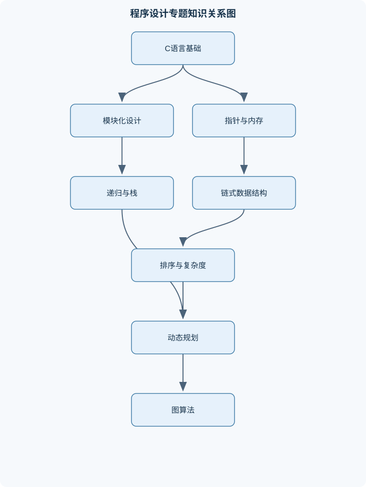
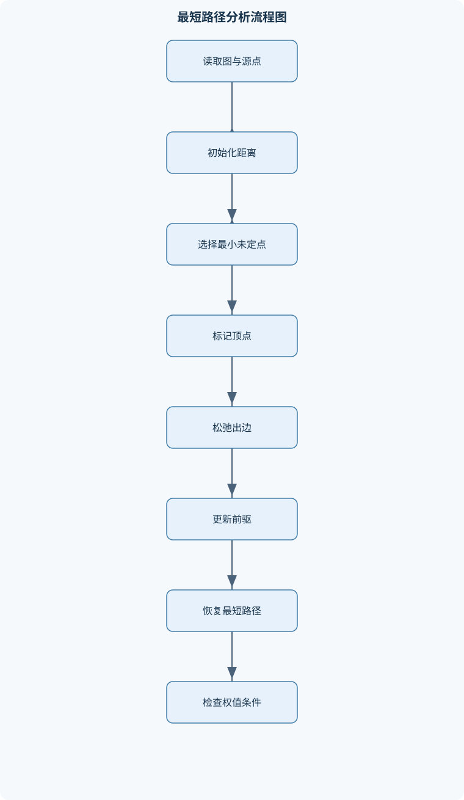

# 程序设计专题

## 一、课程整体知识框架

### 课程边界与先修知识

本课程面向已掌握一种命令式编程语言基础的学习者，重点研究以C语言为代表的程序设计专题：模块化设计、指针与动态内存、递归、链式数据结构、栈与队列、排序与查找、复杂度分析、动态规划、图算法以及事件驱动程序。先修知识包括变量与类型、表达式、顺序分支循环、函数、数组、字符串、结构体、基本输入输出和编译链接流程。课程边界止于能够独立设计、实现、分析和调试中小规模算法程序，不系统覆盖操作系统内核、网络协议实现、编译器构造、面向对象设计和大型软件工程管理。





### 1. 课程定位、先修条件与统一表示

《程序设计专题》面向已经掌握一种命令式语言基本语法的学习者。学习者应理解变量与类型、表达式、顺序执行、分支、循环、函数、数组、字符串、结构体、基本输入输出，以及从源文件到可执行文件的编译与链接流程。本课程不把语法练习作为终点，而是围绕“如何组织程序、如何表示数据、如何证明算法正确、如何分析资源消耗、如何定位运行错误”展开。

课程的核心对象是中小规模算法程序。典型任务包括：维护动态记录集合、实现排序与查找、处理图上的路径问题、设计状态转移、编写递归或回溯程序，以及将算法组织为能够响应输入事件的交互程序。课程不系统讨论操作系统内核、网络协议实现、编译器构造、面向对象设计和大型软件工程管理，但会涉及资源生命周期、模块接口、错误处理和测试，因为这些内容直接决定一个算法程序能否可靠运行。

统一约定如下：输入规模通常记为 $n$；若图有顶点数和边数，分别记为 $n=|V|$ 和 $m=|E|$。数组 $A[0..n-1]$ 使用从 $0$ 开始的下标，区间 $[l,r)$ 表示包含 $l$ 但不包含 $r$。链表头指针记为 $head$，当前结点记为 $p$，后继指针记为 $p\rightarrow next$，空链表表示为 $head=NULL$。图记为 $G=(V,E)$，边 $(u,v)$ 的权值为 $w(u,v)$，源点到顶点 $v$ 的当前距离估计为 $d[v]$。复杂度中的 $O(g(n))$ 是渐近上界，$\Theta(g(n))$ 表示同阶增长，二者都不能直接等同于实际运行秒数。

### 2. C 程序组织与模块化设计

C 程序从源文件到可执行文件通常经历预处理、编译、汇编和链接。预处理阶段展开 `#include` 和宏；编译阶段检查语法和类型并生成目标代码；链接阶段解析跨源文件的函数和对象引用。编译通过不代表程序正确，链接成功也不代表没有越界、泄漏或逻辑错误。

函数声明描述函数名、返回类型和参数类型，函数定义提供具体实现。头文件适合放置对外可见的类型定义、常量、函数声明和接口说明，源文件适合放置函数定义及仅供本文件使用的辅助对象。使用 `static` 修饰文件级函数或变量，可把其链接可见性限制在当前源文件；使用 `static` 修饰局部变量，则使其具有静态存储期，在多次函数调用之间保留值。作用域回答“名字在哪里可见”，存储期回答“对象何时存在”，二者不能混为一谈。

C 的普通参数传递是值传递。调用函数时，形参得到实参值的副本，函数内部直接修改形参不会改变调用者变量。若希望函数修改调用者对象，应传入对象地址。例如交换两个整数需要传递 `int *`；若函数还要修改调用者持有的指针本身，则需要传入二级指针 `T **`。所谓“指针传递”本质上仍是传递指针值的副本，只是这份副本指向了调用者对象。

```c
#include <stdio.h>
#include <stdlib.h>

typedef struct Node {
    int data;
    struct Node *next;
} Node;

static Node *create_node(int value) {
    Node *p = malloc(sizeof *p);
    if (p == NULL) {
        return NULL;
    }
    p->data = value;
    p->next = NULL;
    return p;
}

void push_front(Node **head, int value) {
    Node *node = create_node(value);
    if (node == NULL) {
        return;                 /* 实际接口也可改为返回错误码 */
    }
    node->next = *head;
    *head = node;
}

void destroy_list(Node **head) {
    Node *p = *head;
    while (p != NULL) {
        Node *next = p->next;
        free(p);
        p = next;
    }
    *head = NULL;
}

int main(void) {
    Node *head = NULL;
    push_front(&head, 20);
    push_front(&head, 10);

    for (Node *p = head; p != NULL; p = p->next) {
        printf("%d\n", p->data);
    }

    destroy_list(&head);
    return 0;
}
```

上例中，`push_front` 接收 `Node **`，因为它需要改变调用者的 `head`。`destroy_list` 在释放全部结点后把调用者的头指针置为 `NULL`，避免调用者继续使用已经释放的地址。宏定义适合简单的文本替换或编译条件控制，但宏没有普通函数的类型检查和作用域保护；`typedef` 只建立类型别名，不进行文本替换。例如 `#define PTR char *` 在多个声明中可能产生与预期不同的指针层级，而 `typedef char *CharPtr;` 后，`CharPtr a, b;` 中 `a` 和 `b` 都是字符指针。

函数指针把函数地址作为数据传递，可用于回调、比较器和事件处理器。函数指针的返回类型、参数个数和参数类型必须匹配。排序器可以接收比较函数，事件系统可以保存键盘回调和定时器回调。错误的强制类型转换不能保证调用安全，尤其不能修复调用约定或参数布局不一致的问题。

### 3. 指针、结构体与动态内存

指针类型包含所指对象的类型信息。对 `int *p` 解引用得到一个 `int` 左值，`p + 1` 前进的不是一个字节，而是前进 `sizeof(int)` 个字节。只有同一数组对象内，或指向数组末尾后一位置的指针，才允许进行有意义的比较和减法；不能把任意两个独立分配对象的地址当作同一数组中的元素进行指针运算。

数组名在多数表达式中会转换为首元素地址，但数组本身不是可重新赋值的指针。`A[i]` 与 `*(A+i)` 等价的前提是 `i` 在合法下标范围内；对数组末尾后一位置只能形成指针，不能解引用。结构体指针使用 `p->field` 访问成员，等价于 `(*p).field`，但要求 `p` 指向有效的结构体对象。

自引用结构体只能通过指针成员引用自身类型，因为结构体对象的大小必须在定义时确定。`struct Node { int data; struct Node *next; };` 中 `next` 的大小固定，而若直接写成 `struct Node next;`，结构体会无限嵌套，大小无法确定。动态对象由 `malloc` 申请、由 `free` 释放。申请字节数应使用 `sizeof *p` 等与指针目标类型绑定的写法，并检查返回值是否为 `NULL`。

动态内存的主要错误包括：越界访问、释放栈变量、重复释放、释放后继续访问、内存泄漏和错误的释放配对。`NULL` 表示当前没有有效对象地址，不能解引用。悬空指针是指向已经释放对象的旧地址；释放后应将仍可能使用的指针置为 `NULL`，但置空只能降低再次使用的风险，不能修复其他别名仍指向旧对象的问题。

### 4. 递归、栈与程序状态

递归函数必须具备基例、规模严格缩小的递归调用，以及将子问题结果正确组合的返回逻辑。若基例缺失、递归参数不变或某条路径无法到达基例，就可能无限递归并耗尽调用栈。每次函数调用通常产生一个调用帧，保存参数、局部变量、返回位置等信息；因此递归深度为 $h$ 时，调用栈辅助空间通常为 $O(h)$。

递归运行时间可写成递归式。若问题分成 $a$ 个规模约为 $n/b$ 的子问题，递归外工作量为 $f(n)$，则

$$
T(n)=aT(n/b)+f(n).
$$

例如归并排序满足

$$
T(n)=2T(n/2)+\Theta(n),
$$

每层合并成本为 $\Theta(n)$，递归层数为 $\Theta(\log n)$，所以总时间为 $\Theta(n\log n)$。递归斐波那契满足

$$
T(n)=T(n-1)+T(n-2)+\Theta(1),
$$

由于同一子问题被反复计算，时间呈指数级增长；记忆化后每个状态只计算一次，时间和辅助空间通常为 $\Theta(n)$，若只保留相邻两个状态，空间可降为 $\Theta(1)$。

尾递归的递归调用是函数返回前的最后动作，在某些编译器和语言实现中可进行尾调用优化，但 C 程序不能假定所有编译环境都会消除调用帧。可将简单尾递归改写为循环；不能直接改写的非尾递归，常需使用显式栈保存“下一步要做什么”。回溯是递归搜索的一种形式：做出选择、递归探索、返回时撤销选择。撤销必须完整恢复进入当前层之前的状态，否则后续分支会受到污染。

### 5. 线性链式数据结构

数组的元素连续存储，按下标访问为 $\Theta(1)$；但在中间位置插入或删除，通常需要移动约 $\Theta(n)$ 个元素。单向链表的结点可以分散在动态存储区，按位置访问需要从头逐结点遍历，时间为 $\Theta(n)$；已知插入位置前驱结点时，修改链接本身可为 $\Theta(1)$，但寻找前驱仍可能需要 $\Theta(n)$。

单向链表的空表满足 `head == NULL`。头插法令新结点先指向旧头，再令 `head` 指向新结点；尾插法需要维护尾指针或遍历到表尾。有序插入时保持关键字升序：若空表或新关键字小于头结点关键字，直接插入头部；否则令 `p` 遍历，使待插入位置的前驱确定，再执行：

```c
node->next = p->next;
p->next = node;
```

删除时不能先释放再读取后继。若 `q = p->next` 是待删结点，应先保存必要关系，令 `p->next = q->next`，最后 `free(q)`。头结点删除要单独处理，因为没有前驱。双向链表增加 `prev` 指针，便于反向遍历和已知结点删除，但每次插入删除需要维护更多链接。循环链表的尾结点后继指向头结点，遍历必须使用回到起点作为终止条件，不能等待 `NULL`。

### 6. 栈、队列与抽象数据类型

栈遵循后进先出，核心操作是 `push`、`pop` 和查看栈顶；队列遵循先进先出，核心操作是入队、出队和查看队首。抽象数据类型只规定操作语义、输入输出和错误条件，不规定必须使用数组还是链表。接口设计应明确空结构上的操作、容量限制、所有权和释放责任。

数组栈可用 `top` 表示下一个空位置，空栈条件为 `top==0`，栈顶元素位置为 `top-1`。数组队列若每次出队都移动元素，会产生不必要的线性开销；循环队列通过取模让数组首尾相接。若使用一个空槽区分空与满，容量为 `C` 时可规定空条件 `front==rear`，满条件 `(rear+1)%C==front`，实际可存放 `C-1` 个元素。也可额外维护元素计数，但判空判满规则必须与实现一致。

链表队列通常同时维护 `front` 和 `rear`。空队列时二者都为 `NULL`；删除最后一个结点后必须把 `rear` 也置为 `NULL`。括号匹配的栈不变量是：栈中保存已扫描部分尚未匹配的左括号，并保持其出现顺序。遇到右括号时，栈为空或栈顶类型不匹配都应立即失败。中缀表达式求值还需处理运算符优先级、结合性、括号、除零和非法字符，不能只依赖栈的先进后出性质。

### 7. 复杂度分析与基础排序

复杂度分析先确定输入规模，再统计基本操作随规模增长的次数。两个各执行约 $n$ 次的嵌套循环通常产生 $\Theta(n^2)$ 次操作；若循环变量每次减半或翻倍，迭代次数通常为 $\Theta(\log n)$。对于不同维度，不能把顶点数、边数和容量混为一个变量，例如图算法常用 $n$ 和 $m$，背包算法则使用物品数 $n$ 和容量 $W$。

稳定排序保持相等关键字的原相对顺序；原地排序强调辅助空间通常为 $O(1)$，二者互不等价。插入排序在逆序输入上的时间为 $\Theta(n^2)$，在接近有序的小规模数据上可能较有效；选择排序通常为 $\Theta(n^2)$，交换次数较少但默认实现不稳定。归并排序稳定，时间为 $\Theta(n\log n)$，通常需要 $\Theta(n)$ 辅助数组。

快速排序围绕基准元分区。若每次划分近似均衡，递归式接近 $T(n)=2T(n/2)+\Theta(n)$；若每次一边为空，递归式接近 $T(n)=T(n-1)+\Theta(n)$，退化为 $\Theta(n^2)$。固定选择首元素面对已排序输入容易退化；随机基准或三路分区可降低特定输入的风险，但不能把最坏情况自动变成 $\Theta(n\log n)$。

堆排序先建立大根堆。完全二叉树高度为 $\Theta(\log n)$，单次向上或向下调整最多经过该高度，因此插入和删除堆顶为 $O(\log n)$，取堆顶为 $O(1)$。自底向上建堆为 $O(n)$，不是把 $n$ 个元素逐个插入而得到的 $O(n\log n)$。堆排序额外空间可为 $O(1)$，但通常不稳定。

### 8. 查找、哈希与高级线性结构

顺序查找逐项比较，最坏时间为 $O(n)$。二分查找要求数组已经按与比较规则一致的顺序排列，并维护半开区间 $[l,r)$。典型不变量是：若目标存在，它始终位于当前区间内；每次取 $mid=l+(r-l)/2$，根据比较结果保留左半或右半，直到 $l==r$。若把闭区间和半开区间混用，容易漏查、越界或死循环。

哈希表通过哈希函数把关键字映射到槽位。不同关键字映射到同一槽位称为冲突。开放定址法在表内继续探测空槽，删除时不能简单清空槽位，否则可能截断后续探测链，通常需要墓碑标记；链地址法在每个槽位挂接链表，删除逻辑较直接。装载因子过高会增加冲突和探测长度，哈希函数应尽量均匀，但哈希表的平均常数时间不等于所有输入下的最坏常数时间。

优先队列支持插入、查看最小或最大元素、删除堆顶。二叉堆用数组表示完全二叉树，若下标从 $0$ 开始，结点 $i$ 的左子结点为 $2i+1$，右子结点为 $2i+2$，前提是下标未超出有效堆区间。线段树把数组区间组织成树，结点区间采用半开形式 $[l,r)$，中点为 $m=\lfloor(l+r)/2\rfloor$，子区间为 $[l,m)$ 和 $[m,r)$。建树为 $O(n)$，区间查询和单点更新为 $O(\log n)$，标准空间为 $O(n)$。区间批量修改若没有懒惰传播，可能退化为 $O(n)$；懒标记必须在访问子结点前正确下推。

### 9. 动态规划与回溯算法

动态规划适用于具有最优子结构和无后效性的问题。最优子结构表示整体最优解可以由子问题最优解组合得到；无后效性表示一旦状态完整描述了过去对未来的影响，未来决策不必重新知道更早的具体路径。设计动态规划必须依次说明状态含义、初值、转移方向、不可达状态表示和最终答案位置。

自顶向下记忆化从目标状态递归，首次计算后保存结果；自底向上填表按照依赖关系排列状态。若状态总数为 $S$，每个状态枚举 $k$ 种选择，填表时间通常为 $O(Sk)$。滚动数组只能保留仍会被使用的前驱层；例如 0-1 背包的一维转移必须让容量从大到小遍历，否则当前物品刚写入的值会在同一轮被再次使用，错误地变成完全背包。

0-1 背包定义 $dp[i][c]$ 为前 $i$ 件物品、容量不超过 $c$ 时的最大价值，转移为

$$
dp[i][c]=\max\bigl(dp[i-1][c],\ dp[i-1][c-w_i]+v_i\bigr),
$$

其中第二项只在 $c\ge w_i$ 时有效。最长公共子序列、编辑距离等问题也依赖对前缀或前缀对的明确状态定义。回溯适合枚举排列、组合和满足约束的完整解；每层选择一个候选，递归返回时撤销选择。排列的最坏搜索规模通常为 $O(n!)$，剪枝能减少实际搜索节点，但不必然改变最坏上界。

### 10. 图的表示与图算法

图 $G=(V,E)$ 可以是有向图或无向图，可以带权或不带权。邻接矩阵空间为 $O(n^2)$，判断两点是否直接相邻为 $O(1)$，适合顶点较少或边较密的图；邻接表空间为 $O(n+m)$，遍历某顶点所有出边的成本与其度数相关，适合稀疏图。

深度优先搜索使用递归栈或显式栈，常用于连通性、环检测和拓扑相关处理；广度优先搜索使用队列，按距离层次扩展，在无权图中可求源点到各顶点的最少边数。若需要恢复路径，应为每个首次发现的顶点记录 `parent`，从目标沿前驱反向走回源点，再逆序输出。拓扑排序只适用于有向无环图，可用入度法或深度优先搜索完成；若处理结束仍有顶点未输出，说明存在有向环。

Dijkstra 算法要求所有边权非负。初始化 $d[s]=0$，其他距离为 $INF$；反复选择未确定顶点中 $d[v]$ 最小者，对边 $(v,to)$ 执行松弛：

$$
d[to]=\min(d[to],d[v]+w(v,to)).
$$

其正确性来自非负权条件：当前最小的未确定距离不可能通过其他未确定顶点绕行后变得更小，因此可以确定。使用邻接矩阵并线性选择时复杂度为 $O(n^2+m)$；使用邻接表和二叉堆时通常为 $O((n+m)\log n)$。存在负权边时，即使没有负环，Dijkstra 的确定性结论也可能失效，应选用适合负权边的其他方法。

### 11. 程序综合实践与事件驱动设计

命令行程序应验证输入格式、数值范围、数量关系和文件或内存操作结果。错误处理不应只打印消息，还要确定是否继续、返回错误码、释放哪些资源。资源清理应沿所有退出路径执行，尤其要覆盖中途申请失败和非法输入分支。

数据结构模块应通过接口测试验证空结构、单元素、边界容量、重复关键字、删除头尾和连续删除等情况。图形程序需要建立坐标模型，明确原点、坐标方向、缩放关系和窗口边界。键盘事件、鼠标事件和定时器事件通常以回调形式发生，回调函数读取或修改共享状态，再请求重绘。状态机式组织将程序状态划分为菜单、运行、暂停、结束等离散状态，并为每种事件规定允许的状态转移。

递归分形绘图把几何状态和算法状态分开：递归参数描述阶数、枝长和方向，绘图接口只负责根据坐标绘制线段。每次递归都必须缩短规模，例如枝长乘以小于 $1$ 的比例，并在阶数达到基例时终止。事件循环不应直接承担复杂算法，否则可能造成界面阻塞；应将计算状态、显示状态和事件处理职责分离。

## 二、章节和模块划分

### 核心知识覆盖清单

本清单用于检查正文是否覆盖本课程的主要知识模块：

- **C程序组织与模块化设计**：编译、链接与执行流程、函数声明与函数定义、值传递与指针传递、局部变量与全局变量、静态存储期与作用域、头文件与源文件职责、宏定义与typedef、回调函数与函数指针。
- **指针、结构体与动态内存**：指针的类型与解引用、数组与指针的关系、指针运算的边界、结构体成员访问、自引用结构体定义、malloc与free的配对、空指针与悬空指针、内存泄漏与越界访问。
- **递归、栈与程序状态**：递归函数的基例、递归调用的规模缩小、递归调用栈模型、递归树与重复子问题、尾递归与非尾递归、递归转迭代、显式栈模拟递归、回溯搜索与状态撤销。
- **线性链式数据结构**：数组与链表的存取差异、单向链表结点结构、头指针与空链表、头插法与尾插法、有序链表插入、结点删除与内存释放、链表遍历与原地重排、双向链表与循环链表。
- **栈、队列与抽象数据类型**：栈的后进先出语义、队列的先进先出语义、数组实现栈与队列、链表实现队列、循环队列的判空判满、括号匹配、表达式求值、抽象数据类型接口设计。
- **复杂度分析与基础排序**：操作次数与输入规模、大O、Ω与Θ记号、循环嵌套的复杂度、递归式的建立、稳定排序与原地排序、插入排序与选择排序、归并排序、快速排序与基准元、堆排序与堆结构。
- **查找、哈希与高级线性结构**：顺序查找与二分查找、二分查找的循环不变量、哈希函数与冲突、开放定址法、链地址法、优先队列与二叉堆、线段树区间查询、线段树单点更新与懒惰传播。
- **动态规划与回溯算法**：最优子结构、无后效性、状态定义与状态转移、自顶向下记忆化、自底向上填表、滚动数组优化、背包问题、最长公共子序列、编辑距离、排列组合回溯。
- **图的表示与图算法**：有向图与无向图、邻接矩阵与邻接表、深度优先搜索、广度优先搜索、连通性与路径恢复、拓扑排序、带权图最短路径、Dijkstra算法的松弛操作、负权边的适用边界。
- **程序综合实践与事件驱动设计**：命令行程序的输入验证、数据结构模块的接口测试、错误处理与资源清理、图形绘制的坐标模型、键盘事件回调、定时器事件回调、状态机式程序组织、递归分形图形、编译调试与复杂度实验。


### 1. 代表性算法与流程一：有序单向链表插入和删除

**输入**：按关键字升序排列的链表头指针 $head$、新结点 `node` 或待删除关键字 `key`。  
**输出**：更新后的头指针和操作成功与否。  
**过程**：先判断空表和头结点情况；插入时寻找前驱，删除时寻找待删结点的前驱。插入前保存原后继，删除前保存待删结点及其后继。  
**不变量**：遍历到当前位置前，已检查部分保持升序；删除操作尚未改变未检查部分。  
**终止条件**：到达表尾或找到目标位置。  
**复杂度**：寻找位置最多访问 $n$ 个结点，时间为 $O(n)$，额外空间为 $O(1)$。  
**适用边界**：结点必须由动态内存分配，不能释放栈上对象；关键字相等时必须预先规定插入在相等元素之前还是之后。

删除的安全顺序是：若待删结点为 `q`，先令前驱的 `next` 指向 `q->next`，再执行 `free(q)`。如果先释放 `q`，再读取 `q->next`，就是释放后访问，行为未定义。若删除头结点，应保存旧头、移动 `head`，最后释放旧头；若目标不存在，则不应修改链表。

### 2. 代表性算法与流程二：归并排序、快速排序与堆排序比较

归并排序在区间 $[l,r)$ 长度不超过 $1$ 时结束；否则取中点，将左右区间分别排序，再用两个游标合并。合并时始终选择两个未输出首元素中较小者；若相等时先取左侧元素，则可保持稳定性。每层总合并量为 $\Theta(n)$，共有 $\Theta(\log n)$ 层，因此时间为 $\Theta(n\log n)$，辅助空间通常为 $O(n)$。

快速排序先选择基准元并分区，再递归处理子区间。分区循环的不变量是：已处理区域左侧元素不大于基准，右侧元素不小于基准，具体严格或非严格关系取决于实现。平衡分区时为 $O(n\log n)$，连续不平衡时为 $O(n^2)$。有大量重复关键字时，二路分区可能反复处理等值元素，三路分区可把元素分成小于、等于、大于三段。

堆排序建立大根堆后反复将堆顶交换到有效区间末尾，再对缩小后的堆执行向下调整。有效堆区间始终满足父结点不小于子结点，已移出区间已经升序排列。建堆为 $O(n)$，总排序为 $O(n\log n)$，额外空间为 $O(1)$，但不稳定。

### 3. 代表性算法与流程三：Dijkstra 最短路径与路径恢复

**输入**：非负权有向图或无向图 $G=(V,E)$，源点 $s$。  
**输出**：每个可达顶点的最短距离 $d[v]$ 及前驱数组 `parent`。  
**过程**：

1. 设置 $d[s]=0$，其他顶点为 $INF$，所有顶点均未确定。
2. 从未确定顶点中选取 $d$ 最小的顶点 $v$。
3. 若最小值为 $INF$，剩余顶点均不可达，终止。
4. 标记 $v$ 已确定，对每条出边 $(v,to)$ 执行松弛。
5. 若 $d[v]+w(v,to)<d[to]$，则更新 $d[to]$ 和 `parent[to]=v`。
6. 重复直到没有未确定顶点或剩余顶点不可达。

不变量是：每次选出的顶点，其 $d$ 值已经等于源点到该顶点的最短距离。若存在负权边，该不变量不成立。路径恢复时，从目标顶点沿 `parent` 反向走到源点，再将顶点序列反转；若目标的距离仍为 $INF$，应报告不可达而不是输出一条空路径。

### 4. 代表性算法与流程四：动态规划解决 0-1 背包

设有 $n$ 件物品，第 $i$ 件重量为 $w_i$、价值为 $v_i$，背包容量为 $W$。定义 $dp[i][c]$ 为只考虑前 $i$ 件物品、容量不超过 $c$ 时的最大价值。第 $i$ 件物品只有“不选”和“选取”两种情况，因此：

$$
dp[i][c]=
\begin{cases}
dp[i-1][c], & c<w_i,\\
\max\{dp[i-1][c],dp[i-1][c-w_i]+v_i\}, & c\ge w_i.
\end{cases}
$$

初值为 $dp[0][c]=0$，因为没有物品时最大价值为零。若使用一维数组 `dp[c]`，处理每件物品时必须令 $c$ 从 $W$ 递减到 $w_i$，以保证右侧的 `dp[c-w_i]` 仍属于上一件物品的状态。若从小到大更新，同一件物品可能被重复选取，算法就变成了另一种问题。

### 5. 例题一：判断链表插入后的指针关系

**题干**：链表为 `10 -> 20 -> 40 -> NULL`，新结点关键字为 `30`。说明插入过程并给出结果。

**分析**：新关键字不小于头结点关键字，因此不能改变 `head`。从头开始寻找第一个后继关键字不小于 `30` 的前驱，找到关键字为 `20` 的结点。

**逐步解答**：

1. `p` 指向 `10`，其后继关键字为 `20`，仍小于 `30`，继续前进。
2. `p` 指向 `20`，其后继关键字为 `40`，已经不小于 `30`。
3. 令 `node->next = p->next`，即新结点指向 `40`。
4. 令 `p->next = node`，即 `20` 指向新结点。

**结果验证**：从 `head` 遍历得到 `10 -> 20 -> 30 -> 40 -> NULL`，关键字仍按升序排列。

**变式**：若新关键字为 `5`，应插入头部；若为 `50`，应插入尾部；若为 `20`，必须根据规格决定插在已有 `20` 之前还是之后。

### 6. 例题二：分析递归斐波那契的重复计算

**题干**：递归定义 $F(0)=0$、$F(1)=1$、$F(n)=F(n-1)+F(n-2)$。说明计算 $F(5)$ 时哪些子问题重复出现，并比较记忆化前后复杂度。

**分析**：展开 $F(5)$ 会产生 $F(4)$ 和 $F(3)$；而计算 $F(4)$ 又会产生 $F(3)$，因此 $F(3)$ 被重复计算，进一步导致更小的状态多次出现。

**逐步解答**：

1. 不使用缓存时，每次遇到相同参数都重新递归。
2. 调用数量满足 $T(n)=T(n-1)+T(n-2)+\Theta(1)$，呈指数级增长。
3. 记忆化数组记录已经得到的 $F(k)$。
4. 每个 $k\in[0,n]$ 至多计算一次，每次计算只进行常数次查表和加法。
5. 时间降为 $\Theta(n)$，缓存空间为 $\Theta(n)$。
6. 若只需要最终数值，可使用两个滚动变量，辅助空间降为 $\Theta(1)$。

**结果验证**：$F(5)=5$。滚动变量依次保存 $(F(0),F(1))$、$(F(1),F(2))$，直到得到 $(F(4),F(5))$。

**变式**：若要求恢复完整递归路径，不能只保留两个数；若使用固定宽度整数，还必须考虑整数溢出边界。

### 7. 例题三：括号匹配

**题干**：判断字符串 `{[()]}`、`{[(])}` 和 `((` 是否匹配。

**分析**：栈保存尚未匹配的左括号。遇到右括号时，必须与栈顶左括号类型对应。

**逐步解答**：

- `{[()]}`：依次压入 `{`、`[`、`(`；遇到 `)` 与栈顶 `(` 匹配并出栈；随后 `]` 匹配 `[`；最后 `}` 匹配 `{`，扫描结束栈为空，匹配成功。
- `{[(])}`：遇到 `]` 时栈顶为 `(`，类型不匹配，立即失败。
- `((`：扫描结束时栈中仍有两个左括号，说明存在未闭合括号，失败。

**结果验证**：只有 `{[()]}` 返回真。

**变式**：若字符串包含引号中的括号，必须先规定是否忽略引号内容；若只处理圆括号，则其他括号应被视为普通字符或非法输入，不能默认为可匹配。

### 8. 例题四：Dijkstra 路径恢复

**题干**：有向边为 $A\to B$ 权值 $4$、$A\to C$ 权值 $1$、$C\to B$ 权值 $2$、$B\to D$ 权值 $1$、$C\to D$ 权值 $7$，源点为 $A$。求到 $D$ 的最短路径。

**分析**：初始化 $d[A]=0$，其余为 $INF$。

**逐步解答**：

1. 确定 $A$：更新 $d[B]=4$、$d[C]=1$。
2. 选择未确定中最小的 $C$：通过 $C\to B$ 得到 $1+2=3$，更新 $d[B]=3$；通过 $C\to D$ 得到 $8$，暂记 $d[D]=8$。
3. 选择 $B$：通过 $B\to D$ 得到 $3+1=4$，更新 $d[D]=4$。
4. 选择 $D$：没有更短的后继路径。
5. 前驱关系为 `parent[C]=A`、`parent[B]=C`、`parent[D]=B`。
6. 从 $D$ 反向追踪得到 $D\to B\to C\to A$，反转后为 $A\to C\to B\to D$。

**结果验证**：路径长度为 $1+2+1=4$，小于直接经过 $A\to B\to D$ 的 $5$，也小于 $A\to C\to D$ 的 $8$。

**变式**：若加入边 $D\to A$ 权值为负数，不能继续使用 Dijkstra；若某条边权为负但图无负环，也不能仅凭“没有负环”保证 Dijkstra 正确。

### 9. 例题五：0-1 背包的一维转移

**题干**：物品重量和价值分别为 $(2,3)$、$(3,4)$、$(4,5)$，容量 $W=5$。求最大价值。

**分析**：可行组合为单独选择任一物品，或选择前两件。前两件总重量 $5$、价值 $7$；第一件和第三件重量 $6$ 超限，第二件和第三件重量 $7$ 超限。

**逐步解答**：

1. 初始 `dp[0..5]` 全为 $0$。
2. 处理 $(2,3)$：容量 $2$ 至 $5$ 的最优值更新为 $3$。
3. 处理 $(3,4)$：容量从 $5$ 逆序更新。容量 $5$ 可由容量 $2$ 加当前物品得到 $3+4=7$，因此 `dp[5]=7`。
4. 处理 $(4,5)$：容量 $5$ 可比较原值 $7$ 与容量 $1$加 $5$，仍为 $7$。
5. 最终答案为 `dp[5]=7`。

**结果验证**：选择重量为 $2$ 和 $3$ 的两件物品，恰好占满容量，价值为 $3+4=7$。

**变式**：若容量循环从小到大，处理第一件物品时可能先得到 `dp[2]=3`，再用它更新 `dp[4]=6`，这相当于重复选同一件物品，违反 0-1 约束。

### 10. 实验一：链表模块接口与内存安全实验

**输入数据**：按学号升序的记录序列，例如 `(1001,80)`、`(1003,75)`、`(1008,92)`；操作序列包括插入 `(1005,88)`、修改 `1003` 的成绩、删除 `1001`、查找不存在的 `1010`、释放全部结点。

**实验步骤**：

1. 定义结点结构和接口：创建、插入、修改、删除、遍历、销毁。
2. 分别测试空表、单结点、多结点和重复学号。
3. 每次操作后输出结点顺序，必要时打印结点地址和 `next` 地址。
4. 对删除头部、中间和尾部进行单独测试。
5. 使用内存检查工具或调试器观察越界、泄漏、重复释放和释放后访问。
6. 在所有操作完成后调用销毁函数，并确认 `head==NULL`。

**评价标准**：顺序始终满足学号升序；修改不改变结点链接；删除后目标不存在；不存在的目标不会破坏链表；所有成功申请的结点最终恰好释放一次；失败申请不会解引用空指针。

**排错方法**：若遍历无限循环，检查是否错误形成环；若删除后崩溃，检查是否释放后仍访问成员；若最后仍有泄漏，统计每次 `malloc` 与 `free` 的数量，并沿所有错误返回路径检查清理逻辑。

### 11. 实验二：排序、查找与复杂度对比实验

**输入数据**：构造四类长度逐步增大的数组：随机数组、已排序数组、逆序数组和包含大量重复值的数组。数组下标统一使用 $[0,n)$。

**实验步骤**：

1. 实现插入排序、归并排序、快速排序和堆排序。
2. 对每种输入分别记录比较次数、移动或交换次数、递归深度和辅助空间。
3. 快速排序分别采用固定首元素、随机基准和三路分区。
4. 对已排序数组执行顺序查找和二分查找，并验证二分查找的区间不变量。
5. 将实验结果与理论结论比较：插入排序可能出现 $\Theta(n^2)$，归并排序保持 $\Theta(n\log n)$，快速排序可能退化到 $\Theta(n^2)$，堆排序保持 $O(n\log n)$。
6. 检查排序结果是否有序，并用带记录编号的相等关键字测试稳定性。

**评价标准**：所有算法输出非降序数组；比较次数统计口径一致；快速排序在重复值输入上不出现异常深度递归；归并排序的稳定性符合实现；实验结论区分理论上界、实际常数和输入分布。

**排错方法**：若二分查找死循环，检查 `l`、`r` 更新是否使区间严格缩小；若快速排序栈溢出，检查分区是否保证递归区间变小以及是否处理大量重复值；若归并结果丢失元素，检查两个游标的边界和剩余元素复制；若堆排序局部无序，检查父子下标计算和有效堆区间边界。

### 12. 综合项目：事件驱动的递归分形绘图

**输入数据**：初始坐标、初始枝长、递归阶数、分支角度和缩短比例。  
**步骤**：

1. 将图形状态定义为当前位置、方向、枝长和递归阶数。
2. 递归绘制当前线段；若阶数为零则返回。
3. 计算左右分支的新坐标和方向，按缩短比例更新枝长。
4. 通过键盘事件增加或减少阶数、改变角度或暂停绘制。
5. 通过定时器逐步增加绘制状态，回调函数只修改状态并请求重绘。
6. 检查窗口边界、非法阶数和过小枝长，避免无限递归或无意义绘制。

**评价标准**：每次递归阶数严格减少；状态更新与重绘顺序一致；键盘和定时器事件不会破坏共享状态；程序在非法输入下保持可恢复；绘制复杂度随分支数增长的趋势能够解释。

**排错方法**：若出现残影，检查重绘前是否清理画布；若图形闪烁，检查是否在多个回调中重复刷新；若事件后状态错乱，检查回调是否修改了未同步的全局变量；若递归过深，限制最大阶数并验证基例和枝长终止条件。

## 三、核心概念的详细解释

### 1. 程序组织、模块化与接口

C 程序通常经历预处理、编译、汇编和链接。预处理展开头文件和宏；编译把每个源文件转换为目标代码并进行语法、类型检查；链接解析跨源文件的函数和对象引用；执行阶段才真正运行程序。编译成功只说明当前阶段发现的错误未出现，不能排除数组越界、空指针解引用、内存泄漏和算法错误。

头文件应声明模块对外提供的类型、常量和函数接口，源文件负责实现。若一个辅助函数或文件级对象只在当前源文件使用，可用 `static` 限制其链接可见性。函数声明中的返回类型、参数数量和参数类型必须与定义一致。宏是预处理阶段的文本替换，不遵守类型检查和作用域规则；例如 `#define SQUARE(x) x * x` 在传入表达式时可能产生优先级错误，因此宏参数和整体结果通常都应加括号。`typedef` 则为已有类型建立别名，会参与编译器的类型分析。

C 的参数传递本质上是值传递。传入整数时，函数得到整数副本；传入指针时，函数得到地址副本，但该地址仍指向调用者对象，因此可以通过解引用修改对象。若需要让函数修改调用者的指针变量，例如在链表头部插入结点，应传入二级指针 `Node **`，或者让函数返回更新后的头指针。回调函数通过函数指针传递行为，函数指针的返回类型、参数列表和调用方式必须匹配，不能依靠错误的强制类型转换“修复”不兼容调用。

局部自动变量通常在函数调用期间存在；文件级变量和用 `static` 修饰的局部变量具有静态存储期。作用域描述名字可见的源代码范围，存储期描述对象存在的时间，二者是不同概念。全局变量能够被多个函数共享状态，但会增加隐式依赖；模块接口优先通过参数和返回值传递数据，只有确有必要时才使用共享状态。

### 2. 指针、结构体与动态内存

指针对象保存某种类型对象的地址。若 `int *p` 指向一个整数，则 `*p` 表示该整数本身，`p + 1` 表示向后移动一个 `int` 对象的距离，而不是只移动一个字节。指针运算只有在同一数组对象及其尾后位置范围内才有明确定义；不能通过指针运算任意穿越不相关对象。`NULL` 表示不指向有效对象，解引用空指针属于未定义行为。

数组名在多数表达式中会转换为首元素地址，但数组本身不是可修改的指针变量。`A[i]` 与 `*(A+i)` 等价，前提是 $0\le i<n$。数组按下标访问为 $\Theta(1)$，因为地址可由首地址和元素大小直接计算；中间插入或删除通常要移动后续元素，时间为 $\Theta(n)$。

结构体把多个字段组织成一个对象。访问结构体对象成员使用 `.`, 访问结构体指针所指对象成员使用 `->`。自引用结构体不能直接包含自身对象，否则对象大小会无限递归；可以包含指向自身类型的指针：

```c
typedef struct Node {
    int data;
    struct Node *next;
} Node;
```

`malloc` 从动态存储区申请一段连续空间，返回值必须检查是否为 `NULL`。申请对象后应按实际类型初始化；释放时必须释放动态分配得到的地址，不能释放栈变量、全局变量或同一地址两次。释放后原指针仍保存旧地址，称为悬空指针；通常应在释放后将其置为 `NULL`，但这只能保护该指针变量，不能自动修复其他副本。

越界访问可能覆盖相邻对象，也可能暂时“看似正常”，但其行为没有可靠保证。内存泄漏是已无法通过程序有效访问但尚未释放的动态对象。资源清理必须覆盖正常路径、输入错误路径和中途申请失败路径。

### 3. 递归、调用栈与回溯

递归函数必须具备三个条件：存在基例；每次递归调用的规模严格减小；递归结果能够正确返回或合并。缺少基例会导致调用栈不断增长；规模不变或变大也会造成无限递归。一次函数调用通常对应一个栈帧，其中保存形参、局部变量、返回地址和部分临时状态。递归深度为 $h$ 时，调用栈空间至少与 $h$ 同阶。

斐波那契递归满足
$$
T(n)=T(n-1)+T(n-2)+\Theta(1),
$$
因为相同子问题被重复计算，时间呈指数级增长。记忆化把已经计算的状态保存起来，使每个 $f(k)$ 只计算一次，状态数为 $\Theta(n)$。若只需要相邻两个结果，可以用两个变量迭代计算，将辅助空间降为 $\Theta(1)$。尾递归的递归调用位于函数返回前最后一步，理论上可转换为循环；但是否由具体 C 编译器优化不能作为程序正确性的前提。

回溯是递归搜索的一种组织方式。每层选择一个候选，递归深入；返回时撤销选择。状态不变量是当前部分解满足已经检查的约束。排列生成的最坏时间通常为 $O(n!)$，剪枝只能减少实际搜索节点，不能自动改变最坏上界。若递归算法需要显式保存大量局部状态，可以用栈结构模拟调用栈，但必须自行保存“下一步处理位置”和返回后要恢复的状态。

### 4. 链表、栈、队列与抽象数据类型

单向链表由结点和链接组成，`head=NULL` 表示空链表。链表按位置访问需要从头逐结点移动，时间为 $\Theta(n)$；已知待插入位置的前驱结点时，修改有限个指针即可在 $\Theta(1)$ 时间插入。链表适合元素数量变化频繁、插入删除多的场景，但结点额外保存指针，局部性和随机访问性能通常不如数组。

有序链表插入时，先处理空表和插入头部，再寻找第一个不小于新关键字的结点。删除结点时，必须先保存待删结点地址和必要的后继关系，再断开链接，最后 `free`。若先释放结点再读取其成员，便会访问已失效对象。双向链表增加前驱指针，便于反向遍历和已知结点删除，但维护指针的操作更多；循环链表的尾结点指向头部，遍历必须以回到起点为终止条件，不能只判断 `NULL`。

栈遵循后进先出，核心操作是入栈、出栈和查看栈顶；队列遵循先进先出，核心操作是入队和出队。数组栈可用 `top` 表示下一个空位置或当前栈顶，两种约定必须统一。循环队列把数组首尾连接，常见实现保留一个空槽，用 `(rear+1)%capacity == front` 判满，用 `front == rear` 判空；若采用计数器实现，判满规则不同，不能混用。

抽象数据类型只规定可观察行为和接口，不规定内部实现。例如括号匹配只需要栈的入栈、出栈、判空接口。表达式求值通常使用一个操作数栈和一个运算符栈，并按优先级决定何时归约；非法字符、缺少操作数、括号不匹配和除数为零都必须作为输入错误处理。

### 5. 排序、查找、哈希与优先队列

插入排序将当前元素插入前方有序区间，已排序或近乎有序时较高效，但逆序输入为 $\Theta(n^2)$。选择排序每轮选择最小元素放到当前位置，比较次数通常为 $\Theta(n^2)$，交换次数较少。归并排序把区间划分为两个子区间，分别排序后线性合并，满足
$$
T(n)=2T(n/2)+\Theta(n)=\Theta(n\log n).
$$
它通常稳定，但需要 $O(n)$ 辅助空间。

快速排序围绕基准元分区。平衡分区时递归式近似为 $2T(n/2)+\Theta(n)$，时间为 $\Theta(n\log n)$；若每次基准都落在端点，递归式为 $T(n-1)+\Theta(n)$，退化为 $\Theta(n^2)$。大量重复值时，三路分区可将等于基准的元素集中处理。堆排序先建大根堆，再反复交换堆顶与有效区间末尾。堆高为 $\Theta(\log n)$，取堆顶为 $O(1)$，插入和删除堆顶为 $O(\log n)$；堆排序原地但通常不稳定。

顺序查找不要求有序，最坏需要检查全部 $n$ 个元素。二分查找要求数组已按同一比较规则排序，并保持区间不变量。例如在半开区间 $[l,r)$ 中查找目标，循环开始时目标若存在则必在该区间内；取 $mid=l+(r-l)/2$，若 `A[mid]` 小于目标则令 `l=mid+1`，否则令 `r=mid`。每次循环都严格缩小区间，时间为 $O(\log n)$。

哈希表通过哈希函数把关键字映射到槽位。不同关键字映射到同一槽位称为冲突。开放定址法在表内继续探测空槽，删除时不能简单置为空，否则可能截断后续查找链；链地址法在每个槽位挂接链表，删除较直接。实际性能依赖装载因子、哈希分布和冲突策略，不能仅凭平均复杂度保证每次操作都为常数时间。

### 6. 动态规划、图算法与事件驱动程序

动态规划适用于具有最优子结构和无后效性的问题。状态必须明确表示已经处理的范围、剩余资源或当前位置；转移必须说明从哪些更小状态得到当前状态；不可达状态不能随意初始化为零。自顶向下记忆化保留递归表达，自底向上填表按依赖顺序计算。滚动数组只能保留仍会被后续转移访问的层，覆盖顺序错误可能把同一物品重复使用。

图 $G=(V,E)$ 可用邻接矩阵或邻接表表示。矩阵判断边是否存在为 $O(1)$，空间为 $O(n^2)$；邻接表空间为 $O(n+m)$，适合稀疏图。深度优先搜索使用递归或显式栈，适合连通性、环检测和拓扑排序；广度优先搜索使用队列，在无权图中按边数最少的层次扩展，因此可求无权最短路并通过前驱恢复路径。

Dijkstra 算法要求所有边权非负。它维护距离估计 $d[v]$，每次选取未确定顶点中估计值最小者，并对边 $(v,to)$ 执行松弛：
$$
d[to]\leftarrow \min(d[to],d[v]+w(v,to)).
$$
若存在负权边，即使不存在负环，也可能使已经确定的顶点后来获得更短路径，因此不能使用该算法。拓扑排序只适用于有向无环图；有向图存在环时，不存在满足所有边方向约束的线性顺序。

事件驱动程序不按固定的主循环顺序直接完成全部工作，而是等待键盘、鼠标、定时器等事件，再调用对应回调函数。程序状态应明确包含当前数据、界面状态和运行阶段；回调修改状态后请求重绘，绘制函数依据状态显示结果。递归分形绘图中，枝长、方向和阶数是递归状态；阶数必须严格减少，枝长低于阈值时也可以终止。事件回调不能随意销毁仍被其他回调使用的资源，错误输入和窗口关闭路径都必须完成清理。

## 四、重要定义、公式、定理和推导

### 专业审校补充：关键定义与适用边界

拓扑排序的适用边界是：输入必须是有向图；图存在拓扑序当且仅当图无有向环。拓扑序要求对每条边 $u\to v$，顶点 $u$ 在序列中先于 $v$，因此它表达的是偏序约束，而不是最短路径或访问顺序。Kahn 算法维护入度为零的顶点集合：取出一个顶点加入结果，并删除其出边，使相邻顶点入度减一。循环不变量是，已输出顶点满足所有相关前驱约束，尚未输出顶点的入度表示尚未删除的前驱数。若最终输出顶点数为 $|V|$，得到合法拓扑序；若仍有顶点未输出，则图中存在有向环。使用邻接表时，建立入度和处理边的时间复杂度为 $O(|V|+|E|)$，辅助空间为 $O(|V|+|E|)$。该结论不适用于要求处理负权、最短距离或无向边排序的任务；无向图通常应先明确其边的方向和约束含义。


### 1. 复杂度与递归式

设基本操作执行次数为 $C(n)$。若存在常数 $c>0$ 和 $n_0$，使 $C(n)\le c g(n)$ 对所有 $n\ge n_0$ 成立，则记为 $O(g(n))；若同时存在正的上下界常数，则记为 $\Theta(g(n))$。例如两个各执行约 $n$ 次的嵌套循环共有约 $n^2$ 次操作，因此为 $\Theta(n^2)$；若每轮把规模减半，满足 $n/2^k\le1$，得到 $k\ge\log_2n$，所以为 $\Theta(\log n)$。

若算法分成 $a$ 个规模约为 $n/b$ 的子问题，并进行 $f(n)$ 的额外工作，则
$$
T(n)=aT(n/b)+f(n).
$$
归并排序中 $a=2,b=2,f(n)=\Theta(n)$，每层总合并工作为 $\Theta(n)$，递归树高度为 $\Theta(\log n)$，故总时间为 $\Theta(n\log n)$。这个结论要求划分规模近似均衡且合并确实为线性；若快速排序划分为 $0$ 和 $n-1$，就不适用均衡推导。

### 2. 链表操作的指针推导

在已知前驱结点 $p$ 和待删结点 $q=p\rightarrow next$ 时，删除关系必须按以下顺序执行：
$$
q\leftarrow p\rightarrow next,\qquad
p\rightarrow next\leftarrow q\rightarrow next,\qquad
free(q).
$$
第一步保存地址，第二步绕过结点，第三步释放空间。若先执行 `free(q)`，再读取 `q->next`，便访问了生命周期已经结束的对象。若删除头结点，则令 `q=head`，先把 `head` 移到 `q->next`，再释放 `q`。因此删除操作的时间复杂度为 $O(n)$，但在已知前驱时，真正的链接修改和释放为 $O(1)$。

有序插入的循环不变量是：循环开始时，已检查部分保持升序，且插入位置不在已经跳过的结点之前。当 `p->next == NULL` 或 `p->next` 的关键字不小于新关键字时，令
`node->next = p->next`、`p->next = node`，局部顺序成立；原有其他结点顺序未改变，因而整体仍有序。若新关键字小于头结点，必须更新 `head`，否则会错误地把新结点插入头部之后。

### 3. 代表性算法与可执行实现

#### 有序链表插入

输入是升序链表头指针 `head` 和已初始化的新结点 `node`，输出更新后的头指针。假定关键字可比较，且 `node` 尚未连接到其他链表。

```c
Node *insert_sorted(Node *head, Node *node) {
    if (node == NULL) {
        return head;
    }
    if (head == NULL || node->data < head->data) {
        node->next = head;
        return node;
    }

    Node *p = head;
    while (p->next != NULL && p->next->data < node->data) {
        p = p->next;
    }
    node->next = p->next;
    p->next = node;
    return head;
}
```

循环结束时，`p` 是插入位置的前驱。算法时间复杂度为 $O(n)$，额外空间为 $O(1)$。若要求重复关键字插在已有重复值之前，应将 `<` 改为 `<=`；这体现了“相等元素的相对位置”这一规格差异。

#### 括号匹配

输入为字符串 $s$，输出是否匹配。扫描左括号并入栈；扫描右括号时，若栈为空则失败，否则检查栈顶是否为对应左括号，匹配后出栈。扫描结束后栈必须为空。栈的不变量是：栈中保存已扫描部分尚未匹配的左括号，并且顺序与它们在字符串中的出现顺序一致。时间复杂度为 $O(|s|)$，空间复杂度最坏为 $O(|s|)$。

#### 线段树区间求和

对数组 $A[0..n-1]$ 建立区间树。每个结点对应半开区间 $[l,r)$，叶结点保存一个元素，内部结点保存左右区间和。查询 $[ql,qr)$ 时，若当前区间完全包含于查询区间，直接返回结点值；若完全无交集，返回零；若部分相交，递归左右子区间并求和。单点更新沿根到叶的路径修改，回溯时重新计算祖先和。建树为 $O(n)$，单次查询和更新为 $O(\log n)$，空间为 $O(n)$。若支持区间批量更新，必须额外保存并下推懒惰标记，否则更新可能退化为 $O(n)$。

### 4. 例题一：指针传递与二级指针

**题干**：函数需要在链表头部插入新结点，为什么参数不能只写成 `Node *head`？

**分析**：`Node *head` 是头指针值的副本。函数内部令 `head=node` 只改变副本，调用者的头指针不变。

**解答**：可采用返回值方式：

```c
Node *push_front(Node *head, Node *node) {
    node->next = head;
    return node;
}
```

调用者必须写 `head = push_front(head, node)`。也可采用二级指针：

```c
void push_front(Node **head, Node *node) {
    node->next = *head;
    *head = node;
}
```

此时传入 `&head`，函数通过 `*head` 修改调用者变量。

**结果验证**：空链表插入后，返回值或 `*head` 均指向新结点；非空链表插入后，新结点后继为原头结点，原链表未丢失。若传入 `NULL` 的 `node`，应在接口约定中禁止或直接返回。

### 5. 例题二：二分查找边界

**题干**：在升序数组 $A[0..n-1]$ 中查找第一个不小于目标值 $x$ 的位置。

**分析**：维护半开区间 $[l,r)$，循环开始时答案若存在则位于该区间。若 $A[mid]<x$，`mid` 不可能是答案，令 $l=mid+1$；否则 `mid` 可能是答案，令 $r=mid$。

**解答**：当 $l=r$ 时终止。若 $l=n$，说明所有元素都小于 $x$；否则 $l$ 就是第一个满足 $A[l]\ge x$ 的位置。

**结果验证**：数组 `[1,2,2,5]` 查找 `2` 返回下标 `1`；查找 `4` 返回下标 `3`；查找 `8` 返回 `4`，表示不存在这样的数组元素。每轮区间长度严格减小，因此不会死循环。

### 6. 例题三：0-1 背包状态转移

**题干**：有两件物品，重量分别为 $2,3$，价值分别为 $3,4$，容量 $W=3$，求最大价值。

**分析**：定义 $dp[i][c]$ 为前 $i$ 件物品在容量不超过 $c$ 时的最大价值。初值 $dp[0][c]=0$。处理第一件物品后，容量至少为 $2$ 时价值为 $3$；处理第二件物品时，容量 $3$ 可选择第二件，价值为 $4$，也可不选，取最大值。

**逐步解答**：
- $dp[1][0]=dp[1][1]=0$；
- $dp[1][2]=dp[1][3]=3$；
- $dp[2][0],dp[2][1]=0$；
- $dp[2][2]=3$；
- $dp[2][3]=\max(3,0+4)=4$。

**结果**：最大价值为 $4$，选择重量为 $3$ 的物品。使用一维数组时，容量必须从 $W$ 向下遍历；若从小到大遍历，同一物品可能在同一轮被重复使用，错误地变成完全背包。

### 7. 例题四：Dijkstra 路径恢复

**题干**：边为 $s\to a$ 权 $2$、$s\to b$ 权 $5$、$a\to b$ 权 $1$、$b\to t$ 权 $2$，求从 $s$ 到 $t$ 的最短路径。

**逐步解答**：初始化 $d[s]=0$，其余为 $INF$。确定 $s$ 后松弛得到 $d[a]=2,d[b]=5$。选择 $a$，通过 $a\to b$ 将 $d[b]$ 更新为 $3$，前驱设为 $a$。选择 $b$，得到 $d[t]=5$，前驱设为 $b$。选择 $t$ 后结束。

**结果验证**：沿前驱从 $t$ 回溯为 $t\leftarrow b\leftarrow a\leftarrow s$，反向得到路径 $s\to a\to b\to t$，总长度 $2+1+2=5$。直接路径 $s\to b\to t$ 长度为 $7$，因此结果正确。若把任意一条边改成负权，以上“确定后不再改变”的推理不再成立。

### 8. 例题五：排序算法选择

**题干**：需要对大量记录按关键字排序，要求稳定；内存允许使用与输入规模同阶的辅助空间，应选择哪种算法？

**分析**：稳定性要求相等关键字的原有顺序保持不变。归并排序在合并时优先取左侧相等元素，可保持稳定；其时间为 $\Theta(n\log n)$，辅助空间通常为 $O(n)$。

**解答**：选择归并排序。若内存严格受限，可考虑插入排序或稳定的原地改进方法，但应重新评估时间和实现复杂度。快速排序通常原地，但普通分区不保证稳定；堆排序时间稳定为 $O(n\log n)$，但通常不稳定。

**结果验证**：为每条记录增加原始编号，排序后检查相等关键字的编号是否仍递增，即可测试稳定性。对已排序、逆序、重复值和随机值分别测试，不能只用一组数据判断算法性质。

### 9. 实验与项目流程

#### 实验一：链表资源安全实验

**输入数据**：构造空链表、单结点链表和包含重复关键字的升序链表，依次执行头插、中间插入、修改、删除、遍历和全部释放。

**步骤**：为每次 `malloc` 和 `free` 建立计数；删除前保存待删结点及后继；所有错误返回路径检查已申请对象；释放后将不再使用的指针置为 `NULL`。

**评价标准**：链表始终升序；删除不存在的关键字不改变结构；每个成功申请的结点恰好释放一次；空表和单结点边界均正确。

**排错方法**：遍历无限通常表示错误成环；删除后崩溃通常表示释放后仍访问结点；计数不相等时沿每条返回路径检查泄漏或重复释放。可使用调试器观察 `head`、`p` 和 `p->next` 的变化，但不能把“程序暂未崩溃”当作内存安全证明。

#### 实验二：排序、查找与复杂度实验

**输入数据**：随机数组、已排序数组、逆序数组和大量重复值数组，长度逐步取为不同规模的 $n$。

**步骤**：实现插入排序、归并排序、快速排序和堆排序；统一统计比较次数、交换或移动次数、递归深度和辅助空间；快速排序分别测试固定基准、随机基准和三路分区；对有序数组验证二分查找的区间不变量。

**评价标准**：所有输出均为非降序；归并排序在带编号记录上保持稳定；快速排序无异常递归深度；实验曲线与理论趋势一致，但明确区分实际常数和渐近阶。

**排错方法**：归并结果缺元素时检查两个游标和剩余元素复制；堆排序错误时检查父子下标及有效堆区间；二分查找死循环时检查每轮是否严格缩小 $[l,r)$；快速排序退化时检查基准策略和重复值处理。

#### 综合项目：事件驱动递归分形

**输入数据**：初始坐标、枝长、方向、递归阶数、分支角度和缩短比例。

**步骤**：将坐标、方向、枝长和阶数作为图形状态；绘制当前线段后递归绘制两个分支；每次使阶数减少，枝长乘以小于 $1$ 的缩短比例；键盘事件改变阶数或角度，定时器事件推进绘制状态，回调结束后请求重绘。

**评价标准**：阶数达到零或枝长低于阈值时终止；事件更新与绘制顺序一致；非法阶数可恢复；窗口关闭时释放资源；能够解释分支数随递归深度增长的趋势。

**排错方法**：残影说明重绘前未清理画布；闪烁说明多个回调重复刷新；状态错乱说明共享状态更新没有统一；栈溢出说明缺少递归终止条件或允许阶数过大。

## 五、算法、流程和实现思路

### 方法与流程覆盖索引

下列方法或流程应在正文中说明输入、步骤、适用条件、结果检查和边界：

- 有序单向链表插入：输入为按关键字升序排列的头指针$head$和新结点$node$，输出为更新后的头指针。先处理空表或新关键字小于头结点的情况；否则用$p$寻找满足$p\rightarrow next$关键字不小于新关键字的位置，令$node\rightarrow next=p\rightarrow next$、$p\rightarrow next=node$。循环不变量是已检查部分仍保持升序；到达表尾或找到插入点时终止。时间复杂度为$O(n)$，额外空间为$O(1)$，要求结点链接有效且关键字比较规则明确。
- 单向链表删除指定关键字：输入为头指针$head$和目标关键字$key$，输出为更新后的头指针。若头结点匹配，保存旧头、移动头指针并释放旧头；否则用前驱指针查找，使$p\rightarrow next$匹配后断开并释放该结点。每次释放前必须保存后继关系，未找到目标时不修改链表。时间复杂度为$O(n)$，额外空间为$O(1)$。
- 括号匹配：输入为字符串$s$，输出为是否匹配。逐字符扫描，左括号入栈；遇到右括号时先判断栈非空，再比较栈顶是否为对应左括号，匹配则出栈，否则立即失败；扫描结束后只有栈为空才成功。不变量是栈保存已扫描部分中尚未匹配的左括号，且从栈底到栈顶保持出现顺序。时间复杂度为$O(|s|)$，空间复杂度为$O(|s|)$，仅忽略非括号字符时仍须扫描完整字符串。
- 归并排序：输入为数组$A$及区间$[l,r)$，输出为该区间的稳定升序排列。若区间长度不超过1则返回；否则取中点递归排序左右区间，再用两个有序游标依次选择较小元素写入辅助数组，最后复制回原区间。合并阶段保持两个游标前的元素已经按序输出；递归在区间长度缩小至1时终止。时间复杂度为$\Theta(n\log n)$，辅助空间为$O(n)$，适合需要稳定排序的场景。
- 快速排序：输入为数组$A$及区间$[l,r)$，输出为原地分区后的有序数组。选择基准元，使用双指针或单向扫描将小于基准的元素放左侧、大于基准的元素放右侧，再递归处理两个子区间。分区不变量是已处理区域满足相对于基准的分区条件；区间长度不超过1时终止。平均时间为$O(n\log n)$，最坏时间为$O(n^2)$，原地实现的辅助空间取决于递归深度；含大量重复关键字时应采用三路分区或等价策略。
- 堆排序：输入为长度$n$的数组，输出为升序数组。先自底向上对所有非叶结点执行向下调整建立大根堆；反复交换堆顶与末尾元素，缩小有效堆区间，再恢复堆性质。循环不变量是有效堆区间始终满足父结点不小于子结点，已移出区间已经按升序排列。建堆为$O(n)$，每次调整为$O(\log n)$，总时间为$O(n\log n)$，额外空间为$O(1)$，但通常不稳定。
- Dijkstra最短路径：输入为非负权有向或无向图$G$、源点$s$，输出所有可达顶点的最短距离及前驱。初始化$d[s]=0$、其他距离为$INF$；重复选择未确定且$d$最小的顶点$v$，标记它，并对每条$(v,to)$执行$d[to]=\min(d[to],d[v]+w(v,to))$，必要时更新前驱。若最小值为$INF$则终止。核心不变量是已确定顶点的距离已经最短；线性选择版本为$O(n^2+m)$，优先队列版本通常为$O((n+m)\log n)$。存在负权边时不适用。
- 动态规划解0-1背包：输入为$n$件物品的重量$w_i$、价值$v_i$和容量$W$，输出最大总价值。定义$dp[i][c]$为前$i$件物品在容量不超过$c$时的最大价值，转移为不选第$i$件或在$c\ge w_i$时选择它：$dp[i][c]=\max(dp[i-1][c],dp[i-1][c-w_i]+v_i)$。按物品逐项填表，初值为零；若使用一维数组，容量必须从大到小遍历以避免同一物品被重复选择。时间复杂度为$O(nW)$，空间可由$O(nW)$降至$O(W)$，适用于容量可接受伪多项式复杂度的场景。
- 回溯生成括号或排列：输入为问题规模、当前部分解和约束，输出为所有满足约束的完整解。每层选择一个尚未使用或仍合法的候选，加入路径后递归；递归返回时撤销选择，继续尝试其他候选。状态不变量是当前路径始终满足已定义的局部约束；无候选或达到完整长度时返回。时间复杂度取决于搜索树，排列通常为$O(n!)$，剪枝可显著减少实际节点但不改变最坏上界；适用于解空间可枚举且约束可提前判断的问题。
- 线段树区间求和与单点更新：输入为数组$A$、区间查询$[l,r)$或位置更新$(p,x)$，输出区间和或更新后的结构。建树时叶结点保存单个元素，内部结点保存左右子区间和；查询遇到完全包含区间直接返回结点值，部分相交则递归两侧并求和，更新沿根到叶路径修改并回溯重算。递归不变量是每个结点值等于其区间元素和；区间长度为1时到达叶结点。建树为$O(n)$，查询和单点更新为$O(\log n)$，空间为$O(n)$；区间批量更新需要加入懒惰标记并维护标记下推规则。


### 1. 从问题描述到可验证实现

算法设计先明确输入、输出、合法输入范围和失败情形，再选择表示数据的结构。实现前应把问题拆成可以检验的步骤：状态如何表示，操作如何改变状态，何时成功或失败，资源由谁申请和释放。以链表删除为例，输入是头指针 `head` 和目标关键字 `key`，输出是删除后的头指针以及是否找到目标；空表和目标不存在都必须是明确情况。若只写“删除结点”而没有规定头结点被删除时如何更新 `head`，接口就不完整。

模块接口应暴露调用者所需的类型、函数声明和错误约定，隐藏内部实现细节。头文件声明接口，源文件定义函数；函数参数和返回类型必须匹配。C 的参数传递是值传递：传入指针时，函数得到地址的副本，可以通过它修改所指对象；若要修改调用者持有的头指针，则需传入二级指针 `Node **`，或返回更新后的头指针。`static` 用于限制文件级名字的链接可见性时，不改变对象的存储期；用于局部变量时，则使对象在多次函数调用之间保留。宏只是预处理文本替换，不能替代类型安全的函数或 `typedef`。

### 2. 链表操作的指针更新流程

单向链表由结点和后继指针组成。自引用结构体通过指向自身类型的指针链接后继；不能直接把自身结构体作为成员嵌入自身，因为那会要求对象大小无限递归。每个动态结点由 `malloc` 申请，检查申请结果后初始化字段；结点不再使用时恰好释放一次。链表不提供按位置常数时间访问：寻找第 $i$ 个结点需要从 `head` 顺序经过约 $i$ 条链接，时间为 $O(n)$。已知待插入位置的前驱时，修改链接本身为 $O(1)$，但寻找该前驱可能仍需 $O(n)$。

有序单向链表插入可按以下步骤进行：空表或新结点应位于首位时，令 `node->next = head` 并更新 `head`；否则从头查找最后一个关键字小于新关键字的结点 `p`，先令 `node->next = p->next`，再令 `p->next = node`。循环期间，已检查部分仍然有序；找到插入位置或到达表尾后终止。时间为 $O(n)$，额外空间为 $O(1)$。如果相同关键字要保持旧记录在前，应使用严格小于条件寻找前驱；如果新记录要排在相同关键字之前，则插入条件需要相应调整。

删除结点时，必须保留仍需要访问的指针。若待删结点为头结点，先保存旧头，再更新 `head` 为旧头的后继，最后释放旧头。若待删结点在中间，先找到其前驱 `p`，保存 `q = p->next`，将 `p->next` 改为 `q->next`，最后释放 `q`。先释放 `q` 再读取 `q->next` 会访问已释放对象，行为未定义。删除不存在的关键字不应破坏链表。单向链表删除操作的时间为 $O(n)$、额外空间为 $O(1)$；若已知前驱，实际链接操作为 $O(1)$。

下面的 C 代码实现按关键字升序插入和删除首个匹配结点。重复关键字插入到已有同值结点之前；删除只移除首个匹配结点。调用者负责检查返回状态，并在程序结束时释放剩余结点。

```c
#include <stdbool.h>
#include <stdlib.h>

typedef struct Node {
    int key;
    struct Node *next;
} Node;

static Node *create_node(int key) {
    Node *node = malloc(sizeof *node);
    if (node == NULL) {
        return NULL;
    }
    node->key = key;
    node->next = NULL;
    return node;
}

bool insert_sorted(Node **head, int key) {
    if (head == NULL) {
        return false;
    }

    Node *node = create_node(key);
    if (node == NULL) {
        return false;
    }

    if (*head == NULL || key <= (*head)->key) {
        node->next = *head;
        *head = node;
        return true;
    }

    Node *p = *head;
    while (p->next != NULL && p->next->key < key) {
        p = p->next;
    }

    node->next = p->next;
    p->next = node;
    return true;
}

bool delete_first(Node **head, int key) {
    if (head == NULL || *head == NULL) {
        return false;
    }

    if ((*head)->key == key) {
        Node *q = *head;
        *head = q->next;
        free(q);
        return true;
    }

    Node *p = *head;
    while (p->next != NULL && p->next->key != key) {
        p = p->next;
    }

    if (p->next == NULL) {
        return false;
    }

    Node *q = p->next;
    p->next = q->next;
    free(q);
    return true;
}

void free_list(Node **head) {
    if (head == NULL) {
        return;
    }

    Node *p = *head;
    while (p != NULL) {
        Node *next = p->next;
        free(p);
        p = next;
    }
    *head = NULL;
}
```

插入函数的不变量是：扫描指针左侧的结点都严格小于新关键字，因此插入点前后仍满足非降序。删除函数只有在找到匹配项后才改链接；释放前已保存待删结点地址，且无需再访问其成员。`free_list` 每轮先保存后继再释放当前结点，避免释放后读取结点字段。该实现的适用条件是关键字使用整数比较、链表链接有效且结点由兼容的动态分配方式获得；它不验证传入链表是否已经损坏。

### 3. 栈、队列与表达式处理

栈遵循后进先出，适合保存尚未完成的嵌套状态；队列遵循先进先出，适合按发现顺序处理待办对象。两者是抽象数据类型，接口应规定入栈、出栈、查看顶端、入队、出队及空结构行为，而不必把数组或链表实现暴露给调用者。

括号匹配时，逐字符扫描输入。左括号入栈；右括号到来时，若栈空则失败，否则检查栈顶是否为对应类型，匹配才出栈。扫描结束仅在栈空时成功。循环不变量是栈保存已扫描部分中尚未匹配的左括号，且其顺序与原字符串中的出现顺序一致。若字符串长为 $n$，时间和最坏辅助空间分别为 $O(n)$。此流程检验括号配对，不检验表达式语法；例如括号配对正确的字符串仍可能缺少操作数。

固定容量数组实现循环队列时，常见方案保留一个空槽以区分空与满。若数组容量为 $C$，下标按模 $C$ 回绕，则队列为空条件为 `front == rear`，队列满条件为 `(rear + 1) % C == front`，可用元素数至多为 $C-1$。若需要使用全部 $C$ 个槽，应额外记录元素计数或维护独立的满标志。判空、判满和删除末元素后的指针更新必须按同一种方案实现，不能混用不同方案的条件。

### 4. 排序、查找与复杂度推导

复杂度描述输入规模增长时操作数或辅助空间的增长趋势。$O(g(n))$ 是渐近上界，$\Omega(g(n))$ 是渐近下界，$\Theta(g(n))$ 表示上下界同阶；它们不直接给出运行秒数。计数时先确定基本操作和输入规模，再统计循环次数或递归调用。两个各执行约 $n$ 次的嵌套循环进行 $\Theta(n^2)$ 次操作；每轮将问题规模减半的循环最多进行约 $\log_2 n$ 轮，时间为 $\Theta(\log n)$。常数、内存层次和输入分布会影响实际用时，不能仅凭渐近阶比较所有规模下的速度。

递归式应从程序实际调用结构建立。例如归并排序每层把长度约为 $n$ 的数组分成两半，并用 $\Theta(n)$ 时间合并，因此
$$
T(n)=2T(n/2)+\Theta(n)=\Theta(n\log n).
$$
该推导假设每次划分大致均衡、合并工作与区间长度成正比，且 $n$ 可视为足够大；奇数长度只改变子问题大小的常数差异。递归栈深度为 $\Theta(\log n)$，合并缓冲区通常需要 $\Theta(n)$ 额外空间。

快速排序先围绕基准元分区，再处理两侧区间。若每次大致平分，递归层数约为 $\log n$，每层分区总工作为 $\Theta(n)$，故平均或平衡情形为 $\Theta(n\log n)$。若基准总落在极端位置，递归式近似为 $T(n)=T(n-1)+\Theta(n)$，总时间为 $\Theta(n^2)$，递归栈可能达到 $\Theta(n)$。固定选首元素在已排序数据上可能退化；随机基准降低特定输入导致持续不平衡的风险，但不消除最坏情况。大量重复值时三路分区可以把等于基准的元素集中处理。

稳定排序保持相等关键字记录的原相对次序；原地排序通常指额外辅助空间不随输入规模增长，但递归栈是否计入、常数空间的口径需明确。归并排序可稳定但通常需 $O(n)$ 辅助空间；堆排序时间为 $O(n\log n)$、额外数组空间为 $O(1)$，但通常不稳定；插入排序实现简单、稳定、原地，最坏时间为 $\Theta(n^2)$，对小规模或近乎有序数据可能有效。

二分查找只适用于按同一比较规则有序的数据。采用半开区间 `[l, r)` 时，不变量可定义为：若目标存在于原查找范围且尚未找到，则它只能位于 `[l, r)`。每次比较中点 `mid = l + (r - l) / 2`，根据有序性将 `l` 或 `r` 更新为严格缩小区间的边界；当 `l == r` 时终止。时间为 $O(\log n)$，额外空间为 $O(1)$。若数组未排序，丢弃一半区间的依据不成立，算法可能漏掉目标。

### 5. 动态规划、回溯与图算法

动态规划适用于具有重叠子问题和最优子结构的问题，但还要求状态足以概括影响未来决策的信息，即满足无后效性。设计时先说明 `dp[state]` 的含义，再确定初值、转移、填表次序和答案位置。以 0-1 背包为例，`dp[i][c]` 表示前 $i$ 件物品、容量不超过 $c$ 时可获得的最大价值。对重量 $w_i$、价值 $v_i$ 的第 $i$ 件物品，若 $c\ge w_i$，则
$$
dp[i][c]=\max\bigl(dp[i-1][c],\ dp[i-1][c-w_i]+v_i\bigr).
$$
若 $c<w_i$，则只能取 `dp[i-1][c]`。初值为 `dp[0][c]=0`。时间为 $O(nW)$，其中 $W$ 是整数容量；这是关于数值 $W$ 的伪多项式时间，不是关于表示 $W$ 所需位数的多项式时间。一维压缩时容量必须从大到小遍历，否则本轮刚写入的状态可能被再次使用，问题会被误算为可重复取物品。

回溯以部分解为状态，逐项尝试候选；不满足约束的分支可提前剪枝，递归返回时撤销本层修改。其不变量是当前路径始终符合已检查约束，终止条件是找到完整解或没有剩余候选。排列的解空间通常有 $n!$ 个叶节点，剪枝可以减少实际搜索量，但一般不能改变最坏上界。与动态规划相比，回溯保留并探索不同决策路径；当不同路径到达同一状态且后续结果相同，记忆化可能避免重复计算。

图算法首先选择表示。邻接矩阵占 $O(n^2)$ 空间，检查边是否存在为 $O(1)$，遍历某顶点所有邻边需 $O(n)$；邻接表占 $O(n+m)$ 空间，遍历某顶点邻边与其度数成正比，适合稀疏图。深度优先搜索沿未访问邻点深入，可用于连通性、环检测及拓扑排序；广度优先搜索按层访问，在无权图中得到边数最少的路径。使用邻接表时，两者时间为 $O(n+m)$。恢复路径需记录每个顶点首次发现时的前驱，再从终点逆向追踪到起点。

Dijkstra 算法用于边权非负的有向或无向图。初始化 `d[s]=0`，其他距离为 `INF`；反复选出未确定且距离估计最小的顶点 `v`，对边 `(v,to)` 松弛：
$$
d[to]\leftarrow\min(d[to],\,d[v]+w(v,to)).
$$
若候选值更小，同时记录前驱。核心不变量是每次选出的最小未确定距离已经是最短距离；非负边保证之后绕行不会产生更短路径。若存在负权边，该推理失效，即使没有负环也不能据此保证正确。邻接矩阵加线性选择最小值的实现为 $O(n^2+m)$；邻接表配二叉堆通常为 $O((n+m)\log n)$。`INF` 是大于所有合法路径长度的哨兵值，计算 `INF + w` 前应避免整数溢出。

线段树将数组区间组织为二叉树。结点区间 `[l,r)` 的左右孩子通常为 `[l,mid)` 和 `[mid,r)`，其中 `mid = floor((l+r)/2)`；所有建树、查询和更新必须采用同一端点约定。叶结点保存单个元素，内部结点保存子区间汇总值，例如区间和。建树为 $O(n)$；查询和单点更新沿树高访问结点，时间为 $O(\log n)$，空间为 $O(n)$。对大段区间更新，若逐个修改叶子可能退化为 $O(n)$；懒惰传播通过结点标记延迟下推，但必须定义标记如何与区间汇总值合并，不能只添加一个未解释的标志变量。

### 6. 事件驱动程序的状态与资源流程

命令行程序通常按“读取、验证、处理、输出、清理”组织。读取成功不代表输入合法；应验证范围、格式和相互约束，失败时给出明确结果并释放已经申请的资源。模块测试应覆盖正常输入、空输入、边界值、重复操作和错误路径，并检查接口契约而非内部实现。

事件驱动程序由事件循环调用回调函数。键盘回调接收输入事件并更新程序状态；定时器回调推进动画或算法状态；绘制回调根据当前状态重建画面。将状态更新与绘制分离，可避免把画面像素误当作唯一状态来源。回调共享状态时，应确定事件处理顺序和重绘时机；退出或关闭窗口时要清理分配的资源。递归分形绘图可把位置、方向、枝长和阶数作为递归状态；每次递归使阶数严格减小，并将枝长乘以小于 $1$ 的缩短比例。若每个结点分出两个子结点，递归阶数为 $k$ 时线段数量可能按 $2^k$ 增长，因此阶数必须受输入范围和绘制能力约束。

## 六、概念之间的关系与对比

### 1. 数组、链表与接口抽象

| 比较维度 | 数组 | 单向链表 |
|---|---|---|
| 元素存储 | 连续空间 | 结点可分散存放，由指针连接 |
| 按下标访问 | $O(1)$ | 按位置访问为 $O(n)$ |
| 中间插入或删除 | 通常需移动元素，为 $O(n)$ | 已知前驱时改链接为 $O(1)$；查找位置仍可能为 $O(n)$ |
| 额外开销 | 通常没有每元素链接字段 | 每结点需要后继指针及动态分配管理 |
| 适用特征 | 频繁随机访问、规模较稳定 | 频繁插删且位置可快速定位 |

链表并不必然“节省内存”或“更快”。若结点数量事先已知且随机访问频繁，数组通常有更低的访问开销；若插删位置已知且移动代价突出，链表可能更合适。链表插入的常数时间结论只针对已有插入位置，不包括寻找位置和分配内存的成本。抽象数据类型把操作语义与具体存储分开：同一个栈接口可以用数组或链表实现，但容量策略、内存失败处理和性能特征不同。

### 2. 栈、队列与递归调用

递归调用依赖运行时调用栈保存返回位置、参数和局部状态；显式栈则由程序主动维护待处理任务。两者都具有后进先出的结构，但递归调用还受语言运行时和调用约定管理，显式栈可自行选择保存哪些状态。递归适合表达天然分解的问题，代码可能更直接；当深度过大、调用开销明显或需要精细控制内存时，可改用迭代或显式栈。转换时必须保存递归返回后仍需要的信息，否则迭代版本会丢失回溯状态。

队列按先后顺序处理任务，适合广度优先搜索和事件待办队列。DFS 使用栈或递归深入分支，BFS 使用队列逐层扩展；两者访问同一图时都可在线性于图表示规模的时间内完成遍历，但路径性质不同：无权图中 BFS 给出边数最少路径，DFS 不保证路径最短。不能把“找到一条路径”与“找到最短路径”混为一谈。

### 3. 递归、记忆化与动态规划

朴素递归直接按数学定义分解问题，但重叠子问题会重复计算。斐波那契递归满足
$$
T(n)=T(n-1)+T(n-2)+\Theta(1),
$$
递归树中大量子问题重复出现，时间随 $n$ 指数级增长。记忆化为已求状态保存结果，使每个状态通常只计算一次；若状态数为 $S$、每个状态转移枚举 $k$ 种选择，时间通常为 $O(Sk)$，并需存储状态结果。自底向上填表按依赖顺序计算，避免递归调用栈；滚动数组进一步减少空间，但只有在较旧状态不再被后续转移需要时才安全覆盖。

动态规划与回溯都可用状态描述问题。动态规划合并到达同一状态的路径，前提是该状态足以决定剩余子问题，且保留最优值不会丢失所需信息；回溯通常保留不同部分解并逐一探索。若状态定义遗漏了会影响未来选择的信息，例如背包状态只记录容量却未区分已处理物品范围，转移就可能错误。反之，状态包含过多无关信息会扩大状态空间，降低效率。

### 4. 稳定性、原地性与排序选择

| 算法 | 最好/典型时间特征 | 最坏时间 | 稳定性 | 额外空间特征 |
|---|---|---|---|---|
| 插入排序 | 近乎有序时可接近线性 | $\Theta(n^2)$ | 稳定 | $O(1)$ |
| 归并排序 | $\Theta(n\log n)$ | $\Theta(n\log n)$ | 可稳定实现 | 通常 $O(n)$ |
| 快速排序 | 平衡分区时 $\Theta(n\log n)$ | $\Theta(n^2)$ | 通常不稳定 | 取决于递归深度 |
| 堆排序 | $O(n\log n)$ | $O(n\log n)$ | 通常不稳定 | $O(1)$ 数组辅助空间 |

稳定性是记录相对次序属性，不是“算法输出看起来有序”的同义词。测试时可给相同关键字记录附加原始序号，排序后检查相同关键字序号是否仍保持原次序。原地性也需说明口径：堆排序在数组内调整数据，额外数组空间为常数，但其他实现细节仍可能使用常数变量。算法选择应同时考虑输入分布、稳定性要求、辅助空间、递归深度和最坏时间，而不是只比较平均时间阶。

### 5. 查找结构与维护成本

顺序查找不要求数据有序，最坏需检查 $n$ 个元素，时间为 $O(n)$。二分查找要求数据已按一致的比较规则排序，单次查找为 $O(\log n)$，但若数据频繁插入删除，维持有序数组的移动成本可能抵消查找收益。哈希表通过哈希函数把键映射到槽位；不同键映射到同一槽位即发生冲突。开放定址法在表内探测其他槽位，装载过高时探测成本和聚集风险上升；链地址法在每槽维护冲突集合，空间包含链结点开销。哈希查找的常见效率依赖散列分布和装载因子，最坏情况下仍可能退化为线性时间，不能把平均性能当成无条件保证。

优先队列与普通队列语义不同：普通队列按到达顺序出队，优先队列按优先级取出。二叉堆可实现优先队列，取堆顶为 $O(1)$，插入和删除堆顶为 $O(\log n)$。堆只保证父子局部顺序，不保证整个数组有序，因此不能用堆顶之外的位置直接回答任意排名查询。线段树则维护区间汇总，适合频繁区间查询和更新；若只需静态数组的单次查询，构建和维护树结构未必优于直接扫描或前缀和。

### 6. 图表示、遍历与最短路径

邻接矩阵以 $n\times n$ 空间换取常数时间边存在性检查，稠密图或需要频繁检查任意顶点对时较直接；邻接表按实际边存储，稀疏图通常更节省空间。无向图每条边通常在两个端点的邻接表中各存一次，因此邻接项数量约为 $2m$；有向图通常按出边存储，邻接项数量为 $m$。若包含自环、重边或权值，表示和遍历规则需明确。

DFS、BFS 是遍历策略，不是最短路径算法的同义词。BFS 对无权图按边数分层，首次发现某顶点时得到其最少边数距离；带权图中边代价不同，层数不再代表路径权值。Dijkstra 利用非负边权选择当前估计距离最小的未确定顶点并松弛邻边；负权边可能让已经确定的顶点后来获得更短路径，因此算法适用边界是所有边权非负。最短距离与路径恢复也应区分：距离数组给出最优数值，前驱数组用于重建路线；若目标不可达，其距离保持 `INF`，不能沿未定义前驱恢复路径。

### 7. 理论复杂度与实验测量

理论复杂度分析关注输入规模趋大时的增长阶，实验测量反映特定机器、编译选项、输入分布和实现的运行结果。比较排序算法时应固定比较和移动的统计口径，分别测试随机、已排序、逆序及重复值数据；只测试单一输入无法验证最坏情况或稳定性。计时会受到系统负载和缓存等因素影响，操作计数更适合解释算法结构，但也不能完整代表机器运行时间。

复杂度统计还应覆盖隐藏工作：调用的排序函数、动态内存分配、递归合并、哈希冲突处理和图邻接遍历都可能改变总成本。空间分析应区分输入存储、输出存储和辅助空间；递归算法的调用栈也是辅助空间。$O(n)$ 不表示所有规模下都慢于 $O(n\log n)$，小规模时常数和实现可能占主导；渐近结论描述增长趋势，不是固定规模的性能排名。

## 七、典型例题和应用场景

### 专业审校补充：综合例题

题干：某构建系统有任务 A、B、C、D、E、F，依赖关系为 A→C、B→C、C→D、B→E、D→F、E→F。箭头表示前者必须先完成。请用 Kahn 算法给出一种执行顺序，并判断若增加 F→C 是否会产生循环。分析：先统计每个顶点入度。A、B 为 0，C 为 2，D 为 1，E 为 1，F 为 2。入度为零的集合可用队列保存；多个顶点同时可执行时，选择规则会影响具体序列，但不影响合法性。逐步解答：初始队列为 [A,B]。取 A，结果为 A，C 入度由 2 减为 1；取 B，结果为 A,B，C 入度变为 0，E 入度由 1 变为 0，将 C、E 入队。取 C，结果为 A,B,C，D 入度变为 0；取 E，结果为 A,B,C,E，F 入度由 2 减为 1；取 D，结果为 A,B,C,E,D，F 入度变为 0；最后取 F，得到 A,B,C,E,D,F。验证：A、B 均在 C 前，C 在 D 前，B 在 E 前，D、E 均在 F 前，所有依赖边都满足方向。若增加 F→C，C、D、E、F 形成 C→D→F→C；执行过程中最多只能输出 A、B，剩余顶点始终无法降为入度零，输出数量小于 6，因此判定存在环。变式：若删除 D→F，仍可得到合法序列，但 F 只受 E 约束；若要求字典序最小，可将入度为零的集合改用最小堆，每次取字典序最小顶点，复杂度变为 $O((|V|+|E|)\log |V|)$。


### 典型题型与应用覆盖索引

建议通过下列题型或应用检查概念是否能够迁移：

- 链表成绩管理：给定按学号升序的学生结点，完整演示建表、插入头部或中间、按学号修改、删除目标结点、遍历输出和释放全部结点，并逐步说明每次操作前后的指针关系。
- 指针与内存诊断：给出包含数组指针、结构体指针、二级指针和动态数组的C程序，要求判断每个表达式的类型、修改对象和生命周期，并定位越界、重复释放、内存泄漏及悬空指针。
- 递归转迭代：分别计算斐波那契数、阶乘和汉诺塔的递归调用过程，画出调用栈，建立运行时间递归式，再将其中可转换的算法改写为循环并比较空间复杂度。
- 括号匹配与表达式处理：输入含字母、数字、空格和三类括号的字符串，使用抽象栈判断匹配；进一步给出中缀表达式的运算符优先级和栈操作，说明非法输入的处理边界。
- 排序综合比较：对同一组包含重复值、逆序值和已排序值的数组，手工执行插入排序、归并排序、快速排序和堆排序，记录比较次数、移动次数、稳定性和最坏情况。
- 有序链表合并：给定两个升序链表，使用两个游标合并为升序链表；分别讨论保留重复值与去除重复值两种规格，并验证不申请新结点时如何复用原结点。
- 动态规划背包：给出有限件物品及容量，建立二维状态表，逐格计算最优值，随后通过逆向追踪恢复所选物品，并解释一维滚动数组为何必须逆序更新。
- Dijkstra路径恢复：给出含多个候选路径的非负权图，逐轮列出$d$数组、确定集合和前驱数组，得到最短距离后从目标顶点沿前驱反向恢复完整路径。
- 线段树区间操作：对一个小型数组手工建立区间树，执行区间求和、单点修改和再次查询，明确完全覆盖、部分覆盖和无交集三种递归分支。
- 事件驱动分形绘制：输入初始枝长和递归阶数，使用递归绘制左右分支；每次递归缩短枝长并改变方向，结合定时器或键盘事件控制重绘，说明图形状态与算法状态的分离。


### 1. 有序链表中的学生记录管理

#### 题干

维护按学号升序排列的学生记录。每条记录包含学号、姓名、成绩和指向下一条记录的指针。要求支持插入记录、修改指定学号的成绩、删除指定学号的记录和遍历输出。学号可能重复时，规定新记录插入在已有同学号记录之前；删除只删除首个匹配记录。

#### 分析

链表结点在动态存储区中分散分布，适合结点数量不固定、需要插入和删除的场景；但按学号查找仍须从 `head` 顺序遍历，最坏要检查 $n$ 个结点，时间为 $O(n)$。已知插入位置的前驱后，链接操作只需常数次指针赋值；寻找前驱本身仍可能需要 $O(n)$。空表用 `head == NULL` 表示，删除头结点时必须更新头指针。

#### 逐步解答

插入前先检查新结点是否成功分配并初始化。若链表为空，或新学号小于等于首结点学号，将新结点接到头部：

1. 保存原头指针到 `node->next`。
2. 将 `head` 更新为 `node`。

否则从头查找满足 `p->next->num >= node->num` 的位置。查找时确保 `p->next != NULL` 后再读取其成员。找到位置后先令 `node->next = p->next`，再令 `p->next = node`，这样不会丢失原后缀。

修改成绩时顺序查找首个学号匹配结点；找到后只修改成绩字段，不改变链接。删除时若头结点匹配，先保存旧头，再将 `head` 改为旧头的后继，最后释放旧头。若目标在中间，先找到前驱 `p`，保存 `q = p->next`，再令 `p->next = q->next`，最后释放 `q`。目标不存在时不修改链表。

遍历从 `head` 开始，反复处理当前结点并令 `p = p->next`，直到 `p == NULL`。全部释放时也要先保存后继，再释放当前结点，否则释放后读取 `p->next` 会访问已释放内存。

#### 结果验证

插入后检查相邻学号满足非降序；修改后检查结点数量和顺序未变；删除后再次查找，目标应不存在，其他记录应保留；释放前后可统计成功申请与释放的结点数，确认每个结点恰好释放一次。若程序使用返回新头指针的接口，所有调用处都必须接收返回值；若使用 `Node **`，函数才能直接修改调用者的头指针。

#### 变式

若相同学号的新记录应排在已有记录之后，前驱搜索条件应改为继续越过相等学号的结点。若要删除所有匹配记录，删除成功后不能直接推进当前指针，应继续检查新的后继是否仍匹配。若要求频繁按学号查找且更新较少，可考虑排序数组或哈希表；选择时需比较数组移动成本、哈希冲突和顺序遍历需求。

### 2. 动态内存与指针表达式诊断

#### 题干

给定一个包含数组、结构体指针、二级指针和动态数组的 C 程序，判断每个表达式访问或修改的对象，并定位越界、泄漏、重复释放和悬空指针。

#### 分析与解答步骤

先为每个指针标明其指向对象的类型，再沿表达式逐层解引用。例如 `int *p` 中，`p` 保存 `int` 对象的地址，`*p` 是该整数；`int **q` 中，`*q` 是一个 `int *` 对象，`**q` 才是整数。`p + 1` 移动一个 `int` 对象的距离，只有在同一数组对象及其尾后位置范围内进行指针运算才有定义。

若 `Node *head` 是调用者持有的链表头指针，函数中的形参 `head` 是地址值的副本。对 `head->data` 赋值会修改结点；对 `head = head->next` 赋值只改变形参副本，不能更新调用者变量。要更新调用者的头指针，应返回新头或传入 `Node **head`。

检查动态对象时，为每次分配记录地址和所有权。`malloc` 可能返回 `NULL`，返回后必须先检查再解引用。释放后不能再访问对象成员；同一分配地址不能释放两次。若释放后仍保留旧地址，指针成为悬空指针。申请成功但所有可达指针都丢失，构成内存泄漏。数组访问必须满足 $0 \le i < n$；`A[n]` 是尾后位置，不能读取或写入。

#### 结果验证

通过逐表达式标注“指针对象、所指对象、生命周期、合法下标”，可区分类型错误与生命周期错误。程序测试应覆盖空指针、长度为零、最大合法下标、申请失败路径和重复调用路径。仅凭某次运行未崩溃，不能证明没有未定义行为。

#### 变式

将 `malloc(n * sizeof *p)` 中的 `n` 改为用户输入时，应检查乘法是否可能超过可表示的 `size_t` 范围；否则字节数溢出可能导致分配空间不足。将指针传入回调时，还须验证函数指针的返回类型和参数列表与被调用函数一致。

### 3. 括号匹配与表达式处理

#### 题干

输入由字母、数字、空格以及圆括号、方括号、花括号组成的字符串，判断其中各类括号是否正确嵌套。

#### 分析

栈的后进先出语义正好对应“最近尚未闭合的左括号应先匹配”。遍历字符串时，左括号入栈；右括号必须与当前栈顶类型一致。只统计各类括号数量不够，例如 `([)]` 每种括号数量相等，但嵌套顺序错误。

#### 逐步解答及伪代码

```text
函数 MatchBrackets(s):
    建立空栈 S
    对 s 中每个字符 c，按从左到右顺序处理:
        如果 c 是 '('、'[' 或 '{':
            将 c 压入 S
        否则如果 c 是 ')'、']' 或 '}':
            如果 S 为空:
                返回 false
            opener = 弹出 S
            如果 opener 与 c 不是对应的一对:
                返回 false
    返回 S 为空
```

循环不变量是：栈中保存的恰是已扫描部分中尚未匹配的左括号，并保持它们的出现顺序。扫描结束时栈非空，说明存在未闭合左括号；遇到没有对应左括号的右括号则立即失败。输入长度为 $L$ 个字符时，时间复杂度为 $O(L)$，最坏辅助空间为 $O(L)$。该方法适用于括号匹配，不直接处理运算符优先级或表达式数值合法性。

#### 结果验证与变式

`{a[(b+c)]}` 应匹配；`([)]` 因类型不匹配而失败；`((` 因结束时栈非空而失败；`())` 因遇到右括号时栈为空而失败。扩展为中缀表达式求值时，除操作数栈外还需运算符栈，并明确优先级、结合性、一元运算、除零和非法 token 的处理规则。不能把仅验证括号的算法误称为完整表达式解析器。

### 4. 0-1 背包的状态表与滚动数组

#### 题干

有 $n$ 件物品，第 $i$ 件重量为 $w_i$ 个重量单位、价值为 $v_i$ 个价值单位，背包容量为 $W$ 个重量单位。每件物品至多选择一次，求总重量不超过 $W$ 时的最大价值。

#### 分析

令 $dp[i][c]$ 表示只考虑前 $i$ 件物品、容量上限为 $c$ 时的最大价值。若不选第 $i$ 件，价值为 $dp[i-1][c]$；若 $c \ge w_i$ 且选择该物品，价值为 $dp[i-1][c-w_i]+v_i$。因此：

$$
dp[i][c]=
\begin{cases}
dp[i-1][c], & c<w_i,\\
\max(dp[i-1][c],\,dp[i-1][c-w_i]+v_i), & c\ge w_i.
\end{cases}
$$

初值为 $dp[0][c]=0$，表示没有物品时价值为零。答案是 $dp[n][W]$。这里容量是离散整数，价值按可加总的数值计；时间复杂度为 $O(nW)$，这是关于数值 $W$ 的伪多项式复杂度，而不一定是输入二进制编码长度的多项式。

#### 逐步解答

例如物品为 $(w_i,v_i)=(2,3),(3,4),(4,5)$，容量 $W=5$。只考虑第一件时，容量至少为 $2$ 的状态价值为 $3$。加入第二件后，容量 $5$ 可选两件，价值为 $3+4=7$，优于只选第二件的 $4$。加入第三件后，容量 $5$ 可选第一件和第三件，价值为 $8$，优于前两件的 $7$。最终最优值为 $8$，选择重量为 $2$ 和 $4$ 的两件物品，总重量为 $6$，超过容量，因此这里需要纠正状态判断：这组选择不可行。正确计算时，容量 $5$ 可选第一、二件，重量 $2+3=5$，价值 $7$；第三件单独价值 $5$。故最优值为 $7$。

使用一维数组时，按物品逐件处理，并对容量从 $W$ 递减到 $w_i$ 更新：

$$
dp[c]=\max(dp[c],\,dp[c-w_i]+v_i).
$$

逆序保证右侧的 `dp[c-w_i]` 尚代表处理当前物品之前的状态，防止同一物品被重复使用。若容量正序更新，可能把刚加入的当前物品再次用于更大容量，实际变成完全背包。

#### 结果验证与变式

对上述数据检查容量 $5$ 的结果为价值 $7$，且所选重量恰为 $5$。恢复具体选择时，可保存二维表并从 $i=n,c=W$ 逆向比较“选”和“不选”的状态；仅有一维表通常不足以直接恢复全部选择，需额外记录决策或重新计算。若每件物品可无限取用，转移及容量遍历方向应改为正序，这体现了问题语义决定更新顺序。

### 5. Dijkstra 最短路径与路径恢复

#### 题干

给定非负权有向图 $G=(V,E)$，从源点 $s$ 求到各顶点的最短距离，并恢复到指定目标点的路径。

#### 分析

初始化 $d[s]=0$，其他顶点为哨兵值 `INF`；每轮选取未确定顶点中距离估计最小的顶点 $v$，对每条出边 $(v,to)$ 执行松弛：

$$
d[to]=\min(d[to],\,d[v]+w(v,to)).
$$

若变小，令 `prev[to] = v`。已确定顶点的距离是最短距离，其依据是边权非负：任何尚未确定的替代路径都不能先绕过距离不小于当前最小值的未确定顶点，再以非负边权得到更小总距离。负权边会破坏这一论证。

#### 逐步解答

考虑边 $s\to a$ 权值为 $2$、$s\to b$ 权值为 $5$、$a\to b$ 权值为 $1$、$b\to t$ 权值为 $3$。初始化后 $d[s]=0$，其余为 `INF`。处理 $s$ 后，$d[a]=2$、$d[b]=5$；选择 $a$ 后，通过 $a\to b$ 将 $d[b]$ 降为 $3$，并令 `prev[b]=a`；选择 $b$ 后得到 $d[t]=6$，令 `prev[t]=b`。随后从 $t$ 沿前驱反向得到 $t,b,a,s$，反转后路径为 $s,a,b,t$，总权重 $2+1+3=6$。

#### 结果验证与变式

逐条检查路径上的边都存在，累加权值应等于目标距离；不可达顶点保持 `INF`，不能沿未初始化前驱恢复路径。邻接矩阵配线性选择最小值时复杂度为 $O(n^2+m)$；邻接表配二叉堆通常为 $O((n+m)\log n)$。若图有负权边，应改用适用负权边的算法，并检查是否存在负权环，不能继续套用 Dijkstra。

### 6. 排序方案的场景选择

排序算法的正确性、稳定性、辅助空间和最坏时间是不同指标。插入排序在小规模或近乎有序输入上可能较实用，但逆序输入需要二次级移动；归并排序时间为 $\Theta(n\log n)$ 且稳定，通常需要 $\Theta(n)$ 辅助空间；快速排序平均表现较好但最坏可达 $\Theta(n^2)$，固定基准可能被特定输入触发退化；堆排序保持 $O(n\log n)$ 时间并可原地实现，但通常不稳定。

稳定性可通过给相同关键字记录附加原始序号验证：排序后相同关键字的序号若仍按原顺序出现，则实现保持稳定。选择算法时先确定是否要求稳定，再评估辅助空间、数据规模、输入分布和最坏时间保证；不能只凭一次运行时间判定算法优劣。

### 7. 典型笔试问题与解答思路

#### 问题一：数组和链表的插入成本有什么区别？

**解答思路**：数组随机访问为 $\Theta(1)$，但中间插入通常需要移动后续元素，时间为 $\Theta(n)$；链表按位置查找需遍历，时间为 $O(n)$，已知前驱后的链接操作为 $O(1)$。不能笼统说链表插入总是常数时间。

#### 问题二：删除单向链表结点时，为什么要先保存后继关系？

**解答思路**：释放结点后再读取其成员属于访问已释放对象。应先保存待删结点 `q`，调整前驱链接，再释放 `q`；若删除头结点，还须先更新头指针。

#### 问题三：二分查找为什么要求有序数组？

**解答思路**：每次比较后，算法依靠排序关系排除一半候选区间。数据无序时，比较结果不能证明某一半不含目标。使用半开区间 $[l,r)$ 时，循环应维持目标若存在则位于区间内，且每轮严格缩小区间。

#### 问题四：快速排序什么时候会退化？

**解答思路**：若基准元持续成为最小或最大元素，分区规模近似为 $n-1$ 和 $0$，递归式近似 $T(n)=T(n-1)+\Theta(n)$，总时间为 $\Theta(n^2)$。随机基准或三路分区可改善常见输入表现，但不能把最坏界一概改写为保证的 $\Theta(n\log n)$。

#### 问题五：一维 0-1 背包为什么要逆序更新容量？

**解答思路**：逆序使本轮读取的 `dp[c-w_i]` 仍来自上一件物品处理后的状态，保证当前物品最多使用一次。正序可能把同一物品的更新结果再次作为来源，形成重复选取。

#### 问题六：BFS 为什么能求无权图最少边数路径？

**解答思路**：队列按发现层次先进先出处理顶点，距离为 $k$ 的顶点先于距离为 $k+1$ 的顶点出队。首次发现目标时得到最少边数。若边权不相等，边数最少不一定总权重最小。

#### 问题七：Dijkstra 为什么不能处理负权边？

**解答思路**：算法选出当前距离最小的顶点后就永久确定它。负权边可能让后续路径绕行后变得更短，推翻该不变量。即使不存在负权环，含负边仍可能不适用。

#### 问题八：归并排序为什么稳定？

**解答思路**：合并两个有序区间时，遇到相等关键字优先取左区间元素，而原序中左区间元素先于右区间对应元素。若相等时反而优先取右侧，实现可能破坏稳定性。

#### 问题九：邻接矩阵和邻接表如何选择？

**解答思路**：矩阵空间为 $O(n^2)$，边存在性查询为 $O(1)$，适合稠密图或频繁检查顶点对；邻接表空间为 $O(n+m)$，遍历顶点出边与实际度数相关，适合稀疏图。

### 8. 常见面试问题与参考回答

#### 问题一：如何设计一个不会丢失头指针的链表插入接口？

**参考回答**：可让函数返回更新后的头指针，调用者执行 `head = insert(head, value)`；也可传入 `Node **head`。两者都明确表达头指针可能改变。只传 `Node *head` 并在函数内改写形参，不能更新调用者的指针变量。

**深入追问要点**：说明空表、头插、分配失败的行为；若插入失败，保证原链表不变；明确重复关键字的排序规则和结点所有权。

#### 问题二：如何证明有序链表插入后仍有序？

**参考回答**：查找阶段保持已扫描前缀有序；停止位置满足前驱关键字小于等于新关键字，且新关键字小于等于后继关键字。把新结点插入这两个结点之间后，其他相邻关系未改变，因此整体仍有序。头部插入和尾部插入需要分别验证边界。

**深入追问要点**：相等值插入前后会影响稳定性；关键字比较可能需要多字段字典序；空链表和单结点链表不能依赖未检查的后继。

#### 问题三：如何检测并处理快速排序的退化风险？

**参考回答**：观察分区后两侧规模；若持续严重不平衡，递归深度和比较次数会增大。可随机选择基准、三数取中或对大量重复键使用三路分区；也可采用递归较小分区、循环处理较大分区来限制栈深，但这不自动改善所有输入下的时间上界。

**深入追问要点**：说明随机化只给出概率上的性能保证；处理重复键的三路分区维护小于、等于、大于三个区域。

#### 问题四：怎样恢复动态规划的具体解，而不只输出最优值？

**参考回答**：保存每个状态选择“选”或“不选”的决策，或保存完整状态表并从终态逆向比较转移来源。滚动数组可节省空间，但会覆盖历史状态，若还需恢复方案就要保留决策信息或采用重算策略。

**深入追问要点**：检查并列最优解的处理规则；确认回溯时状态维度和容量变化与转移一致；区分不可达状态与合法零值。

#### 问题五：如何测试二分查找的边界正确性？

**参考回答**：用空数组、单元素、目标小于最小值、大于最大值、位于首尾、数组含重复值等用例。半开区间实现要保证每次更新使区间变短，并统一返回“任意匹配位置”还是“第一个匹配位置”的接口语义。

**深入追问要点**：检查中点计算溢出风险；重复值时可通过下界搜索实现首个不小于目标的位置，再判断是否相等。

#### 问题六：如何区分内存泄漏和悬空指针？

**参考回答**：泄漏是动态对象仍未释放，但程序已失去有效访问路径；悬空指针是对象已释放，指针仍保存旧地址。前者需要追踪申请与释放路径，后者需要禁止释放后访问并减少别名指针。

**深入追问要点**：将所有权约定写入接口；解释把一个指针设为 `NULL` 不能自动清除其他副本；检查失败路径和重复释放。

#### 问题七：Dijkstra 的前驱数组有什么作用？如何判定路径不存在？

**参考回答**：松弛成功时记录前驱，目标可达时从目标沿前驱追溯到源点并反转。若目标距离仍为 `INF`，说明在当前图表示和边权约定下不可达，不应追溯未初始化前驱。

**深入追问要点**：边权累加可能溢出；`INF` 必须大于合法距离且加法前要避免对哨兵值运算；并列最短路径可保留任一条或按明确规则选择。

#### 问题八：如何为事件驱动绘图程序分离状态与绘制逻辑？

**参考回答**：把当前阶数、角度、颜色、动画进度等存为显式状态；键盘和定时器回调只更新状态并请求重绘；绘制回调根据当前状态完整重绘画面。这样重绘顺序不会依赖上一次屏幕残留。

**深入追问要点**：处理窗口尺寸改变、暂停和重复定时器；限制递归深度；避免多个回调同时修改共享状态导致不一致。

### 9. 岗位关联与实际任务

#### C/C++ 与嵌入式软件开发

实际任务可能包括维护固定内存预算下的记录表、处理传感器或设备状态、排查越界和生命周期错误。会使用指针、结构体、模块接口、队列和复杂度分析。产出通常是可编译的模块、接口说明和测试用例；验收关注功能边界、资源上限、错误输入行为和静态检查结果。

#### 算法与数据结构工程

实际任务包括实现查找、排序、图搜索或区间查询组件，并根据数据规模和更新频率选择表示。会使用堆、哈希表、线段树、动态规划和图算法。产出应包含实现、复杂度论证、边界测试和性能测量；验收关注结果正确性、输入规模约束、最坏情况行为及空间预算。

#### 后端与系统软件开发

实际任务可能包括维护内存中的索引、优先级任务队列或依赖关系图。需要将抽象数据类型接口落实为可测试模块，处理资源释放和失败路径。验收不仅看正常输入，还要覆盖空结构、重复键、资源申请失败和大量数据情形。

#### 游戏客户端与图形交互程序

实际任务包括事件回调、动画状态更新、递归绘制或交互式数据展示。会使用函数指针、回调、状态机、栈和递归。产出是可响应输入并能稳定重绘的交互模块；验收关注状态一致性、重绘正确、事件边界和递归资源控制。

#### 软件测试与自动化评测

实际任务包括设计覆盖边界条件的输入、比较输出、定位内存和逻辑缺陷。会用复杂度分析预测压力测试规模，用排序稳定性、图路径和动态规划状态构造判定依据。产出是可重复的测试数据与结果报告；验收关注可复现、边界覆盖、错误定位信息和判定规则明确。

## 八、实验、实践和项目相关知识

### 专业审校补充：实践任务

实验任务：实现一个支持整数键的开放定址哈希表，采用线性探测，区分三种槽状态：从未使用、当前占用、曾经删除。输入材料包括一组插入键、查询键、删除键，以及容量为质数的空表；要求测试无冲突、连续冲突、重复插入、删除后再查询和删除后重新插入。实施步骤：先定义槽状态与键值结构；插入时计算 $h(k)=k\bmod M$，按探测序列 $(h(k)+i)\bmod M$ 检查槽位，记录遇到的第一个删除槽，但不能在遇到删除槽时立即停止查找；查询遇到从未使用槽即可失败，遇到删除槽必须继续探测；删除只标记为曾经删除，不能直接改为从未使用。每次操作后用一个线性扫描参考表核对结果，并统计探测次数。输出包括可打印的槽状态、每次操作返回值、查询结果、冲突次数和负载因子 $\alpha=n/M$。评价标准：重复键不产生重复记录；删除不破坏其他键的可达性；表满或探测回到起点时能报告插入失败；所有键的查询结果与参考实现一致。排错时重点检查负键取模后的规范化、删除标记是否被误当空槽、探测次数是否有明确上限，以及插入失败路径是否错误覆盖已有元素。线性探测的平均性能依赖负载因子和哈希分布，不能仅凭单次测试断言恒定时间；当表接近满载或冲突集中时，操作可能退化到 $O(M)$。


### 1. 实验一：链表操作与资源生命周期

#### 目标与输入数据

实现按学号升序的学生链表，字段包括学号、姓名和成绩。测试数据至少包括空表、单结点表、递增记录、重复学号以及目标不存在的修改和删除操作。

#### 实施步骤

1. 定义结点结构和接口，明确插入重复键的规则、删除是否只删除首个匹配结点、失败时返回什么状态。
2. 实现建表、插入、查找、修改、删除、遍历和全部释放。
3. 每次申请后检查返回值；先初始化字段，再把结点接入链表，避免半初始化结点暴露给其他操作。
4. 删除时分别验证删除头结点、中间结点、尾结点和不存在的目标。
5. 遍历并检查学号非降序；释放所有结点后，不再访问原结点指针。
6. 统计分配和释放次数，并对每条提前返回路径检查清理是否完整。

#### 评价标准与排错方法

正确性标准是顺序始终满足规定、查询和修改定位到约定的记录、删除不破坏其他结点、每个成功分配的结点最终恰好释放一次。若遍历不终止，检查是否意外形成环；若头插后记录消失，检查是否先保存旧头；若删除后崩溃，检查是否释放后继续读取结点字段；若泄漏，逐条检查失败返回路径。

### 2. 实验二：排序、查找与复杂度测量

#### 目标与输入数据

比较插入排序、归并排序、快速排序和堆排序，并验证二分查找。准备随机、已排序、逆序和大量重复值数组；记录关键字可附加原始编号，以检查稳定性。对不同规模 $n$ 重复实验，比较操作计数和实际耗时。

#### 实施步骤

1. 为所有排序统一定义比较次数、元素移动次数和交换次数的统计口径。
2. 每种算法运行前复制同一输入，避免前一个算法改变后续实验数据。
3. 检查输出非降序，且输出元素多重集合与输入一致；通过编号检查稳定性。
4. 对快速排序记录递归深度，分别测试固定基准和重复键处理策略。
5. 对已排序数组运行二分查找，覆盖目标缺失、首元素、末元素及重复元素。
6. 将计数趋势与理论分析比较，说明测量受到实现、编译设置和运行环境影响。

#### 评价标准与排错方法

归并排序应保持稳定且操作规模符合 $\Theta(n\log n)$；快速排序应报告可能的最坏退化，而不能只报告随机输入表现；堆排序应验证有效堆区间和最终升序；二分查找每轮必须严格缩小区间。若归并结果缺元素，检查左右游标及尾部剩余元素复制；若快速排序在重复值下递归过深，检查分区是否把等于基准的元素有效归并处理；若计时与操作数趋势不一致，应先检查输入是否相同及统计代码是否纳入了不一致的工作。

### 3. 实验三：线段树区间查询与单点更新

#### 目标与输入数据

选取小型整数数组，建立维护区间和的线段树。所有区间使用半开形式 $[l,r)$，下标范围为 $0\le l\le n$。

#### 实施步骤

1. 建树时叶结点保存单个数组元素，内部结点保存左右区间和。
2. 查询区间时区分完全覆盖、部分相交和无交集；完全覆盖返回结点值，无交集返回和运算的单位元 $0$，部分相交递归查询左右子树并相加。
3. 单点更新时沿根到目标叶结点路径修改，回溯时重算祖先结点。
4. 每次操作后用直接遍历数组计算的结果作对照。
5. 测试空区间、全区间、单元素区间、首尾边界以及连续多次更新。

#### 评价标准与排错方法

区间和必须与直接计算一致；更新后只有包含该位置的结点汇总发生相应变化；半开区间边界不能重复包含或漏掉端点。若查询结果偏差，先检查建树区间是否统一采用 $[l,r)$，再检查无交集判断和中点划分；若更新后根值错误，检查回溯是否重算每个祖先。标准线段树建树为 $O(n)$，单点更新和区间查询为 $O(\log n)$，空间为 $O(n)$；这些界限假定树按平衡区间递归构建。

### 4. 综合项目：事件驱动递归分形绘制

#### 目标与输入数据

实现可交互调整阶数和分支角度的递归分形绘制程序。输入包括画布尺寸、初始坐标、枝长、方向、最大递归阶数、分支角度和枝长缩短比例。缩短比例应满足 $0<r<1$；阶数限制为非负整数。

#### 实施步骤

1. 定义图形状态结构，集中保存坐标、方向、当前阶数、角度、缩短比例和播放状态。
2. 绘制函数先画当前线段；若阶数达到零或枝长低于设定阈值则返回。
3. 计算两个子分支的新起点、方向和长度后递归绘制。递归参数中的阶数必须严格减少，保证有限阶输入终止。
4. 键盘回调只修改状态，例如改变阶数、角度或暂停标志，并请求重绘。
5. 定时器回调按当前状态推进动画，再请求重绘；绘制回调依据状态重画完整画面，不依赖屏幕已有内容。
6. 对超出画布的坐标采取一致策略，例如裁剪绘制或限制输入，并处理窗口尺寸改变。

若每个非叶结点产生两个子分支，且每层都完整展开到深度 $k$，线段数量满足 $S(k)=1+2S(k-1)$、$S(0)=1$，因此 $S(k)=2^{k+1}-1$。这是完整二叉分支模型的计数；若枝长阈值提前截断、边界裁剪或部分分支不生成，实际线段数会更少。绘制运行时间至少与实际绘制线段数同阶，不能因递归函数代码短就认为计算成本固定。

#### 评价标准与排错方法

最大阶数和枝长边界应有效限制递归与绘制成本；重复重绘应得到相同画面；键盘和定时器事件不能造成状态互相覆盖；程序关闭时释放图形资源。出现残影时检查是否完整清画布并重绘；出现闪烁时检查是否重复触发刷新；状态变化后画面不更新时检查是否请求重绘；递归过深时检查阶数上限、基例和枝长终止条件。

### 5. 综合项目的错误处理与验收

命令行程序应将输入读取、合法性验证、算法执行和结果输出分开。输入数量、数组容量、顶点编号、边权和区间端点都要在使用前检查。边界验证通过后再访问数组或计算距离；例如图顶点编号必须处于 $[0,n)$。距离使用 `INF` 表示不可达时，松弛前应先确认 `d[v] != INF`，并考虑加法溢出，不能把哨兵值当作真实距离。

模块接口应说明参数范围、所有权、返回值及失败时的状态。例如链表插入函数需说明分配失败是否保持原链表不变；图算法需说明是否允许负权边；线段树查询需说明区间端点规则。接口测试至少覆盖空数据、最小规模、最大边界、重复输入和无解情形。综合验收需要同时检查结果正确、复杂度符合任务规模、资源清理完整、非法输入可处理以及同一输入重复运行行为一致。

## 九、常见错误和易混淆内容

### 重点易错项核对清单

复习和回答问题时应逐项检查以下边界：

- 把数组名、数组首元素地址和指向数组的指针混为一谈；它们在表达式中的类型和可修改性并不相同。
- 使用malloc申请结构体后未检查返回值，或申请的字节数错误；释放时必须与实际分配对象对应，不能释放栈变量。
- 链表删除时先改变指针却丢失待删结点地址，或者释放后继续访问结点成员；应先保存必要的后继信息。
- 把#define type1 char *误认为typedef char *type2的声明行为完全相同；宏替换可能使多个声明的指针层级不同。
- 递归函数缺少基例、规模没有严格缩小、返回值未沿递归层传递，都会导致无限递归或错误结果。
- 将递归调用栈与堆内存混淆；函数局部变量通常随调用帧生命周期存在，malloc得到的对象需显式释放。
- 二分查找的右边界、循环终止条件和返回含义不一致，容易出现漏查、死循环或越界。
- 以为快速排序始终是$O(n\log n)$；固定基准或输入近乎有序时可能退化到$O(n^2)$。
- 判断队列为空、队列仅剩一个元素和删除队首后的rear更新规则不完整，可能形成非法尾指针。
- Dijkstra不能处理负权边；即使图无负环，只要存在负边，已确定顶点的最短性也可能失效。
- 动态规划只写转移式而不定义状态含义，或初始化不可达状态为零，可能把不存在的方案误当成合法方案。
- 线段树区间端点混用闭区间和半开区间，导致递归重复覆盖或遗漏元素；区间协议必须从建树到查询保持一致。
- 函数指针的返回类型、参数列表和调用约定必须匹配；错误强制转换不能保证调用安全。
- 图形事件回调中直接修改共享状态但未考虑重绘顺序，可能造成残影、闪烁或状态与显示不一致。
- 复杂度分析只统计最外层循环而忽略排序、递归、动态内存和嵌套调用，导致时间或空间结论错误。





### 1. 编译、链接、作用域与存储期

编译成功只说明编译器接受了当前翻译单元中的语法和类型用法，不能证明运行时没有越界、空指针解引用、内存泄漏或逻辑错误。链接成功只说明所需的外部符号能够解析，也不意味着不同源文件对同一函数或对象的声明完全符合预期。排查问题时应区分预处理、编译、链接和运行阶段：头文件重复包含可能导致重复声明或定义问题，函数声明与定义不一致可能产生编译诊断或不正确调用，而运行期间的非法内存访问则需要检查对象边界和生命周期。

作用域是名字可以被引用的源代码范围；存储期是对象存在的时间。局部自动变量通常在其所在函数调用期间存在，函数返回后不能继续通过保存的地址访问该变量。局部变量加 `static` 后具有静态存储期，但名字仍只在声明它的作用域内可见。文件级 `static` 通常限制该名字只在当前源文件内链接可见。把“局部”误认为“自动存储期”、把“全局可见”误认为“静态存储期”，都会导致对对象生命周期或跨文件可见性的错误判断。

头文件应声明模块的公共类型、常量和函数接口，源文件负责实现。头文件保护宏防止同一头文件在一个翻译单元中重复展开，但不能代替对外部对象定义的妥善安排。宏是在预处理阶段进行文本替换，不具备函数的类型检查和求值语义。例如：

```c
#define SQUARE(x) x * x
```

在 `SQUARE(a + 1)` 中会展开为 `a + 1 * a + 1`，而不是预期的 `(a + 1) * (a + 1)`。即使为参数和整体加括号，宏实参也可能被重复求值；需要类型检查、单次求值或递归调用时，通常应优先使用函数。`typedef` 是编译器识别的类型别名，不是文本替换；`typedef char *String` 声明的 `String` 是字符指针类型，而 `#define String char *` 的展开会受到声明语法影响，多个变量声明的指针层级可能不符合直觉。

### 2. 值传递、指针传递与函数指针

C 语言的参数传递是值传递。传入一个整数时，形参得到整数副本；传入指针时，形参得到地址值的副本。通过该地址解引用，可以修改指向的对象，但把形参本身改指向别处不会自动修改调用者的指针变量。因此，修改结点内容与修改链表头指针是两类不同操作：前者可传入 `Node *`，后者需要返回新的头指针或传入 `Node **`。

二级指针不是“可以任意访问两层内存”的许可。表达式 `**p` 合法的前提是 `p` 指向一个有效的指针对象，而且该指针对象又指向一个有效对象。任何一层未初始化、为空或已经失效，继续解引用都不安全。函数指针的返回类型和参数列表必须与被调用函数匹配；不兼容类型的强制转换不能让实际调用自动变得安全，也不应把普通对象指针与函数指针混为一谈。

### 3. 数组、指针运算与动态内存

数组名在许多表达式中会转换为首元素地址，但数组对象本身不是可重新赋值的指针变量。`A[i]` 与 `*(A + i)` 表达同一元素访问，但只有 $0\le i<n$ 时才处于数组有效元素范围内。指针运算按所指类型的大小缩放：若 `p` 为 `int *`，`p + 1` 前进一个 `int` 元素，不是前进一个字节。对同一数组的指针进行运算时，允许到达尾后位置用于比较等有限用途，但尾后指针不能解引用；任意跨越不相关对象做指针运算没有可靠定义。

`malloc` 申请动态存储空间，返回值需要检查是否为 `NULL`。申请字节数应与实际对象大小对应，常用 `malloc(sizeof *p)`，以降低类型修改后大小表达式不同步的风险。动态对象只能按其所有权规则释放：不能释放栈对象、全局对象或同一动态对象两次。释放后原指针仍保留旧地址，形成悬空指针；把某一个指针变量置为 `NULL` 只能避免通过这个变量再次解引用，不能修复其他指向同一对象的别名。若对象不再可达却未释放，就发生内存泄漏。越界访问即使暂时没有崩溃，也仍可能破坏数据或导致未定义行为。

### 4. 链表的边界、插入和删除

单向链表的头指针指向首结点；空链表用 `head == NULL` 表示。链表不支持按位置随机访问，访问第 $i$ 个结点通常需要从头遍历，时间为 $O(n)$。已知插入位置的前驱后，改写链接只需 $O(1)$ 时间，但寻找前驱仍可能需要 $O(n)$。因此，“链表插入是常数时间”只有在前驱结点已经给定、且不计寻找位置时间时成立。

头结点插入与中间插入的指针更新不同。头插应先令新结点的 `next` 指向旧头，再更新 `head`；若先覆盖 `head`，可能丢失原链表。删除中间结点时，应先保存待删结点 `q = p->next`，再令 `p->next = q->next`，最后释放 `q`。若先释放 `q` 再读 `q->next`，就是访问已释放内存。删除头结点必须更新头指针；只改局部形参中的 `head` 不会改变调用者的头指针。空表、只有一个结点、目标在头部、目标在尾部和目标不存在，都是必须分别检查的边界情况。

头插法会反转输入结点的到达顺序；尾插法会保留到达顺序，但需要维护尾指针或遍历到尾部。若对已有有序链表插入相同关键字，要明确相等元素的顺序规则：查找第一个不小于新关键字的位置，会把新结点插在已有相等结点之前；越过所有相等结点再插入，则会把它放在已有相等结点之后。双向链表可在已知结点时沿前驱和后继两个方向遍历，但每次插入删除都要维护两侧链接。循环链表没有 `NULL` 尾指针，遍历必须使用回到起点等终止条件，否则容易无限循环。

### 5. 递归、调用栈与回溯状态

递归函数需要基例、严格缩小的子问题和正确的结果组合。基例缺失会使调用持续增长；规模没有严格缩小可能永不终止；递归调用结果没有返回或合并，则可能得到与数学定义不符的结果。调用栈保存每次调用的参数、局部状态和返回位置，不等同于 `malloc` 管理的动态存储区。递归深度过大可能耗尽调用栈，即使递归算法的总时间尚可接受也会失败。

斐波那契的朴素递归会重复计算相同子问题。其递归树节点数随 $n$ 指数增长，不能因为每次只进行一次加法就判断总时间为线性。记忆化使每个状态只计算一次，状态数为 $\Theta(n)$，时间与存储空间通常为 $\Theta(n)$；若只保留相邻两个结果，可将辅助空间降为 $\Theta(1)$。这类滚动保存适用于后续状态只依赖少量前序状态的情况，不适用于需要恢复所有中间状态而又没有其他记录的任务。

回溯中的“加入选择—递归—撤销选择”必须配对。若撤销不完整，后续分支会继承前一分支的污染状态。状态不变量应说明当前路径是什么、哪些候选已经使用、当前约束是否满足。剪枝只能删除确定不可能产生合法解的分支；若使用不可靠的条件，可能漏掉合法答案。找到一个解后是否立即返回，取决于题目要求是任意一个解还是全部解。

### 6. 栈、队列和抽象数据类型

栈采用后进先出语义，队列采用先进先出语义。括号匹配中，栈保存尚未匹配的左括号；读到右括号时，必须先检查栈非空，再检查栈顶类型是否对应。扫描结束时栈必须为空。若只在最后检查栈是否为空而不检查每个右括号是否匹配，错误序列可能被误判。

循环队列的判空与判满取决于具体表示。若预留一个空槽区分两种状态，容量为数组长度减一，判满可根据尾指针的下一位置是否等于头指针判断；若另外维护元素个数，则可使用计数判空和判满。不能混用两种方案的条件。链表队列删除最后一个结点后必须同时更新队首和队尾为空；只将队首置空而保留悬空队尾，会使后续入队访问无效内存。抽象数据类型描述操作和语义，不要求调用者依赖数组或链表的内部实现。

### 7. 复杂度、排序与二分查找

复杂度分析应覆盖循环体内实际执行的工作。两个各运行约 $n$ 次的嵌套循环通常是 $\Theta(n^2)$；若内层循环每次将规模减半，则该层执行次数通常为 $\Theta(\log n)$。但循环次数还需结合边界和步进方式判断，不能只看嵌套层数。递归算法需先建立递归式，再结合子问题数量、规模缩减比例和合并工作分析。例如归并排序满足 $T(n)=2T(n/2)+\Theta(n)$，在每层总合并工作为 $\Theta(n)$、递归层数为 $\Theta(\log n)$ 的条件下得到 $\Theta(n\log n)$。

大 $O$ 是渐近上界，$\Omega$ 是渐近下界，$\Theta$ 表示同阶增长。它们描述增长率而非固定机器上的秒数，也不表示任意小规模下的运行时间排序。平均情况、最坏情况和最好情况必须分别说明输入模型。快速排序在平衡划分时为 $\Theta(n\log n)$，连续严重失衡时为 $\Theta(n^2)$；固定基准面对已排序或特定分布输入可能退化。大量重复关键字时，三路分区等策略可减少不必要的递归，但不能据此宣称所有输入都达到相同复杂度。

稳定排序保持相等关键字元素的相对次序；是否稳定是具体实现的性质，而非仅由算法名称决定。归并排序在相等时优先取左侧元素，通常可保持稳定；快速排序和堆排序通常不稳定。原地排序表示辅助存储空间较小，其口径需说明是否计入递归栈。插入排序在小规模或近乎有序数据上可能有实际优势，但逆序输入会有 $\Theta(n^2)$ 的移动；选择排序每轮选出一个最小值并放到前缀末端，比较次数通常为 $\Theta(n^2)$，交换次数较少，但通常不稳定。

二分查找要求输入按与查找相同的比较规则有序。使用半开区间 $[l,r)$ 时，循环不变量可表述为：目标若存在且尚未找到，只可能在当前区间内。每轮取 $m=l+\lfloor(r-l)/2\rfloor$；比较后必须使新的区间严格缩小。对升序数组查找第一个不小于目标的位置时，若 `A[m] < target`，令 `l=m+1`，否则令 `r=m`。循环结束时 `l==r`，需要再检查 `l<n` 且 `A[l]` 是否满足目标条件。直接返回边界位置而不验证，会把“插入位置”误当成“找到目标”。整数加法溢出的风险可用 `l + (r-l)/2` 降低，但仍须保证 `l`、`r` 本身在可表示范围内。

### 8. 哈希、堆与线段树

哈希表的效率依赖哈希函数分布、冲突处理策略和装载因子。开放定址法在表内探测空槽，删除操作不能简单地把槽标记为空，否则可能截断后续探测链；常用墓碑标记区分“从未使用”和“曾经占用后删除”。链地址法把同槽元素组织为链表或其他集合，冲突并未消失，只是用另一种结构保存。哈希查找平均表现良好不等于最坏情况为常数时间。

二叉堆是满足父子关系约束的完全二叉树，通常用数组表示。大根堆只保证父结点不小于子结点，并不保证数组整体有序；只有堆顶可以在 $O(1)$ 时间得到极值。插入后向上调整，删除堆顶后用末尾元素补到根并向下调整，二者沿树高进行，完全二叉树高度为 $\Theta(\log n)$，所以操作为 $O(\log n)$。自底向上建堆的总时间为 $O(n)$，不能把每个结点各做一次 $O(\log n)$ 直接相乘作为紧确结论，因为多数结点位于较低层，向下调整距离较短。

线段树区间端点必须从建树到查询保持同一约定。本课程采用半开区间 $[l,r)$，左右子区间为 $[l,m)$ 和 $[m,r)$，且 $m=\lfloor(l+r)/2\rfloor$。查询必须处理完全覆盖、部分相交和无交集；对求和查询，无交集返回 $0$ 是因为 $0$ 是加法单位元，换成最小值查询时单位元就不能仍取 $0$。单点更新只修改根到叶的一条路径并重算祖先，时间为 $O(\log n)$。区间更新若没有懒惰传播，可能必须访问大量叶结点而退化；懒惰标记必须说明如何合并标记、何时下推以及结点汇总如何更新，不能只增加一个标记字段就认为区间更新已完成。

### 9. 动态规划、图遍历与最短路径

动态规划需要定义状态含义、初值、转移方向和答案位置。若状态中没有保留未来决策所需的信息，就可能违反无后效性要求。不可达状态不能随意初始化为零：最大化问题中零可能被误当作合法方案，最短路问题中零也可能被误当作从源点可达的距离。应选择明确的不可达标记，并在进行加法或转移前检查可达性。

0-1 背包的一维压缩要求容量从大到小遍历。若从小到大遍历，当前物品刚写入的状态可能在本轮再次被读取，从而允许同一物品重复使用，实际变成完全背包式转移。压缩数组时必须证明旧状态尚未被覆盖；不能仅凭“空间可以少一些”就更改遍历次序。最长公共子序列、编辑距离等问题若要恢复具体序列或操作方案，通常还需保存决策信息或保留完整状态表。

邻接矩阵占用 $\Theta(n^2)$ 空间，检查任意一对顶点之间是否有边为 $O(1)$；邻接表占用通常与 $n+m$ 同阶的空间，遍历顶点出边总工作为 $O(n+m)$。无向图一条边通常在两个端点的邻接表各存一次。BFS 用队列按层访问无权图，首次发现顶点可得到最少边数路径；带不同权值的图不能直接把 BFS 层数当成最短权值距离。DFS 适合系统遍历和连通性分析，但普通 DFS 的首次发现顺序不保证最短路。

Dijkstra 的关键条件是边权非负。每次选取未确定顶点中当前距离最小的顶点并松弛出边；松弛是比较经由当前顶点的候选距离 $d[v]+w(v,to)$ 与旧估计 $d[to]$，若更小则更新距离和前驱。若图含负权边，已确定顶点仍可能通过后续路径变得更短，算法的贪心正确性推理失效。使用邻接矩阵并线性选择顶点时，复杂度为 $O(n^2+m)$；邻接表配二叉堆通常为 $O((n+m)\log n)$。若距离类型可能溢出，应先检查 `d[v]` 是否为 `INF`，再进行加法；`INF` 是哨兵值，不是真实的有限路径长度。路径恢复需从终点沿前驱回溯到源点，再反转；不可达顶点没有有效路径，不能沿未初始化前驱数组遍历。

### 10. 输入验证与事件驱动程序

命令行程序应在访问数组、图顶点和线段树区间前验证范围。读入失败、数据超出范围、数组容量不足和分配失败都必须形成明确处理路径。解析成功不等于数据合法，例如顶点编号可能成功读入但不属于 $[0,n)$。错误返回路径也要清理此前申请的资源，不能只在正常结束时释放。

事件驱动程序由事件循环调用回调函数，回调之间共享状态。键盘回调修改状态、定时器回调推进动画、绘制回调依据当前状态重绘，这些职责混杂时容易出现显示与逻辑状态不一致。绘制过程若依赖屏幕已有像素而不根据状态重建，窗口遮挡或刷新后可能出现残影。定时器回调和键盘回调都修改同一字段时，应明确状态更新顺序和合法范围。递归分形绘图必须限制递归阶数或枝长，并确保递归参数严格趋近终止条件；图形递归是算法递归的一种应用，不意味着图形库回调本身应无限递归。

## 十、笔试重点、题型和解题方法

### 专业审校补充：笔试题型

1. 题目方向：给定有向图的边集，手工执行 Kahn 拓扑排序，写出每轮入度表、零入度集合和输出序列，并判断是否有环。解题关键：先统一顶点和边的方向；每取出一个顶点，只减少其出边终点的入度；最终输出数不足顶点总数即可判环。常见失分点：把入度写成出度，删除入边后忘记更新相邻顶点，或给出一个违反依赖方向的序列。2. 题目方向：分析开放定址哈希表在删除操作中的状态设计，给定容量、哈希函数和操作序列，逐步写出每次探测位置。解题关键：区分从未使用与曾经删除；查询遇到删除标记不能停止，插入可复用第一个删除位置但必须继续探测以避免重复键。常见失分点：删除后直接置空导致后续键不可达；忽略探测回到起点；把负载因子当作唯一性能因素而不讨论冲突分布。3. 题目方向：给出一个需要恢复方案的动态规划问题，要求设计状态、转移、边界条件，并说明如何由最终状态反向恢复选择结果。解题关键：明确状态所表示的子问题及其下标范围，证明转移只依赖已计算状态；恢复时比较当前状态与不选或选择当前元素后的状态是否相等。常见失分点：状态含义前后改变，容量或长度边界错一位，只计算最优值却无法恢复方案，或把允许重复选择的问题错误地使用逆序更新。


### 1. 代表性算法与流程

#### 1.1 单向链表删除首个匹配结点

**输入**：头指针 `head` 和目标关键字 `key`。  
**输出**：更新后的头指针和是否删除成功。  
**过程**：若链表为空则失败；若头结点匹配，保存旧头、更新 `head` 为后继、释放旧头。否则遍历寻找满足 `p->next->key == key` 的前驱；找到后保存待删结点，跳过该结点并释放它。  
**不变量与终止条件**：遍历期间，`p` 是已检查前缀的最后结点；到达匹配前驱或 `p->next == NULL` 时终止。  
**适用条件**：结点链接有效，且删除规则是删除首个匹配项。  
**复杂度**：时间 $O(n)$，额外空间 $O(1)$。  
**边界**：空表、删除头结点、删除尾结点、目标不存在和单结点表。

```c
#include <stdbool.h>
#include <stdlib.h>

typedef struct Node {
    int key;
    struct Node *next;
} Node;

bool erase_first(Node **head, int key) {
    if (head == NULL || *head == NULL) {
        return false;
    }

    Node *current = *head;
    if (current->key == key) {
        *head = current->next;
        free(current);
        return true;
    }

    Node *previous = current;
    current = current->next;
    while (current != NULL && current->key != key) {
        previous = current;
        current = current->next;
    }

    if (current == NULL) {
        return false;
    }

    previous->next = current->next;
    free(current);
    return true;
}
```

该函数的调用者必须传入有效的 `Node **`，并且链表结点必须由动态分配获得，才能由函数安全释放。若结点并非动态分配，接口应改为只断开链接而不释放，或由调用者负责释放；所有权规则必须与实现一致。

#### 1.2 半开区间二分查找下界

**输入**：升序数组 `A[0..n-1]`、目标值 `x`。  
**输出**：第一个满足 `A[i] >= x` 的位置；若不存在则返回 `n`。  
**过程**：维护候选区间 $[l,r)$，初值为 $[0,n)$。每轮取 $m=l+\lfloor(r-l)/2\rfloor$；若 `A[m] < x`，则将 `l` 更新为 `m+1`；否则将 `r` 更新为 `m`。  
**不变量**：所有下标小于 `l` 的元素都小于 `x`；所有下标不小于 `r` 的元素都不小于 `x`。  
**终止条件**：$l=r$，此时 `l` 是下界插入位置。  
**适用条件**：数组已按非降序排列，比较关系满足一致的次序规则。  
**复杂度**：时间 $O(\log n)$，额外空间 $O(1)$。

```c
#include <stddef.h>

size_t lower_bound_int(const int A[], size_t n, int x) {
    size_t l = 0;
    size_t r = n;

    while (l < r) {
        size_t m = l + (r - l) / 2;
        if (A[m] < x) {
            l = m + 1;
        } else {
            r = m;
        }
    }
    return l;
}
```

函数返回 `n` 表示所有元素都小于 `x`，不表示数组越界访问。若题目要求判断元素是否存在，应额外检查 `pos < n && A[pos] == x`。

#### 1.3 0-1 背包的一维动态规划

**输入**：$n$ 件物品，每件重量 $w_i$、价值 $v_i$，容量 $W$。  
**输出**：总重量不超过 $W$ 时的最大价值。  
**状态**：`dp[c]` 表示当前已处理物品中，容量不超过 $c$ 可获得的最大价值。  
**初值**：所有 `dp[c] = 0`，假定物品重量非负、价值非负，且不选择物品是合法方案。  
**转移**：处理第 $i$ 件物品时，对 $c=W,W-1,\ldots,w_i$ 更新 `dp[c] = max(dp[c], dp[c-w_i] + v_i)`。  
**不变量**：处理物品 $i$ 之前，数组表示只使用前 $i-1$ 件物品的最优值；逆序遍历保证本轮不会读取刚由第 $i$ 件物品更新的状态。  
**终止与答案**：处理完所有物品后，`dp[W]` 为答案。  
**适用条件**：每件物品至多选择一次，且 $W$ 的数值规模足以承受伪多项式复杂度。  
**复杂度**：时间 $O(nW)$，空间 $O(W)$。若需要恢复具体选择项，还需保留决策信息或使用二维表。

```c
#include <stddef.h>

int max_int(int a, int b) {
    return a > b ? a : b;
}

/* w 和 v 长度均为 n；W 不得为负。 */
void knapsack_01(const int w[], const int v[],
                 size_t n, int W, int dp[]) {
    for (int c = 0; c <= W; ++c) {
        dp[c] = 0;
    }

    for (size_t i = 0; i < n; ++i) {
        for (int c = W; c >= w[i]; --c) {
            dp[c] = max_int(dp[c], dp[c - w[i]] + v[i]);
        }
    }
}
```

实际 C 程序还须验证 `W >= 0`、`w[i] >= 0`，并检查 `dp` 空间足以容纳 `W+1` 个整数。若重量为零或价值可为负，需重新明确题意和状态初始化；代码不能代替输入约束说明。

#### 1.4 Dijkstra 的松弛与路径恢复

**输入**：图 $G=(V,E)$、非负边权 $w(u,v)$、源点 $s$。  
**输出**：从 $s$ 到每个可达顶点的最短距离和前驱。  
**过程**：令 $d[s]=0$，其他距离为 `INF`；反复选择未确定且距离最小的顶点 $v$，确定它，并对每条出边 $(v,to)$ 尝试用 $d[v]+w(v,to)$ 改善 `d[to]`。改善时同时设置 `parent[to]=v`。当最小未确定距离为 `INF` 时，剩余顶点不可达，算法终止。  
**不变量**：已确定顶点的距离已经是最短距离。  
**适用条件**：所有边权非负；距离运算不溢出；`INF` 大于所有合法有限距离。  
**复杂度**：邻接矩阵加线性选择为 $O(n^2+m)$；邻接表加二叉堆通常为 $O((n+m)\log n)$。  
**路径恢复**：从目标沿 `parent` 回溯到源点，再反转序列；若目标距离为 `INF`，则不存在路径。

### 2. 常见笔试问题及解答思路

#### 2.1 指针与二级指针表达式

**题目**：函数参数为 `int *p`，执行 `p = p + 1` 能否改变调用者的指针变量？执行 `*p = 5` 又会改变什么？

**思路与解答**：参数仍是值传递，函数中的 `p` 是调用者地址值的副本；`p = p + 1` 只改形参副本。`*p = 5` 修改地址所指对象，因此调用者可观察到该对象变为 `5`。若要修改调用者的指针变量，应传入 `int **`，并在函数内通过 `*p` 修改该指针。两种写法都要求相应指针有效。

#### 2.2 链表删除为什么要先保存结点

**题目**：为何删除结点时不能先 `free(q)` 再执行 `p->next = q->next`？

**思路与解答**：释放后，`q` 指向的对象生命周期已经结束，再读取 `q->next` 是访问已释放存储，行为未定义。正确次序是先保存仍需使用的链接，先把前驱接到后继，再释放待删结点。若删除的是头结点，还必须更新调用者持有的 `head`。

#### 2.3 识别排序复杂度

**题目**：归并排序和快速排序的时间复杂度是否总是相同？

**思路与解答**：归并排序每层划分出两个规模约为一半的子问题，并以线性工作合并，满足 $T(n)=2T(n/2)+\Theta(n)$，因此为 $\Theta(n\log n)$。快速排序的划分成本通常为 $\Theta(n)$；平衡时递归深度为 $\Theta(\log n)$，总时间为 $\Theta(n\log n)$；若每次只得到规模为 $n-1$ 的子问题，时间满足 $T(n)=T(n-1)+\Theta(n)$，为 $\Theta(n^2)$。

#### 2.4 稳定性与原地性

**题目**：稳定排序是否一定原地？原地排序是否一定稳定？

**思路与解答**：两者是不同性质。稳定性约束相等关键字元素的相对次序；原地性约束辅助空间规模。归并排序的常见实现稳定但需要 $O(n)$ 辅助空间；堆排序通常使用 $O(1)$ 额外数组空间，但通常不稳定。判断时应查看具体实现，而不是只记算法名称。

#### 2.5 二分查找循环不变量

**题目**：对升序数组使用半开区间 $[l,r)$ 查找下界时，为什么可以在 `A[m] < x` 时令 `l=m+1`？

**思路与解答**：`A[m] < x` 且数组有序，说明 $m$ 及其左侧元素都小于 $x$，因此不可能是第一个不小于 $x$ 的位置，候选下界可以移到 $m+1$。若反之令 `r=m`，当前中点仍可能是答案，符合“下界”的定义。每步严格缩小区间，故算法终止。

#### 2.6 循环队列判满条件

**题目**：数组长度为 $C$ 的循环队列为何有的实现容量为 $C-1$？

**思路与解答**：若用 `front == rear` 表示空，又用“队尾下一位置等于队首”表示满，就需要留一个空槽区分两种状态，所以可存 $C-1$ 个元素。若额外维护元素个数，则可使用全部 $C$ 个槽，并通过计数区分空和满。判空、判满和有效容量必须来自同一套表示约定。

#### 2.7 0-1 背包的容量循环方向

**题目**：一维 0-1 背包为何按容量递减更新？

**思路与解答**：`dp[c-w_i]` 必须代表尚未使用第 $i$ 件物品的旧状态。逆序更新时，较小容量尚未在本轮被更新；顺序更新则可能读取本轮刚写入的状态，相当于重复使用同一物品。完全背包允许重复使用物品，才通常按容量递增更新。

#### 2.8 BFS 与 Dijkstra 的适用范围

**题目**：BFS 能否直接求带权图的最短路径？

**思路与解答**：BFS 按经过边数分层，只有每条边代价相同（尤其是无权图）时，最少边数路径才对应最小总权值。一般非负权图应采用 Dijkstra；存在负权边时 Dijkstra 的确定性推理失效，需要选择能够处理负权的算法，并检查负环等适用条件。

#### 2.9 Dijkstra 中 `INF` 的处理

**题目**：为什么松弛前要确认 `d[v] != INF`？

**思路与解答**：`INF` 表示不可达哨兵而不是真实距离。直接计算 `INF + w` 可能溢出或破坏哨兵语义。应只从已知可达的顶点松弛，并确保有限距离与边权之和在所用整数类型范围内。

#### 2.10 哈希冲突与最坏情况

**题目**：哈希表查找是否总是 $O(1)$？

**思路与解答**：通常的常数期望表现依赖哈希分布、装载因子和冲突处理。在极端冲突下，链地址法可能退化为线性查找，开放定址法也可能需要大量探测。因此要区分期望复杂度与最坏复杂度，并说明哈希函数和数据分布假设。

### 3. 面试问题及参考回答

#### 3.1 如何设计一个可安全删除头结点的链表接口？

**参考回答**：可以让删除函数返回更新后的头指针，或传入 `Node **head`。接口还应说明删除首个还是全部匹配结点、目标不存在时如何返回、结点由谁释放以及分配失败如何处理。  
**深入追问要点**：讨论空表、单结点、删除头尾、重复关键字、非法头指针和所有权边界；说明为何只传 `Node *head` 并在函数内改 `head` 不会更新调用者变量。

#### 3.2 如何确认一个指针是否悬空？

**参考回答**：从对象的分配和释放路径追踪生命周期：对象何时创建、哪些指针保存地址、何处释放、释放后是否仍有路径解引用。静态检查可发现部分问题，运行时工具和调试器可以辅助，但程序未崩溃不是指针有效的证明。  
**深入追问要点**：说明别名会使“把一个变量置为 `NULL`”不足以修复问题；讨论所有权约定、单一释放责任和错误返回路径清理。

#### 3.3 什么情况下选数组，什么情况下选链表？

**参考回答**：数组支持连续存储和按下标 $O(1)$ 访问，适合规模已知或访问密集的场景；中间插入删除通常要移动元素。链表可在已知位置前驱后常数时间改写链接，且结点数量可动态变化，但按位置访问要遍历，动态分配也带来额外空间开销和缓存局部性代价。  
**深入追问要点**：指出“链表插入 $O(1)$”不含寻找插入位置的时间；结合访问模式、内存开销、稳定地址需求和遍历频率讨论选择。

#### 3.4 递归转迭代时如何保存程序状态？

**参考回答**：先列出每层递归需要保存的参数、局部变量、返回后待执行的步骤，再把调用帧显式存入栈；若递归只依赖少量前态，也可用循环变量代替调用栈。回溯通常仍需显式保存选择路径和撤销位置。  
**深入追问要点**：比较调用栈与显式栈的空间量级；说明尾递归是否一定由 C 编译器消除不能作无条件假设；讨论递归深度和栈溢出风险。

#### 3.5 如何证明二分查找正确？

**参考回答**：先明确搜索目标和区间约定，再写循环不变量。对半开区间下界查找，不变量是答案仍位于 $[l,r)$，且 $l$ 左侧元素均小于目标、$r$ 及右侧元素均不小于目标。每轮依据中点比较舍弃不可能区域，并证明区间严格变小；终止时 $l=r$，再验证返回位置是否存在元素。  
**深入追问要点**：讨论重复元素、寻找任意匹配项与寻找第一个匹配项的差别；解释闭区间和半开区间不能混用更新公式。

#### 3.6 如何选择排序算法？

**参考回答**：先确认稳定性、额外空间、输入规模、最坏时间和数据特征。稳定且允许 $O(n)$ 辅助空间时可选归并排序；需要原地且最坏时间受控时可考虑堆排序；快速排序通常表现良好但需处理退化和重复值；小规模或近乎有序数据可考虑插入排序。  
**深入追问要点**：稳定性可通过带原始序号的相等关键字测试；说明理论复杂度、常数、递归栈和输入分布共同影响实际表现。

#### 3.7 解释 Dijkstra 的正确性前提

**参考回答**：所有边权非负时，选出的未确定顶点 $v$ 当前距离最小。任何试图通过其他未确定顶点绕行到 $v$ 的路径，其到达该顶点前的距离不小于当前最小估计，后续非负边不可能让总距离变小，因此 $v$ 的距离可以确定。负权边会破坏这一推理。  
**深入追问要点**：区分有向图和无向图都可使用的前提；说明邻接矩阵与邻接表加堆的复杂度差别；讨论不可达顶点和前驱数组恢复路径。

#### 3.8 动态规划如何从问题描述建立状态？

**参考回答**：明确子问题需要保留哪些信息，使状态足以决定后续可行选择；定义状态含义后写出选择枚举和转移，给出边界初值、遍历顺序和答案位置。用小规模输入手算表格，检查状态语义和转移是否一致。  
**深入追问要点**：说明最优子结构与无后效性的作用；讨论一维压缩何时安全、压缩方向如何由依赖关系决定，以及恢复具体方案所需的额外信息。

#### 3.9 如何测试线段树的区间边界？

**参考回答**：明确全程使用的区间协议，例如 $[l,r)$；分别测试空区间、单点、全区间、首尾边界和跨左右子树的区间。每次查询与直接遍历数组的结果对比，更新后再重复查询。  
**深入追问要点**：解释完全覆盖、部分相交和无交集三种分支；根据聚合运算选择无交集返回值；说明区间更新为何需要懒惰传播。

### 4. 笔试与面试的岗位关联

#### 4.1 C/C++ 与嵌入式软件开发

实际任务可能包括读取传感器或设备状态、维护有限容量的数据结构、解析输入并实现查找或排序。指针、结构体、模块接口、边界检查和资源生命周期用于组织程序；复杂度分析用于判断有限内存和处理时间内是否可完成。可验收产出包括可编译的模块、接口说明、边界测试结果和资源清理路径。验收标准应明确输入范围、错误处理、内存使用上限、功能测试结果及目标环境下的运行行为，不能只以“编译通过”作为完成标准。

#### 4.2 算法与后端开发

实际任务可能是处理记录集合、构建索引、运行图搜索或优化状态转移。哈希、堆、排序、动态规划和图算法用于控制查询或计算成本；模块化与测试用于隔离算法实现和输入输出。产出可以是可复用组件、接口定义、复杂度说明和测试用例。验收标准包括结果正确、数据规模下性能可接受、异常输入处理明确、重复关键字和不可达情况符合规格。

#### 4.3 游戏客户端、图形与交互程序

实际任务可能包括处理键盘事件、更新动画状态和绘制递归图形。函数指针和回调用于连接事件与处理函数，状态机组织输入状态、动画状态和绘制状态，递归可生成树形分形。产出包括事件回调、状态更新逻辑和基于状态重绘的绘制流程。验收标准包括输入事件不造成状态错乱、窗口刷新后画面可重建、边界和最大递归深度受到限制、资源在关闭时正确释放。

#### 4.4 软件测试与自动化

实际任务可能包括为排序、链表、队列或图算法构造边界测试，比较不同实现结果，定位越界和状态错误。复杂度分析帮助选择性能测试规模；抽象数据类型接口让测试能够替换不同实现；指针与资源知识用于判断泄漏和失效访问。产出包括测试数据、预期结果、缺陷复现步骤和验证记录。验收标准是测试覆盖正常、边界和失败路径，结果可重复，缺陷能由明确输入触发，并有修复后的回归验证。

### 5. 综合解题方法与验证

笔试中遇到数据结构题，先写清输入输出、空状态和重复元素规则，再选择数组、链表、栈、队列或堆。遇到算法题，先说明状态或循环不变量，再推导每一步为何不会漏解或产生非法解。遇到复杂度题，列出主要操作次数，递归题先建立递归式；空间分析必须计入辅助数组、动态结点和调用栈。遇到代码诊断题，应逐个标注指针所指对象、对象生命周期和每次边界访问，而不是只凭运行结果猜测。

结果验证至少包括三类检查：一是规格检查，确认输出含义、排序稳定性或路径规则符合题意；二是边界检查，覆盖空输入、最小规模、最大下标、重复值、不可达状态和失败分配；三是独立对照，用小规模直接枚举或朴素算法核对优化算法。例如线段树查询结果可与数组直接求和比较，Dijkstra 的小图结果可逐条枚举路径核对，动态规划表格可用人工枚举验证。对照方法本身也要满足相同输入约定，不能用同一处边界错误同时污染被测程序和参考结果。

## 十一、面试重点、追问方向和回答要点

### 专业审校补充：面试追问

问题一：为什么事件驱动程序不应在键盘回调中直接完成全部绘制？参考回答：回调的职责应主要是校验输入并更新显式程序状态，例如阶数、角度、暂停标志或选中对象；绘制回调根据当前完整状态重建画面。这样窗口重绘、尺寸变化和定时器刷新都能得到一致结果，不依赖某次回调留下的屏幕像素。深入追问：多个事件连续到达时如何避免状态不一致？回答要点：统一在事件循环线程中修改状态，限制输入范围，必要时合并重绘请求；绘制过程只读状态，不在绘制中反向修改业务状态。问题二：开放定址哈希表为什么需要删除标记而不能简单清空槽位？参考回答：线性探测把冲突键放在连续探测序列中。若中间槽位直接恢复为空，查询遇到该槽位会提前判定不存在，从而漏掉后续槽位中的真实键。删除标记表示该位置曾参与探测链，查询必须继续；插入可以记录并复用它。深入追问：删除标记过多会怎样处理？回答要点：探测长度会增加，即使当前占用数不高也可能性能下降；可在达到设定阈值时重建表，将仍有效的键重新插入，重建时必须按新的容量和探测规则清除旧删除标记。


### 1. 模块化设计、编译链接与接口边界

#### 常见笔试问题一：编译、链接和执行分别解决什么问题？

**回答思路**：预处理阶段展开头文件和宏；编译阶段把每个源文件转换为目标代码，并进行语法与类型检查；链接阶段解析跨源文件的函数和对象引用，形成可执行文件；执行阶段才真正运行程序。编译通过不代表没有越界、内存泄漏或逻辑错误，链接成功也不代表接口语义正确。

**常见追问**：为什么头文件中通常放函数声明而不是函数定义？  
**回答要点**：头文件会被多个源文件包含。若放入普通外部函数或全局对象的定义，可能产生重复定义；接口声明可以让各源文件检查调用类型，具体实现放在源文件中。仅供当前源文件使用的辅助函数可用 `static` 限制链接可见性。

#### 常见笔试问题二：说明 `static` 在不同位置的含义。

**回答思路**：文件级 `static` 限制链接可见性，使名字只在当前源文件可见；局部 `static` 变量具有静态存储期，多次函数调用之间保留值，但名字的作用域仍限于所在代码块。作用域回答“名字在哪里可见”，存储期回答“对象何时存在”，二者不能混淆。

**边界反例**：函数返回局部自动变量的地址是不安全的，因为函数返回后该对象的生命周期已结束；局部 `static` 对象则在程序运行期间存在，但仍不应未经设计地暴露给多个模块修改。

### 2. 指针、动态内存与链表

#### 常见笔试问题三：为什么链表插入函数有时需要 `Node **head`？

**回答思路**：C 语言参数传递始终是值传递。传入 `Node *head` 时，函数得到头指针值的副本，能修改头结点内容或通过 `head->next` 修改结点链接，但令 `head = node` 只改变形参，不能改变调用者的头指针。插入新头结点或删除原头结点时，需要返回新头指针，或传入头指针变量的地址，即 `Node **head`。

**常见追问**：删除链表结点时为什么必须先保存后继？  
**回答要点**：若待删结点为 `q`，应先读取并保存所需关系，例如令前驱的 `next` 指向 `q->next`，再释放 `q`。释放后继续访问 `q->next` 是访问已释放对象，属于未定义行为。删除头结点时也要先保存旧头，再移动 `head`，最后释放旧头。

#### 常见笔试问题四：数组和链表在操作复杂度上有何差异？

**回答思路**：数组按下标随机访问可由首地址和元素大小直接计算，因此为 $\Theta(1)$；中间插入或删除通常要移动后续元素，为 $\Theta(n)$。单向链表按位置访问必须从 `head` 逐结点遍历，最坏为 $\Theta(n)$；若已知待插入位置的前驱，修改链接本身可为 $\Theta(1)$，但寻找前驱仍可能需要 $\Theta(n)$。

**边界条件**：链表并不必然比数组节省内存。每个链表结点还要保存指针，并可能产生分配器开销和内存碎片；数组也不必然浪费，若元素数量已知且需要随机访问，数组可能更合适。

### 3. 递归、栈、回溯与动态规划

#### 常见笔试问题五：递归函数正确性的三个必要条件是什么？

**回答思路**：必须有可直接求解的基例；每次递归调用的规模必须严格缩小；子问题结果必须按正确规则返回或合并。以区间递归为例，若当前区间为 $[l,r)$，可通过缩小区间长度保证终止；当 $r-l\le 1$ 时直接返回。

递归调用通常占用调用栈。递归深度为 $h$ 时，栈空间至少与 $h$ 同阶；尾递归只有在语言实现确实支持尾调用优化时才可能降低栈空间，不能仅凭“最后一条语句是递归调用”就断言空间为常数。

#### 常见笔试问题六：为什么朴素斐波那契递归很慢，记忆化如何改进？

**回答思路**：朴素递归满足
$$
T(n)=T(n-1)+T(n-2)+\Theta(1),
$$
因为相同的子问题被反复计算，时间呈指数级增长。若以 $dp[i]$ 保存 $f(i)$，每个状态只计算一次，状态数为 $\Theta(n)$，每个状态转移为常数次，时间为 $\Theta(n)$。若只需最终数值，可保留最近两个状态，使辅助空间从 $\Theta(n)$ 降为 $\Theta(1)$。

**常见追问**：什么时候不能直接滚动数组？  
**回答要点**：当需要恢复完整方案，或当前状态依赖多个更早层次且这些数据不能重算时，必须保留更多前驱信息。0-1 背包的一维优化还要求容量从大到小遍历，否则同一物品可能在同一轮被重复使用。

### 4. 栈、队列、排序与查找

#### 常见面试问题一：如何判断括号匹配？栈中保存什么？

**参考答案**：从左到右扫描字符串。左括号入栈；遇到右括号时，先判断栈是否为空，再检查栈顶是否为对应左括号，匹配则出栈，否则失败。扫描结束后，只有栈为空才成功。栈的不变量是：它保存已扫描部分中尚未匹配的左括号，并且从栈底到栈顶保持原出现顺序。时间复杂度为 $O(|s|)$，空间复杂度最坏为 $O(|s|)$。

**深入追问要点**：应说明非法字符策略，例如忽略空格和普通字符，还是将其视为错误；三类括号必须按类型匹配，不能只比较“是否为左括号”。

#### 常见面试问题二：如何选择归并排序、快速排序和堆排序？

**参考答案**：需要稳定性且允许 $O(n)$ 辅助空间时，归并排序通常合适，时间为 $\Theta(n\log n)$；需要较少辅助空间且平均性能较好时，可用快速排序，但要处理基准元选择、递归深度和大量重复值，最坏时间可能为 $\Theta(n^2)$；需要最坏时间 $O(n\log n)$ 且额外数组空间为 $O(1)$ 时，可选堆排序，但通常不稳定，常数和局部性也可能不如快速排序。

**深入追问要点**：稳定性必须通过带原始编号的相等关键字记录验证；“原地”只表示辅助数组空间较少，不代表递归栈空间一定为常数。

### 5. 复杂度分析与数据结构选择

#### 常见面试问题三：如何分析两个嵌套循环的复杂度？

**参考答案**：不能只看嵌套层数，要统计每层循环的实际次数。例如外层执行 $n$ 次，内层每次执行约 $n$ 次，总操作次数约为 $n\cdot n$，所以为 $\Theta(n^2)$。若内层变量每次减半或加倍，执行次数约为 $\log n$，总复杂度可能为 $\Theta(n\log n)$。若内层工作量依赖外层变量，应写出求和后再化简。

递归算法应先建立递归式。例如归并排序每层有两个规模约为 $n/2$ 的子问题，合并工作为 $\Theta(n)$：
$$
T(n)=2T(n/2)+\Theta(n)=\Theta(n\log n).
$$
复杂度是增长率，不是固定运行时间；常数、缓存、输入分布和编译方式都会影响实际速度。

#### 常见面试问题四：哈希表平均很快，为什么仍要分析最坏情况？

**参考答案**：哈希表效率依赖哈希函数、装载因子和冲突处理。开放定址法中，装载过高会增加探测长度并形成聚集；链地址法中，大量键冲突可能使某个桶退化为长链。平均时间常接近常数，但最坏情况下可能退化为 $O(n)$。工程实现还必须规定扩容阈值、键相等规则、删除标记和内存所有权。

**深入追问要点**：不能把“平均 $O(1)$”说成无条件保证；若任务需要顺序遍历、范围查询或稳定顺序，哈希表也未必适合。

### 6. 图算法与线段树

#### 常见面试问题五：Dijkstra 算法为什么不能处理负权边？

**参考答案**：算法每轮选择未确定顶点中 $d[v]$ 最小者，并依据非负权条件断言其距离已经不可能被后续路径改小。若存在负权边，后续可能从另一个尚未确定的顶点通过负边到达 $v$，使已确定的距离变小，核心不变量失效。因此 Dijkstra 的适用条件是所有边权非负。图可以有向或无向，但无向负权边会形成可被往返利用的负环风险。

使用邻接矩阵并线性选择最小值时，复杂度通常为 $O(n^2+m)$；使用邻接表和二叉堆时通常为 $O((n+m)\log n)$，稀疏图中更有优势。初始化时 $d[s]=0$，其他顶点为 `INF`；`INF` 是大于所有合法路径长度的哨兵，不是真实距离，松弛前要避免对 `INF` 直接加权。

#### 常见面试问题六：线段树解决了什么问题？为什么单点更新为 $O(\log n)$？

**参考答案**：线段树将数组区间递归划分为子区间，并在每个结点保存区间汇总值，例如区间和、最小值或最大值。采用半开区间 $[l,r)$ 时，中点为
$$
m=\left\lfloor\frac{l+r}{2}\right\rfloor,
$$
左右区间为 $[l,m)$ 和 $[m,r)$。单点更新只影响从根到目标叶结点的一条路径，树高为 $\Theta(\log n)$，因此更新时间为 $O(\log n)$；区间查询只访问与目标区间相关的结点，标准情形也是 $O(\log n)$，空间为 $O(n)$。

**深入追问要点**：必须保持建树、查询、更新的区间协议一致；若做区间批量更新，需要懒惰标记记录尚未下推的更新，并定义标记合并和下推规则，否则可能退化为 $O(n)$。

### 7. 事件驱动程序与调试追问

#### 常见面试问题七：事件驱动程序与普通命令行程序有什么不同？

**参考答案**：命令行程序通常由主流程主动读取输入、调用算法并输出结果；事件驱动程序则由事件循环在键盘、定时器或窗口事件发生时调用回调函数。回调函数不应把所有逻辑和绘制混在一起，应将共享状态、状态转换和显示过程分离。例如键盘回调修改递归阶数，绘制回调根据当前状态重绘。

**深入追问要点**：应说明重绘必须尽量依据完整状态重新生成画面，不能依赖屏幕已有像素；共享状态更新需要明确顺序，避免定时器和键盘事件交错导致状态不一致。递归分形还必须限制阶数和枝长，防止栈溢出或绘制量指数增长。

#### 常见面试问题八：遇到程序崩溃、结果错误或运行变慢时如何排查？

**参考答案**：先稳定复现并缩小输入，再区分问题类型。崩溃优先检查空指针、越界、释放后使用和栈溢出；结果错误检查接口约定、边界条件、不变量和状态初始化；运行变慢则记录输入规模、统计操作次数并分析复杂度。对链表检查指针关系和内存释放次数，对二分查找检查区间是否严格缩小，对动态规划检查状态含义和不可达状态初始化，对图算法检查边权条件和顶点范围。

**深入追问要点**：应使用独立对照验证，例如用直接扫描核对线段树，用枚举核对小规模动态规划，用路径前驱核对最短路；不能因为一次运行没有崩溃就认定不存在未定义行为。

### 8. 面试回答的完整性标准

回答算法题时，应按“输入—输出—约束—数据结构—核心步骤—正确性不变量—复杂度—边界处理”的顺序组织。仅说“用 DFS”“用动态规划”并不完整。DFS 要说明访问标记、邻接表示和路径恢复；动态规划要说明状态含义、初值、转移方向和最终答案位置；回溯要说明选择、约束检查和撤销选择。

回答 C 语言内存题时，应同时说明对象类型、生命周期、所有权和释放责任。`malloc` 成功后由谁负责 `free`，失败时原结构是否保持不变，函数返回的指针是否仍有效，都属于接口语义。回答性能题时，应区分最坏、平均和摊还分析，说明输入分布和实现前提，不能把渐近复杂度直接等同于运行秒数。

## 十二、与岗位技能和实际工作的关联

### 1. C/C++软件开发工程师

#### 实际任务

常见任务包括实现数据处理模块、维护动态对象集合、编写排序查找功能、处理配置记录和修复内存错误。链表、栈、队列和哈希表用于表示不同访问模式的数据；指针、结构体和动态内存决定模块能否安全管理对象；复杂度分析用于判断输入规模扩大后的性能风险。

#### 典型产出与验收标准

产出可以是头文件、源文件、单元测试和接口说明。验收时应检查编译警告、边界输入、错误返回路径、内存释放次数、排序稳定性和复杂度。若接口返回链表头指针，必须明确调用者是否获得结点所有权；若函数失败，原数据是否保持不变也应可验证。

### 2. 嵌入式软件工程师

#### 实际任务

嵌入式环境通常关注固定容量、有限栈空间、确定性延迟和资源释放。数组实现的环形队列适合缓冲传感器数据或事件消息；队列判空判满必须与具体实现一致。例如保留一个空槽时，判满条件与“记录元素数量”的实现不同，不能混用。

#### 使用知识与验收标准

需要掌握指针边界、结构体布局、静态存储期、回调函数和复杂度。验收重点是无越界、无动态内存泄漏、最大输入下不栈溢出、事件处理不会阻塞过久。若使用定时器回调，状态修改应简短且可重入性要求明确；不能在不受控的回调中进行复杂递归或无限循环。

### 3. 算法与数据结构工程师

#### 实际任务

包括实现路径搜索、区间查询、调度、状态优化和大规模数据处理。图算法需要根据图的稠密程度选择邻接矩阵或邻接表；非负权单源最短路可用 Dijkstra，存在负权边时必须重新选择算法或改变问题建模。动态规划需要根据状态数量 $S$ 和每个状态的转移数 $k$ 估算 $O(Sk)$ 的时间。

#### 典型产出与验收标准

产出包括算法实现、复杂度说明、正确性证明要点和边界测试。最短路验收需检查不可达顶点、相同最短距离、前驱链终止和 `INF` 加法；线段树验收需覆盖空区间、单点、全区间、连续更新及半开区间边界。算法不能只在样例上正确，还要通过小规模穷举对照。

### 4. 后端开发工程师

#### 实际任务

后端程序经常维护请求队列、缓存索引、优先级任务和批量数据。队列语义决定请求处理顺序，优先队列适合按优先级调度，哈希表适合按键快速定位，但范围查询或有序遍历可能需要其他结构。输入验证、错误处理和资源清理直接影响服务稳定性。

#### 使用知识与验收标准

命令行输入验证的原则同样适用于接口参数验证：先检查数量、范围和格式，再访问数组、计算索引或构造图。验收时应检查非法请求不会导致越界，失败路径不会泄漏资源，超大输入不会引发不合理的时间或空间增长。复杂度报告应说明 $n$、$m$、容量和请求数量的含义，不能只写“性能较好”。

### 5. 系统软件开发工程师

#### 实际任务

系统软件常处理资源生命周期、模块边界、低层数据结构和故障恢复。编译链接知识用于划分头文件与源文件，`static` 用于隐藏内部实现，函数指针用于回调或策略注入；内存安全则要求严格区分栈对象、静态对象和动态对象。

#### 产出与验收标准

应提供清晰的模块接口、错误码或失败状态、资源所有权说明及测试记录。验收包括：每次成功申请是否恰好释放一次；异常返回是否清理已申请资源；悬空指针是否被消除；多源文件声明与定义是否一致。编译通过只能作为阶段性结果，不能替代运行时边界测试和内存检查。

### 6. 游戏客户端程序员

#### 实际任务

游戏客户端常包含事件驱动输入、定时器更新、对象集合管理、路径搜索和简单的动画状态机。键盘事件回调可以改变角色状态，定时器推动时间状态，绘制逻辑根据当前状态生成画面。状态机应明确状态、事件、转移条件和转移动作，避免多个回调直接修改同一变量而产生不一致。

#### 典型产出与验收标准

产出包括事件处理模块、状态更新模块和渲染所需的数据。验收应覆盖快速连续输入、暂停与恢复、窗口重绘、对象删除和边界坐标。若使用递归分形或递归场景生成，必须限制递归深度，并分析分支数增长；若每个结点产生两个子结点，深度为 $k$ 时节点数可能呈 $2^k$ 级增长。

### 7. 图形与交互程序员

#### 实际任务

需要建立坐标模型、处理键盘和定时器事件、组织重绘流程，并把几何状态与显示过程分离。递归绘图函数的状态可包括位置、方向、长度和阶数；每次递归必须缩短长度或减少阶数。绘制函数应依据完整状态重建画面，以避免残影依赖和绘制顺序错误。

#### 评价标准

验收包括坐标方向一致、窗口缩放后状态可解释、重复重绘结果一致、事件不会破坏共享状态、非法阶数可恢复。若图像闪烁，应检查是否在多个回调中重复刷新；若出现残影，应检查重绘前是否清理画布；若输入后显示不变，应检查状态更新后是否触发重绘。

### 8. 软件测试与自动化工程师

#### 实际任务

测试人员需要把数据结构不变量和算法边界转化为测试条件。例如链表测试空表、单结点、头部删除、尾部删除、重复关键字和目标不存在；排序测试随机、已排序、逆序、重复值以及带编号记录的稳定性；图算法测试不可达顶点、重边和不同权值。

#### 产出与验收标准

产出包括测试用例、对照程序、错误复现输入和复杂度实验记录。测试不能只验证正常输出，还应验证失败行为、资源清理和状态不变性。对于动态规划，可用小规模穷举核对最优值；对于线段树，可将每次查询与直接扫描结果比较；对于回溯，可检查每个输出是否满足约束且没有重复。

### 9. 课程助教与编程评测题库开发人员

#### 实际任务

需要设计输入输出规格、边界样例、错误代码诊断题和复杂度题。题目应明确数组区间、图顶点编号、是否允许重复关键字、边权范围、容量单位以及失败情形，否则不同实现可能都“合理”但无法比较。

#### 评价标准

评分或评测应同时关注结果正确性、非法输入处理、资源安全和复杂度。链表题不能只看最终输出，还要检查是否释放全部动态结点；动态规划题不能只看状态转移式，还要检查初始化、遍历方向和方案恢复；Dijkstra 题应明确所有边权非负这一前提。复杂度结论必须与实现一致，例如快速排序不能无条件标注为 $\Theta(n\log n)$，应说明平均或理想平衡条件以及最坏退化情况。

### 10. 岗位任务中的通用验收框架

无论岗位名称如何变化，一个可交付的程序模块通常需要回答五个问题。第一，输入和输出的合法范围是什么，空数据、最大容量和非法值如何处理；第二，核心数据结构如何表示，字段和指针的所有权由谁负责；第三，算法在什么前提下正确，循环不变量或动态规划状态含义是什么；第四，时间和空间复杂度如何随 $n$、$m$ 或容量增长；第五，失败路径和资源清理是否完整。

实际验收应把这些问题转化为可执行检查：用边界数据触发空表、单元素、全区间和不可达情况；用重复关键字验证稳定性或去重规则；用大规模输入观察复杂度趋势；用错误分配、非法索引和中途失败检查清理逻辑；用独立朴素实现或穷举结果进行对照。只有当功能、性能、内存安全、接口约定和可维护性同时满足要求时，程序才可视为完成，而不能仅凭一次成功运行或编译无错误作出结论。
$
