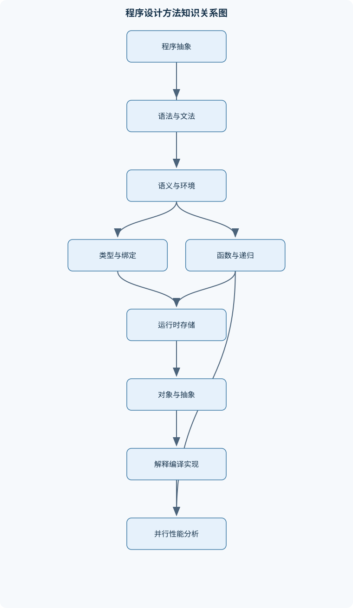
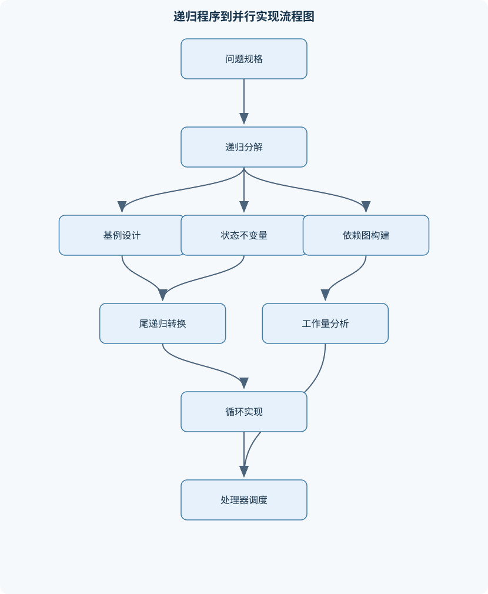

# 程序设计方法学

## 一、课程整体知识框架

### 课程边界与先修知识

《程序设计方法学》研究程序的抽象、组合、语义、实现与分析方法，重点连接程序设计语言基础、函数式编程、递归与迭代、运行时实现、面向对象抽象、解释器、并行计算和程序可靠性。课程不以某一种语言的语法为边界，而以可迁移的程序设计思想为主线。主要先修知识包括一种命令式语言的基本语法、变量与控制流、函数调用、基本数据结构、离散数学中的集合与图，以及初步的算法复杂度概念。课程中的示例可使用类 Lisp 语言、Java、Python 等表达，但必须区分语言特性与一般性原理；Python 的列表、生成器、类、异常和迭代器只作为具体实现案例，不等同于所有程序设计语言的共同语义。





### 1. 课程对象与核心问题

《程序设计方法学》研究的不是某一种语言的语法，而是如何把问题转化为可执行、可组合、可分析和可维护的程序。课程主线可以概括为：

$$
\text{问题抽象}\rightarrow \text{数据与控制结构}\rightarrow \text{程序组合}\rightarrow \text{语义解释}\rightarrow \text{运行时实现}\rightarrow \text{性能与可靠性分析}
$$

其中，程序记为 $P$，表达式记为 $e$，语句记为 $s$。表达式求值可写为 $e\Downarrow v$，表示表达式 $e$ 在给定求值规则下得到值 $v$。这一记号强调：程序设计不能只观察代码的表面形式，还要说明代码在什么环境、什么存储状态和什么求值顺序下产生什么结果。

课程首先区分三个抽象层次。第一层是问题层，关注要计算什么，例如“求一组数的平均值”或“判断一个对象是否满足某种性质”；第二层是程序结构层，关注如何用函数、数据结构、控制流和模块表达问题；第三层是实现层，关注变量如何存储、函数如何调用、对象如何分派、程序如何被编译或解释。一个程序在问题层正确，不代表其实现一定高效；一个程序在实现层运行很快，也不代表其抽象接口和行为符合预期。

### 2. 程序设计思想的横向组织

程序设计语言提供了不同的计算模型。命令式计算以状态变化为中心，变量通常绑定到地址，赋值语句改变存储内容；函数式计算以表达式求值和函数组合为中心，纯函数在相同输入下产生相同输出，不依赖可观察的外部状态；逻辑式计算以事实、规则和关系为基础，通过推理寻找满足条件的结果；面向对象计算则把状态和操作封装在对象中，并通过消息调用、继承和动态绑定组织大型程序。

这些模型不是完全互斥的。一个面向对象程序可以包含高阶函数，一个命令式程序可以使用不可变数据，一个解释器本身也可以用函数式方式实现。课程关注的是模型之间的语义差异及其适用边界，而不是把某种语言简单归入单一类别。

程序设计质量至少包含可读性、可写性、可靠性和实现成本。可读性要求程序结构能反映问题结构，命名、模块边界和控制流应便于理解；可写性关注表达常见问题所需的复杂度；可靠性要求程序在合法输入上保持正确，并对非法输入、资源不足和异常状态给出明确行为；实现成本则包括运行时间、存储空间、编译或解释开销、维护成本和运行时支持成本。语言特性越多，未必越好。正交性要求不同语言构造的组合规则尽量一致，例如一种类型是否能作为函数参数、数组元素和返回值；但过度追求特性数量会增加语言复杂度和程序员的认知负担。

编译执行和解释执行是实现策略，而不是程序语义本身。编译器通常把源程序转换为中间表示或目标代码，再由链接、装载和运行时系统完成执行；解释器则读取程序结构并按照语义规则直接求值。现代系统常同时采用两者，例如先解释执行，再根据运行信息进行即时编译。因而“编译语言一定更快”或“解释语言没有类型检查”都不是一般性结论。

### 3. 统一的语义与实现视角

环境记为 $\rho$，存储记为 $\sigma$。环境描述名字如何绑定，存储描述地址中保存什么内容。若名字直接绑定值，可记为 $x\mapsto v$；若名字绑定地址，可记为 $x\mapsto a$。在后一种模型中，变量的当前值由 $\sigma(a)$ 给出。这个区分解释了赋值与函数调用中的许多差异：

- 读取变量通常需要先查找 $\rho(x)$，再读取相应的值；
- 赋值不仅改变表达式结果，还可能改变 $\sigma(a)$；
- 两个名字若绑定同一地址，就产生别名，修改一个名字可能影响另一个名字；
- 闭包若捕获可变变量，函数调用结果可能依赖调用前的存储状态。

作用域和生存期必须分开。作用域回答“名字在哪些程序文本中可见”，生存期回答“对应实体在什么时候存在”。静态作用域可以根据程序文本确定非局部变量的绑定；动态作用域则根据运行时调用链确定绑定。静态变量、栈动态变量和堆动态变量的区别属于生存期与存储管理问题，不能把“静态作用域”误解为“静态存储期”。

### 4. 从语法到语义再到运行时

程序处理通常经过词法分析、语法分析、语义分析和执行或代码生成几个阶段。词法分析把字符流划分为标识符、关键字、常量和运算符等 token；语法分析依据文法构造语法树；语义分析检查类型、名字声明、返回路径和其他上下文约束；执行阶段根据求值规则改变环境和存储，或者把中间表示转换为目标代码。

文法写作：

$$
G=(V,T,P,S)
$$

其中 $V$ 是非终结符集合，$T$ 是终结符集合，$P$ 是产生式集合，$S$ 是开始符号。语法树表达程序的组合结构，抽象语法树则去除括号、分隔符等通常不影响语义的表面细节。语法能说明程序“形式上如何构成”，但不能独立表达“变量是否已声明”“数组下标是否越界”或“两个类型是否可相加”等约束，这些需要语义分析或运行时检查。

运行时实现把抽象语义落实为活动记录、栈帧、堆对象、环境链、虚方法表和异常控制流等结构。函数调用需要保存返回地址、参数、局部变量和必要的链接信息；嵌套函数需要通过静态链或闭包环境访问定义位置的非局部变量；对象调用需要根据静态类型或运行时类型决定目标方法；生成器和协程还要保存暂停位置及恢复所需的局部状态。

### 5. 递归、抽象和性能的统一关系

递归不是单纯的语法形式，而是一种用较小问题描述原问题的方法。若递归满足

$$
T(n)=T(n-1)+\Theta(1)
$$

且每层只保留常数状态，则总时间为 $\Theta(n)$。若每次调用产生两个规模接近 $n$ 的子问题，且子结果不共享，则调用树可能达到指数规模。尾递归的条件是递归调用之后不再需要当前调用的计算结果；满足这一条件时，可以把递归参数和累加器改写为循环变量，使额外栈空间从 $\Theta(n)$ 降为 $\Theta(1)$，但是否自动优化取决于语言实现。

函数式抽象进一步把“对哪些数据操作”与“如何操作”分离。筛选使用谓词保留元素，映射用函数变换元素，化约用结合操作聚合结果。若输入有 $n$ 个元素且每个元素只处理一次，通常时间为 $O(n)$；若采用惰性流，则可以避免构造完整中间序列，但仍需保存暂停状态，且副作用的执行顺序会受到求值策略影响。

并行计算把程序依赖关系表示为有向无环图。总工作量 $W$ 是所有节点工作量之和，关键路径长度 $S$ 是依赖路径工作量之和的最大值。使用 $p$ 个处理器时，理想运行时间满足：

$$
T_p\geq \max\left(\frac{W}{p},S\right)
$$

因此理想加速比不超过：

$$
\frac{W}{T_p}\leq \min\left(p,\frac{W}{S}\right)
$$

当 $W/p<S$ 时，关键路径限制了继续增加处理器的收益；现实中还要扣除同步、通信、任务调度和负载不均衡开销。Amdahl 定律进一步说明，若程序中不可并行部分占比为 $q$，即使并行部分使用无限多处理器，加速比也不超过 $1/q$。这说明算法结构、任务粒度和依赖关系比简单增加线程数量更重要。

## 二、章节和模块划分

### 核心知识覆盖清单

本清单用于检查正文是否覆盖本课程的主要知识模块：

- **程序设计方法与语言基础**：程序设计的抽象层次、程序设计语言的分类、命令式与函数式计算、逻辑式与面向对象计算、可读性与可写性、可靠性与实现成本、正交性与语言复杂度、编译执行与解释执行。
- **语法、文法与程序结构**：词法单元与语素、终结符与非终结符、BNF产生式、上下文无关文法、左推导与右推导、推导树与抽象语法树、语法歧义、运算符优先级与结合律、扩展BNF表示、语法分析的边界。
- **变量、绑定与作用域**：变量的名字与地址、变量的类型与值、属性绑定时机、静态绑定与动态绑定、静态作用域、动态作用域、变量隐藏与非局部访问、变量生存期、静态变量与栈动态变量、堆动态变量与垃圾回收。
- **类型系统与复合数据**：静态类型与动态类型、显式声明与类型推断、基本类型与序数类型、字符串表示与边界检查、数组的存储类别、结构与记录、指针与引用、空值与可选值、悬挂指针与内存泄漏、类型转换与类型安全。
- **表达式、控制流与副作用**：一元二元三元运算符、表达式求值顺序、短路求值、赋值语句语义、副作用与别名、选择结构、循环结构、异常控制流、生成器与暂停恢复、程序状态与状态转换。
- **函数、递归与函数式抽象**：函数与过程的区别、纯函数与引用透明性、高阶函数、匿名函数与闭包、映射筛选与化约、线性递归与迭代、树递归与共享计算、尾递归、递归到迭代的转换、流式计算与惰性求值。
- **子程序调用与运行时存储**：活动记录布局、栈帧与栈指针、动态链与调用关系、静态链与词法作用域、返回地址与返回值、参数传递语义、传值与传引用、传值结果与别名冲突、堆栈分配与堆分配、尾调用优化。
- **抽象数据类型与面向对象实现**：抽象数据类型、数据封装与表示独立性、继承与子类型、多态与动态绑定、类实例记录、虚方法表、对象创建与释放、多继承与菱形问题、泛型实现、静态绑定与动态绑定取舍。
- **解释器、编译器与虚拟机**：解释器的求值循环、环境模型、过程对象与闭包环境、变量查找与环境扩展、词法分析与语法分析、语义分析与中间表示、代码生成与链接装载、类加载与符号引用、方法区与堆、虚拟机栈与栈帧。
- **并发并行与程序性能分析**：并发与并行的区别、分布式计算的边界、计算图、work与span、理想加速比、关键路径、Amdahl定律、任务并行与数据并行、栅栏与同步、并行粒度与调度开销。


### 1. 程序设计方法与语言基础

本模块建立课程的比较框架。程序设计语言可从抽象机制、求值方式、类型系统、控制结构和运行时模型等角度分类。命令式语言突出状态和赋值，函数式语言突出表达式和函数组合，逻辑式语言突出关系与推理，面向对象语言突出封装、继承和动态分派。

学习语言特性时，应同时分析其收益和代价。例如自动内存管理降低悬挂指针风险，但会引入垃圾回收和暂停时间；动态类型提高交互式编程灵活性，但部分错误推迟到运行时；多态减少重复代码，但动态绑定可能增加运行时开销。语言的可读性不能只由语法简短决定，还取决于语义是否一致、隐式行为是否可预测以及错误是否容易定位。

### 2. 语法、文法与程序结构

本模块从字符、token、文法和树结构逐层说明程序的形式。左推导每次展开最左侧非终结符，右推导每次展开最右侧非终结符；同一字符串若能构造两棵不同语法树，则文法存在歧义。

例如：

$$
E\to E+E\mid E*E\mid(E)\mid a
$$

对字符串 $a+a*a$，可以先构造 $(a+a)*a$，也可以构造 $a+(a*a)$，因此该文法不能表达唯一的运算优先级。分层改写为：

$$
E\to E+T\mid T
$$

$$
T\to T*F\mid F
$$

$$
F\to(E)\mid a
$$

即可使乘法处于加法的更高层级。左递归形式通常表达左结合，例如 $E\to E+T\mid T$；若要表达右结合，产生式结构应把递归放在右侧。文法只处理结构，不负责检查变量声明、类型兼容性和运行时边界。

### 3. 变量、绑定与作用域

变量可分解为名字、地址、类型和值四个方面。属性绑定时机包括编译时、装载时、运行时和动态更新时。静态绑定有利于编译器检查和优化，动态绑定则支持更灵活的多态和运行时扩展。

静态作用域下，非局部变量沿词法外层查找；动态作用域下，非局部变量沿调用者链查找。若内部变量与外部变量同名，内部绑定会隐藏外部绑定，但外部实体可能仍通过限定方式或闭包环境访问。变量生存期则决定其存储位置：栈动态变量通常随调用进入和返回而创建销毁，堆动态变量可在调用结束后继续存在，垃圾回收负责发现不再可达的对象并回收空间。

### 4. 类型系统与复合数据

类型系统规定值的集合、可执行操作以及表达式之间的兼容关系。静态类型在编译或翻译阶段检查，动态类型在运行时检查；显式声明要求程序员写出类型，类型推断则根据使用关系推导类型。类型推断并不等于没有类型，推断成功后仍应遵守类型规则。

数组需要明确元素类型、下标范围、存储布局和边界检查策略。字符串可能采用长度前缀、结束标记或独立长度字段表示，因而字符串长度、容量和终止符不能混为一谈。结构和记录把不同字段组合成一个值；指针保存地址值，引用通常表示对已有对象的受限别名，二者在语言语义上不必等价。空值表示缺少对象或结果，但可选值类型能把“有值”和“无值”显式区分，减少空值解引用错误。

悬挂指针发生在地址仍被使用而其对象已经释放时；内存泄漏发生在对象仍占用空间但程序失去有效访问路径时。类型转换必须区分安全的提升转换、需要检查的窄化转换和可能破坏类型安全的强制转换。

### 5. 表达式、控制流与副作用

表达式包含一元、二元和三元运算，但运算符优先级只决定组合顺序，结合律决定同级运算如何分组。减法和除法通常不满足结合律：

$$
(a-b)-c\neq a-(b-c)
$$

求值顺序会影响带副作用的表达式。短路求值中，逻辑与在左操作数为假时不再计算右操作数，逻辑或在左操作数为真时不再计算右操作数。若右操作数包含函数调用、赋值或异常，短路行为会改变程序状态和可观察结果。

控制流包括顺序、选择、循环和异常转移。异常通常表示执行期间检测到的错误状态，不等同于语法错误。生成器在执行到暂停点时保存恢复位置、局部变量和必要的迭代状态；再次请求元素时从保存点继续，因此生成器不能简单等同于返回完整列表。

### 6. 函数、递归与函数式抽象

函数把输入映射到输出，过程则通常强调对状态的操作；两者在具体语言中可能使用同一语法表示。纯函数满足引用透明性：在不改变程序可观察行为的前提下，可以用结果替换函数调用。含副作用的函数不能任意重排或重复计算。

高阶函数可以接收函数或返回函数。匿名函数提供局部行为，闭包则是代码与定义环境的二元组。闭包必须保存定义时的环境，而不是调用时的环境，否则函数返回后访问外层变量会得到错误绑定。典型的筛选、映射和化约流程要求化约操作具有适当的结合性；非结合操作在改变分组或并行化后可能产生不同结果。

快速幂展示了递归优化：

$$
x^n=
\begin{cases}
1,&n=0\\
(x^{n/2})^2,&n>0\text{ 且 }n\text{ 为偶数}\\
x\cdot x^{n-1},&n\text{ 为奇数}
\end{cases}
$$

每次偶数分支把指数减半，因此递归深度为 $\Theta(\log n)$，时间复杂度为 $O(\log n)$。该结论要求乘法视为常数时间；若数值是任意精度整数，还必须把每次乘法的位复杂度纳入分析。

### 7. 子程序调用与运行时存储

活动记录记为 $AR$，通常包含参数、局部变量、临时值、返回地址、动态链和静态链。动态链指向调用者活动记录，反映实际调用关系；静态链指向词法定义外层活动记录，用于实现静态作用域下的非局部访问。

参数传递包括传值、传引用和传值结果。传值复制实参的初值；传引用共享实参存储单元；传值结果先复制，返回时再写回。若两个形参指向同一实参，传值结果的写回顺序可能影响最终状态，因此必须明确语言规定或实现策略。栈适合管理嵌套调用的短期数据，堆适合管理跨调用存活的数据。尾调用优化只有在调用返回后无需继续执行当前帧逻辑时才适用。

### 8. 抽象数据类型与面向对象实现

抽象数据类型由操作集合和行为约束定义，使用者只依赖接口，不依赖内部表示。数据封装和表示独立性允许实现者把数组改成树或哈希结构，而不改变外部调用方式。

继承描述实现或接口复用，子类型还必须满足可替换性，不能因为存在继承关系就认为所有子类都符合父类型契约。静态绑定在编译期确定目标，运行时开销较低；动态绑定根据对象实际类型选择方法，支持多态但需要额外分派机制。常见实现是在实例记录中保存虚方法表指针，再按方法槽位查找目标。

多继承可能产生菱形问题：同一祖先字段或方法通过两条路径重复出现。泛型通过参数化类型减少重复实现，但具体实现可能采用类型擦除、模板实例化或运行时类型信息，不同方案在代码大小、检查时机和性能方面各有代价。

### 9. 解释器、编译器与虚拟机

解释器通常包含词法分析、语法分析、抽象语法树构造和求值循环。环境求值时，先在当前帧查找变量，再沿外层环境链查找；若所有帧都没有绑定，应报告未绑定变量错误。函数调用建立新环境帧，形参与实参绑定，函数体使用闭包保存的定义环境。

编译器通常经过语义分析、中间表示、优化、代码生成、链接和装载。虚拟机以字节码或其他中间形式执行，运行时可能包含虚拟机栈、栈帧、堆、类元数据和运行时常量池。类加载一般涉及装载、验证、准备、解析和初始化等阶段，但具体区域名称、存储布局和优化方式取决于虚拟机实现，不能把某一版本的实现细节当作所有系统的共同语义。

### 10. 并发、并行与程序性能分析

并发表示多个任务在时间上交错推进，并行表示多个任务实际同时执行；分布式计算还要求任务跨越多个机器，并面对通信、节点故障和一致性问题。任务并行把不同任务分配给处理器，数据并行则对不同数据分片执行相同操作。

栅栏要求一组任务到达同步点后才能继续；栅栏过多会增加等待和调度开销。并行粒度过细时，任务本身的计算时间小于创建、分配和同步成本；粒度过粗又会造成负载不均衡。性能分析应同时计算 $W$、$S$、处理器数量 $p$ 和实际开销，不能只用 $W/p$ 估计运行时间。

### 11. 代表性算法与流程

#### 11.1 二分求根流程

输入为连续函数 $f$、区间 $[a,b]$ 和容差 $\varepsilon>0$。适用条件是 $f$ 在区间上连续，且 $f(a)f(b)\leq 0$；若端点乘积大于零，不能据此断定区间没有根，因为区间内可能存在偶数个根，也可能函数不连续。

```python
def bisection(f, a, b, epsilon):
    fa = f(a)
    fb = f(b)

    if fa == 0:
        return a
    if fb == 0:
        return b
    if fa * fb > 0:
        raise ValueError("区间不满足异号括区间条件")

    while b - a > epsilon:
        m = (a + b) / 2
        fm = f(m)

        if fm == 0:
            return m
        if fa * fm <= 0:
            b = m
            fb = fm
        else:
            a = m
            fa = fm

    return (a + b) / 2
```

循环不变量是根始终位于当前区间。每轮区间长度减半，经过 $k$ 轮后长度为 $(b-a)/2^k$，因此达到宽度不超过 $\varepsilon$ 至少需要：

$$
k\geq \left\lceil \log_2\frac{b-a}{\varepsilon}\right\rceil
$$

浮点运算下不能只依赖精确相等的 $f(m)=0$，还应结合函数值容差或区间宽度停止。

#### 11.2 流式筛选、映射与化约

输入为可迭代序列、谓词 $p$、变换函数 $f$ 和结合操作 $\oplus$，输出为：

$$
\bigoplus\{f(x)\mid p(x)\}
$$

过程是先读取元素，用 $p$ 判断是否保留，再用 $f$ 变换，最后用 $\oplus$ 聚合。单次遍历 $n$ 个元素的时间通常为 $O(n)$。惰性实现不必保存全部中间结果，额外空间可接近 $O(1)$，但若化约操作不适合流式处理，或后续操作需要随机访问，则仍可能需要物化序列。

#### 11.3 并行计算图分析

输入为任务依赖 DAG、每个节点的工作量和处理器数量 $p$。先把所有节点工作量相加得到 $W$，再通过拓扑排序计算每个节点的最早完成时间，最大值即关键路径长度 $S$。理想时间下界为：

$$
T_p\geq\max(W/p,S)
$$

拓扑排序和关键路径计算时间为 $O(V+E)$，其中 $V$ 是任务节点数，$E$ 是依赖边数。结果只能给出理想下界；真实调度还需加入通信、同步、任务创建和处理器空闲等因素。

### 12. 代表性例题

#### 例题一：消除表达式文法歧义

**题干：**判断文法 $E\to E+E\mid E*E\mid(E)\mid a$ 是否能唯一分析字符串 $a+a*a$。

**分析：**字符串可以先组合前两个 $a$，得到 $(a+a)*a$；也可以先组合后两个 $a$，得到 $a+(a*a)$。两种树不同，说明文法歧义。

**逐步解答：**引入 $E,T,F$ 三层，分别表示表达式、项和因子；加法只在 $E$ 层组合，乘法只在 $T$ 层组合，括号和基本符号在 $F$ 层组合。于是唯一结构为 $a+(a*a)$。

**结果验证：**乘法总在加法内部先归约，符合通常优先级。若把产生式写成右递归，还需检查结合律是否由树结构正确表达。

**变式：**若要求减法右结合，应使用能产生 $a-(b-c)$ 的结构，而不能直接套用左递归加法产生式。

#### 例题二：比较线性递归与尾递归

**题干：**分析阶乘递归函数与带累加器版本的时间和空间。

**分析：**普通版本在返回阶段还要执行乘法，因此调用栈不能立即释放；尾递归版本把中间结果放入累加器。

**逐步解答：**普通递归满足 $T(n)=T(n-1)+\Theta(1)$，时间为 $\Theta(n)$，栈空间为 $\Theta(n)$。尾递归仍需处理 $n$ 次调用，时间仍为 $\Theta(n)$；若实现支持尾调用优化，空间为 $\Theta(1)$，否则仍可能为 $\Theta(n)$。

**结果验证：**对 $n=4$，普通版本展开为 $4\times3\times2\times1$；尾递归版本的状态依次为 $(4,1)$、$(3,4)$、$(2,12)$、$(1,24)$，最终返回 $24$。

**变式：**若递归调用之后还要执行加法或乘法，则不能直接消除尾调用，必须重新设计状态。

#### 例题三：二分法区间展开

**题干：**对函数 $f(x)=x^2-2$ 使用区间 $[0,4]$ 和容差 $0.5$。

**分析：**$f(0)=-2$，$f(4)=14$，连续且异号，满足条件。

**逐步解答：**第一次中点为 $2$，$f(2)=2$，保留 $[0,2]$；第二次中点为 $1$，$f(1)=-1$，保留 $[1,2]$；第三次中点为 $1.5$，$f(1.5)=0.25$，保留 $[1,1.5]$。此时区间宽度为 $0.5$，停止并返回中点 $1.25$ 或按实现返回端点约束内的近似值。

**结果验证：**真实根约为 $1.414$，返回值与根的误差小于区间宽度的一半。

**变式：**若区间为 $[2,4]$，两端函数值均为正，不能直接使用二分法证明存在根。

#### 例题四：参数传递与别名

**题干：**两个形参通过调用 $sub(a,a)$ 绑定到同一实参，比较传引用和传值结果。

**分析：**传引用时两个形参共享同一地址，任一形参写入都会影响另一个；传值结果则各自保存副本，返回时可能按顺序写回同一实参。

**逐步解答：**若两个形参分别加一和乘二，传引用的最终结果取决于语句执行顺序；传值结果在返回阶段还取决于两个结果的写回顺序。若先写回加一的结果，再写回乘二的结果，后者覆盖前者；反向写回则得到不同结果。

**结果验证：**改变写回顺序即可得到不同最终值，说明传值结果在存在别名时不是简单的传值语义。

**变式：**若两个形参对应不同数组元素，是否冲突还要看数组元素是否共享存储，以及表达式求值顺序是否有规定。

#### 例题五：并行任务的理想加速

**题干：**某 DAG 的总工作量为 $W=100$，关键路径为 $S=30$，使用 $p=4$ 个处理器，求理想时间下界和加速比上界。

**分析：**工作量下界为 $100/4=25$，关键路径下界为 $30$，因此关键路径更强。

**逐步解答：**

$$
T_4\geq\max(25,30)=30
$$

理想加速比不超过：

$$
\frac{100}{30}\approx3.33
$$

即使增加到无限多个处理器，时间也不能低于 $30$，加速比不能超过约 $3.33$。

**结果验证：**若只用 $W/p$，会错误估计为 $25$，违反依赖路径必须顺序执行的事实。

**变式：**当 $p=2$ 时，$W/p=50>S$，工作量限制更强，理想时间下界变为 $50$。

### 13. 实验与项目组织

#### 实验一：简化表达式解释器

**输入数据：**包含整数常量、变量、加法、条件表达式和函数调用的源程序，例如定义平方函数后计算一个变量的平方。

**步骤：**先把字符流转换为 token；再依据文法构造抽象语法树；随后创建环境帧，绑定变量和函数；函数对象保存代码与定义环境；求值时沿环境链查找变量，并在找不到绑定时报告错误。

**评价标准：**合法程序应得到正确数值；未定义变量必须被拒绝；函数返回后仍能正确访问捕获变量；括号和运算优先级必须产生唯一树结构。

**排错方法：**若 token 数量错误，检查词法边界；若树结构错误，检查产生式和优先级；若闭包结果错误，检查使用的是定义环境还是调用环境；若错误位置不明确，检查解释器是否保存 token 位置信息。

#### 实验二：递归、循环与并行性能比较

**输入数据：**阶乘、快速幂、斐波那契等不同规模输入，以及可分割的数组聚合任务。

**步骤：**分别实现普通递归、尾递归和循环版本；记录输入规模、运行时间和额外空间；对数组聚合构造任务 DAG，计算 $W$ 和 $S$；逐步增加任务数量，观察同步和调度开销。

**评价标准：**结果必须与小规模人工计算一致；快速幂的时间增长应明显低于逐次相乘；尾递归只有在实现支持优化时才表现出常数栈空间；并行运行时间不应被简单解释为 $W/p$，应结合 $S$ 和实际开销分析。

**排错方法：**若斐波那契运行时间突然爆炸，检查是否重复计算子问题；若并行结果不稳定，检查共享变量、竞态和归约操作是否满足结合性；若加速比随处理器增加反而下降，检查任务粒度、栅栏频率、负载均衡和通信成本。

## 三、核心概念的详细解释

### 1. 抽象层次、计算模型与语言设计

程序设计的核心是建立从问题到实现的可验证映射。问题层描述目标和约束，程序结构层使用数据、函数和控制流表达方案，实现层则说明程序如何由编译器、解释器、虚拟机和运行时系统执行。程序记为 $P$，表达式记为 $e$，语句记为 $s$；$e\Downarrow v$ 表示表达式求值为值 $v$。同一个抽象算法可以由命令式、函数式或面向对象程序实现，但赋值、别名、求值顺序和错误处理等语义可能不同。

命令式计算以状态变化为中心。环境 $\rho$ 记录名字的绑定，存储 $\sigma$ 记录地址中的内容。若变量 $x$ 绑定到地址 $a$，则可写作 $\rho(x)=a$，变量当前值为 $\sigma(a)$；赋值语句会改变 $\sigma(a)$。函数式计算更强调表达式、不可变数据和函数组合。纯函数在相同输入和相同外部条件下产生相同结果，不改变可观察状态，因此具有引用透明性：可以用结果替换表达式，而不改变程序行为。逻辑式计算把事实、规则和关系作为基本对象，通过满足约束寻找结果；面向对象计算把状态和操作封装到对象中，通过消息调用、继承和动态绑定组织程序。

这些模型并不互相排斥。带有可变对象的语言仍可使用高阶函数，面向对象程序也可以用不可变数据和纯函数。判断一种语言或程序的性质时，应分析具体构造和语义，而不能仅根据语言名称下结论。

可读性要求程序结构、命名、控制流和模块边界能反映问题结构；可写性要求常见问题可以用适当规模的代码表达；可靠性要求合法输入产生符合规格的结果，并对非法输入、资源不足和异常状态规定行为；实现成本包括运行时间、内存、编译或解释开销以及维护成本。语言特性越多不一定越优。正交性要求语言构造的组合规则稳定，例如一种类型能否同时作为参数、数组元素和返回值；但特性过多会增加语义组合数量和理解成本。

编译执行通常经历词法分析、语法分析、语义分析、中间表示生成、代码生成、链接和装载；解释执行则在运行时读取程序结构并按求值规则执行。现代系统可以先解释，再依据运行信息即时编译，因此编译和解释是实现策略，不是程序语义的二分分类。

### 2. 语法、文法与程序结构

词法分析把字符序列切分为 token，例如关键字、标识符、数字、运算符和分隔符。语法分析根据文法检查 token 序列是否符合结构，并建立语法树。抽象语法树只保留对语义组合有用的结构，例如表达式 `a + b * c` 的根节点是加法，右子树是乘法；空格、括号中的部分冗余信息和具体 token 位置通常不作为核心节点保存。语义分析继续检查类型、声明、作用域和其他不能仅由上下文无关文法表达的约束。

文法写作 $G=(V,T,P,S)$，其中 $V$ 是非终结符集合，$T$ 是终结符集合，$P$ 是产生式集合，$S$ 是开始符号。产生式

$$
E\to E+E\mid E*E\mid(E)\mid a
$$

允许字符串 $a+a*a$ 有两种结构：一种把它解释成 $(a+a)*a$，另一种解释成 $a+(a*a)$，因此该文法有歧义。可采用分层文法：

$$
E\to E+T\mid T
$$

$$
T\to T*F\mid F
$$

$$
F\to (E)\mid a
$$

其中 $F$ 表示因子，$T$ 表示乘法层，$E$ 表示加法层。由于加法产生式在较高层，乘法自然优先于加法。左递归形式 $E\to E+T\mid T$ 表示左结合，因此 $a-b-c$ 解释为 $(a-b)-c$；若使用右递归形式 $E\to T+E\mid T$，则更接近右结合。减法和除法通常不满足结合律，不能忽略结合方向。

BNF适合描述结构，但不能单独表达“变量必须先声明”“数组下标必须在边界内”“两个表达式必须具有兼容类型”等语义约束。语法分析的输入边界是字符或 token 序列是否形成合法结构，类型检查和运行时检查属于更后续的阶段。

### 3. 变量、绑定、作用域与生存期

变量至少涉及名字、地址、类型和值。绑定可能是名字到值的绑定 $x\mapsto v$，也可能是名字到地址的绑定 $x\mapsto a$。属性的绑定时机可以发生在语言定义时、编译时、链接时、装载时或运行时。静态绑定通常能在执行前确定，便于优化和分析；动态绑定依赖执行路径，灵活性更强，但运行时成本和不确定性也更高。

静态作用域依据程序文本确定非局部变量。若函数在定义处位于外层变量 $x$ 的可见范围内，那么调用者是谁通常不改变它访问的 $x$。动态作用域沿调用链查找名字，同一个函数可能因不同调用者而访问不同变量。静态作用域与静态生存期不是同一概念：前者描述名字可见范围，后者描述实体存在时间。

典型生存期包括静态生存期、栈动态生存期和堆动态生存期。栈动态变量随函数调用建立和返回而创建和销毁；堆对象由显式释放或垃圾回收管理。悬挂指针是指向已经失效对象的引用，内存泄漏则是对象仍占用空间但程序已经失去访问它的路径。垃圾回收可以自动回收不可达对象，但不能修复无限增长的缓存、外部文件句柄未关闭或逻辑上仍可达但实际上无用的对象。

### 4. 类型系统、复合数据与类型安全

静态类型系统在编译或检查阶段确定表达式类型，能够较早发现不匹配；动态类型系统在运行时检查值的类型，允许更灵活的组合，但错误可能延迟到执行阶段。显式声明要求程序员写出类型，类型推断由编译器依据初始化和使用关系推导类型；两者都不能自动保证业务逻辑正确。

基本类型通常包括整数、浮点数、布尔值和字符。序数类型具有可比较或可枚举的顺序，例如枚举值。字符串可以表示为定长数组、带长度字段的对象或以特殊结束标记结尾的字符序列。不同表示决定是否容易获得长度、是否允许嵌入结束字符以及边界检查成本。数组需要明确元素类型、下标范围、存储布局和是否检查越界。未特别说明时，整数运算可视为常数时间，但实际机器存在位宽、溢出和精度限制。

结构或记录把多个字段组合为一个值；指针通常保存地址值，引用是语言提供的受约束间接访问机制，二者不能简单等同。空值表示“没有对象”或“缺少结果”，但它不是所有类型都天然合法的值；可选值用显式的存在/不存在结构减少空值误用。

类型转换分为安全转换和可能丢失信息的转换。将小范围整数转为大范围整数通常不会丢失信息，而浮点转整数可能截断，小范围整数相加也可能溢出。类型安全要求程序不能把一种类型的值当作不兼容类型使用；强制转换可能绕过检查，因此必须说明其前提和边界。

### 5. 表达式、控制流与副作用

一元、二元和三元运算符分别作用于一个、两个和三个操作数。表达式不仅有值，还可能有副作用，例如修改变量、写文件或抛出异常。表达式求值顺序会影响带副作用表达式的结果。短路求值在 `and` 或 `or` 中可能不计算右操作数，因此可用来避免空值访问或除零，但不能把“两个分支都执行”作为一般假设。

赋值语句的基本语义是先计算右侧表达式，再确定左侧位置并更新存储；但具体语言可能规定不同的求值次序。别名意味着两个名字访问同一存储单元，因而一个名字的赋值会改变另一个名字读到的值。选择结构根据条件选择路径；循环结构重复执行状态转换；异常控制流在检测到错误或显式抛出异常后，沿调用链寻找处理器。

生成器不是普通的“返回多个值”的函数。它必须保存暂停位置、局部变量和恢复所需的状态；再次迭代时从暂停点继续。生成器可以由堆对象或特殊运行时结构承载，具体实现随语言而异。

### 6. 函数、递归与函数式抽象

函数把输入映射到输出，可写作 $f:x\to y$；过程通常强调执行动作和副作用。高阶函数把函数作为参数或返回值。匿名函数是没有显式名称的函数表达式，闭包则是代码与定义环境的二元组。闭包必须保存定义时环境，而不能只保存调用时环境，否则返回函数访问外层变量时会得到错误绑定。

映射、筛选和化约可以组合成流式计算：

$$
\bigoplus\{f(x)\mid p(x),\ x\in X\}
$$

先对元素使用谓词 $p$ 筛选，再应用变换 $f$，最后使用化约操作 $\oplus$ 聚合。若采用惰性求值，元素可以按需生成，避免一次保存整个中间序列；但副作用的执行时机可能改变，且无穷流只有在最终需求有限时才可计算。

线性递归每次只产生一个规模较小的子问题。例如

$$
T(n)=T(n-1)+\Theta(1)
$$

展开为

$$
T(n)=T(0)+n\Theta(1)=\Theta(n)
$$

若每层只保存常数状态，递归栈空间为 $\Theta(n)$。尾递归要求递归调用是当前计算的最后一步；如果调用返回后还要乘法、加法或组合结果，就不是尾递归。尾递归可显式改写为循环，但只有语言实现支持尾调用优化时，递归写法才自动获得常数栈空间。

树递归会产生多个子问题。斐波那契的朴素定义包含规模约为 $n-1$ 和 $n-2$ 的两个递归调用，且不共享结果，会重复计算，形成指数级调用树。记忆化或自底向上动态规划可以共享结果，把时间降为线性。快速幂利用指数的二分：

$$
x^n=
\begin{cases}
1,&n=0,\\
(x^{n/2})^2,&n>0\text{ 且 }n\text{ 为偶数},\\
x\cdot x^{n-1},&n\text{ 为奇数}.
\end{cases}
$$

通过先处理奇数再折半，递归深度为 $\Theta(\log n)$。

### 7. 调用、运行时存储与参数传递

一次子程序调用通常建立活动记录 $AR$，其中可包括参数、返回地址、返回值空间、局部变量、临时值、动态链和静态链。动态链指向调用者活动记录，表示调用关系；静态链指向词法定义外层活动记录，用于静态作用域下访问非局部变量。访问外层第 $d$ 层变量时，最坏需要沿静态链跳转 $d$ 次。

传值把实参的值复制到形参；传引用使形参直接访问实参存储；传值结果先在形参副本上计算，返回时再把结果写回实参。若两个形参引用同一个实参，传值结果的回写顺序会影响最终状态。例如两个形参都对应同一数组元素，若分别加一和乘二，先回写哪个结果可能得到不同值。因此传值结果在存在别名时必须明确回写顺序或禁止这种调用。

栈适合管理嵌套调用和短生命周期对象，堆适合管理跨越调用返回仍需存在的对象。尾调用优化可以复用当前活动记录，但只有尾调用成立且实现允许时才安全。

### 8. 抽象数据类型与面向对象实现

抽象数据类型由一组操作及其行为约定构成，用户依赖接口而不是内部表示。例如栈可以规定 `push`、`pop` 和“后进先出”，而不规定必须用数组还是链表实现。封装和表示独立性允许在不改变接口的情况下替换内部结构。

继承描述类之间的代码或表示复用，子类型还必须满足可替换性：在需要父类型对象的地方使用子类型对象时，接口和行为契约不能被破坏。多态允许同一调用形式作用于不同实际对象；动态绑定在运行时根据对象实际类型选择方法，静态绑定则在编译时确定目标。

对象通常含有实例字段以及指向类描述或虚方法表的关系。动态分派可以通过“对象中的虚方法表指针加方法槽位索引”实现；静态分派可直接调用目标，运行时开销较低。多继承可能产生菱形问题：同一祖先字段或方法通过两条路径重复出现，需要共享祖先、显式限定或语言规则解决。泛型通过参数化类型实现代码复用，但其实现可能采用类型擦除、运行时类型参数或代码特化，不能把一种语言的实现方式推广到所有语言。

### 9. 解释器、编译器与虚拟机

解释器通常包含求值循环：读取当前表达式，识别其构造，递归或迭代求值子表达式，并在环境 $\rho$ 和存储 $\sigma$ 下产生值或错误。变量查找先检查当前环境帧，再沿外层环境链查找；所有帧都没有绑定时应报告未绑定变量错误，而不是使用任意同名变量。

函数表达式求值为闭包，即代码与定义环境的二元组。调用闭包时建立新环境帧，绑定形参和实参，函数体使用闭包保存的定义环境作为外层环境。词法作用域的关键不在于“函数在哪里调用”，而在于“函数在哪里定义”。

编译器通常将源程序转换为抽象语法树、类型信息和中间表示，再进行优化和代码生成。链接和装载阶段处理符号和地址。虚拟机可能维护虚拟机栈、栈帧、堆、类元数据和运行时常量池。常量池可包含字符串、数值和类型、字段、方法的符号引用；装载、验证、准备、解析和初始化在具体系统中有明确顺序，但方法区、类元数据和静态字段的具体布局属于实现细节，不能仅凭概念名称推断。

### 10. 并发、并行与性能分析

并发表示多个任务在时间上交错推进，并行表示多个任务在同一时刻由多个处理器执行；分布式计算还涉及多台机器、网络通信和部分失效。并发不必然并行，单核系统也能并发调度任务。

用有向无环图表示任务依赖。总工作量 $W$ 是所有节点工作量之和，关键路径长度或 span 为最长依赖路径工作量 $S$。使用 $p$ 个处理器时：

$$
T_p\geq \max(W/p,S)
$$

因此理想加速比不超过：

$$
\frac{W}{\max(W/p,S)}=\min(p,W/S)
$$

当 $W/p<S$ 时，关键路径限制了继续增加处理器的收益。Amdahl 定律进一步说明，若程序中不可并行部分占比为 $q$，则处理器数趋于无穷时加速比上限为 $1/q$。实际系统还会受到任务创建、调度、通信、同步、缓存和负载不均衡影响。

任务并行把不同任务分配给处理器，数据并行把相同操作应用于不同数据片段。栅栏要求一组任务都到达同步点后才能继续；栅栏过多会增加等待。并行粒度过细时，调度和同步开销可能大于计算本身，因此不能只依据 $W/p$ 评价性能。

## 四、重要定义、公式、定理和推导

### 专业审校补充：关键定义与适用边界

抽象数据类型的正确性不能只看操作结果，还要区分表示不变式、抽象函数和表示独立性。设具体表示空间为 R，抽象值空间为 A，抽象函数 α:R→A 把内部表示映射为抽象对象；表示不变式 I(r) 规定哪些具体状态合法。每个公开操作都必须满足：若调用前 I(r) 成立，则操作终止后仍有 I(r′) 成立，且 α(r′) 与抽象规格规定的结果一致。客户端只能依赖抽象操作的前置条件、后置条件和可观察行为，不能依赖数组、链表或哈希表等内部表示。两个实现即使内部结构完全不同，只要对所有合法操作序列产生相同可观察结果，就具有表示独立性。该结论不等于实现可任意替换：若客户端能够观察迭代顺序、异常类型、时间复杂度或对象身份，这些也可能成为契约的一部分。特别是子类型替换要求子类型不能加强前置条件、不能削弱后置条件，并应保持父类型承诺的状态和异常语义；仅有继承关系不足以证明可替换性。


### 1. 代表性算法与流程

#### 1.1 语法分析流程

**输入：**字符或 token 序列、文法 $G$。  
**输出：**语法树，或带位置的语法错误。  
**过程：**先进行词法分析，再使用自顶向下或自底向上分析器依据产生式构造树，最后检查输入是否完全消费。  
**不变量：**已识别前缀始终能与某个合法推导对应。  
**终止条件：**接受结束标记，或出现无法继续的冲突。  
**适用条件：**文法必须满足所选分析器的约束；无冲突的 LL/LR 类分析通常可达 $O(n)$，但一般语法分析复杂度取决于文法和算法。

#### 1.2 环境求值流程

**输入：**表达式 $e$、环境 $\rho$、存储 $\sigma$。  
**输出：**值或运行时错误。  
**过程：**变量先查当前帧，再沿外层链查找；函数创建闭包；调用时建立新帧，绑定形参，并用闭包的定义环境求值函数体。  
**不变量：**查找始终遵守词法环境链；修改变量只改变其绑定地址中的存储。  
**终止条件：**归约为值，或产生异常。  
**复杂度：**若环境链长度为 $d$，一次最坏变量查找为 $O(d)$；使用显示哈希表或扁平化环境可降低平均查找成本，但可能增加复制和更新成本。

#### 1.3 二分求根

**输入：**连续函数 $f$、区间 $[a,b]$、容差 $\varepsilon>0$。  
**输出：**近似根，或条件不满足状态。  
**前提：**$f$ 在 $[a,b]$ 上连续，且 $f(a)f(b)\leq0$。若端点函数值之一为零，可直接返回端点。  
**过程：**

1. 检查端点值，若无异号且无端点根，则不能保证区间内有根。
2. 计算中点 $m=(a+b)/2$。
3. 若 $|f(m)|$ 足够小或区间宽度不超过 $\varepsilon$，返回 $m$。
4. 若 $f(a)f(m)\leq0$，令 $b=m$；否则令 $a=m$。
5. 重复以上过程。

**不变量：**根始终位于当前区间。经过 $k$ 轮，区间长度为

$$
\frac{b-a}{2^k}.
$$

要使区间宽度不超过 $\varepsilon$，至少需要

$$
k\geq\left\lceil\log_2\frac{b-a}{\varepsilon}\right\rceil
$$

轮。浮点舍入可能导致中点等于端点，此时应加入“区间无法继续缩小”的终止条件。

#### 1.4 快速幂

**输入：**底数 $x$，非负整数指数 $n$。  
**输出：**$x^n$。  
**不变量：**尾递归版本中，累积器 $a$ 与待处理状态满足 $a\cdot x^n$ 等于原始目标幂。  
**终止条件：**$n=0$。  
**复杂度：**时间 $O(\log n)$；普通递归额外空间 $O(\log n)$，循环版额外空间 $O(1)$。

```python
def power(x, n):
    """返回 x 的非负整数次幂。"""
    if n < 0:
        raise ValueError("指数必须为非负整数")
    result = 1
    base = x
    exponent = n

    while exponent > 0:
        if exponent % 2 == 1:
            result = result * base
        base = base * base
        exponent = exponent // 2

    return result
```

例如 $x=3,n=5$：初始 `result=1, base=3, exponent=5`；指数为奇数，得到 `result=3`；平方底数为 $9$，指数变为 $2$；指数为偶数，不更新结果，底数变为 $81$，指数变为 $1$；再次乘入底数得到 $243$，指数变为 $0$，结果为 $3^5=243$。每次循环至少把指数减半，因此循环次数为 $O(\log n)$。

### 2. 典型例题

#### 例题一：消除表达式文法歧义

**题干：**分析文法 $E\to E+E\mid E*E\mid(E)\mid a$ 对字符串 $a+a*a$ 的问题，并设计无歧义文法。

**分析：**根节点可选加法或乘法。若根为乘法，左子树可生成 $a+a$；若根为加法，右子树可生成 $a*a$，得到两棵不同语法树。

**解答：**

$$
E\to E+T\mid T,\quad T\to T*F\mid F,\quad F\to(E)\mid a
$$

第一棵结构只能是 $E+(T*T)$，因此解释为 $a+(a*a)$。左递归保证同层运算左结合。

**结果验证：**加法产生式不能把乘法放到加法外层，故乘法优先级更高；$a-a-a$ 按左递归解释为 $(a-a)-a$。

**变式：**若要求指数运算右结合，可设 $P\to F^P\mid F$，而不是使用左递归 $P\to P^F\mid F$。

#### 例题二：闭包与作用域

**题干：**外层函数创建变量 $x=10$，返回函数 `f(y)=x+y`；外层函数返回后调用 `f(5)`。说明为何仍能得到 $15$。

**分析：**若只保存函数代码，返回后外层栈帧可能已经销毁，无法访问 $x$；闭包必须保存定义环境。

**解答：**创建闭包时保存 `(代码 f, 环境 ρ_def)`，其中 $\rho_def(x)=10$。调用时建立新帧 $\rho_call(y)=5$，并把 $\rho_def$ 作为外层环境。求值 `x+y` 时先在调用帧找 `x`，失败后沿外层链找到 $10$，再与 $5$ 相加。

**结果验证：**函数定义位置决定 $x$ 的绑定；若改用动态作用域，结果可能取决于调用者当前是否有同名变量。

**变式：**若闭包捕获的是可变存储地址而不是值，之后修改该地址，函数下次调用会看到新值。

#### 例题三：递归复杂度

**题干：**比较阶乘递归与朴素斐波那契递归的时间和空间复杂度。

**分析：**阶乘每次只产生一个规模减一的调用：

$$
T(n)=T(n-1)+\Theta(1)=\Theta(n).
$$

朴素斐波那契满足：

$$
T(n)=T(n-1)+T(n-2)+\Theta(1),
$$

调用数呈指数增长。

**解答：**阶乘的递归深度为 $n$，空间为 $\Theta(n)$；尾递归或循环版将状态写入累加器，若实现支持优化或显式使用循环，空间为 $\Theta(1)$。斐波那契可以用数组保存前两个结果，每次只计算一次，时间为 $\Theta(n)$，若只需最终值，空间可压缩为 $\Theta(1)$。

**结果验证：**斐波那契 $F(5)$ 的朴素调用会重复计算 $F(3)$、$F(2)$ 等子问题；动态规划消除重复调用。

**变式：**若递归函数每次只保留一个子问题且每层工作为常数，不能据此断言空间为常数，仍需检查是否存在未返回的递归栈帧。

#### 例题四：参数传递与别名

**题干：**某过程接收两个传值结果参数，调用时两个参数都对应同一变量 $a$。过程分别把第一个参数设为 $1$，第二个参数设为 $2$。返回时结果可能是什么？

**分析：**执行期间两个形参是独立副本，过程内部可以看到两个不同值；返回时两个副本都要写回同一地址。

**解答：**若先写回第一个，再写回第二个，最终 $a=2$；若顺序相反，最终 $a=1$。因此语言必须规定回写顺序，或禁止存在别名的传值结果调用，否则程序行为不稳定或不可移植。

**结果验证：**区别于传引用：传引用会在过程执行期间直接修改同一存储，两个形参的交互顺序会立即影响后续读取。

**变式：**传指针通常是传递地址值的副本，过程可以通过指针修改对象，但参数本身仍是传值，不应与传引用混为一谈。

#### 例题五：并行计算图

**题干：**任务图有两条独立路径：路径甲工作量为 $3+4+2=9$，路径乙工作量为 $5+1=6$，求 $W$、$S$ 以及双核和无限核下的理想下界。

**分析：**总工作量是所有节点工作量之和：

$$
W=9+6=15.
$$

关键路径取路径工作量最大值：

$$
S=\max(9,6)=9.
$$

**解答：**

$$
T_2\geq\max(15/2,9)=9,
$$

$$
T_{\infty}\geq S=9.
$$

理想加速比上限为 $W/S=15/9=5/3$，不是处理器数量无限时的无限加速。

**结果验证：**路径甲中的三个任务有先后依赖，任何调度都不能在少于 $9$ 个单位时间内完成它。

**变式：**若任务被切得过细，每个节点还需一次同步，实际时间会超过该理论下界；若两条路径负载差距很大，还会出现处理器空闲。

### 3. 实验与项目流程

#### 实验一：实现简化解释器

**输入数据：**数字、变量、加法、条件表达式和一元函数调用组成的程序，例如 `((lambda (x) (+ x 1)) 4)`。

**步骤：**

1. 定义 token，包括数字、标识符、括号和运算符。
2. 编写词法分析器，记录每个 token 的位置。
3. 编写语法分析器，构造抽象语法树。
4. 实现环境帧和外层环境链。
5. 实现闭包创建、函数调用和变量查找。
6. 对未绑定变量、参数数量错误和非法类型报告运行时错误。
7. 用手工构造的树与解释器结果逐项比对。

**评价标准：**合法表达式必须得到正确值；括号结构必须唯一；函数返回后仍能访问捕获变量；错误必须指出类别和位置；不能把调用环境误当成闭包定义环境。

**排错方法：**token 数量不对时检查词法边界；树结构不对时检查产生式和优先级；闭包结果不对时检查环境保存位置；变量错误不明确时检查环境链遍历和错误传播。

#### 实验二：递归、迭代与并行性能比较

**输入数据：**阶乘、斐波那契、快速幂的多组规模，以及可分割的数组求和任务。

**步骤：**

1. 分别实现普通递归、尾递归和循环版本。
2. 对每个版本记录输入规模、结果、运行时间和额外空间。
3. 对斐波那契增加记忆化版本，比较重复计算前后的差异。
4. 为数组求和构造任务有向无环图，计算 $W$ 和 $S$。
5. 增加任务数量和处理器数量，观察调度、同步和负载不均衡。
6. 使用小规模输入进行人工校验，再进行较大规模测试。

**评价标准：**结果必须与人工计算一致；快速幂的时间应按 $\log n$ 增长；普通线性递归的栈空间应随 $n$ 增长；并行时间分析必须同时报告 $W/p$、$S$ 和实际开销，不能只给出理论加速比。

**排错方法：**斐波那契时间异常增长时检查重复子问题；并行结果不稳定时检查共享变量和竞态；归约结果错误时检查操作是否满足结合性；处理器增加而加速比下降时检查任务粒度、栅栏频率、通信和负载均衡。

### 4. 具体易错点

1. 把 token、语法树、类型信息和中间表示当成同一对象。
2. 认为 BNF 能表达声明先后、数组越界和数值相等关系。
3. 只记优先级而忽略结合律。
4. 把静态作用域误解为静态生存期。
5. 把传引用、传指针和传值混为一谈。
6. 认为所有递归都能自动变成常数空间循环。
7. 把使用匿名函数等同于纯函数。
8. 把生成器暂停状态当作普通函数返回后的局部变量。
9. 认为闭包保存的是调用环境而不是定义环境。
10. 认为动态类型语言没有任何类型检查。
11. 认为子类必然是子类型，忽略行为可替换性。
12. 把对象字段、类数据和虚方法表入口混为一个指针。
13. 认为异常只表示语法错误；语法错误通常发生在解析阶段。
14. 认为传值结果的两个回写操作没有顺序问题。
15. 用 $W/p$ 直接当作并行运行时间而忽略 span。
16. 用二分法处理不连续函数、无括区间或端点同号的任意函数。
17. 认为垃圾回收能修复所有内存泄漏和外部资源泄漏。
18. 认为方法区、堆和常量池的布局在所有虚拟机实现中完全相同。

### 5. 典型笔试问题及解答思路

#### 问题一：为什么 $a+a*a$ 会产生歧义？

**解答思路：**分别以加法和乘法作为根节点构造两棵语法树，再说明分层非终结符如何编码优先级。

#### 问题二：静态作用域和动态作用域有什么区别？

**解答思路：**给出含同名非局部变量的嵌套调用，静态作用域沿定义环境查找，动态作用域沿调用链查找，并指出两者结果可能不同。

#### 问题三：为什么闭包必须保存定义环境？

**解答思路：**分析函数返回后外层调用帧已结束的情形，说明若不保存环境，非局部变量无法正确解析；保存环境还可能要求把捕获变量移到堆上。

#### 问题四：证明线性递归的时间复杂度。

**解答思路：**写出 $T(n)=T(n-1)+\Theta(1)$，逐次展开到基例，得到 $\Theta(n)$；再单独分析递归深度，避免把时间和空间混为一谈。

#### 问题五：尾递归为什么可以改写为循环？

**解答思路：**检查递归调用返回后是否还需要当前帧计算；若不需要，将递归参数和累加器变成循环变量，并证明循环不变量与原递归状态等价。

#### 问题六：传值、传引用和传值结果的区别是什么？

**解答思路：**分别说明复制值、共享地址和返回时回写；用两个形参别名到同一实参的例子说明传值结果存在回写顺序问题。

#### 问题七：为什么并行时间不能简单写成 $W/p$？

**解答思路：**由依赖图说明关键路径下界 $S$，推导 $T_p\geq\max(W/p,S)$，再补充同步、通信和调度开销。

#### 问题八：解释器如何求值变量和函数调用？

**解答思路：**描述环境链查找、闭包创建、新帧建立、形参绑定和函数体求值，并说明未绑定变量必须报告错误。

### 6. 典型面试问题、参考答案与追问要点

#### 问题一：如何设计一个可维护的解释器？

**参考答案：**分离词法分析、语法分析、抽象语法树、环境求值和错误处理；使用闭包保存定义环境；为每个节点定义清晰的求值规则。  
**深入追问：**如何报告错误位置、如何处理短路求值、如何避免环境链查找过慢。

#### 问题二：什么情况下会选择函数式抽象？

**参考答案：**当数据转换可表达为筛选、映射和化约，且希望减少共享可变状态时，高阶函数能提高组合性和测试性。  
**深入追问：**副作用放在哪里、惰性求值如何处理资源释放、化约操作是否满足结合性。

#### 问题三：如何定位一个递归程序的性能问题？

**参考答案：**先测量调用次数和输入规模关系，再检查是否重复计算、是否保存过多栈状态以及是否可以使用记忆化、尾递归或循环。  
**深入追问：**如何证明优化前后结果等价，如何区分算法时间和分配、垃圾回收时间。

#### 问题四：闭包在运行时如何实现？

**参考答案：**闭包至少包含代码指针和定义环境指针；调用时建立新活动记录，沿保存的环境访问非局部变量。  
**深入追问：**捕获变量何时从栈提升到堆，多个闭包是否共享同一可变单元。

#### 问题五：如何实现面向对象的动态分派？

**参考答案：**对象保存类描述或虚方法表指针，调用点根据方法槽位找到实际方法；静态分派则在编译期确定目标。  
**深入追问：**方法重写、接口调用、缓存分派结果以及多继承菱形问题如何处理。

#### 问题六：并行化数组聚合时最容易出现什么错误？

**参考答案：**共享累加器造成竞态；应把数据分块局部聚合，再用满足结合性的操作合并结果。  
**深入追问：**浮点加法不严格满足结合律时，结果是否可复现，如何处理精度和确定性。

#### 问题七：如何判断一个子程序是否适合尾调用优化？

**参考答案：**递归调用必须是最后一步，调用返回后不能再做乘法、加法或构造数据；否则需要保留当前帧。  
**深入追问：**语言是否保证尾调用优化，生成器和异常处理是否改变活动记录管理。

#### 问题八：编译执行和解释执行如何取舍？

**参考答案：**解释执行便于快速反馈、动态检查和交互；编译执行便于优化和部署。实际系统常组合使用，通过中间表示、缓存和即时编译平衡启动时间与峰值性能。  
**深入追问：**如何处理动态加载、符号引用、运行时类型信息和调试映射。

### 7. 岗位关联与产出验收

编程语言工程师需要设计语法、类型规则、作用域和错误模型，产出文法、语义规范和测试用例；验收标准是合法程序可解析、非法程序被稳定拒绝、语义规则无矛盾。

编译器开发工程师使用词法分析、语法分析、抽象语法树、类型检查、中间表示和代码生成知识，产出编译器前端、优化 pass 和诊断信息；验收标准包括语义保持、错误定位准确和生成代码符合调用约定。

解释器与虚拟机工程师使用环境模型、闭包、活动记录、堆栈管理、类加载和动态分派知识，产出求值器、字节码解释器或运行时组件；验收标准包括变量绑定正确、异常传播正确、对象生命周期可控和性能指标达到实现目标。

函数式编程开发工程师使用纯函数、高阶函数、惰性流、递归和不可变数据，产出可组合的数据处理模块；验收标准包括副作用边界清晰、化约操作正确、资源使用可预测。

并行计算工程师和性能分析工程师使用计算图、$W$、$S$、Amdahl 定律、任务粒度和同步知识，产出并行调度方案、性能报告和瓶颈定位结果；验收标准是结果正确、无数据竞争，并能用测量数据解释加速比、负载不均衡和同步开销。

静态分析与质量保障工程师使用类型系统、控制流、数据流、别名和异常语义，产出检查器、测试策略和缺陷报告；验收标准是误报和漏报范围明确，关键错误可复现，修复后行为满足程序规格。

## 五、算法、流程和实现思路

### 方法与流程覆盖索引

下列方法或流程应在正文中说明输入、步骤、适用条件、结果检查和边界：

- 语法分析流程：输入为字符或 token 序列和文法 $G$，输出为语法树或语法错误；过程是词法分析得到 token，依据产生式进行自顶向下或自底向上分析，构造树并检查输入是否完全消费；不变量是已识别前缀始终能与某个合法推导对应，终止条件是接受结束标记或报告不可继续的冲突；适用条件取决于文法是否满足所选分析器的约束，复杂度需按分析器说明，LL/LR类无冲突文法通常可达 $O(n)$。
- 环境求值算法：输入为表达式 $e$、环境 $\rho$ 和存储 $\sigma$，输出为值或运行时错误；变量先查当前帧再沿外层链查找，函数调用时建立新帧并绑定形参与实参，函数体使用闭包保存的定义环境；不变量是每次变量查找都保持词法环境链顺序，终止条件是表达式归约为值或异常；适用于具有词法作用域的解释器，若环境链长度为 $d$，一次最坏查找为 $O(d)$。
- 二分求根流程：输入为连续函数 $f$、区间 $[a,b]$ 和容差 $\varepsilon>0$，输出为满足区间宽度或函数值条件的近似根，或无根/条件不满足的状态；先检查端点值和异号条件，计算中点 $m=(a+b)/2$，保留仍然异号的一半区间并重复；不变量是根始终位于当前区间，终止条件是 $b-a\leq\varepsilon$ 或 $|f(m)|$ 足够小；适用于连续函数且有可验证括区间的情形，迭代次数为 $O(\log((b-a)/\varepsilon))$。
- 快速幂算法：输入为底数 $x$ 和非负整数指数 $n$，输出为 $x^n$；若 $n=0$ 返回 $1$，若 $n$ 为偶数先递归计算 $y=x^{n/2}$ 再返回 $y^2$，若为奇数返回 $x\cdot x^{n-1}$，尾递归版本维护结果累积器；不变量是累积器乘以待处理幂等于原目标幂，终止条件是待处理指数为零；适用于整数或支持乘法的数值域，时间 $O(\log n)$，尾递归额外空间为 $O(1)$，普通递归空间为 $O(\log n)$。
- 流式筛选映射化约流程：输入为可迭代序列、谓词 $p$、变换函数 $f$ 和结合性化约操作 $\oplus$，输出为 $\bigoplus\{f(x)\mid p(x)\}$；按需读取元素，先过滤再映射，最后聚合；不变量是已处理前缀的聚合值等于该前缀满足条件元素的目标聚合，终止条件是迭代器耗尽；适用于可迭代数据和无须随机访问的计算，单次遍历时间 $O(n)$，额外空间视实现而定，惰性流可为 $O(1)$。
- 尾递归消除流程：输入为满足尾调用条件的递归函数，输出为等价循环或迭代器状态机；识别基例、递归参数更新和尾调用，将参数变为循环变量，把递归调用替换为赋值和继续循环；不变量是循环变量表示原递归调用的完整状态，终止条件是达到基例；适用于没有尾调用后续计算且递归状态可显式表示的函数，时间复杂度保持不变，栈空间由实现优化时降为 $O(1)$。
- 活动记录管理流程：输入为一次子程序调用和其参数，输出为正确建立与撤销的 $AR$；调用者保存返回地址和必要寄存器，分配新帧并写入参数、局部变量、动态链和静态链，被调用者通过帧指针访问字段，返回前恢复调用者状态；不变量是当前帧指针指向当前活动记录且动态链保持调用顺序，终止条件是子程序返回；适用于栈上可嵌套生命周期的调用，单次调用管理通常为 $O(1)$，非局部变量沿静态链访问最坏为 $O(d)$。
- 并行计算图分析流程：输入为任务依赖有向无环图及每个节点工作量，输出为 $W$、$S$、理想加速比和处理器约束下的调度建议；把所有节点工作量求和得到 $W$，对每条依赖路径求和并取最大值得到 $S$，再计算 $T_p\geq\max(W/p,S)$；不变量是调度不能违反图中的先后依赖，终止条件是所有节点被计入且关键路径确定；适用于可表示为 DAG 的并行任务，直接求总工作量为 $O(V)$，拓扑排序和关键路径计算为 $O(V+E)$。





### 1. 从问题规格到可执行方案

程序设计方法的起点不是立即选择语法，而是把问题表示为输入、输出、约束和可验证性质。一个完整的程序方案至少应说明：

1. **输入**：数据的类型、规模、取值范围，以及输入是否可能为空或非法。
2. **输出**：结果的类型、精度、顺序和错误状态。
3. **不变量**：程序执行过程中始终保持的性质。
4. **终止条件**：程序何时停止，以及为什么一定能够停止。
5. **资源边界**：时间、栈空间、堆空间、同步和通信成本。
6. **实现假设**：例如整数运算是否忽略溢出，函数是否连续，化约操作是否满足结合律。

算法应当先描述抽象过程，再决定采用循环、递归、生成器、对象方法或并行任务实现。相同算法的不同实现可能具有相同的渐近时间复杂度，却因缓存、分配、函数调用和同步开销不同而产生明显的实际差异。

### 2. 语法分析与解释执行流程

#### 2.1 从字符到抽象语法树

程序处理通常分为词法分析、语法分析和语义分析三个阶段。词法分析将字符序列切分为 token；语法分析根据文法 $G=(V,T,P,S)$ 构造语法树；语义分析检查声明、类型、作用域和其他上下文约束。

以表达式为例，若采用：

$$
E\to E+T\mid T
$$

$$
T\to T*F\mid F
$$

$$
F\to(E)\mid a
$$

则乘法位于加法的更深层，表达式 $a+a*a$ 的抽象语法树根为加法，右子树为乘法。文法所保证的是结构合法性和优先级，不保证变量已经声明、数组下标不越界或两个操作数具有兼容类型。

**输入：**字符序列和文法 $G$。  
**输出：**抽象语法树，或带位置的词法、语法错误。  
**过程：**

1. 从左到右读取字符，识别关键字、标识符、字面量、运算符和分隔符。
2. 为每个 token 保存类别、词素和源位置。
3. 使用自顶向下或自底向上的分析器匹配产生式。
4. 构造抽象语法树，去掉不影响语义的括号和分隔符信息。
5. 检查输入是否完全消费；若仍有未处理 token，则报告错误。
6. 在语义阶段建立符号表，检查声明、类型和作用域。

分析过程的不变量是：已识别的前缀必须能够对应某个合法推导，或者已经明确判定为错误。对无冲突的 LL 或 LR 类文法，常见分析器可达到 $O(n)$ 时间，其中 $n$ 是 token 数量；若文法包含回溯、歧义或复杂语义动作，不能直接套用这一界限。

#### 2.2 环境模型中的求值循环

解释器可把表达式求值表示为：

$$
\langle e,\rho,\sigma\rangle\Downarrow\langle v,\sigma'\rangle
$$

其中 $e$ 是表达式，$\rho$ 是环境，$\sigma$ 是存储，$v$ 是结果值，$\sigma'$ 是求值后的存储。纯表达式可能满足 $\sigma'=\sigma$；赋值或对象修改可能改变存储。

变量求值时，解释器先查当前环境帧，再沿定义环境链继续查找：

```python
def lookup(name, env):
    current = env
    while current is not None:
        if name in current.bindings:
            return current.bindings[name]
        current = current.parent
    raise NameError(f"unbound variable: {name}")

def apply_function(function, arguments):
    if len(arguments) != len(function.parameters):
        raise TypeError("wrong number of arguments")

    frame = {}
    for parameter, argument in zip(function.parameters, arguments):
        frame[parameter] = argument

    call_env = Environment(frame, function.definition_environment)
    return evaluate(function.body, call_env)
```

这里的 `definition_environment` 是函数创建时保存的环境，而不是调用函数的位置环境。若函数访问非局部变量，使用定义环境才能实现词法作用域。若环境链长度为 $d$，一次变量查找的最坏时间为 $O(d)$；哈希表中的当前帧查找通常平均为 $O(1)$，但沿链的帧数仍会影响总成本。

**终止条件**是表达式归约为值、产生运行时错误，或执行异常控制流。未绑定变量不能被任意同名变量替代；如果所有环境帧均无绑定，必须报告错误。

### 3. 递归、迭代和尾递归转换

#### 3.1 线性递归与迭代

阶乘的直接递归定义为：

$$
\operatorname{fact}(n)=
\begin{cases}
1,&n=0,\\
n\cdot \operatorname{fact}(n-1),&n>0.
\end{cases}
$$

若每次递归仅产生一个规模减一的子问题，且每层执行常数工作量，则：

$$
T(n)=T(n-1)+\Theta(1)=\Theta(n)
$$

普通递归需要保存尚未完成的乘法，因此额外栈空间为 $\Theta(n)$。引入累加器 $a$：

$$
\operatorname{fact\_tail}(n,a)=
\begin{cases}
a,&n=0,\\
\operatorname{fact\_tail}(n-1,a\cdot n),&n>0.
\end{cases}
$$

递归调用是最后一步。若实现支持尾调用优化，栈空间可降为 $\Theta(1)$；若实现不支持，源代码形式上的尾递归并不会自动消除栈增长。

尾递归可转换为循环：

```python
def factorial(n):
    if n < 0:
        raise ValueError("n must be nonnegative")

    result = 1
    while n > 0:
        result = result * n
        n = n - 1
    return result
```

循环不变量是：`result * n!` 等于原始输入的阶乘，其中这里的 $n$ 表示循环中尚未处理的值。每次循环将 `result` 乘以当前 $n$，再使 $n$ 减一；当 $n=0$ 时，返回值等于原始输入的阶乘。

#### 3.2 树递归与共享计算

斐波那契数列的朴素递归为：

$$
F(n)=
\begin{cases}
0,&n=0,\\
1,&n=1,\\
F(n-1)+F(n-2),&n\geq 2.
\end{cases}
$$

该算法重复计算相同子问题。例如计算 $F(5)$ 时，$F(3)$ 会在多个分支中出现。其递推式近似为：

$$
T(n)=T(n-1)+T(n-2)+\Theta(1)
$$

因此时间复杂度为指数级；具体渐近形式与黄金比例相关，但核心原因是计算树中大量子树没有共享。使用记忆化或自底向上的循环后，每个 $F(i)$ 只计算一次，时间为 $\Theta(n)$，额外空间分别通常为 $\Theta(n)$ 或可压缩到 $\Theta(1)$。

#### 3.3 快速幂

对非负整数 $n$，快速幂使用：

$$
x^n=
\begin{cases}
1,&n=0,\\
(x^{n/2})^2,&n>0\text{ 且 }n\text{ 为偶数},\\
x\cdot x^{n-1},&n\text{ 为奇数}.
\end{cases}
$$

每次偶数步骤把指数减半，递归深度为 $\Theta(\log n)$。若直接使用奇数情况的 $n-1$，随后通常会进入偶数减半步骤，因此总体时间仍为 $O(\log n)$。对于有符号整数指数或可能溢出的数值类型，还必须规定负指数、乘法溢出和浮点误差的处理方式。

尾递归版本维护累积器 $r$，不变量为：

$$
r\cdot x^n=x_0^{n_0}
$$

其中 $x_0,n_0$ 是原始输入，$x,n$ 是当前待处理状态。若 $n$ 为奇数，就将 $r$ 更新为 $r\cdot x$；若 $n$ 为偶数，则将 $x$ 更新为 $x^2$，并把 $n$ 减半。待处理指数为零时，$r$ 就是结果。

### 4. 二分求根流程

二分法用于求连续函数 $f$ 在区间 $[a,b]$ 内的根。适用前提是：

- $f$ 在闭区间 $[a,b]$ 上连续；
- $f(a)f(b)\leq 0$，即端点之一为根或两端异号；
- 函数值计算具有足够精度；
- 目标是得到近似根，而非在一般情况下符号化求出精确根。

**输入：**连续函数 $f$、区间 $[a,b]$、容差 $\varepsilon>0$。  
**输出：**近似根或前提不满足状态。  
**过程：**

1. 计算 $f(a)$ 和 $f(b)$。
2. 若任一端点函数值为零，直接返回该端点。
3. 若 $f(a)f(b)>0$，不能保证区间内有根，返回“未形成有效括区间”。
4. 计算中点 $m=(a+b)/2$。
5. 若 $b-a\leq\varepsilon$ 或 $|f(m)|$ 小于规定函数值容差，返回 $m$。
6. 若 $f(a)f(m)\leq0$，令 $b=m$；否则令 $a=m$。
7. 重复步骤 4 至 6。

不变量是根始终位于当前区间。经过 $k$ 轮后，区间宽度为：

$$
\frac{b-a}{2^k}
$$

若只要求宽度不超过 $\varepsilon$，则需要：

$$
k\geq\left\lceil\log_2\frac{b-a}{\varepsilon}\right\rceil
$$

例如对 $f(x)=x^2-2$、区间 $[0,2]$、$\varepsilon=0.5$，端点函数值为 $-2$ 和 $2$，中点为 $1$，保留区间 $[1,2]$；下一中点为 $1.5$，函数值为 $0.25$，保留 $[1,1.5]$。此时区间宽度为 $0.5$，可按宽度条件停止，得到中点近似值 $1.25$。若要求函数值更小，仍需继续迭代。

变式包括：端点恰为根、区间不存在异号、函数在区间内不连续，以及浮点数舍入导致中点等于端点。对这些情况，程序必须返回可区分的状态，而不能无条件循环。

### 5. 函数式流处理

设输入序列为 $x_1,\ldots,x_n$，谓词为 $p$，变换函数为 $f$，化约操作为 $\oplus$。筛选—映射—化约的目标为：

$$
\bigoplus\{f(x_i)\mid p(x_i)\}
$$

过程如下：

1. 顺序读取一个元素；
2. 若 $p(x_i)$ 为假，则跳过；
3. 若为真，计算 $f(x_i)$；
4. 用 $\oplus$ 更新累积结果；
5. 读完输入后返回累积值。

不变量是：当前累积值等于已处理前缀中满足谓词元素经过变换后的化约结果。若输入长度为 $n$，单次遍历时间为 $O(n)$。惰性流不立即建立完整中间列表，额外空间可接近 $O(1)$；严格求值或保存全部中间结果时，空间可能达到 $O(n)$。

若要并行化化约，$\oplus$ 至少应满足结合性；若还要求结果与分块顺序无关，通常还需要交换性，或者明确规定固定合并顺序。减法和除法一般不满足这些条件，不能直接按任意顺序并行化。

### 6. 子程序调用与活动记录管理

一次调用可建立活动记录 $AR$，其中可能包含参数、返回地址、返回值位置、局部变量、临时值、动态链和静态链。动态链指向调用者活动记录，反映实际调用关系；静态链指向词法定义外层活动记录，用于访问静态作用域下的非局部变量。

**输入：**子程序调用及实参。  
**输出：**正确建立和撤销的 $AR$。  
**过程：**

1. 调用者准备实参并保存返回地址。
2. 分配新的活动记录。
3. 绑定形参，写入局部变量和必要的临时位置。
4. 设置动态链为调用者帧。
5. 若存在嵌套作用域，设置静态链为词法外层帧。
6. 执行子程序。
7. 保存返回值，恢复调用者寄存器和栈指针。
8. 撤销当前活动记录并返回。

单次帧管理通常为 $O(1)$；若通过静态链访问外层变量，最坏需要沿链跳转 $d$ 次，成本为 $O(d)$。尾调用优化的本质是：当前调用在尾位置不再需要当前帧的结果，因此可以复用或替换当前活动记录。若尾调用后还要进行加法、构造对象或异常处理，就不能简单复用当前帧。

### 7. 并行计算图与性能估计

将任务表示为有向无环图。节点表示任务，边表示先后依赖，节点工作量表示其计算成本。总工作量为：

$$
W=\sum_{v\in V}w(v)
$$

关键路径长度或 span 为所有依赖路径工作量之和的最大值：

$$
S=\max_{\pi}\sum_{v\in\pi}w(v)
$$

使用 $p$ 个处理器时，理想运行时间至少满足：

$$
T_p\geq\max\left(\frac{W}{p},S\right)
$$

因此理想加速比不超过：

$$
\frac{W}{T_p}\leq \min\left(p,\frac{W}{S}\right)
$$

若一个任务图总工作量为 $20$，关键路径为 $8$，双核时：

$$
T_2\geq\max(20/2,8)=10
$$

无限处理器时仍有：

$$
T_\infty\geq 8
$$

所以不能用 $W/p$ 解释所有并行时间。实际运行还要增加任务创建、调度、通信、锁、栅栏、缓存失效和负载不均衡成本。

任务并行适合不同任务同时执行；数据并行适合同一操作作用于不同数据分片；循环并行必须检查循环迭代之间是否存在依赖。栅栏会使一批任务等待最慢任务，栅栏过多会削弱并行性。任务过细时，单个任务的计算量不足以抵消调度开销；任务过粗时，又可能造成负载不均衡。

## 六、概念之间的关系与对比

### 1. 语法、语义、实现与错误阶段的区别

| 层次 | 主要对象 | 典型问题 | 处理方式 |
|---|---|---|---|
| 词法 | 字符与 token | 非法字符、数字边界错误 | 词法分析 |
| 语法 | token 与语法树 | 括号不匹配、产生式不满足 | 语法分析 |
| 静态语义 | 类型、声明、作用域 | 未声明变量、类型不兼容 | 语义分析 |
| 动态语义 | 求值、状态和控制流 | 除零、越界、未捕获异常 | 运行时检查 |
| 实现 | 栈、堆、虚拟机、机器代码 | 内存泄漏、调用约定错误 | 编译器与运行时系统 |

例如 `x + 1` 的 token 可能完全合法，语法树也能构造成功，但如果 `x` 没有声明，则属于语义错误；如果 `x` 在运行时绑定到字符串，是否报错取决于语言的类型规则；如果 `x` 是整数而结果超出表示范围，则可能发生运行时溢出。

### 2. 作用域、生存期、环境和存储

作用域回答“名字在什么源程序区域可见”；生存期回答“实体在什么时间存在”；环境 $\rho$ 表示名字绑定，存储 $\sigma$ 表示地址内容。静态作用域不等于静态生存期。例如词法上可见的外层变量，可能因闭包捕获而在外层函数返回后继续存在于堆中。

静态作用域根据程序文本确定非局部绑定；动态作用域沿调用链查找绑定，因此同一函数可能因调用者不同而得到不同变量。闭包必须保存函数代码和定义环境，否则高阶函数返回后访问捕获变量时会错误地改用调用环境。

传引用、传指针和传值也不能混同。传引用使形参直接别名到实参存储；传指针是传递一个地址值，形参本身仍可能是独立变量；传值只复制实参值。传值结果在返回时回写，若两个形参指向同一实参，回写顺序会影响最终结果，因此语言必须规定顺序或禁止这种别名冲突。

### 3. 命令式、函数式、面向对象与逻辑式

| 计算模型 | 核心抽象 | 主要优点 | 主要风险 |
|---|---|---|---|
| 命令式 | 状态与赋值 | 直接表达状态机和资源更新 | 别名、执行顺序和副作用复杂 |
| 函数式 | 表达式与函数组合 | 易推理、易测试、便于并行 | 递归、惰性求值和数据复制可能增加成本 |
| 面向对象 | 对象、封装和消息 | 适合变化点和大型模块组织 | 继承层次、动态分派和状态耦合复杂 |
| 逻辑式 | 事实、规则和关系 | 适合约束求解和关系查询 | 搜索空间、回溯和终止性难控制 |

纯函数具有引用透明性，即把表达式替换为其结果不改变程序行为；带副作用的函数不具有这一性质。使用 lambda 不等于使用纯函数，函数体仍可能修改对象、写入文件或抛出异常。函数式流可以惰性执行，因而筛选和映射的实际执行顺序可能延迟到最终消费阶段。

### 4. 递归、迭代、生成器与异常控制流

递归使用调用栈表达待处理状态；迭代使用显式循环变量保存状态；生成器则把暂停位置、局部变量和恢复状态保存为可继续执行的对象。生成器不是“普通函数返回一个值后结束”，而是能够多次暂停和恢复。

异常控制流与条件分支不同。条件分支通常由当前代码显式选择；异常可以沿调用栈向外传播，跳过中间语句，直到找到匹配处理器。语法错误发生在解析阶段，异常通常发生在执行阶段。异常不能代替所有条件判断：频繁用异常处理正常分支会使控制流难以分析，也可能增加运行时成本。

### 5. 抽象数据类型与面向对象实现

抽象数据类型由操作集合、行为规格和表示独立性构成。用户应依赖接口和不变量，而不应依赖内部数组、链表或哈希表布局。类是实现封装的一种机制，但继承关系不自动保证子类型关系。若子类不能在所有合法使用场景中满足父类型契约，就不满足可替换性。

动态分派常可实现为对象记录中的虚方法表指针加槽位索引：

1. 对象找到自身的类信息或虚方法表；
2. 根据方法槽位取得目标函数；
3. 将对象引用作为接收者传入；
4. 执行重写后的方法。

静态分派在编译时确定目标，调用开销较低，也便于内联；动态分派支持运行时多态，但需要间接访问并可能限制优化。多继承会引出重复基类、方法冲突和对象布局调整问题；菱形继承通常需要明确共享基类还是各自保留副本。

### 6. 编译器、解释器与虚拟机

编译器倾向于提前完成语法、类型、控制流和代码生成；解释器倾向于在运行时按抽象语法树或字节码求值。虚拟机处于中间层，可以定义统一的字节码、栈帧和对象模型，再由不同硬件实现。

解释器的环境模型直接体现词法作用域和闭包；虚拟机栈保存方法调用中的局部变量、操作数和返回信息；堆通常存放对象和具有较长生存期的数据。类元数据、运行时常量池、静态字段和方法代码的具体组织取决于虚拟机实现，不能简单断言“所有运行数据都在堆中”或“所有方法代码都在方法区”。

### 7. 并发、并行与分布式计算

并发表示多个任务在时间上交错推进，未必同时运行；并行表示多个任务在同一时间使用不同执行资源；分布式计算还包含跨机器通信、故障和一致性问题。多线程程序可能并发但不并行，单机多核程序可能并行，跨节点任务则需要额外处理网络延迟和部分失败。

Amdahl 定律说明固定串行部分限制整体加速。若程序中串行比例为 $s$，并行部分比例为 $1-s$，处理器数为 $p$，理想加速比近似为：

$$
A(p)=\frac{1}{s+\frac{1-s}{p}}
$$

当 $p\to\infty$ 时，$A(p)\to 1/s$。该公式假定串行比例和并行比例可明确划分，且忽略通信、调度和同步开销；现实系统的加速比通常更低。

### 8. 典型易错点与笔试问题

#### 8.1 易错点

1. 把 token、语法树和类型信息看成同一种中间结果。
2. 认为 BNF 能表达数组越界和变量先声明后使用。
3. 只分析优先级而忽略结合律。
4. 把静态作用域误认为静态存储期。
5. 把传引用和传指针混为一谈。
6. 认为所有递归都能自动变成常数空间。
7. 认为使用 lambda 就代表纯函数。
8. 把生成器暂停状态当作普通返回值。
9. 认为继承必然表示子类型。
10. 把对象字段、类数据和虚方法表混成一个地址。
11. 用 $W/p$ 直接当作并行运行时间。
12. 对没有异号括区间的任意函数使用二分法。
13. 认为异常只表示语法错误。
14. 认为动态分派总是比静态分派更灵活且没有代价。
15. 认为闭包捕获变量时保存调用环境。
16. 忽略传值结果的别名回写顺序。

#### 8.2 笔试问题一：判断文法是否有歧义

**题目：**说明 $E\to E+E\mid E*E\mid(E)\mid a$ 是否能唯一解析 $a+a*a$。

**解答思路：**给出两种语法树，一种根为乘法，对应 $(a+a)*a$；另一种根为加法，对应 $a+(a*a)$。两棵树不同，因此文法有歧义。再用 $E,T,F$ 分层文法表达优先级。

#### 8.3 笔试问题二：比较递归复杂度

**题目：**若 $T(n)=T(n-1)+\Theta(1)$，求时间复杂度。

**解答思路：**展开得到 $T(n)=T(0)+n\Theta(1)$，故为 $\Theta(n)$。若每层保存常数个状态，栈空间也是 $\Theta(n)$；若改为尾递归并且实现支持优化，才可能降到 $\Theta(1)$。

#### 8.4 笔试问题三：解释闭包为什么保存定义环境

**解答思路：**函数体中的非局部名字应按词法作用域绑定。若只保存代码，调用时沿调用者环境查找，会使同一函数因调用位置不同而产生不同含义；保存定义环境可使函数返回后仍访问原先捕获的变量。

#### 8.5 笔试问题四：分析二分法迭代次数

**题目：**区间长度为 $8$，容差为 $0.125$，至少需要多少轮使宽度不超过容差？

**解答：**

$$
\frac{8}{2^k}\leq0.125
$$

因此：

$$
2^k\geq64,\qquad k\geq6
$$

至少需要 $6$ 轮。该结论只说明区间宽度条件，不保证 $|f(m)|$ 已小于指定函数值误差。

#### 8.6 笔试问题五：分析传值结果别名

**解答思路：**先记录两个形参分别保存的局部副本，再记录返回时的回写顺序。若两个形参对应同一实参，最后写入的结果会覆盖先前结果；若语言未规定回写顺序，程序行为可能不具有可移植性。

#### 8.7 笔试问题六：计算并行下界

**题目：**任务图总工作量 $W=100$，span $S=30$，使用 $p=4$ 个处理器，理想时间下界是多少？

**解答：**

$$
T_4\geq\max(100/4,30)=30
$$

不能写成 $25$，因为关键路径上的依赖任务无法进一步并行。

#### 8.8 笔试问题七：区分动态绑定和静态绑定

**解答思路：**静态绑定在编译时根据变量的静态类型或调用形式确定目标；动态绑定在运行时根据对象实际类型查找重写方法。动态绑定支持多态，但增加间接调用成本，并可能影响内联和静态分析。

#### 8.9 笔试问题八：解释异常与语法错误的区别

**解答思路：**语法错误阻止程序形成合法结构，通常在解析阶段发现；异常是执行阶段产生的控制流或错误状态，例如除零、文件不可用或显式抛出。异常可能被捕获和恢复，语法错误通常必须修改源程序。

### 9. 面试问题、参考答案与追问要点

#### 9.1 如何解释环境与存储的区别？

**参考答案：**环境 $\rho$ 负责把名字映射到值或地址，存储 $\sigma$ 负责保存地址中的可变内容。若 $\rho(x)=a$，变量当前值由 $\sigma(a)$ 给出。这个区分能解释赋值、别名和闭包捕获。

**深入追问要点：**说明两个名字绑定同一地址时会产生别名；解释闭包捕获可变变量时保存的是环境关系而不仅是某次计算结果。

#### 9.2 为什么朴素斐波那契很慢？

**参考答案：**递归树中重复计算同一子问题，时间满足近似指数递推。记忆化保存已经计算的值，使每个规模只计算一次，时间降为 $O(n)$。

**追问要点：**比较自顶向下记忆化和自底向上迭代的空间差异；说明若只需最后两个值，空间可压缩为 $O(1)$。

#### 9.3 尾递归一定节省空间吗？

**参考答案：**不一定。尾递归只有在调用是最后一步且语言实现支持尾调用优化时，才能避免递归栈增长；否则仍可能为每次调用建立活动记录。

**追问要点：**举出递归调用后还要乘法或构造结果的反例；说明如何手工转换为循环。

#### 9.4 什么时候不应使用并行化？

**参考答案：**当任务规模太小、依赖链过长、同步和通信开销超过计算收益，或结果操作不具备安全的合并性质时，不应直接并行化。

**追问要点：**用 $W$、$S$ 和 $p$ 说明理论上限；进一步讨论缓存局部性、负载均衡和任务创建成本。

#### 9.5 如何设计一个可靠的解释器变量查找？

**参考答案：**从当前环境帧开始，按定义环境链向外查找；找到绑定就返回，所有帧均无绑定则报告未绑定变量错误。函数调用创建新帧，但函数体使用闭包保存的定义环境。

**追问要点：**比较词法作用域和动态作用域；说明如何提供源位置和环境链调试信息。

#### 9.6 子类为什么不一定是子类型？

**参考答案：**继承只描述代码或表示的复用，子类型还要求子类对象能够替代父类型对象，并保持接口和行为契约。若子类强化前置条件、破坏后置条件或改变不变量，就不能安全替换。

**追问要点：**讨论可变字段、异常约定和重写方法的行为一致性。

#### 9.7 如何定位一个并行程序加速比下降的问题？

**参考答案：**先测量串行部分、任务粒度、同步等待、通信和负载分布，再用 $W/p$ 与 $S$ 判断理论瓶颈。若实际时间明显高于下界，应进一步检查调度、锁竞争、缓存失效和数据复制。

**追问要点：**区分算法并行度不足与实现开销过大的情况；说明如何通过减少栅栏、合并任务或改用局部归约改进。

#### 9.8 编译器前端如何保证错误诊断可用？

**参考答案：**token 保存源位置，语法分析在错误处进行有限恢复，语义分析维护符号表和类型信息，并报告错误类别、位置、实际类型和期望类型。不能只输出“语法错误”而缺少上下文。

**追问要点：**讨论错误恢复是否可能引入级联错误；说明抽象语法树和中间表示之间的职责边界。

### 10. 实验与项目中的流程、评价和排错

#### 10.1 简化解释器实验

**输入数据：**数字、变量、加法、条件表达式和函数调用组成的程序文本；同时包含未绑定变量、参数数量错误和括号错误样例。

**步骤：**

1. 实现 token 记录器并验证 token 类型和位置。
2. 根据无歧义表达式文法构造抽象语法树。
3. 实现环境帧、外层环境链和函数闭包。
4. 依次测试常量、变量、加法、条件和函数调用。
5. 加入未绑定变量和参数数量错误。
6. 比较使用定义环境与调用环境的结果差异。

**评价标准：**合法表达式结果正确；优先级和结合律正确；函数返回后仍能访问捕获变量；错误位置和错误类别明确；同一输入重复求值时，纯表达式结果一致。

**排错方法：**token 错误检查词法边界；树错误检查产生式；闭包错误检查环境指针；变量错误检查查找链；调用错误检查形参与实参数量和绑定顺序。

#### 10.2 递归与并行性能实验

**输入数据：**不同规模的阶乘、斐波那契、快速幂，以及可分块的数组求和或筛选任务。

**步骤：**

1. 分别实现普通递归、尾递归和循环版本。
2. 对相同输入验证三种实现结果一致。
3. 记录输入规模、运行时间、递归深度和额外空间。
4. 对数组任务构造依赖图，计算 $W$ 和 $S$。
5. 改变处理器数量和任务粒度，记录实际时间和加速比。
6. 对比理论下界 $\max(W/p,S)$ 与测量结果。

**评价标准：**结果正确；快速幂增长速度明显低于逐次相乘；朴素斐波那契显示重复计算代价；并行结果满足无数据竞争；性能报告能区分算法瓶颈、关键路径和调度开销。

**排错方法：**结果不一致时先检查共享变量和归约顺序；栈溢出时检查递归深度和尾调用支持；加速比下降时检查任务过细、栅栏频繁、负载不均衡和缓存争用。

### 11. 与岗位实际任务的关联

编程语言工程师需要设计语法、类型规则和错误诊断，产出文法、语义说明和前端实现；验收标准是合法程序可接受、非法程序可拒绝、错误位置明确且语义不歧义。

编译器开发工程师需要完成抽象语法树到中间表示、优化和代码生成，使用语法分析、环境、类型、控制流和复杂度知识；验收标准是优化前后语义一致，目标代码满足调用约定，性能改进可由测量数据支持。

解释器与虚拟机工程师需要实现求值循环、闭包、栈帧、堆对象、类加载和动态分派；验收标准是变量绑定正确、异常传播正确、对象生命周期可控，并能解释运行时开销。

后端开发工程师需要在业务代码中处理模块边界、异常、对象抽象、数据结构和并发访问；产出是可测试、可维护的服务模块，验收标准包括接口行为稳定、非法输入处理明确、共享状态无竞态。

并行计算工程师和性能分析工程师需要根据任务图分析 $W$、$S$、关键路径、同步和通信成本；产出包括并行实现、性能报告和瓶颈定位结论，验收标准是结果正确、加速比解释可复现，且不会把理想公式误当作实际测量结果。

静态分析与质量保障工程师需要使用类型、作用域、别名、控制流和异常语义，产出检查器、测试用例和缺陷报告；验收标准是误报与漏报范围明确、缺陷可重现、修复后程序满足既定规格。

## 七、典型例题和应用场景

### 专业审校补充：综合例题

题干：设计一个支持入栈、出栈和取栈顶操作的抽象栈，并分别用数组和单链表实现。规定空栈出栈和取栈顶属于可报告的失败；不要求客户端知道容量、结点地址或内部存储顺序。分析：抽象栈可表示为有限序列 S，栈顶是序列末端。数组实现需要维护元素区间和栈顶下标；链表实现需要维护首结点和元素个数。两种表示都必须满足表示不变式：数组中有效元素连续存放，栈顶下标等于元素个数；链表中首结点沿 next 指针可达的结点数等于元素个数，且不存在环。逐步解答：一、定义抽象操作。push(x) 的前置条件是栈未达到实现容量限制，后置条件是结果序列为 S·x；pop() 的前置条件是 S 非空，后置条件返回序列末端并使栈变为去掉末端后的序列；peek() 不改变抽象状态。二、数组实现。初始 count=0。push(x) 先检查 count 是否小于 capacity，再令 data[count]=x，最后 count 加一；pop() 先检查 count>0，再令 count 减一并返回 data[count]；peek() 返回 data[count-1]。每次操作后有效区间为 data[0] 到 data[count-1]，因此不变式保持。三、链表实现。push(x) 创建新结点，将其 next 指向 head，再令 head 指向新结点并令 size 加一；pop() 保存 head.item，将 head 移到 head.next，再令 size 减一；peek() 返回 head.item。若操作前链表无环且可达结点数为 size，操作后仍满足该条件。结果验证：对空栈执行 push(2)、push(5)、peek()、pop()、peek()，抽象状态依次为 [2]、[2,5]、[2,5]、[2]、[2]，两种实现都应返回 5 和 2；连续 pop 直到空栈后，再次 pop 必须报告同一契约定义的失败，而不能访问越界位置或空指针。变式：若要求栈支持动态扩容，数组 push 在容量已满时申请更大区域并复制元素；抽象行为不变，但扩容操作的摊还时间可为常数，单次扩容复制的最坏时间为当前元素数的线性量级。若要求遍历栈，则必须明确遍历方向，否则两个实现可能都正确却产生不同的可观察顺序。


### 典型题型与应用覆盖索引

建议通过下列题型或应用检查概念是否能够迁移：

- 设计无歧义表达式文法：对 $a+a*a$ 给出两棵不同语法树，说明歧义，再用表达式层、项层和因子层文法消除歧义，并比较左结合和右结合的产生式写法。
- 逐步展开环境模型：计算平方和函数调用的环境帧、参数绑定、返回值和动态链，区分替换模型、环境模型和实际存储模型。
- 实现并比较阶乘、斐波那契和快速幂的普通递归、尾递归及循环版本，列出前若干次调用展开，证明时间与空间复杂度的差异。
- 用一次函数式组合求区间内质数之和，分别用筛选、映射、化约表达，并说明闭包捕获变量、惰性求值和副作用对结果及执行顺序的影响。
- 对二分求根函数给出递归 Java 或伪代码实现，定义函数参数类型，使用区间 $[0,4]$ 与容差 $0.5$ 展开前几轮，并设计无根、端点为根和函数不连续时的返回状态。
- 比较传值、传引用和传值结果：分析调用 $sub(a,a)$ 或两个形参共享同一数组时的读写顺序，给出最终值可能不同的具体执行过程。
- 为嵌套子程序设计活动记录：标注局部变量、参数、返回地址、动态链和静态链，并计算访问外层变量所需的链跳转次数。
- 把一个含继承和方法重写的类层次映射为类实例记录、虚方法表和对象到类数据的指针，分别展示静态绑定与动态绑定的调用路径。
- 实现简化解释器：支持数字、变量、加法、条件表达式和函数调用，给出 token、抽象语法树、环境扩展、闭包创建与未绑定变量错误的完整过程。
- 给出并行任务 DAG，逐节点计算总 work、关键路径 span、双核和无限核下的理想运行时间，并讨论任务过细导致的调度和同步开销。


### 1. 例题一：用无歧义文法分析表达式

#### 题干

给定表达式 `a+a*a`，说明文法

$$
E\to E+E\mid E*E\mid(E)\mid a
$$

为什么有歧义；再设计一个能表达乘法优先于加法、并规定减法左结合的文法。

#### 分析

歧义是指同一个终结符串存在两棵不同的推导树，且两棵树表达不同的组合结构。原文法可以先把左侧两个 `a` 归入加法，再与右侧 `a` 做乘法，得到 $(a+a)*a$；也可以先把后两个 `a` 归入乘法，得到 $a+(a*a)$。因此，仅凭该文法不能确定求值顺序。

#### 逐步解答

采用分层非终结符：

$$
E\to E+T\mid E-T\mid T
$$

$$
T\to T*F\mid T/F\mid F
$$

$$
F\to (E)\mid a
$$

其中，$E$ 表示加减表达式，$T$ 表示乘除表达式，$F$ 表示因子。因为 $E$ 的右侧只能组合 $T$，而 $T$ 会先处理乘除，所以乘法优先于加法。产生式 $E\to E-T$ 和 $T\to T/F$ 使用左递归，表示减法和除法左结合。

对 `a+a*a` 的分析过程是：

1. 根节点选择 $E\to E+T$；
2. 左侧 $E$ 推导为 `a`；
3. 右侧 $T$ 推导为 $T*F$；
4. 左侧 $T$ 和因子 $F$ 分别推导为两个 `a`；
5. 抽象语法树根为加法，右子树根为乘法。

结果为：

$$
a+(a*a)
$$

#### 结果验证与变式

若输入 `a-b-c`，左递归产生式构造：

$$
(a-b)-c
$$

而不是 $a-(b-c)$。若需要右结合，例如某些语言中的指数运算，可以使用：

$$
P\to F\mathbin{\hat{}}P\mid F
$$

但结合律必须由语言规范明确规定，不能仅凭运算符名称推断。文法只能表达结构约束，不能保证 `a` 已声明、下标不越界或两个操作数类型兼容，这些属于语义分析或运行时检查。

### 2. 例题二：环境模型、闭包与作用域

#### 题干

考虑如下类 Lisp 伪代码：

```lisp
(define make-adder
  (lambda (x)
    (lambda (y) (+ x y))))

(define add3 (make-adder 3))
(add3 4)
```

说明 `add3` 为什么能在 `make-adder` 返回后继续访问 `x`，并比较词法作用域与动态作用域的差异。

#### 分析

函数对象不能只保存函数体，还必须保存定义函数时的环境。闭包可表示为：

$$
\langle \text{代码},\rho_{\text{定义}}\rangle
$$

调用函数时，解释器在闭包保存的定义环境上扩展新环境，而不是简单使用调用者环境。

#### 逐步解答

1. 创建 `make-adder` 时，形成一个函数对象，其定义环境记为 $\rho_0$。
2. 调用 `(make-adder 3)`，建立新帧 $\rho_1$，并绑定 $x\mapsto 3$。
3. 内层函数返回时，形成闭包：

$$
C=\langle \lambda(y).(+\ x\ y),\rho_1\rangle
$$

4. 将该闭包绑定为 `add3`。
5. 调用 `(add3 4)` 时，建立环境 $\rho_2$，绑定 $y\mapsto4$，其外层环境指向 $\rho_1$。
6. 查找 `x` 时先查 $\rho_2$，再查 $\rho_1$，得到 $3$。
7. 计算 $3+4=7$。

因此：

$$
(add3\ 4)\Downarrow 7
$$

若使用动态作用域，变量查找沿调用链进行。若另一个调用者恰好有同名变量 `x`，内层函数可能访问调用者的 `x`，导致同一函数因调用路径不同而产生不同结果。词法作用域则可依据程序文本确定非局部变量的绑定。

#### 结果验证与变式

若执行：

```lisp
(define add10 (make-adder 10))
(add10 4)
```

结果应为 $14$，说明每次调用 `make-adder` 都创建了独立环境。若闭包捕获的是可变变量，则多个闭包可能共享同一存储地址；此时应区分环境 $\rho$ 和存储 $\sigma$，因为变量绑定可能表示 $x\mapsto a$，而当前值由 $\sigma(a)$ 决定。

### 3. 例题三：递归、尾递归与快速幂

#### 题干

分别分析阶乘、朴素斐波那契和快速幂的递归结构，并将尾递归快速幂改写为循环。

#### 分析

阶乘满足：

$$
n!=n\cdot(n-1)!
$$

若每层只执行一次乘法且只产生一个规模减一的子问题，则：

$$
T(n)=T(n-1)+\Theta(1)=\Theta(n)
$$

朴素斐波那契满足：

$$
F(n)=F(n-1)+F(n-2)
$$

每次调用都产生两个子调用，且没有共享计算，因而形成指数规模的调用树。快速幂利用指数减半，将递归深度降为 $\Theta(\log n)$。

#### 逐步解答

快速幂的数学规则为：

$$
x^0=1
$$

当 $n$ 为偶数时：

$$
x^n=(x^{n/2})^2
$$

当 $n$ 为奇数时：

$$
x^n=x\cdot x^{n-1}
$$

可采用累积器 $a$ 保存已经完成的乘积。其不变量是：

$$
a\cdot x^n=x^{n_0}
$$

其中 $n_0$ 是初始指数，当前 $n$ 是尚未处理的指数。每次处理后保持该等式不变，直到 $n=0$，此时 $a=x^{n_0}$。

```python
def fast_power(base, exponent):
    """返回 base 的非负整数 exponent 次幂。"""
    if exponent < 0:
        raise ValueError("exponent must be non-negative")

    result = 1
    x = base
    n = exponent

    while n > 0:
        if n % 2 == 1:
            result = result * x
        x = x * x
        n = n // 2

    return result
```

输入是数值 `base` 和非负整数 `exponent`，输出为幂值。若忽略大整数乘法本身随位数增长的成本，循环次数为 $O(\log n)$，额外变量数量为常数，因此额外空间为 $O(1)$。若数值是浮点数，重复平方可能产生舍入误差；若指数为负，则需要额外定义倒数运算以及底数不能为零的边界条件。

#### 结果验证与变式

计算 $3^5$：

1. 初始 `result=1, x=3, n=5`；
2. $n$ 为奇数，`result=3`，平方得 `x=9`，`n=2`；
3. $n$ 为偶数，不更新 `result`，平方得 `x=81`，`n=1`；
4. $n$ 为奇数，`result=243`，`n=0`；
5. 返回 $243$。

若直接递归计算斐波那契，应记录重复子问题；使用记忆化或自底向上迭代可以将时间降至 $O(n)$，但需要 $O(n)$ 存储，或仅保留相邻两项而使用 $O(1)$ 额外空间。尾递归能否自动变成常数栈空间，取决于语言实现是否支持尾调用优化；“形式上是尾递归”不等于“运行时一定不增长栈”。

### 4. 例题四：二分法求根的条件与边界

#### 题干

使用二分法求函数 $f(x)=x^2-2$ 在区间 $[0,4]$ 内的根，容差取 $\varepsilon=0.5$，展开前几轮，并说明无根、不连续和端点为根时如何处理。

#### 分析

二分法要求 $f$ 在区间 $[a,b]$ 上连续，并满足：

$$
f(a)f(b)\leq0
$$

若某个端点函数值为零，则端点本身就是根。若两端异号且函数连续，根据介值性质，区间内至少有一个根。该方法只保证找到某个括区间中的根，不能判断区间内是否只有一个根。

#### 逐步解答

初始区间为 $[0,4]$：

$$
f(0)=-2,\qquad f(4)=14
$$

两端异号。中点：

$$
m_1=\frac{0+4}{2}=2,\qquad f(2)=2
$$

保留 $[0,2]$。下一次：

$$
m_2=\frac{0+2}{2}=1,\qquad f(1)=-1
$$

保留 $[1,2]$。第三次：

$$
m_3=\frac{1+2}{2}=1.5,\qquad f(1.5)=0.25
$$

保留 $[1,1.5]$。该区间宽度为 $0.5$，达到终止条件，可返回中点 $1.25$ 或按实现约定返回当前中点。真实根 $\sqrt2\approx1.414$，误差满足区间宽度给出的上界范围。

经过 $k$ 轮后，区间宽度为：

$$
\frac{b-a}{2^k}
$$

若要求宽度不超过 $\varepsilon$，则：

$$
k\geq\left\lceil\log_2\frac{b-a}{\varepsilon}\right\rceil
$$

#### 结果验证与变式

若 $f(a)=0$ 或 $f(b)=0$，应立即返回端点。若 $f(a)f(b)>0$，不能直接断言无根，因为区间内可能存在偶数个根，例如 $f(x)=x^2-1$ 在 $[-2,2]$ 两端同号但存在两个根；规范返回状态应是“未满足括区条件”，而不是简单的“无根”。

若函数不连续，例如分段函数在区间内有跳跃，即使两端异号也不保证存在连续意义下的根。浮点实现还需处理中点舍入、函数值接近零和无限循环，可同时设置区间宽度、函数值阈值和最大迭代次数。

### 5. 例题五：参数传递与别名

#### 题干

设子程序执行：

```text
sub(a, a)
```

其中两个形参在调用时绑定到同一个实参。比较传值、传引用和传值结果三种方式，并说明为什么最终结果可能不同。

#### 分析

传值把实参当前值复制到不同形参存储；传引用使形参直接指向实参存储；传值结果先在形参副本上计算，返回时再将结果回写。若两个形参绑定同一地址，就产生别名。

#### 逐步解答

假设子程序逻辑为：

```text
p = p + 1
q = q + 2
```

- **传值：**若实参初值为 $5$，则 $p=5,q=5$，执行后为 $p=6,q=7$，但没有回写，实参仍为 $5$。
- **传引用：**$p$ 和 $q$ 都指向同一地址 $a$。执行 `p=p+1` 后 $\sigma(a)=6$；执行 `q=q+2$ 后 $\sigma(a)=8$，最终实参为 $8$。
- **传值结果：**形参副本最后为 $6$ 和 $7$。返回时需要将二者写回同一地址；若先回写 $p$ 再回写 $q$，结果为 $7$；若顺序相反，结果为 $6$。

因此传值结果在存在别名时具有实现相关或规范相关的回写顺序问题。传引用、传指针和传值也不能混为一谈：传指针通常是复制一个地址值，形参本身仍是值传递。

#### 结果验证与变式

若两个实参不是同一变量，传值结果通常可以分别回写。若实参是数组或对象，还需区分复制整个结构、复制引用以及共享底层存储。设计接口时应明确参数传递语义，避免依赖别名副作用；若语言规范未规定回写顺序，不应把某一种结果当作可移植结论。

### 6. 运行时、对象和并行计算应用

#### 6.1 活动记录与嵌套调用

一次子程序调用通常建立活动记录 $AR$，其中可包含参数、局部变量、返回地址、保存寄存器、动态链和静态链。动态链指向调用者的 $AR$，反映实际调用关系；静态链指向词法定义外层的 $AR$，用于访问非局部变量。

若嵌套层级为 $d$，访问外层变量可能需要沿静态链跳转 $d$ 次，最坏时间为 $O(d)$。栈上活动记录适合生命周期遵循调用返回顺序的局部数据；逃逸闭包、对象和动态长度数据通常需要堆分配。尾调用优化可以复用当前活动记录，但前提是调用返回后不再需要当前帧中的计算结果。

#### 6.2 面向对象调用路径

对象实例记录通常保存字段和指向类元数据或虚方法表的引用。动态分派可按“实例取虚表指针—按槽位查找方法—调用目标”执行；静态分派则在编译时确定目标。动态绑定支持子类重写和运行时多态，但带来间接访问和类型检查开销。

继承关系不自动保证子类型关系。若子类重写方法后破坏了父类调用者所依赖的前置条件、后置条件或不变量，就不能安全替换父类对象。多继承还可能产生菱形继承，需要明确共享基类是否只有一个实例以及方法查找顺序。

#### 6.3 并行任务图

给定任务有向无环图，每个节点工作量为单位时间，任务总工作量为所有节点工作量之和：

$$
W=\sum_{v\in V}w(v)
$$

关键路径长度为所有依赖路径工作量之和的最大值，记为 $S$。使用 $p$ 个处理器时：

$$
T_p\geq\max\left(\frac{W}{p},S\right)
$$

因此理想加速比不超过：

$$
\frac{W}{T_p}\leq\min\left(p,\frac{W}{S}\right)
$$

如果任务分割过细，调度、通信、栅栏和任务创建成本会使实际时间高于理论下界。并行循环适合数据相互独立的任务；任务并行适合不同任务具有不同计算逻辑的场景；归约操作要求运算通常满足结合性，浮点加法的非严格结合性可能使并行结果与串行结果略有差异。

### 7. 典型应用场景

#### 7.1 编译器前端

编译器前端把字符转换为 token，再转换为抽象语法树，随后建立符号表、检查类型和作用域，并生成中间表示。错误应区分词法错误、语法错误和语义错误。语法分析发现缺少右括号，不能说成运行时异常；变量未声明通常属于语义阶段；数组越界往往要等到运行时，除非静态分析能够证明其范围。

#### 7.2 数据处理流水线

筛选、映射和化约可表示为：

$$
\bigoplus\{f(x)\mid x\in D,\ p(x)\}
$$

其中 $D$ 是输入序列，$p$ 是谓词，$f$ 是变换函数，$\oplus$ 是聚合操作。单次遍历通常为 $O(n)$ 时间；惰性流可以避免构造中间序列，额外空间可能降至 $O(1)$，但如果需要排序、随机访问或重复遍历，则可能必须物化数据。化约的并行化还要求操作具有适当的结合性和单位元。

#### 7.3 可靠性与异常控制流

异常适合表达当前层无法局部处理但上层能够处理的错误，例如输入格式不合法、资源不可用或对象状态不满足操作前提。异常路径必须明确资源释放、事务回滚和状态恢复。生成器则保存暂停位置、局部变量和恢复所需状态，其生命周期不等同于一次普通函数调用；暂停后恢复时，控制流从上次让出位置继续，而不是重新执行函数体。

#### 7.4 虚拟机和运行时系统

虚拟机通常维护虚拟机栈、栈帧、堆、类元数据和运行时常量池等区域，但具体布局取决于实现。常量池可保存字面量以及类型、字段和方法的符号引用；类加载过程通常包含装载、验证、准备、解析和初始化等阶段，但符号引用何时转化为直接引用可能因实现和执行路径而不同。不能把某一虚拟机实现的区域划分当作所有语言运行时的普遍事实。

## 八、实验、实践和项目相关知识

### 专业审校补充：实践任务

任务：实现并验证一个具有表示独立性的有界映射抽象。输入材料包括键值对操作序列，例如 put(a,1)、put(b,2)、get(a)、remove(b)、size，以及重复键、查询不存在键、容量已满和删除后再次插入等边界用例。要求分别完成数组线性查找版和哈希表版，客户端只能调用统一接口，不得读取内部数组、桶或结点。步骤：一，写出抽象规格：put(k,v) 覆盖同键旧值，get(k) 返回当前值或明确的不存在状态，remove(k) 删除键，size 返回不同键的数量。二，为每个实现写表示不变式；数组版要求有效记录无重复键且记录数等于 size，哈希版要求每个键位于其探测或桶链允许的位置，删除不会破坏后续查找。三，使用同一操作序列驱动两个实现，逐步比较每次调用的返回值和抽象状态。四，加入随机操作序列，并用一个简单的规范模型作为参考结果。五，故意破坏边界检查、重复键覆盖或删除逻辑，观察测试是否能够发现缺陷。输出包括接口说明、两种实现、表示不变式、测试记录、失败样例和复杂度分析。评价标准：正常与边界操作结果一致占主要部分；两种表示均保持不变式；不存在键与容量失败状态明确；客户端代码无需修改即可替换实现；报告区分平均复杂度、最坏复杂度和扩容或冲突成本。排错方法：结果不一致时先重放最短失败操作序列，再检查抽象状态；哈希版查询异常先检查哈希冲突、删除标记和探测终止条件；size 错误先核对重复 put 与失败 remove 是否错误修改计数；若随机测试偶发失败，保存随机种子和完整操作序列，避免只依赖最终结果。


### 1. 实验一：实现简化表达式解释器

#### 实验目标

实现支持整数、变量、加法、乘法、条件表达式和函数调用的简化解释器，完整观察词法分析、语法分析、环境扩展、闭包创建和错误传播。

#### 输入数据

输入包括：

```text
1 + 2 * 3
let x = 5 in x + 4
let make = fun x -> fun y -> x + y in (make 3) 4
```

错误样例包括未绑定变量、缺少右括号、函数参数数量不匹配和条件分支类型不一致。

#### 实验步骤

1. **词法阶段：**将字符切分为整数、标识符、关键字、运算符和括号 token，并保存每个 token 的位置。
2. **语法阶段：**使用分层文法构造抽象语法树，验证乘法优先于加法。
3. **环境阶段：**实现帧和外层环境链，变量查找先查当前帧，再向外查找。
4. **闭包阶段：**函数值保存函数体和定义环境，调用时在定义环境上扩展新帧。
5. **存储阶段：**若加入赋值功能，使用 $\rho$ 表示名字到地址的绑定，使用 $\sigma$ 表示地址到当前值的映射。
6. **错误阶段：**为未绑定变量、非法运算和参数数量错误建立不同错误类型。
7. **回归测试：**为每条语义规则编写至少一个正常输入和一个边界输入。

#### 评价标准

- `1 + 2 * 3` 必须求值为 $7$，而不能为 $9$；
- 闭包在外层函数返回后仍能访问捕获变量；
- 未绑定变量必须被拒绝，不能错误地查找其他调用者的同名变量；
- 错误信息应包含错误类别和源位置；
- 语法树、环境和最终值能够通过调试输出逐步核对。

#### 排错方法

若 token 数量不正确，先检查数字、标识符和多字符运算符的边界；若树结构错误，检查优先级产生式；若闭包结果错误，确认保存的是定义环境而非调用环境；若递归调用出现变量串扰，检查每次调用是否建立了新的环境帧；若异常导致资源未释放，应在解释器的统一退出路径处理清理逻辑。

### 2. 实验二：递归、迭代与记忆化比较

#### 实验目标

比较普通递归、尾递归、循环和记忆化实现的时间、栈空间和可扩展性，理解算法结构与运行时实现之间的关系。

#### 输入数据

选择阶乘、斐波那契和快速幂，设置多个递增输入规模。整数运算可先在不考虑溢出的模型中比较；若使用有限位宽整数，必须另行记录溢出行为。

#### 实验步骤

1. 编写阶乘的普通递归、尾递归和循环版本。
2. 编写斐波那契的朴素递归、记忆化递归和自底向上版本。
3. 编写逐次相乘和快速幂版本。
4. 对每个版本记录运行时间、最大递归深度和额外存储。
5. 画出输入规模与运行时间的关系，区分线性、指数和对数增长。
6. 对相同输入进行结果交叉验证，避免只比较速度而忽略正确性。
7. 检查实现是否真正支持尾调用优化，不能仅根据函数形式推断栈空间。

#### 评价标准

- 阶乘三种实现结果一致；
- 朴素斐波那契显示重复子问题导致的快速增长；
- 记忆化版本以空间换时间；
- 快速幂的乘法次数随 $\log n$ 增长；
- 性能报告注明输入单位、计时单位、是否包含初始化和缓存成本。

#### 排错方法

若递归结果错误，列出前几层调用展开并检查基例；若记忆化无效果，检查缓存键是否包含完整输入状态；若尾递归仍栈溢出，检查实现是否支持尾调用优化；若计时结果波动明显，应增加重复次数、区分预热阶段和测量阶段，并避免把输入生成时间混入算法时间。

### 3. 实验三：并行任务图与性能分析

#### 输入数据

构造如下任务依赖：任务 $A$ 和 $B$ 可并行，$C$ 依赖 $A$，$D$ 依赖 $B$，$E$ 依赖 $C,D$。设工作量分别为 $2,3,4,2,1$ 个时间单位。

#### 分析步骤

总工作量为：

$$
W=2+3+4+2+1=12
$$

路径 $A\to C\to E$ 长度为：

$$
2+4+1=7
$$

路径 $B\to D\to E$ 长度为：

$$
3+2+1=6
$$

因此：

$$
S=7
$$

在两个处理器上，理想下界为：

$$
T_2\geq\max(12/2,7)=7
$$

无限处理器时仍有：

$$
T_{\infty}\geq S=7
$$

理想加速比上界为：

$$
\min\left(2,\frac{12}{7}\right)=\frac{12}{7}
$$

#### 实验步骤

1. 为每个任务记录前驱集合和工作量。
2. 进行拓扑排序，保证任务只在前驱完成后调度。
3. 计算所有节点工作量之和得到 $W$。
4. 通过动态规划计算从起点到各节点的最长路径，得到 $S$。
5. 在不同处理器数量下模拟或运行任务。
6. 记录实际时间、空闲时间、同步时间和任务切分开销。
7. 将测量结果与 $\max(W/p,S)$ 比较。

#### 评价标准与排错方法

评价不能只看加速比，还应检查依赖是否被违反、结果是否确定、是否存在数据竞争。若实际时间低于理论下界，通常说明计时范围不一致或工作量估计遗漏；若增加处理器后速度下降，应检查任务粒度过小、栅栏过多、共享缓存争用和负载不均衡。若并行归约结果不稳定，应检查归约操作是否满足结合性，尤其要注意浮点加法的舍入差异。

### 4. 项目：构建带对象系统的字节码解释器

#### 项目输入与产出

输入为一种小型面向对象语言，支持类、字段、方法、继承、方法重写、条件、循环和异常。项目产出包括词法分析器、语法分析器、抽象语法树、字节码或中间表示、解释器、对象模型、测试集和性能报告。

#### 实施步骤

1. **语言定义：**明确 token、文法、优先级、作用域、类型和异常规则。
2. **前端实现：**把源代码转换为抽象语法树，保存源位置。
3. **语义检查：**建立类表和符号表，检查父类是否存在、方法签名是否兼容、字段访问是否有效。
4. **对象实现：**实例保存字段，实例同时保存指向类元数据或虚方法表的引用。
5. **调用实现：**建立活动记录，保存参数、局部变量、返回地址和动态链；需要访问词法外层变量时维护静态链或显式环境。
6. **动态分派：**根据对象实际类型查找重写方法；静态分派则在编译或生成字节码时确定目标。
7. **异常处理：**沿调用链寻找匹配处理器，确保栈帧撤销和资源清理顺序正确。
8. **测试与优化：**测试继承、重写、空值、异常、递归和闭包，最后测量字节码解释开销。

#### 评价标准

- 语法歧义被消除，错误位置准确；
- 子类重写方法时，父类接口契约不被破坏；
- 动态分派结果与对象实际类型一致；
- 方法返回后局部变量不被错误访问；
- 闭包捕获变量的生存期正确；
- 异常不会跳过必要的资源清理；
- 性能报告能区分解释循环、对象分配、动态分派和垃圾回收成本。

#### 排错方法

若调用了错误方法，检查虚方法表槽位和继承查找顺序；若返回后仍能访问失效局部变量，检查是否需要将逃逸变量提升到堆；若多继承产生重复基类字段，明确共享基类布局；若类加载失败，区分装载、验证、准备、解析和初始化阶段，而不要笼统归为“运行时错误”。

### 5. 典型易错点与纠正

1. **把 token、抽象语法树和中间表示混为一谈。**Token 是词法单元，抽象语法树表达结构，中间表示通常已加入控制流、类型或机器无关操作。
2. **认为文法能表达全部语义。**上下文无关文法不能单独保证变量已声明、类型兼容或下标合法。
3. **只记优先级不记结合律。**减法、除法和指数运算的结合方向会改变结果。
4. **把静态作用域等同于静态生存期。**作用域是可见范围，生存期是实体存在时间。
5. **把传引用和传指针等同。**传引用是参数绑定语义，传指针通常是复制地址值。
6. **认为所有递归都能变成常数空间。**必须满足尾调用条件，并且实现支持优化或程序员显式改写。
7. **认为使用 lambda 就是纯函数。**闭包仍可能捕获可变变量并产生副作用。
8. **认为生成器只是普通函数暂停。**生成器需保存恢复位置、局部状态和控制权转移信息。
9. **认为动态绑定总是更好。**动态绑定增强扩展性，但增加运行时查找和测试成本。
10. **认为继承必然表示子类型。**子类型还必须满足可替换性和行为契约。
11. **把方法区、堆和栈的具体划分当作普遍标准。**运行时区域名称和布局依实现而变。
12. **把异常和语法错误混为一谈。**语法错误通常在解析阶段发现，异常多在执行期间传播。
13. **把 $W/p$ 当作并行运行时间。**关键路径 $S$ 给出另一项不可突破的下界。
14. **在没有括区条件时直接使用二分法。**端点同号并不证明无根，函数不连续时异号也不保证有根。
15. **忽略别名带来的写入冲突。**两个名字可能绑定同一地址，执行顺序会影响结果。
16. **只测正常输入。**空输入、边界值、溢出、未绑定变量、异常和资源不足都应有测试。
17. **把惰性求值当作免费优化。**惰性会推迟计算，也可能保留闭包和数据结构，造成空间占用。
18. **把并行任务数量越多等同于性能越高。**任务创建、调度、通信和栅栏会抵消并行收益。

### 6. 常见笔试问题及解答思路

#### 问题一：为什么 `a+a*a` 在某些文法中有两棵语法树？

**解答思路：**展示 $(a+a)*a$ 和 $a+(a*a)$ 两种根节点结构，说明同一字符串对应不同推导树，因此文法有歧义；再使用表达式、项、因子三层文法消除歧义。

#### 问题二：环境 $\rho$ 和存储 $\sigma$ 有什么区别？

**解答思路：**$\rho$ 描述名字到值或地址的绑定，$\sigma$ 描述地址中的当前内容。若 $\rho(x)=a$，则读取变量需要访问 $\sigma(a)$；赋值改变的是存储而不是名字查找规则。

#### 问题三：为什么闭包必须保存定义环境？

**解答思路：**函数体中的自由变量应按词法作用域绑定。保存调用环境会使同一函数依赖调用者，破坏程序文本可预测性，并导致返回后的外层变量无法正确访问。

#### 问题四：普通递归和尾递归的空间差别如何推导？

**解答思路：**普通递归在返回后仍需使用当前帧结果，调用帧不能立即释放；若深度为 $n$，栈空间为 $\Theta(n)$。尾递归调用是最后一步，若实现支持尾调用优化，可以复用当前帧，额外空间为 $\Theta(1)$。

#### 问题五：快速幂为什么是 $O(\log n)$？

**解答思路：**每轮将待处理指数除以 $2$，经过 $k$ 轮后约为 $n/2^k$；令其降到 $1$，得到 $k=\Theta(\log n)$。该结论忽略大整数乘法的位复杂度，只适用于乘法视为常数时间的模型。

#### 问题六：传值结果为什么会出现回写顺序问题？

**解答思路：**先复制形参，返回时再写回实参；当两个形参对应同一地址时，两次写入冲突，最后一次写入覆盖前一次。若语言未规定顺序，结果不可依赖。

#### 问题七：为什么并行时间下界是 $\max(W/p,S)$？

**解答思路：**所有处理器共同完成总工作，至少需要 $W/p$ 时间；依赖链上的任务不能同时执行，至少需要 $S$ 时间。两种限制必须同时满足，因此取最大值。

#### 问题八：语法分析、语义分析和运行时检查如何区分？

**解答思路：**语法分析检查 token 是否符合文法；语义分析检查声明、类型和作用域；运行时检查处理输入相关或执行过程中才可确定的性质，例如数组越界、除零和资源不足。

#### 问题九：静态绑定和动态绑定如何取舍？

**解答思路：**静态绑定在编译时确定目标，开销小且便于优化；动态绑定按运行时对象类型选择目标，支持多态和扩展，但需要间接查找和更复杂测试。取舍取决于扩展性、性能和接口稳定性要求。

### 7. 常见面试问题、参考答案与追问

#### 问题一：如何解释函数式编程中的引用透明性？

**参考答案：**若表达式在相同环境下总产生同一结果，且求值没有可观察副作用，则可以用结果替换表达式而不改变程序行为。这便于重构、测试和并行化。

**深入追问要点：**讨论可变闭包、输入输出、异常和惰性求值如何破坏或重新定义引用透明性；说明使用 lambda 不自动意味着纯函数。

#### 问题二：如何定位一个解释器中闭包结果错误的问题？

**参考答案：**依次检查 token、抽象语法树、函数对象、定义环境、调用时新帧和变量查找顺序。重点确认闭包保存的是定义环境，而不是调用环境。

**深入追问要点：**说明捕获变量是复制值还是共享地址；讨论变量逃逸后为什么可能需要堆分配。

#### 问题三：如何判断递归函数能否安全改写为循环？

**参考答案：**检查递归调用是否是当前计算最后一步；若调用返回后还要乘法、拼接或合并结果，就不能直接按尾递归改写。能改写时，将递归参数和累积器变为循环变量，并保持原递归状态不变量。

**深入追问要点：**讨论树递归如何使用显式栈改写；说明记忆化和迭代化解决的是不同问题。

#### 问题四：实现对象动态分派时需要哪些数据结构？

**参考答案：**对象通常保存字段和指向类元数据或虚方法表的引用；虚方法表保存方法槽位，调用时根据槽位取出目标函数。重写方法需要在子类表中替换相应槽位。

**深入追问要点：**讨论多继承、接口调用、缓存分派结果和静态分派的性能差异。

#### 问题五：如何解释一次函数调用的运行时开销？

**参考答案：**调用可能包括参数求值、保存返回地址、建立活动记录、绑定参数、分配局部变量、执行函数体、返回值传递和恢复调用者状态。递归深度、非局部访问和堆分配会进一步增加成本。

**深入追问要点：**说明动态链与静态链的区别；讨论尾调用优化和内联优化的适用条件。

#### 问题六：并行程序加速比不理想时如何排查？

**参考答案：**先用 $W$ 和 $S$ 判断理论上限，再测量调度、同步、通信、负载不均衡、缓存争用和串行部分。不能只增加处理器数量而不改变任务结构。

**深入追问要点：**讨论 Amdahl 定律、Gustafson 思路、任务粒度和工作窃取调度；说明测量结果必须注明输入规模和处理器配置。

#### 问题七：如何设计可靠的二分求根接口？

**参考答案：**接口应接收连续性由调用者保证的函数、区间和正容差；先检查端点是否为根和是否满足括区条件，再迭代缩小区间，同时设置最大迭代次数，返回近似值或明确错误状态。

**深入追问要点：**讨论端点同号但区间内有偶数个根、函数不连续、浮点舍入和函数值阈值之间的区别。

#### 问题八：如何避免异常控制流破坏资源状态？

**参考答案：**为资源获取、正常使用、异常清理和最终释放定义明确边界；异常传播时必须执行释放逻辑，不能只在正常返回路径清理。错误类型应区分可恢复错误和程序不变量破坏。

**深入追问要点：**讨论嵌套异常处理器、事务回滚、部分初始化对象和异常安全保证。

### 8. 岗位关联与项目验收

#### 8.1 编程语言、编译器和解释器工程

实际任务包括设计文法、实现词法与语法分析、维护符号表、生成中间表示和编写错误诊断。所需知识包括 BNF、抽象语法树、作用域、类型系统、环境模型、闭包、活动记录和动态分派。主要产出是语言规范、前端模块、解释器或编译器组件。验收标准包括合法程序结果正确、非法程序可拒绝、错误位置准确、语义变换保持行为一致。

#### 8.2 运行时与系统软件工程

实际任务包括实现栈帧、堆对象、垃圾回收接口、类加载、异常传播和虚拟机指令执行。所需知识包括环境与存储、变量生存期、动态链、静态链、对象布局和尾调用。产出是运行时库、虚拟机模块和诊断工具。验收标准包括无悬挂引用、无错误的帧访问、异常路径资源完整释放，以及在规定输入下满足时间和空间约束。

#### 8.3 后端和业务软件开发

实际任务包括设计模块接口、处理异常输入、组织对象层次、实现数据处理流水线和控制共享状态。所需知识包括抽象数据类型、封装、子类型、函数组合、迭代器、生成器、别名和并发同步。产出是可测试服务模块和接口文档。验收标准包括行为契约清晰、非法输入有确定响应、状态修改边界明确、并发访问无数据竞争。

#### 8.4 并行计算与性能分析

实际任务包括将数组计算、图处理或批量任务拆分为并行任务，分析关键路径并选择调度策略。所需知识包括计算图、$W$、$S$、Amdahl 定律、任务粒度、栅栏和归约。产出是并行实现、基准测试和性能分析报告。验收标准包括结果正确、依赖不被违反、加速比测量可复现，并能解释理论上限与实际开销之间的差距。

#### 8.5 静态分析、测试与质量保障

实际任务包括发现未绑定变量、类型错误、不可达代码、资源泄漏、别名冲突和异常路径缺陷。所需知识包括作用域、类型安全、控制流、数据流、存储生存期和程序不变量。产出是分析规则、测试用例和缺陷报告。验收标准包括缺陷可重现、误报与漏报范围明确、修复后测试通过，并能说明检查是在编译期、分析期还是运行时完成。

## 九、常见错误和易混淆内容

### 重点易错项核对清单

复习和回答问题时应逐项检查以下边界：

- 把词法分析得到的 token、语法分析得到的语法树和语义分析得到的类型或中间表示混为一谈。
- 认为 BNF 能表达变量先声明后使用、数组下标合法性或两个数值相等之类的语义约束；这些通常需要语义分析或运行时检查。
- 只看到运算符优先级而忽略结合律；例如减法和除法通常不是结合的，左结合与右结合会改变结果。
- 把静态作用域误解为静态存储期；作用域决定名字可见范围，生存期决定实体存在时间，两者相互独立。
- 把传引用、传指针和传值混为一谈；传引用是参数绑定语义，传指针通常是传递一个地址值。
- 认为所有递归都能自动变成常数空间循环；只有尾调用且实现支持尾调用优化，或程序员显式转换，才可避免递归栈增长。
- 把函数式编程等同于完全没有循环，或把使用 lambda 等同于纯函数；副作用、可变数据和求值策略仍需单独分析。
- 把生成器的暂停状态当作普通函数局部变量；生成器必须保存恢复位置及相关局部状态，可能由堆对象或特殊栈帧承载。
- 认为 Java 方法区只存放方法代码、堆只存放所有运行数据；类元数据、运行时常量池、静态字段、对象实例和实现细节需要按具体虚拟机版本区分。
- 把子类必然视为子类型；子类型还要求替换使用时保持接口和行为契约，继承关系本身不足以保证可替换性。
- 用 $W/p$ 直接当作并行运行时间而忽略 span；关键路径、同步、通信和负载不均衡都会形成下界或额外开销。
- 用二分法处理没有异号括区间的任意函数；不连续函数、无根区间和浮点舍入都可能使前提失效。
- 以为异常只表示语法错误；语法错误发生在解析阶段，异常通常表示执行期间检测到的可处理错误状态。
- 把对象引用到类数据的关系、对象字段存储和虚方法表入口混成一个指针；这些是不同层次的实现结构。


### 1. 语法、语义与实现层次的混淆

#### 1.1 把词法分析、语法分析和语义分析混为一谈

词法分析处理字符序列，输出 token；语法分析处理 token 序列，判断结构是否合法并构造抽象语法树；语义分析处理抽象语法树，检查声明、类型、作用域、参数数量和其他上下文约束。

例如，`a + 3` 中的 `a`、`+` 和 `3` 首先被识别为标识符、运算符和整数常量。若表达式结构符合文法，语法分析可以构造加法树；但 `a` 是否已经声明、`a` 是否支持与整数相加，则属于语义分析。数组下标是否越界通常还需要运行时检查，因为下标值可能只有执行时才能确定。

不能认为所有错误都能由 BNF 文法发现。上下文无关文法可以表达括号匹配、表达式嵌套和语句结构，却通常不能直接表达“变量必须先声明”“同一作用域不能重复声明”“数组下标必须小于长度”等约束。

#### 1.2 把具体语言特性当成一般语义

Python 的列表、生成器、类、异常和迭代器是具体语言机制，不能直接当作程序设计语言的共同定义。例如，生成器通常具有暂停和恢复能力，需要保存当前执行位置与局部状态；但并非所有语言的迭代器都采用相同实现。类也不必然意味着虚方法表、单继承或引用语义，具体对象布局取决于语言和运行时系统。

同样，编译执行与解释执行不是程序语义的绝对分类。编译器可以生成字节码，解释器可以使用即时编译，实际系统还可能同时使用静态编译、解释和运行时优化。判断一个程序的行为，应先依据语言语义，再讨论实现策略。

### 2. 文法歧义、优先级与结合律

#### 2.1 只看运算符优先级而忽略结合律

表达式

$$
a-b-c
$$

若减法左结合，含义是：

$$
(a-b)-c
$$

若错误地按右结合处理，则变成：

$$
a-(b-c)
$$

二者通常不相等。除法也有相同问题。即使两个运算符具有相同优先级，也必须明确它们的结合方向。

文法

$$
E\to E+E\mid E*E\mid(E)\mid a
$$

对 `a+a*a` 存在两种语法树，分别表示 $(a+a)*a$ 和 $a+(a*a)$。解决方法不是在求值阶段“猜测”优先级，而是通过分层非终结符、明确的分析器规则或抽象语法树构造规则消除歧义。

#### 2.2 误以为括号总能修复文法歧义

括号可以改变具体表达式的结构，但不能自动消除文法本身的歧义。若文法允许同一括号字符串继续由不同产生式推导，分析器仍可能产生冲突。正确做法是修改文法或规定明确的优先级和结合律。

### 3. 作用域、生存期与绑定时机

#### 3.1 把静态作用域误解为静态存储期

作用域描述名字在程序文本中的可见范围；生存期描述对象或变量在运行时存在的时间。静态作用域的变量完全可能是栈动态变量，函数返回后也可能因闭包捕获而继续存在。相反，具有较长生存期的对象也不一定在所有文本位置可见。

静态作用域下，非局部变量的绑定可以根据程序文本和定义位置确定；动态作用域下，绑定取决于调用链。若函数体中引用变量 $x$，静态作用域沿定义环境查找，动态作用域则沿当前调用栈查找。同一函数在不同调用者下可能得到不同的 $x$，这会增加程序分析难度。

#### 3.2 忽视变量隐藏

内层环境可以重新绑定与外层相同的名字。查找变量时，应先检查当前环境帧，再沿外层环境链查找。若内层存在 $x\mapsto v_1$，外层存在 $x\mapsto v_2$，当前作用域内的 `x` 通常解析为 $v_1$，外层绑定被隐藏，而不是被删除。

变量隐藏与修改外层变量不同。重新声明局部变量通常建立新绑定；通过引用、闭包或显式非局部访问修改外层变量，则可能改变外层存储。分析时要区分“名字解析到哪个绑定”和“该绑定是否指向共享存储”。

#### 3.3 混淆环境与存储

环境 $\rho$ 记录名字与值或地址的关联，存储 $\sigma$ 记录地址中的内容。若：

$$
\rho(x)=a,\qquad \sigma(a)=5
$$

则读取 `x` 的结果是 $5$。赋值 `x = 8` 通常改变 $\sigma(a)$，而不是简单地建立一个新的名字绑定。若两个名字都映射到 $a$，它们形成别名，对一个名字赋值会影响另一个名字的读取结果。

### 4. 参数传递与别名

#### 4.1 把传引用、传指针和传值混为一谈

传值把实参的值复制给形参；形参修改不会直接改变调用者变量。传引用使形参与实参共享同一存储单元；形参赋值会改变调用者变量。传指针则是把一个地址作为普通值传入，形参本身仍是值传递，但通过该地址访问的对象可能被修改。

“传对象”不能脱离具体语言说明。若对象变量保存的是引用值，传递该变量可能复制引用而不是复制整个对象；此时不能把“复制引用”和“传引用参数”视为同一语义。

#### 4.2 忽略传值结果的回写顺序

传值结果在调用返回时把形参最终值写回实参。若两个形参指向同一实参，例如调用 `sub(a, a)`，最终结果可能取决于回写顺序。若第一个形参结果先写入，再写入第二个形参，和相反顺序可能得到不同结果。因此，传值结果需要明确别名规则和回写顺序，否则调用语义不确定。

### 5. 递归、迭代与复杂度错误

#### 5.1 认为所有递归都是指数时间

递归复杂度取决于递归分支数、子问题规模和是否共享结果。若：

$$
T(n)=T(n-1)+\Theta(1)
$$

且每层只保留常数状态，则：

$$
T(n)=\Theta(n)
$$

若每次调用产生两个规模接近 $n-1$ 和 $n-2$ 的子问题，并且不缓存结果，则调用树中大量重复计算，时间呈指数增长。斐波那契的朴素递归就是典型例子；加入记忆化后，每个规模只计算一次，时间可降为 $\Theta(n)$，但需要 $\Theta(n)$ 的额外存储。

#### 5.2 误以为尾递归必然使用常数栈空间

只有当递归调用是当前函数最后一步，且调用后不再执行乘法、加法、拼接或其他操作时，才满足尾调用条件。即使函数满足尾递归，是否自动转化为循环仍取决于语言实现。若实现不支持尾调用优化，递归栈仍可能增长。

尾递归消除的核心是把递归状态显式变成循环变量。例如阶乘可以维护累加器 $a$：

$$
F(n,a)=
\begin{cases}
a,&n=0\\
F(n-1,a\cdot n),&n>0
\end{cases}
$$

递归调用不再需要当前帧的后续计算，因此可改写为循环。这里的空间结论必须注明“显式循环实现”或“实现支持尾调用优化”。

#### 5.3 忽略递归基例和输入边界

递归函数必须说明基例、递归步的规模变化和输入边界。快速幂要求指数 $n$ 为非负整数；若允许负指数，需要额外规定非零底数及倒数运算。阶乘通常只定义在非负整数上；对负数直接递归会无法到达基例。递归正确性不仅要验证一般步骤，还要验证最小输入和空数据情况。

### 6. 函数式抽象、惰性求值与副作用

#### 6.1 把使用 lambda 等同于纯函数

匿名函数只是函数的书写形式，不保证纯性。若函数读取或修改外部变量、执行输入输出、修改对象或抛出依赖状态的异常，它仍然可能具有副作用。纯函数要求相同输入和相同外部条件下结果一致，并且不改变可观察状态。

高阶函数可以接收函数或返回函数，但闭包是否安全取决于捕获变量的绑定和生存期。闭包必须保存函数代码与定义环境：

$$
\text{closure}=\langle \text{code},\rho_{\text{definition}}\rangle
$$

若错误地使用调用环境，函数返回后可能找不到捕获变量，或者绑定到同名但不应访问的变量。

#### 6.2 忽略化约操作的结合性

流式聚合的化约操作 $\oplus$ 若用于并行计算，通常至少需要结合性：

$$
(a\oplus b)\oplus c=a\oplus(b\oplus c)
$$

若还希望空输入具有确定结果，通常需要单位元。浮点加法由于舍入一般不严格满足结合律，因此不同并行分组可能产生微小数值差异。字符串拼接、列表连接和整数加法的性质也不同，不能一概而论。

### 7. 控制流、异常和生成器

#### 7.1 把异常等同于语法错误

语法错误发生在词法或语法分析阶段，例如括号不匹配；异常通常发生在程序执行期间，例如文件不存在、除数为零、数组访问非法或显式抛出错误。异常机制改变控制流，可能跳过当前过程的后续语句，转移到匹配的处理器。

异常处理应明确资源释放路径。若资源在正常路径释放、异常路径未释放，可能造成文件句柄、锁或堆对象泄漏。异常处理器也不能无条件捕获所有错误，否则会掩盖程序不变量破坏。

#### 7.2 把生成器当作普通函数

普通函数调用通常从入口执行到返回；生成器可以在中途暂停，并在下一次请求时从保存的位置继续。它至少需要保存恢复位置、局部变量和必要的迭代状态。生成器适合流式处理，可避免一次性构造全部结果，但若调用者长期持有生成器，也可能延长被捕获对象的生存期。

### 8. 类型、引用与内存管理

#### 8.1 把动态类型等同于无类型安全

动态类型语言通常把部分类型检查推迟到运行时，并不表示没有类型规则。静态类型系统在编译或分析阶段发现更多错误；动态系统则在实际执行操作时检查值是否支持该操作。两者的区别主要是检查时机、可表达能力和运行时成本，而不是“有类型”和“无类型”的区别。

类型转换也不总是安全。窄化转换可能丢失数值范围或精度；把一般对象强制转换为子类型可能失败；空值参与成员访问可能导致运行时错误。可选值或显式空值检查可以把部分错误转化为可分析的分支。

#### 8.2 混淆悬挂指针与内存泄漏

悬挂指针指向已经释放的存储，继续使用会产生未定义或错误行为；内存泄漏指对象已经没有可达引用，但其存储仍未释放。垃圾回收可以缓解不可达对象泄漏，但不能自动修复外部资源未关闭、逻辑上仍被容器引用或循环引用之外的所有资源问题。

### 9. 对象、继承与动态绑定

#### 9.1 认为子类必然是子类型

继承表示实现或结构上的复用；子类型还要求子类对象能在允许父类型对象的地方被替换使用，并保持接口和行为契约。若子类扩大了调用者不能满足的前置条件，或破坏父类承诺的后置条件，则可能不满足可替换性。

#### 9.2 混淆静态绑定和动态绑定

静态绑定在编译或链接阶段确定目标方法，开销较低但扩展能力有限；动态绑定根据对象的运行时类型选择重写方法，支持多态但通常需要额外查找。典型实现是对象保存指向虚方法表的指针，调用点根据方法槽位索引取得目标地址。对象字段、类元数据和虚方法表不是同一个概念。

多继承可能出现菱形问题：两个父类共同继承同一祖先，子类继承两个父类后可能获得重复状态或同名方法。解决方式包括禁止多继承、显式指定路径、共享虚基类或采用接口与组合，具体取决于语言设计。

### 10. 运行时、虚拟机和并行计算

#### 10.1 机械套用虚拟机内存区域名称

方法区、堆、虚拟机栈、运行时常量池等是运行时实现中的抽象区域，其具体布局、共享范围和垃圾回收行为取决于虚拟机设计。不能简单断言“方法区只存代码”“堆只存对象”或“所有静态数据都位于同一处”。类加载通常包括装载、验证、准备、解析和初始化等阶段，但各阶段的时机可能延迟。

#### 10.2 用 $W/p$ 直接当作并行运行时间

并行计算的理想下界是：

$$
T_p\geq \max\left(\frac{W}{p},S\right)
$$

其中 $W$ 是所有任务工作量之和，单位应与节点工作量一致；$S$ 是关键路径长度；$p$ 是处理器数量。理想加速比满足：

$$
\frac{W}{T_p}\leq \min\left(p,\frac{W}{S}\right)
$$

实际系统还要增加调度、通信、同步、缓存和负载不均衡开销。若 $W/p<S$，继续增加处理器不能突破关键路径限制。

### 11. 其他常见边界错误

1. 用二分法处理任意函数。二分法需要区间函数连续，并且端点异号或端点之一为零；不连续或无根区间不满足条件。
2. 只验证正常路径，不验证空输入、单元素、最大值、负数和溢出边界。
3. 把数组下标范围、内存大小、数值精度和时间复杂度混为一个“规模”。
4. 认为别名只出现在指针语言中；引用、对象共享、传引用和闭包捕获都可能产生别名。
5. 认为循环一定比递归快；递归可能更清晰，实际性能还取决于调用开销、缓存和优化。
6. 把并发和并行当成同义词。并发关注多个任务的交替推进，并行要求多个任务在同一时段实际执行。
7. 把分布式计算理解为“更多处理器”。分布式系统还涉及机器边界、通信延迟、故障和数据一致性。
8. 认为锁越多越安全。过度加锁可能降低并行度，甚至导致死锁；应先确定共享状态、锁粒度和锁顺序。
9. 把对象释放等同于资源释放。垃圾回收管理的是内存可达性，文件、连接、锁等外部资源仍需明确关闭。
10. 认为类型推断会消除类型系统。类型推断只是减少显式声明，推断出的类型仍参与兼容性检查。

## 十、笔试重点、题型和解题方法

### 专业审校补充：笔试题型

一、抽象数据类型规格题。题目方向：给定一个队列或映射接口，写出前置条件、后置条件、表示不变式，并判断某段实现是否保持不变式。解题关键是先区分抽象状态与具体字段，再逐个分析正常路径和失败路径，不能只描述代码表面操作。常见失分点是把数组长度当成元素数量、遗漏空结构处理、把实现细节写进接口契约，或没有说明重复键和异常状态的语义。二、参数传递与别名分析题。题目方向：给出带有两个形参、数组实参和传值结果语义的子程序，要求画出调用前后的绑定和存储变化。解题关键是标明形参是否共享同一地址、每次写入何时生效，以及返回时传值结果按什么顺序回写；应逐条记录存储单元变化，而不能凭直觉判断。常见失分点是把传引用当成传指针、忽略两个形参别名、把传值结果误认为实时共享，以及漏写回写顺序导致的最终值差异。三、语义保持与程序变换题。题目方向：判断把递归改为循环、把短路条件改为普通布尔运算或把惰性流水线改为物化序列后是否等价。解题关键是检查终止条件、返回值、异常、求值顺序、副作用和资源使用；只有在这些可观察行为满足条件时，才可称为语义保持。常见失分点是只比较正常输入的最终数值，忽略除零、未绑定变量、无限序列、函数副作用和异常传播。


### 1. 文法、抽象语法树与语义分析题

#### 典型问题一：判断文法是否有歧义

**题目：**判断

$$
E\to E+E\mid E*E\mid(E)\mid a
$$

是否能唯一分析 `a+a*a`。

**解题方法：**

1. 先列出不同的运算分组；
2. 写出至少两棵结构不同的树；
3. 说明两棵树对应的运算含义不同；
4. 通过分层非终结符重新设计文法；
5. 检查结合律是否由递归方向表达。

**参考结论：**该文法有歧义。可用 $E$、$T$、$F$ 三层文法表达加法、乘法和因子层次。若要求减法左结合，应使用左递归形式。

#### 典型问题二：区分语法错误与语义错误

**题目：**以下错误分别属于哪个阶段：缺少右括号、变量未声明、数组下标运行时越界、实参与形参数量不匹配。

**解题方法：**

- 缺少右括号破坏结构，属于语法分析错误；
- 变量未声明需要符号表，属于语义分析错误；
- 数组下标若是常量，可能在分析期检查；若来自输入，通常在运行时检查；
- 参数数量通常可在语义分析期检查。

**关键边界：**同一错误类别可能因信息可得时间不同而在不同阶段发现，不能仅凭错误名称判断。

### 2. 作用域、环境和闭包题

#### 典型问题三：静态作用域下的变量查找

**题目：**函数 $f$ 定义在环境 $\rho_1$ 中，$\rho_1$ 中有 $x\mapsto 3$。调用 $f$ 时，调用者环境中另有 $x\mapsto 8$。函数体读取 `x`，结果是多少？

**逐步解答：**

1. 函数对象保存代码和定义环境 $\rho_1$；
2. 调用时建立参数帧 $\rho_2$；
3. 按 $\rho_2$、$\rho_1$ 的顺序查找；
4. 若 $\rho_2$ 没有 `x`，取 $\rho_1(x)=3$；
5. 调用者环境中的 $x\mapsto 8$ 不参与静态作用域查找。

**结果：**读取结果为 $3$。若题目明确采用动态作用域，才沿调用链查找并可能得到 $8$。

#### 典型问题四：解释闭包返回后的变量访问

**题目：**`make_adder(3)` 返回一个函数，该函数随后接收 `4` 并访问外层的 `x`。说明为什么结果为 $7$。

**解题方法：**

1. 调用外层函数，建立帧并绑定 $x\mapsto3$；
2. 内层函数返回时保存该帧作为定义环境；
3. 调用返回函数，建立新帧并绑定 $y\mapsto4$；
4. 沿环境链找到 $x=3$；
5. 计算 $x+y=7$。

**验证：**若实现使用调用者环境而不是定义环境，则闭包可能访问错误的同名变量或报告未绑定错误。

### 3. 递归、迭代和复杂度题

#### 典型问题五：比较三种递归复杂度

**题目：**分析阶乘、朴素斐波那契和快速幂的时间与空间复杂度。

**解题方法：**

- 阶乘递归满足 $T(n)=T(n-1)+\Theta(1)$，时间 $\Theta(n)$；普通递归栈空间 $\Theta(n)$。
- 朴素斐波那契有两个重叠子调用，时间为指数级；栈深度为 $\Theta(n)$。
- 快速幂每次将指数减半，递归深度 $\Theta(\log n)$，时间 $\Theta(\log n)$；普通递归空间 $\Theta(\log n)$。
- 若快速幂使用累加器并由循环实现，额外空间可为 $\Theta(1)$。

**结果验证：**不能只看递归层数。斐波那契每层的分支数和重复子问题决定了指数增长，而阶乘每层只有一个规模减一的调用。

#### 典型问题六：把尾递归改写为循环

**题目：**将维护累加器的阶乘递归转换为循环，并说明不变量。

**参考伪代码：**

```text
function factorial(n):
    if n < 0:
        report invalid_input
    result = 1
    current = n
    while current > 0:
        result = result * current
        current = current - 1
    return result
```

**循环不变量：**在每次循环开始时，

$$
result\cdot current! = n!
$$

其中 $n$ 是原始输入。初始时 $result=1$，所以等式成立；每轮更新后，新的 `result` 为旧值乘以 `current`，新的 `current` 减一，等式继续成立；当 `current=0` 时，$0!=1$，因此返回的 `result` 等于 $n!$。

**边界：**输入必须是非负整数；实际整数类型可能溢出，若不忽略溢出，必须另行规定大整数或错误状态。

### 4. 参数传递与活动记录题

#### 典型问题七：比较传值、传引用和传值结果

**题目：**一个子程序有两个形参，调用时传入同一变量 `a`。子程序分别给两个形参赋值。比较三种参数传递方式。

**分析：**

- 传值：两个形参各有独立副本，子程序内部修改不直接改变 `a`；
- 传引用：两个形参都绑定到 `a` 的同一地址，后一次写入覆盖前一次；
- 传值结果：进入时复制两份，返回时依次回写；若回写顺序不同，最终 `a` 的值可能不同。

**解题重点：**画出形参和实参的地址关系，标记每次读取与写入，再按规定的回写顺序模拟。不能只写“可能有别名”，必须说明别名发生在何处以及如何影响结果。

#### 典型问题八：计算静态链和动态链

**题目：**过程 $C$ 嵌套定义在 $B$ 中，$B$ 嵌套定义在 $A$ 中。当前从 $A$ 调用 $B$，再从 $B$ 调用 $C$。访问 $A$ 的局部变量需要多少次静态链跳转？

**解题方法：**

1. 画出调用栈，标出每个活动记录 $AR$；
2. 动态链按实际调用者连接；
3. 静态链按词法定义外层连接；
4. 从 $C$ 的活动记录沿静态链到 $B$，再到 $A$；
5. 因而需要两次静态链跳转。

**关键点：**若调用关系与词法嵌套关系不同，动态链和静态链的方向可能不同。不能用“谁调用了谁”代替静态链。

### 5. 对象、多态和运行时题

#### 典型问题九：判断静态绑定和动态绑定结果

**题目：**父类定义方法 `draw`，子类重写该方法。变量的静态类型是父类，运行时对象是子类。调用 `draw` 时采用动态绑定，实际执行哪个方法？

**参考答案：**执行子类重写的方法。静态类型主要决定调用是否合法以及可访问的接口；动态绑定根据运行时对象类型选择实现。

**实现分析：**

1. 对象记录保存字段和指向类元数据或虚方法表的指针；
2. 调用点根据方法名映射到方法槽位；
3. 通过对象的虚方法表取得实际方法地址；
4. 跳转执行子类实现。

若使用静态绑定，则编译期可以直接确定父类方法，运行时开销较低，但不能体现同样的动态多态。

### 6. 并行计算和性能分析题

#### 典型问题十：计算 work、span 和理想加速比

**题目：**某任务图共有工作量 $W=100$，关键路径 $S=20$，使用 $p=4$ 个处理器。给出理想运行时间下界和理想加速比上界。

**逐步解答：**

1. 处理器容量下界为：

$$
W/p=100/4=25
$$

2. 关键路径下界为：

$$
S=20
$$

3. 因此：

$$
T_4\geq\max(25,20)=25
$$

4. 理想加速比上界为：

$$
100/25=4
$$

也可以写成：

$$
\min(p,W/S)=\min(4,5)=4
$$

若使用无限处理器，时间下界仍为 $S=20$，所以加速比上界为 $W/S=5$。实际运行时间还要加入调度、同步、通信和负载不均衡开销。

### 7. 二分法与边界条件题

#### 典型问题十一：判断二分法能否使用

**题目：**给定函数 $f$ 和区间 $[a,b]$，何时可以使用二分法求根？

**参考答案：**至少需要 $f$ 在闭区间上连续，并满足 $f(a)f(b)\leq0$；若端点函数值为零，则端点本身就是根。若严格异号，则由介值性质保证区间内存在根。

每轮取：

$$
m=\frac{a+b}{2}
$$

保留仍满足括区间条件的一半。若初始宽度为 $b-a$，经过 $k$ 轮后宽度为：

$$
\frac{b-a}{2^k}
$$

要使宽度不超过 $\varepsilon$，需满足：

$$
k\geq\left\lceil\log_2\frac{b-a}{\varepsilon}\right\rceil
$$

**变式：**若函数在区间内不连续，即使端点异号，也不能保证存在通常意义下的连续根；若浮点中点计算存在溢出风险，可使用 $a+(b-a)/2$ 的形式。

### 8. 解释器和编译器综合题

#### 典型问题十二：说明一个表达式从源代码到执行的过程

**题目：**说明表达式 `f(x + 1)` 如何经过前端和运行时系统执行。

**参考步骤：**

1. 词法分析识别标识符 `f`、`x`、加号、常量 `1` 和括号；
2. 语法分析构造函数调用节点，参数节点为加法树；
3. 语义分析检查 `f` 是否已声明、`x` 是否可见、参数类型是否兼容；
4. 编译器可将树转换为中间表示并生成调用指令，或解释器直接进入求值循环；
5. 先查找 `f` 和 `x` 的环境绑定；
6. 计算 `x+1`；
7. 建立新的活动记录，绑定形参；
8. 执行函数体并返回结果；
9. 撤销或回收活动记录，恢复调用者状态。

**常见错误：**把 token 当作抽象语法树，把编译期符号表查找当作运行时变量读取，或遗漏函数调用产生的新栈帧。

### 9. 面试问题与回答要点

#### 面试问题一：为什么程序需要多个抽象层次？

**参考答案：**问题层说明目标和约束，程序结构层说明函数、数据和控制流，实现层说明存储、调用和执行。分层可以隔离变化：算法接口不必暴露栈帧布局，运行时优化也不应改变抽象行为。

**深入追问要点：**说明抽象泄漏、性能与可移植性的权衡，并举例说明闭包在抽象层与实现层的不同表示。

#### 面试问题二：静态作用域和动态作用域有什么区别？

**参考答案：**静态作用域依据定义位置解析非局部名字，程序文本通常足以确定绑定；动态作用域依据调用链解析，函数可能因调用者不同而访问不同变量。静态作用域更利于编译期分析和模块化。

**追问要点：**解释静态链、动态链以及闭包为何保存定义环境。

#### 面试问题三：闭包为什么需要保存环境？

**参考答案：**函数体可能引用定义位置的非局部变量。若外层函数已经返回，这些变量仍需保持可访问，因此闭包保存代码和定义环境；捕获变量可能被提升到堆上或放入特殊环境对象中。

**追问要点：**讨论可变捕获、变量生存期延长和闭包导致的内存保持。

#### 面试问题四：递归什么时候适合改为迭代？

**参考答案：**当递归调用是尾调用、状态可以显式表示，并且需要避免栈增长时，可以改为循环。若存在树结构递归或回溯，直接消除递归可能需要显式栈，算法思想仍是递归展开。

**追问要点：**分析尾递归优化的语言依赖性，以及普通树递归如何用记忆化或显式任务栈改进。

#### 面试问题五：传引用和传指针有什么区别？

**参考答案：**传引用是参数绑定语义，形参与实参直接共享存储；传指针通常是复制地址值，形参保存该地址，可以通过地址修改对象，但重新给指针赋值未必改变调用者的指针变量。

**追问要点：**讨论空指针、指针算术、别名分析和对象引用的差异。

#### 面试问题六：为什么对象动态分派有运行时开销？

**参考答案：**调用目标不能完全在编译期确定，需要读取对象的类型信息或虚方法表，再通过槽位找到方法地址。现代实现可以使用缓存、内联和去虚化减少开销，但优化必须保持多态语义。

**追问要点：**比较单态调用、虚方法表、接口分派和动态语言方法查找。

#### 面试问题七：如何解释并行程序加速比下降？

**参考答案：**可能原因包括关键路径限制、任务粒度过小、调度和同步开销、通信成本、缓存争用、负载不均衡和串行部分。应先测量总时间、计算时间、等待时间和同步时间，再结合：

$$
T_p\geq\max(W/p,S)
$$

分析瓶颈。

**追问要点：**说明 Amdahl 定律、强扩展与弱扩展的区别，以及如何改变任务划分。

#### 面试问题八：如何设计一个可靠的解释器？

**参考答案：**分离词法、语法、语义和求值模块；使用带位置的 token 和抽象语法树；环境帧支持词法查找；函数对象保存代码与定义环境；明确错误分类、异常传播和资源清理；用小规模可手算程序验证变量、闭包、递归和错误路径。

**追问要点：**讨论错误恢复、尾调用、堆对象管理、字节码解释和性能剖析。

#### 面试问题九：类型系统如何提高可靠性？

**参考答案：**类型系统限制不合法操作的组合，使部分错误在运行前被发现。静态类型可提前检查，动态类型可在执行操作时检查；类型推断减少书写量但不消除类型约束。

**追问要点：**讨论子类型、泛型、类型转换、空值和运行时类型检查的边界。

#### 面试问题十：如何判断一个函数是否适合并行化？

**参考答案：**先识别输入分区、任务依赖和共享状态，再构造计算图，计算 $W$ 和 $S$。若任务之间无必须顺序的副作用，且化约操作满足适当的结合性和单位元，通常更适合并行。若存在频繁共享写入、长关键路径或通信成本，简单并行可能收益很低。

**追问要点：**讨论数据并行、任务并行、栅栏、归约、竞态和确定性。

### 10. 岗位关联、产出与验收标准

#### 10.1 编程语言工程师和编译器工程师

实际任务包括设计无歧义文法、实现词法和语法分析器、构造抽象语法树、维护符号表、生成中间表示和优化代码。需要使用文法、优先级、作用域、类型系统、环境模型和控制流知识。

主要产出包括语言规范、前端代码、语义检查器、中间表示和诊断信息。验收标准包括：合法程序被正确接受；非法程序被准确拒绝；错误位置和原因明确；抽象语法树结构符合优先级和结合律；优化前后程序语义保持一致。

#### 10.2 解释器、虚拟机和运行时工程师

实际任务包括实现求值循环、闭包、活动记录、虚拟机栈、堆对象、异常传播、类加载和动态分派。需要使用环境与存储、静态链、动态链、对象布局、方法表和垃圾回收知识。

产出包括解释器、字节码执行器、栈帧管理模块和运行时诊断工具。验收标准包括：变量按规定作用域查找；函数返回后闭包仍能正确运行；参数传递符合语义；异常路径资源得到释放；对象访问不越过合法生存期；动态绑定结果正确。

#### 10.3 后端开发与函数式数据处理

实际任务包括设计模块接口、组织对象层次、处理异常输入、构造筛选—映射—化约流水线，以及控制共享状态和副作用边界。需要使用抽象数据类型、封装、子类型、高阶函数、迭代器、生成器和异常语义。

产出包括可测试业务模块、数据处理组件和接口文档。验收标准包括：空输入和非法输入有明确行为；化约操作不会因分组方式产生未说明的错误；副作用集中在明确边界；对象替换符合行为契约；资源在正常和异常路径都得到管理。

#### 10.4 并行计算与性能分析工程师

实际任务包括分析任务依赖、划分数据、设计任务调度、减少栅栏和同步、测量并行加速比。需要使用计算图、$W$、$S$、关键路径、Amdahl 定律和任务粒度知识。

产出包括并行实现、基准测试、性能剖析报告和优化方案。验收标准包括：并行结果与串行参考结果一致；不存在数据竞争；报告分别列出计算、通信、同步和等待时间；实际加速比能够由测量数据解释，而不是只报告 $W/p$。

#### 10.5 静态分析、测试和质量保障工程师

实际任务包括检查未绑定变量、类型错误、不可达路径、别名冲突、资源泄漏、异常遗漏和并发竞态。需要使用作用域、类型安全、控制流、数据流、存储生存期和程序不变量知识。

产出包括静态检查规则、测试用例、缺陷报告和回归测试。验收标准包括：缺陷可稳定复现；报告给出输入、执行路径和期望行为；误报与漏报范围明确；修复后核心测试和边界测试均通过；检查结果能够说明错误是在词法、语法、语义、运行时还是并发层发现的。

## 十一、面试重点、追问方向和回答要点

### 专业审校补充：面试追问

一、问题：为什么程序优化不能只证明输入输出数值相同？参考回答：程序的可观察行为还包括异常是否发生及其类型、输出顺序、状态修改、资源释放、终止性和并发下允许的行为集合。若把短路求值改成先计算两个操作数，纯布尔表达式可能数值相同，但被跳过的操作可能产生异常或副作用，因此不一定语义等价。深入追问：什么时候可以把递归改成循环？回答要点是递归调用必须处于尾位置，显式循环状态要完整表示递归帧信息，并且还要检查异常、闭包捕获和语言是否保证尾调用优化。二、问题：如何判断一个对象实现是否满足抽象接口，而不是只满足方法签名？参考回答：应从契约分析前置条件、后置条件、不变式和错误语义。实现不能要求客户端提供比接口更多的前置条件，成功调用必须产生接口规定的结果并维持不变式，失败状态也应符合约定；内部字段、数据结构和算法复杂度只有在契约明确承诺时才属于可观察行为。深入追问：为什么继承关系不能自动证明子类型关系？回答要点是子类可能加强前置条件、削弱后置条件、改变异常语义或破坏父类不变式；只有在替换使用时保持行为契约，客户端才可以安全地把子类对象当作父类对象使用。


### 1. 如何说明程序设计方法学研究的对象

**参考答案：**程序设计方法学研究如何把问题转化为可执行、可组合、可验证和可维护的程序。它不以某一种语言的语法为边界，而是从抽象层次、数据与控制结构、程序组合、语义、运行时实现、性能和可靠性等方面分析程序。

回答时应区分三个层次：

1. **问题层**：说明要计算什么、输入输出是什么、有哪些约束。
2. **程序结构层**：选择函数、数据结构、控制流、模块和抽象接口表达问题。
3. **实现层**：说明变量如何存储、函数如何调用、对象如何分派、程序如何被编译或解释。

例如，求数组元素之和可以在问题层描述为“对有限序列求和”，在程序结构层使用循环、递归或化约，在实现层则要考虑数组访问、累加器存储、函数调用和并行归约的成本。一个程序在抽象层面正确，并不代表它一定高效；一个程序运行速度快，也不代表它的接口、异常行为和边界处理正确。

**深入追问：为什么不能把“编译语言”和“解释语言”当成两类固定语言？**

应回答：编译和解释主要是实现策略，不是程序语义的绝对分类。程序可以先编译为字节码，再由虚拟机解释执行；也可以根据运行信息进行即时编译。类型检查也不等于编译执行，某些动态类型语言仍可进行运行时检查，某些静态类型语言也可能允许运行时类型转换和反射。

### 2. 如何解释静态作用域、动态作用域和闭包

**参考答案：**作用域决定名字在程序文本中的可见范围，生存期决定绑定的实体在运行时存在多久。静态作用域根据程序的定义位置确定非局部变量，动态作用域根据调用链确定非局部变量。二者不能与静态存储期、栈存储期或堆存储期混为一谈。

在环境模型中，环境记为 $\rho$，存储记为 $\sigma$。若变量直接绑定值，可写作 $x\mapsto v$；若名字绑定地址，可写作 $x\mapsto a$，变量值由 $\sigma(a)$ 给出。词法作用域下，闭包应保存函数代码和定义环境：

$$
C=\langle \text{代码},\rho_{\text{定义}}\rangle
$$

调用闭包时，先以保存的定义环境为外层环境创建新帧，再绑定形参。这样，即使创建闭包的函数已经返回，被捕获变量仍可通过堆上的环境对象访问。

例如，`make-adder(3)` 返回的函数保存了 $x\mapsto3$。之后调用该函数并传入 $4$ 时，当前帧绑定 $y\mapsto4$，沿外层环境找到 $x\mapsto3$，结果为 $7$。

**深入追问：如果改用调用环境会怎样？**

若使用调用环境，函数会读取调用者链中的同名变量。结果可能随调用位置变化，函数无法稳定地表示定义时的抽象关系，也难以进行静态分析。动态作用域并非绝对错误，但它会使非局部变量依赖调用路径，增加理解、优化和测试难度。

### 3. 如何判断递归能否改写为循环

**参考答案：**首先检查递归调用是否是当前函数计算的最后一步。如果递归调用返回后仍需执行加法、乘法、构造数据或其他操作，则不是尾递归，不能直接通过简单替换得到常数栈空间。

阶乘的普通递归可写成：

$$
\operatorname{fact}(n)=
\begin{cases}
1,&n=0\\
n\cdot \operatorname{fact}(n-1),&n>0
\end{cases}
$$

递归返回后还要执行乘法，因此不是尾调用。引入累加器 $a$ 后：

$$
\operatorname{fact\_acc}(n,a)=
\begin{cases}
a,&n=0\\
\operatorname{fact\_acc}(n-1,na),&n>0
\end{cases}
$$

递归调用是最后一步，可以改写为循环。其时间复杂度为 $\Theta(n)$；普通递归额外栈空间为 $\Theta(n)$，尾递归在实现支持尾调用优化或显式改写为循环时，额外栈空间可为 $\Theta(1)$。

**深入追问：所有语言都会自动优化尾递归吗？**

不会。尾递归是否自动消除取决于语言规范和实现。程序员也可以手工将递归参数和累加器改为循环变量。若递归调用后仍需处理结果，例如朴素斐波那契中的加法，不能仅凭“递归深度较小”就声称它是尾递归。

### 4. 如何分析朴素递归、记忆化和快速幂的差异

**参考答案：**朴素斐波那契递归会反复计算相同子问题，递归树规模呈指数增长。设：

$$
T(n)=T(n-1)+T(n-2)+\Theta(1)
$$

其时间复杂度为指数级，而递归深度为 $\Theta(n)$。记忆化把已经计算的结果保存下来，每个 $k$ 只计算一次，时间可降为 $\Theta(n)$，但需要 $\Theta(n)$ 的额外存储。

快速幂利用指数的二进制结构：

$$
x^n=
\begin{cases}
1,&n=0\\
(x^{n/2})^2,&n>0\text{ 且 }n\text{ 为偶数}\\
x\cdot x^{n-1},&n\text{ 为奇数}
\end{cases}
$$

更高效的迭代版本在每轮处理指数的一位。指数每次至少减半，因此循环次数为 $O(\log n)$。普通递归额外空间为 $O(\log n)$，尾递归或循环版本的额外空间可为 $O(1)$。

**深入追问：为什么不能只比较渐近复杂度？**

实际性能还受常数因子、内存分配、缓存、函数调用、整数位数和并行调度影响。渐近复杂度用于说明规模增长趋势，不能替代实际测量，也不能忽略输入范围和数值表示的限制。

### 5. 如何解释参数传递和别名冲突

**参考答案：**传值把实参的值复制给形参；形参修改不会直接改变实参。传引用使形参与实参共享同一个存储单元，形参赋值会改变实参。传值结果在调用结束时把形参最终值回写到实参，因此既不同于传值，也不同于全过程共享。

若调用 `sub(a, a)`，两个形参可能指向同一个实参。传引用时，一个形参的写入可以被另一个形参读到；传值结果时，两个形参先获得相同初值，返回时的回写顺序可能决定最终值。例如两个形参分别得到 $1$ 和 $1$，执行后变为 $2$ 和 $3$，若先回写第一个再回写第二个，最终实参可能为 $3$；反向回写则可能为 $2$。

**深入追问：传指针是否等同于传引用？**

不等同。传指针通常是按值传递一个地址值，形参本身是地址的副本；通过该地址可以修改所指对象，但修改指针变量本身未必改变调用者的指针。传引用则是参数绑定语义，形参直接成为实参的别名。具体语言还可能提供不可变引用、借用或所有权规则，必须按语言语义判断。

### 6. 如何区分语法错误、语义错误和运行时异常

**参考答案：**

- **词法错误**：字符不能组成合法 token，例如不完整的字符串字面量。
- **语法错误**：token 顺序不符合文法，例如缺少右括号。
- **语义错误**：结构合法，但不满足声明、类型或作用域规则，例如使用未声明变量。
- **运行时异常**：程序已经通过前面阶段，但执行中发生了错误状态，例如除零、数组越界、资源访问失败或显式抛出异常。

BNF 主要描述语法结构，通常不能表达变量是否先声明、数组下标是否越界或两个操作数是否类型兼容。解释器或编译器应保存 token 的源位置，在错误报告中指出错误类别、位置、实际信息和期望条件。

**深入追问：异常控制流与普通返回值有什么区别？**

普通返回值沿正常调用路径返回，调用者必须显式检查；异常可以跳过若干中间调用帧，寻找匹配的处理器。异常不应被当作所有控制流的替代品，否则会损害可读性和局部推理能力。资源管理必须覆盖正常返回和异常传播两条路径。

### 7. 如何说明面向对象中的继承、子类型和动态绑定

**参考答案：**继承是代码或表示的复用机制，子类型则是行为上的可替换关系。子类不必然是安全子类型；如果子类破坏父类方法的前置条件、后置条件或不变量，就不能在所有使用父类的地方替换父类。

动态绑定在运行时依据对象的实际类型选择重写方法，静态绑定则在编译期确定目标。典型实现可以在对象实例记录中保存指向虚方法表的指针，调用点根据方法槽位找到目标方法。静态绑定开销较低，便于内联和分析；动态绑定扩展性更强，但需要间接访问，并可能限制优化。

**深入追问：多继承为什么会出现菱形问题？**

若两个父类都继承同一个祖先，子类同时继承这两个父类时，祖先字段和方法可能出现两份，或出现调用路径不唯一。解决方式包括禁止某些多继承、使用虚继承、显式指定路径或采用接口与组合。具体方案由语言对象模型决定，不能仅依据“支持继承”推断实现方式。

### 8. 如何描述简化解释器的求值过程

**参考答案：**解释器通常包括词法分析、语法分析、语义检查和求值循环。求值输入为表达式 $e$、环境 $\rho$ 和存储 $\sigma$，输出为值或运行时错误。

变量求值先查当前环境帧，再沿外层环境链查找。函数值应保存代码和定义环境；函数调用时建立新环境帧，绑定形参和实参，使用闭包的定义环境求值函数体。若所有环境帧都没有变量绑定，则报告未绑定变量错误，而不能把任意同名变量视为合法结果。

环境查找若链长度为 $d$，最坏时间为 $O(d)$。解释器必须区分抽象语法树节点：数字节点直接产生值，变量节点执行查找，加法节点先按规定顺序求值子表达式，调用节点检查被调用对象是否可调用以及参数数量是否匹配。

**深入追问：解释器是否必须严格求值？**

不必须。严格求值在调用前先求实参；惰性求值把表达式包装成待求值对象，在需要结果时再计算。惰性求值可避免无用计算并支持无限流，但需要保存暂停状态、处理共享或重复求值，并可能改变副作用发生时机。涉及副作用时，求值策略必须由语言规范明确规定。

### 9. 如何分析并行程序的理论性能上限

**参考答案：**将程序表示为任务依赖有向无环图。总工作量 $W$ 是所有节点工作量之和，关键路径长度或 span 记为 $S$，处理器数量为 $p$。并行运行时间满足：

$$
T_p\geq \max\left(\frac{W}{p},S\right)
$$

因此理想加速比不超过：

$$
\frac{W}{T_p}\leq \min\left(p,\frac{W}{S}\right)
$$

当 $W/p<S$ 时，处理器再增加也不能突破关键路径限制。实际运行还会受到任务创建、调度、通信、同步、缓存竞争和负载不均衡影响，因此实际时间通常大于该理论下界。

**深入追问：为什么并行任务不能无限细分？**

任务越细，理论上可暴露更多并行性，但每个任务的调度和同步成本也越高。若单个任务的计算量小于管理开销，增加并行度反而会降低性能。应根据任务粒度、关键路径、负载均衡和共享数据访问选择分块策略。

### 10. 如何设计解释器、递归和并行实验

#### 10.1 简化解释器实验

**输入数据：**包含数字、变量、加法、条件表达式和函数调用的程序文本，同时加入未绑定变量、括号错误和参数数量错误样例。

**实验步骤：**

1. 为每个 token 保存类别、词素和源位置。
2. 使用无歧义文法构造抽象语法树。
3. 实现环境帧和外层环境链。
4. 实现闭包创建、参数绑定和函数调用。
5. 分别测试常量、变量、嵌套作用域和返回闭包。
6. 比较使用定义环境和调用环境时的结果。

**评价标准：**合法输入得到正确值；运算符优先级和结合律正确；闭包在定义函数返回后仍能访问捕获变量；未绑定变量、语法错误和参数数量错误能被区分；错误位置准确。

**排错方法：**token 错误检查词法边界；语法树错误检查产生式；闭包错误检查环境指针；变量查找错误检查链顺序；调用错误检查形参与实参数量和绑定规则。

#### 10.2 递归和并行性能实验

**输入数据：**不同规模的阶乘、斐波那契、快速幂，以及可分块数组的求和、筛选或映射任务。

**实验步骤：**

1. 分别实现普通递归、尾递归和循环版本。
2. 用小规模输入进行人工结果验证。
3. 记录输入规模、运行时间、递归深度和额外空间。
4. 对数组任务构造依赖图，计算 $W$ 和 $S$。
5. 改变处理器数和任务粒度，记录实际时间与加速比。
6. 将测量结果与 $\max(W/p,S)$ 比较。

**评价标准：**不同实现结果一致；快速幂的时间增长接近对数级；朴素斐波那契显示重复计算代价；并行执行无数据竞争；报告能够区分计算、同步、通信和调度开销。

**排错方法：**结果不一致时检查共享变量和归约顺序；栈溢出时检查递归深度及尾调用优化；加速比下降时检查任务过细、栅栏过多、负载不均衡和缓存争用。

## 十二、与岗位技能和实际工作的关联

### 1. 编程语言工程师

实际任务包括设计词法规则、编写无歧义文法、实现语法分析器、构造抽象语法树、维护符号表和定义错误诊断。需要使用 token、终结符、非终结符、BNF、优先级、结合律、静态作用域、类型系统和语义分析知识。

典型产出包括语言规范、词法分析器、语法分析器、抽象语法树模块和语义检查器。验收标准包括：

- 合法程序能够被完整接受；
- 非法程序能够在适当阶段被拒绝；
- 错误位置、错误类别和期望信息明确；
- 表达式优先级和结合律符合规范；
- 语法分析不会把未消费的 token 静默忽略；
- 语义检查能区分未声明变量、类型不匹配和参数数量错误。

面试中应强调，语言工程不是“把语法写出来”就结束，还要保证语法、类型、作用域、求值和运行时行为彼此一致。

### 2. 编译器开发工程师

编译器开发涉及抽象语法树到中间表示的转换、控制流分析、类型检查、优化、代码生成、链接和装载。需要掌握程序结构、环境、存储、函数调用、活动记录、参数传递和复杂度分析。

实际产出包括：

- 中间表示及其验证器；
- 类型检查和控制流分析模块；
- 常量折叠、尾调用优化等优化 pass；
- 目标代码或字节码生成器；
- 编译错误与警告诊断。

验收标准是优化前后程序语义一致，生成代码满足调用约定，局部变量和参数访问正确，异常和返回路径完整。若实现尾调用优化，必须确认调用后的计算结果不再被当前帧使用，并根据目标运行时的调用约定处理返回地址、寄存器和栈布局。

常见追问是“优化为什么可能改变程序行为”。回答应指出，带副作用、异常、浮点舍入、未定义行为或并发共享状态的程序不能随意进行等价变换。优化必须以语言语义和实现假设为前提。

### 3. 解释器与虚拟机工程师

解释器和虚拟机工程师需要实现求值循环、字节码指令、环境链、闭包、虚拟机栈、栈帧、堆对象、异常传播、类加载和动态分派。

一个活动记录 $AR$ 通常包含参数、局部变量、返回地址、必要的寄存器保存区、动态链和静态链。动态链指向调用者活动记录，反映调用关系；静态链指向词法定义外层活动记录，用于访问非局部变量。一次普通帧的建立和撤销通常是 $O(1)$，但沿静态链访问外层变量的最坏成本与链长度 $d$ 有关，为 $O(d)$。

实际产出包括解释器、字节码执行器、栈帧管理器、对象模型、垃圾回收接口和运行时诊断工具。验收标准包括：

- 环境查找符合词法作用域；
- 闭包返回后仍能正确访问捕获变量；
- 参数传递符合指定语义；
- 返回地址和栈帧恢复正确；
- 异常传播不会跳过必要的资源释放；
- 对象字段、类数据和虚方法表入口没有混淆；
- 类加载、符号引用解析和初始化顺序符合实现规定。

涉及具体虚拟机时，应区分类元数据、运行时常量池、静态字段、对象实例和虚拟机栈帧。不能把“方法区”“堆”简单理解为所有实现都完全相同的物理区域，实际布局取决于虚拟机实现和版本。

### 4. 后端软件开发工程师

后端开发中，程序设计方法学主要用于模块划分、数据处理、异常控制、对象抽象、接口设计和并发状态管理。

实际任务包括：

- 设计稳定的模块接口；
- 使用抽象数据类型隐藏数据表示；
- 处理空输入、非法参数和外部资源失败；
- 组织筛选、映射和化约式数据处理；
- 管理缓存、连接、文件或事务等资源；
- 识别共享可变状态和别名造成的副作用。

验收标准包括：接口行为契约明确，合法输入结果正确，非法输入有确定错误响应，正常路径和异常路径都能释放资源，对象替换不破坏既有行为，并发访问不存在未处理的数据竞争。

使用高阶函数或生成器时，不能仅凭语法形式判断程序是纯函数式的。应检查函数是否修改外部状态、是否依赖求值顺序、迭代器是否一次性消费，以及惰性计算是否延迟了异常或资源访问。

### 5. 函数式编程开发工程师

函数式开发任务常包括数据转换、流式处理、规则组合、查询构造和并发安全的数据处理模块。需要掌握纯函数、引用透明性、高阶函数、闭包、映射、筛选、化约、惰性求值和递归到迭代的转换。

典型流水线可表示为：

$$
\bigoplus\{f(x)\mid x\in X,\ p(x)\}
$$

其中 $p$ 是筛选谓词，$f$ 是映射函数，$\oplus$ 是化约操作。单次遍历时间通常为 $O(n)$，但只有在化约操作满足适当的结合性、初值和错误处理条件时，才能安全地改变分组顺序或进行并行化。

实际产出包括可组合的数据处理模块、流式计算组件和不可变数据结构。验收标准包括副作用边界清晰，空序列行为明确，异常传播一致，惰性求值不会导致资源泄漏，化约顺序改变时结果仍符合规定的代数条件。

### 6. 并行计算工程师

并行计算工程师需要将任务表示为依赖图，区分并发与并行，分析数据并行和任务并行，设计栅栏、归约和调度策略。

实际任务包括数组分块、批量任务调度、并行归约、流水线执行和关键路径优化。应先计算总工作量 $W$ 与 span $S$，再根据处理器数量 $p$ 估计理论下界：

$$
T_p\geq\max\left(\frac{W}{p},S\right)
$$

理想加速比满足：

$$
\text{speedup}\leq \min\left(p,\frac{W}{S}\right)
$$

实际项目还要测量任务创建、通信、同步、缓存竞争和负载不均衡。验收标准包括结果与串行参考实现一致、依赖关系没有被违反、没有数据竞争、加速比可复现，并且性能报告能够解释理论上限与实际结果的差异。

若使用并行化框架，必须明确其任务模型。例如，`fork/join` 适合把任务拆分后等待合并；future 适合异步计算结果；循环并行适合相互独立或可安全归约的迭代。不能把所有循环都并行化，存在循环携带依赖或共享写入时必须先分析依赖关系。

### 7. 性能分析工程师

性能分析不应只报告单次运行时间，而应说明输入规模、硬件条件、实现版本、测量方法和误差来源。需要综合使用复杂度、递归深度、内存分配、计算图、关键路径和同步开销知识。

实际产出包括基准测试、性能剖析报告和优化建议。验收标准包括：

- 测量过程可重复；
- 结果与正确性测试分离；
- 能区分算法复杂度和实现常数；
- 能识别栈、堆、缓存、锁和通信瓶颈；
- 优化前后使用相同输入和相同评价标准；
- 不以理论 $W/p$ 代替实际并行时间。

例如，增加处理器后性能不升反降，可能是 span 已成为瓶颈，也可能是任务粒度过细、同步过多或共享内存争用。必须结合测量和计算图分析，不能仅凭直觉归因。

### 8. 静态分析与程序验证工程师

静态分析工程师需要检查未绑定变量、类型错误、不可达代码、潜在空值、资源泄漏、别名冲突和异常路径。课程中的环境、存储、作用域、类型安全和程序不变量是静态分析的基础。

实际产出包括：

- 符号表和作用域分析器；
- 类型检查器；
- 控制流图和数据流分析器；
- 别名与生存期检查器；
- 并发竞态或资源释放检查规则。

验收标准是每条诊断都能给出可复现输入和路径，误报与漏报范围明确，检查阶段清楚，修复后回归测试通过。分析工具不能把运行时才可确定的数组越界、动态类型分派或外部输入错误一律当作编译期确定事实，应明确区分静态保证和运行时检查。

### 9. 软件测试与质量保障工程师

测试工程师需要根据程序语义设计测试，而不是只覆盖语句数量。测试输入应覆盖：

- 空输入、单元素和边界规模；
- 最大最小数值及精度边界；
- 递归基例和递归深度；
- 未绑定变量、类型错误和参数数量错误；
- 闭包捕获变量和变量隐藏；
- 异常路径与资源释放；
- 并发冲突、任务依赖和归约顺序；
- 对象重写、动态绑定和多态替换。

验收标准包括结果正确、错误状态明确、异常路径可观察、资源最终释放、并发结果稳定，并能区分语法错误、语义错误、运行时异常和性能退化。

测试设计还应包含变式测试。例如，把普通递归改为尾递归后，结果应保持一致，但栈空间特征可能改变；把串行化约改为并行化约后，只有在化约操作满足结合性和适当数值误差约束时，结果才应被视为等价。
$
