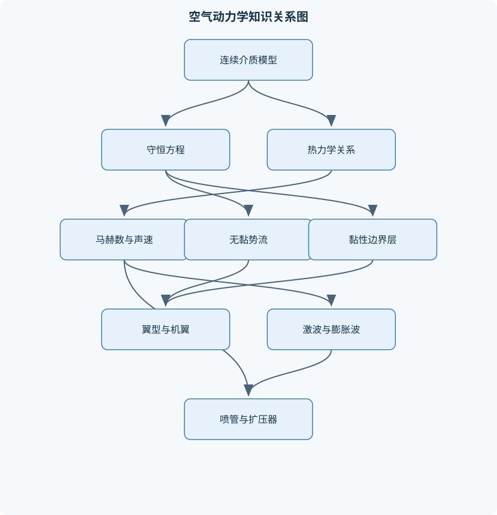
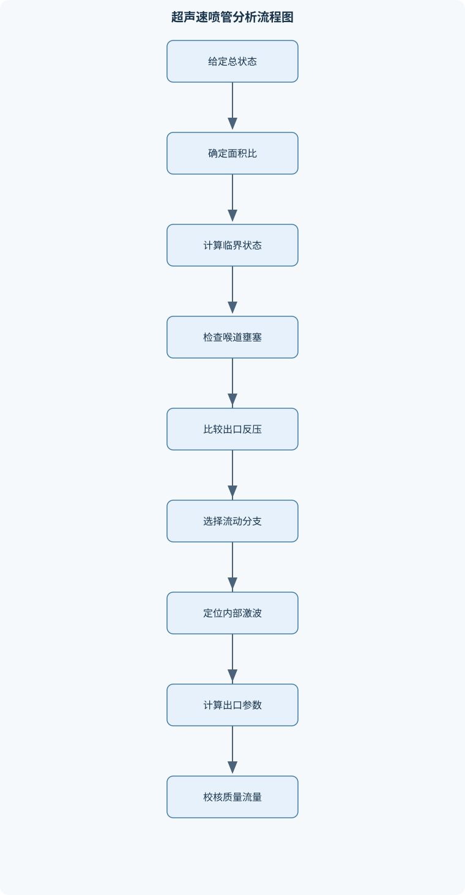

# 空气动力学

## 一、课程整体知识框架

### 课程边界与先修知识

本课程研究空气作为连续介质在物体、管道和开放流场中的运动规律，以及速度、压力、温度、密度、黏性和热力学状态之间的关系。内容覆盖不可压缩与可压缩流动、无黏势流、翼型与有限翼展机翼、边界层与湍流、激波与膨胀波、准一维喷管与扩压器、超声速及高超声速流动，并联系风洞试验、气动力计算和工程设计。先修知识包括高等数学中的多元微积分、常微分方程、矢量分析和偏微分方程基础，大学物理中的力学与热学，工程热力学中的状态方程和能量方程，以及基础流体力学中的连续方程、动量方程和黏性概念。课程中的理想模型必须与现实限制区分：无黏、定常、不可压、等熵和小扰动假设只在相应尺度、马赫数、雷诺数及边界条件下成立。





### 1. 研究对象、基本变量与建模层次

空气动力学研究空气作为流体在物体表面、管道内部和开放空间中的运动，以及运动引起的压力、剪切力、热传递和质量交换。基本场变量包括速度 $\boldsymbol{V}=(u,v,w)$、压力 $p$、温度 $T$、密度 $\rho$ 和内能。直角坐标 $x,y,z$ 的单位为 $\mathrm{m}$，时间 $t$ 的单位为 $\mathrm{s}$，速度分量的单位为 $\mathrm{m/s}$，压力的单位为 $\mathrm{Pa}$，密度的单位为 $\mathrm{kg/m^3}$。

连续介质假设把空气看作在空间中连续分布的介质，使速度、压力和温度能够定义为位置和时间的连续函数。其适用性由克努森数判断：

$$
Kn=\frac{\lambda}{L},
$$

其中 $\lambda$ 是分子平均自由程，$L$ 是流动特征尺度，二者单位均为 $\mathrm{m}$。当 $Kn$ 足够小时，分子尺度远小于宏观尺度，可以采用连续介质模型；当 $Kn$ 增大到不能忽略稀薄气体效应时，壁面无滑移条件、经典纳维—斯托克斯方程和局部热力学平衡可能失效。这里的特征尺度必须与问题相匹配：机翼外流可取弦长，微通道流动可取通道宽度，喷管流动可取喉道高度，不能机械使用同一个长度。

空气通常可近似为理想气体：

$$
p=\rho RT,
$$

其中 $R$ 是气体常数，空气在常温范围内常取 $287\ \mathrm{J/(kg\cdot K)}$。该式说明压力、密度和温度中任意两个量确定后，第三个量可以求出，但它本身不能决定流动是否等熵、是否不可压或是否无黏。不可压缩通常表示随体运动过程中密度变化可忽略，而不是说压力和温度绝对不变；低马赫数并不保证强烈加热或化学反应条件下密度不变。

黏性描述流体抵抗相邻流层相对运动的能力。动力黏度 $\mu$ 的单位为 $\mathrm{Pa\cdot s}$，运动黏度为

$$
\nu=\frac{\mu}{\rho},
$$

单位为 $\mathrm{m^2/s}$。牛顿流体满足简单剪切下的牛顿切应力定律：

$$
\tau=\mu\frac{\partial u}{\partial y},
$$

其中 $\tau$ 为切应力，单位为 $\mathrm{Pa}$。气体的动力黏度通常随温度升高而增大，不能套用液体黏度随温度降低的规律。边界层、壁面摩擦、流动分离和尾迹均直接受黏性影响。

### 2. 热力学、声速与总状态

比内能 $e$、比焓 $h$ 和比熵 $s$ 的单位分别为 $\mathrm{J/kg}$、$\mathrm{J/kg}$ 和 $\mathrm{J/(kg\cdot K)}$。比焓定义为

$$
h=e+\frac{p}{\rho}.
$$

对量热完全气体，若比热取常数，则

$$
dh=c_p\,dT,\qquad de=c_v\,dT,\qquad \gamma=\frac{c_p}{c_v},
$$

其中 $\gamma$ 是比热比。常温空气计算中常近似取 $\gamma=1.4$，但高温下振动激发、离解和电离会改变比热，不能继续把 $\gamma$ 当作固定常数。

等熵过程同时满足绝热和可逆条件。对理想气体，等熵关系为

$$
\frac{p}{\rho^\gamma}=\text{常数},\qquad
\frac{T_2}{T_1}
=\left(\frac{p_2}{p_1}\right)^{(\gamma-1)/\gamma}.
$$

声速表示微小压力扰动在介质中的传播速度。由等熵小扰动关系得到

$$
a^2=\left(\frac{\partial p}{\partial \rho}\right)_s.
$$

理想气体且 $\gamma$ 为常数时，

$$
a=\sqrt{\gamma RT}.
$$

马赫数定义为

$$
M=\frac{V}{a},
$$

其中 $V=|\boldsymbol{V}|$，单位为 $\mathrm{m/s}$。$M<1$、$M=1$ 和 $M>1$ 分别表示亚声速、声速和超声速状态。马赫数是局部量，因此同一流场中不同位置的马赫数可能不同；不能根据自由来流马赫数直接断言翼面各点都是亚声速。

定常、绝热、无黏流动沿流线满足能量方程

$$
h_0=h+\frac{V^2}{2},
$$

其中 $h_0$ 为总焓，单位为 $\mathrm{J/kg}$。对完全气体，

$$
T_0=T+\frac{V^2}{2c_p}.
$$

进一步使用 $h=c_pT$ 和 $a^2=\gamma RT$，可得

$$
\frac{T_0}{T}=1+\frac{\gamma-1}{2}M^2.
$$

若流动还等熵，则有

$$
\frac{p_0}{p}
=\left(1+\frac{\gamma-1}{2}M^2\right)^{\gamma/(\gamma-1)},
$$

$$
\frac{\rho_0}{\rho}
=\left(1+\frac{\gamma-1}{2}M^2\right)^{1/(\gamma-1)}.
$$

总压、总温和总密度是把当地流体等熵减速到零速度后得到的滞止状态参数。跨正激波时总温在绝热条件下保持不变，但总压因熵增而下降；因此总压不是任何流动中都守恒。下标 $\infty$ 表示自由来流，下标 $0$ 表示总状态，下标 $*$ 表示临界状态，即 $M=1$。

### 3. 运动学、守恒定律与控制方程

拉格朗日描述跟踪单个流体质点，记录其位置、速度和热力学状态随时间的变化；欧拉描述固定空间点上的速度场和状态场。两种描述通过随体导数联系：

$$
\frac{D\phi}{Dt}
=\frac{\partial\phi}{\partial t}
+\boldsymbol{V}\cdot\nabla\phi,
$$

其中 $\phi$ 可以是温度、密度或速度分量。第一项是固定点的局部变化，第二项是流体质点运动到不同位置所产生的对流变化。定常流动只表示 $\partial\phi/\partial t=0$，不表示随体导数为零。

流线在每个瞬间都与当地速度方向相切；迹线是某个流体质点的运动轨迹；脉线是连续经过固定点的流体质点在某一时刻形成的曲线。三者在定常流动中重合，在非定常流动中通常不同。流管由一族流线构成，若侧壁没有流体穿过，则质量只能通过进、出口交换。

质量守恒的微分形式为

$$
\frac{\partial\rho}{\partial t}
+\nabla\cdot(\rho\boldsymbol{V})=0.
$$

不可压缩且密度为常数时，退化为

$$
\nabla\cdot\boldsymbol{V}=0.
$$

对控制体应用雷诺输运定理，可把随体系统的守恒定律转化为控制体积分形式。动量守恒要求控制体内动量变化率等于表面压力、黏性应力和体积力的合力。应力张量包含法向应力和切向应力；对牛顿流体，黏性应力与应变率张量相关。常黏度、不可压缩条件下，动量方程可写成纳维—斯托克斯方程：

$$
\rho\left(
\frac{\partial\boldsymbol{V}}{\partial t}
+\boldsymbol{V}\cdot\nabla\boldsymbol{V}
\right)
=-\nabla p+\mu\nabla^2\boldsymbol{V}
+\rho\boldsymbol{g},
$$

其中 $\boldsymbol{g}$ 是单位质量体积力，通常包括重力加速度。左侧分别体现局部加速度和对流加速度，右侧分别体现压力梯度、黏性扩散和体积力。

能量方程把内能、动能、压力功、热传导和外部加热联系起来。绝热无黏流动可以简化为总焓沿流线守恒；存在黏性耗散、激波、壁面传热或燃烧时，必须保留相应项。熵方程表明不可逆过程产生熵，激波、混合和黏性耗散均使熵增加。等熵关系只能用于无热交换且无熵产生的区域，不能跨越真实激波直接使用。

涡量定义为

$$
\boldsymbol{\omega}=\nabla\times\boldsymbol{V},
$$

单位为 $\mathrm{s^{-1}}$。无旋流动满足 $\boldsymbol{\omega}=0$，但“无旋”不等于“速度为零”，也不等于“没有压力变化”。涡线是处处与涡量方向相切的曲线，环量为速度沿闭合曲线的线积分。涡量和环量用于描述翼尖涡、尾迹涡、点涡以及激波后复杂流动中的旋转结构。

### 4. 量纲分析、相似性与工程尺度

常用无量纲数包括雷诺数、马赫数、弗劳德数、欧拉数、斯特劳哈尔数和普朗特数：

$$
Re=\frac{\rho VL}{\mu}=\frac{VL}{\nu},
\qquad
Fr=\frac{V}{\sqrt{gL}},
$$

$$
Eu=\frac{\Delta p}{\rho V^2},
\qquad
St=\frac{fL}{V},
\qquad
Pr=\frac{\nu}{\alpha}.
$$

雷诺数比较惯性力与黏性力；马赫数比较速度与声速，衡量压缩性；弗劳德数比较惯性力与重力；欧拉数比较压力差与惯性压力尺度；斯特劳哈尔数反映非定常振荡；普朗特数比较动量扩散与热扩散。

铂金汉定理指出，含有 $n$ 个有量纲变量、基本量纲矩阵秩为 $r$ 的问题，可以用 $n-r$ 个独立无量纲组合表示。量纲分析不能凭空给出系数和完整流场，但能检查方程量纲一致性、减少实验变量并指导模型缩比。几何相似要求形状比例一致，运动相似要求速度和时间尺度关系一致，动力相似则要求主导无量纲数一致。

风洞模型与真实飞行器不可能总能同时匹配雷诺数、马赫数、弗劳德数和几何尺度。若主要研究高速压缩性，应优先匹配马赫数和总状态；若主要研究边界层分离，应特别关注雷诺数、表面粗糙度和来流湍流度；若研究自由液面或重力波，则弗劳德数不可忽略。把低雷诺数模型试验结果直接外推到高雷诺数实机，可能错误预测转捩、分离和阻力。

### 5. 理想模型与现实限制

无黏模型适合描述远离壁面的主流、某些外流压力分布和激波—膨胀波的初步结构，但不能预测壁面剪切应力、摩擦阻力和分离。势流模型还要求无旋，无法独立描述涡脱落和强尾迹。不可压模型适合低马赫数且压力变化引起的密度变化很小的情形；在跨声速、超声速和强加热流动中必须考虑压缩性。

定常模型适用于平均流动或流场变化时间远大于特征对流时间的情形；卡门涡街、动态失速和脉动激波则必须使用非定常模型。等熵模型适用于无摩擦、无热传递且没有激波的流动区域；激波、边界层和混合层都产生熵。小扰动模型适合小攻角、薄翼型和弱扰动，不适用于大攻角、强激波、厚钝头体或严重分离流动。

## 二、章节和模块划分

### 核心知识覆盖清单

本清单用于检查正文是否覆盖本课程的主要知识模块：

- **空气动力学基础与热力学关系**：连续介质假设与Knudsen数、理想气体状态方程、密度压力温度关系、动力黏度与运动黏度、牛顿切应力定律、比内能比焓与比热比、熵与等熵过程、声速与马赫数、总温总焓总压、临界状态与滞止状态。
- **流体运动学与守恒方程**：拉格朗日描述与欧拉描述、随体导数、流线迹线与脉线、流管流面与流量、涡量涡线与环量、雷诺输运定理、连续性方程、动量方程与应力张量、能量方程与焓方程、熵方程与耗散。
- **量纲分析与相似理论**：基本量纲与量纲一致性、铂金汉定理、雷诺数物理意义、马赫数与压缩性判据、弗劳德数与重力效应、欧拉数与压力效应、斯特劳哈尔数与非定常性、普朗特数与热扩散、几何相似运动相似动力相似、风洞模型缩比与相似限制。
- **无黏不可压缩流动与势流**：速度势函数与流函数、二维势流控制方程、均匀流点源点汇与偶极子、点涡与环量、势流叠加原理、圆柱绕流与驻点、兰金椭圆绕流、达朗贝尔佯谬、库塔—儒可夫斯基定理、开尔文环量定理与库塔条件。
- **翼型气动力与薄翼理论**：翼型弦线中弧线与前后缘、弯度厚度与相对几何参数、攻角升力阻力与力矩、压力中心与气动中心、压力系数与气动力系数、面涡和环量分布、薄翼理论基本假设、对称翼型与平板结果、弯度线对升力和力矩的影响、零升力攻角与失速边界。
- **有限翼展机翼与升力线理论**：翼展翼面积与展弦比、几何扭转与气动扭转、翼尖涡与下洗速度、几何迎角和有效迎角、诱导迎角与诱导阻力、马蹄涡模型、毕奥—萨伐尔定律、普朗特经典升力线理论、椭圆升力分布、展向载荷优化与非椭圆修正。
- **黏性流动与边界层**：无滑移边界条件、层流湍流与转捩、平板层流边界层、边界层尺度分析、普朗特边界层方程、排挤厚度与动量损失厚度、动能损失厚度、边界层动量积分方程、壁面摩擦阻力、边界层分离与压差阻力。
- **湍流与典型黏性绕流**：湍流随机性和脉动性、雷诺分解、雷诺平均方程、雷诺应力物理机制、湍流边界层速度分布、间歇因子与相关函数、圆柱绕流分离、卡门涡街与尾迹、管内完全发展层流、泊肃叶流与摩擦损失。
- **正激波与斜激波**：激波的非等熵特性、激波控制体分析、正激波守恒关系、激波前后马赫数、总压损失与熵增、普朗特关系、斜激波法向马赫数、θ—β—M关系、弱解强解与脱体激波、激波反射干扰与滑移线。
- **膨胀波与超声速翼型**：马赫波与马赫角、普朗特—梅耶膨胀波、普朗特—梅耶函数、凸壁膨胀与凹壁压缩、尖楔绕流、圆锥绕流基本差异、激波—膨胀波叠加、超声速翼型压力分布、波阻与总压损失、线性化超声速小扰动理论。
- **准一维流动与内流装置**：准一维流动假设、面积—速度关系、临界截面与喉道、拉瓦尔喷管、面积—马赫数关系、反压变化与喷管工作状态、壅塞流与最大质量流量、超声速扩压器、摩擦管流与Fanno流、加热管流与Rayleigh流。
- **跨声速与高超声速空气动力学**：可压缩势流与小扰动方程、普朗特—格劳厄特修正、临界马赫数、阻力发散马赫数、跨声速激波与边界层干扰、面积律与超临界翼型、高超声速薄激波层、高温真实气体效应、气动热与驻点加热、牛顿流模型与乘波体。


### 1. 空气动力学基础与热力学关系

本模块先建立空气动力学的物理量体系。学习连续介质假设、$Kn$ 数、理想气体状态方程、动力黏度与运动黏度、牛顿切应力定律以及比内能、比焓、比热和比热比的关系。随后由热力学第一定律和等熵条件推导声速及总状态公式。

一维等熵状态转换的计算顺序是：先确认 $\gamma$、$R$ 和已知状态是否属于同一气体模型；再由 $M$ 计算 $T_0/T$，由温度比计算 $p_0/p$ 和 $\rho_0/\rho$；最后利用 $p=\rho RT$ 检查结果一致性。若出现负压力、负绝对温度或状态方程不闭合，应首先检查单位、绝对温标和马赫数定义，而不是继续代入公式。该过程适用于定常、绝热、无黏、等熵流，计算量为常数级 $O(1)$。

### 2. 流体运动学与守恒方程

本模块从拉格朗日和欧拉描述出发，引入随体导数、流线、迹线、脉线、流管和流面。之后讨论流体微团的平移、旋转、线变形与角变形，并用应力张量和应变率张量表达黏性作用。

守恒方程的推导逻辑是：对任意控制体写质量、动量和能量守恒，再使用雷诺输运定理变换为控制体方程；令控制体缩小到微元，得到连续方程、动量方程和能量方程。实际分析必须先说明控制体是否定常、是否存在质量源、热传导、体积力和化学反应。仅在不可压、常黏度、牛顿流体等条件同时成立时，才能使用相应简化形式。

### 3. 量纲分析与相似理论

本模块使用基本量纲 $\mathrm{M}$、$\mathrm{L}$、$\mathrm{T}$ 以及热学量纲，构造无量纲关系。分析外流问题时，常见变量包括 $\rho,V,L,\mu,a,p$ 和特征频率 $f$，可得到 $Re$、$M$、$Eu$ 和 $St$ 等控制参数。

风洞缩比分析应先列出真实问题的主导物理机制，再选择必须匹配的无量纲数。若模型和实物的几何比例为 $\lambda_L$，仅保持几何相似并不能保证边界层状态相同；还需检查速度、黏度和密度能否使 $Re$ 接近。若无法全部匹配，应通过增压、改变温度、提高速度、改变模型表面粗糙度或采用修正方法说明尺度效应。

### 4. 无黏不可压缩流动与势流

无旋条件为

$$
\nabla\times\boldsymbol{V}=0.
$$

在单连通区域内，可以定义速度势函数 $\phi$，使

$$
\boldsymbol{V}=\nabla\phi.
$$

不可压条件 $\nabla\cdot\boldsymbol{V}=0$ 与无旋条件结合后给出

$$
\nabla^2\phi=0.
$$

二维流动还可定义流函数 $\psi$，其等值线为流线。均匀流、点源、点汇、偶极子和点涡都是拉普拉斯方程的基本解，在线性方程和理想边界条件下可以叠加。

圆柱绕流可由均匀流和偶极子叠加得到。圆柱表面法向速度为零，表面速度随圆周位置变化，由伯努利方程得到压力系数。前后对称的压力分布使合力阻力为零，这就是达朗贝尔佯谬。真实流体中，壁面无滑移产生边界层，边界层可能分离并形成尾迹，压力恢复受阻，因而出现压差阻力。该佯谬不是物理事实，而是无黏、定常、无分离理想模型的结果。

含环量的圆柱绕流破坏上下压力对称性。库塔—儒可夫斯基定理给出二维单位展长升力：

$$
l'=\rho_\infty V_\infty\Gamma.
$$

这里 $\Gamma$ 的正负号必须与环量积分方向和升力正方向统一；不同教材的环量方向约定可能使公式写成带负号的形式，不能脱离约定比较符号。

### 5. 翼型气动力与薄翼理论

翼型几何包括弦线、中弧线、厚度分布、前缘、后缘和相对厚度。二维翼型单位展长升力为 $l$，阻力为 $d$；三维机翼则使用 $L,D$。动压定义为

$$
q_\infty=\frac{1}{2}\rho_\infty V_\infty^2.
$$

压力系数和气动力系数分别为

$$
C_p=\frac{p-p_\infty}{q_\infty},
\qquad
C_L=\frac{L}{q_\infty S},
\qquad
C_D=\frac{D}{q_\infty S}.
$$

薄翼理论假设翼型薄、弯度小、攻角小、流动二维、无黏且亚声速不可压。把中弧线上的扰动表示为面涡分布，施加中弧线法向速度为零和后缘库塔条件，可以求得环量分布。对平板或对称薄翼，线性范围内升力系数可写为

$$
C_L\approx 2\pi\alpha,
$$

其中 $\alpha$ 用弧度表示。弯度会改变零升力攻角，使翼型在零几何攻角下仍可能产生升力；四分之一弦长附近为气动中心，俯仰力矩在小攻角范围内近似不随攻角变化。压力中心则是合力作用点，随着升力变化而移动，不能与气动中心混同。

当攻角继续增大，翼面不再保持附着，吸力峰后的逆压梯度导致分离，升力偏离线性规律并出现失速。薄翼理论不能预测失速角、分离泡和大范围黏性尾迹；这些问题必须结合边界层理论、实验或数值计算。

### 6. 有限翼展机翼与升力线理论

有限翼展机翼的展弦比为

$$
AR=\frac{b^2}{S},
$$

其中翼展 $b$ 和面积 $S$ 的单位分别为 $\mathrm{m}$ 和 $\mathrm{m^2}$。翼尖处上下表面的压力差驱动流体绕过翼尖，形成翼尖涡。翼尖涡诱导下洗速度，使机翼局部有效迎角小于几何迎角：

$$
\alpha_{\mathrm{eff}}
=\alpha_{\mathrm{geom}}-\alpha_i.
$$

下洗同时产生诱导阻力。理想椭圆升力分布下，

$$
C_{D_i}=\frac{C_L^2}{\pi AR},
$$

更一般地写为

$$
C_{D_i}=\frac{C_L^2}{\pi e\,AR},
$$

其中 $e$ 为展向效率因子。理想椭圆载荷取 $e=1$，实际机翼因平面形状、扭转、翼尖装置、结构载荷和黏性影响通常小于此值。

普朗特经典升力线理论将机翼表示为马蹄涡或连续涡系，利用毕奥—萨伐尔定律计算诱导速度。实际计算可将环量写成满足翼尖环量为零的正弦级数，代入升力线方程后求解系数，再积分得到总升力和诱导阻力。该理论适用于细长、亚声速、附着流机翼，不适合强跨声速激波、大分离或低展弦比钝体。

### 7. 黏性流动与边界层

壁面无滑移条件要求流体在固壁处速度等于壁面速度。高雷诺数外流中，黏性作用集中在靠近壁面的薄层内，外部主流可近似无黏，内部边界层则必须保留黏性项。边界层名义厚度 $\delta$ 依赖于速度达到外缘速度某一比例的判据；排挤厚度 $\delta^*$、动量厚度 $\theta_m$ 和动能损失厚度 $\delta^{**}$ 是积分量，定义不具有同一个数值。

零压力梯度平板层流的经典相似解给出边界层厚度随 $x$ 增长的规律：

$$
\delta \sim \sqrt{\frac{\nu x}{U_\infty}},
$$

局部摩擦系数和平均摩擦系数均可表示为局部雷诺数的负二分之一次幂关系。该结果只适用于平板、零压力梯度、层流、不可压且物性近似常数的情况，不能直接用于有强逆压梯度的翼面。

边界层动量积分方程把外缘速度 $U_e(x)$、动量厚度和壁面剪切应力联系起来。逆压梯度使外缘压力沿流向升高，近壁低动量流体难以继续前进，壁面速度梯度逐渐减小；当壁面剪切应力趋近于零并发生符号改变时，出现分离。湍流边界层混合能力较强，通常比层流边界层更抗分离，但摩擦阻力更大。

### 8. 湍流与典型黏性绕流

湍流具有随机脉动、多尺度结构、强混合和对初始扰动敏感等特征。雷诺分解把瞬时量写成平均量和脉动量之和，例如

$$
u=\overline{u}+u'.
$$

代入纳维—斯托克斯方程并平均后，会出现雷诺应力项 $-\rho\overline{u_i'u_j'}$，这导致湍流闭合问题。湍流速度分布通常包括黏性底层、缓冲层和对数层；粗糙度、压力梯度和来流湍流度会改变其结构。间歇因子用于描述湍流区与非湍流区交替出现的程度，相关函数用于描述脉动的时间或空间关联。

圆柱绕流中，分离点和尾迹随雷诺数变化。尾迹中的交替涡脱落形成卡门涡街，其主频可通过斯特劳哈尔数描述。圆柱总阻力既包括表面摩擦阻力，也包括前后压力差造成的压差阻力；分离延迟可能显著降低压差阻力，但不意味着所有阻力分量都下降。

管内完全发展层流中，速度只随径向位置变化。圆管泊肃叶流的速度分布为抛物线形，壁面切应力由压力梯度维持。水力直径 $D_h$ 用于非圆管通道的雷诺数和摩擦损失估计，但复杂截面、粗糙壁面和湍流流动不能简单照搬圆管精确解。

### 9. 正激波与斜激波

激波是厚度很小的强压缩波。穿过激波时压力、密度和温度升高，速度降低，熵增加，总压下降；绝热无外功时总焓保持不变。对正激波控制体应用质量、动量和能量守恒：

$$
\rho_1 V_1=\rho_2 V_2,
$$

$$
p_1+\rho_1V_1^2
=p_2+\rho_2V_2^2,
$$

$$
h_1+\frac{V_1^2}{2}
=h_2+\frac{V_2^2}{2}.
$$

上游必须为超声速，物理解要求熵增，波后马赫数为亚声速。总压比 $p_{02}/p_{01}<1$ 是判断激波损失的重要指标。

斜激波可将速度分解为波面法向和切向分量。切向速度在理想无黏激波模型中保持不变，法向分量遵循正激波关系，法向马赫数为

$$
M_{n1}=M_1\sin\beta.
$$

偏转角 $\theta$、激波角 $\beta$ 和上游马赫数 $M_1$ 由 $\theta$—$\beta$—$M$ 关系联系。给定 $M_1$ 和 $\theta$ 时，通常存在弱解和强解；弱解波后仍可能为超声速，强解波后为亚声速。若偏转角超过最大附着偏转角，激波从楔尖脱体，不能继续使用贴体斜激波公式。

### 10. 膨胀波与超声速翼型

超声速流动中的微小扰动沿马赫线传播，马赫角 $\mu_M$ 满足

$$
\sin\mu_M=\frac{1}{M}.
$$

凸壁转角形成连续的普朗特—梅耶膨胀扇。其过程近似无黏、绝热和等熵，马赫数增大，压力、温度和密度下降。普朗特—梅耶函数 $\nu_{\mathrm{PM}}(M)$ 将流向转角与马赫数联系起来：

$$
\nu_{\mathrm{PM}}(M_2)
=
\nu_{\mathrm{PM}}(M_1)+\theta.
$$

凹壁会产生压缩波，有限距离内可能汇聚形成激波。超声速翼型压力分布通常由激波压缩和膨胀波减压交替决定，波阻来自波系引起的动量损失和压力合力。线性化超声速小扰动理论可用于小攻角、薄翼型和弱扰动区域，不能描述强激波、激波边界层干扰和分离。

### 11. 准一维流动与内流装置

准一维模型假设流管截面上的状态近似均匀，变量主要沿轴向变化。由质量守恒、动量守恒和能量守恒可得面积—速度关系：

$$
\frac{dA}{A}
=(M^2-1)\frac{dV}{V}.
$$

因此亚声速流在收缩管中加速，在扩张管中减速；超声速流则相反。收缩—扩张组合形成拉瓦尔喷管，喉道达到 $M=1$ 后发生壅塞。继续降低出口反压，质量流量不再增加，但出口状态和内部激波位置仍可能变化。

等熵面积—马赫数关系把 $A/A^*$ 与 $M$ 联系起来。给定面积比通常有亚声速支和超声速支，必须结合上下游边界条件选择。反压状态分析要区分：全亚声速、喉道临界、喷管内部正激波、出口激波、完全超声速、过膨胀和欠膨胀等情况。

Fanno 流描述绝热恒面积管内的摩擦作用，摩擦使亚声速流加速、超声速流减速，二者都趋向 $M=1$。Rayleigh 流描述恒面积、无摩擦但有热交换的流动，加热或冷却可使状态沿相应曲线趋向热壅塞。摩擦壅塞和热壅塞的控制机制不同，不能混用公式。

### 12. 跨声速与高超声速空气动力学

跨声速流动中，自由来流可能为亚声速，但翼面局部因加速形成超声速区，并在其后通过激波恢复为亚声速。临界马赫数是翼面首次出现局部声速的自由来流马赫数；阻力发散马赫数则与激波形成、激波强度和波阻快速增加相关，二者不是同一个概念。

亚声速小扰动理论可给出普朗特—格劳厄特型压缩性修正，但在接近声速时分母趋近零，表明线性理论失效。跨声速翼型常采用面积律、后掠、超临界翼型和局部载荷优化来减弱激波和阻力发散。激波与边界层相互作用可能导致分离、抖振和控制面效率下降。

高超声速流动通常伴随强激波、薄激波层、显著气动热和高温真实气体效应。完全气体、常比热比模型在温度足够高时会失效，必须考虑振动激发、离解、电离、化学非平衡、辐射和低密度效应。牛顿流模型把高超声速物面压力近似与局部表面倾角联系起来，适合尖锐压缩面和初步量级估算；它不能替代黏性、化学反应和热非平衡计算。

驻点热流通常随速度、密度和头部曲率显著变化，头部半径减小往往提高驻点热流。乘波体利用前缘附着激波形成高压压缩区，使飞行器获得较高升阻比，但其设计依赖尖锐前缘、合适马赫数和严格的三维激波几何，实际结构强度、热防护和制造误差会限制理想性能。

### 13. 代表性计算流程与代码示例

#### 一维等熵状态转换

输入 $M$、静态压力 $p$、静温 $T$ 或总状态中的足够参数；输出总状态和临界状态。计算时先验证 $M\geq0$、$p>0$、$T>0$，再依次计算温度比、压力比和密度比。若流动含激波、摩擦或热交换，应分段处理，不能把整条流线当作等熵流。

```python
import math

def isentropic_total_state(M, p, T, gamma=1.4, R=287.0):
    if M < 0:
        raise ValueError("马赫数不能为负")
    if p <= 0 or T <= 0:
        raise ValueError("压力和绝对温度必须为正")
    if gamma <= 1 or R <= 0:
        raise ValueError("气体参数不合法")

    temperature_ratio = 1.0 + 0.5 * (gamma - 1.0) * M**2
    T0 = T * temperature_ratio
    p0 = p * temperature_ratio ** (gamma / (gamma - 1.0))
    rho = p / (R * T)
    rho0 = rho * temperature_ratio ** (1.0 / (gamma - 1.0))

    # 状态方程一致性检查
    if abs(p0 / (rho0 * R * T0) - 1.0) > 1e-10:
        raise ArithmeticError("总状态未通过状态方程检查")

    return {"T0_K": T0, "p0_Pa": p0, "rho0_kg_m3": rho0}
```

该算法输入输出均为常数个量，复杂度为 $O(1)$。其验证条件是同时满足状态方程和等熵总状态关系。若跨越正激波，应先用正激波关系计算波后静态状态和总压损失，再在波后区域重新使用等熵转换。

#### 正激波状态求解

输入上游 $M_1>1$、$p_1$、$T_1$ 和 $\gamma$。先由正激波关系求 $M_2$、$p_2/p_1$、$\rho_2/\rho_1$ 和 $T_2/T_1$，再使用理想气体状态方程恢复绝对状态，最后检查 $p_{02}/p_{01}<1$ 和熵增大于零。若 $M_1\leq1$，不存在由该状态形成的正激波压缩解。

#### 斜激波与膨胀波判定

输入上游马赫数和壁面转角后，先判断转角方向。压缩转角使用 $\theta$—$\beta$—$M$ 方程，凸角膨胀使用普朗特—梅耶函数。斜激波求解时先在马赫角与 $\pi/2$ 之间寻找弱解和强解，再用法向马赫数代入正激波关系；膨胀波求解时利用 $\nu_{\mathrm{PM}}(M_2)=\nu_{\mathrm{PM}}(M_1)+\theta$ 进行单调根搜索。若压缩转角超过最大偏转角，应输出脱体激波状态，而不是强行返回贴体根。

### 14. 代表性例题

#### 例题一：声速、马赫数和动压

**题干：** 空气温度为 $288\ \mathrm{K}$，密度为 $1.225\ \mathrm{kg/m^3}$，速度为 $100\ \mathrm{m/s}$，取 $\gamma=1.4$、$R=287\ \mathrm{J/(kg\cdot K)}$，求声速、马赫数和动压。

**分析：** 温度决定理想气体声速，速度与声速之比给出马赫数，动压只由密度和速度决定。

**解答：**

$$
a=\sqrt{\gamma RT}
=\sqrt{1.4\times287\times288}
\approx340.3\ \mathrm{m/s}.
$$

$$
M=\frac{100}{340.3}\approx0.294.
$$

$$
q_\infty=\frac12\rho V^2
=\frac12\times1.225\times100^2
=6125\ \mathrm{Pa}.
$$

**结果验证：** $M<1$，属于亚声速；动压单位为 $\mathrm{kg/(m\cdot s^2)}=\mathrm{Pa}$。由 $p=\rho RT$ 可得静压约为 $101325\ \mathrm{Pa}$，与给定标准状态量级一致。

**变式：** 若速度增加到 $340\ \mathrm{m/s}$，在温度不变时马赫数约为 $1$，但动压增加到原来的 $11.56$ 倍，说明动压和马赫数不是同一个物理量。

#### 例题二：平板小攻角升力

**题干：** 二维平板弦长为 $1\ \mathrm{m}$，单位展长来流速度为 $50\ \mathrm{m/s}$，密度为 $1.2\ \mathrm{kg/m^3}$，攻角为 $5^\circ$。在薄翼理论范围内求升力系数和单位展长升力。

**分析：** 角度必须换算为弧度，且薄翼理论使用小攻角线性关系。

**解答：**

$$
\alpha=5\frac{\pi}{180}\approx0.0873.
$$

对称平板：

$$
C_l=2\pi\alpha
\approx2\pi\times0.0873
\approx0.548.
$$

单位展长动压为

$$
q_\infty=\frac12\rho V^2
=\frac12\times1.2\times50^2
=1500\ \mathrm{Pa}.
$$

弦长为 $1\ \mathrm{m}$ 时，参考面积为单位展长乘弦长，因此

$$
l'=C_l q_\infty c
\approx0.548\times1500\times1
\approx822\ \mathrm{N/m}.
$$

**结果验证：** $C_l$ 无量纲，$l'$ 的单位为 $\mathrm{N/m}$。若把 $5$ 直接作为弧度代入，升力会被严重高估。

**变式：** 对弯度翼型，应使用 $\alpha-\alpha_{L=0}$ 作为有效升力攻角；零升力攻角不为零时，几何攻角为零仍可能产生正升力。

#### 例题三：有限翼展诱导阻力

**题干：** 机翼面积 $S=20\ \mathrm{m^2}$，展弦比 $AR=8$，升力系数 $C_L=0.6$，效率因子 $e=0.8$。求诱导阻力系数。

**分析：** 诱导阻力由有限翼展下洗产生，不能直接使用二维翼型阻力模型。

**解答：**

$$
C_{D_i}
=\frac{C_L^2}{\pi e AR}
=\frac{0.6^2}{\pi\times0.8\times8}
\approx0.0179.
$$

**结果验证：** $C_{D_i}$ 无量纲，且随 $C_L^2$ 增长。若将展弦比提高到 $16$，在其他条件不变时诱导阻力系数约减半。

**变式：** 若载荷分布不是椭圆分布，$e$ 会低于 $1$；若改变翼尖、扭转或平面形状，应重新估计展向载荷，而不能固定使用 $e=1$。

#### 例题四：正激波后的状态趋势

**题干：** 超声速气流以 $M_1>1$ 进入正激波。说明激波后压力、温度、密度、速度、马赫数和总压如何变化。

**分析：** 使用控制体质量、动量和能量守恒，并以熵增选择物理解。

**解答：** 正激波前后质量通量相等；压力和密度升高使静温由状态方程升高。由于总焓保持不变，静焓增加意味着速度降低。上游法向马赫数为超声速，波后马赫数必为亚声速。绝热无外功使总温近似不变，但激波产生熵，故总压下降：

$$
p_{02}<p_{01}.
$$

**结果验证：** 若计算得到波后马赫数大于上游马赫数，或总压升高，通常是把静压比、总压比或法向马赫数混淆。

**变式：** 斜激波只把法向速度分量按正激波处理，切向速度近似保持不变；不能把整个速度直接代入正激波公式。

#### 例题五：准一维喷管面积—速度关系

**题干：** 对绝热、无黏、定常准一维流动，说明收缩段和扩张段对亚声速、超声速流动的影响。

**分析：** 从质量守恒、状态变化和动量方程得到面积—速度关系。

**解答：**

$$
\frac{dA}{A}
=(M^2-1)\frac{dV}{V}.
$$

当 $M<1$ 时，$M^2-1<0$。若 $dA<0$，则 $dV>0$，即亚声速流在收缩段加速；若 $dA>0$，则减速。当 $M>1$ 时符号相反，超声速流在扩张段加速，在收缩段减速。喉道处若达到 $M=1$，继续降低反压不能无限增加质量流量，流动发生壅塞。

**结果验证：** 速度变化方向必须与马赫数分支相符；若把亚声速结论直接用于超声速段，喷管压力分布会判断错误。

**变式：** 反压升高时喷管内部可能出现正激波。此时激波前后分段使用等熵关系，但跨激波处必须使用激波守恒关系和总压损失。

### 15. 实验与项目流程

#### 风洞中翼型压力分布测量

**输入数据：** 翼型弦长 $c$、测压孔坐标、自由来流速度 $V_\infty$、密度 $\rho_\infty$、静压 $p_\infty$、各测压孔压力 $p_i$ 和攻角 $\alpha$。

**步骤：**

1. 检查模型安装角、测压管路密封性和压力传感器零点。
2. 在无模型或基准状态下记录静压基准，确认测量系统漂移。
3. 逐个攻角采集上、下表面压力，计算
   $$
   C_{p,i}=\frac{p_i-p_\infty}{q_\infty}.
   $$
4. 按弦向积分压力差，估算升力和俯仰力矩。
5. 增大攻角，观察吸力峰、压力恢复、分离迹象和失速后的压力平台。
6. 将积分结果与天平测得的升力比较，分析测压孔数量、三维端部效应和模型表面粗糙度造成的差异。

**评价标准：** 压力系数应与测得的压力单位一致；上、下表面压力积分方向必须明确；升力随小攻角应近似线性，超过失速范围后不应强行用线性拟合。测压积分升力与天平升力的差异应结合测量不确定度、端部泄漏和安装误差解释，不能只修改数据使两者相等。

**排错方法：** 若所有 $C_p$ 同时偏移，检查静压基准和传感器零点；若上、下表面分布左右颠倒，检查攻角符号和坐标方向；若局部出现不合理尖峰，检查测压孔堵塞、管路气泡或数据采样同步问题；若升力曲线在小攻角区明显不对称，检查模型安装和来流偏角。

#### 超声速喷管启动与反压状态项目

**输入数据：** 总压 $p_0$、总温 $T_0$、喉道面积 $A^*$、出口面积 $A_e$、反压 $p_b$、气体参数 $\gamma$ 和 $R$。

**步骤：**

1. 根据总状态和临界条件计算喉道壅塞时的最大质量流量。
2. 由 $A_e/A^*$ 求亚声速和超声速两个可能出口马赫数。
3. 将反压与全亚声速、临界、内部激波、出口激波和完全超声速状态逐一比较。
4. 若存在内部正激波，分别求激波前等熵状态、激波后总压损失和下游再等熵状态。
5. 改变反压，记录激波位置、出口压力和质量流量变化。
6. 检查第二喉道或扩压器是否能够吞咽激波，判断实验段能否保持目标超声速。

**评价标准：** 质量流量在喉道壅塞后不应随反压继续增加；跨激波总压必须下降；激波前后质量、动量和能量守恒应满足控制体方程；出口状态必须与指定反压相容。

**排错方法：** 若反压降低而质量流量无限增加，检查是否忘记壅塞上限；若总压跨激波升高，检查把静压比误当成总压比；若出口同时取到亚声速和超声速两个根，需结合反压和激波位置选择物理解；若实验显示强烈分离而准一维模型仍预测平滑流动，应考虑边界层堵塞和激波—边界层干扰超出了模型适用范围。

## 三、核心概念的详细解释

### 1. 连续介质、状态参数与空气的物性

空气动力学把空气视为由大量微观分子组成、但在宏观尺度上可以连续分布的介质。连续介质假设要求一个“流体微团”在宏观上足够小，能够反映某一点附近的速度、压力和温度；在微观上又足够大，能够平均掉分子热运动造成的随机涨落。该假设的适用性由克努森数判断：

$$
Kn=\frac{\lambda}{L},
$$

其中 $\lambda$ 为分子平均自由程，单位为 $\mathrm{m}$；$L$ 为与问题相匹配的特征长度，单位为 $\mathrm{m}$。$L$ 可以是机翼弦长、喷管喉道高度、管道直径或微通道宽度。$Kn$ 很小时，连续介质模型通常可靠；当 $Kn$ 增大时，分子碰撞、滑移壁面和非平衡效应不能忽略，经典无滑移边界条件和纳维—斯托克斯方程的适用性会下降。

空气常用理想气体模型：

$$
p=\rho RT,
$$

其中 $p$ 为静压，单位为 $\mathrm{Pa}$；$\rho$ 为密度，单位为 $\mathrm{kg/m^3}$；$T$ 为静温，单位为 $\mathrm{K}$；$R$ 为空气气体常数，常温下可取 $287\ \mathrm{J/(kg\cdot K)}$。该关系只给出状态参数之间的联系，不能单独判断流动是否定常、无黏、等熵或不可压缩。所谓不可压缩，通常是指流体质点运动过程中密度变化足够小，而非压力、温度或密度在所有位置都完全不变。

空气的动力黏度为 $\mu$，单位为 $\mathrm{Pa\cdot s}$；运动黏度为

$$
\nu=\frac{\mu}{\rho},
$$

单位为 $\mathrm{m^2/s}$。对于牛顿流体，简单剪切流中的切应力满足

$$
\tau=\mu\frac{\partial u}{\partial y},
$$

其中 $\tau$ 为切应力，单位为 $\mathrm{Pa}$，$u$ 为切向速度，$y$ 为法向坐标。气体的动力黏度通常随温度升高而增大；这与许多液体的趋势不同。黏性使壁面附近形成边界层，并产生摩擦阻力、尾迹、分离和总压损失。

### 2. 静态量、总量、临界量与马赫数

流体在某一点的 $p$、$T$、$\rho$ 和 $V$ 是静态量。若把流体微团沿一条绝热、无黏、等熵流线减速到速度为零，所得状态称为滞止状态或总状态，分别用下标 $0$ 表示。定常绝热无黏流动的能量方程为

$$
h+\frac{V^2}{2}=h_0.
$$

对于比热恒定的量热完全气体，$h=c_pT$，因此

$$
T_0=T+\frac{V^2}{2c_p}.
$$

利用 $a^2=\gamma RT$、$M=V/a$ 和 $c_p=\gamma R/(\gamma-1)$，可得

$$
\frac{T_0}{T}=1+\frac{\gamma-1}{2}M^2.
$$

其中 $a$ 为当地声速，单位为 $\mathrm{m/s}$；$M$ 为马赫数；$\gamma=c_p/c_v$ 为比热比。空气在常温、中低速条件下常取 $\gamma=1.4$，高温真实气体中则必须考虑温度相关比热、振动激发、离解和电离。

声速是等熵微小压力扰动的传播速度。热力学关系给出

$$
a^2=\left(\frac{\partial p}{\partial \rho}\right)_s.
$$

理想气体且 $\gamma$ 为常数时，

$$
a=\sqrt{\gamma RT}.
$$

马赫数定义为

$$
M=\frac{V}{a}.
$$

$M<1$ 为亚声速，$M=1$ 为声速，$M>1$ 为超声速。马赫数不是单纯的速度分类，因为同一速度在不同温度下可能对应不同马赫数。

在等熵、量热完全气体条件下，总压和总密度关系为

$$
\frac{p_0}{p}
=\left(1+\frac{\gamma-1}{2}M^2\right)^{\gamma/(\gamma-1)},
$$

$$
\frac{\rho_0}{\rho}
=\left(1+\frac{\gamma-1}{2}M^2\right)^{1/(\gamma-1)}.
$$

总压只有在等熵流动中才能沿流线保持不变。跨越激波时虽然总焓在绝热条件下仍可保持，但由于熵增，总压必然下降。因而不能把总压、静压和动压混为一谈。低速不可压流中常写

$$
p_0=p+\frac{1}{2}\rho V^2,
$$

但该形式不适用于一般可压缩高速流动。

临界状态用下标 $*$ 表示，定义为当地 $M=1$ 的状态。由总状态关系可得

$$
\frac{T^*}{T_0}=\frac{2}{\gamma+1},
$$

$$
\frac{p^*}{p_0}
=\left(\frac{2}{\gamma+1}\right)^{\gamma/(\gamma-1)},
$$

$$
\frac{\rho^*}{\rho_0}
=\left(\frac{2}{\gamma+1}\right)^{1/(\gamma-1)}.
$$

临界状态不一定出现在几何上最小的截面；在理想准一维喷管中，喉道通常是临界截面，但有摩擦、边界层堵塞或复杂三维效应时，实际有效喉道可能不同。

### 3. 运动学描述与守恒方程

拉格朗日描述跟踪每一个流体质点的位置和状态；欧拉描述则在固定空间位置研究速度、压力、温度等场变量。两种描述之间由随体导数联系：

$$
\frac{D}{Dt}
=
\frac{\partial}{\partial t}
+\boldsymbol{V}\cdot\nabla.
$$

对标量 $\phi$，

$$
\frac{D\phi}{Dt}
=
\frac{\partial\phi}{\partial t}
+u\frac{\partial\phi}{\partial x}
+v\frac{\partial\phi}{\partial y}
+w\frac{\partial\phi}{\partial z}.
$$

第一项是固定空间点的局部变化，后面各项是流体质点穿过空间梯度所产生的对流变化。定常流动只意味着 $\partial\phi/\partial t=0$，并不意味着 $D\phi/Dt=0$。流体仍可能因空间梯度而加速。

流线在任一瞬间都与当地速度方向相切；迹线是单个流体质点的运动轨迹；脉线是某固定点在一段时间内连续放出的流体质点所形成的曲线。定常流动中三者重合，非定常流动中一般不重合。涡量定义为

$$
\boldsymbol{\omega}=\nabla\times\boldsymbol{V},
$$

单位为 $\mathrm{s^{-1}}$。涡量描述局部旋转运动，不能简单等同于流线弯曲；弯曲流线可能没有局部涡量。

质量守恒的微分形式为

$$
\frac{\partial\rho}{\partial t}
+\nabla\cdot(\rho\boldsymbol{V})=0.
$$

若密度为常数，则

$$
\nabla\cdot\boldsymbol{V}=0.
$$

动量守恒可写成

$$
\rho\frac{D\boldsymbol{V}}{Dt}
=
-\nabla p+\nabla\cdot\boldsymbol{\tau}
+\rho\boldsymbol{f},
$$

其中 $\boldsymbol{\tau}$ 为黏性应力张量，$\boldsymbol{f}$ 为单位质量体积力，例如重力加速度。对牛顿流体，黏性应力与应变率张量线性相关；在常黏度、不可压条件下，方程可化为纳维—斯托克斯方程：

$$
\rho\frac{D\boldsymbol{V}}{Dt}
=
-\nabla p+\mu\nabla^2\boldsymbol{V}
+\rho\boldsymbol{f}.
$$

各项分别表示惯性、压力梯度、黏性扩散和体积力。忽略黏性得到欧拉方程，但只有在远离固壁、分离区和强剪切层时才可能合理。

总能量方程需要同时包含内能、动能、热传导、黏性耗散和外部热源。其一般形式可理解为：系统能量变化等于压力功、黏性功、热传导、体积力做功以及辐射、化学反应等能量输入。定常绝热无黏流动中，方程简化为总焓沿流线守恒。熵方程则说明黏性耗散、热传导和激波会产生熵；等熵只是理想极限，不是所有绝热流动都等熵。

### 4. 量纲分析、相似性与主要无量纲数

雷诺数为

$$
Re=\frac{\rho VL}{\mu}
=\frac{VL}{\nu}.
$$

它表示惯性效应与黏性效应的相对强弱。$Re$ 大时，外部主流中的黏性相对较弱，但壁面边界层仍可能非常重要；$Re$ 小时，黏性扩散范围较大，流动趋于层流。雷诺数不是决定转捩的唯一因素，表面粗糙度、来流湍流度和压力梯度也会影响转捩。

弗劳德数为

$$
Fr=\frac{V}{\sqrt{gL}},
$$

用于比较惯性与重力效应，适合自由液面、弹道和某些大尺度外流问题。欧拉数可写为

$$
Eu=\frac{\Delta p}{\rho V^2},
$$

衡量压力变化相对于惯性尺度的大小。斯特劳哈尔数

$$
St=\frac{fL}{V}
$$

反映非定常变化的时间尺度。普朗特数

$$
Pr=\frac{\nu}{\alpha}
$$

比较动量扩散率和热扩散率，其中 $\alpha$ 为热扩散率，单位为 $\mathrm{m^2/s}$。马赫数衡量速度与声速之比，是可压缩效应的重要判据，但强加热、强压力变化或高超声速化学非平衡条件下，不能只依据马赫数判断密度变化。

铂金汉定理表明，若某物理问题包含 $n$ 个有量纲变量，基本量纲矩阵秩为 $r$，则可化为 $n-r$ 个相互独立的无量纲组合。风洞模型要同时满足几何、运动和动力相似通常很困难。例如缩小模型可以保持几何相似，但若速度、温度和尺度不能同时调整，模型的 $Re$ 与 $M$ 可能无法同时匹配。因此风洞结果需要说明相似参数和未匹配参数，以及由此产生的偏差。

### 5. 无黏不可压流与势流

无旋流动满足

$$
\nabla\times\boldsymbol{V}=0.
$$

在单连通区域内，可定义速度势函数 $\phi$，使

$$
\boldsymbol{V}=\nabla\phi.
$$

不可压条件为 $\nabla\cdot\boldsymbol{V}=0$，于是

$$
\nabla^2\phi=0.
$$

二维流动还可定义流函数 $\psi$：

$$
u=\frac{\partial\psi}{\partial y},
\qquad
v=-\frac{\partial\psi}{\partial x}.
$$

$\psi$ 为常数的曲线是流线。势函数和流函数分别满足拉普拉斯方程，并可通过叠加构造均匀流、源、汇、偶极子和点涡等基本解。

圆柱绕流可由均匀流与偶极子叠加得到。圆柱表面速度满足

$$
V_\theta=-2V_\infty\sin\theta,
$$

进而由不可压无旋伯努利方程得到

$$
C_p=1-\frac{V^2}{V_\infty^2}
=1-4\sin^2\theta.
$$

压力分布前后对称，理论上净阻力为零，这就是达朗贝尔佯谬。真实流体存在边界层、壁面摩擦、分离和尾迹，尾迹中的总压损失破坏了前后压力对称，因而产生压差阻力。该佯谬不是“真实物体没有阻力”，而是理想无黏定常势流模型的结果。

在二维流动中加入点涡可产生环量 $\Gamma$。根据库塔—儒可夫斯基定理，单位展长升力为

$$
l'=\rho_\infty V_\infty\Gamma,
$$

升力方向取决于环量正负号约定。该公式只适用于远场均匀流、二维附着流和合适的环量定义；真实翼型的环量由黏性边界层与后缘库塔条件共同选择。

### 6. 翼型、有限翼展机翼与气动力

翼型的主要几何量包括弦长 $c$、中弧线、厚度分布、最大弯度、最大厚度及其相对弦向位置。攻角是来流方向与翼型参考弦线之间的夹角。升力和阻力分别为

$$
L=\frac{1}{2}\rho_\infty V_\infty^2SC_L,
\qquad
D=\frac{1}{2}\rho_\infty V_\infty^2SC_D.
$$

压力系数为

$$
C_p=\frac{p-p_\infty}{q_\infty},
\qquad
q_\infty=\frac{1}{2}\rho_\infty V_\infty^2.
$$

压力中心是合力作用线与弦线的交点，随攻角变化；气动中心是俯仰力矩对攻角近似不变的点。亚声速薄翼理论中，气动中心通常位于四分之一弦长附近，但厚度、黏性和可压缩性会使实际位置偏移。

薄翼理论假设翼型薄、弯度小、攻角小、流动二维、无黏、不可压且附着。通过在中弧线上布置面涡，施加中弧线法向速度为零和后缘库塔条件，可得到升力斜率。对对称薄翼，

$$
C_L\approx 2\pi\alpha,
$$

其中 $\alpha$ 必须用弧度表示。零升力攻角为零，四分之一弦长处力矩为零。弯度翼型通常具有负的零升力攻角，并在四分之一弦长处产生近似不随攻角改变的俯仰力矩。公式不能用于大攻角失速、厚翼型、明显分离或强可压缩流动。

有限翼展机翼的展弦比为

$$
AR=\frac{b^2}{S},
$$

其中 $b$ 为翼展，$S$ 为机翼面积。翼尖处高压下表面空气绕流到低压上表面，形成翼尖涡。翼尖涡诱导下洗速度，使有效迎角降低：

$$
\alpha_{\mathrm{eff}}
=
\alpha_{\mathrm{geo}}-\alpha_i.
$$

下洗还产生诱导阻力。经典升力线理论给出

$$
C_{D_i}=\frac{C_L^2}{\pi eAR},
$$

其中 $e$ 为展向效率因子。理想椭圆升力分布对应 $e=1$，在给定升力和展弦比下诱导阻力最小；实际机翼受结构重量、襟翼、机身、翼尖形状和黏性影响，通常不是严格椭圆分布。

### 7. 边界层、转捩、湍流与分离

固体壁面的无滑移条件要求流体在壁面处速度等于壁面速度。高雷诺数流动中，黏性影响集中在近壁薄层内，形成边界层。边界层尺度分析可得：若纵向尺度为 $L$，法向厚度为 $\delta\ll L$，则法向黏性项可能与纵向惯性项同阶，而压力沿法向变化较小。因此边界层内常有

$$
\frac{\partial p}{\partial y}\approx 0,
$$

边界层压力主要由外部无黏流决定。

零压力梯度平板层流的 Blasius 解给出

$$
\delta\approx 5.0\sqrt{\frac{\nu x}{U_\infty}},
$$

局部摩擦系数

$$
C_{f,x}
=\frac{\tau_w}{\tfrac12\rho U_\infty^2}
\approx \frac{0.664}{\sqrt{Re_x}},
$$

平均摩擦系数

$$
\overline C_f\approx \frac{1.328}{\sqrt{Re_L}}.
$$

这些结果仅适用于二维、定常、零压力梯度、光滑平板的层流边界层，不能直接用于有逆压梯度、曲面、粗糙壁面或湍流的情况。

边界层积分厚度包括排挤厚度、动量厚度和动能损失厚度：

$$
\delta^*
=
\int_0^\infty
\left(1-\frac{u}{U_e}\right)\,dy,
$$

$$
\theta_m
=
\int_0^\infty
\frac{u}{U_e}
\left(1-\frac{u}{U_e}\right)\,dy,
$$

$$
\delta^{**}
=
\int_0^\infty
\frac{u}{U_e}
\left[1-\left(\frac{u}{U_e}\right)^2\right]dy.
$$

其中 $U_e$ 为边界层外缘速度。排挤厚度表示边界层使外部流线向外移动的等效厚度；动量厚度表示因速度亏损造成的动量损失。

逆压梯度即沿流向压力升高，通常会使边界层减速。近壁流体动能因黏性损失后，可能无法继续克服压力升高，导致壁面剪切应力降为零，随后出现反向流动，这就是分离。逆压梯度不必然立即造成分离；湍流边界层由于近壁动量交换更强，通常比层流边界层更抗分离，但会产生更大的摩擦阻力。

湍流速度可分解为平均量与脉动量：

$$
u=\overline u+u',
\qquad
v=\overline v+v'.
$$

雷诺平均后会出现雷诺应力，如 $-\rho\overline{u'v'}$，它代表湍流脉动输运动量的平均效果。雷诺应力不是分子黏性应力，必须通过湍流模型或实验闭合。圆柱绕流中，分离剪切层会周期性脱落，形成卡门涡街；其主频可用斯特劳哈尔数关联。不同雷诺数下，分离位置、尾迹宽度和压差阻力可能显著不同。

### 8. 激波、膨胀波与超声速流动

激波是厚度很薄的压缩波层，跨越激波时压力、密度和温度升高，速度和马赫数降低，熵增加，总压损失。对定常正激波，控制体守恒方程为

$$
\rho_1u_1=\rho_2u_2,
$$

$$
p_1+\rho_1u_1^2
=
p_2+\rho_2u_2^2,
$$

$$
h_1+\frac{u_1^2}{2}
=
h_2+\frac{u_2^2}{2}.
$$

在量热完全气体条件下，正激波压力比为

$$
\frac{p_2}{p_1}
=
1+\frac{2\gamma}{\gamma+1}(M_1^2-1),
$$

密度比为

$$
\frac{\rho_2}{\rho_1}
=
\frac{(\gamma+1)M_1^2}
{(\gamma-1)M_1^2+2},
$$

波后马赫数为

$$
M_2^2
=
\frac{1+\frac{\gamma-1}{2}M_1^2}
{\gamma M_1^2-\frac{\gamma-1}{2}}.
$$

物理解要求上游 $M_1>1$，且下游 $M_2<1$。熵增可通过总压下降判定；数学上可能存在其他根，但不满足熵增条件的根不是物理激波解。

斜激波可分解为法向和切向速度分量。法向马赫数为

$$
M_{n1}=M_1\sin\beta,
$$

其中 $\beta$ 为激波角。法向分量按正激波关系变化，切向速度在无黏近似下保持不变。偏转角 $\theta$、激波角 $\beta$ 和上游马赫数满足

$$
\tan\theta
=
2\cot\beta
\frac{M_1^2\sin^2\beta-1}
{M_1^2(\gamma+\cos2\beta)+2}.
$$

对于给定 $M_1$ 和 $\theta$，通常有弱解和强解。弱解波后多为超声速，强解波后可能为亚声速。若偏转角超过最大允许值，激波不能贴附在楔面上，而会形成脱体弓形激波。

超声速流体绕凸角转弯时形成膨胀扇。膨胀波近似为连续马赫波，理想情况下等熵。马赫角满足

$$
\sin\mu_M=\frac{1}{M}.
$$

普朗特—梅耶函数为

$$
\nu_{\mathrm{PM}}(M)
=
\sqrt{\frac{\gamma+1}{\gamma-1}}
\tan^{-1}
\sqrt{\frac{\gamma-1}{\gamma+1}(M^2-1)}
-\tan^{-1}\sqrt{M^2-1}.
$$

对于凸角转角 $\theta$，

$$
\nu_{\mathrm{PM}}(M_2)
=
\nu_{\mathrm{PM}}(M_1)+\theta.
$$

压缩转角不能直接使用膨胀公式；压缩波通常会聚并最终形成激波。超声速翼型的波阻来自激波、膨胀波和压力分布不对称，即使无黏模型也可能产生波阻。

### 9. 准一维喷管、扩压器及跨声速流动

准一维流动假定流动参数在每个截面上近似均匀，只沿轴向变化。质量守恒给出

$$
\rho VA=\dot m.
$$

结合等熵关系和动量方程可得面积—速度关系：

$$
\frac{dA}{A}
=
(M^2-1)\frac{dV}{V}.
$$

因此亚声速流在收缩管中加速，在扩张管中减速；超声速流则相反。要使亚声速流连续加速到超声速，必须经过最小截面喉道，并在喉道达到 $M=1$。这种状态称为壅塞。

等熵准一维流的面积—马赫数关系为

$$
\frac{A}{A^*}
=
\frac{1}{M}
\left[
\frac{2}{\gamma+1}
\left(1+\frac{\gamma-1}{2}M^2\right)
\right]^{\frac{\gamma+1}{2(\gamma-1)}}.
$$

同一面积比通常对应一个亚声速根和一个超声速根，必须结合反压、激波位置和流动连续性选择物理解。喉道壅塞时最大质量流量为

$$
\dot m_{\max}
=
A^*p_0
\sqrt{\frac{\gamma}{RT_0}}
\left(\frac{2}{\gamma+1}\right)^{\frac{\gamma+1}{2(\gamma-1)}}.
$$

反压继续降低时，若喉道已壅塞，质量流量不再增加；但出口压力、内部激波位置和喷管外部膨胀状态仍会变化。高反压可能导致全亚声速流；反压降低后可能出现喉道临界、内部正激波、出口激波以及完全超声速流。

Fanno流研究绝热、定截面、有摩擦管流；Rayleigh流研究无摩擦、定截面、有热交换管流。两者都使马赫数趋近 $1$，但机制不同：Fanno流由壁面摩擦造成熵增和摩擦壅塞，Rayleigh流由加热或冷却改变能量和状态，可能导致热壅塞。不能用同一组状态关系代替二者。

跨声速流动中，物体表面局部区域可能同时存在亚声速和超声速区，并通过激波相连。临界马赫数是自由来流刚好在物面某处达到局部 $M=1$ 的来流马赫数；阻力发散马赫数则与局部超声速区和激波强度迅速增大有关。面积律、后掠翼和超临界翼型可减缓跨声速阻力发散，但不能消除黏性、激波—边界层干扰和结构限制。

### 10. 高超声速、气动热与真实气体

高超声速流动通常具有强激波、薄激波层、强烈压缩加热和显著气动热。驻点附近速度几乎降为零，动能转化为焓和内能；摩擦、激波、边界层以及激波与边界层干扰也会产生热流。头部曲率越小，驻点附近压缩越强，热流密度通常越高，但具体关系取决于速度、密度、黏度、气体模型和壁面状态。

常温完全气体、常数 $\gamma$ 和局部热平衡假设在高温下可能失效。分子振动激发会改变比热；更高温度下发生离解、电离和化学反应，气体组分不再固定，能量方程需要加入内能模式和反应源项。高空低密度飞行中，$Kn$ 增大还可能导致滑移流甚至稀薄流，连续介质模型需要修正。

牛顿流模型把物面前方气体分子的法向动量变化近似转化为压力作用，适用于高超声速、小偏角、强压缩和近似切向动量不变的情形。它能快速估算压力系数，且马赫数足够高时精度可能提高，但不能描述黏性、热传导、化学非平衡和复杂激波结构。乘波体利用前缘附着激波压缩气流，使高压区域集中在升力面附近；其设计仍需同时检查热流、边界层、结构强度和离设计状态。

### 11. 代表性计算流程与工程工作流

#### 一维等熵状态转换

**输入：** 已知的 $M$、$p$、$T$、$\rho$、$p_0$、$T_0$ 或临界状态中的足够参数，以及 $\gamma$、$R$。  
**输出：** 静态量、总量、临界量和声速。

**步骤：**

1. 检查 $\gamma>1$、$R>0$、$T>0$、$p>0$ 和 $M\geq0$。
2. 使用
   $$
   \frac{T_0}{T}=1+\frac{\gamma-1}{2}M^2
   $$
   计算总温。
3. 使用
   $$
   \frac{p_0}{p}
   =
   \left(\frac{T_0}{T}\right)^{\gamma/(\gamma-1)}
   $$
   计算总压。
4. 使用
   $$
   \frac{\rho_0}{\rho}
   =
   \left(\frac{T_0}{T}\right)^{1/(\gamma-1)}
   $$
   计算总密度。
5. 用 $a=\sqrt{\gamma RT}$ 检查声速和马赫数的一致性。

**适用条件：** 定常、绝热、无黏、等熵、量热完全气体。跨激波、强摩擦、明显换热和化学反应流动不能直接使用。

#### 斜激波求解

**输入：** $M_1$、偏转角 $\theta$、$\gamma$。  
**输出：** 激波角 $\beta$、波后马赫数和静态参数。

1. 计算马赫角 $\mu_M=\sin^{-1}(1/M_1)$。
2. 在 $\mu_M<\beta<\pi/2$ 范围内求解 $\theta$—$\beta$—$M$ 方程。
3. 若存在两个根，分别保留弱解和强解，并结合工程边界条件选择。
4. 计算 $M_{n1}=M_1\sin\beta$。
5. 对法向分量使用正激波关系，得到 $M_{n2}$、压力比、密度比和温度比。
6. 由切向速度连续条件恢复波后总速度方向和马赫数。
7. 检查 $M_{n1}>1$、熵增为正及流向偏转是否等于输入 $\theta$。

若 $\theta$ 超过最大偏转角，应判定贴体解不存在，而不是强行输出一个数学根。

#### 升力线理论求解

**输入：** $b$、$S$、弦长分布、几何扭转、零升力攻角、$V_\infty$、$\rho_\infty$。  
**输出：** 展向环量、下洗、总升力和诱导阻力。

1. 将展向坐标变换为 $y=(b/2)\cos\theta$。
2. 用满足翼尖 $\Gamma=0$ 的正弦级数表示环量分布。
3. 根据毕奥—萨伐尔定律计算各展向位置的诱导速度。
4. 将几何迎角减去诱导迎角，建立升力线方程。
5. 求解级数系数，并检查翼尖边界条件和方程残差。
6. 对展向升力积分得到 $L$，对诱导阻力积分得到 $D_i$。

对于 $N$ 个截断模态，直接求解稠密线性方程组的计算复杂度约为 $O(N^3)$，存储复杂度约为 $O(N^2)$。该理论适用于细长机翼、低速或亚声速、附着流和小迎角；强非线性失速、厚翼型和复杂机身干扰需要更完整模型。

#### 边界层积分法

**输入：** 外缘速度 $U_e(x)$、密度、黏度、初始边界层状态和选定速度型。  
**输出：** $\delta$、$\delta^*$、$\theta_m$、$\tau_w$ 和可能的分离位置。

1. 选择满足壁面无滑移和外缘速度匹配的速度型。
2. 由速度型计算动量厚度、排挤厚度和形状参数。
3. 将动量积分方程转化为关于厚度参数的常微分方程。
4. 沿 $x$ 方向积分。
5. 检查 $\tau_w=0$ 或形状参数达到预定分离判据的位置。
6. 分离后停止使用附着边界层积分法，改用分离流模型、实验或数值模拟。

边界层积分法的优点是计算量小，适合初步设计；缺点是速度型假设和分离判据会影响结果，不能替代完整纳维—斯托克斯求解。

#### 等熵关系计算的 Python 示例

```python
import math

def isentropic_state(M, p, T, gamma=1.4, R=287.0):
    """计算量热完全气体的一维等熵总状态和声速。"""
    if M < 0:
        raise ValueError("马赫数不能为负")
    if p <= 0 or T <= 0:
        raise ValueError("压力和温度必须为正")
    if gamma <= 1 or R <= 0:
        raise ValueError("gamma 必须大于 1，R 必须为正")

    temperature_ratio = 1.0 + 0.5 * (gamma - 1.0) * M * M
    T0 = T * temperature_ratio
    p0 = p * temperature_ratio ** (gamma / (gamma - 1.0))
    rho = p / (R * T)
    rho0 = rho * temperature_ratio ** (1.0 / (gamma - 1.0))
    a = math.sqrt(gamma * R * T)

    return {
        "T0_K": T0,
        "p0_Pa": p0,
        "rho_kg_m3": rho,
        "rho0_kg_m3": rho0,
        "a_m_s": a
    }

state = isentropic_state(M=0.80, p=101325.0, T=288.15)
for name, value in state.items():
    print(f"{name}: {value:.6g}")
```

该程序只执行代数计算，不适用于激波、摩擦管流、换热管流或高温化学非平衡流。

### 12. 实验与工程项目流程

#### 风洞中翼型压力分布与升力测量

**输入数据：** 翼型弦长、模型表面测压孔坐标、自由来流速度、静压、温度、密度、攻角和各测压孔压力。

**步骤：**

1. 检查压力传感器零点、量程、管路密封性和测压孔编号。
2. 在多个攻角下记录自由来流静压、总压、温度和模型表面压力。
3. 使用
   $$
   C_p=\frac{p-p_\infty}{q_\infty},
   \qquad
   q_\infty=\frac12\rho_\infty V_\infty^2
   $$
   将压力换算为压力系数。
4. 沿翼型表面积分压力，得到升力和俯仰力矩。
5. 绘制 $C_L-\alpha$、$C_m-\alpha$ 和上下表面 $C_p$ 分布。
6. 比较小攻角线性区、失速前非线性区和失速后压力恢复特征。

**评价标准：** 上下表面压力差积分应与测力天平升力在不确定度范围内一致；小攻角区的升力随攻角近似线性；后缘压力分布应与尾缘条件相容；数据随攻角变化应连续，除非存在转捩、分离或失速。

**排错方法：**

- 若所有压力孔同时出现相同偏移，检查静压基准和传感器零点。
- 若上下表面压力差方向反常，检查攻角符号、测压孔位置和压力管路连接。
- 若数据出现孤立尖峰，检查孔堵塞、管路泄漏和采样同步。
- 若测得升力与压力积分差异很大，检查模型三维端部效应、安装偏角、压力孔离散误差以及测力天平标定。
- 若失速攻角随来流速度显著变化，应检查雷诺数、湍流度和模型表面粗糙度，而不能简单归因于测量噪声。

#### 超声速喷管反压与激波位置项目

**输入数据：** $p_0$、$T_0$、喉道面积 $A^*$、出口面积 $A_e$、反压 $p_b$、$\gamma$ 和 $R$。

**步骤：**

1. 根据临界条件计算最大质量流量。
2. 由 $A_e/A^*$ 计算理论亚声速根和超声速根。
3. 逐步降低反压，观察喷管内部是否出现激波。
4. 若有内部正激波，先计算激波前等熵状态，再计算跨激波总压损失，最后计算激波后至出口的再等熵膨胀或压缩。
5. 记录反压、出口压力、质量流量和激波位置。
6. 检查实验段是否达到设计马赫数，以及扩压器是否能够吞咽激波。

**评价标准：**

- 喉道壅塞后质量流量不应随反压无限增加。
- 激波前后质量、动量和能量守恒。
- 跨激波总压下降，熵增为正。
- 出口压力必须与反压和下游流动状态相容。
- 激波位置随反压变化应具有物理连续性。

**排错方法：**

- 若反压降低后质量流量持续显著增大，检查是否忘记壅塞上限。
- 若计算得到跨激波总压升高，检查是否把静压比误当作总压比。
- 若同一出口面积同时使用亚声速根和超声速根，检查是否忽略反压和流动连续性。
- 若实验中出现强烈分离而准一维模型仍给出平滑解，应考虑边界层堵塞、激波—边界层干扰和喷管非均匀性。
- 若风洞不能启动，应检查第二喉道临界流量能力、反压控制和启动过程中激波是否被吞咽。

## 四、重要定义、公式、定理和推导

### 专业审校补充：关键定义与适用边界

准一维等熵喷管的壅塞条件是喉道达到声速，即 M*=1；此时质量流率达到给定总状态和喉道面积所允许的最大值。对量热完全气体、定常、绝热、无轴功、无黏且流动等熵的模型，质量流率可写为 ṁ=A* p₀/√(T₀)·√(γ/R)·[2/(γ+1)]^[(γ+1)/(2(γ−1))]，其中 ṁ 的单位为 kg/s，A* 为喉道面积 m²，p₀ 为总压 Pa，T₀ 为总温 K，R 为气体常数 J/(kg·K)，γ 为比热比。该式说明，继续降低背压不能使质量流率无限增加；背压降低后，主要改变的是喉道下游的超声速区域、激波位置和出口状态。临界压力比为 p*/p₀=[2/(γ+1)]^[γ/(γ−1)]。若背压仍高于使喉道达到临界状态所需的范围，流动全程可能保持亚声速；若喉道壅塞而出口存在正激波，总压必须在激波处下降，激波后应按新的总压继续计算。该结论不适用于显著摩擦、强传热、化学反应或喷管堵塞比不可忽略的情形。


### 1. 声速与总温关系的推导

声速定义为等熵微小扰动下压力对密度的导数：

$$
a^2=\left(\frac{\partial p}{\partial\rho}\right)_s.
$$

理想气体等熵关系为

$$
p=K\rho^\gamma,
$$

其中 $K$ 在给定等熵流线上为常数。对 $\rho$ 求导：

$$
\left(\frac{\partial p}{\partial\rho}\right)_s
=
\gamma K\rho^{\gamma-1}
=
\gamma\frac{p}{\rho}.
$$

由 $p=\rho RT$，得到

$$
a^2=\gamma RT,
\qquad
a=\sqrt{\gamma RT}.
$$

定常绝热无黏流动满足

$$
h+\frac{V^2}{2}=h_0.
$$

对量热完全气体，$h=c_pT$，停滞状态速度为零，因此

$$
c_pT+\frac{V^2}{2}=c_pT_0.
$$

整理并代入 $V=Ma$、$a^2=\gamma RT$：

$$
T_0-T
=
\frac{M^2\gamma RT}{2c_p}.
$$

又因为

$$
c_p=\frac{\gamma R}{\gamma-1},
$$

所以

$$
\frac{T_0}{T}
=
1+\frac{\gamma-1}{2}M^2.
$$

该推导要求流动绝热、无轴功、无显著位能变化，且气体可用常比热完全气体表示。

### 2. 欧拉方程、伯努利方程与适用边界

无黏流动的动量方程为

$$
\rho\frac{D\boldsymbol V}{Dt}
=
-\nabla p+\rho\boldsymbol f.
$$

若定常、无黏、无体积力，并沿流线投影，得到

$$
V\,dV+\frac{dp}{\rho}=0.
$$

不可压缩时 $\rho$ 为常数，积分得

$$
p+\frac12\rho V^2=\text{常数}.
$$

若以单位质量形式书写，

$$
\frac{p}{\rho}+\frac{V^2}{2}=\text{常数}.
$$

若再考虑重力，则

$$
\frac{p}{\rho}+\frac{V^2}{2}+gz=\text{常数}.
$$

伯努利方程不是普遍的能量守恒公式。黏性、泵功、热交换、激波和机械能损失存在时，应加入相应损失项或改用总能量方程。可压缩流动中也不能直接使用不可压形式，应使用焓和总焓关系。

### 3. 势函数、流函数与拉普拉斯方程

无旋条件为

$$
\nabla\times\boldsymbol V=0.
$$

在单连通区域内，根据矢量分析，可令

$$
\boldsymbol V=\nabla\phi.
$$

不可压连续方程为

$$
\nabla\cdot\boldsymbol V=0.
$$

代入速度势：

$$
\nabla\cdot(\nabla\phi)=\nabla^2\phi=0.
$$

因此二维势流的速度势满足拉普拉斯方程：

$$
\frac{\partial^2\phi}{\partial x^2}
+
\frac{\partial^2\phi}{\partial y^2}
=0.
$$

二维不可压流可定义流函数，使

$$
u=\frac{\partial\psi}{\partial y},
\qquad
v=-\frac{\partial\psi}{\partial x}.
$$

代入连续方程：

$$
\frac{\partial u}{\partial x}
+
\frac{\partial v}{\partial y}
=
\frac{\partial^2\psi}{\partial x\partial y}
-
\frac{\partial^2\psi}{\partial y\partial x}
=0.
$$

因此 $\psi$ 的等值线满足

$$
d\psi
=
\frac{\partial\psi}{\partial x}dx
+
\frac{\partial\psi}{\partial y}dy
=
-v\,dx+u\,dy=0,
$$

即其切向方向满足 $dy/dx=v/u$，与速度方向一致，所以流函数等值线是流线。

### 4. 有限翼展诱导阻力的推导

有限翼展机翼的展向环量 $\Gamma(y)$ 在翼尖必须趋于零。环量沿翼展变化会产生尾迹涡系，尾迹涡通过毕奥—萨伐尔定律在机翼附近诱导下洗速度 $w_i$。小角度下，诱导迎角近似为

$$
\alpha_i\approx \frac{w_i}{V_\infty}.
$$

有效迎角为

$$
\alpha_{\mathrm{eff}}
=
\alpha_{\mathrm{geo}}-\alpha_i.
$$

升力方向垂直于局部有效来流，而不是严格垂直于自由来流，因此升力向后倾斜，产生诱导阻力。小角度近似下，

$$
D_i\approx L\alpha_i.
$$

对理想椭圆升力分布，下洗在翼展方向为近似常量，经典升力线理论可得

$$
C_{D_i}
=
\frac{C_L^2}{\pi AR}.
$$

对实际非椭圆分布，引入效率因子 $e$：

$$
C_{D_i}
=
\frac{C_L^2}{\pi eAR}.
$$

由此可见，提高展弦比或改善展向载荷分布可以降低诱导阻力，但会增加结构弯矩、重量、机场尺度限制或低速操纵约束，因此工程设计不是单纯追求最大展弦比。

### 5. 平板层流边界层的标度关系

二维定常零压力梯度边界层方程为

$$
u\frac{\partial u}{\partial x}
+
v\frac{\partial u}{\partial y}
=
\nu\frac{\partial^2u}{\partial y^2},
$$

并满足

$$
u(x,0)=0,
\qquad
u(x,\infty)=U_\infty.
$$

设边界层厚度为 $\delta$，则纵向速度梯度量级为 $U_\infty/L$，法向速度梯度量级为 $U_\infty/\delta$。由连续方程，法向速度量级约为 $U_\infty\delta/L$。因此纵向惯性项量级为

$$
\frac{U_\infty^2}{L},
$$

法向黏性项量级为

$$
\nu\frac{U_\infty}{\delta^2}.
$$

令两者同阶：

$$
\frac{U_\infty^2}{L}
\sim
\nu\frac{U_\infty}{\delta^2},
$$

得到

$$
\frac{\delta}{L}
\sim
\frac{1}{\sqrt{Re_L}},
\qquad
\delta\sim \sqrt{\frac{\nu L}{U_\infty}}.
$$

这说明高雷诺数下边界层相对很薄，但壁面剪切应力并不一定可以忽略。Blasius 相似解进一步给出前述厚度和摩擦系数公式，但其前提是平板、零压力梯度和层流。

### 6. 正激波守恒关系与熵增

以激波为固定控制面，质量守恒为

$$
\rho_1u_1=\rho_2u_2=m''.
$$

动量守恒为

$$
p_1+\rho_1u_1^2
=
p_2+\rho_2u_2^2.
$$

能量守恒为

$$
h_1+\frac{u_1^2}{2}
=
h_2+\frac{u_2^2}{2}.
$$

将理想气体状态方程、$h=c_pT$ 和 $u=Ma$ 代入，可联立得到压力比、密度比、温度比和波后马赫数。对上游超声速流 $M_1>1$，结果必然满足

$$
p_2>p_1,\qquad
\rho_2>\rho_1,\qquad
T_2>T_1,\qquad
M_2<1.
$$

总焓不变并不意味着总压不变。熵方程给出

$$
s_2-s_1>0,
$$

而理想气体熵变可写为

$$
s_2-s_1
=
c_p\ln\frac{T_2}{T_1}
-
R\ln\frac{p_2}{p_1}.
$$

熵增为正是激波物理解的必要条件。总压损失正是激波不可逆性的工程表现。

### 7. 面积—速度关系与壅塞推导

准一维质量守恒为

$$
\rho VA=\dot m.
$$

取微分并除以原式：

$$
\frac{d\rho}{\rho}
+
\frac{dV}{V}
+
\frac{dA}{A}
=0.
$$

定常等熵流中，微分动量方程为

$$
dp+\rho V\,dV=0.
$$

声速定义和等熵关系给出

$$
dp=a^2d\rho.
$$

因此

$$
a^2d\rho+\rho V\,dV=0.
$$

除以 $\rho V^2$：

$$
\frac{d\rho}{\rho}
=
-\frac{V^2}{a^2}\frac{dV}{V}
=
-M^2\frac{dV}{V}.
$$

代入连续方程：

$$
-M^2\frac{dV}{V}
+
\frac{dV}{V}
+
\frac{dA}{A}=0,
$$

得到

$$
\frac{dA}{A}
=
(M^2-1)\frac{dV}{V}.
$$

当 $M<1$ 时，收缩管道 $dA<0$ 导致 $dV>0$；当 $M>1$ 时，扩张管道 $dA>0$ 导致 $dV>0$。在 $M=1$ 处，若流动从亚声速连续过渡到超声速，必须有 $dA=0$，因此喉道成为临界截面。质量流量达到最大值后，进一步降低下游反压不能增加喉道通流能力，这就是壅塞。

### 8. 小扰动理论的适用边界

亚声速小扰动理论把速度势写成均匀来流加小扰动：

$$
\phi=U_\infty x+\phi',
\qquad
|\nabla\phi'|\ll U_\infty.
$$

在线性化条件下，扰动方程可由椭圆型方程处理；对薄翼型，压力系数会出现普朗特—格劳厄特修正，典型形式为

$$
C_p\approx \frac{C_{p,0}}{\sqrt{1-M_\infty^2}},
$$

其中 $C_{p,0}$ 为不可压小扰动结果。该式在接近 $M_\infty=1$ 时趋于无穷，恰好说明线性亚声速理论在跨声速区失效，而不是说明真实压力系数真的无穷大。

超声速线性化理论中，薄翼小扰动压力系数的量级与

$$
\frac{1}{\sqrt{M_\infty^2-1}}
$$

有关。它适用于小攻角、薄翼型、弱扰动和远离强激波区域。大攻角、厚翼型、激波—边界层干扰、失速和高超声速真实气体条件下，必须使用非线性可压缩流、黏性模型或实验数据。

### 9. 五个代表性例题

#### 例题一：声速、马赫数与动压

**题干：** 空气温度为 $288.15\ \mathrm{K}$，密度为 $1.225\ \mathrm{kg/m^3}$，飞行速度为 $68.0\ \mathrm{m/s}$，取 $\gamma=1.4$、$R=287\ \mathrm{J/(kg\cdot K)}$。求声速、马赫数和动压。

**分析：** 声速由温度决定，动压由密度和速度决定，不能用总压代替动压。

**解答：**

$$
a=\sqrt{\gamma RT}
=\sqrt{1.4\times287\times288.15}
\approx340.3\ \mathrm{m/s}.
$$

$$
M=\frac{V}{a}
=\frac{68.0}{340.3}
\approx0.200.
$$

$$
q_\infty=\frac12\rho V^2
=\frac12\times1.225\times68.0^2
\approx2.83\times10^3\ \mathrm{Pa}.
$$

**结果验证：** $M<1$，属于低马赫数亚声速流；动压单位为 $\mathrm{Pa}$，且随速度平方变化。

**变式：** 若温度升高而速度不变，声速增加，马赫数下降；若密度减半而速度不变，动压减半，但在理想气体模型下温度和压力也必须相应满足状态方程。

#### 例题二：有限翼展机翼诱导阻力

**题干：** 机翼面积 $S=20\ \mathrm{m^2}$，展弦比 $AR=8$，升力系数 $C_L=0.6$，效率因子 $e=0.85$，自由来流动压为 $q_\infty=5000\ \mathrm{Pa}$。求诱导阻力系数和诱导阻力。

**解答：**

$$
C_{D_i}
=
\frac{C_L^2}{\pi eAR}
=
\frac{0.6^2}{\pi\times0.85\times8}
\approx0.0169.
$$

$$
D_i=q_\infty S C_{D_i}
=5000\times20\times0.0169
\approx1690\ \mathrm{N}.
$$

**结果验证：** $C_{D_i}$ 与 $C_L^2$ 成正比；若升力系数增大，诱导阻力增长更快。增大 $AR$ 会降低诱导阻力。

**变式：** 若其他条件不变而展弦比增至 $12$，诱导阻力约按 $8/12$ 的比例下降，但结构弯矩和机翼重量可能增加。

#### 例题三：平板层流边界层

**题干：** 平板上游速度为 $U_\infty=30\ \mathrm{m/s}$，运动黏度为 $\nu=1.5\times10^{-5}\ \mathrm{m^2/s}$。求 $x=0.50\ \mathrm{m}$ 处的局部雷诺数、边界层厚度和局部摩擦系数。

**解答：**

$$
Re_x=\frac{U_\infty x}{\nu}
=
\frac{30\times0.50}{1.5\times10^{-5}}
=1.0\times10^6.
$$

采用 Blasius 层流关系：

$$
\delta\approx5\sqrt{\frac{\nu x}{U_\infty}}
=
5\sqrt{\frac{1.5\times10^{-5}\times0.50}{30}}
\approx2.50\times10^{-3}\ \mathrm{m}.
$$

$$
C_{f,x}
=
\frac{0.664}{\sqrt{Re_x}}
=
\frac{0.664}{1000}
=6.64\times10^{-4}.
$$

**结果验证：** $Re_x$ 很大，但边界层相对厚度仍约为 $0.5\%$。该计算只适用于零压力梯度层流平板。

**变式：** 若表面粗糙度或来流湍流度增加，转捩可能提前，实际摩擦系数会高于上述层流结果。

#### 例题四：正激波状态判断

**题干：** 空气以 $M_1=2.0$ 正向进入正激波，取 $\gamma=1.4$。求压力比、密度比和波后马赫数。

**解答：**

压力比：

$$
\frac{p_2}{p_1}
=
1+\frac{2\gamma}{\gamma+1}(M_1^2-1)
=
1+\frac{2\times1.4}{2.4}(4-1)
=4.5.
$$

密度比：

$$
\frac{\rho_2}{\rho_1}
=
\frac{(\gamma+1)M_1^2}
{(\gamma-1)M_1^2+2}
=
\frac{2.4\times4}{0.4\times4+2}
=\frac{9.6}{3.6}
\approx2.667.
$$

波后马赫数：

$$
M_2^2
=
\frac{1+0.2M_1^2}{1.4M_1^2-0.2}
=
\frac{1.8}{5.4}
=\frac13,
$$

$$
M_2\approx0.577.
$$

**结果验证：** 压力和密度升高，波后马赫数小于 $1$，符合正激波物理规律；总压应下降而不是上升。

**变式：** 当 $M_1$ 增大时，激波压缩增强，但密度比在理想气体强激波极限下趋近 $(\gamma+1)/(\gamma-1)$，而不会无限增大。

#### 例题五：准一维面积—速度关系

**题干：** 某准一维等熵流在截面处 $M=0.5$，面积微分为 $dA/A=-0.02$。判断速度变化方向，并计算 $dV/V$ 的近似值。

**解答：**

由

$$
\frac{dA}{A}
=
(M^2-1)\frac{dV}{V},
$$

得

$$
\frac{dV}{V}
=
\frac{-0.02}{0.5^2-1}
=
\frac{-0.02}{-0.75}
\approx0.0267.
$$

因此速度相对增加约 $2.67\%$。

**结果验证：** $M<1$ 且管道收缩，亚声速流应加速，方向判断正确。

**变式：** 若 $M=2$ 而仍有 $dA/A=-0.02$，则

$$
\frac{dV}{V}
=
\frac{-0.02}{4-1}
\approx-0.00667,
$$

超声速流在收缩管中减速，体现亚声速与超声速对面积变化的相反响应。

## 五、算法、流程和实现思路

### 方法与流程覆盖索引

下列方法或流程应在正文中说明输入、步骤、适用条件、结果检查和边界：

- 一维等熵状态转换：输入已知的M、p、T、ρ、总状态或临界状态中的任意足够参数；输出其他静态量、总量和临界量。过程为先检查γ、R和参考状态是否一致，再使用T0/T=1+(γ−1)M²/2、p0/p=(T0/T)^{γ/(γ−1)}和ρ0/ρ=(T0/T)^{1/(γ−1)}逐项计算；每一步检查p、T、ρ为正且M≥0。适用于定常、绝热、无黏、等熵流；复杂性为O(1)。
- 量纲分析流程：输入影响物理过程的n个有量纲变量及其基本量纲矩阵；输出n−r个独立无量纲组合。过程为列出变量量纲、构造量纲矩阵、求其秩r、选取可组成基准的重复变量、逐个消去其他变量的量纲并验证独立性。终止条件是所有变量均被纳入无量纲关系；适用于变量选择完整且基本量纲线性独立的情形；线性代数求秩的复杂性通常为O(n³)。
- 二维势流叠加分析：输入均匀流、源汇、偶极子和点涡的位置及强度；输出速度势、流函数、驻点位置、压力系数和流线。过程为分别写出基本解，线性叠加速度势或流函数，求速度分量，令速度为零寻找驻点，再由Cp=1−V²/V∞²求压力系数。适用于二维、定常、无黏、不可压、无旋流动；计算有限个基本解时复杂性为O(N)个场点评估。
- 薄翼理论计算：输入翼型中弧线斜率、弦长、来流马赫数近似为零、攻角和流体密度速度；输出环量分布、升力系数、力矩系数和压力差。过程为将中弧线离散为面涡单元，施加中弧线法向速度为零和后缘库塔条件，求解涡强度，再积分得到气动力。离散系统若有N个涡元，直接解线性方程组复杂性约为O(N³)，存储复杂性约为O(N²)；适用于小弯度、小厚度和小攻角。
- 升力线理论计算：输入翼展、弦长分布、零升力攻角、几何扭转、来流速度和密度；输出展向环量、升力分布、下洗速度、总升力和诱导阻力。过程为将Γ(y)展开为满足翼尖Γ=0的正弦级数，计算每个展向位置的诱导速度，代入升力线方程形成线性方程组，求解系数并积分。终止条件是系数残差和边界条件误差低于给定容差；N阶截断直接求解约为O(N³)，适用于细长机翼和亚声速附着流。
- 边界层积分法：输入外缘速度Ue(x)、压力梯度、流体黏度和选定的速度型；输出边界层厚度、动量厚度、壁面剪切应力和分离位置。过程为选择满足壁面无滑移和外缘匹配的速度型，引入型参数，通过动量积分方程得到型参数随x的常微分方程，数值积分并检查τw=0或形状因子达到经验临界值。适用于薄边界层且分离前的流动；采用步长积分时复杂性为O(N)，分离后需改用更完整的黏性模型。
- 正激波求解流程：输入上游M1、p1、T1和γ；输出M2、p2/p1、ρ2/ρ1、T2/T1和p02/p01。过程为先检查M1>1，再由正激波关系计算波后马赫数和静态比值，最后用状态方程求绝对量并计算熵增；若M1≤1则不允许使用正激波压缩解。适用于薄、定常、绝热、无黏、无体积力激波；复杂性为O(1)。
- 斜激波θ—β—M求解：输入上游M1、偏转角θ、γ；输出激波角β及波后状态。过程为建立θ—β—M函数，在马赫角μ_M与π/2之间寻找弱解和强解，使用二分法或牛顿法求根，再将法向马赫数Mn1=M1sinβ代入正激波关系，恢复切向分量和波后流向。若θ超过最大偏转角，则输出脱体激波提示而非贴体解。二分法每次迭代误差减半，达到容差ε约需O(log(1/ε))次函数评价。
- 普朗特—梅耶膨胀计算：输入上游M1、壁面转角θ、γ；输出M2、p2/p1、T2/T1和ρ2/ρ1。过程为计算ν_PM(M1)，令ν_PM(M2)=ν_PM(M1)+θ并用单调根搜索求M2，再利用等熵关系求静态参数。适用于凸角、超声速、无黏、等熵膨胀；若转角方向为压缩或M1≤1，应改用压缩波或激波分析。
- 喷管反压状态判定：输入总压p0、总温T0、喷管面积比Ae/A*、出口反压pb和γ；输出流动是否壅塞、出口马赫数、激波位置类别和质量流量。过程为先由喉道临界条件计算最大质量流量，再根据pb与完全亚声速、喉道临界、内部正激波、出口激波、完全超声速和过膨胀或欠膨胀状态的压力范围比较，最后选取对应的等熵或含激波分段解。适用于准一维、定常、绝热和近似无黏喷管；若存在强边界层分离，需用实验或数值流体力学修正。


### 1. 空气动力学计算的统一建模流程

空气动力学问题通常从物理对象和边界条件出发，再选择控制方程及简化模型。计算前应先确认流动区域、特征长度、来流状态、几何尺度、壁面条件和目标量。例如，翼型升力问题的特征长度通常取弦长 $c$，管流问题常取水力直径 $D_h$，喷管问题需同时关注喉道面积和出口面积。特征长度选错会使雷诺数、克努森数及相似判断失去物理意义。

首先检查连续介质假设。计算 $Kn=\lambda/L$ 后，若分子平均自由程相对尺度不可忽略，经典连续介质方程和无滑移壁面模型可能不再适用。其次检查流动状态：用马赫数 $M=V/a$ 判断压缩性是否重要，用雷诺数 $Re=\rho VL/\mu$ 比较惯性与黏性效应，用斯特劳哈尔数 $St=fL/V$ 判断非定常效应的相对尺度。低马赫数只能支持某些压缩性效应较弱的近似，不能自动排除温度变化、浮力或强压力梯度造成的密度变化。

之后依据主导物理选择模型：势流适用于边界层以外、黏性和分离影响可忽略的区域；边界层模型描述壁面附近黏性主导而外缘压力近似由外流决定的薄层；激波关系适用于薄压缩波层内的守恒跃变；准一维关系适用于截面变化平缓、截面内状态可用平均量代表的内流。一个问题可在不同区域使用不同模型，但接口条件必须保持质量、动量、能量和状态量相容。模型输出还应检查量纲、极限行为和边界条件；例如，正激波的总压不能升高，等熵加速不能使总温改变，亚声速收缩管内速度应增加。

### 2. 等熵状态与临界参数计算

等熵状态转换的输入可以是马赫数、静态状态或总状态中的一组充分参数；输出为其他静态量、总量及临界量。对量热完全气体，先用

$$
\frac{T_0}{T}=1+\frac{\gamma-1}{2}M^2
$$

计算温度比，再由

$$
\frac{p_0}{p}
=\left(\frac{T_0}{T}\right)^{\gamma/(\gamma-1)},\qquad
\frac{\rho_0}{\rho}
=\left(\frac{T_0}{T}\right)^{1/(\gamma-1)}
$$

求压力比和密度比。这里 $T,T_0$ 的单位为 K，$p,p_0$ 的单位为 Pa，$\rho,\rho_0$ 的单位为 $\mathrm{kg/m^3}$，马赫数和比热比 $\gamma$ 无量纲。若已知总压和总温，则由 $p=\rho RT$ 求密度，再由状态比求局部静态量。

临界状态是将同一等熵流动沿流线加速或减速至 $M=1$ 所对应的状态，并不表示实际流场一定存在声速截面。临界温度为

$$
\frac{T^*}{T_0}=\frac{2}{\gamma+1},
$$

临界压力和密度分别为

$$
\frac{p^*}{p_0}
=\left(\frac{2}{\gamma+1}\right)^{\gamma/(\gamma-1)},\qquad
\frac{\rho^*}{\rho_0}
=\left(\frac{2}{\gamma+1}\right)^{1/(\gamma-1)}.
$$

算法应检查输入压力、温度和密度为正，且 $M\ge 0$。若流动跨越激波、存在显著热交换或摩擦耗散，不能把同一总压沿全程视为常数；可分段使用等熵关系，并在激波处施加非等熵跃变关系。该计算只涉及有限次代数运算，复杂性为 $O(1)$。

### 3. 斜激波与膨胀扇的求解流程

#### 斜激波

斜激波求解的输入是上游马赫数 $M_1>1$、流向转角 $\theta$ 和比热比 $\gamma$；输出包括激波角 $\beta$、波后马赫数及静态参数比。先求解 $\theta$—$\beta$—$M$ 关系：

$$
\tan\theta
=
2\cot\beta
\frac{M_1^2\sin^2\beta-1}
{M_1^2(\gamma+\cos 2\beta)+2}.
$$

搜索区间为马赫角 $\mu_M=\sin^{-1}(1/M_1)$ 至 $\pi/2$。同一偏转角在最大允许偏转角以下通常对应弱解和强解；实际外流绕楔问题通常采用弱解，但背压、通道几何或下游条件可能使强解出现。若给定 $\theta$ 超过最大偏转角，贴体斜激波解不存在，应判断为脱体激波，而不是让数值算法继续返回虚假的贴体解。

求出 $\beta$ 后，分解上游速度为法向和切向分量。法向马赫数为 $M_{n1}=M_1\sin\beta$。将 $M_{n1}$ 代入正激波关系求波后法向状态；无黏激波模型中切向速度连续，再结合波后流向转角恢复整体波后速度方向。数值求根可用二分法，其误差每次迭代约减半；达到角度容差 $\varepsilon$ 通常需要与 $\log(1/\varepsilon)$ 成正比的函数评价次数。物理解检查包括：$M_{n1}>1$、压力和密度升高、熵增加，以及波后法向马赫数小于 1。对弱斜激波，波后整体马赫数仍可能大于 1。

#### 普朗特—梅耶膨胀

凸壁转角使超声速流连续膨胀，理想膨胀扇内没有有限跃变激波，熵保持不变。输入上游马赫数 $M_1>1$、转角 $\theta$ 和 $\gamma$，先计算普朗特—梅耶函数

$$
\nu_{\mathrm{PM}}(M)
=
\sqrt{\frac{\gamma+1}{\gamma-1}}
\tan^{-1}\sqrt{\frac{\gamma-1}{\gamma+1}(M^2-1)}
-
\tan^{-1}\sqrt{M^2-1}.
$$

下游满足 $\nu_{\mathrm{PM}}(M_2)=\nu_{\mathrm{PM}}(M_1)+\theta$。由于函数在超声速范围内单调增加，可用二分法求 $M_2$，再按等熵关系求静压、静温和密度。膨胀后马赫数升高、静压和静温降低，而总温与总压在理想等熵模型下保持不变。若壁面转角导致压缩，不能用此流程；压缩转角应通过压缩波系或斜激波模型处理。实际黏性流动中膨胀波会与边界层相互作用，理想等熵解不包含这种影响。

### 4. 计算实现示例：斜激波弱解

下面的伪代码计算斜激波弱解。它使用二分法求 $\beta$，输入角度均以弧度表示；最大偏转角判断通过检查函数在允许区间内的最大值实现。

```python
import math

def theta_from_beta(beta, mach, gamma):
    numerator = 2.0 / math.tan(beta) * (
        mach**2 * math.sin(beta)**2 - 1.0
    )
    denominator = mach**2 * (gamma + math.cos(2.0 * beta)) + 2.0
    return math.atan(numerator / denominator)

def weak_shock_angle(mach, theta, gamma, tolerance=1e-10):
    if mach <= 1.0:
        raise ValueError("上游马赫数必须大于 1")
    if theta < 0.0:
        raise ValueError("偏转角不能为负")

    mu = math.asin(1.0 / mach)
    left = mu + 1e-9
    right = math.pi / 2.0 - 1e-9

    # 先扫描函数峰值，检查给定转角是否存在贴体解。
    samples = 2000
    beta_peak = left
    theta_peak = -1.0
    for index in range(samples + 1):
        beta = left + (right - left) * index / samples
        value = theta_from_beta(beta, mach, gamma)
        if value > theta_peak:
            beta_peak, theta_peak = beta, value

    if theta > theta_peak:
        raise ValueError("偏转角超过贴体斜激波的最大值")

    # 弱解位于马赫角到最大偏转对应激波角之间。
    lo, hi = left, beta_peak
    for _ in range(100):
        mid = 0.5 * (lo + hi)
        if theta_from_beta(mid, mach, gamma) < theta:
            lo = mid
        else:
            hi = mid
        if hi - lo < tolerance:
            break

    return 0.5 * (lo + hi)

def post_shock_normal_mach(mach, beta, gamma):
    mn1 = mach * math.sin(beta)
    mn2_sq = (
        1.0 + 0.5 * (gamma - 1.0) * mn1**2
    ) / (
        gamma * mn1**2 - 0.5 * (gamma - 1.0)
    )
    return math.sqrt(mn2_sq)

# 示例输入：M1=2，转角 10 度，空气取 gamma=1.4。
theta = math.radians(10.0)
beta = weak_shock_angle(2.0, theta, 1.4)
mn2 = post_shock_normal_mach(2.0, beta, 1.4)
print(math.degrees(beta), mn2)
```

算法不变量是搜索区间两端保持在目标函数根的两侧；二分法每次保留仍包围根的半区间，因此在连续且有根的区间内收敛。扫描峰值是近似检查，精确工程计算应对最大偏转角处的导数条件再作数值求解，并以更密的扫描或稳健优化校核。直接计算成本为扫描点数加二分迭代数，均为常数阶；若将容差作为变量，二分迭代数为 $O(\log(1/\varepsilon))$。

### 5. 典型问题的分层分析流程

#### 有限翼展机翼诱导阻力

输入机翼面积 $S$、展弦比 $AR=b^2/S$、升力系数 $C_L$ 和展向效率因子 $e$。在经典升力线近似下：

$$
C_{D_i}=\frac{C_L^2}{\pi e AR}.
$$

先确认 $C_L$ 使用与 $S$ 一致的参考面积；再计算诱导阻力系数，最后用 $D_i=q_\infty S C_{D_i}$ 得到诱导阻力，单位为 N，其中 $q_\infty=\rho_\infty V_\infty^2/2$ 的单位为 Pa。理想椭圆升力分布对应 $e=1$，但实际翼载分布受机翼平面形状、扭转、机身干扰和黏性影响，$e$ 通常需由分析或试验确定。检查结果时，固定升力系数和展弦比，增大 $e$ 应降低诱导阻力；将二维翼型阻力直接当成有限机翼总阻力则遗漏了诱导阻力和三维干扰。

#### 喷管反压状态判定

喷管状态判断以总压 $p_0$、总温 $T_0$、几何面积比 $A_e/A^*$、反压 $p_b$ 和气体参数为输入。先根据喉道临界状态计算壅塞质量流量，再求出口面积对应的亚声速、超声速等熵分支。之后依次检查：流动是否全亚声速；喉道是否达到 $M=1$；喷管内部是否需要正激波与反压匹配；激波是否位于出口；出口压力是否高于或低于环境反压。壅塞后，降低反压不会使质量流量无限增加，但可能移动内部激波并改变出口状态。

这一流程适用于定常、准一维、绝热喷管的初步分析。若存在大面积分离、强激波—边界层干扰或显著热交换，应采用实验或更完整的黏性数值模型。质量守恒、激波前后总压下降、喉道临界状态以及出口与背压相容性是主要验收条件。

### 6. 风洞相似与试验流程

风洞试验先明确目标流动的主要相似参数。外流气动力试验通常要关注几何相似、马赫数和雷诺数；涉及自由液面或显著重力效应时还需考虑弗劳德数；非定常载荷则应匹配斯特劳哈尔数。模型缩小后，若风洞气体性质与真实飞行条件相近，保持马赫数和雷诺数往往需要同时调整速度、压力或温度，未必能在普通风洞中同时实现。因此必须说明主要相似参数及未能匹配的参数，并评估其对测量量的影响。

基本操作包括模型定位与几何测量、传感器校准、空风洞或基准工况测量、逐步改变来流速度和攻角、记录压力或力天平数据、重复点检验稳定性。压力孔测得的是壁面静压，压力系数为 $C_p=(p-p_\infty)/q_\infty$；由表面压力积分可以估计压力载荷，但摩擦阻力不能仅由压力孔直接获得。项目验收应检查力天平零点和量程、重复工况偏差、来流均匀性、攻角基准、数据单位和不确定度预算。

排错时，若升力曲线整体偏移，优先检查模型安装角、来流偏角和天平零点；若压力分布出现孤立尖峰，检查测压孔堵塞、管路泄漏或压力扫描通道对应关系；若升力随攻角出现非物理跳变，检查支架振动、天平过载、模型间隙和数据同步。低速试验不能仅按马赫数相似推断高雷诺数边界层行为；转捩和分离对表面粗糙度、来流湍流度及压力梯度敏感。

### 7. 边界层积分计算流程

边界层积分法输入外缘速度 $U_e(x)$、流体密度与黏度、壁面条件及选定的速度型，输出边界层厚度、动量厚度和壁面剪切应力。先选取满足壁面无滑移和外缘速度匹配的速度分布，再计算动量厚度

$$
\theta_m=\int_0^\infty
\frac{u}{U_e}\left(1-\frac{u}{U_e}\right)\,dy
$$

与排挤厚度

$$
\delta^*=\int_0^\infty
\left(1-\frac{u}{U_e}\right)\,dy.
$$

两者单位均为 m，描述内容不同，不能互换。把速度型代入边界层动量积分方程，可得到形状参数或厚度随 $x$ 的常微分方程，再逐步积分并监测壁面剪切应力。若计算得到 $\tau_w=0$，这是附着流动达到分离条件的重要指示；它不能单独描述分离后的回流区和尾迹。

用步长积分 $N$ 个位置时，计算量通常为 $O(N)$。结果需通过边界条件、积分定义和网格或步长收敛性检查。零压力梯度平板的层流相似解不能直接用于强逆压梯度、曲面翼型或湍流边界层；湍流模型和转捩位置必须与所研究工况相符。

## 六、概念之间的关系与对比

### 1. 流动描述与运动学概念

| 概念 | 定义与用途 | 关键边界 |
|---|---|---|
| 拉格朗日描述 | 跟踪指定流体质点随时间的位置和状态 | 适于单个质点或流体微团轨迹分析 |
| 欧拉描述 | 在固定空间位置描述速度、压力、密度等场量 | 适于控制体守恒方程和工程测量 |
| 随体导数 | 流体质点所经历物理量的变化率 | 同时包含局部变化与质点穿越空间梯度的变化 |
| 流线 | 某一瞬间与速度方向处处相切的曲线 | 非定常流中不一定是质点轨迹 |
| 迹线 | 单个质点随时间走过的轨迹 | 由质点初始位置与速度历史决定 |
| 脉线 | 某固定点在一段时间内先后通过的质点连线 | 定常流中与流线、迹线重合 |
| 涡线 | 某一瞬间与涡量方向相切的曲线 | 涡量为零处方向无定义 |

欧拉描述中的随体导数为

$$
\frac{D\phi}{Dt}
=
\frac{\partial\phi}{\partial t}
+\boldsymbol{V}\cdot\nabla\phi,
$$

其中 $\phi$ 可以是温度、密度或速度分量。第一项是固定空间点的局部变化率，第二项是流体质点移动到不同空间位置所经历的对流变化率。定常流动只表示 $\partial\phi/\partial t=0$，不代表随体导数为零；例如定常喷管中速度仍可沿程增加。

流管侧面由流线构成，在连续流动且侧面没有穿透速度时，质量只能通过两端截面进出。流量是单位时间穿过指定截面的流体量；质量流量 $\dot m$ 的单位为 $\mathrm{kg/s}$，体积流量单位为 $\mathrm{m^3/s}$。截面不均匀时，质量流量应由速度和密度在截面上的分布积分得到，不能随意用中心速度乘总面积代替。

### 2. 守恒方程、应力与耗散

连续方程表达质量守恒。可压缩流动的微分形式为

$$
\frac{\partial\rho}{\partial t}
+\nabla\cdot(\rho\boldsymbol{V})=0.
$$

不可压缩流动还需满足密度沿流体质点不变；在密度为常数的情形下，连续方程化为 $\nabla\cdot\boldsymbol{V}=0$。这不要求每个速度分量都恒定，也不意味着压力处处相等。

动量方程把惯性变化与表面力、体积力联系起来。应力张量 $\boldsymbol{\sigma}$ 包含压力造成的各向同性压缩应力与黏性应力；牛顿流体的黏性应力与应变率张量相关。欧拉方程忽略黏性应力，纳维—斯托克斯方程则保留黏性作用。两者不是互相矛盾的定律，而是对同一动量守恒方程采用不同本构近似的结果。高雷诺数外流中，黏性在远离物面的主体区域可能较弱，但壁面边界层、分离区和尾迹中仍可能控制气动力。

能量方程将内能、流动功、动能、热传导和黏性耗散联系起来。对定常、绝热、无黏流线，$h+V^2/2$ 沿流线保持不变；若还有热传递、轴功或显著耗散，该结论需修改。熵方程可区分可逆状态变化与不可逆耗散：理想等熵过程既绝热又可逆；正激波虽近似绝热、无轴功，仍因不可逆性产生熵增和总压损失。

### 3. 总量、静态量和临界量

静态压力 $p$ 是流体局部热力学状态量；动压 $q=\rho V^2/2$ 是以速度表示的惯性压力尺度；总压 $p_0$ 是等熵滞止状态对应的压力。它们不能混为一谈。不可压、定常、无黏流动的伯努利关系可以把静压、动压和高程项联系起来；对可压缩气体，应用总压关系必须满足相应等熵条件。

总温 $T_0$ 是绝热滞止过程对应的温度。定常绝热无黏流动中总焓沿流线守恒，因此量热完全气体的总温沿流线守恒；但总压只有在无熵增条件下才沿流线保持不变。跨越激波时总焓可保持不变，而总压下降。临界状态带星号，表示沿给定等熵状态关系延伸至 $M=1$ 的参数；实际喷管喉道是否达到该状态，取决于反压和流量条件。

压力系数 $C_p=(p-p_\infty)/q_\infty$ 是无量纲表面压力差，用于比较不同尺度或来流条件下的压力分布。它不是压力本身，也不能独立给出阻力；力需对表面压力和黏性剪切进行积分。

### 4. 势流模型与黏性现实流动

无黏势流假定黏性影响可忽略且速度场无旋。无旋条件 $\nabla\times\boldsymbol{V}=0$ 允许定义速度势函数 $\phi$，使 $\boldsymbol{V}=\nabla\phi$；不可压条件进一步给出 $\nabla^2\phi=0$。二维不可压流还可定义流函数 $\psi$，其等值线与流线重合。线性方程使均匀流、源汇、偶极子和点涡等基本解可以叠加。

圆柱无环量势流给出前后对称压力分布，合力为零，这是达朗贝尔佯谬。该结果不是对真实圆柱阻力的预测，而是无黏、附着、理想定常模型的推论。真实流体在壁面满足无滑移条件，形成边界层；边界层在不利压力梯度下可能分离，产生非对称尾迹与压差阻力。黏性很小并不意味着阻力一定很小，因为黏性在薄边界层内虽只作用于小区域，却决定分离与尾迹结构。

环量 $\Gamma$ 是速度沿闭合曲线的线积分，单位为 $\mathrm{m^2/s}$。在二维定常翼型理想外流中，库塔—儒可夫斯基关系给出单位展长升力大小 $l'=\rho_\infty V_\infty\Gamma$；升力方向取决于环量正方向约定。环量由机翼边界条件和尾缘库塔条件选定，不能把理想点涡的环量解释为真实翼面上的单个集中涡。

### 5. 二维翼型与有限翼展机翼

二维翼型可近似看作沿展向无限延伸，因而不包含翼尖效应。薄翼理论假定翼型薄、弯度小、攻角小，适用于附着、低速、近似不可压流动。它把翼型作用化为中弧线上的面涡分布，通过中弧线不穿透条件和后缘库塔条件求解升力与力矩。小攻角范围内，升力随攻角近似线性；失速、厚翼型效应、黏性阻力和强压缩性不在该线性模型的可靠描述范围内。

有限翼展机翼的翼尖处上下表面压力差促使流体绕翼尖流动，形成翼尖涡和下洗。下洗速度使有效迎角低于几何迎角，并产生诱导阻力。升力线理论以展向环量描述这种三维效应，适用于展弦比较大、流动附着且亚声速的机翼初步分析。椭圆升力分布在理想升力线模型中使给定升力下的诱导阻力最小；真实机翼的结构载荷、翼型阻力、翼身干扰、黏性和压缩性可能改变工程上更合适的载荷分布。

气动中心与压力中心也不能混同。气动中心处的俯仰力矩在适用的线性范围内近似不随攻角变化；压力中心是合气动力作用线与弦线的交点，通常随攻角和升力改变。零升力附近升力很小，压力中心位置可能对小误差极为敏感，因此不宜用其位置描述气动中心性质。

### 6. 边界层、湍流、转捩与分离

边界层是黏性影响不可忽略、速度从壁面值过渡到外缘速度的薄流动区域。无滑移条件要求固壁处流体速度等于壁面速度。边界层名义厚度 $\delta$ 依赖外缘判据；排挤厚度 $\delta^*$ 表征边界层导致外流通道有效面积减少；动量厚度 $\theta_m$ 表征流动动量亏损；动能损失厚度 $\delta^{**}$ 衡量相应的动能亏损。它们都是长度量，但定义和用途不同。

层流流体质点间横向混合相对有序，湍流含有明显的随机脉动与跨尺度动量交换。雷诺分解把瞬时速度写成平均值与脉动值之和；对动量方程作平均后出现雷诺应力，它反映脉动输运对平均流的作用，不能在没有闭合模型时仅由平均速度直接确定。湍流边界层近壁动量交换较强，通常比层流边界层更能抵抗逆压梯度，但其壁面摩擦也往往更大。

转捩不是由一个普适的雷诺数阈值单独决定。来流湍流度、表面粗糙度、压力梯度、扰动频谱和几何曲率都会影响层流稳定性和转捩位置。逆压梯度使近壁低动量流体更难向下游运动；当壁面剪切降至零并出现反向流动时，边界层发生分离。逆压梯度加强分离倾向，但不意味着流动一遇逆压梯度就立即分离。

圆柱绕流中，黏性边界层分离形成尾迹；在一定雷诺数范围内，尾迹可出现交替脱落的卡门涡街。分离位置、尾迹宽度和压力恢复共同影响压差阻力。转捩可能使边界层摩擦增加，却也可能推迟分离、缩小尾迹，因此总阻力变化取决于两种效应的竞争。

### 7. 激波、膨胀波与压缩性波系

激波是超声速流动中的有限压缩跃变，在连续介质理想模型中厚度远小于宏观流动尺度。定常绝热正激波中，质量、法向动量和能量守恒，压力、密度、温度与熵增加，总压降低；波后法向马赫数小于 1。斜激波可拆分为法向压缩和切向速度连续的部分，因此正激波关系应作用于法向马赫数，而不是直接作用于整体马赫数。

斜激波的弱解和强解满足同一几何偏转条件，但波角和波后状态不同。弱解常与外流绕楔相符，强解可能在受限通道或特定背压条件下出现。转角超过最大贴体偏转角后，激波脱体并形成弯曲激波。多个激波相交或反射时，压力和流向需要在每条波上分别满足守恒关系；接触面两侧压力需相容，但切向速度可不同并形成滑移层。

凸壁上的超声速膨胀由连续马赫波组成，理想普朗特—梅耶扇内近似等熵；凹壁转向属于压缩，有限压缩通常会聚成激波。因而膨胀扇不能当作“负压缩激波”。超声速翼型压力分布由激波、膨胀扇、前后缘几何和波系相互作用共同决定；波阻与激波造成的总压损失相关，但黏性阻力、分离和三维效应还会增加总阻力。

### 8. 准一维流动、喷管与管道壅塞

准一维模型将截面内的速度和热力学状态用平均值表示，允许它们沿轴向和截面积变化。面积—速度关系

$$
\frac{dA}{A}=(M^2-1)\frac{dV}{V}
$$

表明亚声速流在收缩段加速、超声速流在扩张段加速。拉瓦尔喷管需要先收缩至喉道，再扩张，才能使流动由亚声速经临界状态转为超声速。面积—马赫数关系在给定 $A/A^*>1$ 时通常有亚声速和超声速两个根，必须结合喉道状态和反压选择分支。

喷管壅塞表示喉道达到 $M=1$，质量流量达到该总状态与喉道面积所允许的最大值。继续降低反压通常不会进一步增加质量流量，但喷管内部激波位置、出口马赫数和出口压力仍可能变化。扩压器的目标是减速并提高静压；超声速扩压过程需通过激波或一系列压缩过程完成，真实扩压器还需处理边界层增长和分离。

Fanno流描述绝热、定截面管道中的摩擦效应；Rayleigh流描述定截面、无摩擦而有热交换的理想管流。两者都可能使流动趋向声速并产生壅塞，但驱动机制不同：Fanno过程因摩擦产生熵，Rayleigh过程由热加入或移除改变状态。把摩擦壅塞、热壅塞和激波压缩视为同一机制，会导致边界条件与质量流量判断错误。

### 9. 亚声速、跨声速与高超声速近似

亚声速小扰动流动可在特定条件下采用普朗特—格劳厄特修正，将不可压压力系数近似修正为可压缩结果；该修正要求扰动小、流动平滑且远离激波和分离。接近声速时，翼面局部可能先出现超声速区，再由激波压回亚声速，形成跨声速激波—边界层干扰。临界马赫数是翼面局部首次达到声速所对应的自由来流马赫数；阻力发散马赫数则描述阻力随马赫数显著上升的起点，二者相关但不相同。

超声速小扰动理论通过线性化势流方程估算薄翼型压力，适用于小攻角、小扰动和不发生强激波或分离的范围。它不能解析强激波、厚翼型和大角度转向。超临界翼型通过压力分布设计减弱跨声速激波及其不利影响；面积律则关注机身、机翼和其他部件沿机身轴向的总截面积分布，以减轻跨声速波阻。

高超声速流动中，强激波后的气体温度可能足以激发分子振动、引起离解或电离，常温下的固定 $\gamma=1.4$ 完全气体模型可能失效。气动热来自驻点减速压缩、壁面摩擦、激波与边界层干扰及激波相互作用；驻点附近的热流与速度、密度、气体物性、壁面热状态和头部曲率共同相关，头部曲率半径减小通常会提高局部热流，但不能脱离具体模型给出普适单一比例。牛顿流模型以物面碰撞和法向动量变化估算高超声速压力分布，随马赫数增大通常更具代表性，但不描述黏性剪切、真实激波层结构、热化学非平衡和稀薄效应。乘波体利用前缘附着激波形成高压承载区域，其设计收益依赖激波附着、真实气体效应、边界层状态和飞行条件。

## 七、典型例题和应用场景

### 专业审校补充：综合例题

题干：空气以总压 p₀=500 kPa、总温 T₀=300 K 进入一维收敛喷管，喉道面积 A*=2.00×10^-3 m²。取 γ=1.4，R=287 J/(kg·K)。求喉道刚好壅塞时的最大质量流率，并判断背压 p_b=300 kPa 时喉道是否达到临界状态。分析：先由临界压力比判断给定背压能否使喉道达到 M=1，再用临界质量流率公式计算上限。临界压力比为 p*/p₀=[2/(γ+1)]^[γ/(γ−1)]，代入 γ=1.4 得 p*/p₀≈0.5283，因此临界喉压 p*≈0.5283×500=264.2 kPa。逐步解答：给定背压为 300 kPa，高于临界压力 264.2 kPa，若该背压直接控制喉道下游压力，收缩喷管尚未达到壅塞，实际质量流率小于临界上限。为求理论最大值，代入公式 ṁ*=A*p₀/√T₀·√(γ/R)·[2/(γ+1)]^[ (γ+1)/(2(γ−1)) ]。其中 √(γ/R)=√(1.4/287)≈0.06984，幂指数为 3，故括号项为 (2/2.4)^3≈0.5787。于是 ṁ*=0.002×500000/√300×0.06984×0.5787≈2.34 kg/s。结果验证：质量流率随 A* 和 p₀ 增大而增大，随 T₀ 增大而减小；p*/p₀小于1，且临界截面马赫数为1，符合壅塞流规律。变式：若背压降至 200 kPa，低于 264.2 kPa，喉道达到 M=1，质量流率达到约2.34 kg/s；继续降低背压不会增加该值，但会使喉道后的流动转入超声速，并可能在出口外形成膨胀波或激波结构。


### 典型题型与应用覆盖索引

建议通过下列题型或应用检查概念是否能够迁移：

- 标准大气条件下的声速、马赫数和动压计算：给定T、p、ρ和飞行速度，先用a=√(γRT)求声速，再计算M=V/a和q=ρV²/2，比较温度变化对声速和压力测量的影响。
- 二维圆柱无升力势流：叠加均匀流和偶极子，求圆柱表面速度、压力系数、驻点位置，并解释理论阻力为零而真实圆柱存在压差阻力的原因。
- 平板薄翼在小攻角下的升力与力矩：给定弦长、速度、密度、攻角和面积，求升力系数、单位展长升力、四分之一弦长处力矩及压力中心位置。
- 弯度翼型的零升力攻角：给定中弧线解析表达式或离散斜率，利用薄翼理论求零升力攻角、升力斜率和气动中心力矩。
- 有限翼展机翼的诱导阻力：给定翼面积、展弦比、升力系数和效率因子，计算诱导阻力系数和诱导阻力，并说明提高展弦比的收益与结构限制。
- 平板层流边界层：给定平板长度、来流速度、密度和黏度，计算局部雷诺数、边界层厚度、局部摩擦系数、平均摩擦系数和总摩擦阻力。
- 压力梯度下的边界层分离判断：给定外缘速度沿程变化，利用动量积分方程估算动量厚度和壁面剪切应力，判断逆压梯度增强后分离位置如何前移。
- 圆柱绕流阻力组成：比较不同雷诺数下摩擦阻力、压差阻力和尾迹结构，解释分离延迟可能降低总阻力但增加表面摩擦的原因。
- 正激波前后状态计算：给定M1、p1和T1，逐步计算M2、压力比、温度比、密度比、总压损失和熵增，并验证波后马赫数为亚声速。
- 尖楔斜激波计算：给定M1、楔角和γ，求弱斜激波角、波后马赫数、压力系数和流向偏转；再比较偏转角接近最大值时的脱体趋势。
- 普朗特—梅耶膨胀扇：给定超声速来流和凸角，计算波前、波后马赫角，使用普朗特—梅耶函数求波后马赫数和压力下降。
- 拉瓦尔喷管反压变化：给定面积比和总状态，分别分析高反压亚声速流、喉道临界流、内部正激波、出口激波和完全超声速流的质量流量与压力分布。


### 1. 统一的空气动力学建模与计算流程

空气动力学问题的求解不能从公式孤立开始，而应先确定流动区域、特征尺度、边界条件和主导物理机制。外流问题通常以翼型弦长 $c$、机翼面积特征长度或物体迎风尺度为 $L$；管内流动常取水力直径 $D_h$；喷管和进气道则需要同时考察喉道高度、截面面积变化和长度尺度。

第一步是判断连续介质模型是否可用，计算

$$
Kn=\frac{\lambda}{L}.
$$

当 $Kn$ 很小时，可采用连续介质和无滑移边界条件；当 $Kn$ 较大时，应考虑滑移、稀薄气体和非平衡效应。第二步是判断压缩性、黏性和非定常性的重要程度，分别检查

$$
M=\frac{V}{a},\qquad
Re=\frac{\rho VL}{\mu},\qquad
St=\frac{fL}{V}.
$$

低马赫数通常有利于不可压近似，但不可压并不等于压力、温度和密度处处恒定；高雷诺数通常意味着边界层较薄，但不代表壁面摩擦可以忽略；定常流动只要求固定空间点的流动变量不随时间变化，流体质点仍可能沿流线加速。

第三步是选择模型。边界层外部且分离影响较弱时，可使用无黏势流或薄翼理论；壁面附近必须考虑黏性、无滑移和剪切应力；激波和膨胀扇应使用可压缩流动关系；喷管可在截面变化平缓时采用准一维模型。最后需要用质量守恒、能量守恒、极限行为和量纲一致性检查结果。

### 2. 代表性算法：等熵状态转换

**输入：** 已知马赫数 $M$、静态压力 $p$、静温 $T$ 或总状态中的一组充分参数；气体常数 $R$ 和比热比 $\gamma$。

**输出：** 总温 $T_0$、总压 $p_0$、总密度 $\rho_0$，或者由总状态反求静态量。

对定常、绝热、无黏、等熵的量热完全气体，先计算

$$
\frac{T_0}{T}=1+\frac{\gamma-1}{2}M^2,
$$

再计算

$$
\frac{p_0}{p}
=
\left(\frac{T_0}{T}\right)^{\gamma/(\gamma-1)},
\qquad
\frac{\rho_0}{\rho}
=
\left(\frac{T_0}{T}\right)^{1/(\gamma-1)}.
$$

若已知静态压力和温度，先由 $p=\rho RT$ 求 $\rho$；若已知总压、总温和马赫数，则先得到 $T$、$p$ 和 $\rho$。每一步应检查 $p>0$、$T>0$、$\rho>0$、$M\geq0$。该算法只含有限次代数运算，复杂度为 $O(1)$。

下列代码实现从静态状态计算总状态。代码中的压力单位为 Pa，温度单位为 K，密度单位为 $\mathrm{kg/m^3}$。

```python
import math

def stagnation_state(M, p, T, gamma=1.4, R=287.0):
    """
    输入:
        M: 马赫数，无量纲，要求 M >= 0
        p: 静压，Pa，要求 p > 0
        T: 静温，K，要求 T > 0
        gamma: 比热比，要求 gamma > 1
        R: 气体常数，J/(kg·K)，要求 R > 0
    输出:
        静态密度、声速、总温、总压、总密度
    """
    if M < 0:
        raise ValueError("马赫数不能为负")
    if p <= 0 or T <= 0 or gamma <= 1 or R <= 0:
        raise ValueError("状态参数或气体参数不合法")

    rho = p / (R * T)
    a = math.sqrt(gamma * R * T)
    temperature_ratio = 1.0 + 0.5 * (gamma - 1.0) * M * M
    T0 = T * temperature_ratio
    p0 = p * temperature_ratio ** (gamma / (gamma - 1.0))
    rho0 = rho * temperature_ratio ** (1.0 / (gamma - 1.0))

    return {
        "rho": rho,
        "a": a,
        "T0": T0,
        "p0": p0,
        "rho0": rho0
    }
```

该程序不适用于跨激波流动的整体状态转换，因为激波会造成熵增和总压损失。遇到激波时应将流动分段：激波前、激波跃变、激波后再分别使用等熵关系。

### 3. 代表性算法：斜激波求解

**输入：** 上游马赫数 $M_1>1$、流动偏转角 $\theta$、比热比 $\gamma$。

**输出：** 弱解或强解对应的激波角 $\beta$、波后马赫数和压力比。

斜激波可分解为法向激波和不变的切向速度分量。给定激波角后，法向马赫数为

$$
M_{n1}=M_1\sin\beta.
$$

先用 $\theta$—$\beta$—$M$ 关系求 $\beta$：

$$
\tan\theta=
2\cot\beta
\frac{M_1^2\sin^2\beta-1}
{M_1^2(\gamma+\cos2\beta)+2}.
$$

求得 $\beta$ 后，使用正激波关系计算法向速度分量的跃变，再恢复整体波后马赫数。弱解通常对应较小的压力升高和较小的激波角，强解对应较大的压力升高。若给定偏转角超过最大允许偏转角，贴体斜激波不存在，实际流动形成脱体弓形激波。

采用二分法求根时，须在马赫角

$$
\mu_M=\arcsin\frac{1}{M_1}
$$

与 $\pi/2$ 之间寻找函数变号区间。每次迭代将区间长度约减半，达到误差容限 $\varepsilon$ 所需的函数评价次数约为 $O(\log(1/\varepsilon))$。

### 4. 例题一：声速、马赫数与动压

**题干：** 空气温度为 $T=288\ \mathrm{K}$，速度为 $V=170\ \mathrm{m/s}$，取 $\gamma=1.4$、$R=287\ \mathrm{J/(kg\cdot K)}$。求声速、马赫数。若密度为 $\rho=1.225\ \mathrm{kg/m^3}$，求动压。

**分析与解答：**

声速为

$$
a=\sqrt{\gamma RT}
=\sqrt{1.4\times287\times288}
\approx340.2\ \mathrm{m/s}.
$$

马赫数为

$$
M=\frac{V}{a}
=\frac{170}{340.2}
\approx0.50.
$$

动压为

$$
q_\infty=\frac{1}{2}\rho V^2
=\frac12\times1.225\times170^2
\approx17701\ \mathrm{Pa}.
$$

**结果验证：** $M<1$，属于亚声速流动。动压不是静压，也不是总压；在不可压伯努利模型中，总压可表示为静压与动压之和，但可压缩流动中应优先使用相应的总状态关系。

**变式：** 若温度升高而速度不变，声速增大，马赫数下降；因此不能使用固定声速处理不同高度或温度下的飞行状态。

### 5. 例题二：平板层流边界层

**题干：** 平板上游速度为 $U_\infty=30\ \mathrm{m/s}$，运动黏度为 $\nu=1.5\times10^{-5}\ \mathrm{m^2/s}$。求 $x=0.50\ \mathrm{m}$ 处的局部雷诺数、边界层厚度和局部摩擦系数。

**解答：**

$$
Re_x=\frac{U_\infty x}{\nu}
=\frac{30\times0.50}{1.5\times10^{-5}}
=1.0\times10^6.
$$

对零压力梯度、层流平板，Blasius 结果为

$$
\delta\approx5\sqrt{\frac{\nu x}{U_\infty}},
$$

因此

$$
\delta
\approx5\sqrt{\frac{1.5\times10^{-5}\times0.50}{30}}
\approx2.50\times10^{-3}\ \mathrm{m}.
$$

局部摩擦系数为

$$
C_{f,x}=\frac{0.664}{\sqrt{Re_x}}
=6.64\times10^{-4}.
$$

**结果验证：** 边界层厚度远小于平板长度，符合薄边界层假设。但 $Re_x$ 较大并不自动证明流动一定层流，转捩还受来流湍流度、表面粗糙度和压力梯度影响。

**变式：** 若存在逆压梯度，边界层可能提前分离；此时零压力梯度平板公式不能直接外推。

### 6. 例题三：正激波前后状态

**题干：** 空气以 $M_1=2.0$ 正向进入正激波，取 $\gamma=1.4$。求 $p_2/p_1$、$\rho_2/\rho_1$ 和 $M_2$。

**解答：**

压力比为

$$
\frac{p_2}{p_1}
=
1+\frac{2\gamma}{\gamma+1}(M_1^2-1)
=
1+\frac{2\times1.4}{2.4}(4-1)
=4.5.
$$

密度比为

$$
\frac{\rho_2}{\rho_1}
=
\frac{(\gamma+1)M_1^2}
{(\gamma-1)M_1^2+2}
=
\frac{2.4\times4}{0.4\times4+2}
\approx2.667.
$$

波后马赫数满足

$$
M_2^2=
\frac{1+\frac{\gamma-1}{2}M_1^2}
{\gamma M_1^2-\frac{\gamma-1}{2}}
=
\frac{1.8}{5.4}
=\frac13,
$$

所以

$$
M_2\approx0.577.
$$

**结果验证：** 正激波后压力和密度升高，马赫数由超声速降为亚声速；总温保持不变，而总压下降、熵增加。若计算得到波后总压升高，说明把静压比误当作总压比或公式使用错误。

**变式：** 斜激波不能直接把 $M_1$ 代入正激波公式，必须先计算法向马赫数 $M_{n1}=M_1\sin\beta$。

### 7. 例题四：有限翼展机翼诱导阻力

**题干：** 某机翼展弦比为 $AR=8$，升力系数为 $C_L=0.6$，载荷效率因子为 $e=0.8$。求诱导阻力系数。

**解答：**

有限翼展机翼的诱导阻力系数近似为

$$
C_{D_i}=\frac{C_L^2}{\pi e AR}.
$$

代入得

$$
C_{D_i}
=
\frac{0.6^2}{\pi\times0.8\times8}
\approx0.0179.
$$

若自由来流动压为 $q_\infty$，机翼面积为 $S$，则诱导阻力为

$$
D_i=q_\infty S C_{D_i}.
$$

**结果验证：** 增大展弦比或改善载荷效率因子会降低诱导阻力，但不能将 $e=1$ 当作所有实际机翼的固定值。结构重量、翼尖形状、襟翼、机身干扰和黏性效应都会改变实际载荷分布。

**变式：** 高升力状态下 $C_L$ 增大，诱导阻力按 $C_L^2$ 增长，因此低速大迎角飞行时诱导阻力可能占主要比例。

### 8. 例题五：准一维收缩管中的速度变化

**题干：** 某准一维等熵流在一个截面处 $M=0.5$，面积变化为 $dA/A=-0.02$。判断速度变化方向并计算 $dV/V$。

**解答：**

准一维等熵流满足

$$
\frac{dA}{A}=(M^2-1)\frac{dV}{V}.
$$

所以

$$
\frac{dV}{V}
=
\frac{-0.02}{0.5^2-1}
=
\frac{-0.02}{-0.75}
\approx0.0267.
$$

因此速度增加约 $2.67\%$。这是亚声速流在收缩管中加速的结果。

若 $M=2$，则

$$
\frac{dV}{V}
=
\frac{-0.02}{2^2-1}
\approx-0.00667,
$$

此时超声速流在收缩管中减速。喉道 $M=1$ 时，面积变化与速度变化的一阶关系出现奇异性，实际喉道需结合临界条件和面积—马赫数关系分析。

### 9. 典型笔试问题及解答思路

#### 问题一：为什么正激波后总压下降而总温不变？

应从控制体守恒方程回答。正激波在绝热、无轴功条件下总焓保持不变，因此量热完全气体的总温保持不变；但激波是不可逆压缩过程，熵增加，故同一总温下总压下降。

#### 问题二：如何区分压力中心与气动中心？

压力中心是合力作用线与弦线的交点，随攻角和升力变化；气动中心是俯仰力矩对攻角近似不变的点。薄翼理论中，小攻角、附着流条件下，二维亚声速翼型的气动中心通常接近四分之一弦长。

#### 问题三：为什么势流圆柱绕流没有阻力？

理想势流假设无黏、定常、无分离，圆柱前后压力分布对称，压力阻力相互抵消，切应力又为零，因此得到零阻力。真实流动中的边界层分离和尾迹破坏压力对称性，产生压差阻力。

#### 问题四：逆压梯度为什么可能导致边界层分离？

逆压梯度使外缘压力沿流向升高，近壁流体因黏性损失动能，难以继续向下游运动。当壁面速度梯度降为零并进一步反向时，流动发生分离。湍流边界层近壁外层动量较强，通常比层流边界层更抗分离。

#### 问题五：为什么超声速流在扩张管中加速？

由

$$
\frac{dA}{A}=(M^2-1)\frac{dV}{V}
$$

可知，当 $M>1$ 且 $dA>0$ 时，$dV>0$。亚声速和超声速流动对面积变化的

## 八、实验、实践和项目相关知识

### 专业审校补充：实践任务

开展准一维收缩—扩张喷管压力分布实验或数据分析项目。输入材料包括喷管轴向坐标和截面积表、总压 p₀、总温 T₀、背压 p_b、各测压孔静压数据、气体参数 γ 与 R，以及测量不确定度。步骤如下：第一，检查压力单位、温度是否为绝对温度，并根据面积最小处确定候选喉道；第二，用 p*/p₀=[2/(γ+1)]^[γ/(γ−1)] 判断喉道是否壅塞；第三，在假定等熵的截面上由 p/p₀ 反求马赫数，亚声速段和超声速段必须分别选择物理解；第四，由质量守恒计算各截面的质量流率，并检查同一等熵段的结果是否近似一致；第五，若压力曲线出现突然升高，定位可能的正激波，并比较激波前后的总压，验证总压损失；第六，将实测压力分布与准一维理论曲线叠加。输出应包括马赫数—位置图、静压—位置图、质量流率估计值、可能的激波位置、误差说明和模型适用性结论。评价标准：单位和总、静状态定义正确；临界条件判断正确；面积—马赫数双根选择有物理依据；激波前后总压变化方向正确；结果能解释测量偏差。排错方法：若质量流率沿程差异过大，先检查泄漏、压力孔堵塞和温度单位；若喉道未达到 M=1 却使用临界公式，应重新检查背压；若超声速段反推出亚声速根，应依据喷管几何和连续性选择根；若激波前后总压反而升高，通常是把静压、总压或测点顺序混淆。


### 1. 风洞实验的目的、相似条件与实验设计

风洞实验的核心不是“把模型放进气流中测几个力”，而是利用可控的流动条件研究压力分布、边界层、分离、激波、膨胀波、尾迹和非定常载荷，并判断理论模型或数值计算是否适用于目标对象。实验开始前必须明确研究问题。例如，低速翼型实验可能关注升力曲线斜率、失速攻角和表面压力分布；超声速尖楔实验则关注斜激波角、波后压力和流向偏转；圆柱实验常关注分离位置、压差阻力和卡门涡街频率。

模型与实物之间是否具有可比性，首先取决于无量纲参数。外流问题常用雷诺数和马赫数：

$$
Re=\frac{\rho V L}{\mu},\qquad M=\frac{V}{a},
$$

其中 $\rho$ 为密度，单位为 $\mathrm{kg/m^3}$；$V$ 为特征速度，单位为 $\mathrm{m/s}$；$L$ 为特征长度，单位为 $\mathrm{m}$；$\mu$ 为动力黏度，单位为 $\mathrm{Pa\cdot s}$；$a$ 为当地声速，单位为 $\mathrm{m/s}$。低速自由射流中若重力、自由液面和热传递不重要，重点通常是几何相似和 $Re$ 相似；可压缩流动则必须同时关注 $M$。若研究非定常涡脱落，还需比较斯特劳哈尔数：

$$
St=\frac{fL}{V},
$$

其中 $f$ 为主导脉动频率，单位为 $\mathrm{Hz}$。

缩比模型通常不能同时匹配实物的雷诺数、马赫数、表面粗糙度和热边界条件。例如模型弦长减小后，在相同速度和空气物性的条件下，模型雷诺数降低，边界层更容易保持层流，分离位置和失速特性可能与实机不同。若为了提高 $Re$ 而增加速度，又可能改变 $M$ 并引入压缩性。因此实验报告必须说明主导相似参数、未满足的相似条件及其可能影响，不能仅凭几何外形相似就宣称实验结果可以无条件外推。

实验方案应包括模型几何、参考面积、参考弦长、来流速度、静压、总压、温度、攻角范围、采样频率、测量设备和重复次数。对于翼型，压力孔应沿弦向合理分布，前缘和激波附近需要更高的空间分辨率。对于圆柱尾迹，采样频率必须足以解析主导涡脱落频率及其谐波。对于超声速风洞，还要检查喷管喉道是否壅塞、实验段马赫数是否达到目标值、第二喉道是否能够吞咽激波，以及模型堵塞比是否导致明显的壁面干扰。

### 2. 翼型压力分布与气动力测量实验

翼型表面压力实验可用于验证压力系数、升力、力矩、分离和失速等理论。压力系数定义为

$$
C_p=\frac{p-p_\infty}{q_\infty},
\qquad
q_\infty=\frac{1}{2}\rho_\infty V_\infty^2,
$$

其中 $p$ 为模型表面静压，$p_\infty$ 为自由来流静压，$\rho_\infty$ 和 $V_\infty$ 分别为自由来流密度和速度。$q_\infty$ 是动压，不是总压；在存在激波、黏性耗散或非等熵过程时，总压会发生损失，不能把总压直接代替动压。

二维翼型的压力差可以沿弦向积分得到单位展长升力和力矩。设上、下表面的压力系数分别为 $C_{p,u}$ 和 $C_{p,l}$，在小攻角、压力方向近似垂直于弦线的条件下，升力系数可近似写为

$$
c_l\approx \int_0^1\left(C_{p,l}-C_{p,u}\right)\,d\left(\frac{x}{c}\right),
$$

其中 $c$ 为弦长，$x/c$ 为无量纲弦向坐标。该表达式中的积分方向、上下面定义和升力正方向必须统一。若翼型厚度较大、攻角较大或存在明显分离，应使用包含表面法向和切向分量的完整压力积分，并结合壁面剪切应力计算总阻力。

翼型实验通常按以下流程进行：

1. **输入与校准。** 输入翼型坐标、弦长、来流速度、静压、温度、攻角范围和压力传感器量程。用已知压力或标准校准装置检查传感器零点、灵敏度和迟滞。
2. **建立基准状态。** 测量自由来流压力、温度和速度，利用理想气体状态方程
   $$
   p_\infty=\rho_\infty R T_\infty
   $$
   求得密度，并计算 $q_\infty$、$Re$ 和 $M$。
3. **采集表面压力。** 在每个攻角下等待流动达到稳定或统计稳定状态，记录各测压孔压力。失速附近应增加重复次数，因为分离位置和尾迹可能发生低频摆动。
4. **数据约化。** 将压力转换为 $C_p$，按弦向积分得到升力和力矩；若安装有天平，则用天平测得的力与压力积分结果交叉校验。
5. **误差检查。** 检查上下表面压力分布是否符合几何和流动对称性；检查攻角改变后升力是否在附着流范围内近似线性；比较重复试验的平均值和离散程度。
6. **输出。** 输出 $C_p(x/c)$、$c_l(\alpha)$、$c_d(\alpha)$、$c_m(\alpha)$、零升力攻角、失速攻角和不确定度。

在低攻角附着流中，弯度翼型通常具有负的零升力攻角，即几何攻角为零时仍可能产生正升力。四分之一弦长附近的俯仰力矩在薄翼理论中近似不随攻角变化，但实际翼型受到黏性、厚度、转捩和分离影响，力矩曲线可能偏离理想结果。压力中心则满足

$$
x_{cp}=-\frac{M_{\mathrm{LE}}}{L},
$$

其中 $M_{\mathrm{LE}}$ 为前缘力矩，$L$ 为升力。升力趋近于零时，压力中心位置可能发生剧烈变化，因此不能把压力中心和气动中心当作同一个固定点。

### 3. 边界层、分离与尾迹测量

边界层实验用于观察无滑移条件、速度梯度、壁面摩擦、转捩和分离。对平板外流，边界层外缘速度记为 $U_e(x)$，边界层内速度为 $u(y)$。常用积分厚度包括排挤厚度和动量厚度：

$$
\delta^*=\int_0^\delta\left(1-\frac{u}{U_e}\right)\,dy,
$$

$$
\theta_m=\int_0^\delta
\frac{u}{U_e}\left(1-\frac{u}{U_e}\right)\,dy.
$$

$\delta^*$ 表示边界层使外部主流产生的等效流量亏损，$\theta_m$ 表示动量亏损。这里的 $\delta$ 是名义边界层厚度，常按 $u/U_e$ 达到某一接近外缘的比例确定，并非速度突然跃变的清晰界面。

实验中可沿流向布置多个测量截面，使用多孔探针、热线、粒子示踪或其他测速方法获得速度型。对每个截面，先将测得的离散速度数据插值或分段积分，再计算 $\delta^*$ 和 $\theta_m$。壁面摩擦应由近壁速度梯度估计：

$$
\tau_w=\mu\left.\frac{\partial u}{\partial y}\right|_{y=0}.
$$

若采用有限差分，不能直接用离壁较远的两个点代替壁面梯度，必须保证测量点足够接近壁面，并考虑探针尺寸和空间分辨率。

边界层分离的直接判据是壁面切应力降为零并随后改变符号：

$$
\tau_w=0.
$$

在分离点上，近壁速度梯度趋近于零；分离后壁面附近可能出现逆流。逆压梯度即沿流向静压升高，会消耗近壁低动量流体的动能，使分离更容易发生。但逆压梯度并不意味着流动立即分离。湍流边界层由于近壁动量交换更强，通常比层流边界层更能抵抗逆压梯度，不过其摩擦阻力较大。

圆柱尾迹实验可同时研究分离、压差阻力和卡门涡街。若从压力分布得到前后压差，可估计压差阻力；若从尾迹速度亏损或天平直接测量得到阻力，还应区分表面摩擦阻力和压差阻力。尾迹中的周期性速度或压力信号可通过频谱分析获得主频 $f$，再计算 $St=fD/V_\infty$，其中 $D$ 为圆柱直径。若改变来流速度后 $St$ 在一定雷诺数范围内近似稳定，说明涡脱落频率随速度近似成比例变化；但转捩、三维尾迹和支撑干扰会破坏这种简单关系。

### 4. 超声速激波、膨胀波与喷管实践

超声速实验常以尖楔、双楔、喷管或进气道为对象。尖楔前方形成斜激波，楔面转角为 $\theta$，激波角为 $\beta$，来流马赫数为 $M_1$。斜激波分析必须先满足 $\theta$—$\beta$—$M$ 关系，再将上游速度分解为激波法向和切向分量。法向马赫数为

$$
M_{n1}=M_1\sin\beta.
$$

法向分量按照正激波关系计算压力、密度、温度和波后法向马赫数；切向速度在理想无黏激波模型中近似不变，最后再恢复整体流向。只计算法向状态而不恢复流向，不能得到完整的波后流场。

实验测得的激波角可与理论值比较。若实测激波明显脱离楔尖，常见原因包括楔角超过给定马赫数下的最大偏转角、来流马赫数不足、模型端部三维效应、边界层分离或风洞壁面干扰。斜激波是非等熵压缩波，跨波后总压降低、熵增加；膨胀扇则在理想模型中为连续等熵过程，不能把两者混为一谈。

在凸角处，超声速流通过普朗特—梅耶膨胀扇发生偏转和加速。若上游马赫数为 $M_1$，流动转角为 $\theta$，应满足

$$
\nu_{\mathrm{PM}}(M_2)
=
\nu_{\mathrm{PM}}(M_1)+\theta,
$$

其中 $\nu_{\mathrm{PM}}$ 为普朗特—梅耶函数，$M_2$ 为膨胀后的马赫数。求解时先判断转角方向：凸壁对应膨胀，凹壁压缩通常对应斜激波或压缩波系。使用膨胀关系计算压缩转角会得到错误结果。

拉瓦尔喷管实验重点研究喉道壅塞、面积—马赫数关系和反压对流动状态的影响。定常准一维无黏等熵流满足

$$
\frac{dA}{A}=(M^2-1)\frac{dV}{V}.
$$

因此，亚声速流在收缩管道中加速，在扩张管道中减速；超声速流的趋势相反。喉道达到 $M=1$ 后，质量流量达到由总压、总温和喉道面积决定的上限。继续降低反压，通常不会使质量流量无限增加，但会改变扩张段压力分布、出口状态及内部激波位置。

喷管反压实验可按以下顺序分析：

1. 根据总压 $p_0$、总温 $T_0$、喉道面积 $A^*$ 和气体参数计算临界质量流量。
2. 比较反压与完全亚声速、临界、内部激波、出口激波和完全超声速状态对应的压力范围。
3. 判断喉道是否壅塞；若未壅塞，不能直接套用最大质量流量公式。
4. 若存在内部正激波，先用激波关系计算总压损失，再分别对激波上游和下游使用等熵面积—马赫数关系。
5. 将理论激波位置、出口压力和质量流量与实验测量比较。
6. 检查边界层增厚和分离是否造成有效流通面积减小，因为实际喷管往往偏离准一维无黏模型。

### 5. 实验数据处理、不确定度与结果判定

空气动力学实验的结果必须经过量纲、守恒、趋势和重复性检查。以升力系数为例：

$$
C_L=\frac{L}{q_\infty S},
\qquad
C_D=\frac{D}{q_\infty S},
$$

其中 $L$、$D$ 的单位为 $\mathrm{N}$，$S$ 为参考面积，单位为 $\mathrm{m^2}$。若参考面积、自由来流密度或速度取值错误，所有气动力系数都会同时偏离。常见错误包括把模型湿面积误作参考面积、把总压当作静压、把局部速度当作自由来流速度，以及忽略攻角仪零偏。

数据处理流程应包含输入、输出、计算过程和终止条件。输入包括原始压力或力信号、校准系数、自由流状态、几何尺寸和参考量；输出包括无量纲系数、平均值、标准差、频谱和不确定度。处理过程为：先完成传感器零点和校准修正，再进行时间平均或相位平均；随后计算密度、声速、马赫数、动压和雷诺数；最后进行压力积分、力系数换算及误差传播。若重复试验的均值变化仍超过预设容差，不能直接取一次结果作为最终结论，而应检查流动是否未稳定、模型是否松动、传感器是否漂移或来流是否变化。

误差可分为随机误差和系统误差。随机误差可通过增加重复次数估计，但重复测量不能消除模型安装角偏差、堵塞修正错误、压力管路泄漏和传感器标定偏差等系统误差。对函数 $Y=Y(X_1,X_2,\ldots)$，若各输入误差可近似独立，小误差传播可写为

$$
u_Y^2\approx
\sum_i
\left(\frac{\partial Y}{\partial X_i}\right)^2u_{X_i}^2,
$$

其中 $u_{X_i}$ 是输入量 $X_i$ 的标准不确定度。该近似要求误差足够小、函数在测量点附近可线性化；强非线性、相关误差或接近失速等突变区域应采用更谨慎的统计方法。

实验与理论不一致时，应按物理层次排查：首先检查单位、坐标、正负号、静态量和总量定义；其次检查 $Re$、$M$、堵塞比、表面粗糙度和来流湍流度；再次检查边界条件、分离、激波位置和三维效应；最后才讨论理想模型本身是否失效。理想势流预测圆柱阻力为零，并不意味着实验错误，而是说明无黏、无分离、无耗散假设不能描述真实尾迹。类似地，二维翼型理论不能直接代替有限翼展机翼结果，准一维喷管理论也不能自动包含边界层堵塞和三维泄漏。

### 6. 综合课程项目：从理论预测到实验验证

一个完整的空气动力学课程项目可以选择“有限翼展机翼诱导阻力验证”“翼型压力分布与失速实验”“超声速尖楔激波测量”或“拉瓦尔喷管反压特性分析”。项目必须将理论、实验和误差分析连接起来，而不是只提交一组曲线。

以有限翼展机翼为例，项目输入包括翼展 $b$、参考面积 $S$、自由来流状态、攻角和机翼平面形状。先计算展弦比

$$
AR=\frac{b^2}{S},
$$

再用升力线理论估计展向环量、诱导迎角和诱导阻力。对理想椭圆载荷，诱导阻力系数为

$$
C_{D_i}=\frac{C_L^2}{\pi e AR},
$$

其中 $e$ 为展向载荷效率因子，理想椭圆载荷取 $e=1$。实验中通过天平测得总升力和总阻力，计算 $C_L$ 和 $C_D$，再与理论诱导阻力比较。差异可能来自翼型摩擦阻力、翼尖实际载荷偏离椭圆分布、支撑干扰、有限雷诺数和失速前后流动分离。项目结论应明确哪些差异属于模型未包含的物理，哪些差异可能来自测量误差。

项目报告的基本结构包括：研究问题与假设、几何和工况、理论模型、实验装置、测量方法、数据处理、结果图表、误差分析、适用边界和结论。理论模型必须写出定常、不可压、无黏、等熵或小扰动等假设；实验部分必须记录传感器、采样率、重复次数、环境状态和模型安装方式；结果部分应同时给出有量纲量和无量纲量，避免只展示未经解释的曲线。

常见笔试或面试考法包括：给定风洞总压、总温和反压，判断喷管是否壅塞；给定翼型压力分布，积分求升力系数；给定平板速度型，计算排挤厚度和动量厚度；给定圆柱脉动频率，计算斯特劳哈尔数；给定模型与实物尺度，判断雷诺数和马赫数能否同时相似；给定实验与理论曲线差异，说明边界层、分离、三维效应或测量系统可能造成的影响。高质量答案不仅给出数值，还必须说明公式中的参考状态、单位、假设、适用条件和结果不能外推到哪些流动范围。

## 九、常见错误和易混淆内容

### 重点易错项核对清单

复习和回答问题时应逐项检查以下边界：

- 把静压、动压、总压和压力系数混为一谈；总压只有在等熵流中沿流线保持不变，跨激波会下降。
- 把定常流误认为速度场处处不变；定常只表示固定空间点的流动变量不随时间变化，流体质点仍可加速。
- 把流线、迹线和脉线在非定常流中混同；三者只在定常流中重合。
- 把不可压缩理解为密度绝对不变；低马赫数气流可近似不可压，但温度、压力或强激波仍可能导致密度变化。
- 用标准海平面密度、声速或黏度处理任意高度和温度；大气参数必须与当地温度、压力及气体模型一致。
- 在势流结果中直接宣称真实物体无阻力；达朗贝尔佯谬源于无黏、定常、无分离和无耗散假设。
- 把压力中心和气动中心视为同一点；气动中心的力矩对攻角近似不变，压力中心通常随升力和攻角变化。
- 忽略有限翼展下洗，直接用二维翼型升力曲线代替三维机翼；三维机翼必须考虑诱导迎角和诱导阻力。
- 认为椭圆升力分布适用于所有机翼；它是在理想升力线模型中诱导阻力最小，实际结构、翼尖形状和黏性会改变最优分布。
- 将边界层厚度当作具有唯一精确定义的物理界面；名义厚度依赖速度外缘判据，排挤厚度和动量厚度是积分量。
- 认为逆压梯度必然立即分离；分离还需要近壁流体动能因黏性耗散降低到无法克服压力升高，湍流边界层通常更抗分离。
- 把雷诺数临界值当作普适常数；转捩受来流湍流度、表面粗糙度、压力梯度、入口条件和扰动频谱影响。
- 对斜激波只计算法向速度而忘记恢复切向速度和整体流向；波后状态必须在法向和切向坐标之间正确转换。
- 误以为斜激波总能贴附在楔面；给定马赫数和偏转角超过最大偏转角后会形成脱体弓形激波。
- 把膨胀波当作激波；理想普朗特—梅耶膨胀是连续等熵波系，而激波是有限厚度近似下的熵增压缩过程。
- 认为超声速流在扩张管道中必然减速；超声速等熵流在扩张段加速，在收缩段减速，趋势与亚声速相反。


### 1. 状态量、总量与临界量

静压 $p$ 是流体局部热力学状态量，动压 $q=\rho V^2/2$ 表示速度对应的动能尺度，总压 $p_0$ 则是流体沿特定理想减速过程到达滞止状态时的压力。三者不能互换。对于定常、绝热、无黏、等熵的量热完全气体，

$$
\frac{p_0}{p}
=\left(1+\frac{\gamma-1}{2}M^2\right)^{\gamma/(\gamma-1)}.
$$

这里 $p$、$p_0$ 的单位为 $\mathrm{Pa}$，$M$ 和比热比 $\gamma$ 无量纲。该关系不能直接跨越激波使用：激波后总温可保持不变，而总压因熵增而下降。总压沿流线保持不变需要等熵条件；要进一步说整个流场总压相同，还需要各流线的总状态一致等条件。

临界量表示等熵流动达到当地马赫数 $M=1$ 时的状态，不表示流场中必然有一个声速点。拉瓦尔喷管喉道在壅塞时通常达到 $M=1$；但普通管道、喷管的亚声速工作状态并不会仅凭几何上存在最小截面就自动形成临界截面。求解时应先确认流动分支、反压和壅塞条件，再使用临界关系。

### 2. 定常、无旋、不可压与等熵

定常只表示固定空间点的流动变量不随时间变化，即 $\partial(\cdot)/\partial t=0$，不表示流体质点速度不变。定常流体仍可能沿流线加速，因而具有非零随体加速度。欧拉描述下，速度的随体导数为

$$
\frac{D\boldsymbol V}{Dt}
=\frac{\partial\boldsymbol V}{\partial t}
+(\boldsymbol V\cdot\nabla)\boldsymbol V.
$$

定常条件只令第一项为零，并不令对流加速度为零。

无旋表示涡量 $\boldsymbol\omega=\nabla\times\boldsymbol V$ 为零；不可压缩表示质点密度变化可忽略，在常密度模型中对应 $\nabla\cdot\boldsymbol V=0$；等熵则要求过程绝热且可逆。这些条件含义不同。低马赫数常有利于不可压近似，但强加热、强温差或组分变化仍可能造成显著密度变化；不可压也不等于无旋、无黏或定常。伯努利关系沿流线成立需要相应的无黏、定常等条件；若流动无旋，且所用条件满足，才可把同一伯努利常数推广到整个连通区域。

### 3. 流线、迹线、脉线与涡量

流线是某一时刻处处与速度相切的曲线；迹线是一个流体质点随时间走过的轨迹；脉线是在不同时刻经过固定空间点的一系列流体质点组成的曲线。三者在定常流中重合，在非定常流中一般不重合。把可视化染料线一概称作流线，可能混淆了脉线或有限时间内的流体轨迹。

涡量描述局部旋转，单位为 $\mathrm{s^{-1}}$；环量是沿闭合曲线对速度的线积分，单位为 $\mathrm{m^2/s}$。二者有关联，但不是同一个量。流体局部无旋不意味着任意绕物体闭合曲线的环量必为零，特别是流体区域不单连通或存在奇点、物体边界时，必须检查积分曲线围成的区域是否完全处于无旋流体内部。

### 4. 势流、达朗贝尔佯谬与真实阻力

势流理论把流动近似为无黏、无旋的理想流动，适合描述边界层外部或用于获得理想化参考解。圆柱均匀势流给出前后对称的压力分布，壁面无黏性剪切，于是理论净阻力为零。这是达朗贝尔佯谬，不是对真实圆柱阻力的预测。真实流动中，壁面无滑移导致边界层，边界层可能分离并形成尾迹；前后压力不再对称，产生压差阻力，壁面还存在摩擦阻力。

因此，使用势流或薄翼理论计算升力、压力分布时，不能据此断言摩擦阻力、分离和失速不存在。理想模型可解释主要趋势，但阻力、失速和转捩通常需要黏性分析、经验修正或实验数据。

### 5. 翼型二维结果与有限翼展机翼

二维翼型单位展长升力与有限翼展机翼总升力不能混用。二维升力 $l$ 的单位为 $\mathrm{N/m}$，三维总升力 $L$ 的单位为 $\mathrm{N}$；对应参考量分别使用单位展长动压尺度和机翼面积 $S$。有限翼展机翼产生翼尖涡和下洗，使有效迎角小于几何迎角，通常降低升力斜率并增加诱导阻力。

在经典升力线近似下，

$$
C_{D_i}=\frac{C_L^2}{\pi e AR},
\qquad AR=\frac{b^2}{S},
$$

其中 $C_{D_i}$、$C_L$、展弦比 $AR$ 和效率因子 $e$ 无量纲，$b$ 为翼展、$S$ 为机翼参考面积，单位分别为 $\mathrm{m}$ 和 $\mathrm{m^2}$。理想椭圆升力分布在该模型下取 $e=1$；这不表示所有实际机翼都具有椭圆载荷，也不包含结构重量、黏性、机身干扰和翼尖构型等约束。

压力中心是合气动力作用线与弦线的交点，通常随攻角改变；气动中心是小扰动条件下俯仰力矩对攻角近似不变的位置。二者不可视为同一点。薄翼理论对小弯度、小厚度、小攻角和附着流较适用；失速附近的分离流动不满足其基本假设。

### 6. 边界层厚度、转捩与分离

边界层名义厚度依赖“外缘速度达到自由流速度某一比例”等判据，不是精确的物理界面。排挤厚度 $\delta^*$、动量厚度 $\theta_m$ 和动能损失厚度 $\delta^{**}$ 是速度型积分量，含义不同，不能互相替代。对二维不可压边界层，动量厚度可写为

$$
\theta_m=\int_0^\infty
\frac{u}{U_e}\left(1-\frac{u}{U_e}\right)\,dy,
$$

其中 $u$ 为边界层内切向速度、$U_e$ 为外缘速度，$y$ 为壁面法向距离；$\theta_m$ 的单位为 $\mathrm{m}$。

逆压梯度表示沿流向压力升高，是分离的促成因素，但不等于流动必定立即分离。近壁流体的动量、边界层速度型、表面粗糙度、外缘速度分布及湍流状态都会影响分离位置。湍流边界层近壁外层通常输运更多动量，因而常比层流边界层更抗逆压梯度，但也通常有较大的壁面摩擦。转捩不存在脱离几何、扰动和来流条件的普适单一雷诺数。

### 7. 激波、膨胀波与气体模型

激波是有限强度的压缩跃变，在理想气体模型下满足质量、动量和能量守恒，同时熵增加、总压下降。正激波后压力、密度和温度上升，马赫数降至亚声速。斜激波计算要先将上游速度分解成法向和切向分量，用法向马赫数求激波压缩，再恢复切向分量和波后流向；只计算法向状态而遗漏切向恢复，会得到错误的整体马赫数或流向。

凸壁转角在超声速流中产生普朗特—梅耶膨胀扇，理想膨胀近似等熵；凹壁转角则使流动压缩，可能形成激波。不能把膨胀波当作“负激波”，因为其空间结构和熵变化不同。给定上游马赫数时，斜激波贴附解只在偏转角不超过最大偏转角时存在；超过后通常出现脱体激波。

高超声速下，常比热比、量热完全气体和化学冻结等假设可能失效。振动激发、离解、电离和非平衡化学会改变声速、焓和激波层温度。高超声速计算若仍固定使用 $\gamma=1.4$，必须明确这是简化模型，不应把所得温度和气动热当作普遍精确值。

### 8. 喷管、风洞与相似参数

准一维等熵面积—速度关系为

$$
\frac{dA}{A}=(M^2-1)\frac{dV}{V}.
$$

亚声速流在收缩段加速、在扩张段减速；超声速流的趋势相反。上述结论针对准一维、等熵流动的局部变化，不能不加判断地用于含强激波、显著摩擦、加热或分离的管道。

喉道壅塞后，给定总状态和喉道面积时，质量流量达到该模型下的上限；继续降低反压不再使喉道质量流量无限增加。但出口压力和激波位置仍可随反压变化。摩擦壅塞、热壅塞和激波引起的状态跃变机制不同，不能用同一条等熵关系覆盖整条流道。

模型风洞与实物之间的相似性涉及几何、运动学和动力学条件。雷诺数、马赫数、弗劳德数、斯特劳哈尔数等反映不同物理效应，通常不能在有限风洞中同时完全匹配。模型缩比结果必须说明哪些相似参数匹配、哪些效应未匹配，以及结论可外推的范围。

## 十、笔试重点、题型和解题方法

### 专业审校补充：笔试题型

题型一：推导并应用准一维面积—速度关系。题目方向是从连续方程和可压缩动量或能量关系推得 dA/A=(M²−1)dV/V，并分别讨论亚声速、声速和超声速在收缩、扩张截面中的速度变化。解题关键是先说明定常、绝热、无黏、等熵和一维平均流假设，再处理 M=1 附近的临界条件。常见失分点是漏掉 M²−1、把超声速和亚声速的面积响应写反，或将局部加速误解为全程必然加速。题型二：喷管反压与壅塞状态判定。给出总压、总温、喉道面积、出口面积和背压，要求判断是否壅塞、求最大质量流率，并分析内部正激波或完全超声速排气的可能性。解题关键是先比较背压与临界压力、出口等熵压力及激波后压力，再按流动区域分段计算。常见失分点是认为喉道壅塞后质量流率仍随背压降低而增加，或跨激波继续使用同一个总压。题型三：边界层动量积分与分离判据。给出外缘速度 Uₑ(x) 或压力梯度，要求使用动量积分方程求动量厚度变化并判断分离趋势。解题关键是明确动量厚度、形状因子和壁面剪切应力的定义，识别逆压梯度使近壁低动量流体减速。常见失分点是把边界层名义厚度当成唯一界面、忽略初始条件，或把速度梯度为零与压力梯度为零混为一谈。


### 1. 常见题型与作答顺序

笔试题通常要求从物理条件选择模型，再进行推导或数值计算。稳妥的作答顺序是：先写明定常性、热交换、黏性、可压缩性和几何假设；再列控制方程或适用关系；代入带单位的数据；最后检查量纲、物理方向和极限行为。只写公式而未说明适用条件，容易把正确关系用到错误流动区间。

#### 一维等熵状态转换

输入为 $M$、静态状态或总状态中的充分参数，以及 $\gamma$、$R$；输出为其余静态量和总量。先算总温比，再算总压比、总密度比，最后用理想气体状态方程检查静态量是否一致。计算要求 $p,T,\rho>0$、$M\geq0$、$\gamma>1$。适用于量热完全气体的定常、绝热、无黏、等熵段；跨激波时必须分段计算，并在激波处使用跃变关系。该流程为有限次代数运算，复杂度为 $O(1)$。

#### 激波或膨胀波状态转换

斜激波输入为 $M_1>1$、偏转角 $\theta$ 和 $\gamma$。先在马赫角 $\mu_M=\sin^{-1}(1/M_1)$ 与 $90^\circ$ 之间解 $\theta$—$\beta$—$M$ 关系，判断是否存在贴附解；再取法向马赫数 $M_{n1}=M_1\sin\beta$，应用正激波关系；最后恢复切向速度和波后流向。弱解与强解都应识别，工程外流附着压缩波通常优先考虑弱解，但边界条件可能要求其他解。若 $\theta$ 超过最大偏转角，应判为脱体激波，不得继续强行选取贴附根。

膨胀波输入为上游 $M_1$、凸角转角 $\theta$ 和 $\gamma$。计算普朗特—梅耶函数，令 $\nu_{PM}(M_2)=\nu_{PM}(M_1)+\theta$，再通过单调根搜索求 $M_2$，最后用等熵关系求压力、温度和密度比。过程要求上游为超声速、转角为膨胀方向，且理想无黏等熵近似合理；压缩角不能套用膨胀函数。

#### 喷管反压判定

输入为总压 $p_0$、总温 $T_0$、面积比、反压 $p_b$ 和气体参数。先判定喉道是否壅塞，再比较反压与不同工作状态对应的压力条件；如有内部激波，则把喷管分成激波前等熵段、激波跃变和激波后等熵段。质量流量应满足喉道临界上限，且跨激波总压下降。若解出面积—马赫数关系的亚声速和超声速两个根，须结合反压和激波位置选择物理解。

### 2. 代表性计算题

#### 例题一：声速、马赫数与动压

**题干：** 空气温度为 $T=288\ \mathrm{K}$，速度为 $V=100\ \mathrm{m/s}$，密度为 $\rho=1.20\ \mathrm{kg/m^3}$。取 $\gamma=1.4$、$R=287\ \mathrm{J/(kg\cdot K)}$，求声速、马赫数和动压。

**分析与解答：** 用量热完全气体关系计算声速：

$$
a=\sqrt{\gamma RT}
=\sqrt{1.4\times287\times288}
\approx340.2\ \mathrm{m/s}.
$$

因此

$$
M=\frac{V}{a}\approx\frac{100}{340.2}=0.294,
\qquad
q=\frac12\rho V^2
=\frac12(1.20)(100)^2=6000\ \mathrm{Pa}.
$$

**验证：** $q$ 的量纲为 $\mathrm{kg/(m\cdot s^2)}=\mathrm{Pa}$；马赫数小于 $1$，属于亚声速。此处动压不是静压，也不能在无条件下直接等同于 $p_0-p$。

**变式：** 保持速度不变而升高温度，声速增加、马赫数降低；动压是否变化则取决于密度是否同时变化。

#### 例题二：圆柱势流压力分布与阻力

**题干：** 半径为 $R_c$ 的圆柱置于均匀来流 $V_\infty$ 中。采用二维、定常、无黏、不可压、无旋势流模型，求圆柱表面速度和压力系数，并说明理论阻力。

**分析与解答：** 均匀流与偶极子叠加后，表面切向速度为

$$
V_\theta=-2V_\infty\sin\theta,
$$

其中 $\theta$ 从迎风驻点起沿圆周量取。不可压伯努利关系给出

$$
C_p=\frac{p-p_\infty}{\tfrac12\rho V_\infty^2}
=1-\left(\frac{V_\theta}{V_\infty}\right)^2
=1-4\sin^2\theta.
$$

迎风和背风驻点处 $V_\theta=0$，故 $C_p=1$；圆柱侧面 $\theta=90^\circ$ 处 $C_p=-3$。压力分布前后对称，切应力在无黏模型中为零，故净阻力为零。

**验证：** 驻点压力高于自由流静压，符合减速增压。零阻力仅是模型结果。

**变式：** 实际圆柱边界层分离后形成尾迹，压力分布不再前后对称，出现压差阻力；因此不能把理想势流零阻力用于实际阻力预报。

#### 例题三：有限翼展诱导阻力

**题干：** 机翼面积 $S=20\ \mathrm{m^2}$，展弦比 $AR=8$，升力系数 $C_L=0.6$，效率因子 $e=0.9$，自由流动压 $q_\infty=500\ \mathrm{Pa}$。求诱导阻力系数和诱导阻力。

**分析与解答：**

$$
C_{D_i}=\frac{C_L^2}{\pi e AR}
=\frac{0.6^2}{\pi(0.9)(8)}
\approx0.0159.
$$

参考面积力尺度为 $q_\infty S=500\times20=10\,000\ \mathrm{N}$，于是

$$
D_i=q_\infty S C_{D_i}
\approx159\ \mathrm{N}.
$$

**验证：** $q_\infty S$ 的单位为 N，系数无量纲，故阻力单位正确。该结果是升力线近似下的诱导阻力，不是机翼总阻力。

**变式：** 在 $C_L$、$e$ 和其他条件不变时，增大展弦比会降低诱导阻力；但结构重量、弯矩和地面空间等约束可能抵消部分收益。

#### 例题四：正激波状态比

**题干：** 空气以 $M_1=2.0$ 正向通过定常正激波，取 $\gamma=1.4$。求压力比、密度比和波后马赫数。

**分析与解答：**

$$
\frac{p_2}{p_1}
=1+\frac{2\gamma}{\gamma+1}(M_1^2-1)
=4.5,
$$

$$
\frac{\rho_2}{\rho_1}
=\frac{(\gamma+1)M_1^2}{(\gamma-1)M_1^2+2}
=\frac{9.6}{3.6}\approx2.667,
$$

$$
M_2^2
=\frac{1+\frac{\gamma-1}{2}M_1^2}
{\gamma M_1^2-\frac{\gamma-1}{2}}
=\frac{1.8}{5.4}=\frac13,
\qquad M_2\approx0.577.
$$

**验证：** 压力、密度升高，波后为亚声速，符合正激波的压缩特征；熵增加意味着总压下降。

**变式：** 若题目给定 $p_1,T_1$，先用状态方程求 $\rho_1$，再由压力比、密度比求下游量，并检查 $T_2/T_1=(p_2/p_1)/(\rho_2/\rho_1)$。

#### 例题五：平板层流边界层

**题干：** 平板上游速度为 $U_\infty=30\ \mathrm{m/s}$，运动黏度为 $\nu=1.5\times10^{-5}\ \mathrm{m^2/s}$。求 $x=0.50\ \mathrm{m}$ 处的局部雷诺数、边界层厚度和局部摩擦系数。

**分析与解答：**

$$
Re_x=\frac{U_\infty x}{\nu}
=\frac{30(0.50)}{1.5\times10^{-5}}
=1.0\times10^6.
$$

采用零压力梯度 Blasius 层流关系：

$$
\delta\approx5\sqrt{\frac{\nu x}{U_\infty}}
\approx2.50\times10^{-3}\ \mathrm{m},
\qquad
C_{f,x}=\frac{0.664}{\sqrt{Re_x}}
=6.64\times10^{-4}.
$$

**验证：** $\nu x/U_\infty$ 的单位为 $\mathrm{m^2}$，开方后为长度；摩擦系数无量纲。该结果只适用于平滑平板、零压力梯度、层流边界层模型。

**变式：** 若来流湍流度或表面粗糙度增大，转捩可能提前，层流关联式不再适用，实际摩擦通常高于该估算。

### 3. 可复用的计算实现

下面的 Python 函数根据给定马赫数、静压和静温计算总状态。它适用于 $\gamma$ 为常数的量热完全气体等熵减速，不适用于跨激波直接转换或显著热交换流动。

```python
import math

def stagnation_state(M, p, T, gamma=1.4, R=287.0):
    """返回静态密度、声速、总温、总压和总密度。"""
    if M < 0:
        raise ValueError("M must be non-negative")
    if p <= 0 or T <= 0 or gamma <= 1 or R <= 0:
        raise ValueError("invalid gas or state parameter")

    rho = p / (R * T)
    a = math.sqrt(gamma * R * T)
    temperature_ratio = 1.0 + 0.5 * (gamma - 1.0) * M * M

    T0 = T * temperature_ratio
    p0 = p * temperature_ratio ** (gamma / (gamma - 1.0))
    rho0 = rho * temperature_ratio ** (1.0 / (gamma - 1.0))

    return {
        "rho_kg_m3": rho,
        "a_m_s": a,
        "T0_K": T0,
        "p0_Pa": p0,
        "rho0_kg_m3": rho0,
    }


state = stagnation_state(M=0.5, p=80000.0, T=270.0)
print(state)
```

**输入：** 无量纲马赫数 $M$，静压 $p$（Pa），静温 $T$（K），比热比 $\gamma$ 和气体常数 $R$。  
**输出：** 静态密度、声速、总温、总压和总密度。  
**检查：** 输出压力、温度、密度必须为正；增大 $M$ 时总温、总压和总密度不应低于相应静态量。函数包含固定数量的运算，复杂度为 $O(1)$。

### 4. 典型实验与项目流程

#### 翼型表面压力测量

**输入数据：** 翼型弦长和几何坐标、攻角、来流速度与密度、测压孔位置、各孔压力及自由流静压。测量前需确定压力传感器零点、压力管路连接和模型安装方向。

**步骤：** 在多个攻角下记录自由流状态和表面压力；由

$$
C_p=\frac{p-p_\infty}{q_\infty},
\qquad q_\infty=\frac12\rho_\infty V_\infty^2
$$

将压力转换为无量纲分布；按上下表面压力差积分估算升力和俯仰力矩；重复若干次检查可重复性，并注明雷诺数、测点位置和攻角定义。

**评价标准：** 压力系数的归一化使用一致的自由流动压；上下表面和测点坐标对应正确；重复测量变化在仪器不确定度范围内；随攻角变化的趋势符合流动状态解释。低速、附着流下，升力应随攻角增加，接近失速时压力分布可能出现突变。

**排错方法：** 若上、下表面压力趋势反常，先查攻角正负方向、管路标识和测压孔堵塞；若零攻角仍有明显非对称，查模型安装偏转和来流偏角；若积分升力与天平读数差异很大，查动压标定、参考面积和压力测点密度。

#### 超声速喷管反压扫描

**输入数据：** 总压、总温、喷管面积分布、喉道和出口面积、可调反压、压力测点位置及流量测量数据。需记录气体模型和壁面温度条件。

**步骤：** 从较高反压逐步降低反压；每个工况待流场稳定后测量喷管壁压和质量流量；按准一维等熵关系估计无激波区域状态；若压力分布显示跃升，按正激波关系估计激波前后状态；记录喉道是否壅塞及激波位置如何变化。

**评价标准：** 喉道壅塞后质量流量接近模型预测上限并对反压不敏感；激波两侧压力应升高、总压应下降；测量结果在测压和流量仪器不确定度内可重复。实验报告需区分准一维预测与真实边界层、分离造成的偏差。

**排错方法：** 若推算质量流量超过壅塞上限，查总状态、面积和流量单位；若反压降低时估算激波位置不连续跳变，查压力孔空间分辨率和稳态等待时间；若实验段流动不均匀，检查喷管边界层、模型堵塞比和扩压器吞咽能力。

### 5. 常见笔试问题及解答思路

#### 问题一：为什么正激波后总压下降而总温可不变？

**参考思路：** 对定常、绝热、无轴功激波控制体，能量守恒使总焓不变；量热完全气体的总焓只由总温决定，因此总温不变。激波不可逆且熵增加，故同一总温下总压下降。若高温气体比热显著变化，仍可讨论总焓，但不能不加说明地用常 $\gamma$ 关系换算总温。

**追问要点：** 区分静温与总温；说明能量守恒不等于熵守恒；指出总压下降体现不可逆损失。

#### 问题二：为什么势流圆柱绕流理论阻力为零，实物却有阻力？

**参考思路：** 理想势流的表面压力分布前后对称且切应力为零，因此净阻力为零。真实流动存在无滑移边界层、摩擦和分离；尾迹使压力恢复不完全，压力分布失去对称性，产生压差阻力。

**追问要点：** 说明达朗贝尔佯谬不是守恒方程错误，而是理想模型遗漏了黏性及分离；区分摩擦阻力与压差阻力。

#### 问题三：升力曲线斜率为何会因有限翼展而降低？

**参考思路：** 有限翼尖形成涡系并诱导下洗，局部有效迎角等于几何迎角减去诱导迎角。有效迎角减小使局部升力低于二维翼型值，因此三维机翼升力曲线斜率降低，并出现诱导阻力。

**追问要点：** 描述椭圆载荷的理想诱导阻力性质；指出实际机翼受扭转、结构、黏性和机身干扰影响。

#### 问题四：如何从边界层方程理解逆压梯度下的分离？

**参考思路：** 外缘压力升高会使边界层流体减速。近壁流体因黏性损失动量，难以抵抗不利压力梯度；壁面速度梯度降为零时壁面剪切应力趋近零，继续下游可能发生反向流动并分离。

**追问要点：** 区分分离判据与导致分离的成因；比较层流和湍流边界层的近壁动量输运；避免把任何逆压梯度都判为立即分离。

#### 问题五：为什么斜激波分析使用法向马赫数？

**参考思路：** 激波跃变主要由法向速度分量决定；切向速度在理想无黏斜激波模型中连续。先以 $M_{n1}=M_1\sin\beta$ 使用正激波关系，再恢复波后总速度和流向。

**追问要点：** 说明弱解、强解和最大偏转角；超过最大偏转角时应考虑脱体激波。

#### 问题六：喷管喉道壅塞后降低反压会产生什么变化？

**参考思路：** 在总状态和喉道面积固定、准一维模型成立时，喉道达到 $M=1$，质量流量达到上限，继续降低反压不会无限提高质量流量。但出口压力、超声速区长度及内部激波位置仍会改变。

**追问要点：** 区分质量流量不变与整个流场不变；说明边界层分离和激波干扰可能使实际状态偏离准一维预测。

#### 问题七：模型试验为什么不一定能同时满足所有相似条件？

**参考思路：** 不同无量纲数对应不同物理效应；例如 $Re$ 控制惯性与黏性之比，$M$ 反映压缩性，$St$ 反映非定常性。模型缩比和风洞能力有限，通常只能优先匹配关键参数并说明未匹配参数造成的误差。

**追问要点：** 根据研究目标选择主导相似参数；说明高空低密度、尺度缩小或加热时可能遇到的相似限制。

#### 问题八：高超声速条件下常 $\gamma$、完全气体模型为何可能不可靠？

**参考思路：** 激波后温度很高时，分子振动模式会被激发，随后可能发生离解、电离和非平衡化学反应；能量储存方式和气体组分改变，使比热、声速和状态方程偏离常值模型。

**追问要点：** 将气动热来源分解为驻点压缩、摩擦、激波与边界层相互作用等；强调模型应由温度、密度、停留时间和化学时间尺度决定，而不是只看马赫数。

### 6. 常见面试问题及参考回答

#### 问题一：你如何为一个新外形选择空气动力学模型？

**参考答案：** 先确定来流状态、几何尺度和要预测的量，再估算 $Kn$、$M$、$Re$ 及非定常尺度。随后检查是否存在边界层、激波、分离、热效应或化学非平衡，选择势流、边界层、欧拉或纳维—斯托克斯模型，并通过量纲、守恒和极限行为验证结果。  
**深入追问要点：** 说明模型不确定性；解释为什么同一外形不同马赫数或雷诺数下需要不同模型。

#### 问题二：势流计算和黏性数值计算如何配合？

**参考答案：** 势流或无黏外流模型可快速估计外部压力分布和整体趋势，边界层方法可在附着、薄边界层条件下估算壁面摩擦与位移影响；当存在强分离、激波—边界层干扰或显著黏性作用时，应采用黏性数值模拟或实验验证。  
**深入追问要点：** 说明边界层位移厚度如何影响外流压力；指出分离后简单边界层积分方法的边界。

#### 问题三：如何判断一个升力计算是否把二维和三维效应混淆？

**参考答案：** 检查使用的是单位展长升力还是总升力，参考量是弦长还是机翼面积；若对象为有限翼展机翼，还应考虑诱导迎角、翼尖涡和诱导阻力。二维极曲线不能未经修正直接当作三维机翼性能。  
**深入追问要点：** 解释展弦比、效率因子和载荷分布的影响；说明机身和扭转造成的偏差。

#### 问题四：如何判断激波求解程序给出的根是否物理合理？

**参考答案：** 检查输入上游是否超声速、偏转角是否小于最大贴附角；检查激波角是否位于马赫角与 $90^\circ$ 之间；检查波后压力和密度增加、总压下降，并核对波后流向是否满足几何偏转。  
**深入追问要点：** 区分弱解和强解；说明超过最大偏转角时为何需要脱体激波模型。

#### 问题五：边界层分离会对飞行器气动力造成什么影响？

**参考答案：** 分离通常使压力恢复恶化、压差阻力增加，并可能导致升力下降、力矩改变及非定常载荷增强。具体影响取决于分离范围、位置和是否再附着，不能只用“分离必然使阻力增加”概括所有局部变化。  
**深入追问要点：** 讨论失速、尾迹和控制面效率；说明湍流转捩可能提高摩擦但推迟分离。

#### 问题六：风洞测得的压力系数如何换算为气动力？

**参考答案：** 先根据自由流静压和动压计算各测点 $C_p$，再按表面法向将压力积分成升力、阻力和力矩。需要明确坐标方向、测点位置、参考面积或单位展长、攻角和测量不确定度。  
**深入追问要点：** 讨论测点离散造成的积分误差、测压管路响应和模型安装误差；解释压力积分不包含壁面剪切贡献。

#### 问题七：喷管中出现激波时，怎样组织计算？

**参考答案：** 把流道分成激波前等熵段、激波跃变和激波后等熵段。先由上游总状态和面积求激波前状态，再用局部法向激波关系更新静态状态与总压，最后用新的总压和下游面积求出口状态，并用出口压力或反压闭合问题。  
**深入追问要点：** 说明总温与总压在激波中的区别；考虑边界层堵塞和分离导致的一维模型误差。

#### 问题八：高超声速气动热评估中，哪些量最值得优先核实？

**参考答案：** 优先核实自由流密度、速度、头部曲率尺度、壁面热边界条件和气体物性模型；再判断激波层温度是否进入振动激发、离解或电离范围，并检查连续介质和热化学平衡假设。  
**深入追问要点：** 解释驻点区域加热、摩擦加热和激波层相互作用的区别；说明模型误差可能来自物性、湍流、催化壁面和辐射等因素。

### 7. 岗位任务与知识的对应关系

| 岗位方向 | 实际任务 | 主要知识 | 常见产出与验收依据 |
|---|---|---|---|
| 空气动力学分析工程师 | 计算构型的升阻力、力矩和压力分布，比较飞行状态 | 可压缩流、翼型与有限翼展、边界层、相似理论 | 气动力数据库、压力分布和不确定度说明；由守恒检查、网格或模型收敛性、试验对比及工程载荷约束验收 |
| 风洞试验工程师 | 制定模型试验工况、采集压力或力数据并评估误差 | 量纲相似、测量原理、喷管与风洞流动、数据约化 | 工况表、校准记录、气动力或流场测量报告；由仪器校准、数据重复性和目标相似参数满足情况验收 |
| 喷管与进气道工程师 | 评估壅塞、激波位置、总压恢复和工作范围 | 正激波、斜激波、准一维流动、摩擦与热效应 | 性能曲线、压力恢复和工作包线；由质量流量一致性、压力边界条件和试验或高保真计算对照验收 |
| 高超声速气动热工程师 | 估算热流、壁面温度和热防护载荷 | 激波层、驻点流动、真实气体效应、边界层传热 | 热流分布、材料热载荷边界和模型假设说明；由能量守恒、物性模型适用性及试验数据对照验收 |
| 计算流体力学工程师 | 建立网格、边界条件和求解设置，分析数值误差 | 纳维—斯托克斯方程、湍流、激波捕捉、量纲与数值方法 | 网格与模型说明、收敛历史、流场和积分气动力；由残差、守恒误差、网格敏感性和独立验证共同验收 |

## 十一、面试重点、追问方向和回答要点

### 专业审校补充：面试追问

问题一：为什么降低喷管背压后，喉道壅塞时质量流率不再增加？参考回答：质量流率由 ṁ=ρVA 决定。喉道达到 M=1 后，在给定总压、总温和喉道面积下，密度与声速已由临界状态确定，质量通量达到最大值；下游信息不能以亚声速方式逆向传播通过声速面，因此继续降低背压只能改变喉道后的超声速膨胀、激波位置或出口状态。深入追问：若总压升高或喉道面积增大，哪些量会改变？回答要点是最大质量流率分别近似按 p₀ 和 A* 成正比；升高总温会降低质量流率，改变 γ 或气体成分还会改变临界系数。问题二：激波—边界层干扰为什么可能导致流动分离？参考回答：激波使静压突然升高，形成强逆压梯度；边界层近壁流体因黏性损失动量，难以克服压力回升，壁面切向速度梯度可能降为零并反向，从而分离。分离区会增厚边界层并改变激波位置，形成相互反馈。深入追问：为什么湍流边界层有时比层流边界层更抗分离？回答要点是湍流脉动和混合作用将外层高动量流体输送到近壁区，提高近壁动量；但湍流摩擦阻力更大，且强干扰、热效应和三维结构可能使简单的抗分离判断失效。





### 1. 建模判断：连续介质、不可压缩、无黏和等熵的边界

#### 典型问题：面对一个空气动力学问题，如何选择物理模型？

**参考答案：**  
应先明确流动对象、特征尺度、来流状态、壁面条件和所求输出，再通过无量纲参数判断主要物理机制。连续介质假设首先由

$$
Kn=\frac{\lambda}{L}
$$

判断，其中 $\lambda$ 为分子平均自由程，单位为 $\mathrm{m}$，$L$ 为与问题相匹配的特征长度，单位为 $\mathrm{m}$。机翼外流常取弦长，管流可取水力直径，喷管可取喉道高度。若 $Kn$ 很小，可使用连续介质方程；若稀薄效应明显，则无滑移边界和经典纳维—斯托克斯模型需要修正。

然后用

$$
Re=\frac{\rho VL}{\mu},\qquad M=\frac{V}{a}
$$

分别判断黏性和压缩性的相对重要性。低马赫数且温度变化不大时，可以考虑不可压近似；高雷诺数外流中，边界层外部可近似无黏，但壁面附近仍必须保留黏性；存在激波、显著加热或高速喷管流动时，应使用可压缩模型。定常、无黏、绝热和等熵是不同条件，不能因为流动定常就自动使用伯努利方程或总压守恒。

**深入追问要点：**

- 不可压缩表示随体密度变化可以忽略，不表示压力和温度处处不变。
- 无黏模型不能描述壁面剪切、边界层分离、摩擦阻力和激波总压损失。
- 等熵必须同时满足绝热和可逆；激波虽然通常绝热，但不可逆，因此不是等熵过程。
- 低马赫数并不能排除浮力、强加热、组分变化或稀薄效应。
- 一个实际问题可以采用分区模型，例如外部采用势流，壁面采用边界层模型，激波处采用跃变关系，但各区域之间必须满足守恒和边界条件。

### 2. 总状态、静态状态与总压损失

#### 典型问题：静压、动压、总压和压力系数有什么区别？

**参考答案：**  
静压 $p$ 是流体局部热力学状态量，单位为 $\mathrm{Pa}$；动压

$$
q=\frac{1}{2}\rho V^2
$$

是速度对应的动能尺度，并不等于热力学压力；总压 $p_0$ 是流体沿理想等熵减速过程减速至零速度时的压力。压力系数定义为

$$
C_p=\frac{p-p_\infty}{q_\infty},
\qquad
q_\infty=\frac{1}{2}\rho_\infty V_\infty^2.
$$

在定常、绝热、无黏、等熵的量热完全气体中，

$$
\frac{T_0}{T}
=
1+\frac{\gamma-1}{2}M^2,
$$

$$
\frac{p_0}{p}
=
\left(\frac{T_0}{T}\right)^{\gamma/(\gamma-1)}.
$$

跨越正激波或斜激波时，熵增加，所以总压下降；若忽略化学反应和热交换，激波前后总焓、总温通常保持不变。因此，不能将“总温不变”误认为“总压不变”。

**深入追问要点：**

- 总压守恒需要等熵条件；无黏但存在激波时仍有不可逆熵增。
- 在同一自由来流中，$C_p$ 以自由流动压为基准，不是绝对压力。
- 总压测量受测压孔方向、激波、边界层和管路损失影响。
- 若流动存在摩擦、热交换或混合，必须分段计算总状态，不能沿全程使用同一个总压。

### 3. 运动学和守恒方程的物理解释

#### 典型问题：定常流动为什么仍可能有加速度？

**参考答案：**  
流体速度场的随体导数为

$$
\frac{D\boldsymbol V}{Dt}
=
\frac{\partial\boldsymbol V}{\partial t}
+
(\boldsymbol V\cdot\nabla)\boldsymbol V.
$$

定常流动只表示固定空间点的物理量不随时间变化，即第一项为零；若速度沿流线发生变化，对流加速度仍然存在。例如，流体在收缩管中速度增加，即使每个位置的速度长期不变，流体质点经过不同位置时仍然经历加速。

质量守恒的积分形式可由雷诺输运定理得到；在微分形式中，连续方程为

$$
\frac{\partial\rho}{\partial t}
+
\nabla\cdot(\rho\boldsymbol V)=0.
$$

不可压且密度为常数时，才可化为

$$
\nabla\cdot\boldsymbol V=0.
$$

动量方程包含惯性项、压力梯度、黏性应力和体积力；能量方程还需考虑热传导、黏性耗散、辐射、化学反应和外部加热。不能只使用连续方程判断全部流动状态。

**深入追问要点：**

- 流线、迹线和脉线只在定常流中重合，非定常流中必须区分。
- 涡量 $\boldsymbol\omega=\nabla\times\boldsymbol V$ 描述局部旋转，环量是闭合曲线上的速度积分，二者不是同一物理量。
- 控制体方法适合喷管、风洞和激波等存在质量穿越边界的问题。
- 体积力、热源项和组分扩散在相应问题中不能被无条件删除。

### 4. 势流理论、环量和翼型升力

#### 典型问题：圆柱势流为什么没有阻力，而有环量时可以产生升力？

**参考答案：**  
理想圆柱绕流可以由均匀流、偶极子等基本解叠加得到。对于无环量的定常、无黏、不可压、无旋流动，圆柱前后压力分布对称，壁面切应力又为零，因此净阻力为零，这就是达朗贝尔佯谬。

若叠加点涡，引入环量 $\Gamma$，圆柱上下表面速度不再对称。根据库塔—儒可夫斯基定理，二维单位展长升力为

$$
l'=\rho_\infty V_\infty\Gamma.
$$

符号方向取决于环量正方向和升力正方向的约定。对于有尖后缘的翼型，库塔条件要求后缘上下表面的速度有限且流动平滑，由此确定实际环量。真实流动中的环量建立与黏性、启动涡和边界层有关，不能仅把它看作任意叠加的数学参数。

**深入追问要点：**

- 势流能较好描述边界层外部压力趋势，但不能给出摩擦阻力和失速。
- 达朗贝尔佯谬是理想模型结果，不是真实物体阻力为零。
- 圆柱通常因分离和卡门涡街产生压差阻力，尾迹还会导致非定常升阻力。
- 速度势要求无旋；不可压条件使二维速度势满足拉普拉斯方程，但有物体、奇点或非单连通区域时需谨慎处理环量。

### 5. 翼型、有限翼展机翼与诱导阻力

#### 典型问题：二维翼型结果为什么不能直接用于有限翼展机翼？

**参考答案：**  
二维翼型可近似认为展向无限延伸，翼尖效应不存在；有限机翼则因上下表面压力差在翼尖附近泄漏，形成翼尖涡。翼尖涡在机翼下方诱导下洗速度，使局部有效迎角小于几何迎角：

$$
\alpha_{\mathrm{eff}}
=
\alpha_{\mathrm{geo}}-\alpha_i.
$$

其中 $\alpha_i$ 为诱导迎角。下洗还使气动力倾斜，产生诱导阻力。理想升力线理论给出

$$
C_{D_i}
=
\frac{C_L^2}{\pi e\,AR},
\qquad
AR=\frac{b^2}{S}.
$$

$b$ 为翼展，单位为 $\mathrm{m}$；$S$ 为机翼面积，单位为 $\mathrm{m^2}$；$e$ 为展向效率因子。理想椭圆升力分布时 $e=1$，实际机翼受平面形状、扭转、结构载荷、机身干扰和黏性影响，通常不是完美椭圆分布。

**深入追问要点：**

- 增大展弦比可降低诱导阻力，但会增加结构弯矩、重量和气动弹性问题。
- 几何扭转改变的是几何迎角；气动扭转还可能来自翼型弯度或局部零升力攻角变化。
- 失速判断应依据局部有效迎角、压力梯度、边界层状态和三维流动，而不能只看全机几何迎角。
- 升力线理论适合细长、亚声速、附着流机翼；强分离、低展弦比、近地效应和强非定常情况下需更高保真模型。

### 6. 边界层、转捩和分离

#### 典型问题：为什么逆压梯度会导致边界层分离？湍流为什么有时能推迟分离？

**参考答案：**  
边界层内速度从壁面无滑移条件下的零值逐渐过渡到外缘速度 $U_e(x)$。外部流动若出现逆压梯度，即沿流向压力升高，近壁低速流体需要克服压力增加继续前进。由于近壁流体已受到黏性耗散，动量不足，壁面速度梯度会逐渐减小。当

$$
\left.\frac{\partial u}{\partial y}\right|_w=0
$$

时，壁面切应力

$$
\tau_w=\mu\left.\frac{\partial u}{\partial y}\right|_w
$$

趋于零；进一步发展后近壁流可能反向，形成分离。

湍流边界层虽然增加摩擦阻力，但湍流脉动将外层高动量流体输送到近壁区域，使近壁流体更有能力抵抗逆压梯度，因此分离可能推迟。转捩位置受来流湍流度、表面粗糙度、压力梯度、扰动频谱和几何形状共同影响，不能用一个固定雷诺数判定所有情况。

**深入追问要点：**

- 边界层名义厚度 $\delta$ 取决于外缘判据；排挤厚度 $\delta^*$、动量厚度 $\theta_m$ 和动能损失厚度是积分量，不能混用。
- Blasius 平板结果只适用于零压梯度、平滑壁面、不可压、层流且未分离的条件。
- 分离会增加压差阻力、改变升力和力矩，并可能造成非定常尾迹。
- 壁面粗糙度通常促进转捩，但具体影响还取决于粗糙度尺度和压力梯度。

### 7. 湍流、圆柱绕流和管内流动

#### 典型问题：雷诺平均方程中的雷诺应力从哪里来？

**参考答案：**  
将瞬时速度和压力分解为平均量与脉动量：

$$
u_i=\overline{u_i}+u_i',
\qquad
p=\overline p+p'.
$$

代入纳维—斯托克斯方程并取时间平均后，非线性对流项会产生

$$
-\rho\,\overline{u_i'u_j'}
$$

这一项，称为雷诺应力。它不是分子黏性应力，而是湍流脉动输运动量所形成的表观应力。雷诺平均方程因此引入了新的未知量，需要湍流模型、实验闭合关系或更高分辨率的数值方法。

圆柱绕流中，雷诺数变化会影响分离位置、尾迹宽度和卡门涡街频率。非定常脱落频率可用

$$
St=\frac{fL}{V}
$$

表征。管内完全发展层流中，速度沿轴向不再变化，壁面剪切和压力梯度平衡；泊肃叶结果只适用于圆管、不可压、定常、充分发展层流，不能直接用于粗糙湍流管道。

**深入追问要点：**

- 湍流的随机性不等于完全无规律，相关函数、能谱和统计平均仍可描述其结构。
- 采用雷诺平均模型时，要说明湍流模型、壁面处理和适用雷诺数范围。
- 圆柱阻力可能由摩擦阻力和压差阻力共同组成，分离延迟可能显著降低压差阻力。
- 管流摩擦损失、局部损失和入口发展段不能在所有工况下混为一谈。

### 8. 正激波、斜激波和膨胀波

#### 典型问题：如何区分正激波、斜激波和普朗特—梅耶膨胀扇？

**参考答案：**  
正激波与主流方向垂直，超声速流经波后通常变为亚声速；斜激波与主流有夹角，可将速度分解为法向和切向分量。切向速度在理想无黏斜激波中近似不变，法向分量按正激波关系处理：

$$
M_{n1}=M_1\sin\beta.
$$

斜激波角 $\beta$、偏转角 $\theta$ 和上游马赫数满足 $\theta$—$\beta$—$M$ 关系。给定 $M_1$ 和 $\theta$ 时，可能存在弱解和强解；若偏转角超过最大允许值，贴体斜激波消失，形成脱体激波。

膨胀扇出现在超声速流绕凸角转弯时，波系由连续马赫波组成，理想情况下是等熵过程。用普朗特—梅耶函数表示：

$$
\nu_{\mathrm{PM}}(M_2)
=
\nu_{\mathrm{PM}}(M_1)+\theta,
$$

其中转角以弧度计。膨胀后马赫数增大、压力和温度下降、总压保持不变；这与激波的有限压缩、熵增和总压下降不同。

**深入追问要点：**

- 斜激波的法向马赫数必须大于 $1$ 才能形成压缩激波。
- 压缩转角不能简单用膨胀函数处理；有限压缩通常形成激波或压缩波叠加。
- 激波反射、滑移线和激波—边界层干扰会使二维无黏理论失效。
- 强激波、黏性分离和高温效应不能用线性化小扰动理论准确描述。

### 9. 准一维喷管、扩压器、摩擦和加热流

#### 典型问题：为什么拉瓦尔喷管的喉道会发生壅塞？反压降低后质量流量为什么不再增加？

**参考答案：**  
准一维定常流动的连续方程、动量方程和能量方程联立可得

$$
\frac{dA}{A}
=
(M^2-1)\frac{dV}{V}.
$$

亚声速流在收缩段加速，超声速流在扩张段加速。喉道处要从亚声速分支连续过渡到超声速分支，必须达到 $M=1$。此时喉道达到临界状态，质量流量为最大值。对量热完全气体，临界质量流量可写为

$$
\dot m_{\max}
=
A^*p_0
\sqrt{\frac{\gamma}{RT_0}}
\left(\frac{2}{\gamma+1}\right)^{(\gamma+1)/(2(\gamma-1))}.
$$

其中 $A^*$ 单位为 $\mathrm{m^2}$，$p_0$ 单位为 Pa，$T_0$ 单位为 K，$\dot m$ 单位为 $\mathrm{kg/s}$。反压降低到足以使喉道壅塞后，继续降低反压主要改变出口状态或内部激波位置，不再提高由喉道控制的质量流量。

Fanno 流和 Rayleigh 流也会趋向 $M=1$，但机制不同：Fanno 流由壁面摩擦导致，Rayleigh 流由加热或放热导致，二者不能互相替代。

**深入追问要点：**

- 出口面积比通常对应亚声速和超声速两个马赫数根，必须结合反压和流动分支选择物理解。
- 过膨胀喷管可能出现外部激波、内部激波或流动分离；欠膨胀喷管会在出口形成膨胀波系。
- 准一维模型假设截面内状态可用平均量代表，强边界层堵塞、三维分离和激波振荡会造成明显偏差。
- 总温、总压、静压和反压的作用必须分别说明，不能把反压直接当作喷管内所有位置的静压。

### 10. 跨声速和高超声速问题

#### 典型问题：跨声速翼型为什么会出现阻力发散？高超声速为什么必须考虑真实气体效应？

**参考答案：**  
跨声速流动中，虽然自由来流马赫数可能小于 $1$，翼型表面局部加速区仍可能达到超声速，并在其后通过激波恢复为亚声速。随着自由来流速度增加，局部超声速区扩大，激波增强并与边界层相互作用，可能引起激波诱导分离，使波阻和总阻力快速增加。临界马赫数描述表面首次出现局部声速的条件，阻力发散马赫数则与有限强度激波和阻力突增有关，二者不是同一个量。

小扰动理论可用于薄翼型、小攻角、弱扰动条件；亚声速线性化中常出现普朗特—格劳厄特型修正，接近声速时修正因子趋于奇异，说明线性理论失效，不能直接用于强激波和分离流动。

高超声速流动中，激波后的温度可能很高，空气的振动能级、离解、电离、化学反应、热非平衡、催化壁面和辐射效应会改变比热、比热比、状态方程和能量方程。完全气体、定比热比 $\gamma=1.4$ 的模型只能用于温度范围有限、化学效应不显著的初步估算。驻点区域热流还受自由流密度、速度、头部曲率半径、壁面温度和边界层状态影响；曲率越小，驻点附近热流通常越强。

**深入追问要点：**

- 高超声速气动热来源包括驻点压缩、壁面摩擦、激波—边界层干扰和激波相互作用。
- 牛顿流模型适合尖锐前缘、高超声速、强压缩和局部表面压力的量级估算；其精度依赖几何和马赫数条件。
- 乘波体利用附着在前缘的激波组织压缩流动，但真实设计仍需考虑黏性、热防护、三维效应和进气道耦合。
- 高温流动计算应明确采用热完全气体、化学平衡、化学非平衡或热化学非平衡模型，不能只报告一个未说明假设的压力和温度结果。

### 11. 风洞试验和计算结果的可信度

#### 典型问题：风洞模型试验如何保证与实物流动具有可比性？

**参考答案：**  
首先应明确目标物理现象，再选择相似参数。外流问题通常关注几何相似、雷诺数、马赫数、必要时的弗劳德数和斯特劳哈尔数；热流问题还需考虑温度、热导率、普朗特数和壁面热边界条件。完全满足所有相似条件往往困难，因此必须识别主导参数并说明未满足条件对结果的影响。

风洞试验前应校准压力传感器、天平、温度和流量测量系统，确认自由流均匀性、湍流度、模型安装角、堵塞比和支撑干扰。试验后需将原始量约化为 $C_p$、$C_L$、$C_D$、$C_m$ 等无量纲结果，并给出重复性、不确定度和数据筛选规则。

**深入追问要点：**

- 缩比模型常难以同时匹配雷诺数和马赫数，不能只因几何相似就宣称动力相似。
- 超声速风洞还需检查喷管启动、反压、第二喉道吞激波和实验段激波干扰。
- 压力积分得到的气动力不包括壁面摩擦贡献；若要获得总阻力，应结合摩阻测量或数值估算。
- 计算与试验不一致时，优先检查坐标、参考面积、攻角、静态量与总量定义、模型表面粗糙度及边界条件，而不是立即修改物理结论。

## 十二、与岗位技能和实际工作的关联

### 1. 空气动力学分析工程师

#### 实际任务

空气动力学分析工程师通常负责建立飞行器或部件的气动力模型，计算不同马赫数、雷诺数、攻角、侧滑角和构型状态下的升力、阻力、俯仰力矩、压力分布及气动导数。工作对象可能包括翼型、机翼、机身、尾翼、进气道和外部挂载。

#### 使用的课程知识

- 用 $Re$、$M$、$Kn$ 判断黏性、压缩性和连续介质模型的适用范围。
- 用势流、薄翼理论和升力线理论进行初步气动布局与趋势分析。
- 用边界层、转捩、分离和湍流知识判断阻力、失速和尾迹风险。
- 用正激波、斜激波、膨胀波和准一维关系分析高速外流、进气道和喷管。
- 用 $C_L$、$C_D$、$C_m$、$C_p$ 统一比较不同构型和不同工况。
- 用量纲分析判断模型试验和实机结果能否相互外推。

#### 主要产出与验收标准

常见产出包括气动力数据库、压力分布、极曲线、力矩曲线、流场云图、设计点与非设计点性能报告。验收时应检查：

1. 坐标系、参考面积、参考弦长和正负号定义一致。
2. 质量、动量和能量守恒误差在允许范围内。
3. 网格、时间步长或模型参数改变后，主要积分气动力具有合理收敛性。
4. 激波位置、分离位置和压力峰值符合物理趋势。
5. 关键工况与风洞、飞行试验或独立高保真计算具有可解释的一致性。
6. 报告明确列出无黏、湍流、完全气体或定常等假设及其影响边界。

### 2. 翼型与机翼设计工程师

#### 实际任务

该岗位关注翼型几何、弯度、厚度、前缘半径、后缘角、翼展、平面形状、扭转和控制面布局。设计过程中需要在升力、阻力、失速裕度、结构厚度、操纵性和制造约束之间权衡。

#### 使用的课程知识

二维薄翼理论可用于初步估计升力斜率、零升力攻角、四分之一弦长气动中心和弯度引起的力矩。有限翼展分析需要考虑翼尖涡、下洗、诱导迎角和诱导阻力。通过

$$
C_{D_i}=\frac{C_L^2}{\pi e\,AR}
$$

可以快速评估展弦比和载荷分布对诱导阻力的影响。边界层知识则用于判断压力恢复是否过强、翼型是否容易分离、层流段是否可能维持以及转捩对阻力的影响。

#### 主要产出与验收标准

常见产出包括翼型坐标、压力分布、极曲线、机翼展向载荷、诱导阻力分析、失速特性和设计权衡报告。验收重点包括：

- 小攻角范围内升力斜率和零升力攻角符合模型预期。
- 四分之一弦长附近的力矩变化符合气动中心分析。
- 设计升力系数下的总阻力、诱导阻力和摩擦阻力分解清楚。
- 载荷分布满足气动效率、结构弯矩和操纵面配平要求。
- 超临界或跨声速翼型的局部超声速区、激波位置和激波—边界层干扰得到检查。
- 失速点不能只依据二维理论外推，应结合三维效应、表面粗糙度和试验或高保真计算。

### 3. 风洞试验工程师

#### 实际任务

风洞试验工程师负责试验方案设计、模型安装、工况设置、传感器校准、数据采集、数据约化和不确定度分析。工作对象包括低速、跨声速、超声速风洞中的模型、压力测量系统、六分力天平、流场测量设备和可视化系统。

#### 使用的课程知识

- 依据 $Re$、$M$、$St$ 和几何比例选择试验状态。
- 依据总压、总温、反压和喉道面积判断喷管是否壅塞及风洞是否启动。
- 依据 $C_p$ 分布积分升力、阻力和力矩。
- 依据激波、膨胀波和边界层理论识别压力尖峰、激波移动和流动分离。
- 依据量纲分析区分几何相似、运动相似和动力相似。
- 依据不确定度传播分析传感器误差、安装误差和重复性误差对最终气动力的影响。

#### 主要产出与验收标准

产出包括试验大纲、工况矩阵、校准报告、原始数据、数据处理脚本、压力分布和气动力报告。验收应包括：

1. 传感器量程、精度和采样频率满足目标载荷和非定常频率要求。
2. 自由流马赫数、总压、总温、静压和动压定义清楚。
3. 模型安装角、支撑干扰、堵塞比和壁面修正得到记录。
4. 重复试验结果在规定误差范围内。
5. 激波位置、涡脱落频率或压力分布具有稳定的物理解释。
6. 结果注明模型尺度与实机尺度的相似限制，不能把缩比数据无条件外推。

### 4. 计算流体力学工程师

#### 实际任务

计算流体力学工程师负责几何清理、网格生成、边界条件设置、物性模型选择、湍流模型选择、求解器配置、收敛性判断和结果后处理。任务可能涉及不可压外流、可压缩喷管、跨声速翼型、超声速进气道和高超声速热流。

#### 使用的课程知识

控制方程来自连续方程、动量方程、能量方程和状态方程。网格和数值格式必须与流动结构匹配：边界层需要足够的法向分辨率，激波区域需要控制数值耗散，尾迹和涡结构需要适当的空间与时间分辨率。湍流计算还必须理解雷诺应力和模型闭合的物理含义，不能只依据残差判断结果可信。

对于可压缩计算，需区分静态量与总量，检查激波前后质量、动量、能量守恒及总压损失。对于高超声速计算，还要判断定比热比模型、完全气体状态方程和热平衡假设是否适用。

#### 主要产出与验收标准

常见产出包括网格质量报告、边界条件说明、收敛历史、压力和温度场、激波位置、分离区域、气动力积分和网格无关性分析。验收标准包括：

- 残差下降只是必要条件，质量、动量和能量守恒还必须满足。
- 主要输出量对网格、时间步长、湍流模型和边界条件具有可解释的敏感性。
- 壁面压力、剪切应力、热流和分离位置不能出现明显非物理振荡。
- 激波捕捉结果与解析激波关系、经验趋势或试验数据相符。
- 报告列出模型假设、物性参数、参考状态、收敛判据和不确定性来源。
- 高超声速热流计算须说明是否考虑温度相关比热、振动激发、化学反应、催化壁面和辐射。

### 5. 进气道、喷管与推进系统工程师

#### 实际任务

该类岗位关注进气道压缩、总压恢复、流量捕获、起动裕度、喷管膨胀、推力效率、反压变化和流动稳定性。核心问题通常不是单一截面的压力，而是不同部件之间的总状态匹配。

#### 使用的课程知识

- 用斜激波和压缩转角关系确定进气道激波系。
- 用膨胀波分析外部转角和喷管扩张段。
- 用准一维面积—马赫数关系确定喉道、扩张段和壅塞状态。
- 用正激波关系计算激波后的总压损失和流量变化。
- 用 Fanno 流判断摩擦导致的流动壅塞，用 Rayleigh 流判断加热或放热导致的热壅塞。
- 用边界层和激波—边界层干扰知识判断分离、堵塞和起动失败。

#### 主要产出与验收标准

常见产出包括进气道压力恢复曲线、喷管流量和出口状态、激波位置、起动包线、反压工作范围和性能裕度。验收时应确认：

1. 喉道壅塞时质量流量达到理论上限，反压降低后不再无条件增加。
2. 跨激波总压下降、熵增加，能量守恒关系成立。
3. 出口状态与指定反压相容，不能同时使用互不相容的亚声速和超声速根。
4. 计算考虑边界层堵塞、分离和三维泄漏的影响。
5. 进气道总压恢复、喷管推力和工作范围能够通过试验或更高保真分析验证。

### 6. 高超声速气动热工程师

#### 实际任务

高超声速气动热工程师负责估算飞行器表面热流、壁面温度、驻点热载荷、局部热峰值和热防护系统边界条件。任务覆盖尖锐前缘、钝头驻点、激波层、边界层转捩和复杂构型干扰区域。

#### 使用的课程知识

- 由马赫数、速度、密度和头部曲率判断激波压缩与驻点流动量级。
- 根据能量方程分析动能向内能、振动能和化学能的转换。
- 根据边界层和湍流知识判断摩擦加热及转捩对热流的影响。
- 根据激波—边界层干扰判断局部热流增强。
- 根据温度范围选择完全气体、热完全气体、化学平衡或化学非平衡模型。
- 识别低密度条件下连续介质、无滑移和局部热平衡假设的适用边界。

#### 主要产出与验收标准

产出包括热流密度分布、驻点热流、壁面温度历程、材料热载荷、热防护厚度输入和模型不确定度说明。验收应包括：

- 自由流状态、速度、密度和温度数据彼此满足状态方程。
- 激波层温度和物性模型与热化学状态相容。
- 驻点、前缘、分离再附着区和激波干扰区的局部热峰值得到单独检查。
- 壁面催化性、发射率、导热系数和热边界条件明确。
- 结果给出模型适用范围，不能把常温空气的 $\gamma=1.4$ 结果直接当作高温真实气体的最终结论。

### 7. 无人机、旋翼和低速飞行器气动性能工程师

#### 实际任务

该岗位关注低速高升力、螺旋桨或旋翼气动、悬停与前飞性能、诱导速度、机身与旋翼干扰、低雷诺数效应以及非定常载荷。

#### 使用的课程知识

- 低速条件下用雷诺数判断层流、转捩和表面粗糙度的影响。
- 用翼型压力分布、边界层和分离理论判断低速失速风险。
- 用有限翼展升力线和诱导阻力分析旋翼或机翼展向载荷。
- 用非定常运动学、斯特劳哈尔数和尾迹涡结构分析周期性载荷。
- 用动量理论与实际叶素气动结果相互校核，而不是只使用二维翼型数据。
- 用压力、速度和密度统一计算升力、阻力、功率和效率。

#### 主要产出与验收标准

产出包括升阻力曲线、旋翼推力和功率、悬停效率、失速边界、噪声相关流动指标和飞行性能包线。验收重点包括：

- 旋翼或机翼的局部相对速度和有效迎角定义正确。
- 诱导速度、翼尖涡和非定常尾迹得到考虑。
- 低雷诺数下不能直接套用高雷诺数翼型极线。
- 推力、功率和气动效率之间满足量纲与能量检查。
- 预测的失速、振动和载荷变化与飞行试验或台架试验具有合理一致性。

### 8. 实验流体力学与流场测量工程师

#### 实际任务

实验流体力学工程师负责压力、速度、温度、密度、流向、涡量和热流的测量与数据解释，常用方法包括表面测压、热线或热膜测量、粒子示踪、激光测速、纹影和红外热成像等。

#### 使用的课程知识

- 根据测量对象区分静压、总压、动压和压力系数。
- 依据流线、迹线和脉线的定义解释可视化结果。
- 依据涡量、环量和尾迹结构分析旋涡与分离。
- 依据激波和膨胀波理论识别压缩波、膨胀扇和激波反射。
- 依据边界层厚度、排挤厚度和动量厚度选择测量指标。
- 依据斯特劳哈尔数分析卡门涡街和周期性脉动。

#### 主要产出与验收标准

产出包括标定曲线、测量不确定度、平均流场、脉动统计量、频谱、边界层速度型、激波位置和热流分布。验收时应注意：

- 仪器测得的压力类型和参考压力必须明确。
- 空间分辨率、时间分辨率和采样频率应覆盖目标流动尺度。
- 测量结果要进行质量守恒、对称性、量纲和重复性检查。
- 可视化亮线不能未经分析就等同于流线；非定常条件下需区分脉线、迹线和流线。
- 近壁测量必须考虑壁面探头干扰、空间分辨率和无滑移边界附近的强梯度。
- 激波附近测量需考虑波面厚度、传感器响应和反射干扰，不能把单点尖峰直接解释为完整压力跃变。
