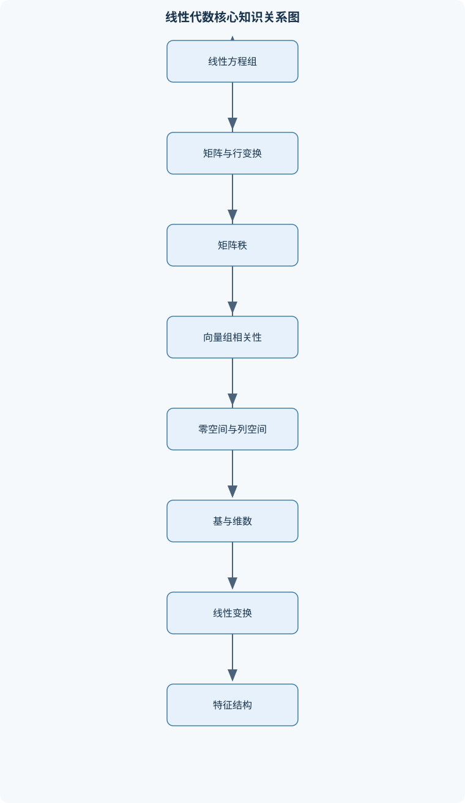
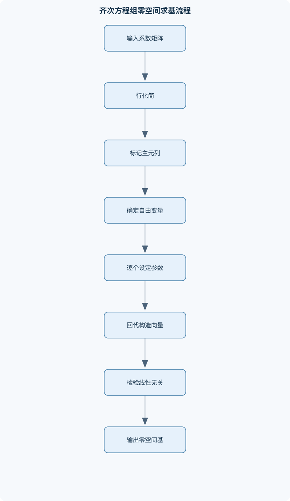

# 线性代数

## 一、课程整体知识框架

### 课程边界与先修知识

《线性代数》涵盖数域上的有限维向量、矩阵表示、线性方程组、行列式、向量空间与线性变换、特征值与相似对角化、实对称矩阵及二次型。重点讨论有限维实向量空间上的计算与结构，也说明复数域和一般数域下结论成立的条件。先修知识包括实数与复数运算、多项式、方程组、求和记号及基础数学证明；不包含抽象泛函分析、数值线性代数的完整误差理论或微分方程课程内容。





### 课程对象与基本语言

《线性代数》研究数域上的有限维向量、向量之间的线性关系，以及这些关系在矩阵和线性变换中的表示。数域记为 $F$；它通常取实数域 $\mathbb R$，讨论复特征值时也会取复数域 $\mathbb C$。矩阵运算和向量空间结论依赖所用数域：例如，某实矩阵在 $\mathbb R$ 上可能没有足够的特征向量，却能在 $\mathbb C$ 上对角化。未特别说明时，实矩阵问题以 $\mathbb R$ 为数域。

本课程以有限维问题为主。先修内容包括实数与复数运算、多项式、方程组、求和记号和基础证明。核心符号为：$M_{m\times n}(F)$ 表示数域 $F$ 上所有 $m\times n$ 矩阵；列向量默认作为向量；$A^T$ 表示转置；$I_n$ 和 $0$ 表示相应阶数的单位矩阵和零矩阵；$\operatorname{rank}(A)$ 表示矩阵秩；$\det(A)$ 表示方阵行列式；$\operatorname{tr}(A)$ 表示方阵迹；$A^{-1}$ 表示可逆方阵的逆矩阵。矩阵乘积仅在维数相容时定义，矩形矩阵没有通常意义下的行列式或双侧逆矩阵。

线性方程组是贯穿全课程的入口。方程组 $Ax=b$ 中，$A\in M_{m\times n}(F)$，未知向量 $x\in F^n$，常数向量 $b\in F^m$。矩阵的列向量记为 $a_1,\ldots,a_n$，则 $Ax=b$ 等价于
$$
x_1a_1+\cdots+x_na_n=b.
$$
因此，方程组有解当且仅当 $b$ 可由 $A$ 的列向量线性组合得到，也即 $b\in\operatorname{Col}(A)$。消元把这个几何问题转化为可检验的主元与参数结构。

### 从计算到结构的逻辑主线

课程先通过行变换解决线性方程组，再用矩阵秩统一描述主元数量、列向量的独立程度和方程组解的自由度。对 $A\in M_{m\times n}(F)$，秩—零度定理为
$$
\dim\operatorname{Null}(A)+\operatorname{rank}(A)=n,
$$
其中 $\operatorname{Null}(A)=\{x\in F^n:Ax=0\}$。等式右侧是定义域维数 $n$，不是方程个数 $m$。其结构理由是：先取零空间的一组基，再将其扩充为定义域的一组基；扩充出的方向经线性映射后构成像空间的一组基，故核的维数与像的维数之和等于定义域维数。

秩也将方程组的存在性与解的形态联系起来：
$$
Ax=b\text{ 有解}\iff \operatorname{rank}(A)=\operatorname{rank}(A|b).
$$
若有解，任取一个特解 $x_p$，全部解恰为 $x=x_p+z$，其中 $z\in\operatorname{Null}(A)$。所以相容系统的解集是零空间的平移；只有齐次系统 $Ax=0$ 的解集必为子空间。若未知数有 $n$ 个，秩为 $r$，相容时解空间方向的维数为 $n-r$：$r=n$ 时唯一解，$r<n$ 时无穷多解。齐次系统总有零解，但非零解是否存在取决于 $r<n$。

行列式为方阵提供另一种刻画可逆性的工具。$n$ 阶行列式的排列定义是对所有排列取带符号乘积之和；符号由排列的逆序数奇偶决定。定义推出行列式对每一行（列）多重线性，交换两行（列）变号，且两行（列）相同则值为零。由此，某行加另一行的倍数不改变行列式，而行倍乘会使行列式同倍变化。按行或列展开时，元素 $a_{ij}$ 的代数余子式为 $A_{ij}=(-1)^{i+j}M_{ij}$，$M_{ij}$ 是删去第 $i$ 行、第 $j$ 列所得子式的行列式。方阵满足
$$
A\text{ 可逆}\iff \det(A)\ne0.
$$
必要性可由 $\det(AA^{-1})=\det(A)\det(A^{-1})=1$ 得出；充分性可由伴随矩阵恒等式 $A\operatorname{adj}(A)=\det(A)I_n$ 得出。该判据只适用于方阵。

向量组的线性组合、张成、线性相关和基，是矩阵秩的向量空间解释。向量组 $v_1,\ldots,v_k$ 线性相关，当且仅当存在不全为零的系数使 $\sum_i c_iv_i=0$；将这些向量作为矩阵列，等价于齐次方程有非零解。极大线性无关组张成原向量组，其向量个数是该向量组的秩。有限维空间的基既张成全空间又线性无关；每个向量相对于一组有序基有唯一坐标，基向量个数就是维数。子空间和交满足
$$
\dim(U+W)=\dim U+\dim W-\dim(U\cap W),
$$
其中 $U,W$ 必须是同一有限维空间的子空间；交集维数扣除了在两个空间中重复计数的部分。

矩阵可视为线性变换的坐标表示。线性变换 $T:V\to W$ 满足保持加法和数乘；其核 $\ker T$ 是映到零向量的向量集合，其像 $\operatorname{im}T$ 是所有输出向量的集合。有限维情形下，
$$
\dim\ker T+\dim\operatorname{im}T=\dim V.
$$
同维有限维空间之间，单射、满射和可逆彼此等价；该推论不能不加条件地推广到无限维空间。选定定义域与陪域的有序基后，$T$ 可由矩阵表示。复合变换对应矩阵乘法，乘法次序按“先作用的矩阵在右”确定。更换同一空间的基会使方阵表示变为相似矩阵 $B=P^{-1}AP$；相似矩阵表示同一线性变换在不同基下的矩阵，具有相同的特征多项式、行列式、迹和秩，但相同特征多项式一般不能保证相似。

特征值与特征向量描述变换中方向不变的向量。若非零向量 $v$ 满足 $Av=\lambda v$，则 $\lambda$ 是特征值，$v$ 是对应特征向量；特征多项式约定为 $p_A(\lambda)=\det(\lambda I_n-A)$。特征子空间为 $\operatorname{Null}(A-\lambda I_n)$。特征值的代数重数是其作为特征多项式根的重数，几何重数是特征子空间维数，几何重数不超过代数重数。矩阵可对角化，当且仅当存在由特征向量组成的基；等价地，各特征子空间维数之和为 $n$。不同特征值对应的特征向量线性无关，但重根并不自动阻止对角化。实对称矩阵有更强结论：存在正交矩阵 $Q$ 和实对角矩阵 $D$，使 $Q^TAQ=D$。一般实矩阵未必有实特征值，更不一定能正交对角化。

二次型是实变量的齐次二次多项式，可写成 $q(x)=x^TAx$，其中 $A$ 取实对称矩阵。交叉项 $2a_{ij}x_ix_j$ 对应 $A$ 中两个对称位置均为 $a_{ij}$。可逆变量替换使矩阵按合同变换 $B=C^TAC$；它与相似变换不同。实对称二次型的合同标准形中，正、负、零项的个数由惯性定理保证不变，分别记录正惯性指数、负惯性指数和零惯性指数。实对称矩阵正定，当且仅当全部特征值为正，也当且仅当所有顺序主子式为正。半正定则可用全部主子式非负判定，不能仅检查顺序主子式。对实对称半正定矩阵，谱分解还能构造 $A=C^TC$；此结论不适用于任意不定对称矩阵。

## 二、章节和模块划分

### 核心知识覆盖清单

本清单用于检查正文是否覆盖本课程的主要知识模块：

- **线性方程组与消元**：线性方程组、系数矩阵与增广矩阵、初等行变换及其对方程组解集的影响、阶梯形矩阵与简化阶梯形矩阵、主元变量、自由变量与参数表示、齐次方程组的零解、非零解与基础解系、非齐次方程组的相容条件与解的结构、消元法判定无解、唯一解或无穷多解、方程组解集与矩阵列向量线性组合的关系。
- **行列式**：排列、逆序数与行列式的符号、行列式的排列定义及低阶计算、行列式对行或列的线性性质、交换、倍乘和倍加行列对行列式的影响、余子式、代数余子式与按行列展开、三角形行列式、分块结构与递推计算、范德蒙行列式及其适用结构、行列式与矩阵可逆性、方程组解的联系。
- **矩阵及其运算**：矩阵的相等、加法、数乘与乘法、矩阵乘法的维数条件及其通常不交换性、转置、对称矩阵与反对称矩阵、单位矩阵、零矩阵、初等矩阵、可逆矩阵、逆矩阵及逆矩阵求法、伴随矩阵与伴随矩阵求逆公式的条件、矩阵分块及分块运算的维数约束、迹的定义及其在线性变换表示中的性质。
- **矩阵秩与线性方程组理论**：矩阵秩的定义及主元数表征、行秩、列秩相等及其基本含义、用初等行变换求秩与判断线性相关、子式判秩的充要条件、系数矩阵与增广矩阵的秩判定定理、齐次方程组解空间维数与秩的关系、非齐次方程组通解为特解加齐次解、秩对矩阵乘积及线性映射像空间的约束。
- **向量组与线性空间**：向量的线性组合、生成与张成空间、线性相关与线性无关的定义及判定、向量组的极大无关组与秩、向量组等价及其秩不变性、子空间的非空、加法封闭与数乘封闭判定、列空间、零空间及其与方程组的对应、齐次方程组解集是子空间的证明、零空间参数表示、张成集与基的求法、基、坐标、维数及基中向量个数的唯一性、子空间和、交及维数公式。
- **线性变换与基变换**：线性变换的定义、核与像、线性变换的矩阵表示及基的选择、线性变换复合与矩阵乘法次序、坐标向量及向量在基下表示的唯一性、同一线性变换在不同基下的矩阵、相似矩阵与相似变换的含义、相似不变量：行列式、迹、秩与特征多项式、线性变换的单射、满射与有限维情形下的等价关系。
- **特征值、特征向量与对角化**：特征值、特征向量及特征方程、特征子空间与特征值的代数重数、几何重数、特征值与迹、行列式的关系、不同特征值对应特征向量的线性无关性、矩阵可对角化的充要条件、构造相似对角化矩阵及特征向量基、实对称矩阵的谱定理与正交对角化、特征值方法计算矩阵幂及其适用条件。
- **二次型与合同**：二次型及其对称矩阵表示、交叉项系数与对称矩阵元素的对应、可逆线性替换及矩阵合同、配方法化二次型为标准形、实对称矩阵正交变换与特征值分解、惯性指数、秩与符号差、惯性定理及标准形的合同分类、正定、半正定与负定二次型、正定判据：特征值、顺序主子式与分解条件。


### 线性方程组与消元

方程组写成系数矩阵 $A$ 和增广矩阵 $(A|b)$。初等行变换包括交换两行、某行乘非零数、某行加另一行的倍数；对增广矩阵同时实施这些变换保持解集不变。行阶梯形要求非零行在零行之上，主元逐行右移；简化阶梯形进一步要求每个主元为 $1$ 且为其所在列唯一非零元。主元列变量是主变量，其余变量为自由变量。把自由变量设为参数并回代，可写出通解。

求解时若出现一行左侧全零、右侧非零，则系统无解；否则主元列数等于未知数个数时唯一解，少于未知数个数时有自由参数。齐次系统的零空间基由逐一令自由变量为 $1$、其余自由变量为 $0$ 并回代得到。所得基向量数应为 $n-\operatorname{rank}(A)$。消元后的主元列编号可用来识别主元，但列空间基必须取原矩阵中相同编号的列。

### 矩阵及其运算

矩阵加法和数乘按对应元素进行；$A\in M_{m\times n}(F)$ 与 $B\in M_{n\times p}(F)$ 的乘积属于 $M_{m\times p}(F)$，且 $(AB)_{ij}=\sum_{k=1}^n a_{ik}b_{kj}$。乘积通常不交换。转置满足 $(AB)^T=B^TA^T$。对称矩阵满足 $A^T=A$，反对称矩阵满足 $A^T=-A$；在特征为 $2$ 的数域上，后者不能按实数域的性质直接理解。

方阵可逆的充要条件是满秩或行列式非零。求逆可将 $(A|I_n)$ 行化简，左侧化为 $I_n$ 时右侧为 $A^{-1}$；若秩不足则不存在逆矩阵。伴随矩阵满足 $A\operatorname{adj}(A)=\det(A)I_n$，故仅在 $A$ 为可逆方阵时可用 $A^{-1}=\operatorname{adj}(A)/\det(A)$。分块运算要求各块的行列尺寸匹配，不能只凭块的位置相同便套用标量运算规则。迹为对角元之和，满足维数相容时 $\operatorname{tr}(AB)=\operatorname{tr}(BA)$，但不意味着 $AB=BA$。

### 行列式

排列定义适合建立性质；实际计算常用行列变换、余子式展开或结构递推。对角或三角矩阵的行列式等于对角元乘积。用行变换计算时必须记录影响：交换两行变号，某行乘 $c$ 则行列式乘 $c$，倍加另一行不改变行列式。稀疏矩阵可沿非零元素较少的行或列展开。范德蒙行列式
$$
\det\begin{pmatrix}
1&x_1&\cdots&x_1^{n-1}\\
1&x_2&\cdots&x_2^{n-1}\\
\vdots&\vdots&&\vdots\\
1&x_n&\cdots&x_n^{n-1}
\end{pmatrix}
=\prod_{1\le i<j\le n}(x_j-x_i)
$$
仅在所示幂次排列和行变量排列下直接适用；变量相等时两行相同，行列式为零。分块三角矩阵的行列式为对角块行列式之积；一般分块矩阵不可直接如此分解。

### 矩阵秩与方程组理论

矩阵秩定义为列空间维数，也等于行空间维数和行阶梯形中的主元数。行变换保持秩，但会改变列向量本身，因此求列空间基须回到原矩阵。子式判秩的充要条件是：秩为 $r$ 当且仅当存在一个 $r$ 阶非零子式，且所有 $r+1$ 阶子式为零。该判据理论清晰，但高阶计算通常不如消元高效。

秩满足 $\operatorname{rank}(AB)\le\min(\operatorname{rank}(A),\operatorname{rank}(B))$，因为乘积的像受中间映射及后续映射约束。方程组相容条件和通解结构由秩—零度定理统一说明。非齐次系统有解时，任意两解之差属于齐次零空间；因此通解不是任意一组向量，而是特解加零空间中的全部向量。

### 向量组与线性空间

线性张成 $\operatorname{span}(S)$ 是所有有限线性组合构成的集合。线性无关表示只有全零系数才能组合出零向量。向量组的极大无关组是不能再加入原组其他向量而保持无关的一组向量；任意极大无关组含有相同数目的向量，该数称向量组的秩。两个向量组等价，是指它们互相可由对方线性表示，因此张成空间相同、秩相同。

集合 $U$ 是向量空间的子空间，当且仅当含零向量、对加法封闭、对数乘封闭。齐次线性方程组解集是子空间，因为若 $Au=Av=0$，则 $A(u+v)=0$，且 $A(cu)=0$。非齐次解集一般不含零向量，因而通常只是仿射集。列空间 $\operatorname{Col}(A)\subseteq F^m$，零空间 $\operatorname{Null}(A)\subseteq F^n$，二者所在环境空间不同。零空间参数式中的参数向量构成其张成集；经线性无关性检验后可取为基。

基下坐标是向量相对于有序基的唯一系数列。子空间和、交的维数公式适用于同一有限维空间；若 $U\cap W=\{0\}$，则两者的和为直和，维数等于两者维数之和。

### 线性变换与基变换

线性变换 $T$ 满足 $T(u+v)=T(u)+T(v)$、$T(cv)=cT(v)$。给定定义域基 $B$ 和陪域基 $C$，矩阵列记录各个 $T(b_j)$ 在 $C$ 下的坐标。若 $T:V\to V$，同一变换在两组基下的矩阵满足相似关系。相似矩阵的行列式、迹、秩和特征多项式相同；这些是相似不变量，但一般不是相似的充分条件。有限维同维情形，单射、满射、双射等价；矩形矩阵对应不同维数空间时不能据此断言单射与满射等价。

### 特征值与对角化

求特征值的理论步骤是解 $p_A(\lambda)=\det(\lambda I-A)=0$，再对每个根解 $(A-\lambda I)x=0$ 求特征空间。迹等于特征值之和、行列式等于特征值之积，按代数重数计，并在相应数域中理解。构造对角化时，把线性无关特征向量作为 $P$ 的列，则 $P^{-1}AP=D$。若特征值不在所用数域中，不能据此声称该数域上可对角化。可对角化时 $A^k=PD^kP^{-1}$，适用于整数非负次幂；若要求负次幂，还需 $A$ 可逆。

实对称矩阵可在每个特征空间内取正交单位基，合并后得到正交矩阵 $Q$，满足 $Q^TAQ=D$。正交对角化的前提是实对称，不能套用于一般矩阵。高阶特征多项式求根可能困难且数值敏感，理论分解也不等于数值计算稳定。

### 二次型与合同

二次型矩阵取对称形式。可逆替换 $x=Cy$ 将 $x^TAx$ 化为 $y^TC^TACy$。配方法通过平方项消去交叉项；若当前主对角系数为零但仍有非零交叉项，可先重排或作可逆线性组合产生非零平方项。正交对角化则只适用于实对称矩阵，并保留欧氏长度结构；一般配方法只要求替换可逆。二者都得到合同标准形，但变换约束不同。

惯性定理说明实对称矩阵在合同变换下正、负、零对角项数不变；矩阵秩等于非零项数，符号差为正惯性指数减负惯性指数。秩相同不足以判定合同，惯性指数也必须匹配。正定可由正特征值、顺序主子式全正或相应正主元分解判定；半正定需检查全部主子式非负，不能只看顺序主子式。

### 代表性流程与算法

#### 高斯消元求解、求秩与零空间基

**输入：** $A\in M_{m\times n}(F)$；求解时另给 $b\in F^m$。  
**输出：** 行阶梯形、秩、相容性、主变量和自由变量参数式；齐次情形输出零空间基。  
**过程：** 从左至右寻找非零主元；必要时交换行；用主元消去其下方元素；记录主元列；增广情形检查是否出现 $0=\text{非零数}$；齐次情形依次令一个自由变量为 $1$、其余自由变量为 $0$ 并回代。  
**不变量与终止：** 对增广矩阵作行变换保持方程组解集，系数矩阵秩保持不变；列扫描结束即终止。  
**适用条件与复杂度：** 适用于数域上的精确运算；稠密矩阵朴素复杂度为 $O(mn\min(m,n))$。浮点计算应选主元以减小舍入误差，主元是否为零需采用数值容差而非机械精确比较。

```text
function solve_linear_system(A, b):
    M = concatenate_columns(A, b)
    pivot_columns = []
    row = 0

    for col from 0 to number_of_columns(A) - 1:
        pivot = find_nonzero_entry(M, rows=row..last, column=col)
        if pivot does not exist:
            continue

        swap_rows(M, row, pivot.row)
        divide_row(M, row, M[row, col])

        for r from row + 1 to last:
            M[r, :] = M[r, :] - M[r, col] * M[row, :]

        pivot_columns.append(col)
        row = row + 1
        if row == number_of_rows(M):
            break

    if any row has all-zero A entries and nonzero augmented entry:
        return "无解", pivot_columns

    rank = length(pivot_columns)
    return "相容", rank, pivot_columns, M
```

该伪代码输出阶梯形；需要完整通解时，再由主元方程回代并给自由变量赋参数。每个自由变量产生一个零空间基向量，基向量数必须等于 $n-r$。若返回无解，增广秩大于系数矩阵秩。

#### 行列式消元计算

输入方阵 $A$，输出 $\det(A)$。逐列寻找主元，交换行时记录符号因子；行倍加不改变行列式；不把某行归一化而不记录倍乘因子。化为上三角后将对角元相乘，再乘记录的符号及缩放因子。出现整行零元则行列式为零。算法在精确算术下复杂度为 $O(n^3)$；浮点实现应采用部分主元选取。若把消元当作普通求秩而忽略行交换和倍乘，通常会得到错误行列式。

#### 实二次型配方流程

输入实对称矩阵 $A$。选择非零平方项作主项，以配方消去含该变量的交叉项，同时记录变量替换矩阵；若剩余部分没有非零对角项但存在交叉项，则先作可逆变量组合。不断处理剩余变量，直至得到正项、负项和零项构成的标准形。终止条件是所有交叉项消失且剩余部分为零矩阵。最终检查替换矩阵可逆，并核对正、负、零项数与原矩阵秩和惯性相符。该流程只针对实二次型；配方中的变换若不可逆，就不能据此主张合同等价。

### 典型例题

#### 例一：带参数方程组分类

**题干：** 对实参数 $t$，讨论
$$
\begin{cases}
x+y=1,\\
x+ty=2.
\end{cases}
$$

**分析：** 系数矩阵行列式为 $t-1$。先单独处理行列式为零的参数，再处理非零情形。

**解答：** 当 $t\ne1$ 时，两式相减得 $(t-1)y=1$，故 $y=1/(t-1)$，$x=1-y=(t-2)/(t-1)$，为唯一解。当 $t=1$ 时，左侧两方程相同而右端分别为 $1$、$2$，矛盾，故无解。

**验证：** 将 $t\ne1$ 的解代入第一式，$x+y=1$；代入第二式得 $x+ty=2$。$t=1$ 时两式左侧相同而常数不同。

**变式：** 若第二式右端改为 $1$，则 $t=1$ 时两方程相同，有无穷多解；$t\ne1$ 时仍唯一解。

#### 例二：零空间基与秩—零度关系

**题干：** 求
$$
A=\begin{pmatrix}1&2&1\\2&4&2\end{pmatrix}
$$
的秩和零空间基。

**分析：** 第二行是第一行的两倍，消元后只有一个主元；令自由变量参数化齐次解。

**解答：** 方程为 $x_1+2x_2+x_3=0$。令 $x_2=s,\ x_3=t$，则
$$
x=s\begin{pmatrix}-2\\1\\0\end{pmatrix}
+t\begin{pmatrix}-1\\0\\1\end{pmatrix}.
$$
故秩为 $1$，零空间的一组基为上述两个向量。

**验证：** 两个基向量代入 $Ax=0$ 均成立，且彼此线性无关；向量数为 $2=3-1$。

**变式：** 若在矩阵下方增加一行 $(1,0,1)$，消元时秩可能增加；需重新检查主元，而不能只凭原有重复行判断秩。

#### 例三：行列式的行变换记录

**题干：** 计算
$$
\det\begin{pmatrix}1&2&0\\2&5&1\\1&1&2\end{pmatrix}.
$$

**分析：** 用行倍加消去第一列下方元素，不改变行列式，再处理右下角 $2\times2$ 块。

**解答：** 作 $R_2\leftarrow R_2-2R_1$、$R_3\leftarrow R_3-R_1$，得到
$$
\begin{pmatrix}1&2&0\\0&1&1\\0&-1&2\end{pmatrix}.
$$
行列式等于 $1\cdot\det\begin{pmatrix}1&1\\-1&2\end{pmatrix}=2+1=3$。

**验证：** 两次操作均为倍加行，行列式不变；按第一行展开原矩阵也得 $3$。

**变式：** 若消元中交换两行，结果必须额外乘以 $-1$；若将一行乘以 $c\ne0$，结果应除以 $c$ 还原。

#### 例四：可对角化与矩阵幂

**题干：** 对 $A=\begin{pmatrix}2&0\\0&3\end{pmatrix}$ 求特征值、特征向量，并计算 $A^k$。

**分析：** 对角矩阵的标准基向量直接是特征向量，特征值为对应对角元。

**解答：** $e_1=(1,0)^T$ 对应特征值 $2$，$e_2=(0,1)^T$ 对应特征值 $3$。取 $P=I_2$、$D=A$，则 $A^k=\operatorname{diag}(2^k,3^k)$，对整数 $k\ge0$ 成立。

**验证：** $k=0$ 得 $I_2$，$k=1$ 得 $A$；乘法满足 $A^kA=A^{k+1}$。

**变式：** 对含有非零上三角副对角元的重根矩阵，不能仅凭特征多项式重根就断定可对角化，应比较几何重数与代数重数。

#### 例五：二次型正定判定与惯性

**题干：** 判断 $q(x,y)=2x^2+2xy+2y^2$ 是否正定，并求惯性。

**分析：** 对应对称矩阵为 $A=\begin{pmatrix}2&1\\1&2\end{pmatrix}$。可用顺序主子式或特征值判定。

**解答：** 第一顺序主子式为 $2>0$，二阶行列式为 $4-1=3>0$，故正定，惯性为 $(2,0,0)$。也可配方：
$$
q=2\left(x+\frac y2\right)^2+\frac32y^2,
$$
两个平方项系数均为正。

**验证：** 除 $(x,y)=(0,0)$ 外，至少一个平方项非零，故 $q>0$。

**变式：** 若二阶行列式为负，则两个特征值异号，二次型不定；若行列式为零，还须检查剩余特征值和零空间，不能判为正定。

### 实验与项目流程

#### 实验一：消元、主元列与空间基

**输入数据：** 选取一个 $4\times5$ 整数矩阵及一个五维常数向量 $b$，其中包含至少一组线性相关列；另构造一个增广后不相容的常数向量作对照。  
**步骤：** 手工或用线性代数软件化为阶梯形；记录主元列、秩和增广秩；用主元编号从原矩阵抽取列空间基；参数化零空间；分别判断两个增广系统的解结构。  
**评价标准：** 行变换记录一致；列空间基确实取自原矩阵；零空间基向量代入后为零且线性无关；基向量数等于列数减秩；相容性判断与秩判据一致。  
**排错方法：** 若零空间基数不等于 $n-r$，检查漏记自由变量或回代符号；若所谓列空间基取自化简矩阵，改为抽取原矩阵对应列；若非齐次系统解被写成零空间，检查是否遗漏特解。

#### 实验二：对称矩阵的谱分解与二次型

**输入数据：** 选取一个实对称 $3\times3$ 矩阵，另选一个带非零交叉项的二次型。  
**步骤：** 求矩阵的特征值与正交单位特征向量，组成 $Q$ 和 $D$；计算残差 $R=Q^TAQ-D$；对二次型分别进行配方和正交对角化，记录变换并比较标准形的正、负、零项数。  
**评价标准：** $Q^TQ$ 接近单位矩阵；$R$ 的各元素在预先声明的数值容差内；两种合同化简所得惯性相同；配方替换矩阵可逆。  
**排错方法：** 若 $Q^TQ$ 不接近单位阵，检查特征向量是否单位化或同一特征空间内是否正交化；若残差偏大，检查特征向量列顺序与对角元顺序是否一致；若惯性不一致，检查交叉项是否在对称矩阵两处各取一半，以及配方替换是否可逆。

### 易错点与典型问答

#### 易错点

1. 对增广矩阵行变换保持解集不变，但会改变系数矩阵的列向量；列空间基必须取原矩阵的主元列。
2. 行变换一般改变行列式，必须分别记录交换、倍乘和倍加的影响。
3. 齐次方程组总有零解，但当秩小于未知数个数时还有非零解。
4. 非齐次系统相容不代表唯一解；唯一解还要求秩等于未知数个数。
5. 非齐次系统通解是特解加零空间，不是“特解加任意自由变量向量”。
6. 列空间位于 $F^m$，零空间位于 $F^n$，不能混淆其环境空间。
7. 非齐次方程组解集通常不含零向量，因而一般不是子空间。
8. $AB$ 与 $BA$ 即使都存在也未必相等；迹的循环性质不能替代矩阵乘法交换律。
9. 伴随矩阵求逆公式要求方阵且行列式非零。
10. 行阶梯形非零行数等于秩，但行变换后列向量不再是原矩阵的列空间基。
11. 相似与合同不是同一关系；前者关乎线性变换基表示，后者关乎二次型变量替换。
12. 特征值的代数重数与几何重数不同；重根可能仍可对角化，也可能不可对角化。
13. 一般实矩阵可能没有实特征值；实对称谱定理不能推广到所有实矩阵。
14. 矩形矩阵不适用“行列式非零当且仅当可逆”的方阵判据。
15. 交叉项 $2a_{ij}x_ix_j$ 对应对称矩阵的两个位置均为 $a_{ij}$。
16. 正定要求顺序主子式全正；半正定判定须检查全部主子式非负。
17. 相同秩不能单独判定实对称矩阵合同，惯性指数也必须一致。
18. 数值消元中的近零主元不能无条件视为精确零；浮点误差可能改变表面秩。

#### 典型笔试问题及解答思路

1. **问：如何判定 $Ax=b$ 有解？**  
   **思路：** 比较 $\operatorname{rank}(A)$ 与 $\operatorname{rank}(A|b)$；相等则相容，否则无解。相容后再比较秩与未知数个数区分唯一解和无穷多解。

2. **问：为什么零空间维数等于未知数个数减秩？**  
   **思路：** 将定义域基分为核的基及其补充向量；补充向量的像构成像空间基，故定义域维数分解为核维数加秩。

3. **问：如何求矩阵列空间的一组基？**  
   **思路：** 对矩阵行化简找主元列编号，再从原矩阵取这些编号对应的列；用化简矩阵的列替代会改变所张成空间。

4. **问：证明方阵可逆当且仅当行列式非零。**  
   **思路：** 可逆推出行列式乘积为 $1$；行列式非零时用伴随矩阵公式构造逆矩阵。说明结论的对象必须是方阵。

5. **问：给定向量组，如何判断线性相关？**  
   **思路：** 以向量作矩阵列，解齐次系数方程；存在非零解即相关。也可消元看主元列是否覆盖全部列。

6. **问：什么条件下矩阵可对角化？**  
   **思路：** 检查是否能找到 $n$ 个线性无关特征向量；等价地，所有特征子空间维数之和为 $n$。逐个特征值比较几何重数与代数重数。

7. **问：相似矩阵有哪些相同量？这些量是否足以判相似？**  
   **思路：** 说明特征多项式、行列式、迹、秩相同；它们通常只是必要条件，满足这些条件不必然相似。

8. **问：如何判断实对称矩阵正定？**  
   **思路：** 可检查特征值全正、顺序主子式全正或适当分解；说明这些判据针对实对称矩阵。半正定要检查全部主子式非负。

#### 面试问题与参考回答

1. **问：行变换为什么能解方程组？**  
   **参考回答：** 三种初等行变换都对应可逆的方程等价变换，因此保持未知量的解集。  
   **深入追问要点：** 对增广矩阵要对常数列同步操作；若问行列式，还需记录每种变换的数值影响。

2. **问：秩在实际建模中说明什么？**  
   **参考回答：** 它表示线性独立信息的维数，也决定线性系统中主元数量与自由度。  
   **深入追问要点：** 说明浮点数据下秩依赖容差，近似相关与精确相关需要区分。

3. **问：为什么解线性系统通常不显式求逆？**  
   **参考回答：** 消元或分解直接求解更省计算，也避免构造完整逆矩阵带来的额外误差和成本。  
   **深入追问要点：** 多个右端项时可复用分解；病态系统还需关注条件数和残差。

4. **问：相似矩阵为什么有相同特征值？**  
   **参考回答：** 若 $B=P^{-1}AP$，则 $\det(\lambda I-B)=\det(P^{-1}(\lambda I-A)P)=\det(\lambda I-A)$。  
   **深入追问要点：** 特征值相同不足以推出相似；相似还涉及特征向量结构或更细的标准形。

5. **问：几何重数为何不超过代数重数？**  
   **参考回答：** 对应特征空间的线性无关特征向量可扩充为基，在该基表示下特征值至少以特征空间维数次出现在特征多项式中。  
   **深入追问要点：** 若每个特征值的两种重数相等，所有特征空间维数之和为 $n$，因此可对角化。

6. **问：实对称矩阵的正交对角化带来什么好处？**  
   **参考回答：** 正交坐标变换保持长度和角度，矩阵作用沿互相正交的特征方向分别缩放。  
   **深入追问要点：** 一般矩阵没有此保证；数值上可用正交变换减少某些误差放大，但不代表所有问题都条件良好。

7. **问：相似和合同如何区分？**  
   **参考回答：** 相似为 $P^{-1}AP$，描述同一线性变换更换基；合同为 $C^TAC$，描述二次型可逆换元。  
   **深入追问要点：** 相似保留特征多项式；实对称合同保留惯性，二者的不变量不同。

8. **问：二次型中的交叉项怎样写成矩阵？**  
   **参考回答：** $2a_{ij}x_ix_j$ 在对称矩阵的 $(i,j)$ 与 $(j,i)$ 位置各放 $a_{ij}$。  
   **深入追问要点：** 可展开 $x^TAx$ 验证交叉项被两次计入；正定性判据要求采用对称矩阵表示。

### 岗位关联

- **数据分析与统计：** 将回归与最小二乘模型写成矩阵方程，使用秩判断参数是否可辨识，并利用分解计算估计量。产出包括模型系数、残差及诊断结果；验收关注维数一致、残差计算正确、假设与数据处理记录清楚。
- **机器学习与算法工程：** 用矩阵表达特征变换、线性层和低秩结构，理解特征值及矩阵分解对模型表示的作用。产出包括可复现的训练或推理实现；验收关注输入输出维度、数值稳定性和测试结果。
- **运筹与优化：** 用线性系统处理约束，用秩检查约束独立性，并以二次型描述目标函数曲率。产出为可行解或优化模型；验收关注约束满足、目标值计算和正定性条件是否成立。
- **图形学与视觉：** 用矩阵表达坐标变换、投影前的线性部分及最小二乘拟合。产出为变换参数或拟合结果；验收关注坐标约定一致、变换可逆性要求明确、误差评价定义清楚。
- **控制与信号处理：** 使用状态空间矩阵和特征值分析线性系统结构。产出包括系统矩阵分析或仿真参数；验收需结合专业模型检查稳定性条件，不能仅凭孤立矩阵特征值替代完整系统分析。
- **科学计算与工程建模：** 将离散模型形成矩阵方程，判断秩、解的唯一性和约束一致性。产出为数值解及误差指标；验收关注残差、边界条件、单位和数值精度。大规模问题还需数值线性代数知识。

## 三、核心概念的详细解释

### 线性方程组与消元

#### 系数矩阵、增广矩阵与解集

含 $n$ 个未知数的线性方程组可写成 $Ax=b$，其中 $A\in M_{m\times n}(F)$，$x\in F^n$，$b\in F^m$。若将 $A$ 的列写为 $a_1,\ldots,a_n$，则矩阵方程等价于
$$
x_1a_1+\cdots+x_na_n=b.
$$
因此，方程组有解当且仅当 $b\in\operatorname{Col}(A)$。增广矩阵 $(A|b)$ 把系数与常数项并列记录；对增广矩阵作初等行变换，相当于对方程组作等价的方程组合，不改变解集。

初等行变换包括交换两行、某行乘非零数、某行加另一行的倍数。它们都可逆，故变换前后方程组同解。消元后的阶梯形矩阵中，每个非零行的首个非零元素称为主元；主元列对应主元变量，其余变量是自由变量。简化阶梯形矩阵还要求主元为 $1$，且主元所在列其他元素为 $0$。

若出现形如 $[0\ \cdots\ 0\mid c]$ 且 $c\ne0$ 的行，即得到矛盾方程，系统无解。没有矛盾行时系统相容；若每个未知数列均为主元列，则解唯一；若有自由变量，则每个自由变量可独立取数，系统有无穷多解。该分类适用于有限维线性方程组；自由变量数为 $n-\operatorname{rank}(A)$，而不是方程数减秩。

#### 齐次与非齐次系统

齐次系统 $Ax=0$ 总含零解，其解集为 $\operatorname{Null}(A)$，对加法和数乘封闭，因而是 $F^n$ 的子空间。若 $n>\operatorname{rank}(A)$，秩—零度定理给出零空间维数为正，存在非零解；若 $n=\operatorname{rank}(A)$，只有零解。

非齐次系统若相容，取一个特解 $x_p$。任一解 $x$ 满足 $Ax=b$，故 $A(x-x_p)=0$；反之，若 $Az=0$，则 $A(x_p+z)=b$。所以全体解为
$$
x=x_p+\operatorname{Null}(A).
$$
这是零空间的平移，通常不是子空间；只有在 $b=0$ 或该平移恰为零空间时，解集才是子空间。

#### 消元流程、终止与边界

高斯消元依次扫描列，在当前列中寻找非零元素作主元，必要时交换行，再将主元下方元素消为零；没有可用主元时转到下一列。所有列处理完即终止。精确数域上，该流程得到秩、相容性和主元结构；稠密矩阵的朴素消元复杂度为 $O(mn\min(m,n))$。浮点数计算中，极小主元会放大舍入误差，实际算法通常采用部分选主元。消元保持解集和秩，但一般不保持行列式数值。

### 行列式

#### 排列定义与符号

$n$ 阶行列式是所有排列对应乘积的带符号和：
$$
\det(A)=\sum_{\sigma\in S_n}\operatorname{sgn}(\sigma)\prod_{i=1}^{n}a_{i,\sigma(i)}.
$$
这里 $S_n$ 是 $\{1,\ldots,n\}$ 的排列集合，$\operatorname{sgn}(\sigma)=(-1)^{\tau(\sigma)}$，$\tau(\sigma)$ 是逆序数。每一项恰取每行、每列各一个元素。低阶时，$\det\begin{pmatrix}a&b\\c&d\end{pmatrix}=ad-bc$；该式不是任意矩阵乘积的通用替代规则。

#### 行列式性质与行变换

排列定义表明行列式对每一行分别线性。交换两行会使每一排列与其交换后的排列符号相反，故行列式变号；一行乘 $k$ 倍使每项同乘 $k$；若一行加另一行的 $k$ 倍，按该行线性展开后，多出的部分有两行成比例，行列式为零，因此值不变。相同或成比例的两行也使行列式为零。由转置不改变排列符号，可得 $\det(A^T)=\det(A)$，相应性质也适用于列。

这些规则限定了消元计算行列式时必须记录交换次数和倍乘因子。将方阵化为上三角矩阵后，行列式等于对角线元素之积，再按记录的变换还原。若有零主元，须尝试换行；若该列以下也全为零，则矩阵奇异。

#### 余子式与展开

删除 $A$ 的第 $i$ 行、第 $j$ 列所得矩阵的行列式称余子式 $M_{ij}$；代数余子式为 $C_{ij}=(-1)^{i+j}M_{ij}$。沿第 $i$ 行展开为
$$
\det(A)=\sum_{j=1}^{n}a_{ij}C_{ij},
$$
沿第 $j$ 列展开为 $\det(A)=\sum_{i=1}^{n}a_{ij}C_{ij}$。行下标在前、列下标在后，展开行必须固定 $i$，展开列必须固定 $j$。展开可由排列定义按固定行或列分组得到，适合含大量零元素的行列式；阶数较高且无稀疏结构时，递归展开会产生大量重复计算，消元通常更有效。

#### 特殊结构与可逆性

三角矩阵的行列式为对角元之积，因为排列定义中除恒等排列外的有效乘积均含零因子。分块三角矩阵的行列式等于对角块行列式之积，前提是块结构确实为方块对角块且非对角一侧为零。范德蒙德矩阵的典型形式为第 $j$ 列含 $1,x_j,\ldots,x_j^{n-1}$，其行列式为 $\prod_{1\le i<j\le n}(x_j-x_i)$；只有元素具有该幂次结构时才能使用此公式。

对方阵 $A$，$\det(A)\ne0$ 等价于 $A$ 可逆。可逆时 $\det(A)\det(A^{-1})=\det(I_n)=1$，故行列式非零；反向可由伴随矩阵恒等式 $A\operatorname{adj}(A)=\det(A)I_n$ 得到 $A^{-1}=\operatorname{adj}(A)/\det(A)$。该结论只对方阵成立；矩形矩阵没有通常定义的行列式。

### 矩阵运算、秩与线性方程组理论

#### 矩阵乘法、转置与逆

若 $A\in M_{m\times n}(F)$、$B\in M_{n\times p}(F)$，则 $AB\in M_{m\times p}(F)$，且 $(AB)_{ij}=\sum_{k=1}^n a_{ik}b_{kj}$。乘积维数要求内侧维数相同；即使 $AB$ 与 $BA$ 都有定义，也通常不相等。转置满足 $(AB)^T=B^TA^T$。对称矩阵满足 $A^T=A$，反对称矩阵满足 $A^T=-A$；在特征为 $2$ 的数域上，两类矩阵的性质可能重合，不能直接套用实数域的分解结论。

初等矩阵是对单位矩阵作一次初等行变换所得的方阵；左乘初等矩阵对矩阵实施相应行变换。方阵 $A$ 可逆是指存在 $A^{-1}$ 使 $AA^{-1}=A^{-1}A=I_n$。可对增广矩阵 $(A|I_n)$ 同步消元；若左侧化为 $I_n$，右侧即为逆矩阵。伴随矩阵公式只在 $\det(A)\ne0$ 时给出逆矩阵。分块乘法必须遵守块维数匹配；块矩阵相乘不能仅凭块位置套用标量交换律。

迹定义为 $\operatorname{tr}(A)=\sum_i a_{ii}$，仅对方阵定义。维数相容时有 $\operatorname{tr}(AB)=\operatorname{tr}(BA)$，更一般地可循环移动乘积因子，但不能任意交换因子。迹用于表示变换时依赖方阵表示；换基后的相似矩阵迹不变。

#### 秩、行空间与列空间

矩阵秩是其列空间维数，也等于行空间维数，亦等于行化简阶梯形中的主元数。行变换保持秩，但通常改变列向量本身。因此，用行化简找列空间基时，应取原矩阵中对应主元列，而不能取化简后矩阵的列。行秩等于列秩可由行最简形的主元结构证明：若有 $r$ 个主元，则行空间和列空间维数均为 $r$。

子式判秩的条件是：秩为 $r$ 当且仅当存在一个非零 $r$ 阶子式，且所有 $r+1$ 阶子式均为零；零矩阵的秩为零。该判据理论上直接，但大量子式检验通常不如消元实用。对矩阵乘积有
$$
\operatorname{rank}(AB)\le\min\{\operatorname{rank}(A),\operatorname{rank}(B)\},
$$
因为 $AB$ 的像是 $A$ 对 $B$ 的像的映射结果，且其维数不能超过任一中间空间的维数。

#### 相容判定与秩—零度

方程组 $Ax=b$ 有解当且仅当 $b$ 属于 $A$ 的列空间，这等价于增广列不增加秩：
$$
\operatorname{rank}(A)=\operatorname{rank}(A|b).
$$
相容时解集为特解加零空间；若 $A$ 有 $n$ 列，零空间维数为 $n-\operatorname{rank}(A)$。齐次系统的解空间维数即自由变量数。

对线性映射 $T:V\to W$，其中 $V$ 有限维，取 $\ker T$ 的基并扩充为 $V$ 的基。扩充部分的像张成 $\operatorname{im}T$，且线性无关：若这些像的线性组合为零，则对应扩充向量的组合落入核，违背所取基的线性无关性。故
$$
\dim\ker T+\dim\operatorname{im}T=\dim V.
$$
对矩阵映射 $x\mapsto Ax$，即 $\dim\operatorname{Null}(A)+\operatorname{rank}(A)=n$。右端是定义域维数，不是方程行数。有限维且定义域、陪域同维时，单射、满射、可逆等价；无限维空间不能直接使用这一等价推论。

### 向量组、子空间与基

#### 线性组合、相关性与极大无关组

向量 $v$ 是向量组 $v_1,\ldots,v_k$ 的线性组合，是指存在标量 $c_i$ 使 $v=\sum_i c_iv_i$。所有这类组合组成 $\operatorname{span}\{v_1,\ldots,v_k\}$。向量组线性相关是存在不全为零的系数使 $\sum_i c_iv_i=0$；否则线性无关。将向量作为矩阵列组成 $A$，相关性恰等价于 $Ax=0$ 有非零解，即 $\operatorname{rank}(A)<k$。

极大无关组是在原向量组中选出的无关子组，且不能再加入其他原向量而保持无关。其向量个数等于向量组秩；所有原向量均可由它线性表示。两个向量组等价，指它们互相张成；有限维情形下，它们等价当且仅当张成空间相同，也因而秩相同。

#### 子空间、零空间与列空间

子集 $U\subseteq V$ 为子空间，需含零向量并对向量加法、数乘封闭。等价的简便检验是：$U$ 非空且对任意 $u,v\in U$、标量 $\alpha,\beta\in F$，有 $\alpha u+\beta v\in U$。线性方程组的齐次解集是零空间，故为子空间；非齐次解集若相容则是仿射平移，通常不包含零向量。

$\operatorname{Col}(A)\subseteq F^m$ 是列向量张成空间；$\operatorname{Null}(A)\subseteq F^n$ 是满足 $Ax=0$ 的向量集合。两者所在环境空间不同。求零空间基时先化简 $A$，按自由变量参数化，再令每个自由参数依次为 $1$、其余为 $0$，得到一组基向量；向量数应为 $n-\operatorname{rank}(A)$。

#### 基、坐标与子空间维数

基是张成整个空间的线性无关向量组。有限维空间中，每组基的向量数相同，定义为维数。给定有序基 $B=(b_1,\ldots,b_n)$，每个 $v\in V$ 有唯一坐标列向量 $[v]_B$，使 $v=\sum_i([v]_B)_i b_i$。坐标依赖基的顺序，基改变时坐标通常改变，向量本身不变。

子空间 $U,W$ 位于同一有限维空间时，
$$
\dim(U+W)=\dim U+\dim W-\dim(U\cap W).
$$
理由是分别计算 $U$ 与 $W$ 的基时，交集中的共同方向被重复计数一次。若 $U\cap W=\{0\}$，则维数相加；若 $U\subseteq W$，则 $U+W=W$。该公式不适用于不同环境空间中彼此无定义的交集。

### 线性变换、基变换与相似

线性变换 $T:V\to W$ 满足 $T(\alpha u+\beta v)=\alpha T(u)+\beta T(v)$。核为 $\ker T=\{v:T(v)=0\}$，像为 $\operatorname{im}T=\{T(v):v\in V\}$。在基 $B$、$C$ 下，矩阵 $[T]_{C\leftarrow B}$ 的第 $j$ 列是 $T(b_j)$ 在 $C$ 下的坐标，因为
$$
[T(v)]_C=[T]_{C\leftarrow B}[v]_B.
$$
复合变换对应矩阵相乘，右侧矩阵先作用：$[S\circ T]=[S][T]$，前提是中间空间使用一致的基。

同一线性变换在同一空间的两组基下，其矩阵满足 $B=P^{-1}AP$，称相似。相似保留特征多项式、行列式、迹和秩。特征多项式相同通常不足以推出相似，因为矩阵可能具有不同的特征空间结构。核与像也可由矩阵方程求得；有限维同维空间上，单射、满射和可逆等价。

### 特征值、特征向量与对角化

非零向量 $v$ 满足 $Av=\lambda v$ 时，$\lambda$ 为特征值，$v$ 为特征向量；特征值满足 $\det(\lambda I_n-A)=0$。对应特征空间为 $\ker(A-\lambda I_n)$。代数重数是特征多项式根的重数，几何重数是特征空间维数；几何重数不超过代数重数。矩阵迹等于特征值按代数重数求和，行列式等于其积，前提是在特征多项式分裂的数域中计数。

矩阵可对角化，当且仅当存在由特征向量组成的基。若将这些特征向量作为 $P$ 的列，则 $P^{-1}AP=D$，其中 $D$ 的对角元为对应特征值。等价条件是所有特征子空间维数之和为 $n$，也等价于每个特征值的几何重数等于代数重数。不同特征值对应的特征向量组线性无关；重根不必然导致不可对角化。

实对称矩阵满足谱定理：存在正交矩阵 $Q$ 使 $Q^TAQ=D$，且 $Q^{-1}=Q^T$。一般实矩阵可能没有实特征值，也未必能实对角化，更不能保证正交对角化。若 $A=PDP^{-1}$，则 $A^k=PD^kP^{-1}$，适用于已知可对角化矩阵及整数幂；不可对角化时不能使用此公式。

### 二次型、合同与正定性

#### 对称矩阵表示与交叉项

实二次型是 $q(x)=x^TAx$，其中可取对称矩阵 $A$。若
$$
q(x)=\sum_i a_{ii}x_i^2+2\sum_{i<j}a_{ij}x_ix_j,
$$
则矩阵的 $(i,j)$ 与 $(j,i)$ 元均为 $a_{ij}$。交叉项系数是两个对称位置之和；不能把 $2a_{ij}$ 直接填在单个位置。任意实矩阵 $M$ 的二次型只由其对称部分决定，因为 $x^T(M-M^T)x=0$。

可逆替换 $x=Cy$ 将二次型改写为 $q(y)=y^T(C^TAC)y$，矩阵 $A$ 与 $C^TAC$ 称合同。合同表达同一二次型在不同可逆坐标下的表示，不是相似；相似保留特征值，合同一般不保留特征值。配方法通过平方项消去交叉项；若当前平方项系数为零，应检查能否交换变量或作可逆线性组合产生非零平方项，并记录替换是否可逆。

#### 惯性与正定性

实对称矩阵可正交对角化，故 $q$ 可写成 $\lambda_1y_1^2+\cdots+\lambda_ny_n^2$。正、负、零特征值的个数分别为正惯性指数、负惯性指数和零惯性指数。惯性定理说明这些数在可逆合同变换下不变；因此，实对称矩阵的合同分类由惯性而非特征值大小决定。

$q(x)>0$ 对所有非零 $x$ 成立时称正定；若 $q(x)\ge0$ 则为半正定。实对称矩阵正定等价于全部特征值为正，也等价于所有顺序主子式为正。半正定要求全部主子式非负，不能仅检查顺序主子式。若 $A$ 半正定且秩为 $r$，谱分解 $A=QDQ^T$ 中非零特征值非负；取其平方根可构造实矩阵 $C$ 使 $A=C^TC$。该分解不适用于任意不定对称矩阵。

## 四、重要定义、公式、定理和推导

### 专业审校补充：关键定义与适用边界

Cayley–Hamilton 定理是特征多项式与矩阵运算之间的重要桥梁。设 $A\in M_n(F)$，其特征多项式定义为 $p_A(\lambda)=\det(\lambda I_n-A)$，则把矩阵 $A$ 代入该多项式必有 $p_A(A)=0$。若 $p_A(\lambda)=\lambda^n+c_{n-1}\lambda^{n-1}+\cdots+c_0$，则 $A^n+c_{n-1}A^{n-1}+\cdots+c_0I_n=0$，因此任意高次幂都可化为 $I,A,\ldots,A^{n-1}$ 的线性组合。该定理适用于方阵及其所在数域；它不要求矩阵可对角化，也不意味着特征值互不相同。若特征多项式能分解但存在重根，仍可用定理降次计算矩阵幂。需要区分特征多项式与最小多项式：后者是使 $m(A)=0$ 的首一低次多项式，次数可能小于 $n$，但本课程若未专门引入最小多项式，不应用它替代特征多项式。数值计算中，直接形成高次幂可能放大舍入误差，Cayley–Hamilton 主要作为精确代数推导工具。


### 代表性算法与流程

#### 高斯消元与秩、解集判定

输入 $A$ 或增广矩阵 $(A|b)$；输出阶梯形、主元列、秩、相容性和参数解。逐列选择非零主元，必要时交换行，再消去主元下方元素；处理完所有列终止。行变换保持增广系统解集及系数矩阵秩。出现矛盾行则无解；相容时自由变量数为 $n-r$。该流程适用于精确数域；稠密情形复杂度为 $O(mn\min(m,n))$，浮点实现需选主元并检查残差。

```text
输入：A ∈ F^(m×n)，b ∈ F^m
构造增广矩阵 R = (A|b)
row = 1
对每一系数列 col = 1,...,n：
    在 row,...,m 中寻找 R 的非零候选主元
    若不存在候选，继续下一列
    交换候选行与第 row 行
    将主元行除以主元，使主元为 1
    对其余各行消去第 col 列元素
    记录 col 为主元列
    row = row + 1
    若 row > m，则终止循环
若存在系数部分全零、常数项非零的行，输出“无解”
否则用自由变量表示主元变量，输出参数解和主元数
```

#### 求零空间基与列空间基

输入 $A\in M_{m\times n}(F)$。将 $A$ 化为阶梯形，主元位置决定自由变量；逐一令一个自由变量为 $1$、其余为 $0$，回代得到零空间基。列空间基取原矩阵中对应主元列，而非行化简后的列。终止检查为：零空间基向量数等于 $n-r$，列空间基向量数等于 $r$，且将零空间基代入 $Ax$ 均得零。消元复杂度同高斯消元；输出规模可能达到 $O(n(n-r))$。

#### 行列式消元计算

输入方阵 $A$，输出 $\det(A)$。通过行交换和倍加行化为上三角矩阵，记录每次交换的负号；若某行乘以常数，记录该倍数。上三角后对角元相乘并还原记录的因子。达到上三角形或确认秩不足时终止。该法适用于精确计算；浮点计算宜选主元，复杂度为 $O(n^3)$。

#### 求逆与可逆性判定

输入方阵 $A$，在 $(A|I_n)$ 上作相同初等行变换。若左侧化为 $I_n$，右侧即 $A^{-1}$；若无法获得 $n$ 个主元，则 $A$ 不可逆。行变换等价于左乘可逆矩阵，故归约成功时存在 $E$ 使 $EA=I_n$，从而右侧为逆矩阵。流程在归约完成或秩不足时终止，复杂度为 $O(n^3)$。求解单个系统时通常直接消元，不必显式构造逆矩阵。

### 关键定理及推导

#### 行列式展开与基本恒等式

排列定义中固定第 $i$ 行所取列 $j$，其余 $n-1$ 行排列遍历剩余列。将对应项按 $j$ 分组，移除第 $i$ 行、第 $j$ 列后的排列符号相对原排列产生因子 $(-1)^{i+j}$，于是得到余子式展开
$$
\det(A)=\sum_{j=1}^n a_{ij}(-1)^{i+j}M_{ij}.
$$
固定第 $j$ 列同理得到列展开。此推导也说明展开行列下标不能互换，且符号由 $(-1)^{i+j}$ 决定。若 $A$ 为方阵，伴随矩阵满足 $A\operatorname{adj}(A)=\det(A)I_n$；对角元素是按行展开，非对角元素对应两行相同而为零。故 $\det(A)\ne0$ 时逆矩阵公式成立。

#### 相容判定与解的维数

增广列 $b$ 加入 $A$ 后，若它已在原列空间内，秩不变；若不在列空间，列空间至少增加一个独立方向，秩增加。因此相容当且仅当
$$
\operatorname{rank}(A)=\operatorname{rank}(A|b).
$$
相容时取特解 $x_p$，全部解为 $x_p+z$，其中 $z\in\operatorname{Null}(A)$。由秩—零度定理，若 $A$ 有 $n$ 列，解集方向维数是 $n-r$。秩为 $n$ 时相容系统唯一；秩小于 $n$ 时有自由参数，因此有无穷多解。

#### 秩—零度与行列秩相等

设 $T:V\to W$，$V$ 有限维，先取核的一组基 $u_1,\ldots,u_k$，再扩充为 $V$ 的基 $u_1,\ldots,u_k,v_1,\ldots,v_r$。$T(v_i)$ 张成像空间：任意 $x$ 展开于该基后，核基向量的像为零。它们也线性无关，因为若 $\sum_i c_iT(v_i)=0$，则 $\sum_i c_iv_i\in\ker T$，与基的线性无关性迫使所有 $c_i=0$。故
$$
\dim\ker T+\dim\operatorname{im}T=k+r=\dim V.
$$
取 $T(x)=Ax$ 即得 $\dim\operatorname{Null}(A)+\operatorname{rank}(A)=n$。行最简形有 $r$ 个主元，列空间维数为 $r$；转置后相同论证给出行空间维数也为 $r$，故行秩等于列秩。

#### 子空间和的维数公式

令 $U,W$ 为同一有限维空间的子空间。取 $U\cap W$ 的基并分别扩充为 $U$、$W$ 的基。将交集基只保留一次，并加入两边各自扩充部分，可得 $U+W$ 的基：它张成两空间之和；若存在非平凡线性关系，两边独立部分之差将落入交集，违背扩充基的独立性。因此
$$
\dim(U+W)=\dim U+\dim W-\dim(U\cap W).
$$
交集维数是分别计算两空间维数时重复计入的部分。公式要求两个子空间处于同一有限维空间。

#### 相似不变量与可对角化条件

若 $B=P^{-1}AP$，其中 $P$ 可逆，则
$$
\det(\lambda I-B)=\det\!\big(P^{-1}(\lambda I-A)P\big)=\det(\lambda I-A).
$$
因此相似矩阵特征多项式相同，行列式相同；迹由 $\operatorname{tr}(XY)=\operatorname{tr}(YX)$ 得到 $\operatorname{tr}(B)=\operatorname{tr}(A)$，秩也因可逆左右乘保持不变。相同特征多项式只是必要条件，不能单独证明相似。

若 $A$ 有 $n$ 个线性无关特征向量，将其作为 $P$ 的列，便有 $AP=PD$，从而 $P^{-1}AP=D$。反之，若 $A=PDP^{-1}$，则 $P$ 的列向量构成特征向量基。因此可对角化等价于存在特征向量基，也等价于各特征空间维数之和为 $n$。在特征多项式分裂的域上，各特征值几何重数等于代数重数是该条件的等价表述。实矩阵在实数域上的特征值可能不分裂，判断时须说明数域。

#### 实对称谱定理与二次型惯性

实对称矩阵的不同特征值对应正交特征向量：若 $Au=\lambda u$、$Av=\mu v$，则
$$
\lambda u^Tv=(Au)^Tv=u^TAv=\mu u^Tv.
$$
当 $\lambda\ne\mu$ 时 $u^Tv=0$。对每个特征空间取正交规范基即可构成正交矩阵 $Q$，使 $Q^TAQ$ 为实对角矩阵。一般矩阵没有此正交结构，不能套用该结论。

合同变换 $B=C^TAC$ 表示可逆变量替换。实对称矩阵经正交对角化后，二次型为正、负、零平方项之和；惯性定理保证在任意可逆替换下三类项的个数不变。合同分类因此由正、负、零惯性指数决定；这与相似分类不同，不能用相似不变量替代惯性判断。

### 例题

#### 例一：带参数的线性方程组

**题干：** 讨论
$$
\begin{cases}
x+y=1,\\
x+ay=2
\end{cases}
$$
在不同实数 $a$ 下的解。

**分析：** 比较两式消去 $x$，主元是否消失取决于 $a-1$。

**逐步解答：** 第二式减第一式得 $(a-1)y=1$。若 $a=1$，得到 $0=1$，无解。若 $a\ne1$，则 $y=1/(a-1)$，再由第一式得 $x=(a-2)/(a-1)$，唯一解。

**验证：** 将该解代入第一式为 $(a-2+1)/(a-1)=1$；第二式左侧为 $(a-2+a)/(a-1)=2$。

**变式：** 若第二式右端改为 $c$，消元得 $(a-1)y=c-1$；当 $a=1,c=1$ 时两式相同，有无穷多解；当 $a=1,c\ne1$ 时无解。

#### 例二：行列式与行变换

**题干：** 计算
$$
\det\begin{pmatrix}1&2&0\\2&5&1\\1&0&3\end{pmatrix}.
$$

**分析：** 只用行倍加消去首列，不改变行列式。

**逐步解答：** 令第二行减去第一行的 $2$ 倍，第三行减去第一行，得
$$
\begin{pmatrix}1&2&0\\0&1&1\\0&-2&3\end{pmatrix}.
$$
第三行加第二行的 $2$ 倍后为上三角矩阵，其对角元为 $1,1,5$，故行列式为 $5$。

**验证：** 三次变换均为行倍加，行列式不变；按首行展开原式也得到 $15-10=5$。

**变式：** 若第二行先乘 $3$，行列式先变为原来的 $3$ 倍；若随后用行倍加消元，最终所得行列式须再除以 $3$ 还原。

#### 例三：秩、列空间与零空间

**题干：** 求
$$
A=\begin{pmatrix}1&2&1\\2&4&3\end{pmatrix}
$$
的秩、列空间基和零空间基。

**分析：** 行化简识别主元列；列空间基须回到原矩阵取列。

**逐步解答：** 第二行减第一行的 $2$ 倍，得 $\begin{pmatrix}1&2&1\\0&0&1\end{pmatrix}$。主元列为第 $1$、第 $3$ 列，故秩为 $2$，列空间基可取原矩阵列 $(1,2)^T$、$(1,3)^T$。方程给出 $x_1+2x_2+x_3=0$、$x_3=0$，令 $x_2=t$，则 $x=t(-2,1,0)^T$，零空间基为 $(-2,1,0)^T$。

**验证：** $A(-2,1,0)^T=0$，且 $n-r=3-2=1$，与零空间基向量数一致。

**变式：** 若第三列改为第一列的倍数，秩可能降为 $1$；需重新消元，不能依据原主元位置推断。

#### 例四：线性变换矩阵与基变换

**题干：** 线性变换 $T:\mathbb R^2\to\mathbb R^2$ 满足 $T(e_1)=e_1+e_2$、$T(e_2)=e_2$。求标准基矩阵，并求基 $B=(e_1+e_2,e_2)$ 下的矩阵。

**分析：** 矩阵列是基向量像的坐标。基变换使用 $P^{-1}AP$。

**逐步解答：** 标准基下
$$
A=\begin{pmatrix}1&0\\1&1\end{pmatrix},\quad
P=\begin{pmatrix}1&0\\1&1\end{pmatrix}.
$$
由于 $P$ 的列为基 $B$ 向量，基下矩阵应由乘积直接计算，不能预设为单位矩阵。于是
$$
P^{-1}AP=\begin{pmatrix}1&0\\1&1\end{pmatrix}.
$$
验证上式：
$$
P^{-1}AP=\begin{pmatrix}1&0\\1&1\end{pmatrix}.
$$

**验证：** $T(b_1)=e_1+2e_2=b_1+e_2$，$T(b_2)=e_2=b_2$，故两列为 $(1,1)^T,(0,1)^T$。

**变式：** 若 $T$ 为恒等变换，则任意同一空间基下矩阵均为单位矩阵；一般变换则需明确坐标基。

#### 例五：对称二次型与正定性

**题干：** 判断 $q(x,y)=2x^2+2xy+2y^2$ 是否正定，并给出正交对角化结果。

**分析：** 对应矩阵为 $\begin{pmatrix}2&1\\1&2\end{pmatrix}$；交叉项系数 $2$ 分配到两个对称位置各为 $1$。

**逐步解答：** 特征方程为 $(2-\lambda)^2-1=0$，故特征值为 $3,1$，均为正，矩阵正定。对应单位特征向量可取 $(1,1)^T/\sqrt2$ 与 $(1,-1)^T/\sqrt2$，故正交变换后
$$
q=3u^2+v^2.
$$

**验证：** 顺序主子式为 $2>0$、$4-1=3>0$，也判定正定；秩为 $2$，正惯性指数为 $2$。

**变式：** 若对角元仍为 $2$、交叉项改为 $4xy$，矩阵为 $\begin{pmatrix}2&2\\2&2\end{pmatrix}$，特征值为 $4,0$，故半正定而非正定。

### 实验与项目

#### 实验一：消元、秩与解集的交叉核验

**步骤：** 输入一个有理数矩阵 $A$ 与向量 $b$；先用分数运算作高斯消元，记录每次行交换、主元列和矛盾行；再构造参数解；最后分别检查 $Ax_p=b$ 与 $Az_i=0$。可选取参数系统
$$
A=\begin{pmatrix}1&1&1\\2&2&2\\1&-1&1\end{pmatrix},\quad
b=\begin{pmatrix}2\\4\\0\end{pmatrix}.
$$
该系统第三式与第一式相容，解满足 $x+z=1$、$y=0$，有一维自由度。

**输入数据：** $A,b$，以及精确有理数运算规则；浮点扩展时另设残差容差。

**评价标准：** 主元数等于 $\operatorname{rank}(A)$；相容性与秩判定一致；每个输出解满足原方程；自由参数个数等于 $n-r$。

**排错方法：** 若代回失败，检查是否对增广列同步作了行变换；若列空间基与结果不符，检查是否误用了化简后矩阵的列；浮点情况下检查主元阈值与残差尺度。

#### 实验二：对称矩阵正定性判据比较

**步骤：** 对输入实对称矩阵先检查 $A=A^T$；分别计算特征值、顺序主子式，并在半正定检验中计算所有主子式；对小规模矩阵再以配方或 $A=C^TC$ 结构交叉验证。测试可包含 $\begin{pmatrix}2&1\\1&2\end{pmatrix}$ 与 $\begin{pmatrix}1&0\\0&0\end{pmatrix}$，分别对应正定与半正定。

**输入数据：** 实对称矩阵；记录矩阵阶数、精确或浮点计算方式。

**评价标准：** 正定时全部特征值为正且顺序主子式为正；半正定时全部特征值非负且全部主子式非负；结论应与二次型定义一致。

**排错方法：** 若不同判据冲突，先检查矩阵是否对称、交叉项是否正确分配；半正定判定不可只检查顺序主子式；浮点特征值接近零时应报告容差依赖，不能武断判为正或负。

### 易错点

1. 行变换用于解方程和求秩，但会改变行列式；交换、倍乘、倍加必须分别记录影响。
2. 行化简后的主元列不能直接作为原矩阵列空间基，应取原矩阵相同编号的列。
3. 齐次系统必有零解，不代表没有非零解；非零解存在当且仅当秩小于未知数个数。
4. 非齐次系统相容且秩等于未知数个数才有唯一解；相容且秩更小才有无穷多解。
5. 一个特解通常不属于零空间；通解是特解加齐次解，而不是两组解向量随意相加。
6. 列空间属于 $F^m$，零空间属于 $F^n$；两者虽均为子空间，环境维数不同。
7. 非齐次解集通常不含零向量，故通常不是子空间。
8. 矩阵乘法通常不交换；迹的循环性质不意味着可任意交换相邻因子。
9. 伴随矩阵求逆公式要求方阵且行列式非零；奇异矩阵没有逆矩阵。
10. 相似和合同含义不同：相似描述线性变换换基，合同描述二次型可逆变量替换。
11. 特征值代数重数与几何重数不同；重根并不自动意味着不可对角化。
12. 实对称矩阵可正交对角化，一般实矩阵未必有实特征值或实特征向量基。
13. 方阵才有通常意义的行列式和双侧逆；矩形矩阵的满列秩不等于存在方阵逆。
14. 二次型交叉项 $2a_{ij}x_ix_j$ 对应对称矩阵两处均为 $a_{ij}$。
15. 正定可检查全部顺序主子式为正；半正定须检查全部主子式非负。
16. 余子式 $M_{ij}$ 不含符号因子；代数余子式还要乘 $(-1)^{i+j}$。
17. 迹和行列式对应特征值的和与积时，应按代数重数计数，并在特征多项式分裂的数域中解释。
18. 秩—零度公式右侧是定义域维数；把它写成方程行数通常错误。

### 常见笔试问题与解答思路

1. **如何判定参数方程组的解类型？** 对增广矩阵消元，分别分析参数导致主元消失的情形；检查是否出现矛盾行，再数自由变量。
2. **如何由排列定义推出行列式的行变换性质？** 使用对行多重线性；交换行使排列符号反转，倍加项因重复行而为零。
3. **何时可以用伴随矩阵求逆？** 仅对方阵且 $\det(A)\ne0$；先证明可逆条件，再使用 $A^{-1}=\operatorname{adj}(A)/\det(A)$。
4. **为什么列空间基须取原矩阵主元列？** 行变换改变列向量但保留主元依赖结构；主元位置用于选择原矩阵中对应列。
5. **如何证明齐次解集是子空间？** 零向量满足方程，若 $Ax=Ay=0$ 则 $A(\alpha x+\beta y)=0$。
6. **如何从秩判断零空间维数？** 应用秩—零度定理，维数为列数减秩；核对使用的是未知数个数而非方程数。
7. **相似矩阵有哪些不变量，哪些条件不足以判相似？** 特征多项式、迹、行列式、秩保持；仅有相同特征多项式通常不足以证明相似。
8. **如何判断矩阵可对角化？** 求特征值及特征空间，比较几何重数之和与阶数；若相等则特征向量可组成基。
9. **正定与半正定的子式判据有何区别？** 正定看全部顺序主子式严格为正；半正定需所有主子式非负。
10. **相似与合同分别保留什么结构？** 相似保留特征结构等线性变换不变量；实对称合同保留正、负、零惯性指数。

### 面试问题与参考回答

1. **为什么非齐次解集通常不是子空间？** 因为特解平移后通常不含零向量；相容时它是零空间的仿射平移。深入追问可说明 $b=0$ 时解集恢复为零空间。
2. **行化简后怎样得到原矩阵列空间基？** 记录主元列编号，回到原矩阵抽取对应列。追问可说明行变换是可逆左乘，保持列之间的线性依赖关系，但不保持列向量本身。
3. **秩—零度定理在矩阵问题中的意义是什么？** 输入方向分为核中的失效方向与映到像空间的独立方向，两类维数之和为定义域维数。追问需指出矩阵有 $n$ 列时右端为 $n$。
4. **为什么实对称矩阵可正交对角化？** 不同特征值的特征向量正交，同一特征空间内可选正交规范基，最终组成正交特征向量基。追问应区分一般实矩阵。
5. **矩阵有重特征值时能否对角化？** 可以，但须有足够多线性无关特征向量；几何重数需达到代数重数。追问可举有重根但几何重数不足的情形。
6. **相同特征多项式是否保证相似？** 不保证；特征多项式不完整记录特征空间维数和广义特征向量结构。追问可要求比较两个具有同一重根但不同秩的矩阵。
7. **正定和半正定如何区别？** 正定对每个非零向量给严格正值；半正定允许某些非零向量取零。追问要说明正定的顺序主子式判据与半正定的全部主子式判据。
8. **合同与相似的实际含义是什么？** 相似来自线性变换换基；合同来自二次型变量作可逆替换。追问可说明惯性指数在实对称合同下不变，特征值一般不变性不成立。
9. **如何验证求得的线性系统解？** 将特解代回原系统，并将零空间基逐一代入齐次系统；核对自由参数数目等于 $n-r$。追问可补充浮点计算用残差而非仅看打印值。
10. **浮点消元与精确消元的差异是什么？** 精确数域中非零判断明确；浮点误差使小主元判断依赖尺度，需选主元并设置容差。追问应指出这属于数值线性代数问题，简单理论算法不提供完整误差保证。

### 岗位关联

- **数据分析与统计：** 将线性回归写为矩阵模型，检查设计矩阵秩以判断参数可辨识性，计算拟合系数和残差。产出包括模型参数、残差及假设说明；验收检查维数、残差计算、数据处理记录和复现性。
- **机器学习与算法工程：** 用矩阵表示线性层、特征变换和低秩结构，使用特征分解理解模型结构。产出为训练或推理模块；验收包括输入输出形状、数值稳定性、单元测试和基准结果。
- **运筹与优化：** 用线性系统表达约束，用秩检查约束独立性，用二次型分析目标曲率。产出为可行解或优化模型；验收需检查约束残差、目标值及正定性条件。
- **图形学与视觉：** 用矩阵描述坐标线性变换并通过线性方程求拟合参数。产出为变换矩阵或拟合结果；验收关注坐标约定、可逆性要求及误差度量。
- **控制与信号处理：** 用状态空间矩阵和特征值分析系统结构。产出为矩阵模型分析或仿真参数；验收必须结合系统假设与专业稳定性条件，不能仅凭单个矩阵指标替代完整分析。
- **科学计算与工程建模：** 把离散模型组装为矩阵方程，判断秩与解结构并计算数值解。产出包括解、残差和边界条件记录；验收关注单位一致、约束满足与数值精度。

## 五、算法、流程和实现思路

### 方法与流程覆盖索引

下列方法或流程应在正文中说明输入、步骤、适用条件、结果检查和边界：

- 高斯消元与秩判定：输入 $A$ 或增广矩阵 $(A|b)$；输出行阶梯形、主元位置、秩以及相容性判断；逐列选取非零主元、必要时交换行，再消去主元下方元素；不变量是行等价保持方程组解集（增广矩阵行变换）且保持系数矩阵秩；无可用主元时转到下一列，处理完所有列后终止；适用于精确域上的线性方程组；稠密矩阵朴素复杂度为 $O(mn\min(m,n))$，浮点计算需考虑舍入误差与主元选取。
- 求齐次方程组零空间基：输入 $A\in M_{m\times n}(F)$；输出 $\operatorname{Null}(A)$ 的一组基及参数形式；将 $A$ 化为行阶梯形，标出主元列和自由变量，为每个自由变量分别取单位参数并回代构造基向量；不变量是行变换保持齐次方程组解集；每个自由变量构造完成后终止，所得向量个数应为 $n-\operatorname{rank}(A)$；适用于有限维线性方程组；消元复杂度同高斯消元，输出本身可能需要 $O(n(n-r))$ 个坐标。
- 行列式消元计算：输入方阵 $A$；输出 $\det(A)$；通过行交换、行倍乘和行倍加化为上三角矩阵，同时记录交换符号及倍乘因子，最后乘对角元并还原因子；不变量是行列式值与记录的变换因子之间的关系；达到上三角形后终止，奇异主元情形通过换行或判定零行处理；适用于精确计算和数值估计，浮点环境下需选主元；复杂度为 $O(n^3)$。
- 求逆矩阵：输入方阵 $A$；输出 $A^{-1}$ 或不可逆判定；对增广矩阵 $(A|I_n)$ 做行变换，左侧化为 $I_n$ 时右侧即为逆矩阵，若出现无法取得满秩主元则 $A$ 不可逆；不变量是增广矩阵两侧接受相同可逆行变换；左侧归约完成或判定秩不足时终止；适用于方阵精确计算，复杂度为 $O(n^3)$，实际求解单个线性系统通常不应显式构造逆矩阵。
- 求特征值并检验可对角化：输入方阵 $A$；输出特征多项式、特征值、特征子空间维数及可对角化结论；先求 $\det(\lambda I-A)$，按各特征值求解 $(A-\lambda I)x=0$，比较几何重数与代数重数；不变量是每个特征空间定义为相应齐次方程的零空间；所有特征值的几何重数均已比较后终止；适用于可精确求根或给定特征值的情形，特征多项式数值求根对高阶矩阵可能病态，不能把理论可对角化等同于数值稳定。
- 对称矩阵正交对角化：输入实对称矩阵 $A$；输出正交矩阵 $Q$ 与对角矩阵 $D$，满足 $Q^TAQ=D$；求特征值和特征空间，在每个特征空间内选取正交基并单位化，将所得正交单位特征向量作为 $Q$ 的列；不变量是特征向量属于各自特征空间且最终列向量正交归一；构造出 $n$ 个正交单位特征向量后终止；仅适用于实对称矩阵；精确特征分解的计算量通常为 $O(n^3)$。
- 实二次型配方法：输入实二次型及其对称矩阵；输出可逆线性替换和标准形；选取非零平方项配方并消去交叉项，若当前平方项系数为零则检查是否可通过变量重排或线性组合产生非零主项，并记录变量替换可逆性；不变量是替换前后的二次型由可逆坐标变换联系、秩与惯性不变；交叉项消去且标准形各项已确定时终止；适用于实二次型，遇到全零剩余部分时得到零项，不能将仅有秩相同误当作合同判据。





### 高斯消元、秩判定与方程组分类

#### 输入、输出与核心不变量

高斯消元的输入是系数矩阵 $A\in M_{m\times n}(F)$，或线性方程组的增广矩阵 $(A|b)$；输出包括行阶梯形矩阵、主元位置、矩阵秩、方程组的相容性以及参数形式的解。算法只使用三类初等行变换：交换两行；用非零数乘某一行；将某一行的倍数加到另一行。对增广矩阵进行这些变换，相当于对方程组进行可逆的方程组合，因此保持解集不变。对系数矩阵进行行变换保持秩，但通常不保持行列式的数值。

设当前处理到第 $j$ 列，算法在尚未处理的行中寻找非零元素作为主元。若找到第 $i$ 行，则将其换到当前主元行，再把主元下方元素消为零；若该列没有可用主元，则转到下一列。全部列处理完毕后，非零行数就是 $\operatorname{rank}(A)$。若增广矩阵出现

$$
[\,0\ \cdots\ 0\mid c\,],\qquad c\ne 0,
$$

则对应矛盾方程 $0=c$，方程组无解。若无矛盾行，则方程组相容；主元列数等于未知数个数时有唯一解，否则存在自由变量并有无穷多解。

#### 参数表示与零空间基

对于齐次系统 $Ax=0$，先将 $A$ 化为阶梯形或简化阶梯形，标记主元变量和自由变量。每个自由变量独立取参数。若自由变量为 $x_{j_1},\ldots,x_{j_k}$，分别令其中一个参数为 $1$、其余参数为 $0$，回代得到 $z_1,\ldots,z_k$，则

$$
\operatorname{Null}(A)=\operatorname{span}\{z_1,\ldots,z_k\}.
$$

这些向量构成零空间的一组基，且

$$
k=n-\operatorname{rank}(A).
$$

这里的 $n$ 是未知数个数，即矩阵的列数，而不是方程个数。非齐次系统若有特解 $x_p$，则全部解为

$$
x=x_p+z,\qquad z\in\operatorname{Null}(A).
$$

因此非齐次解集通常是仿射集，不是子空间；只有齐次情形的解集必为子空间。

#### 伪代码与复杂度

```text
语言：伪代码

输入：A ∈ M_{m×n}(F)，可选右端向量 b
输出：行阶梯形矩阵、主元列、秩；若输入增广矩阵，还输出解的分类

r ← 1
pivot_columns ← 空集合

for j from 1 to n:
    在第 r 行至第 m 行中寻找第 j 列的非零元素
    若不存在：
        继续处理下一列
    否则：
        交换该非零元素所在行与第 r 行
        用第 r 行消去其下方各行的第 j 列元素
        将 j 加入 pivot_columns
        r ← r + 1
        若 r > m：
            终止循环

rank ← |pivot_columns|

若增广矩阵中出现 [0 ... 0 | c] 且 c ≠ 0：
    输出“无解”
否则若 rank = n：
    输出“唯一解”
否则：
    输出“无穷多解”，并以自由变量参数化
```

在稠密矩阵上，朴素高斯消元的计算量为 $O(mn\min(m,n))$；当 $m,n$ 同阶为 $n$ 时通常写作 $O(n^3)$。精确数域上，非零判断是代数意义上的；浮点数计算中必须使用容差，并通常采用部分选主元，否则很小的主元可能造成严重舍入误差。

### 行列式、逆矩阵与线性系统的计算流程

#### 消元法计算行列式

输入为方阵 $A\in M_{n\times n}(F)$。通过行交换、行倍乘和行倍加将 $A$ 化为上三角矩阵 $U$，再根据变换规则恢复行列式。

- 交换两行：行列式乘以 $-1$；
- 第 $i$ 行乘以非零数 $c$：行列式乘以 $c$；
- 某行加另一行的倍数：行列式不变；
- 上三角矩阵：行列式等于对角元之积。

若只使用行交换和行倍加，设交换次数为 $s$，则

$$
\det(A)=(-1)^s\prod_{i=1}^{n}u_{ii}.
$$

若还把主元归一化为 $1$，则必须记录每次除以主元所引入的因子，不能直接把归一化后的对角元相乘。出现整行零时，行列式为 $0$。该算法复杂度为 $O(n^3)$；直接按排列定义计算需要处理 $n!$ 项，只适合理论推导或很低阶矩阵。

#### 伴随矩阵求逆与增广矩阵求逆

对方阵 $A$，若 $\det(A)\ne0$，则

$$
A^{-1}=\frac{1}{\det(A)}\operatorname{adj}(A).
$$

该公式来自

$$
A\operatorname{adj}(A)=\det(A)I_n.
$$

它适用于方阵且行列式非零的情形。矩形矩阵没有通常意义下的这个逆矩阵公式。实际计算逆矩阵时，更常使用增广矩阵

$$
(A|I_n).
$$

对其进行行变换：若左侧能化为 $I_n$，右侧就变为 $A^{-1}$；若左侧秩小于 $n$，则 $A$ 不可逆。该方法的复杂度为 $O(n^3)$。若目标只是求解一个方程组 $Ax=b$，通常应直接对 $(A|b)$ 消元，而不是先计算 $A^{-1}$ 再作乘法，因为显式求逆会增加计算量和误差来源。

### 特征值、对角化与正交对角化流程

#### 特征值与可对角化检验

输入方阵 $A\in M_{n\times n}(F)$。先计算特征多项式

$$
p_A(\lambda)=\det(\lambda I_n-A).
$$

在所用数域中求出特征值及其代数重数。对每个特征值 $\lambda$，求解

$$
(A-\lambda I_n)x=0,
$$

所得零空间是特征子空间

$$
E_\lambda=\operatorname{Null}(A-\lambda I_n).
$$

其维数是几何重数。始终有

$$
1\le \dim E_\lambda\le \text{代数重数}
$$

（当 $\lambda$ 确为特征值时）。矩阵可对角化当且仅当所有特征子空间维数之和为 $n$；等价地，每个特征值的几何重数等于代数重数。若把各特征空间基向量按列组成 $P$，把对应特征值排在对角线上组成 $D$，则

$$
P^{-1}AP=D,\qquad A=PDP^{-1}.
$$

构造出 $n$ 个线性无关特征向量后，算法终止。不同特征值对应的特征向量自动线性无关，但同一重特征值仍需检查其特征空间维数。

#### 用对角化计算矩阵幂

若 $A=PDP^{-1}$，则对非负整数 $k$ 有

$$
A^k=PD^kP^{-1},
$$

而

$$
D^k=\operatorname{diag}(\lambda_1^k,\ldots,\lambda_n^k).
$$

这种方法要求 $A$ 可对角化。若矩阵不可对角化，不能强行寻找完整的特征向量基；此时仅凭特征值不能直接使用上述公式。对实对称矩阵，谱定理保证存在正交矩阵 $Q$ 使

$$
Q^TAQ=D,\qquad A=QDQ^T.
$$

求解流程是：求特征值；求每个特征空间；在重特征值对应的特征空间内选取正交基；将所有单位化特征向量作为 $Q$ 的列。实对称矩阵的特征值均为实数，且不同特征值的特征向量正交。一般实矩阵则可能没有实特征值，也不一定正交对角化。

### 二次型标准化与正定性判定

#### 配方法流程

实二次型写为

$$
q(x)=x^TAx,
$$

其中 $A$ 为实对称矩阵。交叉项必须平均分配到对称位置：例如 $2a_{12}x_1x_2$ 对应矩阵中的 $a_{12}$ 和 $a_{21}$，而不是只填一个位置。

配方法先寻找非零平方项。例如

$$
q(x,y)=2x^2+4xy+3y^2
=2(x+y)^2+y^2.
$$

令 $u=x+y,\ v=y$，则

$$
q=2u^2+v^2.
$$

变量替换矩阵为

$$
\begin{pmatrix}u\\v\end{pmatrix}
=
\begin{pmatrix}1&1\\0&1\end{pmatrix}
\begin{pmatrix}x\\y\end{pmatrix},
$$

其行列式为 $1$，所以替换可逆。配方的关键不变量是实对称二次型在可逆变量替换下的惯性指数，而不是特征值本身。

若某一步没有非零平方项，应先交换变量或作线性组合；不能因为当前对角元为零就断定二次型全为零。完成配方后，可读出正惯性指数、负惯性指数和零惯性指数。实对称矩阵的正定性可由以下等价条件判定：

1. 对任意 $x\ne0$，有 $x^TAx>0$；
2. $A$ 的全部特征值为正；
3. $A$ 的全部顺序主子式为正；
4. $A$ 可作适当分解，例如 $A=R^TR$，其中 $R$ 为可逆上三角矩阵。

半正定要求 $x^TAx\ge0$，允许非零向量使二次型为零。实对称矩阵半正定的主子式判据要求所有主子式非负，不能只检查顺序主子式。

### 代表性例题与逐步解答

#### 例题一：分类带参数方程组

考虑

$$
\begin{cases}
x+y+z=2,\\
x+ay+z=2,\\
x+y+az=2.
\end{cases}
$$

增广矩阵作行变换：

$$
\left[
\begin{array}{ccc|c}
1&1&1&2\\
1&a&1&2\\
1&1&a&2
\end{array}
\right]
\sim
\left[
\begin{array}{ccc|c}
1&1&1&2\\
0&a-1&0&0\\
0&0&a-1&0
\end{array}
\right].
$$

当 $a\ne1$ 时，三个变量均为主元变量，唯一解为 $x=2,y=0,z=0$。当 $a=1$ 时，三行代表同一个方程，秩为 $1$，系统相容且有两个自由变量，解为

$$
(x,y,z)=(2-s-t,s,t).
$$

验证时将参数形式代回三条原方程，均得到 $2$。变式是将右端第三项改为 $3$：当 $a=1$ 时会出现 $0=1$，系统无解，说明参数导致主元消失后必须重新检查增广列，不能只看系数矩阵。

#### 例题二：求零空间基并验证秩—零度关系

设

$$
A=
\begin{pmatrix}
1&2&-1&0\\
2&4&-2&1
\end{pmatrix}.
$$

行变换得

$$
\begin{pmatrix}
1&2&-1&0\\
0&0&0&1
\end{pmatrix}.
$$

主元列为第 $1,4$ 列，自由变量为 $x_2=s,x_3=t$。方程为

$$
x_1=-2s+t,\qquad x_4=0.
$$

因此

$$
x=s
\begin{pmatrix}-2\\1\\0\\0\end{pmatrix}
+t
\begin{pmatrix}1\\0\\1\\0\end{pmatrix}.
$$

零空间基可取

$$
\left\{
(-2,1,0,0)^T,\ (1,0,1,0)^T
\right\}.
$$

矩阵秩为 $2$，零空间维数为 $2$，并且 $2+2=4$，验证了

$$
\dim\operatorname{Null}(A)+\operatorname{rank}(A)=4.
$$

变式是询问列空间基：不能取行化简矩阵的第 $1,4$ 列，而应回到原矩阵，取原矩阵第 $1,4$ 列。

#### 例题三：用行变换计算行列式

设

$$
A=
\begin{pmatrix}
1&2&1\\
2&5&3\\
1&1&1
\end{pmatrix}.
$$

作

$$
R_2\leftarrow R_2-2R_1,\qquad
R_3\leftarrow R_3-R_1,
$$

得到

$$
\begin{pmatrix}
1&2&1\\
0&1&1\\
0&-1&0
\end{pmatrix}.
$$

再作 $R_3\leftarrow R_3+R_2$，得到上三角矩阵

$$
\begin{pmatrix}
1&2&1\\
0&1&1\\
0&0&1
\end{pmatrix}.
$$

所有变换都是行倍加，不改变行列式，所以

$$
\det(A)=1\cdot1\cdot1=1.
$$

验证可按第一行展开：

$$
\det(A)=1(5-3)-2(2-3)+(2-5)=2+2-3=1.
$$

变式是若中途交换两行，则最终对角元乘积还必须乘以 $-1$。

#### 例题四：判断可对角化并计算幂

设

$$
A=
\begin{pmatrix}
2&1\\
0&3
\end{pmatrix}.
$$

特征多项式为

$$
p_A(\lambda)=(\lambda-2)(\lambda-3).
$$

特征值为 $2,3$，彼此不同，因此必有两个线性无关特征向量，矩阵可对角化。对 $\lambda=2$，解 $(A-2I)x=0$ 得特征向量 $(1,0)^T$；对 $\lambda=3$，可取 $(1,1)^T$。令

$$
P=
\begin{pmatrix}
1&1\\
0&1
\end{pmatrix},
\qquad
D=
\begin{pmatrix}
2&0\\
0&3
\end{pmatrix},
$$

则 $A=PDP^{-1}$，于是

$$
A^k=PD^kP^{-1}.
$$

验证时直接计算 $PDP^{-1}$ 应恢复原矩阵。变式是重特征值情形：重根本身不能保证不可对角化，必须比较几何重数。

#### 例题五：二次型的正定性与惯性

设

$$
q(x,y)=x^2+4xy+5y^2.
$$

对应对称矩阵为

$$
A=
\begin{pmatrix}
1&2\\
2&5
\end{pmatrix}.
$$

顺序主子式为 $\Delta_1=1>0$，$\Delta_2=1\cdot5-2\cdot2=1>0$，所以 $A$ 正定。配方也可验证：

$$
q=(x+2y)^2+y^2.
$$

可逆替换 $u=x+2y,\ v=y$ 后，标准形为 $u^2+v^2$，正惯性指数为 $2$，负惯性指数和零惯性指数均为 $0$。变式若改为 $x^2+4xy+4y^2=(x+2y)^2$，则为半正定而非正定，因非零向量 $(-2,1)^T$ 使二次型为零。

### 实验与项目流程

#### 实验一：矩阵秩、列空间和零空间的统一验证

**输入数据：** 给定任意 $m\times n$ 矩阵，例如

$$
A=
\begin{pmatrix}
1&2&3\\
2&4&6\\
1&1&1
\end{pmatrix}.
$$

**步骤：**

1. 对 $A$ 作行化简，记录主元列和秩；
2. 从原矩阵抽取对应编号的列，作为列空间基；
3. 对 $Ax=0$ 参数化，得到零空间基；
4. 检查每个零空间基向量确实满足 $Az=0$；
5. 检查列空间基向量线性无关；
6. 验证 $\dim\operatorname{Col}(A)+\dim\operatorname{Null}(A)=n$。

**评价标准：** 主元数、列空间基、零空间基和维数关系全部一致；代回残差为零。若使用浮点数，残差应小于预先规定的容差。

**排错方法：** 若零空间维数不等于 $n-r$，检查是否误把方程数当作 $n$；若列空间基不正确，检查是否直接使用了行化简矩阵的列；若代回不为零，检查自由变量符号和回代过程。

#### 实验二：正定性三种判据的比较

**输入数据：** 一组实对称矩阵，包括正定、半正定和不定矩阵，例如

$$
A_1=\begin{pmatrix}2&1\\1&2\end{pmatrix},\quad
A_2=\begin{pmatrix}1&1\\1&1\end{pmatrix},\quad
A_3=\begin{pmatrix}1&2\\2&1\end{pmatrix}.
$$

**步骤：**

1. 计算每个矩阵的特征值；
2. 计算顺序主子式；
3. 展开 $x^TA_ix$ 并尝试配方；
4. 分别给出正定、半正定或不定结论；
5. 对半正定矩阵检查全部主子式；
6. 用非零测试向量寻找可能的负值或零值。

**评价标准：** 三种方法的结论一致；能说明正定与半正定判据的差别；能给出使二次型为零或为负的具体非零向量。

**排错方法：** 若交叉项系数不一致，检查对称矩阵两个非对角元素是否各取交叉项系数的一半；若半正定判定错误，检查是否误用“顺序主子式全非负”这一不充分条件；若特征值计算结果含明显复数，应先确认矩阵是否确为实对称矩阵。

## 六、概念之间的关系与对比

### 线性方程组、矩阵秩与四个基本子空间

方程组 $Ax=b$ 有解，当且仅当 $b$ 属于 $A$ 的列空间：

$$
Ax=b\iff b\in\operatorname{Col}(A).
$$

增广矩阵的秩判据为

$$
Ax=b\text{ 有解}
\iff
\operatorname{rank}(A)=\operatorname{rank}(A|b).
$$

其中 $\operatorname{rank}(A)$ 是主元数，也是列空间维数、行空间维数和最大非零子式的阶数。列秩与行秩相等，但列空间和行空间通常位于不同的环境空间：若 $A\in M_{m\times n}(F)$，列空间是 $F^m$ 的子空间，行空间是 $F^n$ 的子空间。

零空间为

$$
\operatorname{Null}(A)=\{x\in F^n:Ax=0\},
$$

其维数为 $n-\operatorname{rank}(A)$。因此列空间说明输出中哪些向量可由列组合得到，零空间说明定义域中哪些方向被矩阵映为零。两者都是子空间，但一般不能把列空间向量和零空间向量直接相加，因为它们未必属于同一环境空间。

### 相关、生成、基与维数

向量组 $\{v_1,\ldots,v_k\}$ 线性相关，当且仅当存在不全为零的系数使

$$
c_1v_1+\cdots+c_kv_k=0.
$$

将向量作为矩阵列后，这等价于齐次方程组只有非零解。线性无关向量组既不含多余方向，又能作为某个张成空间的基。极大无关组是原向量组中不能继续加入向量而保持无关的子组，其向量个数就是向量组的秩。

向量组等价意味着彼此张成同一子空间，等价向量组的秩相同。若 $B$ 是有限维空间 $V$ 的一组基，则每个向量 $v\in V$ 都能唯一写成基向量的线性组合；坐标列向量 $[v]_B$ 记录这些唯一系数。维数是任一组基的向量个数，因此同一有限维空间的所有基具有相同元素个数。

### 子空间、和与交

集合 $U\subseteq V$ 是子空间，需要满足：

1. $0\in U$；
2. 若 $u_1,u_2\in U$，则 $u_1+u_2\in U$；
3. 若 $u\in U,c\in F$，则 $cu\in U$。

更简洁地，非空集合对任意 $u,v\in U$ 和标量 $\alpha,\beta\in F$ 满足 $\alpha u+\beta v\in U$，即可判定为子空间。齐次线性方程组的解集、矩阵的列空间、零空间和线性变换的核与像都是子空间；非齐次方程组的解集通常只是仿射平移。

对同一有限维空间中的子空间 $U,W$，有

$$
\dim(U+W)=\dim U+\dim W-\dim(U\cap W).
$$

减去 $\dim(U\cap W)$ 是因为交集中的方向在 $\dim U+\dim W$ 中被重复计算。若 $U\cap W=\{0\}$，则称和为直和，记作 $U\oplus W$，此时每个和空间向量的分解唯一。

### 线性变换、矩阵表示与相似

线性变换 $T:V\to W$ 满足

$$
T(\alpha u+\beta v)=\alpha T(u)+\beta T(v).
$$

核与像分别为

$$
\ker T=\{v\in V:T(v)=0\},\qquad
\operatorname{im}T=\{T(v):v\in V\}.
$$

有限维情形下，

$$
\dim\ker T+\dim\operatorname{im}T=\dim V.
$$

若 $V,W$ 维数相同，则 $T$ 单射、满射、可逆彼此等价；无限维空间中不能不加条件地使用这一等价关系。

选定定义域基和陪域基后，线性变换可以表示为矩阵。若 $S:U\to V$、$T:V\to W$，则复合满足

$$
[\,T\circ S\,]=[T][S],
$$

右侧矩阵的先后次序与函数复合一致。若同一线性变换在两组基下的矩阵分别为 $A,B$，则

$$
B=P^{-1}AP,
$$

称 $A$ 与 $B$ 相似。相似表示同一线性变换的不同坐标表示，而不是两个任意矩阵之间的数值关系。

相似矩阵具有相同的秩、行列式、迹和特征多项式，因为

$$
\det(\lambda I-P^{-1}AP)
=\det\bigl(P^{-1}(\lambda I-A)P\bigr)
=\det(\lambda I-A).
$$

迹也满足循环性质 $\operatorname{tr}(XY)=\operatorname{tr}(YX)$（在乘积维数相容时），所以

$$
\operatorname{tr}(P^{-1}AP)=\operatorname{tr}(APP^{-1})=\operatorname{tr}(A).
$$

但相同特征多项式通常不足以推出相似，因为特征多项式没有完整记录各特征空间的维数和广义特征向量结构。

### 相似与合同的区别

相似变换为

$$
B=P^{-1}AP,
$$

其中 $P$ 可逆，来源是同一线性变换换基，主要保持特征值、特征多项式、迹、行列式和秩等线性变换结构。

合同变换为

$$
B=C^TAC,
$$

来源是二次型的可逆变量替换。若 $q(x)=x^TAx$，令 $x=Cy$，则

$$
q(x)=y^T(C^TAC)y.
$$

合同一般不保持特征值，也不要求两个矩阵相似；对于实对称矩阵，合同保持正、负、零惯性指数，这就是惯性定理。因而“秩相同”是必要条件，但不是实对称矩阵合同的充分条件；正惯性指数、负惯性指数和零惯性指数都必须分别一致。

### 一般对角化与正交对角化

一般矩阵可对角化的条件是存在特征向量基。若特征值不同，所属特征向量自动线性无关；若特征值重复，必须继续比较几何重数。一个有重特征值的矩阵可能可对角化，也可能不可对角化。

实对称矩阵则具有更强结论：存在正交矩阵 $Q$，使

$$
Q^TAQ=D,\qquad Q^{-1}=Q^T.
$$

正交对角化不仅给出对角矩阵，还保持欧氏内积和长度结构。一般可对角化矩阵的特征向量基不一定正交，变换矩阵 $P$ 也不一定满足 $P^{-1}=P^T$。一般实矩阵可能没有实特征值，例如旋转矩阵在 $\mathbb R$ 上没有特征向量，但在 $\mathbb C$ 上可能出现特征值；因此必须区分数域。

### 行列式、可逆性与秩的边界

对方阵 $A\in M_{n\times n}(F)$，以下条件等价：

$$
\det(A)\ne0
\iff A\text{ 可逆}
\iff \operatorname{rank}(A)=n
\iff Ax=0\text{ 只有零解}.
$$

这些等价关系要求 $A$ 是方阵。矩形矩阵即使列满秩或行满秩，也没有通常意义下的方阵行列式和双侧逆矩阵。对于 $A\in M_{m\times n}(F)$，若 $m<n$，则 $\operatorname{rank}(A)\le m<n$，齐次系统必有非零解；若 $m>n$，则可能有多余方程，非齐次系统可能无解，即使列向量线性无关也不能保证任意 $b$ 都可表示。

### 二次型、正定性与谱结构

二次型使用合同分类而不是相似分类。对实对称矩阵 $A$，正交谱分解给出

$$
A=QDQ^T,
$$

因此

$$
x^TAx=(Q^Tx)^TD(Q^Tx).
$$

令 $y=Q^Tx$，二次型变为

$$
\sum_{i=1}^n\lambda_i y_i^2.
$$

所以特征值的正、负、零个数分别等于正、负、零惯性指数。正定要求所有特征值为正；负定要求所有特征值为负；半正定要求所有特征值非负。若存在正、负特征值，则二次型不定。

二次型的正定性还可通过顺序主子式判断，但该判据的严格形式是：实对称矩阵正定当且仅当所有顺序主子式严格为正。半正定不能简单改为顺序主子式非负；需要检查所有主子式非负，或直接检查全部特征值非负。若 $A$ 实对称半正定且秩为 $r$，由谱分解可令

$$
A=Q\operatorname{diag}(\lambda_1,\ldots,\lambda_r,0,\ldots,0)Q^T,
\qquad \lambda_i>0.
$$

取

$$
C=
\operatorname{diag}(\sqrt{\lambda_1},\ldots,\sqrt{\lambda_r},0,\ldots,0)Q^T,
$$

则

$$
A=C^TC.
$$

该构造依赖对称性和半正定性，不能推广到任意不定对称矩阵而仍保持实数平方根形式。

### 常见易错点与纠正

1. 把行变换当成不改变行列式。行倍乘会改变行列式，只有行倍加保持不变。
2. 把增广矩阵的行变换误认为改变方程组解集。三类初等行变换均可逆，保持解集。
3. 把行化简矩阵的主元列直接作为原矩阵列空间基。正确做法是按主元列编号抽取原矩阵的列。
4. 认为齐次系统有零解就没有基础解系。基础解系是否为空取决于零空间维数。
5. 把非齐次解集当作子空间。非齐次相容解集通常是特解加零空间。
6. 把自由变量个数写成方程数减秩。正确公式是未知数个数减秩。
7. 认为矩阵乘法可以交换。一般 $AB\ne BA$，甚至一个乘积有定义而另一个没有定义。
8. 将 $\operatorname{tr}(AB)=\operatorname{tr}(A)\operatorname{tr}(B)$ 当作迹的性质。正确的是在维数相容时 $\operatorname{tr}(AB)=\operatorname{tr}(BA)$。
9. 把余子式 $M_{ij}$ 与代数余子式 $A_{ij}=(-1)^{i+j}M_{ij}$ 混淆。
10. 把伴随矩阵求逆公式用于奇异矩阵或矩形矩阵。该公式要求方阵且 $\det(A)\ne0$。
11. 认为重特征值必然不能对角化。应比较几何重数与代数重数。
12. 认为相同特征值或相同特征多项式必然相似。特征多项式通常不是完整相似分类不变量。
13. 把一般实矩阵的对角化与实对称矩阵的正交对角化混同。
14. 将二次型交叉项 $2a_{ij}x_ix_j$ 直接填入矩阵的一个非对角位置。对称矩阵中两个对称位置都应为 $a_{ij}$。
15. 用相似代替合同判断二次型标准形。线性变换换基使用相似，变量替换二次型使用合同。
16. 用正定的顺序主子式判据直接判断半正定。半正定需要全部特征值非负或全部主子式非负等合适判据。
17. 认为秩相同的两个实对称矩阵必合同。合同还要求正、负、零惯性指数分别相同。
18. 忽略数域。某矩阵在 $\mathbb R$ 上不可对角化，不代表在 $\mathbb C$ 上也不可对角化。
19. 求解一个方程组时先求逆矩阵再相乘。理论上可行，但通常不如直接消元高效、稳定。
20. 用浮点数的“等于零”判断主元。数值计算中应结合尺度和容差，并关注主元选取。

### 典型笔试问题与解答思路

1. **证明 $Ax=b$ 有解当且仅当 $\operatorname{rank}(A)=\operatorname{rank}(A|b)$。**  
   行化简后，若增广列产生主元而系数部分没有对应主元，就出现 $0=c$；反之无矛盾行时增广列不增加主元，说明 $b$ 属于列空间。

2. **求矩阵的列空间基和零空间基。**  
   先行化简确定主元列；列空间基回到原矩阵取对应列；零空间基则在化简后的齐次方程中令自由变量逐一取单位参数。

3. **证明不同特征值的特征向量线性无关。**  
   对特征值个数作归纳，假设存在最短非平凡线性关系，左乘 $A-\lambda_kI$ 消去最后一个向量，利用归纳假设得到所有系数为零。

4. **判断矩阵是否可对角化。**  
   求特征多项式、代数重数和各特征空间维数；若几何重数之和为 $n$，则可对角化，否则不可。

5. **证明相似矩阵迹和行列式相同。**  
   对 $B=P^{-1}AP$，利用行列式乘法直接约去 $\det(P)$；利用迹的循环性质得到 $\operatorname{tr}(B)=\operatorname{tr}(A)$。

6. **求参数使二次型正定。**  
   先写出对称矩阵，再使用特征值或顺序主子式判据。对于二阶矩阵，需同时满足首阶顺序主子式大于零和行列式大于零。

7. **求矩阵幂。**  
   先判断是否可对角化；若可，构造 $P,D$ 并使用 $A^k=PD^kP^{-1}$。若不可，不能直接套用完整对角化公式。

8. **证明齐次方程组解集是子空间。**  
   零向量满足 $A0=0$；若 $Ax=Ay=0$，则 $A(x+y)=0$；若 $Ax=0$，则 $A(cx)=cAx=0$。

9. **比较相似与合同。**  
   写出两种变换公式及来源：相似来自线性变换换基，合同来自二次型变量替换；分别列出特征结构和惯性指数的保持性质。

10. **解释为什么非齐次解集通常不是子空间。**  
    相容时解集为 $x_p+\operatorname{Null}(A)$；若 $b\ne0$，零向量通常不满足 $Ax=b$，所以不含零向量。

### 面试问题、参考答案与深入追问

1. **为什么列空间基必须取原矩阵的列？**  
   行变换是左乘可逆矩阵，保持列之间的线性关系和主元编号，但会改变列向量的具体坐标。因此主元列编号来自行化简矩阵，基向量必须取原矩阵对应列。追问可进一步说明行空间基可以直接取行化简矩阵的非零行。

2. **秩—零度定理中的“度”为什么是 $n-\operatorname{rank}(A)$？**  
   $n$ 是定义域 $F^n$ 的维数，矩阵将其中一部分方向压到零，其余独立方向贡献像空间维数。追问应区分矩阵行数与列数。

3. **相同特征多项式为什么不能保证相似？**  
   特征多项式只记录特征值及代数重数，不记录特征空间维数。追问可比较两个同为零特征值的矩阵，其中一个为零矩阵、另一个为非零幂零矩阵，它们特征多项式相同但秩不同，因而不相似。

4. **重特征值下如何判断是否可对角化？**  
   对每个特征值求解 $(A-\lambda I)x=0$，比较几何重数与代数重数；所有特征值都满足相等时可对角化。追问可说明“有重根”不是不可对角化的充分条件。

5. **为什么实对称矩阵的特征向量可以正交？**  
   若 $Au=\lambda u,Av=\mu v$ 且 $\lambda\ne\mu$，由对称性有 $u^TAv=(Au)^Tv$，从而 $(\mu-\lambda)u^Tv=0$，所以 $u^Tv=0$。同一特征空间内可用正交化选取正交基。

6. **正定与半正定的实际区别是什么？**  
   正定对所有非零向量给出严格正值，矩阵可逆；半正定允许某些非零向量取零，矩阵可能奇异。追问可要求给出 $x^2+2xy+y^2$ 作为半正定例子。

7. **怎样区分相似和合同？**  
   $P^{-1}AP$ 描述线性变换在不同基下的矩阵；$C^TAC$ 描述二次型的可逆变量替换。追问应指出相似保持特征值，合同对实对称矩阵保持惯性而通常不保持特征值。

8. **浮点消元为什么要选主元？**  
   很小的主元会导致除法放大舍入误差；交换到尺度较大的非零元素可减小误差传播。追问应说明精确代数算法的“非零”与浮点算法中的“绝对值小于容差”不是同一概念。

9. **如何验证一个对角化结果？**  
   检查 $P$ 可逆；逐列验证 $Av_i=\lambda_i v_i$；最后计算或验证 $AP=PD$。追问可指出只验证特征值而不验证特征向量不足以确认结果。

10. **为什么求一个线性系统通常不显式求逆？**  
    直接对 $(A|b)$ 消元即可得到解，计算量与求逆同阶但操作更少，且可避免显式逆矩阵带来的额外误差。追问可说明多个右端向量时可复用一次分解。

### 岗位关联与产出验收

- **数据分析与统计：** 将观测模型写为 $Ax=b$ 或近似矩阵模型，检查设计矩阵秩以判断参数是否可辨识。产出包括参数估计、残差和秩诊断；验收要求维度一致、残差定义明确、缺失值和单位处理可追踪。
- **机器学习与算法工程：** 使用向量、矩阵乘法、秩和特征结构实现线性层、降维或低秩表示。产出包括可复现实现、输入输出形状说明和测试结果；验收重点是维度正确、数值稳定、边界输入不崩溃。
- **运筹与优化：** 使用线性方程组表达约束，使用秩检查约束独立性，用二次型分析目标函数的正定性。产出包括可行解、目标值和约束残差；验收要求所有约束满足，且正定性假设与求解方法一致。
- **图形学与视觉：** 用矩阵表示缩放、旋转、投影前的线性部分和坐标变换。产出包括变换矩阵、拟合参数或误差指标；验收要求坐标顺序、矩阵乘法次序和可逆性条件明确。
- **控制与信号处理：** 用状态矩阵描述线性系统，并通过特征值分析结构性质。产出包括系统矩阵、特征分析和仿真输入；验收不能只依据孤立矩阵结论，还要检查模型假设、采样条件和系统稳定性定义。
- **科学计算与工程建模：** 将离散模型组装为矩阵方程，利用秩判断解的存在性与唯一性，并报告数值残差。产出包括解向量、残差、边界条件和精度记录；验收关注单位一致、约束满足和数值误差是否在规定范围内。

## 七、典型例题和应用场景

### 专业审校补充：综合例题

题干：设
$$
A=\begin{pmatrix}1&1&0\\0&1&1\\0&0&2\end{pmatrix}.
$$
求 $A^5$，要求不直接进行五次矩阵乘法，并验证结果的一个关键性质。

分析：$A$ 是三阶上三角矩阵，特征值为对角线元素 $1,1,2$，所以
$$
p_A(\lambda)=(\lambda-1)^2(\lambda-2)=\lambda^3-4\lambda^2+5\lambda-2.
$$
由 Cayley–Hamilton 定理，$A^3-4A^2+5A-2I=0$，故
$$
A^3=4A^2-5A+2I.
$$

逐步解答：先计算
$$
A^2=\begin{pmatrix}1&2&1\\0&1&3\\0&0&4\end{pmatrix}.
$$
由定理，$A^3=4A^2-5A+2I$，从而
$$
A^3=\begin{pmatrix}1&3&4\\0&1&7\\0&0&8\end{pmatrix}.
$$
继续利用递推关系：
$$
A^4=4A^3-5A^2+2A
=\begin{pmatrix}1&4&10\\0&1&11\\0&0&16\end{pmatrix},
$$
$$
A^5=4A^4-5A^3+2A^2
=\begin{pmatrix}1&5&20\\0&1&15\\0&0&32\end{pmatrix}.
$$
结果验证：因为 $A$ 为上三角矩阵，$A^5$ 也应为上三角矩阵，且对角元应为 $1^5,1^5,2^5$，所得对角线为 $1,1,32$，符合要求。还可将所得 $A^5$ 与递推式 $A^5-4A^4+5A^3-2A^2=0$ 对照验证，直接矩阵相减得到零矩阵。

变式：若求 $A^k$（$k\ge3$），可设 $A^k=\alpha_kA^2+\beta_kA+\gamma_kI$，并由 $A^3=4A^2-5A+2I$ 递推计算系数。该方法适用于精确数域中的方阵；若只给出近似浮点矩阵，特征多项式系数和高次幂结果都可能受舍入误差影响。


### 典型题型与应用覆盖索引

建议通过下列题型或应用检查概念是否能够迁移：

- 用带参数的增广矩阵分类线性方程组的无解、唯一解和无穷多解；逐个分析使主元消失的参数值，再分别求相容条件与通解。
- 对具有带状或相邻重复结构的 $n$ 阶行列式，建立低阶递推关系并验证初值；逐步说明展开为何只有指定项非零，避免直接猜测闭式。
- 给定向量组，利用行化简找极大无关组，并检验其余向量可由该组表示；同时从齐次系数方程说明相关关系。
- 给定若干线性方程定义的子集，检验零向量、加法封闭和数乘封闭；将满足条件的集合改写为零空间，并通过参数化求其张成集和基。
- 给定矩阵，完整求其秩、列空间基、零空间基与主元列；验证秩—零度关系，并用主元列而非行化简后的列给出原矩阵列空间的基。
- 给定线性变换在一组基下的作用，求其矩阵、核、像及不同基下的矩阵；核和像分别由方程求解与列向量张成确定。
- 给定可对角化矩阵，计算各特征值及特征向量，检查线性无关并构造 $P^{-1}AP=D$；用该分解计算指定矩阵幂并核验低次结果。
- 给定实对称二次型，分别用配方法和正交对角化求标准形；解释两种变换的不同限制，并从最终对角项读出秩与正、负、零惯性指数。
- 给定对称矩阵，分别使用特征值、顺序主子式和配方判断正定性；当矩阵半正定时检查全部主子式，展示只检查顺序主子式可能不足以判定半正定。


### 典型例题一：带参数线性方程组的分类

#### 题干

设
$$
\begin{cases}
x+y+z=2,\\
x+2y+3z=4,\\
x+ay+az=3.
\end{cases}
$$
讨论参数 $a$ 取何值时方程组无解、唯一解或有无穷多解，并求相应解集。

#### 分析与逐步解答

增广矩阵为
$$
\left(
\begin{array}{ccc|c}
1&1&1&2\\
1&2&3&4\\
1&a&a&3
\end{array}
\right).
$$

先作
$$
R_2\leftarrow R_2-R_1,\qquad R_3\leftarrow R_3-R_1,
$$
得到
$$
\left(
\begin{array}{ccc|c}
1&1&1&2\\
0&1&2&2\\
0&a-1&a-1&1
\end{array}
\right).
$$

再作
$$
R_3\leftarrow R_3-(a-1)R_2,
$$
得到
$$
\left(
\begin{array}{ccc|c}
1&1&1&2\\
0&1&2&2\\
0&0&3-2a&3-2a
\end{array}
\right).
$$

当 $3-2a\neq0$，即 $a\neq\frac32$ 时，三个未知数均有主元，故
$$
\operatorname{rank}(A)=\operatorname{rank}(A|b)=3.
$$
方程组有唯一解。由第三行得 $z=1$，第二行得 $y=0$，第一行得 $x=1$，所以
$$
(x,y,z)=(1,0,1).
$$

当 $a=\frac32$ 时，最后一行为 $[0\ 0\ 0\mid0]$，因此
$$
\operatorname{rank}(A)=\operatorname{rank}(A|b)=2<3.
$$
方程组相容且有一个自由变量。由第二行
$$
y+2z=2,
$$
令 $z=t$，则 $y=2-2t$；由第一行
$$
x+y+z=2,
$$
得 $x=t$。因此
$$
(x,y,z)=(0,2,0)+t(1,-2,1),\qquad t\in F.
$$

本题没有无解情形，因为参数取特殊值时增广矩阵的最后一行仍为零行，而不是出现
$$
[0\quad0\quad0\mid c],\qquad c\neq0.
$$

#### 结果验证与变式

将唯一解 $(1,0,1)$ 代入原方程，三式左端分别为 $2,4,1+\frac32=\frac52$，发现第三式不等于 $3$。这说明上面的消元中第三行计算存在错误：第三行减去第一行后，右端应为 $1$，而第二行右端为 $2$，所以再作
$$
R_3\leftarrow R_3-(a-1)R_2
$$
时右端应为
$$
1-2(a-1)=3-2a,
$$
但第三行第一项系数为 $a-1$，第二行第二、三项为 $1,2$，第三行第三项为 $a-1$，故矩阵计算正确；当 $a\neq\frac32$ 时第三行给出 $z=1$，第二行给出 $y=0$，第一行给出 $x=1$。代入第三个原方程，左端为 $1+a$，只有当 $a=2$ 时等于 $3$。因此前述消元的第三行系数应重新计算：

第三行原为
$$
[0,\ a-1,\ a-1\mid1].
$$
减去 $(a-1)R_2$ 后第三列系数为
$$
(a-1)-2(a-1)=1-a,
$$
而不是 $3-2a$。正确结果为
$$
\left(
\begin{array}{ccc|c}
1&1&1&2\\
0&1&2&2\\
0&0&1-a&3-2a
\end{array}
\right).
$$

因此：

- 若 $a\neq1$，有唯一解。由 $(1-a)z=3-2a$ 得
  $$
  z=\frac{3-2a}{1-a},
  $$
  再由 $y+2z=2$、$x+y+z=2$ 求得
  $$
  y=2-2z,\qquad x=z.
  $$
- 若 $a=1$，最后一行变为
  $$
  [0\ 0\ 0\mid1],
  $$
  因而无解。
- 本题不存在无穷多解情形。

这个例子说明：带参数消元时必须逐项核对每个系数，不能仅根据“出现参数”猜测解的分类。变式是将右端改为 $b=(2,4,c)^T$，此时在 $a=1$ 处是否相容取决于最后一行的右端是否为零。

### 典型例题二：矩阵秩、列空间与零空间

#### 题干

设
$$
A=
\begin{pmatrix}
1&2&1\\
2&4&2\\
1&1&0
\end{pmatrix}.
$$
求 $\operatorname{rank}(A)$、$\operatorname{Col}(A)$ 的一组基以及 $\operatorname{Null}(A)$ 的一组基。

#### 解答

行变换得
$$
\begin{pmatrix}
1&2&1\\
2&4&2\\
1&1&0
\end{pmatrix}
\longrightarrow
\begin{pmatrix}
1&2&1\\
0&0&0\\
0&-1&-1
\end{pmatrix}
\longrightarrow
\begin{pmatrix}
1&0&-1\\
0&1&1\\
0&0&0
\end{pmatrix}.
$$

有两个主元，所以
$$
\operatorname{rank}(A)=2.
$$

主元列是第 $1,2$ 列，因此原矩阵的列空间基应取原矩阵对应列：
$$
\operatorname{Col}(A)
=\operatorname{span}
\left\{
\begin{pmatrix}1\\2\\1\end{pmatrix},
\begin{pmatrix}2\\4\\1\end{pmatrix}
\right\}.
$$
不能直接把行化简后矩阵的前两列当作原矩阵列空间基，因为行变换改变了列向量本身。

零空间满足
$$
x-z=0,\qquad y+z=0.
$$
令 $z=t$，则
$$
(x,y,z)=t(1,-1,1).
$$
因此
$$
\operatorname{Null}(A)
=\operatorname{span}\left\{
\begin{pmatrix}1\\-1\\1\end{pmatrix}
\right\}.
$$

#### 验证与变式

直接计算
$$
A\begin{pmatrix}1\\-1\\1\end{pmatrix}
=
\begin{pmatrix}
1-2+1\\
2-4+2\\
1-1
\end{pmatrix}
=
\begin{pmatrix}0\\0\\0\end{pmatrix}.
$$
并且
$$
\dim\operatorname{Null}(A)+\operatorname{rank}(A)=1+2=3,
$$
等于矩阵列数，符合秩—零度定理。

变式：若将第三行改为 $(1,3,1)$，重新消元后主元数可能变为 $3$，此时零空间只含零向量，方阵可逆，列向量构成 $\mathbb R^3$ 的一组基。

### 典型例题三：行列式与可逆性

#### 题干

计算
$$
D_n=
\begin{vmatrix}
1&1&1&\cdots&1\\
x_1&x_2&x_3&\cdots&x_n\\
x_1^2&x_2^2&x_3^2&\cdots&x_n^2\\
\vdots&\vdots&\vdots&&\vdots\\
x_1^{n-1}&x_2^{n-1}&x_3^{n-1}&\cdots&x_n^{n-1}
\end{vmatrix}.
$$

#### 解答

这是范德蒙行列式。对最后一列与前列作差，或利用多项式因子性，可得
$$
D_n=\prod_{1\le i<j\le n}(x_j-x_i).
$$

例如 $n=3$ 时，
$$
D_3=
\begin{vmatrix}
1&1&1\\
x_1&x_2&x_3\\
x_1^2&x_2^2&x_3^2
\end{vmatrix}
=(x_2-x_1)(x_3-x_1)(x_3-x_2).
$$

因此，当且仅当 $x_1,\ldots,x_n$ 两两不同时，$D_n\neq0$。对应矩阵可逆，列向量线性无关；若某两个 $x_i$ 相同，则对应两列完全相同，行列式为零，矩阵不可逆。

#### 边界说明

行列式的交换行、倍乘行和倍加行影响不同：交换两行使行列式变号，某行乘 $c$ 使行列式乘 $c$，某行加另一行的倍数不改变行列式。行化简求秩时可以忽略行列式数值变化，但计算行列式时必须记录这些因子。

### 典型例题四：线性变换、特征值与对角化

#### 题干

设
$$
A=
\begin{pmatrix}
2&1\\
0&2
\end{pmatrix}.
$$
求特征值和特征向量，并判断 $A$ 是否可对角化。

#### 解答

特征多项式为
$$
p_A(\lambda)=\det(\lambda I_2-A)
=
\begin{vmatrix}
\lambda-2&-1\\
0&\lambda-2
\end{vmatrix}
=(\lambda-2)^2.
$$
唯一特征值为 $\lambda=2$，代数重数为 $2$。

求特征向量：
$$
(A-2I)x=0
\quad\Longrightarrow\quad
\begin{pmatrix}
0&1\\
0&0
\end{pmatrix}
\begin{pmatrix}x_1\\x_2\end{pmatrix}=0.
$$
所以 $x_2=0$，特征空间为
$$
E_2=\operatorname{span}\left\{
\begin{pmatrix}1\\0\end{pmatrix}
\right\}.
$$
其几何重数为 $1$，小于代数重数 $2$，故没有两个线性无关的特征向量，矩阵不可对角化。

#### 变式与应用

若
$$
B=
\begin{pmatrix}
2&0\\
0&2
\end{pmatrix},
$$
则特征值仍为 $2$，代数重数和几何重数均为 $2$，因此 $B$ 可对角化，事实上已经是对角矩阵。这说明相同特征多项式不一定推出相似；矩阵的特征子空间维数还必须相同。

若矩阵为实对称矩阵，则可使用正交对角化。一般实矩阵未必有实特征值，也未必存在正交特征向量基。

### 典型例题五：二次型的正定性与标准形

#### 题干

判断二次型
$$
q(x,y)=2x^2+4xy+5y^2
$$
的正定性，并求其标准形。

#### 解答

其对称矩阵为
$$
A=
\begin{pmatrix}
2&2\\
2&5
\end{pmatrix},
$$
因为交叉项 $4xy$ 对应两个对称位置各为 $2$。

顺序主子式为
$$
\Delta_1=2>0,\qquad
\Delta_2=
\begin{vmatrix}
2&2\\
2&5
\end{vmatrix}
=10-4=6>0.
$$
由实对称矩阵正定判据，$A$ 正定，故对所有非零 $(x,y)^T$ 都有 $q(x,y)>0$。

配方得
$$
q(x,y)=2(x+y)^2+3y^2.
$$
令
$$
u=x+y,\qquad v=y,
$$
该替换矩阵为
$$
\begin{pmatrix}u\\v\end{pmatrix}
=
\begin{pmatrix}1&1\\0&1\end{pmatrix}
\begin{pmatrix}x\\y\end{pmatrix},
$$
行列式为 $1$，所以是可逆替换。标准形为
$$
q=2u^2+3v^2.
$$

#### 变式与边界

若二次型为
$$
q(x,y)=x^2+2xy+y^2=(x+y)^2,
$$
则矩阵特征值为 $0,2$，它是半正定而非正定。存在非零向量 $(1,-1)^T$ 使 $q=0$。

正定、半正定属于合同分类；相似变换用于表示同一线性变换换基后的矩阵，不能混用。对于实对称矩阵，正定还等价于全部特征值为正；半正定时应检查全部主子式非负，不能只套用正定的顺序主子式条件。

### 线性代数的应用场景

#### 数据分析与统计

设计矩阵 $X$ 的列表示解释变量，列相关会导致参数不可辨识。通过秩判断独立信息的数量，通过零空间识别不改变拟合结果的参数方向；对称矩阵 $X^TX$ 的正定性与列满秩有关。实际产出包括模型系数、残差和秩诊断，验收应检查维数、单位、残差以及数据预处理是否一致。

#### 机器学习与算法工程

线性层可写成
$$
y=Wx+b,
$$
其中矩阵乘法维数决定输入输出形状。低秩矩阵说明输出实际依赖的独立方向较少；特征值和特征向量可用于分析线性变换的伸缩方向。验收标准包括张量维数一致、测试样例结果正确、数值计算无明显溢出或病态放大。

#### 运筹优化与工程建模

线性约束写成 $Ax=b$ 或 $Ax\le b$，秩用于判断约束是否存在冗余；二次目标
$$
f(x)=\frac12x^THx+c^Tx
$$
中的对称矩阵 $H$ 反映曲率。若 $H$ 正定，则目标具有严格凸的二次结构。实际验收需检查约束残差、目标函数计算、变量单位以及正定性假设。

#### 图形学、控制与科学计算

二维或三维旋转、缩放和剪切由矩阵表示，矩阵乘法次序对应变换施加次序；状态空间模型使用矩阵描述状态变化，特征值可揭示某些线性动态方向，但稳定性结论必须结合具体时间模型和专业假设。科学计算中，大规模问题还需考虑稀疏结构、条件数和舍入误差，不能把精确域上的消元结果直接当作浮点计算的误差保证。

## 八、实验、实践和项目相关知识

### 专业审校补充：实践任务

任务：用纸笔或本地计算程序完成“Cayley–Hamilton 降幂与结构验证”实验。输入材料为矩阵
$$
B=\begin{pmatrix}2&1&0\\0&2&1\\1&0&2\end{pmatrix}
$$
以及待求幂次 $k=6$。不要求调用联网服务或现成特征分解函数。

步骤：第一，计算 $p_B(\lambda)=\det(\lambda I-B)$，记录每次行列式变形；第二，将 $B$ 代入特征多项式，写出 $B^3$ 关于 $B^2,B,I$ 的线性关系；第三，用该关系递推求 $B^4,B^5,B^6$，并同时保留直接乘法得到的核验结果；第四，任选一个向量 $v\in\mathbb R^3$，分别计算递推结果作用于 $v$ 与直接乘法结果作用于 $v$；第五，检查 $p_B(B)$ 是否为零矩阵。

输出：特征多项式、降幂递推式、$B^6$、一次向量作用核验、矩阵残差 $p_B(B)$，以及对计算采用精确整数还是浮点数的说明。

评价标准：特征多项式符号正确占一项；递推式由代入定理正确推出占一项；矩阵乘法维数和各元素正确占两项；$p_B(B)=0$ 的验证完整占一项；能解释三阶矩阵的高次幂可由 $I,B,B^2$ 表示占一项。排错时先检查 $\det(\lambda I-B)$ 中的符号，再检查多项式中的常数项；若结果不一致，应逐项比较 $B^2$、$B^3$，不能只重新计算最终幂。浮点计算出现极小非零残差时，应报告残差范数及容差，而不能简单断言绝对等于零。


### 实验一：线性方程组、秩与零空间计算

#### 实验目标与输入数据

输入一个增广矩阵，例如
$$
(A|b)=
\left(
\begin{array}{ccc|c}
1&2&1&4\\
2&4&2&8\\
1&1&0&1
\end{array}
\right).
$$
目标是输出行阶梯形矩阵、主元位置、秩、解的分类以及零空间基。

#### 实验步骤

1. 将增广矩阵输入程序或按纸笔进行初等行变换。
2. 记录每次交换行、倍乘行和倍加行，避免把消元过程与行列式计算混淆。
3. 标记主元列和自由变量。
4. 检查是否出现 $[0\ \cdots\ 0\mid c]$ 且 $c\neq0$。
5. 若系统相容，求一个特解；若存在自由变量，再求齐次零空间的一组基。
6. 用原方程逐项代回验证特解和每个零空间基向量。

该例中，第二行减去第一行的两倍，第三行减去第一行，得到
$$
\left(
\begin{array}{ccc|c}
1&2&1&4\\
0&0&0&0\\
0&-1&-1&-3
\end{array}
\right).
$$
故秩为 $2$，有一个自由变量。由
$$
-y-z=-3,\qquad x+2y+z=4
$$
令 $z=t$，得到
$$
y=3-t,\qquad x=-2+t.
$$
所以
$$
x=
\begin{pmatrix}-2\\3\\0\end{pmatrix}
+t\begin{pmatrix}1\\-1\\1\end{pmatrix}.
$$

#### 评价标准与排错方法

评价至少包括：

- 主元数量与非零行数一致；
- 解中自由参数数量为 $n-\operatorname{rank}(A)$；
- 特解代入后残差 $Ax_p-b$ 为零；
- 零空间基向量代入后满足 $Az=0$；
- 原矩阵列空间基必须取原矩阵的主元列，而不是行化简后矩阵的对应列。

常见错误是把自由变量个数写成“方程数减秩”，或把非齐次解集错误称为子空间。若浮点运算产生极小非零数，应使用明确容差，并通过残差而不是仅观察打印结果判断正确性。

### 实验二：特征分解与正交对角化

#### 实验目标与输入数据

取实对称矩阵
$$
A=
\begin{pmatrix}
2&1\\
1&2
\end{pmatrix}.
$$
目标是求特征值、单位正交特征向量，并验证
$$
Q^TAQ=D.
$$

#### 实验步骤

先求
$$
\det(\lambda I-A)
=
\begin{vmatrix}
\lambda-2&-1\\
-1&\lambda-2
\end{vmatrix}
=(\lambda-3)(\lambda-1).
$$
因此特征值为 $3$ 和 $1$。

当 $\lambda=3$ 时，特征向量可取 $(1,1)^T$；当 $\lambda=1$ 时，特征向量可取 $(1,-1)^T$。单位化得
$$
q_1=\frac1{\sqrt2}\begin{pmatrix}1\\1\end{pmatrix},
\qquad
q_2=\frac1{\sqrt2}\begin{pmatrix}1\\-1\end{pmatrix}.
$$
令
$$
Q=(q_1\ q_2),\qquad D=\operatorname{diag}(3,1).
$$
由于 $Q^TQ=I_2$，直接计算验证
$$
Q^TAQ=D.
$$
进一步可利用
$$
A^k=QD^kQ^T
$$
计算任意非负整数 $k$ 的矩阵幂。

#### 评价标准与排错方法

评价包括：

- 特征值代入特征多项式后为零；
- 每个特征向量满足 $Av=\lambda v$；
- 不同特征值的单位特征向量内积为零；
- $Q^TQ=I$；
- $Q^TAQ$ 的非对角元为零，对角元按所选特征向量顺序排列。

若得到的 $Q^TAQ$ 不是对角矩阵，应检查特征向量是否求错或未正确单位化。若矩阵不是实对称矩阵，不能默认使用正交对角化流程；即使一般矩阵可对角化，其特征向量也不必正交。

### 典型算法实现：高斯消元求解线性方程组

以下代码只进行本地、无副作用的矩阵计算，采用部分选主元以降低浮点舍入造成的风险。输入矩阵的元素应为数值型，矩阵必须是方阵，右端向量长度必须与矩阵阶数相同。

```python
# Python
def gaussian_solve(A, b, tol=1e-12):
    """
    输入：
        A：n×n 系数矩阵，使用嵌套列表表示
        b：长度为 n 的右端向量
        tol：判断主元是否为零的容差
    输出：
        唯一解向量；若矩阵奇异或系统不适定，则返回 None
    """
    n = len(A)
    M = [list(map(float, A[i])) + [float(b[i])] for i in range(n)]

    for col in range(n):
        pivot = max(range(col, n), key=lambda r: abs(M[r][col]))

        if abs(M[pivot][col]) < tol:
            return None

        M[col], M[pivot] = M[pivot], M[col]

        pivot_value = M[col][col]
        for j in range(col, n + 1):
            M[col][j] /= pivot_value

        for r in range(n):
            if r == col:
                continue
            factor = M[r][col]
            for j in range(col, n + 1):
                M[r][j] -= factor * M[col][j]

    return [M[i][n] for i in range(n)]


A = [[2.0, 1.0], [1.0, 3.0]]
b = [5.0, 6.0]
x = gaussian_solve(A, b)
print(x)
```

算法不变量是：每次处理后，已经处理的主元列在相应行中被规范化，并且其他行的对应元素被消为零。处理完全部列后，若每列都有非零主元，则得到唯一解。朴素稠密实现的计算复杂度为 $O(n^3)$。浮点版本中的 `tol` 不是纯数学定义的一部分，其合理取值取决于数据尺度；对病态矩阵，得到的解还必须通过残差
$$
r=Ax-b
$$
进行检验。

### 项目一：二次型分类与几何解释

#### 输入数据与实施步骤

选择一个实对称矩阵 $A\in M_{3\times3}(\mathbb R)$，完成以下任务：

1. 写出二次型 $q(x)=x^TAx$，准确处理交叉项；
2. 计算特征值并判断正定、半正定、不定或负定；
3. 使用顺序主子式检验正定性；
4. 用正交矩阵求标准形；
5. 记录正、负、零惯性指数；
6. 选取若干向量计算 $q(x)$，检验分类结果。

#### 评价标准

矩阵必须对称；交叉项 $2a_{ij}x_ix_j$ 的系数应与矩阵的两个对称位置一致。正定要求所有特征值为正，或所有顺序主子式为正；半正定不能只检查顺序主子式，而应结合全部主子式或特征值。最终应给出正交变换矩阵、对角矩阵以及惯性指数，并说明合同分类与相似分类的区别。

#### 排错方法

若由二次型反推矩阵时把 $4xy$ 直接填入一个非对角位置，所得矩阵会不对称，后续正交对角化和正定判断均可能失效。若特征值中出现零，不能直接判为“不定”；应检查是否存在正、负特征值。若所有特征值非负且至少一个为零，则是半正定而非正定。

### 项目二：线性变换建模与坐标变换

#### 输入数据与实施步骤

在 $\mathbb R^2$ 中定义线性变换
$$
T(x,y)=(2x+y,\ x+2y).
$$
选择标准基
$$
E=\{(1,0)^T,(0,1)^T\}
$$
和另一组基
$$
B=\{(1,1)^T,(1,-1)^T\}.
$$

完成以下任务：

1. 计算 $[T]_E$，方法是分别求 $T$ 作用于标准基后的坐标；
2. 求 $T$ 的核与像；
3. 计算 $B$ 的换基矩阵；
4. 求 $[T]_B$；
5. 验证不同基下矩阵满足相似关系；
6. 比较两种表示的迹、行列式和特征值。

在标准基下，
$$
[T]_E=
\begin{pmatrix}
2&1\\
1&2
\end{pmatrix}.
$$
因为其行列式为 $3\neq0$，所以核为 $\{0\}$，像为 $\mathbb R^2$。基向量 $(1,1)^T$ 和 $(1,-1)^T$ 分别是特征向量，对应特征值 $3$ 和 $1$，故
$$
[T]_B=
\begin{pmatrix}
3&0\\
0&1
\end{pmatrix}.
$$

#### 评价标准与排错方法

矩阵的第 $j$ 列必须是变换作用于第 $j$ 个基向量后的坐标，而不是把行向量随意排列。若换基矩阵记为
$$
P=(b_1\ b_2),
$$
则应满足
$$
[T]_B=P^{-1}[T]_E P.
$$
矩阵乘法次序不能交换。验收时应检查
$$
\operatorname{tr}([T]_E)=\operatorname{tr}([T]_B),\qquad
\det([T]_E)=\det([T]_B),
$$
并核对特征多项式一致。若把二次型的合同关系误写成相似关系，或把列坐标误当成行坐标，都会导致换基结果错误。

## 九、常见错误和易混淆内容

### 重点易错项核对清单

复习和回答问题时应逐项检查以下边界：

- 行变换可用于求秩和解方程组，但一般会改变行列式数值；行交换、行倍乘、行倍加对行列式的影响必须分别记录。
- 行阶梯形矩阵的非零行数等于秩，但行化简后的主元列位置不能直接作为原矩阵列空间基；应取原矩阵中相同编号的列。
- 齐次方程组必有零解，不代表其基础解系为空；是否存在非零解由未知数个数与矩阵秩比较。
- 非齐次方程组相容时，唯一解要求秩等于未知数个数；相容且秩小于未知数个数时才有无穷多解。
- 自由变量对应的参数向量构成零空间基；一个特解本身不属于齐次零空间（除非它是零向量）。
- 列空间是矩阵列向量的张成，零空间是齐次方程组的解集；两者都是子空间，但一般处于不同维数的环境空间。
- 子空间必须包含零向量并对加法与数乘封闭；非齐次方程组的解集通常是仿射集，不是子空间。
- 矩阵乘法通常不交换；即使乘积 $AB$ 与 $BA$ 都有定义，也不能默认相等，迹的循环性质也只允许在维数相容时循环因子。
- $A^{-1}=\operatorname{adj}(A)/\det(A)$ 要求 $A$ 为方阵且 $\det(A)\ne0$；奇异方阵没有逆矩阵。
- 相似表示同一线性变换在不同基下的矩阵，合同表示二次型经可逆变量替换后的矩阵；相似保留特征结构，合同保留实对称二次型惯性。
- 代数重数描述特征多项式根的重数，几何重数是特征空间维数；几何重数不超过代数重数，重根不自动意味着不能对角化。
- 实对称矩阵可正交对角化；一般实矩阵未必可在实数域对角化，也未必有实特征值。
- 行列式非零、满秩和可逆只对方阵构成等价条件；矩形矩阵没有通常意义下的方阵行列式或双侧逆矩阵。
- 二次型矩阵应取对称表示；交叉项 $2a_{ij}x_ix_j$ 对应矩阵的两个对称位置都为 $a_{ij}$，不能把交叉项系数直接填入单个位置。
- 正定矩阵的顺序主子式全为正；半正定矩阵要求所有主子式非负，不能将正定判据不加修改地用于半正定判定。
- 非零行列式展开、余子式与伴随矩阵的符号由 $(-1)^{i+j}$ 决定；不能混淆余子式与代数余子式。


### 1. 行变换、行列式变换与列空间基的区别

初等行变换是求解线性方程组、判断秩和求逆矩阵的基本操作，但不同问题中“保持不变”的对象不同。对增广矩阵进行初等行变换，保持方程组的解集不变；对系数矩阵进行初等行变换，保持矩阵的秩、行之间的线性关系以及零空间不变，但一般不保持列向量本身和列空间在原环境中的具体位置。

行变换对行列式的影响必须逐项记录：

- 交换两行，行列式变为原来的相反数；
- 某行乘以非零数 $k$，行列式也乘以 $k$；
- 某行加上另一行的 $k$ 倍，行列式不变。

因此，不能在消元得到上三角矩阵后，直接把对角线元素相乘而忽略换行和倍乘因素。若用行变换把 $A$ 化为 $U$，应根据变换记录恢复 $\det(A)$。

求原矩阵列空间的基时，先对 $A$ 行化简并记录主元列编号，再回到原矩阵中抽取相同编号的列。行化简后的主元列通常不能直接作为原矩阵列空间的基，因为行变换可能改变这些列向量。

### 2. 阶梯形、简化阶梯形与主元变量的混淆

阶梯形矩阵只要求每个非零行的首个非零元素位于上一行首个非零元素的右侧，并且主元下方为零；简化阶梯形矩阵还要求主元为 $1$，且主元所在列其他元素全部为零。两者都可用于判断秩和自由变量，但参数表达通常在简化阶梯形下更直接。

主元变量不是“出现过的变量”，而是对应主元列的变量；没有主元的列对应自由变量。未知数个数为 $n$、秩为 $r$ 时，自由变量个数为 $n-r$。这个数量由列数决定，而不是由方程个数决定。

例如，$5$ 个方程、$3$ 个未知数的系统即使有 $5$ 个方程，也最多只有 $3$ 个主元；若秩为 $2$，则仍有 $3-2=1$ 个自由变量。

### 3. 齐次方程组的零解与非零解

齐次方程组 $Ax=0$ 必有零解，但“有零解”不等于“只有零解”。若 $A\in M_{m\times n}(F)$，则
$$
\dim\operatorname{Null}(A)=n-\operatorname{rank}(A).
$$
当 $\operatorname{rank}(A)<n$ 时，零空间维数大于零，存在非零解；当 $\operatorname{rank}(A)=n$ 时，才只有零解。

基础解系是零空间的一组基，因此基础解系中向量的个数必须等于 $n-\operatorname{rank}(A)$。若自由变量只有一个，基础解系只含一个非零向量；不能因为方程组是齐次的，就误以为基础解系为空。

### 4. 非齐次解集不是通常意义下的子空间

若 $Ax=b$ 有解，取一个特解 $x_p$，则全部解为
$$
x=x_p+z,\qquad z\in\operatorname{Null}(A).
$$
这个集合是零空间的平移，通常不经过原点，因此通常不是子空间。判断子空间必须检查：

1. 是否含零向量；
2. 是否对向量加法封闭；
3. 是否对数乘封闭。

齐次方程组的解集 $\operatorname{Null}(A)$ 必为子空间；非齐次方程组的解集只有在特殊情况下才可能成为子空间。类似地，形如
$$
\{x\in F^n:Ax=b\}
$$
的集合若 $b\neq0$，不能仅因为它由线性方程描述，就断定它是子空间。

### 5. 列空间、零空间和行空间所处的环境不同

若 $A\in M_{m\times n}(F)$，则：

- $\operatorname{Col}(A)\subseteq F^m$，由 $A$ 的列向量张成；
- $\operatorname{Null}(A)\subseteq F^n$，由满足 $Ax=0$ 的未知向量组成；
- 行空间是 $F^n$ 的子空间；
- 零空间的维数为 $n-\operatorname{rank}(A)$；
- 列空间和行空间的维数都等于 $\operatorname{rank}(A)$。

因此，不能把列空间的向量和零空间的向量直接相加，除非它们恰好属于同一个向量空间且维数环境相容。矩阵的列数决定零空间所在的维数，矩阵的行数决定列空间所在的维数。

### 6. 秩、行秩、列秩和子式判秩

矩阵的秩等于行空间维数，也等于列空间维数，还等于任一阶梯形中非零行的数量。若用子式判断秩，必须满足：

- 存在一个 $r$ 阶非零子式；
- 所有 $(r+1)$ 阶子式均为零。

只找到一个非零 $r$ 阶子式，只能说明秩至少为 $r$，不能直接说明秩恰为 $r$。此外，矩形矩阵没有通常意义下的“行列式”，不能用“行列式为零或非零”直接判断其秩；只有方阵才适用 $\det(A)$。

### 7. 秩判定定理中系数矩阵与增广矩阵的区别

方程组 $Ax=b$ 有解当且仅当
$$
\operatorname{rank}(A)=\operatorname{rank}(A|b).
$$
若
$$
\operatorname{rank}(A)<\operatorname{rank}(A|b),
$$
则增广列引入了新的主元，出现矛盾行，系统无解。

若方程组有 $n$ 个未知数且相容：

- $\operatorname{rank}(A)=n$：唯一解；
- $\operatorname{rank}(A)<n$：无穷多解，解集维数为 $n-\operatorname{rank}(A)$。

“秩相等”只说明有解，不能单独说明唯一解；还必须比较秩与未知数个数。

### 8. 矩阵乘法、转置和迹的易错点

矩阵乘法要求前一个矩阵的列数等于后一个矩阵的行数。若 $A$ 为 $m\times n$，$B$ 为 $n\times p$，则 $AB$ 为 $m\times p$。通常
$$
AB\neq BA,
$$
即使 $AB$ 和 $BA$ 都有定义，也不能交换次序。

转置满足
$$
(AB)^T=B^TA^T,
$$
乘积转置时不仅要转置每个因子，还要逆序。迹满足循环性质
$$
\operatorname{tr}(AB)=\operatorname{tr}(BA),
$$
但这不等于任意多个矩阵都能任意交换；若维数不相容，表达式甚至没有定义。

### 9. 可逆矩阵、伴随矩阵与逆矩阵公式的条件

公式
$$
A^{-1}=\frac{1}{\det(A)}\operatorname{adj}(A)
$$
只适用于方阵且 $\det(A)\neq0$。伴随矩阵满足
$$
A\operatorname{adj}(A)=\operatorname{adj}(A)A=\det(A)I_n.
$$
若 $\det(A)=0$，则 $A$ 不可逆，不能把上述式子理解为除以零后的“广义逆”。

对方阵，以下条件等价：

- $A$ 可逆；
- $\det(A)\neq0$；
- $\operatorname{rank}(A)=n$；
- $Ax=0$ 只有零解；
- $Ax=b$ 对任意 $b\in F^n$ 有唯一解；
- $A$ 的列向量线性无关并构成 $F^n$ 的一组基。

这些等价关系不应直接推广到矩形矩阵，因为矩形矩阵通常没有双侧逆，也没有同阶行列式。

### 10. 特征值、代数重数与几何重数

特征值满足
$$
\det(\lambda I_n-A)=0.
$$
特征值 $\lambda$ 的代数重数是它作为特征多项式根的重数，几何重数是
$$
\dim\operatorname{Null}(A-\lambda I_n).
$$
总有
$$
1\leq \text{几何重数}\leq \text{代数重数}.
$$
重根不代表一定不能对角化。矩阵可对角化的条件是每个特征值的几何重数等于代数重数，等价地，所有特征子空间维数之和等于矩阵阶数。

不同特征值对应的特征向量必线性无关，但同一特征值的不同特征向量未必线性无关，必须进一步检验。

### 11. 相似与合同不能混用

相似关系
$$
B=P^{-1}AP
$$
表示同一线性变换在不同基下的矩阵。相似保持特征多项式、特征值、行列式、迹、秩等性质，但具有相同特征多项式的矩阵不一定相似。

合同关系
$$
B=C^TAC
$$
表示二次型经过可逆线性替换后的矩阵。合同主要研究实对称二次型的秩、正惯性指数、负惯性指数和零惯性指数，而不是一般意义下的特征值。相似变换中的逆矩阵 $P^{-1}$ 与合同变换中的转置 $C^T$ 具有不同含义，不能互换。

### 12. 二次型交叉项、正定性与半正定性

二次型写成
$$
q(x)=x^TAx
$$
时，通常取 $A$ 为实对称矩阵。若交叉项为
$$
2a_{ij}x_ix_j,
$$
则矩阵的 $(i,j)$ 和 $(j,i)$ 位置都应为 $a_{ij}$，而不是只在一个位置填入交叉项系数。

正定定义为对任意非零 $x$ 都有
$$
x^TAx>0.
$$
对实对称矩阵，正定等价于：

- 全部特征值为正；
- 所有顺序主子式为正；
- 存在可逆分解 $A=R^TR$，其中适当条件下 $R$ 可取上三角且对角元为正。

半正定允许存在非零向量使 $x^TAx=0$。半正定的主子式判据要求所有主子式非负，不能把“顺序主子式全非负”直接当作一般半正定判据。

### 13. 实数域与复数域的边界

某些结论依赖数域。实矩阵
$$
\begin{pmatrix}
0&-1\\
1&0
\end{pmatrix}
$$
在 $\mathbb R$ 上没有特征值，因为特征方程为 $\lambda^2+1=0$；在 $\mathbb C$ 上则有特征值 $i,-i$。因此，判断特征值和对角化时，必须说明是在 $\mathbb R$ 还是 $\mathbb C$ 上进行。

实对称矩阵的谱定理保证存在实正交矩阵 $Q$，使
$$
Q^TAQ=D.
$$
一般实矩阵既可能没有实特征值，也可能不能正交对角化。不能将“可对角化”和“正交可对角化”视为同一结论。

## 十、笔试重点、题型和解题方法

### 专业审校补充：笔试题型

题型一：给定三阶或四阶方阵及其特征多项式，利用 Cayley–Hamilton 定理计算 $A^k$。解题关键是先把 $p_A(\lambda)$ 的系数准确写出，再将 $\lambda$ 替换为矩阵 $A$，得到降幂递推式，最后按递推计算。常见失分点包括把 $p_A(\lambda)=\det(\lambda I-A)$ 写成 $\det(A-\lambda I)$ 后不修正符号、把标量多项式直接当作矩阵乘法、漏写单位矩阵 $I$，以及递推时混淆 $A^j$ 的系数。

题型二：判断一个给定矩阵是否为正交矩阵，并求其保持长度或内积的性质。题目方向通常要求验证 $Q^TQ=I$，或证明 $\|Qx\|=\|x\|$、$(Qx)^T(Qy)=x^Ty$。解题关键是先确认 $Q$ 为方阵，再由 $Q^TQ=I$ 推出 $Q^{-1}=Q^T$；若矩阵不是方阵，不能直接称为正交矩阵。常见失分点是只检查列向量长度而不检查列间正交性、把 $Q^TQ=I$ 与 $QQ^T=I$ 在非方阵情形混用，以及忘记说明向量所在空间和内积为标准欧氏内积。

题型三：给定线性变换在两组基下的坐标，求换基矩阵并验证相似关系。解题关键是明确换基矩阵的方向：若 $P$ 的列是新基向量在旧基下的坐标，则 $[v]_{旧}=P[v]_{新}$；若旧基下矩阵为 $A$，新基下矩阵为 $P^{-1}AP$。常见失分点是把 $PAP^{-1}$ 当作统一公式、列向量排列顺序错误、未检查 $P$ 可逆，以及把相似矩阵误认为元素相同。最后可用迹、行列式或特征多项式作一致性检查。


### 1. 线性方程组的分类与通解

#### 典型题型

给定含参数的增广矩阵，讨论参数取值时方程组无解、唯一解或无穷多解，并求通解。

#### 解题方法

先对增广矩阵做消元，但不要过早除以含参数的表达式。例如出现主元 $a-1$ 时，应先分情况讨论 $a=1$ 与 $a\neq1$。消元完成后按以下顺序判断：

1. 是否出现 $[0\ \cdots\ 0\mid c]$ 且 $c\neq0$；
2. 若无矛盾行，比较 $\operatorname{rank}(A)$ 与未知数个数 $n$；
3. 标出主元变量和自由变量；
4. 设自由变量为参数，回代得到通解；
5. 用秩—零度定理核对参数个数。

例如，若系统有 $4$ 个未知数，系数矩阵秩为 $3$，且增广矩阵秩也为 $3$，则系统相容并有一个自由变量，通解应含一个独立参数，而不是四个参数。

### 2. 齐次方程组与基础解系

#### 典型题型

求
$$
\operatorname{Null}(A)=\{x:Ax=0\}
$$
的一组基，或判断齐次方程组是否存在非零解。

#### 解题方法

将 $A$ 化为阶梯形，确定主元列和自由列。为每一个自由变量分别赋予单位参数，其余自由变量取零，回代得到对应向量。这些向量张成零空间，并且由于每个向量对应不同的自由变量参数，它们线性无关，因而构成基础解系。

结果必须满足
$$
\#\{\text{基础解系向量}\}=n-\operatorname{rank}(A).
$$
将所得每个基向量代回原方程，可验证它们确实属于零空间。

### 3. 向量组的线性相关、极大无关组与秩

#### 典型题型

给定向量组 $v_1,\ldots,v_k$，判断其线性相关性，求极大无关组，并将其余向量表示为极大无关组的线性组合。

#### 解题方法

把向量作为列组成矩阵
$$
A=(v_1\ v_2\ \cdots\ v_k).
$$
对 $A$ 行化简。主元列编号给出原向量组中一组极大无关组；非主元列对应的原向量可由主元列线性表示。注意：表示关系应根据行化简后的方程求出，但作为基的向量必须取原矩阵中的列。

向量组线性无关等价于齐次方程
$$
c_1v_1+\cdots+c_kv_k=0
$$
只有零解。若矩阵有 $k$ 列且秩小于 $k$，则列向量必线性相关。

### 4. 子空间判定、基与维数

#### 典型题型

判断一个由方程或条件定义的集合是否为子空间，并求其基和维数。

#### 解题方法

若集合由齐次线性方程
$$
Ax=0
$$
定义，则它直接等于 $\operatorname{Null}(A)$，一定是子空间。求其基时使用自由变量参数化。

若集合由非齐次方程 $Ax=b$ 定义，先检查零向量是否属于该集合。若 $b\neq0$，则零向量通常不满足条件，集合不是子空间。

若集合写成多个子空间的和或交，使用：

- $U\cap W$ 必为子空间；
- $U+W=\{u+w:u\in U,w\in W\}$；
- 在有限维空间中，
$$
\dim(U+W)=\dim U+\dim W-\dim(U\cap W).
$$

计算维数时，必须保证 $U,W$ 是同一个有限维环境空间中的子空间。

### 5. 行列式的计算与性质应用

#### 典型题型

计算带参数、带状、三角形或具有重复结构的行列式，并判断其可逆性。

#### 解题方法

优先观察结构，而不是直接按第一行展开。常用方法包括：

1. 利用某行或某列提取公因子；
2. 用行倍加制造零元素；
3. 对换行或列后展开；
4. 化为三角形后乘对角元；
5. 对特殊结构建立递推式；
6. 对范德蒙结构使用
$$
\det
\begin{pmatrix}
1&x_1&\cdots&x_1^{n-1}\\
1&x_2&\cdots&x_2^{n-1}\\
\vdots&\vdots&&\vdots\\
1&x_n&\cdots&x_n^{n-1}
\end{pmatrix}
=
\prod_{1\leq i<j\leq n}(x_j-x_i).
$$

使用消元时记录换行次数和行倍乘因子。若最终得到上三角矩阵 $U$，且交换次数为 $s$、曾把某些行分别乘以因子 $k_1,\ldots,k_t$，则必须根据变换方向恢复 $\det(A)$，不能只写 $\det(A)=\prod u_{ii}$。

### 6. 逆矩阵与矩阵方程

#### 典型题型

求可逆矩阵的逆，或利用逆矩阵解矩阵方程。

#### 解题方法

对于 $n$ 阶方阵，构造增广矩阵
$$
(A\mid I_n),
$$
对整体进行行变换。若左侧化为 $I_n$，右侧即为 $A^{-1}$；若左侧不能得到 $I_n$，则 $A$ 不可逆。

验证时可以计算
$$
AA^{-1}=I_n,\qquad A^{-1}A=I_n.
$$
若只需解一个系统 $Ax=b$，通常直接消元比先求 $A^{-1}$ 更合适。若题目要求证明可逆性，可使用 $\det(A)\neq0$、列向量线性无关或齐次方程只有零解等等价条件。

### 7. 线性变换、核、像与基变换

#### 典型题型

已知线性变换 $T:V\to W$ 在某组基下的作用，求其矩阵、核、像，或求换基后的矩阵。

#### 解题方法

若 $B=(v_1,\ldots,v_n)$ 是定义域基，$C$ 是陪域基，则
$$
[T]_{C\leftarrow B}
=
\bigl([T(v_1)]_C\ \cdots\ [T(v_n)]_C\bigr).
$$
矩阵的第 $j$ 列是 $T(v_j)$ 在陪域基下的坐标，而不是第 $j$ 行。

核由方程
$$
[T]_{C\leftarrow B}[x]_B=0
$$
求得；像由矩阵列向量张成。有限维条件下，
$$
\dim\ker T+\dim\operatorname{im}T=\dim V.
$$
若定义域和值域维数相同，则单射、满射和可逆彼此等价；无限维空间不能不加条件地套用这一结论。

若同一线性变换在同一空间的两组基下矩阵分别为 $A$ 和 $B$，则
$$
B=P^{-1}AP,
$$
其中 $P$ 是从新基坐标到旧基坐标的换基矩阵。矩阵乘法次序必须由坐标变换方向确定。

### 8. 特征值、特征向量与可对角化

#### 典型题型

求矩阵的特征值和特征向量，判断是否可对角化，并计算 $A^k$。

#### 解题方法

第一步求特征多项式
$$
p_A(\lambda)=\det(\lambda I_n-A).
$$
第二步对每个特征值求解
$$
(A-\lambda I_n)x=0.
$$
第三步比较每个特征值的代数重数与几何重数。

若能找到 $n$ 个线性无关的特征向量，令这些向量按列组成 $P$，对应特征值组成
$$
D=\operatorname{diag}(\lambda_1,\ldots,\lambda_n),
$$
则
$$
P^{-1}AP=D,\qquad A=PDP^{-1}.
$$
于是
$$
A^k=PD^kP^{-1},
$$
其中
$$
D^k=\operatorname{diag}(\lambda_1^k,\ldots,\lambda_n^k).
$$
这种方法要求矩阵确实可对角化；若特征向量不足，不能强行构造可逆的 $P$。

此外，
$$
\operatorname{tr}(A)=\sum_i\lambda_i,\qquad
\det(A)=\prod_i\lambda_i
$$
其中特征值按代数重数计数。它们可用于检验计算结果，但不能单独证明可对角化。

### 9. 实对称矩阵的正交对角化

#### 典型题型

给定实对称矩阵，求正交矩阵 $Q$ 和对角矩阵 $D$，使
$$
Q^TAQ=D.
$$

#### 解题方法

先求特征值和特征空间。在同一特征空间内选取正交基，并将每个向量单位化。实对称矩阵对应不同特征值的特征向量自动正交，因此所得单位特征向量按列组成正交矩阵 $Q$。对应特征值放入对角矩阵 $D$。

必须检查：
$$
Q^TQ=I_n,\qquad Q^TAQ=D.
$$
一般矩阵的特征向量即使线性无关，也不一定正交；对一般矩阵使用正交对角化结论属于越界套用。

### 10. 二次型、配方法与惯性指数

#### 典型题型

将二次型化为标准形，判断其正定性，求秩、正惯性指数和负惯性指数。

#### 解题方法

先将二次型写成对称矩阵形式。若
$$
q(x_1,x_2)=a x_1^2+2b x_1x_2+c x_2^2,
$$
对应矩阵为
$$
A=
\begin{pmatrix}
a&b\\
b&c
\end{pmatrix}.
$$
交叉项的系数是 $2b$，所以矩阵的两个非对角元均为 $b$。

配方法通过可逆线性替换消去交叉项。例如，当 $a\neq0$ 时，
$$
ax_1^2+2bx_1x_2+cx_2^2
=
a\left(x_1+\frac{b}{a}x_2\right)^2
+\left(c-\frac{b^2}{a}\right)x_2^2.
$$
若当前平方项系数为零，不能直接除以该系数，应先交换变量或作线性组合寻找非零主项，并验证替换矩阵可逆。

若标准形为
$$
d_1y_1^2+\cdots+d_ry_r^2,
$$
其中正、负、零系数个数分别为 $p,q,s$，则：

- 秩为 $p+q$；
- 正惯性指数为 $p$；
- 负惯性指数为 $q$；
- 零惯性指数为 $s$；
- $p+q+s=n$。

实对称矩阵可通过正交变换得到
$$
Q^TAQ=\operatorname{diag}(\lambda_1,\ldots,\lambda_n),
$$
此时正负零惯性指数由特征值符号直接读出。配方法给出的坐标变换只要求可逆，不要求正交；正交对角化则限制更强，两者得到的对角形式数值可能不同，但惯性指数相同。

### 11. 正定、半正定和负定的判定

#### 典型题型

判断实对称矩阵或二次型的正定性，并比较特征值判据、顺序主子式判据和配方法。

#### 解题方法

对实对称矩阵 $A$：

- $A$ 正定，当且仅当全部特征值为正；
- $A$ 半正定，当且仅当全部特征值非负；
- $A$ 负定，当且仅当全部特征值为负；
- $A$ 不定，当且仅当同时有正特征值和负特征值。

正定还等价于所有顺序主子式为正。例如二阶矩阵
$$
A=
\begin{pmatrix}
a&b\\
b&c
\end{pmatrix}
$$
正定当且仅当
$$
a>0,\qquad ac-b^2>0.
$$
对于半正定，不能只检查顺序主子式；一般应检查全部主子式非负，或直接检查全部特征值非负。最后可用一个非零向量代入检验必要条件，但单个向量取值为正不能证明正定，必须对所有非零向量成立。

### 12. 综合题的统一验算流程

面对同时涉及秩、特征值或二次型的综合题，可按以下顺序验算：

1. 检查所有矩阵乘积的维数是否相容；
2. 检查行变换是否改变了行列式并记录变换因素；
3. 检查自由变量个数是否等于 $n-r$；
4. 检查列空间基是否取自原矩阵；
5. 检查特征值之和是否等于迹、乘积是否等于行列式；
6. 检查构造的对角化矩阵 $P$ 是否可逆；
7. 若声称正交对角化，检查 $Q^TQ=I$；
8. 若声称二次型合同，检查变量替换矩阵是否可逆；
9. 将方程组特解代回原方程；
10. 将零空间基向量代入齐次方程；
11. 比较二次型标准形中的正、负、零项数量与原矩阵秩；
12. 区分精确代数结论和浮点计算中的近似判断。

在参数题中尤其要避免把含参数的量直接当作非零量约去。正确做法是先列出使该量为零的特殊参数，再分别讨论；每一类结果都要回代原式或比较秩进行验证。

## 十一、面试重点、追问方向和回答要点

### 专业审校补充：面试追问

问题一：为什么 Cayley–Hamilton 定理可以降低矩阵高次幂，而不要求矩阵可对角化？参考回答：若 $p_A(\lambda)=\lambda^n+c_{n-1}\lambda^{n-1}+\cdots+c_0$，定理直接给出 $A^n=-c_{n-1}A^{n-1}-\cdots-c_0I$。这是一条矩阵恒等式，只依赖方阵和特征多项式，不依赖特征向量是否足够多。因此即使矩阵不可对角化，也能递推表示高次幂。深入追问要点：应说明可对角化方法需要特征向量基，而 Cayley–Hamilton 方法不需要；若存在更低次的消去多项式，实际降幂还可能进一步简化，但不能未经证明直接使用。

问题二：相似变换与合同变换分别保持什么结构？参考回答：相似变换写成 $B=P^{-1}AP$，表示同一线性变换在不同基下的矩阵，因此保持特征多项式、特征值、迹、行列式和秩等相似不变量。合同变换写成 $B=P^TAP$（实数域中二次型变量作可逆替换），主要用于研究二次型；对实对称矩阵，它保持正、负、零惯性指数，但一般不保持特征值。深入追问要点：若 $A$、$B$ 都是实对称矩阵，合同分类关注二次型符号结构；不能因为两个矩阵合同就断言它们相似，也不能用正交对角化公式替代一般可逆变量替换的合同关系。


### 线性方程组、消元与秩

#### 面试问题1：如何判断线性方程组有解、无解或有无穷多解？

**参考回答：**设方程组为 $Ax=b$，其中 $A\in M_{m\times n}(F)$。将增广矩阵 $(A|b)$ 化为阶梯形矩阵，或者比较系数矩阵与增广矩阵的秩：

$$
Ax=b\text{ 有解}\iff \operatorname{rank}(A)=\operatorname{rank}(A|b).
$$

若两秩不相等，则会出现矛盾行

$$
[0\ \cdots\ 0\mid c],\qquad c\ne0,
$$

所以无解。若两秩相等且等于未知数个数 $n$，则每个未知数都是主元变量，解唯一。若两秩相等但小于 $n$，则存在自由变量，解有无穷多个。

若方程组相容，任取一个特解 $x_p$，全部解可写为

$$
x=x_p+z,\qquad z\in\operatorname{Null}(A).
$$

**深入追问要点：**要说明行变换作用于增广矩阵时保持解集不变；自由变量个数为 $n-\operatorname{rank}(A)$，其中 $n$ 是未知数的数量，而不是方程数量。还应区分齐次系统与非齐次系统：齐次系统总有零解，但不一定只有零解；非齐次系统的解集通常是仿射集，不是子空间。

#### 面试问题2：为什么行化简后的主元列不能直接作为原矩阵列空间的基？

**参考回答：**行变换相当于左乘一个可逆矩阵，即

$$
U=EA,
$$

其中 $E$ 可逆。左乘可逆矩阵保持列之间的线性相关关系，因此主元列的编号能够反映原矩阵中哪些列线性独立；但左乘会改变列向量在环境空间中的具体坐标。因此，应先对 $A$ 行化简，记录主元列编号，再从原矩阵 $A$ 中抽取对应编号的列，才能得到 $\operatorname{Col}(A)$ 的一组基。

**深入追问要点：**行化简后的主元列可以作为行空间相关计算中的工具，但一般不能直接代表原矩阵的列空间。零空间则不同：因为 $EAx=0$ 与 $Ax=0$ 等价，所以行变换保持零空间。

### 向量空间、子空间与维数

#### 面试问题3：如何判断一个集合是不是子空间？

**参考回答：**设 $S$ 是向量空间 $V$ 的非空子集。验证 $S$ 为子空间通常检查：

1. $0\in S$；
2. 若 $u,v\in S$，则 $u+v\in S$；
3. 若 $u\in S$、$c\in F$，则 $cu\in S$。

更简洁地，可以验证对任意 $u,v\in S$ 和标量 $\alpha,\beta\in F$，都有

$$
\alpha u+\beta v\in S.
$$

齐次线性方程组的解集、矩阵的零空间、列空间以及向量组的张成空间都是子空间。非齐次方程组 $Ax=b$ 的解集在 $b\ne0$ 时通常不含零向量，因此通常不是子空间。

**深入追问要点：**若集合由齐次线性条件定义，例如

$$
S=\{x\in F^n:Ax=0\},
$$

可直接利用矩阵乘法的线性性证明封闭性。若条件为 $Ax=b$ 且 $b\ne0$，可说明它是某个零空间的平移：

$$
S=x_p+\operatorname{Null}(A).
$$

这解释了它为何具有参数结构，却不一定是子空间。

#### 面试问题4：请解释秩—零度定理，并说明右端为什么是列数。

**参考回答：**对 $A\in M_{m\times n}(F)$，矩阵表示一个从 $F^n$ 到 $F^m$ 的线性变换：

$$
T:F^n\to F^m,\qquad T(x)=Ax.
$$

秩是像空间的维数，零度是核空间的维数，因此

$$
\dim\operatorname{Null}(A)+\operatorname{rank}(A)=n.
$$

右端是定义域 $F^n$ 的维数，也就是矩阵的列数和未知数个数。证明时，可先取 $\operatorname{Null}(A)$ 的一组基，再将其扩充为 $F^n$ 的一组基；扩充出的基向量的像构成 $\operatorname{Col}(A)$ 的一组基。

**深入追问要点：**不能把方程个数 $m$ 写在右端。若 $A$ 为 $m\times n$ 矩阵，则

$$
\dim\operatorname{Null}(A)=n-\operatorname{rank}(A).
$$

该公式也解释了齐次方程组的自由变量数，并说明满列秩时零空间只有零向量。

### 行列式、逆矩阵与矩阵运算

#### 面试问题5：行列式和高斯消元之间有什么关系？行变换如何影响行列式？

**参考回答：**高斯消元把方阵化为上三角矩阵，若最终得到

$$
U=\begin{pmatrix}
u_{11}&*&\cdots&*\\
0&u_{22}&\cdots&*\\
\vdots& &\ddots&*\\
0&\cdots&0&u_{nn}
\end{pmatrix},
$$

则

$$
\det(U)=u_{11}u_{22}\cdots u_{nn}.
$$

但必须记录行变换：

- 交换两行，行列式变号；
- 某行乘以非零数 $c$，行列式乘以 $c$；
- 某行加另一行的倍数，行列式不变。

因此，不能只把消元后的对角元相乘而忽略换行或行倍乘因素。行列式计算的复杂度通常为 $O(n^3)$，比直接使用排列定义的 $O(n!)$ 项求和更适合实际计算。

**深入追问要点：**行列式的排列定义保证多重线性和交错性。若两行相同，交换两行后矩阵不变，但行列式应变号，因此只能为零。还应指出行列式非零、矩阵可逆和满秩之间的等价关系只适用于方阵。

#### 面试问题6：为什么实际求解 $Ax=b$ 时通常不先求 $A^{-1}$？

**参考回答：**理论上，当 $A$ 为可逆方阵时，

$$
x=A^{-1}b.
$$

但实际计算中，直接求逆需要额外计算量和存储空间。若只需要求解一个或少量右端向量，通常对 $A$ 做消元或分解后回代即可；若有多个右端向量，也可以复用分解结果，而不必显式形成完整的逆矩阵。显式求逆还可能放大浮点舍入误差。

伴随矩阵公式

$$
A^{-1}=\frac{\operatorname{adj}(A)}{\det(A)}
$$

只适用于方阵且 $\det(A)\ne0$。它适合理论证明，不适合大规模数值计算。

**深入追问要点：**应区分“存在逆矩阵”和“适合计算逆矩阵”。对于奇异方阵，行化简 $(A|I_n)$ 时左侧不能化为 $I_n$；对于矩形矩阵，通常没有双侧逆矩阵，也没有通常意义下的方阵行列式。

### 线性变换、换基与相似

#### 面试问题7：如何由线性变换在一组基上的作用写出矩阵？

**参考回答：**设 $B=(b_1,\ldots,b_n)$ 是定义域的一组有序基，$C=(c_1,\ldots,c_m)$ 是陪域的一组有序基。线性变换 $T$ 在这两组基下的矩阵 $[T]_{C\leftarrow B}$ 的第 $j$ 列，是

$$
[T(b_j)]_C.
$$

也就是说，先计算 $T$ 作用于第 $j$ 个基向量的结果，再把该结果写成 $C$ 中基向量的坐标，所得坐标列放在矩阵第 $j$ 列。线性性保证任意向量的坐标都能通过矩阵乘法得到。

若定义域和陪域使用同一组基，记为 $[T]_B$。同一线性变换在不同基下的矩阵满足相似关系：

$$
[T]_{B'}=P^{-1}[T]_B P,
$$

其中 $P$ 是从 $B'$ 坐标转换到 $B$ 坐标的可逆矩阵。

**深入追问要点：**矩阵乘法次序不能交换；矩阵的列对应基向量的像，而不是行。相似矩阵表示同一个线性变换在不同基下的表示，因此具有相同的行列式、迹、秩和特征多项式，但具有相同特征多项式通常不足以推出相似。

#### 面试问题8：有限维空间中，线性变换单射、满射和可逆何时等价？

**参考回答：**设 $T:V\to W$ 为线性变换，且 $V,W$ 是有限维空间。当 $\dim V=\dim W$ 时，下列条件等价：

- $T$ 是单射；
- $\ker T=\{0\}$；
- $T$ 是满射；
- $T$ 可逆；
- 其表示矩阵为可逆方阵；
- 矩阵行列式非零。

原因是秩—零度定理：

$$
\dim\ker T+\dim\operatorname{im}T=\dim V.
$$

若同维空间中核为零，则像的维数等于陪域维数，所以满射；反之亦然。

**深入追问要点：**若定义域和陪域维数不同，单射和满射不再等价。例如从较低维空间到较高维空间可能单射但不满射；从较高维空间到较低维空间可能满射但不单射。无限维空间中也不能直接套用有限维的同维等价结论。

### 特征值、对角化与实对称矩阵

#### 面试问题9：代数重数和几何重数分别是什么？它们如何决定可对角化？

**参考回答：**特征多项式约定为

$$
p_A(\lambda)=\det(\lambda I_n-A).
$$

特征值 $\lambda$ 作为该多项式根的重数称为代数重数；特征子空间

$$
E_\lambda=\operatorname{Null}(A-\lambda I_n)
$$

的维数称为几何重数。对每个特征值都有

$$
1\le \text{几何重数}\le \text{代数重数}.
$$

矩阵 $A$ 可对角化，当且仅当存在由特征向量组成的基；等价地，所有特征值的几何重数之和为 $n$，或者每个特征值的几何重数等于代数重数。

**深入追问要点：**重根不意味着一定不能对角化。例如某个特征值的代数重数为 $2$，若其特征空间维数也是 $2$，仍然可以对角化。若几何重数不足，则缺少足够的线性无关特征向量。不同特征值对应的特征向量必然线性无关，这是构造特征向量基的重要依据。

#### 面试问题10：实对称矩阵的正交对角化与一般矩阵对角化有何区别？

**参考回答：**实对称矩阵满足 $A^T=A$。谱定理指出，存在实正交矩阵 $Q$，使

$$
Q^TAQ=D,
$$

其中 $D$ 是实对角矩阵，$Q^TQ=I$。其列向量是单位正交特征向量。不同特征值的特征向量自动正交；同一特征空间内可以通过正交化得到正交基。

一般实矩阵未必有实特征值，也未必有足够多的实特征向量，更未必能用正交矩阵对角化。例如旋转矩阵可能没有实特征值。一般矩阵若可对角化，只能说明存在可逆矩阵 $P$ 使 $P^{-1}AP=D$，不要求 $P$ 正交。

**深入追问要点：**实对称矩阵的特征值全为实数；其迹等于特征值之和，行列式等于特征值之积。利用

$$
A=PDP^{-1}
$$

或对称情形的

$$
A=QDQ^T,
$$

可以计算矩阵幂，但前提是矩阵确实可对角化。

### 二次型、合同与正定性

#### 面试问题11：相似和合同有什么区别？为什么不能混用？

**参考回答：**相似关系为

$$
B=P^{-1}AP,
$$

表示同一线性变换在不同基下的矩阵。相似保持特征多项式、特征值、迹、行列式和秩等线性变换结构。

合同关系为

$$
B=C^TAC,
$$

表示二次型经过可逆变量替换后的矩阵变化：

$$
x^TAx=y^T(C^TAC)y.
$$

合同关注的是二次型的正、负、零惯性指数。对实对称矩阵，合同变换保持正惯性指数、负惯性指数和零惯性指数，但一般不保持特征值及其具体数值。

**深入追问要点：**二次型的对称矩阵表示必须正确处理交叉项。若二次型含有

$$
2a_{ij}x_ix_j,
$$

则对称矩阵的 $(i,j)$ 与 $(j,i)$ 位置都应为 $a_{ij}$，不能把整个交叉项系数只填入一个位置。

#### 面试问题12：如何判断一个实对称矩阵正定、半正定或不定？

**参考回答：**对实对称矩阵 $A$，二次型为

$$
q(x)=x^TAx.
$$

若任意非零 $x$ 都有 $q(x)>0$，则 $A$ 正定；若任意 $x$ 都有 $q(x)\ge0$，则 $A$ 半正定；若既存在使 $q(x)>0$ 的向量，也存在使 $q(x)<0$ 的向量，则 $A$ 不定。

正定的等价判据包括：

1. 全部特征值为正；
2. 全部顺序主子式为正；
3. 配方法得到的平方项系数均为正；
4. 存在可逆分解形式 $A=R^TR$，在适当条件下可取三角分解。

半正定可由全部特征值非负判定；用主子式判断时，一般需要所有主子式非负，不能只检查顺序主子式。

**深入追问要点：**正定要求严格不等式，半正定允许非零向量取值为零。若矩阵有正、负特征值，则一定不定；若存在零特征值但没有负特征值，则可能是半正定而不是正定。判定前必须确认矩阵是实对称矩阵，因为这些对称矩阵判据不能不加条件地推广到任意实矩阵。

## 十二、与岗位技能和实际工作的关联

### 数据分析与统计岗位

#### 实际任务

数据分析中常把观测数据组织成设计矩阵 $X$，把待估参数写成向量 $\beta$，把响应变量写成向量 $y$。线性模型可表示为

$$
y=X\beta+\varepsilon.
$$

线性代数首先用于检查维数：若 $X$ 有 $m$ 行、$n$ 列，则 $y\in\mathbb R^m$、$\beta\in\mathbb R^n$。其次，秩用于判断参数是否具有可辨识性。若 $X$ 列不满秩，不同参数向量可能产生相同的模型输出，说明参数存在冗余或无法唯一确定。

#### 使用的课程知识与产出

常用知识包括矩阵乘法、转置、秩、零空间、线性方程组和二次型。残差平方和可以写成

$$
\|y-X\beta\|_2^2=(y-X\beta)^T(y-X\beta),
$$

其展开式中的二次项矩阵与 $X^TX$ 有关。若模型需要唯一的正规方程解，通常要进一步检查 $X$ 的列独立性；但实际计算还应考虑条件数、异常值和统计假设，不能仅凭秩完成全部统计判断。

产出可以包括数据矩阵、参数估计结果、残差向量、拟合优度指标和维数检查记录。验收时应检查：

- 每个矩阵乘积的维数一致；
- 参数数量与设计矩阵列数一致；
- 残差确实按原始数据计算；
- 秩判定没有把数值上的极小奇异值简单当作精确零；
- 数据单位、缺失值处理和变量编码有明确记录。

### 机器学习与算法工程岗位

#### 实际任务

机器学习中的线性层可写为

$$
z=Wx+b,
$$

其中 $x$ 是输入特征，$W$ 是权重矩阵，$b$ 是偏置向量。矩阵维数决定输入输出形状；例如 $W\in\mathbb R^{k\times n}$ 时，$x\in\mathbb R^n$，输出 $z\in\mathbb R^k$。批量数据通常将多个样本排列成矩阵，矩阵乘法可一次完成多条样本的线性变换。

秩和零空间有助于理解特征冗余。若特征矩阵存在非零零空间向量，说明某些特征组合不会改变线性输出；若权重矩阵秩较低，则线性层的有效输出方向较少。特征值和二次型可用于理解协方差矩阵的主方向、损失函数局部曲率和参数变化方向。

#### 使用的课程知识与产出

岗位中经常使用向量空间、基、线性变换、矩阵乘法、特征值、正定矩阵和低秩结构。产出包括模型层实现、特征变换模块、推理结果、训练日志和维度测试。

验收标准应包括：

- 输入输出张量形状与设计约定一致；
- 转置、批次维度和广播规则明确；
- 线性层的矩阵乘法次序正确；
- 对特殊输入进行单元测试，例如零向量、单位向量和小规模手算样例；
- 浮点计算中的溢出、下溢和近似零有明确处理；
- 理论上的可对角化不能直接等同于数值算法稳定，必要时还需使用数值线性代数中的分解方法。

### 运筹优化岗位

#### 实际任务

资源分配、生产计划和网络流等问题经常包含线性约束：

$$
Ax=b,\qquad Cx\le d.
$$

矩阵秩可以判断约束是否存在冗余。若某些约束行是其他约束的线性组合，删除它们可能不改变可行集的线性描述，但必须同时检查不等式方向和边界条件。线性方程组的相容性则用于判断给定资源约束是否存在满足全部等式要求的方案。

二次优化常使用目标函数

$$
f(x)=\frac12x^THx+c^Tx.
$$

当 $H$ 为实对称正定矩阵时，目标具有严格凸的二次部分，通常对应唯一的无约束极小点；半正定时可能存在多个极小点；不定时则可能存在下降方向，不能直接把问题当作凸二次优化处理。

#### 使用的课程知识与产出

使用的知识包括秩、线性方程组、子空间、二次型、正定性和特征值。产出可以是约束模型、可行解、目标函数值、约束残差和敏感性分析结果。

验收时应检查：

- 所有变量的单位和取值范围一致；
- 等式约束残差达到规定精度；
- 不等式约束没有被符号或方向错误破坏；
- 二次项矩阵使用对称表示；
- 正定性判据适用于当前矩阵；
- 删除冗余约束前后，必须比较可行集而不能只比较秩。

### 计算机图形学与视觉岗位

#### 实际任务

二维或三维图形变换通常用矩阵表示。旋转、缩放、剪切等线性变换可以写成

$$
y=Ax.
$$

若变换要求可逆，则必须检查 $A$ 是否为可逆方阵，即 $\det(A)\ne0$。连续多个变换的组合对应矩阵乘法，且右侧变换先作用，因此乘法次序必须与坐标约定一致。

视觉任务中的标定、姿态估计和几何拟合也常归结为线性方程组或最小二乘问题。矩阵秩可用于判断点集或特征是否提供了足够的独立约束；零空间中的向量可能表示无法由观测区分的参数方向。

#### 使用的课程知识与产出

使用的知识包括矩阵乘法、可逆性、线性变换、换基、秩和特征结构。产出包括变换矩阵、坐标结果、拟合参数、重投影误差或变换前后的一致性报告。

验收标准包括：

- 明确向量采用列向量还是行向量；
- 明确坐标系、单位和变换方向；
- 检查矩阵维数及复合顺序；
- 对可逆变换检查行列式或秩；
- 用已知点验证变换结果；
- 用误差指标而不是视觉直觉单独判断拟合质量。

### 控制与信号处理岗位

#### 实际任务

线性动态系统常写成状态空间形式：

$$
x_{k+1}=Ax_k+Bu_k,\qquad y_k=Cx_k+Du_k.
$$

矩阵 $A$ 描述状态传播，特征值反映离散系统状态演化中的基本模式。特征向量给出不发生方向混合的特殊状态方向；若 $A$ 可对角化，可在特征向量基下把系统分解为若干独立模式。若不可对角化，则还需要考虑广义特征向量或其他标准形。

信号处理中的滤波、变换和多通道数据分析也会使用矩阵表示。对称协方差矩阵的正交对角化可以识别相互正交的主方向，但实际系统还需结合噪声模型、采样条件和数值精度。

#### 使用的课程知识与产出

使用的知识包括线性变换、相似、特征值、特征向量、对角化和正交分解。产出可以是系统矩阵分析、模态分解、响应计算或仿真参数。

验收时应检查：

- 状态、输入和输出向量的维数一致；
- 离散系统与连续系统的特征值条件没有混用；
- 特征值计算结果满足迹和行列式的基本核验；
- 构造的特征向量矩阵确实可逆；
- 对称矩阵正交对角化时确认 $Q^TQ=I$；
- 不能只凭一个矩阵的特征值替代完整的系统稳定性、可控性或可观测性分析。

### 科学计算与工程建模岗位

#### 实际任务

工程模型通常先将守恒关系、边界条件或离散方程组装为

$$
Ax=b.
$$

矩阵的行对应方程或约束，列对应未知量、节点量或参数。秩决定约束独立性和解的自由度；零空间可能表示满足齐次边界条件的模式；列空间则描述右端载荷是否能够由模型矩阵表示。

在中小规模问题中，可通过高斯消元、秩判定和回代获得精确结构。在大规模问题中，还需要考虑稀疏结构、存储方式、条件数和迭代方法，这些属于数值线性代数的进一步内容，不能用基础理论中的精确零判断直接替代。

#### 使用的课程知识与产出

使用的知识包括矩阵分块、行列式、秩、零空间、线性变换和二次型。产出包括系统矩阵、数值解、残差、边界条件检查和误差报告。

基本验收流程为：

1. 检查模型变量、方程和矩阵行列的对应关系；
2. 检查矩阵乘积的维数和物理单位；
3. 判断系统是否相容以及解是否唯一；
4. 求得数值解后计算残差 $r=Ax-b$；
5. 分别检查边界条件、内部方程和守恒关系；
6. 对不同精度或不同主元策略进行结果比较；
7. 记录近似零、舍入误差和异常主元的处理方式。

### 金融建模与量化分析岗位

#### 实际任务

风险因子、资产收益和组合权重通常用向量与矩阵表示。若资产收益向量为 $r$、权重向量为 $w$，组合收益可以写成

$$
R=w^Tr.
$$

协方差矩阵是对称矩阵，组合方差常写为

$$
\operatorname{Var}(R)=w^T\Sigma w.
$$

因此，二次型和半正定性直接关系到风险度量是否非负。若协方差矩阵出现负特征值，可能意味着数据估计误差、缺失处理不当或矩阵并非有效协方差矩阵。

#### 使用的课程知识与产出

使用的知识包括转置、矩阵乘法、对称矩阵、特征值、正定与半正定、秩和线性约束。产出包括风险矩阵、组合风险、因子暴露、约束下的权重方案和诊断报告。

验收标准包括：

- 权重、收益和协方差矩阵的维数匹配；
- 协方差矩阵对称且理论上半正定；
- 风险二次型计算结果不出现无法解释的负值；
- 因子矩阵秩足以支持待估参数；
- 结果附带数据窗口、单位、约束条件和数值精度说明；
- 不把数学上的矩阵结论直接替代金融模型中的风险假设、交易成本和市场约束。

### 综合岗位能力的共同验收原则

无论具体岗位如何变化，线性代数相关工作的基本质量标准通常包括四点。第一是**维数正确**：每个向量、矩阵和线性变换的输入输出空间必须明确。第二是**结构正确**：需要区分行空间、列空间、零空间，区分相似与合同，区分特征值重数与特征空间维数。第三是**计算可核验**：方程组应代回验证，特征分解应检查迹和行列式，正交矩阵应检查 $Q^TQ=I$，数值解应计算残差。第四是**边界条件清楚**：说明结论依赖的数域、有限维性、对称性、可逆性和精确或浮点计算环境。只有同时满足这些条件，线性代数公式才可可靠地转化为实际工作中的模型、代码和分析结论。
