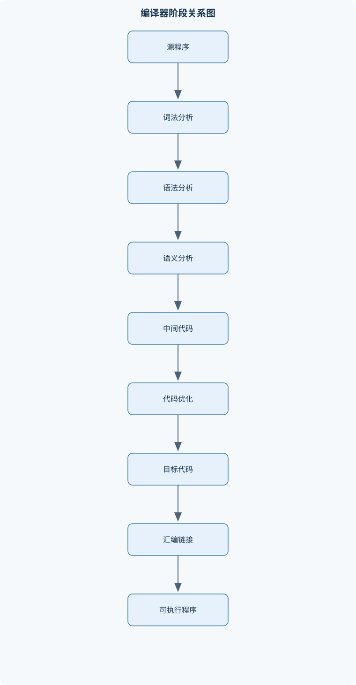
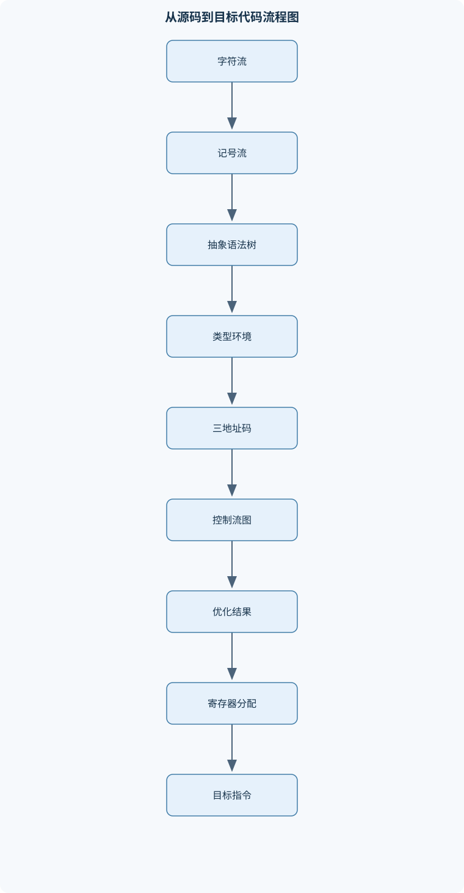

# 编译原理

## 一、课程整体知识框架

### 课程边界与先修知识

本课程研究将高级程序设计语言翻译为目标程序的原理、模型、算法与实现流程，覆盖词法分析、语法分析、语义分析、中间代码生成、运行时环境、代码生成和代码优化，并贯穿符号表、错误处理与编译器工具链。课程重点是静态编译器的前端—中端—后端结构，也可延伸到解释器、即时编译器和混合执行系统。先修知识包括离散数学中的集合、关系与图，形式语言与自动机，数据结构中的栈、树、图、哈希表，程序设计语言基础，计算机组成原理和汇编语言基础。课程不以某一种具体语言、处理器或工具版本为前提；具体目标机器指令集、调用约定和运行时库应作为实现实例单独说明。





### 1. 课程对象、目标与基本抽象

编译原理研究如何把源语言程序转换为目标程序，同时保持规定的程序含义。源语言记为 $L_s$，目标语言记为 $L_t$，编译器记为 $C$，可抽象表示为

$$
C:L_s\rightarrow L_t
$$

这里的“语言”不仅包括字符形式，还包括词法、语法和语义约束。若源程序包含未声明标识符、类型不匹配或控制流不合法，即使其字符序列能够被切分、语法结构也正确，也不一定属于完整的合法源程序。编译器的正确性要求：对于被接受的程序，目标程序的可观察行为应符合源程序语义；对于不合法程序，应尽可能报告准确的错误位置和原因。

编译器通常划分为前端、中端和后端。前端面向源语言，负责词法分析、语法分析、抽象语法树构造、名称绑定和类型检查；中端使用与具体处理器相对独立的中间表示进行控制流分析和优化；后端面向目标机器，负责指令选择、寄存器分配、栈帧布局、调用约定适配和目标代码输出。三者之间由明确的数据结构和不变量连接：词法分析输出合法记号流，语法分析输出结构正确的树，语义分析输出绑定和类型均有效的树，中端输出满足约束的中间代码，后端输出可装配或可链接的目标代码。

编译器、解释器、汇编器和链接器承担不同职责。编译器通常先生成目标程序或目标文件；解释器直接读取中间表示或源程序并执行；汇编器把汇编语言转换为机器目标文件；链接器解析跨目标文件和库文件的符号引用，并完成重定位。现实系统可以混合使用这些机制，例如先静态编译，再由运行时系统解释某些中间代码，或在程序执行过程中进行即时编译。

### 2. 编译流程、遍与中间表示

一个典型流程为：

$$
\text{字符流}\rightarrow\text{记号流}\rightarrow\text{语法树}\rightarrow\text{带类型树}
\rightarrow\text{中间表示}\rightarrow\text{目标代码}
$$

每个阶段可以访问符号表、错误处理器和源位置信息。一个“遍”是对某种表示进行一次系统处理，例如遍历抽象语法树收集声明，再遍历一次执行类型检查和中间代码生成。单遍编译器实现简单，但当声明先于使用、类型推断或跨函数优化需要全局信息时，通常需要多遍处理。

中间表示在源语言和目标机器之间提供稳定接口。三地址码的典型形式为

$$
x:=y\ op\ z,\qquad x:=op\ y,\qquad goto\ L
$$

或

$$
if\ x\ relop\ y\ goto\ L
$$

其中 $x,y,z$ 是变量或临时量，$op$ 是运算符，$L$ 是标签。四元式显式保存“运算符、参数一、参数二、结果”；三元式通过指令位置引用中间结果；树形中间表示则保留表达式的层次结构。选择何种表示取决于后续优化、代码生成和调试需求。

错误可以按阶段区分。词法错误是字符不能组成合法词素，例如出现不允许的字符；语法错误是记号序列不能由文法生成，例如括号不匹配；静态语义错误包括未声明、重复声明、类型不匹配和错误的函数调用；动态错误包括除零、数组越界和运行时内存不足。编译器应区分“拒绝程序”和“继续分析”：错误恢复的目标是尽量报告独立错误，而不是接受不符合语言规则的程序。

### 3. 形式语言基础

字母表记为 $\Sigma$，空串记为 $\varepsilon$，所有有限字符串构成的集合记为 $\Sigma^*$，语言是 $L\subseteq\Sigma^*$。正规式中的并、连接和闭包分别写为 $R_1|R_2$、$R_1R_2$ 和 $R^*$。正规式运算通常具有以下优先级：闭包最高，连接次之，并最低；必要时使用括号消除歧义。

若 $L$ 是语言，则

$$
L^0=\{\varepsilon\},\qquad L^{k+1}=L^kL
$$

因此

$$
L^*=\bigcup_{k\geq 0}L^k,\qquad
L^+=\bigcup_{k\geq 1}L^k
$$

$L^*$ 包含重复零次，即空串；$L^+$ 至少重复一次。正规语言可以由正规式、非确定有限自动机或确定有限自动机描述。它们表达能力相同，但表示规模和处理方式不同。正规语言适合描述标识符、整数和关键字等局部模式，不能直接描述任意深度的配对括号，因为有限自动机没有无界栈空间。

### 4. 编译器工程接口与正确性约束

编译器各模块应通过结构化接口通信。词法模块输出记号类型、词素值和源位置；语法模块消费记号并输出抽象语法树；符号表模块维护标识符到声明的绑定；类型模块判断表达式和语句是否合法；中间代码模块分配临时量和标签；后端模块将中间指令映射为目标指令。

每个模块都需要不变量。例如，作用域栈的栈顶必须是当前作用域；基本块中的中间指令除首条外不能成为外部跳转目标；寄存器分配后同时活跃且互相冲突的临时量不能共享寄存器。编译器工程的测试应覆盖正常程序、边界程序和错误程序，并检查阶段输出，而不能只检查最终是否生成文件。

## 二、章节和模块划分

### 核心知识覆盖清单

本清单用于检查正文是否覆盖本课程的主要知识模块：

- **编译器总体结构与语言基础**：编译器与解释器的定义、源程序到目标程序的阶段划分、前端中端后端职责、编译过程中的错误类别、形式语言与生成系统、源语言和目标语言的接口、遍与中间表示的概念、编译器与汇编器链接器关系。
- **词法分析与有限自动机**：记号词素和属性值、正规式与正规语言、正规式运算优先级、正规文法与有限自动机、NFA到DFA的子集构造、DFA最小化、最长匹配与规则优先级、缓冲区和行列号管理、词法错误检测与恢复。
- **上下文无关文法与语法表示**：上下文无关文法四元组、推导和句型句子、分析树与语法树、最左推导和最右推导、文法二义性、运算符优先级和结合性、左递归与左因子、EBNF与语法糖、文法等价变换。
- **自顶向下语法分析**：递归下降分析、预测分析表、FIRST集合、FOLLOW集合、LL(1)文法判定、消除直接左递归、消除间接左递归、提取左因子、非递归预测分析、自顶向下错误恢复。
- **自底向上与LR分析**：移进归约分析、句柄和规范归约、LR(0)项目、项目集闭包与GOTO、LR分析表、SLR(1)分析、LR(1)项目与展望符、LALR(1)状态合并、移进归约冲突、归约归约冲突、分析栈与动作转移。
- **语法制导翻译与抽象语法树**：具体语法树和抽象语法树、综合属性与继承属性、依赖图与属性计算顺序、S属性定义、L属性定义、语法制导定义、表达式翻译、声明和类型信息传递、控制流语句翻译、错误属性与语义诊断。
- **语义分析与符号表**：静态语义与动态语义、符号表条目结构、常量类型变量和函数声明、嵌套作用域、最近嵌套规则、声明前使用规则、同层声明冲突、类型表达式与类型等价、类型检查与类型推断、函数参数和返回值检查、递归声明处理。
- **中间表示与运行时环境**：三地址码、四元式和三元式、临时变量与标签、树形中间表示、基本块和控制流图、过程活动记录、栈帧布局、控制链和访问链、参数传递方式、静态区栈区堆区、垃圾回收接口。
- **代码生成与目标机器接口**：指令选择、地址模式、表达式代码生成、基本块内局部代码生成、调用序列与返回序列、栈帧建立和撤销、寄存器使用约定、参数传递与返回地址、布尔表达式短路求值、目标代码正确性约束、汇编输出与重定位。
- **数据流分析与代码优化**：优化的正确性与收益、局部公共子表达式消除、复制传播、常量传播与常量折叠、死代码消除、基本块与控制流图、到达定义分析、活跃变量分析、可用表达式分析、循环不变代码外提、归纳变量与强度削弱、寄存器分配与图着色。
- **编译器工程与综合实现**：词法分析器生成器接口、语法分析器生成器接口、抽象语法树模块、符号表模块、类型检查模块、中间代码模块、目标代码模块、错误处理接口、测试用例设计、端到端编译流程、模块边界与不变量。


### 1. 编译器总体结构与语言基础

编译器总体结构包括词法分析、语法分析、语义分析、中间代码生成、优化和目标代码生成。源语言与目标语言之间的接口由语义保持关系、调用约定、数据布局和运行时库共同决定。目标机器的指令集、寄存器数量、栈增长方向和参数传递方式不是编译原理的普遍结论，必须作为具体实现条件单独规定。

### 2. 词法分析与有限自动机

词法分析器把字符流分组为记号。记号包含类别，词素是源程序中的具体字符片段，属性值保存数值、字符串内容或符号表索引。例如，`count` 可以产生标识符记号，其属性值是字符串或标识符条目。

词法规则通常用正规式描述，再转换为有限自动机。NFA 到 DFA 的子集构造中，一个 DFA 状态表示 NFA 在读入同一前缀后可能处于的全部状态集合。初态为 $\varepsilon$-闭包；若集合含有任一 NFA 接受态，则对应 DFA 状态为接受态。DFA 最小化先删除不可达状态，再从“接受”和“非接受”两类开始反复细分。两个状态只有在任意后续字符串上的接受行为都相同，才可合并。

扫描时通常采用最长匹配：在所有能匹配当前位置的规则中选择词素最长者；长度相同时按规则优先级处理。因此输入 `a==b=12` 应划分为标识符 `a`、相等运算符 `==`、标识符 `b`、赋值符 `=` 和整数 `12`，而不能先把 `==` 拆成两个 `=`。缓冲区需要保存当前词素、最近接受状态和回退位置，并维护行号、列号。词法错误可以跳过非法字符，或跳到空白、分号、换行等同步位置；恢复策略必须避免无限循环。

### 3. 上下文无关文法与语法表示

上下文无关文法记为

$$
G=(V_N,V_T,P,S)
$$

其中 $V_N$ 是非终结符集合，$V_T$ 是终结符集合，$P$ 是产生式集合，$S$ 是开始符号。产生式写为

$$
A\rightarrow\alpha
$$

其中 $A\in V_N$，$\alpha\in(V_N\cup V_T)^*$。推导记为 $\Rightarrow$，多步推导记为 $\Rightarrow^*$。由开始符号推导出的终结符串是句子；推导过程中含有非终结符的串是句型。

具体语法树保留括号、分隔符和中间非终结符等语法细节；抽象语法树只保留后续语义所需的结构。例如，表达式 `a+b*c` 的抽象树应使乘法节点成为加法节点的子节点，从而体现乘法优先级。文法二义性是指存在某个句子具有两棵不同分析树，或等价地具有两种不同的结构解释。

文法

$$
E\rightarrow E+E\mid E*E\mid id
$$

对 `id+id*id` 既可解释为 $(id+id)*id$，也可解释为 $id+(id*id)$，因而二义。消除二义性的常用方法是分层：

$$
E\rightarrow E+T\mid T
$$

$$
T\rightarrow T*F\mid F
$$

$$
F\rightarrow (E)\mid id
$$

此时乘法位于更深层，结合更紧；左递归使加法和乘法左结合。需要注意，文法变换保持的通常是终结符语言，不保证保持原有分析树形状。

### 4. 自顶向下语法分析

递归下降分析为每个非终结符编写一个过程。预测分析则根据当前栈顶非终结符和一个输入记号选择产生式。$FIRST(\alpha)$ 是串 $\alpha$ 能生成的首终结符集合；若 $\alpha\Rightarrow^*\varepsilon$，则 $\varepsilon\in FIRST(\alpha)$。$FOLLOW(A)$ 是句型中可能紧跟 $A$ 的终结符集合，开始符号的 FOLLOW 集包含结束标记 `$`。

对产生式 $A\rightarrow\alpha$，预测分析表填写规则为：对每个 $a\in FIRST(\alpha)$，将该产生式放入 $M[A,a]$；若 $\varepsilon\in FIRST(\alpha)$，再对每个 $b\in FOLLOW(A)$ 填入 $M[A,b]$。若同一表项出现多个产生式，文法不是 LL(1)。

直接左递归

$$
A\rightarrow A\alpha\mid\beta
$$

在 $\beta$ 非空且不以 $A$ 开头时可改写为

$$
A\rightarrow\beta A'
$$

$$
A'\rightarrow\alpha A'\mid\varepsilon
$$

该变换避免递归下降无限递归，但改变了具体推导结构。间接左递归需按非终结符顺序逐步代入，再消除产生的直接左递归。公共左因子则通过提取共同前缀，使分析器先读取足够输入再决定产生式。

### 5. 自底向上与 LR 分析

LR 分析从输入串左到右扫描，并构造最右推导的逆过程。移进把输入记号压入栈，归约用产生式右部替换栈顶句柄，接受表示完整句子已识别。分析栈通常把状态和文法符号交替保存，栈顶位于右侧。

LR(0) 项目如

$$
[A\rightarrow\alpha\cdot\beta]
$$

表示已识别 $\alpha$，尚待识别 $\beta$。闭包将点后为非终结符的产生式加入项目集，GOTO 按某一文法符号移动点并继续求闭包。完整项目对应归约动作，点后为终结符对应移进动作。

SLR 使用 FOLLOW 集决定归约范围；LR(1) 项目写为

$$
[A\rightarrow\alpha\cdot\beta,a]
$$

其中 $a$ 是精确展望符；LALR 合并具有相同 LR(0) 核心的状态，以减少分析表规模，但合并可能引入移进—归约或归约—归约冲突。LR 中的“1”表示展望符信息，不是回看一个输入字符。冲突不能简单等同于文法二义：分析方法能力不足也会造成冲突。

### 6. 语法制导翻译与抽象语法树

语法制导定义把属性附加到文法符号，并以语义规则说明属性如何计算。综合属性由子节点向父节点传递，继承属性由父节点或兄弟节点向子节点传递。依赖图中每条边表示一个属性依赖；只有依赖图无环时，才能按拓扑顺序计算。

S 属性定义只使用综合属性，可自然地自底向上计算。L 属性定义允许继承属性依赖父节点、左侧兄弟或自身已有属性，适合从左到右的深度优先分析。类型环境可记为 $\Gamma$，判断式

$$
\Gamma\vdash e:T
$$

表示在环境 $\Gamma$ 下表达式 $e$ 类型为 $T$；$\Gamma\vdash s\ \mathrm{ok}$ 表示语句通过静态检查。

表达式翻译通常为每个中间结果生成临时变量。控制流翻译使用标签和回填列表：条件表达式维护真出口链和假出口链，语句维护下一条指令链，待目标地址确定后再统一填入。短路求值要求 `a && b` 在 `a` 为假时不计算 `b`，因此不能无条件把两个操作数都翻译成普通算术指令。

### 7. 语义分析与符号表

静态语义描述编译期可检查的约束，动态语义描述程序执行时的行为。符号表条目可以包含名称、种类、类型、声明位置、作用域层次、存储类别、参数信息和目标地址。

进入嵌套块时压入新作用域，声明时检查同层重名，再插入条目；引用时从当前层向外查找，首次找到的声明符合最近嵌套规则；退出块时弹出作用域。声明前是否允许使用、同层是否允许遮蔽、函数是否可递归，均属于语言设计条件。递归函数必须在检查函数体前登记函数名或函数原型，否则函数体内无法解析自身调用。

类型检查不仅查询符号表，还要应用类型规则。例如赋值要求左值可写且右侧类型可转换；函数调用要求实参与形参数量、顺序和类型匹配；返回语句必须符合函数返回类型。类型等价可以按名字判断，也可以按结构判断，二者会对别名类型和复合类型产生不同结果。

### 8. 中间表示与运行时环境

三地址码适合划分基本块和进行数据流分析。基本块记为 $B_i$，控制流图记为

$$
G_{cfg}=(B,E)
$$

若从 $B_i$ 可直接转移到 $B_j$，则 $(B_i,B_j)\in E$。领导语句包括函数入口、跳转目标和跳转指令后的下一条指令。每个领导语句及其后直到下一个领导语句前的指令构成一个基本块。

活动记录通常含返回地址、控制链、访问链、保存寄存器、参数、局部变量和临时量。控制链指向动态调用者，访问链指向词法外层过程；递归调用中二者可能不同。若当前过程嵌套层为 $k$，变量声明层为 $d$，沿访问链追踪 $k-d$ 次可到达声明所在活动记录，但前提是采用词法作用域且访问链维护正确。

栈区适合保存过程活动记录，静态区适合生命周期贯穿程序的对象，堆区适合动态分配对象。垃圾回收器需要编译器或运行时提供对象布局、指针识别、根集合和安全点等接口。参数可以按值、按引用或按其他约定传递，具体方式影响别名、修改可见性和栈帧布局。

### 9. 代码生成与目标机器接口

代码生成包括指令选择、地址模式匹配、基本块内局部代码生成、调用序列和返回序列。目标机器接口必须明确寄存器用途、栈帧结构、返回地址保存位置、参数寄存器、返回值寄存器、被调用者保存寄存器和重定位规则。

表达式代码生成需要决定中间结果放在寄存器还是内存中。调用序列负责准备参数、保存必要寄存器、建立新栈帧并跳转；返回序列恢复栈帧、恢复寄存器并返回。目标代码正确性不仅是指令语法正确，还包括求值顺序、副作用顺序、异常行为、内存访问和调用约定均符合源语言要求。

### 10. 数据流分析与代码优化

优化必须保持可观察行为不变，并且只有在收益大于代价时才有实际价值。到达定义是前向分析，活跃变量是后向分析。活跃变量方程为

$$
OUT[B]=\bigcup_{S\in succ(B)}IN[S]
$$

$$
IN[B]=USE[B]\cup(OUT[B]-DEF[B])
$$

其中 $USE[B]$ 是块中先使用后定义的变量集合，$DEF[B]$ 是块中定义的变量集合。有限变量集合上的单调迭代最终达到不动点。

局部公共子表达式消除重复计算；复制传播把 `x:=y` 后的可安全使用位置中的 `x` 替换为 `y`；常量折叠在编译期计算常量表达式；死代码消除删除结果不会被使用且无副作用的定义。循环不变代码外提要求表达式操作数在循环内不改变，且外提不会改变异常和副作用时机。归纳变量可用于强度削弱，例如用重复加法替代循环中的乘法，但必须检查溢出和初始化顺序。

若两个临时变量同时活跃，则冲突图中对应节点连边。若冲突图能用 $K$ 种颜色着色，就可分配到 $K$ 个寄存器；不能着色时需要选择变量溢出到内存，并插入加载和存储。浮点舍入、整数溢出、别名、函数调用、易失性访问和并发都可能使理想代数变换失效。

### 11. 代表性算法与流程

#### 11.1 词法分析流程

**输入**：字符流、DFA、规则优先级。  
**输出**：记号序列及行列号、词素属性。  
**不变量**：已消费前缀对应当前 DFA 状态，且保存最近一次接受状态。  
**过程**：从当前位置出发沿 DFA 转移；每次进入接受态就记录位置；转移失败时回退到最近接受位置，输出最长词素；若不存在接受态则报告错误并按恢复策略前进。  
**终止**：读到文件结束标记。  
**复杂度**：固定 DFA 下扫描时间通常为 $O(n)$，其中 $n$ 是字符数；缓冲区空间取决于最长待确认词素。

#### 11.2 LL(1) 预测分析

**输入**：文法、FIRST/FOLLOW 集、记号串。  
**输出**：分析树或语法错误。  
栈初始为开始符号和 `$`。若栈顶为终结符，则必须与当前输入相同并移进；若栈顶为非终结符，则查表并逆序压入产生式右部；栈顶与输入同时为 `$` 时接受。若表项为空，可跳过输入直到同步记号，或弹出当前非终结符。每次动作必须消耗输入或缩短待展开结构，否则可能无限循环。若每个表项至多一个产生式，分析时间为 $O(n)$。

```text
function parse(tokens, table, start):
    stack := [END, start]
    i := 0
    while true:
        X := top(stack)
        a := tokens[i]

        if X == END and a == END:
            return ACCEPT
        if is_terminal(X):
            if X == a:
                pop(stack)
                i := i + 1
            else:
                report("terminal mismatch", i)
                recover_terminal(stack, tokens, i)
        else:
            production := table[X, a]
            if production exists:
                pop(stack)
                for symbol in reverse(rhs(production)):
                    if symbol != EPSILON:
                        push(stack, symbol)
            else:
                report("empty table entry", X, a, i)
                recover_nonterminal(stack, tokens, i)
```

#### 11.3 基本块与控制流图构造

**输入**：线性三地址码。  
**输出**：基本块集合和边集合。  
先标记入口、所有跳转目标及跳转后指令，再按标记切分。块末为条件跳转时建立两个后继，为无条件跳转时建立一个后继，普通顺序指令建立下一块后继。每条指令必须恰属于一个基本块；块中间不能出现外部入口。扫描和建边均可在线性时间 $O(n)$ 内完成。

#### 11.4 数据流不动点分析

**输入**：控制流图、块的 $USE/DEF$ 或 $GEN/KILL$ 集合。  
**输出**：稳定的 $IN$ 和 $OUT$ 集合。  
根据前向或后向性质选择初值和方程，反复处理受变化影响的块；一轮处理后所有集合均未变化时终止。有限格、单调传递函数和合理初值保证迭代达到不动点。位向量表示可降低集合并、交、差运算成本。

### 12. 代表性例题

#### 例题一：正规式闭包与边界

**题干**：设 $L=\{a,b\}$，求 $L^*$ 与 $L^+$ 的区别。

**分析**：$L^0=\{\varepsilon\}$，$L^1=\{a,b\}$，$L^2=\{aa,ab,ba,bb\}$，后续为任意非空的 $a,b$ 字符串。

**解答**：

$$
L^*=\{\varepsilon\}\cup L\cup L^2\cup\cdots
$$

$$
L^+=L\cup L^2\cup\cdots
$$

**结果验证**：$\varepsilon\in L^*$，但 $\varepsilon\notin L^+$；`ab` 同时属于二者。  
**变式**：若 $L=\varnothing$，则 $L^*=\{\varepsilon\}$，而 $L^+=\varnothing$。

#### 例题二：二义文法

**题干**：判断 $E\rightarrow E+E\mid E*E\mid id$ 是否能唯一解释 `id+id*id`。

**分析**：根节点可以是 `+`，右子树为 `id*id`；也可以是 `*`，左子树为 `id+id`。

**解答**：

$$
id+(id*id)
$$

和

$$
(id+id)*id
$$

均可由文法生成，因此文法二义。  
**结果验证**：两棵树的叶子序列均为 `id+id*id`，但运算结构不同。  
**变式**：采用 $E,T,F$ 分层文法后，乘法只能在 $T$ 层形成，第一种解释被保留。

#### 例题三：直接左递归消除

**题干**：改写 $A\rightarrow A\alpha\mid\beta$。

**分析**：原文法表示一个 $\beta$ 后跟零个或多个 $\alpha$。

**解答**：

$$
A\rightarrow\beta A'
$$

$$
A'\rightarrow\alpha A'\mid\varepsilon
$$

**结果验证**：原串形式为 $\beta\alpha^k$，新文法同样可生成任意 $k\geq0$ 的串。  
**边界**：若 $\beta$ 为空或以 $A$ 开头，不能直接套用该式；若存在间接左递归，必须先代入消除。

#### 例题四：活跃变量分析

**题干**：某基本块含指令 `x:=a+b; y:=x+c; x:=0`，块出口处没有变量活跃。求块入口的活跃变量。

**分析**：从后向前处理。末条定义 `x:=0` 不使用变量；其前一条使用 `x,c`；第一条使用 `a,b` 并定义 `x`。

**解答**：末条之后 $OUT=\varnothing$，故末条之前仍为 $\varnothing$。第二条之前为 $\{x,c\}$。第一条执行前为

$$
USE\cup(OUT-DEF)=\{a,b\}\cup(\{x,c\}-\{x\})=\{a,b,c\}
$$

**结果验证**：入口处需要保存 $a,b,c$；$x$ 的旧值不需要保存。  
**变式**：若块出口处 $x$ 活跃，则第一条前仍需考虑 $x$，因为第一条定义覆盖旧值，需结合实际使用位置判断。

#### 例题五：数组地址计算

**题干**：一维数组首地址为 $base$，元素宽度为 $w$，下界为 $L$，求元素 $i$ 的地址。

**分析**：第一个元素偏移为 $0$，每增加一个下标偏移增加 $w$。

**解答**：

$$
addr(i)=base+(i-L)w
$$

其中 $i,L$ 是下标，$w$ 的单位是字节，$base$ 和结果地址也以字节地址表示。  
**验证**：当 $i=L$ 时地址为 $base$。  
**边界**：公式要求数组连续存储、元素宽度固定且 $i$ 在合法范围内；动态数组、非连续布局和越界检查需要额外运行时信息。二维行主序数组还必须知道列数，不能只套用一维公式。

### 13. 实验与综合项目

#### 实验一：构造词法分析器

**输入数据**：包含标识符、整数、`=`、`==`、括号、空白、换行和非法字符的源文件。  
**步骤**：定义正规式；构造 NFA；用子集构造得到 DFA；删除不可达状态并最小化；实现最长匹配、规则优先级、行列号记录和错误恢复。  
**评价标准**：合法输入的记号类别和词素边界正确；`==` 不被拆分；非法字符能定位；文件末尾、空行和最长标识符不导致越界或死循环。  
**排错方法**：打印每次 DFA 转移、最近接受状态和回退位置；重点检查闭包是否遗漏、接受态是否错误标记，以及同长度规则的优先级是否稳定。

#### 实验二：端到端小型编译器

**输入数据**：含变量声明、算术表达式、条件语句和函数调用的小型源程序，同时准备未声明、重复声明、类型错误和括号缺失样例。  
**步骤**：实现词法分析；构造抽象语法树；维护嵌套符号表；进行类型检查；生成三地址码；划分基本块并建立控制流图；完成局部优化；生成带调用序列的目标代码。  
**评价标准**：每阶段输出可独立检查；合法程序的执行结果与解释执行结果一致；错误位置和错误类别准确；优化前后可观察行为一致；函数调用、返回值和局部变量不破坏栈帧。  
**排错方法**：保存阶段快照，采用二分定位确定错误首次出现的模块；检查 AST 的源位置、符号绑定、临时变量唯一性、标签唯一性和栈帧偏移；若优化后结果变化，先关闭优化，再逐项恢复常量折叠、复制传播和死代码消除。

### 14. 具体易错点

1. 把最长匹配误认为第一条匹配规则优先；实际应先比较词素长度，再处理同长度优先级。
2. 忽略正规语言不能表达任意深度嵌套。
3. 只依据 FIRST 判断 LL(1)，遗漏空产生式对应的 FOLLOW。
4. 认为消除左递归保持原分析树；它通常只保持终结符语言。
5. 把文法二义与 LR 表冲突完全等同。
6. 把 LR(1) 中的“1”理解为回看一个字符。
7. 把具体语法树直接用于所有阶段，导致括号和分隔符干扰语义处理。
8. 将符号表查找等同于类型检查。
9. 混淆控制链和访问链。
10. 数组地址计算遗漏下界、元素宽度或行主序维度。
11. 把基本块中间的任意指令当作外部入口。
12. 对含副作用、别名或易失性访问的表达式直接做代数优化。
13. 认为寄存器分配可以平均分配，而忽略同时活跃变量的冲突。
14. 错误恢复只跳过一个字符，造成级联错误或无限循环。
15. 忽略整数溢出、浮点舍入和异常对优化正确性的影响。

### 15. 常见笔试问题与解答思路

1. **说明正规式、NFA、DFA 的关系。**  
   应说明三者描述同一类正规语言，并解释子集构造中一个 DFA 状态代表 NFA 状态集合。

2. **推导 LL(1) 分析表填法。**  
   先计算 FIRST，再处理空产生式的 FOLLOW，最后检查同一表项是否有多个产生式。

3. **消除直接左递归是否保持语言？**  
   说明新旧文法均生成 $\beta\alpha^k$，但推导树和结合性表示可能改变。

4. **比较 LR(0)、SLR(1)、LR(1)、LALR(1)。**  
   重点比较归约信息：无展望符、FOLLOW 集、精确展望符和同核心合并。

5. **推导活跃变量方程。**  
   说明后继块入口的变量在当前块出口活跃，再从出口剔除当前定义并加入当前使用。

6. **解释基本块领导语句规则。**  
   函数入口、跳转目标、跳转后的下一条指令三类位置必须成为块入口。

7. **说明访问链与控制链区别。**  
   控制链服务动态调用返回；访问链服务词法作用域下的非局部变量访问。

8. **解释优化为什么可能改变程序结果。**  
   从别名、函数副作用、溢出、浮点舍入、异常和易失性内存访问说明理想等价不一定成立。

### 16. 常见面试问题、参考答案与追问要点

1. **编译器前端、中端、后端如何分工？**  
   前端处理源语言结构和语义，中端处理机器无关表示及优化，后端适配目标机器。追问时应说明三者通过 AST、类型信息和中间表示连接。

2. **为什么词法分析通常采用最长匹配？**  
   它能保证 `==`、`<=` 等多字符运算符不被拆分。追问应说明同长度规则仍需优先级，并讨论关键字与标识符冲突。

3. **如何处理递归函数的符号表？**  
   在检查函数体前先登记函数名或原型。追问应区分递归声明、互递归和声明前使用规则。

4. **如何判断一个优化是否安全？**  
   检查数据依赖、控制依赖、别名、副作用、异常和数值语义。追问可要求说明浮点加法不满足一般结合律的原因。

5. **基本块为什么适合局部优化？**  
   块内只有一个入口和一个出口，控制流路径明确。追问应指出跨块优化必须使用控制流图和数据流信息。

6. **寄存器不足时怎么办？**  
   选择变量溢出到栈或内存，并插入加载、存储及必要的重写。追问应说明冲突图和活跃区间如何影响选择。

7. **错误恢复怎样避免级联错误？**  
   使用同步记号、产生式边界和错误状态，恢复后继续分析。追问应说明恢复不能伪造过多结构，否则会掩盖真正错误。

8. **如何验证编译器正确性？**  
   进行阶段级测试、差分测试、随机程序测试和优化前后等价性测试。追问应说明最终运行结果不一致时如何通过阶段快照定位首次偏差。

### 17. 岗位关联

编译器前端工程师通常实现词法规则、递归下降或 LR 语法分析、AST、符号表和类型检查；产出是可维护的前端模块、准确诊断和阶段测试，验收标准包括合法程序通过、非法程序定位稳定、错误恢复不崩溃。

编译器后端和代码生成工程师负责指令选择、栈帧、调用约定、寄存器分配、汇编输出和重定位；产出是可装配、可链接且执行结果正确的目标代码，验收时必须检查寄存器保存、参数传递、返回值和异常路径。

静态分析与优化工程师使用控制流图、数据流方程、别名信息和抽象语义；产出是安全的优化或诊断规则，验收标准是无误报或误报可解释、优化前后可观察行为一致，并能处理边界控制流。

运行时系统和虚拟机工程师关注活动记录、垃圾回收接口、闭包、访问链、解释执行和即时编译；产出是稳定的调用栈、对象布局和运行时服务，验收标准包括递归、嵌套作用域、异常和内存管理行为正确。

开发工具与语言服务工程师需要复用词法、语法、符号表和类型信息，实现增量解析、跳转定义、补全和诊断；验收标准是源代码局部修改后能够快速更新，且诊断位置与编译器语义保持一致。

## 三、核心概念的详细解释

### 1. 编译器总体结构与语言基础

编译器把源语言程序转换为目标语言程序，记为 $C:L_s\rightarrow L_t$。正确性不只是“生成了目标代码”：对通过检查的源程序，目标程序应保持源语言规定的可观察行为，例如输入输出、返回值和异常行为。编译器通常由前端、中端和后端组成。前端理解源语言的词法、语法和静态语义；中端处理较少依赖源语言和目标机器的中间表示；后端根据目标机器的指令、寄存器和调用约定生成代码。模块边界应携带足够的信息，例如源位置、类型、控制流边和符号绑定，避免后续阶段只能从已经丢失的文本细节中猜测含义。

编译器与解释器的区别在于主要执行路径，而非必然采用互斥技术。静态编译器通常先生成目标程序；解释器通常读取源程序或中间表示并直接求值。即时编译器在运行过程中把部分程序转换为机器码，混合系统则可能同时使用解释和编译。汇编器把汇编语言转换为目标文件，链接器解析目标文件之间的符号引用并处理重定位；它们不等同于编译器的语法和语义分析阶段。

编译器可采用单遍或多遍处理。单遍处理减少中间存储和重复遍历，但遇到前向引用、类型推断、全局优化等需要先汇总信息的任务时，可能需要额外的符号表、延迟处理或再次遍历。中间表示是阶段间接口：三地址码便于表达控制流和局部运算，树形表示便于保留表达式结构。选择表示时应同时考虑优化、代码生成、调试信息和增量更新需求。

### 2. 词法分析与有限自动机

词法分析把字符流切分为记号。记号是语法分析使用的类别，例如 `IDENTIFIER`、`INTEGER` 或 `PLUS`；词素是输入中实际匹配该记号的字符序列；属性值可记录标识符名称、数值、行列位置等。多个词素可以属于同一记号类别，例如 `count` 和 `total` 都可属于 `IDENTIFIER`，但它们的词素文本不同。

正规式描述正规语言，有限自动机可识别正规语言。NFA允许某字符下有多个后继状态，也可以有不消耗输入的 $\varepsilon$ 转移；DFA在每个状态和输入字符下至多有一个后继。将NFA确定化时，一个DFA状态代表一组NFA状态，因此最坏情况下DFA状态数可达 $2^{|Q|}$，其中 $Q$ 是NFA状态集合。含有NFA接受状态的子集对应DFA接受状态。确定化通常使逐字符识别更直接，但可能增加自动机规模；最小化则合并对所有后续字符串具有相同接受行为的状态。

正规式闭包中的零次重复是关键：$L^*$ 必定包含 $\varepsilon$，即使 $L$ 本身不含空串；$L^+$ 要求至少一次重复。正规式适合描述标识符、整数等局部模式，却不能单独描述任意深度的括号配对，因为这种嵌套依赖无界计数，超出有限自动机的记忆能力。

词法分析通常实行最长匹配：从当前位置出发，选择能够匹配的最长词素；若多个规则匹配同样长的词素，再用规则优先级决定记号。例如规则同时包含 `=` 和 `==`，输入 `==` 应取两字符运算符，而不是拆为两个 `=`。关键字和标识符也可能匹配相同长度；实现可让关键字规则优先，或先按标识符规则识别，再查询关键字表。缓冲区和位置计数必须随输入推进一致更新；回退到最近接受位置时，行列号也要恢复到对应位置。若当前位置不存在任何接受匹配，扫描器应报告词法错误并消费至少一个字符或按明确的恢复策略推进，以保证不会无限重试。

### 3. 上下文无关文法与语法表示

上下文无关文法 $G=(V_N,V_T,P,S)$ 由非终结符集合 $V_N$、终结符集合 $V_T$、产生式集合 $P$ 和开始符号 $S$ 构成。产生式 $A\rightarrow\alpha$ 表示非终结符 $A$ 可以替换为符号串 $\alpha$。从开始符号反复应用产生式形成推导；最终只含终结符的串是该文法生成的句子。分析树记录产生式展开过程，抽象语法树则通常省去括号、分号等仅承担语法分隔作用的节点，并保留运算、声明和控制结构等语义要素。

二义文法存在至少一个句子具有两棵不同分析树，或等价地具有不同的最左推导或最右推导。表达式文法 $E\rightarrow E+E\mid E*E\mid id$ 对 `id+id*id` 既允许先做加法，也允许先做乘法，因此不能仅凭该文法确定预期结构。分层非终结符可以显式编码优先级，例如让加法产生式引用乘法层，使乘法成为加法操作数的一部分；结合性则由递归结构决定。把左递归改写为右递归可能保持生成的字符串集合，却改变分析树形状，语义动作必须确保仍按语言规定的结合性构造抽象语法树。

左递归文法不适合直接用于普通自顶向下递归下降：分析过程可能在不消耗输入时反复调用同一非终结符。对 $A\rightarrow A\alpha\mid\beta$，若 $\beta$ 非空且不以 $A$ 开头，可改写为 $A\rightarrow\beta A'$、$A'\rightarrow\alpha A'\mid\varepsilon$。改写后表达的重复串仍为 $\beta\alpha^k$，$k\geq0$；但这是语言等价，不是推导树逐点相同。左因子提取则把具有共同前缀的产生式延迟到前缀被识别后再作选择。EBNF中的可选、重复等记法是便于书写的语法糖，展开后仍需由明确的文法产生式实现。

### 4. 自顶向下语法分析

LL(1)分析从左向右读取输入，构造最左推导，并用一个向前看记号选择产生式。$FIRST(\alpha)$ 是从符号串 $\alpha$ 推导出的首终结符集合；如果 $\alpha$ 能推导出空串，则该集合还包含 $\varepsilon$。$FOLLOW(A)$ 则收集句型中可能紧跟非终结符 $A$ 的终结符；若 $A$ 可位于句子末尾，结束标记 `$` 也属于其FOLLOW集合。

对产生式 $A\rightarrow\alpha$，预测分析表在 $FIRST(\alpha)$ 中每个终结符对应的表项填写该产生式。若 $\varepsilon\in FIRST(\alpha)$，还要在所有 $FOLLOW(A)$ 对应的表项填写该产生式，因为此时分析器可能选择让 $A$ 推导为空。若某表项需要填写两个不同产生式，单个向前看记号就不能唯一选择，文法不满足LL(1)条件。仅检查不同产生式的FIRST集合是否相交是不够的；含空产生式时必须进一步检查FOLLOW。

递归下降分析把非终结符实现为过程，适合文法结构清楚且需要定制诊断的场景。非递归预测分析则用栈和分析表模拟同一过程。分析栈顶为终结符时，必须与当前输入记号匹配；栈顶为非终结符时，查询分析表并用产生式右部替换它。栈顶和输入均为 `$` 才接受。表项为空表示出错，可通过跳过输入直到同步记号，或弹出无法恢复的非终结符来继续分析；恢复策略应保持栈和输入均能向终止状态推进。

### 5. 自底向上与LR分析

移进—归约分析从输入串出发，逐步把已识别的符号归约为文法非终结符，最终归约到开始符号。句柄是当前右句型中可按某产生式右部归约，并使结果对应最右推导逆过程的一段符号。LR分析栈保存已识别文法符号及状态，ACTION表决定移进、归约、接受或报错，GOTO表根据归约后的非终结符决定下一状态。

LR项目中的点表示产生式右部已识别到的位置。$[A\rightarrow\alpha\cdot\beta,a]$ 表示已识别 $\alpha$，还需识别 $\beta$，并以 $a$ 作为归约展望符。LR(0)项目不带展望符，归约限制较弱；SLR(1)在完成项目上用 $FOLLOW(A)$ 限制归约；LR(1)项目记录更精确的展望符；LALR(1)合并具有相同核心的LR(1)状态以减少状态数，但合并后展望符集合可能导致新冲突。因此，状态数较少不等于对所有文法都能无损合并。

移进—归约冲突表示某个表项既要求移进又要求归约；归约—归约冲突表示同一表项可按多个产生式归约。冲突可能来自二义文法，也可能来自所选分析方法区分上下文的能力不足；单凭出现冲突不能断言文法必然二义。通过优先级和结合性规则消解冲突时，规则必须符合语言语义，而不能只把表格做成“没有冲突”。

### 6. 语法制导翻译与抽象语法树

语法制导定义为语法符号附加属性，并用语义规则规定属性如何计算。综合属性根据子节点信息计算，适合自底向上传递类型、常量值和生成代码；继承属性从父节点或左侧兄弟节点获得信息，适合传递作用域环境、预期类型和控制流标签。属性依赖图把每个属性实例作为节点，若属性 $y$ 的计算需要属性 $x$，则连有向边 $x\rightarrow y$。图无环时可按拓扑序求值；若有环，简单的单次拓扑计算不成立，必须改变规则、计算策略或语义建模。

S属性定义只使用综合属性，可以随语法树自底向上计算。L属性定义允许某子节点的继承属性依赖父节点属性和其左侧兄弟的属性，因此可按深度优先、从左到右顺序处理。属性规则需要与符号表更新顺序协调：例如，函数体若允许递归调用，函数名必须在检查函数体前登记；否则本来合法的递归会被误报为未声明。

语法树到中间代码的翻译可使用临时量、标签和回填列表。对条件表达式可分别生成真假跳转链，对 `if-else` 结构先产生跳转，再将尚未确定的目标地址回填到相应标签。布尔表达式若采用短路语义，右操作数只能在左操作数结果要求时执行，因此不能一律先把布尔值计算成临时变量再做无条件运算。数组元素翻译则要明确元素宽度、下界和维度布局；若边界在运行时才知道，可能还需生成边界检查。

### 7. 语义分析与符号表

词法和语法正确不代表程序语义正确。静态语义检查包括名称是否绑定到声明、赋值两侧类型是否兼容、函数实参与形参是否匹配，以及返回语句是否符合函数返回类型。类型环境 $\Gamma$ 表示当前可见的名称及其类型等信息；判断式 $\Gamma\vdash e:T$ 表示表达式 $e$ 在环境 $\Gamma$ 中具有类型 $T$。名称绑定回答“这个标识符指向哪个声明”，类型检查回答“该声明的值能否用于当前运算”，两者相关但不能互相替代。

嵌套词法作用域通常遵循最近嵌套规则：引用标识符时先查当前作用域，再逐层向外查找，找到最近的声明即停止。进入块时建立新作用域，离开时移除该层条目；同层重复声明是否允许取决于语言规则，外层名称被内层遮蔽也应按语言规定处理。递归与互递归要求编译器在检查函数体之前建立足够的声明信息，具体可以先登记函数名及签名，再检查函数体。

类型等价可按类型结构比较，也可在某些语言中按声明名称判断；不能假定所有语言使用同一种规则。类型推断则从表达式和声明之间的约束求解类型，并非“无需类型规则”。当推断无法唯一决定类型、出现互相矛盾的约束，或需要语言规定的显式类型信息时，应报告诊断或要求注解。

### 8. 中间表示与运行时环境

三地址码把复杂表达式拆成较简单的指令，例如把 $a+b*c$ 写成先计算乘法临时量，再进行加法。四元式显式保存操作、操作数和结果；三元式可用指令序号引用先前结果，减少临时名但会增加重排指令时维护引用的难度。基本块是一段只有一个入口、控制流只从末尾离开的连续指令序列。控制流图以基本块为节点，以可能的直接转移为边，循环、分支和返回都由图结构表达。

活动记录通常为一次过程调用保存返回地址、参数、局部变量、临时量和需要保存的寄存器等信息。其布局受目标机和调用约定影响，不存在对所有机器都固定的字段顺序。控制链指向动态调用者的活动记录，用于沿调用关系恢复调用环境；访问链指向词法外层的活动记录，用于访问非局部变量。二者在递归和嵌套调用中可能不同。若当前词法层为 $k$、变量声明层为 $d$，且访问链正确维护，则沿访问链向外 $k-d$ 次到达声明所在记录。

静态区适合生命周期贯穿程序执行的数据，栈区适合具有嵌套调用生命周期的活动记录，堆区适合生命周期不能简单按调用顺序回收的对象。垃圾回收系统需要与对象布局、指针信息和安全点等运行时接口配合；编译器生成代码必须提供足以识别引用的元数据，或遵守运行时系统规定的对象表示。

### 9. 代码生成与目标机器接口

代码生成把中间表示映射到目标指令。指令选择需考虑目标机提供的运算和地址模式，寄存器分配需考虑同时活跃的值不能共享同一寄存器。基本块内的局部代码生成可利用计算已完成且仍可用的结果，减少重复加载和重复运算。调用序列必须与调用约定一致，包括参数位置、返回值位置、返回地址保存、被调用者或调用者负责保存哪些寄存器，以及栈帧的建立和撤销方式。调用约定属于具体目标接口，不应当被误写成所有处理器都通用的固定规则。

目标代码正确性还要求满足数据对齐、栈指针约束、寄存器约定和重定位规则。汇编器负责把汇编文本转成目标文件，链接器解析外部符号和库引用；若编译器输出了错误符号名、错误重定位类型或不符合约定的栈布局，即使单条指令看似正确，最终程序仍可能无法正确链接或运行。

### 10. 数据流分析与代码优化

优化应保持源程序的可观察行为，并且确有收益。基本块内公共子表达式消除要求操作数值未改变，且中间没有可能影响运算结果的副作用。复制传播可把已确认相等的变量引用替换为其复制来源，但若来源被重新赋值或别名写入，就不能继续替换。常量折叠在编译期计算常量表达式；常量传播把已知常量信息沿控制流传递。死代码消除删除结果不可观察且不影响其他计算的赋值。函数调用、内存别名、易失性访问、异常、整数溢出规则和浮点舍入都可能限制这些变换。

到达定义分析是前向分析，描述某定义是否可能到达程序点；活跃变量分析是后向分析，描述变量的当前值是否可能在未来被读取。基本块的 $USE[B]$ 是在块内先于任何定义而使用的变量集合，$DEF[B]$ 是块内被定义的变量集合。对活跃变量，块出口的活跃值来自后继块入口；从出口反推时，应去掉块内定义并加入块内先使用的变量。

循环不变代码外提可将循环内结果不随迭代改变的运算移到循环外，但必须确保移动不会改变异常和副作用发生条件。归纳变量的强度削弱可用递增更新替代每轮重复乘法；需验证初值、更新顺序、循环边界及溢出语义。寄存器分配使用活跃性建立冲突关系：同时活跃的临时量必须占不同寄存器；寄存器不够时需要选择溢出对象并插入加载、存储或重写代码。

### 11. 编译器工程与工具链

工程实现通常把扫描器、解析器、抽象语法树、符号表、类型检查、中间代码和目标代码模块分开，并用明确的数据结构约定连接。扫描器输出的记号应包含类别、词素属性和源位置；解析器不应把词法错误伪装成合法记号；语义分析输出的绑定与类型信息应可供后续阶段查询。错误处理接口需要区分错误类别、位置和恢复状态，避免一个底层错误触发大量重复诊断。

词法分析器和语法分析器生成器可根据规则自动生成扫描器或分析器，但规则文件中的动作仍由实现者负责。测试应覆盖各阶段边界：合法与非法词素、文法边界、类型错误、嵌套作用域、控制流、函数调用和优化前后行为。端到端测试能检查工具链连接，但若结果错误，还应保存记号、语法树、类型信息、中间表示和目标代码等阶段快照，以定位首次违反不变量的位置。

## 四、重要定义、公式、定理和推导

### 专业审校补充：关键定义与适用边界

静态单赋值形式（SSA）要求每个普通变量只被定义一次；当控制流的多个前驱都可能到达某基本块，而这些路径对同一变量有不同定义时，在汇合点插入伪函数 φ。若基本块 B 的前驱按顺序为 B1、B2，且到达 B1、B2 时变量 x 的定义分别为 x1、x2，则写作 x3=φ(x1,x2)；运行时并不执行 φ，而是根据实际到达的前驱选择对应参数。φ 的插入位置通常依据支配边界确定，重命名则沿支配树进行，使每次使用都引用唯一到达定义。SSA 只约束中间表示中的定义形式，不等于源语言变量不可变，也不自动解决内存、指针别名或数组元素的多次写入。将 SSA 降回普通三地址码时，应在前驱边上插入复制操作；若复制点位于关键边上，通常需先拆分该边，以避免破坏控制流语义。


### 1. 正规式闭包与有限自动机等价性

设 $L$ 是语言。定义

$$
L^0=\{\varepsilon\},\qquad L^{k+1}=L^kL
$$

其中语言连接 $XY=\{xy\mid x\in X,\ y\in Y\}$。于是 $L^k$ 表示恰好连接 $k$ 个来自 $L$ 的字符串，故

$$
L^*=\bigcup_{k\geq0}L^k,\qquad
L^+=\bigcup_{k\geq1}L^k
$$

$L^*$ 的零次项使空串始终属于 $L^*$；$L^+$ 只有在 $L$ 本身含空串时才必然含空串。以上公式适用于任意语言，不要求语言有限。

正规式、NFA和DFA描述同一类正规语言。构造思路是：正规式的并、连接和闭包可通过带 $\varepsilon$ 转移的NFA组合实现；NFA可通过子集构造转换为DFA；DFA本身是NFA的特例。子集构造中，初始DFA状态为NFA初态的 $\varepsilon$-闭包；读入字符 $a$ 后，先收集集合中所有状态经 $a$ 可达的状态，再取其 $\varepsilon$-闭包。DFA状态集合若包含NFA接受态，则该集合为DFA接受态。反向地，任一有限自动机都可构造等价正规式，因此三种表示的识别能力相同；差别主要在表示规模和执行方式，而非语言类别。

### 2. LL(1)预测分析表的填表条件

对产生式 $A\rightarrow\alpha$，若输入记号 $a\in FIRST(\alpha)$，则遇到非终结符 $A$ 且向前看为 $a$ 时应选该产生式，因此将其填入表项 $M[A,a]$。若 $\varepsilon\in FIRST(\alpha)$，该产生式可以不消耗输入而展开；此时只有当向前看记号可能跟在 $A$ 后面时才可选择，所以对每个 $b\in FOLLOW(A)$，也将该产生式填入 $M[A,b]$。

文法满足LL(1)的表格条件是：每个非终结符和终结符对应的表项至多含一个产生式。若同一表项出现多个产生式，单个向前看记号无法作唯一选择。这个结论依赖FIRST与FOLLOW集合计算正确；遗漏空串传播或句末结束标记会造成表项错误。FIRST描述候选产生式展开后可能遇到的首记号，FOLLOW描述该非终结符整体结束后可能出现的记号，两者用途不能互换。

### 3. 左递归改写与语言保持

考虑

$$
A\rightarrow A\alpha\mid\beta
$$

其中 $\beta$ 不为空且不以 $A$ 开头。原文法先产生 $\beta$，随后可把 $A\rightarrow A\alpha$ 应用任意次，得到 $\beta\alpha^k$，其中 $k\geq0$。改写为

$$
A\rightarrow\beta A',\qquad
A'\rightarrow\alpha A'\mid\varepsilon
$$

新文法先生成 $\beta$，再由 $A'$ 生成零次或多次 $\alpha$，也得到 $\beta\alpha^k$。因此两种文法生成相同字符串集合。但新文法的树把重复部分放在 $A'$ 中，结构不等同于原来的左递归树。若原语义要求左结合，例如 `a-b-c` 解释为 $(a-b)-c$，翻译器需按累积方式构造树或代码，不能直接把右递归结构解释成 $a-(b-c)$。

此变换不能不加条件套用：若 $\beta$ 为空或仍以 $A$ 开头，改写可能不终止或保留左递归；间接左递归还需先按非终结符顺序展开替换，再处理新出现的直接左递归。消除左递归也不自动保证文法为LL(1)，仍可能需要左因子化并检查分析表冲突。

### 4. 运算符优先级与结合性的文法编码

可用分层文法表示优先级，例如

$$
E\rightarrow E+T\mid T,\qquad
T\rightarrow T*F\mid F,\qquad
F\rightarrow (E)\mid id
$$

$E$ 是加法层，$T$ 是乘法层，$F$ 是括号或基本操作数层。乘法的两个操作数必须由 $F$ 或更高层次的 $T$ 结构提供，而加法的操作数是 $T$；所以 `id+id*id` 的乘法子树位于加法树的更深处，乘法绑定更紧。左递归的 $E\rightarrow E+T$ 和 $T\rightarrow T*F$ 表示左结合，例如 `a-b-c` 按左侧累积构造为 $(a-b)-c$。若改用右递归，结合方向可能改变。若语言规定右结合，应相应改变文法或语义动作，而不是依赖实现偶然选择。

### 5. 属性依赖与可计算顺序

每个语法树节点上的属性实例是依赖图中的节点。若计算属性 $y$ 需要属性 $x$，就加入边 $x\rightarrow y$。若图无环，拓扑排序给出一种合法计算顺序：每个属性在其所有依赖项计算完成后求值。若图有环，单次按拓扑序计算不可能完成；只有在语义规则允许迭代并且另行证明迭代收敛时，才可采用固定点求解，不能把有环依赖直接当作普通属性计算。

S属性只依赖综合属性，叶节点信息已知后可自底向上计算。L属性的继承属性可依赖父节点属性和左侧兄弟属性，因此深度优先、从左到右遍历可在到达子节点前准备好其继承信息。属性类别本身不保证任意规则都有效；仍需检查具体依赖关系，并在符号表插入、类型检查和代码生成之间安排一致的执行顺序。

### 6. 静态链的非局部变量访问

设当前活动记录对应词法嵌套层 $k$，变量声明在词法层 $d$，且 $0\leq d\leq k$。若每条访问链都指向词法上的直接外层活动记录，则沿访问链向外一次使层次降低 $1$，向外 $k-d$ 次到达声明层。到达后再按变量在该活动记录中的偏移量取值。

这里的层次差是词法嵌套深度差，不是动态调用栈中的调用次数。控制链指向动态调用者，不保证指向词法外层；递归调用时，两个记录链尤其不能混淆。该推导假设访问链正确建立、变量位于相应活动记录中，且语言使用词法作用域。闭包或逃逸变量可能需要把环境保存在堆对象中，访问方式便不再只是沿栈上静态链追踪。

### 7. 基本块划分和控制流图

对线性中间代码，函数入口、所有跳转目标、以及每条跳转指令之后的下一条指令是领导语句。每个领导语句开始一个基本块，该块包括从该语句起直到下一个领导语句之前的指令。函数入口必须是块入口，跳转目标必须能独立进入，跳转后的顺序指令也必须独立成块，因为跳转可能使它被跳过。

划分完成后，块末无条件跳转只连接到目标块；条件跳转连接到目标块和条件不成立时的顺序后继；没有显式跳转且程序仍可顺序执行时，连接到下一块。若每条指令只属于一个块，且块内部没有可作为控制流入口的标签或跳转，则块内执行路径唯一。对 $n$ 条指令，标记领导语句、一次扫描切分并建立边的时间为 $O(n)$，空间为 $O(n)$，此处假设标签到指令位置的映射可在常数平均时间内查找。

### 8. 活跃变量数据流方程

变量在程序点活跃，表示其当前值可能在未来被读取，且在读取前没有被覆盖。对基本块 $B$ 定义 $USE[B]$ 为块内先于定义而使用的变量，$DEF[B]$ 为块内被定义的变量。块出口的活跃变量来自后继块入口，因此

$$
OUT[B]=\bigcup_{S\in succ(B)}IN[S]
$$

反向扫描块内指令时，块内定义会使先前同名值失效，块内使用会使该值成为活跃，所以

$$
IN[B]=USE[B]\cup(OUT[B]-DEF[B])
$$

初始化为全空集合后反复迭代，直到所有块的 $IN$ 和 $OUT$ 不再变化。变量集合有限，方程由单调的并、差与固定USE/DEF集合构成，迭代沿有限集合格增长并最终到达不动点。对循环控制流，通常需要多轮传播；单次按文本顺序扫描一般不足以得到解。该分析用于判断值是否可能被后续使用，不能单独证明删除任一赋值都安全：赋值可能有副作用、可能触发异常，或其结果可能经别名被观察。

### 9. 优化正确性的数值与控制边界

常量折叠、复制传播、公共子表达式消除和死代码消除的共同条件是保持可观察行为。数学整数的加法满足结合律，但具体语言的机器整数可能溢出；若溢出被定义为回绕、异常或未定义行为，不同规则下可允许的重排不同。浮点运算还受舍入影响，一般有 $(a+b)+c\neq a+(b+c)$，所以不能只凭实数代数恒等式重排浮点表达式。

公共子表达式消除要求两次计算之间相关操作数未改变，且没有可能通过指针别名、函数调用或并发写入影响操作数的操作。把运算移出循环还要求其不依赖每轮变化的值，并且移动不会让原本未执行的异常或副作用提前发生。易失性内存访问和具有可观察副作用的调用也不能按普通纯表达式删除或合并。因此优化规则必须结合语言数值语义、别名信息、控制依赖和异常模型；在缺少这些前提时，只能采用保守变换。

### 10. 图着色寄存器分配约束

建立冲突图时，每个临时变量对应一个节点；若两个临时变量在某程序点同时活跃，则在对应节点间连边。使用 $K$ 个可分配寄存器，相当于用 $K$ 种颜色给图着色，并要求相邻节点颜色不同。若图可以用 $K$ 色着色，每个临时变量可映射到对应寄存器；若不可着色，编译器需要溢出某些变量到栈或内存，并插入必要的加载和存储，之后可能重新计算活跃信息和冲突关系。

此模型假设每个临时量可分配到任意一个同类寄存器。真实机器还可能有寄存器类别、固定用途寄存器、调用边界保存约束和多寄存器操作数等限制；这些约束需要额外建模。正确分配的核心条件是：任意同时活跃且相互冲突的值不能覆盖同一寄存器，并且溢出代码必须在每次读取前恢复正确值。

## 五、算法、流程和实现思路

### 方法与流程覆盖索引

下列方法或流程应在正文中说明输入、步骤、适用条件、结果检查和边界：

- 词法分析算法：输入为字符流、正规式规则和规则优先级，输出为按最长匹配规则产生的记号序列及位置属性。过程是读取字符，沿DFA转移直到不能继续，保存最近一次接受状态，回退到该状态对应的最长词素，执行动作并继续；若无接受状态则报告词法错误并按字符、行或同步符号恢复。不变量是已消费前缀可被当前自动机状态表示；终止条件是到达文件结束标记。基于DFA时单次扫描平均为线性时间，额外空间取决于缓冲区和自动机规模。
- NFA到DFA子集构造：输入为NFA $N=(Q,\Sigma,\delta,q_0,F)$，输出为等价DFA。先计算 $\varepsilon$-closure({$q_0$}) 作为初态；对每个未处理状态集合 $S$ 和字符 $a$，计算 $\varepsilon$-closure(move($S,a$)) 并建立转移；含有NFA终态的集合标记为接受态。待处理集合为空时终止。不变量是每个DFA状态表示从输入前缀后NFA可能处于的全部状态；最坏状态数为 $2^{|Q|}$，实际规模通常更小。
- DFA最小化：输入为完整DFA，输出为状态数尽可能少且语言等价的DFA。先删除不可达状态，再按接受与非接受划分初始等价类；反复按各字符转移到的分区细化，直到没有分区变化；以最终分区为新状态。终止条件是连续一轮没有细化；不变量是同一分区中的状态对当前已检查字符串具有相同接受行为。典型分区细化算法复杂度可达 $O(|\Sigma||Q|\log|Q|)$。
- LL(1)预测分析：输入为无左递归、适当左因子化的文法、FIRST/FOLLOW集合和记号串，输出为语法树或语法错误。栈初始为开始符号和结束标记；若栈顶为终结符则与当前输入匹配并移进，若为非终结符则查询分析表并逆序压入产生式右部；栈顶和输入均为结束标记时接受。每次展开必须使待匹配结构向输入推进或消耗一个终结符；若表项为空则按同步符号弹栈或跳过输入。表驱动分析时间为 $O(n)$，前提是每个表项至多一个产生式。
- LR分析表构造：输入为增广文法，输出为ACTION和GOTO表。先生成项目集规范族：从闭包({$[S'\rightarrow\cdot S,$]$})开始，反复对每个项目集和每个文法符号计算GOTO；再依据移进项目填写shift、完整项目填写reduce、开始项目填写accept，并依据非终结符填写GOTO。若一个表项需要多个动作则报告冲突。项目集构造终止于没有新项目集；分析阶段每次移进或归约消耗或缩短栈上句柄，总体时间为 $O(n)$，表构造规模取决于项目集数量。
- 语法制导翻译流程：输入为语法树、属性规则和符号表环境，输出为带类型、地址、标签或中间代码的树与指令序列。建立属性依赖图，检查有无环；按合法拓扑顺序计算继承属性和综合属性；遇到声明时更新环境，遇到表达式时检查类型并生成临时变量，遇到控制流时生成标签和回填列表。终止条件是根节点属性全部计算完成；若发现未声明、重复声明或类型不匹配则产生语义错误。单次树遍历在属性规则局部且无重复搜索时为 $O(n)$。
- 符号表作用域处理：输入为声明和引用事件，输出为每个标识符的绑定及诊断结果。进入块时压入新作用域，声明时检查同层重名后插入条目，引用时从当前层向外查找，退出块时弹出该层；递归函数应在检查函数体前登记函数名或函数原型。栈顶作用域始终是当前作用域，这是不变量。使用哈希表时平均查找和插入为 $O(1)$，嵌套作用域链查找最坏为嵌套深度。
- 基本块与控制流图构造：输入为带标签、无条件跳转和条件跳转的线性三地址码，输出为基本块集合及边集合。标记函数入口、所有跳转目标和跳转后指令为领导语句；按领导语句切分；根据块末跳转、条件分支和顺序后继建立边；必要时为无终止跳转的块补充跳转或统一出口。每条指令恰属于一个块，除最后一块外每个块应有明确控制转移。时间复杂度为 $O(n)$。
- 数据流不动点分析：输入为控制流图、每个基本块的USE/DEF或GEN/KILL集合，输出为达到不动点的IN/OUT集合。初始化集合并按前向或后向方向迭代方程；若某次迭代改变任一集合则继续，否则终止。终止依赖有限格和单调传递函数；为加速可使用工作表，只重新处理受变化影响的块。朴素复杂度约为迭代轮数乘以边数和集合操作代价，位向量实现可显著降低集合运算成本。
- 线性扫描或图着色寄存器分配：输入为临时变量的活跃区间或冲突图、可用寄存器集合，输出为寄存器映射及溢出位置。先计算活跃信息，再按区间排序或建立冲突边；线性扫描中释放已结束区间并为新变量分配寄存器，寄存器不足时选择区间溢出；图着色中简化低度节点、处理潜在溢出、选择颜色并可进行合并。终止条件是所有变量完成分配；结果必须满足冲突变量不共享寄存器。线性扫描通常接近线性时间，图着色复杂度取决于图处理策略。





### 1. 编译器端到端实现流程

一个可工作的静态编译器至少需要维护以下阶段接口：

$$
\text{字符流}
\rightarrow
\text{记号流}
\rightarrow
\text{具体语法树或抽象语法树}
\rightarrow
\text{带绑定与类型信息的树}
\rightarrow
\text{中间表示}
\rightarrow
\text{优化后的中间表示}
\rightarrow
\text{目标代码}
$$

词法分析器的输入是字符流、正规式规则、规则优先级和源位置状态，输出是记号流。每个记号至少包含类别、词素属性和源位置。语法分析器消费记号流，输出能够反映产生式结构的语法树；若后续阶段不需要括号、分号等纯语法节点，则可直接构造抽象语法树。语义分析阶段建立符号表、解析标识符绑定、检查类型，并把类型和声明信息附加到树节点上。

实现时应在每个接口处规定不变量。例如，词法分析器输出的记号必须按源程序顺序排列，且每个记号对应非空词素或明确规定的空白类行为；语法分析器输出的树必须符合文法；符号表中的每个引用必须能解析到唯一声明，除非语言明确允许重载；中间代码中的临时变量、标签和操作数必须具有定义或约定的含义；后端不能假定中间代码中存在未经检查的类型或非法控制流。

编译器不一定严格按“一阶段一个遍”实现。词法分析可以边扫描边产生记号，递归下降分析可以边构造树边执行部分属性计算；但类型推断、前向函数调用、闭包转换和全局优化往往需要多遍处理。多遍实现的代价是中间数据结构和遍历时间增加，收益是模块边界清晰、诊断更准确、优化所需信息更完整。

### 2. 词法分析算法与实现

#### 2.1 DFA扫描流程

输入为字符流、DFA、记号规则优先级和文件结束标记；输出为记号序列或词法错误。核心状态包括当前DFA状态、当前词素起点、最近接受状态、最近接受位置和源位置快照。

```text
语言：伪代码
scan():
    while not at_end():
        start = current
        state = dfa.start
        last_accept = NONE
        save_position = position

        while transition_exists(state, peek()):
            state = transition(state, advance())
            if accepting(state):
                last_accept = state
                save_position = position

        if last_accept == NONE:
            report_lexical_error(start, current)
            recover_one_character_or_sync()
            continue

        restore_position(save_position)
        lexeme = source[start:current]
        rule = selected_rule(last_accept)
        token = apply_action(rule, lexeme, start)
        emit(token)

    emit(EOF)
```

算法不变量是：在内层循环的任意时刻，已经消费的字符前缀都能由当前DFA状态表示；`last_accept`保存从词素起点出发、截至目前仍可接受的最长前缀。若后续字符使自动机无法继续，但曾到达接受状态，就回退到最近接受位置。该回退不是任意删除字符，而是恢复到最长合法词素的结束点。

最长匹配首先比较词素长度，同长度时才比较规则优先级。例如规则包含 `=`、`==`、标识符和整数，输入 `a==b=12` 的记号划分为 `IDENTIFIER(a)`、`EQEQ(==)`、`IDENTIFIER(b)`、`EQ(=)`、`INTEGER(12)`。如果把优先级放在长度比较之前，可能错误地把 `==` 拆成两个 `=`。

DFA扫描在输入长度为 $n$ 时通常为 $O(n)$，因为每个字符主要被读取一次；若实现回退，必须保证缓冲区能够保存最长候选词素。自动机空间取决于状态数、字符类别数和转移表表示。字符分类表可减少稀疏转移表的大小，但不能改变规则语义。

词法错误恢复必须保证前进。例如遇到既不属于任何规则的字符，至少消费该字符，或者跳过到空白、分隔符、换行等同步位置；否则扫描器会在同一位置反复报告同一错误而不终止。行列号属于诊断属性，回退时必须同时恢复字符位置和行列状态，不能只恢复字符串下标。

#### 2.2 正规式、NFA、DFA的构造流程

输入为正规式。首先按正规式结构构造带 $\varepsilon$ 转移的NFA，再计算初态的 $\varepsilon$-closure，最后通过子集构造得到DFA。DFA的一个状态不是单个NFA状态，而是NFA状态集合。对DFA状态集合 $S$ 和输入字符 $a$，计算

$$
T=\varepsilon\text{-closure}(\operatorname{move}(S,a)).
$$

若 $T$ 尚未出现，则加入待处理集合。若 $T$ 含有任意NFA终态，则标记为DFA接受态。所有可达集合处理完毕后，得到等价DFA。其最坏状态数为 $2^{|Q|}$，其中 $Q$ 是NFA状态集合，但不可达子集通常不会生成。

DFA最小化应先删除不可达状态，再把状态划分为接受状态类和非接受状态类。若同一分区中的两个状态对某字符转移到不同分区，则必须拆分该分区。重复细化直到没有变化。最终每个分区成为最小DFA的一个状态。最小化保持语言不变，但可能改变状态编号，因此不能把编号用于外部语义。

### 3. LL(1)预测分析流程

#### 3.1 FIRST、FOLLOW与分析表

对文法中的每个非终结符反复计算FIRST，直到集合不再变化。若产生式为

$$
A\rightarrow X_1X_2\cdots X_k,
$$

则从左到右加入各 $X_i$ 的FIRST集合；只有当前面的符号能够推出 $\varepsilon$ 时，才继续考察下一个符号。若所有符号都能推出 $\varepsilon$，则把 $\varepsilon$ 加入 $FIRST(A)$。

FOLLOW计算依赖产生式右侧上下文。若出现 $A\rightarrow\alpha B\beta$，则把 $FIRST(\beta)-\{\varepsilon\}$ 加入 $FOLLOW(B)$；若 $\beta\Rightarrow^*\varepsilon$，还把 $FOLLOW(A)$ 加入 $FOLLOW(B)$。开始符号的FOLLOW必须包含 `$`。

对于产生式 $A\rightarrow\alpha$，预测分析表填充规则为：

1. 对每个 $a\in FIRST(\alpha)-\{\varepsilon\}$，将 $A\rightarrow\alpha$ 放入 $M[A,a]$；
2. 若 $\varepsilon\in FIRST(\alpha)$，对每个 $b\in FOLLOW(A)$，将该产生式放入 $M[A,b]$；
3. 若同一表项出现多个产生式，则该文法不是LL(1)。

预测分析栈初始为 `$S`，输入末尾为 `$`。若栈顶是终结符，则必须与当前输入记号相等；若栈顶是非终结符，则根据 $M[A,a]$ 展开产生式并逆序压入右部。栈顶和输入同时为 `$` 时接受。表驱动分析在无冲突表下对输入长度 $n$ 为 $O(n)$。

#### 3.2 左递归消除与左因子提取

直接左递归

$$
A\rightarrow A\alpha\mid\beta
$$

在 $\beta$ 不为空且不以 $A$ 开头时可改写为

$$
A\rightarrow\beta A',
\qquad
A'\rightarrow\alpha A'\mid\varepsilon.
$$

旧文法生成的串是 $\beta\alpha^k$，其中 $k\ge 0$；新文法先生成一次 $\beta$，再由 $A'$ 生成任意次 $\alpha$，因此生成语言相同。可是分析树结构不同，原文法通常直接表示左结合，新文法的递归形状偏向右侧。构造抽象语法树时，应在循环中不断把后续运算合并到已有左操作数，以恢复语言规定的结合性。

间接左递归需要先按非终结符顺序代入前面非终结符的产生式，再消除形成的直接左递归。若多个产生式具有共同前缀，例如

$$
A\rightarrow\alpha\beta_1\mid\alpha\beta_2,
$$

可提取左因子：

$$
A\rightarrow\alpha A',
\qquad
A'\rightarrow\beta_1\mid\beta_2.
$$

左因子化有助于预测分析根据一个输入记号作出选择，但不一定足以使文法成为LL(1)；仍需检查FIRST/FOLLOW表项冲突。

### 4. LR分析表构造与移进归约

LR分析从增广文法 $S'\rightarrow S$ 开始。LR(0)项目形如

$$
[A\rightarrow\alpha\cdot\beta].
$$

闭包规则是：若项目中点号后为非终结符 $B$，则把所有 $B\rightarrow\gamma$ 的初始项目加入，并继续处理新项目。对项目集 $I$ 和文法符号 $X$，将所有点号位于 $X$ 前的项目向右移动，再取闭包，得到 $GOTO(I,X)$。从初始项目集开始反复计算GOTO，直到没有新项目集。

LR表包括ACTION和GOTO两部分。若项目中有

$$
[A\rightarrow\alpha\cdot a\beta],
$$

其中 $a$ 是终结符，则在相应表项填入移进；若有完整项目 $[A\rightarrow\alpha\cdot]$，则填入归约；若是增广文法完整项目，则在 `$` 上填入接受。非终结符转移写入GOTO表。

SLR使用 $FOLLOW(A)$ 决定完整项目 $A\rightarrow\alpha$ 的归约列；LR(1)项目写作

$$
[A\rightarrow\alpha\cdot\beta,a],
$$

其中 $a$ 是更精确的展望符，仅在对应列归约。LALR合并具有相同LR(0)核心的LR(1)项目集，可减少状态数，但合并展望符可能制造新的移进—归约或归约—归约冲突。出现冲突时，不能简单把任意动作覆盖掉；应报告冲突来源，或依据明确的优先级、结合性规则处理。

### 5. 语法制导翻译、回填与中间代码

属性计算前应建立依赖图。若属性 $x$ 的值依赖属性 $y$，就建立 $y\rightarrow x$ 的边。依赖图无环时可按拓扑序计算；有环则说明属性规则不能直接按当前定义求值。S属性定义只有综合属性，可在自底向上归约时计算；L属性定义允许受限的继承属性，适合按深度优先、从左到右处理。

三地址码可使用临时变量和标签。例如条件语句

```text
语言：三地址码
if a < b goto L_true
goto L_false
L_true:
t1 := a + b
x := t1

## 六、概念之间的关系与对比

编译原理中的各个概念并不是彼此孤立的定义，而是围绕“把源程序可靠地转换为目标程序”形成一条有约束的处理链。词法分析决定输入记号，语法分析组织记号结构，语义分析确定名称和类型含义，中间代码承接前端与后端，数据流分析为优化提供依据，运行时环境和目标机器接口则决定生成代码能否正确执行。理解这些概念之间的边界，尤其要区分“描述能力”“分析能力”“实现阶段”和“运行时行为”，是解决综合题、设计编译器模块以及排查编译错误的基础。

### 6.1 正规语言、上下文无关语言与编译阶段的对应关系

正规式、有限自动机和上下文无关文法都用于描述语言，但描述能力不同。字母表记为 $\Sigma$，语言是 $\Sigma^*$ 的子集。正规式使用并、连接和闭包描述正规语言，例如标识符可以表示为

$$
(\text{letter}|\_)(\text{letter}|\text{digit}|\_)^*
$$

它适合表达标识符、整数、关键字、运算符和注释等局部模式。对应的有限自动机只需要有限个状态保存输入前缀的有限信息，因此不能直接记住任意深度的括号嵌套。例如，语言

$$
\{a^nb^n\mid n\geq 0\}
$$

要求记住已经读入多少个 $a$，再检查后面是否有相同数量的 $b$，有限自动机没有足够的无界计数能力，因此该语言不是正规语言。

上下文无关文法记为

$$
G=(V_N,V_T,P,S)
$$

其中 $V_N$ 是非终结符集合，$V_T$ 是终结符集合，$P$ 是产生式集合，$S$ 是开始符号。它能够描述递归嵌套结构，例如括号匹配可以使用

$$
S\rightarrow (S)S\mid\varepsilon
$$

描述。表达式的优先级、结合性、条件语句嵌套和函数调用结构，通常也通过上下文无关文法表达。由此形成一个重要边界：词法分析负责识别局部连续模式，语法分析负责识别递归结构；不能把任意嵌套括号交给正规式，也不能把所有字符处理都推迟到语法分析。

词法分析中的“记号”与“词素”也必须区分。输入 `total==count` 可以被切分为标识符 `total`、相等运算符 `==` 和标识符 `count`。词素是源程序中的字符片段，记号是供语法分析使用的类别，属性值则可以保存标识符在符号表中的索引或整数的数值。词法分析通常遵守最长匹配：在 `a==b=12` 中，`==` 应先于两个连续的 `=` 被识别；若两个规则产生相同长度的词素，再按照规则优先级处理。因此，“关键字优先于标识符”通常体现在同长度冲突的规则动作中，而不是取代最长匹配原则。

### 6.2 文法变换、分析方法与语法树结构的关系

同一个语言可以用不同文法表示，但文法的结构会直接影响分析器和语法树。文法

$$
E\rightarrow E+T\mid T,\qquad
T\rightarrow T*F\mid F,\qquad
F\rightarrow (E)\mid id
$$

直接表达了乘法比加法绑定更紧：乘法结构位于 $T$ 层，加法结构位于 $E$ 层。若把加法产生式写成右递归形式，仍可能保持同一语言，但推导过程和具体语法树形状会变化。抽象语法树通常删除括号、分号等仅服务于语法组织的节点，同时保留运算层次。例如 `a+b*c` 的抽象语法树应以 `+` 为根，左子树为 `a`，右子树为 `*` 节点及其两个操作数。

文法二义性是指至少存在一个句子具有两棵不同的分析树。文法

$$
E\rightarrow E+E\mid E*E\mid id
$$

对 `id+id*id` 可以构造“先加后乘”和“先乘后加”两种结构，因此文法本身二义。分析器冲突与文法二义性不能完全等同：一个无二义文法可能不适合某种能力较弱的分析方法，而某些工具可以通过优先级和结合性声明为二义文法选择规定的解释。考试中判断冲突原因时，应区分文法确实有多棵分析树、分析方法信息不足以及状态合并造成的信息丢失。

左递归是自顶向下分析的典型障碍。对

$$
A\rightarrow A\alpha\mid\beta
$$

在 $\beta$ 不为空且不以 $A$ 开头时，可变换为

$$
A\rightarrow\beta A',\qquad
A'\rightarrow\alpha A'\mid\varepsilon
$$

该变换保持生成语言，但改变了推导结构。若原文法表示左结合运算，直接将其改成右递归并不意味着抽象语法树也应变成右结合；语义动作必须按原有结合性构造树。例如 `a-b-c` 通常应构造为 `(a-b)-c`，而不是 `a-(b-c)`。

LL(1) 与 LR(1) 的差别也体现了分析方向和信息位置的差异。LL(1) 从左到右扫描，并使用一个展望记号选择产生式；若对 $A\rightarrow\alpha$，则将其放入所有 $a\in FIRST(\alpha)$ 的表项。当 $\alpha$ 能推出 $\varepsilon$ 时，还必须放入所有 $b\in FOLLOW(A)$ 的表项。同一表项有多个产生式，说明该文法不是 LL(1)。LR 分析从左到右扫描，却采用最右推导的逆过程，在栈中寻找句柄并进行移进或归约。LR(1) 项目

$$
[A\rightarrow\alpha\cdot\beta,a]
$$

不仅记录已经识别的部分，还保存归约时的展望符，因此通常比只使用 FOLLOW 集的 SLR 更精确。

### 6.3 具体语法树、抽象语法树、属性与符号表

具体语法树完整保留文法推导过程，适合分析语法是否匹配；抽象语法树突出程序含义，适合类型检查、优化和代码生成。以 `x = a + b * 2` 为例，具体语法树可能包含表达式非终结符、括号层次和产生式对应的中间节点；抽象语法树则可以直接表示赋值节点，其右子树是加法节点，加法右子树是乘法节点。若后续优化仍依赖具体语法细节，可以保留源位置、括号信息或语法标记作为附加属性，而不是把所有具体节点都传给后端。

属性是连接语法结构与语义处理的机制。综合属性由子节点信息计算父节点信息，例如表达式的类型、常量值和生成的临时变量；继承属性由父节点或左侧兄弟向下传递，例如当前符号表环境、期望类型和嵌套层次。属性规则形成依赖图：若属性 $x$ 的计算需要属性 $y$，就建立从 $y$ 到 $x$ 的依赖边。只有依赖图无环时，才能按拓扑顺序计算。S 属性定义只含综合属性，适合自底向上计算；L 属性定义允许受限制的继承属性，适合从左到右的深度优先处理。

符号表和类型环境承担不同职责。符号表解决“某个名字绑定到哪个声明”，类型环境 $\Gamma$ 则支持类型判断，例如

$$
\Gamma\vdash e:T
$$

表示表达式 $e$ 在环境 $\Gamma$ 下的类型为 $T$。处理嵌套作用域时，进入块就压入新作用域，声明时检查同层重名，引用时从当前层向外查找，退出块时弹出当前层。内层声明是否允许遮蔽外层声明取决于语言规则，但同层重复声明通常应诊断为错误。

递归函数要求在检查函数体之前登记函数名、参数类型和返回类型。如果先检查函数体，函数体中的自身调用会被错误地报告为未声明。互递归还需要先收集同一声明区域中的函数原型，再分别检查函数体。这个例子说明，声明处理顺序不是符号表的实现细节，而是语言语义的一部分。符号表找到函数条目后，仍要继续检查参数数量、参数类型、返回类型和调用方式；“名称查找成功”不等于“调用合法”。

### 6.4 中间表示、控制流图与运行时环境

中间表示是前端语义结构与后端机器细节之间的接口。表达式 `x=a+b*c` 可以转换为

```text
t1 := b * c
t2 := a + t1
x  := t2
```

三地址码把复杂表达式拆成简单指令，便于划分基本块、构造控制流图和进行数据流分析。树形表示保留表达式层次，适合指令选择；线性三地址码便于跳转、回填和控制流优化。四元式显式保存运算符、两个操作数和结果，三元式则通过指令位置引用临时结果。不同表示不是语义不同，而是为不同处理任务提供不同访问方式。

基本块是只有一个入口、从入口进入后连续执行到末尾的指令序列。函数入口、跳转目标和跳转指令后的下一条指令都是领导语句。若三地址码为

```text
if a < b goto L1
t1 := a - b
goto L2
L1:
t2 := a + b
L2:
x := t2
```

则条件跳转后的指令、`L1` 和 `L2` 都会影响基本块边界。控制流图记为

$$
G_{cfg}=(B,E)
$$

若一个块末尾的条件跳转可能转到两个目标，就应建立两条出边；普通顺序执行则连接到下一块。基本块划分错误会直接导致活跃变量、到达定义和死代码消除结果错误。

运行时环境回答的是“生成的代码执行时，变量和调用如何存放”。活动记录可以包含返回地址、控制链、访问链、参数、局部变量、保存寄存器和临时量。控制链指向动态调用者，服务于返回和调用栈恢复；访问链指向词法外层活动记录，服务于非局部变量访问。若当前词法层为 $k$，变量声明在词法层为 $d$，则沿访问链追踪 $k-d$ 次可以到达声明所在活动记录，这一结论依赖静态作用域和访问链维护正确。递归调用时，多个活动记录可能属于同一个过程，但每次调用拥有独立的局部变量；不能把控制链误当作访问链。

### 6.5 优化、代码生成与正确性的相互制约

优化的目标不是单纯减少指令条数，而是在规定语义下改善时间、空间、代码大小或能耗。常量折叠可以把 `3*4` 替换为 `12`；复制传播可以在确定 `x` 未被修改时把 `y=x` 后的 `y+1` 改写为 `x+1`；死代码消除可以删除结果不会被使用且不含副作用的赋值。每种变换都需要条件。例如公共子表达式消除要求两次计算之间的操作数未改变，也不能有可能修改相关内存的调用。

活跃变量分析用于判断某个定义的值是否还会被使用。对基本块 $B$：

$$
OUT[B]=\bigcup_{S\in succ(B)}IN[S]
$$

$$
IN[B]=USE[B]\cup(OUT[B]-DEF[B])
$$

这是后向分析，因为块入口的信息依赖后继块入口的信息。若一个赋值定义的变量在相应位置不再活跃，且赋值

## 七、典型例题和应用场景

### 专业审校补充：综合例题

题干：给定控制流图。入口 B0 执行 a=1、b=2；B1 判断 p，真分支到 B2，假分支到 B3；B2 执行 a=3 后到 B4；B3 执行 b=4 后到 B4；B4 执行 c=a+b。请构造该程序的 SSA 形式，并说明 φ 的参数顺序。分析：B4 有两个前驱，且 a 在 B0、B2 分别有定义，b 在 B0、B3 分别有定义，因此 B4 需要为 a、b 各插入一个 φ。假定 B4 的前驱表顺序为 B2、B3。逐步解答：第一步，将 B0 的定义重命名为 a0=1、b0=2。第二步，在 B2 中，a 的新定义为 a1=3；b 没有重新定义，仍沿用 b0。第三步，在 B3 中，a 沿用 a0，b 的新定义为 b1=4。第四步，在 B4 入口写出 a2=φ(a1,a0)、b2=φ(b0,b1)，其中第一个参数对应来自 B2 的边，第二个参数对应来自 B3 的边。第五步，将原语句改写为 c0=a2+b2。结果中，B0 为 a0=1、b0=2；B2 为 a1=3；B3 为 b1=4；B4 为 a2=φ(a1,a0)、b2=φ(b0,b1)、c0=a2+b2。结果验证：若 p 为真，执行 B2，a2 取 a1=3，b2 取 b0=2，因此 c0=5；若 p 为假，执行 B3，a2 取 a0=1，b2 取 b1=4，因此 c0=5。φ 的选择与控制流前驱一致，而不是按数值大小选择。变式：若 B2 不再执行 a=3，只执行 d=a+1，则 B4 对 a 不需要 φ，直接使用 a0；若 B4 还有来自循环回边的前驱，则必须把循环中的回写定义也作为 φ 的一个参数，并按所有前驱重新检查支配关系。


### 典型题型与应用覆盖索引

建议通过下列题型或应用检查概念是否能够迁移：

- 正规式到DFA：为标识符设计规则“字母或下划线开头，后接任意字母、数字或下划线”，先构造NFA，再做ε闭包和子集构造，标记接受状态，最后演示输入字符串的逐字符状态转移与最长匹配。
- 词法规则冲突：给出“=”、“==”、标识符和整数规则，分析输入“a==b=12”如何按最长匹配划分为记号，并解释规则优先级对同长度匹配的影响。
- 文法二义性：对文法 $E\rightarrow E+E|E*E|id$ 展示同一串 $id+id*id$ 的两棵分析树，再通过分层文法或优先级声明消除二义性。
- FIRST/FOLLOW与LL(1)表：给出包含空产生式和括号表达式的文法，逐步求每个非终结符的FIRST和FOLLOW，填写预测分析表，并分析某个表项冲突的原因。
- 递归下降分析：为表达式文法实现支持加法、乘法、括号和一元运算的递归下降过程，展示输入“a*(b+c)”的函数调用、返回值和抽象语法树。
- LR(0)项目集：从增广文法开始计算初始闭包，逐步计算GOTO和规范项目集族，填写移进、归约和GOTO表，并用栈演示一个输入串的移进归约过程。
- SLR与LR(1)差异：使用包含赋值左部标识符的文法，比较LR(0)核心、FOLLOW集归约和LR(1)展望符，说明SLR产生冲突而LR(1)能够区分上下文的原因。
- 属性文法类型检查：对带有let声明、嵌套作用域和加法表达式的语言，计算环境属性、嵌套层次和错误属性，判断重复声明、未声明引用和类型错误。
- 三地址码与回填：将“if (a<b) x=a+b; else x=a-b;”翻译为带条件跳转的三地址码，建立真假链和下一条指令链，最后按标签地址完成回填。
- 数组地址计算：在元素宽度为$w$、首地址为$base$、下标下界为$L$的理想连续数组中，推导一维地址$base+(i-L)w$，再扩展到行主序二维数组，并说明动态边界和越界检查需要额外运行时信息。
- 基本块与活跃变量：给出包含循环、条件分支和临时变量的三地址码，划分基本块，建立控制流图，计算USE/DEF、IN/OUT集合，识别可删除的死赋值。
- 局部优化与强度削弱：将循环中的公共子表达式、循环不变量和乘法形式的归纳变量转换为更少的计算，逐步验证变换前后初值、更新顺序和整数溢出假设。


### 1. 词法分析：最长匹配与规则优先级

#### 题干

设词法规则如下：

| 规则 | 记号 |
|---|---|
| `==` | `EQ` |
| `=` | `ASSIGN` |
| `[A-Za-z_][A-Za-z0-9_]*` | `IDENTIFIER` |
| `[0-9]+` | `INTEGER` |
| 空格、制表符、换行 | 忽略 |

分析输入：

```text
total==count=12
```

#### 分析与逐步解答

从输入起点开始扫描。

1. 当前字符为 `t`，能够匹配标识符规则。继续读取，直到遇到第一个 `=`，得到词素 `total`，输出 `IDENTIFIER(total)`。
2. 当前字符为 `=`。此时规则 `==` 和 `=` 都可以匹配，但从当前位置开始，`==` 的匹配长度为 2，`=` 的匹配长度为 1。因此按照最长匹配原则，输出 `EQ`。
3. 当前字符为 `c`，继续读取到第二个 `=`，得到 `count`，输出 `IDENTIFIER(count)`。
4. 当前字符为 `=`，后一个字符为 `1`，不能形成 `==`，因此输出 `ASSIGN`。
5. 当前字符为 `1`，连续读取 `12`，输出 `INTEGER(12)`。
6. 到达文件结束，输出结束记号。

结果为：

```text
IDENTIFIER(total)
EQ
IDENTIFIER(count)
ASSIGN
INTEGER(12)
EOF
```

#### 结果验证与边界

若错误地采用“规则书写顺序优先”而不是“最长匹配优先”，输入 `==` 可能被切分为两个 `ASSIGN`。这会使语法分析器无法识别相等比较运算。

最长匹配并不意味着所有规则都能同时使用。若输入为 `abc123`，标识符规则匹配整个词素，而整数规则只能从数字开始，不能把它拆成 `IDENTIFIER(abc)` 和 `INTEGER(123)`。若两个规则匹配长度相同，则需要规则优先级。例如关键字 `if` 与通用标识符规则的匹配长度相同，可以让关键字规则优先，或者先识别为标识符，再查询关键字表。

#### 变式

若增加浮点数规则 `[0-9]+\.[0-9]+`，输入 `12.5` 应整体识别为 `FLOAT(12.5)`。若只定义整数规则和点号规则，则可能得到 `INTEGER(12)`、`DOT`、`INTEGER(5)`。这说明词法规则集合必须覆盖语言允许的词法形式，不能依赖语法分析器补救词法切分错误。

---

### 2. 文法二义性与运算符优先级

#### 题干

给定文法：

$$
E\rightarrow E+E\mid E*E\mid (E)\mid id
$$

判断句子 `id+id*id` 是否具有多棵分析树，并说明如何改写文法，使 `*` 的优先级高于 `+`。

#### 分析与逐步解答

原文法允许先归约加法，也允许先归约乘法，因此存在两种结构：

1. 先计算 `id+id`，再与最后一个 `id` 相乘，对应：

$$
(id+id)*id
$$

2. 先计算 `id*id`，再与前一个 `id` 相加，对应：

$$
id+(id*id)
$$

同一个句子具有两棵不同的分析树，因此该文法是二义文法。

可用分层非终结符改写：

$$
E\rightarrow E+T\mid T
$$

$$
T\rightarrow T*F\mid F
$$

$$
F\rightarrow (E)\mid id
$$

其中，$E$ 表示加法层，$T$ 表示乘法层，$F$ 表示基本表达式。由于 $T$ 出现在 $E$ 的右部，乘法表达式必须先构造完成，才能参与加法，因此 `*` 的绑定更紧。

该文法仍然含有直接左递归。若要用于LL(1)预测分析，可继续改写为：

$$
E\rightarrow TE'
$$

$$
E'\rightarrow +TE'\mid\varepsilon
$$

$$
T\rightarrow FT'
$$

$$
T'\rightarrow *FT'\mid\varepsilon
$$

$$
F\rightarrow (E)\mid id
$$

#### 结果验证

对输入 `id+id*id`：

1. $E$ 先展开为 $TE'$。
2. 第一个 $T$ 消费第一个 `id`。
3. $E'$ 消费 `+`，随后再次调用 $T$。
4. 第二个 $T$ 消费 `id*id`，其中乘法在 $T'$ 层完成。
5. 最终形成 $id+(id*id)$ 的抽象语法树。

若把加法和乘法放在同一层，分析表或LR分析表可能出现移进—归约冲突；若采用分层文法，则优先级已经编码在文法结构中。

#### 变式

若要求加法和乘法都左结合，使用上述左递归形式较为自然；若改写为右递归形式，则需要在构造抽象语法树时特别注意结合性。例如表达式 `a-b-c` 应解释为 `(a-b)-c`，而不是 `a-(b-c)`。消除左递归保持生成语言，但不自动保持原有的抽象语法树形状。

---

### 3. FIRST、FOLLOW与LL(1)预测分析表

#### 题干

给定文法：

$$
S\rightarrow aA\mid\varepsilon
$$

$$
A\rightarrow bA\mid c
$$

求 FIRST 集和 FOLLOW 集，并说明预测分析表的主要表项。

#### 分析与逐步解答

首先求 FIRST 集。

由于产生式 $S\rightarrow aA$ 以终结符 `a` 开头，因此：

$$
FIRST(aA)=\{a\}
$$

由于 $S\rightarrow\varepsilon$，所以：

$$
FIRST(S)=\{a,\varepsilon\}
$$

对于 $A$：

$$
FIRST(bA)=\{b\}
$$

$$
FIRST(c)=\{c\}
$$

因此：

$$
FIRST(A)=\{b,c\}
$$

再求 FOLLOW 集。开始符号 $S$ 的 FOLLOW 集包含结束标记：

$$
FOLLOW(S)=\{\$\}
$$

在产生式 $S\rightarrow aA$ 中，$A$ 位于右部末尾，因此：

$$
FOLLOW(A)\supseteq FOLLOW(S)=\{\$\}
$$

所以：

$$
FOLLOW(A)=\{\$\}
$$

预测分析表填写规则如下：

- 对 $S\rightarrow aA$，因为 $FIRST(aA)=\{a\}$，填写 $M[S,a]=S\rightarrow aA$。
- 对 $S\rightarrow\varepsilon$，因为 $\varepsilon\in FIRST(\varepsilon)$，应对所有 $b\in FOLLOW(S)$ 填写，即填写 $M[S,\$]=S\rightarrow\varepsilon$。
- 对 $A\rightarrow bA$，填写 $M[A,b]=A\rightarrow bA$。
- 对 $A\rightarrow c$，填写 $M[A,c]=A\rightarrow c$。

每个表项至多一个产生式，因此该文法满足LL(1)条件。

#### 结果验证

输入 `abbc` 的分析过程为：

1. 栈顶为 $S$，当前输入为 `a`，使用 $S\rightarrow aA$。
2. 匹配 `a`。
3. 栈顶为 $A$，当前输入为 `b`，使用 $A\rightarrow bA$。
4. 再次匹配 `b`，继续使用 $A\rightarrow bA$。
5. 当前输入为 `c`，使用 $A\rightarrow c$。
6. 匹配 `c`，栈顶和输入均为 `$`，接受。

输入空串时，$S$ 面对 `$` 使用空产生式并接受。

#### 变式

若在文法中增加：

$$
S\rightarrow aB
$$

且 $FIRST(B)$ 也包含 `a`，则 $M[S,a]$ 可能同时出现两个产生式，说明该文法不是LL(1)。此时需要提取左因子、消除左递归，或改用更强的LR类分析方法。不能只看FIRST集合；含空产生式时必须使用FOLLOW集合填写空产生式对应的表项。

---

### 4. 三地址码与回填

#### 题干

将语句：

```text
if (a < b)
    x = a + b;
else
    x = a - b;
```

翻译为三地址码，并说明如何确定跳转目标。

#### 分析与逐步解答

先生成条件跳转。条件为真时进入 then 分支，条件为假时进入 else 分支：

```text
if a < b goto L_true
goto L_false
```

then 分支为：

```text
L_true:
t1 := a + b
x := t1
goto L_end
```

else 分支为：

```text
L_false:
t2 := a - b
x := t2
```

最后设置出口：

```text
L_end:
```

完整三地址码为：

```text
if a < b goto L_true
goto L_false
L_true:
t1 := a + b
x := t1
goto L_end
L_false:
t2 := a - b
x := t2
L_end:
```

如果采用指令编号而不是符号标签，可以先使用未确定的目标地址：

```text
100: if a < b goto _
101: goto _
102: t1 := a + b
103: x := t1
104: goto _
105: t2 := a - b
106: x := t2
107: ...
```

扫描完代码后：

- 真分支目标为第102条；
- 假分支目标为第105条；
- then分支结束跳转目标为第107条。

回填就是把这些空缺地址替换为实际指令位置。

#### 结果验证

若 $a<b$，执行第100条后跳到第102条，计算 $a+b$，不会执行 else 分支。若 $a\ge b$，第100条条件不成立，执行第101条跳到第105条，计算 $a-b$。两条路径最终都到达第107条出口。

#### 变式

对于短路布尔表达式：

```text
if (a < b && c != 0) x = 1;
```

不能先无条件计算两个条件。正确控制流应为：

```text
if a < b goto L_check_c
goto L_end
L_check_c:
if c != 0 goto L_body
goto L_end
L_body:
x := 1
L_end:
```

这种翻译保持了短路语义：当 `a < b` 为假时，不读取或计算第二个条件。若第二个条件包含函数调用、数组访问或可能产生异常的表达式，错误地改成普通算术布尔值计算可能改变程序行为。

---

### 5. 活跃变量分析与死代码消除

#### 题干

给定基本块：

```text
B1:
t1 := a + b
t2 := t1 * c
x := t2
goto B2

B2:
y := x + 1
return y
```

判断哪些变量在 $B_1$ 出口处活跃，并说明能否删除 `t2 := t1 * c`。

#### 分析与逐步解答

先确定 $B_2$ 的集合：

- $USE[B_2]=\{x\}$，因为计算 `y := x + 1` 时使用了 $x$；
- $DEF[B_2]=\{y\}$。

由于 $B_2$ 没有后继，且返回值使用了 $y$，可以从块内反向推导。对 $B_2$：

$$
OUT[B_2]=\varnothing
$$

$$
IN[B_2]=USE[B_2]\cup(OUT[B_2]-DEF[B_2])
$$

因此：

$$
IN[B_2]=\{x\}
$$

$B_1$ 的后继是 $B_2$，所以：

$$
OUT[B_1]=IN[B_2]=\{x\}
$$

从 $B_1$ 内部逆向处理：

1. `x := t2` 在定义 $x$ 前使用 $t2$，因此在该语句之前 $t2$ 活跃；执行后 $x$ 的旧值不再需要。
2. `t2 := t1 * c` 使用 $t1,c$，因此在该语句之前 $t1$ 和 $c$ 活跃；执行后 $t2$ 活跃。
3. `t1 := a + b` 使用 $a,b$，因此更早位置需要 $a,b$。

所以 `t2 := t1 * c` 不能删除，因为其结果随后被 `x := t2` 使用。若改为：

```text
t1 := a + b
t2 := t1 * c
x := 0
```

且后续没有使用 $t1$、$t2$，则这两个临时量的赋值可能属于死代码；但只有在计算没有异常和副作用时才能删除。例如乘法可能触发浮点异常，或操作数访问可能有副作用时，仍需依据语言语义判断。

#### 结果验证

删除仍被使用的定义会导致后续读取未定义值，违反中间代码的定义—使用关系。只有当某赋值的结果在所有可能路径上都不再被使用，并且赋值本身没有可观察副作用时，死代码消除才安全。

#### 变式

若控制流为：

```text
B1:
if p goto B2
goto B3

B2:
x := 1
goto B4

B3:
x := 2
goto B4

B4:
y := x + 1
```

则 $x$ 在 $B_4$ 入口处活跃，且 $B_2$ 和 $B_3$ 中对 $x$ 的定义都可能到达 $B_4$。分析时不能只沿一条实际执行路径判断，必须根据控制流图合并所有后继信息。

---

### 6. 运行时环境与嵌套作用域

#### 题干

设过程 $P$ 嵌套定义过程 $Q$，$Q$ 又嵌套定义过程 $R$。$R$ 访问 $P$ 中声明的变量 `x`。说明控制链和访问链如何工作。

#### 分析与逐步解答

假设调用关系为：

```text
main 调用 P
P 调用 Q
Q 调用 R
```

在执行 `R` 时，当前活动记录是 $R$ 的栈帧。控制链指向动态调用者，即：

- $R$ 的控制链指向 $Q$；
- $Q$ 的控制链指向 $P$；
- $P$ 的控制链指向 `main`。

访问链按照词法嵌套关系建立。由于 `R` 的词法外层是 $Q$，$Q$ 的词法外层是 $P$，因此：

- $R$ 的访问链指向 $Q$；
- $Q$ 的访问链指向 $P$；
- 沿访问链从 $R$ 出发两次即可到达 $P$ 的活动记录。

若当前词法层为 $k$，变量声明层为 $d$，则需要沿访问链追踪：

$$
k-d
$$

次。这里假设词法层编号连续、访问链维护正确、语言采用静态作用域。若过程通过函数指针或闭包逃逸到原有栈帧之外，则简单的栈访问链可能不足，需要闭包环境或堆上环境对象保存非局部变量。

#### 结果验证与边界

控制链回答“谁调用了当前过程”，访问链回答“词法外层环境在哪里”。递归调用时，控制链可能指向同一过程的另一个活动记录；访问链则仍按照词法嵌套规则连接。把控制链误当作访问链，会导致嵌套作用域变量解析错误。

---

## 八、实验、实践和项目相关知识

### 专业审校补充：实践任务

实现一个小型 SSA 构造与验证器。输入材料为基本块列表、每个基本块的后继列表，以及只包含赋值、二元运算、条件跳转和无条件跳转的三地址码。例如入口块执行 x=0、y=1，条件分支进入两个修改块，最后汇合并计算 z=x+y。步骤如下：先依据跳转建立控制流图，计算每个块的支配集合；从支配集合求支配边界，在需要的位置插入 φ；随后建立支配树，沿树深度优先遍历，为每个变量维护定义栈，遇到定义就产生新版本，遇到使用就引用当前栈顶，并为子块中的 φ 参数填写对应前驱版本；退出块时撤销本块产生的版本。最后实现验证器，检查每个使用是否有唯一到达定义、每个 φ 参数是否对应正确前驱、普通定义是否只出现一次。输出应包括支配集合、支配树、插入 φ 后的 SSA 程序和验证结果。评价标准：控制流边完整；支配关系与手工结果一致；分支汇合和循环入口的 φ 位置正确；参数顺序与前驱顺序一致；验证器能拒绝未定义使用和错误 φ 参数。排错时先打印每个块的前驱，再检查支配集合是否满足入口支配所有块、块自身支配自身；若版本错乱，检查递归退出时是否恢复定义栈；若 φ 参数错位，检查边列表排序和参数绑定是否使用同一顺序。


### 1. 实验一：实现一个带错误恢复的词法分析器

#### 实验目标

实现能够识别标识符、整数、关键字、算术运算符、比较运算符、括号和注释的词法分析器。实验重点不是简单调用字符串分割，而是实现最长匹配、规则优先级、源位置记录和词法错误恢复。

#### 输入数据

使用下列测试程序：

```text
let total = value1 + 20;
if (total >= 30) {
    print(total);
}
```

再使用错误输入：

```text
let 2value = 3 @ 4;
```

#### 实施步骤

1. 定义记号枚举，例如 `LET`、`IDENTIFIER`、`INTEGER`、`PLUS`、`GE`、`LPAREN` 和 `SEMICOLON`。
2. 设计字符读取接口，至少提供查看当前字符、读取一个字符、回退到指定位置和读取文件结束状态的操作。
3. 先跳过空白和注释，同时更新行号与列号。
4. 若当前字符为字母或下划线，则继续读取字母、数字和下划线，形成标识符词素，再查询关键字表。
5. 若当前字符为数字，则继续读取数字字符，形成整数词素。
6. 对 `=`、`!`、`<`、`>` 等字符先读取一个字符，再检查下一个字符是否构成双字符运算符。
7. 对不合法字符报告错误，记录起始位置和实际字符，并至少消费一个字符，防止扫描器停在同一位置无限循环。
8. 输出记号类别、词素文本、行号和列号，供后续语法分析器使用。

#### 评价标准

- 合法输入中的每个记号类别正确；
- `>=`、`==` 等双字符运算符不被拆分；
- 关键字不会错误识别为普通标识符；
- 行号和列号在换行、注释和错误恢复后仍准确；
- 非法字符不会造成死循环；
- 错误信息能指出字符位置和错误原因；
- 到达文件结束时能够稳定输出 `EOF`。

#### 排错方法

若输出的运算符被拆分，检查“最长匹配”逻辑和回退位置。若关键字被识别为标识符，检查关键字表查询是否在标识符完整读取之后执行。若错误位置逐渐偏移，重点检查回退时是否同时恢复行列状态，以及注释跳过时是否正确处理换行。若程序在非法字符处反复报同一错误，应确认错误恢复至少消费了一个输入字符。

#### 扩展任务

增加字符串字面量和转义字符处理。字符串规则不能简单地用“读取到下一个引号”实现，因为转义引号不应结束字符串。还应测试未闭合字符串、跨行字符串和文件结束前缺少引号等边界情况。

---

### 2. 实验二：构造LL(1)表达式分析器并生成抽象语法树

#### 实验目标

实现一个支持整数、标识符、加法、乘法、括号和一元负号的预测分析器。实验要求从文法出发计算FIRST、FOLLOW，建立预测分析表，并输出抽象语法树，而不是只判断输入是否接受。

#### 输入文法

采用分层且消除左递归的文法：

$$
E\rightarrow TE'
$$

$$
E'\rightarrow +TE'\mid\varepsilon
$$

$$
T\rightarrow FT'
$$

$$
T'\rightarrow *FT'\mid\varepsilon
$$

$$
F\rightarrow -F\mid (E)\mid id\mid integer
$$

#### 输入数据

```text
a * (b + 3) + -c
```

#### 实施步骤

1. 将输入交给词法分析器，得到：

```text
IDENTIFIER(a)
MUL
LPAREN
IDENTIFIER(b)
PLUS
INTEGER(3)
RPAREN
PLUS
MINUS
IDENTIFIER(c)
EOF
```

2. 计算各非终结符的FIRST集。例如：

$$
FIRST(F)=\{-,(,id,integer\}
$$

由于 $T'$ 可以推出 $\varepsilon$：

$$
FIRST(T)=FIRST(F)
$$

由于 $E'$ 可以推出 $\varepsilon$：

$$
FIRST(E)=FIRST(T)
$$

3. 根据产生式和FOLLOW集填写预测分析表。对于 $E'\rightarrow\varepsilon$，必须将其填入 $FOLLOW(E')$ 中的终结符对应位置。
4. 初始化分析栈为 `$` 和 $E$，输入指针指向第一个记号。
5. 当栈顶为非终结符时查询表项；当栈顶为终结符时与当前输入匹配。
6. 在展开产生式的同时构造AST。例如把：

```text
E -> T E'
E' -> + T E'
```

转换为二元节点 `Add(left, right)`，而不是把 `E'` 保留为树节点。
7. 输入结束且栈顶为 `$` 时接受，并输出树。

预期抽象语法树的结构等价于：

```text
Add(
    Mul(
        Identifier("a"),
        Add(
            Identifier("b"),
            Integer(3)
        )
    ),
    Neg(Identifier("c"))
)
```

#### 评价标准

- FIRST、FOLLOW计算正确；
- 预测分析表中无未解释的冲突；
- 能正确处理运算符优先级；
- `a-b-c` 按左结合方式构造；
- 括号改变结构但不成为多余的AST节点；
- 缺少右括号、连续运算符和表达式为空时能够报告语法错误；
- 错误恢复后仍能继续分析后续语句。

#### 排错方法

如果 `a+b*c` 被构造为 `Mul(Add(a,b),c)`，说明文法层次或AST合并逻辑错误，应保证乘法在 $T$ 层完成。若含空产生式的表项为空，检查FOLLOW集是否传播了开始符号的结束标记。若分析器遇到错误后无限循环，应确保错误恢复过程至少弹出一个非终结符、跳过一个输入记号，或到达同步记号。

#### 扩展任务

为AST节点增加源位置范围和静态类型字段。随后实现简单类型检查：整数只能参与整数算术运算，未声明的标识符应产生语义错误。该扩展可以验证语法分析、符号表和语义分析之间的接口是否清晰。

---

### 3. 实验三：三地址码、基本块与控制流图

#### 实验目标

将带条件、循环和函数调用的程序转换为三地址码，划分基本块，建立控制流图，并验证控制流边的完整性。

#### 输入程序

```text
i = 0;
sum = 0;
while (i < n) {
    if (a[i] > 0)
        sum = sum + a[i];
    i = i + 1;
}
return sum;
```

#### 实施步骤

1. 生成数组地址计算和条件跳转的中间代码。可采用临时变量表示：

```text
L_loop:
if i < n goto L_body
goto L_exit

L_body:
t1 := address(a, i)
t2 := load(t1)
if t2 > 0 goto L_add
goto L_next

L_add:
t3 := sum + t2
sum := t3

L_next:
t4 := i + 1
i := t4
goto L_loop

L_exit:
return sum
```

2. 标记领导语句：
   - 函数入口；
   - 所有跳转目标，如 `L_loop`、`L_body`、`L_exit`；
   - 跳转指令后的下一条指令。
3. 按领导语句切分基本块。
4. 根据每个块末尾的条件跳转、无条件跳转和顺序后继建立边。
5. 检查每条指令恰好属于一个基本块，并检查所有标签都有唯一目标。
6. 在控制流图上进行活跃变量分析，判断 `t1`、`t2`、`t3` 和 `t4` 的生命周期。
7. 在不改变数组访问和循环控制语义的前提下尝试局部优化。

#### 评价标准

- 所有循环回边和条件分支均已建立；
- 每个基本块只有一个入口；
- 跳转目标和块入口一致；
- 数组下标、元素宽度和越界检查假设明确；
- 优化前后程序结果一致；
- 对可能存在副作用的 `load`、函数调用或异常不做不安全删除。

#### 排错方法

若控制流图遗漏循环回边，检查无条件跳转的后继建立逻辑。若一个块中间出现跳转目标，说明领导语句划分不完整。若删除 `t2 := load(t1)` 后结果变化，说明后续仍使用了 `t2`，或者数组读取本身具有可观察行为。若循环优化后少执行或多执行一次，应逐项比较循环入口、退出条件和归纳变量更新顺序。

---

### 4. 综合项目：小型静态编译器流水线

#### 项目范围

实现一种简化命令式语言，至少包含：

- 整数变量声明和赋值；
- 算术表达式；
- `if-else`；
- `while`；
- 函数声明、参数和返回值；
- 嵌套块作用域；
- 基本的静态类型检查。

项目不要求绑定某一具体处理器。后端可以先生成结构清晰的伪汇编或栈式目标代码，但必须明确目标机器假设、参数传递方式、返回值位置和栈帧布局。

#### 阶段划分

1. **词法模块**：输出带位置的记号。
2. **语法模块**：构造AST并执行语法错误恢复。
3. **符号表模块**：维护作用域栈，支持同层重复声明检查、最近嵌套查找和函数递归声明。
4. **类型检查模块**：检查表达式、赋值、条件、返回值和函数调用。
5. **中间代码模块**：生成三地址码、标签和临时变量。
6. **控制流模块**：构造基本块和控制流图。
7. **优化模块**：实现常量折叠、复制传播和简单死代码消除。
8. **目标代码模块**：生成栈式指令或简化寄存器指令。
9. **测试模块**：执行阶段级测试和端到端测试。

#### 项目输入样例

```text
int sum(int n) {
    int i = 0;
    int result = 0;
    while (i < n) {
        result = result + i;
        i = i + 1;
    }
    return result;
}

int main() {
    return sum(5);
}
```

#### 关键实现要求

函数 `sum` 在检查函数体前必须先登记函数名、参数类型和返回类型，否则递归函数或相互调用函数无法正确解析。进入函数体时压入新作用域，退出时弹出；参数应作为当前作用域中的绑定。生成调用代码时，应检查实参数量、类型和求值顺序。

若采用栈帧，至少需要明确：

- 返回地址保存位置；
- 调用者或被调用者保存的寄存器；
- 参数位置；
- 局部变量位置；
- 临时变量位置；
- 返回值传递位置；
- 栈帧建立与撤销顺序。

若语言支持嵌套函数并允许访问外层变量，还需要访问链或闭包环境；仅有控制链不能实现词法作用域下的非局部变量访问。

#### 测试设计

测试应覆盖以下类别：

1. 合法最小程序：空函数、单一返回语句。
2. 词法边界：长标识符、最大整数、连续运算符、注释和文件末尾。
3. 语法错误：缺少分号、缺少右括号、条件表达式缺失。
4. 语义错误：未声明变量、同层重复声明、类型不匹配、参数数量错误。
5. 作用域边界：内层变量遮蔽外层变量、离开作用域后引用失效。
6. 控制流边界：空循环体、循环零次执行、多个嵌套分支。
7. 运行时边界：除零、数组越界、递归深度过大或内存不足。
8. 优化边界：含函数调用、别名访问、浮点运算和可能异常的表达式。

#### 评价标准

- 每个阶段输入输出格式明确；
- 错误能定位到源位置，并尽量避免级联误报；
- 合法程序能够完成端到端转换；
- 非法程序在相应阶段被拒绝；
- AST、符号表、中间代码和控制流图可单独打印检查；
- 优化前后在语言规定的可观察行为上保持一致；
- 生成的目标代码能够被规定的执行器或模拟器正确执行；
- 修改一个局部模块时，不需要破坏其他模块的内部数据结构。

#### 排错流程

当最终结果错误时，不应直接修改后端代码。应依次比较：

1. 记号流是否正确；
2. AST结构是否符合优先级和结合性；
3. 标识符绑定是否指向正确声明；
4. 类型检查是否漏报或误报；
5. 三地址码中的定义—使用关系是否完整；
6. 控制流图是否包含所有后继和回边；
7. 优化前后的中间代码是否保持语义；
8. 栈帧偏移、参数顺序、返回地址和寄存器保存是否符合调用约定。

如果优化前结果正确、优化后错误，应首先关闭所有优化，逐项重新启用，以定位首次改变行为的变换。若目标代码与中间代码均正确，则检查调用序列、栈对齐、寄存器覆盖和返回值传递。

## 九、常见错误和易混淆内容

### 重点易错项核对清单

复习和回答问题时应逐项检查以下边界：

- 把编译器、解释器、汇编器和链接器混为同一阶段；编译器通常生成目标程序，解释器通常直接执行或逐步求值，汇编器处理汇编语言，链接器处理目标文件与库的组合。
- 将最长匹配误认为任意规则都优先；词法分析通常先选择最长词素，再在长度相同的规则间按既定优先级处理。
- 把正规式当作能够描述任意嵌套结构的工具；正规语言不能直接描述任意配对括号，嵌套结构通常需要上下文无关文法或更强机制。
- 认为消除左递归不会改变任何结构；它通常保持生成语言，但会改变分析树形状，需要在抽象语法树构造时恢复原有运算结合性。
- 只看FIRST集合判断LL(1)；含空产生式时必须结合FOLLOW集合，否则会漏掉冲突。
- 把LR(0)、SLR(1)、LR(1)和LALR(1)的数字都理解为输入回看字符数；其中LR中的1表示展望符信息规模，LR(0)项目本身没有展望符。
- 把文法二义性和分析器冲突等同；二义文法必然存在多棵分析树，但某些冲突也可能源于分析方法能力不足，不能仅凭SLR冲突断言文法二义。
- 将具体语法树直接作为所有后续阶段的唯一表示；具体语法树保留语法细节，抽象语法树通常删除括号、分隔符等不影响语义的节点。
- 把符号表查找和类型检查视为同一操作；符号表解决名称到声明的绑定，类型检查还要依据类型规则验证表达式、赋值和调用。
- 忽视声明顺序、同层重名、递归声明和最近嵌套规则；这些语言设计选择会直接影响属性计算和符号表更新时机。
- 错误地把控制链当作访问链；控制链指向动态调用者，访问链指向词法外层活动记录，二者在递归和嵌套调用中可能不同。
- 在数组地址计算中遗漏下界、元素宽度或维度顺序；理想公式需要明确连续存储、固定元素宽度和有效下标等假设。
- 将基本块内部任意位置作为入口；基本块只能从第一条指令进入并从末尾离开，中间不能存在标签或跳转目标。
- 未经条件就进行优化；别名、函数调用、副作用、浮点精度、异常、并发和易失性内存访问可能破坏看似等价的变换。
- 认为寄存器分配只需把变量平均分配；同时活跃的临时变量不能占用同一寄存器，溢出还必须插入正确的加载和存储指令。
- 把错误恢复当作简单跳过一个字符；语法错误恢复应选择同步记号或产生式边界，目标是尽量继续分析并避免级联误报。


### 1. 编译阶段、工具职责与接口边界混淆

编译器、解释器、汇编器和链接器的职责不同。编译器主要把源语言程序转换为目标程序或中间表示；解释器通常直接读取源程序或中间表示并求值；汇编器把汇编语言转换为目标文件；链接器解析不同目标文件和库之间的符号引用，并完成重定位。将“编译器生成汇编代码”误解为“编译器已经完成整个可执行文件生成”是不准确的，因为汇编、链接和装载仍可能属于后续工具链阶段。

编译器内部也不能把前端、中端和后端看成互不相关的三个程序。前端输出的抽象语法树必须保留后续类型检查和代码生成所需的信息；中端生成的控制流图必须满足基本块和跳转的结构约束；后端必须遵守目标机的指令限制、寄存器约定、调用约定和栈帧布局。若某一接口丢失源位置、类型、符号绑定或控制流信息，后续阶段往往只能猜测，容易造成错误诊断或错误代码。

### 2. 词法分析中的最长匹配与规则优先级

最长匹配不是“规则表中排在最前面的规则优先”。在当前位置，词法分析器通常先比较所有可匹配规则的词素长度，选择最长词素；只有在长度相同的情况下，才按照规则优先级处理。例如规则同时包含 `=` 和 `==`，输入 `==` 应识别为一个相等运算符，而不是两个赋值运算符。

关键字与标识符也存在类似问题。若标识符规则能够匹配 `if`，关键字规则必须通过优先级或关键字表把它转换为 `IF`。但不能把所有以关键字开头的字符串都误认为关键字，例如 `ifelse` 通常应是一个标识符，而不是 `IF` 后跟 `ELSE`。因此，关键字判断必须以完整词素边界为条件。

最长匹配还要求保存“最近一次接受状态”。DFA继续读取字符后可能进入非接受状态，此时不能直接报错，而应回退到最近一次接受位置。例如标识符后紧跟运算符时，扫描器需要停止在标识符末尾，而不是把运算符字符也纳入失败匹配。

### 3. 正规语言与上下文无关语言的边界

正规式、NFA和DFA描述的是正规语言。它们适合描述标识符、整数、空白、注释和简单运算符，但不能直接描述任意深度的括号配对。原因在于有限自动机只有有限个状态，不能保存任意大的嵌套深度。

把 `(` 和 `)` 的数量相等误认为足够条件也是错误的。字符串 `)(` 虽然左右括号数量相等，却不是合法嵌套结构；合法括号语言还要求任何前缀中右括号数量不超过左括号数量。此类嵌套关系通常由上下文无关文法或栈自动机处理。

正规式闭包的边界也容易被忽略。若语言为 $L$，则

$$
L^*=\bigcup_{k\geq 0}L^k
$$

其中 $L^0=\{\varepsilon\}$，所以 $L^*$ 总是包含空串；而

$$
L^+=\bigcup_{k\geq 1}L^k
$$

不包含由零次重复产生的空串，除非 $L$ 本身包含空串。把 $R^*$ 写成至少重复一次会导致词法规则错误地拒绝空出现的情况。

### 4. 文法、分析树、语法树和抽象语法树的区别

上下文无关文法 $G=(V_N,V_T,P,S)$ 描述的是生成关系；分析树记录推导结构；具体语法树通常保留括号、分隔符和中间非终结符；抽象语法树则保留对语义有用的结构，删除不影响语义的语法细节。例如表达式 `a*(b+c)` 的抽象语法树应体现乘法节点的两个操作数，其中右操作数是加法节点，而不必保留括号节点。

分析树和抽象语法树不能混为一谈。消除左递归、提取左因子后，文法可能生成相同语言，但分析树形状通常发生变化。若直接把改写后的分析树当作最终语法树，可能错误地改变运算结合性。例如左结合的减法表达式 `a-b-c` 应解释为 `(a-b)-c`，而不是 `a-(b-c)`。语法分析器可以采用适合预测分析的文法，同时在构造AST时显式恢复正确的结合性。

文法二义性也不等同于分析表冲突。二义文法意味着某个句子存在两棵不同分析树；SLR分析表发生冲突，可能是因为分析方法使用的FOLLOW集合过于粗略，而不一定证明文法本身二义。判断二义性需要构造同一句子的两种不同推导或分析树，不能仅依据某一种分析器报告冲突。

### 5. 左递归、左因子与结合性的混淆

直接左递归形如

$$
A\rightarrow A\alpha\mid\beta
$$

在 $\beta$ 不为空且不以 $A$ 开头时，可改写为

$$
A\rightarrow \beta A'
$$

$$
A'\rightarrow \alpha A'\mid\varepsilon
$$

该变换保持生成语言，但改变推导方式。它适合消除递归下降分析中的无限递归，却不自动保证AST具有原来的结合性。实现时应在语义动作中按左结合方式逐步构造节点，或在分析完成后重新组织树。

间接左递归不能只检查每条产生式的第一个符号。例如

$$
A\rightarrow B\alpha,\qquad B\rightarrow A\beta\mid\gamma
$$

也形成间接左递归。通常需要按照非终结符顺序逐步代入前面的产生式，再消除产生的直接左递归。若没有明确处理顺序，可能遗漏循环依赖。

左因子提取用于推迟选择，而不是改变运算优先级。例如

$$
A\rightarrow \alpha\beta_1\mid\alpha\beta_2
$$

可改写为

$$
A\rightarrow\alpha A',\qquad A'\rightarrow\beta_1\mid\beta_2
$$

它解决的是多个候选式具有公共前缀的问题。左因子提取不能代替左递归消除，也不能代替优先级设计。

### 6. FIRST、FOLLOW与LL(1)表项错误

只计算FIRST集合而忽略FOLLOW集合，是构造预测分析表最常见的错误之一。对产生式 $A\rightarrow\alpha$，应将该产生式填入所有

$$
a\in FIRST(\alpha)
$$

对应的表项。若 $\varepsilon\in FIRST(\alpha)$，还必须将产生式填入所有

$$
b\in FOLLOW(A)
$$

对应的表项。若同一个表项出现两个不同产生式，则该文法不能直接作为LL(1)文法使用。

求FIRST时，不能只看右部第一个符号。如果第一个非终结符能够推出空串，就要继续考察后续符号；若右部所有符号都能推出空串，则将 $\varepsilon$ 加入FIRST。例如若

$$
A\rightarrow BC,\quad \varepsilon\in FIRST(B)
$$

则 $FIRST(C)$ 中的终结符也可能加入 $FIRST(A)$。

求FOLLOW时，开始符号的FOLLOW集合必须包含结束标记 `$`。对于产生式 $A\rightarrow\alpha B\beta$，应把 $FIRST(\beta)-\{\varepsilon\}$ 加入 $FOLLOW(B)$；若 $\beta$ 能推出空串，则还要把 $FOLLOW(A)$ 加入 $FOLLOW(B)$。这些集合通常需要反复迭代直到不再增加。

### 7. LR系列分析方法的数字含义

LR中的“1”不是“向前看一个普通输入字符后就一定能解决所有冲突”的简单含义。LR(0)项目没有展望符；SLR(1)利用非终结符的FOLLOW集合决定何时归约；LR(1)项目保存具体展望符；LALR(1)把具有相同LR(0)核心的LR(1)状态合并，以减少分析表规模。

能力关系通常可概括为：LR(0)限制最强，SLR(1)使用全局FOLLOW信息，LALR(1)使用更精确的局部展望符但合并状态，规范LR(1)通常具有更强的区分能力。LALR合并状态可能把原本不同的展望符集合合并到一起，从而产生新的归约冲突。不能因为LALR状态数较少，就认为它与规范LR(1)完全等价。

LR分析中的句柄是当前右句型中与某个产生式右部对应、且可以被归约为该产生式左部的子串。移进、归约、接受和报错必须按照ACTION表执行；不能把“栈顶出现某个产生式右部”简单等同于立即归约，因为是否归约还取决于当前展望符和状态。

### 8. 属性、符号表与类型检查的职责边界

符号表主要解决名称绑定问题，即确定某个标识符引用对应哪一个声明。类型检查则依据类型规则判断表达式、赋值、函数调用和返回语句是否合法。查找到一个声明并不意味着使用正确。例如变量已声明，但把整数赋给布尔变量仍可能产生类型错误。

综合属性通常由子节点信息计算父节点信息，适合自底向上处理；继承属性由父节点或左侧兄弟节点传递给当前节点。属性依赖图若含有环，就不能按普通拓扑顺序计算。S属性定义只使用综合属性，适合自底向上分析；L属性定义允许受限的继承属性，可以在深度优先、从左到右的过程中计算。

嵌套作用域必须遵循最近嵌套规则。进入块时压入新作用域，退出块时弹出；声明时检查同层重名，引用时从当前层向外查找。内层声明遮蔽外层同名声明，但不应破坏外层条目。递归函数需要在检查函数体之前登记函数名或函数原型，否则函数体中的自身调用会被错误地报告为未声明。

### 9. 访问链、控制链与活动记录

活动记录通常包含返回地址、参数、局部变量、临时量、保存寄存器、控制链和访问链等信息，但字段顺序不由编译原理统一规定，而取决于目标机和调用约定。

控制链指向动态调用者的活动记录，服务于返回和动态调用关系；访问链指向词法外层过程的活动记录，服务于静态作用域下的非局部变量访问。递归调用时，同一个过程可能存在多个活动记录，控制链反映实际调用路径，而访问链反映源程序的词法嵌套关系。把二者混用会导致递归和嵌套过程访问错误。

若当前过程词法层为 $k$，变量声明所在词法层为 $d$，且访问链维护正确，则通常需要沿访问链向外追踪

$$
k-d
$$

次。该公式要求 $k\geq d$ 且采用词法作用域；对于闭包、显示表或经过闭包转换的实现，访问方式可能采用环境指针、显示数组或堆对象，不能机械套用静态链公式。

### 10. 数组地址、参数传递与运行时边界

一维连续数组在元素宽度为 $w$、首元素地址为 $base$、下界为 $L$ 时，元素 $i$ 的地址为

$$
address(i)=base+(i-L)w
$$

其中 $w$ 的单位通常是字节，$i$ 和 $L$ 是下标，$base$ 是首元素地址。遗漏下界会把下界不为零的数组错误地当作从零开始；遗漏元素宽度会把元素偏移误当作字节偏移。

二维数组还必须明确行主序或列主序。以行主序为例，若第二维长度为 $N$，元素宽度为 $w$，下标下界分别为 $L_1,L_2$，则

$$
address(i,j)=base+\big((i-L_1)N+(j-L_2)\big)w
$$

该公式依赖连续存储、第二维长度固定和下标合法等条件。动态数组、切片、非连续数组或带描述符的对象可能需要额外的边界、步长和数据指针信息。

参数传递也不能只看“把参数压栈”。值传递传递的是求值结果，引用传递或地址传递允许被调用过程修改调用者对象，按名传递则具有不同的求值时机。具体实现还涉及参数求值顺序、寄存器传参、栈传参、返回值位置和调用者或被调用者保存寄存器规则。

### 11. 三地址码、基本块与控制流图的错误

三地址码中的临时变量必须有明确的定义点和使用点。把表达式翻译成中间代码时，不能只输出运算顺序，还要保证控制流标签唯一、跳转目标存在、每条可能执行的路径都具有正确的后继。

基本块的领导语句包括：函数入口、所有跳转目标，以及任何跳转指令后的下一条指令。每个基本块只能从第一条指令进入，只能从末尾离开。若把块中间的标签忽略，后续控制流图会错误合并不同路径，导致数据流分析和优化不安全。

布尔表达式不能总是翻译为先计算一个整数临时量再进行条件判断。对于 `A && B`，若 `A` 为假，应直接跳过 `B`；对于 `A || B`，若 `A` 为真，应直接跳过 `B`。这既是短路求值的语义要求，也关系到函数调用、副作用和异常是否发生。回填时，真假链和下一条指令链必须分别维护，不能把所有未确定目标地址混成一条链。

### 12. 数据流分析与优化的安全条件

活跃变量分析是后向分析。对基本块 $B$，通常有

$$
OUT[B]=\bigcup_{S\in succ(B)}IN[S]
$$

$$
IN[B]=USE[B]\cup(OUT[B]-DEF[B])
$$

其中 $USE[B]$ 是在定义前使用的变量集合，$DEF[B]$ 是块内定义的变量集合。把后向方程误写成前向形式，或用错误初值迭代，会得到不可靠的死代码判断。

优化不能只依据代数形式相似。常量折叠可能受整数溢出、除零和浮点舍入影响；公共子表达式消除要求相关操作数未被修改，且中间没有可能改变结果的调用或别名写入；复制传播要求复制源值在使用前没有被重新定义；死代码消除要求删除的定义没有后续活跃使用，也没有副作用。

循环不变代码外提还必须检查异常和执行次数变化。若某表达式原本只在循环体偶尔执行，外提后可能在循环开始前就触发除零、越界或函数调用副作用。易失性访问、并发共享内存和具有可观察行为的操作一般不能按普通纯表达式优化。

### 13. 寄存器分配与目标代码约束

寄存器分配不是把变量平均放入寄存器。若两个临时变量在某一点同时活跃，则不能共享同一寄存器。图着色方法在冲突图中把同时活跃的临时量连接起来，使用 $K$ 个寄存器时需要进行$K$色着色；不能着色的节点需要溢出到栈或内存。

线性扫描分配通常按活跃区间顺序处理临时变量，适合快速生成代码；图着色更充分地利用冲突关系，但实现复杂度较高。溢出后必须插入正确的加载和存储，重新计算活跃范围，并处理同一临时变量在不同位置的栈槽地址。

目标代码还受固定寄存器、寄存器类别、调用者保存与被调用者保存规则、栈对齐、指令寻址模式和重定位限制约束。中间代码中合法的任意二元运算，不一定存在一条对应的目标指令；后端可能需要拆分为多条指令或使用临时寄存器。

### 14. 错误恢复与级联错误

错误恢复不是简单跳过一个字符。词法错误恢复应保证扫描位置向前推进，避免对同一字符无限重试；语法错误恢复可使用同步记号，如分号、右括号、块结束符或结束标记，也可以弹出无法继续分析的非终结符。

恢复策略过于激进会吞掉后续正确代码，过于保守则会产生大量级联错误。诊断应尽量报告根本原因，并在恢复后维护分析器栈和当前输入的合法状态。语义错误恢复也要谨慎，例如未声明标识符可插入一个带错误标记的占位符，以便继续检查其他表达式，但不能把占位符当作任意合法类型，从而掩盖大量真正的类型错误。

## 十、笔试重点、题型和解题方法

### 专业审校补充：笔试题型

1. SSA 构造题：给出含条件分支或循环的控制流图，要求计算支配关系、支配边界，插入 φ 并完成变量重命名。解题关键是区分支配与直接前驱，明确 φ 参数按前驱边对应，而不是按源代码书写顺序随意排列。常见失分点是把所有汇合点都插入 φ、漏掉循环回边、将 φ 当作普通运行时函数，或在离开支配树子树时未恢复版本栈。2. 调用序列与栈帧题：给定具有参数、局部变量、返回值和一次嵌套调用的三地址码，要求画出调用前、被调过程执行中和返回后的栈帧布局。解题关键是区分控制链、访问链、返回地址、参数区、局部变量区和保存寄存器，并说明由调用约定决定的保存责任。常见失分点是混淆动态调用关系与词法嵌套关系、错误计算栈偏移、遗漏返回值位置，或在栈帧撤销前覆盖仍需恢复的寄存器。3. 类型推导与错误定位题：给出带数组、函数调用、隐式转换或返回语句的简化语言，要求写出表达式类型、判断是否合法，并指出最早可报告的语义错误。解题关键是分别应用名称绑定、类型构造和操作符类型规则，不能把声明存在误认为类型匹配。常见失分点是忽略数组元素类型、把函数类型与返回类型混同、在参数个数不符时仍继续推导，或错误地把运行时越界当作编译期必然可判定错误。


### 1. 正规式、NFA、DFA与最小化题

#### 常见题型

给出正规式或词法规则，要求构造NFA、通过子集构造得到DFA，标出接受状态，或对DFA进行最小化。

#### 解题方法

先明确空串、闭包和连接的语义，再按规则递归构造自动机。NFA转DFA时，每个DFA状态都应写成NFA状态集合，并计算 $\varepsilon$-closure。若某集合包含NFA接受状态，则该DFA状态为接受态。最小化时先删除不可达状态，再按接受态和非接受态划分，依据各字符转移到的分区反复细化。

#### 易错检查

- 忘记把初始状态的$\varepsilon$闭包作为DFA初态；
- 只把单个NFA终态转换为接受状态，而忽略包含终态的状态集合；
- 最小化时保留不可达状态；
- 把状态编号相同误认为状态等价；
- 忽略词法规则的最长匹配和同长度优先级。

### 2. FIRST、FOLLOW与LL(1)预测分析表题

#### 常见题型

给定含空产生式的文法，计算FIRST和FOLLOW集合，填写预测分析表，并判断文法是否为LL(1)。

#### 解题方法

先处理终结符和空产生式，再逐步传播非终结符的FIRST集合。对于 $A\rightarrow X_1X_2\cdots X_n$，从左至右考察 $X_i$；只有前面的符号能够推出空串时，才继续加入后续符号的FIRST集合。若所有符号都能推出空串，则加入$\varepsilon$。

FOLLOW集合通常初始化为 $FOLLOW(S)=\{\$\}$，再扫描所有产生式。对右部中的非终结符，先加入其后缀FIRST中除$\varepsilon$之外的元素；若后缀可为空，则传播左部FOLLOW。集合不再变化时停止。

填表时，对 $A\rightarrow\alpha$，将其填入FIRST$(\alpha)$对应的表项；若含$\varepsilon$，再填入FOLLOW$(A)$对应表项。若一个表项有多个产生式，说明该文法不是LL(1)，不能直接使用单符号预测。

### 3. 左递归消除与文法等价变换题

#### 常见题型

要求消除直接或间接左递归、提取左因子，或说明变换后语言是否保持不变。

#### 解题方法

直接左递归使用

$$
A\rightarrow A\alpha\mid\beta
$$

到

$$
A\rightarrow\beta A',\qquad A'\rightarrow\alpha A'\mid\varepsilon
$$

的变换。证明语言保持时，说明新文法生成的串均为 $\beta\alpha^k$，其中 $k\geq0$；原文法的任意推导也具有相同形式。处理间接左递归时，先按非终结符顺序代入前面的产生式，再消除产生的直接左递归。

#### 边界

“保持语言”不代表“保持分析树”。若题目同时要求保持左结合性、右结合性或语义动作，应进一步说明AST构造方式。若产生式中的$\beta$也能以$A$开头，不能直接套用简单公式，必须先消除间接或循环结构。

### 4. 二义文法、优先级和结合性题

#### 常见题型

判断某个文法是否二义，展示同一句子的两棵分析树，或将二义表达式文法改写为分层文法。

#### 解题方法

寻找一个句子，并构造两种不同的最左推导、最右推导或分析树。表达式文法

$$
E\rightarrow E+E\mid E*E\mid id
$$

对 `id+id*id` 可产生

$$
(id+id)*id
$$

和

$$
id+(id*id)
$$

两种结构，因此二义。消除二义性时，可将加法、乘法和基本表达式分层，使乘法非终结符出现在加法非终结符内部；结合性则通过递归方向或语义动作确定。

#### 结果验证

改写后应验证目标串仍可生成，并检查其他串的结构。例如左递归加法层通常表达左结合；右递归结构更容易表达右结合。不能只证明优先级，还要检查连续减法、连续乘法和括号表达式。

### 5. LR项目集、ACTION/GOTO表题

#### 常见题型

构造LR(0)项目集族，填写移进、归约、接受和GOTO表，或比较SLR(1)、LR(1)和LALR(1)。

#### 解题方法

先增广文法，加入

$$
S'\rightarrow S
$$

初始项目为 $[S'\rightarrow\cdot S]$。对项目集计算闭包：若项目中点后是非终结符，就加入该非终结符所有产生式的点在最左位置的项目。对每个文法符号计算GOTO，重复直到没有新项目集。

若项目为 $[A\rightarrow\alpha\cdot a\beta]$，其中$a$为终结符，则在相应ACTION表项填移进；若项目为 $[A\rightarrow\alpha\cdot]$，则LR(0)可能在多个终结符上归约，SLR只在FOLLOW$(A)$上归约；若为增广开始项目的完整项目且展望符为`$`，填接受。

#### 冲突判断

移进—归约冲突表示同一表项既需要移进又需要归约；归约—归约冲突表示同一表项需要两个不同归约。不能仅凭SLR冲突断定文法二义，应比较更精确的LR(1)展望符或构造具体句子。

### 6. 属性文法、类型检查与语义翻译题

#### 常见题型

给出语法制导定义，要求标明综合属性、继承属性、依赖关系和计算顺序，或对表达式、声明和控制流生成中间代码。

#### 解题方法

先为每个节点列出属性，再根据语义规则画出依赖方向。若规则只由子节点属性计算父节点属性，则属于综合属性；若环境、类型或地址从父节点向子节点传递，则属于继承属性。依赖图必须无环，计算顺序可按拓扑序安排。

表达式翻译通常为每个内部节点生成临时变量。例如对 $a+b*c$，先生成乘法临时量，再生成加法临时量。控制流翻译需要生成标签、条件跳转和无条件跳转，并通过回填把尚未确定的目标地址补全。布尔表达式应区分真假出口，支持短路求值。

### 7. 符号表与作用域题

#### 常见题型

给出嵌套块、函数声明、递归调用和变量引用，要求确定每个标识符绑定到哪个声明，并判断重复声明、未声明使用和遮蔽关系。

#### 解题方法

按源程序顺序处理事件：

1. 进入块，压入新作用域；
2. 处理声明，检查同层是否重名；
3. 处理引用，从当前作用域向外查找；
4. 函数体检查前先登记函数名或原型；
5. 离开块，弹出当前作用域。

要区分“同层重名”和“内层遮蔽外层”。前者通常是错误，后者可能是语言允许的合法行为。若语言规定声明前不能使用，还要在引用事件发生时检查声明顺序，而不能仅检查最终符号表。

### 8. 三地址码、回填和数组地址计算题

#### 常见题型

将条件语句、循环、布尔表达式、函数调用或数组访问翻译为三地址码，计算数组元素地址，或完成真假链回填。

#### 解题方法

对数组先计算偏移，再加首地址。若一维数组下界为$L$、元素宽度为$w$，则

$$
address(i)=base+(i-L)w
$$

二维数组必须先确定行主序或列主序。对条件语句，通常为真分支和假分支分别建立跳转链；对循环，要明确条件检查位置、循环体入口、回边和退出目标。每个标签必须唯一，不能把源程序中的同名结构标签直接当作全局唯一标签。

### 9. 基本块、控制流图与数据流分析题

#### 常见题型

给出三地址码，划分基本块、建立控制流图，计算活跃变量、到达定义或可用表达式集合，并判断某条赋值是否可以删除。

#### 解题方法

先标记三类领导语句：函数入口、跳转目标、跳转后的下一条指令。每个领导语句开始的连续指令构成一个基本块。依据块末的条件跳转、无条件跳转和顺序后继建立边。

活跃变量采用后向方程：

$$
OUT[B]=\bigcup_{S\in succ(B)}IN[S]
$$

$$
IN[B]=USE[B]\cup(OUT[B]-DEF[B])
$$

反复迭代直到集合不再变化。若某赋值定义的变量在赋值后没有活跃使用，且赋值没有副作用，才可能删除；含函数调用、易失性写入或异常行为时不能仅依据活跃性删除。

### 10. 优化正确性证明题

#### 常见题型

判断常量折叠、复制传播、公共子表达式消除、循环不变代码外提、强度削弱和死代码消除是否安全。

#### 解题方法

必须同时检查：

- 数据依赖是否保持；
- 控制依赖是否改变；
- 操作数是否可能被别名修改；
- 函数调用是否有副作用；
- 异常发生时机是否改变；
- 整数溢出和浮点舍入是否符合语言规则；
- 易失性和并发访问是否需要保留；
- 删除或移动后是否改变可观察行为。

例如把乘法替换为移位，只能在操作数范围、整数表示和溢出语义允许时成立；把浮点表达式重新结合，可能改变舍入结果；把循环不变量外提，可能使原本不执行的表达式提前执行并触发异常。

### 11. 活动记录、访问链和调用序列题

#### 常见题型

给出嵌套过程和递归调用，要求画出控制链、访问链，说明非局部变量访问过程，或设计参数传递和返回序列。

#### 解题方法

先区分两个维度：控制链按动态调用者连接，访问链按词法外层连接。然后标出每个过程的词法层级。若当前层为$k$、目标变量声明层为$d$，在静态链实现中沿访问链追踪$k-d$次。

活动记录的字段顺序必须结合目标机调用约定说明。至少要考虑返回地址、参数、局部变量、临时量、保存寄存器和链指针。递归调用中同一过程的多个活动记录不能共用局部变量；每次调用都必须建立独立的活动记录。

### 12. 典型面试问题与参考答案

#### 问题一：为什么编译器要使用中间表示？

**参考答案：** 中间表示隔离源语言和目标机器，使前端、中端和后端能够相对独立开发。它可以统一表达表达式、控制流、调用和内存操作，便于进行数据流分析和优化，也便于支持多个目标机器。

**深入追问要点：** 应说明树形表示适合结构分析，三地址码适合控制流和局部优化；还应指出中间表示必须携带类型、调试位置和控制流约束，否则后端无法可靠生成代码。

#### 问题二：如何解释词法分析中的最长匹配？

**参考答案：** 在当前位置选择能够匹配的最长词素，避免把多字符运算符拆成多个短运算符。若长度相同，再按照规则优先级选择。

**深入追问要点：** 说明关键字和标识符的冲突处理、最近接受状态、回退位置以及错误恢复时必须保证扫描继续推进。

#### 问题三：消除左递归后为什么还要注意结合性？

**参考答案：** 左递归消除通常保持语言集合，但会改变推导结构。原来左递归的表达式文法自然表示左结合，改写成右递归后，若直接照搬分析树，可能得到错误的结合顺序。因此需要在AST构造阶段恢复结合性。

**深入追问要点：** 可举 `a-b-c` 为例，说明正确结构是 `(a-b)-c`，并区分文法语言等价和语法树结构等价。

#### 问题四：符号表和类型检查有什么区别？

**参考答案：** 符号表负责建立标识符到声明的绑定，类型检查负责依据声明类型和语言规则验证表达式、赋值、函数调用及返回值。名称绑定正确并不表示类型使用正确。

**深入追问要点：** 应说明嵌套作用域、最近嵌套规则、同层重名、声明前使用和递归函数登记时机。

#### 问题五：访问链和控制链有什么区别？

**参考答案：** 控制链指向动态调用者，服务于返回和动态调用关系；访问链指向词法外层活动记录，服务于静态作用域下的非局部变量访问。递归或交叉调用时二者可能指向不同活动记录。

**深入追问要点：** 给出当前词法层$k$和声明层$d$时沿静态链追踪$k-d$次的条件，并说明闭包实现可能使用环境对象而不是简单访问链。

#### 问题六：如何判断一个优化是否安全？

**参考答案：** 需要检查数据依赖、控制依赖、别名、函数副作用、异常、整数溢出、浮点舍入、并发和易失性访问，确认优化前后的可观察行为一致。

**深入追问要点：** 解释为什么浮点加法通常不满足结合律，以及为什么把可能除零的表达式移出条件分支会改变异常行为。

#### 问题七：寄存器不足时怎样处理？

**参考答案：** 根据活跃区间或冲突图选择变量溢出到栈或内存，并插入加载和存储指令；完成重写后可能需要重新进行活跃分析和寄存器分配。

**深入追问要点：** 说明同时活跃的变量不能共享寄存器，溢出选择通常考虑使用频率、活跃范围和加载存储代价，而不是简单随机选择。

#### 问题八：如何定位编译器端到端错误？

**参考答案：** 按阶段比较快照：先检查记号流，再检查AST、绑定和类型，再检查中间代码、控制流图、优化结果和目标代码。若关闭优化后正确、开启某个优化后错误，则优先检查该优化的安全前提。

**深入追问要点：** 还应检查调用约定、栈帧偏移、参数顺序、返回地址、寄存器保存规则和重定位信息，避免把后端错误误判为前端错误。

### 13. 编译器岗位关联、实际任务与验收标准

#### 编译器前端工程师

实际任务包括设计词法规则、实现递归下降或LR分析器、构造AST、维护符号表、完成类型检查和错误恢复。使用的知识包括正规语言、上下文无关文法、FIRST/FOLLOW、LR项目、属性文法和作用域规则。产出包括前端模块、AST接口、类型诊断和阶段测试。验收标准是合法程序能够解析和通过检查，非法程序能定位到合理源位置，递归、嵌套作用域和错误恢复不会导致崩溃。

#### 编译器后端与代码生成工程师

实际任务包括指令选择、基本块内代码生成、调用序列、栈帧布局、寄存器分配、汇编输出和重定位处理。使用的知识包括三地址码、控制流图、活动记录、访问链、调用约定、活跃变量和图着色。产出是可装配、可链接、可执行的目标代码。验收标准包括算术结果正确、参数和返回值位置正确、调用者与被调用者保存寄存器符合约定、递归和异常路径不破坏栈结构。

#### 静态分析与优化工程师

实际任务包括构造数据流方程、实现常量传播、复制传播、公共子表达式消除、死代码消除、循环优化和安全诊断。使用的知识包括基本块、控制流图、到达定义、活跃变量、可用表达式和别名约束。产出是优化后的中间代码、分析报告和优化开关。验收标准是优化前后可观察行为一致，遇到别名、函数调用、浮点运算、异常和易失性访问时能够保守处理，不能以性能收益换取错误代码。

#### 运行时系统与虚拟机工程师

实际任务包括设计活动记录、对象布局、闭包环境、解释执行接口、垃圾回收协作和调用栈管理。使用的知识包括栈区与堆区、控制链、访问链、参数传递、返回地址和内存管理接口。产出是稳定的运行时服务和调用协议。验收标准包括递归调用、嵌套函数、闭包、异常传播、对象生命周期和内存不足路径行为正确。

#### 开发工具与语言服务工程师

实际任务包括增量词法分析、局部语法解析、跳转定义、补全、重命名、类型提示和错误诊断。使用的知识包括词法状态、AST、符号表、作用域、类型环境和错误恢复。产出是语法高亮、语义诊断和编辑器服务。验收标准是局部修改不会破坏无关区域，诊断位置与批处理编译器保持一致，未完成代码和局部语法错误不会导致整个文件无法分析。

## 十一、面试重点、追问方向和回答要点

### 专业审校补充：面试追问

问题一：为什么编译器需要区分控制流图中的支配关系和普通可达关系？参考回答：可达只说明存在一条路径能到达某块；若块 A 支配块 B，则从入口到 B 的每条路径都必须经过 A。SSA 中变量重命名依赖支配树，只有定义支配使用时，该定义才可能作为该使用的唯一版本；支配边界则用于定位不同定义汇合的位置并插入 φ。深入追问要点：一个块可能可达但不支配另一个块，例如条件分支的任一侧；循环头通常支配循环体，但循环体不一定支配循环后的块。问题二：把三地址码转换为目标机器代码时，为什么不能只按每条指令独立翻译？参考回答：目标代码受到寄存器数量、值的活跃范围、寻址方式、调用约定和控制流的共同约束。独立翻译可能重复加载同一值、覆盖仍活跃的寄存器，或在函数调用时破坏必须保存的寄存器。编译器通常先划分基本块并分析活跃变量，再进行指令选择、寄存器分配和调用序列生成。深入追问要点：若寄存器不足，可将部分值溢出到栈；但必须在使用前加载、定义后按需要存回，并重新检查活跃信息，不能只在函数入口统一保存所有临时量。


### 1. 编译器总体结构与阶段接口

#### 常见笔试问题：编译器为什么划分为前端、中端和后端？

**回答思路：**前端负责理解源语言，包括词法分析、语法分析、抽象语法树构造、名称绑定和类型检查；中端把程序转换为与具体处理器相对独立的中间表示，并进行控制流分析和优化；后端根据目标机器的指令集、寄存器、栈帧和调用约定生成目标代码。

这种划分的核心价值是解耦。前端可以支持多种源语言，后端可以面向多种处理器，中间表示则作为二者之间的稳定接口。例如，源程序经过前端后可表示为三地址码：

$$
t_1:=a+b
$$

其中 $t_1$ 是临时变量，$a,b$ 是操作数。中端可以在不理解源语言具体语法的情况下分析其基本块和控制流图，后端再将其映射为目标指令。

**追问要点：**不能把三部分理解为必须严格分成三个独立程序。小型编译器可以在语法分析时直接构造中间代码，也可以把类型检查和代码生成合并为一个遍；但只要模块接口和不变量清楚，仍然可以采用前端、中端、后端的逻辑划分。还应说明编译器、汇编器和链接器职责不同：编译器处理源语言结构与语义，汇编器处理汇编语言，链接器处理目标文件和外部符号。

#### 常见笔试问题：如何判断一个编译器阶段的输出是否合格？

**回答思路：**必须同时检查数据格式和语义不变量。词法分析输出的记号应按源程序顺序排列，并保留词素属性和源位置；语法分析输出的树应符合文法；语义分析输出的标识符引用应绑定到正确声明，类型规则应已检查；中间代码中的临时变量、标签和跳转应定义明确；目标代码则必须符合指令集和调用约定。

一个阶段不能只输出“看起来合理”的文本。例如，抽象语法树节点 `a+b*c` 必须体现乘法优先级，即加法节点的右孩子是乘法节点。若树被错误构造成 `(a+b)*c`，即使后续代码生成器本身没有错误，最终结果也会错误。

### 2. 词法分析、自动机与规则冲突

#### 常见面试问题：为什么词法分析通常采用最长匹配？

**参考答案：**最长匹配能够保证多字符运算符优先于其前缀。例如词法规则同时包含 `=` 和 `==`，扫描输入 `==` 时应选择长度为 2 的 `==`，而不是两个长度为 1 的 `=`。实现上，DFA从当前位置不断转移，并记录最近一次进入的接受状态；当下一字符无法继续转移时，回退到最近接受位置。

**深入追问要点：**最长匹配不等于规则书写顺序优先。若两个规则匹配相同长度，才使用规则优先级。例如关键字 `if` 与标识符规则可能匹配相同长度，可以让关键字规则优先，或先识别为标识符，再查关键字表。还应指出 `ifelse` 不能被拆成 `if` 和 `else`，因为完整标识符规则匹配的词素更长。

#### 常见笔试问题：正规式、NFA和DFA之间是什么关系？

**回答思路：**三者描述同一类正规语言。正规式描述语言结构，NFA适合构造，DFA适合直接扫描。NFA到DFA使用子集构造：一个DFA状态代表NFA状态集合。初始DFA状态是

$$
\varepsilon\text{-closure}(\{q_0\})
$$

对DFA状态集合 $S$ 和输入字符 $a$，转移为

$$
\varepsilon\text{-closure}(\operatorname{move}(S,a))
$$

若该集合含有NFA接受状态，则对应DFA状态为接受状态。

**边界说明：**子集构造最坏可能产生 $2^{|Q|}$ 个DFA状态，其中 $|Q|$ 是NFA状态数，但实际状态数取决于可达子集。正规式适合标识符、整数和注释等局部模式，不适合直接描述任意深度嵌套括号，因为有限自动机不能保存无界嵌套深度。

### 3. 上下文无关文法、二义性与表达式分析

#### 常见面试问题：文法二义性和分析器冲突是否是一回事？

**参考答案：**不是。若一个句子存在两棵不同分析树，则文法是二义的。分析器冲突则表示当前分析方法无法唯一决定动作。例如某个文法可能不是 SLR(1)，但却是 LR(1)；此时出现 SLR 冲突不代表文法必然二义。

**深入追问要点：**应区分移进—归约冲突和归约—归约冲突。移进—归约冲突表示既可以继续读取输入，也可以归约；归约—归约冲突表示有两个产生式都可以归约。算符优先级和结合性可以通过分层文法或分析器声明处理，但必须明确这是消除歧义还是由工具选择一个动作。

例如：

$$
E\rightarrow E+T\mid T
$$

$$
T\rightarrow T*F\mid F
$$

$$
F\rightarrow (E)\mid id
$$

由于 $T$ 位于 $E$ 的更深层，乘法绑定得更紧。左递归表示左结合，右递归通常表示右结合；改写文法时必须在构造抽象语法树时恢复原有结合性。

#### 常见笔试问题：如何判断一个文法是否适合 LL(1) 分析？

**回答思路：**首先消除左递归并进行必要的左因子提取，然后计算 FIRST 和 FOLLOW。对于产生式 $A\rightarrow\alpha$，将它放入所有

$$
a\in FIRST(\alpha)
$$

对应的分析表项。若 $\varepsilon\in FIRST(\alpha)$，还要将该产生式放入所有

$$
b\in FOLLOW(A)
$$

对应的表项。若同一表项出现两个不同产生式，则该文法不是 LL(1)。

只看 FIRST 集是不完整的。对于

$$
A\rightarrow\alpha\mid\varepsilon
$$

即使 $FIRST(\alpha)$ 与其他产生式没有交集，也必须检查 $FOLLOW(A)$ 是否与其他候选产生式的 FIRST 集冲突。

### 4. LR分析及其能力差异

#### 常见面试问题：LR(0)、SLR(1)、LR(1)和LALR(1)有什么区别？

**参考答案：**

| 方法 | 归约依据 | 特点 |
|---|---|---|
| LR(0) | 完整项目，不看展望符 | 状态和判断信息最少 |
| SLR(1) | 完整项目加 FOLLOW 集 | 状态较少，实现相对简单 |
| LR(1) | 项目中保存精确展望符 | 判别能力强，状态可能较多 |
| LALR(1) | 合并同核心 LR(1) 项目 | 状态较少，但合并可能引入冲突 |

LR项目

$$
[A\rightarrow\alpha\cdot\beta,a]
$$

表示已经识别 $\alpha$，还需识别 $\beta$，并以 $a$ 作为归约展望符。LR(1)中的“1”不是回看一个输入字符，而是项目中保存一类展望符信息。

**深入追问要点：**LALR通过合并具有相同 LR(0) 核心的状态降低表规模，但合并后可能把原本分离的展望符放入同一状态，从而产生新的冲突。出现冲突时，不能简单认为文法错误，应先判断是分析方法能力不足、文法确实二义，还是状态合并造成的信息丢失。

### 5. 语义分析、属性和符号表

#### 常见面试问题：如何处理递归函数的声明和调用？

**参考答案：**在检查函数体之前，先将函数名、参数类型和返回类型登记到当前作用域的符号表中。这样函数体内遇到自身调用时，可以查找到已登记的函数条目。对于互递归，应先收集同一声明区域内的函数原型，再分别检查函数体。

**深入追问要点：**需要区分同层重名和外层遮蔽。同层重复声明通常应报错；内层声明遮蔽外层声明是否允许，取决于语言规则。符号表解决名称绑定，类型检查则依据类型环境 $\Gamma$ 判断表达式和语句是否合法，例如：

$$
\Gamma\vdash e:T
$$

只找到一个标识符并不意味着程序正确，还需要检查它是否可作为变量、函数、类型名使用，以及调用参数数量和类型是否匹配。

#### 常见笔试问题：S属性和L属性有什么区别？

**回答思路：**S属性定义只使用综合属性。子节点的信息向上传递到父节点，因此通常可以在自底向上遍历中计算。L属性定义允许继承属性，但一个产生式右部符号的继承属性只能依赖于父节点的继承属性以及它左侧兄弟的属性，因此可以按从左到右的深度优先顺序计算。

属性计算必须服从依赖关系。每条语义规则产生依赖图中的边；若依赖图有环，则不能直接按拓扑序计算，需要改写规则、延迟计算或引入固定点机制。表达式类型检查、数组宽度传递、声明环境传递和控制流回填都可以用属性机制描述。

### 6. 中间代码、控制流图与运行时环境

#### 常见笔试问题：如何划分基本块？

**回答思路：**先找领导语句：

1. 函数入口是领导语句；
2. 所有跳转目标是领导语句；
3. 每条跳转指令后的下一条指令是领导语句。

从每个领导语句开始，向后收集指令，直到下一个领导语句之前。这样得到的基本块具有单一入口，块内除末尾外没有跳转，控制流可以从块入口连续执行到块末尾。

控制流图记为

$$
G_{cfg}=(B,E)
$$

其中 $B$ 是基本块集合，$E$ 是控制转移边。条件跳转通常产生两个后继，无条件跳转产生一个后继，普通顺序执行则连接到下一块。

#### 常见面试问题：控制链和访问链有什么区别？

**参考答案：**控制链指向动态调用者的活动记录，用于过程返回和调用栈恢复；访问链指向词法上外层过程的活动记录，用于访问非局部变量。二者在简单嵌套调用中可能相同，但递归或复杂调用关系下可能不同。

若当前过程的词法层为 $k$，变量声明在词法层 $d$，则访问非局部变量时需沿访问链向外追踪

$$
k-d
$$

次。该公式依赖词法作用域和访问链维护正确。若采用闭包转换或显示环境对象，也可以不使用传统静态链，但必须提供等价的非局部变量访问机制。

### 7. 数据流分析与优化安全性

#### 常见笔试问题：推导活跃变量分析方程。

**回答思路：**活跃变量是指变量的当前值在未来某条路径上仍可能被使用。对基本块 $B$：

$$
OUT[B]=\bigcup_{S\in succ(B)}IN[S]
$$

表示块出口处活跃的变量，是所有后继块入口活跃变量的并集。若 $USE[B]$ 表示块中先使用后定义的变量，$DEF[B]$ 表示块中定义的变量，则

$$
IN[B]=USE[B]\cup(OUT[B]-DEF[B])
$$

这是后向分析。初始化通常从空集或保守集合开始，反复迭代直到所有集合不再变化。由于变量集合有限，且传递函数保持单调，迭代可以达到不动点。

#### 常见面试问题：如何判断一个优化是否安全？

**参考答案：**不能只看变换前后数学表达式是否相等，还必须检查：

- 是否存在别名导致内存值变化；
- 函数调用是否有副作用；
- 是否改变异常发生时机；
- 整数溢出是回绕、异常还是未定义；
- 浮点舍入是否允许重新结合；
- 是否涉及易失性内存或并发可见性；
- 是否改变原本不执行路径上的副作用。

例如，公共子表达式消除要求两次计算之间的操作数没有被修改，也不能存在可能改变其值的函数调用。循环不变量外提要求表达式每轮计算结果相同，并且移动后不能让原本不会执行的异常提前发生。

### 8. 寄存器分配与目标代码正确性

#### 常见面试问题：寄存器不足时如何处理？

**参考答案：**根据活跃变量信息建立冲突图。若两个临时变量同时活跃，则对应节点连边，不能分配到同一寄存器。使用 $K$ 个寄存器时，需要尝试用 $K$ 种颜色为图着色。无法着色时，选择一个或多个临时变量溢出到栈或内存，在使用点插入加载，在重新定义后插入存储，然后重新计算活跃信息并继续分配。

**深入追问要点：**溢出选择不能只依据变量数量，还应考虑使用频率、活跃范围、循环深度、加载存储成本和调用边界。真实目标机还可能存在固定用途寄存器、调用者保存寄存器、被调用者保存寄存器以及不同类别寄存器，因此简单图着色模型还需要加入机器约束。

## 十二、与岗位技能和实际工作的关联

### 1. 编译器前端工程师

#### 实际任务

前端工程师通常负责词法规则、语法分析器、抽象语法树、符号表、类型系统和错误诊断。具体工作可能包括：

- 为新语法设计记号和正规式；
- 修改递归下降分析函数或 LR 文法；
- 处理左递归、左因子和运算符结合性；
- 建立嵌套作用域和名称绑定；
- 实现函数参数、返回值、数组和记录类型检查；
- 为错误恢复选择同步记号；
- 保持批处理编译器与语言服务诊断的一致性。

#### 使用的课程知识

词法分析任务依赖正规式、NFA、DFA、最长匹配和缓冲区管理；语法任务依赖上下文无关文法、FIRST/FOLLOW、LL(1)、LR项目和移进归约；语义任务依赖属性计算、符号表、作用域、类型等价和函数调用检查。

#### 主要产出与验收标准

主要产出包括词法模块、语法模块、AST接口、符号表模块、类型诊断和测试用例。验收时应检查：

- 合法程序的记号流和语法树正确；
- 缺少分隔符、括号不匹配等错误能定位；
- 未声明、重复声明和类型错误能区分；
- 内层遮蔽、递归和互递归处理正确；
- 错误恢复后不会产生大量重复或虚假错误；
- AST中保留运算优先级、结合性和源位置。

### 2. 编译器中端、静态分析与优化工程师

#### 实际任务

该岗位负责中间表示设计、基本块和控制流图构造、数据流分析以及优化变换。常见任务包括：

- 实现三地址码或树形中间表示；
- 计算到达定义、活跃变量和可用表达式；
- 进行常量传播、常量折叠和复制传播；
- 删除不可达代码和死赋值；
- 消除局部公共子表达式；
- 进行循环不变量外提和归纳变量优化；
- 在有别名或副作用时采取保守策略；
- 为优化过程保留调试和源位置映射。

#### 使用的课程知识

需要掌握基本块领导语句规则、控制流图、数据流方程、不动点计算和优化的语义前提。例如活跃变量分析是后向分析，必须使用后继块的 $IN$ 集合；到达定义通常是前向分析，边界条件和集合初值不能照搬活跃变量分析。

#### 主要产出与验收标准

产出包括优化通道、分析结果、优化报告和中间代码快照。验收标准包括：

- 每条中间指令属于且只属于一个基本块；
- 控制流图包含正确的顺序边、分支边、回边和出口边；
- 数据流分析能够达到稳定不动点；
- 优化前后程序在规定语义下保持一致；
- 对别名、函数调用、浮点运算、异常和易失性访问不进行无条件变换；
- 优化确实减少指令数量、内存访问或运行时间，而不是只改变代码排列。

### 3. 编译器后端与代码生成工程师

#### 实际任务

后端工程师负责把中间表示转换为目标机器代码，任务包括：

- 指令选择和地址模式匹配；
- 基本块内的表达式代码生成；
- 条件跳转和短路求值；
- 栈帧建立与撤销；
- 参数传递、返回值和返回地址处理；
- 寄存器分配和溢出；
- 汇编输出、重定位和目标文件接口；
- 调用者保存与被调用者保存寄存器管理。

#### 使用的课程知识

代码生成依赖三地址码、控制流图、活动记录、调用约定和寄存器活跃信息。布尔表达式不能总是先计算为整数值；短路语义要求：

- `p && q` 在 `p` 为假时不求值 `q`；
- `p || q` 在 `p` 为真时不求值 `q`。

若 `q` 含有副作用或可能除零，错误地改成无条件求值会改变程序行为。数组地址计算也必须明确元素宽度、下界和维度顺序。理想的一维数组地址为

$$
base+(i-L)w
$$

其中 $base$ 是首元素地址，$i$ 是下标，$L$ 是下界，$w$ 是单个元素占用的字节数。真实实现还可能需要动态边界检查和整数溢出检查。

#### 主要产出与验收标准

产出包括目标指令、汇编文件、栈帧布局说明和调用接口。验收时应检查：

- 生成代码符合目标指令集；
- 栈指针和栈帧偏移保持一致；
- 参数顺序、参数位置和返回值位置正确；
- 递归调用不会覆盖活动记录；
- 调用者和被调用者保存寄存器遵守约定；
- 条件分支、循环回边和函数返回均可到达正确位置；
- 汇编能够装配，目标文件能正确完成符号重定位。

### 4. 运行时系统与虚拟机工程师

#### 实际任务

运行时工程师负责解释器、虚拟机、调用栈、对象布局、闭包环境、垃圾回收接口和异常传播。典型工作包括：

- 设计活动记录字段和栈帧布局；
- 保存返回地址、控制链和寄存器；
- 实现访问链或闭包环境；
- 管理静态区、栈区和堆区；
- 为垃圾回收器提供对象引用信息；
- 处理解释执行和即时编译之间的接口；
- 保持源语言异常和目标机器异常之间的映射。

#### 使用的课程知识

活动记录通常包含返回地址、控制链、访问链、参数、局部变量、保存寄存器和临时量，但字段顺序取决于具体调用约定。控制链回答“调用者是谁”，访问链回答“词法外层是谁”。递归、嵌套函数和闭包测试能够有效暴露两者混淆问题。

#### 主要产出与验收标准

产出包括运行时库、解释器指令循环、对象布局和调用协议。验收标准包括：

- 普通调用和递归调用能正确返回；
- 非局部变量访问不受动态调用顺序影响；
- 闭包在外层函数返回后仍能访问所需环境；
- 栈区、堆区和静态区的生命周期符合语言规则；
- 垃圾回收不会回收仍可达对象；
- 异常传播不会破坏调用栈；
- 内存不足、栈溢出等边界状态有明确处理。

### 5. 开发工具与语言服务工程师

#### 实际任务

语言服务需要复用编译器前端信息，实现语法高亮、补全、跳转定义、查找引用、重命名、类型提示和实时错误诊断。与批处理编译不同，编辑器中的源文件经常处于不完整状态，例如括号尚未闭合、表达式只输入了一半或声明正在修改。

#### 使用的课程知识

语法高亮依赖词法状态和注释处理；补全与跳转定义依赖AST和符号表；类型提示依赖类型环境；错误恢复依赖同步记号和局部容错。增量分析还要求记录源文本变化影响的范围，避免每次修改一个字符都重新处理整个程序。

#### 主要产出与验收标准

产出包括语法高亮器、增量解析器、符号索引、诊断服务和重构工具。验收标准包括：

- 局部修改不会破坏无关区域的语法树；
- 未完成代码仍能提供合理补全；
- 跳转定义和查找引用遵循最近嵌套规则；
- 语言服务与完整编译器使用一致的名称绑定和类型规则；
- 错误位置稳定，不因恢复策略造成大范围误报；
- 大文件编辑时响应时间可接受，缓存失效范围明确。

### 6. 编译器测试与工具链工程师

#### 实际任务

测试工程师需要验证从字符流到目标代码的完整流水线，也要能够区分前端、中端和后端错误。测试内容包括词法边界、语法冲突、作用域、类型、运行时、优化和目标代码执行结果。

#### 测试方法与评价标准

可以按以下层次组织：

1. **词法单元测试：**测试最长匹配、同长度优先级、文件末尾、注释和非法字符。
2. **语法单元测试：**测试优先级、结合性、嵌套结构、错误恢复和空产生式。
3. **语义测试：**测试未声明、重复声明、遮蔽、递归、参数类型和返回值。
4. **中间表示测试：**检查三地址码、标签、临时变量和回填结果。
5. **数据流测试：**人工构造含分支和循环的控制流图，核对 $IN$、$OUT$ 集合。
6. **后端测试：**测试寄存器保存、栈帧偏移、参数传递、返回值和递归调用。
7. **差分测试：**比较解释执行结果、未优化代码结果和优化代码结果。
8. **属性测试：**随机生成满足语法和类型规则的程序，检查编译器是否崩溃或产生不一致结果。

排错时应保存各阶段快照。若记号流已错误，应修复词法规则；若AST错误，应检查文法和结合性；若AST正确但类型错误，应检查符号表和类型环境；若未优化中间代码正确而优化后错误，应定位具体优化；若中间代码正确而目标代码错误，则重点检查指令选择、栈帧、寄存器和调用约定。这样可以把“最终运行结果错误”转换为可定位的阶段级问题。

```
