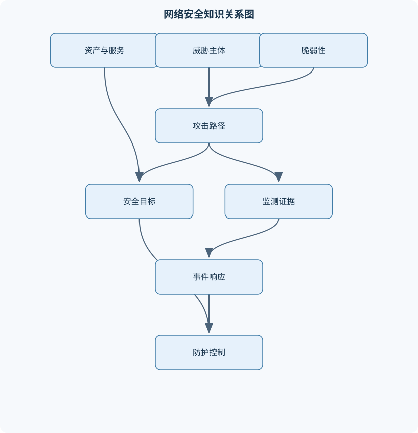
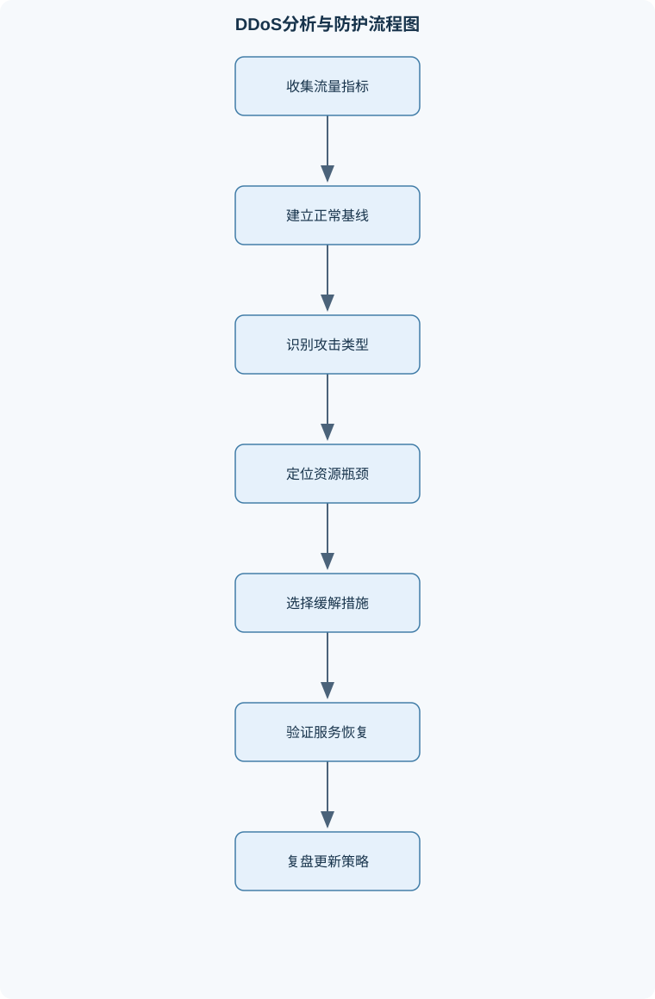

# 网络安全原理与实践

## 一、课程整体知识框架

### 课程边界与先修知识

本课程覆盖网络与信息系统中数据、服务和通信关系的安全原理及实践，重点包括拒绝服务与分布式拒绝服务、网络访问控制、防火墙、匿名通信与流量分析、网络协议风险、Web应用常见漏洞、安全防护、监测取证和事件响应。课程强调威胁模型、攻击条件、可观察证据、缓解措施及其适用边界；攻击内容用于授权环境中的原理分析与防御验证，不包含对真实目标实施攻击的操作指导。先修知识包括计算机网络分层、IP路由、TCP连接建立、DNS与HTTP基础，操作系统和进程基础，基本密码学概念，以及能够阅读简短脚本和网络日志。





### 1. 课程对象、先修关系与安全目标

《网络安全原理与实践》研究网络与信息系统中数据、服务、设备、进程及通信关系的保护问题。课程既讨论攻击为何能够成立，也讨论如何通过架构、协议、配置、监测、取证和响应降低风险。攻击性内容仅用于授权实验环境中的原理验证、防御测试和证据分析，不以真实目标为操作对象。

课程默认学习者已经理解网络分层、IP 路由、TCP 连接建立、DNS 与 HTTP 基础，具备操作系统和进程的基本概念，理解加密、哈希、认证等密码学术语，并能阅读简短脚本和网络日志。若缺少这些基础，应先明确数据从客户端到服务器经过的层次、每一层维护的状态以及状态改变所消耗的资源。

安全目标通常概括为机密性、完整性和可用性：

- **机密性**要求未授权主体不能获得不应访问的数据；
- **完整性**要求数据、配置、身份声明和处理结果不能被未授权地篡改；
- **可用性**要求授权用户在合理条件下能够使用服务和资源。

实际系统还需要考虑认证、授权、可追责性、隐私和抗抵赖等目标。安全目标之间可能发生冲突。例如，增加详细日志有助于可追责性，但日志本身可能包含敏感通信关系；严格过滤可以提高安全性，却可能误拒绝合法业务。因而安全设计不是简单地“控制越多越好”，而是根据资产、威胁、业务依赖和残余风险进行权衡。

### 2. 威胁建模与风险关系

设 $A$ 表示受保护资产或服务，$T$ 表示威胁，$V$ 表示脆弱性，$C$ 表示安全控制，$R$ 表示风险。风险不是某个固定数值，而是威胁利用脆弱性影响资产的可能性和后果的综合描述。可用下列因果链理解：

$$
T \xrightarrow{\text{利用}} V \xrightarrow{\text{作用于}} A \xrightarrow{\text{造成}} \text{影响}
$$

控制 $C$ 可以降低威胁成功概率、限制影响范围或提高发现速度，但通常不能使风险绝对归零。风险分析至少要回答四个问题：

1. 资产是什么，例如数据库、认证服务、订单接口或通信关系；
2. 威胁具备什么能力，例如能够发送大量报文、观察某个链路、控制某些终端或修改应用请求；
3. 脆弱性成立需要哪些前提，例如服务端在握手完成前分配有限状态、浏览器自动携带凭证、规则允许不必要的方向；
4. 成功后影响是什么，例如服务不可用、数据泄露、权限越界或证据链中断。

威胁模型必须明确攻击者的观察范围和控制范围。只观察客户端到代理链路的主体，与能够同时观察入口和出口的主体，所面对的隐私风险不同；能够伪造源地址的主体，未必能够接收伪造地址对应的返回报文，因此“能伪造地址”不等于“能完成双向通信”。安全结论必须与信任假设绑定。

### 3. 网络分层与安全控制点

网络安全控制分布在多个层次：

- 链路和网络层可进行地址过滤、路由策略、反欺骗检查和流量计量；
- 传输层可观察连接状态、端口、重传、超时和半开连接；
- 应用层可检查身份、会话、请求参数、业务权限和响应行为；
- 主机层可限制进程、文件、端口和系统调用；
- 组织层则负责授权、变更、日志保留、应急通信和责任划分。

分层并不意味着每层独立。应用请求洪泛可能表现为网络流量正常但数据库连接池耗尽；防火墙允许了端口，却不能证明应用授权正确；TLS 可以保护内容，但通常不能隐藏源地址、目的地址、时间和流量大小等元数据。

### 4. 网络协议与路由安全

IP 负责尽力而为的数据报交付，不直接保证发送者身份真实。路由控制平面决定路径和可达性，数据平面依据转发表转发报文。安全边界应区分“谁能声明某条路由”和“设备实际如何转发报文”。源地址伪造的条件是发送方能够构造带有非真实源地址的报文，并且沿途设备没有执行有效的入口地址验证。它可用于隐藏来源、绕过简单地址规则或触发反射，但由于返回流量通常不会到达伪造者，限制了需要双向交互的攻击。

TCP 三次握手可表示为：

1. 客户端 $C$ 向服务器 $S$ 发送 SYN；
2. $S$ 返回 SYN-ACK；
3. $C$ 返回 ACK，连接进入可传输状态。

服务器在收到初始 SYN 后，往往要记录等待完成握手的状态。若半开连接到达速率持续超过完成握手、超时释放和队列容量所能承受的水平，队列就可能饱和。设 $\lambda$ 为单位时间到达请求数，单位为请求/秒；$\mu$ 为单位时间完成服务的请求数，单位为请求/秒。在简化的长期平均、单服务资源模型下，只有 $\lambda<\mu$ 才可能稳定运行。$\lambda\geq\mu$ 并不自动证明攻击，因为突发流量、慢客户端和后端瓶颈也可能造成相同现象。

SYN Flood 的关键不是“所有请求都使用伪造地址”，而是服务器在确认握手完成前已经消耗了有限状态资源。真实大量客户端、恶意伪造源地址和被控制设备协同发送，都可能产生连接压力。SYN Cookie 将验证握手所需的部分状态编码到 SYN-ACK 的序列号等字段中，服务器收到 ACK 后验证编码，再重建必要状态。它降低半开连接的存储压力，但不能消除带宽耗尽、CPU 计算耗尽、后端连接耗尽或实现兼容性问题。

DNS 将名称解析为地址，解析链路通常涉及客户端缓存、递归解析器和权威服务器。风险包括缓存污染、错误委派、过度信任递归结果、解析请求泄露以及解析服务被滥用。分析 DNS 问题时，要区分名称解析错误、路由不可达、服务端口不可用和应用层拒绝。协议中的超时、重传和状态维护既提高了容错性，也可能成为资源耗尽的来源。

### 5. 拒绝服务、分布式拒绝服务与防御

DoS 是使目标服务无法正常处理合法请求的行为，攻击源可以是单个设备，也可以是多个来源；DDoS 强调多个攻击源或多个受控节点的协同。两者不能仅按流量大小区分。防御 DoS 时可以围绕三类瓶颈分析：

1. **容量耗尽**：链路、带宽、接口队列或设备转发能力耗尽；
2. **状态耗尽**：半开 TCP 连接、连接跟踪表、会话表或缓存项耗尽；
3. **应用资源耗尽**：线程池、数据库连接、计算时间、文件句柄或业务队列耗尽。

反射攻击中，攻击者使第三方服务把响应发送给受害者；放大攻击还要求响应流量大于触发请求流量。若单次请求大小为 $b_r$ 字节、响应大小为 $b_s$ 字节，则理想放大比为：

$$
G=\frac{b_s}{b_r}
$$

当请求速率为 $q$ 次/秒时，受害者接收速率近似为 $q b_s$ 字节/秒。该估算假设每次请求均成功触发完整响应，未计入协议头、丢包、限速、缓存和链路瓶颈；源地址伪造、第三方服务响应行为和上游转发能力是结论成立的必要条件。

ICMP 洪泛主要消耗链路或处理能力，连接洪泛主要消耗传输层状态，应用请求洪泛则可能在流量不特别大时耗尽业务资源。检测应同时观察流量基线、五元组分布、半开连接比例、错误率、延迟、队列长度和后端指标。限速适合抑制单一来源或单类请求，但分布式来源可能绕过单点阈值；过滤适合明确异常特征，但过宽会误伤；扩容可以争取时间，却不能修复无限增长的攻击；上游清洗适合链路级压力，但需要服务商协同；业务降级能保护核心功能，却必须预先定义哪些功能可以关闭。

### 6. 防火墙、网络分区与 VPN

防火墙规则集合记为 $F$。每条规则通常包含方向、源地址、目的地址、传输层协议、端口、状态条件、动作和日志设置。报文到达后按规则顺序匹配，首个适用规则可能决定最终动作；若没有匹配项，则由默认策略决定。默认拒绝和最小权限的推导步骤是：

1. 列出业务实际需要的通信方向；
2. 明确端点、协议、端口和连接状态；
3. 只允许这些必要通信；
4. 对其余流量采用拒绝或隔离；
5. 通过命中日志和业务测试验证没有遗漏。

有状态防火墙维护连接状态，因此可以允许合法连接的返回流量，并拒绝不符合状态的报文。包过滤只能依据报文可见字段匹配；应用代理可以在应用协议层终止并重新建立连接，检查内容和命令；电路级网关关注连接建立和会话转发，但通常不深入检查应用内容。检查层次越高，控制能力通常越强，性能、兼容性和隐私成本也可能越高。

DMZ 将对外服务与内部核心网络隔离，不能理解为“放入 DMZ 的主机自动安全”。主机防火墙可作为纵深防御，抵御内部横向移动和错误的集中策略。VPN 通过隧道、认证和加密建立受保护通道，但 VPN 终点本身会成为新的信任边界；接入 VPN 不应自动等同于获得整个内部网络权限。常见风险包括宽泛地址范围、规则遮蔽、方向写反、默认允许、日志缺失、临时例外长期保留以及策略变更未经业务验证。

### 7. 匿名通信与流量分析

通信隐私至少包含内容隐私和关系隐私。内容隐私关注消息正文，关系隐私关注谁与谁通信、何时通信以及通信量。匿名性、不可链接性和不可观察性并不相同：

- 匿名性关注能否把行为归因到具体发送者或接收者；
- 不可链接性关注能否把同一主体的多个行为关联起来；
- 不可观察性关注观察者能否判断某个通信行为是否发生。

匿名代理只改变观察位置。如果观察者只能看到客户端至代理的一侧，可能看见客户端与代理关系，却未必看见目标；如果观察者只看到代理至目标的一侧，可能看见目标，却未必直接知道客户端。两侧观察者若能协同匹配时间、包数和大小，端到端关联风险会上升。

Crowds 中，消息在参与者群体内转发。设 $p$ 为中继继续转发给另一参与者的概率，$1-p$ 为向目标交付的概率。若每次决策独立，消息连续经过 $k$ 次参与者转发的概率可写为：

$$
P_k=p^k
$$

该公式只描述简化转发模型，不等同于匿名性保证。真实匿名程度还受群体规模、恶意参与者比例、观察位置和路径选择影响。源路由若让发送方或中间观察者直接获得完整路径，会增加路径暴露。

洋葱路由将路径按层封装。设第 $i$ 跳使用密钥 $K_i$，发送方依次进行多层加密；第 $i$ 个中继通常只解开当前层，得到下一跳及本跳转发所需信息。逐跳信息最小化降低单个中继获知完整路径的机会，但不能防御全路径观察者、入口出口串谋和流量相关分析。分析者可能使用时间戳、包大小、包数、方向和延迟寻找入口流与出口流的对应关系；填充、批量转发、延迟和背景流量会增加误差，却可能降低实时性和吞吐量。

### 8. Web 应用安全

Web 请求通常经历“客户端构造请求—服务器认证和路由—业务处理—数据库或文件访问—生成响应”的链路。认证回答“你是谁”，会话管理维持认证状态，授权回答“你能做什么”，三者不能互相替代。

SQL 注入的根因是把不可信输入当作 SQL 语法的一部分执行。参数化查询将代码结构与数据值分离，是主要防线；输入校验可限制格式，输出编码用于防止特定上下文中的解释，但它们不能替代安全查询接口。跨站请求伪造成立通常需要同时满足：

1. 浏览器会自动携带目标站点凭证；
2. 攻击者能诱导浏览器发送请求；
3. 请求会改变服务器状态；
4. 服务器没有充分验证请求来源或不可预测令牌。

破坏任一条件都可能降低风险，但应结合请求方法、CSRF 令牌、Cookie 的 SameSite 属性、来源检查和重新认证设计。CSRF 与跨站脚本不同：前者滥用浏览器自动携带凭证，后者使脚本在受信任站点上下文中执行。

文件包含和路径控制问题不能只靠检查文件名解决，还要处理路径规范化、符号链接、目录边界、动态加载配置、进程权限和错误回显。密码重置流程应使用一次性、短时有效、不可预测且与账户和用途绑定的令牌；密码不能以可逆加密或普通哈希保存，应使用专门的、带盐且具有适当计算成本的密码哈希方案。Web 测试应先确定授权范围、账号和数据边界，再按数据流、状态变更和权限边界检查风险。风险分类框架是辅助工具，具体版本和适用范围必须与项目要求一致，不能把某一版本的分类当成永久不变的法律或标准结论。

### 9. 邮件、流量与攻击溯源

邮件安全涉及身份、内容和元数据三个层面。发件地址的显示文本不能单独证明真实来源；应综合邮件头、传输路径、认证结果、时间、附件类型、链接域名和正文诱导特征分析钓鱼邮件。恶意附件分析应在隔离环境中进行，重点记录静态特征、执行链和网络行为，不在生产终端直接打开未知文件。

网络流量常用五元组描述：源 IP、目的 IP、传输层协议、源端口和目的端口。五元组有助于分类和关联，但不必然代表现实身份，因为可能存在共享出口、代理、地址转换、源地址伪造或动态地址分配。流量基线包括正常时段的连接数、字节数、协议比例、延迟和错误率；异常检测必须考虑业务周期、突发活动和采集缺失。

单条日志不能直接证明攻击者身份。可靠溯源需要在多个观测点关联时间、方向、计数、路径和协议特征，并校准时钟偏差。证据文件可计算哈希：

$$
h=H(\text{evidence})
$$

其中 $H$ 为密码学哈希函数，$h$ 用于检测文件后续是否被改变；哈希不能证明来源真实、采集合法或采集过程没有遗漏。溯源结论应区分直接观测、合理推断和无法确认的假设，并明确误报、漏报和替代解释。

### 10. 安全监测、数字取证与事件响应

事件是需要评估和处置的安全相关事实；告警是检测系统发出的提示；漏洞是可能被利用的弱点；已确认入侵则需要有足够证据证明未授权行为已经发生。四者不可混为一谈。

事件响应通常包含准备、检测与分析、遏制、清除、恢复和复盘。阶段之间可能迭代：遏制可能产生新证据，分析结果可能改变隔离范围，恢复前需要再次确认根因已处理。主机进程、内存、文件、认证日志、网络流量、操作系统事件和应用日志具有不同取证价值。易失数据通常包括内存、当前连接和运行进程；持久数据包括磁盘文件、配置、数据库和归档日志。采集顺序应综合易失性、证据价值、业务影响和现场变化速度。

证据管理至少记录采集时间、时区、操作者、工具、来源、哈希、存储位置、转交过程和分析动作。遏制措施必须权衡业务连续性与证据保全，例如立即关机会丢失内存证据，直接删除恶意进程可能破坏行为线索。事件响应还受组织授权、隐私保护、数据保留和适用法规约束，技术人员不能仅凭个人判断扩大采集范围。

## 二、章节和模块划分

### 核心知识覆盖清单

本清单用于检查正文是否覆盖本课程的主要知识模块：

- **网络安全基础与威胁建模**：机密性、完整性、可用性与安全目标、资产、威胁、脆弱性、攻击面和风险的区别、攻击者能力、观察范围、控制范围与信任假设、被动攻击与主动攻击及其可观测差异、网络分层与安全控制点、安全策略、控制措施与残余风险、授权测试范围、证据留存和安全实验边界。
- **网络协议与路由安全**：IP地址、路由转发与端到端通信关系、TCP三次握手及连接状态资源分配、源地址伪造的条件、用途与限制、路由控制平面与数据平面的安全边界、DNS解析链路与名称解析风险、协议状态、超时、重传和资源耗尽、流量元数据与内容加密的保护差别。
- **拒绝服务与分布式拒绝服务**：DoS与DDoS的攻击源组织方式和防御差异、容量耗尽、状态耗尽与应用层资源耗尽、SYN Flood的半开连接状态及队列影响、SYN Cookie的状态编码与握手完成验证、反射与放大攻击的源地址伪造和响应不对称条件、ICMP洪泛、连接洪泛与应用请求洪泛的区别、基于流量基线、协议状态和服务指标的检测、限速、过滤、扩容、上游协同与业务降级的适用边界。
- **防火墙与网络分区**：包过滤规则中的地址、协议、端口和方向、有状态检测与连接状态跟踪、应用代理与电路级网关的检查层次、默认拒绝、最小权限与规则顺序、DMZ及内外网分层防护、主机防火墙与集中策略协同、VPN的隧道、认证、加密及信任边界、防火墙绕过风险、误配置和日志审计。
- **匿名通信与隐私分析**：通信内容隐私与通信关系隐私、匿名性、不可链接性和不可观察性的区别、匿名代理的信任假设与流量可见范围、Crowds转发概率与群体路径机制、源路由暴露路径信息的风险、洋葱路由的分层加密和逐跳转发、入口出口串谋与流量相关分析、基于时序、包数和延迟的流量分析及其局限。
- **Web应用安全**：客户端请求、服务器处理与数据库访问链路、认证、会话管理和授权的区别、输入验证、上下文输出编码与参数化查询、SQL注入的成因及防御边界、跨站请求伪造的浏览器凭证条件与令牌防护、文件包含与路径控制风险、密码重置流程、口令存储与安全哈希要求、基于风险分类的安全测试及版本适用性。
- **邮件、流量与攻击溯源**：邮件传输中的身份、内容与元数据风险、邮件伪造、钓鱼和恶意附件的分析线索、流量记录、五元组和时间戳的解释、网络流量基线与异常检测、源地址伪造对单点溯源的干扰、多点日志关联与路径反向推断条件、证据完整性、时钟偏差与日志保留问题、溯源结论的置信度和误报边界。
- **安全监测、数字取证与事件响应**：事件、告警、漏洞和已确认入侵的区别、事件响应准备与职责、通信和升级机制、检测、分析、遏制、清除、恢复和复盘的工作关系、主机、网络、操作系统和应用数据源的取证价值、易失数据、持久数据与采集顺序、证据哈希、时间线、保管记录和可重复分析、遏制措施对证据保全和业务连续性的影响、响应流程与组织风险管理的结合及法规边界。


### 1. 模块一：网络安全基础与威胁建模

本模块首先建立安全目标、资产、威胁、脆弱性、攻击面、控制和残余风险之间的关系。重点不是背诵术语，而是能够把一个现象还原为条件链。例如，服务不可用可能来自链路容量、连接状态、应用线程或数据库连接池，必须先定位资源类型，再选择控制措施。

#### 代表性流程：威胁建模

**输入**：资产清单、网络拓扑、数据流、信任边界和授权范围。  
**输出**：威胁场景、成立条件、可观察证据、控制措施和残余风险。  
**过程**：

1. 标记资产 $A$ 及其机密性、完整性和可用性要求；
2. 列出可能的威胁 $T$ 和攻击者能力；
3. 识别脆弱性 $V$ 与必要前提；
4. 在数据流和信任边界上确定攻击面；
5. 为每个场景指定控制 $C$、检测证据和失败条件；
6. 评估控制后的残余风险。

**不变量**：每个结论都必须绑定观察范围、授权范围和信任假设。  
**终止条件**：所有关键资产都有威胁场景，或明确说明无法评估的原因。  
**适用条件**：架构、数据流和责任边界可获得。  
**复杂度**：若有 $N$ 个资产、$M$ 个威胁场景，朴素逐项分析约为 $O(NM)$，实际成本取决于数据流和依赖关系数量。

### 2. 模块二：网络协议与路由安全

本模块以 IP、TCP、DNS 和路由控制为主线，解释协议状态、超时、重传、伪造和资源消耗的关系。学习者需要能够从握手报文推导服务器何时分配资源，并区分控制平面被影响和数据平面被异常利用。

### 3. 模块三：拒绝服务与分布式拒绝服务

#### 例题一：SYN Flood 队列容量判断

**题干**：某 TCP 服务的半开连接队列容量为 $Q=1200$。异常期间 SYN 到达速率为 $\lambda=300$ 请求/秒，每个半开状态在握手未完成时平均保留 $T=5$ 秒。暂不考虑队列提前丢弃，估算理想状态下的半开连接占用，并判断是否可能饱和。

**分析**：在到达速率恒定、超时一致且未完成请求相互独立的简化条件下，半开状态近似为：

$$
N\approx \lambda T
$$

其中 $N$ 为半开连接数，单位为条；$\lambda$ 单位为请求/秒；$T$ 单位为秒。

**逐步解答**：

1. 代入 $\lambda=300$ 和 $T=5$；
2. 得到 $N\approx300\times5=1500$ 条；
3. 比较 $N=1500$ 与 $Q=1200$；
4. 理想估算超过容量 $300$ 条，队列存在饱和风险。

**结果验证**：若观测到半开连接长期接近 1200、SYN 到达速率高而完成握手比例下降，则与模型一致。若后端服务已停止或网络入口限速，实际结果可能不同。

**变式**：若启用 SYN Cookie，半开状态存储压力可能下降，但仍需检查入口带宽、CPU、完成握手后的连接资源和 Cookie 兼容性；不能据此断言服务一定恢复。

### 4. 模块四：防火墙与网络分区

#### 例题二：有序规则判定

**题干**：防火墙规则按顺序为：  
1. 允许内网到 Web 服务器的 TCP 443；  
2. 拒绝所有来自外部网络到内网的流量；  
3. 允许所有 TCP 端口。  
某报文来自外部网络，目的地址为内网主机，协议为 TCP，目的端口为 22。判断动作。

**分析与解答**：

1. 报文不匹配规则 1，因为来源不是内网且目的端口不是 443；
2. 匹配规则 2，动作是拒绝；
3. 不再继续匹配规则 3；
4. 最终结果为拒绝。

**结果验证**：如果把规则 3 调到规则 2 之前，报文会先被“允许所有 TCP”匹配，形成宽泛规则遮蔽。该例说明规则数量多不等于安全，顺序和默认策略决定实际效果。

**变式**：若报文是已建立连接的返回流量，需检查规则是否包含有状态条件；单凭端口号不能判断是否为合法返回流量。

### 5. 模块五：匿名通信与隐私分析

#### 例题三：Crowds 转发概率

**题干**：在简化 Crowds 模型中，每次中继以 $p=0.6$ 的概率继续转发给另一参与者。计算消息连续经过 3 次参与者转发的概率，并说明该结果是否等于匿名性保证。

**逐步解答**：

1. 假设每次决策相互独立；
2. 每次继续转发概率均为 $0.6$；
3. 连续 3 次转发概率为
   $$
   P_3=p^3=0.6^3=0.216
   $$
4. 结果表示在该抽象模型下，消息连续留在参与者群体中 3 次的概率为 0.216。

**结果验证**：若转发决策不是独立的，或参与者数量有限、恶意节点比例较高，实际概率不能直接使用该公式。

**变式**：若观察者位于第一个中继，它可能看到发送方与下一跳的一部分关系；若观察者同时控制入口和出口，则路径关联风险明显提高。因此转发概率不能直接解释为匿名概率。

### 6. 模块六：Web 应用安全

#### 例题四：CSRF 成立条件判断

**题干**：某网站使用 Cookie 维持登录状态，提供修改收货地址的 POST 接口。浏览器会自动携带 Cookie，接口不检查 CSRF 令牌，也不验证请求来源。判断 CSRF 攻击链是否具备成立条件，并给出防护依据。

**分析与逐步解答**：

1. Cookie 自动携带，满足浏览器凭证条件；
2. 攻击者可诱导浏览器向目标接口发送请求；
3. 修改地址属于状态变更；
4. 服务端不验证不可预测令牌或来源；
5. 四个关键条件同时满足，风险成立。

**防护**：

- 为每个会话或请求设置不可预测、服务端验证的 CSRF 令牌；
- 对状态变更使用适当的请求方法并检查请求头；
- 合理配置 Cookie 的 SameSite 属性；
- 对高风险操作要求重新认证或二次确认。

**结果验证**：若服务端要求令牌且攻击者无法获得目标页面中的令牌，攻击链关键步骤被破坏。若存在跨站脚本漏洞，攻击者可能先读取令牌，因此 CSRF 防护不能替代脚本注入防护。

**变式**：仅把 POST 改为 GET 不是充分防护；GET 若改变状态，仍可能被图片、链接或自动加载触发。

### 7. 模块七：邮件、流量与攻击溯源

#### 例题五：五元组与身份结论

**题干**：流量记录显示源 IP 为 192.0.2.10、目的 IP 为 198.51.100.20、协议为 TCP、源端口为 43000、目的端口为 443。能否据此确定现实中的攻击者身份？

**分析**：该记录完整描述一个五元组，可用于流量分类和与其他记录关联，但源 IP 可能属于共享出口、代理、动态地址或被伪造的报文。端口是传输层会话标识的一部分，不是个人身份标识。

**结论验证**：需要结合地址分配记录、认证日志、代理日志、多个采集点、时间同步和证据完整性。若只有单个五元组，最多能确认某时刻存在一类网络通信，不能确认现实身份。

**变式**：若同时存在多个采集点记录相同方向和时序，可提高路径推断置信度，但仍需说明缺失日志、地址转换和共享出口造成的不确定性。

### 8. 代表性算法与流程

#### 8.1 SYN Flood 防御分析流程

**输入**：连接状态计数、SYN 与完成握手速率、队列容量、超时配置、源地址分布和上游观测。  
**输出**：疑似耗尽类型、受影响层级和候选缓解措施。

1. 建立正常时段基线；
2. 比较 SYN 速率、完成握手速率和半开连接数；
3. 检查源地址是否集中、分散或具有明显伪造特征；
4. 确认队列、CPU、带宽或后端服务是否为主要瓶颈；
5. 评估 SYN Cookie、限速、过滤、扩容和上游清洗；
6. 在授权环境验证缓解前后的指标变化。

**终止条件**：证据足以定位主要瓶颈，或明确记录仍无法区分的假设。  
**不变量**：不越过授权范围，不删除原始日志。  
**复杂度**：扫描 $N$ 条日志为 $O(N)$；若按时间排序后关联，通常为 $O(N\log N)$。

#### 8.2 防火墙规则审查流程

**输入**：拓扑、业务通信清单、规则集合和命中日志。  
**输出**：冗余、冲突、过宽和缺失规则报告。

1. 为每条规则标注业务所有者和方向；
2. 检查地址、协议、端口、状态和动作；
3. 按顺序判断规则遮蔽和冲突；
4. 核对默认策略与日志覆盖；
5. 在隔离环境验证允许路径和拒绝路径；
6. 形成保留、收窄、删除或补充建议。

若规则数为 $R$，朴素两两检查复杂度为 $O(R^2)$；使用地址和端口区间索引可减少不必要比较。审查期间不直接修改生产策略。

#### 8.3 网络流量溯源与证据关联流程

**输入**：多点流量、设备日志、时间同步信息和事件时间窗。  
**输出**：候选路径、证据链和不确定性说明。

1. 校准不同设备的时钟偏差；
2. 按五元组、时间窗和协议特征归并记录；
3. 识别源地址伪造、代理和地址转换可能性；
4. 使用相邻观测点的方向、计数和时序缩小候选路径；
5. 检查采集完整性并保留原始记录；
6. 区分直接观测与推断。

算法对 $N$ 条记录排序关联通常为 $O(N\log N)$。终止条件可以是达到最早可验证观测点、证据不足或无法唯一关联，不能强行输出唯一身份。

#### 8.4 事件响应与数字取证工作流

**输入**：告警、授权范围、受影响系统和可用证据源。  
**输出**：时间线、影响范围、处置记录和恢复验证结论。

1. 确认告警是否构成事件；
2. 保护现场并确定沟通和升级责任；
3. 按易失性和证据价值制定采集顺序；
4. 记录来源、时间、工具、操作者并计算哈希；
5. 实施隔离、限流或账号冻结等遏制措施；
6. 分析主机、网络和应用证据；
7. 清除根因，恢复业务并验证；
8. 复盘监测缺口、流程缺口和控制改进。

### 9. 日志分析代码示例

下面的 Python 示例只分析本地、已授权的 CSV 日志，不联网、不修改文件。它统计每个源 IP 的请求数，并标记超过阈值的来源。统计结果只能作为初筛，不能直接证明攻击者身份。

```python
from collections import Counter
import csv
from datetime import datetime

def count_requests(path, start_time, end_time):
    """
    输入:
        path: 本地 CSV 文件路径，字段包括 timestamp 和 src_ip
        start_time, end_time: datetime 对象，定义分析时间窗
    输出:
        Counter，键为源 IP，值为时间窗内请求数
    """
    counts = Counter()

    with open(path, "r", encoding="utf-8", newline="") as file:
        reader = csv.DictReader(file)
        for row in reader:
            try:
                timestamp = datetime.fromisoformat(row["timestamp"])
            except (KeyError, ValueError):
                # 格式错误记录不参与统计，但实际流程应另行记录
                continue

            if start_time <= timestamp <= end_time:
                src_ip = row.get("src_ip", "").strip()
                if src_ip:
                    counts[src_ip] += 1

    return counts

def suspicious_sources(counts, threshold):
    """返回超过请求数阈值的源地址及其计数。"""
    return {
        ip: number
        for ip, number in counts.items()
        if number > threshold
    }
```

该程序的不变量是只读取指定时间窗内格式有效的记录；终止条件是文件读取完成；若日志量为 $N$，统计过程时间复杂度为 $O(N)$，额外空间复杂度取决于不同源 IP 的数量。排错时应优先检查时区、时间格式、字段缺失、地址转换和重复日志，而不是立即调高或调低阈值。

### 10. 实验与项目一：授权环境中的 SYN Flood 防御分析

#### 实验目标

验证半开连接、完成握手、超时释放和 SYN Cookie 之间的关系，比较不同缓解措施对服务指标的影响。实验只能在隔离网络、教学靶场或明确授权的测试环境进行。

#### 输入数据

- 正常与异常条件下的 SYN 数、完成握手数；
- 半开队列容量和超时配置；
- CPU、内存、带宽、连接错误率和延迟；
- 防护措施启用前后的时间序列；
- 采集点和时间同步信息。

#### 步骤

1. 记录正常基线，包括请求速率、完成率和延迟；
2. 在受控环境产生有限、可停止的测试负载；
3. 观察半开连接、完成握手和队列使用率；
4. 分别评估限速、SYN Cookie 或上游过滤；
5. 比较措施前后合法请求成功率和资源消耗；
6. 停止负载，确认服务恢复；
7. 保存原始日志和配置变更记录。

#### 评价标准

- 能否区分容量、状态和应用资源瓶颈；
- 是否说明 $\lambda$、$\mu$、队列容量和超时的单位与假设；
- 是否验证了合法用户指标；
- 是否记录缓解措施的副作用；
- 是否保留完整、可追溯的证据。

#### 排错方法

若半开数不升高，应检查采集点是否位于防护设备之后；若启用 Cookie 后延迟仍高，应检查带宽或 CPU 是否成为瓶颈；若合法连接失败，应检查测试流量是否过大、规则是否误拦截以及后端连接池是否耗尽。

### 11. 实验与项目二：Web 会话与请求安全审查

#### 实验目标

在本地测试应用或专用靶场中，沿“客户端请求—会话—授权—数据库—响应”链路识别认证、授权、注入和 CSRF 风险，并验证修复是否真正改变了成立条件。

#### 输入数据

- 授权范围和测试账号；
- 应用路由、接口文档和数据流；
- 测试请求、响应、Cookie 属性和错误日志；
- 修复前后版本；
- 不包含真实用户数据的测试数据库。

#### 步骤

1. 绘制输入点、状态变更点和信任边界；
2. 区分认证、会话管理和授权检查；
3. 检查查询是否使用参数化接口；
4. 检查状态变更请求的令牌和 Cookie 属性；
5. 检查文件路径是否受到目录边界和权限控制；
6. 记录无破坏性测试输入、响应和权限条件；
7. 修复后执行同样测试并比较结果；
8. 检查日志是否足以重建关键事件。

#### 评价标准

- 每个结论是否包含成立条件和影响；
- 是否避免读取真实敏感数据和制造不可逆状态；
- 修复是否在服务器端生效，而非只依赖客户端校验；
- 是否能提供可复现证据；
- 是否说明版本、配置和运行环境的适用边界。

#### 排错方法

若参数化后仍出现异常，应检查是否还有拼接查询、动态表名或二次解析路径；若 CSRF 令牌验证失败但业务仍改变状态，应检查是否存在另一个未保护接口；若文件路径检查可绕过，应检查路径规范化、符号链接、编码转换和进程权限。

### 12. 模块间综合关系

拒绝服务分析依赖 TCP 状态和防火墙日志；溯源依赖协议元数据、时钟同步和证据管理；Web 安全既需要应用逻辑，也需要会话、Cookie、数据库和网络监测；匿名通信分析则要求同时理解加密保护边界和流量元数据。课程的综合结论是：单一控制不能覆盖完整攻击链，安全判断必须同时说明攻击条件、可观察证据、缓解措施、验证方法和剩余不确定性。

## 三、核心概念的详细解释




### 1. 威胁建模、安全目标与控制边界

网络安全对象不仅是“数据”，还包括提供服务的主机、进程、数据库、认证凭据、网络路径以及通信关系。机密性关注未授权主体是否能够获知内容；完整性关注数据、配置、身份声明和处理结果是否被未授权修改；可用性关注授权用户能否在合理时间内获得服务。隐私还要进一步区分内容隐私与关系隐私：即使通信内容经过加密，源地址、目的地址、时间、包大小和通信频率仍可能暴露通信关系。

设 $A$ 为资产或服务，$T$ 为威胁，$V$ 为脆弱性，$C$ 为安全控制，$R$ 为风险。威胁是可能造成不利影响的主体、事件或能力；脆弱性是使威胁能够利用的缺陷或条件；控制是降低发生可能性、影响范围或发现延迟的措施。风险 $R$ 由威胁利用脆弱性作用于资产后产生的可能性和影响共同描述，不能在没有明确量表和假设时写成一个通用数值公式。

威胁模型至少应说明攻击者的观察范围、发送能力、控制范围、资源上限和信任假设。例如，能够伪造源 IP 地址的设备不一定能够接收目的端返回的数据，因此“能够伪造地址”不等于“能够完成双向连接”。只观察客户端到代理链路的主体，与能够同时观察入口和出口链路的主体，所面对的匿名性风险也不同。

网络控制通常分为边界控制、主机控制、应用控制和组织控制。防火墙可以阻止某些不必要的网络方向，但不能替代应用授权；输入校验可以降低异常数据进入业务逻辑的机会，却不能替代参数化查询；日志可以提高可追责性，但日志内容本身必须受到访问控制和完整性保护。所有控制都存在残余风险，控制越严格也可能带来误拒绝、性能下降、隐私暴露或业务中断。

授权测试的边界包括目标、时间、流量上限、允许的测试手段、数据处理方式和停止条件。安全实验应使用隔离环境、测试账号和无敏感数据。任何可能造成服务不可用、数据不可逆改变或影响第三方的操作，都应在实验前获得明确授权并设置回滚方案。

### 2. 网络协议风险与状态资源

IP 层负责尽力交付，不直接证明源地址对应现实发送者。路由控制平面负责学习和发布可达性信息，数据平面依据转发表转发具体报文。控制平面被篡改可能造成错误路径、流量黑洞或绕行；数据平面过滤不足则可能允许源地址伪造、异常协议或不必要的跨区访问。

TCP 三次握手依次使用 SYN、SYN-ACK 和 ACK。服务器收到初始 SYN 后，通常需要记录一个尚未完成的连接状态，等待客户端返回 ACK。此时服务器已经消耗队列、内存、定时器和可能的处理资源，但连接尚未被确认建立。若大量初始 SYN 长时间不完成，有限的半开连接队列可能被占满。

SYN Flood 的关键不在于“流量一定很大”，而在于未完成连接状态的到达速度、完成速度、超时释放速度和队列容量之间的关系。攻击流量可能来自伪造源地址，也可能来自大量真实主机；因此不能把 SYN Flood 必然等同于源地址伪造。SYN Cookie 将部分握手状态编码到服务器发出的序列号等字段中，待客户端返回 ACK 后再验证并重建状态，主要降低握手完成前的状态存储压力，但不能解决带宽耗尽、CPU 耗尽、后端连接池耗尽或应用层请求洪泛。

DNS 将名称解析为地址，涉及客户端缓存、递归解析器、权威服务器和缓存有效期等环节。解析风险包括缓存数据不可信、错误配置、过度开放递归、名称劫持和解析链路不可用。排查 DNS 异常时，应区分“名称解析失败”“解析结果错误”“解析延迟过高”和“应用收到地址后仍无法连接”，不能只依据客户端错误提示判断根因。

TLS 等加密机制通常保护传输内容的机密性和完整性，但不必然隐藏通信两端、连接时间、数据量和包方向。流量分析可以不读取明文，仅通过时序、包数、大小和突发模式推断通信行为。因此，“启用加密”与“完全不可观察”不是同一结论。

### 3. DoS、DDoS与拒绝服务防护

DoS 是拒绝服务的结果或攻击方式，可能由单一来源、单一控制点或单个失效组件造成；DDoS 强调多个分布式来源协同施加压力。二者的区别主要在攻击源组织方式和防御协调难度，而不是简单由流量大小决定。单源攻击可能流量很大，分布式攻击也可能通过大量低速请求耗尽应用资源。

拒绝服务压力可分为三类：

1. **容量耗尽**：带宽、链路、转发能力或连接数被占用；
2. **状态耗尽**：半开连接、会话、NAT 表、代理连接池或防火墙状态表达到上限；
3. **应用资源耗尽**：数据库连接、线程、锁、缓存、复杂查询或业务限额被占用。

ICMP 洪泛主要作用于网络带宽或处理能力；TCP 连接洪泛作用于连接状态和握手资源；HTTP 请求洪泛可能使用正常协议和合法连接，却消耗应用线程、数据库或业务计算。防御必须定位实际瓶颈，不能仅按报文数量统一处理。

反射攻击利用第三方服务向受害者发送响应；放大攻击进一步要求响应流量大于请求流量。典型成立条件包括：请求源地址可被伪造成受害者地址、第三方服务接受该类请求、响应会发往伪造地址、攻击者能持续产生请求，并且沿途缺少有效源地址验证。反射不一定伴随放大，放大也必须有可利用的响应不对称条件。

防护措施包括入口反欺骗过滤、边界限速、连接状态保护、上游清洗、容量扩展、缓存、业务降级和多区域分散。限速适合限制局部异常，但过低可能误伤突发合法流量；扩容只能延后容量瓶颈，不能修复协议状态或应用逻辑缺陷；上游清洗适合链路容量已不足的场景，但依赖服务商协同和准确的流量分类。

### 4. 防火墙、访问控制与网络分区

包过滤规则通常匹配方向、源地址、目的地址、传输层协议、源端口、目的端口和连接状态，并执行允许、拒绝、丢弃、记录或转发等动作。规则的实际效果不仅取决于内容，还取决于顺序、默认策略、地址转换和状态跟踪。

有状态防火墙维护连接状态，允许与已建立连接相符的返回流量，从而减少对双向规则的重复描述。但状态跟踪本身消耗资源，也可能受到异常连接、超时不一致和地址转换的影响。应用代理在应用层终止并重新建立连接，可以检查请求语义，但会增加延迟和部署复杂度；电路级网关通常检查连接建立和转发关系，不一定理解完整应用内容。

最小权限规则的推导过程是：先列出业务必须的通信方向、端点、协议和端口，再只允许这些通信，对其余流量执行默认拒绝。宽泛规则会扩大攻击面，过窄规则会破坏合法业务，因此每条规则都应有业务所有者、变更依据、日志策略和复核周期。规则审查还要检查被前面宽泛规则遮蔽的后续规则、永不命中的规则、重复规则和缺少日志的关键拒绝路径。

DMZ 将外部服务与内部核心网络分隔。外部用户通常只应访问 DMZ 中必要的服务，DMZ 到内部网络应采用更严格的方向和端口限制，数据库不应因为 Web 服务位于内网就默认信任其所有请求。主机防火墙负责弥补集中式边界控制无法覆盖的东向流量，二者应协同而非互相替代。

VPN 提供隧道、身份认证和加密，但“进入 VPN”不等于“可信任所有内部资源”。VPN 终点本身成为新的信任边界，仍需进行设备认证、用户授权、分区访问和日志审计。

### 5. 匿名通信、流量分析与隐私边界

匿名性不是单一属性。发送者匿名性关注观察者能否识别发送者；接收者匿名性关注能否识别接收者；不可链接性关注能否将同一用户的多次通信关联起来；不可观察性则试图隐藏通信是否发生或通信模式。一个系统可能隐藏内容，却不能隐藏通信关系；也可能隐藏发送者地址，却无法抵御全路径流量关联。

匿名代理通常使客户端到代理这一段与代理到目标这一段由不同主体观察。代理自身可能同时看到客户端和目标，因此匿名性取决于对代理的信任。若观察者能够在入口和出口两侧收集时间戳、包大小和方向序列，则可能进行端到端流量关联。

Crowds 模型中，消息在参与者群体中逐步转发。设每次中继继续转发给另一参与者的概率为 $p$，向目标交付的概率为 $1-p$。在独立同分布且每次决策相同的理想模型下，消息至少经过 $k$ 次参与者转发的概率为 $p^k$。该结果只是路径长度模型，不能直接等同于匿名性概率，因为攻击者比例、群体规模、观察位置和参与者行为都会改变结论。

洋葱路由把路径信息分层加密。中继 $R_i$ 通常只解开与自身相关的一层，获得下一跳和本跳转发所需信息，而不能直接获得完整路径。若路径为 $C\rightarrow R_1\rightarrow R_2\rightarrow R_3\rightarrow S$，各层密钥可表示为 $K_1,K_2,K_3$，但逐跳加密并不能阻止全局观察者比较入口和出口时序，也不能阻止入口与出口节点串谋。

源路由或显式携带路径信息的机制可能让中间节点或观察者获得更多路径知识。安全设计应尽量减少不必要的路径暴露，并评估延迟、填充、混合转发和并发背景流量带来的性能成本。

### 6. Web应用安全概念

Web 请求通常经历“客户端构造请求—服务器认证会话—应用执行业务逻辑—访问数据库或文件—生成响应”的链路。安全分析应沿数据流和信任边界展开，而不是只看某一个参数。

认证回答“你是谁”，会话管理回答“如何在连续请求中保持身份状态”，授权回答“你是否有权执行该操作”。认证成功不等于所有资源都可访问；会话标识被窃取也可能绕过重新认证；授权检查如果只在前端执行，则不能作为安全边界。

SQL 注入源于不可信输入被当作查询语法的一部分解释。可靠防护应使用参数化查询或安全查询接口，将数据与语法分离；输入验证、最小数据库权限和错误信息控制是辅助措施，不能替代参数化。动态表名、排序字段和二次拼接仍需单独设计安全边界。

跨站请求伪造成立需要多个条件同时存在：浏览器会自动携带目标站点凭证；攻击者能够诱导浏览器发出请求；该请求会改变状态；服务器无法充分验证请求确实由用户在目标站点上下文中发起。不可预测且绑定会话的请求令牌、合理的 Cookie 属性、检查请求来源以及避免用简单请求执行高风险变更，可以破坏其中部分条件。跨站请求伪造不同于跨站脚本，前者滥用浏览器凭证自动携带机制，后者是在受信任站点上下文中执行攻击者控制的脚本。

文件包含和路径控制风险来自路径解析、动态加载、权限和文件系统边界不一致。仅检查字符串中是否出现某个字符并不充分，还要考虑规范化、编码转换、符号链接、相对路径、挂载目录和进程权限。密码重置流程应使用短期、一次性、不可预测的令牌，并避免通过错误信息泄露账号是否存在。口令不应以可逆加密或普通哈希保存，而应使用适合口令场景的带盐、可调成本的安全哈希，并结合登录限速和多因素认证等控制。

### 7. 邮件、流量、取证与事件响应

邮件安全同时涉及身份、内容和元数据。发件人显示名称或地址并不必然证明真实来源；钓鱼分析应综合检查收件人上下文、域名相似性、认证结果、跳转链、附件类型、时间线和业务请求是否异常。恶意附件分析必须在隔离环境中进行，不能直接打开未知文件。

流量五元组为源 IP、目的 IP、传输层协议、源端口和目的端口，用于分类和关联，但不必然等于现实身份。共享出口、代理、地址转换、动态地址和源地址伪造都会削弱单点归属结论。多点日志关联需要时钟偏差校正、采集覆盖、路径方向和协议特征共同支持。

事件、告警、漏洞和已确认入侵不是同一概念。告警是检测系统发出的提示；事件是需要分析和处置的安全相关情况；漏洞是可能被利用的缺陷；已确认入侵则需要足够证据证明未授权访问或控制已经发生。

事件响应一般包括准备、检测与分析、遏制、清除、恢复和复盘，但实际过程可能循环迭代。易失数据如进程、内存、连接和临时状态通常应优先记录；持久数据如磁盘、配置和归档日志可以随后采集。对证据文件计算 $H(\text{证据})$ 可发现后续内容变化，但哈希不能证明采集过程合法、来源真实或内容没有在采集前被改变。证据链还需记录采集时间、操作者、工具、原始位置、处理过程和保管转移。

## 四、重要定义、公式、定理和推导

### 专业审校补充：关键定义与适用边界

网络安全控制必须区分“身份认证”和“对象级授权”。认证回答“请求者是谁”，授权回答“该请求者是否有权对特定对象执行特定操作”。设用户身份为 $u$、操作为 $o$、对象为 $x$，服务器应在每次敏感请求上依据策略函数 $P(u,o,x)$ 作出判定；只有当 $P(u,o,x)=允许$ 时才执行操作。不能因为用户已经登录，就推断其可以访问任意对象。该原则适用于 Web 接口、文件服务、数据库代理和管理 API。理想模型假设服务器能够可靠识别身份、对象标识明确且策略集中执行；现实中还要考虑对象标识可预测、批量接口、缓存、后台任务、导出功能和不同协议入口造成的授权旁路。客户端隐藏按钮、修改前端路由或仅依赖 URL 难以构成有效授权控制，因为攻击者可以直接构造请求。反例是普通用户登录后将请求中的文档编号替换为其他用户编号，若服务器仅检查“已登录”而未检查对象归属，就形成对象级授权缺失。修复还必须验证错误响应、批量读取、下载接口和缓存键是否泄露跨用户数据。


### 1. 队列稳定性与SYN Flood推导

在简化单服务队列中，设 $\lambda$ 为单位时间到达请求数，单位为请求/秒；$\mu$ 为单位时间完成请求数，单位为请求/秒。若到达过程和服务过程的长期平均稳定、服务资源固定且队列容量足够，则系统具备稳定运行的必要条件：

$$
\lambda < \mu
$$

当 $\lambda\geq\mu$ 时，长期积压不会被服务能力消化，有限队列最终可能溢出。这个结论不是所有网络系统的完整定理，因为现实中存在突发流量、多服务台、优先级队列、超时释放和多个资源瓶颈。

对半开 TCP 连接，可设初始 SYN 到达率为 $\lambda_s$，握手完成率为 $\lambda_c$，超时释放率为 $\lambda_t$，半开队列容量为 $B$。半开状态数量近似满足：

$$
\frac{dQ}{dt}\approx \lambda_s-\lambda_c-\lambda_t
$$

其中 $Q$ 为当前半开状态数，单位为连接数。当 $\lambda_s$ 长期大于 $\lambda_c+\lambda_t$ 时，$Q$ 增长；当 $Q\geq B$ 时，新的合法连接可能被丢弃或延迟。该推导说明 SYN Flood 的核心是状态增长，而不是单纯的包数量。

若每个半开状态平均保留时间为 $\tau$ 秒，且到达率在一段时间内近似恒定，则理想稳态下半开状态占用可近似写为：

$$
Q\approx \lambda_s\tau
$$

例如，若每秒到达 $2000$ 个 SYN，半开状态平均保留 $30$ 秒，则理想占用约为：

$$
Q\approx 2000\times30=60000
$$

若队列容量只有 $50000$，并且没有足够的完成握手或提前丢弃机制，则存在饱和风险。该计算假设到达率恒定、超时一致、每个请求占用相同状态，并忽略 CPU、带宽和实现细节。若攻击者使用真实客户端并能完成握手，则半开队列可能不饱和，但应用连接池仍可能耗尽。

SYN Cookie 的推导思路是把握手完成前必须保存的有限状态编码到服务器发送的序列号等字段中。客户端返回 ACK 后，服务器验证该编码：

1. 服务器收到 SYN，不为每个请求保存完整连接状态；
2. 服务器计算与地址、端口、时间片和秘密值相关的编码；
3. 服务器将编码嵌入 SYN-ACK 的序列号；
4. 客户端返回 ACK；
5. 服务器验证编码，验证通过后再创建必要状态。

因此，握手未完成时的状态存储从“每连接保存”降低为“有限秘密、时间片和计算验证”。但 Cookie 不会消除链路流量、CPU 校验、后端资源和应用层请求压力。若攻击流量直接堵满入口链路，服务器是否保存半开状态已经不是主要瓶颈。

### 2. 反射放大公式与边界

设攻击者每秒发出 $r$ 个请求，每个请求大小为 $b_q$ 字节，第三方服务每个响应大小为 $b_r$ 字节，受害者可实际收到的响应比例为 $\alpha$，其中 $0\leq\alpha\leq1$。理想情况下，受害者接收速率为：

$$
T_v=r\alpha b_r
$$

请求到响应的流量放大比为：

$$
G=\frac{b_r}{b_q}
$$

若考虑响应比例和链路有效传输，实际相对攻击者请求产生的受害流量可用 $\alpha G$ 近似描述。比如每个请求 $60$ 字节，响应 $900$ 字节，请求速率为每秒 $10000$ 个，且 $\alpha=0.8$，则：

$$
G=\frac{900}{60}=15
$$

$$
T_v=10000\times0.8\times900=7\,200\,000\text{ 字节/秒}
$$

结果约为 $7.2$ MB/s，未计入链路封装和重传开销。若第三方服务限制响应大小、验证源地址或丢弃异常请求，$\alpha$ 会下降；若响应被中途过滤，受害端实际流量也会下降。只有源地址伪造而没有第三方响应时，不构成反射；有反射但 $b_r\leq b_q$ 时，可以是反射攻击，却不具备放大效果。

### 3. Crowds转发概率

设群体中中继节点继续把消息转发给另一参与者的概率为 $p$，向目标交付的概率为 $1-p$。在每次选择相互独立、概率固定且不考虑节点失效的理想模型中，消息连续经过至少 $k$ 次参与者转发的概率为：

$$
P(L\geq k)=p^k
$$

消息恰好经过 $k$ 次参与者转发后交付的概率为：

$$
P(L=k)=p^k(1-p)
$$

例如，$p=0.7$，求消息至少经过 $3$ 次转发的概率：

$$
P(L\geq3)=0.7^3=0.343
$$

求恰好经过 $3$ 次转发后交付：

$$
P(L=3)=0.7^3(1-0.7)=0.1029
$$

这些结果仅描述路径长度。若攻击者控制部分参与者，或能观察首个和最后一个节点，匿名性会下降；若群体很小，路径选择也可能泄露更多信息。因此不能把 $p$ 直接解释为发送者匿名概率。

### 4. 防火墙规则判定与最小权限

将规则集合记为 $F=\{f_1,f_2,\ldots,f_m\}$。每条规则包含方向、匹配条件、动作及可选状态条件。对报文 $x$，按规则顺序检查：

$$
\operatorname{Action}(x)=
\begin{cases}
a_i,&\text{若 }x\text{ 首次匹配 }f_i\\
a_{\text{default}},&\text{若无规则匹配}
\end{cases}
$$

设规则依次为：

1. 允许来自内部区到 DMZ 的 TCP 目的端口 $443$；
2. 拒绝来自外部区到内部区的全部流量；
3. 允许来自外部区到 DMZ 的 TCP 目的端口 $443$；
4. 默认拒绝。

对于源地址属于外部区、目的地址属于 DMZ、协议为 TCP、目的端口为 $443$ 的新连接，前两条不匹配，第三条匹配，因此允许。若在第一条之前增加“允许所有 TCP 到 DMZ”的宽泛规则，则第三条规则可能被遮蔽，后续审计也难以发现原本想限制的端口范围。

最小权限不是“规则越少越安全”，而是允许集合尽量接近业务必需集合。审查时需要验证方向、地址范围、协议、端口、状态、默认动作和日志覆盖。只看规则文本而不查看命中日志，无法判断规则是否实际使用或是否造成误拒绝。

### 5. 跨站请求伪造的条件推导

跨站请求伪造可抽象为四个必要条件：

1. 浏览器会自动向目标站点携带 Cookie 或其他凭证；
2. 攻击者能够诱导浏览器发出目标请求；
3. 请求会造成状态改变；
4. 服务器不能充分验证请求来源和意图。

若服务器要求不可预测、绑定会话的令牌 $N$，而攻击者不知道 $N$，则攻击者构造的请求通过验证的概率显著降低。若再设置合理的 Cookie 跨站策略、检查来源并避免用简单请求执行高风险操作，攻击链中的多个条件会被破坏。

例：某转账接口使用 Cookie 认证，接受 POST 请求，未要求令牌，服务器不检查来源。浏览器会自动携带 Cookie，攻击者页面可以诱导用户提交请求，且接口改变余额状态，因此攻击条件成立。若仅把请求方法从 POST 改成 GET，但服务器仍用 GET 改变状态，风险没有消除；若加入与会话绑定且一次性使用的令牌，并在服务器端验证，则关键条件被破坏。客户端隐藏字段不能替代服务器端验证。

### 6. 安全分析算法与流程

#### 6.1 SYN Flood防御分析流程

**输入**：连接状态计数、SYN 速率、握手完成速率、队列容量、超时配置、CPU、带宽和上游流量记录。  
**输出**：主要瓶颈类型、受影响层级、候选措施和不确定性说明。

**过程**：

1. 建立正常时间窗基线，记录 $\lambda_s$、$\lambda_c$、半开数和合法请求成功率；
2. 比较异常时段的半开数变化与完成握手比例；
3. 检查源地址分布、入口位置和是否存在反欺骗过滤；
4. 判断瓶颈是半开状态、带宽、CPU 还是后端资源；
5. 评估 Cookie、限速、过滤、扩容和上游清洗；
6. 记录措施前后的合法请求延迟、成功率和误拦截；
7. 在停止测试后确认状态恢复。

**不变量**：所有采集和处置均在授权范围内，原始日志不被覆盖。  
**终止条件**：主要瓶颈已由证据支持，或明确标注无法区分的假设。  
**复杂度**：对 $N$ 条按时间排列的记录进行一次扫描为 $O(N)$；若需要按时间或五元组排序，通常为 $O(N\log N)$。

#### 6.2 防火墙规则审查流程

**输入**：拓扑、业务通信清单、规则集合和命中日志。  
**输出**：冗余、遮蔽、冲突、过宽、缺失和无日志规则清单。

**过程**：

1. 为每条规则标记方向、业务所有者和变更依据；
2. 检查地址、协议、端口、状态和动作；
3. 按实际顺序判断首个匹配规则；
4. 识别被宽泛规则遮蔽的后续规则；
5. 检查默认策略和关键拒绝路径的日志；
6. 在非生产环境验证允许路径和拒绝路径；
7. 形成移除、收窄或补充规则的建议。

**不变量**：审查过程不直接修改生产策略。  
**终止条件**：每条规则都有业务依据、测试证据或明确的移除计划。  
**复杂度**：朴素两两比较为 $O(R^2)$，其中 $R$ 为规则数；使用地址和端口区间索引可以减少候选比较量。

#### 6.3 Web漏洞安全测试流程

**输入**：授权范围、应用路由、测试账号、测试数据和停止条件。  
**输出**：可复现证据、影响分析、修复建议和回归结果。

**过程**：

1. 梳理请求输入、会话状态、授权点、数据库和文件访问；
2. 区分认证、会话和授权问题；
3. 检查查询是否参数化，路径是否受规范化和目录边界控制；
4. 检查状态变更接口的令牌、Cookie 和来源验证；
5. 使用无破坏性测试输入验证假设；
6. 记录请求、响应、权限条件和时间戳；
7. 修复后使用相同条件进行回归；
8. 检查修复是否只改变前端而未改变服务器端判断。

**不变量**：不读取真实用户数据，不执行不可逆状态变化。  
**终止条件**：测试项完成或行为超出授权范围。  
**复杂度**：若有 $T$ 个入口、每个入口检查 $K$ 类问题，基础检查量为 $O(TK)$；状态组合和权限矩阵会增加实际成本。

#### 6.4 流量溯源与证据关联流程

**输入**：多点流量记录、设备日志、时间同步信息和事件时间窗。  
**输出**：候选路径、证据链、置信度和替代解释。

**过程**：

1. 记录各采集点时钟偏差和时间精度；
2. 按五元组、时间窗和协议特征归并记录；
3. 检查源地址伪造、地址转换、代理和共享出口可能性；
4. 利用相邻观测点的方向、计数和时序推断候选路径；
5. 比较多个假设，而不是直接选择单一来源；
6. 对原始证据计算 $H(\text{证据})$ 并记录处理步骤；
7. 标注直接观察、合理推断和无法确定的部分。

**终止条件**：到达最早可验证观测点、证据不足或无法唯一关联。  
**复杂度**：对 $N$ 条记录排序后关联通常为 $O(N\log N)$。  
**边界**：缺少中间采集点、时钟误差过大或存在 NAT 时，结论只能是候选来源，不应直接等同于攻击者真实身份。

### 7. 代表性代码：安全日志五元组统计

下面代码只读取本地、格式明确的日志文本并统计五元组，不发送网络请求，也不修改文件。假设每行包含空格分隔的五元组字段：源 IP、目的 IP、协议、源端口、目的端口。

```python
from collections import Counter
from pathlib import Path

def count_five_tuples(path: str) -> Counter:
    """
    输入：本地日志文件路径。
    输出：五元组到记录数的计数器。
    约束：每行前五个字段依次为源IP、目的IP、协议、源端口、目的端口。
    """
    counts = Counter()

    for line_number, raw_line in enumerate(
        Path(path).read_text(encoding="utf-8").splitlines(),
        start=1
    ):
        fields = raw_line.split()
        if len(fields) < 5:
            continue

        src_ip, dst_ip, protocol, src_port, dst_port = fields[:5]
        key = (src_ip, dst_ip, protocol, src_port, dst_port)
        counts[key] += 1

    return counts

def top_tuples(path: str, limit: int = 10):
    if limit <= 0:
        raise ValueError("limit 必须为正整数")

    counts = count_five_tuples(path)
    return counts.most_common(limit)
```

该流程的输入是日志路径，输出是按出现次数排序的五元组。循环不变量是：处理完前 $i$ 行后，计数器准确表示这 $i$ 行中已解析记录的出现次数；终止条件是所有行读取完成。若日志含有时间字段、NAT 映射或重复采集，计数不能直接解释为独立连接数。排错时应检查字段顺序、时区、重复日志和地址转换。

### 8. 例题一：半开队列容量判断

#### 题干

某服务每秒收到 $1500$ 个 SYN，正常完成握手的速率为每秒 $300$ 个，其余连接平均在 $20$ 秒后释放。半开队列容量为 $24000$。在到达率和完成率恒定的简化模型下，判断队列是否可能饱和。

#### 分析

未完成状态的净增长率为：

$$
1500-300=1200\text{ 个/秒}
$$

假设其余连接均保持 $20$ 秒，则近似占用为：

$$
Q\approx1200\times20=24000
$$

#### 解答与验证

理想占用恰好达到队列容量，因此系统处于饱和边界。现实中还要考虑计时器差异、瞬时突发、合法连接重传和实现预留空间，所以实际可能在达到理论值前出现丢弃。启用 SYN Cookie 后，握手完成前不再为每个连接保存同等规模的状态，半开队列压力会降低，但入口带宽和 CPU 仍需测量。

#### 变式

若完成率提高到每秒 $800$，则净增长率为 $700$ 个/秒，理想占用为 $14000$，队列状态压力下降，但不能据此断定应用服务一定正常，因为后端连接池可能成为新瓶颈。

### 9. 例题二：反射放大估算

#### 题干

每个请求大小为 $80$ 字节，第三方服务响应大小为 $640$ 字节。攻击请求速率为每秒 $5000$ 个，受害者实际收到 $75\%$ 的响应。求放大比和受害者接收速率。

#### 解答

放大比为：

$$
G=\frac{640}{80}=8
$$

受害者接收速率为：

$$
T_v=5000\times0.75\times640=2\,400\,000\text{ 字节/秒}
$$

即约 $2.4$ MB/s。该结果假设响应大小固定、响应比例稳定且没有其他链路瓶颈。若源地址验证使第三方拒绝伪造请求，则反射链路不成立；若响应在中途被过滤，实际速率低于估算值。

### 10. 例题三：Crowds路径概率

#### 题干

Crowds 中继续转发概率 $p=0.6$。求消息至少经过四次参与者转发的概率，以及恰好经过两次转发后交付的概率。

#### 解答

至少四次转发：

$$
P(L\geq4)=0.6^4=0.1296
$$

恰好两次转发后交付：

$$
P(L=2)=0.6^2(1-0.6)=0.144
$$

验证时应注意两者不是同一事件：前者允许四次、五次及更多转发，后者只表示在第二次转发后停止。若节点选择并非独立、攻击者控制部分节点或观察者位于入口，以上概率不能直接表示现实匿名性。

### 11. 例题四：防火墙首个匹配规则

#### 题干

规则按以下顺序排列：

1. 允许所有来自外部区到 DMZ 的 TCP 流量；
2. 拒绝外部区到 DMZ 的 TCP 目的端口 $22$；
3. 允许外部区到 DMZ 的 TCP 目的端口 $443$；
4. 默认拒绝。

判断目的端口为 $22$ 和 $443$ 的报文动作。

#### 解答

端口 $22$ 的报文首先匹配规则 1，因此被允许，规则 2 被遮蔽。端口 $443$ 也首先匹配规则 1，因此被允许。若设计目标是只允许 $443$，应删除或收窄规则 1，并将允许 $443$ 规则放在必要的拒绝规则之前或之后，具体取决于策略语义。验证不能只看单条规则，必须按实际顺序模拟报文，并检查默认策略和方向。

### 12. 例题五：CSRF成立条件判断

#### 题干

某修改邮箱接口使用 POST，认证依赖浏览器 Cookie，不要求请求令牌，Cookie 在跨站请求中会自动携带，服务器不检查来源。攻击者能诱导用户访问外部页面。判断风险是否成立，并说明加入令牌后的变化。

#### 解答

浏览器会自动携带凭证；攻击者能诱导请求；接口改变账户状态；服务器未验证请求来源或意图，四个条件均成立，因此存在 CSRF 风险。若加入与会话绑定、不可预测且服务器端验证的一次性令牌，攻击者无法仅凭诱导浏览器提交请求获得有效令牌，攻击链的关键条件被破坏。仅改用 POST 不能解决问题，因为 POST 也可能被跨站诱导；仅在前端检查也不能形成可靠安全边界。

### 13. 实验与项目评价

#### 实验一：TCP连接状态与防御措施比较

**输入数据**：正常和异常时间窗内的 SYN 数、完成握手数、半开数、队列容量、超时、CPU、带宽、合法请求成功率。  
**步骤**：

1. 在隔离环境记录正常基线；
2. 使用可停止、有限速率的授权测试负载；
3. 比较半开连接与完成连接变化；
4. 分别观察限速、SYN Cookie 或上游过滤的影响；
5. 记录合法请求延迟和错误率；
6. 停止测试并确认服务恢复；
7. 保存原始日志、配置和时间线。

**评价标准**：能否区分状态、容量和应用资源瓶颈；是否正确说明 $\lambda$、$\mu$、队列容量和超时单位；是否验证措施副作用；证据是否可追溯。  
**排错方法**：半开数不变时检查采集点是否位于防护设备之后；Cookie 启用后延迟仍高时检查带宽和 CPU；合法请求失败时检查限速、规则误拦截和后端连接池。

#### 实验二：Web会话、授权与请求安全审查

**输入数据**：授权范围、测试账号、路由清单、测试数据库、请求响应、Cookie 属性、错误日志和修复版本。  
**步骤**：

1. 绘制客户端、服务器、会话、数据库和文件系统的数据流；
2. 分别检查认证、会话和授权；
3. 检查查询是否参数化；
4. 检查状态变更是否有服务器端令牌验证；
5. 检查文件路径规范化、目录边界和进程权限；
6. 使用无破坏性输入记录证据；
7. 修复后执行同样的回归测试；
8. 比较修复前后响应、权限和日志变化。

**评价标准**：每个结论是否写明成立条件、影响和修复边界；是否避免真实数据；修复是否在服务器端生效；证据是否可复现。  
**排错方法**：参数化后仍异常时检查动态表名、排序字段和其他查询路径；令牌失败但状态仍变化时寻找未保护接口；路径检查可绕过时检查规范化、编码、符号链接和进程权限。

### 14. 典型易错点与考查问题

#### 14.1 具体易错点

1. 把 DoS 与 DDoS 仅按流量大小区分，忽略攻击源分布和协同结构。
2. 认为 SYN Flood 必然依赖伪造源地址，忽视真实客户端高并发也能耗尽资源。
3. 把 SYN Cookie 当作所有拒绝服务问题的通用解决方案。
4. 把反射与放大视为同义词，忽略反射描述方向、放大描述流量增益。
5. 认为源地址伪造等于能够接收返回流量。
6. 把 TLS 加密等同于隐藏通信关系。
7. 把匿名性、不可链接性和不可观察性混为一个属性。
8. 把 Crowds 的转发概率直接当作匿名概率。
9. 认为防火墙规则多就一定安全，忽略顺序和默认策略。
10. 把 VPN 接入视为对所有内部资源的完全信任。
11. 把输入过滤当作 SQL 注入的充分防护。
12. 把 CSRF 与跨站脚本混淆。
13. 认为客户端校验可以代替服务器端授权。
14. 只检查路径字符串，不检查规范化、符号链接和权限。
15. 把五元组中的源 IP 直接等同于现实攻击者。
16. 把哈希值当作完整证据链，忽略采集来源、操作者和保管记录。
17. 把告警、漏洞和已确认入侵视为同一概念。
18. 把事件响应理解为严格单向流程，忽略遏制、分析和恢复之间的迭代。

#### 14.2 笔试问题及解答思路

1. **为什么 SYN Cookie 能降低半开状态压力？**  
   应说明服务器把部分握手状态编码到 SYN-ACK，收到 ACK 后验证并重建状态；同时指出它不能解决带宽和应用层耗尽。

2. **如何区别反射攻击和放大攻击？**  
   反射强调第三方响应被导向受害者，放大强调响应大于请求；放大通常需要反射作为传输路径，但二者概念不同。

3. **为什么 $\lambda<\mu$ 只是队列稳定的条件之一？**  
   应说明该结论依赖长期平均、服务过程稳定、资源模型明确和队列结构简化，不能描述突发流量与多资源瓶颈。

4. **防火墙为何采用默认拒绝？**  
   因为未知流量不能自动获得权限，默认拒绝配合最小权限可降低攻击面；但必须建立完整业务通信清单，否则会造成误拒绝。

5. **TLS 为什么不能完全防止流量分析？**  
   TLS 保护内容，但地址、时序、大小、方向和连接频率仍可能可见。

6. **参数化查询为何比黑名单过滤可靠？**  
   参数化将数据与查询语法分离，避免输入被解释为语法；过滤可能遗漏编码、上下文和未覆盖的拼接点。

7. **CSRF 与 XSS 的关键区别是什么？**  
   CSRF 滥用浏览器自动携带凭证发出状态变更请求；XSS 使攻击者脚本在受信任站点上下文执行，二者可能相互增强但不是同一漏洞。

8. **为什么单条日志不能证明攻击者身份？**  
   IP 可能经过 NAT、代理或伪造，账号可能共享，日志可能缺失或被篡改；需要多点关联、时间校正和证据完整性。

#### 14.3 面试问题、参考答案与追问要点

1. **发现服务延迟升高，你如何判断是 DDoS？**  
   参考答案：同时查看入口流量、连接状态、应用请求率、错误率、CPU、数据库和上游链路，区分容量、状态和应用资源瓶颈。  
   追问要点：如何建立基线；如何避免仅按流量阈值误报；如何保护合法突发流量。

2. **防火墙规则审查最先看什么？**  
   参考答案：先看拓扑和业务通信清单，再看方向、首个匹配规则、默认动作、状态条件和日志。  
   追问要点：如何识别遮蔽规则；如何在不修改生产环境的情况下验证。

3. **如何解释 SYN Cookie 的局限？**  
   参考答案：它主要减少握手完成前的状态存储，不会消除带宽、CPU、后端连接池和应用请求压力。  
   追问要点：何时需要上游清洗；如何验证合法客户端兼容性。

4. **如何验证 Web 修复不是表面修复？**  
   参考答案：使用同一权限、同一路由和同类输入回归测试，确认服务器端数据流、授权点和日志均发生预期变化。  
   追问要点：如何检查旁路接口、动态查询和不同编码路径。

5. **你如何判断某个 IP 是否是攻击源？**  
   参考答案：先称为观测到的源地址，再检查 NAT、代理、伪造可能和多点日志，不直接声称现实身份。  
   追问要点：如何利用入口过滤日志、时间线和路径信息提高置信度。

6. **取证时为什么先处理易失数据？**  
   参考答案：进程、内存、连接和临时状态会随重启、断电或清理迅速消失，应在业务与证据风险可接受范围内优先记录。  
   追问要点：如何平衡隔离与证据保全；如何记录工具和操作者。

7. **匿名通信系统最容易被哪类观察者削弱？**  
   参考答案：能同时观察入口和出口的观察者可依据时序、大小和方向做关联；入口出口串谋也会削弱逐跳信息最小化。  
   追问要点：延迟、填充和背景流量的成本；如何表达置信度而非绝对归属。

8. **事件响应何时可以结束？**  
   参考答案：风险已受控、根因和影响范围有足够证据、恢复经过验证、证据与决策记录完整，并完成复盘改进。  
   追问要点：如何处理仍存在的不确定性；如何在法规和业务连续性之间做决策。

### 15. 岗位任务与知识产出

网络安全分析师需要将告警、资产、漏洞和影响关联起来，产出事件研判、风险说明和处置建议，验收标准是结论有证据、边界清晰且可复核。安全运营中心分析员主要处理流量、认证、主机和应用告警，使用五元组、时间线、基线和事件响应流程，产出分级告警与升级记录。

网络安全工程师和防火墙管理员负责网络分区、规则、状态策略、VPN 和日志审计，产出拓扑、规则变更和验证报告，验收标准是业务路径可用、非必要路径被拒绝、变更可回滚。应用安全工程师和渗透测试工程师需要分析认证、会话、授权、输入、查询和文件路径，产出可复现漏洞证据、修复建议和回归结果，验收标准是不接触真实敏感数据且修复在服务器端成立。

数字取证与事件响应分析员负责证据采集、哈希、时间线、保管记录和恢复验证，产出证据目录、事件时间线和不确定性说明，验收标准是每份证据可追溯、处理过程可重复。威胁狩猎分析员通过基线、异常连接、身份行为和多点日志寻找未触发告警的活动，必须区分直接观察与推断。云安全工程师还需关注虚拟网络、身份策略、日志覆盖和临时资源边界；隐私与匿名通信研究人员则需要同时评价内容保护、关系暴露、流量关联和观察者能力，不能把加密或多跳转发直接写成绝对匿名保证。

## 五、算法、流程和实现思路

### 方法与流程覆盖索引

下列方法或流程应在正文中说明输入、步骤、适用条件、结果检查和边界：

- SYN Flood防御分析流程：输入为连接状态计数、SYN与完成握手速率、队列容量、超时配置和上游流量观测；输出为疑似耗尽类型、受影响层级及候选缓解措施。过程是建立正常基线，比较未完成连接与已完成连接变化，检查源地址分布和到达速率，确认队列及服务资源瓶颈，再评估SYN Cookie、限速、过滤和上游清洗。终止条件为证据足以定位主要瓶颈并验证缓解效果，或标明仍无法区分的假设。不变量是所有处置均在授权范围内且保留必要日志。适用于TCP服务可观测场景；复杂度为对N条日志记录进行一次扫描时O(N)，排序关联时通常O(N log N)。
- 防火墙规则审查流程：输入为网络拓扑、业务通信清单、规则集合和规则命中日志；输出为冗余、冲突、过宽及缺失规则的审查结果。过程是标注每条规则的方向和业务所有者，检查地址范围、端口、协议、状态和动作，按实际匹配顺序判断遮蔽与冲突，核对默认策略及日志覆盖，再在变更环境验证业务与拒绝路径。终止条件为每条规则均有可验证的业务依据或明确的移除计划。不变量是审查中不直接修改生产策略。朴素两两冲突检查复杂度为O(R^2)，借助区间索引可降低候选比较量。
- Web漏洞安全测试流程：输入为授权测试范围、应用路由、测试账号和风险控制要求；输出为可复现的漏洞证据、影响说明及修复验证结果。过程是梳理数据流和信任边界，识别输入点与状态变更点，针对注入、跨站请求伪造、会话和文件路径逐项检查，使用无破坏性测试输入验证假设，记录请求响应和权限条件，修复后执行回归验证。终止条件为范围内测试项完成或遇到超出授权边界的行为。不变量是避免访问真实用户数据和造成不可逆状态变化。若测试T个入口、每入口尝试K类检查，基础检查量为O(TK)，实际成本受状态组合影响。
- 网络流量溯源与证据关联流程：输入为已授权采集的多点流量记录、设备日志、时间同步信息和事件时间窗；输出为候选路径、证据链及不确定性说明。过程是校准时钟偏差，按五元组、时间窗和协议特征归并流，识别源地址伪造可能性，利用相邻观测点的方向、计数和时序逐步缩小路径，再核对采集完整性和替代解释。终止条件为达到最早可验证观测点、证据不足或时间窗内无法唯一关联。不变量是保留原始证据并记录每次转换。对N条记录排序关联通常为O(N log N)；结果依赖采集覆盖和时钟精度。
- 数字取证与事件响应工作流：输入为告警、授权范围、受影响系统和可用证据源；输出为事件时间线、影响范围、处置记录及恢复验证结论。过程是确认事件并保护现场，评估业务和安全风险，按易失性与证据价值制定采集顺序，记录时间、操作者、工具和哈希，进行隔离遏制，分析主机、网络和应用证据，清除原因并恢复，最后复盘改进。终止条件为风险受控、恢复通过验证且证据与决策记录完整。不变量是每份证据均能追溯其来源和处理过程。复杂度取决于数据量；对N条规范化事件记录构建时间线通常为O(N log N)。


### 1. 网络安全分析的一般工作流

网络安全分析不能从“看到异常流量”直接跳到“确认攻击者身份”。较稳妥的流程是：先确定资产 $A$、威胁 $T$、脆弱性 $V$ 和安全控制 $C$，再建立正常基线，收集可观察证据，提出多个假设，验证假设，实施最小影响的控制措施，最后复核服务状态并保留证据。

输入包括资产清单、网络拓扑、授权范围、日志、流量记录、主机状态和业务指标；输出包括事件分类、影响范围、证据链、处置建议和不确定性说明。分析过程中的不变量是：不超出授权范围、不直接修改原始证据、所有推断都能追溯到观测数据。终止条件是主要风险已经受控、证据足以支持当前结论，或明确记录“证据不足以区分的解释”。

#### 1.1 事件判定与证据分层

应区分以下概念：

- **告警**是检测规则触发的信号，可能存在误报；
- **事件**是需要进一步分析的安全相关活动；
- **漏洞**是可能被利用的缺陷或条件，不等同于已经发生入侵；
- **已确认入侵**需要有足够证据证明未授权访问、执行、修改或数据提取已经发生。

证据可分为直接观测和推断结论。服务器日志中记录了某时间收到某源地址的请求，这是直接观测；根据该地址认定现实中的某个人发起请求，则是超出证据范围的推断。源地址可能经过地址转换、代理或伪造，账号也可能被盗用或多人共享。

证据文件可计算哈希值。设 $H$ 为密码学哈希函数，采集时记录 $H(E)$，后续再次计算哈希并比较，可以发现文件内容是否发生变化。但哈希不能单独证明证据来源真实、采集过程合法或日志没有在采集前被篡改。完整证据链还必须记录采集时间、时区、设备、操作者、工具、原始位置、复制过程和保管转移记录。

### 2. SYN Flood 防御分析流程

#### 2.1 输入、输出与判断过程

输入为 SYN 到达速率、握手完成速率、未完成连接数、队列容量、超时配置、CPU、带宽和后端连接池指标；输出为主要瓶颈类型及候选缓解措施。

分析步骤如下：

1. 建立正常基线，记录单位时间内的 SYN 数、完成握手数、连接失败率和延迟；
2. 比较未完成连接数与已完成连接数的变化；
3. 检查源地址分布，区分单一来源、大量真实来源和疑似伪造来源；
4. 判断瓶颈位于半开连接状态、网络带宽、协议处理 CPU，还是应用和后端资源；
5. 评估限速、SYN Cookie、边界过滤、上游清洗和业务降级；
6. 复核合法客户端的成功率、延迟和错误率；
7. 停止测试负载，确认服务恢复，并保存配置和日志。

设 $\lambda$ 为单位时间到达的请求数，单位为请求/秒；$\mu$ 为单位时间能够完成的请求数，单位为请求/秒。在简化单队列模型中，若长期平均 $\lambda<\mu$，系统才可能稳定；若 $\lambda\geq\mu$，积压或延迟存在增加风险。该结论要求到达过程和服务过程相对稳定，且只分析单一资源，不适用于突发流量、多个相互制约的资源或有限缓存的全部情形。

设半开连接到达速率为 $\lambda_s$，因完成握手或超时释放的平均速率为 $\mu_s$，队列容量为 $B$。当长期积累速率大于释放能力，即 $\lambda_s>\mu_s$，未完成连接数会增加；达到 $B$ 后，新的合法连接可能被丢弃。SYN Cookie 可以减少握手完成前的服务器状态存储，但无法消除链路带宽耗尽、SYN-ACK 发送压力、CPU 消耗和后端应用资源耗尽。

#### 2.2 防御分析伪代码

```python
# Python：仅分析已授权采集的连接统计，不发送网络流量
def classify_syn_pressure(records, queue_capacity, window_seconds):
    """
    records: 每条记录包含 time, syn, completed, half_open, errors
    queue_capacity: 半开连接队列容量，单位为连接数
    window_seconds: 统计窗口，单位为秒
    返回：按窗口给出的风险判断
    """
    results = []

    for start in range(0, len(records), window_seconds):
        window = records[start:start + window_seconds]
        if not window:
            continue

        syn_total = sum(r["syn"] for r in window)
        completed_total = sum(r["completed"] for r in window)
        peak_half_open = max(r["half_open"] for r in window)
        error_total = sum(r["errors"] for r in window)

        syn_rate = syn_total / window_seconds
        completed_rate = completed_total / window_seconds
        occupancy = peak_half_open / queue_capacity

        if occupancy >= 1:
            state = "队列可能饱和"
        elif syn_rate > completed_rate and occupancy >= 0.8:
            state = "未完成握手持续积累"
        elif error_total > 0 and syn_rate > completed_rate:
            state = "需区分协议状态与后端资源瓶颈"
        else:
            state = "当前窗口未发现明显半开连接耗尽"

        results.append({
            "window_start": start,
            "syn_rate": syn_rate,
            "completed_rate": completed_rate,
            "peak_occupancy": occupancy,
            "state": state
        })

    return results
```

该程序的输入是结构化统计记录，输出是窗口级判断，不会证明攻击者身份，也不会自动修改防火墙或服务器配置。若有 $N$ 条记录，顺序扫描的时间复杂度为 $O(N)$；若每个窗口还需排序时间戳，复杂度通常为 $O(N\log N)$。不变量是只读取给定记录并保留原始数值；终止条件是所有窗口处理完毕。

### 3. 防火墙规则审查流程

输入为网络拓扑、业务通信清单、规则集合 $F$、连接状态和命中日志。每条规则至少包含方向、源地址、目的地址、协议、端口、状态条件和动作。审查步骤为：

1. 为每条规则标注业务所有者和通信目的；
2. 按实际规则顺序检查首个匹配项；
3. 识别宽泛允许规则遮蔽后续拒绝规则的情况；
4. 检查是否存在不必要的双向开放、过大的地址范围和不受限的管理端口；
5. 核对默认策略，确认未匹配流量的最终动作；
6. 检查日志是否覆盖允许、拒绝和异常状态；
7. 在隔离或变更环境验证合法路径与拒绝路径；
8. 只输出审查结果，不在审查过程中直接修改生产规则。

最小权限规则的推导依据是：先列出业务必需的方向、端点、协议和端口，再只允许这些通信，其余默认拒绝。规则过宽会扩大攻击面，规则过窄会造成误拒绝，因此“默认拒绝”必须配合依赖关系验证、变更审批和回滚机制。

若共有 $R$ 条规则，朴素地两两检查冲突、包含和遮蔽关系，时间复杂度为 $O(R^2)$。按照地址区间、端口区间和协议建立索引，可以减少无需比较的规则数量，但不能替代人工确认业务语义。

### 4. Web 漏洞安全测试流程

输入为授权范围、应用路由、测试账号、接口行为和风险控制要求；输出为可复现证据、影响说明、修复建议和回归结果。流程如下：

1. 梳理客户端请求、服务器处理、数据库访问和响应之间的数据流；
2. 区分认证、会话管理和授权：认证回答“你是谁”，会话管理维护连续请求中的身份状态，授权回答“你能做什么”；
3. 标记用户输入、状态变更接口、文件路径参数和数据库查询点；
4. 检查是否使用参数化查询，是否存在动态拼接、二次解析或不安全的文件路径处理；
5. 检查状态变更请求是否需要不可预测令牌，Cookie 是否限制跨站携带；
6. 使用无破坏性测试数据，避免读取真实敏感数据和制造不可逆状态；
7. 记录请求、响应、账号权限、时间和环境；
8. 修复后使用相同测试条件回归验证。

若测试 $T$ 个入口、每个入口进行 $K$ 类基础检查，基础检查量约为 $O(TK)$；真实成本还受到会话状态、权限组合和业务流程分支影响。客户端校验不能作为安全边界，因为攻击者可以绕过客户端直接构造请求；最终控制必须在服务器端执行。

### 5. 流量关联与数字取证流程

输入为多点流量记录、设备日志、时间同步信息和事件时间窗；输出为候选路径、证据链和置信度说明。

首先校准时钟偏差，统一时间表示；随后依据五元组、时间窗、包方向、大小和协议特征归并记录。五元组包括源 IP、目的 IP、传输层协议、源端口和目的端口，只用于流量分类，不必然对应现实身份。分析时应检查地址转换、代理、负载均衡和源地址伪造的可能性，再利用多个观测点的方向、计数和时序逐步缩小路径。

若 $N$ 条记录需要按时间排序和关联，通常为 $O(N\log N)$；但复杂度并不代表结论可靠性。采集点不完整、时钟偏差过大、流量加密、并发背景流量和丢包都可能使关联出现多个候选。终止条件可以是到达最早可验证观测点、证据不足以继续，或在当前时间窗内无法唯一关联。结论应写成“观测支持的候选解释”，而不是无条件的身份归属。

### 6. 典型易错点及纠正方法

1. **把 DoS 与 DDoS 仅按流量大小区分。** 正确区分依据是攻击源组织方式和协同结构，而不是单一流量阈值。
2. **认为所有 SYN Flood 都依赖伪造源地址。** 大量真实客户端也可能造成半开连接和服务资源压力。
3. **认为 SYN Cookie 能解决所有拒绝服务。** 它主要缓解握手完成前的状态存储压力，不能自动解决带宽、CPU 或应用层耗尽。
4. **把反射等同于放大。** 反射说明响应被导向受害者，放大说明响应相对请求的字节或请求量增加。
5. **把源 IP 当作攻击者身份。** 源地址可能伪造、转换、共享或来自代理。
6. **认为 TLS 隐藏全部通信信息。** TLS 通常保护内容，却不必然隐藏地址、时序、流量大小和通信频率。
7. **把匿名性、不可链接性和不可观察性混为一谈。** 它们分别对应身份隐藏、不同通信难以关联和观察者无法获知行为。
8. **认为洋葱加密可以抵御全局流量分析。** 入口出口串谋和时序、大小相关分析仍可能造成关联。
9. **把 Crowds 中的转发概率 $p$ 当成匿名概率。** $p$ 只描述简化转发模型，真实匿名性还依赖群体规模、恶意节点比例和观察位置。
10. **认为防火墙规则越多越安全。** 规则顺序、遮蔽、默认动作、状态跟踪和日志质量更关键。
11. **把开放端口等同于存在漏洞。** 端口只说明某种网络服务可能可达，是否存在风险还取决于认证、配置、版本和业务逻辑。
12. **把输入过滤视为 SQL 注入的充分防护。** 参数化查询应作为主要边界，过滤只能作为补充。
13. **把 CSRF 与跨站脚本混为一谈。** CSRF 滥用浏览器自动携带凭证发起状态变更；跨站脚本则涉及在受信任页面上下文执行脚本。
14. **只在客户端校验权限。** 客户端控制可被绕过，授权必须在服务器端重新判断。
15. **把路径检查简化为检查文件名字符。** 还必须考虑规范化、编码转换、符号链接、动态加载和进程权限。
16. **把密码加密保存理解为安全口令存储。** 口令应使用专门的慢速、带盐哈希方案；普通可逆加密或快速哈希不适合作为唯一保护。
17. **把单条日志当作完整事实。** 应结合主机、网络、应用和身份日志，并记录时间偏差。
18. **把哈希值当作完整证据链。** 哈希只能检测后续内容变化，不能替代来源、采集和保管记录。
19. **把告警直接认定为入侵。** 告警还需结合资产、行为、权限和多源证据确认。
20. **把事件响应当成严格单向流程。** 遏制、分析和恢复可能反复迭代，且遏制措施可能破坏易失证据。
21. **忽略服务降级的副作用。** 限速、验证码、封禁或关闭功能可能误伤合法用户和关键业务。
22. **用固定风险分类覆盖所有版本和组织。** 分类框架的版本、适用对象和发布时间会影响术语与解释边界。

### 7. 常见笔试问题及解答思路

#### 问题一：为什么 SYN Flood 会导致合法连接失败？

**解答思路：** 服务器收到 SYN 后，需要维护尚未完成握手的状态；若半开状态的到达速率长期超过完成和超时释放速率，有限队列会逐渐占满；队列饱和后，新的合法 SYN 可能被丢弃或延迟。还应说明真实来源和伪造来源都可能造成该现象。

#### 问题二：SYN Cookie 如何降低半开连接资源占用？

**解答思路：** 服务器不立即保存完整连接状态，而是将验证所需的有限信息编码到 SYN-ACK 序列号等字段；客户端返回 ACK 后，服务器验证编码并恢复必要状态。因此减少了握手完成前的存储需求，但不能防止带宽、CPU 或后端资源耗尽。

#### 问题三：反射放大攻击成立需要哪些条件？

**解答思路：** 发送方能够伪造受害者源地址；第三方服务会向该地址回复；回复大小或数量大于触发请求；攻击者可以持续发送请求。若网络执行源地址验证、服务关闭不必要响应或上游过滤，攻击效果可能降低。

#### 问题四：为什么防火墙必须关注规则顺序？

**解答思路：** 常见规则采用首个匹配动作。前面的宽泛允许规则可能遮蔽后面的精确拒绝规则，前面的宽泛拒绝也可能使后面的允许规则永远无法生效。分析时必须给出报文方向、五元组、状态和首个匹配规则。

#### 问题五：TLS 是否能保护通信隐私？

**解答思路：** TLS 主要保护应用内容的机密性和完整性；源地址、目的地址、连接时间、包长、方向和频率通常仍可被路径上的观察者获得。若讨论关系隐私，还需分析观察位置、流量混合和端到端关联能力。

#### 问题六：SQL 注入的根本成因是什么？

**解答思路：** 不可信输入被当作 SQL 语法的一部分，与查询结构混合解析。主要防护是参数化查询，使输入作为数据绑定而非语句结构；同时要限制数据库账号权限、减少错误信息泄露，并审查动态表名等无法直接参数化的场景。

#### 问题七：CSRF 为什么需要浏览器自动携带凭证这一条件？

**解答思路：** 攻击页面本身通常不知道目标站点的响应内容，但可以诱导浏览器向目标站点发送请求。若浏览器自动携带目标站点 Cookie 或其他凭证，且服务器没有验证令牌、来源或请求设计，状态变更才可能被冒用。破坏其中任一关键条件可降低风险，但应组合使用令牌、Cookie 属性和服务器端校验。

#### 问题八：为什么单个 IP 不能证明攻击者身份？

**解答思路：** IP 可能经过 NAT、代理、负载均衡或源地址伪造；同一公网地址可能对应多个用户。只有在采集点可信、时间一致、路径可解释、日志完整并排除替代解释时，地址才能作为一项关联证据，而不能直接作为现实身份结论。

### 8. 常见面试问题、参考答案与追问要点

#### 问题一：你如何判断一次异常流量是网络层攻击还是应用层攻击？

**参考答案：** 先比较带宽、包速率、连接状态、HTTP 请求速率、应用延迟、线程池、数据库连接池和错误率。网络层流量可能造成链路或协议状态压力；应用层请求的字节量不一定大，但可能触发昂贵查询。判断不能只看总带宽。

**深入追问要点：** 说明如何建立基线、如何区分突发合法活动、如何保留合法用户成功率，以及限速措施可能产生的误拒绝。

#### 问题二：如何审查一组防火墙规则？

**参考答案：** 先核对拓扑和业务依赖，再按实际顺序分析地址、协议、端口、方向、状态和动作，识别过宽、冲突、冗余和永不命中的规则，最后检查默认策略和命中日志，并在非生产环境验证。

**深入追问要点：** 讨论临时放行的过期机制、规则所有者、回滚、日志敏感信息和集中策略与主机防火墙的职责边界。

#### 问题三：发现 Web 应用疑似越权时，你会如何验证？

**参考答案：** 使用不同权限的测试账号，在授权环境中比较同一资源请求的服务器端授权结果，避免读取真实数据和修改真实业务状态；记录请求条件、响应状态、账号权限和修复前后差异。

**深入追问要点：** 说明对象级授权、功能级授权、默认拒绝和多租户边界的区别，并强调不能依赖隐藏按钮或客户端参数。

#### 问题四：发生安全事件时，为什么不能立即重启主机？

**参考答案：** 重启可能清除内存中的进程、网络连接、密钥、命令行和临时状态，破坏易失证据；但若系统仍主动破坏数据或威胁扩散，遏制优先级可能高于完整采集。应根据风险、授权和业务影响制定采集与隔离顺序。

**深入追问要点：** 讨论网络隔离与关机的差异、证据哈希、操作者记录和业务连续性。

#### 问题五：如何评价一次流量溯源结论的可信度？

**参考答案：** 检查采集点覆盖、时间同步、记录完整性、地址转换、代理和伪造可能性，再比较多点流量的方向、计数和时序。结论应区分直接观测、合理推断和无法排除的替代解释。

**深入追问要点：** 说明全局观察与局部观察的差异、丢包和并发背景流量的影响，以及为何不能把关联性写成确定身份。

#### 问题六：SYN Cookie 启用后服务仍然变慢，你如何排查？

**参考答案：** 检查链路带宽、SYN-ACK 发送能力、CPU、中断、连接跟踪、后端连接池和应用延迟。SYN Cookie 只针对半开状态存储，不会自动消除所有资源瓶颈。

**深入追问要点：** 说明合法客户端完成率、误拦截、上游清洗和业务降级的验收指标。

#### 问题七：如何保护密码重置流程？

**参考答案：** 重置请求不应泄露账号是否存在；令牌应不可预测、短时有效、一次性使用并与目标操作绑定；完成重置后应使旧令牌失效，口令应采用专门的带盐慢速哈希保存，并记录必要的安全审计信息。

**深入追问要点：** 讨论邮件链路风险、重置后会话处理、速率限制、异常登录检测和恢复渠道的信任边界。

#### 问题八：如何平衡取证完整性与业务连续性？

**参考答案：** 先评估威胁是否持续、业务是否关键以及哪些证据易失，再制定最小影响的隔离和采集顺序。每次操作记录时间、人员、工具、目的和结果，同时保留原始副本并计算哈希。

**深入追问要点：** 讨论日志保留期限、时钟偏差、隐私最小化、法律授权和恢复验证，而不是只关注技术采集。

### 9. 岗位任务、知识使用与验收标准

#### 网络安全分析师

实际任务包括建立资产与威胁模型、分析告警、区分攻击条件和业务异常。使用威胁建模、协议状态、风险分析和日志关联知识。产出是事件分析报告、证据时间线和控制建议；验收标准是每个结论有证据来源、影响范围、置信度和残余风险。

#### 安全运营中心分析员

实际任务包括监视流量、身份、主机和应用告警，进行初步分级和升级。使用基线、五元组、事件分类、时间校准和响应流程。产出是告警工单、升级记录和处置时间线；验收标准是告警不被无依据关闭，关键字段完整，误报和漏报原因可复盘。

#### 网络安全工程师

实际任务包括设计分区、访问控制、抗拒绝服务措施和监测点。使用防火墙状态跟踪、VPN 信任边界、路由与地址验证、限速和上游协同知识。产出是拓扑、规则、变更方案和验证记录；验收标准是最小权限可解释、拒绝路径可验证、变更可回滚且不破坏关键业务。

#### 应用安全工程师

实际任务包括审查认证、会话、授权、输入处理、数据库访问和文件操作。使用参数化查询、输出编码、CSRF 条件、路径控制和口令存储知识。产出是可复现漏洞报告、修复建议和回归证据；验收标准是服务器端控制有效、测试不访问真实敏感数据，修复后同类路径不存在明显旁路。

#### 数字取证与事件响应分析员

实际任务包括保护现场、采集易失与持久证据、重建时间线、遏制和恢复。使用证据哈希、保管记录、主机日志、网络流量和应用审计知识。产出是证据清单、时间线、影响评估和处置报告；验收标准是证据来源和处理过程可追溯，直接事实与推断分开，业务恢复经过验证。

#### 威胁狩猎分析员

实际任务包括基于异常基线和行为线索寻找未触发告警的活动。使用流量元数据、身份行为、进程关系和多源日志关联知识。产出是检索条件、候选事件和验证结果；验收标准是检索范围、时间窗、排除条件和误报分析明确，不能把单一异常直接定性为攻击者身份。

#### 云安全工程师

实际任务包括审查虚拟网络、云身份策略、日志覆盖和临时资源暴露。使用网络分区、最小权限、事件响应和配置审计知识。产出是云资源清单、策略审查结果和修复验证记录；验收标准是跨账户、跨区域和托管服务边界明确，日志来源可靠，修复不会因临时配置漂移而失效。

#### 隐私与匿名通信研究人员

实际任务包括评价通信内容保护、关系隐私、不可链接性和流量分析风险。使用匿名代理、Crowds、洋葱路由、入口出口观察和时序关联知识。产出是观察者模型、风险分析和实验结果；验收标准是明确群体规模、恶意节点、测量噪声和观察范围，不把加密、多跳或统计相关性表述为绝对匿名或确定身份。

## 六、概念之间的关系与对比

### 1. 安全目标、威胁、漏洞、控制与风险

| 概念 | 核心问题 | 典型例子 | 不能直接推出的结论 |
|---|---|---|---|
| 资产 $A$ | 什么需要保护 | Web 服务、数据库、通信关系 | 资产重要不等于必然遭受攻击 |
| 威胁 $T$ | 谁或什么可能造成不利影响 | 流量洪泛、窃听、越权请求 | 有威胁不等于已经成功 |
| 脆弱性 $V$ | 攻击为何能够成立 | 半开状态队列有限、查询拼接 | 存在漏洞不等于已被利用 |
| 控制 $C$ | 如何降低可能性或影响 | 防火墙、参数化、监测、响应 | 有控制不等于风险归零 |
| 风险 $R$ | 成功可能性和影响如何综合 | 服务中断、数据泄露 | 不能脱离假设给出通用数值 |

DoS 主要破坏可用性；窃听主要威胁机密性；未授权修改威胁完整性。一个事件可能同时影响多个目标，例如 Web 越权既可能泄露数据，也可能修改业务记录。控制措施应对应攻击链的不同位置：预防控制降低成功概率，检测控制缩短发现时间，遏制控制限制扩散，恢复控制降低持续影响。

### 2. DoS、DDoS、反射和放大

| 类型 | 关键区别 | 主要防御关注点 |
|---|---|---|
| DoS | 攻击资源主要来自单一或少量来源 | 入口过滤、限速、服务资源保护 |
| DDoS | 多个来源协同发送，封禁单一来源效果有限 | 分布式识别、上游协同、容量和清洗 |
| 反射 | 请求诱导第三方把响应发给受害者 | 源地址验证、关闭不必要响应、上游过滤 |
| 放大 | 响应相对请求具有更大流量或更多数据 | 协议配置、响应限制、入口和出口过滤 |

反射不必然放大，放大也通常需要反射或其他不对称响应条件。应用层请求洪泛的总字节量可能不大，却能通过昂贵查询、文件处理或身份验证耗尽后端资源，因此不能只用链路带宽判断拒绝服务。

### 3. 网络层、传输层与应用层控制

网络层主要看到地址、协议和路由；传输层主要看到端口、连接状态、重传和超时；应用层则能理解身份、会话、参数和业务动作。越靠近应用，语义越丰富，但检查成本通常越高，且加密会限制中间设备的可见内容。

防火墙允许 TCP 端口，只表示某类网络流量可达，不表示用户已认证、对象授权正确或查询安全。反之，应用层控制也不能替代网络分区，因为应用漏洞发生时，过宽的网络访问范围可能扩大横向移动影响。合理设计是分层控制，而不是让某一层承担全部安全责任。

### 4. 包过滤、有状态检测、代理和 VPN

| 控制方式 | 检查对象 | 优势 | 边界 |
|---|---|---|---|
| 无状态包过滤 | 地址、协议、端口、方向 | 简单、速度快 | 不理解连接上下文，规则容易过宽 |
| 有状态检测 | 连接建立、返回流量和状态 | 能区分关联响应与异常报文 | 状态表本身可能成为资源瓶颈 |
| 应用代理 | 应用请求和响应 | 可执行更细粒度策略 | 成本高，需理解具体协议 |
| 电路级网关 | 连接建立和转发关系 | 隐藏部分内部结构 | 通常不深入检查应用内容 |
| VPN | 隧道、认证和加密 | 保护传输路径和远程接入 | 终点一旦被信任，内部风险仍存在 |

VPN 加密的是隧道中的传输内容，不能自动证明远端终端安全，也不能取消隧道两端的信任边界。VPN 账号被盗、权限过宽或分流配置错误，都可能造成内部网络暴露。

### 5. 认证、会话管理与授权

认证、会话管理和授权是不同控制：

- 认证确认主体身份；
- 会话管理把认证结果与后续请求关联起来；
- 授权根据主体、资源、操作和上下文决定是否允许。

用户登录成功不代表能够访问所有对象；会话有效也不代表每个请求都应被允许。常见越权来自对象标识可猜、服务端未重新检查所有权、管理员接口仅隐藏在前端，或多租户边界未在数据库查询中体现。

### 6. 输入验证、输出编码与参数化查询

输入验证回答“数据是否符合业务格式和范围”；输出编码回答“数据放入特定解释上下文时是否会被当作代码”；参数化查询回答“输入是否会被当作 SQL 结构的一部分”。三者不能互相替代。

例如，限制输入只含数字可以减少某些风险，但如果业务允许复杂标识、存在二次解析或其他未验证入口，仍不能作为 SQL 注入的完整防护。参数化查询将数据与语句结构分离；输出编码则必须依据 HTML、脚本、URL、CSS 等具体上下文选择，不能使用一个通用替换规则覆盖所有场景。

### 7. CSRF、跨站脚本与会话劫持

| 问题 | 主要利用点 | 典型成立条件 |
|---|---|---|
| CSRF | 浏览器自动携带目标站点凭证 | 可诱导请求、状态变更、缺少请求来源验证 |
| 跨站脚本 | 在受信任页面上下文执行脚本 | 不可信数据进入脚本或页面解释上下文 |
| 会话劫持 | 获取或滥用有效会话标识 | 会话标识泄露、固定、预测或传输保护不足 |

CSRF 不要求攻击者读取响应内容；攻击者的目标是让浏览器代为执行操作。跨站脚本可能进一步读取页面数据、窃取会话或发起请求，因此两者可能相互放大，但成因和主要控制不同。CSRF 防护应结合不可预测令牌、适当 Cookie 属性、来源校验和合理的状态变更请求设计。

### 8. 内容隐私、关系隐私与匿名通信

内容加密保护“传了什么”，关系隐私关注“谁与谁通信、何时通信、频率如何”。匿名性还应拆分为：

- **发送者匿名性：** 观察者不能可靠识别发送者；
- **接收者匿名性：** 观察者不能可靠识别接收者；
- **不可链接性：** 难以判断两个观测到的通信是否属于同一关系；
- **不可观察性：** 观察者难以确认通信行为是否发生。

匿名代理通常使代理看到客户端，并可能看到目标；代理之后的观察者可能看到目标，却不直接看到客户端。若同一观察者或串谋观察者能够同时获取两端时序、包大小和方向，关联风险会上升。

### 9. Crowds、源路由与洋葱路由

Crowds 将消息在参与者群体中转发。若每次到达中继后，以概率 $p$ 继续转发给另一参与者，以概率 $1-p$ 交付目标，则在独立同分布的简化模型中，连续经过 $k$ 次仍留在参与者群体中的概率为：

$$
P_k=p^k
$$

其中 $p$ 无量纲，$k$ 为转发次数。该公式只描述给定模型中的转发过程，不等于现实匿名概率。群体规模、恶意参与者比例、观察位置、选择机制和路径重复都会改变匿名性。

源路由要求报文携带或暴露路径信息，便于指定转发路线，但也可能让中间观察者获知更多路径结构。洋葱路由则使用逐层加密，设第 $i$ 跳对应密钥为 $K_i$，发送方按路径顺序逐层封装；每个中继通常只解开当前层，得到下一跳和本跳所需信息。该设计减少单个中继获知完整路径的机会，但不能抵御全路径观察者、入口出口串谋或特征明显的流量关联。

### 10. 流量分析与加密的保护边界

流量分析可使用时间戳、包数、包大小、方向、突发间隔和延迟等特征。加密会隐藏内容，但通常不隐藏这些元数据。填充、批量发送、延迟、混合背景流量可以降低关联准确度，却可能增加延迟、带宽和计算成本，也不能保证在强观察者模型下完全不可关联。

因此，流量分析结果应表示为候选匹配、置信度或多个解释的相对支持度，而不能写成“该流就是某人的通信”的确定证明。观测点越少、时钟偏差越大、背景流量越复杂，结论边界越宽。

### 11. 检测、取证、响应与恢复

检测回答“是否有异常迹象”；取证回答“发生了什么、证据是什么”；响应回答“如何控制影响”；恢复回答“如何安全地恢复业务并防止重复发生”。四者相互关联但不能互相替代。

响应通常包括准备、检测与分析、遏制、清除、恢复和复盘。实际过程可能循环进行：新的证据会改变影响判断，遏制措施也可能影响后续取证。高质量响应必须同时评价安全风险、业务连续性、隐私、授权和证据保全。

### 12. 监测证据与溯源结论

主机日志能反映进程、文件、账号和系统调用；网络日志能反映连接、方向、地址和协议；应用日志能反映业务身份、对象和处理结果。单一数据源具有局限，多点关联可以提高解释能力，但也会引入时间同步、字段映射、重复记录和数据缺失问题。

溯源结论应分层表达：

1. **直接观测：** 某设备在某时间记录了某连接或请求；
2. **关联推断：** 多个观测点的时间和方向特征支持同一活动；
3. **排除与不确定性：** 仍无法排除代理、地址转换、伪造或日志缺失；
4. **不应越界的结论：** 不凭单个地址、账号或日志直接确定现实身份。

这种分层既有助于事件处置，也能避免误报、错误归责和不当扩大调查范围。

## 七、典型例题和应用场景

### 专业审校补充：综合例题

题干：某文档管理 Web 服务向已登录用户提供接口“读取文档”。请求包含会话凭证和文档编号。用户甲可以读取编号 120 的文档，也能在前端列表中看到编号 121，但该文档属于用户乙。测试发现，用户甲把请求中的编号改为 121 后，服务器返回完整文档内容。系统还提供批量接口，可一次提交多个文档编号。判断漏洞成因、影响范围和修复是否充分。

分析：这里不能把问题简单称为“登录绕过”。用户甲已经通过认证，真正缺失的是服务器对“甲是否有权读取对象 121”的对象级授权判断。攻击成立的条件是：攻击者拥有合法账号；对象标识可被提交或推测；服务器根据请求执行读取；服务端未校验对象归属、共享关系或角色权限。

逐步解答：第一步，区分认证与授权。会话凭证只能证明请求关联到用户甲，不能证明甲拥有文档 121。第二步，画出数据流：客户端提交文档编号，服务器读取会话身份，再查询文档，最后返回内容。缺陷位于“身份到对象权限”的检查缺失，而不一定位于数据库查询语句本身。第三步，确定影响范围。应在授权环境中使用两个测试账号和无敏感内容的测试文档，检查单对象读取、批量读取、下载、搜索结果、导出任务和缓存响应；不能访问真实用户数据。第四步，提出服务端修复：服务器从可信会话中取得用户身份，在查询或业务层加入对象归属、共享关系和角色条件；批量请求必须逐对象授权，不能只对整个请求检查一次；拒绝时应使用一致的权限失败处理，避免通过错误差异泄露对象存在性。第五步，回归验证：用户甲访问自己的文档应成功，访问用户乙文档应被拒绝，批量请求中混合两类对象时不得返回乙的内容，下载和异步导出也必须复用同一授权策略。

结果验证：修复后记录请求身份、对象标识、授权判定和结果类别，但不得记录完整敏感内容。检查数据库查询条件、缓存键和后台任务参数，确认对象权限不会被缓存或异步流程绕过。仅在前端隐藏文档编号不算修复，因为直接构造请求仍可访问。

变式：若文档 121 被用户乙明确共享给用户甲，则不能简单按“非所有者即拒绝”判断。正确策略应检查共享关系、有效期、允许操作类型和撤销状态；甲可能被允许阅读但不允许删除或再次分享。变式说明授权是对象、操作和上下文共同决定的策略，而不是单一的登录状态。


### 典型题型与应用覆盖索引

建议通过下列题型或应用检查概念是否能够迁移：

- SYN Flood容量判断：给定每秒到达的SYN数量、握手完成比例、半开连接超时和队列容量，计算理想稳态下未完成连接的近似占用，判断队列何时可能饱和；解答须说明到达率恒定、超时一致等假设，并比较启用SYN Cookie前后的资源变化。
- 反射放大估算：给定请求字节数、单次响应字节数、请求速率和可用上行带宽，逐步计算放大比、目标接收速率及带宽约束；说明源地址伪造、服务端响应行为和链路瓶颈是结论成立条件。
- Crowds转发概率：给定参与者总数n和继续转发概率p，计算消息经过若干次转发仍留在参与者群体中的概率，并讨论观察者位于不同节点时可能获知的信息；明确转发过程模型及概率独立假设，不把结果等同于现实匿名保证。
- 防火墙策略判定：给定一组有顺序的允许与拒绝规则、连接状态和报文五元组，逐条确定首个匹配规则及最终动作；再指出宽泛规则遮蔽后续规则、默认策略和方向设置对结果的影响。
- 跨站请求伪造案例分析：给定浏览器凭证行为、状态变更接口、请求令牌和Cookie属性，按必要条件逐项判断攻击链是否成立，并给出令牌验证、请求方法设计和Cookie策略的防护理由。
- 匿名通信流量关联：给定入口与出口的时间戳和包大小序列，演示如何按时间窗与特征相似度提出候选关联，再讨论填充、延迟、并发背景流量和测量噪声如何改变置信度；不得将相关性写成身份归属的确定证明。
- 事件响应时间线重建：给定主机认证日志、Web访问日志和网络流记录，先校正时钟偏差，再排序事件、标注证据来源，区分直接观测与推断结论，并说明缺失日志对因果判断的限制。


### 1. 例题一：根据 TCP 状态判断 SYN Flood 风险

#### 题干

某授权测试环境中，某 TCP 服务正常情况下每秒收到 $120$ 个 SYN，平均有 $108$ 个连接完成握手，半开连接数稳定在 $80$。异常时每秒收到 $1800$ 个 SYN，但每秒仅有 $90$ 个连接完成握手，半开连接超时时间为 $60$ 秒，半开队列容量为 $50000$。假设异常期间到达速率和完成速率近似恒定，暂不考虑其他资源瓶颈，判断半开队列是否可能饱和，并说明 SYN Cookie 的作用边界。

#### 分析

半开连接的净增长速率可近似写为：

$$
r=\lambda_s-\mu_s
$$

其中，$\lambda_s$ 是每秒新增 SYN 的数量，单位为连接/秒；$\mu_s$ 是每秒因握手完成或其他原因离开半开状态的数量，单位为连接/秒。异常情况下：

$$
r=1800-90=1710\ \text{连接/秒}
$$

如果只考虑握手完成，不考虑超时释放，则半开连接会快速增加。实际还存在超时释放。若半开连接在 $60$ 秒后释放，且未完成握手的连接持续到超时，则单位时间平均释放量还取决于此前的到达历史。简化估算时，可以先用净增长模型判断短时间趋势，再用有限队列容量判断是否存在饱和风险。

#### 逐步解答

1. 正常状态下，SYN 到达率为 $120$ 连接/秒，完成率为 $108$ 连接/秒，完成比例为：

   $$
   \frac{108}{120}=0.9
   $$

   正常连接建立效率较高，半开连接数保持稳定，说明释放能力大体能够跟上到达。

2. 异常状态下，SYN 到达率增加到 $1800$ 连接/秒，而完成率下降到 $90$ 连接/秒。即使暂时不计超时释放，半开状态仍以 $1710$ 连接/秒的速度增加。

3. 若半开队列从较低占用开始，达到 $50000$ 的理想时间约为：

   $$
   t\approx\frac{50000}{1710}\approx29.24\ \text{秒}
   $$

   该结果是在到达率恒定、队列初始为空、没有额外释放的简化假设下得到的。实际超时释放会延迟饱和，但不会改变“到达和释放不平衡”的主要判断。

4. 该现象支持“半开连接状态压力”这一假设，但不能仅凭 SYN 数量确认攻击类型。还需要检查源地址分布、入口设备日志、SYN-ACK 重传、CPU、带宽和后端连接池，以区分伪造源地址、大量真实客户端和其他异常。

5. 启用 SYN Cookie 后，服务器可将验证握手所需的部分状态编码到 SYN-ACK 的序列号等字段中，客户端返回 ACK 后再校验并建立必要状态。这样可以减少握手完成前的半开状态存储压力。

#### 结果验证与边界

验证措施是否有效，不能只看半开连接数下降，还应比较：

- 合法客户端握手成功率；
- SYN-ACK 重传和连接建立延迟；
- CPU、带宽和协议处理负载；
- 后端连接池、应用线程和数据库连接数；
- 防护启用前后的拒绝率与误拦截率。

SYN Cookie 主要缓解半开连接状态耗尽。如果攻击流量已经耗尽入口带宽，或请求能够完成握手后继续消耗应用资源，SYN Cookie 不能单独解决问题。限速也存在边界：阈值过低会误伤高并发合法业务，阈值过高则不能有效降低压力。

#### 变式

若攻击者使用大量真实客户端完成握手后持续发送应用请求，半开队列可能并未饱和，但应用线程、数据库连接池或缓存资源可能耗尽。此时检测重点应从 TCP 半开连接转向请求速率、单请求成本、响应延迟和后端资源。

---

### 2. 例题二：反射与放大流量估算

#### 题干

某授权仿真环境中，攻击者能够伪造请求的源地址，并诱导第三方服务向受害地址返回响应。每个请求大小为 $80$ 字节，第三方平均返回 $2400$ 字节，攻击者每秒发出 $5000$ 个请求。忽略协议头、丢包和链路拥塞，计算放大比与受害端理论接收速率，并说明结论成立的条件。

#### 分析与逐步解答

放大比定义为单次响应字节数与单次请求字节数之比：

$$
G=\frac{2400}{80}=30
$$

因此理论放大比为 $30$ 倍。攻击者发送到第三方服务的请求速率为 $5000$ 个/秒，受害端理论接收速率为：

$$
5000\times2400=12000000\ \text{字节/秒}
$$

换算为比特率：

$$
12000000\times8=96000000\ \text{比特/秒}
$$

即约为 $96$ Mb/s。这里的 Mb/s 指十进制兆比特每秒；若采用二进制单位，换算结果会略有不同。

#### 结果验证

请求侧理论流量为：

$$
5000\times80\times8=3200000\ \text{比特/秒}
$$

即约 $3.2$ Mb/s。响应侧约为请求侧的 $30$ 倍，与放大比一致。

#### 成立条件与边界

该结论至少要求：

1. 第三方服务确实会根据请求向伪造的源地址发送响应；
2. 源地址验证没有在上游阻止伪造报文；
3. 攻击者能够持续触发响应；
4. 第三方响应大小近似稳定；
5. 受害端链路和中间设备能够接收这些流量；
6. 未考虑丢包、限速、缓存、服务端保护和上游清洗。

“反射”描述响应被第三方服务导向受害者；“放大”描述响应相对于请求的字节数增加。反射不一定放大，放大也必须依赖特定协议和服务行为。防护侧应优先减少开放反射服务、实施源地址验证、限制异常请求，并在必要时与上游网络协调，而不是只在受害主机上逐包处理。

#### 变式

如果响应只有 $60$ 字节而请求为 $80$ 字节，则反射关系仍然存在，但放大比为：

$$
G=\frac{60}{80}=0.75
$$

此时不是放大攻击。若源地址伪造被入口过滤完全阻断，第三方响应不能被导向受害者，原有攻击链也无法按该模型成立。

---

### 3. 例题三：防火墙规则的首个匹配判定

#### 题干

某防火墙采用从上到下、首个匹配即停止的规则处理方式，默认策略为拒绝。规则如下：

| 顺序 | 方向 | 源地址 | 目的地址 | 协议/端口 | 动作 |
|---|---|---|---|---|---|
| 1 | 外到内 | 任意 | 内部服务器 | TCP/443 | 允许 |
| 2 | 外到内 | 任意 | 内部服务器 | 任意 | 拒绝 |
| 3 | 内到外 | 内部网段 | 任意 | TCP/53 | 允许 |
| 4 | 任意 | 任意 | 任意 | 任意 | 记录并拒绝 |

判断下列报文的结果：

- 外部客户端访问内部服务器的 TCP/443；
- 外部客户端访问内部服务器的 TCP/22；
- 内部客户端向外部 DNS 服务器发送 TCP/53；
- 内部客户端向外部 Web 服务发送 TCP/443。

#### 分析与逐步解答

防火墙规则集合记为 $F$。每条规则至少包含方向、地址、协议、端口、动作以及必要的连接状态。判定时必须按照实际顺序逐条检查，而不能只看“是否存在允许规则”。

1. **外部访问内部 TCP/443**

   报文满足规则 1 的方向、目的地址、协议和端口，因此首个匹配规则为规则 1，结果为允许。规则 2 不再参与判定。

2. **外部访问内部 TCP/22**

   不满足规则 1 的端口条件，但满足规则 2 的“外到内、目的为内部服务器、任意协议/端口”条件，因此结果为拒绝。

3. **内部访问外部 TCP/53**

   满足规则 3 的方向、源网段、协议和端口，因此允许。若实际 DNS 主要使用 UDP/53，则该规则并不覆盖 UDP 流量，不能把 TCP/53 的允许误认为所有 DNS 流量都被允许。

4. **内部访问外部 TCP/443**

   不满足规则 1 和规则 2 的外到内方向，也不满足规则 3 的 TCP/53 端口条件，进入规则 4，记录并拒绝。

#### 结果验证与易错点

- 若将“任意端口拒绝”放在 TCP/443 允许规则之前，外部 HTTPS 也会被拒绝；
- 若忽略方向，可能错误地把外到内的允许规则解释为内到外也允许；
- 若防火墙采用有状态检测，还应判断该报文是否属于已建立连接的返回流量；
- 若规则允许了端口，不代表应用认证、授权和输入处理一定安全；
- 默认拒绝是最小权限的基础，但规则过窄也可能中断合法业务，必须结合业务通信清单验证。

#### 变式

若新增一条“任意源访问内部服务器 TCP/443 允许”的宽泛规则，它可能覆盖原本更具体的来源限制，扩大攻击面。规则审查应检查遮蔽、重复、冲突、过宽地址范围以及长期没有命中的规则。

---

### 4. 例题四：Crowds 转发概率与匿名边界

#### 题干

在简化的 Crowds 模型中，消息到达一个参与者后，以概率 $p=0.8$ 继续转发给另一个参与者，以概率 $1-p=0.2$ 直接交付目标。假设每次选择相互独立，计算消息连续经过至少 $3$ 次参与者转发的概率，并说明该概率为什么不能直接等同于发送者匿名性。

#### 逐步解答

在该模型中，一次继续转发的概率为 $p$。连续 $3$ 次都继续转发的概率为：

$$
P_3=p^3=0.8^3=0.512
$$

因此，在独立同分布和固定转发概率的简化假设下，消息连续经过至少三次参与者转发的概率为 $0.512$，即 $51.2\%$。

若计算恰好经过 $k$ 次参与者后交付目标，概率可写为：

$$
P(X=k)=p^k(1-p)
$$

这里的 $k$ 表示连续继续转发的次数，公式假设每一跳的转发决策独立且概率不随节点、拥塞和攻击者控制情况变化。

#### 结果验证与边界

该计算只说明路径长度的概率，不直接说明匿名性。匿名性还取决于：

- 参与者总数；
- 攻击者控制的参与者比例；
- 观察者位于入口、内部还是目标附近；
- 是否能看到消息内容或可链接的标识；
- 路径选择是否真正随机；
- 时间、包大小和转发顺序是否泄露关联信息。

若观察者控制发送端附近节点，它可能更容易看到发送者；若观察者控制目标附近节点，可能更容易看到目标关系。即便路径经过多个参与者，若入口和出口被同一观察者协同监测，仍可能进行流量关联。

#### 变式

当 $p=0.5$ 时，连续三次转发的概率为 $0.125$；当 $p$ 增大时，平均路径长度通常增加，但路径变长不必然带来同比例的匿名性提升，因为串谋比例、流量特征和观察范围可能成为主要限制。

---

### 5. 例题五：判断跨站请求伪造是否成立

#### 题干

某网站有一个修改收货地址的接口。用户登录后，浏览器会自动携带会话 Cookie。接口使用 POST 方法，但没有校验 CSRF 令牌；Cookie 未设置严格的跨站发送限制。攻击者能够诱导已登录用户访问一个外部页面，该页面会自动发出指向目标网站的请求。判断攻击链是否具备成立条件，并说明加入令牌后还需要检查什么。

#### 分析与逐步解答

跨站请求伪造成立通常需要同时满足以下条件：

1. 浏览器会自动携带目标站点的身份凭证；
2. 攻击者能够诱导浏览器向目标站点发送请求；
3. 请求能够改变服务器端状态；
4. 服务器仅凭自动携带的凭证就接受请求；
5. 请求中没有经过可靠验证、难以预测且与用户会话绑定的附加证明。

题干中，浏览器自动携带 Cookie，满足第 1 项；攻击者能诱导发出请求，满足第 2 项；修改地址属于状态变更，满足第 3 项；接口不校验 CSRF 令牌，且 Cookie 跨站限制较弱，说明第 4、5 项也可能成立。因此攻击链在模型上成立。

#### 防护理由

服务器应对状态变更请求校验不可预测的令牌，并将令牌与用户会话或服务端状态绑定。仅在客户端生成并校验令牌不能作为充分防护，因为客户端逻辑可被绕过。还应结合：

- 合理使用 SameSite 等 Cookie 属性；
- 对重要操作进行重新认证或二次确认；
- 检查请求来源信息，但不能把来源检查作为所有场景下唯一防线；
- 避免使用 GET 执行状态变更；
- 保证每个状态变更接口都受保护，不能只保护页面上的一个入口。

#### 结果验证与边界

加入令牌后，测试应确认：

- 缺失令牌会被拒绝；
- 错误令牌会被拒绝；
- 其他用户会话的令牌不能复用；
- 令牌不会出现在可被第三方读取的位置；
- 是否存在另一个未保护的修改接口；
- Cookie、跨域策略和代理缓存不会意外暴露凭证或令牌。

跨站请求伪造与跨站脚本不是同一问题。前者主要滥用浏览器自动携带凭证发起状态变更；后者通常涉及不可信脚本在受信任站点上下文执行。两者可能相互放大，但分析条件不同。

---

### 6. 例题六：流量记录与事件时间线重建

#### 题干

某事件涉及三类日志：

- 主机认证日志记录用户登录时间；
- Web 访问日志记录请求路径和响应状态；
- 网络流记录五元组、字节数和时间戳。

发现三台设备的时钟分别比统一参考时间快 $20$ 秒、慢 $10$ 秒和快 $5$ 秒。如何构建时间线，并说明哪些结论属于直接观察，哪些属于关联推断？

#### 解答步骤

1. **统一时间基准**

   以参考时间为基准，将快 $20$ 秒的设备记录时间减去 $20$ 秒；将慢 $10$ 秒的设备记录时间加上 $10$ 秒；将快 $5$ 秒的设备记录时间减去 $5$ 秒。若偏差在事件期间变化，不能只使用一个固定修正量，应记录校时过程和误差范围。

2. **保留原始日志**

   校正后的数据用于分析，但原始记录不得覆盖。每条转换记录应注明来源、转换规则、操作者和时间。

3. **建立事件窗口**

   先根据告警时间建立较宽窗口，再按认证、Web 请求和网络流量逐步缩小。五元组包括源 IP、目的 IP、传输层协议、源端口和目的端口，用于分类和关联，不必然对应现实身份。

4. **区分结论层次**

   - 直接观察：某主机在校正后的时间记录了某账号登录；
   - 直接观察：Web 服务器记录某路径收到请求并返回某状态码；
   - 关联推断：该登录活动可能与紧接其后的请求属于同一事件；
   - 不确定结论：不能仅凭源 IP 认定现实攻击者，因为可能存在代理、地址转换、共享出口或伪造。

5. **检查替代解释**

   需要检查日志延迟、重复采集、缓存、负载均衡、异步队列、缺失记录和时区错误。若 Web 日志时间由应用服务器生成，而网络流时间由边界设备生成，两者之间可能存在处理延迟。

#### 结果验证

重建后的时间线应能够回答：事件最早在哪个观测点出现、哪些记录支持该结论、哪些环节存在缺失、是否有其他合理解释。若无法唯一关联，应输出候选路径和置信度，而不应将相关性写成身份归属的确定证明。

---

### 7. 典型应用场景与分析方法

#### 7.1 电商或业务门户的可用性防护

这类场景需同时监测网络流量、TCP 状态、HTTP 请求速率、响应延迟、错误率、缓存命中率和后端资源。网络流量正常并不代表业务安全：低带宽但高计算成本的请求可能耗尽应用线程或数据库连接。防护措施可包括边界限速、缓存、请求队列、应用级配额、上游清洗和业务降级。每项措施都应验证合法用户成功率和误拒绝率。

#### 7.2 企业网络分区与远程访问

应先列出办公区、服务器区、管理区、访客区和外部服务区之间的必要通信，再依据最小权限建立防火墙规则。VPN 可提供隧道、认证和加密，但“进入 VPN”不等于获得所有内网资源权限，还需结合用户身份、设备状态、访问时间和具体应用授权。规则变更必须有业务依据、审批记录、回滚方案和命中日志。

#### 7.3 Web 应用安全审查

审查应沿客户端请求、服务器业务逻辑、会话管理、授权判断、数据库访问和响应输出链路进行。认证回答“你是谁”，会话管理回答“如何持续识别你”，授权回答“你能做什么”。SQL 注入的根因通常是将不可信输入直接拼接进查询语句，参数化查询应作为主要控制；输入过滤不能替代参数化，因为编码、语法和上下文差异可能导致过滤绕过。

文件路径安全不能只检查字符串是否包含某些字符，还要考虑路径规范化、编码转换、符号链接、进程权限、允许目录和动态加载边界。密码重置流程应使用短时效、不可预测、一次性的重置凭证，并对口令使用适合密码存储的慢速、带盐哈希，不能保存明文或可逆加密形式。

#### 7.4 匿名通信与流量分析

分析时要分别讨论内容隐私、通信关系隐私、发送者匿名、接收者匿名和不可链接性。代理只能隐藏其未被观察的一侧；代理运营者通常可能看到客户端连接、转发关系或访问时间。洋葱路由通过逐层加密和逐跳转发减少单个中继获知完整路径的机会，但全路径观察者、入口出口串谋和时序关联仍可能降低隐私。

#### 7.5 事件响应与数字取证

事件响应通常包括准备、检测、分析、遏制、清除、恢复和复盘，但这些步骤可能迭代进行。遏制措施需要权衡业务连续性与证据保全，例如立即关机可能阻止进一步损害，却可能丢失内存中的易失数据。采集证据时应记录来源、时间、操作者、工具、哈希值和保管转移过程。哈希用于检测文件变化，但不能单独证明证据来源或采集行为合法。

## 八、实验、实践和项目相关知识

### 专业审校补充：实践任务

任务：在隔离靶场中完成一次对象级授权缺陷分析与修复验证。输入材料包括一个仅含虚构文档的 Web 应用、两个测试账号、文档所有权和共享关系表、接口说明、服务器访问日志、数据库查询日志以及修复前后的应用版本。禁止连接公共系统，禁止读取测试数据之外的内容，所有请求使用无敏感信息的样本对象。

步骤：一是绘制“浏览器—Web 服务—授权模块—数据库—缓存或异步任务”的数据流，标出认证凭证、对象编号和信任边界；二是列出读取、修改、删除、下载、搜索、批量查询和导出等操作，并为每项记录用户、对象、操作和预期权限；三是使用两个测试账号分别验证自有对象、他人对象、共享对象、已撤销共享对象和不存在对象；四是比较单对象与批量请求，检查服务器是否逐对象执行授权；五是查看日志，确认日志记录了身份、对象、操作、结果和时间，但未泄露完整内容；六是部署修复版本，在相同测试矩阵下回归；七是检查缓存键、后台任务和下载接口是否复用授权策略。

输出包括数据流图、权限矩阵、可复现请求摘要、修复前后行为对照表、日志证据、影响边界和残余风险说明。评价标准是：能准确区分认证与授权；每个结论都有请求、响应或代码路径证据；拒绝测试不会访问真实数据；批量、下载和异步路径均被覆盖；修复位于服务器端并能通过回归验证；日志和测试记录可由另一名分析者复核。排错时，若所有对象都返回拒绝，应先检查测试账号、会话有效期、数据库中的归属关系和环境配置；若单对象已修复而批量接口仍可读取，应检查批量查询是否先取出全部对象再统一返回；若修复后仍出现旧数据，应检查缓存键是否缺少用户或授权上下文；若日志时间顺序异常，应校正时钟、记录写入延迟，并区分请求接收时间和数据库执行时间。


### 1. 实验一：授权环境中的 SYN Flood 防御分析

#### 实验目标与安全边界

实验目标是观察 TCP 三次握手、半开连接、超时释放和 SYN Cookie 的关系，判断服务压力属于状态耗尽、带宽耗尽、协议处理耗尽还是应用资源耗尽。实验只能在隔离网络、教学靶场或明确授权的测试环境中进行，不得向公共地址、第三方服务或未授权系统产生测试流量。

#### 输入数据

- 正常时段和测试时段的 SYN 数、SYN-ACK 数、完成 ACK 数；
- 半开连接数量、队列容量和超时配置；
- CPU、内存、带宽、连接错误率和应用延迟；
- 源地址分布及入口设备日志；
- SYN Cookie、限速或上游过滤启用前后的配置；
- 测试开始、停止和配置变更时间。

#### 实验步骤

1. 绘制客户端、边界设备、服务器和后端服务的拓扑，标明采集点；
2. 在无测试负载时记录至少一个稳定时间窗口，建立请求速率、握手完成率和延迟基线；
3. 使用受控、可停止的测试负载观察半开连接和完成连接的变化；
4. 检查是否出现 SYN-ACK 重传增加、队列占用升高或连接失败；
5. 在保持测试条件基本一致的情况下，分别评估限速、SYN Cookie 和边界过滤；
6. 比较合法测试客户端的连接成功率、延迟和错误类型；
7. 停止测试负载，观察服务恢复时间；
8. 保存原始日志、配置快照、指标图表和操作记录。

#### 评价标准

- 能否用 $\lambda_s$、$\mu_s$ 和队列容量解释半开状态变化；
- 是否区分源地址伪造、真实大量客户端和应用层高并发；
- 是否定位主要瓶颈而不是只报告流量大小；
- 是否验证缓解措施对合法请求的影响；
- 是否保留时间同步、采集位置和配置变更证据；
- 是否明确说明简化模型没有覆盖的资源，例如带宽、CPU 和后端连接池。

#### 排错方法

若半开连接数量没有变化，可能是采集点位于防护设备之后，或测试流量尚未到达目标服务；应先检查拓扑和入口日志。若启用 SYN Cookie 后半开状态下降但延迟仍高，应检查带宽、CPU、SYN-ACK 发送能力及后端服务。若合法客户端大量失败，应检查限速阈值、规则方向、状态跟踪和是否误将共享出口识别为异常来源。

---

### 2. 实验二：防火墙规则审查与网络分区项目

#### 项目目标

依据业务通信需求审查一组防火墙规则，识别默认策略、规则顺序、地址范围、协议端口、状态条件、日志覆盖和网络分区中的安全缺口。项目重点不是增加规则数量，而是证明每条允许规则都有明确业务依据，并能解释拒绝路径。

#### 输入数据

- 网络拓扑及安全区域；
- 业务通信清单，包括方向、源端点、目的端点、协议和端口；
- 现有规则集合 $F$；
- 规则命中日志和变更记录；
- 连接状态模型及默认策略；
- 业务负责人对必要通信的确认。

#### 实施步骤

1. 将办公区、服务器区、管理区、访客区和外部服务区分别标注；
2. 对每条规则记录方向、源地址、目的地址、协议、端口、状态条件、动作和日志动作；
3. 按实际顺序检查规则是否被前置宽泛规则遮蔽；
4. 识别允许任意来源、任意目的或任意端口的过宽规则；
5. 检查是否存在仅允许单向而业务实际需要双向返回的错误；
6. 核对有状态防火墙是否正确处理已建立连接和相关返回流量；
7. 对没有业务所有者、长期无命中或与其他规则重复的规则提出处置建议；
8. 在非生产环境验证允许路径、拒绝路径、日志记录和业务功能；
9. 形成变更前后规则差异、风险说明和回滚方案。

#### 评价标准

- 每条允许规则是否能对应到具体业务；
- 是否采用默认拒绝和最小权限，而不是无条件扩大放行范围；
- 是否正确考虑 TCP/UDP 差异、方向和连接状态；
- 是否能证明规则顺序不会被宽泛规则遮蔽；
- 是否覆盖拒绝日志并保护日志本身；
- 是否在不直接修改生产策略的前提下完成审查。

#### 排错方法

若合法业务被拒绝，应先按五元组、方向和状态查看首个匹配规则，而不是直接添加“任意允许”规则。若规则命中数为零，应检查日志采集位置、地址转换、端口实际使用和时间窗口。若内外网均可访问敏感服务，应检查是否存在更宽泛的前置规则、网络区域标签错误或主机防火墙与集中防火墙策略不一致。

---

### 3. 实验三：Web 会话、授权与输入安全审查

#### 实验目标与范围

在本地测试应用或专用靶场中，沿“客户端请求—会话—授权—数据库—响应”链路检查认证、会话管理、授权、SQL 注入、CSRF、路径控制和密码重置流程。实验不得访问真实用户数据，不得使用真实账号，不得执行不可逆业务操作。

#### 输入数据

- 测试范围、测试账号和角色；
- 应用路由、接口说明和数据流；
- 测试数据库及初始化数据；
- 请求、响应、Cookie 属性和错误日志；
- 修复前后版本及配置差异。

#### 实施步骤

1. 列出所有输入点、状态变更点和文件路径参数；
2. 区分认证失败、会话失效和授权拒绝三类响应；
3. 检查不同角色访问同一资源时是否在服务器端执行授权；
4. 检查数据库查询是否使用参数化接口，避免将输入直接拼接进语句；
5. 对状态变更接口检查 CSRF 令牌、Cookie 属性和请求方法设计；
6. 对文件路径检查规范化、允许目录、符号链接、进程权限和动态加载边界；
7. 检查密码重置凭证的随机性、时效性、一次性和泄露面；
8. 使用无破坏性测试输入记录请求、响应、权限条件和日志；
9. 修复后使用相同测试项回归，确认服务器端行为发生改变；
10. 检查日志是否能够记录关键认证、授权和异常输入事件。

#### 评价标准

- 每个漏洞结论是否说明成立条件、影响和证据；
- 是否区分客户端校验与服务器端安全控制；
- 是否验证所有相关接口，而不是只测试一个页面；
- 是否避免读取真实敏感数据和改变真实业务状态；
- 修复是否可复现、可回归并能降低原有风险；
- 是否说明结论依赖的应用版本、配置和部署架构。

#### 排错方法

参数化查询后仍出现异常时，应检查是否存在另一条拼接查询、动态表名、存储过程中的不安全拼接或二次解析。CSRF 令牌测试通过但状态仍可被跨站改变时，应检查是否存在未保护接口、令牌只在客户端校验或某些请求方法绕过了验证。路径检查被绕过时，应重点检查路径规范化顺序、编码转换、符号链接和进程权限，而不是只增加字符串黑名单。

---

### 4. 项目四：网络流量溯源与证据关联

#### 项目目标

使用已授权采集的多点流量、主机日志、Web 日志和时间同步信息，重建事件时间线，提出候选路径，区分直接观测与推断结论，并说明源地址伪造、代理、地址转换、采集缺失和时钟偏差对结论的影响。

#### 输入数据

- 边界、核心和服务器侧的流量记录；
- 五元组、字节数、方向和时间戳；
- 认证日志、Web 访问日志和系统日志；
- 设备时钟偏差及校时记录；
- 事件时间窗口；
- 原始文件哈希和证据保管记录。

#### 步骤

1. 保留原始数据并计算文件哈希。设 $H$ 为哈希函数，记录采集时的 $H(E)$，后续通过重新计算比较文件是否变化；
2. 记录每个采集点的时区、时钟偏差和日志生成机制；
3. 按参考时间校正记录，但不覆盖原始时间；
4. 按五元组、时间窗口、方向和协议特征归并流；
5. 检查源地址伪造可能性、代理、地址转换和共享出口；
6. 结合相邻采集点的包数、字节数和时序提出候选路径；
7. 对每个候选结论标注直接证据、关联证据和未排除的替代解释；
8. 到达最早可验证观测点后停止继续推断，避免把假设写成事实；
9. 输出时间线、证据链、置信度和数据缺口。

#### 评价标准

- 是否保存原始证据和每次转换记录；
- 是否说明时钟偏差对先后关系的影响；
- 是否避免把五元组直接等同于现实身份；
- 是否区分源地址伪造与真实双向通信；
- 是否对每个推断给出支持证据和替代解释；
- 是否能由另一名分析人员复核得到相同的主要结论。

#### 排错方法

若相邻设备无法关联同一流，应先检查时区、时间精度、地址转换和负载均衡；若流量数量不一致，应考虑采样、丢包、镜像点差异和聚合方式；若时间线出现因果倒置，应检查设备时钟漂移、日志写入延迟和异步传输。若无法唯一确定路径，应保留多个候选解释，不应通过提高匹配阈值强行得到单一答案。

---

### 5. 事件响应实践：从告警到复盘

#### 5.1 输入、输出和工作关系

输入包括告警、资产清单、授权范围、可用日志、受影响系统和业务影响信息；输出包括事件分类、影响范围、证据时间线、遏制记录、恢复验证和改进措施。

事件响应可按以下关系推进：

1. **准备：** 明确职责、通信渠道、升级条件、备份和日志保留；
2. **检测与分析：** 判断是普通告警、一般事件、漏洞还是已确认入侵；
3. **遏制：** 限制影响扩散，同时评估隔离对证据和业务的影响；
4. **清除：** 移除恶意持久化、修复入口和更换受影响凭证；
5. **恢复：** 恢复服务并验证配置、日志、访问控制和业务功能；
6. **复盘：** 评估控制失效原因、检测盲点、误报和流程改进。

这些步骤不是绝对单向的。分析过程中可能重新进入遏制，恢复后也可能因新证据重新调查。

#### 5.2 证据与易失数据

易失数据包括内存状态、当前连接、运行进程和临时网络状态，可能在关机或重启后丢失；持久数据包括磁盘文件、配置、数据库记录和历史日志。采集顺序应根据事件性质、业务风险和证据价值决定。立即关机可能阻断损害，却也可能丢失内存证据；继续运行可能保留更多状态，却可能导致攻击继续扩散。因此处置决策必须记录理由、操作者、时间和风险权衡。

#### 5.3 完成条件与验证

事件不能只以“服务恢复”作为结束标准。至少应确认：

- 受影响资产和数据范围已评估；
- 恶意入口、异常账号和持久化机制已处理；
- 相关凭证和访问策略已复核；
- 日志和证据链完整可追溯；
- 恢复后的服务通过功能、安全和监测验证；
- 组织已记录残余风险、责任分工和改进计划。

如果只有告警而没有入侵证据，应明确标注“未确认入侵”，不能为了形成结论而将异常活动直接归因于特定攻击者。

## 九、常见错误和易混淆内容

### 重点易错项核对清单

复习和回答问题时应逐项检查以下边界：

- 把DoS和DDoS仅按流量大小区分，忽略攻击源分布和协同控制结构。
- 认为所有SYN Flood都依赖伪造源地址；真实客户端高并发也可能造成连接资源压力。
- 把SYN Cookie视为所有拒绝服务问题的通用防护，它主要针对握手完成前的状态存储压力。
- 将源地址、账号或单条日志直接等同于攻击者真实身份，忽视伪造、共享出口、代理和日志完整性问题。
- 把反射攻击与放大攻击混为一谈；反射描述响应被导向受害者，放大描述响应相对请求的流量增益。
- 认为TLS加密会隐藏通信关系；加密通常保护内容，但地址、时序、流量大小等元数据仍可能可见。
- 把匿名性理解为单一属性，忽略发送者匿名、接收者匿名和不可链接性依赖不同观察位置。
- 认为洋葱加密足以抵御端到端流量分析；全局观察或入口出口协同仍可能关联流量。
- 将Crowds中的转发概率直接解释成匿名概率，忽略群体规模、攻击者占比和观察位置。
- 把防火墙规则数量多等同于防护强；规则顺序、默认动作、状态跟踪和业务范围决定实际效果。
- 把输入过滤视为SQL注入的充分防护；安全查询接口、参数化和正确的上下文处理更关键。
- 把跨站请求伪造与跨站脚本混为一谈；前者滥用浏览器自动携带凭证，后者在受信任站点上下文执行脚本。
- 把文件包含问题简化为文件名检查，忽略路径解析、权限、动态加载边界和配置差异。
- 把哈希值当作完整证据链；还需记录采集来源、时间、工具、操作者和保管过程。
- 把事件响应步骤当成严格单向阶段；遏制、分析和恢复可能迭代，且处置需权衡业务连续性与证据保全。
- 把某一年度的风险分类或响应指导视为永久不变；框架版本、适用组织和发布时间会影响术语与适用范围。


### 1. 把安全目标、威胁、脆弱性和风险混为一谈

机密性、完整性和可用性是安全目标，不是具体攻击。资产 $A$ 可以是数据库、认证服务、网络链路、应用接口或通信关系；威胁 $T$ 是可能造成损害的主体、事件或能力；脆弱性 $V$ 是使威胁能够利用的缺陷或条件；控制 $C$ 是降低成功概率、影响范围或发现延迟的措施；风险 $R$ 则是威胁利用脆弱性作用于资产后所产生的可能性与影响的综合描述。

常见错误是把“存在漏洞”直接写成“已经被入侵”，或把“部署防火墙”直接写成“风险为零”。正确表述应说明因果条件。例如，某接口缺少授权检查是脆弱性；攻击者拥有有效登录身份并访问该接口是威胁条件；若能够读取其他用户数据，则产生完整性或机密性影响；增加服务器端对象级授权检查是控制，但仍可能存在日志不足、配置错误或其他接口遗漏等残余风险。

### 2. 把 DoS 和 DDoS 只按流量大小区分

DoS 与 DDoS 的核心区别是攻击来源的组织方式，而不是流量一定大小。DoS 可以由单一设备、单一网络位置或单一控制点发起；DDoS 通常涉及多个分散来源或受协同控制的设备，因此更难靠封禁一个源地址缓解。

两者都可能属于容量耗尽、协议状态耗尽或应用资源耗尽。例如，少量高成本请求也可能耗尽数据库连接池，这属于应用层资源压力，不一定表现为链路带宽异常。相反，多个来源发送大量普通报文，可能首先耗尽带宽。分析时应同时观察来源分布、协议状态、服务指标和后端资源，而不能只查看总字节数。

### 3. 认为所有 SYN Flood 都依赖伪造源地址

SYN Flood 的关键条件是服务器在握手完成前需要维护有限的半开连接状态，而不是必然存在源地址伪造。攻击流量可以来自伪造源地址的报文，也可以来自大量真实客户端。伪造源地址会使服务器发送的 SYN-ACK 难以收到有效回应，并且可能干扰单点溯源；真实客户端则可能完成握手后继续制造连接或应用请求压力。

若服务器收到 SYN 后维护半开状态，半开连接到达速率为 $\lambda_s$，完成握手和超时释放的平均速率为 $\mu_s$，则当长期 $\lambda_s>\mu_s$ 时，待处理状态存在增加风险。若队列容量为 $B$，队列达到容量后，合法连接可能被丢弃。这个判断依赖到达过程、超时策略、队列实现和其他资源未先成为瓶颈等假设。

### 4. 把 SYN Cookie 当作拒绝服务的通用解决方案

SYN Cookie 的主要作用是降低 TCP 握手完成前的服务器状态存储。服务器将验证握手所需的有限信息编码在 SYN-ACK 的序列号等字段中，收到客户端 ACK 后验证编码，再重建必要连接状态。因此，它主要针对半开连接队列或握手状态耗尽。

SYN Cookie 不能解决入口带宽耗尽、SYN-ACK 发送压力、协议处理 CPU 耗尽、完成握手后的应用请求洪泛、数据库连接池耗尽等问题。若启用后半开连接数下降但服务延迟仍高，应继续检查网络带宽、CPU、应用线程、缓存和数据库资源。

### 5. 把反射攻击和放大攻击混为一谈

反射描述流量路径：攻击者让第三方服务把响应发送给受害者。放大描述流量规模：第三方响应的字节数或请求数大于攻击者触发请求。反射不一定放大，放大通常依赖反射。

设攻击者向反射服务发送请求，单次请求大小为 $q$ 字节，响应大小为 $r$ 字节，请求速率为 $\rho$，则理想条件下受害者接收速率近似为：

$$
B_{\text{victim}}=\rho r
$$

放大比为：

$$
G=\frac{r}{q}
$$

其中 $G>1$ 只表示响应字节数大于请求字节数，不代表实际攻击流量必然达到该值。结论还依赖源地址伪造能够通过上游网络、第三方服务确实响应、响应没有被限速以及链路未在更早位置成为瓶颈。

### 6. 认为源地址就是现实身份

五元组中的源 IP 地址只是报文中的地址字段，不必然等同于现实中的个人、主机或攻击者。地址可能经过网络地址转换、代理、共享出口、虚拟化网络或伪造。源地址伪造通常更适合发送不需要接收响应的报文；若攻击者需要完成双向交互，则必须具备接收返回流量的条件，或控制路径中的其他位置。

溯源时应结合多点流量、设备日志、认证记录、时间同步信息和路径特征。结论应区分“某设备记录了某源地址的报文”“多个观测点支持同一流活动”“该活动属于某现实主体”等不同置信度层级，不能凭单条日志完成身份归属。

### 7. 把 TLS 加密理解成通信关系不可见

加密通常保护内容机密性和传输完整性，但不必然隐藏源地址、目的地址、端口、连接时间、包大小、包方向、连接次数和突发模式。观察者即使无法读取 HTTP 内容，也可能根据流量元数据推断访问时机、服务类型或通信关联。

匿名性至少要区分发送者匿名、接收者匿名、不可链接性和不可观察性。匿名代理可能隐藏客户端与目标之间的直接连接，但代理本身通常能看到客户端连接，且可能知道或推断目标。若攻击者同时观察代理入口和出口，便可能利用时间、包数、大小和延迟进行关联。

### 8. 把 Crowds 转发概率直接当成匿名概率

在简化 Crowds 模型中，消息到达参与者后，以概率 $p$ 继续转发给另一参与者，以概率 $1-p$ 交付目标。若假定每次选择相互独立，则消息连续经过 $k$ 次“继续转发”的概率为：

$$
P_k=p^k
$$

如果讨论至少经过 $k$ 次转发，则应根据具体事件定义计算，不能把 $p$ 直接称为匿名概率。现实匿名性还取决于参与者总数、恶意节点比例、观察者位置、路径选择、流量模式和端到端串谋。随机转发只能改变观察者获得信息的概率，不能自动保证发送者身份不可推断。

### 9. 把洋葱路由等同于绝对匿名

洋葱路由将路径信息分层加密，使用第 $i$ 跳对应的密钥 $K_i$ 逐层封装。中继节点通常只解开当前层，获得下一跳和本跳所需信息，从而减少单个中继获知完整路径的机会。

其边界包括：入口节点可能看到客户端，出口节点可能看到目标或明文通信；入口与出口串谋可能关联两端；全路径观察者可以根据时间和流量大小进行相关分析；终端应用泄露身份也会破坏匿名性。因此，洋葱加密是逐跳信息最小化机制，不是抵御所有流量分析的充分条件。

### 10. 把防火墙规则数量多等同于安全性高

防火墙效果由规则顺序、匹配条件、方向、状态跟踪、默认动作和日志审计共同决定。规则通常涉及源地址、目的地址、协议、端口、方向和连接状态。若前面的宽泛允许规则已经匹配流量，后续更严格的拒绝规则可能永远不会生效；若默认策略为允许，遗漏规则可能留下隐蔽通道。

最小权限规则应先列出业务必需的通信方向、端点、协议和状态，再只允许这些流量，对其余流量执行默认拒绝。规则过宽会扩大攻击面，规则过窄会中断合法业务，因此必须结合业务依赖、命中日志、变更验证和回滚方案审查。

### 11. 混淆包过滤、防火墙代理和 VPN

包过滤主要依据网络层和传输层字段进行判断；有状态防火墙还跟踪连接状态，能够区分新建、已建立和异常报文；应用代理在应用层终止连接并检查更丰富的请求语义；电路级网关通常关注连接建立和转发关系，但不一定理解完整应用内容。

VPN 提供隧道、认证和加密，但“进入 VPN”不等于“自动获得所有内部资源权限”。VPN 终点、用户身份、设备状态、分段策略和内部授权共同决定信任边界。若 VPN 后允许过宽的网络访问，隧道反而可能扩大横向移动范围。

### 12. 把认证、会话管理和授权当成同一个问题

认证回答“用户是谁”，会话管理回答“服务器如何持续识别这次登录状态”，授权回答“该身份是否允许执行当前操作”。用户通过密码或多因素认证，只能说明认证流程成功；若接口没有检查对象所有权，仍可能越权读取其他用户数据。

会话安全还需要考虑令牌随机性、生命周期、注销、重放、Cookie 属性、传输保护和固定会话标识。授权检查必须在服务器端执行，不能只依赖隐藏按钮、前端字段或客户端路由限制。

### 13. 把输入过滤当成 SQL 注入的充分防护

SQL 注入的根因通常是外部输入被当作 SQL 语法的一部分解析，而不是单纯包含某个特殊字符。参数化查询将数据与查询结构分离，是主要防护方式。输入校验仍有价值，但它不能替代参数化，尤其不能覆盖动态表名、排序字段、二次拼接或其他查询路径。

测试时应沿“客户端请求—服务器处理—数据库访问—响应”链路确认输入是否进入查询结构。修复后不仅要观察错误消失，还应检查查询接口、动态 SQL、数据库权限和错误处理是否全部改变。

### 14. 混淆 CSRF、XSS 和身份越权

CSRF 依赖浏览器自动携带目标站点凭证，攻击者诱导用户浏览器向目标站点发出状态变更请求，而服务器没有充分验证请求来源或不可预测令牌。XSS 则是攻击者的脚本在受信任站点上下文中执行，可能读取页面数据、操纵请求或窃取会话。

CSRF 防护通常需要不可预测且与会话绑定的令牌、合理的请求方法设计、适当的 Cookie 属性和服务器端校验。若接口本身允许跨站表单提交且只依赖 Cookie，仍可能有风险。若应用存在 XSS，攻击者可能直接读取页面中的 CSRF 令牌，因此 CSRF 防护不能替代输出编码和脚本安全。

### 15. 把路径检查简化为检查文件名字符串

文件包含和路径遍历风险不仅与字符串中是否出现特定字符有关，还涉及路径规范化、编码转换、符号链接、绝对路径、目录权限、动态加载逻辑和运行账户权限。只检查客户端输入中的某一模式，可能在规范化前后产生不同结果。

更稳妥的控制是使用允许列表或资源标识映射，限定可访问目录，规范化后再次验证目录边界，降低进程权限，并避免将用户输入直接作为动态文件路径。测试应使用无敏感数据的测试目录，验证不同编码、符号链接和错误处理路径，但不得读取未授权真实文件。

### 16. 把密码哈希、加密和普通哈希混为一谈

密码存储不应使用可逆加密或快速普通哈希直接保存。密码哈希应使用专门面向口令的慢速、带盐机制，并根据实现支持设置适当的计算成本。盐用于避免相同密码产生相同存储结果并削弱预计算攻击；它不需要保密，但必须与哈希结果正确关联。

普通哈希 $H$ 适合完整性校验、索引或证据变化检测，但不能自动提供密码抗猜测能力。对证据计算 $H(E)$ 只能说明后续文件是否发生变化，不能证明采集过程合法、来源真实或采集前未被篡改。

### 17. 把告警、事件、漏洞和入侵等同

告警是检测规则触发的信号，可能误报；事件是需要分析的安全相关活动；漏洞是可能被利用的缺陷；已确认入侵需要有足够证据证明发生了未授权访问、执行、修改或数据提取。漏洞扫描发现缺陷，不等于该缺陷已经被利用；登录失败异常，也不等于账号已经被攻破。

事件响应中应记录直接观测、分析假设、验证结果和仍存在的不确定性。没有入侵证据时，应保留“未确认入侵”的结论，而不是为了完成分类强行归因。

### 18. 把哈希值当作完整证据链

证据完整性至少包括原始采集、哈希计算、时间、时区、设备、操作者、工具、复制方式、存储位置和保管转移记录。设 $H$ 为哈希函数，采集时记录 $H(E)$，后续重新计算并比较可以发现内容是否变化，但哈希不能回答“谁采集”“何时采集”“是否有权限采集”“文件来自哪台设备”等问题。

数字取证中还要考虑时钟偏差、日志覆盖、日志轮转、重复记录和采集点盲区。遏制措施也可能改变现场，因此应在业务风险允许时先保存关键易失数据，并记录为什么采取某种顺序。

### 19. 把事件响应理解成严格单向流程

检测、分析、遏制、清除、恢复和复盘具有逻辑关系，但实际工作可能迭代。例如，遏制时发现新主机受影响，需要重新分析；恢复后发现持久化机制未清除，需要再次遏制。不能为了“流程完整”而忽视业务连续性或证据保全。

响应措施应权衡三类目标：尽快降低损害、保留能够解释事件的证据、维持关键业务。立即断电可能阻止扩散，却可能丢失内存证据；继续运行可能保留更多证据，却可能扩大损害。

### 20. 忽略版本、配置和适用范围

安全分类、响应框架、浏览器 Cookie 行为、加密套件和软件默认配置都会随版本与部署环境变化。教材中介绍的是通用原理，不应把某一版本的分类名称、某个产品的默认行为或某项配置直接推广到所有系统。

答题和审查时应明确：使用的组件版本、部署模式、是否存在代理或负载均衡、日志是否完整、测试是否处于授权环境。没有这些前提时，只能给出条件化结论。

## 十、笔试重点、题型和解题方法

### 专业审校补充：笔试题型

一、DNS 缓存污染条件分析题。题目方向：给出递归解析器、权威服务器、客户端和伪造响应的时序与字段，要求判断伪造响应能否被接受，并说明事务标识、源端口、查询名称、记录类型、响应到达先后和缓存策略的作用。解题关键是列出“响应必须匹配未完成查询、来源和查询上下文必须通过校验、合法响应尚未先到达、缓存对象允许写入”等条件，再区分缓存污染、权威数据错误和客户端本地缓存问题。常见失分点是把 DNS 使用 UDP 等同于一定不安全，把修改本地 hosts 文件称为递归缓存污染，或忽略缓存生存时间、负缓存和 DNSSEC 验证边界。

二、有状态防火墙与非对称路由判定题。题目方向：给出客户端、两条出口链路、状态防火墙和服务器的拓扑，以及正向报文与返回报文路径，要求判断连接为何被丢弃及如何改进设计。解题关键是按报文方向、五元组、连接状态和实际经过的设备逐步追踪；有状态设备通常需要看到能够建立状态的首个方向及后续返回流量，若去程和回程经过不同设备，另一设备可能没有对应状态。常见失分点是只看允许端口而不看方向和状态，认为“TCP 返回流量天然允许”不受设备状态影响，或直接通过全放行解决问题而扩大攻击面。还应说明状态同步、路由对称性、故障切换和日志验证的边界。

三、事件证据置信度论证题。题目方向：给出认证日志、Web 日志、流量记录和时钟偏差，要求重建事件时间线，并区分直接观测、合理推断和不能确定的结论。解题关键是先统一时区和时间精度，记录每条证据的采集点、原始时间、校正后时间和完整性状态，再用账号、五元组、请求标识和时间窗进行关联；对源地址伪造、NAT、代理、共享账号、采样丢失等替代解释逐项评估。常见失分点是按日志文件出现顺序代替事件发生顺序，把单个 IP 直接写成攻击者身份，把相关性写成因果关系，或只计算哈希而不记录采集者、工具、保管和转换过程。答案必须给出证据缺口和置信度边界。


### 1. 概念辨析题：安全目标与风险要素

#### 典型问题

说明资产、威胁、脆弱性、控制和风险之间的关系，并举例说明为什么部署控制后风险不一定为零。

#### 解题思路与参考答案

先写出因果链：

$$
T \xrightarrow{\text{利用}} V \xrightarrow{\text{作用于}} A \xrightarrow{\text{造成}} \text{影响}
$$

再说明 $C$ 可以降低成功可能性、影响范围或发现延迟，但不能保证威胁不存在、漏洞全部消失或业务绝不出错。例如，数据库是资产，恶意请求是威胁，缺少对象级授权是脆弱性，服务器端授权检查是控制；即使增加授权检查，仍可能存在配置错误、其他接口遗漏和账号被盗等残余风险。

得分关键是区分定义、因果关系和控制边界，不能只写“风险等于威胁乘漏洞”。

### 2. TCP 握手与 SYN Flood 推导题

#### 典型问题

服务器每秒收到 $\lambda_s$ 个 SYN，每秒平均完成或释放 $\mu_s$ 个半开状态，队列容量为 $B$。说明何时可能发生队列增长，并解释 SYN Cookie 的作用。

#### 解题步骤

1. 明确 $\lambda_s$ 和 $\mu_s$ 的单位均为连接/秒，$B$ 的单位为连接；
2. 计算净变化趋势：

   $$
   r=\lambda_s-\mu_s
   $$

3. 若长期 $r>0$，则半开状态存在增长趋势；若接近队列容量，合法连接被拒绝的风险增加；
4. 说明该结论假设到达率和释放率在分析窗口内近似稳定，未考虑其他资源先耗尽；
5. 解释 SYN Cookie 通过握手验证前减少服务器状态存储，不能解决带宽、CPU、应用层和后端资源耗尽。

变式可能要求比较伪造源地址和真实客户端高并发。答题时应指出两者都可能制造连接压力，源地址伪造只是其中一种条件。

### 3. 队列稳定性与资源瓶颈题

#### 典型问题

某服务请求到达率为 $\lambda=800$ 请求/秒，平均处理能力为 $\mu=1000$ 请求/秒。能否断言系统一定不会拥塞？

#### 解题方法

不能直接断言。简化单服务、长期平均、处理能力稳定且没有其他瓶颈的模型下，$\lambda<\mu$ 表明系统具备稳定运行的可能。但如果存在突发流量、有限缓存、长尾请求、多个共享资源、数据库锁竞争或处理能力随负载下降，短时间仍可能排队甚至拒绝请求。

应明确“平均稳定条件”不是“任意时刻无延迟”。若 $\lambda$ 接近 $\mu$，小幅突发就可能造成积压。解答应同时讨论缓存容量、服务时间分布和后端资源。

### 4. 反射放大计算题

#### 典型问题

单次触发请求为 $q$ 字节，响应为 $r$ 字节，触发速率为 $\rho$ 请求/秒，目标上行链路能力为 $C$ 字节/秒。计算放大比和理想目标接收速率，并判断是否可能超过链路能力。

#### 逐步解答

1. 放大比：

   $$
   G=\frac{r}{q}
   $$

2. 目标接收速率：

   $$
   B_{\text{victim}}=\rho r
   $$

3. 当 $\rho r>C$ 时，在理想模型中目标链路存在容量不足风险；
4. 说明成立条件：源地址伪造能够到达第三方服务，第三方会向受害者返回响应，响应未被限速，且没有更早的上游瓶颈；
5. 说明现实限制：协议头、丢包、响应截断、出口过滤、服务配置和多级链路都会使实际值低于理想估算。

若题目只给放大比而没有响应大小，不能直接计算目标每秒字节数；若题目给的是报文数而非字节数，也不能不加换算地与字节带宽比较。

### 5. 防火墙规则判定题

#### 典型问题

给定按顺序排列的规则，报文五元组为源地址、目的地址、传输层协议、源端口和目的端口，并且连接状态为 NEW。要求判断最终动作。

#### 解题步骤

1. 从第一条规则开始；
2. 比较方向、源地址、目的地址、协议、端口和状态；
3. 找到第一条完整匹配的规则后停止；
4. 若没有规则匹配，执行默认策略；
5. 检查规则是否存在宽泛规则遮蔽后续规则；
6. 结合有状态检测判断返回流量是否属于已建立连接。

答案不能只写“端口允许所以放行”。方向、状态、地址范围和默认策略同样决定结果。若规则集合中有“允许任意源访问某端口”的宽泛规则，后续针对特定地址的拒绝规则可能不会生效。

### 6. 匿名通信和流量关联题

#### 典型问题

观察者分别在入口和出口记录到时间戳、包大小和包方向序列。说明如何提出候选关联，并解释为什么不能把关联结果直接当作身份确定。

#### 解题方法

1. 统一时间基准，估计不同采集点的时钟偏差；
2. 在合理时间窗内比较入口和出口的包序列、大小变化、方向和突发模式；
3. 排除明显不符合路径延迟和协议行为的候选；
4. 结合并发背景流量、填充、延迟和丢包情况评估置信度；
5. 将结果表述为“支持某两段流量属于同一活动”，而不是“证明某现实身份”。

洋葱路由减少单个中继获得完整路径信息的机会，但不能阻止全局观察、入口出口串谋和流量特征关联。填充与随机延迟可能降低关联准确性，却可能增加延迟和带宽成本。

### 7. CSRF 条件判断题

#### 典型问题

某网站使用 Cookie 维持登录状态，存在修改邮箱接口；接口接受跨站表单请求，不验证令牌。判断 CSRF 是否成立，并说明加入令牌后还需检查什么。

#### 逐项判断

CSRF 通常需要：

1. 浏览器会自动携带目标站点凭证；
2. 用户已登录并具有修改权限；
3. 攻击者能够诱导浏览器发送状态变更请求；
4. 服务器没有验证不可预测、与会话绑定的请求令牌或可靠来源信息；
5. 接口能够接受攻击者构造的请求。

题干满足这些条件，因此存在风险。防护应在服务器端验证与会话绑定的不可预测令牌，并结合合理 Cookie 属性、状态变更请求设计和来源检查。若接口存在 XSS，攻击脚本可能读取页面并获得令牌，因此还必须修复脚本注入问题。

### 8. Web 注入与防御边界题

#### 典型问题

为什么“过滤单引号”不能作为 SQL 注入的充分防护？如何设计更可靠的控制？

#### 参考答案

SQL 注入的根因是数据被当作查询结构的一部分解析。字符过滤可能因编码、数据库语法、不同查询路径、动态表名、二次拼接或遗漏入口而失效。更可靠的方案是使用参数化查询，使数据与 SQL 结构分离；对表名、排序字段等不能参数化的结构使用严格允许列表；限制数据库账户权限；避免把详细数据库错误直接返回给用户；对修复后的所有入口执行回归测试。

答题时应指出输入校验仍有价值，但它是补充控制，不是参数化查询的替代品。

### 9. DNS 与协议风险综合题

#### 典型问题

用户访问域名失败，日志显示有时解析到不同地址。如何区分解析失败、解析结果错误和应用连接失败？

#### 分析流程

1. 检查客户端缓存、递归解析器和权威响应；
2. 比较不同时间、不同解析节点的结果及 TTL；
3. 判断是否为无记录、超时、错误记录或缓存过期；
4. 对解析得到的地址分别检查网络可达性、端口状态和应用响应；
5. 区分名称解析链路问题与服务器本身不可用；
6. 检查解析器是否被错误配置、开放递归或缓存异常影响。

不能只凭浏览器“无法访问”判断 DNS 根因，也不能把解析到多个地址直接认定为攻击。负载均衡、内容分发、容灾和地址轮换都可能导致多个合法结果。

### 10. 日志溯源与时间线重建题

#### 典型问题

主机认证日志、Web 日志和网络流记录的时间不一致，如何重建事件顺序？

#### 解题步骤

1. 记录每个数据源的时区、时间格式和采集设备；
2. 根据同步状态或已知事件估计时钟偏差；
3. 保留原始时间，同时增加校正后的分析时间；
4. 按时间窗、五元组、账号、请求标识和主机关系关联记录；
5. 标记直接观测、推断事件和无法解释的间隔；
6. 检查日志轮转、重复记录、代理改写和地址转换；
7. 输出含证据来源和置信度的时间线。

若某关键时间段没有日志，只能说明“当前证据无法确认”，不能用相邻记录强行补全因果链。

### 11. 数字取证流程题

#### 典型问题

发生疑似主机入侵后，为什么不能立即关机？如何安排采集与处置？

#### 参考答案

内存、当前连接、进程、临时文件和运行状态属于易失数据，关机可能使其丢失；但继续运行也可能导致攻击扩散或证据改变。因此应根据业务风险和证据价值制定方案，先记录现场，评估是否需要采集关键易失数据，再执行隔离、阻断账号或网络等遏制措施。所有操作须记录时间、操作者、工具、理由和影响。

采集文件应计算哈希，但同时建立保管记录。恢复完成后还需验证持久化机制已清除、凭证已复核、日志监测已恢复，不能只以“主机重新上线”作为结束标准。

### 12. 综合案例题：从检测到恢复

#### 典型问题

某 Web 服务出现延迟升高、登录失败和异常请求增加。请给出分析顺序。

#### 推荐结构

1. **确认范围：** 明确服务、时间窗、受影响用户和授权边界；
2. **建立基线：** 比较请求速率、响应时间、错误率、连接数和后端资源；
3. **分类假设：** 区分网络容量、TCP 状态、应用请求洪泛、认证攻击、数据库瓶颈和配置变更；
4. **收集证据：** 关联防火墙、负载均衡、Web、主机、数据库和身份日志；
5. **遏制：** 采取最小影响的限速、规则收紧、账号保护或隔离措施；
6. **验证：** 检查合法请求成功率、资源恢复和新告警；
7. **清除与恢复：** 修复漏洞、撤销异常凭证、恢复配置并进行安全验证；
8. **复盘：** 记录时间线、证据缺口、控制失效原因和改进计划。

答案要同时说明业务连续性与证据保全的权衡，不能只写“封禁攻击 IP”。

### 13. 常见面试问题及参考回答

#### 问题一：如何判断一次流量异常是 DDoS 还是业务增长？

**参考回答：** 不能只看总流量。应比较历史基线、来源分布、请求路径、协议状态、响应码、请求成本、合法用户指标和后端资源。如果流量来源分散但请求模式高度重复、错误率和连接状态异常上升，可能存在攻击；如果流量增长伴随正常业务路径、有效用户增加和资源按比例扩容，则更可能是业务增长。结论需要保留不确定性。

**深入追问要点：** 说明误报风险、突发促销流量、应用层攻击与网络层攻击的区别，以及限速可能误伤真实用户。

#### 问题二：SYN Cookie 解决了什么，解决不了什么？

**参考回答：** 它主要减少 TCP 三次握手完成前的服务器状态存储，降低半开连接队列耗尽风险。它不能解决带宽、CPU、SYN-ACK 发送、后端连接池或完成握手后的应用层资源耗尽。

**深入追问要点：** 说明如何通过半开连接、完成率、重传率、CPU 和带宽指标验证瓶颈位置。

#### 问题三：为什么防火墙默认拒绝仍然可能不安全？

**参考回答：** 默认拒绝只处理未匹配流量。若允许规则过宽、方向错误、状态跟踪配置不当、管理接口暴露或内部网络缺少分段，攻击者仍可能利用已允许的通信路径。还需进行规则顺序审计、命中分析、变更审批和日志监控。

**深入追问要点：** 举例说明宽泛允许规则遮蔽后续拒绝规则，以及主机防火墙与边界防火墙协同。

#### 问题四：TLS 已启用，为什么仍需要流量分析防护？

**参考回答：** TLS 保护内容，但地址、时间、长度、方向和频率等元数据可能可见。观察者可利用这些特征推断服务访问、通信时机或两端关联。降低风险可能需要填充、批处理、延迟、混合背景流量或减少元数据暴露，但这些措施会增加性能和时延成本。

**深入追问要点：** 区分内容隐私、关系隐私、匿名性和不可链接性，说明全局观察者与单点观察者的能力差异。

#### 问题五：如何区分认证失败和授权缺陷？

**参考回答：** 认证判断身份是否被确认；授权判断已确认身份能否执行某个动作或访问某个对象。认证失败通常表现为无法建立有效会话；授权缺陷表现为用户能够访问不属于自己的对象或执行不应拥有的操作。测试需要使用不同权限账号比较同一请求的结果，并在服务器端验证对象归属和功能权限。

**深入追问要点：** 讨论会话固定、令牌泄露、横向越权、纵向越权和前端控制不可信。

#### 问题六：如何验证 SQL 注入修复是否有效？

**参考回答：** 先绘制输入到数据库的完整数据流，确认所有查询入口是否采用参数化接口；再检查动态表名、排序字段、二次拼接和错误处理。使用无破坏性测试输入比较修复前后的请求、响应和数据库调用证据，确保不是只隐藏错误信息。最后使用低权限数据库账户和回归测试验证影响范围。

**深入追问要点：** 说明参数化不能直接处理所有动态结构，允许列表和权限控制仍是必要补充。

#### 问题七：如何判断 CSRF 防护是否真的有效？

**参考回答：** 逐项确认浏览器是否自动携带凭证、请求是否改变状态、攻击者能否诱导跨站请求、服务器是否验证与会话绑定的不可预测令牌，以及 Cookie 属性是否符合预期。测试必须在服务器端验证失败令牌、缺失令牌、其他会话令牌和过期令牌的行为。

**深入追问要点：** 讨论 SameSite 属性的适用边界、跨站业务需求、JSON 接口的请求头约束和 XSS 对 CSRF 防护的影响。

#### 问题八：数字取证中哈希值的作用是什么？

**参考回答：** 哈希值用于检测文件在采集后是否发生变化。它不能单独证明文件来源、采集合法性、采集时现场状态或之前没有被篡改。完整证据链还需要采集记录、时间、操作者、工具、原始位置、复制过程和保管转移记录。

**深入追问要点：** 说明易失数据与持久数据的区别、时钟偏差、原始证据只读保存和可重复分析。

#### 问题九：如何避免把日志中的源 IP 直接归因于攻击者？

**参考回答：** 检查地址转换、代理、共享出口、云资源、源地址伪造和日志可信度。通过多点日志、时间窗、五元组、路由关系、认证记录和主机证据进行关联，逐层表达置信度。若证据只能证明某设备记录到某地址，应停止在该层级，不越界推断现实身份。

**深入追问要点：** 讨论采集覆盖不足、时钟不同步、日志丢失和上游清洗设备改写字段。

#### 问题十：事件响应中业务连续性和证据保全冲突时怎么办？

**参考回答：** 先评估影响等级、扩散风险、证据价值和恢复方案，选择风险可接受的最小影响措施。必要时先隔离特定接口、账号或主机，而不是立即销毁现场；若必须重启或断电，应记录决策依据、采集顺序和可能损失。响应不是机械执行固定步骤，而是持续权衡并留痕。

**深入追问要点：** 说明遏制、分析和恢复可能迭代，恢复后的验证应包括功能、安全、日志和监测四个方面。

### 14. 岗位关联与实际产出

#### 网络安全分析师

实际任务包括建立资产与威胁模型、分析流量异常、评估控制效果和撰写风险结论。使用的知识包括安全目标、TCP 状态、DDoS 类型、防火墙规则、日志关联和风险边界。主要产出是事件分析报告、影响范围、候选缓解措施和不确定性说明。验收标准是每个结论都有证据来源、成立条件和残余风险，不把猜测写成事实。

#### 安全运营中心分析员

实际任务包括接收告警、初步分类、关联主机与网络日志、升级疑似事件并记录处置过程。使用告警与事件区分、五元组分析、时间线重建、源地址限制和响应流程。产出包括分级告警、证据摘要、事件时间线和升级记录。验收标准是误报与真实事件分类理由清楚，关键字段完整，升级和关闭过程可追溯。

#### 网络安全工程师与防火墙管理员

实际任务包括设计网络分区、维护防火墙、配置主机策略、审查 VPN 和处理规则变更。使用最小权限、默认拒绝、有状态检测、DMZ、日志审计和规则冲突分析。产出包括通信矩阵、规则清单、变更方案、回滚方案和命中审计。验收标准是每条生产规则都有业务依据，未被宽泛规则遮蔽，合法业务与拒绝路径均完成验证。

#### 应用安全工程师

实际任务包括审查认证、会话、授权、输入处理、数据库访问、文件路径和状态变更接口。使用参数化查询、上下文输出编码、CSRF 条件分析、密码哈希、路径边界和安全测试流程。产出包括可复现漏洞报告、影响分析、修复建议和回归测试记录。验收标准是测试不超出授权范围、不访问真实敏感数据，修复在服务器端生效，并覆盖相关入口和权限组合。

#### 渗透测试工程师

实际任务是在明确授权范围内验证安全控制是否能够阻止或发现预设风险。使用威胁建模、网络分层、Web 漏洞条件、协议状态和证据留存。产出包括测试范围、方法、无破坏性证据、风险评级依据和修复验证结果。验收标准是所有操作可停止、可复现、可回滚，不对真实目标或第三方造成影响。

#### 数字取证与事件响应分析员

实际任务包括保护现场、采集易失和持久数据、重建时间线、分析根因、遏制和恢复。使用证据哈希、保管记录、时钟校正、日志关联和响应阶段。产出包括证据目录、哈希记录、事件时间线、影响评估、处置记录和复盘报告。验收标准是证据来源和处理过程可追溯，直接观测与推断明确区分，恢复结论经过验证。

#### 威胁狩猎分析员

实际任务是基于基线和行为特征主动寻找未触发明确告警的异常活动。使用流量元数据、主机进程、认证日志、DNS 行为、时间序列和假设驱动分析。产出包括狩猎假设、查询条件、候选证据、排除理由和检测规则改进。验收标准是分析过程可重复，能够说明数据覆盖范围、误报边界和未能确认的假设。

#### 云安全工程师

实际任务包括审查虚拟网络、身份策略、云日志、临时资源、跨区域通信和服务暴露面。使用网络分区、最小权限、身份与授权区分、日志完整性和事件响应知识。产出包括云资源拓扑、策略审计、暴露面清单、监测方案和处置手册。验收标准是明确控制平面与数据平面的边界，验证日志覆盖、临时权限回收和跨账户通信路径。

#### 隐私与匿名通信研究人员

实际任务包括分析通信内容保护、关系隐私、匿名性、不可链接性和流量关联风险。使用代理观察范围、Crowds 转发概率、洋葱路由逐跳信息最小化和端到端分析。产出包括观察者模型、流量特征分析、隐私边界和性能代价评估。验收标准是明确攻击者能力、采集位置和概率假设，不把相关性写成身份确定，也不把多跳转发表述为绝对匿名。

## 十一、面试重点、追问方向和回答要点

### 专业审校补充：面试追问

问题一：为什么网络服务会出现“规则允许但连接仍失败”？参考回答：应按完整通信路径分析，而不是只检查一个端口。需要核对地址转换、路由方向、状态跟踪、返回路径、负载均衡、主机防火墙、应用监听地址和安全组等控制点。对 TCP，还要确认首个 SYN 是否到达、SYN-ACK 是否返回、最终 ACK 是否经过同一状态设备；对 UDP，则不能简单依赖握手状态，需明确超时和会话识别策略。验证时应使用两端抓包、设备命中日志和服务器监听状态，比较同一时间窗口内各点观测结果。深入追问：若启用状态同步后仍失败，回答要点是检查同步延迟、状态格式兼容性、故障切换时是否丢失旧状态、回程路由和 NAT 映射是否一致，不能继续扩大放行范围作为首选修复。

问题二：如何判断一个 Web 修复真正解决了越权，而不是只阻止了某一种请求？参考回答：先定义授权策略的主体、操作、对象和上下文，再从所有可能入口验证同一策略，包括单对象接口、批量接口、下载、搜索、导出、异步任务和缓存。测试矩阵至少包含自有对象、他人对象、共享对象、撤销共享对象、不同角色和对象不存在等情况；同时检查服务器端查询条件、业务层判定、错误响应和审计日志。修复有效的标志不是前端按钮消失，而是未经授权的服务器操作无法完成，且不存在旁路路径。深入追问：若用户可以读取共享文档但不能删除，回答要点是授权应按操作区分，不能只保存一个“可访问”布尔值；应分别验证读取、修改、删除、分享和导出权限，并考虑共享撤销、缓存失效和后台任务执行时的再次授权。


### 1. 威胁建模与安全目标

#### 常见笔试问题：如何区分资产、威胁、脆弱性、控制和风险？

回答应先建立因果关系。资产 $A$ 是需要保护的数据、服务、主机、进程、凭据或通信关系；威胁 $T$ 是可能造成损害的主体、事件或能力；脆弱性 $V$ 是使威胁能够利用的缺陷或条件；控制 $C$ 是降低成功概率、影响范围或发现延迟的措施；风险 $R$ 是威胁利用脆弱性作用于资产后产生的可能性和影响的综合描述。

完整回答应举出条件链。例如，数据库是资产；能够发送恶意请求的攻击者是威胁；接口缺少对象级授权检查是脆弱性；服务器端授权校验和审计日志是控制；未经授权读取其他用户数据的可能性及后果共同构成风险。不能把“存在漏洞”直接等同于“已经入侵”，也不能因为部署了某项控制就声称风险归零。

#### 常见面试问题：如何建立一个网络攻击的威胁模型？

参考答案应包括资产、攻击者能力、攻击面、信任边界、观察范围、控制范围、成功条件、可观察证据和缓解措施。以 Web 接口为例，需要说明攻击者是否拥有普通账号，能否直接访问接口，服务器是否自动携带会话凭证，接口是否改变状态，数据库查询是否使用参数化方式，以及日志能否记录请求、账号和结果。

深入追问可能要求比较两种攻击者：只能观察客户端到代理一侧的观察者，与同时观察入口和出口的观察者。前者通常难以直接看到完整通信关系，后者可以依据时间、包数和大小进行流量关联。回答中应明确这是观察能力差异，不应把匿名性写成绝对属性。

### 2. 拒绝服务、TCP 状态与防御边界

#### 常见笔试问题：SYN Flood 为什么能够造成服务不可用？

TCP 三次握手中，服务器收到 SYN 后，通常要为尚未完成的连接维护队列项、定时器和其他有限状态。若半开连接的到达速率为 $\lambda_s$，完成握手和超时释放的平均速率为 $\mu_s$，当长期 $\lambda_s>\mu_s$ 时，未完成状态有增加趋势。设队列容量为 $B$，达到 $B$ 后，新的合法连接可能被丢弃。

分析时必须区分三种情形：伪造源地址的 SYN 可能不会返回有效 ACK；大量真实客户端也可能形成连接压力；已完成握手后的应用请求则属于另一类资源耗尽。不能把所有 SYN Flood 都解释为伪造地址攻击。

#### 常见面试问题：SYN Cookie 如何工作？它是否能解决所有 DDoS？

参考答案是：服务器收到 SYN 后发送 SYN-ACK，将验证握手所需的有限信息编码到序列号等字段中，而不是立即保存完整半开连接状态。客户端返回 ACK 后，服务器校验该编码，再建立必要状态。这样可减少握手完成前的状态存储压力。

追问时应说明边界：SYN Cookie 不能消除入口带宽耗尽、SYN-ACK 发送压力、协议处理 CPU 压力、完成握手后的应用层洪泛、数据库连接池耗尽和后端服务瓶颈。防御应结合限速、源地址验证、上游清洗、扩容、缓存和业务降级。评价措施时要同时看合法请求成功率、延迟、误拦截率和资源使用率。

#### 常见笔试问题：如何估算反射放大风险？

若单次触发请求大小为 $q$ 字节，反射响应大小为 $r$ 字节，请求速率为 $\rho$ 请求/秒，则理想情况下受害端接收速率近似为：

$$
B_{\text{victim}}=\rho r
$$

放大比为：

$$
G=\frac{r}{q}
$$

其中 $G$ 无量纲，$B_{\text{victim}}$ 的单位为字节/秒。该推导成立的条件包括：请求源地址能够伪造成受害者地址，第三方服务会向该地址返回响应，攻击者能持续发送请求，且网络链路未先成为瓶颈。反射说明响应被导向受害者，放大说明响应大于请求，二者不能混为一谈。

### 3. 防火墙、访问控制与网络分区

#### 常见面试问题：如何审查一组防火墙规则？

应先取得网络拓扑、业务通信清单、规则顺序、默认策略和命中日志，再逐条确认方向、源地址、目的地址、协议、端口、连接状态、动作和业务所有者。规则审查的核心不是统计规则数量，而是判断每条允许规则是否有明确业务依据，是否被前面的宽泛规则遮蔽，是否存在冲突、冗余、过宽范围和缺失日志。

最小权限规则的推导步骤是：先列出业务确实需要的通信，再仅允许必要的端点、协议、端口和方向，对其余流量采用默认拒绝。审查不得直接修改生产策略，应先在变更环境验证合法路径和拒绝路径。验收时应能回答“允许什么、为什么允许、谁负责、多久复核、命中后如何审计”。

#### 追问：有状态防火墙比包过滤强在哪里？

包过滤主要依据地址、协议、端口和方向匹配单个报文；有状态检测会维护连接状态，判断报文是否属于已建立或相关连接，从而减少仅凭单个报文放行造成的风险。但有状态检测也消耗状态表资源，状态表本身可能成为攻击目标，并不能理解完整业务授权。应用代理可以进一步检查应用内容，却会增加延迟、配置复杂度和证书、协议兼容问题。

### 4. 匿名通信与流量分析

#### 常见笔试问题：匿名性、不可链接性和不可观察性有什么区别？

匿名性关注通信参与者能否被识别；不可链接性关注不同通信事件能否被关联到同一主体；不可观察性关注通信活动、内容或关系是否难以被观察。三者并不等价。一个系统可能隐藏内容，却暴露通信时间；可能隐藏发送者身份，却因固定流量模式暴露两次通信属于同一用户。

洋葱路由按路径逐层加密。设第 $i$ 跳的密钥为 $K_i$，每个中继通常只解开当前层，获得下一跳和本跳所需信息。它降低单个中继获知完整路径的机会，但不能阻止全路径观察者、入口和出口串谋，或通过时序、包大小、突发模式进行端到端关联。

#### 常见面试问题：如何解释匿名代理、Crowds 和洋葱路由的隐私边界？

匿名代理依赖代理本身可信；代理通常能看到客户端连接，并可能知道目标或请求内容，具体取决于加密和协议。Crowds 中，消息在参与者之间转发，设继续转发概率为 $p$，向目标交付概率为 $1-p$。在独立转发的简化模型下，连续经过 $k$ 次仍继续留在参与者群体中的概率为：

$$
P_k=p^k
$$

该公式只描述转发过程，不等同于匿名概率。现实匿名性还取决于群体规模、恶意参与者比例、观察位置和路径选择策略。洋葱路由减少逐跳信息暴露，但入口出口串谋仍可能通过流量特征关联通信。

### 5. Web 应用安全与漏洞判断

#### 常见笔试问题：认证、会话管理和授权有什么区别？

认证回答“主体是谁”，会话管理回答“服务器如何持续识别该主体”，授权回答“该主体能做什么”。三者任何一环失效，都可能出现越权。例如登录校验正确，但服务器只依据客户端提交的用户编号访问对象，仍然可能发生对象级授权缺失。

SQL 注入的根因通常是外部输入进入查询语句结构，而不是作为数据参数处理。首选控制是参数化查询或安全查询接口；输入验证可限制格式，但不应被视为唯一防线。输出编码必须依据 HTML、属性、脚本、URL 等上下文分别处理，不能用一种过滤规则覆盖所有输出位置。

#### 常见面试问题：如何判断 CSRF 是否成立？

应逐项检查四个条件：浏览器是否会自动携带目标站点凭证；攻击者能否诱导受害用户发出请求；请求是否执行状态变更；服务器是否缺少不可预测令牌、来源校验或合理的 Cookie 限制。破坏其中一个关键条件可以降低风险，但不能只看请求方法名称判断安全性。

防护应包括服务器端令牌校验、合理的 SameSite Cookie 策略、必要时检查来源信息，以及避免用可被跨站诱导的方式设计高风险状态变更。CSRF 与跨站脚本不同：CSRF 滥用浏览器自动携带的凭证，跨站脚本则是在受信任站点上下文执行攻击者脚本；二者可能相互放大，但不是同一漏洞。

#### 追问：密码重置流程为什么常常比登录流程更危险？

密码重置本质上是另一条身份恢复路径。若令牌可预测、有效期过长、未绑定正确账户、可重复使用，或重置后旧会话仍有效，攻击者可能绕过正常认证。安全流程应使用不可预测、短时有效、单次使用的令牌，限制尝试次数，保护重置链接中的敏感信息，并在成功后使相关旧会话失效。密码应使用适合口令存储的慢速、带盐哈希方式保存，不能保存明文或可逆加密后的口令。

### 6. 监测、溯源、取证与事件响应

#### 常见笔试问题：五元组能否确定攻击者身份？

五元组由源 IP、目的 IP、传输层协议、源端口和目的端口组成，主要用于流量分类和关联，不必然对应现实身份。源地址可能被伪造，多个用户可能共享出口地址，流量也可能经过代理、负载均衡、网络地址转换或云平台。

可靠的溯源需要多点日志、准确时间、方向信息、流量计数、路由或设备记录以及证据完整性。先校准时钟偏差，再按五元组和时间窗关联，逐步向更早观测点反向推断；若到达最早可验证观测点仍缺少证据，应报告候选路径和置信度，而不是强行给出唯一身份。

#### 常见面试问题：事件响应的主要步骤是什么？

典型流程包括准备、检测与分析、遏制、清除、恢复和复盘。准备阶段确定职责、通信方式、升级条件和日志能力；检测阶段区分告警、事件、漏洞和已确认入侵；遏制阶段降低扩散和业务影响；清除阶段处理恶意入口、持久化和被滥用凭证；恢复阶段验证系统和监测能力；复盘阶段改进控制和流程。

流程不是绝对单向的。遏制可能影响易失证据，继续运行又可能扩大损害，因此需要根据业务连续性和证据价值作出记录充分的决策。事件结束的标准不能只是服务恢复，还应包括影响范围评估、凭证复核、证据链完整、恢复验证和残余风险记录。

### 7. 代表性综合面试题

#### 问题一：发现入口流量突然升高，你如何判断是不是 DDoS？

先比较流量基线、来源分布、协议类型、目的端口和服务指标；再判断瓶颈是带宽、连接状态、CPU、应用线程还是数据库。DDoS 的判断依据是多来源或协同攻击结构，不是单纯流量大小。还要检查是否存在业务活动、配置变更、缓存失效或上游故障等替代解释。

#### 问题二：日志中出现大量登录失败，下一步做什么？

先确认时间范围、账号分布、源地址分布、失败原因和成功登录是否同时增加；再关联 Web、认证、终端和网络日志，检查是否存在口令喷洒、单账号暴力尝试、误配置或合法系统任务。处置可以包括限速、临时加强认证、阻断明确恶意来源和通知账号所有者，但应避免因单条日志直接锁定现实身份。

#### 问题三：某接口返回了不应属于当前用户的数据，如何验证？

在授权测试账号和无敏感测试数据中，构造不同对象编号，比较服务器端授权结果，确认访问控制是否在每次对象访问时执行。记录请求、身份、对象归属、响应状态和服务器日志，不能只依赖客户端页面隐藏字段。修复后应验证普通用户、管理员、未登录用户和跨租户场景。

#### 问题四：防火墙已阻断某端口，为什么服务仍不可用？

可能原因包括规则方向错误、地址转换后匹配对象改变、宽泛规则提前放行、返回流量被拒绝、状态表耗尽、应用依赖其他端口或 DNS 失败。应按数据包路径检查客户端、边界设备、服务器主机防火墙、应用监听和返回路径，而不是只查看一条规则。

#### 问题五：TLS 已启用，为什么仍能进行流量分析？

TLS 主要保护内容和传输完整性，地址、端口、时间、方向、包大小和连接频率通常仍可观察。若观察者控制入口和出口，还可以尝试比较时序和流量序列。填充、批量发送、延迟和并发背景流量可能降低关联置信度，但会带来性能和实时性代价。

#### 问题六：为什么一次哈希校验不能证明证据可信？

哈希只能说明后续计算时文件内容是否与先前记录的摘要一致，不能证明采集前没有篡改、采集过程是否合法、设备时间是否准确或操作者是否可靠。完整证据链还需要原始位置、采集方式、时间、工具、操作者、复制过程、保管记录和访问控制。

#### 问题七：告警规则误报很多，是否应该直接提高阈值？

不能直接提高。应先分析误报来源，包括业务高峰、重复日志、共享出口、时间窗口过短、字段解析错误和基线失真。调整规则时应保留低置信度线索，增加上下文关联和分级告警，并用合法历史数据验证召回率、误报率、响应时间和资源消耗。

#### 问题八：如何处理响应速度与证据保全的冲突？

先判断是否存在持续扩散、数据破坏或重大业务影响。对高风险活动可以先执行最小范围隔离，同时记录决策时间和影响；对需要保留内存、连接和进程信息的场景，应在条件允许时先采集易失数据。任何关机、账号禁用、网络隔离或系统恢复操作，都应记录可能丢失的证据和业务后果。

## 十二、与岗位技能和实际工作的关联

### 1. 网络安全分析师

#### 实际任务

网络安全分析师负责建立资产和通信关系，分析异常流量、漏洞影响和控制覆盖情况，编写风险说明、处置建议和复盘报告。工作对象通常包括防火墙日志、流量记录、DNS 记录、认证日志、Web 访问日志和资产配置。

#### 使用的课程知识

需要综合使用威胁建模、风险边界、五元组、流量基线、DoS 分类、协议状态、Web 会话和证据置信度。分析 DDoS 时不能只报告峰值流量，还要说明来源分布、受影响资源、服务指标和缓解措施边界。

#### 产出与验收

产出包括事件分析单、风险登记项、时间线、控制建议和验证记录。验收标准是每个结论都有证据来源、时间范围和置信度；建议能对应具体资产和业务依赖；未确认的推断与直接观察明确区分；处置措施不会无依据地扩大阻断范围。

### 2. 安全运营中心分析员

#### 实际任务

安全运营中心分析员持续处理告警，完成初筛、关联、分级、升级和关闭。常见工作包括确认异常登录、扫描行为、连接洪泛、Web 攻击迹象、恶意附件和策略违规。

#### 使用的课程知识

需要掌握告警与事件的区别、日志字段解释、时钟偏差、源地址不可靠性、攻击链关联和误报边界。对于 SYN 异常，应同时比较 SYN 到达率、握手完成率、半开连接、重传和服务可用性；对于 Web 异常，应关联认证、会话、应用错误和数据库访问。

#### 产出与验收

产出包括标准化告警记录、升级说明、证据链接和处置建议。验收标准包括时间线完整、关键字段无误、证据未被覆盖、升级理由明确、未把单一源 IP 当作攻击者身份，并且能说明下一步需要什么数据才能降低不确定性。

### 3. 网络安全工程师与防火墙管理员

#### 实际任务

网络安全工程师设计网络分区、边界过滤、主机防火墙、VPN 和监测点；防火墙管理员负责规则申请、变更、回滚、审计和过期清理。实际工作中还需要处理地址转换、负载均衡、云网络和跨区域通信。

#### 使用的课程知识

核心是最小权限、默认拒绝、状态跟踪、DMZ、VPN 信任边界、规则顺序和日志覆盖。VPN 提供隧道、认证和加密，但连接建立后仍需依据用户、设备、网段和业务权限实施访问控制，不能把“进入隧道”理解为“可信任整个内网”。

#### 产出与验收

产出包括网络拓扑、规则变更单、通信矩阵、测试结果和回滚方案。验收标准是每条规则都有业务负责人和有效期；允许路径能被验证，拒绝路径也能被验证；日志能记录必要的允许和拒绝事件；规则不会被更宽泛的前置规则遮蔽；变更后业务和安全指标均符合预期。

### 4. 应用安全工程师

#### 实际任务

应用安全工程师参与需求评审、架构审查、代码检查、安全测试、漏洞修复验证和上线门禁。重点对象包括认证、会话、授权、输入处理、输出编码、数据库访问、文件上传、密码重置和状态变更接口。

#### 使用的课程知识

需要沿客户端请求、服务器处理、数据库访问和响应输出链路分析信任边界。SQL 注入审查关注查询结构是否与数据分离；CSRF 审查关注浏览器凭证、状态变更和服务器端令牌；文件包含和路径问题需要同时检查规范化、目录边界、符号链接、权限和动态加载配置。

#### 产出与验收

产出包括漏洞复现记录、影响分析、修复建议、回归结果和残余风险说明。验收标准是测试在授权范围内、使用无破坏性输入和测试数据；修复必须在服务器端生效；修复前后的请求响应和权限条件可比较；不存在只修复页面显示而未修复后端逻辑的情况。

### 5. 渗透测试工程师

#### 实际任务

渗透测试工程师在明确授权、范围、时间窗口和停止条件下评估网络和应用控制，验证漏洞是否真实可利用，并提出修复优先级。工作不应以“尽可能造成影响”为目标，而应以最小影响证明风险为原则。

#### 使用的课程知识

需要使用威胁模型、攻击面、协议状态、防火墙绕过风险、会话和授权分析、SQL 注入成因、CSRF 条件、文件路径边界以及证据管理。测试 Web 漏洞时，应先梳理入口和数据流，再使用无破坏性测试输入，不读取真实敏感数据，不制造不可逆业务状态。

#### 产出与验收

产出包括范围说明、复现步骤、影响资产、成立条件、证据截图或请求响应、修复建议和回归结果。验收标准是其他授权人员能够在同等测试环境中复现；报告不夸大影响，不把理论可能性写成已经发生的入侵；超出授权范围的行为被明确停止并记录。

### 6. 数字取证与事件响应分析员

#### 实际任务

该岗位负责保护现场、采集主机和网络证据、重建时间线、评估影响、支持遏制与恢复，并维护证据保管记录。证据来源可能包括内存、进程、当前连接、磁盘文件、操作系统日志、认证日志、Web 日志、数据库记录和网络流量。

#### 使用的课程知识

需要理解易失数据与持久数据的差异，掌握哈希、时钟偏差、时间线、五元组、源地址伪造和多点关联。采集哈希可用于发现后续内容变化，但不能代替来源真实性和保管链。分析时必须区分直接观测、合理推断和无法排除的替代解释。

#### 产出与验收

产出包括采集记录、证据目录、哈希清单、时间线、影响范围和处置日志。验收标准是每份证据都有来源、时间、操作者、工具和处理记录；原始证据未被直接修改；时间线注明时区和校正方法；结论的置信度与证据覆盖相匹配；遏制措施造成的证据损失和业务影响均有记录。

### 7. 威胁狩猎分析员

#### 实际任务

威胁狩猎分析员围绕假设主动查找异常，而不是只等待告警。例如，围绕异常 DNS 解析、异常登录地点、罕见出站连接、短时连接洪泛或 Web 账户越权建立查询条件。

#### 使用的课程知识

需要结合基线、协议元数据、主机进程、身份行为和多点日志进行关联。狩猎假设必须包含观察对象、时间窗、可能证据、排除条件和终止条件。例如，“某账号在短时间内从不一致的网络位置访问多个敏感接口”只是线索，仍需排除代理、共享账号、自动化任务和时钟错误。

#### 产出与验收

产出包括狩猎假设、查询结果、候选事件、排除记录和检测规则改进。验收标准是查询逻辑可重复，数据来源清楚，误报原因有记录，结论不超出观测范围，并能把确认后的模式转化为合理告警而不是简单提高阈值。

### 8. 云安全工程师

#### 实际任务

云安全工程师负责虚拟网络、身份与访问策略、云防火墙、负载均衡、日志集中、对象存储权限和临时资源控制。云环境中，网络路径可能经过安全组、网络访问控制、负载均衡、服务网格和应用自身授权，单一控制点不能代表完整边界。

#### 使用的课程知识

需要把网络分区、最小权限、状态检测、日志关联、DDoS 缓解和事件响应映射到虚拟化环境。分析云中异常流量时，应区分入口带宽、负载均衡连接、容器或虚拟机资源、应用线程和托管数据库限制。临时扩容可提高容量，却不能修复过宽授权、暴露管理接口或错误的默认策略。

#### 产出与验收

产出包括云网络架构、身份策略审查、日志覆盖矩阵、告警规则和应急变更方案。验收标准是跨账户、跨区域和临时资源的访问边界清楚；关键日志能够关联到主体、资源和时间；策略变更可回滚；扩容、限流和隔离措施均有业务影响评估。

### 9. 隐私与匿名通信研究人员

#### 实际任务

该岗位研究通信内容、通信关系、流量元数据和观察者能力之间的关系，评估代理、多跳转发、洋葱路由和流量混淆机制的隐私收益与性能代价。

#### 使用的课程知识

需要区分匿名性、不可链接性和不可观察性，分析代理信任、Crowds 转发概率、洋葱路由逐跳信息最小化、入口出口串谋和端到端流量关联。评估入口和出口流量时，应把时间、包大小、包数、延迟和并发背景流量作为特征，并报告噪声和测量误差。

#### 产出与验收

产出包括观察者模型、实验数据、关联方法、置信度和隐私边界说明。验收标准是明确参与者规模、转发概率、攻击者占比和观察位置等假设；不把相关性写成身份归属的确定证明；同时报告匿名性收益、延迟、带宽、可用性和潜在串谋风险。
