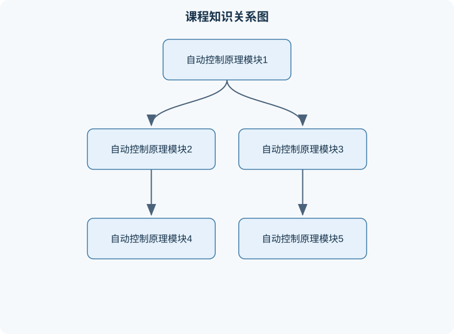

# 自动控制原理

## 一、课程整体知识框架

### 课程边界与先修知识

本课程研究以反馈为核心的线性定常自动控制系统，并介绍非线性系统局部线性化、离散时间模型和状态空间方法的基础内容。主要任务包括：根据物理规律建立系统数学模型；在微分方程、传递函数、方块图、信号流图和状态空间之间转换；分析系统的稳定性、动态性能、稳态误差和频率特性；使用根轨迹、频率响应和校正网络进行控制器设计。课程通常以单输入单输出连续时间系统为主，并扩展到多变量状态空间系统和采样系统。先修知识包括微积分、常微分方程、线性代数、复变函数、拉普拉斯变换、傅里叶变换和基本电路、机械及流体系统知识。理想线性模型只在工作点附近、参数近似恒定、信号未饱和且系统结构未发生切换时有效；实际系统还需考虑非线性、时变性、噪声、饱和、死区、参数不确定性、采样延迟和执行器限制。





### 1. 课程对象与核心问题

自动控制原理研究如何利用控制装置，使被控对象的某些物理量按照给定目标变化，并在外部扰动、参数不确定和测量噪声存在时仍保持期望性能。一个基本闭环系统通常包含给定值、比较环节、控制器、执行机构、被控对象、传感器和反馈通道。设给定输入为 $r(t)$，输出为 $y(t)$，误差信号为 $e(t)$，控制输入为 $u(t)$，扰动为 $d(t)$，测量噪声为 $n(t)$。在负反馈结构中，若反馈信号为 $b(t)$，则

$$
e(t)=r(t)-b(t).
$$

当反馈环节的传递函数为 $H(s)$、控制器和被控对象串联后的前向通道传递函数为 $G(s)$ 时，若系统为单输入单输出线性定常系统，则闭环传递函数为

$$
\Phi(s)=\frac{Y(s)}{R(s)}
=\frac{G(s)}{1+G(s)H(s)}.
$$

其中，$s$ 为拉普拉斯变换复变量，单位为 $\mathrm{s^{-1}}$；$G(s)$ 和 $H(s)$ 是输入输出变量之比，通常为无量纲或带有相应物理单位。上式的适用条件是：系统可用线性定常模型描述，初始条件已置零，反馈为负反馈且各环节连接关系确实为单闭环。若反馈为正反馈，分母应变为 $1-G(s)H(s)$；若系统含有非线性、时变参数或多回路耦合，则不能直接套用该式。

自动控制的基本任务可归纳为四类。第一是建模，即从物理定律、实验数据或系统辨识结果得到微分方程、传递函数、状态空间模型或离散模型。第二是分析，即判断稳定性、动态响应、稳态误差、抗扰能力和鲁棒性。第三是综合，即选择控制器结构和参数，使系统满足速度、超调量、稳态精度、控制能量等约束。第四是验证，即通过仿真、实验和现场数据检查模型及设计是否有效。

### 2. 理想模型与现实系统的区别

课程中的典型模型常假设线性、定常、连续、参数已知且执行器无限快。这些假设便于推导，但实际系统通常还存在饱和、死区、滞环、摩擦、采样、量化、时延、传感器噪声和参数变化。例如，比例控制律

$$
u(t)=K_pe(t)
$$

中，$K_p$ 为比例增益。理想模型认为 $u(t)$ 可取任意值；实际执行器往往满足 $|u(t)|\leq u_{\max}$。当误差较大时，控制器输出被截断，系统进入饱和，线性闭环传递函数不再完整描述系统，积分环节还可能产生积分饱和。又如，纯时延 $T$ 的传递函数为 $e^{-Ts}$，它不是有限阶有理函数，不能简单当作一个普通增益处理；在频域中它的幅值为 $1$，相位却额外滞后 $\omega T$。

因此，任何结论都必须同时说明模型条件。线性模型可用于小范围扰动分析，但不能直接推出大范围非线性行为；稳定的线性化模型不保证原非线性系统在所有工作点全局稳定；仿真曲线符合要求也不等价于实物系统一定满足要求。

### 3. 八个核心模块之间的逻辑链

#### 模块一：基本概念、控制系统组成与建模对象

本模块建立控制系统的语言。需要区分开环控制和闭环控制：开环控制不利用输出反馈，结构简单但不能自动纠正扰动和模型误差；闭环控制通过误差形成调节作用，通常能改善跟踪和抗扰性能，但可能引入不稳定风险。还需区分被控对象、控制器、执行器、测量元件和反馈元件，因为它们的动态特性分别影响控制品质。

建模时，机械系统可依据牛顿定律或力矩平衡，电路系统可依据基尔霍夫定律，热系统可依据能量守恒。以转动惯量 $J$、黏性阻尼系数 $B$、输入力矩 $T(t)$、转角 $\theta(t)$ 为例，有

$$
J\ddot{\theta}(t)+B\dot{\theta}(t)=T(t).
$$

在零初始条件下取拉普拉斯变换，得到

$$
(Js^2+Bs)\Theta(s)=T(s),
\qquad
G(s)=\frac{\Theta(s)}{T(s)}
=\frac{1}{Js^2+Bs}.
$$

其中 $J$ 的单位为 $\mathrm{kg\,m^2}$，$B$ 的单位为 $\mathrm{N\,m\,s/rad}$，$\theta$ 通常以弧度计。该模型忽略了库仑摩擦、齿隙和执行器饱和，因此只适合相应工作范围内的小扰动分析。

#### 模块二：微分方程、传递函数与方块图

传递函数定义为零初始条件下输出拉普拉斯变换与输入拉普拉斯变换之比：

$$
G(s)=\frac{Y(s)}{U(s)}.
$$

若微分方程为

$$
a_n y^{(n)}+\cdots+a_1\dot y+a_0y
=b_m u^{(m)}+\cdots+b_1\dot u+b_0u,
$$

则

$$
G(s)=
\frac{b_ms^m+\cdots+b_1s+b_0}
{a_ns^n+\cdots+a_1s+a_0}.
$$

该公式依赖零初始条件；若初始状态不为零，拉普拉斯变换中会出现由初始状态产生的附加项，不能把传递函数当成完整响应。传递函数主要描述输入输出关系，不能唯一反映内部状态。例如存在不可观测或极零相消的内部模态时，传递函数阶次可能低于实际物理系统阶次。

方块图化简必须遵循连接关系。串联环节相乘，并联环节相加，负反馈闭环使用 $G/(1+GH)$。化简后应检查信号方向、反馈符号、单位一致性和内部环节是否被错误消去。方块图化简与信号流图法都可求输入输出关系，但多输入多输出系统更适合用矩阵模型或梅森公式进行结构分析。

#### 模块三：时域分析与动态性能

对典型二阶系统

$$
G(s)=\frac{\omega_n^2}
{s^2+2\zeta\omega_n s+\omega_n^2},
$$

$\omega_n$ 为自然频率，单位为 $\mathrm{rad/s}$；$\zeta$ 为阻尼比，无量纲。极点为

$$
s_{1,2}=-\zeta\omega_n
\pm\omega_n\sqrt{\zeta^2-1}.
$$

当 $0<\zeta<1$ 时为欠阻尼，阶跃响应具有振荡特性；当 $\zeta=1$ 时为临界阻尼；当 $\zeta>1$ 时为过阻尼。欠阻尼条件下，定义阻尼振荡频率

$$
\omega_d=\omega_n\sqrt{1-\zeta^2},
$$

单位仍为 $\mathrm{rad/s}$。若单位阶跃响应的峰值超过稳态值，则超调量百分数为

$$
M_p=100\exp\left(
-\frac{\pi\zeta}{\sqrt{1-\zeta^2}}
\right)\%.
$$

这个公式只适用于标准欠阻尼二阶系统，且通常不适用于含显著高阶极点、零点或时延的系统。上升时间、峰值时间和调节时间也会受非主导极点及零点影响，不能只依据二阶公式判断高阶系统全部性能。

#### 模块四：稳定性与稳态误差

连续时间线性定常系统渐近稳定的必要且充分条件是闭环特征方程的全部根位于复平面左半平面，即所有闭环极点满足 $\operatorname{Re}(s_i)<0$。位于虚轴上的单根通常导致持续振荡，右半平面极点导致响应发散；虚轴重根还可能产生随时间增长的项。劳斯判据通过特征多项式系数构造劳斯表，在不求根的情况下判断右半平面根的数量。劳斯表第一列符号变化次数等于右半平面根数，但其使用要求多项式系数为实数，且需正确处理第一列为零或某一整行为零的特殊情形。

稳态误差可由终值定理求得：

$$
\lim_{t\to\infty}e(t)
=\lim_{s\to0}sE(s),
$$

但前提是 $sE(s)$ 的全部极点位于左半平面，至多允许满足终值存在条件的特殊情况。若系统不稳定，直接套用终值定理会得出错误结论。对单位反馈系统，开环传递函数为 $G(s)H(s)$，位置误差常数、速度误差常数和加速度误差常数分别由低频极限定义。所谓系统型别是开环传递函数在原点的极点数，而不是闭环极点数。型别提高通常能减小低阶多项式输入的稳态误差，但也可能降低相位裕度并增加振荡风险。

#### 模块五：根轨迹与参数变化分析

根轨迹描述某一实参数变化时闭环特征根在复平面中的运动轨迹。对单位反馈系统，若开环传递函数为 $L(s)=K G_0(s)$，闭环特征方程为

$$
1+K G_0(s)=0.
$$

因此根轨迹上的点必须满足角度条件

$$
\angle G_0(s)=(2k+1)\pi,
\quad k\in\mathbb Z,
$$

并由幅值条件确定对应增益

$$
K=\frac{1}{|G_0(s)|}.
$$

根轨迹只能针对明确的参数变化和明确的闭环结构使用。若同时改变多个参数、存在时延或系统为多输入多输出，普通根轨迹图不能直接给出完整结论。设计时需先判断目标极点是否位于根轨迹上，再由幅值条件求参数，最后检查其余极点、稳态误差和控制输入是否满足要求。

#### 模块六：频域分析、频率响应与鲁棒性

令 $s=j\omega$，可得到频率响应

$$
G(j\omega)=|G(j\omega)|e^{j\varphi(\omega)}.
$$

$\omega$ 是角频率，单位为 $\mathrm{rad/s}$；幅值常用分贝表示：

$$
A_{\mathrm{dB}}=20\log_{10}|G(j\omega)|.
$$

波特图将幅频特性和相频特性分别对 $\log\omega$ 绘制。增益裕度和相位裕度反映系统距离临界振荡状态的相对程度，但其解释依赖开环系统、交越频率及闭环结构。对具有右半平面极点或非最小相位零点的系统，简单的“增加增益即可提高速度”往往失效。频域设计还需考虑噪声通道：高频增益过大可能放大测量噪声，低频增益过小则跟踪和抗扰能力不足。

#### 模块七：状态空间模型、可控性与可观性

状态空间模型写为

$$
\dot{x}(t)=Ax(t)+Bu(t),\qquad
y(t)=Cx(t)+Du(t),
$$

其中 $x(t)\in\mathbb R^n$ 为状态向量，$u(t)\in\mathbb R^m$ 为输入，$y(t)\in\mathbb R^p$ 为输出；$A,B,C,D$ 分别为系统矩阵、输入矩阵、输出矩阵和直接传递矩阵。矩阵维数分别为 $n\times n$、$n\times m$、$p\times n$、$p\times m$。状态变量应能与初始条件和系统未来行为建立明确关系，但状态表示并不唯一，不同坐标变换可描述同一输入输出系统。

连续时间系统的可控性矩阵为

$$
\mathcal C=[B\ AB\ A^2B\ \cdots\ A^{n-1}B],
$$

若 $\operatorname{rank}(\mathcal C)=n$，则系统完全可控。可观性矩阵为

$$
\mathcal O=
\begin{bmatrix}
C\\CA\\\vdots\\CA^{n-1}
\end{bmatrix},
$$

若 $\operatorname{rank}(\mathcal O)=n$，则系统完全可观。可控性不是“输入足够大”的同义词，而是线性代数意义上能否通过有限时间输入改变全部状态；可观性也不等于传感器数量多，而是能否由输出历史重构状态。

#### 模块八：控制器设计、离散化与综合验证

常见控制器包括比例、积分、微分及其组合。理想 PID 控制律为

$$
u(t)=K_pe(t)+K_i\int_0^t e(\tau)\,d\tau+K_d\frac{de(t)}{dt}.
$$

$K_p$、$K_i$、$K_d$ 的单位由被控量、控制量和时间单位共同决定，不能脱离物理量直接比较。积分有利于消除恒值扰动造成的稳态误差，微分可提供预测性阻尼，但理想微分会放大高频噪声，工程实现通常需要滤波。控制器设计不能只看阶跃响应，还应检查控制输入峰值、噪声放大、饱和恢复、参数变化和采样影响。

采样周期为 $T_s$ 的离散系统可写为

$$
x[k+1]=A_dx[k]+B_du[k],\qquad
y[k]=C_dx[k]+D_du[k].
$$

零阶保持下，

$$
A_d=e^{AT_s},\qquad
B_d=\int_0^{T_s}e^{A\tau}B\,d\tau.
$$

连续系统稳定对应离散系统极点位于单位圆内部，即 $|z_i|<1$，但这要求离散模型、采样保持和数字控制实现均与实际系统相符。采样频率不足会造成混叠，计算延迟会增加等效相位滞后，因此连续域设计完成后仍需进行离散闭环验证。

## 二、章节和模块划分

### 核心知识覆盖清单

本清单根据本课程的章节划分整理，用于检查正文是否覆盖各个核心模块：

- **1. 建模与模型转换章节**。
- **2. 时域性能与稳态误差章节**。
- **3. 稳定性、根轨迹与频域章节**。
- **4. 状态空间、数字控制与综合项目章节**。
- **5. 易错点、笔试问题与岗位关联**。


### 1. 建模与模型转换章节

#### 典型分析流程

输入是系统结构、物理参数和信号定义，输出是可用于分析和设计的数学模型。流程为：先确定输入、输出、状态和扰动；再依据守恒定律列写微分方程；随后在零初始条件下转换为传递函数，或选取状态变量写成状态空间形式；最后通过量纲检查、极限情况检查和实验数据检查模型。

例如，若 $G(s)=1/(s+2)$，单位阶跃输入 $R(s)=1/s$，则

$$
Y(s)=\frac{1}{s(s+2)}
=\frac{1}{2}\left(\frac{1}{s}-\frac{1}{s+2}\right),
$$

所以

$$
y(t)=\frac12(1-e^{-2t}),\quad t\geq0.
$$

验证时，$t=0$ 有 $y(0)=0$，符合无初始储能条件；$t\to\infty$ 时 $y(t)\to1/2$，与直流增益 $G(0)=1/2$ 一致；极点 $s=0,-2$ 中的原点极点来自阶跃输入而非系统本身，不能据此把系统判为不稳定。

#### 代码化模型检查流程

以下 Python 代码只进行多项式和极点计算，不依赖联网或外部文件。输入为分母、分子系数和待检查频率，输出为极点、直流增益及频率响应。

```python
import numpy as np

def analyze_tf(num, den, frequencies):
    """num、den按s降幂排列；frequencies单位为rad/s。"""
    num = np.asarray(num, dtype=float)
    den = np.asarray(den, dtype=float)

    if den.size == 0 or np.allclose(den, 0):
        raise ValueError("分母多项式不能为零")
    if np.any(np.asarray(frequencies) < 0):
        raise ValueError("角频率不能为负")

    poles = np.roots(den)
    stable = np.all(np.real(poles) < 0)

    # 仅在分母和分子在s=0处均有有限非零值时计算直流增益
    den0 = np.polyval(den, 0.0)
    num0 = np.polyval(num, 0.0)
    dc_gain = None if np.isclose(den0, 0.0) else num0 / den0

    response = []
    for omega in frequencies:
        s = 1j * omega
        value = np.polyval(num, s) / np.polyval(den, s)
        response.append(value)

    return {
        "poles": poles,
        "stable_by_poles": stable,
        "dc_gain": dc_gain,
        "frequency_response": np.asarray(response)
    }
```

不变量是：分子、分母始终被视为按降幂排列的多项式，频率响应始终在 $s=j\omega$ 上计算。终止条件是频率列表遍历完成；若频率数量为 $N$、分子和分母最高阶数合计为 $d$，主要计算复杂度为 $O(Nd)$。该流程适合低阶有理传递函数，不适合直接处理纯时延、非线性模型或含不确定参数的严格鲁棒稳定性证明。

### 2. 时域性能与稳态误差章节

#### 例题一：闭环传递函数与稳态值

**题干：** 单位负反馈系统前向通道为

$$
G(s)=\frac{10}{s(s+2)}.
$$

求闭环传递函数，并判断单位阶跃稳态输出。

**分析：** 单位负反馈有 $H(s)=1$，闭环分母为 $1+G(s)$。

**解答：**

$$
\Phi(s)=\frac{G(s)}{1+G(s)}
=\frac{10}{s^2+2s+10}.
$$

闭环极点为 $-1\pm3j$，实部为负，因此闭环渐近稳定。单位阶跃输入下，

$$
y(\infty)=\lim_{s\to0}s\Phi(s)\frac1s
=\Phi(0)=1.
$$

**结果验证：** 特征方程系数均为正且二阶，稳定性与极点结果一致；直流增益为 $1$，所以稳态输出等于单位阶跃目标。

**变式：** 若反馈通道为 $H(s)=2$，则

$$
\Phi(s)=\frac{10}{s^2+2s+20},
$$

稳态输出仍为 $1$，但自然频率和阻尼比改变，动态响应不能照搬原系统。

#### 例题二：由阶跃响应求传递函数

**题干：** 某稳定系统单位阶跃响应为

$$
h(t)=1-1.5e^{-2t}+0.5e^{-8t}.
$$

求传递函数并判断初始值和稳态值。

**解答：** 单位阶跃响应满足 $H(s)=G(s)/s$，故

$$
H(s)=\frac1s-\frac{1.5}{s+2}+\frac{0.5}{s+8}.
$$

通分得

$$
G(s)=sH(s)
=\frac{(s+2)(s+8)-1.5s(s+8)+0.5s(s+2)}
{(s+2)(s+8)}.
$$

整理分子：

$$
s^2+10s+16-1.5s^2-12s+0.5s^2+s
=16-s.
$$

因此

$$
G(s)=\frac{16-s}{s^2+10s+16}.
$$

初始值定理给出

$$
h(0^+)=\lim_{s\to\infty}sH(s)=0,
$$

稳态值为

$$
h(\infty)=\lim_{s\to0}sH(s)=1.
$$

**验证：** 两个极点为 $-2,-8$，系统稳定；分子在高频项为一次，故响应无瞬时跳变。**变式：** 若响应中含有未衰减正弦项，终值定理需重新检查，不能直接使用。

#### 例题三：二阶系统超调量

**题干：** 标准二阶系统的 $\zeta=0.5$、$\omega_n=4\ \mathrm{rad/s}$，求超调量和阻尼振荡频率。

**解答：**

$$
\omega_d=4\sqrt{1-0.5^2}
=4\sqrt{0.75}\approx3.464\ \mathrm{rad/s}.
$$

$$
M_p=100e^{-\pi\cdot0.5/\sqrt{0.75}}\%
\approx16.3\%.
$$

**验证：** $0<\zeta<1$，系统确为欠阻尼；超调量为正且小于通常的百分之百。**变式：** 若系统含一个靠近虚轴的第三极点，该二阶估算可能明显偏差，必须计算完整响应。

### 3. 稳定性、根轨迹与频域章节

#### 例题四：劳斯判据

**题干：** 判断特征方程

$$
s^3+2s^2+3s+4=0
$$

的稳定性。

**解答：** 劳斯表前两列为

$$
\begin{array}{c|cc}
s^3&1&3\\
s^2&2&4\\
s^1&\frac{2\cdot3-1\cdot4}{2}&0\\
s^0&4&
\end{array}
=
\begin{array}{c|cc}
s^3&1&3\\
s^2&2&4\\
s^1&1&0\\
s^0&4&
\end{array}.
$$

第一列 $1,2,1,4$ 无符号变化，因此右半平面根数为零，系统稳定。**验证：** 三阶系统系数均为正，且劳斯表没有异常行；不能仅凭“系数全正”判断高于二阶系统稳定。**变式：** 若 $s^1$ 行第一列变为负，第一列会发生两次符号变化，表示有两个右半平面根。

#### 例题五：根轨迹参数范围

**题干：** 单位负反馈系统开环传递函数为

$$
L(s)=\frac{K}{s(s+2)(s+5)},\quad K>0.
$$

求使闭环稳定的 $K$ 范围。

**解答：** 特征方程为

$$
s^3+7s^2+10s+K=0.
$$

三阶劳斯表为

$$
\begin{array}{c|cc}
s^3&1&10\\
s^2&7&K\\
s^1&\frac{70-K}{7}&0\\
s^0&K&
\end{array}.
$$

稳定要求第一列全为正，得到

$$
K>0,\qquad 70-K>0,
$$

所以

$$
0<K<70.
$$

**验证：** $K=70$ 时 $s^1$ 行为零，系统位于稳定边界；$K>70$ 时第一列出现符号变化，闭环不再稳定。**变式：** 若反馈为正反馈，特征方程符号改变，不能沿用该范围。

### 4. 状态空间、数字控制与综合项目章节

#### 控制器设计流程

输入是对象模型、采样周期、性能指标和执行器限制；输出是控制器参数、闭环验证报告及异常处理策略。流程包括：确定工作点并线性化；选择传递函数、状态反馈或观测器结构；根据稳定性和时域/频域指标初选参数；检查控制量饱和与噪声；离散化并实现；用独立仿真和实验数据验证；最后记录参数、边界条件和失败模式。

#### 实验一：二阶对象阶跃响应验证

**输入数据：** 对象

$$
G(s)=\frac{25}{s^2+4s+25},
$$

单位阶跃输入，仿真或实验采样周期为 $0.01\ \mathrm{s}$。

**步骤：**  
1. 计算极点 $-2\pm j\sqrt{21}$，确认对象自身稳定。  
2. 记录输出 $y(t)$、控制输入 $u(t)$ 和采样时间。  
3. 从数据中计算稳态值、峰值、超调量和调节时间。  
4. 将测得曲线与模型响应对齐，检查初值、峰值时间和稳态误差。  
5. 改变输入幅值，判断线性比例关系是否成立。

**评价标准：** 稳态值与模型预测的相对误差应在预先规定范围内；峰值时间和超调量应分别报告测量分辨率和噪声影响，不能只给无误差的理论数字；控制输入不得超过执行器上限。

**排错方法：** 若稳态值错误，先检查输入幅值和传感器标定；若时间尺度错误，检查采样周期单位；若振荡衰减速度不符，检查阻尼参数、负载和未建模时延；若输出突然发散，优先检查反馈符号和数据符号约定。

#### 实验二：离散 PID 与抗饱和项目

**输入数据：** 连续对象 $G(s)=1/(s+1)$，采样周期 $T_s=0.05\ \mathrm{s}$，执行器限制为 $|u[k]|\leq2$，给定值为幅值 $1$ 的阶跃。

**步骤：**  
1. 选择比例、积分、微分参数并说明单位。  
2. 用差分近似实现误差积分；微分项采用带滤波的误差变化率。  
3. 每个采样时刻先计算未限幅控制量，再施加饱和。  
4. 当积分继续累积而执行器已饱和时，暂停积分或采用回算补偿。  
5. 比较无抗饱和和有抗饱和两种响应，记录超调、调节时间、稳态误差和控制峰值。

**评价标准：** 稳态误差、超调量和调节时间必须同时满足指标；控制量不得持续饱和；改变初始误差或输入幅值后，系统仍应能恢复而非长期偏置。

**排错方法：** 输出锯齿通常与采样周期过大、量化或微分噪声有关；长时间偏差可能来自积分禁用、符号错误或执行器死区；大幅超调常与积分饱和、控制器参数沿用连续域结果但未重新离散化有关。

### 5. 易错点、笔试问题与岗位关联

#### 具体易错点

1. 把开环极点当作闭环极点，未先写闭环特征方程。  
2. 将反馈通道默认为 $1$，忽略非单位反馈中的 $H(s)$。  
3. 不检查负反馈与正反馈符号。  
4. 在非零初始条件下直接使用传递函数。  
5. 把系统型别误认为闭环极点在原点的数量。  
6. 在系统不稳定时滥用终值定理。  
7. 将自然频率 $\omega_n$ 当作实际振荡频率 $\omega_d$。  
8. 用标准二阶公式分析含显著零点的高阶系统。  
9. 只看特征多项式系数全正就断言高阶系统稳定。  
10. 劳斯表第一列为零或整行为零时仍机械计算。  
11. 把可控性理解为输入幅值足够大。  
12. 混淆状态变量、输出变量和传感器测量值。  
13. 忽略执行器饱和导致的积分累积。  
14. 将连续时间稳定条件 $\operatorname{Re}(s)<0$ 直接用于离散极点。  
15. 只验证输出，不检查控制输入、噪声和模型失配。  
16. 频率单位在 $\mathrm{Hz}$ 与 $\mathrm{rad/s}$ 之间转换错误，二者关系为 $\omega=2\pi f$。

#### 典型笔试问题及解答思路

1. **为什么闭环系统可能比开环系统不稳定？**  
   先写特征方程 $1+G(s)H(s)=0$，说明反馈改变了极点位置；再用根轨迹或劳斯判据判断增益范围。

2. **如何由微分方程求传递函数？**  
   先确认零初始条件，再逐项进行拉普拉斯变换，整理为 $Y(s)/U(s)$，最后检查分子分母阶次和量纲。

3. **终值定理何时可用？**  
   计算 $sY(s)$ 的极点，确认终值存在；不能仅看到表达式可化简就使用。

4. **提高比例增益一定能减小稳态误差吗？**  
   对某些稳定、低频增益有限的系统通常能减小误差，但可能降低稳定裕度、增大超调和控制量，且不保证恒值误差严格为零。

5. **劳斯表第一列符号变化代表什么？**  
   代表特征方程右半平面根的数量，不直接给出每个根的位置，也不能忽略虚轴根的特殊处理。

6. **传递函数与状态空间模型有何差别？**  
   传递函数突出输入输出关系且依赖零初始条件；状态空间保留内部状态，适合多变量、初始状态和状态反馈设计。

7. **为什么微分环节需要滤波？**  
   理想微分幅值随频率增长，容易放大测量噪声；实际需限制高频增益，并重新评估相位和响应速度。

8. **采样周期如何影响数字控制？**  
   采样过慢会造成信息丢失和等效时延，采样过快则增加计算和通信负担；必须结合对象带宽、保持器和计算延迟验证。

#### 面试问题、参考答案与追问要点

1. **如何定位闭环振荡原因？**  
   参考答案：先区分反馈符号、参数变化、时延、采样、饱和和噪声，再查看极点、相位裕度及控制输入。追问时应说明如何用阶跃数据区分欠阻尼与周期性扰动。

2. **模型与实验响应不一致怎么办？**  
   参考答案：先检查单位、初始条件、传感器标定和输入记录，再比较静态增益、时间常数和时延，必要时重新辨识。追问应说明如何避免用同一批数据同时拟合和验收。

3. **怎样处理积分饱和？**  
   参考答案：检测执行器饱和并暂停积分，或用回算项使积分状态回到可实现范围。追问应讨论饱和解除后的恢复时间和大幅输入下的稳定性。

4. **为什么状态反馈前还要检查可控性？**  
   参考答案：不可控模态无法通过状态反馈任意配置，若不可控模态不稳定，闭环设计不能补救。追问应进一步检查可检测性和观测器误差动态。

5. **如何选择传感器位置？**  
   参考答案：根据被控变量、噪声、带宽、安装约束和可观性选择；并分析测量延迟和量化误差。追问应说明增加传感器不一定改善闭环，错误测量会引入噪声和相位滞后。

6. **如何判断仿真结果可信？**  
   参考答案：检查模型假设、数值步长、初始条件、输入幅值和边界条件，并用独立实验或不同模型交叉验证。追问应说明如何处理仿真稳定但实物发散的情况。

7. **控制系统验收看哪些指标？**  
   参考答案：至少包括稳定性、稳态误差、超调量、调节时间、控制峰值、噪声敏感性和参数变化下的鲁棒性。追问应要求给出每项指标的测量窗口和容差。

8. **面对多变量耦合系统如何设计？**  
   参考答案：先建立状态空间或传递矩阵模型，分析耦合强度和相对增益，再选择解耦、协调控制或多变量状态反馈。追问应指出静态解耦不一定能消除动态耦合和时延影响。

#### 岗位任务与验收产出

控制工程技术岗位通常负责建立对象模型、整定控制器、调试传感器和执行器，并输出参数表、仿真报告、报警逻辑和现场测试记录；验收要求包括单位一致、闭环稳定、指标可复现且异常工况有明确处理。

控制算法研发岗位需要进行系统辨识、状态估计、鲁棒性分析、离散实现和版本验证，产出模型文件、算法说明、测试数据及边界条件；验收重点是代码与公式一致、数值稳定、计算资源满足实时要求、输入越界时行为可控。

自动化测试与系统分析岗位负责设计阶跃、扰动、噪声和参数变化测试，比较理论模型与实测响应，产出测试矩阵、偏差分析和缺陷定位记录；验收标准是测试覆盖关键工况，结论能够由原始数据复算，且明确区分模型误差、传感器误差和控制器缺陷。

## 三、核心概念的详细解释

### 1. 控制系统的基本结构与任务

自动控制系统的核心是利用控制输入 $u(t)$ 改变被控对象的输出 $y(t)$，使其跟踪给定输入 $r(t)$，同时抑制扰动 $d(t)$ 和测量噪声 $n(t)$。在负反馈系统中，反馈信号为 $b(t)$，误差为

$$
e(t)=r(t)-b(t).
$$

控制器根据 $e(t)$ 产生控制指令，执行器把控制指令转换为对象能够接受的物理量。例如，电机控制中，控制器输出电压指令，功率驱动器输出电机电压或电流，电机的转速或位置则是被控量。

开环控制不测量输出，控制动作完全由给定输入和预先设定的规律决定。它结构简单、成本较低，但无法根据实际输出纠正误差。例如定时加热不能直接判断炉温是否达到目标。闭环控制通过传感器测量输出并形成反馈，能够减小模型误差和外部扰动造成的偏差，但传感器延迟、反馈符号错误和增益过大可能导致振荡甚至失稳。

自动控制系统通常需要同时满足以下目标：

1. **稳定性**：BIBO稳定性要求所有有界输入产生有界输出；内部渐近稳定性要求零输入状态趋于零；工程上还需分别检查状态、输出和控制输入是否超限。
2. **跟踪性能**：给定输入变化时，输出能够快速、准确地跟随。
3. **抗扰性能**：负载变化、参数波动和外界扰动对输出的影响尽可能小。
4. **稳态精度**：经过足够长时间后，输出与给定值之间的误差满足要求。
5. **控制代价合理**：控制输入不能超过执行器能力，不能产生过大的能量消耗或机械冲击。
6. **鲁棒性**：模型参数、时延和环境条件发生一定变化时，系统仍保持可接受性能。

这些目标通常相互制约。提高比例增益可能减小稳态误差，却可能增大超调和噪声放大；增加积分作用能够消除某些恒值误差，却可能降低稳定裕度；提高微分作用可改善瞬态响应，但会放大高频测量噪声。

### 2. 建模、线性化与模型边界

建模是将物理系统转化为可计算的数学关系。机械系统常用牛顿定律或力矩平衡，电路系统使用基尔霍夫定律，热系统使用能量守恒，流体系统使用质量守恒和动量守恒。以转动系统为例，若转动惯量为 $J$，黏性阻尼系数为 $B$，输入力矩为 $T(t)$，转角为 $\theta(t)$，则

$$
J\ddot{\theta}(t)+B\dot{\theta}(t)=T(t).
$$

这里 $J$ 的单位通常为 $\mathrm{kg\cdot m^2}$，$B$ 的单位为 $\mathrm{N\cdot m\cdot s/rad}$，$T(t)$ 的单位为 $\mathrm{N\cdot m}$，$\theta(t)$ 的单位为 $\mathrm{rad}$。在零初始条件下，传递函数为

$$
G(s)=\frac{\Theta(s)}{T(s)}
=\frac{1}{Js^2+Bs}.
$$

传递函数只适用于线性定常系统的输入输出关系，并且默认初始条件为零。它不能完整表示非零初始状态，也不能直接表达非线性摩擦、饱和和状态约束。

实际对象常是非线性的。例如摆系统含有 $\sin\theta$，电机磁饱和使磁通与电流不再成正比，执行器存在死区和饱和。若在平衡点附近令 $\theta=\theta_0+\Delta\theta$，并对非线性项作一阶泰勒展开，就可得到小扰动线性模型。线性化模型只说明平衡点附近的局部行为；若扰动过大、工作点变化很大或系统存在多个平衡点，则必须重新建模或使用非线性分析。

### 3. 传递函数、状态空间与系统结构

传递函数适合分析单输入单输出线性定常系统的输入输出关系。状态空间模型则以内部状态为核心，适合多输入多输出系统、非零初始条件、状态反馈和观测器设计。连续时间状态方程可写为

$$
\dot{x}(t)=Ax(t)+Bu(t),
$$

$$
y(t)=Cx(t)+Du(t),
$$

其中 $x(t)\in\mathbb{R}^n$ 为状态向量，$u(t)\in\mathbb{R}^m$ 为输入向量，$y(t)\in\mathbb{R}^p$ 为输出向量；$A$、$B$、$C$、$D$ 分别为系统矩阵、输入矩阵、输出矩阵和直接传递矩阵。矩阵维数分别为 $n\times n$、$n\times m$、$p\times n$ 和 $p\times m$。

状态变量应能够由当前状态和输入确定系统未来行为。状态变量的选取并不唯一，但必须保证模型能够完整描述系统动态。对于一个二阶对象，可选位置和速度为状态，也可以选两个积分器输出作为状态。不同状态选取产生的 $A,B,C,D$ 可能不同，但在适当条件下具有相同输入输出行为。

传递函数与状态空间之间的关系为

$$
G(s)=C(sI-A)^{-1}B+D,
$$

其中 $I$ 为与 $A$ 同阶的单位矩阵。该式要求 $sI-A$ 可逆，且讨论的是零初始条件下的输入输出关系。状态空间模型还可直接描述初始状态对输出的影响，这是单纯传递函数表示所缺少的。

### 4. 时域性能与频域性能

典型时域指标包括上升时间、峰值时间、最大超调量、调节时间和稳态误差。若单位阶跃响应为 $y(t)$，目标值为 $1$，则稳态误差可表示为

$$
e_{\mathrm{ss}}=\lim_{t\to\infty}[1-y(t)],
$$

前提是系统稳定且极限存在。最大超调量通常定义为响应峰值超过稳态值的相对百分比。调节时间则取响应进入并保持在稳态值附近某一误差带内所需的时间；误差带必须明确，例如 $\pm2\%$ 或 $\pm5\%$，不同误差带不能混用。

频域分析考察系统在正弦输入下的稳态响应。若输入为 $A\sin\omega t$，线性定常系统的输出稳态响应具有相同频率，但幅值乘以 $|G(j\omega)|$，相位增加 $\arg G(j\omega)$。其中 $\omega$ 的单位为 $\mathrm{rad/s}$。幅值裕度和相位裕度用于描述系统距离临界失稳的程度，但它们的解释依赖单回路、线性定常和适当交越频率等条件。

### 5. 稳定性、可控性与可观性

连续时间线性系统的内部渐近稳定性由矩阵 $A$ 的特征值决定：若所有特征值实部均小于零，则系统渐近稳定；若存在实部大于零的特征值，则系统不稳定；若存在实部等于零的特征值，还需进一步判断其约当结构和输入输出关系，不能仅凭“实部不大于零”断定稳定。

对于传递函数，若分母多项式的全部根位于复平面左半部，系统在相应意义下稳定。但传递函数可能发生极零相消，导致某些内部不稳定模态在输入输出表达式中被隐藏，因此输入输出稳定不一定等价于内部稳定。

连续状态空间系统的可控性矩阵为

$$
\mathcal{C}=
\begin{bmatrix}
B&AB&A^2B&\cdots&A^{n-1}B
\end{bmatrix}.
$$

若 $\operatorname{rank}(\mathcal{C})=n$，则系统完全可控，状态反馈才有可能把全部闭环极点配置到指定位置。可观性矩阵为

$$
\mathcal{O}=
\begin{bmatrix}
C\\
CA\\
CA^2\\
\vdots\\
CA^{n-1}
\end{bmatrix}.
$$

若 $\operatorname{rank}(\mathcal{O})=n$，则系统完全可观，能够通过输入和输出记录重构内部状态。可控性是“能否通过输入改变状态”，可观性是“能否通过输出推断状态”，二者不能混淆。

### 6. 连续控制、离散控制与现实限制

数字控制器以采样周期 $T_s$ 获取测量值。采样会引入保持、计算延迟、量化误差和通信延迟。连续系统离散化时，零阶保持模型满足

$$
A_d=e^{AT_s},
\qquad
B_d=\int_0^{T_s}e^{A\tau}B\,\mathrm d\tau.
$$

离散状态方程为

$$
x[k+1]=A_dx[k]+B_du[k],
\qquad
y[k]=Cx[k]+Du[k].
$$

离散系统稳定要求闭环极点位于单位圆内部，即 $|z_i|<1$。连续域左半平面与离散域单位圆之间可通过 $z=e^{sT_s}$ 建立对应关系。采样周期过大可能造成混叠和额外相位滞后，采样过小则增加计算和通信负担，不能只依据“越快越好”选择。

执行器饱和是实际系统中非常重要的非线性。若理想控制律给出 $u_c(t)$，实际执行器只能输出

$$
u(t)=
\begin{cases}
u_{\max},&u_c(t)>u_{\max},\\
u_c(t),&|u_c(t)|\leq u_{\max},\\
-u_{\max},&u_c(t)<-u_{\max}.
\end{cases}
$$

积分控制器在饱和期间继续累积误差，会形成积分饱和，使执行器退出饱和后仍长时间不能恢复。解决方法包括条件积分、积分分离和回算抗饱和，但每种方法都必须结合执行器限制和闭环响应验证。

### 7. 典型分析与实现流程

#### 流程一：从物理对象建立闭环模型

输入为物理结构、参数、给定量和测量量；输出为微分方程、传递函数或状态空间模型及其假设。

1. 确定输入、输出、扰动和测量变量，并统一单位。
2. 根据守恒定律列写各部件方程。
3. 选择状态变量或进行拉普拉斯变换。
4. 检查初始条件、反馈符号和信号方向。
5. 化简得到开环模型和闭环模型。
6. 检查极点、零点、静态增益和量纲。
7. 用阶跃或脉冲响应与物理直觉比较。

不变量是变量单位、信号方向和方程的物理平衡关系不被化简过程破坏。终止条件是模型能够计算输出，并且基本响应与对象的能量、惯性和稳态特征一致。该流程适用于线性或可局部线性化的单回路系统；强非线性、多回路耦合对象需要扩展为非线性或多变量模型。

#### 流程二：基于指标的控制器整定

输入为对象模型、期望稳态误差、超调量、调节时间和执行器限制；输出为控制器结构及参数。

1. 先判断对象是否稳定、是否含积分环节、是否存在明显时延。
2. 根据稳态误差要求选择比例、积分或其他结构。
3. 初步选择参数，使闭环极点位于合理区域。
4. 计算阶跃响应、扰动响应和控制输入峰值。
5. 检查稳定裕度、噪声放大和参数变化下的性能。
6. 若发生饱和，加入抗饱和机制并重新验证。
7. 对模型不确定性和采样延迟进行边界测试。

评价标准不能只看输出曲线，还应同时检查控制输入是否越界、噪声是否被放大以及模型误差下是否仍稳定。

#### 流程三：状态反馈与观测器设计

输入为 $A,B,C,D$ 以及期望闭环极点；输出为反馈矩阵和状态估计器。

1. 计算可控性矩阵，确认目标极点可配置。
2. 根据控制律 $u=-Kx+Nr$ 计算反馈矩阵 $K$)。
3. 若状态不可直接测量，设计观测器
   $$
   \dot{\hat{x}}=A\hat{x}+Bu+L(y-C\hat{x}).
   $$
4. 检查观测误差矩阵 $A-LC$ 的特征值。
5. 将控制器和观测器组合，验证闭环极点、噪声响应和输入峰值。
6. 对传感器偏置、采样延迟和状态估计初值进行测试。

观测器极点通常需要比控制闭环极点更快，但过快会放大测量噪声，不能无限提高观测器增益。

#### 完整伪代码：闭环阶跃响应检查

```python
# Python风格伪代码：仅进行离散仿真，不访问网络或执行外部命令
def simulate_closed_loop(A, B, C, D, K, N, x0, r, dt, steps):
    # 输入：
    # A, B, C, D：连续时间状态空间矩阵
    # K：状态反馈矩阵，控制律 u = -Kx + Nr
    # N：给定值前置增益
    # x0：初始状态
    # r：恒定给定值
    # dt：仿真步长，单位为秒
    # steps：仿真步数
    # 输出：状态序列、输出序列、控制输入序列

    x = x0
    states, outputs, controls = [], [], []

    for k in range(steps):
        u = -K @ x + N * r
        y = C @ x + D @ u

        states.append(x.copy())
        outputs.append(y.copy())
        controls.append(u.copy())

        # 前向欧拉离散，仅适合步长足够小的近似仿真
        x = x + dt * (A @ x + B @ u)

    return states, outputs, controls
```

该伪代码的不变量是每一步都使用同一控制律和同一状态更新关系；终止条件是达到指定仿真步数。前向欧拉法不是精确离散化方法，步长过大时可能产生数值不稳定，即使真实连续系统稳定，数值结果也可能发散。因此，工程验证应采用精确离散化或经过步长收敛性检查的数值积分方法。

### 8. 实验与项目流程

#### 实验一：一阶对象的阶跃响应辨识

**输入数据**：对一个近似一阶对象施加幅值为 $1$ 的阶跃输入，记录采样周期为 $0.01\ \mathrm{s}$ 的输入输出数据；对象模型假设为

$$
G(s)=\frac{K}{Ts+1}.
$$

**步骤**：

1. 检查输入是否确实从零跃迁到 $1$，并删除明显通信异常点。
2. 先估计输入和输出的初始、最终平台值，再用 $K=(y_\infty-y_0)/(u_\infty-u_0)$ 计算静态增益；只有零基线、单位阶跃时才能直接使用最终输出。
3. 找到输出达到最终值 $63.2\%$ 的时间，估计时间常数 $T$。
4. 使用得到的 $K,T$ 重建响应。
5. 将前半段数据用于辨识，后半段数据用于独立验证。
6. 计算最大绝对误差、均方误差和稳态偏差。

**评价标准**：模型在验证区间内的误差应满足预先规定的容差；若对象响应存在明显延迟、超调或多时间常数，不能强行使用一阶模型。

**排错方法**：若 $K$ 错误，优先检查输入输出单位和稳态值；若 $T$ 偏差大，检查采样时间戳和阶跃起始时刻；若早期响应滞后而后期吻合，应增加纯时延模型；若响应有超调，则一阶模型结构不适用。

#### 实验二：闭环比例控制与饱和测试

**输入数据**：给定值在 $0$ 与目标值之间变化，执行器限制为 $|u|\leq u_{\max}$，分别设置三个比例增益 $K_p$。

**步骤**：

1. 在无扰动条件下测试小幅阶跃，记录输出和控制输入。
2. 逐步增大 $K_p$，比较上升时间、超调量和稳态误差。
3. 施加恒值负载扰动，测量扰动恢复时间。
4. 输入大幅阶跃，使执行器进入饱和。
5. 比较无抗饱和和有抗饱和策略时的恢复过程。
6. 检查传感器噪声下的控制输入变化。

**评价标准**：闭环不能发散；输出超调、调节时间、稳态误差和控制峰值均应满足要求；饱和解除后不能出现长时间异常偏差。

**排错方法**：输出方向相反时检查反馈符号；持续振荡时检查增益、时延和采样周期；输出长期偏差可能是比例控制的固有稳态误差；大幅阶跃后恢复缓慢应检查积分饱和；控制量高频抖动应检查测量噪声和微分环节。

## 四、重要定义、公式、定理和推导

### 专业审校补充：关键定义与适用边界

灵敏度函数用于刻画模型参数变化对闭环性能的影响。对负反馈系统定义开环回路传递函数 L(s)=G(s)H(s)，灵敏度函数为 S(s)=1/[1+L(s)]，互补灵敏度函数为 T(s)=L(s)/[1+L(s)]，且 S(s)+T(s)=1。若对象参数发生小扰动 ΔG，且反馈通道不变，则输出相对变化近似满足 ΔΦ/Φ≈S(s)·ΔG/G，其中 Φ(s)=G(s)/[1+G(s)H(s)]。因此低频处使 |L(jω)|较大，通常可降低跟踪误差和低频负载扰动影响；高频处若 |L(jω)|较小，则 T(jω)较小，有利于抑制测量噪声传入输出。但这不是“增益越大越好”：提高低频增益可能增加执行器负担，扩大带宽又会放大未建模高频动态、采样延迟和噪声风险。该结论要求系统在线性定常、闭环稳定且扰动注入位置明确的条件下使用；对饱和、死区或强非线性系统，灵敏度只能描述局部小扰动特性，不能替代非线性稳定性分析。


### 1. 闭环传递函数的推导

设前向通道传递函数为 $G(s)$，反馈通道传递函数为 $H(s)$，输入为 $R(s)$，输出为 $Y(s)$。负反馈关系为

$$
E(s)=R(s)-H(s)Y(s),
$$

且

$$
Y(s)=G(s)E(s).
$$

代入得

$$
Y(s)=G(s)[R(s)-H(s)Y(s)].
$$

整理可得

$$
[1+G(s)H(s)]Y(s)=G(s)R(s),
$$

因此

$$
\Phi(s)=\frac{Y(s)}{R(s)}
=\frac{G(s)}{1+G(s)H(s)}.
$$

该推导要求单输入单输出、负反馈、线性定常和零初始条件。若反馈为正反馈，误差关系变为 $E=R+HY$，闭环分母为 $1-GH$。若存在多个回路，必须先进行结构化简或使用信号流图公式，不能直接把所有环节相乘后代入。

### 2. 误差传递函数与扰动抑制

在单位反馈，即 $H(s)=1$ 时，

$$
E(s)=R(s)-Y(s),
\qquad
Y(s)=G(s)E(s).
$$

于是

$$
\frac{E(s)}{R(s)}
=\frac{1}{1+G(s)}.
$$

若扰动 $D(s)$ 在对象输入端以加法形式进入，且前向通道仍为 $G(s)$，则在给定输入为零时

$$
Y(s)=G(s)[E(s)+D(s)],
\qquad E(s)=-Y(s).
$$

因此

$$
Y(s)=G(s)[-Y(s)+D(s)],
$$

得到

$$
\frac{Y(s)}{D(s)}
=\frac{G(s)}{1+G(s)}.
$$

若扰动在对象输出端直接相加，则

$$
\frac{Y(s)}{D(s)}
=\frac{1}{1+G(s)}.
$$

这说明扰动抑制效果不仅取决于控制器，还取决于扰动注入位置。不能看到“闭环系统”就认为所有扰动都具有相同的抑制传递函数。

### 3. 最终值定理及稳态误差

若 $f(t)$ 的拉普拉斯变换为 $F(s)$，并且 $f(t)$ 的极限存在，且 $sF(s)$ 的所有极点均在左半平面，则

$$
\lim_{t\to\infty}f(t)=\lim_{s\to0}sF(s).
$$

对单位负反馈系统，输入为单位阶跃时 $R(s)=1/s$，误差为

$$
E(s)=\frac{R(s)}{1+G(s)H(s)}
=\frac{1}{s[1+G(s)H(s)]}.
$$

因此在满足最终值定理条件时，

$$
e_{\mathrm{ss}}
=\lim_{s\to0}\frac{1}{1+G(s)H(s)}.
$$

若 $G(s)H(s)$ 在 $s=0$ 处趋于无穷大，则阶跃稳态误差为零；若开环静态增益有限，则稳态误差通常不为零。必须先确认闭环稳定，否则不能使用最终值定理。比如某系统响应发散时，形式上计算出的极限不能作为稳态误差。

### 4. 一阶系统的响应推导

一阶系统可写为

$$
G(s)=\frac{K}{Ts+1},
$$

其中 $K$ 为静态增益，通常表示输出单位与输入单位之比；$T>0$ 为时间常数，单位为秒。对单位阶跃输入 $R(s)=1/s$，

$$
Y(s)=\frac{K}{s(Ts+1)}.
$$

部分分式展开为

$$
Y(s)=K\left(\frac{1}{s}-\frac{T}{Ts+1}\right).
$$

逆拉普拉斯变换得到

$$
y(t)=K(1-e^{-t/T}),\qquad t\geq0.
$$

当 $t=T$ 时，

$$
y(T)=K(1-e^{-1})\approx0.632K.
$$

因此可以通过阶跃响应达到最终值 $63.2\%$ 的时间估计时间常数。该结论只适用于无纯时延、无明显高阶动态和稳定一阶模型；若系统含有时延 $L$，响应应表现为 $t<L$ 时几乎无变化，不能直接把首次达到 $63.2\%$ 的时刻当作 $T$。

### 5. 二阶系统参数与超调关系

标准二阶系统形式为

$$
G(s)=\frac{\omega_n^2}
{s^2+2\zeta\omega_n s+\omega_n^2},
$$

其中 $\omega_n>0$ 为无阻尼自然频率，单位为 $\mathrm{rad/s}$；$\zeta$ 为阻尼比，无量纲。特征方程为

$$
s^2+2\zeta\omega_n s+\omega_n^2=0.
$$

当 $0<\zeta<1$ 时，极点为

$$
s_{1,2}=-\zeta\omega_n
\pm j\omega_n\sqrt{1-\zeta^2}.
$$

实部决定包络衰减速度，虚部决定振荡频率。欠阻尼单位阶跃响应的最大超调量为

$$
M_p=e^{-\frac{\pi\zeta}{\sqrt{1-\zeta^2}}}\times100\%.
$$

该式仅适用于标准二阶、无零点、单位直流增益且 $0<\zeta<1$ 的情形。若闭环传递函数含有零点或高阶极点，不能仅依据阻尼比直接计算真实超调量。

### 6. 劳斯判据的定义与使用边界

对于连续时间特征多项式

$$
p(s)=a_ns^n+a_{n-1}s^{n-1}+\cdots+a_1s+a_0,
$$

在各系数满足相应非退化条件时，劳斯表第一列符号变化次数等于位于右半平面的根数。若第一列没有符号变化，则没有右半平面根；若出现符号变化，则系统不稳定。

使用劳斯判据时必须注意：

1. 特征多项式应按降幂排列，不能漏项。
2. 系数必须使用同一单位体系。
3. 第一列出现零但整行不全为零时，需要使用小正数 $\varepsilon$ 代替零并考察极限符号。
4. 出现整行全零通常表示关于原点对称的根，需要用上一行构造辅助多项式。
5. 判据直接判断右半平面根数，不能单独给出超调量、调节时间或鲁棒裕度。

### 7. 频率响应与时延效应

将传递函数中的 $s$ 替换为 $j\omega$，可得到频率响应

$$
G(j\omega)=|G(j\omega)|e^{j\varphi(\omega)}.
$$

其中 $|G(j\omega)|$ 是幅值比，$\varphi(\omega)$ 是相位差。对纯时延 $e^{-Ls}$，

$$
e^{-Lj\omega}=e^{-j\omega L}.
$$

其幅值为

$$
|e^{-j\omega L}|=1,
$$

相位为

$$
-\omega L.
$$

因此纯时延不改变幅值，却随频率升高不断增加相位滞后，可能显著降低相位裕度。将时延简单近似为一个静态增益会丢失这一关键影响。

### 8. 典型计算例题

#### 例题一：求闭环传递函数

**题干**：前向通道为

$$
G(s)=\frac{10}{s(s+2)},
$$

反馈通道为 $H(s)=1$，求单位负反馈闭环传递函数并判断基本稳定性。

**分析**：使用

$$
\Phi(s)=\frac{G(s)}{1+G(s)H(s)}.
$$

**解答**：

$$
\Phi(s)=
\frac{\frac{10}{s(s+2)}}
{1+\frac{10}{s(s+2)}}
=\frac{10}{s(s+2)+10}
=\frac{10}{s^2+2s+10}.
$$

闭环极点为

$$
s=-1\pm j3.
$$

两极点实部均为负，因此闭环渐近稳定。

**结果验证**：二阶特征多项式系数均为正，且 $a_1=2>0$ 且 $a_0=10>0$，符合二阶稳定条件。

**变式**：若反馈为正反馈，则分母为 $s(s+2)-10=s^2+2s-10$，存在一个正实根，系统不稳定。

#### 例题二：求单位阶跃稳态误差

**题干**：单位负反馈系统开环传递函数为

$$
G(s)=\frac{K}{s(s+4)}.
$$

求单位阶跃稳态误差，并说明系统稳定时的结果。

**分析**：系统含一个积分环节，属于一型系统。先用最终值定理推导。

**解答**：

$$
E(s)=\frac{1/s}{1+K/[s(s+4)]}
=\frac{s+4}{s[s(s+4)+K]}.
$$

若闭环稳定，

$$
e_{\mathrm{ss}}
=\lim_{s\to0}sE(s)
=\lim_{s\to0}\frac{s+4}{s(s+4)+K}
=0.
$$
$$
E(s)=\frac{1}{s}\frac{s(s+4)}{s(s+4)+K}
=\frac{s+4}{s(s+4)+K}.
$$

于是

$$
e_{\mathrm{ss}}=\lim_{s\to0}sE(s)=0.
$$

**结果验证**：闭环特征方程为 $s^2+4s+K=0$，当 $K>0$ 时稳定，最终值定理可用。

**变式**：若输入为单位斜坡 $R(s)=1/s^2$，则稳态误差与速度误差常数有关，不再为零。

#### 例题三：由阶跃响应求一阶模型

**题干**：某对象单位阶跃稳态输出为 $5$，响应达到 $3.16$ 的时刻为 $2\ \mathrm{s}$，假设对象是一阶无延迟模型，求其传递函数。

**分析**：$3.16$ 约等于 $0.632\times5$，因此可估计 $K=5$，$T=2\ \mathrm{s}$。

**解答**：

$$
G(s)=\frac{K}{Ts+1}
=\frac{5}{2s+1}.
$$

**结果验证**：单位阶跃响应为

$$
y(t)=5(1-e^{-t/2}),
$$

当 $t=2\ \mathrm{s}$ 时，

$$
y(2)=5(1-e^{-1})\approx3.16.
$$

**变式**：若响应在前 $0.5\ \mathrm{s}$ 内保持不变，再开始上升，应考虑纯时延 $L=0.5\ \mathrm{s}$，模型可写为 $5e^{-0.5s}/(2s+1)$。

#### 例题四：判断状态空间系统可控性

**题干**：给定

$$
A=
\begin{bmatrix}
0&1\\
-2&-3
\end{bmatrix},
\qquad
B=
\begin{bmatrix}
0\\
1
\end{bmatrix},
$$

判断系统是否完全可控。

**解答**：

$$
AB=
\begin{bmatrix}
1\\
-3
\end{bmatrix},
\qquad
\mathcal C=
\begin{bmatrix}
0&1\\
1&-3
\end{bmatrix}.
$$

其行列式为

$$
\det(\mathcal C)=0\times(-3)-1\times1=-1\neq0.
$$

因此 $\operatorname{rank}(\mathcal C)=2$，系统完全可控。

**结果验证**：系统阶数为 $n=2$，可控性矩阵秩等于 $2$，满足判据。

**变式**：若 $B=[0\ \ 0]^T$，则可控性矩阵秩为零，任何输入都无法改变系统状态。

#### 例题五：判断离散系统稳定性

**题干**：某离散闭环系统的特征方程为

$$
z^2-0.8z+0.15=0.
$$

判断稳定性。

**解答**：求根：

$$
z_{1,2}
=\frac{0.8\pm\sqrt{0.64-0.6}}{2}
=\frac{0.8\pm0.2}{2}.
$$

因此

$$
z_1=0.5,\qquad z_2=0.3.
$$

两根绝对值均小于 $1$，所以离散系统渐近稳定。

**结果验证**：离散系统稳定区域是单位圆内部，而不是连续系统的左半平面。

**变式**：若某根为 $z=1.02$，即使其余根位于单位圆内，系统仍不稳定。

### 9. 典型易错点

1. 将开环传递函数直接当作闭环传递函数，遗漏 $1+G(s)H(s)$。
2. 负反馈和正反馈符号混淆。
3. 使用传递函数分析非零初始条件，却没有补充状态响应。
4. 忽略传递函数分子、分母的物理单位。
5. 把系统极点和零点混为一谈，误以为零点直接决定内部稳定性。
6. 用最终值定理分析不稳定系统。
7. 认为积分环节必然使闭环稳定。
8. 把一阶系统的时间常数误当作极点位置；极点为 $-1/T$。
9. 在二阶标准公式中遗漏阻尼比条件或直接用于高阶系统。
10. 将连续系统稳定条件“实部小于零”错误用于离散系统。
11. 认为增大比例增益一定改善所有性能。
12. 忽略执行器饱和导致的积分累积。
13. 把测量噪声当作外部负载扰动处理。
14. 只检查输出曲线，不检查控制输入是否超过限制。
15. 只计算输入输出稳定性，不检查被隐藏的内部不稳定模态。
16. 直接用过大的观测器增益追求快速估计，导致噪声放大。
17. 把采样周期当作无关参数，忽略计算延迟和保持效应。
18. 看到仿真稳定就断定实物系统稳定，没有检查模型误差和参数变化。

### 10. 典型笔试问题及解答思路

1. **为什么闭环能减小参数变化对输出的影响？**  
   从灵敏度函数
   $$
   S(s)=\frac{1}{1+G(s)H(s)}
   $$
   出发说明，当环路增益较大时，模型变化对输出的影响在一定频段内被压低，但高频噪声和时延影响可能增加。

2. **为什么积分环节能消除恒值误差？**  
   说明积分器对持续非零误差不断累积，控制作用持续增加，直到误差趋于零；同时指出闭环必须稳定，且执行器饱和会破坏理想推导。

3. **如何由微分方程求传递函数？**  
   先写零初始条件下的拉普拉斯变换，再整理输出与输入之比，最后检查阶次、单位和初始条件。

4. **如何判断二阶系统是否欠阻尼？**  
   将特征方程化为标准形式，比较阻尼比 $\zeta$：$0<\zeta<1$ 为欠阻尼，$\zeta=1$ 为临界阻尼，$\zeta>1$ 为过阻尼。

5. **劳斯表第一列出现零意味着什么？**  
   不能直接判定稳定。若只有一个元素为零，采用小正数并考察符号；若整行全零，构造辅助多项式分析对称根。

6. **可控性和可观性有什么区别？**  
   可控性讨论输入能否影响全部状态，可观性讨论输出能否重构全部状态。分别通过 $\mathcal C$ 和 $\mathcal O$ 的秩判断。

7. **为什么纯时延会降低稳定裕度？**  
   纯时延幅值不变，却引入 $-\omega L$ 的相位滞后，可能使交越频率处相位接近临界值。

8. **比例控制为什么可能有稳态误差？**  
   稳态时需要非零误差才能产生维持负载所需的比例控制量，因此除非对象本身含积分或采用积分控制，否则恒值负载下通常存在偏差。

### 11. 典型面试问题、参考答案与追问要点

1. **你会怎样从实验数据建立对象模型？**  
   参考答案：先确认输入输出单位、采样时间和工作点，再选择一阶、二阶或含时延结构，用一部分数据辨识，另一部分数据验证，并检查残差和边界工况。追问要点：如何识别噪声、时延和非线性。

2. **系统出现振荡时首先检查什么？**  
   参考答案：检查反馈符号、控制器增益、时延、采样周期、执行器饱和和传感器噪声，再结合闭环极点和频域裕度定位原因。追问要点：如何区分欠阻尼振荡与周期性外部扰动。

3. **为什么不能只根据仿真曲线验收控制器？**  
   参考答案：仿真依赖模型，可能遗漏饱和、死区、量化、延迟和参数变化；必须结合实测数据、输入限制和异常工况。追问要点：如何设计独立验证数据集。

4. **积分饱和如何处理？**  
   参考答案：检测执行器饱和后暂停积分，或用回算项修正积分状态，使内部积分状态与可实现控制量一致。追问要点：解除饱和后的恢复速度和噪声影响。

5. **状态反馈前为什么检查可控性？**  
   参考答案：不可控模态不能由状态反馈改变，若该模态不稳定，单纯调整反馈矩阵无法解决。追问要点：如何同时检查可观性并设计观测器。

6. **如何选择采样周期？**  
   参考答案：根据对象主要动态、闭环带宽、传感器噪声、计算时间和通信延迟综合确定，并通过离散仿真和实测验证。追问要点：采样过慢和过快分别造成什么问题。

7. **控制器参数发生变化后如何保证性能？**  
   参考答案：进行参数摄动分析、最坏情况仿真和必要的增益调度或鲁棒设计，验收时检查稳定性和关键性能指标。追问要点：如何区分参数不确定性和未建模动态。

8. **如何处理多变量系统中的耦合？**  
   参考答案：建立状态空间或传递矩阵模型，分析耦合强度、时延和相对增益，必要时采用解耦、协调控制或集中式状态反馈。追问要点：为什么静态解耦不能保证消除动态耦合。

### 12. 岗位关联与验收产出

控制工程技术岗位的实际任务包括建立对象模型、配置传感器、整定控制器、处理报警和现场调试。使用的知识包括反馈结构、稳态误差、频域裕度、饱和和离散实现。主要产出为控制参数表、I/O 点表、调试记录和性能测试报告。验收标准是单位一致、信号方向正确、闭环稳定、控制量不越界，并且异常工况有明确保护逻辑。

控制算法研发岗位通常负责系统辨识、控制器设计、状态估计、仿真和实时实现。使用的知识包括状态空间、可控性、可观性、离散化、观测器和鲁棒性分析。产出包括模型文件、算法代码、参数配置、测试用例和边界分析报告。验收要求包括算法与数学模型一致、计算时间满足实时周期、输入越界时行为可定义、独立测试集上的性能满足指标。

自动化测试与系统分析岗位负责设计阶跃、扰动、噪声、参数变化和故障注入测试。使用的知识包括时域指标、频域指标、误差传递函数和模型验证。产出为测试矩阵、原始数据、指标计算脚本、偏差分析和缺陷报告。验收标准是测试覆盖主要工作区间，所有指标可由原始数据复算，并能区分模型误差、测量误差、执行器问题和控制器缺陷。

## 五、算法、流程和实现思路

### 方法与流程覆盖索引

下列方法或流程应在正文中说明输入、步骤、适用条件、结果检查和边界：

- 1. 控制系统问题的统一分析流程
- 2. 代表性算法一：闭环极点与时域指标分析
- 3. 代表性算法二：PID 离散实现与抗饱和流程
- 4. 代表性算法三：状态空间模型的离散化与验证
- 5. 代表性例题
- 6. 实验与项目流程


### 1. 控制系统问题的统一分析流程

对一个连续或离散控制问题，不能先套用某个公式，而应按“对象定义—模型建立—结构确认—性能分析—控制器设计—实现验证”的顺序处理。该流程的输入是系统的物理描述、给定信号、扰动、测量信号和性能要求；输出是可验证的数学模型、控制器参数、仿真结果和验收结论。

#### 1.1 输入与对象边界

首先明确被控量 $y(t)$、给定量 $r(t)$、控制量 $u(t)$、扰动 $d(t)$ 和测量噪声 $n(t)$。需要同时记录各变量的物理单位，例如位置可用 $\mathrm{rad}$，速度可用 $\mathrm{rad/s}$，电压可用 $\mathrm{V}$，力矩可用 $\mathrm{N\cdot m}$。若误差信号定义为

$$
e(t)=r(t)-b(t),
$$

则必须确认反馈信号 $b(t)$ 与输出的比例关系、符号及单位。反馈测量若为 $b(t)=H(s)y(t)$，则 $H(s)$ 不一定是无量纲传递函数；传感器增益可能带有 $\mathrm{V/rad}$ 等单位。

其次明确系统边界。例如，将电机和功率放大器合并为一个对象，还是把功率放大器作为控制器的一部分，会影响模型阶次、控制器输入定义和饱和位置。边界不清会导致同一增益被重复计算或遗漏。

#### 1.2 由物理定律建立模型

根据牛顿定律、力矩平衡、基尔霍夫定律或能量守恒建立微分方程。以转动惯量为 $J$、黏性阻尼系数为 $B$、转角为 $\theta(t)$、输入力矩为 $T(t)$ 的系统为例：

$$
J\ddot{\theta}(t)+B\dot{\theta}(t)=T(t).
$$

在零初始条件下进行拉普拉斯变换：

$$
(Js^2+Bs)\Theta(s)=T(s),
$$

所以从力矩到转角的传递函数为

$$
G(s)=\frac{\Theta(s)}{T(s)}
=\frac{1}{Js^2+Bs}.
$$

这里 $s$ 的单位为 $\mathrm{s^{-1}}$，$J$ 的单位为 $\mathrm{kg\cdot m^2}$，$B$ 的单位为 $\mathrm{N\cdot m\cdot s/rad}$。若研究的是转速 $\omega(t)=\dot{\theta}(t)$，则

$$
\frac{\Omega(s)}{T(s)}
=\frac{s\Theta(s)}{T(s)}
=\frac{1}{Js+B},
$$

这说明同一物理对象因输出变量不同而具有不同的传递函数。传递函数关系依赖零初始条件；若初始角度或初始速度不为零，还必须在状态方程或完整拉普拉斯关系中保留初始状态项。

#### 1.3 化简结构并形成闭环模型

对于单输入单输出负反馈系统，若前向通道为 $G(s)$、反馈通道为 $H(s)$，则

$$
\Phi(s)=\frac{Y(s)}{R(s)}
=\frac{G(s)}{1+G(s)H(s)}.
$$

计算前应确认反馈是负反馈、信号流向没有旁路，并且没有将扰动通道误当成给定输入通道。若反馈为正反馈，分母变为 $1-G(s)H(s)$。若有多个回路，应先用方块图等效变换、信号流图或状态空间方法处理，不能直接把所有增益相乘后套用单环公式。

建立闭环模型后，分别求给定输入到输出、扰动到输出和噪声到输出的传递关系。例如扰动在对象输入端、控制器为 $C(s)$、对象为 $P(s)$、反馈为单位反馈时：

$$
\frac{Y(s)}{R(s)}
=\frac{C(s)P(s)}{1+C(s)P(s)},
\qquad
\frac{Y(s)}{D(s)}
=\frac{P(s)}{1+C(s)P(s)}.
$$

分母相同，说明闭环极点同时决定跟踪和扰动响应；但分子不同，说明提高跟踪性能不等于所有噪声和扰动都被同样抑制。

#### 1.4 分析与验证

分析至少包括以下步骤：

1. 由闭环特征方程 $1+G(s)H(s)=0$ 求极点，判断稳定性。
2. 对阶跃、斜坡或正弦输入计算输出，观察上升时间、峰值时间、超调量、调节时间和稳态误差。
3. 检查控制输入是否超过执行器限制，若超过，则线性模型的结果不能直接作为实际结论。
4. 检查传感器噪声、采样周期、计算延迟和未建模高频动态。
5. 进行参数摄动和扰动试验，确认结论不是某一组理想参数的偶然结果。

对于稳定的闭环系统，终值定理

$$
\lim_{t\to\infty}y(t)=\lim_{s\to 0}sY(s)
$$

只有在 $sY(s)$ 的所有极点位于左半平面，至多允许原点处存在满足条件的单极点时才可使用。若闭环不稳定，直接代入终值定理可能得到一个有限数，但该数没有实际意义。

### 2. 代表性算法一：闭环极点与时域指标分析

#### 输入

输入为开环传递函数 $L(s)=G(s)H(s)$、反馈符号、给定输入 $R(s)$ 以及必要的执行器限制。

#### 过程

1. 写出闭环特征方程。负反馈时为 $1+L(s)=0$。
2. 展开特征多项式并求根，或使用劳斯判据判断右半平面根的数量。
3. 对稳定系统求闭环传递函数 $\Phi(s)$。
4. 将输入代入，得到 $Y(s)=\Phi(s)R(s)$。
5. 对低阶系统进行部分分式展开，或通过数值仿真得到时域曲线。
6. 从响应中计算稳态值、超调量和调节时间。
7. 逐项检查极点、控制量峰值和模型适用范围。

#### 不变量与终止条件

在代数化简过程中，闭环特征多项式不能被改变；每次模型变换后都应能恢复同一输入输出关系。计算在极点求出、时域指标确定且约束检查完成后终止。若存在右半平面极点，应终止常规稳态误差计算，先处理稳定性问题。

#### 适用条件与复杂度

该流程适合线性定常、单输入单输出或可分解的低阶系统。多变量系统、强非线性系统和显著时变系统需要状态空间、非线性仿真或鲁棒分析。对阶数为 $n$ 的特征多项式，数值求根通常需要约 $O(n^3)$ 的矩阵特征值计算量，但实际误差还取决于系数尺度和数值条件数。

### 3. 代表性算法二：PID 离散实现与抗饱和流程

连续 PID 控制器可表示为

$$
u(t)=K_pe(t)+K_i\int_0^t e(\tau)\,\mathrm d\tau
+K_d\frac{\mathrm de(t)}{\mathrm dt}.
$$

其中 $K_p$、$K_i$、$K_d$ 分别为比例、积分、微分参数。实际执行器满足

$$
u_{\min}\leq u(t)\leq u_{\max}.
$$

若直接计算积分状态而不考虑饱和，误差持续存在时积分项会继续累积；即使误差后来反向，控制器也要经过较长时间才能退出饱和，这就是积分饱和。

设采样周期为 $T_s$，第 $k$ 个采样时刻的误差为 $e_k$，积分状态为 $I_k$。一种简单离散实现为

$$
I_k=I_{k-1}+T_s e_k,
$$

$$
D_k=\frac{e_k-e_{k-1}}{T_s},
$$

$$
u_k^{\ast}=K_pe_k+K_iI_k+K_dD_k.
$$

实际输出为

$$
u_k=\min\{\max\{u_k^{\ast},u_{\min}\},u_{\max}\}.
$$

一种条件积分策略是：若 $u_k^\ast$ 未饱和，则更新积分；若已饱和且误差方向会使饱和更严重，则暂停积分；若误差方向有助于脱离饱和，则允许积分。更平滑的方法是回算抗饱和：

$$
\dot I(t)=e(t)+K_{\mathrm{aw}}\bigl(u(t)-u^\ast(t)\bigr),
$$

其中 $K_{\mathrm{aw}}$ 为回算系数，单位应与积分动态匹配。

```python
def pid_step(error, previous_error, integral, kp, ki, kd,
             sample_time, u_min, u_max, kaw=0.0):
    """单次离散 PID 计算；不执行外部输入输出。"""
    if sample_time <= 0:
        raise ValueError("sample_time must be positive")

    derivative = (error - previous_error) / sample_time
    unsaturated = kp * error + ki * integral + kd * derivative
    output = min(max(unsaturated, u_min), u_max)

    # 回算抗饱和：先根据误差积分，再用饱和差值修正
    corrected_integral = (
        integral
        + sample_time * (error + kaw * (output - unsaturated))
    )
    return output, corrected_integral
```

该代码的输入是误差、上一时刻误差、积分状态、三个控制参数、采样周期和输出限制；输出是当前控制量和下一时刻积分状态。实现时还应加入微分滤波、传感器异常检测和控制器复位逻辑。微分直接作用于测量误差会放大高频噪声，工程中常对微分环节加一阶低通滤波，或只对测量输出微分以避免给定值突变造成微分冲击。

### 4. 代表性算法三：状态空间模型的离散化与验证

连续状态空间模型为

$$
\dot{x}(t)=Ax(t)+Bu(t),\qquad
y(t)=Cx(t)+Du(t),
$$

其中 $x(t)\in\mathbb R^n$ 为状态，$u(t)\in\mathbb R^m$ 为输入，$y(t)\in\mathbb R^p$ 为输出；矩阵 $A$、$B$、$C$、$D$ 的维数分别为 $n\times n$、$n\times m$、$p\times n$、$p\times m$。

采用零阶保持器、采样周期为 $T_s$ 时，精确离散模型为

$$
x_{k+1}=A_dx_k+B_du_k,
\qquad
y_k=C_dx_k+D_du_k,
$$

其中

$$
A_d=e^{AT_s},
\qquad
B_d=\int_0^{T_s}e^{A\tau}B\,\mathrm d\tau.
$$

若 $A$ 可逆，也可写为

$$
B_d=A^{-1}(A_d-I)B,
$$

但当 $A$ 奇异时不能使用该形式，应直接计算积分或使用增广矩阵指数。离散化后应验证：当 $T_s$ 足够小时，离散响应是否接近连续响应；输入保持方式、计算延迟和采样噪声是否已纳入模型。

离散系统稳定的条件不是连续系统的“极点实部小于零”，而是所有离散极点满足

$$
|z_i|<1.
$$

连续极点 $s_i$ 在采样映射下对应

$$
z_i=e^{s_iT_s}.
$$

因此，左半平面连续极点映射到单位圆内，但采样过慢仍可能造成性能恶化、相位滞后和混叠。

### 5. 代表性例题

#### 例题一：求单位负反馈闭环传递函数

**题干：** 前向通道为

$$
G(s)=\frac{K}{s(s+2)},
$$

反馈为单位负反馈，求闭环传递函数并判断 $K>0$ 时是否稳定。

**分析：** 单位反馈意味着 $H(s)=1$，所以闭环分母为 $1+G(s)$。

**逐步解答：**

$$
\Phi(s)=\frac{G(s)}{1+G(s)}
=\frac{K}{s(s+2)+K}
=\frac{K}{s^2+2s+K}.
$$

二阶特征方程为

$$
s^2+2s+K=0.
$$

二阶多项式稳定的必要且充分条件是各系数为正，因此 $K>0$ 时稳定。

**结果验证：** 当 $K=0$ 时，系统含有原点极点，不能作为严格渐近稳定闭环；当 $K<0$ 时常数项为负，必有一个右半平面极点，系统不稳定。

**变式：** 若反馈增益为 $H(s)=2$，特征方程变为 $s^2+2s+2K=0$，稳定条件仍为 $K>0$，但自然频率和阻尼比发生变化。

#### 例题二：计算一阶系统的阶跃响应和稳态误差

**题干：** 系统闭环传递函数为

$$
\Phi(s)=\frac{5}{s+5},
$$

输入为单位阶跃，求输出响应和稳态误差。

**分析：** 单位阶跃的拉普拉斯变换为 $R(s)=1/s$。

**逐步解答：**

$$
Y(s)=\Phi(s)R(s)
=\frac{5}{s(s+5)}
=\frac{1}{s}-\frac{1}{s+5}.
$$

因此

$$
y(t)=1-e^{-5t},\qquad t\geq0.
$$

系统极点为 $s=-5$，稳定。由终值定理：

$$
y(\infty)=\lim_{s\to0}sY(s)=1.
$$

所以单位阶跃稳态误差为 $e_{\mathrm{ss}}=1-y(\infty)=0$。

**结果验证：** $y(0^+)=0$，$y(\infty)=1$，且响应单调上升，符合一阶稳定系统特征。

**变式：** 若分子改为 $4$，则稳态输出为 $4/5$，稳态误差为 $1/5$；这表明闭环直流增益不为一时，即使系统稳定，也不一定具有零稳态误差。

#### 例题三：由单位阶跃响应求传递函数

**题干：** 某系统单位阶跃响应为

$$
h(t)=1-1.5e^{-2t}+0.5e^{-8t}.
$$

求传递函数。

**分析：** 单位脉冲响应为阶跃响应的导数，且其拉普拉斯变换就是传递函数。

**逐步解答：**

$$
g(t)=\frac{\mathrm dh(t)}{\mathrm dt}
=3e^{-2t}-4e^{-8t}.
$$

于是

$$
G(s)=\frac{3}{s+2}-\frac{4}{s+8}
=\frac{3(s+8)-4(s+2)}{(s+2)(s+8)}
=\frac{20-s}{(s+2)(s+8)}.
$$

**结果验证：** 稳态阶跃响应为 $h(\infty)=1$，因此 $G(0)=1$。代入所得传递函数：

$$
G(0)=\frac{20}{16}=1.25,
$$

与 $h(\infty)=1$ 不一致，说明题给响应与“单位阶跃响应”条件不相容，不能直接接受计算结果。

若将题目中的响应修正为

$$
h(t)=1-\frac43e^{-2t}+\frac13e^{-8t},
$$

则

$$
g(t)=\frac83e^{-2t}-\frac83e^{-8t},
$$

并有 $G(0)=1$，与稳态值一致。

**变式：** 若响应包含冲激项或初始跳变，单纯对普通函数求导还需考虑冲激分量，必须从完整广义函数意义处理。

#### 例题四：判断稳态误差的系统类型

**题干：** 单位负反馈系统开环传递函数为

$$
G(s)=\frac{10}{s(s+4)}.
$$

分别求单位阶跃和单位斜坡输入的稳态误差。

**分析：** 开环在原点有一个极点，因此为一型系统。对单位负反馈，误差传递函数为

$$
\frac{E(s)}{R(s)}=\frac{1}{1+G(s)}.
$$

**逐步解答：**

单位阶跃 $R(s)=1/s$：

$$
e_{\mathrm{ss}}
=\lim_{s\to0}sE(s)
=\lim_{s\to0}\frac{1}{1+G(s)}=0.
$$

单位斜坡 $R(s)=1/s^2$：

$$
e_{\mathrm{ss}}
=\lim_{s\to0}s\frac{1}{s^2}\frac{1}{1+G(s)}
=\lim_{s\to0}\frac{1}{s[1+G(s)]}.
$$

因为当 $s\to0$ 时 $G(s)\sim 10/(4s)$，所以

$$
sG(s)\to\frac{10}{4},
\qquad
e_{\mathrm{ss}}=\frac{4}{10}=0.4.
$$

**结果验证：** 一型稳定系统对阶跃输入误差为零，对斜坡输入误差为有限常数，符合系统类型结论。

**变式：** 若开环含两个原点极点，则对斜坡输入的稳态误差为零，但必须先确认闭环稳定；系统类型不能脱离稳定性单独使用。

#### 例题五：连续模型离散极点计算

**题干：** 连续系统有极点 $s=-2$，采样周期为 $T_s=0.1\,\mathrm{s}$，求对应离散极点。

**逐步解答：**

$$
z=e^{sT_s}=e^{-2\times0.1}=e^{-0.2}\approx0.8187.
$$

由于 $|z|<1$，该模态在离散系统中稳定。

**结果验证：** 连续极点实部为负，映射后位于单位圆内。若 $s=1$，则 $z=e^{0.1}>1$，对应离散不稳定模态。

**变式：** 对共轭极点 $s=-\sigma\pm j\omega$，离散极点的模为 $e^{-\sigma T_s}$，角度为 $\omega T_s$；采样频率不足时，角度可能发生混叠，不能仅凭离散响应反推出唯一连续频率。

### 6. 实验与项目流程

#### 实验一：一阶对象的阶跃响应辨识

**输入数据：** 对象输入为幅值已知的阶跃信号，记录采样周期、输入幅值、输出初值、稳态输出和达到稳态的时间序列。假设对象可近似为

$$
G(s)=\frac{K}{Ts+1},
$$

其中 $K$ 为静态增益，$T$ 为时间常数，单位为秒。

**步骤：**

1. 检查输入是否真正发生阶跃，排除传感器零漂。
2. 估计静态增益 $K=(y_\infty-y_0)/\Delta u$。
3. 找到输出达到总变化量 $63.2\%$ 的时刻，估计时间常数 $T$。
4. 用估计模型重建阶跃响应。
5. 使用未参与估计的另一组输入数据验证模型。
6. 检查残差是否存在明显时延、周期性和随幅值变化的趋势。

**评价标准：** 静态增益误差、时间常数误差、峰值误差和调节时间误差应分别与项目允许范围比较；不能只凭曲线“看起来接近”作结论。

**排错方法：** 若稳态增益错误，优先检查单位、输入幅值和传感器标定；若时间常数错误，检查采样周期、纯时延和初始状态；若小信号拟合良好而大信号偏差明显，应考虑非线性或执行器饱和。

#### 实验二：PID 控制器的仿真与抗饱和验证

**输入数据：** 对象模型、给定阶跃序列、执行器上下限、采样周期、传感器噪声水平和待比较的 PID 参数组。

**步骤：**

1. 在无饱和、无噪声的理想模型上测试闭环稳定性。
2. 加入执行器饱和，记录控制量、积分状态和输出恢复过程。
3. 分别比较无抗饱和、条件积分和回算抗饱和三种实现。
4. 加入测量噪声，观察微分环节对控制量的放大。
5. 改变对象增益、时间常数和时延，检查参数摄动下的性能。
6. 用统一测试指标比较各实现，而不是只挑选最好的单次曲线。

**评价标准：** 包括闭环是否稳定、稳态误差、超调量、调节时间、控制量峰值、饱和持续时间、噪声下的控制方差和参数变化后的最坏性能。若任何输入越界时程序出现数值溢出、积分状态无界或输出未定义，则实现不合格。

**排错方法：** 振荡首先检查反馈符号、采样周期和控制增益；输出长期贴在上限检查积分饱和；噪声导致控制量剧烈抖动检查微分滤波；仿真稳定而实物不稳定时检查计算延迟、量化、未建模高频极点和执行器响应。

## 六、概念之间的关系与对比

### 1. 开环控制与闭环控制

| 比较方面 | 开环控制 | 闭环控制 |
|---|---|---|
| 是否测量输出 | 不测量或不使用输出 | 测量输出并形成反馈 |
| 主要优点 | 结构简单、成本低、无反馈噪声通道 | 能纠正扰动和模型误差 |
| 主要缺点 | 对负载变化和参数漂移敏感 | 可能因延迟、符号错误或增益过大而失稳 |
| 设计重点 | 输入—输出的预定关系 | 闭环极点、误差、裕度和鲁棒性 |
| 适用边界 | 对象稳定、扰动可预测且精度要求有限 | 输出可测、反馈通道可靠且需要自动纠偏 |

闭环并非在所有情况下都优于开环。若传感器噪声很大、反馈延迟显著或测量变量不能代表真正被控量，闭环可能降低性能。判断标准不是“是否有反馈”，而是加入反馈后跟踪、抗扰、噪声敏感性和稳定裕度是否满足要求。

### 2. 传递函数与状态空间模型

传递函数描述输入输出关系，形式通常为

$$
G(s)=\frac{Y(s)}{U(s)}.
$$

它适合线性定常、零初始条件的单输入单输出频域和时域分析。状态空间模型描述内部状态演化：

$$
\dot{x}=Ax+Bu,\qquad y=Cx+Du.
$$

状态空间能够处理非零初始状态、多输入多输出系统、状态反馈和观测器设计。传递函数的极点和零点反映输入输出动态，但可能隐藏内部模态；若存在极零相消，传递函数看似稳定，内部状态仍可能包含不可见的不稳定模态。因此，内部稳定性分析不能只看化简后的传递函数，还要检查状态空间实现的可控性、可观性和内部极点。

### 3. 时域分析、复频域分析与频域分析

时域分析直接观察阶跃、脉冲、斜坡等输入下的响应，便于解释上升时间、超调量、调节时间和稳态误差。它对低阶系统直观，但高阶系统可能难以从响应曲线直接判断每个模态。

复频域分析以极点、零点和特征方程为核心。极点决定自然模态的衰减或发散，零点影响响应形状和初始方向。根轨迹研究某个增益变化时闭环极点如何移动，适合分析比例增益对稳定性和瞬态的影响。

频域分析以 $s=j\omega$ 为基础，通过幅频特性、相频特性、增益裕度和相位裕度评价系统。它特别适合处理纯时延、未建模高频动态和鲁棒性问题。对于时延 $e^{-Ts}$，幅值始终为 $1$，相位额外滞后 $-\omega T$；因此时延可能不改变幅值，却显著降低相位裕度。

三种方法研究的是同一闭环系统的不同侧面，不能相互替代。时域指标满足要求，不代表参数摄动下仍有足够裕度；频域裕度较大，也不自动保证执行器不会饱和。

### 4. 稳定性、稳态误差与动态性能

稳定性是控制系统的前提，但不是全部性能。稳定系统的输出最终有界并趋于有限状态，不代表响应速度快或稳态误差为零。稳态误差取决于输入类型、系统类型、反馈结构和闭环稳定性。对单位负反馈，开环在原点的积分环节数量常用于判断阶跃、斜坡和抛物线输入的稳态误差，但该结论以闭环稳定和模型满足线性定常假设为前提。

动态性能通常包括上升时间、峰值时间、超调量和调节时间。对标准二阶系统

$$
\frac{\omega_n^2}{s^2+2\zeta\omega_ns+\omega_n^2},
$$

$\omega_n$ 为自然频率，单位为 $\mathrm{rad/s}$；$\zeta$ 为阻尼比，无量纲。增大 $\omega_n$ 通常加快响应，改变 $\zeta$ 主要影响超调和振荡，但高阶系统不能只用这两个参数概括。若存在零点、时延或非主导极点，标准二阶近似可能失效。

### 5. 比例、积分与微分作用

比例作用即时响应误差，增大 $K_p$ 通常减小误差、加快响应，但可能增大超调、放大噪声并降低稳定裕度。积分作用累积误差，能够消除某些恒值扰动或阶跃输入造成的稳态误差，但会增加系统阶次并带来积分饱和。微分作用预测误差变化趋势，能够增加阻尼、改善瞬态，但对测量噪声敏感，理想微分器不适合直接实现。

三者并非独立调节：积分参数改变了低频增益和极点结构，微分参数改变了高频特性，比例参数同时影响低频精度和交越频率。参数整定必须结合执行器限制、采样周期和噪声，而不能只根据某一条理想阶跃曲线决定。

### 6. 连续控制与数字控制

连续控制器以 $s$ 域模型描述，数字控制器在采样时刻按差分方程计算。采样、保持、量化和计算延迟会改变等效闭环。连续系统稳定极点满足 $\operatorname{Re}(s_i)<0$；离散系统稳定极点满足 $|z_i|<1$。两者通过 $z=e^{sT_s}$ 联系，但离散化不是简单地把 $s$ 替换为某个差分表达式就能保证性能不变。

采样周期过大，会引起混叠、额外相位滞后和响应失真；采样周期过小，虽然通常提高时间分辨率，却增加计算负担、通信负担和噪声处理压力。数字控制器还必须处理数值溢出、积分状态初始化、定点量化和任务调度抖动。

### 7. 理想线性模型与现实非理想因素

线性模型假设叠加原理成立、参数不随时间变化且输入输出未受限。现实系统中的饱和、死区、摩擦、滞环、继电器特性和参数切换会破坏线性假设。小扰动线性化模型只能描述某个工作点附近的局部行为；若工作点改变，必须重新线性化或使用非线性模型。

仿真结果的可信度取决于模型、参数、输入、初始条件和数值算法。一个忽略饱和和时延的稳定仿真，不足以证明实物系统稳定；一个在某个工作点表现良好的控制器，也不一定适用于全工作区间。

### 8. 常见易错点与排错要点

1. 把负反馈公式用于正反馈，导致特征方程符号错误。  
2. 未确认反馈系数，就把非单位反馈当作单位反馈。  
3. 将开环传递函数的极点直接当成闭环极点。  
4. 使用传递函数时忽略零初始条件。  
5. 忘记检查闭环稳定性就使用终值定理。  
6. 把静态误差为零误认为瞬态误差始终为零。  
7. 将系统类型与闭环稳定性混为一谈。  
8. 把极点实部条件用于离散系统，而不是检查单位圆。  
9. 把角频率 $\omega$ 的单位 $\mathrm{rad/s}$ 与频率 $f$ 的单位 $\mathrm{Hz}$ 混淆。  
10. 把阻尼比 $\zeta$ 当作有时间单位的参数。  
11. 由阶跃响应求传递函数时漏掉初始跳变对应的冲激项。  
12. 看到极零相消就断言内部系统稳定。  
13. 忽略执行器饱和，直接相信线性闭环响应。  
14. PID 积分项在饱和期间继续累积，产生恢复迟滞。  
15. 对含噪测量信号直接使用理想微分。  
16. 采样周期改变后仍照搬连续控制器参数。  
17. 只用一组辨识数据验收模型，导致过拟合。  
18. 反馈方向、传感器单位或执行器符号接反，却误认为控制参数不合适。

### 9. 常见笔试问题与解答思路

1. **为什么闭环系统可能比开环系统更不稳定？**  
   先写特征方程 $1+G(s)H(s)=0$，说明反馈改变了极点位置；延迟和相位滞后可能使极点移入右半平面。

2. **如何由微分方程求传递函数？**  
   先统一输入输出变量，再在零初始条件下取拉普拉斯变换，最后整理为输出变换与输入变换之比并检查单位。

3. **什么条件下可用终值定理？**  
   必须先确认闭环稳定，并检查 $sY(s)$ 的极点条件；不能只看代数表达式是否存在极限。

4. **一型系统为什么能消除阶跃稳态误差？**  
   误差传递函数在低频处因开环积分环节而趋于零；但必须保证闭环稳定，且不能存在饱和等非线性破坏条件。

5. **增加比例增益一定能改善性能吗？**  
   不一定。它可能减小低频误差并提高速度，也可能增大超调、放大噪声并降低相位裕度。

6. **传递函数与状态空间如何转换？**  
   从状态空间到传递函数可写为

   $$
   G(s)=C(sI-A)^{-1}B+D,
   $$

   但该表达只描述输入输出关系，可能隐藏不可控或不可观模态。

7. **为什么需要抗积分饱和？**  
   执行器输出受限时，积分状态仍累积，解除饱和后会造成大幅反向超调；抗饱和使内部状态与可实现控制量保持协调。

8. **如何判断离散系统稳定？**  
   求闭环离散极点，检查所有极点是否严格位于单位圆内；位于单位圆上通常对应临界情况，不能视为渐近稳定。

### 10. 常见面试问题、参考答案与追问要点

1. **你会如何分析一个实际闭环系统的振荡？**  
   参考答案：先确认反馈符号和单位，再检查闭环极点、相位裕度、采样周期、时延、饱和和噪声。追问要点：说明如何通过控制量与输出的相位关系区分控制器振荡和外部周期扰动。

2. **模型与实测响应不一致时怎么办？**  
   参考答案：检查输入记录、初始条件、传感器标定和单位，比较静态增益、时间常数、时延和残差，再使用独立数据重新验证。追问要点：不能用调参掩盖结构性模型错误。

3. **为什么状态反馈前要检查可控性？**  
   参考答案：不可控模态不能通过状态反馈任意配置；若不可控模态不稳定，改变反馈矩阵无法解决。追问要点：还需检查可观性，否则状态估计可能无法收敛。

4. **怎样选择采样周期？**  
   参考答案：根据对象主要时间常数、目标闭环带宽、计算延迟、噪声和通信能力综合确定，再用离散模型和实验验证。追问要点：采样太慢会增加相位滞后和混叠，太快不必然改善噪声问题。

5. **仿真稳定而实物发散，可能是什么原因？**  
   参考答案：模型遗漏了时延、饱和、摩擦、高频模态、量化或符号错误，也可能是采样任务不按时执行。追问要点：应通过逐项加入非理想因素和记录实时信号定位，而不是直接增大或减小增益。

6. **如何评价一个控制器是否合格？**  
   参考答案：同时检查稳定性、稳态误差、超调、调节时间、控制峰值、噪声敏感性和参数摄动下的鲁棒性。追问要点：每项指标都要有明确测试输入、时间窗口和容差。

7. **多变量系统中为什么静态解耦不一定有效？**  
   参考答案：静态解耦只在某个频率或工作点抵消耦合，动态耦合、时延和参数变化仍会存在。追问要点：应考察传递矩阵随频率变化的耦合程度。

8. **如何解释“增大带宽”的代价？**  
   参考答案：带宽增大通常提高响应速度和扰动抑制范围，但会放大高频噪声、降低时延容忍度并增加执行器负担。追问要点：最终带宽应由噪声、采样、执行器和鲁棒性共同约束。

### 11. 岗位任务、知识使用与验收标准

控制工程技术岗位的实际任务包括建立对象模型、检查信号方向、整定控制器、处理执行器限制和现场调试。使用的知识包括反馈结构、传递函数、稳态误差、时域指标、频域裕度和抗饱和。主要产出为模型说明、I/O 点表、控制参数表、报警逻辑和测试报告。验收标准是单位和符号一致，闭环稳定，控制量不越界，关键输入和异常工况可复现。

控制算法研发岗位通常负责系统辨识、控制器设计、离散化、状态估计和实时实现。使用的知识包括状态空间、可控性、可观性、采样保持、数值稳定性和鲁棒性分析。产出包括算法代码、参数配置、仿真模型、测试用例和边界条件说明。验收要求是代码与数学模型一致，计算时间满足采样周期，输入越界和传感器故障时行为明确，并在独立数据集上达到规定性能。

自动化测试与系统分析岗位负责设计阶跃、扰动、噪声、参数变化和故障注入测试。使用的知识包括时域和频域指标、误差传递函数、模型验证和统计残差分析。产出包括测试矩阵、原始数据、指标计算结果、偏差分析和缺陷定位记录。验收标准是测试覆盖主要工作区间，指标能够由原始数据复算，结论明确区分模型误差、测量误差、执行器问题和控制器缺陷。

## 七、典型例题和应用场景

### 专业审校补充：综合例题

题干：某单位负反馈系统的开环传递函数为 L(s)=K/[s(s+2)(s+5)]，其中 K>0。要求确定使闭环稳定的 K 范围，并求 K=35 时的相位裕度近似值。分析：闭环特征方程由 1+L(s)=0 得到 s(s+2)(s+5)+K=0，即 s³+7s²+10s+K=0。对三阶多项式 s³+a₁s²+a₂s+a₃，劳斯稳定条件为 a₁>0、a₂>0、a₃>0 且 a₁a₂>a₃。这里 a₁=7、a₂=10、a₃=K，所以稳定条件为 0<K<70。逐步解答：劳斯表第一列为 1、7、(70−K)/7、K。要使所有第一列元素为正，必须满足 K>0 且 70−K>0，故闭环渐近稳定范围为 0<K<70。K=35 时，开环频率响应为 L(jω)=35/[jω(jω+2)(jω+5)]。相位为 −90°−arctan(ω/2)−arctan(ω/5)。增益交叉频率满足 |L(jω)|=1，即 35²=ω²(ω²+4)(ω²+25)。令 x=ω²，得到 x(x+4)(x+25)=1225。令 x=ω²，数值求根得到 x≈4.724，故 ω_gc≈2.173 rad/s。此时相位为 −90°−arctan(2.173/2)−arctan(2.173/5)≈−160.875°，相位裕度约为 19.13°。结果验证：K=35 位于稳定区间内，但裕度较小，参数变化或时延可能导致振荡。变式：若将开环分母中的 s+5 改为 s+8，则特征方程为 s³+10s²+16s+K=0，稳定条件变为 0<K<160；不能只凭原系统的增益上限直接判断变式系统。


### 典型题型与应用覆盖索引

建议通过下列题型或应用检查概念是否能够迁移：

- 1. 统一解题流程与系统边界
- 2. 例题一：由物理方程建立传递函数
- 3. 例题二：闭环传递函数与稳态误差
- 4. 例题三：二阶系统的超调量与调节时间
- 5. 例题四：根轨迹与参数范围
- 6. 例题五：离散系统稳定性
- 7. 代表性算法与实现流程
- 8. 典型应用场景
- 9. 常见易错点、笔试问题与面试问题


### 1. 统一解题流程与系统边界

自动控制题的分析顺序应为：明确输入、输出、扰动和反馈方向；建立或读取对象模型；确认初始条件、单位和线性定常假设；求闭环传递函数或状态空间模型；分析稳定性、动态性能和稳态误差；最后检查执行器饱和、时延、噪声及参数变化等现实约束。

若前向通道为 $G(s)$，反馈通道为 $H(s)$，且为负反馈单闭环，则

$$
\Phi(s)=\frac{Y(s)}{R(s)}
=\frac{G(s)}{1+G(s)H(s)}.
$$

闭环特征方程为

$$
1+G(s)H(s)=0.
$$

该式的适用条件是系统可用线性定常模型描述、初始条件置零、反馈符号和信号连接关系明确。若反馈为正反馈，分母为 $1-G(s)H(s)$；若存在多个回路、非线性饱和或明显时变参数，应使用信号流图、状态空间模型或非线性仿真进行分析。

### 2. 例题一：由物理方程建立传递函数

#### 题干

某转动系统满足

$$
J\ddot{\theta}(t)+B\dot{\theta}(t)=T(t),
$$

其中 $J=2\ \mathrm{kg\cdot m^2}$，$B=6\ \mathrm{N\cdot m\cdot s/rad}$。求从输入力矩 $T(t)$ 到转角 $\theta(t)$ 以及到角速度 $\omega(t)$ 的传递函数。

#### 分析与解答

在零初始条件下取拉普拉斯变换：

$$
(2s^2+6s)\Theta(s)=T(s).
$$

因此，

$$
G_\theta(s)=\frac{\Theta(s)}{T(s)}
=\frac{1}{2s^2+6s}
=\frac{1}{2s(s+3)}.
$$

由于 $\omega(t)=\dot{\theta}(t)$，故 $\Omega(s)=s\Theta(s)$，于是

$$
G_\omega(s)=\frac{\Omega(s)}{T(s)}
=sG_\theta(s)
=\frac{1}{2s+6}
=\frac{1}{2(s+3)}.
$$

#### 结果验证与边界

低频时，角速度模型为一阶惯性环节，时间常数为

$$
\tau=\frac{J}{B}=\frac{2}{6}=\frac{1}{3}\ \mathrm{s}.
$$

转角模型比角速度模型多一个积分环节，因此恒定力矩会使转角持续变化，而不会趋于有限常数。若系统还存在库仑摩擦、负载弹簧或输入饱和，上述线性模型只在相应工作点附近有效。

#### 变式

若加入扭转弹簧，方程变为

$$
J\ddot{\theta}+B\dot{\theta}+K\theta=T,
$$

其中 $K$ 的单位为 $\mathrm{N\cdot m/rad}$，则

$$
\frac{\Theta(s)}{T(s)}
=\frac{1}{Js^2+Bs+K}.
$$

此时系统不再含有原点极点，恒定力矩可能对应有限静态转角，但前提是弹簧在线性范围内工作。

### 3. 例题二：闭环传递函数与稳态误差

#### 题干

单位负反馈系统的前向通道为

$$
G(s)=\frac{K}{s(s+2)},
$$

其中 $K>0$。求闭环传递函数，并分析单位阶跃输入下的稳态误差。

#### 分析与逐步解答

单位反馈意味着 $H(s)=1$，因此

$$
\Phi(s)=\frac{G(s)}{1+G(s)}
=\frac{K}{s(s+2)+K}
=\frac{K}{s^2+2s+K}.
$$

单位阶跃输入为 $R(s)=1/s$，误差传递函数为

$$
\frac{E(s)}{R(s)}
=\frac{1}{1+G(s)}
=\frac{s(s+2)}{s^2+2s+K}.
$$

若闭环稳定，则由终值定理

$$
e_{\mathrm{ss}}
=\lim_{t\to\infty}e(t)
=\lim_{s\to0}sE(s)
=\lim_{s\to0}
\frac{s(s+2)}{s^2+2s+K}
=0.
$$

这是因为开环传递函数含有一个积分环节，对单位阶跃输入属于一型系统。

#### 稳定性验证

闭环特征方程为

$$
s^2+2s+K=0.
$$

二阶系统稳定的必要且充分条件是两个系数均为正，因此 $K>0$ 时稳定。标准二阶形式为

$$
s^2+2\zeta\omega_n s+\omega_n^2,
$$

故

$$
\omega_n=\sqrt K,\qquad
\zeta=\frac{1}{\sqrt K}.
$$

当 $K$ 增大时，系统响应速度通常加快，但阻尼比下降，超调可能增大。

#### 变式与边界

若输入改为单位斜坡 $R(s)=1/s^2$，该一型系统的稳态误差为

$$
e_{\mathrm{ss}}=\frac{1}{K_v},
\qquad
K_v=\lim_{s\to0}sG(s)=\frac K2,
$$

所以

$$
e_{\mathrm{ss}}=\frac{2}{K}.
$$

这里必须先确认闭环稳定，不能在系统不稳定时直接使用终值定理。若执行器饱和，积分效应和理想线性模型会产生偏差。

### 4. 例题三：二阶系统的超调量与调节时间

#### 题干

闭环系统传递函数为

$$
\Phi(s)=\frac{25}{s^2+4s+25}.
$$

求自然频率、阻尼比、单位阶跃响应的最大超调量，并估算百分之二调节时间。

#### 解答

与标准形式

$$
\frac{\omega_n^2}
{s^2+2\zeta\omega_n s+\omega_n^2}
$$

比较可得

$$
\omega_n=5\ \mathrm{rad/s},
\qquad
2\zeta\omega_n=4.
$$

因此

$$
\zeta=\frac{4}{2\times5}=0.4.
$$

由于 $0<\zeta<1$，系统为欠阻尼。单位阶跃最大超调量为

$$
M_p=\exp\left(
-\frac{\zeta\pi}{\sqrt{1-\zeta^2}}
\right).
$$

代入数值：

$$
M_p
=\exp\left(
-\frac{0.4\pi}{\sqrt{1-0.16}}
\right)
\approx 0.254.
$$

所以最大超调约为 $25.4\%$。百分之二调节时间常用近似式

$$
t_s\approx \frac{4}{\zeta\omega_n}
=\frac{4}{0.4\times5}
=2\ \mathrm{s}.
$$

#### 结果验证

闭环极点为

$$
s=-\zeta\omega_n
\pm j\omega_n\sqrt{1-\zeta^2}
=-2\pm j4.583.
$$

极点实部为 $-2$，说明响应包络约按 $e^{-2t}$ 衰减；取 $e^{-2t}\approx0.02$ 得 $t\approx1.96\ \mathrm{s}$，与近似值 $2\ \mathrm{s}$ 一致。

#### 变式

若要求超调不超过 $5\%$，应提高阻尼比。由

$$
0.05=
\exp\left(
-\frac{\zeta\pi}{\sqrt{1-\zeta^2}}
\right)
$$

可得约 $\zeta\geq0.69$。仅提高比例增益通常不能同时保证更快速度和更高阻尼，往往需要超前校正、测速反馈或重新配置闭环结构。

### 5. 例题四：根轨迹与参数范围

#### 题干

单位负反馈系统开环传递函数为

$$
G(s)=\frac{K}{s(s+1)(s+3)}.
$$

判断闭环稳定的 $K$ 范围。

#### 逐步解答

闭环特征方程为

$$
s(s+1)(s+3)+K=0,
$$

即

$$
s^3+4s^2+3s+K=0.
$$

对三阶多项式

$$
s^3+a_1s^2+a_2s+a_3
$$

应用劳斯判据，稳定条件为

$$
a_1>0,\quad a_2>0,\quad a_3>0,\quad
a_1a_2>a_3.
$$

本题中

$$
a_1=4,\quad a_2=3,\quad a_3=K.
$$

因此

$$
K>0,\qquad 4\times3>K,
$$

得到

$$
0<K<12.
$$

#### 结果验证

当 $K=12$ 时，劳斯表中关键项为零，系统处于临界稳定边界；当 $K>12$ 时，至少有一个闭环极点进入右半平面，系统不再渐近稳定。$K=0$ 时存在原点极点，也不满足严格渐近稳定。

#### 变式

若反馈通道增益为 $H(s)=2$，则特征方程变为

$$
s(s+1)(s+3)+2K=0.
$$

稳定条件变为 $0<2K<12$，即

$$
0<K<6.
$$

这说明反馈增益也会改变闭环极点，不能只观察前向控制器的增益。

### 6. 例题五：离散系统稳定性

#### 题干

离散闭环特征方程为

$$
z^2-1.2z+0.32=0.
$$

判断系统是否稳定，并求极点。

#### 解答

判据是离散系统所有极点必须位于单位圆内，即满足 $|z_i|<1$。求根：

$$
z_{1,2}
=\frac{1.2\pm\sqrt{1.44-1.28}}{2}
=\frac{1.2\pm0.4}{2}.
$$

因此

$$
z_1=0.8,\qquad z_2=0.4.
$$

两个极点的模均小于 $1$，所以系统渐近稳定。

#### 结果验证与变式

若将系数改为

$$
z^2-1.8z+0.95=0,
$$

极点可能靠近单位圆，系统虽可能稳定，但衰减变慢，对量化误差、采样延迟和参数变化更敏感。若极点模大于或等于 $1$，分别对应发散或不衰减振荡。连续系统的“左半平面稳定”不能直接用于离散系统，必须改用单位圆判据或双线性变换。

### 7. 代表性算法与实现流程

#### 7.1 闭环分析算法

**输入**：前向通道 $G(s)$、反馈通道 $H(s)$、给定输入类型、参数范围和性能指标。  
**输出**：闭环传递函数、极点、稳定性结论、稳态误差和时域指标。

**过程**：

1. 检查反馈符号、信号单位和初始条件。
2. 计算开环传递函数 $L(s)=G(s)H(s)$。
3. 根据反馈方向形成特征方程 $1+L(s)=0$ 或 $1-L(s)=0$。
4. 求闭环极点，使用劳斯判据、根轨迹或数值求根判断稳定性。
5. 根据输入类型计算位置、速度或加速度误差系数。
6. 在系统稳定的前提下使用终值定理。
7. 检查极点、零点、超调量、调节时间和控制输入峰值。
8. 对参数摄动、时延和饱和进行边界复核。

**不变量**：每一步中的传递函数单位一致；特征方程的符号与反馈方向一致；用于终值定理的系统必须已确认稳定。  
**终止条件**：得到稳定性和性能结论，或发现模型条件不满足而转入状态空间、非线性或离散分析。  
**适用条件**：线性定常、模型阶次有限且连接关系已知。直接求根的计算复杂度通常随多项式阶次增加而上升，高阶系统应使用数值线性代数方法并检查病态性。

#### 7.2 采样控制仿真流程

**输入**：连续对象模型、采样周期 $T_s$、控制律、初始状态、输入序列和执行器限制。  
**输出**：离散状态轨迹、输出响应、控制量曲线和性能指标。

步骤如下：

1. 选择状态变量并写成 $\dot{x}=Ax+Bu,\ y=Cx+Du$。
2. 采用零阶保持等方法离散化，得到
   $$
   x[k+1]=A_dx[k]+B_du[k].
   $$
3. 每个采样时刻读取或计算误差，执行控制律。
4. 对控制量施加饱和、速率限制和故障检查。
5. 更新状态并记录 $x[k]$、$y[k]$、$u[k]$。
6. 计算稳态误差、峰值、调节时间和控制能量。
7. 改变采样周期、参数和噪声水平进行敏感性分析。

离散仿真的不变量是每次更新都使用同一采样周期和同一输入保持规则。终止条件可以是达到预设仿真时间，或状态、输出和性能指标在连续若干个采样点内满足收敛条件。

#### 7.3 带语言标注的简化代码

下面代码只进行二阶离散状态模型的无副作用仿真，不联网、不读写文件。控制器为比例控制，执行器有对称饱和。

```python
# Python 3
from math import isfinite

def simulate(A, B, C, D, x0, reference, kp, umax, steps):
    """
    A: 2x2 状态矩阵
    B: 长度为2的输入矩阵列
    C: 长度为2的输出矩阵行
    D: 直接传递系数
    x0: 初始状态 [x1, x2]
    reference: 长度为 steps 的给定序列
    kp: 比例增益
    umax: 执行器幅值上限，要求大于0
    steps: 仿真步数，要求为正整数
    """
    if steps <= 0 or umax <= 0 or len(reference) != steps:
        raise ValueError("仿真参数不满足约束")

    x = [float(x0[0]), float(x0[1])]
    outputs = []
    controls = []

    for k in range(steps):
        y = C[0] * x[0] + C[1] * x[1] + D * 0.0
        error = reference[k] - y
        u = kp * error
        u = max(-umax, min(umax, u))

        x_next = [
            A[0][0] * x[0] + A[0][1] * x[1] + B[0] * u,
            A[1][0] * x[0] + A[1][1] * x[1] + B[1] * u,
        ]

        if not all(isfinite(value) for value in x_next):
            raise ArithmeticError("状态出现非有限数值")

        outputs.append(y)
        controls.append(u)
        x = x_next

    return outputs, controls
```

代码的适用边界是矩阵维数固定为二阶、控制律为比例控制且输入为标量。它不能自动证明闭环稳定；若参数导致状态发散，程序只能通过数值结果或非有限值提示异常，稳定性仍需结合极点或离散系统判据验证。

### 8. 典型应用场景

#### 8.1 直流电机速度控制

电机速度控制中，给定量为目标转速，传感器测得实际转速，控制器根据速度误差产生电压或电流指令。主要问题包括电枢电流限制、负载转矩扰动、反电动势、测速噪声和采样延迟。比例控制可快速响应，但负载变化可能造成稳态误差；积分控制能够消除恒定负载下的误差，但必须配合抗积分饱和。验收指标通常包括稳态速度误差、上升时间、超调量、负载突变恢复时间和最大电流。

#### 8.2 温度控制

温度对象通常具有较大时间常数和纯滞后。比例增益过大容易产生周期性波动，积分时间过短会造成严重超调。应将加热功率限制、环境散热和传感器安装位置纳入模型。对于明显时延的对象，不能只依据无时延模型整定；应关注相位滞后、超调和热惯性造成的恢复时间。

#### 8.3 伺服位置控制

位置控制常采用位置环、速度环和电流环的串级结构。内环通常需要比外环更快，否则外环设计所依据的近似会失效。位置误差、速度峰值和加速度峰值分别关系到定位精度、运动时间和机械冲击。实际验收还要检查编码器分辨率、反向间隙、摩擦死区和轨迹跟踪误差。

### 9. 常见易错点、笔试问题与面试问题

#### 9.1 具体易错点

1. 把开环传递函数误写成闭环传递函数，遗漏分母 $1+G(s)H(s)$。
2. 不检查反馈正负号，直接套用负反馈公式。
3. 将角度输出和角速度输出混为一谈，漏乘或多乘一个 $s$。
4. 未说明零初始条件就使用传递函数。
5. 在系统不稳定时使用终值定理。
6. 把连续系统左半平面判据用于离散系统。
7. 把闭环极点和开环极点混淆。
8. 将阻尼比 $\zeta$ 与自然频率 $\omega_n$ 的单位混淆；$\zeta$ 无量纲，$\omega_n$ 的单位为 $\mathrm{rad/s}$。
9. 将百分比超调 $M_p$ 与峰值比 $1+M_p$ 混淆。
10. 只看输出曲线，不检查控制输入是否饱和。
11. 认为增加比例增益一定能同时提高速度、稳定性和抗噪声能力。
12. 忽略纯时延造成的相位滞后。
13. 将模型辨识误差误判为控制器参数错误。
14. 只验证标称参数，不验证参数摄动和异常输入。
15. 观测器、控制器和对象的采样周期不一致，却仍使用连续模型直接实现。
16. 忽略传感器单位和反馈增益，导致误差量纲不一致。

#### 9.2 常见笔试问题及解答思路

1. **为什么闭环可能比开环更不稳定？**  
   因为反馈增加了分母特征方程；增益和相位条件不合适时，极点可移入右半平面。解题时应写出 $1+G(s)H(s)=0$ 并分析极点。

2. **积分环节为什么能减小阶跃稳态误差？**  
   积分器使低频开环增益提高。对稳定系统，恒定误差会持续积累并改变控制量，直到误差趋近于零；但饱和时可能积分累积。

3. **怎样由二阶标准式求超调量？**  
   先比较分母得到 $\zeta$ 和 $\omega_n$，确认 $0<\zeta<1$，再使用
   $$
   M_p=\exp\left(-\frac{\zeta\pi}{\sqrt{1-\zeta^2}}\right).
   $$

4. **稳态误差计算前为什么必须判断稳定性？**  
   终值定理要求相关极点满足条件。若系统发散，形式上的极限计算不代表实际稳态值。

5. **根轨迹中增益变化改变了什么？**  
   增益改变闭环特征方程的常数关系，从而使闭环极点沿根轨迹移动；开环零极点本身不因增益改变。

6. **状态空间模型比传递函数适合哪些问题？**  
   它能表示非零初始状态、多输入多输出系统和内部状态，便于可控性、可观性、状态反馈和观测器设计。

7. **采样周期过大会造成什么后果？**  
   可能丢失动态信息，产生明显等效时延和相位滞后，使离散闭环极点靠近或越过单位圆。

8. **为什么需要抗积分饱和？**  
   执行器饱和时，积分器仍按误差累积，解除饱和后会产生过大反向控制，造成长时间超调和恢复迟缓。

#### 9.3 常见面试问题、参考答案与追问要点

1. **如何定位闭环振荡？**  
   先检查反馈符号、增益、时延、采样周期、饱和和噪声，再查看闭环极点与相位裕度。追问时应说明如何通过改变给定输入和扰动输入区分欠阻尼振荡与周期性外部扰动。

2. **模型与实测响应不一致怎么办？**  
   先核对单位、初始条件、输入记录、传感器标定和时延；再比较静态增益、时间常数和残差，必要时重新辨识。追问要点是使用独立数据验证，避免用同一数据拟合和验收。

3. **如何防止积分饱和？**  
   可采用积分分离、条件积分或回算抗饱和，并在执行器饱和时记录饱和状态。追问要点包括解除饱和后的恢复时间、噪声影响和异常输入安全性。

4. **为什么状态反馈前要检查可控性？**  
   不可控模态不能由反馈矩阵改变；若存在不稳定不可控模态，状态反馈不能使系统整体稳定。追问时还应讨论可观性和观测器误差动态。

5. **如何选择传感器位置？**  
   应同时考虑被测变量、噪声、带宽、安装误差、延迟和可观性。追问要点是传感器增加不一定提高性能，错误测量可能引入额外噪声和相位滞后。

6. **如何判断仿真结果是否可信？**  
   检查模型假设、数值步长、输入幅值、饱和逻辑和初始条件，并与独立实验或另一种模型交叉验证。追问要点是解释“仿真稳定而实物发散”的可能原因。

7. **控制器验收应包含哪些指标？**  
   至少包括稳定性、稳态误差、上升时间、超调量、调节时间、控制峰值、噪声敏感性和参数变化下的鲁棒性。追问要点是给每项指标规定测量窗口、初始条件和容差。

8. **多变量系统存在耦合时如何设计？**  
   先建立传递矩阵或状态空间模型，分析耦合强度、时延和相对增益，再选择解耦、协调控制或集中式状态反馈。追问要点是说明静态解耦无法保证消除动态耦合。

## 八、实验、实践和项目相关知识

### 专业审校补充：实践任务

实验任务：验证灵敏度函数对低频扰动和高频测量噪声的解释，并检查模型不确定性对闭环性能的影响。输入材料包括对象模型 P(s)=1/(s+1)、单位负反馈结构、比例控制器 C(s)=K，以及给定输入、输出扰动和测量噪声的仿真信号。取 K=5，并另设 K=1、K=10 两组对照。步骤如下：首先写出 L(s)=C(s)P(s)，计算 S(s)=1/(1+L(s)) 和 T(s)=L(s)/(1+L(s))；其次分别在参考输入端加入单位阶跃，在对象输出端加入低频正弦扰动，在传感器测量端加入高频正弦噪声，记录输出和控制量；再次将对象改为 Pδ(s)=(1+δ)/(s+1+0.2δ)，其中 δ 取−0.2、0、0.2，比较模型变化前后的响应；最后绘制或列出不同频率下 |S(jω)|、|T(jω)|、输出幅值和控制量峰值。输入为控制器增益、扰动频率、噪声幅值和对象参数，输出为稳定性判断、稳态误差、扰动衰减比、噪声传递幅值、控制量峰值及结论报告。评价标准：必须明确扰动注入位置和单位；实验趋势应体现低频环路增益增大时跟踪误差通常减小，而高频噪声可能因带宽扩大而更易进入系统；还应报告模型摄动下是否出现明显超调或振荡。排错方法：若理论与响应方向相反，先检查扰动加法位置和反馈符号；若高频噪声没有变化，检查仿真采样率和滤波器设置；若输出发散，检查闭环极点及步长；若只比较输出而不记录控制量，应补充执行器负担指标。


### 1. 实验一：二阶闭环系统的时域性能测量

#### 实验目标与输入数据

实验对象可采用软件仿真的二阶系统

$$
\Phi(s)=\frac{\omega_n^2}
{s^2+2\zeta\omega_n s+\omega_n^2},
$$

取 $\omega_n=5\ \mathrm{rad/s}$、$\zeta=0.4$，输入为幅值为 $1$ 的单位阶跃，仿真时间至少覆盖理论调节时间的数倍。记录采样时刻 $t_k$、输出 $y[k]$ 和控制量 $u[k]$。

#### 实验步骤

1. 根据标准二阶公式计算理论超调量和调节时间。
2. 选择足够小的仿真步长，避免步长过大造成峰值漏检。
3. 输入单位阶跃，记录输出峰值、最终值和第一次越过最终值的时间。
4. 计算
   $$
   M_p=\frac{y_{\max}-y_{\infty}}{y_{\infty}},
   $$
   其中 $y_{\infty}$ 为稳定后的输出。
5. 找到从某时刻起始终满足
   $$
   |y(t)-y_\infty|\leq0.02|y_\infty|
   $$
   的最早时刻，作为百分之二调节时间。
6. 将实验值与理论值比较，并改变 $\zeta$ 或 $\omega_n$ 重复测试。

#### 评价标准

理论与仿真结果的差异应能由数值步长、峰值采样位置和指标定义解释。若差异明显，应检查传递函数分子是否正确、阶跃幅值是否为 $1$、调节带宽是否采用百分之二而非百分之五，以及仿真是否真正达到稳态。实验报告还应说明理论公式只适用于标准二阶、线性、无饱和、无时延系统。

#### 排错方法

若输出发散，检查分母极点实部；若超调明显偏小，检查是否把峰值前的采样点遗漏；若调节时间异常长，检查阻尼比、时间单位和仿真终止时间；若稳态值不为 $1$，检查分子常数项和输入幅值。

### 2. 实验二：比例控制下的执行器饱和与抗积分饱和

#### 实验目标与输入数据

选取一阶对象

$$
P(s)=\frac{1}{5s+1},
$$

设置执行器限制 $|u(t)|\leq1$，输入为从 $0$ 跳变到 $2$ 的阶跃。比较比例控制与带积分控制在饱和条件下的响应。对象时间常数为 $5\ \mathrm{s}$，因此实验时间应足够长，以观察饱和解除后的恢复过程。

#### 实验步骤

1. 先使用比例控制
   $$
   u(t)=K_pe(t)
   $$
   记录输出稳态误差和控制峰值。
2. 加入积分控制
   $$
   u(t)=K_pe(t)+K_i\int_0^t e(\tau)\,\mathrm d\tau.
   $$
3. 对控制量施加饱和：
   $$
   u_{\mathrm{act}}(t)=
   \begin{cases}
   1,&u(t)>1,\\
   u(t),&-1\leq u(t)\leq1,\\
   -1,&u(t)<-1.
   \end{cases}
   $$
4. 分别测试普通积分、条件积分和回算抗饱和。
5. 记录输出超调、进入误差带的时间、控制量饱和持续时间和积分状态。
6. 将输入阶跃改为较小幅值，比较未饱和和饱和条件下的差异。

#### 评价标准

评价指标至少包括稳态误差、最大超调、调节时间、控制峰值、饱和持续时间和恢复时间。抗积分饱和方法不应通过牺牲稳定性换取短暂的误差减小；输入幅值改变后，控制器应表现出可解释的性能变化。

#### 排错方法

若输出长时间超调，检查积分状态是否在饱和期间持续累积；若控制量出现跳变，检查误差单位和采样实现；若小输入下仍明显振荡，检查积分增益、采样周期和离散积分公式；若抗饱和逻辑无效果，确认饱和检测使用的是实际执行器输出而不是未限幅的控制器内部输出。

### 3. 项目：直流电机速度控制系统

#### 项目输入与任务

输入包括电机或其辨识模型、目标速度序列、负载转矩变化、最大允许电压或电流、测速信号及采样周期。项目输出应包括对象模型、控制器结构、参数表、仿真程序、实验数据、性能报告和异常工况说明。

#### 实施步骤

1. 明确速度、控制电压、电流和负载转矩的单位与范围。
2. 通过物理方程或阶跃实验得到速度对象模型。
3. 对比比例、比例积分或串级控制结构。
4. 计算闭环极点、稳态误差和控制输入峰值。
5. 加入电流限制、测速噪声、采样延迟和负载突变。
6. 进行给定跟踪、负载扰动、参数变化和传感器异常测试。
7. 使用独立测试数据复核模型和控制器。
8. 形成参数、版本、测试条件和结论可追溯的验收记录。

#### 验收标准

系统应在规定速度范围内保持稳定，稳态误差、超调量、调节时间和负载扰动恢复时间满足项目指标；电流、电压和转速不能超过安全边界；传感器异常或控制量越界时应进入明确定义的保护状态。不能只凭一条阶跃曲线验收。

### 4. 项目：温度对象的建模与滞后补偿

#### 项目输入与任务

输入包括加热功率、温度测量值、环境温度、采样周期和允许温度范围。温度对象通常具有大惯性和纯滞后，可用近似模型

$$
P(s)=\frac{K e^{-Ls}}{Ts+1}
$$

描述，其中 $K$ 为静态增益，$T$ 为时间常数，$L$ 为纯滞后时间。$K$ 的单位取决于输入输出，例如输入为功率、输出为摄氏温度时，单位可表示为 $\mathrm{^\circ C/W}$；$T$ 和 $L$ 的单位为秒。

#### 实施步骤

1. 在安全功率范围内施加阶跃输入，记录温度响应。
2. 由稳态变化估计 $K$，由响应曲线估计 $T$ 和 $L$。
3. 使用比例积分控制或具有滞后补偿的控制结构。
4. 分别测试升温、降温和环境温度变化。
5. 记录超调、稳定时间、稳态波动和加热功率。
6. 改变对象参数，检查模型失配下的鲁棒性。

#### 评价标准与排错

验收应包括温度误差带、最大超调、达到目标温度的时间、稳态波动幅值和功率限制。若系统持续振荡，优先检查纯滞后、采样延迟和积分增益；若理论响应明显快于实测，检查是否遗漏传感器热惯性；若升温和降温模型差异很大，说明对象可能存在散热非线性，不能继续使用单一线性模型覆盖全部工作区间。

### 5. 实验数据记录与岗位化产出

控制实验不能只保存最终曲线，还应保存输入信号、原始测量值、采样周期、初始状态、参数版本、饱和状态和异常记录。每个性能指标都应给出计算定义，例如稳态误差的时间窗口、超调相对于哪个最终值计算、调节时间采用百分之二还是百分之五误差带。实际工程中，控制工程师的产出包括模型说明、控制器参数、接线或信号表、调试记录和验收报告；算法研发人员还需提供可复现实验脚本、边界条件、数值稳定性说明和版本测试结果。验收结论必须能够由原始数据重新计算，且明确区分模型误差、测量噪声、执行器限制和控制器设计缺陷。

## 九、常见错误和易混淆内容

### 重点易错项核对清单

复习和回答问题时应逐项检查以下边界：

- 1. 把开环增益、前向通道和闭环传递函数混为一谈
- 2. 忽略反馈符号或把正反馈当成负反馈
- 3. 未检查零初始条件就使用传递函数
- 4. 混淆转角、角速度和角加速度
- 5. 把系统型别等同于系统阶次
- 6. 机械地套用终值定理
- 7. 只看分母而忽略零极点相消
- 8. 把稳定性、快速性和稳态精度当成同一指标
- 9. 混淆超调量、超调百分比和峰值
- 10. 误以为相位裕度越大越好
- 11. 忽略积分饱和和执行器约束
- 12. 把线性化结论推广到全局
- 13. 离散化时遗漏采样、保持和计算延迟
- 14. 忽略可控性和可观性


### 1. 把开环增益、前向通道和闭环传递函数混为一谈

在负反馈单闭环系统中，前向通道为 $G(s)$，反馈通道为 $H(s)$，开环传递函数通常指环路传递函数

$$
L(s)=G(s)H(s),
$$

而给定输入到输出的闭环传递函数为

$$
\Phi(s)=\frac{Y(s)}{R(s)}
=\frac{G(s)}{1+G(s)H(s)}.
$$

因此，$G(s)$、$G(s)H(s)$ 和 $\Phi(s)$ 不是同一个量。只有在单位反馈且特定结构下，某些表达式才可能形式相近。计算题中若把 $G(s)$ 直接当作闭环传递函数，会同时导致极点、稳态误差和动态指标判断错误。

还要注意，特征方程由闭环分母决定，即

$$
1+G(s)H(s)=0.
$$

它用于判断闭环极点，而不是直接用开环分母判断闭环稳定性。开环系统含有积分环节，也不意味着闭环系统必然不稳定；闭环稳定性必须由完整特征方程分析。

### 2. 忽略反馈符号或把正反馈当成负反馈

负反馈的误差信号通常写为

$$
e(t)=r(t)-b(t),
$$

相应闭环分母为 $1+G(s)H(s)$。若实际结构是正反馈，误差信号为 $e(t)=r(t)+b(t)$，闭环分母应为

$$
1-G(s)H(s).
$$

反馈通道中若包含负增益，也会改变整体符号。不能只看方块图中是否画有“反馈箭头”，而要沿信号方向检查加法点的正负号。符号错误的典型后果是把本来稳定的系统判断为不稳定，或给出完全错误的控制器参数。

### 3. 未检查零初始条件就使用传递函数

传递函数定义为零初始条件下的拉普拉斯变换比值，例如

$$
G(s)=\frac{Y(s)}{U(s)}.
$$

若系统初始位置、初始速度或电容电压不为零，拉普拉斯变换微分公式会产生初始状态项。此时直接使用传递函数只能描述输入引起的零状态响应，不能代表完整响应。完整响应应写成

$$
y(t)=y_{\mathrm{zi}}(t)+y_{\mathrm{zs}}(t),
$$

其中 $y_{\mathrm{zi}}(t)$ 为零输入响应，$y_{\mathrm{zs}}(t)$ 为零状态响应。状态空间方法更适合处理非零初始状态。

### 4. 混淆转角、角速度和角加速度

若转角为 $\theta(t)$，角速度为 $\omega(t)=\dot{\theta}(t)$，则在零初始条件下

$$
\Omega(s)=s\Theta(s).
$$

因此，从力矩到转角的传递函数与从力矩到角速度的传递函数相差一个积分或微分因子。不能因为它们属于同一电机或机械对象，就认为传递函数相同。类似地，位置、速度和加速度的单位分别为 $\mathrm{rad}$、$\mathrm{rad/s}$ 和 $\mathrm{rad/s^2}$，单位检查常能发现漏掉或多出的 $s$ 因子。

### 5. 把系统型别等同于系统阶次

系统型别是开环传递函数在原点极点的个数，例如

$$
L(s)=\frac{K(s+z)}{s^2(s+p)}
$$

是二型系统；系统阶次通常指传递函数分母的最高阶次或最小状态维数。二型系统的阶次未必为二，二阶系统也可能是零型、一型或二型。型别主要用于分析低频跟踪和稳态误差，阶次主要反映系统动态状态数量，二者不能混用。

### 6. 机械地套用终值定理

终值定理为

$$
\lim_{t\to\infty}f(t)=\lim_{s\to 0}sF(s),
$$

但其适用条件是 $sF(s)$ 的全部极点位于左半平面，允许在原点有有限阶极点，不能有右半平面极点或虚轴上的非衰减极点。若系统不稳定，直接代入 $s=0$ 可能得到一个有限数，却不能说明时域响应存在有限终值。例如不稳定系统的代数极限可能存在，但真实响应发散，终值定理不能使用。

### 7. 只看分母而忽略零极点相消

传递函数化简时，形式上的零极点相消可能隐藏内部不稳定模态。例如一个右半平面极点与同位置零点在输入输出传递函数中相消，并不代表系统内部一定稳定。外部输入输出可能暂时看不到该模态，但内部状态仍可能发散。判断内部稳定性时，应检查最小实现、状态矩阵特征值和不可控或不可观模态。

### 8. 把稳定性、快速性和稳态精度当成同一指标

稳定性表示响应是否有界并趋于可接受状态；快速性常用上升时间、峰值时间和调节时间描述；稳态精度则由稳态误差描述。一个系统可能稳定但响应很慢，也可能稳态误差很小但超调很大。提高比例增益通常可加快响应并减小误差，但可能降低相位裕度；增加积分作用可消除某些恒值误差，却可能造成超调和振荡。

### 9. 混淆超调量、超调百分比和峰值

若阶跃响应最终值为 $y_\infty$，最大峰值为 $y_{\max}$，则绝对超调量为

$$
M_p^{\mathrm{abs}}=y_{\max}-y_\infty,
$$

超调百分比为

$$
M_p=\frac{y_{\max}-y_\infty}{|y_\infty|}\times100\%.
$$

当最终值为零或接近零时，超调百分比没有稳定意义，应改用峰值、误差峰值或其他指标。调节时间还必须说明误差带，例如百分之二或百分之五，否则不同答案不能直接比较。

### 10. 误以为相位裕度越大越好

相位裕度增大通常意味着相对稳定性增强、振荡倾向减弱，但过大的裕度可能使系统响应过慢，甚至降低跟踪带宽。增益裕度和相位裕度都依赖开环频率响应，不能脱离交越频率解释。含纯时延 $e^{-Ts}$ 的系统幅值不变，但相位额外滞后 $\omega T$，因此即使增益曲线不变，稳定裕度也可能显著下降。

### 11. 忽略积分饱和和执行器约束

理想比例积分控制律可写为

$$
u(t)=K_pe(t)+K_i\int_0^t e(\tau)\,\mathrm d\tau.
$$

若执行器满足 $|u(t)|\leq u_{\max}$，实际输出应为饱和后的 $u_{\mathrm{act}}(t)$。当误差长时间较大时，积分状态继续累积，即使输出已经达到上限，称为积分饱和。解除饱和后，积分状态仍很大，会造成严重超调。实际设计应采用积分暂停、条件积分或回算抗饱和，并验证饱和解除后的恢复过程。

### 12. 把线性化结论推广到全局

在平衡点附近将非线性函数作一阶泰勒展开，只能得到局部小扰动模型。若非线性项为 $\sin\theta$，在 $\theta_0=0$ 附近可近似为 $\sin\theta\approx\theta$，但当角度较大时误差明显增加。局部线性模型稳定，不代表原非线性系统在全部初始条件下全局稳定；工作点变化大、存在摩擦死区或饱和时，应重新线性化或直接进行非线性分析。

### 13. 离散化时遗漏采样、保持和计算延迟

连续控制器直接写成差分方程并不等于正确离散化。采样周期为 $T_s$ 时，零阶保持、计算延迟、量化和通信延迟都会影响等效模型。采样过慢会造成动态信息损失和附加相位滞后；采样过快则增加计算负担和噪声敏感性。离散系统应使用 $z$ 域特征方程判断稳定性，稳定极点必须位于单位圆内，而不是简单沿用连续系统“左半平面”的判据。

### 14. 忽略可控性和可观性

状态空间模型为

$$
\dot{x}=Ax+Bu,\qquad y=Cx+Du.
$$

可控性矩阵为

$$
\mathcal C=[B\ AB\ A^2B\ \cdots\ A^{n-1}B],
$$

若 $\operatorname{rank}(\mathcal C)=n$，系统完全可控。可观性矩阵为

$$
\mathcal O=
\begin{bmatrix}
C\\CA\\\vdots\\CA^{n-1}
\end{bmatrix},
$$

若 $\operatorname{rank}(\mathcal O)=n$，系统完全可观。不可控不稳定模态不能通过状态反馈消除，不可观模态也不能由输出测量可靠重构。不能仅凭传递函数的输入输出表现判断内部状态是否可控或可观。

## 十、笔试重点、题型和解题方法

### 专业审校补充：笔试题型

题型一：给定闭环结构和某一扰动注入位置，推导从扰动到输出的传递函数，并比较扰动位于对象输入端、对象输出端和测量通道时的差异。解题关键是先画清信号方向，令参考输入为零，再逐个写出误差、对象输入和输出方程，最后整理分母；常见失分点是把所有扰动都套用同一个 1/(1+GH)，或遗漏反馈通道 H(s)。题型二：给定状态空间矩阵 A、B、C，判断系统可控性和可观性，并设计状态反馈或观测器的极点。解题关键是构造可控矩阵 [B, AB, …] 和可观矩阵 [C; CA; …]，检查秩是否等于状态维数；设计反馈时要区分闭环矩阵 A−BK，设计观测器时要区分 A−LC。常见失分点是把输入矩阵 B 的列数、输出矩阵 C 的行数与状态维数混淆，或只检查可控性而忽略不稳定不可观测模态。题型三：给出连续对象、采样周期和零阶保持条件，求脉冲传递函数或离散状态方程，并判断离散闭环稳定性。解题关键是使用 z=e^(sTₛ) 的极点映射关系，连续极点 sᵢ映射为 zᵢ=e^(sᵢTₛ)，再检查所有离散极点是否位于单位圆内；若由状态方程离散化，应计算 A_d=e^(ATₛ)，B_d=∫₀^{Tₛ}e^(Aτ)B dτ。常见失分点是直接把 s 替换成 z，忽略零阶保持和计算延迟，或把连续系统的左半平面条件误用于离散系统。


### 1. 典型笔试问题及解答思路

#### 问题一：求单闭环系统的闭环传递函数

**题型**：已知前向通道 $G(s)$ 和反馈通道 $H(s)$，求 $Y(s)/R(s)$。

**解题思路**：先确认反馈符号。负反馈使用

$$
\frac{Y(s)}{R(s)}=\frac{G(s)}{1+G(s)H(s)}.
$$

再统一分子分母，因式分解特征多项式，并检查是否发生零极点相消。最后用极点判断稳定性，而不是只观察分子。

#### 问题二：由微分方程建立传递函数

**题型**：给出机械、电路或热系统微分方程，求输入到输出的传递函数。

**解题思路**：明确输入、输出和单位；在零初始条件下逐项进行拉普拉斯变换；整理为输出变换除以输入变换。若输出由位置改为速度或电流改为电荷，应重新处理微分关系。结果应进行量纲检查，并说明线性、定常和零初始条件。

#### 问题三：用终值定理求稳态误差

**题型**：给定 $E(s)$ 或 $E(s)/R(s)$，求阶跃、斜坡输入下的稳态误差。

**解题思路**：先写输入拉普拉斯变换，例如阶跃输入为 $R(s)=A/s$，斜坡输入为 $R(s)=A/s^2$。再求

$$
e_{\mathrm{ss}}=\lim_{s\to0}sE(s).
$$

使用前必须检查闭环稳定性和终值定理条件。若系统不稳定，不能把代数结果当作稳态误差。

#### 问题四：根据特征方程判断稳定性

**题型**：给出三阶或更高阶特征多项式，判断参数范围或右半平面极点数。

**解题思路**：构造劳斯表，检查第一列符号变化。第一列符号变化次数等于右半平面极点数，前提是多项式系数和特殊情况处理正确。若第一列出现零，使用辅助多项式或极限法处理；不能直接把该行全部删去。

#### 问题五：求二阶系统动态指标

标准二阶闭环模型可写为

$$
\frac{\omega_n^2}{s^2+2\zeta\omega_n s+\omega_n^2},
$$

其中 $\omega_n$ 为自然频率，单位为 $\mathrm{rad/s}$，$\zeta$ 为阻尼比。对 $0<\zeta<1$ 的欠阻尼系统，阻尼振荡频率为

$$
\omega_d=\omega_n\sqrt{1-\zeta^2}.
$$

近似百分比超调量为

$$
M_p=\exp\left(-\frac{\zeta\pi}{\sqrt{1-\zeta^2}}\right)\times100\%.
$$

常用百分之二误差带调节时间近似为

$$
t_s\approx\frac{4}{\zeta\omega_n}.
$$

这些近似适用于高阶系统中由一对主导极点控制响应的情形。若其他极点距离主导极点不够远，不能机械套用二阶公式。

#### 问题六：由阶跃响应求脉冲响应或传递函数

**题型**：已知单位阶跃响应 $h(t)$，求单位脉冲响应和传递函数。

**解题思路**：在线性定常系统中，单位脉冲响应为阶跃响应的导数：

$$
g(t)=\frac{\mathrm d h(t)}{\mathrm dt}.
$$

若初始处存在跳变，还要考虑冲激项。随后对 $g(t)$ 作拉普拉斯变换，得到 $G(s)$；也可以使用

$$
G(s)=sH(s)
$$

的关系，但必须确认初始值和变换条件。最后检查 $G(0)$ 与阶跃响应的终值是否一致。

#### 问题七：绘制根轨迹并确定增益范围

**题型**：给定开环传递函数 $L(s)=KG_0(s)$，判断闭环极点随 $K$ 的变化。

**解题思路**：先写特征方程

$$
1+KG_0(s)=0.
$$

根轨迹满足角度条件

$$
\angle G_0(s)=(2k+1)\pi
$$

和幅值条件

$$
K=\frac{1}{|G_0(s)|}.
$$

绘制时先标出开环极点和零点，判断实轴段、渐近线、分离点及与虚轴交点。若要求稳定增益范围，应结合劳斯判据或虚轴交点计算，而不能仅凭草图判断。

#### 问题八：求频率响应和稳定裕度

**题型**：给定 $G(s)$，求幅频、相频特性、增益交越频率、相位裕度或增益裕度。

**解题思路**：令 $s=j\omega$，得到 $G(j\omega)$。幅值为 $|G(j\omega)|$，相位为 $\arg G(j\omega)$。增益交越频率满足 $|L(j\omega_{gc})|=1$，相位裕度为

$$
\mathrm{PM}=180^\circ+\arg L(j\omega_{gc}).
$$

相位交越频率满足相位为 $-180^\circ$，再据幅值求增益裕度。必须区分开环频率响应与闭环频率响应，并注意纯时延造成的相位滞后。

#### 问题九：状态空间模型与传递函数相互转换

**题型**：由微分方程或方块图选取状态变量，写出 $A,B,C,D$。

**解题思路**：选择具有明确物理意义或便于形成一阶方程组的状态变量。例如对二阶位置系统可取 $x_1=\theta$、$x_2=\dot\theta$。将高阶方程改写为一阶方程，按

$$
\dot{x}=Ax+Bu,\qquad y=Cx+Du
$$

整理矩阵。转换到传递函数时使用

$$
G(s)=C(sI-A)^{-1}B+D,
$$

其中 $I$ 为与 $A$ 同阶的单位矩阵。最后检查状态维数、输入输出单位和直接传递项 $D$ 是否合理。

#### 问题十：离散系统稳定性与差分方程

**题型**：给出差分方程或脉冲传递函数，判断稳定性或求响应。

**解题思路**：先写出 $z$ 域传递函数，处理初始条件；闭环离散系统稳定的必要条件是所有极点满足

$$
|z_i|<1.
$$

若由连续系统离散化，还要说明采样周期、保持器和离散方法。连续极点映射为 $z=e^{sT_s}$ 时，左半平面对应单位圆内，但近似离散化方法可能带来数值误差，不能忽略采样和计算延迟。

### 2. 综合题的统一验算方法

计算结束后至少进行四项验证：

1. **单位验证**：输入输出比的单位是否与物理量一致，增益是否重复计算。
2. **极限验证**：检查 $s\to0$ 和 $s\to\infty$ 时的增益，判断低频跟踪和高频衰减是否合理。
3. **极点验证**：闭环极点是否符合稳定性结论，是否存在未被传递函数显示的内部模态。
4. **时域验证**：将部分分式或状态方程结果代回原方程，检查初值、最终值和响应方向。

### 3. 常见面试问题、参考答案与深入追问

#### 问题一：为什么要使用反馈控制？

**参考答案**：反馈把输出测量结果与给定值比较，能够根据误差自动修正控制输入，因此对扰动、参数变化和模型误差具有一定抑制能力。但反馈也会引入测量噪声、延迟和潜在不稳定性。

**追问要点**：应进一步说明灵敏度函数

$$
S(s)=\frac{1}{1+L(s)}
$$

和互补灵敏度函数

$$
T(s)=\frac{L(s)}{1+L(s)}
$$

之间的性能权衡：低频增大环路增益有利于跟踪和抗扰，高频过大则可能放大噪声或激发未建模动态。

#### 问题二：模型与实验曲线不一致时怎样处理？

**参考答案**：先检查单位、信号方向、采样周期、初始条件、传感器标定和执行器饱和，再比较静态增益、时间常数、时延和噪声。之后使用独立数据重新辨识或修正模型，不能只调整参数使一条曲线吻合。

**追问要点**：应说明训练数据与验证数据分离，并检查残差是否呈现相关性；残差有明显结构时，说明模型遗漏了动态或非线性。

#### 问题三：PID 三个作用分别解决什么问题？

**参考答案**：比例作用根据当前误差产生控制，通常改善响应速度；积分作用累积误差，能够消除特定条件下的稳态误差；微分作用根据误差变化率提供预测性阻尼，有助于减小超调，但对高频噪声敏感。

**追问要点**：实际微分通常需要滤波，积分需要抗饱和；三个作用不能孤立评价，参数变化会相互影响闭环极点和噪声响应。

#### 问题四：如何判断一个系统是稳定的？

**参考答案**：对连续线性定常系统，检查闭环特征方程极点是否全部位于左半平面；对离散系统，检查极点是否全部位于单位圆内。高阶系统可用劳斯判据、奈奎斯特判据、根轨迹或状态矩阵特征值分析。

**追问要点**：应区分输入输出稳定、内部稳定和边界稳定，并指出零极点相消可能掩盖内部不稳定模态。

#### 问题五：为什么系统稳定后仍可能性能很差？

**参考答案**：稳定只说明响应有界并趋于某种状态，不代表响应足够快、误差足够小、超调足够低或控制量不超过执行器能力。还需检查调节时间、超调、稳态误差、噪声敏感性、控制峰值和参数摄动。

**追问要点**：应讨论稳定裕度与带宽的折中，以及时延和未建模高频动态对实际性能的影响。

#### 问题六：如何处理执行器饱和？

**参考答案**：首先在模型和控制器中显式加入饱和限制；积分控制采用条件积分、积分暂停或回算抗饱和；大范围指令变化时限制给定值变化率，并验证饱和解除后的恢复过程。

**追问要点**：需要说明饱和使系统成为非线性系统，线性闭环传递函数不能覆盖全部工况，必须进行非线性仿真或实测验证。

#### 问题七：状态反馈设计前为什么检查可控性？

**参考答案**：状态反馈通过输入改变可控状态的动态，不可控模态不能通过反馈任意配置。如果存在不可控不稳定模态，单纯调整反馈矩阵无法使系统内部稳定。

**追问要点**：还应检查可观性；若状态不能直接测量，需要设计观测器，并关注观测器噪声放大和模型误差。

#### 问题八：如何选择采样周期？

**参考答案**：根据对象最快重要动态、闭环带宽、传感器带宽、计算时间和通信延迟综合确定。采样周期过大造成混叠、相位滞后和性能下降，过小则增加计算负担并可能放大测量噪声。

**追问要点**：应通过离散模型、零阶保持模型和包含计算延迟的仿真验证，而不是只根据一个经验倍数确定。

#### 问题九：如何定位闭环振荡原因？

**参考答案**：先检查反馈符号、增益变化、时延、采样周期、执行器饱和、传感器噪声和外部周期扰动；再查看闭环极点、相位裕度和控制量频谱。若振荡只在大幅指令下出现，应重点考虑饱和和非线性。

**追问要点**：应区分欠阻尼自由响应、周期性外扰和采样诱发振荡，分别比较振荡频率、相位关系和对输入变化的敏感性。

#### 问题十：如何评价一个控制器是否可交付？

**参考答案**：不能只看仿真阶跃曲线，还应检查闭环稳定性、稳态误差、超调、调节时间、控制峰值、噪声敏感性、参数变化、采样延迟、异常输入和执行器边界。交付物应包括模型、控制器参数、实现代码、测试矩阵、原始数据和验收报告。

**追问要点**：应说明每个指标的定义、测试工况、允许误差和复算方法，并保留模型版本与参数版本之间的对应关系。

### 4. 岗位关联、实际任务与验收标准

#### 控制工程技术岗位

实际任务包括建立对象模型、配置传感器和执行器、整定控制器、处理报警、分析现场振荡和完成闭环调试。需要使用反馈结构、稳态误差、根轨迹、频域裕度、PID、饱和和离散实现等知识。主要产出包括控制逻辑、参数表、信号表、调试记录和性能报告。验收标准包括信号方向正确、单位一致、闭环稳定、控制量不越界、异常输入有保护逻辑，且测试结果可以由原始数据复算。

#### 控制算法研发岗位

实际任务包括系统辨识、控制器综合、状态反馈、观测器设计、离散化和实时部署。需要使用状态空间、可控性、可观性、极点配置、鲁棒性分析和数值实现知识。产出包括模型文件、算法代码、参数配置、仿真数据、单元测试和边界条件说明。验收标准包括算法与数学模型一致，计算时间满足采样周期，输入越界和传感器失效时行为明确，并在独立测试工况下满足稳定性和性能要求。

#### 自动化测试与系统分析岗位

实际任务包括设计阶跃、斜坡、扰动、噪声、参数摄动和故障注入测试，比较理论模型与实测响应，定位性能偏差。需要使用时域指标、频域指标、误差传递函数、模型验证和数据分析方法。产出包括测试矩阵、原始数据、指标计算程序、偏差分析和缺陷报告。验收标准是测试覆盖主要工作区间，指标定义清楚，数据可重复，结论能够区分模型误差、传感器误差、执行器限制和控制器设计缺陷。

#### 嵌入式控制与实时实现岗位

实际任务包括将连续控制律转换为差分算法，处理采样、量化、限幅、任务调度和通信延迟。需要使用离散系统稳定性、零阶保持、数值精度和抗饱和知识。产出包括实时控制代码、接口说明、时序分析、异常处理逻辑和硬件在环测试报告。验收标准包括周期抖动在允许范围内，计算时间不超过任务预算，极端输入不会导致数值溢出，离散实现与连续设计在规定工况下保持一致。

#### 系统集成与调试岗位

实际任务包括检查传感器标定、信号极性、执行器方向、控制器参数加载和多回路之间的耦合。需要使用方块图化简、信号流分析、闭环稳定性、扰动通道和故障隔离方法。产出包括集成测试记录、问题定位报告、参数变更记录和最终验收文档。验收标准是各回路独立运行和联动运行均稳定，给定跟踪、扰动抑制和安全限幅满足要求，问题能够定位到信号链、模型、控制器或硬件环节。

## 十一、面试重点、追问方向和回答要点

### 专业审校补充：面试追问

问题一：为什么提高闭环增益既能改善跟踪，又可能降低实际系统的可靠性？参考回答：在负反馈系统中，误差传递由灵敏度函数 S(s)=1/[1+L(s)]决定。若低频回路增益增大，通常可减小给定输入误差和低频负载扰动；但增益提高会改变交叉频率和相位裕度，使时延、未建模极点及参数摄动的影响更加突出。同时，控制量峰值可能增大，执行器更容易饱和，测量噪声也可能通过较宽带宽进入输出。因此设计时要同时检查稳态误差、相位裕度、控制量限制和噪声敏感性，而不能只追求大增益。深入追问：若提高比例增益后响应变快但出现振荡，应如何定位？回答要点是查看闭环极点、增益交叉频率和相位裕度，并分别测试时延、噪声和饱和是否为主因。问题二：为什么状态反馈能够改变某些极点，却不能任意改变所有系统动态？参考回答：状态反馈 u=−Kx 后，闭环状态矩阵为 A−BK。只有可控模态才能通过 K 改变；若系统存在不可控模态，其极点不会因状态反馈移动，尤其是不稳定不可控模态会阻止闭环稳定。实际设计还要求状态可测，若不能直接测量全部状态，需要观测器，其误差动态由 A−LC 决定，并且观测器噪声放大和初始估计误差也要评估。深入追问：可控且可观是否等于控制器一定可实现？回答要点是否定的，还需检查输入幅值、采样周期、计算延迟、传感器噪声、模型摄动和执行器饱和；理论极点配置可能产生过大的反馈增益，必须通过离散仿真和边界工况验证。


### 1. 如何从物理对象建立控制系统模型

#### 参考答案

建立模型首先要明确系统边界、输入、输出、扰动和测量量，并统一物理单位。随后依据牛顿定律、力矩平衡、基尔霍夫定律、能量守恒或质量守恒建立微分方程。例如转动系统满足

$$
J\ddot{\theta}(t)+B\dot{\theta}(t)=T(t),
$$

其中 $J$ 为转动惯量，单位为 $\mathrm{kg\cdot m^2}$；$B$ 为黏性阻尼系数；$\theta(t)$ 为转角，单位通常为 $\mathrm{rad}$；$T(t)$ 为输入力矩，单位为 $\mathrm{N\cdot m}$。零初始条件下，从力矩到转角的传递函数为

$$
G_\theta(s)=\frac{\Theta(s)}{T(s)}
=\frac{1}{Js^2+Bs}.
$$

如果输出改为角速度 $\omega(t)=\dot{\theta}(t)$，则

$$
G_\omega(s)=\frac{\Omega(s)}{T(s)}
=\frac{s\Theta(s)}{T(s)}
=\frac{1}{Js+B}.
$$

这说明模型取决于输出变量和系统边界，不能只依据“同一个对象”直接套用同一传递函数。

建模完成后还要检查单位、初始条件、线性化工作点和模型适用范围。非线性摩擦、执行器饱和、死区和大范围参数变化不能被无条件地忽略。

#### 深入追问要点

- 若模型与实验不一致，应先检查单位、传感器标定、输入记录、初始条件和时延，而不是立即修改控制器。
- 线性化模型只描述平衡点附近的小扰动行为，不能自动推出大范围运动和全局稳定性。
- 传递函数适合零初始条件下的输入输出分析；非零初始状态、多变量系统和状态反馈问题通常应使用状态空间模型。
- 建模报告中应明确输入、输出、扰动、参数单位、假设和失效边界。

### 2. 如何判断闭环系统是否稳定

#### 参考答案

对于前向通道 $G(s)$、反馈通道 $H(s)$ 的单输入单输出负反馈系统，闭环传递函数为

$$
\Phi(s)=\frac{G(s)}{1+G(s)H(s)}.
$$

闭环特征方程为

$$
1+G(s)H(s)=0.
$$

连续时间有理系统渐近稳定的基本条件是闭环特征方程的全部极点位于复平面左半平面，即所有极点满足 $\operatorname{Re}(s_i)<0$。如果存在右半平面极点，系统不稳定；如果存在单个或多个虚轴极点，还需进一步判断，重根或虚轴上的持续振荡通常不能称为渐近稳定。

低阶系统可以直接求根或使用二阶系统判据。高阶系统可使用劳斯判据、根轨迹或频域稳定性分析。频域中还要关注增益裕度、相位裕度以及未建模高频动态和时延的影响。

#### 深入追问要点

- 不能只看开环极点判断闭环稳定性，闭环极点由完整特征方程决定。
- 反馈符号错误时，负反馈的 $1+G(s)H(s)$ 可能变为正反馈的 $1-G(s)H(s)$。
- 仿真中有限时间内没有发散，不等于理论上稳定；慢发散、数值步长过大和饱和可能掩盖真实问题。
- 时延 $e^{-Ts}$ 的幅值为 $1$，但会产生相位滞后 $\omega T$，因此可能显著降低相位裕度。

### 3. 如何解释稳态误差以及积分环节的作用

#### 参考答案

误差传递函数为

$$
\frac{E(s)}{R(s)}=\frac{1}{1+G(s)H(s)}
$$

时，若满足终值定理的条件，可以利用

$$
e_{\mathrm{ss}}=\lim_{t\to\infty}e(t)
=\lim_{s\to 0}sE(s)
$$

求稳态误差。终值定理要求 $sE(s)$ 的全部极点位于左半平面，不能在系统不稳定时机械使用。

对于单位反馈系统，若开环传递函数中包含一个原点极点，则对单位阶跃输入通常可实现零稳态误差；对斜坡输入，误差未必为零。增加积分环节相当于提高低频增益，使恒值误差或低阶多项式输入误差减小，但会增加系统相位滞后，降低稳定裕度，并可能在执行器饱和时造成积分饱和。

例如单位负反馈系统

$$
G(s)=\frac{K}{s(s+2)}
$$

含有一个积分环节。对单位阶跃输入，若闭环稳定，则稳态误差为零；但这不是因为“有积分就必然稳定”，稳定性仍需由特征方程

$$
s^2+2s+K=0
$$

单独判断。

#### 深入追问要点

- 系统型别是开环原点极点个数，不等于系统阶次。
- 对斜坡、抛物线等输入，必须结合输入的拉普拉斯表达式和系统型别计算误差。
- 积分作用不能无限增大；工程中需要考虑抗饱和、积分限幅和执行器能力。
- 稳态误差为零不代表动态性能好，系统仍可能有过大超调、长时间振荡或控制量越界。

### 4. 如何分析二阶系统的超调量和调节时间

#### 参考答案

标准二阶闭环模型为

$$
\Phi(s)=\frac{\omega_n^2}
{s^2+2\zeta\omega_n s+\omega_n^2},
$$

其中 $\omega_n$ 为自然频率，单位为 $\mathrm{rad/s}$；$\zeta$ 为阻尼比，无量纲。对于 $0<\zeta<1$ 的欠阻尼单位阶跃响应，超调量为

$$
M_p=e^{-\frac{\pi\zeta}{\sqrt{1-\zeta^2}}}.
$$

近似调节时间可按误差带定义。采用百分之二误差带时，常用近似为

$$
t_s\approx \frac{4}{\zeta\omega_n};
$$

采用百分之五误差带时，常用近似为

$$
t_s\approx \frac{3}{\zeta\omega_n}.
$$

这些公式建立在标准二阶模型、无明显零点、无时延和线性定常条件下。若高阶系统存在主导极点，可作近似，但必须检查其他极点和零点是否足够快、是否引起明显响应畸变。

#### 深入追问要点

- 增大 $\omega_n$ 通常可提高响应速度，但可能增加控制输入和高频噪声敏感性。
- 增大 $\zeta$ 通常减小超调，但过大时系统可能响应迟缓。
- 具有右半平面零点、显著时延或非主导极点的系统，不能简单套用二阶公式。
- 调节时间必须说明误差带、初始时刻和最终值的定义。

### 5. 根轨迹和频域方法分别解决什么问题

#### 参考答案

根轨迹描述某个可变参数通常为增益 $K$ 变化时，闭环极点在复平面中的运动轨迹。其依据是特征方程

$$
1+K G_0(s)H(s)=0.
$$

根轨迹适合观察增益变化对稳定性、阻尼比、自然频率和极点位置的影响，也可用于选择满足瞬态指标的增益。

频域方法研究开环频率响应

$$
L(j\omega)=G(j\omega)H(j\omega),
$$

重点考察幅值、相位、截止频率、增益裕度和相位裕度。它特别适合分析相对稳定性、带宽、噪声敏感性和时延影响。

两种方法不能互相替代。根轨迹更直观地显示极点随参数移动，频域方法更便于评估裕度和不确定性。实际设计通常需要结合时域指标、频域裕度和控制量限制。

#### 深入追问要点

- 根轨迹必须依据完整开环零极点和反馈符号绘制。
- 增益裕度、相位裕度是相对稳定性指标，不等于绝对稳定性的全部证明。
- 带宽增大可能提高跟踪速度，但也可能放大测量噪声和未建模高频动态。
- 纯时延会造成相位随频率线性下降，系统带宽越高，时延影响通常越明显。

### 6. PID 控制器如何整定，实际中有哪些限制

#### 参考答案

理想 PID 控制律可写为

$$
u(t)=K_p e(t)+K_i\int_0^t e(\tau)\,\mathrm d\tau
+K_d\frac{\mathrm d e(t)}{\mathrm dt},
$$

其中 $u(t)$ 为控制器输出，$e(t)$ 为误差，$K_p$、$K_i$、$K_d$ 分别为比例、积分和微分参数。比例作用改变响应强度，积分作用改善低频跟踪和稳态误差，微分作用根据误差变化趋势提供超前调节。

实际控制器通常不直接使用理想微分，而采用带滤波的微分环节，以减小测量噪声放大。执行器有饱和限制

$$
u_{\min}\leq u(t)\leq u_{\max},
$$

当积分器仍不断累积时会发生积分饱和。常用处理方法包括积分限幅、条件积分和回算抗饱和。

整定时不能只追求快速响应，还要检查超调、控制峰值、噪声、参数变化、采样延迟和执行器能力。实验整定应先保证低风险工况下稳定，再逐步提高性能要求。

#### 深入追问要点

- 比例增益过大可能引起振荡或放大噪声。
- 积分增益过大可能导致超调、长时间恢复和积分饱和。
- 微分项对高频噪声敏感，通常应加滤波并考虑采样分辨率。
- 给定值突变时，可采用给定值加权或对测量值微分，减少微分冲击，但要验证误差定义和闭环结构。

### 7. 为什么要检查可控性和可观性

#### 参考答案

连续时间状态空间模型为

$$
\dot{x}(t)=Ax(t)+Bu(t),
\qquad
y(t)=Cx(t)+Du(t),
$$

其中 $x(t)$ 为状态向量，$u(t)$ 为输入，$y(t)$ 为输出，$A$、$B$、$C$、$D$ 分别为系统矩阵、输入矩阵、输出矩阵和直接传递矩阵。

可控性表示输入是否能够在有限时间内改变所有状态方向。可用可控性矩阵

$$
\mathcal C=
\begin{bmatrix}
B&AB&A^2B&\cdots&A^{n-1}B
\end{bmatrix}
$$

检查；若 $\operatorname{rank}(\mathcal C)=n$，则系统完全可控。可观性表示由输出能否重构内部状态，可用

$$
\mathcal O=
\begin{bmatrix}
C\\
CA\\
\vdots\\
CA^{n-1}
\end{bmatrix}
$$

检查；若 $\operatorname{rank}(\mathcal O)=n$，则系统完全可观。

不可控的不稳定模态不能通过状态反馈消除，不可观的不稳定模态也不能由普通观测器可靠估计。因此，状态反馈和观测器设计前必须检查这些性质。

#### 深入追问要点

- 可控性、可观性依赖输入和输出选择，不是对象脱离接口后的绝对属性。
- 数值计算中的秩判断要考虑矩阵尺度和浮点误差，不能只依靠形式上的非零元素。
- 只控制某些状态时，可以研究稳定性或镇定性，而不一定要求完全可控。
- 多输入多输出系统需要同时考虑耦合、传感器配置和执行器方向。

### 8. 连续控制器如何实现为数字控制器

#### 参考答案

数字实现需要采样、计算和输出保持。采样周期记为 $T_s$，采样后的离散序列为 $u[k]$、$y[k]$。连续模型不能直接当作离散模型使用，必须选择离散化方法，例如零阶保持离散化、前向欧拉、后向欧拉或双线性变换。

对于连续状态方程，在零阶保持、采样周期为 $T_s$ 时，离散模型可表示为

$$
x[k+1]=A_d x[k]+B_d u[k],
\qquad
y[k]=C_d x[k]+D_d u[k].
$$

数字系统稳定性要求离散极点位于单位圆内，即 $|z_i|<1$。采样周期需要结合对象带宽、计算时间、通信延迟、噪声和保持器共同确定。采样过慢会造成动态信息丢失和额外延迟，采样过快则增加计算负担，并可能放大量化噪声或传感器噪声。

#### 深入追问要点

- 连续域左半平面与离散域单位圆之间可通过 $z=e^{sT_s}$ 联系。
- 实时任务必须满足计算时间小于任务周期，并考虑任务抖动和通信延迟。
- 离散 PID 需要明确积分和微分的差分形式，否则同一组连续参数可能得到不同的实际效果。
- 实物测试前应进行离散仿真、限幅测试、异常输入测试和硬件在环验证。

### 9. 如何排查系统振荡、发散或响应异常

#### 参考答案

排查应遵循“信号链—模型—控制器—实现—工况”的顺序。首先检查传感器标定、单位、极性、采样时间和反馈符号；其次确认对象模型是否遗漏时延、柔性模态、摩擦、饱和或负载变化；然后检查控制器参数、积分状态、滤波器和限幅逻辑；最后检查计算周期、通信延迟、量化和执行器故障。

可通过阶跃响应、频率扫描、扰动注入和参数摄动区分不同原因。欠阻尼通常表现为接近固定频率的衰减或持续振荡；时延增加会造成相位滞后和稳定裕度下降；积分饱和常表现为输入长时间顶在限幅值，解除限幅后仍有较大超调；传感器噪声则通常在高频段明显。

#### 深入追问要点

- 不能仅通过调小比例增益解决所有振荡问题；反馈极性错误和机械共振需要不同处理。
- 记录控制量和内部积分状态往往比只看输出曲线更有诊断价值。
- 必须保留复现条件，包括初始状态、输入、参数版本、采样周期和异常发生时间。
- 修改参数后应进行回归测试，避免一个工况改善而另一个工况失稳。

## 十二、与岗位技能和实际工作的关联

### 1. 控制工程技术岗位

#### 实际任务

控制工程师常负责对象建模、控制回路配置、传感器与执行器选型、控制器整定、现场调试、报警逻辑设计和性能验收。典型任务包括：

- 根据机械、电气或热力学结构建立微分方程、传递函数或状态空间模型；
- 判断给定值、反馈值、扰动和噪声的信号方向及单位；
- 根据闭环极点、稳态误差和时域指标选择控制结构；
- 调整 PID 参数并处理执行器饱和、积分饱和和测量噪声；
- 对振荡、响应迟缓、超调过大和稳态偏差进行现场定位；
- 设计阶跃、扰动、负载变化和故障保护测试。

#### 使用的课程知识

该岗位直接使用负反馈结构、闭环传递函数、特征方程、稳态误差、二阶系统性能、根轨迹、频率响应、相位裕度、PID、抗饱和和离散实现等知识。对于复杂对象，还需要使用状态空间、可控性、可观性和多变量耦合分析。

例如，若现场出现持续振荡，不能只依据输出曲线判断。应同时查看开环或闭环频率特性、反馈延迟、执行器饱和、传感器噪声和机械共振。若恒值跟踪存在偏差，应先确认是否存在积分环节、执行器是否已经饱和、反馈系数是否正确以及给定值和测量值单位是否一致。

#### 主要产出与验收标准

主要产出包括控制逻辑说明、I/O 点表、参数表、对象模型、调试记录、性能测试报告和异常处理方案。验收至少应包括：

- 信号方向、物理单位和量程正确；
- 闭环在规定工况下稳定；
- 给定跟踪、扰动抑制、超调量和调节时间满足指标；
- 控制量不超过执行器允许范围；
- 传感器故障、通信中断和输入越界时有明确保护行为；
- 所有性能指标能够由保存的原始数据复算。

### 2. 控制算法研发岗位

#### 实际任务

控制算法研发人员通常负责系统辨识、控制器设计、状态反馈、观测器设计、模型预测、参数调度、鲁棒性分析和实时部署。具体工作包括：

1. 根据实验输入输出数据建立低阶或高阶模型；
2. 使用独立数据集验证模型，而不是只在拟合数据上判断精度；
3. 分析参数变化、时延、未建模动态和执行器约束；
4. 设计连续或离散控制器，并验证闭环极点和性能指标；
5. 将算法转换为数值稳定、计算量可接受的实时代码；
6. 对异常输入、缺失测量、饱和和状态估计失效制定处理逻辑。

#### 使用的课程知识

该岗位需要综合使用传递函数、状态空间、极点配置、可控性、可观性、观测器、离散化、频域裕度、根轨迹、扰动传递函数和鲁棒性概念。对多变量系统，还需要分析输入输出耦合和解耦补偿的适用边界。

模型辨识时，模型阶次不能只追求拟合误差最小。阶次过低可能遗漏主导动态，阶次过高则容易拟合噪声并增加实时计算负担。控制器设计完成后，还要在参数摄动、输入幅值变化、采样周期变化和时延增加条件下验证，而不能只验证名义模型。

#### 主要产出与验收标准

主要产出包括模型文件、算法代码、参数配置、仿真脚本、接口定义、测试用例、边界条件说明和版本记录。验收标准包括：

- 算法代码与数学设计一致，状态、输入和输出的顺序明确；
- 连续模型和离散实现的单位、采样周期和差分关系正确；
- 计算时间满足实时任务预算；
- 数值运算不会因输入越界、矩阵病态或积分累积而溢出；
- 独立测试工况下闭环保持稳定；
- 参数变化和未建模动态存在时，性能仍在允许范围内；
- 失败模式具有可观测、可记录和可恢复的行为。

### 3. 自动化测试与系统分析岗位

#### 实际任务

该岗位负责建立测试矩阵、生成测试输入、采集响应、计算性能指标、比较理论与实测结果并定位缺陷。测试对象可以是控制算法、控制器软件、传感器链路、执行器接口或完整闭环系统。

典型测试应覆盖：

- 单位阶跃、斜坡和周期输入；
- 负载突变和外部扰动；
- 传感器噪声、偏置和量化；
- 参数摄动和工作点变化；
- 执行器饱和、死区、延迟和通信丢包；
- 启动、停止、复位和故障恢复过程。

#### 使用的课程知识

测试人员需要理解稳定性、稳态误差、上升时间、峰值时间、超调量、调节时间、带宽、增益裕度、相位裕度、跟踪误差和扰动抑制。还要理解模型验证的逻辑：理论响应与实测响应不一致时，差异可能来自模型结构、参数估计、传感器误差、执行器非线性、采样延迟或软件实现，而不是简单归结为“控制器参数不合适”。

#### 主要产出与验收标准

主要产出包括测试矩阵、测试脚本、原始数据、指标计算结果、对比图表、偏差分析和缺陷报告。验收应满足：

- 每个测试用例有明确输入、初始状态、环境条件和预期结果；
- 指标定义清楚，例如调节时间的误差带为百分之二还是百分之五；
- 原始采样数据、采样周期和参数版本完整保存；
- 性能结论能够由原始数据复算；
- 失败用例能够定位到模型、传感器、执行器、控制器或实时实现环节；
- 测试覆盖正常、边界和异常工况，而不是只验证一条理想阶跃曲线。

### 4. 嵌入式控制与实时实现岗位

#### 实际任务

嵌入式控制岗位负责将控制算法部署到微控制器、数字信号处理器或其他实时平台，处理采样、计算、限幅、滤波、任务调度和通信。理论设计中的连续变量必须转换成离散变量，例如使用采样周期 $T_s$ 的状态更新：

$$
x[k+1]=A_d x[k]+B_d u[k].
$$

实现时还需要考虑浮点或定点精度、整数溢出、计算顺序、任务抖动和中断延迟。

#### 课程知识的实际作用

离散系统稳定性要求极点位于单位圆内；零阶保持、采样延迟和计算延迟会改变等效闭环特性；量化会引入误差和噪声；积分器需要限幅或抗饱和；滤波器会引入相位延迟。因此，连续域中性能良好的控制器，离散实现后可能出现振荡、响应变慢或噪声放大。

#### 主要产出与验收标准

主要产出包括实时控制代码、采样与任务时序说明、接口文档、限幅逻辑、故障处理代码和硬件在环测试报告。验收标准包括：

- 实际任务周期和抖动满足规定范围；
- 单周期计算时间小于可用时间预算；
- 输入越界、传感器异常和通信中断不会导致无界输出；
- 代码中的积分、微分、滤波和限幅顺序与设计一致；
- 离散仿真、硬件在环和实物测试结果相互一致；
- 版本、参数和测试数据能够追溯。

### 5. 系统集成与现场调试岗位

#### 实际任务

系统集成岗位需要把传感器、控制器、执行器、通信模块和被控对象连接成完整闭环。许多现场故障并非复杂控制理论问题，而是反馈极性、量程、单位、接线、时序或接口定义错误。

调试流程通常包括：

1. 在断开闭环或低增益条件下检查传感器读数、单位和方向；
2. 检查执行器输出方向、限幅和故障保护；
3. 使用小幅输入确认对象响应符号和主要时间常数；
4. 逐步闭合控制回路，观察输出、误差、控制量和内部状态；
5. 进行阶跃、扰动和边界工况测试；
6. 对异常现象保存波形、参数、时间戳和复现条件；
7. 修改一个主要因素后重新执行回归测试。

#### 课程知识的实际作用与验收标准

方块图化简、信号流分析可以帮助确定闭环结构；特征方程和频域裕度可用于解释振荡；扰动传递函数可用于判断负载变化的影响；饱和和时延分析可用于解释实物与仿真差异。

最终验收应同时考察独立回路和联动回路：给定跟踪误差、扰动恢复时间、超调量、控制量峰值、噪声敏感性和故障保护均应满足要求。对于多回路系统，还要检查一个回路参数变化是否造成其他回路失稳，不能只验收单个回路的孤立性能。
