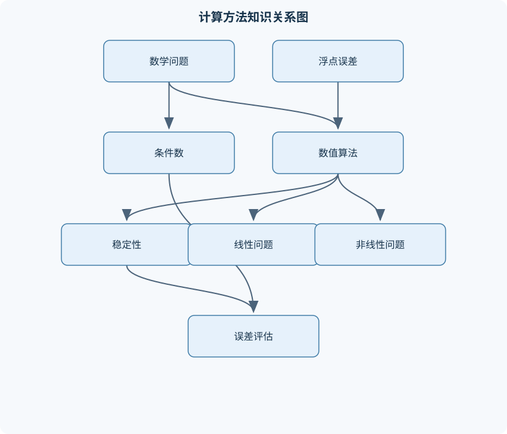
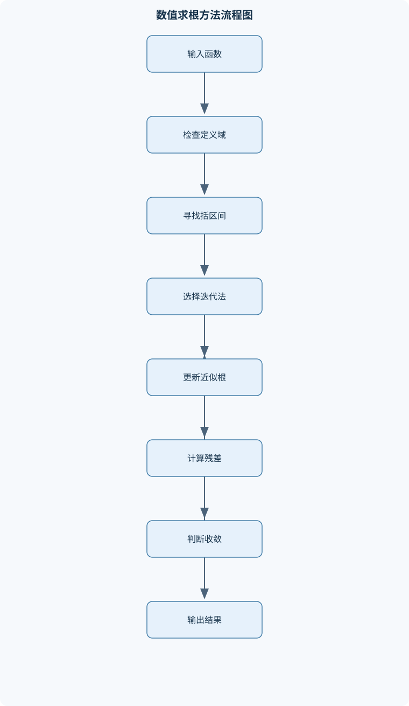

# 计算方法

## 一、课程整体知识框架

### 课程边界与先修知识

《计算方法》研究如何用有限精度计算机对连续数学问题进行可靠、有效的数值求解，涵盖误差与条件数、非线性方程、线性方程组、插值与逼近、数值微分与积分、常微分方程初值问题以及矩阵特征值问题。先修知识包括高等数学、线性代数、概率统计基础和程序设计基础，能够进行极限、导数、积分、矩阵运算及基本复杂度分析。课程重点区分数学问题的条件性、算法的稳定性和实现误差；不把符号解析解、机器学习算法或专门的大规模并行计算作为主要内容。





### 1. 课程对象、目标与基本符号

《计算方法》研究的是：如何把连续数学问题转化为有限步骤、有限精度、可验证的计算过程，并在计算成本、误差和可靠性之间取得平衡。课程对象包括非线性方程、线性方程组、函数插值与逼近、数值微分与积分、常微分方程初值问题、矩阵特征值问题以及非线性方程组。课程关注的是数值近似问题的建模、算法、误差分析和实现，不以符号解析解、机器学习算法或专门的大规模并行计算为主要内容。

设真值为 $x$，近似值为 $\hat{x}$。标量绝对误差和相对误差分别为

$$
e_{\mathrm{abs}}=|\hat{x}-x|,\qquad
e_{\mathrm{rel}}=\frac{|\hat{x}-x|}{|x|}.
$$

相对误差要求 $x\ne 0$；当真值为零或非常接近零时，应使用绝对误差、残差或其他尺度化指标。向量通常记为 $x$ 或 $v$，矩阵记为 $A$，默认向量范数为二范数，矩阵范数为与其相容的诱导范数。线性方程组写为 $Ax=b$，近似解的残差定义为

$$
r=b-A\hat{x}.
$$

残差小表示近似解较好地满足计算模型，但不一定表示 $\hat{x}$ 与精确解接近；二者之间还受到矩阵条件数影响。特征值问题写为 $Av=\lambda v$，特征对近似值的残差为

$$
r_{\lambda}=A\hat{v}-\hat{\lambda}\hat{v},
\qquad \|\hat{v}\|_2=1.
$$

常微分方程初值问题写为

$$
y'=f(t,y),\qquad y(t_0)=y_0,
$$

离散时刻为 $t_n=t_0+nh$，其中 $h$ 是步长，单位与自变量 $t$ 相同。若 $y$ 表示长度、温度或浓度，则 $f(t,y)$ 的单位分别是“长度/时间”“温度/时间”或“浓度/时间”；步长不能脱离问题的物理尺度解释。

### 2. 误差、条件性与稳定性主线

计算误差至少包括输入误差、舍入误差和截断误差。输入误差来自测量、离散化或数据存储；舍入误差来自有限精度浮点运算；截断误差来自用有限项、有限步长或有限次数操作替代无限过程。三者不能混为一谈。

在无溢出、无下溢并采用舍入到最近数时，常用浮点模型为

$$
\operatorname{fl}(a\mathbin{\circ}b)
=(a\mathbin{\circ}b)(1+\delta),\qquad |\delta|\le u,
$$

其中 $\circ$ 表示一次基本运算，$u$ 为单位舍入误差。该模型只适用于结果仍在浮点格式可表示范围内的情形；上溢会产生无穷大或异常结果，下溢可能变为零或非规格化数，不能简单套用相对误差模型。机器精度表示相邻可表示数之间的相对间隔量级，不等同于所有输出都具有同样数量的准确数字。

条件数描述数学问题本身对输入扰动的敏感程度，算法稳定性描述计算过程是否放大了不必要的误差。对可微函数 $y=f(x)$，有

$$
\Delta y=f(x+\Delta x)-f(x)
\approx f'(x)\Delta x.
$$

因此绝对条件数为 $|f'(x)|$；在 $x\ne0$ 且 $f(x)\ne0$ 时，相对条件数近似为

$$
\kappa_{\mathrm{rel}}(x)
=\left|\frac{x f'(x)}{f(x)}\right|.
$$

例如计算 $f(x)=x+1$ 时，若 $x$ 很大，输入 $x$ 的微小相对误差可能对结果影响较小；但若计算两个接近数的差，结果本身很小，输入误差会被相对放大，这就是灾难性消去。二次方程求根中，直接计算

$$
x=\frac{-b\pm\sqrt{b^2-4ac}}{2a}
$$

当 $b$ 与 $\sqrt{b^2-4ac}$ 接近时会发生相消。可令

$$
q=-\frac12\left(b+\operatorname{sign}(b)\sqrt{b^2-4ac}\right),
$$

先计算一个不发生相消的根 $x_1=q/a$，再由乘积关系 $x_1x_2=c/a$ 得到 $x_2=c/q$；但当 $q=0$ 或判别式、系数接近特殊边界时仍需单独处理。

### 3. 非线性方程求根

非线性方程的基本形式为 $f(x)=0$。若 $f$ 在闭区间 $[a,b]$ 上连续且 $f(a)f(b)<0$，由介值定理可知至少存在一个根；这并不保证根唯一。若 $f'$ 在区间内不变号且不为零，则可进一步判断单调性，从而保证至多一个根。若函数不连续，端点符号变化不能推出区间内存在根。

二分法从有符号变化的括区间开始，每次取中点 $m=(a+b)/2$，根据符号变化保留含根的半区间。第 $n$ 次缩减后区间长度为

$$
\frac{b-a}{2^n},
$$

中点到区间内根的误差不超过

$$
\frac{b-a}{2^{n+1}}.
$$

因此若要求误差不超过 $\varepsilon$，可取满足

$$
\frac{b-a}{2^{n+1}}\le \varepsilon
$$

的最小整数 $n$。二分法具有可靠但线性的收敛速度，适合连续函数和已知括区间的情形。

不动点迭代将方程改写为 $x=g(x)$，使用

$$
x_{n+1}=g(x_n).
$$

若 $g(I)\subseteq I$，且在区间 $I$ 上满足 $|g'(x)|\le q<1$，则存在唯一不动点，任意初值 $x_0\in I$ 产生的迭代都收敛。牛顿法由 $f$ 在 $x_n$ 处的一阶近似推导：

$$
f(x)\approx f(x_n)+f'(x_n)(x-x_n).
$$

令近似式为零，得到

$$
x_{n+1}=x_n-\frac{f(x_n)}{f'(x_n)}.
$$

根为单根、函数足够光滑且初值足够接近时，牛顿法通常二次收敛；若 $f'(x_n)$ 接近零、初值过远或函数存在多个根，则可能发散或进入非目标根。割线法用最近两个点的斜率代替导数，减少导数评价，但稳定性和收敛保证相对弱。多重根会降低普通牛顿法的阶数，可使用已知重数 $m$ 的修正形式

$$
x_{n+1}=x_n-m\frac{f(x_n)}{f'(x_n)}.
$$

### 4. 线性方程组：直接法与迭代法

对于 $Ax=b$，高斯消元通过初等行变换逐列消去主对角线下方元素，把系统化为上三角系统，再进行回代。若当前主元为零，必须交换行；即使主元非零但很小，也可能显著放大舍入误差。部分主元法在当前列中选择绝对值最大的候选主元并交换，通常能提高数值可靠性，但不能修复病态矩阵，也不能保证任意问题都稳定。

若

$$
A=LU,
$$

其中 $L$ 为单位下三角矩阵、$U$ 为上三角矩阵，则先求解 $Ly=b$，再求解 $Ux=y$。稠密 $n\times n$ 矩阵的分解约需 $O(n^3)$ 次算术运算，回代约需 $O(n^2)$ 次；分解完成后，对于多个右端向量可重复使用 $L$ 和 $U$。对称正定矩阵可作 Cholesky 分解

$$
A=LL^{\mathsf T},
$$

其存储和计算量通常约为一般 LU 的一半。对称性和正定性是适用条件；仅对称但不正定的矩阵不能直接使用标准 Cholesky。三对角系统可用追赶法，在保持三对角结构的情况下以 $O(n)$ 时间和 $O(n)$ 存储求解。

迭代法把系统写为

$$
x^{(k+1)}=Tx^{(k)}+c.
$$

若迭代矩阵满足谱半径 $\rho(T)<1$，则对任意初值收敛。严格对角占优和某些对称正定条件可作为常用的充分条件。Jacobi 法在同一轮使用旧向量全部分量；Gauss-Seidel 法立即使用已经更新的分量；SOR 通过松弛因子 $\omega$ 调节更新幅度。误差满足

$$
e^{(k+1)}=Te^{(k)},
$$

而残差满足

$$
r^{(k+1)}=b-Ax^{(k+1)}.
$$

停止时应同时监控残差、相邻迭代差和最大迭代次数，不能只因为两个连续近似解接近就宣布收敛。预条件方法通过选取易求解的矩阵 $M$，把问题改写为 $M^{-1}Ax=M^{-1}b$，目标是改善迭代谱性质，而不是改变精确解。

### 5. 插值、逼近、数值微分与积分

给定互异节点 $x_0,\ldots,x_n$ 和函数值 $y_i=f(x_i)$，拉格朗日插值多项式为

$$
p_n(x)=\sum_{i=0}^{n}y_i
\prod_{j\ne i}\frac{x-x_j}{x_i-x_j}.
$$

若 $f$ 在包含节点和待求点的区间上具有 $n+1$ 阶连续导数，则存在 $\xi$ 使

$$
f(x)-p_n(x)
=\frac{f^{(n+1)}(\xi)}{(n+1)!}
\prod_{i=0}^{n}(x-x_i).
$$

牛顿差商形式使用 $f[x_i,\ldots,x_j]$ 构造嵌套多项式，增加节点时只需补充差商。等距节点高次插值可能在端点附近产生 Runge 振荡；切比雪夫节点使节点聚集在端点，通常能减小最大插值误差。分段线性插值避免了高次全局振荡；三次样条插值在分段上使用三次多项式，并通过函数值、一次导数和二次导数连续性连接各段，边界条件仍需明确。最小二乘逼近求解

$$
\min_c\|Ac-b\|_2.
$$

正规方程 $A^{\mathsf T}Ac=A^{\mathsf T}b$ 可由正交投影推导，但会使条件数近似平方放大；数值实现通常优先采用 QR 分解，严重病态时可采用奇异值分解。

数值微分用差分近似导数。前向、后向和中心差分分别为

$$
f'(x)\approx\frac{f(x+h)-f(x)}{h},
\quad
f'(x)\approx\frac{f(x)-f(x-h)}{h},
$$

$$
f'(x)\approx\frac{f(x+h)-f(x-h)}{2h}.
$$

前向和后向差分截断误差为 $O(h)$，中心差分为 $O(h^2)$。但 $h$ 过小时，两个接近函数值相减会放大舍入误差；$h$ 过大时，截断误差占主导，因此应在两类误差之间折中。

复合梯形公式在函数二阶连续可导时全局误差为 $O(h^2)$；复合辛普森公式在足够光滑且分段数满足相应偶数要求时全局误差为 $O(h^4)$。高斯求积通过选择节点和权重，使低阶多项式积分精确。自适应积分把区间细分集中在函数变化快或误差大的区域；若存在不可积奇异点，必须先判断积分是否存在，不能直接套用光滑函数误差公式。

### 6. 常微分方程与矩阵特征值

显式欧拉法为

$$
y_{n+1}=y_n+h f(t_n,y_n).
$$

其局部截断误差为 $O(h^2)$，全局误差为 $O(h)$。改进欧拉法通过预测—校正提高精度，经典四阶 Runge–Kutta 法使用四个斜率加权，局部误差为 $O(h^5)$，全局误差为 $O(h^4)$。这些阶数要求解和右端函数足够光滑，且稳定性条件得到满足。对测试方程 $y'=\lambda y$，欧拉法放大因子为

$$
R(z)=1+z,\qquad z=h\lambda.
$$

绝对稳定要求 $|R(z)|\le1$。当 $\lambda$ 为大负数时，显式方法可能要求极小步长，这种现象称为刚性；隐式方法稳定域通常更适合刚性问题，但每一步需要求解代数方程。Adams 多步法利用若干历史点，单步成本较低，却需要启动过程并受稳定性限制。自适应步长通过比较不同阶近似或估计局部误差来调整 $h$。

特征值问题 $Av=\lambda v$ 中，问题的条件性与特征值间隔、矩阵是否正规等因素有关。幂法反复计算 $w=Av$ 并归一化，适用于最大模特征值唯一且初始向量含有目标方向分量的情形；收敛速度受次大特征值与最大特征值模之比影响。反幂法把 $A^{-1}$ 的幂法用于寻找最小模特征值，移位反幂法使用 $(A-\mu I)^{-1}$ 寻找接近移位 $\mu$ 的特征值。Rayleigh 商

$$
\rho(v)=\frac{v^{\mathsf T}Av}{v^{\mathsf T}v}
$$

可用于对称问题的特征值估计。QR 算法通过正交分解和矩阵迭代逐步趋向上三角或准上三角形式；对称矩阵具有实特征值和正交特征向量，数值计算通常可利用这一结构提高可靠性。任何特征值结果都应检查 $\|A\hat v-\hat\lambda\hat v\|$，不能只看 $\hat\lambda$ 的显示位数。

### 7. 非线性方程组与综合实验主线

多元方程组写为 $F(x)=0$，其中 $F:\mathbb R^m\to\mathbb R^m$。多元牛顿法在 $x_k$ 处线性化：

$$
F(x_k)+J_F(x_k)\Delta x_k\approx0,
$$

先解

$$
J_F(x_k)\Delta x_k=-F(x_k),
$$

再更新 $x_{k+1}=x_k+\Delta x_k$。其中 $J_F$ 是雅可比矩阵。若雅可比在解附近非奇异、函数足够光滑且初值足够接近，通常具有局部二次收敛；初值不佳时可使用阻尼或线搜索，使残差先下降。数值实验应同时记录误差、残差、收敛阶、函数评价次数、运行时间和异常情况，以区分问题病态、算法不稳定和程序实现错误。

## 二、章节和模块划分

### 核心知识覆盖清单

本清单用于检查正文是否覆盖本课程的主要知识模块：

- **数值误差与浮点运算**：绝对误差与相对误差、有效数字与误差传播、浮点数表示模型、机器精度与舍入误差、上溢、下溢与非规格化数、问题条件数定义、算法稳定性与后向误差、灾难性消去现象。
- **非线性方程求根**：根的存在性与唯一性、二分法及误差界、不动点迭代、压缩映射与收敛条件、牛顿法推导、割线法与弦截法、局部阶与渐近收敛率、多重根与修正牛顿法。
- **线性方程组的直接法**：高斯消元法、主元选取与部分主元法、消元过程中的舍入误差、LU分解及其实现、Cholesky分解、对称正定矩阵条件、三对角方程组追赶法、直接法的时间与存储复杂度。
- **线性方程组的迭代法**：Jacobi迭代、Gauss-Seidel迭代、松弛迭代与SOR、迭代矩阵与谱半径、严格对角占优条件、误差方程与残差方程、预条件思想、停止准则与残差监控。
- **插值与函数逼近**：拉格朗日插值多项式、牛顿差商插值、插值余项与误差估计、等距节点振荡、切比雪夫节点、分段线性插值、三次样条插值、最小二乘多项式逼近。
- **数值微分与数值积分**：前向、后向与中心差分、差分截断误差、步长选择与误差平衡、复合梯形公式、复合辛普森公式、高斯求积基本思想、自适应积分、积分误差估计与奇异性处理。
- **常微分方程初值问题**：初值问题与适定性、欧拉法及局部误差、改进欧拉法、经典四阶Runge-Kutta法、单步法稳定性、多步法与Adams公式、刚性问题与绝对稳定性、自适应步长控制。
- **矩阵特征值与特征向量**：特征值问题的条件性、幂法与归一化、反幂法、移位反幂法、Rayleigh商迭代、QR算法基本思想、对称矩阵特征值计算、残差与特征对误差检验。
- **非线性方程组与综合数值实验**：多元牛顿法、雅可比矩阵构造、非线性系统的局部收敛、阻尼与线搜索、数值实验设计、误差与收敛率作图、算法稳定性比较、结果复现实验与异常诊断。


### 1. 模块一：数值误差与浮点运算

本章先建立全课程的误差语言。内容顺序为绝对误差与相对误差、有效数字、浮点表示、机器精度、舍入、上溢、下溢、条件数、稳定性、后向误差和灾难性消去。后向误差的核心思想是：计算结果可能不是原问题的精确解，但可能是某个小扰动问题的精确解。若算法后向稳定且问题条件良好，通常可获得可信结果；若问题本身病态，稳定算法也不能消除输入误差放大。

### 2. 模块二：非线性方程求根

本章依次处理根的存在性与唯一性、二分法、不动点迭代、牛顿法、割线法、弦截法和多重根。重点比较括区间方法与开放迭代方法：前者有较强的全局可靠性但速度慢，后者近根速度快但依赖初值和导数信息。停止准则应同时考虑步长、函数残差和最大迭代次数。

### 3. 模块三和四：线性方程组直接法与迭代法

直接法模块包括高斯消元、部分主元、LU、Cholesky、三对角追赶法和复杂度分析；迭代法模块包括 Jacobi、Gauss-Seidel、SOR、谱半径、对角占优、残差、误差方程和预条件。二者的比较不能只看理论阶数，还要考虑矩阵稀疏性、存储量、多个右端向量、并行性和迭代收敛性。

### 4. 模块五和六：插值逼近、数值微分与积分

插值部分从拉格朗日形式转向牛顿差商，再讨论余项、等距节点振荡、切比雪夫节点、分段线性和三次样条。逼近部分以最小二乘为主，强调正规方程的条件数风险。微分部分强调截断误差与舍入误差平衡；积分部分比较复合梯形、复合辛普森、高斯求积和自适应策略，并讨论尖点、快速变化区间和奇异性。

### 5. 模块七和八：常微分方程与特征值

常微分方程模块从适定性和欧拉法开始，过渡到改进欧拉、四阶 Runge–Kutta、多步 Adams 公式、局部与全局误差、绝对稳定性、刚性和自适应步长。特征值模块从条件性和残差出发，讲解幂法、反幂法、移位反幂法、Rayleigh 商迭代、QR 基本思想以及对称矩阵的特殊结构。

### 6. 模块九：非线性方程组与综合数值实验

本模块综合雅可比矩阵、多元牛顿法、阻尼、线搜索和局部收敛理论。实验要求改变步长、初值、矩阵规模和数据扰动，绘制误差或残差随迭代次数变化的曲线，估计渐近收敛阶，并区分“问题难”与“程序错”。综合项目的最终产出应包括问题定义、算法说明、参数设置、误差与残差表、运行成本、异常诊断和可复现实验记录。

### 7. 代表性算法一：带部分主元高斯消元

**输入：** $A\in\mathbb R^{n\times n}$、$b\in\mathbb R^n$。  
**输出：** 近似解 $\hat{x}$、行置换信息和残差。  
**过程：** 第 $k$ 列在第 $k$ 行至第 $n$ 行中选择绝对值最大的元素作为主元并交换；用主元消去其下方元素；完成后回代。  
**不变量：** 前 $k-1$ 列下方元素已经为零。  
**终止条件：** 所有列完成消元并成功回代；若主元相对尺度接近零，应报告数值近奇异。  
**复杂度：** 稠密矩阵时间复杂度 $O(n^3)$，存储复杂度 $O(n^2)$。

```python
import numpy as np

def solve_partial_pivot(A, b, tol=1e-14):
    A = np.array(A, dtype=float, copy=True)
    b = np.array(b, dtype=float, copy=True)
    n = len(b)

    for k in range(n - 1):
        pivot_row = k + np.argmax(np.abs(A[k:, k]))
        if abs(A[pivot_row, k]) <= tol:
            raise ValueError("矩阵可能奇异或数值近奇异")
        if pivot_row != k:
            A[[k, pivot_row]] = A[[pivot_row, k]]
            b[[k, pivot_row]] = b[[pivot_row, k]]

        for i in range(k + 1, n):
            factor = A[i, k] / A[k, k]
            A[i, k:] -= factor * A[k, k:]
            b[i] -= factor * b[k]

    if abs(A[-1, -1]) <= tol:
        raise ValueError("回代阶段发现近零主元")

    x = np.zeros(n)
    for i in range(n - 1, -1, -1):
        x[i] = (b[i] - A[i, i + 1:] @ x[i + 1:]) / A[i, i]

    return x
```

### 8. 代表性算法二：二分法与牛顿法组合求根

二分法先保证根仍在括区间内，牛顿法再在可信区域内加速。输入为连续函数 $f$、括区间 $[a,b]$、初值和容许误差；输出为根近似。若 $f(a)f(b)>0$，不能直接使用二分法。牛顿步骤中若导数过小、更新越出区间或残差增大，应退回二分步骤。这样的混合策略兼顾可靠性和速度。

### 9. 代表性算法三：自适应辛普森积分

对区间 $[a,b]$，先计算一次辛普森近似 $S(a,b)$，再计算两个子区间近似 $S(a,m)$ 和 $S(m,b)$。若

$$
|S(a,m)+S(m,b)-S(a,b)|
$$

小于误差容限的缩放值，则接受细分结果，否则继续细分。该方法适合分段光滑函数；若函数在区间内有不可积奇异点，必须先进行变量代换、区间拆分或判定积分不存在。终止条件还应包括最大递归深度，防止异常函数导致无限细分。

### 10. 代表性算法四：四阶 Runge–Kutta 法

对 $y'=f(t,y)$，设当前点为 $(t_n,y_n)$，计算

$$
k_1=f(t_n,y_n),
$$

$$
k_2=f\left(t_n+\frac h2,y_n+\frac h2k_1\right),
$$

$$
k_3=f\left(t_n+\frac h2,y_n+\frac h2k_2\right),
$$

$$
k_4=f(t_n+h,y_n+hk_3),
$$

并更新

$$
y_{n+1}
=y_n+\frac h6(k_1+2k_2+2k_3+k_4).
$$

固定步长下，每步需要四次右端函数评价，整体函数评价次数为 $4N$。对刚性问题，即使局部截断误差很小，也可能因为绝对稳定域不足而产生振荡或发散。

### 11. 例题一：二分法求解 $\cos x-x=0$

**题干：** 在 $[0,1]$ 内求解 $f(x)=\cos x-x=0$，要求区间误差不超过 $0.01$。

**分析：** $f$ 连续，且 $f(0)=1>0$、$f(1)=\cos1-1<0$，因此至少有一个根。又因为 $f'(x)=-\sin x-1<0$，函数严格递减，根唯一。

**逐步解答：** 初始区间长度为 $1$。要求中点误差不超过 $0.01$，需满足

$$
\frac{1}{2^{n+1}}\le0.01.
$$

取 $n=6$ 时，$1/128<0.01$。每次计算中点并根据符号保留子区间，例如第一次中点 $m_1=0.5$，有 $\cos(0.5)-0.5>0$，新区间为 $[0.5,1]$。

**结果验证：** 计算最终中点的 $|f(m)|$ 和区间长度，二者都应符合停止准则。

**变式：** 若改用牛顿法，需给出初值并监控 $f'(x)$；若初值取在不连续函数的符号变化区间内，二分法结论不再成立。

### 12. 例题二：线性方程组的主元交换

**题干：** 求解

$$
\begin{cases}
0.001x+y=1,\\
x+y=2.
\end{cases}
$$

**分析：** 第一列的自然主元为 $0.001$，若直接消元，乘数为 $1000$，舍入误差可能被放大。部分主元法应交换两行。

**逐步解答：** 交换后得到

$$
\begin{bmatrix}
1&1\\
0.001&1
\end{bmatrix}
\begin{bmatrix}x\\y\end{bmatrix}
=
\begin{bmatrix}2\\1\end{bmatrix}.
$$

消元得到第二行系数 $0.999$，右端为 $0.999$，故 $y=1$，再由第一行得到 $x=1$。

**结果验证：** 残差为

$$
r=b-A\hat{x}
=\begin{bmatrix}1\\2\end{bmatrix}
-\begin{bmatrix}1\\2\end{bmatrix}
=0.
$$

**变式：** 若第二行右端改为 $1.001$，应重新消元，不能沿用旧解；若主元近零，还需判断系统是无解、无穷多解还是数值近奇异。

### 13. 例题三：中心差分的误差平衡

**题干：** 用中心差分近似 $f'(1)$，其中 $f(x)=e^x$。

**分析：** 中心差分为

$$
D_h=\frac{e^{1+h}-e^{1-h}}{2h},
$$

理论导数为 $f'(1)=e$。Taylor 展开表明截断误差为 $O(h^2)$；浮点计算中，分子相减会引入约随 $1/h$ 增大的舍入误差。

**逐步解答：** 分别取较大的 $h$、中等的 $h$ 和极小的 $h$，计算 $|D_h-e|$。通常 $h$ 从大变小时误差先下降后上升。前一阶段由截断误差主导，后一阶段由舍入误差主导。

**结果验证：** 用误差表而非显示位数判断结果；若二阶区间内误差约按 $h^2$ 缩小，说明中心差分阶数得到验证。

**变式：** 若函数值来自带噪声测量，减小 $h$ 还会放大测量噪声，此时最优步长可能比无噪声浮点模型下更大。

### 14. 例题四：欧拉法的稳定性

**题干：** 对 $y'=-1000y$ 使用显式欧拉法，判断 $h=0.001$ 和 $h=0.003$ 的稳定性。

**分析：** 此时 $\lambda=-1000$，$z=h\lambda$，欧拉稳定条件为 $|1+z|\le1$。对于实负 $\lambda$，条件等价于 $-2\le h\lambda\le0$，即 $0\le h\le0.002$。

**逐步解答：** 当 $h=0.001$ 时，$z=-1$，放大因子为 $R=0$，数值解迅速衰减；当 $h=0.003$ 时，$z=-3$，$R=-2$，绝对值大于 $1$，数值解会交替变号并发散。

**结果验证：** 记录 $|y_n|$ 与精确解 $e^{-1000t}y_0$ 的比较，不能只看单步局部误差。

**变式：** 若改用隐式欧拉法，需要每步解代数方程，其稳定性通常更适合此类刚性问题，但计算成本更高。

### 15. 例题五：幂法的残差检验

**题干：** 对矩阵 $A$ 使用幂法求最大模特征值。

**分析：** 取非零初始向量 $v_0$，反复计算 $w_k=Av_k$ 并归一化 $v_{k+1}=w_k/\|w_k\|_2$。若最大模特征值唯一且 $v_0$ 在其特征向量方向上有非零分量，则迭代可能收敛。

**逐步解答：** 每轮计算 Rayleigh 商

$$
\lambda_k=\frac{v_k^{\mathsf T}Av_k}{v_k^{\mathsf T}v_k}
$$

并计算残差

$$
r_k=Av_k-\lambda_kv_k.
$$

当 $\|r_k\|_2$ 小于给定阈值时停止。若特征值模之间间隔很小，迭代可能收敛很慢；若初始向量恰与目标特征向量正交，在理想算术中可能永远不能得到目标方向。

**结果验证：** 同时检查 $\lambda_k$ 的变化和残差；仅比较连续两次特征值不充分。

**变式：** 目标特征值不是最大模时，应使用反幂法或移位反幂法。

### 16. 实验一：不同求根算法的收敛性比较

**输入数据：** $f(x)=\cos x-x$，括区间 $[0,1]$，牛顿初值 $x_0=1$，容许残差 $10^{-10}$。  
**步骤：**

1. 实现二分法、牛顿法和割线法；
2. 每轮记录近似值、步长、函数残差和函数评价次数；
3. 以高精度结果或独立稳定实现作为参照；
4. 在相同停止标准下比较总评价次数；
5. 用 $\log |e_n|$ 与 $\log |e_{n-1}|$ 估计渐近收敛阶。

**评价标准：** 二分法应保持括区间不变量；牛顿法应达到近根二次收敛；割线法不应把导数不存在误认为程序错误。若结果异常，检查符号判断、停止条件、导数公式和区间更新顺序。

### 17. 实验二：插值节点与最小二乘逼近

**输入数据：** 在 $[-1,1]$ 上取 Runge 型函数

$$
f(x)=\frac{1}{1+25x^2}.
$$

分别使用等距节点和切比雪夫节点构造插值多项式，再用 QR 分解进行一次、二次和更高次最小二乘拟合。

**步骤：**

1. 固定测试网格，避免只在节点处比较；
2. 记录最大绝对误差、均方误差和端点附近误差；
3. 增加节点数，观察等距插值是否出现端点振荡；
4. 比较正规方程与 QR 分解的残差和系数变化；
5. 对数据加入小扰动，观察病态放大现象。

**评价标准：** 应区分插值误差、拟合残差和数据扰动敏感性；不能因高次多项式在训练节点误差为零，就断言其在区间外或端点附近可靠。排错时优先检查节点是否重复、差商表下标是否正确、QR 回代是否使用了完整的正交因子，以及误差计算是否在独立测试点上进行。

## 三、核心概念的详细解释

### 1. 数值问题、算法与计算误差

数值计算的对象通常不是“求出一个符号表达式”，而是把数学问题转化为有限次、有限精度、可检验的运算。例如，求方程 $f(x)=0$ 的数值解、求线性方程组 $Ax=b$ 的近似解、计算积分 $\int_a^b f(x)\,\mathrm{d}x$，都必须说明输入数据、离散化方式、停止准则和误差指标。

设精确结果为 $x$，计算结果为 $\hat{x}$。标量的绝对误差和相对误差分别为

$$
e_{\mathrm{abs}}=|\hat{x}-x|,\qquad
e_{\mathrm{rel}}=\frac{|\hat{x}-x|}{|x|}.
$$

当 $x=0$ 或 $|x|$ 很小时，相对误差没有稳定意义，应使用绝对误差、残差或相对于问题尺度归一化的误差。对于向量，通常考察 $\|\hat{x}-x\|_2$ 或相对误差 $\|\hat{x}-x\|_2/\|x\|_2$；对于线性方程组，还要同时计算残差

$$
r=b-A\hat{x}.
$$

残差小只说明 $\hat{x}$ 近似满足当前方程，不保证 $\hat{x}$ 接近精确解。例如 $A$ 接近奇异时，即使 $\|r\|$ 很小，解误差仍可能很大。

计算误差可分为三类。输入误差来自测量、建模或数据存储；截断误差来自用有限过程近似无限过程，例如用步长 $h$ 的差分代替导数；舍入误差来自浮点数表示和运算。算法的总误差往往是这些误差共同作用的结果，不能把“迭代停止”误认为“误差已经很小”。

### 2. 条件性、稳定性与后向误差

条件性是数学问题本身的性质。若输入 $x$ 发生扰动 $\Delta x$，输出 $y=f(x)$ 发生扰动 $\Delta y$，则一阶近似为

$$
\Delta y\approx f'(x)\Delta x.
$$

因此，标量问题的绝对条件数可取 $|f'(x)|$。在 $x\ne0$ 且 $f(x)\ne0$ 时，相对条件数为

$$
\kappa_{\mathrm{rel}}(x)
=\left|\frac{x f'(x)}{f(x)}\right|.
$$

对于复合函数 $h(x)=f(g(x))$，局部相对条件数在一阶近似下满足

$$
\kappa_h(x)\approx
\kappa_g(x)\,\kappa_f(g(x)).
$$

该关系只适合小扰动和可微情形；在拐点、奇异点、非光滑点或大扰动下，不能直接用一个局部数值代表全部行为。

算法稳定性是计算过程的性质。一个后向稳定算法的结果可以解释为：它是某个小扰动输入问题的精确解。设算法得到 $\hat{y}$，若存在小的 $\Delta x$ 使

$$
\hat{y}=F(x+\Delta x),\qquad
\frac{\|\Delta x\|}{\|x\|}\ \text{较小},
$$

则称其具有较好的后向稳定性。前向误差是 $\|\hat{y}-F(x)\|$，通常可理解为“条件数乘以后向误差”的量级。因此，病态问题即使使用稳定算法也可能有较大的前向误差；反过来，条件良好的问题也可能因算法不稳定而产生错误结果。

### 3. 浮点运算与灾难性消去

在无上溢、无下溢并采用舍入到最近数时，常用浮点模型为

$$
\operatorname{fl}(a\mathbin{\circ}b)
=(a\mathbin{\circ}b)(1+\delta),\qquad |\delta|\le u,
$$

其中 $\circ$ 表示一次基本运算，$u$ 是单位舍入误差。该模型不是任意情况下都成立：上溢可能产生无穷大；下溢可能产生零或非规格化数；某些特殊运算还可能出现无效数。机器精度表示相邻可表示数之间的相对间隔量级，不等于每个输出都有同样数量的有效数字。

灾难性消去发生在两个接近的数相减时。若

$$
\hat{a}=a(1+\delta_1),\qquad
\hat{b}=b(1+\delta_2),
$$

而 $a-b$ 很小，则计算 $\hat{a}-\hat{b}$ 中的输入误差相对于结果会被放大。二次方程的直接求根公式在 $b$ 与 $\sqrt{b^2-4ac}$ 同号且大小接近时会发生这种现象。稳定改写可令

$$
q=-\frac12\left(b+\operatorname{sign}(b)
\sqrt{b^2-4ac}\right),
$$

先计算一个不发生相消的根 $x_1=q/a$，再利用根的乘积关系 $x_1x_2=c/a$ 求 $x_2=c/q$。当 $q=0$ 或判别式接近零时，仍需单独处理，不能机械套用。

### 4. 非线性方程与非线性方程组

非线性方程求根首先要区分存在性、唯一性和可计算性。若 $f$ 在闭区间 $[a,b]$ 上连续且 $f(a)f(b)\le0$，由介值定理可知区间内至少有一个根；这不能保证根唯一。若 $f'$ 在区间内保持正或保持负，则 $f$ 严格单调，区间内至多有一个根。若函数在区间内不连续，端点符号相反也不能据此断言存在根。

二分法保持一个“含根区间”不变量，鲁棒但收敛为线性。固定点迭代将方程改写为 $x=g(x)$。若 $g(I)\subseteq I$ 且 $|g'(x)|\le q<1$，则存在唯一不动点，任意初值 $x_0\in I$ 产生的序列收敛。条件 $|g'|<1$ 是常用充分条件而非必要条件；某些迭代在局部导数绝对值不小于 $1$ 时仍可能收敛，但不能由压缩映射定理保证。

牛顿法由根附近的切线近似导出：

$$
f(x_n)+f'(x_n)(x_{n+1}-x_n)=0,
$$

从而

$$
x_{n+1}=x_n-\frac{f(x_n)}{f'(x_n)}.
$$

若根 $\alpha$ 是单根，即 $f(\alpha)=0$ 且 $f'(\alpha)\ne0$，函数足够光滑且初值足够接近，牛顿法通常具有二次收敛。若 $\alpha$ 为 $m$ 重根，则 $f(\alpha)=f'(\alpha)=\cdots=f^{(m-1)}(\alpha)=0$，普通牛顿法通常降为线性收敛；已知重数时可用修正公式

$$
x_{n+1}=x_n-m\frac{f(x_n)}{f'(x_n)}.
$$

割线法用相邻两点的差商代替导数，不需要显式计算 $f'$，典型局部阶约为 $1.618$，但也缺少二分法的括区间保障。多元方程组 $F(x)=0$ 的牛顿步满足

$$
J_F(x_k)s_k=-F(x_k),\qquad x_{k+1}=x_k+s_k,
$$

其中 $J_F$ 是雅可比矩阵。雅可比矩阵接近奇异、初值过远或函数非光滑时，应采用阻尼或线搜索控制步长。

### 5. 线性方程组及其迭代解法

高斯消元通过行变换将 $Ax=b$ 化为上三角系统，再回代求解。若不选主元，某一步主元为零时算法无法继续；主元很小时，即使数学上非零，也可能造成舍入误差显著放大。部分主元法在当前列及以下行中选取绝对值最大的元素作为主元，再进行行交换，通常能显著降低数值风险，但不能修复矩阵本身的病态性。

若

$$
A=LU,
$$

其中 $L$ 为单位下三角矩阵、$U$ 为上三角矩阵，则先解 $Ly=b$，再解 $Ux=y$。稠密 $n\times n$ 矩阵的分解成本为 $O(n^3)$，回代成本为 $O(n^2)$，存储成本为 $O(n^2)$。当多个右端向量共享同一系数矩阵时，分解只需进行一次。对称正定矩阵可作 Cholesky 分解

$$
A=LL^{\mathsf T},
$$

其计算量约为一般 LU 分解的一半，且不需要通常意义上的主元交换。对称性和正定性都必须满足；对称但不正定的矩阵不能直接使用标准 Cholesky 分解。

三对角方程组可用追赶法，存储和计算量均为 $O(n)$。该结论依赖于三对角结构，不能推广到任意稀疏矩阵而不改变复杂度。

迭代法把系统写成

$$
x^{(k+1)}=Tx^{(k)}+c.
$$

Jacobi 法使用上一轮的全部分量，Gauss-Seidel 法使用已经更新的新分量，SOR 法再引入松弛因子 $\omega$。对任意初值都收敛的充要条件是迭代矩阵满足

$$
\rho(T)<1,
$$

其中 $\rho(T)$ 是谱半径。严格对角占优是常用充分条件；对称正定性可为某些迭代法提供收敛保证，但具体条件依赖于迭代形式。预条件的基本思想是用易处理的矩阵 $M$ 改善系统的谱性质，使迭代更快，同时不能使预处理本身的成本过高。

### 6. 插值、逼近与最小二乘

给定互异节点 $x_0,\ldots,x_n$ 及函数值 $y_i=f(x_i)$，拉格朗日插值多项式为

$$
p_n(x)=\sum_{i=0}^n y_iL_i(x),\qquad
L_i(x)=\prod_{j\ne i}\frac{x-x_j}{x_i-x_j}.
$$

它满足 $p_n(x_i)=y_i$。牛顿差商形式为

$$
p_n(x)=f[x_0]+f[x_0,x_1](x-x_0)
+\cdots+
f[x_0,\ldots,x_n]\prod_{j=0}^{n-1}(x-x_j),
$$

便于增加节点或采用嵌套形式求值。插值要求节点互异；节点重复时应改用 Hermite 插值等包含导数信息的形式。

高次等距插值可能在区间端点发生剧烈振荡，即 Runge 现象。切比雪夫节点将节点更多地分布在端点附近，通常能减小最大插值误差。分段线性插值稳定、实现简单，但导数通常不连续；三次样条插值在小区间内使用三次多项式，并通过节点处函数值、一次导数和二次导数的连续性建立方程，边界条件可以取自然边界、固定端点导数等不同形式，边界条件不同会得到不同结果。

最小二乘逼近不是要求每个节点精确通过，而是求

$$
\min_c\|Ac-b\|_2.
$$

形式上可由正规方程

$$
A^{\mathsf T}Ac=A^{\mathsf T}b
$$

推导，但形成 $A^{\mathsf T}A$ 会使条件数近似平方放大。因此数值计算通常优先使用 QR 分解；严重病态或需要判断秩时使用奇异值分解更可靠。

### 7. 数值微分与数值积分

由 Taylor 展开，

$$
f(x+h)=f(x)+hf'(x)+\frac{h^2}{2}f''(x)+O(h^3),
$$

得到前向差分

$$
f'(x)\approx\frac{f(x+h)-f(x)}{h},
$$

其截断误差为 $O(h)$。类似地，后向差分为 $O(h)$，中心差分

$$
f'(x)\approx\frac{f(x+h)-f(x-h)}{2h}
$$

的截断误差为 $O(h^2)$。但 $h$ 过小时，函数值相减产生的舍入误差约按 $1/h$ 放大，因此不能无限减小步长。总误差通常可抽象为 $Ch^p+D u/h$，最优步长来自两项误差的平衡，而不是只令截断误差最小。

复合梯形公式为

$$
T_n=h\left[
\frac{f(a)+f(b)}2+\sum_{i=1}^{n-1}f(a+ih)
\right],
$$

当 $f''$ 连续时全局误差为 $O(h^2)$。复合辛普森公式要求偶数个等长小区间，在足够光滑时全局误差为 $O(h^4)$。高斯求积通过选择节点和权重，使低阶多项式积分精确；节点不必是区间端点。自适应积分根据局部误差估计细分区间，适合函数变化不均匀的情况。若被积函数有不可积奇异性、尖点或端点发散，必须先作变量变换、分段处理或采用适合奇异行为的公式，不能直接套用光滑函数误差阶。

### 8. 常微分方程初值问题

初值问题

$$
y'=f(t,y),\qquad y(t_0)=y_0
$$

的适定性通常要求解存在、唯一且连续依赖于初值。若 $f$ 对 $y$ 局部满足 Lipschitz 条件，常可保证局部唯一性，但数值稳定性还需另外分析。

显式欧拉法为

$$
y_{n+1}=y_n+h f(t_n,y_n).
$$

若解足够光滑，其局部截断误差为 $O(h^2)$，全局误差为 $O(h)$。改进欧拉法通过预测—校正或梯形思想提高到全局二阶。经典四阶 Runge-Kutta 法每步计算四个斜率，局部误差为 $O(h^5)$，全局误差为 $O(h^4)$，但每步函数评价成本更高。

在测试方程 $y'=\lambda y$ 上，数值方法通常写为

$$
y_{n+1}=R(h\lambda)y_n.
$$

绝对稳定要求

$$
|R(h\lambda)|\le1.
$$

欧拉法的放大因子为 $R(z)=1+z$。当 $\lambda<0$ 且 $|\lambda|$ 很大时，必须取很小的 $h$ 才能稳定，这就是刚性问题中显式方法的步长限制。隐式方法稳定域通常更大，但每步需要解代数方程，计算成本和实现难度更高。Adams 等多步法利用历史函数值，需启动值且稳定性、步长变化处理更复杂。自适应步长通过比较不同阶近似或嵌入公式估计局部误差，再调整 $h$。

### 9. 特征值问题

特征值问题为

$$
Av=\lambda v.
$$

特征值的数值敏感性不仅与矩阵条件数有关，还与特征值间隔和矩阵是否正规有关。近似特征对 $(\hat{\lambda},\hat{v})$ 的残差为

$$
r_\lambda=A\hat{v}-\hat{\lambda}\hat{v}.
$$

残差小是必要的可靠性指标，但对非正规矩阵而言，小残差不一定意味着特征向量方向很准确，还应检查特征值间隔和矩阵结构。

幂法反复计算 $w=Av$ 并归一化，适合寻找模最大的简单特征值。其收敛速度主要由

$$
\left|\frac{\lambda_2}{\lambda_1}\right|
$$

决定，其中 $|\lambda_1|>|\lambda_2|$。反幂法等价于对 $A^{-1}$ 使用幂法，适合寻找接近零的特征值；移位反幂法对 $(A-\mu I)^{-1}$ 使用幂法，可寻找接近移位 $\mu$ 的特征值。Rayleigh 商

$$
\rho(v)=\frac{v^{\mathsf T}Av}{v^{\mathsf T}v}
$$

对实对称矩阵具有重要的高阶局部性质，Rayleigh 商迭代在适当条件下收敛很快。QR 算法通过正交相似变换逐步将矩阵化为上三角或准上三角形式，避免直接求特征多项式；正交变换通常具有较好的数值稳定性。对称矩阵可利用实特征值、正交特征向量和更简化的分解结构。

## 四、重要定义、公式、定理和推导

### 专业审校补充：关键定义与适用边界

松弛迭代的收敛性不能仅由“松弛因子越大越快”判断。将线性方程组写为 A=D−L−U，SOR 迭代为：xᵢ⁽ᵏ⁺¹⁾=(1−ω)xᵢ⁽ᵏ⁾+ω[aᵢᵢ⁻¹(bᵢ−∑ⱼ<ᵢaᵢⱼxⱼ⁽ᵏ⁺¹⁾−∑ⱼ>ᵢaᵢⱼxⱼ⁽ᵏ⁾)]，其中 ω 为无量纲松弛因子。ω=1 时退化为 Gauss-Seidel；0<ω<1 是欠松弛，通常增强保守性但可能减慢收敛；1<ω<2 是超松弛，可能加快收敛，也可能因过冲而发散。若 A 对称正定，则 SOR 对任意 0<ω<2 收敛；对一般非对称矩阵，不能直接套用这一结论，必须分析迭代矩阵 Gω 的谱半径，收敛充要条件为 ρ(Gω)<1。实际停止时应同时检查相对残差 ||b−Ax⁽ᵏ⁾||₂/||b||₂、相邻迭代差和最大迭代次数；残差小于阈值只说明方程满足程度较高，若 A 病态，解的前向误差仍可能较大。


### 1. 浮点误差的组合估计

若连续进行 $k$ 次乘法或除法，且每次都满足

$$
\operatorname{fl}(z_j)=z_j(1+\delta_j),\qquad |\delta_j|\le u,
$$

则结果相对误差包含因子

$$
\prod_{j=1}^k(1+\delta_j)-1.
$$

当 $ku$ 很小，可用展开式得到

$$
\prod_{j=1}^k(1+\delta_j)-1
\approx \sum_{j=1}^k\delta_j,
$$

因此误差量级通常为 $O(ku)$；更严格的界可写成 $\gamma_k=ku/(1-ku)$，前提是 $ku<1$。这说明运算次数增加会积累舍入误差，但实际误差还受运算顺序、数值大小和消去效应影响。加法不能简单按同样方式处理，因为不同量级相加时，小数可能被舍弃。

### 2. 二分法误差界与终止条件

设 $f$ 在 $[a,b]$ 上连续且 $f(a)f(b)\le0$。每次取

$$
m=\frac{a+b}{2}.
$$

根据 $f(a)f(m)\le0$ 或 $f(m)f(b)\le0$ 保留一个含根子区间。初始长度为 $b-a$，进行 $n$ 次后区间长度为

$$
\frac{b-a}{2^n}.
$$

若取中点作为近似根，则其与区间内某个根的距离不超过半区间长度：

$$
|m_n-\alpha|\le\frac{b-a}{2^{n+1}}.
$$

若希望误差不超过 $\varepsilon$，只需满足

$$
n\ge
\left\lceil
\log_2\frac{b-a}{2\varepsilon}
\right\rceil.
$$

该界是先验界，不依赖函数导数；但它要求函数连续且区间确实保留符号变化。若端点恰为根，应立即返回；若函数在区间内有间断，符号变化可能来自穿越无穷间断而非零点。

### 3. 压缩映射与固定点迭代

若区间 $I=[a,b]$ 满足 $g(I)\subseteq I$，且对所有 $x,y\in I$ 有

$$
|g(x)-g(y)|\le q|x-y|,\qquad 0<q<1,
$$

则 $g$ 是压缩映射。由

$$
|x_{n+1}-\alpha|
=|g(x_n)-g(\alpha)|
\le q|x_n-\alpha|
$$

递推可得

$$
|x_n-\alpha|\le q^n|x_0-\alpha|.
$$

还可由相邻迭代值给出后验估计：

$$
|x_n-\alpha|
\le \frac{q}{1-q}|x_n-x_{n-1}|.
$$

前者需要知道初始误差，后者可直接利用迭代数据。若 $q$ 接近 $1$，虽然理论上收敛，但速度可能很慢；若 $g(I)$ 不包含于 $I$，迭代可能离开分析区间，不能继续使用该定理。

### 4. 牛顿法的二次收敛推导

设 $\alpha$ 是单根，令误差 $e_n=x_n-\alpha$。在 $\alpha$ 附近对 $f(x_n)$ 和 $f'(x_n)$ 作 Taylor 展开：

$$
f(x_n)=f'(\alpha)e_n+\frac12f''(\alpha)e_n^2+O(e_n^3),
$$

$$
f'(x_n)=f'(\alpha)+f''(\alpha)e_n+O(e_n^2).
$$

代入

$$
e_{n+1}
=e_n-\frac{f(x_n)}{f'(x_n)}
$$

并整理一阶项后，一阶误差相互抵消，得到

$$
e_{n+1}
\approx
\frac{f''(\alpha)}{2f'(\alpha)}e_n^2.
$$

因此局部收敛阶为 $p=2$。该推导要求 $f'(\alpha)\ne0$、函数具有足够阶数的导数且 $x_n$ 已进入根的局部邻域。初值过远、导数接近零、函数存在多个根或迭代点越出定义域时，二次收敛结论不适用。

### 5. 线性方程组的条件数与残差关系

设 $Ax=b$，近似解为 $\hat{x}$，残差为

$$
r=b-A\hat{x}.
$$

由于 $A\hat{x}=b-r$，若 $A$ 可逆，则

$$
\hat{x}-x=-A^{-1}r.
$$

于是有

$$
\|\hat{x}-x\|
\le \|A^{-1}\|\,\|r\|.
$$

再以 $\|x\|$ 和 $\|b\|$ 进行尺度化，并利用 $b=Ax$，可得典型相对误差估计

$$
\frac{\|\hat{x}-x\|}{\|x\|}
\le
\kappa(A)\frac{\|r\|}{\|b\|},
\qquad
\kappa(A)=\|A\|\,\|A^{-1}\|.
$$

这里的范数必须相互相容。该不等式说明：残差是算法质量的重要指标，但残差到解误差之间由 $\kappa(A)$ 放大。若 $\kappa(A)$ 很大，必须结合条件数解释结果，不能只报告残差。

### 6. 线性迭代法的收敛定理

将矩阵分裂为

$$
A=M-N,
$$

并定义迭代

$$
Mx^{(k+1)}=Nx^{(k)}+b.
$$

若 $M$ 可逆，则

$$
x^{(k+1)}=Tx^{(k)}+c,\qquad
T=M^{-1}N,\quad c=M^{-1}b.
$$

设精确解为 $x^\ast$，误差 $e^{(k)}=x^{(k)}-x^\ast$，则

$$
e^{(k+1)}=Te^{(k)},\qquad
e^{(k)}=T^ke^{(0)}.
$$

对任意初值都收敛的充要条件是

$$
\rho(T)<1.
$$

若存在某个相容矩阵范数使 $\|T\|<1$，则由于 $\rho(T)\le\|T\|<1$，可直接得到收敛性。严格对角占优可保证 Jacobi 和 Gauss-Seidel 等常见方法收敛，但谱半径越接近 $1$，迭代次数通常越多。停止时应同时检查相邻迭代差和残差，例如要求

$$
\|r^{(k)}\|_2
\le \tau_{\mathrm{abs}}+
\tau_{\mathrm{rel}}\|b\|_2.
$$

### 7. 插值余项与节点影响

若 $f\in C^{n+1}[a,b]$，节点 $x_0,\ldots,x_n$ 互异，且 $x$ 与节点均在区间内，则存在 $\xi$ 位于包含这些点的区间，使

$$
f(x)-p_n(x)
=
\frac{f^{(n+1)}(\xi)}{(n+1)!}
\prod_{i=0}^n(x-x_i).
$$

推导的核心是构造

$$
\phi(t)=f(t)-p_n(t)-K\prod_{i=0}^n(t-x_i),
$$

选择 $K$ 使 $\phi(x)=0$，再利用 Rolle 定理反复求导，得到某个 $\xi$ 使 $\phi^{(n+1)}(\xi)=0$。该余项要求足够光滑，并且只适用于插值区间内的点。区间外的外推没有同样的可靠误差保证。节点分布通过乘积项影响误差；切比雪夫节点的设计目标之一就是减小该乘积在区间上的最大值。

### 8. 差分与求积公式的阶数

中心差分由

$$
f(x+h)=f(x)+hf'(x)+\frac{h^2}{2}f''(x)
+\frac{h^3}{6}f^{(3)}(x)+O(h^4),
$$

$$
f(x-h)=f(x)-hf'(x)+\frac{h^2}{2}f''(x)
-\frac{h^3}{6}f^{(3)}(x)+O(h^4)
$$

相减得到

$$
\frac{f(x+h)-f(x-h)}{2h}
=f'(x)+\frac{h^2}{6}f^{(3)}(x)+O(h^4).
$$

故截断误差为 $O(h^2)$。若函数值各有约 $u$ 量级的相对误差，差分中的舍入误差通常按 $O(u/h)$ 增长，体现了截断误差与舍入误差的平衡。

复合梯形公式的全局误差可写为

$$
\int_a^b f(x)\,\mathrm{d}x-T_n
=
-\frac{(b-a)}{12}h^2f''(\xi),
$$

其中 $\xi\in(a,b)$，要求 $f''$ 连续。复合辛普森公式在更高光滑性条件下满足

$$
\int_a^b f(x)\,\mathrm{d}x-S_n
=
-\frac{(b-a)}{180}h^4f^{(4)}(\xi),
$$

并要求小区间数为偶数。若导数不存在或端点有奇异性，上述 $\xi$ 形式误差界不能直接使用。

### 9. 常微分方程的局部与全局误差

对单步方法

$$
y_{n+1}=\Phi(t_n,y_n,h),
$$

把精确解代入离散公式所得的缺陷称为局部截断误差。若该误差为 $O(h^{p+1})$，在稳定性足够且积分区间长度固定时，通常可推出全局误差为 $O(h^p)$。因此显式欧拉法局部误差 $O(h^2)$、全局误差 $O(h)$；经典四阶 Runge-Kutta 法局部误差 $O(h^5)$、全局误差 $O(h^4)$。局部阶数与全局阶数相差一阶，是因为全局计算中约有 $O(1/h)$ 个时间步。

对测试方程 $y'=\lambda y$，欧拉法给出

$$
y_{n+1}=(1+h\lambda)y_n.
$$

令 $z=h\lambda$，则放大因子为 $R(z)=1+z$。绝对稳定区域为

$$
\{z\in\mathbb C:|1+z|\le1\}.
$$

当 $\lambda$ 为负实数时，稳定条件为 $-2\le h\lambda\le0$，即

$$
0<h\le \frac{2}{|\lambda|}.
$$

这说明刚性参数 $|\lambda|$ 很大时，显式欧拉法即使在精度要求不高的情况下也可能被稳定性迫使采用极小步长。

### 10. 特征值算法的判据

幂法设矩阵具有一组线性无关特征向量，且

$$
|\lambda_1|>|\lambda_2|\ge\cdots.
$$

将初始向量展开为

$$
v_0=c_1v_1+c_2v_2+\cdots+c_nv_n,
\qquad c_1\ne0.
$$

则

$$
A^kv_0
=c_1\lambda_1^kv_1+
c_2\lambda_2^kv_2+\cdots,
$$

提取 $\lambda_1^k$ 后，其余项按
$(|\lambda_2|/|\lambda_1|)^k$ 衰减，故归一化向量趋向 $v_1$。若最大模特征值不唯一，或 $c_1=0$，该结论失效。

Rayleigh 商可作为特征值近似：

$$
\hat{\lambda}=\rho(\hat{v})
=\frac{\hat{v}^{\mathsf T}A\hat{v}}
{\hat{v}^{\mathsf T}\hat{v}}.
$$

无论采用哪种算法，最终都应计算

$$
\|A\hat{v}-\hat{\lambda}\hat{v}\|_2
$$

作为特征对残差。归一化 $\|\hat{v}\|_2=1$ 只固定向量尺度，不会自动保证特征向量方向准确；当特征值接近或矩阵高度非正规时，还必须结合特征值间隔和扰动敏感性判断结果。

## 五、算法、流程和实现思路

### 方法与流程覆盖索引

下列方法或流程应在正文中说明输入、步骤、适用条件、结果检查和边界：

- 浮点误差分析流程：输入数学表达式、数据范围和浮点格式；输出误差来源、误差上界及稳定性判断；先区分输入误差、舍入误差和截断误差，再建立每一步的误差传播关系，检查消去、溢出和下溢；当误差界不可接受时改写公式或提高精度；终止条件是得到可解释的误差界或确认需要更稳定算法。
- 二分法：输入连续函数f、区间[a,b]和容许误差；输出根的近似值；检查f(a)f(b)≤0，令m=(a+b)/2，根据符号变化保留含根子区间，重复直到区间长度或|f(m)|满足停止准则；不变量是区间始终包含至少一个根；每步复杂度为一次函数评价和常数次运算，总迭代次数为O(log((b−a)/tol))；适用于连续函数且有括区间的情形。
- 牛顿法：输入f、导数f′、初值x0和停止阈值；输出根近似；计算xn+1=xn−f(xn)/f′(xn)，监控导数是否过小、步长是否下降和残差是否减小；当|xn+1−xn|与|f(xn+1)|均达到阈值或达到最大迭代次数时终止；单根近根区域通常二次收敛，每步主要成本为函数和导数评价；不适用于导数为零、初值过远或函数不够光滑的情况。
- 带部分主元高斯消元：输入A和b；输出解x、必要时输出置换信息；每一列在当前及以下行中选择绝对值最大的主元并交换，消去主元下方元素，形成上三角矩阵，再回代；不变量是已处理列以下元素保持为零；稠密问题复杂度为O(n^3)，存储为O(n^2)；当主元为零或近零时必须检查奇异性和条件数。
- Jacobi迭代：输入A、b、初值x(0)和停止准则；输出x̂；将每个分量用上一轮全部分量更新，计算残差并判断||r||或相邻迭代差；不变量是迭代始终按固定分裂A=D−L−U执行；每轮稀疏矩阵成本可近似为O(nnz(A))，但总轮数取决于谱半径；适合并行更新，不适合一般不收敛系统。
- 牛顿差商插值：输入节点xi和函数值yi以及查询点x；输出插值值；先构造差商表，再按嵌套形式计算pn(x)，避免重复计算乘积；节点和差商数据在构造后可复用；构造复杂度O(n^2)，单点求值复杂度O(n)；节点应尽量避免严重聚集，外推时误差可能快速放大。
- 自适应辛普森积分：输入函数、区间和误差容限；输出积分近似；计算整个区间的辛普森值，再将区间二分并计算两个子区间值，用父子结果差估计局部误差；误差足够小时接受，否则递归或使用栈继续细分；终止条件为全局误差估计满足容限或达到最大深度；适用于分段光滑函数，不适合未经处理的不可积奇异点。
- 四阶Runge-Kutta法：输入右端函数f、初值、终点、步长；输出离散解；在每一步计算四个斜率k1到k4并按加权平均更新y；单步后推进时间，直到达到终点或满足自适应步长条件；固定步长每步需要四次函数评价，整体复杂度为O(N)；对强刚性问题不宜仅靠减小步长解决。
- 幂法：输入矩阵A、非零初始向量v0和停止阈值；输出主特征值近似及特征向量；反复计算w=Av、归一化v=w/||w||，用Rayleigh商或分量比估计特征值，直到特征对残差足够小；适用条件是最大模特征值具有唯一性且初始向量不与目标特征方向正交；每轮成本约为一次矩阵向量乘法，稀疏矩阵可利用非零元结构。
- 数值实验分析流程：输入问题、多个算法、精度参数和测试数据；输出误差表、收敛阶、运行成本与稳定性结论；先用高精度或解析值构造参照，再改变步长、初值、规模和数据扰动，记录残差、误差、迭代次数和异常值，最后区分条件性与算法稳定性；终止条件是覆盖预设测试区间并形成可复现实验记录。





### 1. 数值计算的一般实现流程

一个可靠的数值算法不能只给出递推公式，还应明确输入、输出、误差指标、停止条件和异常处理。通用流程如下：

1. **定义数学问题与尺度**：明确求根、解方程组、逼近函数、计算积分或推进微分方程。记录变量单位、数据范围和是否允许复数结果。
2. **分析问题条件性**：判断输入扰动是否会显著改变输出。例如，接近重根的方程求根问题、接近奇异的线性方程组和特征值很接近的矩阵问题通常条件较差。
3. **选择离散化或迭代方法**：在精度、稳定性和计算成本之间权衡。不能仅因某方法理论收敛阶高，就认为它在当前数据上一定更优。
4. **设置误差与停止准则**：同时考虑相邻迭代差、残差和最大迭代次数。相邻近似值变化很小而残差仍大，通常说明算法停滞、问题病态或尺度设置不合理。
5. **监控异常状态**：包括除数接近零、主元过小、函数值非有限、迭代越出定义域、上溢、下溢和误差估计失效。
6. **验证结果**：使用残差、独立公式、提高精度、改变步长或更换算法进行交叉检查。

输入误差、截断误差和舍入误差应分别记录。对于线性方程组，至少输出 $\|r\|_2$，其中 $r=b-A\hat{x}$；对于特征值问题，至少输出 $\|A\hat{v}-\hat{\lambda}\hat{v}\|_2$；对于常微分方程，应比较不同步长下的解并估计收敛阶。

### 2. 二分法、牛顿法与割线法

#### 2.1 二分法

**输入：** 连续函数 $f$、区间 $[a,b]$、容许误差 $\mathrm{tol}$ 和最大迭代次数。  
**输出：** 根的括区间及近似根。

首先检查 $f(a)f(b)\le 0$。若 $f$ 在区间连续，则介值定理保证区间内至少存在一个根；若希望保证根唯一，还需增加单调性或其他唯一性条件。每次令

$$
m=\frac{a+b}{2}.
$$

若 $f(a)f(m)\le0$，保留 $[a,m]$；否则保留 $[m,b]$。不变量是当前区间仍包含一个根。区间长度经过 $n$ 次迭代后为

$$
\frac{b-a}{2^n}.
$$

若以区间中点作为近似值，则其误差不超过当前区间长度的一半。因此，要求误差不超过 $\mathrm{tol}$ 时，可取

$$
n\ge
\left\lceil\log_2\frac{b-a}{2\mathrm{tol}}\right\rceil.
$$

二分法每轮需要一次新的函数评价，单轮运算量为常数级，总函数评价次数为 $O(\log((b-a)/\mathrm{tol}))$。它的优点是全局可靠、误差有严格上界；缺点是只具有线性收敛，且要求连续函数和有效括区间。若函数在区间内有间断点，端点异号不一定意味着存在根。

#### 2.2 牛顿法

牛顿法在 $x_n$ 处作一阶泰勒近似：

$$
f(x)\approx f(x_n)+f'(x_n)(x-x_n).
$$

令近似式为零，得到

$$
x_{n+1}
=x_n-\frac{f(x_n)}{f'(x_n)}.
$$

当根 $\alpha$ 为单根，即 $f(\alpha)=0$ 且 $f'(\alpha)\ne0$，函数足够光滑且初值充分接近根时，牛顿法通常具有二次收敛：

$$
|e_{n+1}|\approx C|e_n|^2,
\qquad e_n=x_n-\alpha.
$$

实现时必须检查 $|f'(x_n)|$ 是否过小，并同时监控步长 $|x_{n+1}-x_n|$ 和残差 $|f(x_{n+1})|$。初值过远时，迭代可能发散、进入周期、越出函数定义域或收敛到其他根。对重根，若

$$
f(x)=(x-\alpha)^m g(x),\qquad g(\alpha)\ne0,
$$

普通牛顿法通常退化为线性收敛。已知重数 $m$ 时，可使用修正公式

$$
x_{n+1}
=x_n-m\frac{f(x_n)}{f'(x_n)}.
$$

#### 2.3 割线法与混合策略

割线法用差商代替导数：

$$
x_{n+1}
=x_n-f(x_n)
\frac{x_n-x_{n-1}}{f(x_n)-f(x_{n-1})}.
$$

它不需要显式导数，局部收敛阶约为

$$
p=\frac{1+\sqrt5}{2}\approx1.618,
$$

通常介于线性和二次之间。其风险是分母可能接近零，且不像二分法那样天然保持根的括区间。

工程实现常采用混合策略：先用二分法缩小括区间；当区间足够小且导数、割线分母均正常时，尝试牛顿步或割线步；若新点越出括区间、残差不降或数值不稳定，则退回二分步。这样可兼顾全局可靠性和局部快速收敛。

```python
def safeguarded_newton(f, df, a, b, tol=1e-10, max_iter=100):
    """在连续且端点异号的条件下，用二分保护牛顿迭代求根。"""
    fa, fb = f(a), f(b)
    if fa == 0:
        return a
    if fb == 0:
        return b
    if fa * fb > 0:
        raise ValueError("区间端点没有符号变化")

    x = 0.5 * (a + b)
    for _ in range(max_iter):
        fx = f(x)
        if abs(fx) <= tol or 0.5 * (b - a) <= tol:
            return x

        dfx = df(x)
        use_newton = abs(dfx) > 1e-14
        if use_newton:
            candidate = x - fx / dfx
        else:
            candidate = float("nan")

        # 牛顿点必须位于括区间内，否则使用二分点
        if not (a < candidate < b):
            candidate = 0.5 * (a + b)

        fc = f(candidate)
        if fa * fc <= 0:
            b, fb = candidate, fc
        else:
            a, fa = candidate, fc
        x = candidate

    raise RuntimeError("达到最大迭代次数，未满足停止条件")
```

该程序的输入是函数、导数、括区间和容许误差，输出是根的近似值；区间始终保持包含根，终止条件同时使用残差、区间长度和最大迭代次数。若函数评价代价远高于算术运算，应把函数评价次数作为主要成本指标。

### 3. 线性方程组的直接法与迭代法

#### 3.1 带部分主元高斯消元和 LU 分解

对 $Ax=b$，高斯消元在第 $k$ 列选择当前行以下绝对值最大的元素作为主元，必要时交换行，再消去主元下方元素。消元完成后得到上三角系统 $Ux=y$，通过回代求解。

带部分主元的流程为：

1. 对每个主元列 $k$，在第 $k$ 至第 $n$ 行中寻找最大绝对值元素；
2. 若最大值低于给定尺度阈值，报告数值近奇异风险；
3. 交换当前行与主元行；
4. 用乘子消去主元下方元素；
5. 对上三角系统进行回代；
6. 计算残差并检查是否需要迭代改进。

若分解写为

$$
PA=LU,
$$

其中 $P$ 为置换矩阵、$L$ 为单位下三角矩阵、$U$ 为上三角矩阵，则先解

$$
Ly=Pb,
$$

再解

$$
Ux=y.
$$

稠密 $n\times n$ 矩阵的分解复杂度为 $O(n^3)$，存储复杂度为 $O(n^2)$；同一矩阵对应多个右端向量时，只需分解一次，每个新右端的前代和回代约为 $O(n^2)$。部分主元可以抑制小主元造成的增长，但不能修复矩阵本身的病态性。

对称正定矩阵可使用 Cholesky 分解

$$
A=LL^{\mathsf T}.
$$

它只需处理一半矩阵，通常比一般 LU 更省存储和运算，但必须满足 $A=A^{\mathsf T}$ 且对任意非零向量 $x$ 有 $x^{\mathsf T}Ax>0$。对不满足正定条件的矩阵强行使用 Cholesky，会在开平方时出现非正数，不能简单将其归因于舍入误差。

三对角矩阵应优先使用追赶法。其存储和求解成本均可达到 $O(n)$，远低于一般稠密消元的 $O(n^3)$。前提是矩阵确实保持三对角结构，并且消元主元不为零或不接近零。

#### 3.2 Jacobi、Gauss-Seidel 与 SOR

将矩阵分裂为

$$
A=D-L-U,
$$

其中 $D$ 为对角部分，$L$、$U$ 分别表示带符号的严格下、上三角部分。Jacobi 迭代为

$$
x^{(k+1)}
=D^{-1}(L+U)x^{(k)}+D^{-1}b.
$$

Gauss-Seidel 在更新第 $i$ 个分量时立即使用已经得到的新分量，因此不能把它误写成完全同步更新。两者都可写成

$$
x^{(k+1)}=Tx^{(k)}+c.
$$

对任意初值收敛的充要条件是

$$
\rho(T)<1,
$$

其中 $\rho(T)$ 为迭代矩阵的谱半径。严格对角占优是常用的充分条件；对称正定矩阵也为 Gauss-Seidel 提供重要的收敛保证，但不能无条件保证 Jacobi 的快速收敛。

SOR 在 Gauss-Seidel 基础上引入松弛因子 $\omega$。$\omega=1$ 时退化为 Gauss-Seidel；适当选择 $0<\omega<2$ 往往可以加速，但最优值依赖矩阵性质，不能固定套用。每轮迭代应计算残差

$$
r^{(k)}=b-Ax^{(k)}
$$

并使用尺度化停止条件，例如

$$
\frac{\|r^{(k)}\|_2}
{\|A\|_2\|x^{(k)}\|_2+\|b\|_2}
\le \mathrm{tol}.
$$

仅使用 $\|x^{(k+1)}-x^{(k)}\|$ 可能误判停机。

### 4. 插值、逼近、积分与微分的实现

#### 4.1 插值与最小二乘

拉格朗日插值直接表示为

$$
p_n(x)=\sum_{i=0}^n y_i
\prod_{j\ne i}\frac{x-x_j}{x_i-x_j}.
$$

但直接计算乘积容易重复运算和产生数值误差。牛顿差商形式为

$$
p_n(x)=f[x_0]
+f[x_0,x_1](x-x_0)
+\cdots+
f[x_0,\ldots,x_n]\prod_{j=0}^{n-1}(x-x_j),
$$

可用嵌套形式在 $O(n)$ 时间内求一个查询点的值；差商表构造成本为 $O(n^2)$。节点不得重复，否则分母为零。区间外外推不受插值区间内误差界保护。

插值余项为

$$
f(x)-p_n(x)
=
\frac{f^{(n+1)}(\xi)}{(n+1)!}
\prod_{i=0}^n(x-x_i),
$$

其中 $\xi$ 位于包含节点和查询点的区间内，要求函数具有足够阶连续导数。等距节点在高次插值中可能产生端点振荡；切比雪夫节点通过控制节点多项式的最大值减轻这种现象。实际数据通常优先考虑分段线性或三次样条插值。

最小二乘拟合求解

$$
\min_c\|Vc-y\|_2
$$

时，正规方程 $V^{\mathsf T}Vc=V^{\mathsf T}y$ 会使条件数近似平方放大。数值实现优先使用 QR 分解；严重病态时使用奇异值分解。拟合残差小只说明训练数据拟合较好，不保证区间外预测可靠。

#### 4.2 数值微分与积分

中心差分为

$$
f'(x)\approx
\frac{f(x+h)-f(x-h)}{2h},
$$

截断误差为 $O(h^2)$。若函数评价存在舍入误差，两个接近函数值相减会放大相对误差，且舍入误差通常随 $h$ 减小而增大。因此步长不能无限减小，应在截断误差与舍入误差之间寻找平衡。

复合梯形公式全局误差为 $O(h^2)$，复合辛普森公式在函数具有足够阶导数且子区间数为偶数时为 $O(h^4)$。自适应辛普森法先计算父区间积分，再二分为两个子区间，以父值与子区间值之差估计误差；误差满足容限则接受，否则继续细分。遇到端点奇异、尖点或快速变化区域，应先进行变量代换、区间分割或奇异性分析，不能直接套用光滑函数误差公式。

### 5. 常微分方程与特征值算法

#### 5.1 初值问题

显式欧拉法为

$$
y_{n+1}=y_n+h f(t_n,y_n),
$$

局部截断误差为 $O(h^2)$，全局误差为 $O(h)$。改进欧拉法使用预测—校正思想，通常达到全局二阶精度。经典四阶 Runge-Kutta 法每步计算四个斜率，更新式为

$$
y_{n+1}
=y_n+\frac{h}{6}(k_1+2k_2+2k_3+k_4).
$$

固定步长时每步需要四次右端函数评价，整体成本为 $O(N)$，但函数评价本身可能远高于加法乘法成本。

对测试方程 $y'=\lambda y$，显式欧拉放大因子为

$$
R(z)=1+z,\qquad z=h\lambda.
$$

绝对稳定要求 $|R(z)|\le1$。当 $\lambda<0$ 为负实数时，需要 $0<h\le2/|\lambda|$。刚性问题中，精度允许的步长可能远大于稳定性允许的步长，此时应考虑隐式方法，而不是无限减小显式方法步长。

自适应步长通常用同一步的高低阶近似之差估计局部误差。若估计误差过大则拒绝该步并减小 $h$；若误差明显偏小则可增大 $h$。步长变化还必须受到最小步长、最大步长和终点对齐条件约束。

#### 5.2 幂法、反幂法与 QR 思想

幂法反复执行

$$
w_{k+1}=Av_k,\qquad
v_{k+1}=\frac{w_{k+1}}{\|w_{k+1}\|_2}.
$$

若最大模特征值唯一，且初始向量在对应特征方向上的分量非零，则向量收敛速度主要由

$$
\left|\frac{\lambda_2}{\lambda_1}\right|
$$

决定。每轮主要成本是一次矩阵—向量乘法；稀疏矩阵可按非零元数计算。用 Rayleigh 商估计特征值，并用

$$
\|Av_k-\lambda_kv_k\|_2
$$

检验特征对残差。

反幂法通过求解

$$
(A-\mu I)w=v
$$

实现对接近移位 $\mu$ 的特征值搜索。若 $\mu$ 接近目标特征值，必须重复使用同一分解以降低成本，但矩阵可能变得数值近奇异，需要主元策略和残差监控。Rayleigh 商迭代动态更新移位，在对称矩阵和足够接近特征向量时可获得很快的局部收敛。

QR 算法通过相似变换保持特征值不变。若

$$
A_k=Q_kR_k,\qquad
A_{k+1}=R_kQ_k,
$$

则 $A_{k+1}=Q_k^{\mathsf T}A_kQ_k$。反复迭代后，矩阵通常趋于上三角或准上三角形式，从而读出特征值。实际计算常先将矩阵化为 Hessenberg 形式以降低每轮成本。对称矩阵具有实特征值和正交特征向量，数值计算通常更稳定，但仍需检查残差和特征值间隔。

### 6. 非线性方程组与数值实验流程

对方程组

$$
F(x)=0,\qquad F:\mathbb{R}^m\to\mathbb{R}^m,
$$

多元牛顿法在 $x_k$ 处线性化：

$$
F(x_k)+J_F(x_k)\Delta x_k=0,
$$

即求解

$$
J_F(x_k)\Delta x_k=-F(x_k),
\qquad
x_{k+1}=x_k+\Delta x_k.
$$

其中 $J_F$ 是雅可比矩阵。每轮不应显式求逆，而应使用带主元的线性方程组求解器。若全步导致残差增大，可采用阻尼

$$
x_{k+1}=x_k+\alpha\Delta x_k,
\qquad 0<\alpha\le1,
$$

并通过线搜索选择使 $\|F(x_{k+1})\|$ 下降的 $\alpha$。局部二次收敛要求雅可比在根附近非奇异、函数足够光滑且初值足够接近；全局收敛不能仅由牛顿公式保证。

数值实验应包含以下步骤：

1. 指定问题、算法、初值、精度参数和测试数据；
2. 选取解析解、高精度结果或独立算法作为参照；
3. 改变步长、规模、初值和输入扰动；
4. 记录误差、残差、迭代次数、函数评价次数和运行时间；
5. 用双对数图估计收敛阶；
6. 分析异常值，区分病态问题、算法不稳定、实现错误和停止准则错误；
7. 保存参数、输出和版本信息，使结果可重复。

理论收敛阶 $p$ 可由

$$
e_{n+1}\approx C e_n^p
$$

估计。若有三次误差 $e_{k-1},e_k,e_{k+1}$，可用

$$
p\approx
\frac{\log(e_{k+1}/e_k)}
{\log(e_k/e_{k-1})}
$$

进行近似，但必须避开误差已降至舍入误差主导的区域。

## 六、概念之间的关系与对比

### 1. 条件数、稳定性、残差与前向误差

| 概念 | 描述对象 | 核心问题 | 典型判据 |
|---|---|---|---|
| 条件数 | 数学问题 | 输入略变，精确输出会变多少 | $\kappa$ 大表示敏感 |
| 前向误差 | 计算结果 | 结果离真实答案有多远 | $\|\hat{x}-x\|$ |
| 后向误差 | 计算结果相对原问题 | 结果是否是小扰动问题的精确解 | 最小扰动规模 |
| 算法稳定性 | 算法过程 | 运算是否额外放大误差 | 后向稳定或误差可控 |
| 残差 | 近似解 | 近似解是否满足离散方程 | $\|b-A\hat{x}\|$ |

线性方程组中，残差与解误差大致满足

$$
\frac{\|\hat{x}-x\|}{\|x\|}
\lesssim
\kappa(A)
\frac{\|r\|}{\|b\|},
$$

该关系依赖范数、非零尺度和问题条件，不能理解为所有情况下的严格等号。因而“小残差”与“小解误差”不是同义词。若 $A$ 病态，稳定算法也可能输出较大的前向误差；若 $A$ 条件良好但算法发生灾难性消去，残差和前向误差都可能异常。

灾难性消去主要是算法表达式的问题。例如计算两个接近数的差，输入中的低位误差会在结果很小时占据主要比例。改写为代数等价但数值更稳定的公式，可能显著改善算法；但若原问题本身条件数很大，改写不能消除输入数据的固有敏感性。

### 2. 直接法与迭代法

| 比较方面 | 直接法 | 迭代法 |
|---|---|---|
| 典型方法 | 高斯消元、LU、Cholesky | Jacobi、Gauss-Seidel、SOR |
| 理想终止 | 有限步骤完成 | 达到停止准则 |
| 稠密复杂度 | 分解约 $O(n^3)$ | 每轮约 $O(n^2)$，总成本依赖轮数 |
| 稀疏结构 | 可能出现填充 | 可较好保持稀疏乘法 |
| 收敛要求 | 主要关注主元和条件数 | 需 $\rho(T)<1$ 或充分条件 |
| 多个右端 | 分解可复用 | 通常需分别迭代 |
| 误差控制 | 残差与主元增长 | 残差、迭代变化和谱性质 |

小规模稠密系统通常优先使用带主元直接法；大规模稀疏系统则可能使用迭代法和预条件技术。预条件的目标是构造易求解的 $M$，使 $M^{-1}A$ 的谱性质更有利于收敛，而不是改变原问题的解。预条件过差会增加构造成本，甚至破坏稀疏结构。

### 3. 二分法、牛顿法与割线法

| 方法 | 是否需要导数 | 收敛性质 | 可靠性 | 适用边界 |
|---|---:|---|---|---|
| 二分法 | 否 | 线性，具有严格区间误差界 | 高 | 连续函数且有括区间 |
| 牛顿法 | 是 | 单根近根时通常二次 | 依赖初值 | 导数可算且不接近零 |
| 割线法 | 否 | 超线性，阶约 $1.618$ | 中等 | 函数评价可用且差商稳定 |
| 混合法 | 可选 | 兼顾可靠性和速度 | 较高 | 工程求根的常用方案 |

二分法的优势是全局可控，不代表它总是最快；牛顿法的二次收敛只描述局部渐近行为，不代表从任意初值都二次收敛。判断算法优劣时还要统计函数评价次数、导数计算成本、失败率和对初值的敏感性。

### 4. 插值、逼近与拟合

插值要求所有节点满足

$$
p(x_i)=y_i,
$$

因此节点处残差为零；最小二乘逼近只要求总体残差最小：

$$
\min_p\sum_i|p(x_i)-y_i|^2.
$$

当数据含噪声时，强行高次插值可能把噪声全部复制到函数中；最小二乘拟合允许节点误差非零，但更适合描述总体趋势。分段插值通过降低每段多项式次数减轻高次振荡；三次样条还通过连续性条件提高曲线光滑程度。

增加多项式次数可能降低训练点误差，却不保证外推可靠。评价拟合模型时，应同时观察独立测试点误差、系数敏感性、残差结构和输入扰动后的变化。

### 5. 截断误差、舍入误差与步长

步长减小时，离散化误差通常下降，但舍入误差和函数评价噪声可能上升。以中心差分为例，总误差可粗略写成

$$
E(h)\approx C_1h^2+C_2\frac{u}{h},
$$

其中第一项是截断误差，第二项表示舍入误差量级。令两项同量级可得到近似平衡步长；具体常数取决于函数导数、尺度和浮点格式。故“步长越小越准确”只在截断误差占主导的范围内成立。

常微分方程中，局部误差是单步缺陷，全局误差是经过多步传播和累积后的结果。显式欧拉法局部 $O(h^2)$ 而全局 $O(h)$，不能把二者混淆。稳定性又是另一维度：即使截断误差很小，放大因子超出稳定域仍会导致数值解发散。

### 6. 幂法、反幂法与 QR 法

| 方法 | 主要目标 | 关键条件 | 主要限制 |
|---|---|---|---|
| 幂法 | 最大模特征值 | 最大模特征值唯一，初始分量非零 | 特征值间隔小时收敛慢 |
| 反幂法 | 接近移位的特征值 | 能稳定求解移位线性系统 | 移位矩阵可能近奇异 |
| Rayleigh 商迭代 | 局部快速求特征对 | 初值足够接近，常对称情形效果好 | 每轮需解线性系统 |
| QR 法 | 全部特征值 | 适合一般中小型矩阵 | 实现复杂、成本较高 |

特征值近似不能只比较 $\hat{\lambda}$ 的小数位数。应检查特征对残差、特征值间隔、矩阵是否对称或非正规，以及特征向量归一化是否一致。特征值相近时，特征向量方向可能比特征值本身更敏感。

### 7. 典型易错点与排错方法

1. **把机器精度当作每个结果的准确位数。** 应结合运算链、条件数和舍入误差分析。
2. **相对误差用于真值为零的情形。** 改用绝对误差或残差。
3. **看到端点异号就断言有根。** 先确认函数在区间内连续。
4. **牛顿法中导数接近零仍强行更新。** 使用阻尼、括区间保护或切换二分法。
5. **只看相邻迭代差。** 必须同时检查原方程残差。
6. **把重根当作普通单根。** 检查导数和收敛阶，必要时使用修正牛顿法。
7. **高斯消元不选主元。** 小主元会放大舍入误差，应采用部分主元。
8. **主元为零就直接判定无解。** 还要分析秩、换行后的主元和增广矩阵。
9. **正规方程被当作最稳定的最小二乘方法。** 病态矩阵优先使用 QR 或奇异值分解。
10. **高次等距插值无条件增加节点。** 检查端点振荡并考虑切比雪夫节点或分段方法。
11. **数值微分盲目减小步长。** 观察舍入误差是否已占主导。
12. **把局部误差阶写成全局误差阶。** 说明误差传播和步数累积。
13. **刚性问题只减小显式步长。** 先检查绝对稳定区域，必要时使用隐式方法。
14. **特征值计算只检查数值。** 必须报告特征对残差。
15. **稀疏矩阵按稠密复杂度实现。** 记录非零元数、填充和存储方式。
16. **用解析公式作为唯一验证。** 还应使用独立算法、残差和扰动实验。

### 8. 常见笔试问题及解答思路

#### 问题一：为什么小残差不一定意味着小解误差？

由 $A\hat{x}=b-r$，设精确解满足 $Ax=b$，则

$$
A(\hat{x}-x)=-r.
$$

因此

$$
\hat{x}-x=-A^{-1}r.
$$

当 $\|A^{-1}\|$ 很大时，小残差经过 $A^{-1}$ 会被放大。答案应指出残差衡量方程满足程度，而解误差还受条件数影响。

#### 问题二：推导二分法的迭代次数。

初始区间长度为 $b-a$，每次减半，经过 $n$ 次后长度为 $(b-a)/2^n$。中点误差不超过其一半，因此令 $(b-a)/2^{n+1}\le\mathrm{tol}$，解得

$$
n\ge
\left\lceil\log_2\frac{b-a}{2\mathrm{tol}}\right\rceil.
$$

#### 问题三：为什么牛顿法近单根时二次收敛？

将 $f$ 在根 $\alpha$ 附近展开，利用 $f(\alpha)=0$ 且 $f'(\alpha)\ne0$，牛顿误差可化为

$$
e_{n+1}
\approx
\frac{f''(\alpha)}{2f'(\alpha)}e_n^2.
$$

因此误差平方级下降，但前提是初值已进入局部收敛区域。

#### 问题四：为什么部分主元能提高高斯消元稳定性？

若主元很小，消元乘子可能很大，舍入误差会被放大。部分主元在当前列剩余元素中选择绝对值最大的元素，使乘子通常不超过 $1$，从而降低增长风险。但它不改变矩阵本身的条件数。

#### 问题五：Jacobi 迭代何时收敛？

将迭代写为 $x^{(k+1)}=Tx^{(k)}+c$。误差满足

$$
e^{(k+1)}=Te^{(k)}.
$$

对任意初值收敛的充要条件是 $\rho(T)<1$。严格对角占优等条件只是常用的充分条件。

#### 问题六：为什么正规方程会放大病态性？

若最小二乘设计矩阵为 $A$，正规方程使用 $A^{\mathsf T}A$，其二范数条件数满足近似关系

$$
\kappa_2(A^{\mathsf T}A)=\kappa_2(A)^2.
$$

因此应优先使用 QR；病态严重时可使用奇异值分解。

#### 问题七：中心差分为何不是步长越小越好？

中心差分截断误差为 $O(h^2)$，但两个接近函数值相减产生的舍入误差约为 $O(u/h)$。总误差先降后升，存在平衡区间。

#### 问题八：显式欧拉法对 $y'=\lambda y$ 的稳定条件是什么？

代入离散公式得到 $y_{n+1}=(1+h\lambda)y_n$，放大因子为 $R(z)=1+z$。绝对稳定要求 $|1+h\lambda|\le1$；当 $\lambda<0$ 为实数时，条件为 $0<h\le2/|\lambda|$。

### 9. 常见面试问题与回答要点

#### 问题一：如何判断一个数值算法是否可靠？

参考答案：先区分问题条件性与算法稳定性，再检查输入范围、误差界、残差、停止准则和异常处理。深入追问时应说明：稳定算法不能消除病态问题；验证应包括扰动实验、独立算法和提高精度比较。

#### 问题二：为什么工程代码中不直接求矩阵逆？

参考答案：求解 $Ax=b$ 直接做分解和前代回代即可，通常成本更低、误差更小；显式求逆还会增加存储和舍入误差。追问可说明多个右端向量时复用 LU 或 Cholesky 分解。

#### 问题三：牛顿法不收敛时如何诊断？

参考答案：检查初值、导数是否接近零、函数是否越出定义域、残差是否下降以及是否存在多根或重根。可采用阻尼、线搜索、二分保护或改用割线法。追问要指出“最大迭代次数到达”不是收敛证明。

#### 问题四：如何选择线性方程组的求解器？

参考答案：根据矩阵规模、稠密或稀疏结构、对称性、正定性、右端数量和条件性选择。一般稠密矩阵使用带主元 LU，对称正定矩阵使用 Cholesky，三对角矩阵使用追赶法，大型稀疏系统可考虑预条件迭代法。

#### 问题五：如何验证一个数值积分程序？

参考答案：选取有解析积分的光滑函数验证误差阶，再测试尖点、快速变化和端点奇异情形；记录函数评价次数、误差估计和实际误差。追问时应说明不能把光滑函数上的成功直接推广到奇异函数。

#### 问题六：如何判断 ODE 程序的收敛阶？

参考答案：固定终点和初值，使用逐次减半的步长，计算最大误差，再用误差比或双对数斜率估计阶数。若误差已进入舍入误差平台，理论阶数估计会失真。

#### 问题七：幂法为什么可能很慢？

参考答案：收敛速度受 $|\lambda_2/\lambda_1|$ 控制；当两者接近时，比例接近 $1$，方向误差衰减缓慢。追问可比较反幂法、移位技术和 QR 法。

#### 问题八：如何排查数值实验中突然出现的无穷大或非数值？

参考答案：依次检查输入范围、除零、上溢、下溢、非法函数值、步长、迭代分母、主元和索引错误。记录首次出现异常的位置，而不是只观察最终输出。若改变浮点精度后异常位置明显变化，应进一步分析舍入和条件性。

### 10. 岗位任务中的知识关联与验收标准

在数值算法工程中，实际任务可能是实现求根、线性代数或积分模块。需要使用条件数、稳定性、复杂度、残差和异常处理知识；产出包括接口文档、误差报告、测试数据和性能记录。验收标准应包括正常数据正确、边界数据有明确行为、残差满足容限、失败状态可诊断，并且结果不依赖未说明的初值或机器精度。

在科学计算和仿真任务中，常见工作是将微分方程模型离散化并比较不同步长、不同积分器的结果。需要使用局部与全局误差、绝对稳定性、刚性和自适应步长知识。产出应包括收敛阶曲线、稳定性测试、运行成本和物理量守恒或边界条件检查。验收不能只看终点数值，还应检查整个时间区间的误差和异常行为。

在数据分析与优化任务中，最小二乘拟合、QR 分解、条件数和扰动分析直接决定结果可信度。验收应同时查看训练残差、独立测试误差、输入扰动敏感性和参数可解释性，不能因拟合点误差为零就判定模型可靠。

在科学软件测试任务中，核心产出是可复现实验、回归测试和异常诊断报告。测试数据应覆盖良态与病态、收敛与不收敛、稠密与稀疏、光滑与非光滑等边界。每项测试应记录输入、算法参数、预期误差、实际残差、迭代次数和失败原因，从而把“数值结果不同”进一步区分为正常舍入差异、条件性放大、算法不稳定或实现缺陷。

## 七、典型例题和应用场景

### 专业审校补充：综合例题

题目：用 SOR 方法求解方程组 4x₁+x₂=1，2x₁+3x₂=2。取初值 x⁽⁰⁾=(0,0)ᵀ，松弛因子 ω=1.2，完成三轮迭代，并用残差验证结果。分析：按当前分量立即更新的顺序，先计算 x₁，再计算 x₂。由 SOR 公式，x₁⁽ᵏ⁺¹⁾=(1−ω)x₁⁽ᵏ⁾+ω(1−x₂⁽ᵏ⁾)/4；x₂⁽ᵏ⁺¹⁾=(1−ω)x₂⁽ᵏ⁾+ω(2−2x₁⁽ᵏ⁺¹⁾)/3。第一轮：x₁⁽¹⁾=−0.2×0+1.2×1/4=0.3；x₂⁽¹⁾=−0.2×0+1.2×(2−0.6)/3=0.56，所以 x⁽¹⁾=(0.3,0.56)ᵀ。第二轮：x₁⁽²⁾=−0.2×0.3+1.2×(1−0.56)/4=0.072；x₂⁽²⁾=−0.2×0.56+1.2×(2−0.144)/3=0.6304。第三轮：x₁⁽³⁾=−0.2×0.072+1.2×(1−0.6304)/4=0.09648；x₂⁽³⁾=−0.2×0.6304+1.2×(2−0.19296)/3=0.596736。精确解由消元得到 x₁=0.1、x₂=0.6。第三轮近似解的残差为 r=b−Ax=(1−(4×0.09648+0.596736)，2−(2×0.09648+3×0.596736))ᵀ=(0.017344，0.01664)ᵀ，说明残差已明显减小但尚未达到很高精度。变式：将 ω 改为 1，得到 Gauss-Seidel 迭代；首轮为 (0.25,0.5)ᵀ，第二轮为 (0.125,0.583333…)ᵀ。比较两种 ω 时，不能只看某一轮的误差，应记录残差曲线并以相同停止阈值比较迭代次数。


### 典型题型与应用覆盖索引

建议通过下列题型或应用检查概念是否能够迁移：

- 浮点误差与灾难性消去：计算接近相等的两个数之差，比较直接公式与等价改写，逐步给出表示误差、运算误差和相对误差，并说明问题条件数与算法稳定性的区别。
- 二次方程的稳定求根：对ax²+bx+c=0使用直接求根公式，分析当b²远大于4ac时的相消误差，再构造稳定根q并用x1=q/a、x2=c/q求另一根，验证残差和相对误差。
- 二分法与牛顿法比较：求解cos(x)−x=0，给出括区间、前若干次迭代、停止准则、误差估计及两种方法的收敛阶和函数评价次数。
- 高斯消元实例：给定三阶线性方程组，完整展示部分主元交换、消元、回代、残差计算，并讨论不选主元时的数值风险。
- Cholesky分解实例：对一个对称正定矩阵逐项计算下三角因子，验证LLᵀ=A，再求解两个不同右端向量并比较重复分解的成本。
- 线性迭代收敛性实例：对严格对角占优矩阵分别执行Jacobi和Gauss-Seidel迭代，计算迭代矩阵的谱半径，展示残差随轮数变化并解释速度差异。
- 插值误差实例：用等距节点和切比雪夫节点逼近Runge型函数，列出节点、插值值和最大误差，说明端点附近振荡及节点选择的影响。
- 最小二乘拟合实例：对给定观测点拟合一次和二次多项式，用QR分解求系数，计算残差平方和，并解释增加模型阶数不必然提高外推可靠性。
- 数值积分实例：分别用复合梯形、复合辛普森和自适应辛普森计算含快速变化区域的积分，给出步长、函数评价次数、误差估计和结果比较。
- 常微分方程实例：用欧拉法、改进欧拉法和四阶Runge-Kutta法求解y′=−2y+t，比较不同步长下的最大误差，验证理论收敛阶。
- 刚性方程实例：对y′=−1000y使用显式欧拉法，展示步长过大时的振荡或发散，再说明隐式方法稳定性优势及求解代价。
- 特征值实例：对三阶矩阵执行幂法，记录归一化向量、Rayleigh商和残差，分析初始向量及特征值间隔对收敛速度的影响。


### 1. 浮点误差、灾难性消去与稳定改写

#### 题目

设

$$
p(x)=x^2-2x+1=(x-1)^2,
$$

在有限精度计算中，比较直接计算 $x^2-2x+1$ 与改写为 $(x-1)^2$ 的数值稳定性。取 $x=1+\varepsilon$，其中 $|\varepsilon|\ll1$。

#### 分析与解答

直接计算时，

$$
x^2-2x+1=(1+\varepsilon)^2-2(1+\varepsilon)+1=\varepsilon^2.
$$

但在实际浮点运算中，$x^2$、$2x$ 和 $1$ 通常分别被舍入。前三项的量级约为 $1$，而最终结果的量级为 $\varepsilon^2$。当 $\varepsilon$ 很小时，大量相近数相减会丢失有效数字，舍入误差的绝对量级可能远大于真实结果，导致相对误差很大。

若改写为

$$
p(x)=(x-1)^2,
$$

首先计算 $x-1$。当 $x$ 已经接近 $1$ 时，这一步仍可能受到输入表示误差影响，但不会再进行三个大数之间的连续消去，随后平方只会传播已有误差。因此，在表达式等价且不会引入新的上溢、下溢风险时，改写后的算法通常更稳定。

例如，当 $\varepsilon=10^{-8}$ 时，真实结果为 $10^{-16}$。若浮点格式只能可靠保留约 $10^{-7}$ 量级的相对信息，直接公式中每个约为 $1$ 的中间量的误差可能已经与最终结果同量级；改写公式则先得到约为 $10^{-8}$ 的差值，再平方，结果更容易保持相对可靠。

#### 结果验证与边界

不能仅根据代数等价性判断算法稳定。应同时计算残差

$$
r_{\mathrm{direct}}
=\widehat{x^2-2x+1}-p(x),
\qquad
r_{\mathrm{stable}}
=\widehat{(x-1)^2}-p(x),
$$

并比较绝对误差和相对误差。若 $p(x)=0$，相对误差不适用，应报告绝对误差。若 $x$ 很大，计算 $(x-1)$ 还可能因 $1$ 相对于 $x$ 太小而被舍弃；因此稳定改写不是无条件有效的，必须结合数据尺度和浮点格式分析。

**变式：** 对二次方程

$$
ax^2+bx+c=0
$$

直接使用

$$
x=\frac{-b\pm\sqrt{b^2-4ac}}{2a}
$$

时，若 $b>0$ 且求取含有 $-b+\sqrt{b^2-4ac}$ 的根，则两项可能接近而相消。可先计算

$$
q=-\frac12\left(b+\operatorname{sign}(b)
\sqrt{b^2-4ac}\right),
$$

再用

$$
x_1=\frac{q}{a},\qquad x_2=\frac{c}{q}
$$

求两个根。该方法要求判别式非负且 $q\ne0$；若 $q$ 接近零，应改用直接公式或根据系数尺度进行特殊处理。

### 2. 二分法与牛顿法求解非线性方程

#### 题目

求方程

$$
f(x)=\cos x-x=0
$$

在区间 $[0,1]$ 内的根，分别说明二分法和牛顿法的计算过程、误差界与适用条件。

#### 分析与解答

函数 $f$ 在 $[0,1]$ 上连续，且

$$
f(0)=1>0,\qquad f(1)=\cos1-1<0.
$$

由介值定理，区间内至少存在一个根。又因为

$$
f'(x)=-\sin x-1<0,
$$

所以 $f$ 严格递减，根唯一。

二分法第一次取

$$
m_1=\frac{0+1}{2}=0.5.
$$

由于 $\cos(0.5)-0.5>0$，保留区间 $[0.5,1]$。第二次取

$$
m_2=0.75.
$$

因 $\cos(0.75)-0.75<0$，保留 $[0.5,0.75]$。继续迭代，每次保留符号发生变化的子区间。第 $n$ 次迭代后区间长度为

$$
\frac{1}{2^n},
$$

中点误差不超过

$$
\frac{1}{2^{n+1}}.
$$

若要求绝对误差不超过 $10^{-6}$，只需满足

$$
\frac{1}{2^{n+1}}\le10^{-6},
$$

即

$$
n+1\ge\log_2(10^6),
$$

因此取约 $19$ 次迭代即可得到可靠的区间误差保证。

牛顿法的迭代式为

$$
x_{n+1}
=x_n-\frac{\cos x_n-x_n}{-\sin x_n-1}.
$$

取 $x_0=0.5$，则

$$
x_1
=0.5+\frac{\cos(0.5)-0.5}{\sin(0.5)+1},
$$

得到约 $0.7552$；继续迭代可得到约 $0.7391$，随后数值迅速稳定。根为单根，且该初值已处于较好的局部区域，因此牛顿法表现出近似二次收敛。

#### 停止准则与验证

不能只使用 $|x_{n+1}-x_n|$。应同时检查

$$
|x_{n+1}-x_n|\le\mathrm{tol}_x,
\qquad
|f(x_{n+1})|\le\mathrm{tol}_f.
$$

二分法的区间长度提供先验误差界；牛顿法则主要依靠步长和残差进行后验判断。若 $f'(x_n)$ 很小，应停止牛顿更新并退回括区间方法。远离根时，牛顿法可能越出定义域或收敛到其他根。

**变式：** 对 $f(x)=(x-1)^2$，根 $x=1$ 是二重根。普通牛顿法满足

$$
x_{n+1}=x_n-\frac{(x_n-1)^2}{2(x_n-1)}
=\frac{x_n+1}{2},
$$

仅具有线性收敛。若已知重数 $m=2$，可使用修正牛顿法

$$
x_{n+1}=x_n-m\frac{f(x_n)}{f'(x_n)},
$$

恢复局部二次收敛。若重数未知，不能随意套用修正公式。

### 3. 线性方程组的主元消元与迭代法

#### 题目

求解

$$
\begin{cases}
2x_1+x_2-x_3=1,\\
4x_1+5x_2-3x_3=4,\\
-2x_1+5x_2+4x_3=6.
\end{cases}
$$

并说明部分主元法、残差检验和 Jacobi 迭代的区别。

#### 分析与解答

增广矩阵为

$$
\left[
\begin{array}{ccc|c}
2&1&-1&1\\
4&5&-3&4\\
-2&5&4&6
\end{array}
\right].
$$

第一列当前绝对值最大的主元是 $4$，交换第一、二行：

$$
\left[
\begin{array}{ccc|c}
4&5&-3&4\\
2&1&-1&1\\
-2&5&4&6
\end{array}
\right].
$$

用第一行消去下面两行：

$$
R_2\leftarrow R_2-\frac12R_1,\qquad
R_3\leftarrow R_3+\frac12R_1.
$$

得到

$$
\left[
\begin{array}{ccc|c}
4&5&-3&4\\
0&-\frac32&\frac12&-1\\
0&\frac{15}{2}&\frac52&8
\end{array}
\right].
$$

第二列应选择绝对值较大的 $\frac{15}{2}$ 为主元，交换第二、三行，再消元得到上三角系统。最后从第三行向上回代，得到近似解 $\hat{x}$。实际程序中还应计算

$$
r=b-A\hat{x},
$$

并报告 $\|r\|_2$。残差小说明计算结果满足方程组，但若 $A$ 病态，仍需结合条件数判断解误差。

Jacobi 迭代把方程写成

$$
x_i^{(k+1)}
=\frac{1}{a_{ii}}
\left(
b_i-\sum_{j\ne i}a_{ij}x_j^{(k)}
\right).
$$

每个分量都使用上一轮的全部分量；Gauss-Seidel 迭代则立即使用本轮已经更新的分量。若迭代矩阵分别为 $T_J$ 和 $T_{GS}$，当

$$
\rho(T)<1
$$

时，迭代对任意初值收敛。严格对角占优是常用充分条件，但并非必要条件。每轮迭代后应计算残差，不能只看相邻迭代差。

#### 复杂度与适用边界

稠密 $n\times n$ 矩阵的高斯消元约需 $O(n^3)$ 次算术运算，存储量为 $O(n^2)$；回代为 $O(n^2)$。若同一矩阵需要求解多个右端向量，先做一次 $LU$ 分解，再重复前代和回代更经济。对称正定矩阵可使用 Cholesky 分解

$$
A=LL^{\mathsf T},
$$

其计算量约为一般 LU 分解的一半，并且不需要普通意义上的主元交换。对称性本身不等于正定性，使用 Cholesky 前必须验证 $x^{\mathsf T}Ax>0$ 对所有非零 $x$ 成立。

三对角矩阵可用追赶法，在存储结构正确且主元不为零时，计算量为 $O(n)$。对稀疏矩阵若直接消元产生大量填充，迭代法和预条件方法可能更合适。

### 4. 插值、最小二乘与数值积分

#### 题目

给定观测点

$$
(0,1),\quad (1,2),\quad (2,5),
$$

分别构造二次插值多项式和一次最小二乘拟合，并说明二者用途不同。

#### 分析与解答

二次插值多项式满足三个节点处完全通过数据点。用拉格朗日形式，

$$
p_2(x)
=1\cdot\frac{(x-1)(x-2)}{(0-1)(0-2)}
+2\cdot\frac{x(x-2)}{(1-0)(1-2)}
+5\cdot\frac{x(x-1)}{(2-0)(2-1)}.
$$

化简得

$$
p_2(x)=x^2+1.
$$

因此在 $x=1.5$ 处，

$$
p_2(1.5)=1.5^2+1=3.25.
$$

若函数具有 $n+1$ 阶连续导数，插值误差为

$$
f(x)-p_n(x)
=
\frac{f^{(n+1)}(\xi)}{(n+1)!}
\prod_{i=0}^{n}(x-x_i),
$$

其中 $\xi$ 位于包含节点与查询点的区间内。该公式不能用于函数不具备足够光滑性的情形，也不能直接保证区间外外推稳定。

一次最小二乘拟合令

$$
q_1(x)=a+bx,
$$

通过最小化

$$
\sum_{i=0}^{2}\left(q_1(x_i)-y_i\right)^2
$$

求 $a,b$。正规方程为

$$
\begin{bmatrix}
3&3\\
3&5
\end{bmatrix}
\begin{bmatrix}a\\b\end{bmatrix}
=
\begin{bmatrix}8\\12\end{bmatrix}.
$$

解得

$$
a=\frac23,\qquad b=2.
$$

拟合函数为

$$
q_1(x)=\frac23+2x.
$$

在三个数据点上的残差分别为 $-\frac13,\frac23,-\frac13$，残差平方和为

$$
\frac19+\frac49+\frac19=\frac23.
$$

插值要求节点处误差为零，适合精确数据表的连续重构；最小二乘允许残差存在，适合带噪观测数据。正规方程虽推导简单，但会使条件数近似平方放大，实际计算优先使用 QR 分解，严重病态时可使用奇异值分解。

#### 数值积分变式

若要近似计算

$$
I=\int_0^1 e^{-x^2}\,\mathrm{d}x,
$$

可分别采用复合梯形和复合辛普森公式。复合梯形公式为

$$
T_n
=h\left[
\frac{f(0)+f(1)}2+\sum_{j=1}^{n-1}f(jh)
\right],
\qquad h=\frac1n.
$$

复合辛普森公式要求 $n$ 为偶数：

$$
S_n=\frac h3
\left[
f(0)+f(1)
+4\sum_{\text{奇 }j}f(jh)
+2\sum_{\text{偶 }j}f(jh)
\right].
$$

当 $f''$ 连续时，梯形公式全局误差为 $O(h^2)$；当 $f$ 具有足够阶的连续导数时，辛普森公式全局误差为 $O(h^4)$。但若被积函数在端点存在奇异性或尖点，不能直接套用光滑函数误差阶，应先作变量代换、区间分割或采用适合奇异性的求积方法。

### 5. 常微分方程、刚性与特征值计算

#### 题目一：常微分方程数值解

求解

$$
y'=-2y+t,\qquad y(0)=1
$$

在 $0\le t\le1$ 上的数值解，并比较欧拉法与经典四阶 Runge-Kutta 法。

#### 分析与解答

显式欧拉法为

$$
y_{n+1}=y_n+h(-2y_n+t_n).
$$

其局部截断误差为 $O(h^2)$，全局误差为 $O(h)$。当步长减半时，最大误差理论上约缩小为原来的 $\frac12$。

经典四阶 Runge-Kutta 法计算

$$
\begin{aligned}
k_1&=f(t_n,y_n),\\
k_2&=f\left(t_n+\frac h2,y_n+\frac h2k_1\right),\\
k_3&=f\left(t_n+\frac h2,y_n+\frac h2k_2\right),\\
k_4&=f(t_n+h,y_n+hk_3),
\end{aligned}
$$

并更新

## 八、实验、实践和项目相关知识

### 专业审校补充：实践任务

实验任务：研究 SOR 松弛因子对迭代收敛速度和数值可靠性的影响。输入材料包括三对称三对角矩阵 Aₙ：主对角线为 2、相邻对角线为 −1，右端向量取全 1；选择 n=10、50、100，初值取零向量，设置相对残差阈值 10⁻⁸、最大迭代次数 100000，并测试 ω=0.5、1.0、1.2、1.5、1.8。步骤如下：先实现统一的 SOR 程序，输入 A、b、ω、初值和阈值，输出近似解、迭代次数、最终残差、是否收敛及每轮残差；每轮按分量顺序使用新值更新；随后对每个 n 和 ω 重复实验，绘制迭代次数或残差随轮数变化的曲线；最后用带主元的直接法所得结果计算前向误差，并比较不同规模下的趋势。输出应包含参数表、收敛失败记录、相对残差、相邻迭代差和前向误差。评价标准：程序能正确处理 ω=1；所有收敛结果满足残差阈值；结果应体现 ω 影响收敛速度而不改变方程精确解；报告必须区分迭代未收敛、停止阈值过严和病态造成的误差。排错时先用 n=2 手算核对更新顺序，再检查是否误把 Jacobi 的旧值用于全部分量、是否漏乘 ω、残差中的矩阵乘法符号是否正确，以及达到最大轮数时是否错误地标记为收敛。


### 1. 数值实验的目标、结构与基本规范

计算方法实验不是把公式翻译成程序后输出一个小数，而是要验证算法的适用条件、误差规律、收敛性质和异常行为。一个合格的数值实验至少应回答四个问题：数学问题是什么；采用的算法在什么条件下成立；计算结果与参考值相差多少；当参数、数据或精度改变时，结果是否符合理论预期。

实验输入通常包括函数或矩阵、初值或区间、容许误差、最大迭代次数、浮点格式和测试规模。实验输出不应只有近似解，还应包含残差、前向误差或后向误差、迭代次数、函数评价次数、运行时间、是否达到停止准则以及异常信息。例如，求解线性方程组 $Ax=b$ 时，应至少报告近似解 $\hat{x}$、残差

$$
r=b-A\hat{x},
$$

以及相对残差

$$
\frac{\|r\|_2}{\|b\|_2},
$$

当 $\|b\|_2=0$ 时应改用 $\|r\|_2$ 或其他绝对尺度。若存在参考解 $x$，还可计算前向相对误差 $\|\hat{x}-x\|_2/\|x\|_2$。残差小而前向误差较大，可能是矩阵病态；残差和前向误差都较大，则可能是算法未收敛、实现错误或输入数据本身存在较大误差。

实验记录应明确区分三类误差。截断误差来自用有限步数、有限阶公式或有限网格代替连续过程；舍入误差来自浮点运算；输入误差来自数据测量、存储或参数扰动。改变步长主要考察截断误差，改变浮点精度主要考察舍入误差，改变输入数据则主要考察问题条件性。若只改变一个因素，才便于解释实验结论。

实验报告中的“误差”必须说明参照对象。若有解析解 $x$，可报告绝对误差和相对误差；若没有解析解，可使用高精度计算结果作为参考，但必须说明参考计算的精度和停止标准。若只检查相邻两次迭代的差值 $\|\hat{x}^{(k+1)}-\hat{x}^{(k)}\|$，不能替代残差检查，因为迭代可能停滞在一个并不满足原方程的近似点。对于积分、微分方程和特征值问题，也应分别使用求积误差、全局误差、特征对残差等与问题结构相符的指标。

实验程序应把数学计算、参数设置、结果记录和绘图分开。每次实验要保存函数、矩阵、初值、步长、容差、浮点类型和算法名称。随机数据实验应固定随机种子，或者直接保存生成的数据；否则同一程序重复运行时可能得到不同结论。图形展示不能替代数值表格，收敛曲线的横轴、纵轴、单位和对数刻度必须标明。

### 2. 非线性方程与方程组实验：从括区间到失效诊断

以求解

$$
f(x)=\cos x-x=0
$$

为例。由于 $f(0)=1>0$，$f(1)=\cos 1-1<0$，且 $f$ 在区间 $[0,1]$ 上连续，因此至少存在一个根。又因为

$$
f'(x)=-\sin x-1<0
$$

在该区间内成立，所以根是唯一的。这个例子适合比较二分法与牛顿法，因为它同时具备根的存在性、唯一性和容易计算的导数。

二分法的输入是连续函数 $f$、满足 $f(a)f(b)\le 0$ 的区间 $[a,b]$、误差容限和最大迭代次数；输出是含根区间及其近似中点。每次计算

$$
m=\frac{a+b}{2},
$$

然后根据 $f(a)f(m)\le0$ 或 $f(m)f(b)\le0$ 保留一个子区间。算法不变量是当前区间始终包含至少一个根。若初始长度为 $b-a$，经过 $n$ 次二分后区间长度为 $(b-a)/2^n$；若用中点作为近似值，中点到根的误差不超过

$$
\frac{b-a}{2^{n+1}}.
$$

因此，当要求误差不超过 $\varepsilon$ 时，可取满足

$$
\frac{b-a}{2^{n+1}}\le\varepsilon
$$

的最小整数 $n$。二分法每步需要一次新的函数评价，复杂度为 $O(n)$ 次迭代，其中 $n=O(\log((b-a)/\varepsilon))$。它的优点是有括区间保证，缺点是收敛阶仅为 $1$，而且不能直接利用导数信息。

牛顿法的输入包括 $f$、$f'$、初值 $x_0$、容差和最大迭代次数，更新公式为

$$
x_{k+1}=x_k-\frac{f(x_k)}{f'(x_k)}.
$$

对本例取 $x_0=1$，有

$$
x_1=1-\frac{\cos1-1}{-\sin1-1}\approx0.750364,
$$

继续迭代可得到约 $0.739085$ 的根。停止时不应只检查 $|x_{k+1}-x_k|$，还应检查 $|f(x_{k+1})|$。若 $|f'(x_k)|$ 很小，更新步长可能突然变大；若新点越出函数定义域或残差增大，应采用阻尼更新

$$
x_{k+1}=x_k-\alpha_k\frac{f(x_k)}{f'(x_k)},\qquad 0<\alpha_k\le1,
$$

并要求新点使残差下降。单根且初值足够接近时，牛顿法通常具有二次局部收敛，但这不是全局保证。

方程组实验应进一步记录雅可比矩阵。对

$$
F(x)=
\begin{bmatrix}
f_1(x_1,x_2)\\
f_2(x_1,x_2)
\end{bmatrix},
$$

多元牛顿法使用

$$
J_F(x^{(k)})s^{(k)}=-F(x^{(k)}),\qquad
x^{(k+1)}=x^{(k)}+s^{(k)}.
$$

每一步不是直接求逆矩阵，而是用高斯消元、LU 分解或其他线性方程组方法求解增量 $s^{(k)}$。实验要检查雅可比矩阵是否奇异或近奇异，并比较全步长与阻尼步长的残差变化。若 $\|F(x^{(k)})\|$ 不降、步长反复增大或迭代越出定义域，应判断为不收敛或参数不适合，而不能把最大迭代次数结束当成成功。

### 3. 线性方程组实验：精度、主元与残差的综合比较

线性方程组实验应同时比较直接法和迭代法。对稠密小规模系统，带部分主元高斯消元通常是基础方法；对对称正定矩阵，可使用 Cholesky 分解；对具有特定稀疏结构的系统，应考虑存储结构和每轮运算成本。

带部分主元高斯消元的输入为矩阵 $A\in\mathbb{R}^{n\times n}$ 和向量 $b$，输出近似解 $\hat{x}$、行置换信息、残差和必要的奇异性警告。第 $k$ 列处理中，在第 $k$ 行至第 $n$ 行中选择绝对值最大的元素作为主元，交换到第 $k$ 行，再用

$$
m_{ik}=\frac{a_{ik}}{a_{kk}}
$$

消去主元下方元素。所有列处理完成后得到上三角系统 $Ux=y$，最后回代。稠密矩阵的消元复杂度为 $O(n^3)$，回代为 $O(n^2)$，存储量为 $O(n^2)$。若主元绝对值很小，必须结合矩阵尺度和条件性判断，而不能仅凭“主元小”就断言矩阵一定奇异。

实验可构造一个已知解的系统：先给定矩阵 $A$ 和向量 $x_{\mathrm{true}}$，再令

$$
b=Ax_{\mathrm{true}}.
$$

这样便于计算前向误差和残差。首先使用普通高斯消元，再使用带部分主元方法，比较两者在不同浮点精度下的结果。对于接近奇异的矩阵，可能出现残差都很小但前向误差明显不同的现象，这说明条件数放大了输入或舍入扰动。此时不能简单认为残差小就代表解的每个分量都准确。

Cholesky 分解要求 $A$ 为实对称正定矩阵，即对任意非零向量 $z$ 都有

$$
z^{\mathsf T}Az>0.
$$

若 $A=LL^{\mathsf T}$，其中 $L$ 为对角元为正的下三角矩阵，则先解 $Ly=b$，再解 $L^{\mathsf T}x=y$。分解本身的复杂度为 $O(n^3)$，每个右端向量的三角求解为 $O(n^2)$。当多个右端向量共享同一个 $A$ 时，分解只需进行一次。实验应验证 $\|A-LL^{\mathsf T}\|$，并测试非对称矩阵、半正定矩阵和对角元不满足正定条件的输入，观察程序是否能明确报告不适用，而不是产生无意义的平方根结果。

Jacobi 和 Gauss-Seidel 迭代可写为

$$
x^{(k+1)}=Tx^{(k)}+c.
$$

若 $\rho(T)<1$，其中 $\rho(T)$ 是迭代矩阵的谱半径，则对任意初值收敛。严格对角占优是常用的充分条件。实验中应记录每轮残差 $\|b-Ax^{(k)}\|$，并比较两种方法的迭代次数。Gauss-Seidel 使用本轮已更新分量，通常比 Jacobi 快，但更新具有顺序依赖；Jacobi 使用上一轮全部分量，易于并行。对于不满足收敛条件的矩阵，即使相邻迭代差暂时变小，也可能最终发散，因此必须设置最大迭代次数和残差停止准则。

### 4. 插值、逼近与积分实验：误差阶不能脱离光滑性

插值实验常比较等距节点、切比雪夫节点和分段插值。给定节点 $x_0,\ldots,x_n$ 及函数值 $y_i=f(x_i)$，拉格朗日插值多项式为

$$
p_n(x)=\sum_{i=0}^{n}y_i
\prod_{\substack{0\le j\le n\\j\ne i}}
\frac{x-x_j}{x_i-x_j}.
$$

若函数具有足够阶的连续导数，则存在 $\xi$ 使

$$
f(x)-p_n(x)
=
\frac{f^{(n+1)}(\xi)}{(n+1)!}
\prod_{i=0}^{n}(x-x_i).
$$

该公式说明误差不仅由函数的高阶导数决定，还由节点分布决定。对区间上等距节点，增加次数未必始终改善端点附近误差，可能出现 Runge 型振荡。实验可选取

$$
f(x)=\frac{1}{1+25x^2},\qquad x\in[-1,1],
$$

分别使用等距节点和切比雪夫节点，记录网格点之间的最大误差。比较时应固定节点数，并把端点附近单独列出；若只观察节点本身，所有插值方法都会精确通过节点，无法反映区间内部误差。

牛顿差商形式适合逐步增加节点。首先构造

$$
f[x_i,x_{i+1}]
=\frac{f[x_{i+1}]-f[x_i]}{x_{i+1}-x_i},
$$

更高阶差商递推为

$$
f[x_i,\ldots,x_{i+k}]
=
\frac{f[x_{i+1},\ldots,x_{i+k}]
-f[x_i,\ldots,x_{i+k-1}]}
{x_{i+k}-x_i}.
$$

构造差商表的复杂度为 $O(n^2)$，单点嵌套求值为 $O(n)$。节点重复时分母为零，普通插值公式不再适用；区间外外推时误差可能迅速放大，因此实验必须区分插值和外推。

数值积分实验可比较复合梯形、复合辛普森和自适应辛普森。复合梯形公式使用等距节点，光滑函数的全局误差为 $O(h^2)$；复合辛普森要求子区间数为偶数，在函数足够光滑时全局误差为 $O(h^4)$。取步长 $h$ 和 $h/2$，若误差已经进入渐近区间，可用

$$
p\approx \log_2\frac{E(h)}{E(h/2)}
$$

估计收敛阶。若计算 $\int_a^b f(x)\,dx$ 没有解析值，可使用更细网格结果作为参考，但应进行独立验证。

自适应辛普森的输入为函数、区间和误差容限。先计算整个区间的辛普森近似 $S$，再将区间二分，计算两个子区间近似 $S_1,S_2$，利用 $|S_1+S_2-S|$ 估计局部误差。若误差超过容限，则继续细分；若满足要求，则接受子区间结果。算法应设置最大递归深度或最大区间数，防止在不可积奇异点附近无限细分。被积函数有尖点、跳跃或端点奇异性时，不能直接使用光滑函数的误差阶，应先分段、变换变量或处理奇异项。

### 5. 常微分方程实验：收敛阶、稳定域与步长控制

常微分方程实验应同时观察精度和稳定性。以

$$
y'=-2y+t,\qquad y(0)=1
$$

为例，其解析解可由线性方程方法得到，用作误差参照。显式欧拉法为

$$
y_{n+1}=y_n+h f(t_n,y_n).
$$

改进欧拉法先计算预测值

$$
\widetilde y_{n+1}=y_n+h f(t_n,y_n),
$$

再用区间两端斜率平均修正：

$$
y_{n+1}
=
y_n+\frac{h}{2}
\left[
f(t_n,y_n)+f(t_{n+1},\widetilde y_{n+1})
\right].
$$

经典四阶 Runge-Kutta 法每一步需要四次函数评价：

$$
\begin{aligned}
k_1&=f(t_n,y_n),\\
k_2&=f(t_n+h/2,y_n+hk_1/2),\\
k_3&=f(t_n+h/2,y_n+hk_2/2),\\
k_4&=f(t_n+h,y_n+hk_3),
\end{aligned}
$$

并更新为

$$
y_{n+1}
=
y_n+\frac{h}{6}(k_1+2k_2+2k_3+k_4).
$$

实验取 $h=0.1,0.05,0.025$，计算固定终点或整个区间上的最大误差。若欧拉法误差约按 $2$ 倍下降，四阶方法误差约按 $16$ 倍下降，说明实验进入理论渐近区间。若继续减小 $h$ 后误差不再下降，可能是舍入误差、参考解误差或函数评价误差开始占主导。

稳定性实验使用测试方程

$$
y'=\lambda y,\qquad \lambda<0.
$$

显式欧拉法的放大因子为 $R(z)=1+z$，其中 $z=h\lambda$。稳定条件为 $|1+h\lambda|\le1$，即

$$
0<h\le\frac{2}{|\lambda|}.
$$

取 $\lambda=-1000$ 时，稳定性要求 $h\le0.002$。若选 $h=0.003$，则放大因子为 $-2$，数值解会交替变号且幅值增长；这不是截断误差变大，而是方法进入不稳定区域。对刚性问题，不能只根据解的变化速度选步长，还必须检查稳定域。自适应算法应在误差估计、稳定性限制、最小步长和最大步长之间协调，并记录被拒绝的步数。

### 6. 特征值与综合项目的设计流程

幂法实验的输入为矩阵 $A$、初始向量 $v^{(0)}$ 和容差。每轮先计算

$$
w^{(k+1)}=Av^{(k)},
$$

再归一化

$$
v^{(k+1)}=\frac{w^{(k+1)}}{\|w^{(k+1)}\|_2},
$$

并用 Rayleigh 商估计特征值：

$$
\lambda^{(k+1)}
=
\frac{(v^{(k+1)})^{\mathsf T}Av^{(k+1)}}
{(v^{(k+1)})^{\mathsf T}v^{(k+1)}}.
$$

停止条件应采用特征对残差

$$
\|Av^{(k)}-\lambda^{(k)}v^{(k)}\|_2\le\varepsilon,
$$

而不能只比较相邻特征值。若最大模特征值不唯一，或初始向量在目标特征方向上的分量为零，幂法可能不收敛到预期结果。最大、次大特征值模之比越接近 $1$，收敛越慢。每轮主要成本是一次矩阵向量乘法；稀疏矩阵可按非零元数计算，成本近似为 $O(\operatorname{nnz}(A))$。

综合项目可选择“同一问题的多算法比较”作为主线。例如，对一个带噪观测数据先进行最小二乘拟合，再对拟合函数进行积分，或者对常微分方程分别使用欧拉法、改进欧拉法和 Runge-Kutta 法，并比较精度、稳定性和计算成本。项目输入应包括明确的数学模型、数据范围、初始条件、容差和测试参数；输出应包括算法结果、误差表、残差曲线、收敛阶、函数评价次数和失败案例。

项目过程可按以下顺序进行：

1. **建立参考解。** 优先使用解析解；没有解析解时，使用更高精度或更严格容差的结果，并检查参考计算是否可靠。
2. **设计变量。** 分别改变步长、节点数、初值、矩阵规模、浮点精度和输入扰动，避免同时改变过多因素。
3. **执行算法。** 保存每轮残差、相邻迭代差、步长、函数评价次数和异常状态。
4. **检验理论。** 使用误差比估计收敛阶，检查是否满足残差停止条件和稳定性条件。
5. **诊断异常。** 区分病态问题、算法不稳定、初值不合适、步长过大、舍入误差主导和程序实现错误。
6. **形成结论。** 明确指出算法在哪些条件下可靠、在哪些条件下失效，不能只按最终数值大小排序。

项目验收应包括正常案例、边界案例和失败案例。线性方程组要包含良态、近奇异和奇异矩阵；求根问题要包含单根、重根、导数接近零和多个根；插值要包含端点振荡与外推；积分要包含快速变化和非光滑情形；常微分方程要包含非刚性和刚性测试；特征值问题要包含特征值间隔较小的矩阵。每个失败案例都应说明失败原因和可行的改进方式。

### 7. 常见考法与实践中的结果表达

笔试或面试中常要求根据实验现象解释算法性质。例如，问“为什么步长减半后误差没有按理论阶下降”，不能只回答“计算有误差”，而应检查是否尚未进入渐近区间、参考解是否不够准确、舍入误差是否主导、函数是否不满足光滑性，或稳定性是否已经破坏。

常见的综合题会给出若干组误差，如 $E(h)=1.6\times10^{-3}$、$E(h/2)=4.0\times10^{-4}$，要求估计收敛阶。计算得

$$
p\approx\log_2\frac{1.6\times10^{-3}}{4.0\times10^{-4}}
=\log_2 4=2,
$$

因此该区间内表现为二阶收敛。但这只能说明实验数据符合二阶规律，不能单凭一组数据证明算法在所有步长下都二阶。

结果表达还必须区分“近似解准确”和“问题容易计算”。条件数大时，输入的微小扰动就可能造成输出显著变化；此时使用稳定算法只能避免额外的算法误差，不能消除问题本身的敏感性。一个可靠的实验结论应同时写明：采用了什么算法，输入满足什么条件，使用了什么停止准则，残差和误差是多少，计算成本如何，以及结论不适用于哪些边界情况。这样，数值实验才真正完成了从数学公式到可验证计算过程的转换。

## 九、常见错误和易混淆内容

### 重点易错项核对清单

复习和回答问题时应逐项检查以下边界：

- 把条件数大误认为算法一定错误；病态问题即使使用稳定算法也可能放大输入误差。
- 只看近似解的相邻差而不检查残差；相邻迭代差小不一定意味着原方程已经被准确满足。
- 二分法未先检查端点符号，或在函数不连续时错误使用符号变化作为存在根的依据。
- 牛顿法遇到f′接近零时仍强行更新，导致步长爆炸、越出定义域或进入非目标根。
- 直接使用二次公式计算相差很小的根，忽略减法相消；稳定改写也必须检查q接近零的特殊情形。
- 将高斯消元中的主元为零简单归因于无解；还需区分唯一解、无穷多解和数值近奇异。
- 把正规方程当作最稳定的最小二乘算法；AᵀA会放大条件数，病态数据宜用QR或奇异值分解。
- 用高次等距插值替代分段插值，忽视Runge现象、节点分布和外推误差。
- 只依据截断误差选择极小步长，忽略数值微分中的舍入误差会随步长减小而放大。
- 把局部误差阶当作全局误差阶；单步方法通常还需经过累计误差分析才能得到整体阶数。
- 对刚性常微分方程盲目减小显式方法步长，忽略稳定域限制和隐式方法的适用价值。
- 计算特征值时只比较特征值数值，不检查特征对残差、矩阵非正规性和特征值间隔。
- 把输出显示位数当作真实准确位数；应结合误差估计、残差、条件数和独立算法交叉验证。
- 在算法复杂度分析中只统计算术次数，不说明稠密或稀疏存储、函数评价成本以及迭代次数依赖。


### 1. 把问题条件性、算法稳定性和计算结果误差混为一谈

条件性属于数学问题本身，描述输入发生扰动时精确输出对扰动的敏感程度；算法稳定性属于计算过程，描述有限精度运算是否额外放大误差；前向误差则是最终近似结果与精确结果之间的差异。三者的关系不能简化为“结果误差大，所以算法不稳定”。

例如线性方程组 $Ax=b$ 中，若 $A$ 接近奇异，则条件数 $\kappa(A)$ 很大。即使采用带部分主元的高斯消元，算法具有较好的后向稳定性，右端项或矩阵元素的微小输入误差仍可能导致解的较大前向误差。判断时应分别计算残差
$$
r=b-A\hat{x}
$$
以及解误差或条件数估计。残差小而解误差大，通常首先说明问题病态，而不必然说明程序错误。

### 2. 绝对误差、相对误差和残差的适用范围不同

标量绝对误差为 $|\hat{x}-x|$，相对误差为 $|\hat{x}-x|/|x|$。当真值 $x=0$ 或非常接近零时，相对误差会失去意义。例如真值为 $10^{-12}$、绝对误差为 $10^{-13}$ 时，相对误差为 $0.1$；若真值恰好为零，则相对误差无法定义。

残差是把近似解代回原问题后的不满足程度。例如线性方程组的残差为 $r=b-A\hat{x}$，非线性方程的残差为 $|f(\hat{x})|$，特征对残差为
$$
\|A\hat{v}-\hat{\lambda}\hat{v}\|_2.
$$
残差小通常是必要的可靠性指标，但在病态问题中不是充分条件。停止迭代时应结合相邻迭代差、残差和最大迭代次数，而不能只看其中一个指标。

### 3. 机器精度不等于结果准确位数

机器精度 $u$ 描述浮点格式中一次舍入的相对误差量级，不表示任意计算结果都具有固定数量的准确数字。多次运算会积累舍入误差；加减接近数会产生有效数字损失；函数求值、条件数、溢出和下溢还会造成额外影响。

浮点模型
$$
\operatorname{fl}(a\mathbin{\circ}b)=(a\mathbin{\circ}b)(1+\delta),\qquad |\delta|\le u
$$
要求无上溢、无下溢，并且运算结果适用舍入到最近数模型。出现上溢、下溢、非规格化数或无效数时，不能机械套用该公式。

### 4. 灾难性消去不等于所有减法都不稳定

减法本身并非必然不稳定。若两个数相减后的真实结果不小，或者输入数本身具有足够准确的绝对误差，减法可以正常工作。灾难性消去主要发生在两个近似相等的大数相减，导致结果的有效数字显著减少。

例如计算
$$
\sqrt{x+1}-\sqrt{x}
$$
时，若 $x$ 很大，直接相减可能不稳定。可用有理化改写为
$$
\frac{1}{\sqrt{x+1}+\sqrt{x}}.
$$
但改写后仍需检查分母是否过小、是否造成溢出，以及原问题是否在相对意义下病态。代数等价不自动保证数值稳定。

### 5. 二分法的存在性条件与唯一性条件不能混淆

若 $f$ 在 $[a,b]$ 上连续且 $f(a)f(b)\le0$，介值定理只能保证至少存在一个根。若要保证根唯一，还需证明严格单调、导数不变号或使用其他唯一性条件。

二分法每次保留一个仍有符号变化的子区间，区间长度经过 $n$ 次后为
$$
\frac{b-a}{2^n}.
$$
若函数不连续，即使端点异号，也可能是跨过间断点而不是存在零点。若端点本身就是根，应直接返回端点，不能继续按普通符号判断处理。

### 6. 牛顿法的二次收敛是局部结论

牛顿迭代
$$
x_{n+1}=x_n-\frac{f(x_n)}{f'(x_n)}
$$
在根为单根、函数足够光滑且初值充分接近根时通常二次收敛。初值较远时，可能越出定义域、遇到 $f'(x_n)$ 接近零、发散、进入周期或收敛到另一根。

对重根，若
$$
f(x)=(x-\alpha)^m g(x),\qquad g(\alpha)\ne0,
$$
普通牛顿法通常退化为线性收敛。已知重数 $m$ 时可采用修正形式
$$
x_{n+1}=x_n-m\frac{f(x_n)}{f'(x_n)}.
$$
实际程序应设置导数过小检测、阻尼或线搜索，并保留二分法等括区间方法作为保护机制。

### 7. 主元为零不等于方程组一定无解

高斯消元中某一步主元为零，可能只是当前行交换顺序不合适，也可能说明矩阵奇异或近奇异。带部分主元法应在当前列及以下行中选择绝对值最大的元素进行交换。若整列均为零，还需比较增广矩阵对应行，区分无解与无穷多解。

Cholesky 分解
$$
A=LL^{\mathsf T}
$$
要求 $A$ 为对称正定矩阵，而不是仅仅对称。对称但非正定矩阵不能直接使用普通 Cholesky 分解。若矩阵具有舍入误差导致轻微非对称，应先判断这种不对称是否来自数据或实现，而不是随意取 $(A+A^{\mathsf T})/2$ 掩盖问题。

### 8. 直接法和迭代法的适用边界不同

稠密 $n\times n$ 矩阵的高斯消元或 LU 分解通常需要 $O(n^3)$ 算术运算和 $O(n^2)$ 存储；分解完成后，每个新右端项只需 $O(n^2)$ 的三角求解。若矩阵稀疏，填充现象可能改变存储和时间成本。

Jacobi、Gauss-Seidel 和 SOR 迭代均可写成
$$
x^{(k+1)}=Tx^{(k)}+c.
$$
对任意初值收敛的充要条件是谱半径 $\rho(T)<1$。严格对角占优是常用充分条件，但不是必要条件。对称正定矩阵通常可保证 Gauss-Seidel 收敛，但不能据此断言 Jacobi 对所有同类问题都收敛。

### 9. 正规方程会放大最小二乘问题的病态性

最小二乘问题
$$
\min_x\|Ax-b\|_2
$$
可由正规方程
$$
A^{\mathsf T}Ax=A^{\mathsf T}b
$$
推导，但
$$
\kappa(A^{\mathsf T}A)\approx\kappa(A)^2.
$$
因此，直接形成 $A^{\mathsf T}A$ 可能显著放大舍入误差。通常优先用 QR 分解求解；若矩阵严重秩亏或病态，则应考虑奇异值分解。拟合残差小不等于系数稳定，更不等于外推可靠。

### 10. 高次等距插值、分段插值和拟合不是同一问题

拉格朗日或牛顿插值要求多项式通过全部节点；最小二乘逼近只要求整体残差尽量小；分段线性或三次样条则使用多个低次局部表达式。高次等距插值可能出现 Runge 振荡，尤其在区间端点附近。

插值余项
$$
f(x)-p_n(x)=
\frac{f^{(n+1)}(\xi)}{(n+1)!}
\prod_{i=0}^{n}(x-x_i)
$$
要求函数具有足够阶数的连续导数，且 $\xi$ 位于包含节点和查询点的区间内。查询点落在节点区间外时属于外推，误差可能远大于区间内误差。切比雪夫节点能改善节点多项式因子的最大值，但不能消除数据噪声和函数本身的不光滑性。

### 11. 数值微分中的步长不能无限减小

中心差分
$$
f'(x)\approx\frac{f(x+h)-f(x-h)}{2h}
$$
截断误差为 $O(h^2)$。当 $h$ 减小时，截断误差下降；但两个函数值的舍入误差相减后再除以 $h$，舍入误差通常按 $O(u/h)$ 增大。因此总误差存在平衡，不是步长越小越准确。

前向差分和后向差分通常为一阶，中心差分通常为二阶，但这些结论要求函数在相应区间内足够光滑。若函数有尖点、噪声或不可导点，理论阶数不能直接套用。

### 12. 求积公式的阶数依赖光滑性和节点条件

复合梯形公式通常具有 $O(h^2)$ 全局误差，复合辛普森公式通常具有 $O(h^4)$ 全局误差，但辛普森公式要求小区间数为偶数，且函数具有足够阶的连续导数。存在端点奇异性、尖点或快速变化区域时，直接套用光滑函数误差公式会失效。

自适应积分应根据局部误差估计细分区间，而不是只在全区间使用一个固定步长。对于不可积奇异点，应先判断积分是否存在，再考虑变量代换、区间分割或专门方法。

### 13. 常微分方程中局部阶数不等于全局阶数

若单步方法局部截断误差为 $O(h^{p+1})$，在一致稳定等条件下，固定区间上的全局误差通常为 $O(h^p)$。因此显式欧拉法局部二阶、全局一阶；经典四阶 Runge-Kutta 法局部五阶、全局四阶。

对测试方程 $y'=\lambda y$，显式欧拉放大因子为
$$
R(z)=1+z,\qquad z=h\lambda.
$$
绝对稳定要求 $|R(z)|\le1$。对于 $\lambda<0$，需满足
$$
0<h\le\frac{2}{|\lambda|}.
$$
刚性问题中，盲目减小显式方法步长可能导致计算量过大，应考虑隐式方法及其非线性方程求解代价。

### 14. 特征值数值与特征对残差必须同时检查

幂法要求最大模特征值具有唯一性，并且初始向量在对应特征方向上的分量不为零。收敛速度主要受
$$
\left|\frac{\lambda_2}{\lambda_1}\right|
$$
影响；该比值接近 $1$ 时，幂法可能很慢。归一化只控制向量尺度，不保证特征向量方向准确。

计算特征值后应检查
$$
\|A\hat{v}-\hat{\lambda}\hat{v}\|_2.
$$
当特征值接近、矩阵非正规或特征值问题病态时，仅比较特征值小数位数是不够的。移位反幂法需要选择接近目标特征值的移位；QR 算法适合系统求取全部特征值，但实现时还需考虑正交变换和收敛判据。

## 十、笔试重点、题型和解题方法

### 专业审校补充：笔试题型

题型一：给定矩阵分解或最小二乘问题，要求比较正规方程与 QR 方法的数值性质。解题关键是说明正规方程把 AᵀA 的条件数近似平方放大，而 QR 通过正交变换保持二范数，通常更稳定；还要写出残差正交条件 Aᵀ(Ax̂−b)=0。常见失分点是把“残差最小”误写成“系数误差最小”，或未说明列满秩条件。题型二：给出常微分方程测试方程 y′=λy 和某个单步格式，要求推导放大因子及允许步长。解题关键是代入 yₙ=eⁿ形式或直接得到 yₙ₊₁=R(hλ)yₙ，并以 |R(hλ)|≤1 定义绝对稳定区域；λ 为负实数时还要把复数条件化为实数不等式。常见失分点是把局部截断误差阶当成稳定阶，或只讨论精度而忽略刚性导致的稳定性限制。题型三：给出特征值近似值和单位向量，要求用残差判断特征对质量，并分析幂法收敛。解题关键是计算 r=A v̂−λ̂v̂，说明残差小是必要的数值检验，但前向特征值误差还受特征值间隔和矩阵非正规性影响；幂法需满足主导特征值模唯一最大且初始向量含有相应特征方向分量。常见失分点是仅比较 Rayleigh 商的小数位数、忘记归一化向量，或把残差小直接等同于特征向量误差必然小。


### 1. 误差、条件数与浮点运算题

#### 典型问题一：推导标量相对条件数

设 $y=f(x)$，要求说明输入扰动 $\Delta x$ 如何影响输出。

**解题方法：**

先写
$$
f(x+\Delta x)-f(x)\approx f'(x)\Delta x.
$$
再除以 $|f(x)|$，并将输入扰动按 $|x|$ 归一化，得到
$$
\frac{|\Delta y|}{|y|}
\approx
\left|\frac{xf'(x)}{f(x)}\right|
\frac{|\Delta x|}{|x|}.
$$
因此相对条件数为
$$
\kappa_{\mathrm{rel}}(x)=
\left|\frac{xf'(x)}{f(x)}\right|,
$$
前提是 $x\ne0$ 且 $f(x)\ne0$。若题目要求严格分析，应说明这是局部一阶近似，不适用于大扰动或非光滑点。

#### 典型问题二：判断表达式是否存在消去误差

应先比较被减两项的数量级与结果数量级，再判断有效数字损失。若两项接近而结果很小，应寻找有理化、因式分解或其他等价改写，并比较改写前后的中间量范围。答案不能只写“相减不稳定”，还需说明是输入误差、舍入误差还是问题条件性导致的。

### 2. 非线性方程求根题

#### 典型问题三：二分法迭代次数和误差界

给定连续函数和括区间，先验证端点乘积不大于零。第 $n$ 次后区间长度为
$$
\frac{b-a}{2^n}.
$$
若中点作为近似值，误差不超过
$$
\frac{b-a}{2^{n+1}}.
$$
根据题设容许误差反解 $n$，再逐次判断符号并更新区间。必须说明函数连续；若要求唯一根，还应补充单调性或其他条件。

#### 典型问题四：牛顿法迭代与收敛阶

先由切线方程推导
$$
x_{n+1}=x_n-\frac{f(x_n)}{f'(x_n)}.
$$
计算若干步时应列出 $x_n$、$f(x_n)$、$f'(x_n)$ 和新近似值。判断二次收敛需检查单根、足够光滑和初值近根；若出现重根，应说明普通牛顿法退化，并给出修正牛顿法。不能用一次迭代结果直接断言全局收敛。

### 3. 线性方程组题

#### 典型问题五：带部分主元高斯消元

解题步骤为：在当前列选择绝对值最大的候选主元；必要时交换行；消去主元下方元素；重复直到形成上三角矩阵；最后回代。书写时应保留交换后的增广矩阵，避免把行交换和列交换混淆。

结果验证必须计算
$$
r=b-A\hat{x}.
$$
若主元为零，应讨论是否可以换行；若整列为零，应进一步比较右端项，区分无解、无穷多解和奇异情形。复杂度说明为分解 $O(n^3)$、回代 $O(n^2)$，适用于稠密问题的常规数量级分析。

#### 典型问题六：Cholesky 分解

先验证矩阵对称正定。设
$$
A=LL^{\mathsf T},
$$
则按行列关系逐项计算
$$
l_{ii}=\sqrt{a_{ii}-\sum_{k=1}^{i-1}l_{ik}^2},
$$
以及
$$
l_{ji}=
\frac{a_{ji}-\sum_{k=1}^{i-1}l_{jk}l_{ik}}{l_{ii}},
\qquad j>i.
$$
若根号内出现负数，说明矩阵不是正定，或计算中存在严重误差。求解 $Ax=b$ 时先解 $Ly=b$，再解 $L^{\mathsf T}x=y$。多个右端项只需重复三角求解，不需重复分解。

### 4. 线性迭代法题

#### 典型问题七：建立迭代矩阵并判断收敛

将
$$
Ax=b
$$
写成 $A=D-L-U$。Jacobi 方法为
$$
x^{(k+1)}=D^{-1}(L+U)x^{(k)}+D^{-1}b.
$$
Gauss-Seidel 方法为
$$
x^{(k+1)}=(D-L)^{-1}Ux^{(k)}
+(D-L)^{-1}b.
$$
求出对应的迭代矩阵 $T$ 后，理论收敛条件为 $\rho(T)<1$。若题目给出严格对角占优，可直接使用其作为充分条件；若要求比较速度，应比较谱半径，谱半径较小通常意味着渐近收敛较快，但还要考虑初始误差和每轮计算成本。

停止准则可写为
$$
\|b-Ax^{(k)}\|_2\le \varepsilon
$$
或结合
$$
\|x^{(k+1)}-x^{(k)}\|_2.
$$
只使用相邻差值存在误判风险，最好同时检查残差。

### 5. 插值、逼近和最小二乘题

#### 典型问题八：构造拉格朗日或牛顿插值

拉格朗日形式为
$$
p_n(x)=\sum_{i=0}^{n}y_i
\prod_{j\ne i}\frac{x-x_j}{x_i-x_j}.
$$
牛顿形式使用差商：
$$
p_n(x)=f[x_0]+f[x_0,x_1](x-x_0)+\cdots.
$$
计算题应先列节点和函数值，再逐层构造差商。若只求一个点，优先使用嵌套形式减少重复乘法。误差分析应写出
$$
f(x)-p_n(x)=
\frac{f^{(n+1)}(\xi)}{(n+1)!}
\prod_{i=0}^{n}(x-x_i),
$$
并说明函数光滑性和查询点范围。

#### 典型问题九：最小二乘和 QR 分解选择

正规方程由残差平方和对系数求导得到，但会平方条件数。若题目问“哪种方法更稳定”，应回答 QR 分解通常优于直接正规方程；若问题严重病态或可能秩亏，应考虑奇异值分解。增加多项式次数可以降低训练残差，却可能提高系数敏感性和外推误差，不能把残差下降等同于模型质量提高。

### 6. 数值微分与积分题

#### 典型问题十：推导中心差分阶数

对 $f(x+h)$ 和 $f(x-h)$ 分别作泰勒展开：
$$
f(x+h)=f(x)+hf'(x)+\frac{h^2}{2}f''(x)+\frac{h^3}{6}f^{(3)}(\xi_1)+\cdots,
$$
$$
f(x-h)=f(x)-hf'(x)+\frac{h^2}{2}f''(x)-\frac{h^3}{6}f^{(3)}(\xi_2)+\cdots.
$$
相减后偶次项抵消，除以 $2h$ 得到
$$
\frac{f(x+h)-f(x-h)}{2h}
=f'(x)+O(h^2).
$$
随后应补充浮点舍入误差通常随 $h$ 减小而增大，因此理论截断阶数不等于实际总误差阶数。

#### 典型问题十一：复合梯形与辛普森公式

先确认步长 $h=(b-a)/n$。梯形公式要求函数值端点权重为 $1/2$；辛普森公式要求 $n$ 为偶数，权重依次为 $1,4,2,\ldots,4,1$。误差阶分别通常为 $O(h^2)$ 和 $O(h^4)$，但必须说明函数光滑性。若题目含奇异点或尖点，应先判断光滑性假设是否成立，不能直接套公式。

### 7. 常微分方程题

#### 典型问题十二：局部误差、全局误差与稳定性

对欧拉法
$$
y_{n+1}=y_n+hf(t_n,y_n),
$$
将精确解代入并作泰勒展开，可得局部误差为 $O(h^2)$，在稳定条件成立时全局误差为 $O(h)$。若考查测试方程 $y'=\lambda y$，应写出
$$
R(z)=1+z,\qquad z=h\lambda,
$$
并由 $|R(z)|\le1$ 推导稳定域。对刚性问题，精度允许的步长与稳定性要求的步长可能差异很大，不能只根据截断误差选步长。

### 8. 特征值题

#### 典型问题十三：幂法与 Rayleigh 商

将初始向量展开为特征向量线性组合：
$$
v_0=\sum_i c_i v_i.
$$
乘以 $A^k$ 后，若存在唯一最大模特征值 $\lambda_1$ 且 $c_1\ne0$，则其他方向相对于主方向按
$$
\left|\frac{\lambda_i}{\lambda_1}\right|^k
$$
衰减。每轮计算 $w=Av$，再归一化 $v=w/\|w\|_2$，用 Rayleigh 商估计特征值，并检查特征对残差。若最大模特征值不唯一、初始向量正交于目标方向或矩阵不可对角化，需说明基本结论可能失效或改变。

### 9. 常见面试问题与参考回答

#### 面试问题一：如何区分病态问题和不稳定算法？

参考回答：条件数大说明问题本身对输入扰动敏感；算法不稳定说明计算过程引入了超出条件性解释范围的误差。可通过后向误差、前向误差、残差和条件数综合判断。深入追问时，应举出“病态问题使用稳定算法仍可能误差大”和“良态问题使用灾难性消去算法也可能失败”两个相反例子。

#### 面试问题二：为什么线性方程组不能只看残差？

参考回答：残差满足
$$
r=b-A\hat{x}=A(x-\hat{x}),
$$
因此解误差受到 $A^{-1}$ 的放大。若 $A$ 接近奇异，残差可以很小而解误差仍很大。追问时应说明应结合 $\kappa(A)$、相对残差和数据尺度判断。

#### 面试问题三：什么时候选择二分法而不是牛顿法？

参考回答：有连续函数和可靠括区间但导数难以计算、初值不确定或要求全局可靠性时，优先二分法；有良好初值、导数可稳定计算且需要快速局部收敛时，使用牛顿法。实际工程中可采用“括区间保护加牛顿加速”的混合策略。追问要说明函数不连续时二分法的符号判据也可能失效。

#### 面试问题四：为什么部分主元能改善高斯消元的稳定性？

参考回答：选择当前列绝对值较大的主元可以避免除以很小的数，减少消元因子和舍入误差的放大。但它不保证问题条件数良好，也不等于对所有矩阵提供绝对稳定性。追问时应区分主元增长、矩阵条件数和后向误差。

#### 面试问题五：Jacobi 和 Gauss-Seidel 如何选择？

参考回答：Gauss-Seidel 使用最新分量，常具有更快的收敛速度，但更新具有顺序依赖；Jacobi 使用上一轮全部分量，便于并行和向量化。两者都需检查迭代矩阵谱半径或充分收敛条件。追问时应说明稀疏矩阵的非零元数量影响每轮成本，谱半径决定轮数趋势。

#### 面试问题六：为什么数值微分存在最优步长？

参考回答：中心差分总误差可粗略看作
$$
C_1h^2+C_2\frac{u}{h}.
$$
第一项是截断误差，第二项是舍入误差。$h$ 过大时截断误差主导，$h$ 过小时舍入误差主导，因此存在平衡。追问时应指出函数值噪声会使第二项进一步增大，理论最优步长不能脱离数据精度使用。

#### 面试问题七：刚性问题为什么不宜只使用显式欧拉法？

参考回答：显式欧拉的稳定条件受最大负特征值限制。对于 $y'=\lambda y$，需满足 $|1+h\lambda|\le1$；当 $|\lambda|$ 很大时，稳定步长极小，即使解本身变化已经很慢也必须进行大量计算。追问时应说明隐式方法可扩大稳定域，但每步通常需要求解线性或非线性方程。

#### 面试问题八：如何验证一个特征值计算结果？

参考回答：至少检查特征对残差
$$
\|A\hat{v}-\hat{\lambda}\hat{v}\|_2,
$$
并确认向量已归一化、迭代满足停止准则。对于多个特征值，还要检查是否遗漏、重复或受特征值间隔影响。追问时应说明非正规矩阵中小残差并不总能给出简单的特征值误差界，必要时需分析条件性和扰动敏感性。

### 10. 综合数值实验与排错方法

#### 实验一：比较求根算法的收敛性

**输入数据：** 选择连续函数、括区间、多个牛顿初值、容许误差和最大迭代次数。  
**步骤：**

1. 先验证括区间端点符号和函数连续性；
2. 分别运行二分法、牛顿法和割线法；
3. 记录每轮近似值、残差、步长和函数评价次数；
4. 用高精度结果或独立算法作为参照；
5. 绘制误差随迭代次数变化的半对数或双对数曲线；
6. 比较二分法线性收敛、牛顿法局部二次收敛和割线法的函数评价成本。

**评价标准：** 结果应满足残差阈值，二分法区间应始终包含根，牛顿法不能只凭相邻差停止。排错时检查导数过小、函数定义域、符号判断方向以及是否误把近似根当作精确根。

#### 实验二：比较插值、拟合与数值积分

**输入数据：** 一组光滑函数采样点、等距节点、切比雪夫节点、独立测试网格和多个积分步长。  
**步骤：**

1. 用两种节点构造插值多项式；
2. 在不属于插值节点的测试网格上计算最大误差；
3. 逐渐增加节点数，记录端点附近振荡；
4. 用 QR 分解完成一次和二次最小二乘拟合；
5. 比较拟合残差、测试误差和系数扰动；
6. 用复合梯形、复合辛普森和自适应辛普森计算同一积分；
7. 记录步长、函数评价次数、误差估计和实际误差。

**评价标准：** 必须区分插值误差、拟合残差、外推误差和求积误差；不能只报告节点处误差。排错时检查节点重复、差商表下标、辛普森小区间数是否为偶数、QR 回代是否正确，以及误差是否在独立测试点计算。

### 11. 岗位关联与结果验收

#### 数值算法工程师和科学计算工程师

实际任务包括实现求根、线性方程组、积分、常微分方程和特征值算法。需要使用误差分析、条件数、稳定性、复杂度、稀疏结构和停止准则。产出包括算法模块、接口说明、误差报告和测试数据。验收标准应包括残差阈值、边界输入处理、收敛失败提示、不同精度下结果一致性和可复现实验记录。

#### 仿真与建模工程师

实际任务包括将连续模型离散为可计算的方程组或常微分方程，并选择合适步长和求解器。需要理解截断误差、稳定域、刚性、插值和自适应步长。产出包括时间序列、误差评估、参数敏感性分析和异常诊断。验收不能只看终点数值，还应检查整个区间的稳定性、守恒量或残差，以及步长改变时结果是否按理论阶数收敛。

#### 数据分析与优化工程师

实际任务包括最小二乘拟合、线性系统求解和参数扰动分析。需要使用 QR 分解、条件数、残差、交叉验证思想和数值稳定性。产出包括拟合参数、残差统计、独立测试误差和敏感性报告。验收标准是模型在测试数据上稳定，输入小扰动不导致参数无解释地剧烈变化，且拟合效果不能以牺牲外推可靠性为代价。

#### 科学软件测试工程师

实际任务包括构造良态、病态、奇异、近奇异、快速变化和边界数据，检查算法在收敛、停滞、溢出和不收敛情况下的行为。需要使用残差、误差阶、谱半径、稳定域和回归测试。产出包括测试用例、误差曲线、失败日志和版本间差异分析。验收标准是每个失败案例都有明确原因，正常案例满足预设容差，结果在合理浮点误差范围内可复现，并且程序不会把异常结果静默地当作成功结果。

## 十一、面试重点、追问方向和回答要点

### 专业审校补充：面试追问

问题一：为什么数值算法常用后向误差而不是只报告前向误差？参考回答：前向误差直接衡量计算结果与目标精确解的距离，但需要已知精确解；后向误差则寻找最小扰动 ΔA、Δb，使计算结果成为扰动问题 (A+ΔA)x̂=b+Δb 的精确解。若算法后向稳定，说明它没有显著改变问题；最终前向误差还取决于原问题条件数，近似满足“前向误差不超过条件数乘以后向误差”的关系。追问：残差与后向误差是否完全相同？要点是残差 r=b−Ax̂ 是固定 A 下的方程不满足程度，可转化为某种右端扰动，但一般后向误差还可同时允许矩阵和右端扰动，并依赖所选范数和扰动模型。问题二：为什么 SOR 的松弛因子不能脱离矩阵讨论？参考回答：ω 改变的是迭代矩阵 Gω，其收敛性由谱半径 ρ(Gω) 决定，而不是由 ω 单独决定。对称正定矩阵上 0<ω<2 有收敛保证，但一般非对称矩阵可能在同一 ω 下收敛或发散。追问：实验中如何选择 ω？要点是先保证残差监控和最大迭代次数，再在代表性规模上试验多个 ω，比较达到同一残差阈值的迭代次数与每轮成本；不能把某个小规模矩阵上的最佳 ω 无条件推广到所有矩阵。


### 1. 误差、条件数与算法稳定性

#### 常见面试问题：如何区分误差、条件数、稳定性和残差？

参考回答：输入误差来自数据本身不精确，截断误差来自用有限过程替代无限过程，舍入误差来自有限精度浮点运算。条件数描述数学问题对输入扰动的敏感程度，是问题本身的性质；算法稳定性描述计算过程是否额外放大了误差。前向误差衡量计算结果与精确结果的差异，后向误差则考察计算结果是否可以视为某个小扰动问题的精确解。线性方程组中，近似解 $\hat{x}$ 的残差为

$$
r=b-A\hat{x}.
$$

残差小表示 $\hat{x}$ 很好地满足当前方程，但若 $A$ 病态，解误差仍可能很大。通常可以概括为：前向误差受到“问题条件数与后向误差”的共同影响。

追问要点：不能说条件数大就一定是算法错误。若 $A$ 接近奇异，即使使用带部分主元的高斯消元，输入中的微小扰动也可能被条件数放大。还应区分绝对误差与相对误差：当真值为零或接近零时，应使用绝对误差或残差，而不能机械使用相对误差。

#### 常见面试问题：为什么相近数相减会导致灾难性消去？如何改写？

参考回答：若两个浮点数 $a$ 和 $b$ 的绝对误差分别为 $O(u|a|)$、$O(u|b|)$，而真实差值 $a-b$ 很小，则差值的相对误差约为

$$
\frac{O(u)(|a|+|b|)}{|a-b|}.
$$

当 $|a-b|\ll |a|,|b|$ 时，相对误差会显著放大。典型例子是

$$
\sqrt{x+1}-\sqrt{x}
=
\frac{1}{\sqrt{x+1}+\sqrt{x}}.
$$

当 $x$ 很大时，右侧表达式避免了两个接近的大数直接相减，通常更稳定。但改写不是无条件有效的，还要检查分母是否过小、是否可能上溢，以及原问题的条件数是否本身很大。

追问要点：稳定改写只能减少算法造成的额外误差，不能消除输入数据不准确或问题本身病态造成的误差。二次方程求根时，直接公式中的一个根可能发生相消，可先计算

$$
q=-\frac12\left(b+\operatorname{sign}(b)
\sqrt{b^2-4ac}\right),
$$

再由 $x_1=q/a$、$x_2=c/q$ 求另一根；但必须处理判别式为零、$q$ 接近零和复根等边界情况。

### 2. 非线性方程与非线性方程组

#### 常见面试问题：二分法和牛顿法如何选择？

参考回答：二分法要求 $f$ 在区间 $[a,b]$ 上连续，并且 $f(a)f(b)\le0$。它保持“当前区间包含根”的不变量，经过 $n$ 次迭代后区间长度为

$$
\frac{b-a}{2^n},
$$

因此误差界明确，但只具有线性收敛。牛顿法由切线方程推导：

$$
f(x_n)+f'(x_n)(x-x_n)=0,
$$

所以

$$
x_{n+1}=x_n-\frac{f(x_n)}{f'(x_n)}.
$$

对单根、充分光滑函数和足够接近根的初值，牛顿法通常二次收敛；但初值过远、导数过小、函数存在多个根或迭代越出定义域时，可能发散或收敛到非目标根。

实际工程中常采用“括区间方法保证可靠性，牛顿或割线法加速”的混合策略。割线法用差商近似导数，不要求显式提供 $f'$，但其局部收敛阶通常约为 $1.618$，仍需监控分母过小和残差变化。

追问要点：停止准则不能只用 $|x_{n+1}-x_n|$。应同时检查步长、残差 $|f(x_{n+1})|$、最大迭代次数和函数值是否有限。相邻迭代差很小可能表示算法停滞，而不表示已经得到高精度根。

#### 常见面试问题：重根为什么会降低牛顿法收敛阶？如何修正？

参考回答：设

$$
f(x)=(x-\alpha)^m g(x),\qquad g(\alpha)\ne0,
$$

其中 $m>1$。标准牛顿法在接近 $\alpha$ 时通常只呈线性收敛，因为函数值和导数中都含有重根因子，切线更新不能像单根情形那样有效消除误差。若已知重数 $m$，可使用修正牛顿法：

$$
x_{n+1}=x_n-m\frac{f(x_n)}{f'(x_n)}.
$$

在函数足够光滑、初值进入局部收敛区域且重数估计正确时，可恢复二次收敛。若重数未知，不能盲目套用修正式，可通过误差比、导数信息或多次实验估计收敛阶。

#### 常见面试问题：多元牛顿法需要注意哪些问题？

参考回答：对非线性方程组

$$
F(x)=0,\qquad F:\mathbb{R}^n\to\mathbb{R}^n,
$$

在 $x_k$ 处线性化：

$$
F(x_k)+J_F(x_k)\Delta x_k\approx0,
$$

其中 $J_F$ 是雅可比矩阵。先解线性方程组

$$
J_F(x_k)\Delta x_k=-F(x_k),
$$

再更新 $x_{k+1}=x_k+\Delta x_k$。不能显式计算 $J_F^{-1}$，而应使用带主元的线性方程组求解器。若雅可比矩阵接近奇异，方向可能非常大；若初值较远，算法也可能发散。因此常加入阻尼或线搜索，寻找满足残差下降的步长 $\alpha$：

$$
x_{k+1}=x_k+\alpha\Delta x_k,\qquad 0<\alpha\le1.
$$

追问要点：雅可比矩阵可以由解析导数、自动微分或有限差分构造。有限差分步长过大导致截断误差，过小则舍入误差显著；应结合变量尺度选择步长。验收时应检查 $\|F(\hat{x})\|$、变量更新量、雅可比条件性和是否满足原问题的定义域约束。

### 3. 线性方程组直接法与迭代法

#### 常见面试问题：为什么高斯消元要选主元？

参考回答：消元时用当前主元除以其他元素。若主元很小，乘子可能很大，舍入误差会被放大，甚至导致数值结果严重失真。部分主元法在当前列及以下行中选择绝对值最大的元素交换到主元位置，再进行消元。它可以减少小主元引起的误差放大，但不能保证矩阵条件良好，也不能保证所有极端问题都完全稳定。

若分解得到

$$
PA=LU,
$$

其中 $P$ 是置换矩阵、$L$ 是单位下三角矩阵、$U$ 是上三角矩阵，则先解

$$
Ly=Pb,
$$

再解

$$
Ux=y.
$$

稠密 $n\times n$ 矩阵的分解复杂度为 $O(n^3)$，回代为 $O(n^2)$，存储通常为 $O(n^2)$。当多个右端向量对应同一个 $A$ 时，分解只需进行一次，之后重复三角求解即可。

追问要点：主元为零可能表示矩阵奇异，也可能只是当前排列下的零主元；交换行后仍无法找到非零主元时，才需进一步判断秩和一致性。近零主元则属于数值近奇异问题，不能简单按精确零处理。

#### 常见面试问题：Cholesky 分解和普通 LU 分解有何区别？

参考回答：若 $A$ 是实对称正定矩阵，则存在唯一对角线元素为正的下三角矩阵 $L$，使

$$
A=LL^{\mathsf T}.
$$

Cholesky 分解只使用矩阵一半存储，计算量约为普通稠密 LU 的一半，且不需要一般意义上的主元交换。适用条件必须同时包括对称性和正定性；对称但不正定的矩阵不能直接使用标准 Cholesky。正定性意味着对任意非零向量 $z$，有

$$
z^{\mathsf T}Az>0.
$$

若计算过程中出现非正的平方根下量，通常说明矩阵不满足正定条件，或浮点误差、输入构造存在问题。

#### 常见面试问题：Jacobi、Gauss-Seidel 和 SOR 如何比较？

参考回答：将

$$
A=D-L-U
$$

分裂，其中 $D$ 为对角部分。Jacobi 迭代使用上一轮的全部分量：

$$
x^{(k+1)}=D^{-1}(L+U)x^{(k)}+D^{-1}b.
$$

Gauss-Seidel 在更新后立即使用新分量，通常写成

$$
(D-L)x^{(k+1)}=Ux^{(k)}+b.
$$

SOR 在 Gauss-Seidel 基础上加入松弛参数 $\omega$。它们都可写为

$$
x^{(k+1)}=Tx^{(k)}+c.
$$

对任意初值收敛的充要条件是谱半径 $\rho(T)<1$。严格对角占优、某些对称正定条件可提供常用充分保证。Jacobi 更新相互独立，容易并行；Gauss-Seidel 往往收敛较快，但并行性较弱。SOR 的性能依赖 $\omega$，取值不当可能减慢收敛甚至失稳。

追问要点：必须监控残差

$$
r^{(k)}=b-Ax^{(k)}
$$

而不能只看 $\|x^{(k+1)}-x^{(k)}\|$。预条件的思想是用易求解的矩阵 $M$ 近似 $A$，把原问题改写为更有利于迭代的形式，从而改善谱性质；预条件器本身也必须控制构造和应用成本。

### 4. 插值、逼近、微分与积分

#### 常见面试问题：为什么高次等距插值可能出现 Runge 现象？

参考回答：拉格朗日插值误差为

$$
f(x)-p_n(x)
=
\frac{f^{(n+1)}(\xi)}{(n+1)!}
\prod_{i=0}^{n}(x-x_i),
$$

要求函数具有足够阶的连续导数，且 $\xi$ 位于包含节点和目标点的区间内。等距节点增加时，端点附近的乘积项可能造成振荡，插值误差不一定随次数增加而减小，这就是典型的 Runge 现象。切比雪夫节点在区间端点附近更密集，可减小最大节点多项式因子；工程中还可采用分段线性插值或三次样条插值，避免一个高次多项式控制整个区间。

追问要点：插值与最小二乘逼近不同。插值要求节点处误差为零，最小二乘只要求整体残差平方和较小。高阶拟合可能降低训练数据残差，却增加端点振荡、外推风险和参数敏感性。

#### 常见面试问题：正规方程为什么不如 QR 稳定？

参考回答：最小二乘问题

$$
\min_x\|Ax-b\|_2
$$

可通过正规方程

$$
A^{\mathsf T}Ax=A^{\mathsf T}b
$$

求解。但若 $A$ 的条件数为 $\kappa(A)$，则通常有

$$
\kappa(A^{\mathsf T}A)\approx\kappa(A)^2.
$$

因此，正规方程会放大病态性。QR 分解写为 $A=QR$，其中 $Q$ 的列正交，先利用 $Q^{\mathsf T}b$，再解上三角系统 $Rx=Q^{\mathsf T}b$，通常具有更好的数值稳定性。严重病态或需要秩判断时，可采用奇异值分解。

#### 常见面试问题：数值微分为什么不能无限减小步长？

参考回答：以中心差分为例，

$$
D_hf(x)=\frac{f(x+h)-f(x-h)}{2h}.
$$

泰勒展开表明截断误差为 $O(h^2)$。但当 $h$ 很小时，分子是两个接近函数值之差，舍入误差约按 $O(u/h)$ 放大。因此总误差可以粗略看成

$$
E(h)\approx C_1h^2+C_2\frac{u}{h}.
$$

步长太大时截断误差占主导，太小时舍入误差占主导，应在两者之间选择平衡步长。前向差分和后向差分通常为 $O(h)$，中心差分在函数足够光滑时具有更高阶。

#### 常见面试问题：复合梯形、辛普森和高斯求积如何选择？

参考回答：对足够光滑函数，复合梯形公式全局误差为 $O(h^2)$，复合辛普森公式为 $O(h^4)$，且辛普森要求分段数为偶数。高斯求积不要求等距节点，通过选择节点和权重使低阶多项式积分精确，在函数光滑且函数评价成本较高时具有较高效率。若函数变化区域未知，可采用自适应积分：将区间细分，在子区间上比较父区间与子区间的求积结果，以差值估计局部误差。

追问要点：端点奇异、尖点、间断或快速变化时，光滑情形的误差公式不能直接使用。应先分段、变量代换、处理奇异项，或采用适合非光滑函数的求积方法。验收时应记录函数评价次数、误差估计、实际误差和异常区间，而不只报告一个积分数值。

### 5. 常微分方程、稳定性与刚性

#### 常见面试问题：局部误差为什么比全局误差高一阶？

参考回答：对单步法

$$
y_{n+1}=\Phi(t_n,y_n,h),
$$

将精确解代入离散公式所得缺陷若为 $O(h^{p+1})$，称局部截断误差为该量级。固定区间长度上约有 $O(1/h)$ 个时间步，若方法稳定，这些局部误差累计后通常形成 $O(h^p)$ 的全局误差。因此显式欧拉法局部误差为 $O(h^2)$、全局误差为 $O(h)$；经典四阶 Runge-Kutta 法局部误差为 $O(h^5)$、全局误差为 $O(h^4)$。这种推断要求解具有足够光滑性，且离散方法满足相应稳定性条件。

#### 常见面试问题：什么是刚性问题？为什么不能只靠减小显式步长？

参考回答：线性测试方程

$$
y'=\lambda y
$$

中，显式欧拉法的放大因子为

$$
R(z)=1+z,\qquad z=h\lambda.
$$

绝对稳定要求 $|R(z)|\le1$。若 $\lambda<0$ 为大负数，则需要

$$
0<h\le\frac{2}{|\lambda|}.
$$

刚性问题通常同时包含快衰减和慢变化尺度，显式方法为保持稳定性而被迫采用极小步长，尽管精度要求并不需要如此小的步长。隐式欧拉等方法具有更大的稳定域，但每一步需要解代数方程，非线性右端还可能需要牛顿迭代。方法选择应在稳定性、每步成本和所需精度之间权衡。

#### 常见面试问题：自适应步长如何评价？

参考回答：自适应步长根据局部误差估计调整 $h$。例如用同一步长下的低阶、高阶结果之差估计误差；若误差小于容许值，则接受该步并适当增大步长；若误差超过容许值，则拒绝该步、减小步长并重新计算。实际实现必须防止步长低于最小值、超过最大值或在终点附近越过积分区间。验收时应比较不同容差下的误差、函数评价次数、步长分布和是否出现反复拒绝。

### 6. 特征值问题

#### 常见面试问题：幂法为什么收敛？什么时候会失败？

参考回答：假设矩阵具有一组线性无关特征向量，且

$$
|\lambda_1|>|\lambda_2|\ge\cdots.
$$

将初始向量写成

$$
v_0=c_1v_1+\cdots+c_nv_n,\qquad c_1\ne0.
$$

则

$$
A^kv_0
=c_1\lambda_1^kv_1+\cdots+c_n\lambda_n^kv_n.
$$

除以 $\lambda_1^k$ 后，其他方向的相对大小按 $(|\lambda_j|/|\lambda_1|)^k$ 衰减，因此归一化向量趋向 $v_1$。若最大模特征值不唯一、初始向量在目标方向上的分量为零，或矩阵缺乏足够特征向量，结论可能失效。特征值间隔越小，收敛越慢。

反幂法通过求解

$$
(A-\sigma I)w=v
$$

将目标转化为矩阵 $(A-\sigma I)^{-1}$ 的最大模特征值问题，从而寻找接近移位 $\sigma$ 的特征值。移位接近真实特征值时，矩阵可能很病态，线性方程组求解必须谨慎。

#### 常见面试问题：为什么特征值结果必须报告残差？

参考回答：仅比较 $\hat{\lambda}$ 的数值不能证明得到正确特征对。应归一化 $\|\hat v\|_2=1$，计算

$$
r_\lambda=A\hat v-\hat\lambda\hat v.
$$

若 $\|r_\lambda\|_2$ 小，说明该向量和特征值较好地满足定义。对称矩阵通常具有较好的特征向量正交结构；非对称、非正规矩阵可能对扰动高度敏感，残差小也需要结合特征值间隔和矩阵结构判断。Rayleigh 商

$$
\rho(\hat v)=
\frac{\hat v^{\mathsf T}A\hat v}
{\hat v^{\mathsf T}\hat v}
$$

可用于对称实矩阵的特征值估计，但不能替代残差检查。

### 7. 数值实验设计与异常诊断

#### 常见面试问题：如何设计一个能够区分条件性和算法稳定性的实验？

参考回答：首先选取具有解析解或高精度参考解的问题；然后固定数学问题，分别改变算法、精度、步长、初值和输入扰动。记录前向误差、后向误差、残差、迭代次数、函数评价次数和运行时间。若更换算法后误差显著变化，而问题输入不变，说明算法稳定性可能是主要因素；若所有算法对微小输入扰动都敏感，则应重点分析问题条件数。

实验还应包含良态、病态、边界和失败案例。例如线性方程组中同时测试对角占优矩阵、近奇异矩阵和奇异矩阵；非线性求根中测试单根、重根、多个根和导数接近零的情形；常微分方程中测试平滑非刚性和刚性方程。

追问要点：收敛阶不能只凭一次运行判断。对误差 $e(h)$ 和 $e(h/2)$，可用

$$
p\approx
\log_2\frac{e(h)}{e(h/2)}
$$

估计阶数，但前提是误差已进入渐近区间，且参考解足够准确。若步长继续减小后误差不再下降，可能已进入舍入误差主导区域。

## 十二、与岗位技能和实际工作的关联

### 1. 数值算法工程师

#### 典型任务

数值算法工程师需要把数学公式实现为稳定、可测试、可维护的程序模块。典型任务包括实现带部分主元高斯消元、LU 与 Cholesky 分解、线性迭代法、非线性求根、插值、数值积分、常微分方程求解器和特征值迭代算法。

#### 使用的课程知识

需要综合使用浮点误差模型、条件数、后向稳定性、残差监控和复杂度分析。实现线性方程组求解器时，要处理主元选择、奇异检测、多个右端向量和稀疏结构；实现求根器时，要区分括区间保证与局部快速收敛；实现最小二乘模块时，应优先考虑 QR，不能默认使用正规方程。

#### 主要产出与验收标准

产出包括算法接口、参数说明、异常状态、误差报告、基准测试和性能数据。验收标准至少包括：

- 正常数据下残差满足容许范围；
- 奇异、近奇异、零主元和函数值非有限时能明确报错；
- 结果随浮点精度和输入规模变化符合理论预期；
- 对已知解问题，前向误差和收敛阶可复现；
- 复杂度、内存占用和函数评价成本有明确说明；
- 不能把未收敛结果静默地标记为成功。

### 2. 科学计算与仿真工程师

#### 典型任务

科学计算和仿真工作通常从连续模型出发，经过离散化形成常微分方程、线性方程组或非线性方程组。工程师需要选择步长、积分方法、线性求解器和收敛准则，并分析长期积分中的误差积累和稳定性。

#### 使用的课程知识

常微分方程部分用于理解欧拉法、改进欧拉法和 Runge-Kutta 法的局部与全局误差；稳定性理论用于判断步长是否受稳定域限制；刚性分析用于决定是否采用隐式方法。线性系统部分用于求解每个时间步产生的代数方程组；非线性系统部分用于阻尼牛顿法和线搜索；插值与积分部分用于边界数据重构、参数积分和离散数据后处理。

#### 主要产出与验收标准

产出包括时间序列、空间或时间网格、步长日志、守恒量检查、残差曲线和敏感性分析。验收不能只比较终点数值，还应检查：

- 减小步长后结果是否按理论阶数收敛；
- 全时间区间内是否出现振荡、发散或非物理解；
- 刚性问题中步长是否受到稳定性而非精度主导；
- 线性或非线性子问题的残差是否达到要求；
- 输入参数微小扰动是否导致结果异常放大；
- 结果是否满足模型中的边界条件、初值条件或守恒关系。

### 3. 计算流体与结构分析工程师

#### 典型任务

计算流体和结构分析通常会产生大规模线性系统、特征值问题和时间推进问题。结构振动分析涉及广义特征值问题，流体或传热计算涉及刚性时间系统、稀疏矩阵和大量重复线性求解。

#### 使用的课程知识

需要理解矩阵条件数、主元策略、稀疏存储、预条件迭代、Cholesky 分解适用的对称正定条件，以及特征值残差。对于结构问题，特征值和特征向量分别对应频率与振型，不能只看特征值数值，还要检查振型归一化和残差。对于时间积分问题，必须根据特征尺度判断显式方法是否受稳定性限制。

#### 主要产出与验收标准

产出包括位移、应力、温度、速度、固有频率、振型以及网格和步长敏感性报告。验收标准包括线性系统残差、边界条件满足程度、网格加密后的结果变化、特征对残差、能量或守恒量误差，以及求解失败时的主元、条件数和迭代日志。若矩阵接近奇异，必须区分模型约束不足、刚体模态、离散误差和程序实现错误。

### 4. 金融数量分析师

#### 典型任务

数量分析中常见任务包括收益率曲线插值、参数拟合、风险因子求解、非线性方程求根、积分和常微分方程定价。输入数据通常带有测量噪声、尺度差异和异常值，数值稳定性直接影响风险指标和定价结果。

#### 使用的课程知识

插值部分用于比较分段线性、样条和高次多项式；最小二乘部分用于参数估计；条件数和残差用于判断拟合结果是否可靠；牛顿法、割线法和阻尼策略用于隐含参数求解；数值积分用于期望和定价积分。对输入变量接近零的情形，应避免机械使用相对误差。

#### 主要产出与验收标准

产出包括参数估计、拟合曲线、残差统计、敏感性指标和压力测试结果。验收应关注输入扰动下结果的变化、插值区间内与区间外的差异、拟合残差与经济约束是否一致，以及异常数据是否被明确记录。不能因为高次模型在观测点上拟合得更好，就断言其在外推或压力场景下更可靠。

### 5. 数据分析与优化工程师

#### 典型任务

常见任务包括线性回归、约束参数拟合、非线性方程组求解、优化子问题中的线性系统求解和数据扰动分析。工程中不仅需要得到一个数值解，还要解释该解对数据、模型阶数和正则化参数的敏感性。

#### 使用的课程知识

QR 分解用于稳定求解最小二乘；条件数用于判断特征尺度和参数可辨识性；残差用于验证方程满足程度；插值误差用于区分节点内拟合与区间外外推；数值实验用于比较步长、初值、模型阶数和数据扰动。多元牛顿法中的雅可比矩阵知识可用于分析非线性模型的局部可解性。

#### 主要产出与验收标准

产出包括模型参数、残差平方和、独立测试误差、扰动敏感性报告和异常样本清单。验收应同时查看训练误差、测试误差、参数变化和数值条件性。若加入少量数据扰动就导致参数大幅变化，应报告病态性，而不是只展示一个看似精确的参数向量。

### 6. 计算机图形学与几何计算工程师

#### 典型任务

图形学中常见的曲线曲面采样、轨迹生成、几何插值、变形计算和交互式求交都涉及数值逼近。实际系统要求算法在有限时间内输出平滑、稳定、无明显伪影的结果。

#### 使用的课程知识

分段线性插值适合简单、局部可控的路径重构；三次样条可提供更平滑的曲线，但需要处理边界条件和节点间距；数值微分可用于切向量和曲率估计，但步长过小会放大舍入误差；非线性方程求根可用于射线与曲面求交；误差和残差监控有助于识别几何退化和近切情况。

#### 主要产出与验收标准

产出包括几何位置、切向量、曲率、交点参数和误差界。验收应检查曲线连续性、端点条件、节点附近误差、退化几何下的稳定性和不同采样密度下的视觉与数值一致性。外推、重复节点、极小区间和近切交点必须作为独立边界案例测试。

### 7. 科学软件测试工程师

#### 典型任务

科学软件测试不仅检查程序是否崩溃，还要判断结果是否符合数学性质。测试对象包括收敛性、稳定性、误差阶、残差、边界条件、异常输入和不同硬件或浮点精度下的结果差异。

#### 测试流程

1. 构造具有解析解或高精度参考解的问题；
2. 设计良态、病态、奇异、近奇异和非收敛案例；
3. 改变步长、节点数、初值、矩阵规模和输入扰动；
4. 记录前向误差、残差、迭代次数、函数评价次数和运行时间；
5. 估计收敛阶，检查是否符合理论；
6. 对异常结果追溯浮点溢出、主元过小、停止条件错误、索引错误和尺度不一致；
7. 形成可重复的回归测试和失败诊断报告。

#### 评价标准

对于线性方程组，检查 $\|b-A\hat{x}\|$ 及必要的相对残差；对于求根，检查 $|f(\hat{x})|$、括区间不变量和是否越出定义域；对于积分，检查误差估计、函数评价次数和奇异点处理；对于常微分方程，检查步长减半后的误差比例和稳定性；对于特征值，检查特征对残差和特征值间隔影响。测试报告必须区分正常的舍入差异、问题病态、算法不稳定和实现缺陷。

### 8. 综合岗位能力的验收方式

在实际工作中，单独给出一个“看起来合理”的数值通常不够。完整交付应包括：

- 数学问题定义、变量单位和输入范围；
- 算法选择理由及适用条件；
- 条件数、残差或误差估计；
- 停止准则、最大迭代次数和失败处理；
- 时间复杂度、存储复杂度及函数评价成本；
- 正常、边界和异常案例；
- 可复现实验数据、参数和版本信息；
- 对结果可信范围和不可适用情形的说明。

例如，一个线性系统求解模块的验收不能只写“返回了向量 $\hat{x}$”，而应同时说明矩阵是否对称正定、是否采用主元、残差是否达标、条件数是否过大、多个右端是否复用分解、近奇异时如何报警。一个常微分方程模块也不能只报告终点值，而应说明步长、方法阶数、稳定性限制、全区间误差和刚性处理策略。

计算方法知识在岗位中的核心价值，是把“得到一个数”提升为“能够解释这个数为什么可信、误差可能有多大、在什么条件下会失效，以及如何通过实验和残差验证”。
