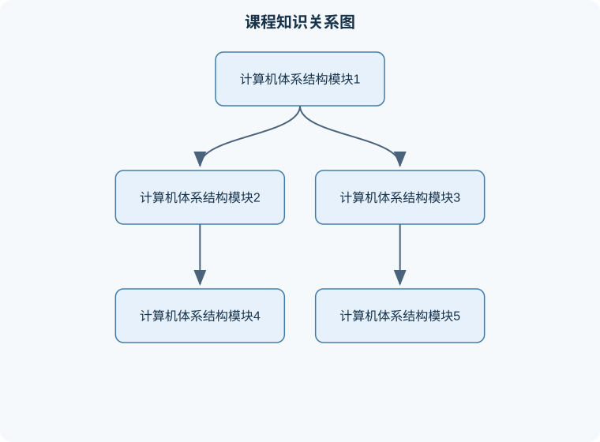

# 计算机体系结构

## 一、课程整体知识框架

### 课程边界与先修知识

本课程研究计算机系统中指令集架构、处理器组织、存储层次、指令级并行、数据级并行、线程级并行和多处理器系统之间的定量关系，重点解释功能、性能、功耗、成本与可靠性之间的权衡。课程覆盖从ISA与单周期数据通路到流水线、动态调度、分支预测、超标量、VLIW、SIMD、GPU、多核、缓存一致性、同步和内存一致性的完整主线；可扩展到片上互连、仓库级计算机和可靠性分析，但不替代数字逻辑、操作系统、编译原理、嵌入式系统或网络体系结构的专门课程。先修知识包括数字逻辑与时序电路、汇编语言和基本ISA、数据结构与程序控制流、概率与基础统计、计算机组成原理，以及能够阅读简单硬件描述语言或处理器伪代码。





### 1. 课程对象、研究层次与基本问题

计算机体系结构研究的是计算机系统“如何组织硬件与软件，使程序得到正确且高效执行”。它既不同于只描述指令功能的指令集体系结构，也不同于只讨论晶体管、逻辑门和布线的数字电路设计。体系结构位于软件可见抽象与硬件实现之间，关注指令集、处理器数据通路、存储层次、输入输出、并行执行和性能评价之间的系统关系。

一个完整的体系结构分析通常回答五类问题：

1. **程序如何表示和执行**：包括数据表示、指令格式、寻址方式、寄存器和控制流。
2. **一条指令经过哪些硬件阶段**：包括取指、译码、执行、访存和写回等数据通路。
3. **如何同时处理多条指令或多个任务**：包括流水线、乱序执行、多发射、多核和向量处理。
4. **数据如何在不同速度和容量的存储部件之间移动**：包括寄存器、高速缓存、主存和辅助存储。
5. **如何证明或测量设计有效**：包括功能正确性、时序约束、吞吐率、延迟、能耗、成本和可扩展性。

体系结构分析必须区分三个层次。**指令集体系结构**是软件和硬件之间的约定，例如寄存器数量、指令语义、可见的内存模型和异常行为；**微体系结构**是实现这些约定的内部组织，例如是否采用流水线、缓存如何分级、是否乱序执行；**实现技术**则涉及具体工艺、时钟、逻辑电路、封装和物理互连。同一指令集可以有多种微体系结构，同一微体系结构也可能因工艺和时钟条件不同而产生不同性能。

### 2. 性能、成本与能耗的统一分析

程序执行时间是体系结构评价的核心量。设程序执行的动态指令数为 $IC$，平均每条指令所需的时钟周期数为 $CPI$，时钟周期为 $T$，则理想化的 CPU 执行时间为

$$
T_{\mathrm{CPU}}=IC\times CPI\times T
$$

其中，$IC$ 的单位是“条指令”，$CPI$ 的单位是“周期/条指令”，$T$ 的单位是“秒/周期”，因此结果单位为秒。若时钟频率为 $f$，且 $f=1/T$，则

$$
T_{\mathrm{CPU}}=\frac{IC\times CPI}{f}
$$

该式假设执行期间没有额外的操作系统调度、输入输出等待、中断干扰和动态频率变化。实际系统中，缓存缺失、分支预测错误、流水线停顿和访存竞争会使有效 $CPI$ 增大。

若程序包含若干类指令，第 $i$ 类指令的数量为 $IC_i$，其平均代价为 $CPI_i$，则

$$
CPI=\frac{\sum_i IC_iCPI_i}{\sum_i IC_i}
$$

不能直接对各类 $CPI_i$ 做简单算术平均，除非各类指令数量相等。性能加速比用原执行时间与优化后执行时间之比表示：

$$
S=\frac{T_{\mathrm{old}}}{T_{\mathrm{new}}}
$$

若某项优化只影响原程序执行时间中的比例 $p$，受影响部分获得局部加速比 $s$，则总加速比满足阿姆达尔定律：

$$
S_{\mathrm{total}}=\frac{1}{(1-p)+\frac{p}{s}}
$$

其中 $0\le p\le 1$，$s\ge 1$。当 $p<1$ 时，即使 $s$ 无限大，总加速比也不可能超过 $1/(1-p)$。例如只有 $80\%$ 的时间可被并行化，即使并行部分无限快，整体加速比上限仍为 $5$。该结论的边界是：$p$ 必须以原始执行时间为基准，不能把优化后的比例直接代入。

性能不等于频率。提高频率可能缩短时钟周期，却可能增加流水线级数、分支错误恢复代价和功耗。吞吐率表示单位时间完成的任务数，延迟表示单个任务从开始到完成所需时间；流水线通常主要改善稳态吞吐率，不一定降低单条指令的完整延迟。

### 3. 数据表示与计算机系统的抽象基础

计算机以有限位宽表示整数、地址和控制信息。对于 $n$ 位无符号整数，表示范围为

$$
0\le x\le 2^n-1
$$

对于采用补码表示的 $n$ 位有符号整数，表示范围为

$$
-2^{n-1}\le x\le 2^{n-1}-1
$$

补码加法可以直接复用无符号加法器，但结果是否正确取决于是否发生有符号溢出。两个同号数相加得到异号结果时发生溢出；两个异号数相加不会产生有符号溢出。最高位进位与次高位进位的异或也可用于判断溢出，但这只适用于固定宽度补码加法，不能把进位直接等同于有符号溢出。

浮点数通常由符号、阶码和尾数构成。浮点加法需要先比较阶码并右移较小阶码对应的尾数，再进行尾数加减、规格化和舍入。由于尾数位数有限，浮点加法一般不满足结合律，即 $(a+b)+c$ 可能不等于 $a+(b+c)$。因此，编译器优化、并行归约和数值程序不能仅凭整数运算的结合律推断结果完全一致。

字节序规定多字节数据在连续地址中的排列方式。大端序把高有效字节放在低地址，小端序把低有效字节放在低地址。字节序不改变抽象整数值，但会影响内存转储、设备寄存器、网络协议和跨平台二进制数据交换。对未对齐地址的访问还可能引起额外访存、硬件异常或实现相关行为，不能假定所有处理器都以相同代价支持。

### 4. 指令集、数据通路与控制

指令集体系结构至少包含操作码、操作数位置、数据类型、寄存器、内存访问方式和异常规则。寄存器寻址速度快且便于编译器分配变量；立即数直接编码在指令中，访问成本低但位宽受指令格式限制；基址加偏移寻址适合数组、结构体和栈帧，地址通常按

$$
A=R_{\mathrm{base}}+\operatorname{signextend}(d)
$$

计算，其中 $A$ 是有效地址，$R_{\mathrm{base}}$ 是基址寄存器内容，$d$ 是指令中编码的偏移量。若体系结构规定偏移量为无符号量，则必须使用零扩展；错误地使用符号扩展会使高位地址发生变化。

典型单周期数据通路需要程序计数器、指令存储器、寄存器堆、算术逻辑单元、数据存储器、扩展单元、加法器、多路选择器和控制器。取指阶段以程序计数器作为指令地址；译码阶段读取寄存器并生成控制信号；执行阶段进行算术运算或地址计算；访存指令访问数据存储器；写回阶段把结果写入目标寄存器。

控制信号必须与数据通路一致。例如，寄存器写使能为有效时，写回数据和目的寄存器必须稳定；存储写使能为有效时，有效地址、写入数据和字节使能必须符合存储器接口要求。控制信号若在流水线中跨阶段使用，必须与对应数据一起锁存，否则可能出现“数据属于上一条指令、控制信号属于下一条指令”的错配。

### 5. 流水线与冒险

流水线把指令执行划分为多个阶段，使不同指令在同一时刻处于不同阶段。典型五级流水线可抽象为取指、译码、执行、访存和写回。理想情况下，单条指令仍需经过多个阶段，但流水线填满后每个时钟周期可以完成一条指令，稳态吞吐率接近每周期一条，而不是把单条指令延迟缩短为一个周期。

流水线存在三类主要冒险：

- **结构冒险**：多个阶段同时争用同一硬件资源。例如取指和数据访存共用单端口存储器。可采用分离的指令存储器与数据存储器、增加端口或插入停顿解决。
- **数据冒险**：后一条指令需要前一条指令尚未写回的结果。最常见的是读后写冒险。转发可以把执行阶段或访存阶段产生的结果直接送往后续执行阶段；若前一条是加载指令，数据在访存阶段结束前不可用，后续使用者通常至少需要一个停顿周期。
- **控制冒险**：分支目标和是否跳转尚未确定时，处理器已经取入后续指令。可采用停顿、预测不跳转、动态分支预测和错误路径清空等方法。

分支预测错误的代价取决于分支解析阶段和流水线深度。预测正确时可以保持较高吞吐率；预测错误时，错误路径上的指令必须无效化，恢复正确程序计数器，并损失若干周期。因而增加流水线深度虽然可能提高频率，却可能扩大控制冒险代价。

流水线寄存器除了保存数据，还必须保存与这些数据对应的控制信号。停顿时通常保持某些前级寄存器不变，同时向后级注入空操作；清空时把错误路径指令标记为无效。停顿和清空的区别是：停顿暂时冻结正确指令的推进，清空则取消已经取入但不应执行的指令。

### 6. 存储层次、缓存与虚拟存储

存储层次利用程序的时间局部性和空间局部性。时间局部性指最近访问的数据可能再次被访问；空间局部性指与最近访问地址相邻的数据可能很快被访问。寄存器、高速缓存、主存和辅助存储通常容量逐级增大、访问延迟逐级增加。

缓存命中率为访问命中次数与总访问次数之比，记为 $h$；缺失率为 $m=1-h$。若缓存命中时间为 $t_c$，缺失代价为 $t_m$，并且 $t_m$ 表示发生缺失后额外付出的等待时间，则平均访存时间为

$$
AMAT=t_c+m\times t_m
$$

如果定义的缺失代价已经包含缓存检查时间，则应改写为

$$
AMAT=h\times t_c+(1-h)\times t_{\mathrm{miss,total}}
$$

不能把两种定义混用，否则会重复计算命中时间。

对于容量为 $C$ 字节、块大小为 $B$ 字节、组数为 $S$ 的组相联缓存，每个地址中的块内偏移位数为

$$
b=\log_2 B
$$

组索引位数为

$$
s=\log_2 S
$$

若地址宽度为 $w$ 位，标记位数为

$$
t=w-s-b
$$

这些公式要求 $B$ 和 $S$ 为 $2$ 的整数次幂，地址按字节编址，且缓存采用规则组索引。若缓存采用非规则索引、扇区组织或特殊哈希映射，不能直接套用。

缓存替换策略包括直接映射、组相联和全相联。直接映射硬件简单但冲突缺失较多；组相联在成本和冲突率之间折中；全相联查找灵活但比较器数量和功耗较高。写策略需要同时说明写命中和写缺失：写直达会立即更新下一级存储，控制简单但流量大；写回只在缓存块被替换时写回，流量较小但需要脏位。写分配和非写分配规定写缺失时是否先把数据块载入缓存。

虚拟存储把虚拟地址空间划分为页，并通过页表映射到物理页框。页表项通常包含物理页号、有效位、访问权限和脏位等。转换后备缓冲器用于缓存近期地址转换结果。缺页表示所需页不在物理内存中，操作系统需要检查访问合法性、选择页框、必要时写回被替换的脏页、从后备存储加载目标页并更新页表。缺页代价远大于普通缓存缺失，因此工作集过大时会出现频繁换页和显著性能下降。

### 7. 输入输出、互连与并行处理

输入输出系统负责处理器、内存和外部设备之间的数据交换。程序查询适合低速、简单设备，但会浪费处理器时间；中断允许设备在准备好后通知处理器，但中断频繁时会增加上下文切换开销；直接内存访问允许设备控制器与内存批量传输，处理器主要负责配置和完成处理，适合大块数据传输。

互连结构需要考虑带宽、延迟、仲裁、可靠性和扩展性。带宽表示单位时间可传输的数据量，常用字节/秒或比特/秒；延迟表示一次请求从发出到得到响应的时间。高带宽不必然意味着低延迟，例如批量传输链路可能吞吐量很高，但单次请求仍有较长启动延迟。

并行处理可按粒度分为指令级、数据级、线程级和任务级。向量处理对同一操作作用于多个数据元素，适合规则数组计算；多核处理通过多个处理器核心同时执行线程；共享内存系统需要处理缓存一致性和内存一致性。缓存一致性关注同一内存位置在多个缓存中的副本最终是否协调；内存一致性则规定不同处理器观察到的读写顺序。二者相关但不等同。

### 8. 体系结构设计的统一权衡

体系结构设计不是单独追求某一个指标，而是在性能、面积、功耗、成本、可靠性和软件兼容性之间权衡。增加缓存容量可能提高命中率，但会增加访问时间、面积和漏电；增加发射宽度可能提高并行度，但会增加依赖检查、旁路网络和功耗；增加流水线级数可能提高时钟频率，却可能增加分支错误代价和异常处理复杂度。

设计结论必须带条件。例如“缓存越大越好”忽略了访问延迟和功耗；“流水线越深越快”忽略了冒险和分支代价；“增加核心数一定加速”忽略了串行部分、同步开销、内存带宽和负载不均衡。体系结构分析应始终给出基准程序、工作负载、测量指标、约束条件和结果验证方法。

## 二、章节和模块划分

### 核心知识覆盖清单

本清单根据本课程的章节划分整理，用于检查正文是否覆盖各个核心模块：

- **模块一：计算机体系结构基本概念与性能模型**。
- **模块二：数据表示、指令集与编址**。
- **模块三：处理器数据通路与控制器**。
- **模块四：流水线实现与冒险处理**。
- **模块五：缓存、存储层次与虚拟存储**。
- **模块六：输入输出、总线与存储器接口**。
- **模块七：并行处理、多核与一致性**。
- **模块八：体系结构设计、评价方法与岗位关联**。


### 模块一：计算机体系结构基本概念与性能模型

#### 核心内容

本模块建立体系结构的语言和数量分析方法。内容包括指令集体系结构与微体系结构的区别、硬件抽象层次、执行时间、吞吐率、延迟、$IC$、$CPI$、时钟周期和加速比。所有性能比较必须保证工作负载和正确性要求相同，否则“更快”可能只是完成了不同任务。

#### 典型例题一：执行时间计算

**题干**：某程序动态执行 $2\times10^9$ 条指令，平均 $CPI=1.5$，处理器频率为 $3\ \mathrm{GHz}$。求 CPU 执行时间。

**分析**：$IC=2\times10^9$ 条，$CPI=1.5$ 周期/条，$f=3\times10^9$ 周期/秒。

**解答**：

$$
T=\frac{IC\times CPI}{f}
=\frac{2\times10^9\times1.5}{3\times10^9}
=1\ \mathrm{s}
$$

**结果验证**：总周期数为 $3\times10^9$ 周期，频率为每秒 $3\times10^9$ 周期，因此时间为 $1$ 秒。

**变式**：若频率提高到 $4\ \mathrm{GHz}$，但由于更深流水线使 $CPI$ 增至 $1.8$，则新时间为

$$
T'=\frac{2\times10^9\times1.8}{4\times10^9}=0.9\ \mathrm{s}
$$

加速比为 $1/0.9\approx1.11$，说明频率提升并未按比例转化为性能提升。

#### 常见易错点

1. 把主频直接当作每秒执行的指令数。
2. 忽略 $CPI$ 的单位。
3. 对不同指令类别的 $CPI$ 做无权平均。
4. 将吞吐率和单条指令延迟混为一谈。
5. 直接比较主频而不比较实际执行时间。
6. 把阿姆达尔定律中的 $p$ 当成优化后比例。
7. 认为局部加速比无限大就能使整体执行时间降为零。
8. 未说明是否包含缓存缺失和输入输出等待。
9. 用十进制前缀和二进制容量单位混算。
10. 把性能提升比例与执行时间减少比例当作同一个量。
11. 对整数和浮点程序使用同一组性能结论。
12. 只验证公式代数形式，不检查结果数量级。

### 模块二：数据表示、指令集与编址

#### 核心内容

本模块讨论整数补码、浮点数、字符和字节序，以及操作码、寄存器、立即数、寻址方式、栈和异常。重点不是记忆指令名称，而是理解一条指令如何指定操作数、如何计算有效地址、如何更新程序计数器，以及软件可观察的副作用。

#### 典型例题二：补码溢出判断

**题干**：在 $8$ 位补码中计算 $127+1$，判断结果及是否溢出。

**分析**：$127$ 的二进制为 $01111111$，$1$ 为 $00000001$。

**解答**：

$$
01111111+00000001=10000000
$$

$10000000$ 在 $8$ 位补码中表示 $-128$。两个正数相加得到负数，因此发生有符号溢出。

**结果验证**：数学真实结果为 $128$，超出 $8$ 位补码最大值 $127$，所以溢出判断正确。

**变式**：$100+(-30)=70$，两个操作数异号，结果在范围内，不发生有符号溢出；但无符号解释下的位模式和数值含义不同，必须先明确数据类型。

### 模块三：处理器数据通路与控制器

#### 核心内容

本模块从指令执行过程出发，组织程序计数器、寄存器堆、算术逻辑单元、扩展单元、存储器和多路选择器。控制器根据操作码和功能码生成寄存器写使能、算术运算选择、访存读写、分支选择和写回选择等信号。

数据通路设计的验证应覆盖：算术指令、寄存器读写、立即数指令、加载、存储、条件分支、跳转和异常路径。对每类指令都应检查输入来源、结果去向、控制信号有效周期和程序计数器更新条件。

### 模块四：流水线实现与冒险处理

#### 核心内容

本模块研究流水线寄存器、阶段控制、数据转发、停顿、清空和分支处理。流水线设计的基本不变量是：每个阶段中的数据、目的寄存器编号和控制信息必须属于同一条动态指令；无效指令不能修改寄存器、内存或程序计数器的可见状态。

#### 代表性流程一：数据冒险检测与处理

**输入**：当前译码阶段指令的源寄存器编号、执行阶段和访存阶段指令的目的寄存器编号、各阶段写回有效标志，以及加载指令标志。

**输出**：前递选择信号、流水线停顿信号和必要的清空信号。

**过程**：

1. 读取源寄存器编号 $rs$、$rt$。
2. 检查执行阶段指令是否写寄存器且目的寄存器非零。
3. 若执行阶段结果可在本周期末前递，则将执行结果送到当前执行阶段输入。
4. 若执行阶段是加载指令，则数据尚未产生；若当前指令使用该目的寄存器，冻结程序计数器和译码寄存器一个周期，并向执行阶段注入空操作。
5. 检查访存阶段和写回阶段的相关性，选择相应前递路径。
6. 在无相关或相关已解决时继续推进流水线。

**不变量**：寄存器零值若由体系结构规定为恒定零，则任何写入零号寄存器的操作都不能产生可见改变。**终止条件**：当前指令所有源操作数均可从寄存器堆或合法前递路径获得，且不存在未解决的加载相关。该流程适用于顺序发射、顺序提交的基础流水线，不直接适用于乱序执行和精确异常需要更复杂重命名结构的处理器。

#### 伪代码：五级流水线中的加载相关检测

```text
function detect_load_use_hazard(ID_instruction, EX_instruction):
    rs = ID_instruction.source_register_1
    rt = ID_instruction.source_register_2

    if EX_instruction.is_load == true:
        destination = EX_instruction.destination_register

        if destination != ZERO_REGISTER:
            uses_rs = ID_instruction.reads_source_1
            uses_rt = ID_instruction.reads_source_2

            if (uses_rs and rs == destination) or
               (uses_rt and rt == destination):
                return STALL_ONE_CYCLE

    return NO_STALL
```

该伪代码的输入是译码阶段和执行阶段的指令描述，输出是停顿或不停顿决定。它没有处理多周期乘法器、乱序执行、异常恢复和结构冒险；在真实实现中还需保证停顿时控制信号被清零或转换为空操作，避免同一条指令被重复提交。

#### 典型易错点

1. 把转发误认为可以解决所有加载相关。
2. 停顿时同时冻结所有流水线寄存器，导致正确指令无法推进。
3. 清空错误路径时只清空数据，不清空写回控制信号。
4. 分支目标地址和分支判定使用了不同指令的数据。
5. 把结构冒险、数据冒险和控制冒险混为一类。
6. 忽略寄存器堆读写时序约定。
7. 将无效流水线项当作真实指令提交。
8. 忽略存储器单端口造成的取指与数据访存冲突。
9. 只验证无相关指令序列，不验证连续相关。
10. 仅检查结果寄存器，不检查错误路径是否写内存。
11. 假设分支一定在执行阶段完成，而未说明硬件约定。
12. 停顿周期数未结合具体流水线阶段和存储器延迟推导。

### 模块五：缓存、存储层次与虚拟存储

#### 典型例题三：直接映射缓存地址划分

**题干**：字节编址系统地址宽度为 $32$ 位，缓存容量为 $16\ \mathrm{KiB}$，块大小为 $64\ \mathrm{B}$，采用直接映射。求块内偏移位、组索引位和标记位。

**分析**：容量 $C=16\times1024=2^{14}\ \mathrm{B}$，块大小 $B=64=2^6\ \mathrm{B}$。直接映射组数为 $S=C/B=2^8$。

**解答**：

$$
b=\log_2 64=6
$$

$$
s=\log_2 2^8=8
$$

$$
t=32-8-6=18
$$

因此地址由 $18$ 位标记、$8$ 位组索引和 $6$ 位块内偏移组成。

**结果验证**：三者之和为 $18+8+6=32$ 位；缓存共有 $2^8$ 组，每组一个 $64\ \mathrm{B}$ 块，总容量为 $256\times64=16\ \mathrm{KiB}$。

**变式**：若改为两路组相联，组数减半，组索引位变为 $7$ 位，标记位变为 $19$ 位；块内偏移位不变。

#### 典型例题四：平均访存时间

**题干**：缓存命中时间为 $2\ \mathrm{ns}$，缺失率为 $5\%$，缺失后额外代价为 $80\ \mathrm{ns}$。求平均访存时间。

**解答**：

$$
AMAT=2+0.05\times80=6\ \mathrm{ns}
$$

**结果验证**：$95\%$ 访问约耗时 $2\ \mathrm{ns}$，$5\%$ 访问平均额外等待 $80\ \mathrm{ns}$，所以平均额外代价为 $4\ \mathrm{ns}$，总计 $6\ \mathrm{ns}$。

**变式**：若题目把缺失代价定义为“从发起访问到数据返回的总时间”且该值为 $80\ \mathrm{ns}$，则应使用

$$
AMAT=0.95\times2+0.05\times80=5.9\ \mathrm{ns}
$$

关键在于先确认缺失代价是否已经包含缓存检查时间。

### 模块六：输入输出、总线与存储器接口

#### 核心内容

本模块比较程序查询、中断和直接内存访问，分析设备寄存器、地址映射、握手信号、批量传输和总线仲裁。设计输入输出路径时，应明确数据由谁产生、谁暂存、谁发起传输、何时确认完成，以及异常和超时如何处理。

#### 实验一：缓存性能测量与排错

**输入数据**：一组可重复执行的数组访问程序，数组大小分别设置为小于一级缓存、接近一级缓存、超过一级缓存和超过更高层缓存；访问步长分别为连续、固定间隔和随机。

**步骤**：

1. 固定编译选项、数据类型、线程数和处理器频率控制条件。
2. 对每种数组大小和访问步长重复运行多次。
3. 记录总执行时间、访问次数、平均延迟和必要的缓存计数器。
4. 对比连续访问与大步长访问的差异。
5. 检查数组初始化是否被编译器删除，检查测试数据是否足够大，检查首次运行是否包含冷缓存影响。
6. 使用独立计算验证记录的访问次数与理论循环次数一致。

**评价标准**：结果应能体现工作集超过某级缓存后延迟或缺失率上升；重复实验的离散程度应在可解释范围内；程序输出必须与参考结果一致，不能为了性能牺牲正确性。

**排错方法**：若所有配置性能几乎相同，先检查优化器是否消除了循环、计时范围是否包含初始化、访问是否真的触及数组；若随机访问反而异常快，检查数据是否被缓存预热或测试规模过小；若结果波动很大，检查后台任务、频率调整和线程绑定。

#### 实验二：流水线冒险仿真项目

**输入数据**：包含算术相关、加载后使用、分支跳转、连续存储访问和无相关指令的指令序列；每条指令包含操作码、源寄存器、目的寄存器和立即数。

**步骤**：

1. 实现非流水线参考模型，逐条执行并保存寄存器和内存最终状态。
2. 实现五级流水线模型，维护各级流水线寄存器。
3. 加入数据前递、加载相关停顿和分支错误路径清空。
4. 每个周期打印有效位、程序计数器、控制信号和关键数据。
5. 将流水线模型最终状态与参考模型比较。
6. 增加随机生成的短指令序列，重点覆盖寄存器零值、连续相关和分支目标附近指令。

**评价标准**：所有测试序列的可见寄存器和内存状态应与参考模型一致；流水线周期数应符合已声明的停顿和清空规则；无效指令不能产生写寄存器或写内存副作用。

**排错方法**：若算术结果错误，检查操作数选择和转发优先级；若加载后使用错误，检查停顿时程序计数器和译码寄存器是否冻结；若分支后出现错误写回，检查清空是否覆盖了所有后续控制信号；若最终状态偶发错误，按周期比较第一个分歧点，而不是只看最后结果。

### 模块七：并行处理、多核与一致性

#### 核心内容

本模块讨论指令级并行、数据级并行、线程级并行、多核互连、缓存一致性、同步原语和内存一致性。并行程序的加速受串行部分、通信、同步、负载不均衡和内存带宽限制。评价并行设计时，除了加速比，还应检查结果确定性、数据竞争、可扩展性和资源利用率。

#### 典型例题五：阿姆达尔定律

**题干**：程序中 $70\%$ 的执行时间可并行化，在无限多处理器下并行部分加速无限大。求理论最大加速比。

**解答**：

串行部分占比为 $1-0.7=0.3$，因此

$$
S_{\max}=\frac{1}{0.3}=\frac{10}{3}\approx3.33
$$

**结果验证**：并行部分时间趋近于零，但串行部分仍保留原程序 $30\%$ 时间，所以总时间不能低于原时间的 $0.3$。

**变式**：若使用 $4$ 个处理器，且并行部分理想均分，则

$$
S_4=\frac{1}{0.3+\frac{0.7}{4}}
=\frac{1}{0.475}\approx2.11
$$

实际结果还会受到同步、通信和负载不均衡影响，通常不超过该理想值。

### 模块八：体系结构设计、评价方法与岗位关联

#### 代表性设计流程二：从需求到体系结构方案

**输入**：工作负载特征、性能目标、功耗上限、面积预算、软件兼容性要求和可靠性约束。

**过程**：

1. 明确任务指标，例如平均响应时间、峰值吞吐率、能耗或单位成本性能。
2. 采集工作负载中的指令比例、访存比例、分支比例、数据规模和并行度。
3. 建立基线模型，计算 $IC$、$CPI$、缓存缺失率和内存流量。
4. 提出候选方案，如增大缓存、增加流水线级数、改进分支预测、增加核心数或改变存储组织。
5. 对每个方案分别估算性能收益、面积、功耗和实现风险。
6. 使用功能测试、仿真、综合结果和基准程序验证。
7. 识别收益上限和反例，避免只针对单一程序优化。
8. 形成包含假设、数据、结果和未解决风险的设计结论。

**输出**：体系结构方案、性能模型、测试报告、资源预算和验收结论。**适用条件**：适用于处理器、缓存、片上互连和嵌入式系统的前期设计；若涉及具体工艺参数，必须以实际工艺库和测量结果替代抽象估算。

#### 典型笔试问题与解答思路

1. **为什么流水线能提高吞吐率但不一定降低单条指令延迟？**  
   先区分吞吐率与延迟，再说明阶段重叠只减少相邻指令之间的空闲时间，单条指令仍需经过全部阶段。

2. **直接映射缓存为什么容易发生冲突缺失？**  
   说明多个内存块由同一组索引选中，只能竞争一个位置；再比较组相联增加候选位置后的效果。

3. **写回缓存为什么需要脏位？**  
   被修改但尚未写入下一级的块称为脏块，替换时只有脏块需要写回；脏位用于区分是否产生过修改。

4. **为什么加载后使用通常需要停顿？**  
   加载数据在访存阶段结束后才产生，而紧随其后的指令在执行阶段就需要操作数，普通前递路径无法提前获得数据。

5. **缓存一致性和内存一致性有何区别？**  
   前者关注同一地址的多个副本是否协调，后者规定不同内存操作的可见顺序；一致性不自动规定所有操作的全局顺序。

6. **提高时钟频率为什么可能不能提高整体性能？**  
   频率提高可能伴随 $CPI$ 增长、分支恢复代价增加、缓存延迟变多或功耗限制降频，应使用 $T=IC\times CPI/f$ 综合判断。

7. **阿姆达尔定律的限制是什么？**  
   它假设可加速部分比例固定，且忽略并行开销、负载不均衡和通信；因此只能作为理想上限或初步估算。

8. **为什么同一指令集可以有不同性能的处理器？**  
   指令集规定软件可见行为，缓存、流水线、预测、乱序、频率和实现工艺属于微体系结构和实现层次。

#### 典型面试问题与回答要点

1. **如何定位流水线 CPU 的错误？**  
   参考答案：先建立顺序执行模型，逐周期比较第一个分歧点；重点检查流水线寄存器、控制信号、转发、停顿和清空。追问时应说明如何处理无效指令和异常。

2. **缓存命中率提高但程序变慢，可能为什么？**  
   参考答案：缓存可能变大导致命中时间增加，或访问端口、功耗和频率受影响。追问时应区分命中率、命中时间和缺失代价，并使用 $AMAT$ 分析。

3. **如何验证分支预测器？**  
   参考答案：构造总是跳转、总是不跳转、周期模式和随机模式，统计预测正确率、错误恢复周期和最终功能正确性。追问时要说明预热阶段和冷启动统计。

4. **DMA 为什么能降低处理器负担？**  
   参考答案：由 DMA 控制器负责批量搬运，处理器只需配置起始地址、长度和方向并处理完成通知。追问时要讨论缓存一致性和内存访问权限。

5. **前递逻辑中为什么要比较目的寄存器是否为零？**  
   参考答案：若零号寄存器由体系结构规定为恒定零，则对其写入无效，不能把前级错误结果转发给后续指令。追问时应说明该结论依赖具体指令集约定。

6. **多核数增加后性能不再提升，如何分析？**  
   参考答案：检查串行比例、锁竞争、内存带宽、缓存一致性流量和负载不均衡。追问时可以用阿姆达尔定律给出上限，再用测量数据定位瓶颈。

7. **如何选择写回还是写直达？**  
   参考答案：写回减少下一级写流量，但需要脏位、替换写回和一致性管理；写直达控制简单、可见性及时，但带宽压力更大。选择取决于写比例、带宽和一致性要求。

8. **如何证明一次优化没有破坏正确性？**  
   参考答案：使用顺序参考模型、定向边界测试、随机测试、异常路径和并发测试，并比较所有架构可见状态，而不是只比较部分输出。追问时应包含溢出、未对齐访问、分支和中断等边界情况。

#### 岗位关联

- **处理器设计工程师**：实际任务包括设计数据通路、控制器、流水线和异常处理；使用指令集语义、冒险分析、时序约束和硬件描述语言；产出为可综合 RTL、仿真波形和验证报告；验收标准是功能测试通过、时序满足约束、无未处理控制路径。
- **芯片验证工程师**：实际任务包括编写定向测试、随机测试、参考模型和覆盖率统计；使用指令执行规则、缓存协议、断言和差分验证；产出为测试平台、缺陷定位报告和回归结果；验收标准是架构状态一致、关键场景覆盖、缺陷可复现且修复后回归通过。
- **性能分析工程师**：实际任务包括分析 $CPI$、缓存缺失、分支错误、内存带宽和并行扩展性；使用性能公式、硬件计数器和基准程序；产出为瓶颈分析及优化建议；验收标准是测量方法可重复、基线清晰、优化收益与资源代价均有数据支撑。
- **嵌入式系统工程师**：实际任务包括处理中断、DMA、设备寄存器和实时约束；使用输入输出体系结构、存储映射和时序分析；产出为驱动、固件和接口测试；验收标准是数据不丢失、响应时间满足约束、异常和超时路径可恢复。
- **编译器或工具链工程师**：实际任务包括指令选择、寄存器分配、分支和内存访问优化；使用指令集约束、调用约定、缓存局部性和性能模型；产出为编译器后端、汇编代码和性能报告；验收标准是生成代码功能正确、遵守二进制接口、性能改进可重复。
- **系统架构师或技术分析岗位**：实际任务包括在性能、成本、功耗和兼容性之间选择方案；使用阿姆达尔定律、存储层次、并行模型和工作负载分析；产出为架构方案、容量规划和技术决策文档；验收标准是需求可追溯、假设明确、指标可测量、风险和边界条件完整。

## 三、核心概念的详细解释

### 1. 体系结构、指令集与微体系结构

计算机体系结构是软件可见行为与硬件实现组织之间的桥梁。**指令集体系结构（ISA）**规定处理器能够执行哪些指令、寄存器如何组织、数据类型如何解释、访存地址如何计算、异常如何报告以及多处理器之间如何观察内存访问。**微体系结构**规定这些指令如何在硬件内部实现，例如是否采用流水线、是否乱序执行、缓存如何分级、分支如何预测。**实现技术**则包括逻辑电路、时钟、工艺、封装和互连。

同一 ISA 可以由单周期处理器、多周期处理器或深流水线乱序处理器实现；只要对合法程序表现出相同的架构状态变化，它们在功能上就是兼容的。反过来，频率更高、流水线更深的实现并不必然更快，因为分支错误恢复、缓存缺失和数据相关可能抵消频率收益。

### 2. 指令执行数据通路

典型的五级流水线将指令执行划分为：

1. **取指（IF）**：用程序计数器 $PC$ 访问指令存储器，并计算顺序地址。
2. **译码（ID）**：识别操作码，读取寄存器，扩展立即数，生成控制信号。
3. **执行（EX）**：由算术逻辑单元计算算术结果、逻辑结果或有效地址，并进行分支条件判断。
4. **访存（MEM）**：对加载指令读数据，对存储指令写数据。
5. **写回（WB）**：把计算结果或加载数据写入目的寄存器。

流水线寄存器在相邻阶段之间保存数据和控制信号，并在时钟有效沿更新。每个阶段必须在一个时钟周期内完成自己的组合逻辑工作；若某阶段延迟最长，则它决定流水线时钟周期。流水线寄存器增加了寄存器建立时间、保持时间和时钟偏斜等开销，因此实际周期不能简单等于最长组合逻辑延迟。

### 3. 流水线冒险

流水线重叠执行会产生三类冒险。

**结构冒险**是多个阶段同时争用同一硬件资源。例如取指和数据访存共用单端口存储器时，某条加载指令处于访存阶段，下一条指令又需要取指。常用解决方法是分离指令存储器和数据存储器、使用多端口存储器，或者插入停顿。分离存储器并不是消除所有冲突，而是消除特定的取指—数据访问冲突。

**数据冒险**来自指令之间的数据依赖。若前一条指令尚未写回寄存器，后一条指令已需要该值，就会出现读后写（RAW）冲突。硬件通常采用旁路，将执行阶段或访存阶段产生的结果直接送到后继指令的 ALU 输入端，而不必等待写回。加载—使用相关通常更难处理：加载数据在访存阶段结束时才得到，而紧随其后的指令在同一周期已经需要执行，因此通常至少插入一个停顿周期，再配合旁路。

**控制冒险**来自分支和跳转。分支目标地址或条件在较晚阶段才确定时，处理器已经取入了后续顺序指令。若分支成立，这些指令必须取消，即清空流水线中的错误路径指令。预测“不跳转”、预测“跳转”或动态分支预测都只能降低平均代价，不能改变错误预测时必须恢复架构状态的要求。

### 4. 控制信号与流水线寄存器

译码单元根据操作码和功能码生成寄存器写使能、ALU 操作、访存读写、结果选择、分支控制和目的寄存器选择等信号。控制信号必须随对应指令一起通过流水线寄存器传递。例如，某条存储指令在 ID 阶段生成 `MemWrite`，但真正写数据存储器发生在 MEM 阶段，因此 `MemWrite` 必须保存到 EX/MEM 寄存器中。

停顿与冲刷不是同一操作。**停顿**使某些流水线寄存器保持原值，并向后插入无操作指令，以等待条件满足；**冲刷**将错误路径指令转换为无操作指令，防止它们修改寄存器或内存。控制逻辑必须保证被冲刷指令的写回和存储控制信号被清零，否则错误路径可能产生不可逆的副作用。

### 5. 存储层次与局部性

存储系统按容量、速度和成本构成层次：寄存器最快但容量小，高速缓存容量较大，主存容量更大，辅助存储容量最大但延迟更高。程序通常表现出：

- **时间局部性**：最近访问过的数据可能很快再次访问；
- **空间局部性**：访问一个地址后，附近地址可能很快被访问。

缓存以块为单位在层次之间传输。访问地址通常分解为标签、组索引和块内偏移。直接映射缓存中，一个内存块只能放入一个位置；组相联缓存中，一个块可放入指定组内的多个路；全相联缓存中，一个块可放入任意位置。相联度提高通常可减少冲突缺失，但会增加比较器数量、面积、功耗和访问时间。

缓存缺失可分为冷启动缺失、容量缺失和冲突缺失。写策略需要区分写命中和写不命中：写回法只在缓存块被替换时写入下一级，减少总线流量但需要脏位；直写法每次写命中都更新下一级，控制简单但带宽压力更大。写分配和非写分配决定写不命中时是否先把数据块装入缓存。

### 6. 虚拟存储与地址转换

虚拟存储将进程看到的虚拟地址空间映射到物理内存页面。虚拟地址通常分为虚拟页号和页内偏移；页表根据虚拟页号查找物理页框号，页内偏移保持不变。转换后，物理地址由物理页框号与原偏移拼接得到。

转换后备缓冲器（TLB）缓存近期的地址转换。TLB 未命中不一定意味着页面不在主存：可能只是页表项不在 TLB 中；若页表项表明页面不在主存，才发生缺页异常。缺页处理需要操作系统选择或装入页面，必要时回收其他页面，修改页表和 TLB，并重新执行引发异常的指令。虚拟地址转换、缓存访问和权限检查的先后关系会影响缓存标签采用虚拟地址还是物理地址。

### 7. 并行、输入输出与一致性

指令级并行通过流水线、多发射、乱序执行和推测执行提高吞吐率；数据级并行通过向量指令同时处理多个元素；线程级并行通过多核同时执行不同线程。并行加速受串行部分、同步开销、负载不均衡、通信开销和内存带宽限制。

输入输出系统包括设备控制器、状态寄存器、数据寄存器和中断机制。轮询由处理器反复检查状态，控制简单但浪费处理器时间；中断允许设备就绪时通知处理器；DMA 由专用控制器在设备与内存之间批量传输数据，处理器只需配置和收尾。DMA 与缓存结合时必须处理缓存一致性，否则处理器可能读到旧缓存数据，或设备读到尚未写回内存的数据。

### 8. 体系结构分析中的理想模型与现实边界

理想 CPI 模型假设各级流水线平衡、无缓存缺失、无分支错误、无资源冲突。现实处理器的有效 CPI 还受到缺失停顿、旁路限制、端口竞争、访存并行度、操作系统干扰和动态频率的影响。基准测试必须说明输入规模、编译选项、缓存预热状态、线程数、测量范围和重复次数，否则不同结果不能直接比较。

## 四、重要定义、公式、定理和推导

### 专业审校补充：关键定义与适用边界

缓存一致性与内存一致性是两个不同层次的概念。缓存一致性要求多个处理器对同一内存地址的读写结果满足单地址观察规则：若一个核心写入后，其他核心再次读取该地址，最终必须看到最新值；它主要解决“同一地址的副本是否一致”。内存一致性则规定不同地址的读写操作在多核心之间允许以何种顺序被观察，解决“不同地址操作的顺序是否符合模型”。典型写回缓存采用写无效协议：某核心写入缓存行前，使其他核心持有的副本失效；其他核心再次访问时通过一致性互连取得新数据。MESI 中，M 表示本核心独占且已修改，E 表示独占且未修改，S 表示多个核心共享且未修改，I 表示无效。该协议保证一致性，但不自动保证程序同步语义；跨核心通信仍需原子操作、锁或内存屏障。协议分析还必须区分缓存行粒度：两个线程修改同一缓存行中的不同字节会产生伪共享，虽无真实数据依赖，也会反复触发失效流量。


### 1. 性能公式与 CPI 分解

设 $IC$ 为动态执行指令数，单位为条；$CPI$ 为平均每条指令消耗的周期数，单位为周期/条；$T$ 为时钟周期，单位为秒/周期；$f$ 为时钟频率，单位为周期/秒，则

$$
T_{\mathrm{CPU}}=IC\times CPI\times T
=\frac{IC\times CPI}{f}.
$$

推导过程是：总周期数等于每条指令平均周期数乘以指令条数，即 $C=IC\times CPI$；每周期耗时为 $T$，所以总时间为 $C\times T$；又因为 $f=1/T$，得到第二种形式。

若第 $i$ 类指令数量为 $IC_i$，类别平均 CPI 为 $CPI_i$，则

$$
CPI=\frac{\sum_i IC_iCPI_i}{\sum_i IC_i}.
$$

缺失代价可近似写成

$$
CPI_{\mathrm{eff}}
=CPI_{\mathrm{base}}+m\times P,
$$

其中 $m$ 是每条指令平均引起的缺失次数，单位为次/条；$P$ 是一次缺失增加的周期数。若分别考虑指令缓存和数据缓存，则

$$
CPI_{\mathrm{eff}}
=CPI_{\mathrm{base}}
+m_I P_I+m_D P_D.
$$

该式要求各项停顿代价可加，且不考虑多级缺失重叠；乱序执行和非阻塞缓存可能使简单相加高估实际 CPI。

### 2. 阿姆达尔定律及其边界

设原程序中可优化部分占时间比例 $p$，该部分加速比为 $s$，不可优化部分比例为 $1-p$。令原执行时间为 $T$，则优化后时间为

$$
T'=(1-p)T+\frac{pT}{s}.
$$

因此总加速比为

$$
S=\frac{T}{T'}
=\frac{1}{(1-p)+p/s}.
$$

当 $s\to\infty$ 时，

$$
S_{\max}=\frac{1}{1-p}.
$$

**例题一：**某程序原运行时间为 $100$ 秒，其中 $60\%$ 可由专用硬件加速，相关部分加速 $5$ 倍。  
**分析：**取 $p=0.6$、$s=5$。  
**解答：**

$$
S=\frac{1}{0.4+0.6/5}
=\frac{1}{0.52}\approx1.923.
$$

优化后时间为

$$
T'=\frac{100}{1.923}\approx52\text{ 秒}.
$$

**验证：**不可优化部分用时 $40$ 秒，可优化部分用时 $60/5=12$ 秒，总计 $52$ 秒。  
**变式：**若只有 $20\%$ 可优化，即使该部分无限快，最大加速比也只有 $1/0.8=1.25$，说明优化比例比局部加速倍数更关键。

### 3. 流水线吞吐率与延迟

设非流水处理器完成一条指令需要 $k$ 个阶段时间，阶段时间分别为 $t_1,\ldots,t_k$；流水线寄存器开销为 $t_r$。流水线时钟周期为

$$
T_{\mathrm{clk}}=\max(t_1,\ldots,t_k)+t_r.
$$

处理 $n$ 条无相关指令时，理想流水线总时间近似为

$$
T_{\mathrm{pipe}}=(k+n-1)T_{\mathrm{clk}},
$$

其中前 $k-1$ 个周期用于填充，之后平均每周期完成一条。非流水总时间为

$$
T_{\mathrm{nonpipe}}=n\sum_{j=1}^{k}t_j.
$$

**例题二：**五级流水阶段组合逻辑延迟分别为 $200$、$150$、$180$、$220$、$160$ ps，流水线寄存器开销为 $20$ ps，执行 $100$ 条互不相关指令。  
**解答：**最长阶段为 $220$ ps，因此

$$
T_{\mathrm{clk}}=220+20=240\text{ ps}.
$$

总时间为

$$
(5+100-1)\times240=24960\text{ ps}.
$$

稳态吞吐率为每 $240$ ps 完成一条，单条指令从进入到完成至少经历 $5$ 个周期，即 $1200$ ps，不应把吞吐率误认为单条延迟。  
**变式：**若将最长阶段继续切分，组合延迟可能下降，但寄存器开销和分支错误恢复周期可能增加，不能只比较频率。

### 4. 数据冒险检测与旁路流程

对于五级流水线，可将当前译码指令的源寄存器记为 $rs$、$rt$，将后续流水级的目的寄存器记为 $rd$。旁路判断的一般条件是：

- 后续指令确实写寄存器；
- 目的寄存器不是常量零寄存器；
- 目的寄存器编号等于当前源寄存器编号。

若 EX/MEM 级匹配，优先选择较新的 EX/MEM 结果；否则若 MEM/WB 级匹配，选择 MEM/WB 结果。优先级不能反转，否则连续写同一寄存器时会选到旧结果。

加载—使用停顿的典型条件是：ID/EX 中的指令是加载指令，且其目的寄存器等于 IF/ID 中指令的任一实际源寄存器。满足条件时，保持 PC 和 IF/ID 不变，同时向 ID/EX 写入空操作控制信号。

**例题三：**

```text
lw   r1, 0(r2)
add  r3, r1, r4
sub  r5, r3, r6
```

**分析：**`add` 立即使用 `lw` 的结果，加载数据在 MEM 阶段末才可旁路，因此必须停顿一个周期；`sub` 使用 `add` 的结果，可由 EX/MEM 旁路。  
**结果：**至少插入一个气泡，而不是对所有相关指令都停顿。  
**验证：**若删除气泡，`add` 的 EX 阶段会在加载数据产生前读取旧的 $r1$。  
**变式：**若中间插入一条与 $r1$ 无关的指令，加载结果可在需要前准备好，停顿可能为零。

### 5. 分支代价与控制冒险

设分支比例为 $b$，预测错误率为 $q$，每次错误预测冲刷 $P$ 个周期，则分支造成的平均 CPI 增量为

$$
\Delta CPI_{\mathrm{branch}}=bqP.
$$

**例题四：**基础 CPI 为 $1$，分支指令占全部指令的 $20\%$，预测错误率为 $10\%$，每次错误损失 3 个周期。  
**解答：**

$$
\Delta CPI=0.2\times0.1\times3=0.06,
$$

所以有效 CPI 为 $1.06$。若执行 $10^9$ 条指令、频率为 $2$ GHz，则

$$
T=\frac{10^9\times1.06}{2\times10^9}=0.53\text{ s}.
$$

**验证：**平均每条指令额外损失 $0.06$ 周期。  
**变式：**若错误率降至 $5\%$，CPI 变为 $1.03$；若流水线加深使 $P$ 增至 6，预测器改进的收益可能被更高错误代价抵消。

### 6. 缓存地址划分与 AMAT

设地址宽度为 $A$ 位，缓存块大小为 $B=2^b$ 字节，缓存容量为 $C$ 字节，组相联度为 $W$，则组数为

$$
N_{\mathrm{set}}=\frac{C}{B\times W},
$$

组索引位数为

$$
s=\log_2N_{\mathrm{set}},
$$

块内偏移位数为 $b$，标签位数为

$$
t=A-s-b.
$$

这些公式要求容量、块大小和相联度均为二的幂，并且地址按字节编址。若系统按字编址，偏移含义需要改为字地址。

平均存储访问时间（AMAT）为

$$
AMAT=HT+MR\times MP,
$$

其中 $HT$ 是命中时间，单位为时间；$MR$ 是缺失率，单位为次/访问；$MP$ 是缺失代价，单位为时间/次。对于两级缓存：

$$
AMAT_1=HT_1+MR_1
\left(HT_2+MR_2MP_2\right).
$$

**例题五：**一级缓存命中时间为 $1$ ns，缺失率为 $5\%$；二级缓存访问时间为 $8$ ns，局部缺失率为 $20\%$；主存缺失代价为 $80$ ns。  
**解答：**

$$
AMAT_2=8+0.2\times80=24\text{ ns},
$$

$$
AMAT_1=1+0.05\times24=2.2\text{ ns}.
$$

**验证：**一级命中占 $95\%$，耗时 1 ns；一级缺失时平均再耗时 24 ns，故平均增加 $1.2$ ns。  
**变式：**若给出的二级缺失率是相对于所有访问的全局缺失率，就不能再乘以一级缺失率；必须先区分局部缺失率和全局缺失率。

### 7. 代表性算法与实现流程

#### 7.1 流水线冒险处理算法

**输入**：当前 IF/ID、ID/EX、EX/MEM、MEM/WB 流水寄存器内容。  
**输出**：旁路选择、停顿信号、冲刷信号。  
**过程**：

1. 识别各阶段指令是否有效。
2. 检查 EX/MEM 与 MEM/WB 的目的寄存器是否匹配当前源寄存器。
3. 按“较新结果优先”选择旁路来源。
4. 检查 ID/EX 是否为加载指令且与 IF/ID 存在源寄存器冲突。
5. 若存在加载—使用冲突，冻结 PC 和 IF/ID，并向 ID/EX 注入空操作。
6. 若分支结果确定且预测错误，清空错误路径寄存器。
7. 在每个时钟沿统一更新寄存器。

**不变量**：任何真正执行的指令只能使用其程序顺序中已经产生且可见的最新值；被冲刷指令不能写寄存器或写内存。  
**终止条件**：当前周期所有冲突均已解决，或流水线中没有有效指令。  
**适用条件**：顺序发射、有限级数流水线；乱序处理器还需寄存器重命名和提交机制。  
**复杂度**：固定数量流水级时每周期为 $O(1)$；若有 $n$ 个候选旁路源并线性比较，则为 $O(n)$。

#### 7.2 缓存访问算法

**输入**：字节地址 $a$、缓存参数 $A,B,C,W$。  
**输出**：命中或缺失、命中数据、必要时替换的缓存块。  
**过程**：

1. 计算块号 $\lfloor a/B\rfloor$。
2. 用块号对组数取模得到组索引。
3. 取出该组各路标签，与目标标签比较有效位。
4. 若命中，更新替换策略状态并返回数据。
5. 若缺失，从下一级读取整块。
6. 若被替换块为脏块，先写回；再写入新块并设置标签、有效位和脏位。
7. 返回所需字节。

**不变量**：有效缓存块的标签、组位置和数据必须对应同一内存块；写回前不得丢弃脏数据。  
**终止条件**：数据在当前层命中，或从最低层成功取得。  
**适用条件**：块大小与组数可进行明确地址划分；替换策略可以是随机、先进先出或近似最近最少使用。  
**复杂度**：直接映射比较次数为 $O(1)$；$W$ 路组相联查找为 $O(W)$，硬件中通常并行比较。

#### 7.3 组合逻辑与时序逻辑实现流程

设计流水线 CPU 时，先定义 ISA 的每条指令对 PC、寄存器和内存的状态变化，再画出数据通路，随后为每条指令列出控制信号表。之后将组合逻辑划分到流水阶段，在阶段边界加入流水线寄存器，最后添加冒险检测、旁路、停顿和冲刷逻辑。验证顺序应为：单条指令、无相关指令序列、数据相关、加载—使用、分支错误、异常和复位。组合逻辑不能产生锁存器，时序逻辑只能在规定时钟沿更新状态。

下面给出不依赖外部文件的旁路选择伪代码：

```text
language: pseudocode

input:
    id_ex_rs, id_ex_rt
    ex_mem_rd, ex_mem_regwrite, ex_mem_value
    mem_wb_rd, mem_wb_regwrite, mem_wb_value
    reg_rs_value, reg_rt_value

output:
    alu_a, alu_b

function select_operand(src, reg_value):
    if ex_mem_regwrite and ex_mem_rd != 0 and ex_mem_rd == src:
        return ex_mem_value
    else if mem_wb_regwrite and mem_wb_rd != 0 and mem_wb_rd == src:
        return mem_wb_value
    else:
        return reg_value

alu_a = select_operand(id_ex_rs, reg_rs_value)
alu_b = select_operand(id_ex_rt, reg_rt_value)
```

该伪代码只处理执行阶段的算术操作数。立即数选择、存储数据旁路、加载—使用停顿和分支操作数旁路仍需单独设计，不能误认为一个旁路单元即可覆盖全部路径。

### 8. 实验与项目流程

#### 8.1 五级流水线 CPU 验证实验

**输入数据**：包含算术、加载、存储、连续相关、分支和跳转的短程序；预期寄存器和内存结果。  
**步骤**：

1. 先验证单周期数据通路和每条指令的控制信号。
2. 为五级流水线加入阶段寄存器。
3. 逐周期记录 PC、指令、有效位、控制信号和关键数据。
4. 加入 EX/MEM、MEM/WB 旁路。
5. 加入加载—使用停顿和分支冲刷。
6. 将硬件结果与顺序解释器逐条比较。

**评价标准**：最终寄存器和内存状态一致；停顿周期数与理论分析一致；错误路径没有写状态；复位后 PC 和有效位处于规定初值。  
**排错方法**：若算术结果错误，检查旁路优先级；若加载后错误，检查停顿条件是否漏看 `rt`；若分支后出现多余写入，检查冲刷时是否清零 `RegWrite` 和 `MemWrite`；若波形中出现未知值，检查复位和未覆盖的组合逻辑分支。

#### 8.2 缓存与性能测量项目

**输入数据**：顺序访问、跨步访问、随机访问和重复访问四类地址序列；缓存容量、块大小、相联度和替换策略。  
**步骤**：

1. 实现地址分解和命中判断。
2. 对每类序列统计访问次数、命中次数、缺失次数和脏块写回次数。
3. 根据 $MR$ 和缺失代价计算 AMAT。
4. 改变块大小、相联度和容量，比较性能与硬件代价。
5. 用手工构造的冲突序列验证冲突缺失。

**评价标准**：命中率统计与逐次访问轨迹一致；不同参数下的标签、索引和偏移划分正确；AMAT 单位统一；实验结论同时说明容量、功耗和复杂度代价。  
**排错方法**：检查块号是否使用整数除法；确认偏移是字节偏移还是字偏移；区分局部缺失率和全局缺失率；写回缓存必须检查脏位，不能仅凭命中或缺失决定是否写回。

### 9. 易错点与典型问题

#### 9.1 具体易错点

1. 把 ISA、微体系结构和实现工艺混为一谈。
2. 把流水线吞吐率当成单条指令延迟。
3. 对不同指令类别的 CPI 做简单算术平均。
4. 将频率提高直接等同于性能提高。
5. 忽略流水线寄存器开销。
6. 把 RAW、WAR、WAW 都当成顺序五级流水线必然存在的冒险。
7. 只做旁路而不处理加载—使用停顿。
8. 停顿时错误地推进 PC 或 IF/ID。
9. 冲刷时只清空指令，却保留写内存控制信号。
10. 将结构冒险、数据冒险和控制冒险的处理方式混用。
11. 把二级缓存局部缺失率误当成全局缺失率。
12. 忘记缓存地址按字节还是按字编址。
13. 写回缓存替换脏块时未先写回。
14. 把 TLB 未命中直接等同于缺页。
15. 计算阿姆达尔定律时使用优化后的比例。
16. 只报告加速比，不报告基线、输入规模和测量条件。

#### 9.2 典型笔试问题及解答思路

1. **为什么流水线能提高吞吐率却不一定降低延迟？**  
   应说明阶段重叠只减少连续任务的平均完成间隔，单条指令仍需经过所有阶段，并可能增加寄存器开销。

2. **旁路为什么不能完全消除加载—使用停顿？**  
   应定位数据产生时刻与消费者需要时刻：加载数据在 MEM 阶段末产生，而消费者通常在下一周期 EX 阶段初需要。

3. **如何计算某缓存的标签、组索引和偏移位？**  
   先求块数和组数，再用 $b=\log_2B$、$s=\log_2N_{\mathrm{set}}$、$t=A-s-b$，最后检查三者之和是否等于地址宽度。

4. **直接映射和组相联缓存有什么差别？**  
   应比较放置位置、冲突缺失、比较器数量、替换复杂度和访问延迟，而不是只说“组相联更快”。

5. **何时使用阿姆达尔定律？**  
   当优化针对原程序中可区分的时间部分，且局部加速比与不可优化部分已知时使用；若优化改变了工作量、指令数或其他部分比例，应重新建立模型。

6. **分支预测错误为什么会导致性能下降？**  
   错误路径指令必须冲刷，已消耗的取指和执行资源不能完成有效工作，并产生 $bqP$ 形式的平均代价。

7. **TLB 未命中与缺页异常有何区别？**  
   TLB 未命中需要查页表；页表表明页面在内存中时只需填充 TLB，页面不在内存中才触发缺页处理。

8. **DMA 为什么需要缓存一致性处理？**  
   设备绕过处理器缓存直接访问内存，可能与缓存中的旧副本或尚未写回的数据不一致；必须通过写回、失效或硬件一致性协议解决。

### 10. 面试问题、参考答案与追问要点

1. **如何定位处理器性能瓶颈？**  
   参考答案：建立可重复基线，测量执行时间、CPI、缓存缺失、分支错误、带宽和停顿周期，再按时间贡献排序。  
   深入追问：若 CPI 上升但缓存缺失不变，应检查端口竞争、依赖链、频率变化和测量范围。

2. **你会如何验证一个流水线 CPU？**  
   参考答案：使用顺序参考模型，对单指令、指令组合、冒险、分支、复位和异常进行定向及随机测试，并比较每条提交指令的架构状态。  
   深入追问：为什么比较提交状态而非内部波形？因为不同微体系结构内部时序可以不同，架构状态才是兼容性边界。

3. **何时选择更大的缓存块？**  
   参考答案：当空间局部性强且带宽和缺失代价允许时更有利；随机访问或工作集较小时，大块可能造成无用数据传输和污染。  
   深入追问：块大小增大可能减少强制缺失，但也减少同容量缓存中的块数，可能增加容量或冲突缺失。

4. **如何解释一次性能优化没有收益？**  
   参考答案：检查优化覆盖比例、瓶颈是否转移、编译器是否生成预期代码、输入规模是否足够，以及测量噪声是否超过收益。  
   深入追问：应区分平均收益、尾延迟和资源成本，不能只看一次运行时间。

5. **乱序执行如何保证程序正确性？**  
   参考答案：通过寄存器重命名消除假相关，通过保留站和调度等待操作数，通过按程序顺序提交维护精确异常。  
   深入追问：内存别名和分支推测仍需内存依赖预测、回滚和恢复机制。

6. **为什么高频率设计可能功耗更高？**  
   参考答案：动态功耗通常随开关活动、负载电容和电压平方增加，提升频率会增加单位时间的切换次数；更深流水线还会增加时钟树和寄存器开销。  
   深入追问：应同时分析性能、功耗、温度和可靠性，而不是只比较 GHz。

7. **如何处理 DMA 与缓存不一致？**  
   参考答案：设备写内存前使相关缓存行失效或使用一致性协议；处理器把数据交给设备前写回脏缓存，并设置适当的内存屏障。  
   深入追问：还需考虑地址对齐、缓存行粒度和并发访问顺序。

8. **设计存储系统时最重要的权衡是什么？**  
   参考答案：在命中时间、容量、缺失率、带宽、功耗、面积和成本之间权衡。  
   深入追问：局部性强的工作负载适合利用容量和块传输，随机访问则更重视低命中代价、并行端口和较低尾延迟。

### 11. 岗位任务与验收标准

处理器设计岗位需要把 ISA 语义转化为数据通路、控制器、流水线寄存器和冒险处理逻辑，产出可综合 RTL、波形和设计说明；验收要求功能正确、时序满足约束、复位和异常路径完整。

芯片验证岗位需要构造指令序列、参考模型、断言和回归环境，重点验证寄存器、内存、缓存和提交状态一致；验收要求缺陷可复现、覆盖关键冒险组合、修复后回归无新增错误。

性能分析岗位需要采集执行时间、CPI、缓存缺失率、分支错误率、内存带宽和功耗指标，建立基线并提出优化方案；验收要求测量条件明确、结果可重复、优化收益与硬件代价同时量化。

嵌入式系统岗位需要处理中断、DMA、设备寄存器、内存映射和实时响应，产出驱动、固件及接口测试；验收要求数据不丢失、响应时间满足约束、超时和设备异常可以恢复。

编译器与工具链岗位需要进行指令选择、寄存器分配、分支布局和内存访问优化，产出汇编代码、性能报告和正确性测试；验收要求遵守调用约定和二进制接口，生成代码功能正确，性能改进在固定基线上可重复。

系统架构岗位需要依据工作负载选择缓存、内存、互连、并行和输入输出方案，产出架构决策文档、容量规划和风险清单；验收要求需求可追溯，假设、指标、成本、功耗和扩展边界均有明确说明。

## 五、算法、流程和实现思路

### 方法与流程覆盖索引

下列方法或流程应在正文中说明输入、步骤、适用条件、结果检查和边界：

- 1. 流水线处理器的设计流程
- 2. 冒险检测、旁路与停顿流程
- 3. 冒险控制的伪代码实现
- 4. 存储器访问与缓存分析流程
- 5. 体系结构计算题的统一解题流程
- 6. 典型例题与变式
- 7. 实验与项目流程


### 1. 流水线处理器的设计流程

流水线处理器的实现不能只把单周期数据通路切成五段，还必须保证每条指令携带的数据和控制信号在正确的时钟周期到达正确部件。典型五级流水线包括取指（IF）、译码（ID）、执行（EX）、访存（MEM）和写回（WB）。阶段之间设置流水线寄存器，例如 IF/ID、ID/EX、EX/MEM 和 MEM/WB。每个流水线寄存器在时钟有效沿统一更新，保存下一阶段所需的操作数、目的寄存器号、立即数、控制信号和中间结果。

#### 1.1 输入、输出与实现步骤

**输入**包括指令集定义、时钟和复位信号、指令存储器、数据存储器以及外部中断或设备请求。**输出**包括程序计数器更新、寄存器堆写回、数据存储器读写请求和异常状态。实现过程如下：

1. **确定架构状态**：列出 $PC$、通用寄存器、内存和状态寄存器，明确每条指令对这些状态的读写规则。
2. **划分数据通路**：决定加法器、ALU、寄存器堆、扩展单元、分支比较器和访存接口分别位于哪个阶段。
3. **生成控制信号**：例如 `RegWrite` 表示是否写寄存器，`MemRead` 和 `MemWrite` 表示是否访问数据存储器，`ALUSrc` 选择第二个 ALU 操作数来源，`MemToReg` 选择写回数据来源。
4. **插入流水线寄存器**：控制信号必须和对应指令同步传递。存储指令在 ID 阶段生成 `MemWrite`，但在 MEM 阶段才真正写内存，因此该信号必须保存到 EX/MEM 寄存器。
5. **实现停顿、旁路和冲刷**：数据冒险使用旁路或停顿解决，控制冒险使用预测、冲刷和目标地址计算解决。
6. **验证状态更新**：检查每一条指令最多只能产生一次架构副作用，错误路径指令不得写寄存器或写内存。

流水线寄存器的更新应遵循“不变量”：在任一时钟周期中，某条指令及其控制信息必须保持一致；如果该指令被标记为无效，则后续阶段不能产生寄存器或内存写入。复位时应将 $PC$ 设为规定入口地址，并将所有流水线寄存器的有效位和写使能清零。

#### 1.2 流水线时序计算

若非流水线实现中一条指令需要 $k$ 个阶段，每个阶段耗时近似为 $T_s$，则执行 $n$ 条独立指令的时间约为

$$
T_{\mathrm{nonpipe}}=n kT_s
$$

理想流水线先花 $kT_s$ 填满流水线，之后每个周期完成一条指令，因此

$$
T_{\mathrm{pipe}}=(k+n-1)T_s
$$

理想加速比为

$$
S=\frac{nk}{k+n-1}
$$

当 $n$ 很大时，$S$ 趋近于 $k$，但不会超过阶段数。该公式假设各阶段延迟相同、没有结构冒险、没有数据和控制冒险，也没有流水线寄存器开销。若第 $j$ 个阶段组合逻辑延迟为 $d_j$，流水线寄存器开销为 $t_r$，则时钟周期应至少满足

$$
T_{\mathrm{clk}}\geq \max_j(d_j)+t_r
$$

因此，简单增加流水线级数并不必然提高性能：阶段过细会增加寄存器开销、分支恢复代价和时钟分配复杂度。

### 2. 冒险检测、旁路与停顿流程

#### 2.1 数据冒险处理算法

以五级流水线为例，设当前处于 ID 阶段的指令需要源寄存器 $R_s$ 和 $R_t$，前面指令可能在 EX/MEM 或 MEM/WB 阶段产生结果。旁路单元比较寄存器编号和写回使能：

- 若 EX/MEM 阶段有效、`RegWrite=1`、目的寄存器号非零且等于当前源寄存器号，优先从 EX/MEM 结果旁路；
- 否则若 MEM/WB 阶段满足同样条件，则从 MEM/WB 结果旁路；
- 否则使用寄存器堆原值。

之所以优先选择更近的 EX/MEM 结果，是因为它代表程序顺序中较新的写入。若两级都写同一个寄存器，选择更近阶段可以避免使用过时值。

加载—使用相关是特殊情况。加载指令在 MEM 阶段结束时才获得数据，而紧随其后的算术指令在下一周期的 EX 阶段需要该数据。若没有足够早的旁路，控制器必须：

1. 保持 PC 不变；
2. 保持 IF/ID 寄存器不变，使依赖指令继续等待；
3. 将 ID/EX 中的控制信号清零，插入一个气泡；
4. 下一周期再通过旁路把加载结果送入 ALU。

其不变量是：停顿期间，尚未完成译码的指令不能被覆盖，插入的气泡不能修改任何架构状态。

#### 2.2 控制冒险处理算法

分支指令通常需要比较寄存器并计算目标地址。若处理器在分支结果确定前已经取入顺序路径指令，则分支成立时必须冲刷这些指令。冲刷操作应将错误路径指令的有效位清零，尤其要清除 `RegWrite`、`MemWrite`、异常提交等副作用控制信号。

分支预测可以减少平均停顿，但不能保证每次正确。若预测正确，沿预测路径继续执行；若预测错误，恢复正确的 $PC$，冲刷错误路径指令，并重新取指。预测收益取决于预测准确率、分支解析位置和错误恢复周期。将分支判断从 MEM 提前到 EX 或 ID，可能减少恢复代价，但会增加前级组合逻辑延迟。

### 3. 冒险控制的伪代码实现

下面的伪代码描述加载—使用停顿和普通旁路的核心控制。输入是流水线寄存器中的指令信息，输出是 `stall`、`forwardA` 和 `forwardB`。

```text
language: pseudocode

input:
    ID_EX_MemRead
    ID_EX_Rt
    IF_ID_Rs, IF_ID_Rt
    EX_MEM_RegWrite, EX_MEM_Rd
    MEM_WB_RegWrite, MEM_WB_Rd

output:
    stall, forwardA, forwardB

stall = false
forwardA = REGISTER
forwardB = REGISTER

if ID_EX_MemRead and ID_EX_Rt != ZERO then
    if ID_EX_Rt == IF_ID_Rs or ID_EX_Rt == IF_ID_Rt then
        stall = true

if not stall then
    if EX_MEM_RegWrite and EX_MEM_Rd != ZERO
       and EX_MEM_Rd == current_EX_Rs then
        forwardA = EX_MEM_RESULT
    else if MEM_WB_RegWrite and MEM_WB_Rd != ZERO
       and MEM_WB_Rd == current_EX_Rs then
        forwardA = MEM_WB_RESULT

    if EX_MEM_RegWrite and EX_MEM_Rd != ZERO
       and EX_MEM_Rd == current_EX_Rt then
        forwardB = EX_MEM_RESULT
    else if MEM_WB_RegWrite and MEM_WB_Rd != ZERO
       and MEM_WB_Rd == current_EX_Rt then
        forwardB = MEM_WB_RESULT
```

该伪代码需要根据具体 ISA 修正：并非所有指令都同时读取两个源寄存器，立即数指令的 `IF_ID_Rt` 可能是目的寄存器而不是源寄存器；因此实际设计应增加“源操作数有效”控制位，否则会产生不必要停顿。对于零寄存器，若 ISA 规定其恒为零，则不能把对零寄存器的伪写入当成真实数据依赖。

### 4. 存储器访问与缓存分析流程

#### 4.1 缓存命中与平均访问时间

设缓存命中时间为 $H$，缺失率为 $MR$，缺失代价为 $MP$，则平均存储访问时间为

$$
AMAT=H+MR\times MP
$$

其中 $H$ 和 $MP$ 必须使用同一时间单位，例如都用纳秒；$MR$ 是无量纲比例，不是百分数。若两级缓存串联，一级缓存命中时间为 $H_1$，一级缺失率为 $MR_1$，二级缓存命中时间为 $H_2$，二级局部缺失率为 $MR_2$，二级缺失代价为 $MP_2$，则

$$
AMAT=H_1+MR_1(H_2+MR_2MP_2)
$$

这里的 $MR_2$ 是“在已经访问二级缓存的条件下仍缺失的概率”，不是相对于所有访问的全局缺失率。若使用全局二级缺失率，就不能再次乘以 $MR_1$。

缓存设计流程包括：

1. 根据容量、块大小和相联度计算地址字段；
2. 将地址分为标记、组索引和块内偏移；
3. 读取对应组的标签和有效位；
4. 比较标签，若命中则读出数据并更新替换状态；
5. 若缺失，选择牺牲块，必要时写回脏块；
6. 从下一级存储器取入整块，更新标签、有效位和脏位；
7. 对写操作依据写直达或写回策略更新数据。

若地址宽度为 $A$ 位，缓存总容量为 $C$ 字节，块大小为 $B$ 字节，相联度为 $W$，则组数为

$$
N_{\mathrm{set}}=\frac{C}{B\times W}
$$

块内偏移位数为 $\log_2B$，组索引位数为 $\log_2N_{\mathrm{set}}$，其余高位为标记。该计算要求 $B$、$N_{\mathrm{set}}$ 为 2 的整数次幂；若不是，不能直接取对数得到整数位宽。

#### 4.2 存储器组织与结构冒险

指令存储器和数据存储器分离，可以使取指和数据访问在同一周期并行进行，避免单端口统一存储器造成结构冒险。若采用统一存储器，则必须使用多端口存储器、分时访问，或在取指与数据访问冲突时停顿。分离存储器解决的是资源冲突，不会自动解决缓存缺失、数据依赖或分支错误。

时钟设计必须满足同步电路的建立时间和保持时间约束。若存储器采用与处理器相同的边沿触发方式，某些同步读存储器可能无法在同一个有效沿立即返回由新 $PC$ 指定的指令。工程上可以采用异步读存储器、在相反边沿读写，或使用更快的内部存储时序，但不能仅凭“更快时钟”就假设所有延迟问题消失；还必须验证跨时钟域同步、建立时间、保持时间和数据稳定窗口。

### 5. 体系结构计算题的统一解题流程

面对性能、缓存或流水线综合题，可按以下步骤处理：

1. **识别对象**：判断题目问的是延迟、吞吐率、加速比、命中时间、缺失代价还是容量字段。
2. **列出单位**：周期、秒、纳秒、字节、位和比例不能混用。
3. **写出基准公式**：例如 $T=IC\times CPI/f$、$AMAT=H+MR\times MP$ 或 $S=T_{\mathrm{old}}/T_{\mathrm{new}}$。
4. **区分条件概率**：多级缓存中局部缺失率与全局缺失率必须分开。
5. **检查边界**：命中率应在 $0$ 到 $1$ 之间，缺失率与命中率之和为 $1$，加速比不能因局部优化而超过理论上限。
6. **进行结果验证**：时间不能为负，缓存容量应等于组数乘每组块数乘每块字节数，流水线总周期应至少包含填充阶段。

### 6. 典型例题与变式

#### 例题一：流水线总周期与理想加速比

**题干**：五级流水线执行 $20$ 条相互独立的指令，每级耗时相同且无冒险。求总周期数和相对于五级非流水线处理器的理想加速比。

**分析**：流水线周期数为 $k+n-1$，非流水线周期数为 $kn$，其中 $k=5$、$n=20$。

**解答**：

$$
T_{\mathrm{pipe}}=5+20-1=24
$$

$$
T_{\mathrm{nonpipe}}=5\times20=100
$$

$$
S=\frac{100}{24}\approx4.17
$$

**结果验证**：加速比小于 5，符合填充和排空开销造成的边界。  
**变式**：若每 4 条指令平均产生 1 个额外停顿周期，则应增加约 $20/4=5$ 个周期，总周期约为 $29$；具体值还取决于停顿是否与其他等待重叠。

#### 例题二：阿姆达尔定律

**题干**：程序原执行时间为 $100$ 秒，其中 $60\%$ 可通过专用硬件加速，受影响部分加速比为 $5$。求总执行时间和总加速比。

**分析**：未优化部分仍需 $40$ 秒，优化部分原为 $60$ 秒，优化后为 $60/5=12$ 秒。

**解答**：

$$
T_{\mathrm{new}}=40+12=52\ \mathrm{s}
$$

$$
S=\frac{100}{52}\approx1.923
$$

**结果验证**：局部加速比为 5，但整体加速比明显小于 5。  
**变式**：若只有 $10\%$ 的时间可优化，即使该部分无限快，整体加速比上限也只有 $1/0.9\approx1.11$。

#### 例题三：两级缓存 AMAT

**题干**：一级缓存命中时间为 $1$ ns，一级局部缺失率为 $5\%$；访问二级缓存还需 $8$ ns，二级局部缺失率为 $20\%$；二级缺失后访问主存需 $80$ ns。求平均访问时间。

**解答**：

$$
AMAT=1+0.05(8+0.20\times80)
$$

$$
AMAT=1+0.05(24)=2.2\ \mathrm{ns}
$$

**结果验证**：平均时间大于一级命中时间 $1$ ns，且远小于每次都访问主存的时间，数量级合理。  
**变式**：若题目给的是“相对所有访问的二级缺失率”，则不能再把它乘以一级缺失率；必须先判断概率口径。

#### 例题四：缓存地址划分

**题干**：某处理器地址宽度为 $32$ 位，缓存容量为 $16$ KiB，块大小为 $32$ 字节，四路组相联。求块内偏移位、组索引位和标记位。

**解答**：$16$ KiB $=16384$ 字节，组数为

$$
N_{\mathrm{set}}=\frac{16384}{32\times4}=128
$$

块内偏移位数为 $\log_2 32=5$ 位，组索引位数为 $\log_2 128=7$ 位，标记位数为

$$
32-5-7=20\ \text{位}
$$

**结果验证**：$2^7\times4\times2^5=16384$ 字节，容量一致。  
**变式**：若改为八路组相联，组数减半，组索引位变为 $6$ 位，标记位变为 $21$ 位。

#### 例题五：加载—使用相关

**题干**：

```text
LOAD R1, 0(R2)
ADD  R3, R1, R4
SUB  R5, R3, R6
```

假设五级流水线支持普通 ALU 结果旁路，但加载数据只能在 MEM 阶段结束后获得。问需要多少个额外停顿周期，并说明旁路路径。

**分析**：`ADD` 紧随 `LOAD`，在其 EX 阶段需要 $R1$，而加载数据要到前一条指令的 MEM 末尾才产生，因此需要插入一个气泡。`ADD` 的结果随后可通过 EX/MEM 旁路给 `SUB`。

**解答**：停顿 1 个周期；停顿期间冻结 PC 和 IF/ID，并清空 ID/EX 控制信号。下一周期将加载结果从 MEM/WB 或等效数据路径旁路到 `ADD` 的 ALU 输入。`SUB` 不再需要额外停顿。

**结果验证**：若不插入停顿，`ADD` 将读取旧的 $R1$，产生功能错误。  
**变式**：若编译器能够在两条指令之间安排一条与 $R1$ 无关的指令，则该指令可填入气泡，硬件停顿可能被消除。

### 7. 实验与项目流程

#### 实验一：流水线冒险控制验证

**输入数据**：编写包含 ALU—ALU 相关、加载—使用相关、分支错误预测、连续写同一寄存器和零寄存器访问的指令序列，并给出软件参考执行结果。

**步骤**：

1. 先关闭旁路和预测，只验证无相关指令；
2. 启用 EX/MEM 和 MEM/WB 旁路，观察 ALU 结果是否一致；
3. 加入加载—使用序列，检查 PC、IF/ID 是否冻结一个周期；
4. 加入分支成立和不成立两种路径，检查错误路径是否被冲刷；
5. 比较处理器最终寄存器和内存状态与参考模型。

**评价标准**：所有架构状态一致；错误路径不能写寄存器或内存；停顿次数与理论分析一致；复位后流水线无随机有效指令。

**排错方法**：若结果错误，先检查目的寄存器编号是否随控制信号同步传递，再检查旁路优先级、零寄存器过滤和冲刷时控制信号是否清零。若只有加载—使用场景错误，应重点检查停顿条件是否误把目的寄存器当成源寄存器。

#### 实验二：缓存参数与局部性测试

**输入数据**：准备顺序访问、按行访问二维数组、按列访问二维数组、随机访问和不同步长访问五类程序，固定数据规模和运行环境。

**步骤**：

1. 计算缓存容量、块大小、组数和理论地址字段；
2. 对每类访问记录总访问次数、命中次数和缺失次数；
3. 改变块大小，观察空间局部性对缺失率的影响；
4. 改变数组访问顺序，比较按行和按列的缓存行为；
5. 将实测时间与 $AMAT$ 模型进行对照。

**评价标准**：实验必须保持数据规模、编译选项和测量次数一致；报告中同时给出命中率、缺失率、运行时间和解释；不能只依据一次运行得出结论。

**排错方法**：若命中率异常接近 $0$ 或 $1$，检查计数器初始化、预热访问和地址单位；若理论与实测差异较大，检查预取、其他缓存层次、操作系统调度和编译器优化是否改变了访问序列。

## 六、概念之间的关系与对比

### 1. ISA、微体系结构与实现技术

| 层次 | 关注对象 | 对软件是否可见 | 典型问题 |
|---|---|---:|---|
| 指令集体系结构 | 指令语义、寄存器、地址空间、异常、内存模型 | 是 | 一条加载指令完成什么语义 |
| 微体系结构 | 流水线、旁路、缓存、预测、乱序窗口 | 通常否 | 如何用多个周期实现一条指令 |
| 实现技术 | 逻辑电路、时钟、工艺、封装、互连 | 否 | 在给定功耗和面积下能否达到频率 |

判断两个处理器是否架构兼容，关键是合法程序观察到的寄存器、内存、异常和输入输出行为是否符合相同 ISA，而不是内部是否采用相同流水线。兼容也不意味着性能、功耗或缓存容量相同。

### 2. 延迟、吞吐率与带宽

**延迟**是一个任务从开始到完成的时间；**吞吐率**是单位时间完成的任务数；**带宽**是单位时间传输的数据量。流水线可以在不显著降低单条指令延迟的情况下提高稳态吞吐率。缓存命中延迟低但容量有限，主存带宽可能较高，却不能弥补每次访问都产生的长延迟。并行处理也存在启动开销，因此短任务不一定适合并行化。

### 3. 停顿、冲刷与等待

| 操作 | 触发原因 | 主要动作 | 是否保留原指令 |
|---|---|---|---|
| 停顿 | 数据未准备好、资源暂时不可用 | 冻结部分流水线并插入气泡 | 保留 |
| 冲刷 | 分支预测错误、异常或取消 | 将错误路径指令标为无效 | 不保留 |
| 重试 | 缓存缺失、总线暂不可用 | 延迟当前操作并再次访问 | 视接口协议而定 |

停顿不能代替冲刷。分支错误时若只停顿而不清除错误路径，错误指令仍可能在稍后写回。冲刷也不能代替数据旁路，因为旁路解决的是已知生产者与消费者之间的数据传递时序。

### 4. 结构、数据和控制冒险

结构冒险来自硬件资源数量不足，例如单端口存储器同时服务取指和数据访问；数据冒险来自指令之间的读写依赖；控制冒险来自下一条指令地址不确定。三者解决方法不同：

- 结构冒险：增加端口、分离资源、调度访问或停顿；
- 数据冒险：旁路、寄存器重命名、编译器调度或停顿；
- 控制冒险：分支预测、提前判断、延迟槽、冲刷和恢复。

不能因为使用了分离指令缓存和数据缓存，就声称所有冒险都被消除；它只针对一种结构冲突。

### 5. 写直达、写回与写分配

**写直达**在缓存写入的同时更新下一级存储器，实现简单、数据一致性直观，但写流量较大。**写回**只在缓存块被替换且为脏块时写回下一级，减少写流量，却需要脏位，并使下一级数据可能暂时不是最新值。

对写缺失还要区分：

- **写分配**：先把目标块装入缓存，再在缓存中修改，适合具有空间局部性的写入；
- **不写分配**：直接写下一级存储器，不把块装入缓存，适合写入一次后很少重用的数据。

写直达常与不写分配组合，写回常与写分配组合，但这不是逻辑必然关系，具体取决于设计目标。

### 6. 局部缺失率与全局缺失率

一级缺失率定义为一级缺失次数除以所有访问次数。二级局部缺失率定义为二级缺失次数除以进入二级缓存的访问次数；二级全局缺失率则除以所有处理器访问次数。若一级缺失率为 $MR_1$、二级局部缺失率为 $MR_{2,\mathrm{local}}$，则二级全局缺失率为

$$
MR_{2,\mathrm{global}}=MR_1\times MR_{2,\mathrm{local}}
$$

二者不能在同一个 AMAT 公式中混用，否则会重复计算或漏算一级缺失概率。

### 7. 顺序执行、流水线、乱序执行与多核

| 机制 | 并行单位 | 主要收益 | 主要限制 |
|---|---|---|---|
| 多周期顺序执行 | 一条指令的不同阶段 | 硬件复用、控制简单 | 单条指令完成慢 |
| 流水线 | 不同指令的阶段重叠 | 提高稳态吞吐率 | 冒险和分支代价 |
| 乱序执行 | 窗口内无依赖指令 | 隐藏延迟、提高执行单元利用率 | 硬件复杂、功耗和验证成本高 |
| 多核 | 多个线程或任务 | 提高任务级并行 | 同步、通信、内存一致性 |
| 向量或 SIMD | 同一操作处理多个数据 | 数据级并行 | 对数据布局和控制流有要求 |

阿姆达尔定律适用于存在不可并行部分的整体性能估计；若程序并行部分比例为 $p$，处理资源数量为 $N$，并假设并行部分理想线性加速，则

$$
S(N)=\frac{1}{(1-p)+p/N}
$$

该式忽略通信、同步、负载不均衡和内存带宽限制，因此只能作为上界或初步模型。

### 8. 中断、异常、陷阱与分支

分支是程序主动改变控制流；中断通常来自外部设备或定时器，发生时间与当前指令流无关；异常由当前指令执行引起，例如非法指令、缺页或算术错误；陷阱通常是同步地转入特权处理程序。它们都需要保存足够的返回状态，但处理优先级、返回地址和可重启性不同。

精确异常要求处理器表现得像异常发生在某条指令边界：异常指令之前的指令已经完成，异常指令及之后的指令尚未产生架构可见副作用。乱序执行必须通过重排序缓冲区或等效提交机制实现这一点。

### 9. 具体易错点

1. 把时钟频率 $f$ 和周期 $T$ 混淆；二者满足 $T=1/f$。
2. 把 $CPI$ 当成每秒周期数；$CPI$ 的单位是周期/条指令。
3. 对不同指令类别的 $CPI$ 做简单平均，而没有按指令数量加权。
4. 将流水线填充时间忽略，直接把 $n$ 条指令当成 $n$ 个周期完成。
5. 认为流水线级数越多，加速比就一定线性增加。
6. 只处理 RAW 数据冒险，忽略结构冒险和控制冒险。
7. 将停顿和冲刷当成同一个操作。
8. 旁路时不检查目的寄存器是否为零寄存器。
9. 连续多个生产者同时匹配时选择较旧的结果。
10. 把加载—使用相关误认为普通 ALU—ALU 相关，导致少停顿一个周期。
11. 认为分离指令和数据缓存可以消除所有结构冲突。
12. 将缓存容量中的 KiB 当作 $1000$ 字节，而不是 $1024$ 字节。
13. 忘记块内偏移位属于地址字段，导致标记位计算错误。
14. 混淆局部缺失率和全局缺失率。
15. 用命中率代替缺失率代入 $AMAT$。
16. 忽略写回缓存的脏位，导致被替换数据丢失。
17. 只看平均执行时间，不记录预热、输入规模和系统噪声。
18. 把吞吐率提高误认为单条指令延迟必然降低。
19. 认为频率提高就必然性能提高，没有检查 CPI 是否同时增加。
20. 用局部加速比代替整体加速比，违反阿姆达尔定律的分母结构。

### 10. 典型笔试问题及解答思路

#### 问题一：为什么流水线不能把单条指令延迟降低到一个周期？

流水线把指令分解为多个阶段，但一条指令仍需依次经过全部阶段，因此从取指到写回通常仍需多个周期。流水线主要提高的是多条独立指令的重叠执行吞吐率。

#### 问题二：为什么加载—使用相关通常至少需要一个停顿？

加载数据在访存阶段末尾才产生，而紧随其后的指令在执行阶段开始时就需要该数据。若硬件没有更早的数据路径，时间上无法直接旁路，只能冻结前级并插入气泡。

#### 问题三：旁路为什么不能解决所有数据冒险？

旁路只能在生产结果已经产生后把它送给消费者。若消费者需要数据的时间早于生产者产生数据的时间，例如加载—使用相关，就仍然需要停顿。

#### 问题四：如何推导两级缓存的 AMAT？

先支付一级命中时间；只有一级缺失时才支付二级访问时间；二级也缺失时再支付主存缺失代价。因此公式必须按条件概率嵌套，而不是把各级缺失率简单相加。

#### 问题五：四路组相联缓存为什么比直接映射减少冲突缺失？

同一组内允许四个块选择位置，多个映射到同一组的活动块可以同时驻留，因此减少了因固定位置冲突产生的缺失。但它增加标签比较器和替换状态，命中硬件更复杂。

#### 问题六：阿姆达尔定律的性能上限从何而来？

不可优化部分的执行时间保持不变。即使可优化部分时间降为零，总时间仍为 $(1-p)T_{\mathrm{old}}$，所以最大加速比为 $1/(1-p)$。

#### 问题七：精确异常为什么要求按程序顺序提交？

如果乱序完成的后续指令先修改架构状态，异常发生时就无法恢复到“异常指令尚未执行”的状态。按顺序提交可以保证异常边界清晰、状态可重启。

#### 问题八：为什么写回缓存需要脏位？

写回策略下，缓存中的数据可能比下一级存储器更新。只有被修改过的块才需要在替换时写回，因此必须用脏位记录该块是否发生过缓存内写入。

### 11. 典型面试问题与参考回答要点

#### 问题一：如何定位处理器性能瓶颈？

先建立固定输入和基线，测量执行时间、CPI、缓存缺失、分支错误、内存带宽和功耗，再判断瓶颈属于计算、控制、存储还是资源竞争。不能只看 CPU 利用率就下结论。追问时应说明如何区分缓存延迟与带宽瓶颈，以及如何验证优化收益。

#### 问题二：你会如何设计流水线冒险检测单元？

先识别每条指令真正使用的源寄存器，再比较前级目的寄存器和当前源寄存器；对可旁路结果选择最近生产者，对尚未产生的加载结果发出停顿。追问应包括零寄存器、分支比较操作数和多条连续写入的优先级。

#### 问题三：分支预测错误时必须恢复哪些状态？

必须恢复正确的 $PC$，冲刷错误路径中的有效指令，并取消其寄存器、内存和异常提交控制。若有预测历史表，还要依据设计规则更新预测状态。追问可讨论异常与分支同时存在时的优先级。

#### 问题四：如何选择缓存块大小？

块大可以利用空间局部性并减少标签开销，但会增加缺失代价、无效数据传输和污染风险。应根据访问步长、工作集、内存带宽和缺失代价测量选择，而不能只追求更大的块。

#### 问题五：写直达和写回如何取舍？

写直达实现简单、下一级数据及时更新，适合一致性和可靠性要求高的场景；写回减少写流量和带宽压力，但需要脏位、替换写回及更复杂的一致性处理。追问应说明多核系统中还要考虑缓存一致性协议。

#### 问题六：为什么提高时钟频率后性能可能没有提高？

执行时间由 $IC$、$CPI$ 和周期共同决定。频率提高虽降低周期，但更深流水线可能增加分支恢复周期、旁路延迟和流水线寄存器开销，使 CPI 增长；若访存延迟和带宽成为瓶颈，频率收益也会被抵消。

#### 问题七：如何验证一个处理器核的功能正确性？

建立 ISA 参考模型，使用定向测试覆盖每条指令和边界条件，再加入随机指令、冒险序列、异常、中断和复位测试，并比较提交时架构状态。追问应包括如何定位第一条错误指令，以及如何使用断言检查“冲刷指令不得产生副作用”。

#### 问题八：如何判断某个优化是否值得部署？

同时比较执行时间、吞吐率、面积、功耗、带宽和验证成本，并确认收益在代表性工作负载上可重复。若优化只改善很小的可优化部分，即使局部加速很高，也可能受阿姆达尔定律限制。追问时应说明如何设置基线、控制变量和回归测试。

### 12. 与岗位任务的对应关系

处理器设计岗位把上述算法落实为数据通路、控制器、旁路网络、停顿逻辑和缓存接口，产出 RTL、时序约束、仿真波形和综合报告；验收标准是功能状态正确、无未处理冒险、时钟和复位约束满足。

验证岗位重点使用 ISA 参考模型、随机测试、覆盖率和断言，产出可复现缺陷、回归结果和覆盖报告；验收标准是关键指令组合、异常边界、缓存一致性和流水线冒险均有测试证据。

性能分析岗位使用 $CPI$ 分解、$AMAT$、阿姆达尔定律和硬件计数器，产出基线、瓶颈定位和优化建议；验收标准是测量条件清楚、结果可重复、收益和资源代价同时说明。

嵌入式岗位使用中断、存储映射、DMA、缓存一致性和实时延迟分析，产出驱动、固件和接口测试；验收标准是数据不丢失、响应时间满足约束、异常和超时路径可恢复。

编译器岗位使用指令调度、分支布局、寄存器分配和缓存局部性知识，产出目标代码、性能报告和正确性测试；验收标准是遵守调用约定、架构状态正确，并在固定基线下获得可复现收益。

## 七、典型例题和应用场景

### 专业审校补充：综合例题

题干：两个核心 C0 和 C1 使用写回、写分配的 MESI 缓存协议，缓存行大小为 64 字节。初始时地址 A 所在缓存行不在任何缓存中，主存中 A=0。设所有总线事务按顺序完成，忽略替换和预取。执行序列为：C0 读 A；C1 读 A；C0 写 A=1；C1 再读 A；C1 写 A=2。要求写出每一步之后 C0、C1 中该缓存行的状态，并说明主存何时更新。分析：读缺失先从主存取得缓存行；第一次读后，C0 独占且未修改，状态为 E。C1 读同一行时，C0 必须响应共享数据，C0 和 C1 都转为 S，二者均保存 0。C0 写 A=1 时，必须获得独占写权限并发送失效事务，使 C1 的副本转为 I；C0 将该行改为 M，主存仍为 0，因为写回缓存只有在驱逐或显式写回时更新主存。C1 再读 A 时发生读缺失，C0 从 M 状态提供最新数据 1，并将数据写回或转发给 C1；在常见 MESI 转换下，C0 与 C1 均转为 S，读到的值为 1。C1 写 A=2 时，C1 发送失效事务，使 C0 转为 I，C1 转为 M；主存仍可能保持 0。结果验证：任意一次读都得到最近一次已完成写入的值，即 0、1；最后一次写后的值 2 暂在 C1 的 M 状态中，只有该行被驱逐或执行写回时主存才变为 2。若题目改为 C0 和 C1 分别写同一缓存行内的 A 与 B，虽然地址不同且不存在真实数据依赖，但每次写仍可能使对方整行失效，这就是伪共享。若协议改为直写缓存，则每次写可能立即更新主存，但一致性状态转换和总线流量需要重新分析。


### 典型题型与应用覆盖索引

建议通过下列题型或应用检查概念是否能够迁移：

- 1. 流水线执行时间与理想加速比
- 2. 指令分类与平均 CPI
- 3. 数据冒险与旁路判断
- 4. 分支冲刷与错误路径副作用
- 5. 多级缓存的平均访存时间
- 6. 阿姆达尔定律与优化上限
- 7. 典型应用场景分析


### 1. 流水线执行时间与理想加速比

**题干：**某处理器将指令执行划分为取指、译码、执行、访存、写回五个阶段，每个阶段耗时均为 $2\ \mathrm{ns}$。在没有结构冒险、数据冒险和控制冒险的条件下，求连续执行 $100$ 条独立指令所需的时间，以及相对于非流水线执行的加速比。

**分析：**设流水线阶段数为 $k=5$，指令数为 $n=100$，每个阶段耗时为 $T_s=2\ \mathrm{ns}$。非流水线处理器执行一条指令必须依次完成全部五个阶段；流水线处理器需要先填满流水线，之后每个周期完成一条指令。

非流水线时间为

$$
T_{\mathrm{nonpipe}}=nkT_s
=100\times5\times2\ \mathrm{ns}
=1000\ \mathrm{ns}
$$

理想流水线时间为

$$
T_{\mathrm{pipe}}=(k+n-1)T_s
=(5+100-1)\times2\ \mathrm{ns}
=208\ \mathrm{ns}
$$

因此加速比为

$$
S=\frac{T_{\mathrm{nonpipe}}}{T_{\mathrm{pipe}}}
=\frac{1000}{208}\approx4.81
$$

**结果验证：**流水线级数为 $5$，加速比不应超过 $5$；计算结果约为 $4.81$，符合“有限指令数下小于级数上限”的边界。若 $n$ 趋于无穷大，加速比才趋近于 $5$。

**变式：**若每一级组合逻辑延迟仍为 $2\ \mathrm{ns}$，但每个流水线寄存器引入 $0.3\ \mathrm{ns}$ 开销，则流水线时钟周期至少为

$$
T_{\mathrm{clk}}\geq2+0.3=2.3\ \mathrm{ns}
$$

此时

$$
T_{\mathrm{pipe}}=(5+100-1)\times2.3=239.2\ \mathrm{ns}
$$

这说明流水线寄存器开销不能忽略，增加级数也不一定带来与级数成比例的收益。

### 2. 指令分类与平均 CPI

**题干：**某程序包含 $10^9$ 条指令，其中算术逻辑指令占 $50\%$，平均 CPI 为 $1$；加载和存储指令占 $30\%$，平均 CPI 为 $3$；分支指令占 $20\%$，平均 CPI 为 $2$。处理器主频为 $2\ \mathrm{GHz}$。求程序 CPU 执行时间。

**分析：**不能直接对各类 CPI 做不加权平均，因为各类指令数量不同。平均 CPI 应按指令数量加权：

$$
CPI=0.5\times1+0.3\times3+0.2\times2
=0.5+0.9+0.4=1.8
$$

主频 $f=2\ \mathrm{GHz}=2\times10^9\ \mathrm{Hz}$。根据

$$
T_{\mathrm{CPU}}=\frac{IC\times CPI}{f}
$$

得到

$$
T_{\mathrm{CPU}}
=\frac{10^9\times1.8}{2\times10^9}
=0.9\ \mathrm{s}
$$

**结果验证：**总周期数为 $1.8\times10^9$，每秒可执行 $2\times10^9$ 个周期，因此时间为 $0.9$ 秒，量纲正确。

**变式：**若通过编译器优化使分支指令减少 $20\%$，减少的指令被算术逻辑指令替代，则新的指令数构成必须重新计算，不能只把原分支 CPI 乘以 $0.8$。这体现了 $IC$ 和 $CPI$ 可能同时变化，优化评价必须重新测量整个程序。

### 3. 数据冒险与旁路判断

**题干：**考虑如下五级流水线指令序列：

```text
I1: ADD  R1, R2, R3
I2: SUB  R4, R1, R5
I3: AND  R6, R4, R7
```

假设 ALU 结果在 EX 阶段末产生，并可通过旁路送到下一条指令的 EX 输入端。判断是否需要停顿，并说明旁路路径。

**分析：**

- $I1$ 写入 $R1$，$I2$ 读取 $R1$，存在 RAW（读后写）相关。
- $I2$ 写入 $R4$，$I3$ 读取 $R4$，也存在 RAW 相关。
- 如果处理器没有旁路，后继指令必须等生产者写回寄存器后再读取，可能产生多个停顿周期。
- 若支持 ALU 结果旁路，$I1$ 在 EX 阶段产生的结果可直接送给 $I2$ 的 ALU 输入；$I2$ 的结果同样可直接送给 $I3$。

因此，在理想的 ALU 旁路设计下不需要插入停顿。旁路选择必须满足“最近生产者优先”：当多条前序指令写同一寄存器时，应选择距离当前指令最近且已经产生有效结果的那一条。

**结果验证：**执行 $I2$ 时，$R1$ 的值不依赖寄存器堆中尚未写回的旧值，而依赖 $I1$ 的新结果；执行 $I3$ 时同理。若仿真波形显示 $I2$ 或 $I3$ 使用了旧寄存器值，则应检查旁路比较、目的寄存器编号和控制信号传递。

**变式：**

```text
I1: LW   R1, 0(R2)
I2: ADD  R3, R1, R4
```

加载指令的数据通常在 MEM 阶段末才得到，而紧随其后的加法指令在下一个周期进入 EX 阶段，数据到达时间可能不足。因此即使有旁路，也通常需要至少一个加载—使用停顿周期。旁路不能替代尚未产生的数据。

### 4. 分支冲刷与错误路径副作用

**题干：**某五级流水线在 EX 阶段判断分支条件。处理器默认预测“不跳转”。当前顺序取入了两条指令 $I_2$ 和 $I_3$，随后发现分支成立，应如何处理？

**分析：**分支条件确定时，$I_2$ 和 $I_3$ 可能已经位于流水线中，但它们属于错误的顺序路径。硬件必须：

1. 将 $PC$ 改为分支目标地址；
2. 清除包含 $I_2$、$I_3$ 的流水线寄存器有效位；
3. 将它们的寄存器写使能、内存写使能和异常提交控制清零；
4. 从目标地址重新取指。

**结果验证：**错误路径中的普通算术指令不得修改寄存器，错误路径中的存储指令尤其不能写入内存。验证时应构造“错误路径存储”测试，检查内存内容是否保持不变。

**变式：**若采用“预测跳转”，预测正确时可减少冲刷代价；预测错误时则必须冲刷预测目标路径，并恢复正确的顺序。预测策略只影响平均性能，不改变程序的架构语义。

### 5. 多级缓存的平均访存时间

**题干：**一级缓存访问时间为 $1\ \mathrm{ns}$，一级缓存缺失率为 $5\%$；访问二级缓存额外需要 $8\ \mathrm{ns}$，二级缓存局部缺失率为 $20\%$；二级缓存缺失后访问主存还需 $80\ \mathrm{ns}$。求一次访问的平均访存时间，假设所有时间均为串行等待时间。

**分析：**设一级缓存命中时间为 $H_1=1\ \mathrm{ns}$，一级局部缺失率为 $MR_1=0.05$，二级访问的额外时间为 $H_2=8\ \mathrm{ns}$，二级局部缺失率为 $MR_2=0.20$，主存缺失代价为 $MP_2=80\ \mathrm{ns}$。

平均访存时间为

$$
AMAT=H_1+MR_1\left(H_2+MR_2MP_2\right)
$$

代入可得

$$
AMAT=1+0.05(8+0.20\times80)
=1+0.05\times24
=2.2\ \mathrm{ns}
$$

**结果验证：**一级缓存命中时只耗时 $1\ \mathrm{ns}$；只有 $5\%$ 的访问进入二级缓存，其中只有 $20\%$ 继续访问主存，因此主存等待的总体概率为 $0.05\times0.20=1\%$。计算结果明显小于直接访问主存的时间，符合缓存层次的基本作用。

**变式：**如果题目给出的二级缺失率是“相对于所有访问的全局缺失率”，就不能再乘一次一级缺失率。必须区分局部缺失率和全局缺失率，否则会重复计算概率。

### 6. 阿姆达尔定律与优化上限

**题干：**某程序原执行时间为 $100\ \mathrm{s}$，其中 $70\%$ 可通过增加并行处理单元加速，最多获得 $5$ 倍局部加速。求优化后总执行时间和总加速比。

**分析：**不可优化部分占 $1-p=0.3$，可优化部分原耗时为 $70\ \mathrm{s}$，优化后为

$$
\frac{70}{5}=14\ \mathrm{s}
$$

总执行时间为

$$
T_{\mathrm{new}}=30+14=44\ \mathrm{s}
$$

总加速比为

$$
S_{\mathrm{total}}=\frac{100}{44}\approx2.27
$$

也可直接使用

$$
S_{\mathrm{total}}=
\frac{1}{(1-0.7)+0.7/5}
=\frac{1}{0.44}
\approx2.27
$$

**结果验证：**局部加速为 $5$ 倍，但总加速不可能达到 $5$ 倍，因为仍有 $30\%$ 的时间不可优化。

**变式：**若可优化部分局部加速趋于无穷大，理论总加速上限为

$$
S_{\max}=\frac{1}{1-0.7}=\frac{10}{3}\approx3.33
$$

这说明继续优化已经很快的部分，收益会受到不可优化部分限制。

### 7. 典型应用场景分析

#### 7.1 数据库和科学计算

数据库扫描、矩阵运算和图像处理通常具有大量重复访存。体系结构分析应关注缓存局部性、数据布局、SIMD 或向量执行、内存带宽和分支行为。例如按行遍历连续数组通常具有较好的空间局部性；随机指针追踪则可能使缓存命中率下降，处理器即使频率较高也会因访存停顿而受限。

#### 7.2 嵌入式实时系统

实时系统的首要约束不是平均吞吐率，而是最坏响应时间。中断延迟、缓存缺失、总线争用、DMA 和设备访问都可能影响确定性。分析时必须区分平均延迟与最坏延迟，不能用一次平均基准测试代替实时性证明。

#### 7.3 多核服务器

多核系统需要同时考虑线程并行度、锁竞争、缓存一致性、内存带宽和非统一内存访问。增加核心数只有在程序存在足够并行工作、同步开销可控且共享资源不成为瓶颈时才有效。性能报告应同时给出单线程基线、并行加速比、扩展效率和功耗变化。

#### 7.4 编译器和工具链

编译器后端会影响 $IC$、分支数量、寄存器使用和访存局部性。指令条数减少不一定意味着执行时间降低；如果优化导致缓存局部性变差或分支预测更困难，CPI 可能上升。因此生成代码必须同时进行功能验证、二进制接口检查和性能测量。

## 八、实验、实践和项目相关知识

### 专业审校补充：实践任务

任务：实现一个事件驱动的双核心 MESI 一致性协议模拟器，并用给定访问轨迹验证状态转换。输入材料包括：核心数为 2；每个核心容量足以容纳目标缓存行、采用 64 字节缓存行；初始主存数据表；由核心编号、操作类型 R/W、地址和写入值组成的访问序列；协议规则采用读共享、写无效、写回缓存。执行步骤：首先把地址映射为缓存行地址，建立每个核心的标签、状态、数据和脏标志；其次按时间顺序处理每个访问，判断本地命中或缺失；读缺失时查询其他核心，若存在 M 状态，记录转发或写回并取得最新数据；写命中或写缺失时发送失效事务，使其他核心同一行转为 I，再把本核心置为 M；最后在结束时逐行驱逐或显式写回，得到主存最终值。输出包括每一步的状态表、命中/缺失、失效次数、写回次数、数据来源、最终缓存内容和主存内容。评价标准：所有状态转换符合 MESI；I 状态不能直接提供有效数据；M 状态数据不得被旧主存覆盖；每次写最多保留一个 M 状态副本；最终写回值与顺序执行参考结果一致。排错方法：若读到旧值，检查 M 状态响应和写回优先级；若出现两个 M 状态，检查写事务是否广播到所有核心；若状态正确但流量异常，检查是否把同一缓存行内不同地址错误地当成不同一致性粒度，或遗漏伪共享导致的失效。


### 1. 流水线 CPU 的模块化实现实验

#### 1.1 实验目标与输入

实验目标是实现一个具有取指、译码、执行、访存和写回阶段的简化流水线 CPU，并验证数据冒险、控制冒险、复位和存储访问行为。

输入包括：

- 指令集定义：算术、逻辑、加载、存储、条件分支和跳转；
- 指令存储器初始化内容；
- 数据存储器初始内容；
- 时钟、复位和中断信号；
- 期望的寄存器与内存最终状态。

输出包括每个时钟周期的 $PC$、流水线寄存器有效位、控制信号、寄存器写回信息、内存读写请求和提交结果。

#### 1.2 实现步骤

1. 先实现寄存器堆、ALU、立即数扩展单元、指令存储器和数据存储器。
2. 再实现单条指令的非流水线执行，确认每条指令的架构语义正确。
3. 按 IF、ID、EX、MEM、WB 划分数据通路，加入 IF/ID、ID/EX、EX/MEM、MEM/WB 流水线寄存器。
4. 为每条指令生成控制信号，并确保控制信号与数据同步传递。
5. 增加 ALU 结果旁路；比较前级目的寄存器与当前指令源寄存器，选择最近的有效结果。
6. 增加加载—使用停顿逻辑。发生停顿时，保持 PC 和 IF/ID 内容不变，同时向 ID/EX 注入无操作控制信号。
7. 增加分支冲刷逻辑。分支成立时，更新目标 $PC$，清除错误路径有效位，并取消错误路径的写回和存储控制。
8. 增加复位测试，确认 $PC$ 和流水线寄存器进入规定初始状态。

一个可读的冒险控制伪代码如下：

```text
// 输入：当前译码指令 rs、rt；EX 阶段指令信息；
//       EX/MEM 和 MEM/WB 的目的寄存器及写使能
// 输出：forwardA、forwardB、stall、flush

forwardA = REGISTER
forwardB = REGISTER

if EX_MEM.RegWrite and EX_MEM.Rd != 0 and EX_MEM.Rd == ID_EX.Rs:
    forwardA = EX_MEM_RESULT
else if MEM_WB.RegWrite and MEM_WB.Rd != 0 and MEM_WB.Rd == ID_EX.Rs:
    forwardA = MEM_WB_RESULT

if EX_MEM.RegWrite and EX_MEM.Rd != 0 and EX_MEM.Rd == ID_EX.Rt:
    forwardB = EX_MEM_RESULT
else if MEM_WB.RegWrite and MEM_WB.Rd != 0 and MEM_WB.Rd == ID_EX.Rt:
    forwardB = MEM_WB_RESULT

stall = false
if ID_EX.MemRead and ID_EX.Rt != 0:
    if ID_EX.Rt == IF_ID.Rs or
       (IF_ID.UsesRt and ID_EX.Rt == IF_ID.Rt):
        stall = true

flush = BranchTaken
```

其中 `UsesRt` 表示当前指令是否真正读取 $rt$ 作为源操作数。不能对所有指令无条件比较 $rt$，因为某些立即数指令将该字段作为目的寄存器或立即数字段。

#### 1.3 不变量、终止条件与复杂度

每个时钟周期都必须满足以下不变量：

- 无效流水线项不能写寄存器或写内存；
- 同一条指令的操作码、操作数和控制信号必须保持对应；
- 正常指令最多产生一次寄存器写回或内存写入；
- 发生停顿时，被等待的生产者继续推进，消费者不能错误前进；
- 发生冲刷时，错误路径指令不能产生架构副作用。

仿真终止条件可以是遇到停止指令、执行达到预设周期上限，或程序计数器进入指定结束地址。硬件旁路比较的组合逻辑复杂度通常随比较的流水线级数和源操作数数量线性增长；若比较 $m$ 个候选生产者、处理 $r$ 个源操作数，则比较器数量为 $O(mr)$。这里的复杂度描述的是控制逻辑规模，不是程序运行时间。

#### 1.4 评价标准与排错方法

评价标准包括：

- 所有基本指令的架构结果正确；
- 连续 RAW 相关使用正确的最近结果；
- 加载—使用相关不会读取旧值；
- 分支错误路径不会修改寄存器和内存；
- 复位后不会出现未知控制信号；
- 时钟约束满足设计要求；
- 仿真结果能够与顺序参考模型逐条提交比较。

排错时应先定位“第一条错误提交指令”，而不是只观察最终寄存器值。若第一条错误指令是算术指令，重点检查旁路选择和 ALU 输入；若是加载指令，检查地址计算、数据存储器返回时序和写回选择；若是分支后的错误路径指令，检查冲刷有效位和写使能是否清零；若只在复位后出错，检查流水线寄存器初值和存储器初始化。

### 2. 缓存层次与局部性实验

#### 2.1 实验数据和步骤

建立一个可配置缓存模拟器或硬件测试模块，输入包括：

- 地址序列；
- 缓存容量；
- 块大小；
- 相联度；
- 替换策略；
- 写策略；
- 下一级存储器访问延迟。

对每个地址执行以下流程：

1. 根据块大小计算块内偏移位数；
2. 根据缓存组数计算组索引；
3. 剩余高位作为标签；
4. 在对应组中查找有效且标签匹配的缓存行；
5. 命中时返回数据并更新替换状态；
6. 未命中时从下一级存储器取入整块数据；
7. 若被替换行是脏块，先写回下一级；
8. 更新标签、有效位、脏位和替换元数据；
9. 记录命中、缺失、写回和平均访问时间。

#### 2.2 评价指标

至少记录：

- 命中率和缺失率；
- 强制缺失、容量缺失和冲突缺失的现象；
- 平均访存时间；
- 下一级存储器访问次数；
- 写回次数和带宽占用；
- 不同块大小、相联度和替换策略下的性能变化。

应保持访问序列和主存内容一致，只改变一个缓存参数进行对照实验。若同时改变块大小和相联度，无法判断性能变化来自哪一项。

#### 2.3 排错方法与边界

常见错误是把地址偏移、组索引和标签的位数计算混淆。若缓存总容量为 $C$ 字节，块大小为 $B$ 字节，相联度为 $A$，则组数为

$$
N_{\mathrm{set}}=\frac{C}{B\times A}
$$

当 $B$ 不是 $2$ 的整数次幂时，不能直接用移位取得块偏移；在实际硬件中通常要求相关容量参数为适合二进制译码的形式。模拟器必须明确地址按字节编址还是按字编址，否则块内偏移计算会整体错误。

若采用写回策略，替换脏块时必须先写回；若采用写直达策略，写命中时通常同时更新下一级。两种策略不能混用，否则缓存内容和主存内容可能不一致。

### 3. 性能分析与优化项目

#### 3.1 项目输入和流程

选择一个具有代表性的程序，例如矩阵乘法、数组归约、图遍历或图像卷积。项目输入包括程序版本、数据规模、编译配置、处理器参数和测量工具输出。流程如下：

1. 固定输入规模和运行环境，建立未经优化的基线；
2. 测量总执行时间、动态指令数、CPI、缓存缺失、分支错误和内存带宽；
3. 根据指标判断瓶颈是计算、延迟、带宽、分支还是同步；
4. 每次只引入一种优化，如循环交换、分块、减少分支或改进数据布局；
5. 重新测量并检查功能等价性；
6. 计算加速比、资源代价和能耗变化；
7. 在多个数据规模和不同输入分布下回归测试。

#### 3.2 评价标准

项目不能只以“运行更快”为验收标准，还应满足：

- 输出与基线程序一致；
- 测量重复性满足预设误差范围；
- 明确区分预热时间、初始化时间和核心计算时间；
- 给出优化前后的 $IC$、CPI、缓存指标和总时间；
- 解释收益来源，而不是只报告结果；
- 说明优化在小规模、大规模和不同访问模式下的适用边界。

例如，循环分块可能提高缓存命中率，但块过大时工作集仍无法放入缓存，块过小时循环控制开销增加。因此必须通过多组块大小实验寻找适合当前层次结构的范围，而不能把某个参数当成普遍最优值。

### 4. 具体易错点与纠正方法

1. **把体系结构和微体系结构混为一谈。** ISA 是软件可见约定，流水线级数和缓存组织属于微体系结构。
2. **把频率提高等同于性能提高。** 还必须检查 CPI、访存等待和分支恢复代价。
3. **对不同指令类别的 CPI 做简单平均。** 应按各类指令数量加权。
4. **忽略时钟周期中的流水线寄存器开销。** 时钟周期由最长阶段延迟加寄存器时序开销共同决定。
5. **把停顿和冲刷混为一谈。** 停顿等待数据，冲刷取消错误路径。
6. **认为所有数据相关都能通过旁路解决。** 加载—使用相关通常仍需要停顿。
7. **旁路没有优先级。** 多个前序指令写同一寄存器时必须优先选择最近结果。
8. **对所有寄存器编号都进行旁路。** 若体系结构有零寄存器，零寄存器不能被当作普通可写寄存器。
9. **忽略指令是否真正使用某个源寄存器。** 立即数指令和存储指令的字段含义可能不同。
10. **分支成立后只修改 PC，不冲刷流水线。** 错误路径指令仍可能写寄存器或内存。
11. **把缓存局部缺失率和全局缺失率重复相乘。** 先明确概率的分母。
12. **缓存容量计算忽略相联度。** 组数应为总容量除以“块大小乘相联度”。
13. **写回缓存没有处理脏位。** 被替换脏块必须写回下一级。
14. **只看命中率，不看缺失代价。** 少量高代价缺失也可能主导总时间。
15. **用平均延迟代替实时系统最坏延迟。** 实时性需要分析上界和资源竞争。
16. **优化后只验证最终输出。** 应定位第一条错误指令或第一处状态不一致。
17. **将吞吐率和延迟混淆。** 流水线可能提高稳态吞吐率，但单条任务延迟未必降低。
18. **实验同时改变多个变量。** 这会破坏因果判断，应采用控制变量法。

### 5. 典型笔试问题及解答思路

#### 问题一：为什么五级流水线的理想加速比不是始终等于五？

应先写出

$$
S=\frac{nk}{k+n-1}
$$

填充和排空阶段使有限长度指令序列的加速比小于 $k$；现实中的冒险、寄存器开销和阶段不均衡还会进一步降低加速比。

#### 问题二：RAW、WAR 和 WAW 有什么区别？

RAW 是后继指令读取前序指令将写入的值，属于真实数据依赖；WAR 是前序指令读取前，后继指令先写入；WAW 是两条指令写同一目的位置。简单顺序发射流水线主要处理 RAW，乱序执行还必须通过寄存器重命名或提交机制处理 WAR、WAW。

#### 问题三：为什么加载—使用相关比 ALU 相关更难处理？

ALU 结果通常在 EX 阶段末产生，可直接旁路；加载数据要到 MEM 阶段访问存储器后才产生，后继指令的 EX 阶段可能已经开始。因此通常需要停顿一个或多个周期，具体取决于存储器时序和旁路位置。

#### 问题四：如何推导平均访存时间？

先计算一级命中时间，再把一级缺失概率乘以后续访问的条件代价：

$$
AMAT=H_1+MR_1(H_2+MR_2MP_2)
$$

若有更多层次，则逐层展开。每个缺失率必须明确是局部还是全局。

#### 问题五：写直达和写回缓存各有什么代价？

写直达实现简单、主存更新及时，但写流量较大；写回减少重复写入和总线流量，但需要脏位、替换写回和一致性处理。选择取决于带宽、可靠性、实现复杂度和多核一致性要求。

#### 问题六：分支预测错误时为什么必须冲刷？

预测路径上的指令已经进入流水线，但其执行条件不成立，继续提交会改变错误的架构状态。因此必须恢复正确 PC，清除错误指令有效位，并取消其所有副作用。

#### 问题七：如何使用阿姆达尔定律判断并行优化上限？

确定优化部分在原程序时间中的比例 $p$ 和局部加速比 $s$，代入

$$
S_{\mathrm{total}}=\frac{1}{(1-p)+p/s}
$$

并观察 $s\to\infty$ 时的上限 $1/(1-p)$。不能将优化后的比例当作 $p$。

#### 问题八：为什么缓存块不能无限增大？

大块可利用空间局部性并降低标签开销，但会带来更长的缺失填充时间、更高的带宽消耗和更多无效数据，甚至增加缓存污染。最优块大小由访问步长、工作集、带宽和缺失代价共同决定。

### 6. 典型面试问题、参考答案与深入追问

#### 问题一：如何定位一次流水线错误？

参考答案：先与顺序 ISA 模型比较提交状态，定位第一条不一致指令；再根据指令类型检查 ALU 输入、旁路选择、访存返回和写回选择。深入追问时应说明为什么不能只看最终寄存器值，因为错误可能在较早指令产生，后续状态会掩盖根因。

#### 问题二：如何设计旁路网络？

参考答案：比较当前执行指令源寄存器与前级所有有效目的寄存器，按距离由近到远选择最近生产者，并排除不写寄存器的指令和零寄存器。深入追问应包括加载结果尚未产生时如何停顿，以及分支比较器是否也需要旁路。

#### 问题三：如何分析一个程序的性能瓶颈？

参考答案：建立固定基线，测量时间、IC、CPI、缓存缺失、分支错误和带宽，再区分计算受限、延迟受限和带宽受限。深入追问时应说明如何通过改变数据规模、线程数和访问模式验证判断。

#### 问题四：何时选择写回缓存？

参考答案：当写流量较大、希望减少下一级存储器访问且能够承担脏位和一致性管理复杂度时，写回通常更合适。深入追问应讨论多核场景中的共享数据、一致性协议和替换写回。

#### 问题五：为什么一个优化在小数据集上有效、大数据集上失效？

参考答案：小数据集可能完全驻留在缓存中，而大数据集产生容量缺失或带宽瓶颈；也可能是启动开销在小规模中占主导。深入追问应要求给出不同工作集大小下的指标变化，而非只解释总时间。

#### 问题六：如何验证分支冲刷正确？

参考答案：构造分支成立、分支不成立、连续分支和错误路径存储测试，检查 PC、流水线有效位、寄存器和内存状态。深入追问应说明异常与分支同时发生时应依据架构规定确定优先级。

#### 问题七：如何保证性能实验可重复？

参考答案：固定输入、编译选项、线程数、频率策略和运行环境，报告预热方式、重复次数、统计方法和异常值处理。深入追问应说明为什么不能只运行一次，以及如何区分测量噪声和真实改进。

#### 问题八：增加处理器核心数后性能没有线性增长，原因是什么？

参考答案：可能存在串行部分、锁竞争、线程调度、缓存一致性通信、共享带宽和负载不均衡。应结合阿姆达尔定律和硬件计数器判断主因。深入追问时应提出减少同步、改善数据分区或提高局部性的具体方案，并说明验证指标。

### 7. 岗位关联与产出验收

#### 7.1 处理器设计与 RTL 开发

实际任务包括设计数据通路、控制器、旁路、停顿、冲刷、缓存接口和异常路径。使用流水线时序、ISA 语义、硬件描述语言和时序约束。产出包括 RTL、仿真波形、综合报告和接口说明。验收标准是架构状态正确、关键冒险覆盖、复位和异常路径有效、时序约束满足。

#### 7.2 芯片验证

实际任务包括建立 ISA 参考模型、定向测试、随机测试、断言和回归流程。使用提交状态比较、缓存行为分析、覆盖率和差分验证。产出包括测试平台、可复现缺陷、覆盖率报告和修复回归结果。验收标准是每条指令和关键组合均有测试证据，错误能够定位到第一条不一致指令。

#### 7.3 性能分析

实际任务包括采集执行时间、CPI、缓存缺失、分支错误、带宽和功耗，判断瓶颈并提出优化。使用性能模型、阿姆达尔定律、AMAT 和硬件计数器。产出包括基线报告、瓶颈分析、优化方案和回归数据。验收标准是实验条件清楚、结果可重复、收益与硬件或能耗代价同时量化。

#### 7.4 嵌入式系统

实际任务包括处理中断、DMA、设备寄存器、缓存一致性和实时响应。使用存储映射、流水线停顿、内存屏障和最坏延迟分析。产出包括驱动、固件、接口测试和故障恢复流程。验收标准是数据不丢失、响应时间满足约束、设备异常和超时能够被检测并恢复。

#### 7.5 编译器与工具链

实际任务包括指令选择、寄存器分配、指令调度、分支布局和数据访问优化。使用 ISA 约束、调用约定、缓存局部性和性能模型。产出包括目标代码、汇编检查报告、正确性测试和性能对比。验收标准是遵守二进制接口，生成代码功能正确，性能收益在固定基线上可重复。

#### 7.6 系统架构与技术分析

实际任务包括在性能、成本、功耗、容量、兼容性和验证复杂度之间选择处理器、缓存、互连和存储方案。使用工作负载分析、AMAT、阿姆达尔定律、并行扩展模型和可靠性约束。产出包括架构决策文档、容量规划、性能预测和风险清单。验收标准是需求可追溯，所有假设和边界明确，关键指标可测量，方案能够通过功能、性能、成本和功耗评审。

## 九、常见错误和易混淆内容

### 重点易错项核对清单

复习和回答问题时应逐项检查以下边界：

- 1. 混淆指令集体系结构、微体系结构与实现技术
- 2. 把时钟频率当成唯一性能指标
- 3. 将吞吐率、延迟和加速比混为一谈
- 4. 错误使用流水线时间公式
- 5. 混淆停顿、冲刷与旁路
- 6. 只按寄存器编号比较而忽略指令语义
- 7. 忽略旁路优先级
- 8. 把分支预测正确理解为“保证正确”
- 9. 混淆结构冒险与数据冒险
- 10. 忽略存储器时序和时钟边界
- 11. 混淆缓存命中率、缺失率和缺失代价
- 12. 错把局部性当成缓存命中保证
- 13. 混淆写直达、写回、写分配与非写分配
- 14. 误用阿姆达尔定律
- 15. 忽略异常、中断和错误路径的精确状态
- 16. 忽略多核中的缓存一致性与内存顺序


### 1. 混淆指令集体系结构、微体系结构与实现技术

指令集体系结构（ISA）规定软件可见的行为，例如指令语义、寄存器、地址空间、异常和内存访问规则；微体系结构规定这些行为如何实现，例如流水线级数、旁路网络、缓存结构、乱序窗口和分支预测器；实现技术则涉及具体逻辑电路、工艺、时钟、封装和互连。

“采用同一指令集”不等于“处理器内部结构相同”。两个处理器可以执行相同的二进制程序，但一个采用单周期数据通路，另一个采用深流水线乱序执行。相反，流水线级数、缓存容量和预测算法属于实现层面的差异，不能直接写成 ISA 的规定。解题时若题目问“软件可见”，通常应优先考虑 ISA；若问“如何提高吞吐率或隐藏延迟”，通常属于微体系结构问题。

### 2. 把时钟频率当成唯一性能指标

程序执行时间满足

$$
T_{\mathrm{CPU}}=\frac{IC\times CPI}{f}
$$

其中 $IC$ 是动态执行指令数，单位为“条”；$CPI$ 是平均每条指令所需周期数，单位为“周期/条”；$f$ 是时钟频率，单位为“周期/秒”；$T_{\mathrm{CPU}}$ 的单位为秒。

提高 $f$ 只有在 $IC$ 和 $CPI$ 不明显恶化时才一定有利。更深的流水线可能增加分支错误恢复周期，复杂的时钟和旁路网络可能增加流水线寄存器开销，访存延迟和内存带宽瓶颈也可能使 CPI 上升。因此，“频率提高一倍，性能必然提高一倍”是错误结论。正确做法是重新估计优化前后的 $IC$、$CPI$ 和频率。

### 3. 将吞吐率、延迟和加速比混为一谈

**延迟**是单个任务从开始到结束的时间；**吞吐率**是单位时间完成的任务数；**加速比**是优化前后完成同一任务所需时间之比。流水线填满后可以每个周期完成一条指令，主要改善稳态吞吐率，但一条指令仍需经过多个阶段，单条指令延迟未必降低。

例如五级流水线在理想条件下每周期完成一条指令，但第一条指令仍要经历取指、译码、执行、访存和写回。若只执行一条指令，流水线几乎没有吞吐率优势；若执行大量独立指令，填充开销相对于总时间才较小。

### 4. 错误使用流水线时间公式

连续执行 $n$ 条独立指令、流水线有 $k$ 个阶段、每个阶段耗时为 $T_s$ 时，理想流水线时间为

$$
T_{\mathrm{pipe}}=(k+n-1)T_s
$$

非流水线时间为

$$
T_{\mathrm{nonpipe}}=nkT_s
$$

这里的条件包括：各阶段延迟近似相等、没有结构冒险、数据冒险、控制冒险和额外访存等待。若存在停顿周期 $S_{\mathrm{stall}}$，则应改写为

$$
T_{\mathrm{actual}}=(k+n-1+S_{\mathrm{stall}})T_{\mathrm{clk}}
$$

其中 $T_{\mathrm{clk}}$ 还应包含流水线寄存器开销。不能在有冒险的题目中直接使用理想公式。

### 5. 混淆停顿、冲刷与旁路

**旁路**是把尚未写回寄存器堆、但已经在流水线某阶段产生的结果，直接送给需要它的后继指令。旁路不会减少实际依赖产生的等待，只是避免不必要的停顿。

**停顿**是暂时冻结某些流水线寄存器或程序计数器，并向后插入气泡，使生产者有时间产生数据。加载—使用相关通常需要停顿，因为加载数据在访存阶段末尾才产生，而紧随其后的指令在执行阶段开始时就需要该数据。

**冲刷**是取消错误路径上的指令。例如分支实际成立但处理器错误地沿顺序路径取指，则必须把错误路径指令标记为无效。冲刷的关键是清零这些指令的寄存器写使能、内存写使能和其他架构副作用控制信号。只改变 PC 而不取消错误指令，可能导致错误路径写寄存器或写内存。

### 6. 只按寄存器编号比较而忽略指令语义

旁路和冒险检测不能仅根据“目的寄存器号等于源寄存器号”就判定存在有效依赖，还要检查：

1. 前级指令是否有效；
2. 前级指令是否真的写寄存器；
3. 当前指令是否真的读取该源寄存器；
4. 目的寄存器是否为架构规定的零寄存器；
5. 多个生产者同时匹配时，是否选择距离消费者最近的结果。

例如某条存储指令的寄存器编号字段可能出现在类似目的寄存器的位置，但它并不写寄存器，不能因此产生旁路。对立即数指令而言，未使用的寄存器字段也不能被误认为有效源操作数。

### 7. 忽略旁路优先级

若连续两条指令都写入同一个寄存器，消费者应使用最新产生的值。例如：

```text
add  r1, r2, r3
sub  r1, r4, r5
and  r6, r1, r7
```

当 `and` 执行时，第二条 `sub` 的结果比第一条 `add` 的结果更新。若 EX/MEM 和 MEM/WB 都匹配 `r1`，必须优先选择 EX/MEM 的结果。若错误地优先选择较老的 MEM/WB 值，程序可能产生难以定位的逻辑错误。

### 8. 把分支预测正确理解为“保证正确”

分支预测只是在控制冒险中猜测下一条取指地址，不能改变程序的架构语义。预测正确时可以减少停顿；预测错误时必须恢复正确 PC，并冲刷错误路径上的指令。预测器的命中率越高，平均分支代价通常越低，但错误预测代价仍由流水线深度、分支解析阶段和恢复机制决定。

分支目标地址预测正确，也不等于分支条件判断正确。一个预测器可能分别预测“是否跳转”和“跳转到哪里”。分析题目时要区分目标地址计算、条件判断、预测状态更新和错误路径恢复。

### 9. 混淆结构冒险与数据冒险

结构冒险是硬件资源不足或端口冲突，例如单端口存储器同时被取指阶段和数据访存阶段访问。数据冒险是指令之间存在读写依赖，即使硬件资源足够也可能发生。

将指令存储器和数据存储器分开，可以消除一种特定的取指—数据访存结构冲突，但不能解决寄存器数据相关、加载—使用相关或分支相关。若采用统一存储器，则还要分析其端口数、访问时序和是否允许同周期读写。

### 10. 忽略存储器时序和时钟边界

同步存储器通常在规定时钟边沿锁存地址，在之后的时序阶段返回数据。不能简单假定“PC 在时钟上升沿更新，指令存储器就在同一上升沿立即得到新 PC 并返回新指令”。实际设计必须明确地址建立时间、数据返回时间和流水线寄存器采样时间。

若存储器采用与处理器相同的时钟，通常需要把存储器访问建模为一个明确的流水阶段；也可以使用不同相位或更快时钟，但必须满足时序约束，不能仅靠“反相时钟”消除所有问题。真实硬件中还要考虑时钟偏斜、建立时间、保持时间和跨时钟域同步。

### 11. 混淆缓存命中率、缺失率和缺失代价

缓存命中率 $H$ 与缺失率 $M$ 满足

$$
M=1-H
$$

其中 $H$ 和 $M$ 都是比例，取值范围为 $0$ 到 $1$。若命中时间为 $T_{\mathrm{hit}}$，缺失代价为 $T_{\mathrm{miss}}$，则常见的平均访存时间模型为

$$
AMAT=T_{\mathrm{hit}}+M\times T_{\mathrm{miss}}
$$

该式把缺失代价定义为“发生缺失后额外增加的时间”。如果题目把缺失后的总访问时间定义为 $T_{\mathrm{miss,total}}$，则公式可能写成

$$
AMAT=H T_{\mathrm{hit}}+M T_{\mathrm{miss,total}}
$$

两种写法只有在变量定义一致时才等价。最常见错误是把“缺失后额外等待时间”和“缺失情况下的总时间”重复相加。

### 12. 错把局部性当成缓存命中保证

时间局部性表示近期访问过的数据可能再次访问；空间局部性表示访问某地址后，附近地址可能被访问。局部性只是程序行为的统计特征，不是每次访问必然命中的保证。

顺序遍历数组通常有较好的空间局部性，但若数组行列访问步长与缓存组数产生冲突，仍可能出现大量冲突缺失。工作集超过缓存容量时，即使程序访问规律稳定，也可能出现容量缺失。分析缓存问题时应区分强制缺失、容量缺失和冲突缺失，并结合块大小、组数、相联度和替换策略判断。

### 13. 混淆写直达、写回、写分配与非写分配

写直达策略在处理器写缓存时，同时更新下一级存储；优点是下一级数据较新，控制相对简单，缺点是写流量大。写回策略只更新缓存，并设置脏位，缓存块被替换时才写回下一级；优点是减少写流量，缺点是需要脏位和替换写回机制。

写分配与非写分配描述“写缺失时是否把目标块装入缓存”。写回通常与写分配结合，但这不是逻辑必然关系；写直达也可以根据设计选择写分配或非写分配。答题时应分别说明“命中时如何写”和“缺失时如何处理”，不能把四个概念混为一个策略。

### 14. 误用阿姆达尔定律

若原程序中可优化部分占时间比例 $p$，该部分局部加速比为 $s$，则总体加速比为

$$
S_{\mathrm{total}}=\frac{1}{(1-p)+p/s}
$$

其中 $p$ 必须以优化前的总执行时间为基准。若只有 $80\%$ 的时间可被优化，则即使该部分无限快，整体加速比上限也只有

$$
\frac{1}{1-0.8}=5
$$

不能把优化后所占比例代入，也不能把局部加速比直接当成总体加速比。若优化同时改变指令数、CPI 和其他部分时间，应先分解各部分时间，再使用公式或直接比较优化前后总时间。

### 15. 忽略异常、中断和错误路径的精确状态

处理器不能只在正常指令序列上正确，还必须明确异常和中断发生时哪些指令已经提交、哪些指令必须取消，以及 PC、原因寄存器和返回地址如何保存。精确异常要求处理器能够表现为：异常指令之前的指令已经完成，异常指令及其后的指令尚未产生架构可见副作用。

流水线冲刷、分支恢复、异常处理和中断响应之间存在优先级关系。特别是存储指令已经发出写请求时，不能简单地假设之后发现异常就能撤销外部设备或内存写入。因此，设计中应明确提交点、写缓冲区、异常优先级和不可撤销副作用的处理方式。

### 16. 忽略多核中的缓存一致性与内存顺序

单核缓存正确，不代表多核系统正确。多个核心可能分别缓存同一内存地址，一个核心写入后，其他核心必须按照体系结构规定的内存模型观察到相容结果。缓存一致性协议解决多个缓存副本的状态和数据传播问题；内存顺序规则则规定不同读写操作允许以何种顺序被观察。

“加锁”也不能简单理解为一条普通写指令。锁通常需要原子读—改—写操作、内存顺序约束以及对缓存一致性的支持。分析并发题时，应区分原子性、可见性和有序性。

## 十、笔试重点、题型和解题方法

### 专业审校补充：笔试题型

1. 一致性状态转换题：给出两个或多个核心对同一缓存行的读写序列，要求填写 MESI 状态、总线事务、数据来源和主存更新时间。解题关键是先按缓存行而不是字节判断冲突，再区分读缺失、写命中、失效和写回；M 状态中的最新数据不能被主存旧值覆盖。常见失分点是把 E 与 S 混淆、认为写回缓存每次写都立即更新主存、遗漏其他核心副本失效，或没有说明协议假设。
2. 一致性与一致性模型辨析题：要求解释缓存一致性、顺序一致性、释放一致性或内存屏障的区别，并判断某段多线程读写是否可能观察到特定结果。解题关键是先标注每个线程的程序顺序，再依据题设内存模型判断跨线程操作的可见顺序；不能仅凭“缓存已经一致”推出所有操作具有全局顺序。常见失分点是把 coherence 翻译成完整的内存顺序保证，忽略原子性、同步操作和屏障条件，或没有说明数据竞争时结论可能不受普通读写顺序约束。
3. 伪共享与性能分析题：给出多个线程更新数组、计数器或结构体字段的布局，要求判断缓存行失效原因并估算改进方向。解题关键是计算字段地址是否落在同一缓存行，区分真实共享、伪共享和容量缺失，再比较填充对齐、线程私有副本和归并的代价。常见失分点是只看到不同变量就断言不存在共享开销，忽略缓存行粒度；或者只提出增加缓存容量，却没有分析一致性流量、内存带宽和最终归并成本。


### 1. 计算 CPU 执行时间

**题干：**某程序动态执行 $8\times10^8$ 条指令，平均 CPI 为 $1.5$，处理器频率为 $2.4\ \mathrm{GHz}$。求 CPU 执行时间。

**分析与解答：**

$$
T_{\mathrm{CPU}}=\frac{IC\times CPI}{f}
$$

代入 $IC=8\times10^8$、$CPI=1.5$、$f=2.4\times10^9\ \mathrm{Hz}$：

$$
T_{\mathrm{CPU}}
=\frac{8\times10^8\times1.5}{2.4\times10^9}
=0.5\ \mathrm{s}
$$

**验证：**总周期数为 $1.2\times10^9$，除以每秒 $2.4\times10^9$ 个周期，得到 $0.5$ 秒。变式若 CPI 降为 $1.2$，不能只说“性能提高 $20\%$”，应重新计算加速比：

$$
S=\frac{1.5}{1.2}=1.25
$$

### 2. 计算加权平均 CPI

**题干：**算术指令占 $50\%$，CPI 为 $1$；访存指令占 $30\%$，CPI 为 $4$；分支指令占 $20\%$，CPI 为 $2$。求平均 CPI。

**解答：**

$$
CPI=0.5\times1+0.3\times4+0.2\times2
=0.5+1.2+0.4=2.1
$$

不能计算为 $(1+4+2)/3$，因为三类指令数量不相等。若题目给出的是各类指令条数，则使用

$$
CPI=\frac{\sum_i IC_iCPI_i}{\sum_i IC_i}
$$

结果必须满足：平均 CPI 不低于最小类别 CPI，且不高于最大类别 CPI。若算出的值超出该范围，通常说明权重、单位或代价定义有误。

### 3. 计算理想流水线加速比

**题干：**流水线有 $k=5$ 个阶段，执行 $n=20$ 条独立指令，每阶段耗时 $1\ \mathrm{ns}$。求流水线时间和理想加速比。

**解答：**

$$
T_{\mathrm{pipe}}=(k+n-1)T_s=(5+20-1)\times1=24\ \mathrm{ns}
$$

非流水线时间为

$$
T_{\mathrm{nonpipe}}=nkT_s=20\times5\times1=100\ \mathrm{ns}
$$

因此

$$
S=\frac{100}{24}\approx4.17
$$

**验证：**加速比小于阶段数 $5$，因为存在填充和排空开销。若题目加入两个停顿周期，则流水线时间应变为 $26\ \mathrm{ns}$，而不是仍使用 $24\ \mathrm{ns}$。

### 4. 判断数据冒险和停顿数量

**题干：**

```text
lw   r1, 0(r2)
add  r3, r1, r4
sub  r5, r3, r6
```

假设五级流水线有完整 ALU 旁路，但加载—使用相关需要一个停顿周期。问需要多少个停顿周期。

**分析：**`add` 立即使用 `lw` 的结果。加载数据在 MEM 阶段末才产生，而 `add` 在下一个周期的 EX 阶段就需要该数据，因此必须停顿一个周期。`sub` 使用 `add` 的 ALU 结果，若支持 EX/MEM 到 EX 的旁路，则不需要额外停顿。

**结果：**总停顿数为一个周期。

**变式：**若没有任何旁路，则 `add` 必须等待 `lw` 写回寄存器；停顿周期数取决于寄存器堆读写时序和流水线控制约定，不能机械地仍答一个周期。解题时必须先列出硬件支持条件。

### 5. 分析控制冒险

**题干：**分支在 EX 阶段确定，处理器采用“预测不跳转”。分支实际跳转时，IF 和 ID 中各有一条错误路径指令。问需要做什么。

**解答：**

1. 用分支目标地址更新 PC；
2. 将 IF/ID 和 ID/EX 中错误路径指令标记为无效；
3. 清零这些指令的寄存器写使能、内存写使能和其他副作用控制；
4. 从目标地址重新取指；
5. 根据预测器设计更新预测状态。

若每条错误路径指令均占用一个流水寄存器，且没有其他时序重叠，通常产生两个周期的恢复代价。但具体代价取决于分支解析阶段、目标地址计算阶段和冲刷实现，不能仅由“流水线五级”直接确定。

### 6. 计算缓存 AMAT

**题干：**一级缓存命中时间为 $1\ \mathrm{ns}$，缺失率为 $5\%$，缺失后访问下一级存储器的额外代价为 $40\ \mathrm{ns}$。求平均访存时间。

**解答：**

$$
AMAT=T_{\mathrm{hit}}+M\times T_{\mathrm{miss}}
$$

其中 $M=0.05$，所以

$$
AMAT=1+0.05\times40=3\ \mathrm{ns}
$$

**验证：**平均时间应大于命中时间 $1\ \mathrm{ns}$，结果 $3\ \mathrm{ns}$ 合理。若 $40\ \mathrm{ns}$ 表示缺失情况下的总访问时间，而不是额外代价，则应使用

$$
AMAT=0.95\times1+0.05\times40=2.95\ \mathrm{ns}
$$

关键在于先辨认题目对“缺失代价”的定义。

### 7. 使用阿姆达尔定律分析局部优化

**题干：**某程序中访存部分占原执行时间的 $40\%$，通过增加缓存将该部分加速 $5$ 倍。求总体加速比。

**解答：**

$$
S_{\mathrm{total}}
=\frac{1}{(1-0.4)+0.4/5}
=\frac{1}{0.6+0.08}
\approx1.47
$$

**结果验证：**总体加速比应小于局部加速比 $5$。若访存部分无限快，理论上限为

$$
\frac{1}{1-0.4}=\frac{5}{3}\approx1.67
$$

因此即使继续优化访存，也不可能使整体性能超过该上限，除非同时减少其他部分的执行时间。

### 8. 设计缓存地址划分

**题干：**一个容量为 $16\ \mathrm{KB}$ 的直接映射缓存，块大小为 $64\ \mathrm{B}$，地址长度为 $32$ 位。求块内偏移位数、索引位数和标签位数。

**解答：**

块大小为 $64=2^6\ \mathrm{B}$，因此块内偏移为 $6$ 位。

缓存总块数为

$$
\frac{16\ \mathrm{KB}}{64\ \mathrm{B}}
=\frac{16\times1024}{64}=256=2^8
$$

直接映射时索引位为 $8$ 位。标签位为

$$
32-8-6=18\ \text{位}
$$

**验证：**地址字段位数总和为 $18+8+6=32$。若改为两路组相联，组数减半，索引位变为 $7$ 位，标签位变为 $19$ 位；块内偏移仍为 $6$ 位。

### 9. 常见面试问题及参考回答

#### 问题一：为什么流水线不能无限加深？

**参考答案：**流水线加深可以缩短单阶段组合逻辑延迟，但会增加流水线寄存器、时钟偏斜、旁路和控制逻辑开销。分支错误时需要冲刷更多阶段，数据相关的恢复代价也可能增加。因此最佳级数是组合逻辑延迟、寄存器开销、分支行为和工作负载共同决定的，不存在脱离条件的“越深越好”。

**深入追问要点：**应说明时钟周期满足

$$
T_{\mathrm{clk}}\geq\max_j(d_j)+t_r
$$

其中 $d_j$ 是第 $j$ 阶段组合逻辑延迟，$t_r$ 是流水线寄存器和时钟相关开销。

#### 问题二：旁路为什么不能完全消除加载—使用停顿？

**参考答案：**算术指令的结果通常在 EX 阶段结束时已经产生，可以旁路给下一条指令；加载指令的数据要到 MEM 阶段访问存储器后才产生。若下一条指令紧接着在 EX 阶段使用该值，数据产生时间晚于使用时间，因此至少需要一个停顿，除非存储器时序或流水线划分提供了更早的数据返回路径。

**深入追问要点：**应区分缓存命中和缺失情况。若加载发生缓存缺失，停顿可能远大于一个周期，还要考虑非阻塞缓存、乱序执行或预取机制。

#### 问题三：如何防止错误分支路径修改状态？

**参考答案：**分支解析后，处理器必须恢复正确 PC，并冲刷错误路径指令。冲刷不仅是丢弃指令编码，还要清零寄存器写、内存写、异常提交等控制信号，或将流水线条目标记为无效。只有这样，错误路径指令才不会产生架构可见副作用。

**深入追问要点：**存储指令和外部设备写操作可能不可撤销，因此应明确提交点、写缓冲区和异常优先级。

#### 问题四：如何定位缓存性能瓶颈？

**参考答案：**先固定工作负载和基线，测量命中率、缺失类型、缺失代价、带宽占用和访问延迟，再判断主要问题是容量、冲突、块大小、带宽还是下一级存储器延迟。不能只看到命中率低就盲目增大缓存，因为更大缓存可能增加命中时间、面积和功耗。

**深入追问要点：**应说明如何通过改变缓存容量、相联度、块大小和访问布局进行控制变量实验，并检查性能收益是否具有可重复性。

#### 问题五：写回缓存为什么需要脏位？

**参考答案：**写回缓存中的数据可能已经被处理器修改，但下一级存储器仍保存旧值。脏位记录缓存块是否发生过修改。替换时，只有脏块需要写回；干净块可以直接丢弃。没有脏位，系统无法判断替换数据是否必须写回。

**深入追问要点：**多核系统还要讨论一致性状态、其他核心是否持有副本，以及写回和失效消息的交互。

#### 问题六：如何验证流水线处理器？

**参考答案：**建立与 ISA 一致的参考模型，在每条指令提交时比较处理器架构状态；使用定向测试覆盖算术、访存、分支、异常、复位和边界地址，再使用随机指令序列覆盖多种冒险组合。对关键不变量加入断言，例如无效流水线项不能写寄存器或内存。

**深入追问要点：**发生错误时，应回溯到第一条架构状态不一致的指令，而不是只观察最终输出；同时要保存 PC、指令、流水线有效位和控制信号。

#### 问题七：频率提高但性能下降可能是什么原因？

**参考答案：**频率提高降低了单周期时间，但可能导致流水线加深、分支错误代价增加、旁路复杂度提高，或者由于电压和热限制引起降频。若程序受缓存缺失、内存带宽或同步通信限制，CPU 频率增加也未必能减少总执行时间。应通过 $IC$、$CPI$、缓存事件和分支事件测量具体原因。

**深入追问要点：**应把 CPU 时间拆分为计算、访存等待、分支恢复和同步等待，而不是只比较主频。

#### 问题八：单核正确的程序为什么在多核上仍可能出错？

**参考答案：**多核中不同核心可能拥有同一内存地址的缓存副本。一个核心的写操作若没有按一致性协议传播，其他核心可能继续读取旧值；即使数据最终可见，读写观察顺序也可能与程序员直觉不同。因此需要原子操作、缓存一致性机制和适当的内存顺序约束。

**深入追问要点：**应区分原子性、可见性和有序性，并说明锁、屏障和无锁算法对这三者的不同要求。

### 10. 实验与项目中的排错方法

#### 10.1 流水线冒险实验

**输入数据：**准备包含连续数据相关、加载—使用相关、分支跳转、错误预测和存储指令的指令序列，并为每条指令记录预期 PC、源操作数、目的结果和提交周期。

**步骤：**

1. 先关闭旁路和预测，只验证单条指令与无相关指令；
2. 增加 ALU 结果旁路，检查连续算术指令；
3. 增加加载—使用停顿，检查停顿时 PC 和 IF/ID 是否保持；
4. 增加分支冲刷，检查错误路径的写使能是否清零；
5. 加入异常、复位和存储指令，验证不可撤销副作用的边界。

**评价标准：**提交时寄存器和内存状态与参考模型一致；停顿和冲刷周期数符合设计；无效指令不得写寄存器或内存；复位后流水线有效位全部清零。

**排错方法：**若最终寄存器错误，先寻找第一条状态不一致的指令；若错误来自相关指令，检查旁路源选择和优先级；若错误来自分支，检查 PC 更新、冲刷范围及控制信号；若内存被错误写入，重点检查存储控制信号是否随无效位清零。

#### 10.2 缓存与存储层次实验

**输入数据：**准备顺序访问、随机访问、固定步长访问和大工作集访问的程序，记录访问次数、地址序列、缓存容量、块大小、相联度、命中时间和缺失代价。

**步骤：**

1. 固定程序和处理器频率，建立基线；
2. 分别改变缓存容量、块大小和相联度；
3. 记录命中率、缺失类型、平均访存时间和总执行时间；
4. 对数组布局或循环顺序进行一次改变；
5. 对比性能收益与容量、功耗、带宽和命中时间代价。

**评价标准：**测量结果可以重复；每次只改变一个主要变量；AMAT 计算与实测趋势基本一致；报告能够解释性能变化是由时间局部性、空间局部性、冲突、容量还是带宽造成的。

**排错方法：**若理论 AMAT 与实测时间严重不符，应检查缺失代价定义、预取、写回流量、TLB、操作系统干扰和多级缓存影响。若增大缓存后性能下降，应检查命中时间是否增加、访问是否受带宽限制，以及工作集是否本来就能放入原缓存。

### 11. 岗位任务与验收要求

#### 11.1 处理器设计工程师

实际任务包括划分数据通路、设计控制器、实现旁路和停顿逻辑、连接指令与数据存储器接口。使用 ISA 语义、流水线时序、冒险规则、异常处理和时序约束。主要产出包括 RTL、接口时序说明、仿真波形和综合报告。验收标准是架构状态正确、关键冒险处理完整、复位和异常路径可控、时钟频率满足约束。

#### 11.2 芯片验证工程师

实际任务包括建立参考模型、编写定向和随机测试、设计断言、分析覆盖率和定位回归缺陷。使用指令语义、流水线提交规则、缓存一致性和异常模型。产出包括验证环境、测试序列、覆盖率报告和缺陷复现步骤。验收标准是关键指令组合、冒险、缓存边界、异常和中断场景均有证据，缺陷能够稳定复现并在修复后通过回归。

#### 11.3 性能分析工程师

实际任务包括分解 $IC$、$CPI$、缓存缺失、分支错误、内存带宽和同步等待，确定程序瓶颈并评估优化收益。使用性能公式、AMAT、阿姆达尔定律和工作负载建模。产出包括基线报告、性能计数器分析、优化方案和收益—代价对比。验收标准是测试环境固定、测量结果可重复、优化收益与资源代价同时量化。

#### 11.4 嵌入式系统工程师

实际任务包括处理中断、DMA、设备寄存器、存储映射、缓存一致性和实时响应。使用输入输出体系结构、内存屏障、流水线延迟和最坏情况分析。产出包括驱动、固件、接口测试和故障恢复流程。验收标准是数据不丢失、响应时间满足约束、超时可检测、设备异常可以恢复。

#### 11.5 编译器与工具链工程师

实际任务包括指令选择、寄存器分配、指令调度、分支布局和内存访问优化。使用 ISA 约束、调用约定、流水线延迟、缓存局部性和性能模型。产出包括目标代码、汇编检查报告、正确性测试和性能对比。验收标准是生成代码遵守二进制接口，架构状态正确，优化后的性能在固定基线和代表性工作负载上可重复。

#### 11.6 系统架构师与技术分析岗位

实际任务是在性能、成本、功耗、容量、兼容性和验证复杂度之间选择处理器、缓存、互连和存储方案。使用工作负载分析、阿姆达尔定律、AMAT、并行扩展模型和可靠性约束。产出包括架构决策文档、容量规划、性能预测和风险清单。验收标准是需求可追溯，变量和单位定义清楚，理想模型与现实限制分开，关键指标能够通过实验或原型验证。

## 十一、面试重点、追问方向和回答要点

### 专业审校补充：面试追问

1. 问题：为什么缓存一致性协议不能单独解决多线程同步？参考回答：一致性协议主要保证同一缓存行的副本最终协调，规定写入如何使其他副本失效或更新；它不必规定不同地址读写在各核心上的全局观察顺序，也不自动提供复合操作的原子性。因此生产者写入数据后，还需要通过锁、原子变量或适当内存屏障建立发布与获取关系。深入追问：若只对标志位使用原子写，而数据使用普通写，关键在于该原子操作是否带有足够的发布/获取语义，以及硬件和编译器是否允许数据写被重新排序到标志发布之后。
2. 问题：为什么把共享计数器拆成每核心一个计数器通常能提高性能？参考回答：单一计数器会造成写入竞争、缓存行反复失效和一致性互连流量；每核心局部计数器把高频写变为私有写，减少失效通信，最后再进行归并。深入追问：若各局部计数器仍位于同一缓存行，优化可能失效甚至产生伪共享，因此应进行缓存行对齐或填充；同时要评估内存占用、归并延迟、负载不均衡和计数读取的一致性要求。


### 1. 面试回答的总体分析框架

计算机体系结构问题不能只回答一个术语或结论。较完整的回答应依次说明：**问题对象、理想条件、硬件机制、性能影响、边界限制和验证方法**。例如，回答“为什么流水线能够提高性能”时，应先区分延迟与吞吐率，再说明多个指令在不同阶段重叠执行，最后指出结构冒险、数据冒险、控制冒险和流水线寄存器开销会降低理想加速比。

涉及性能计算时，应先统一单位和基准。若动态指令数为 $IC$，平均每条指令周期数为 $CPI$，时钟频率为 $f$，则

$$
T_{\mathrm{CPU}}=\frac{IC\times CPI}{f}
$$

其中 $IC$ 的单位是“条指令”，$CPI$ 的单位是“周期/条指令”，$f$ 的单位是“周期/秒”，结果 $T_{\mathrm{CPU}}$ 的单位为秒。若优化同时改变指令数、CPI 和频率，不能只比较频率，而应重新计算或实测完整执行时间。

### 2. 典型笔试问题及解答思路

#### 2.1 问题一：流水线为什么提高吞吐率但不一定降低单条指令延迟？

**解答思路：**流水线把取指、译码、执行、访存和写回等工作划分到不同阶段，使不同指令可以同时占据不同阶段。流水线填满后，理想情况下每个周期完成一条指令，因此稳态吞吐率提高。但是单条指令仍需依次经过多个阶段，还要支付流水线寄存器和阶段同步开销，所以单条指令的完整延迟不一定降低。

**边界：**若只执行一条指令，流水线填充开销占主要部分；若存在大量停顿，实际吞吐率也可能显著低于理想值。

#### 2.2 问题二：五级流水线执行 $n$ 条独立指令的时间如何推导？

设流水线有 $k$ 个阶段，每阶段耗时为 $T_s$。第一条指令需要 $k$ 个周期完成，之后每条指令在一个周期内完成，因此总周期数为 $k+n-1$：

$$
T_{\mathrm{pipe}}=(k+n-1)T_s
$$

非流水线执行每条指令都要经过全部 $k$ 个阶段：

$$
T_{\mathrm{nonpipe}}=nkT_s
$$

理想加速比为

$$
S=\frac{nk}{k+n-1}
$$

该式要求阶段延迟近似相等，且没有冒险、缓存缺失和额外等待。若停顿总周期数为 $S_{\mathrm{stall}}$，则实际时间应写成

$$
T_{\mathrm{actual}}=(k+n-1+S_{\mathrm{stall}})T_{\mathrm{clk}}
$$

#### 2.3 问题三：如何区分结构冒险、数据冒险和控制冒险？

结构冒险是多个流水线阶段争用同一硬件资源，例如取指和数据访存同时访问单端口存储器。数据冒险来自指令之间的数据依赖，典型是后一条指令需要前一条尚未写回的结果。控制冒险来自分支和跳转，处理器尚未确定正确的下一条 PC 就已经取入了后续指令。

解决方法分别是增加或分离资源、旁路或停顿、分支预测与错误路径冲刷。判断冒险类型时，应先看冲突来源，而不是看到“停顿”就统称为数据冒险。

#### 2.4 问题四：为什么加载—使用相关通常不能完全依靠旁路解决？

加载指令的数据通常在 MEM 阶段结束时才从数据存储器返回，而紧随其后的算术指令在 EX 阶段开始时就需要该数据。即使存在从 MEM 阶段到 EX 阶段的旁路，数据产生时间仍可能晚于使用时间，因此通常需要至少一个停顿周期。

如果编译器能够把一条与加载结果无关的指令插入两者之间，就可能隐藏部分等待；但这种方法依赖代码中存在可移动指令，并且必须保证移动不会改变程序语义。

#### 2.5 问题五：如何计算平均 CPI？

若第 $i$ 类指令数量为 $IC_i$，该类平均 CPI 为 $CPI_i$，总指令数为 $\sum_i IC_i$，则

$$
CPI_{\mathrm{avg}}=
\frac{\sum_i IC_iCPI_i}{\sum_i IC_i}
$$

不能直接对各类 CPI 做算术平均，除非各类指令数量相同。若某类指令占比为 $p_i$，也可以写成

$$
CPI_{\mathrm{avg}}=\sum_i p_iCPI_i
$$

所有占比应满足 $\sum_i p_i=1$。若优化改变了指令构成，就必须重新计算 $IC$ 和平均 CPI。

#### 2.6 问题六：缓存块为什么不能无限增大？

较大的缓存块能够利用空间局部性，减少标签数量，并可能降低连续访问的缺失率。但块过大时，一次缺失会传输更多暂时不用的数据，增加缺失代价、带宽压力和缓存污染。随机访问或访问步长较大的程序通常不能充分利用大块带来的空间局部性。

评价缓存块大小时，应同时观察命中率、命中时间、缺失代价、内存带宽和工作集特征，而不是只看命中率。

#### 2.7 问题七：写直达和写回缓存的主要差异是什么？

写直达在缓存写入时同时更新下一级存储，数据一致性关系简单，但写流量较大，通常需要写缓冲降低处理器等待。写回只在缓存块被替换且为脏块时写回下一级，能够减少写流量，但需要脏位、替换写回和更复杂的一致性处理。

单核系统中，写回通常有较好的带宽效率；多核系统中，还必须结合缓存一致性协议分析其他核心何时能够观察到更新。

#### 2.8 问题八：阿姆达尔定律如何限制优化收益？

若原程序中比例为 $p$ 的执行时间可被优化，局部加速比为 $s$，则总加速比为

$$
S_{\mathrm{total}}=\frac{1}{(1-p)+p/s}
$$

当 $s$ 趋于无穷大时，

$$
S_{\max}=\frac{1}{1-p}
$$

例如只有 $75\%$ 的时间可以并行化，整体加速比上限为 $4$。该推导说明优化前必须定位真正占用时间的部分；局部模块即使获得很高加速，也可能对总时间影响很小。

### 3. 常见面试问题、参考答案与深入追问

#### 3.1 “同一指令集的两个处理器为什么性能不同？”

**参考答案：**指令集体系结构规定软件可见的指令语义和状态变化，但不规定流水线级数、乱序窗口、缓存层次、分支预测器和执行单元数量。同一 ISA 可以有不同微体系结构，因此动态指令数相同，但 CPI、缓存缺失率和分支错误率可能不同。

**追问要点：**应进一步说明“兼容”主要指合法程序观察到的架构行为一致，并不要求内部时序、功耗或性能一致。

#### 3.2 “如何设计旁路和冒险检测逻辑？”

**参考答案：**先识别当前指令实际使用的源寄存器，再比较前面各阶段的目的寄存器号和写回使能。若最近的生产者已经产生结果，则优先选择最近阶段的旁路；若结果尚未产生，例如加载—使用相关，则冻结 PC 和取指—译码寄存器，并向执行阶段插入气泡。

**追问要点：**需要说明零寄存器不应被旁路；分支比较使用的源操作数也必须纳入检测；连续多条指令写同一寄存器时，必须选择最新的有效结果。

#### 3.3 “分支预测错误后要做什么？”

**参考答案：**根据实际分支结果恢复正确的 PC，冲刷错误路径上的指令，并清除这些指令的寄存器写使能、内存写使能和异常提交信号，防止错误路径产生架构副作用。

**追问要点：**若分支目标地址、异常和中断同时产生，应明确优先级；分支预测器状态是否更新则取决于具体设计，但不能让错误路径指令提交。

#### 3.4 “如何定位程序是计算瓶颈还是内存瓶颈？”

**参考答案：**先建立固定环境下的执行时间基线，再观察 CPI、缓存命中率、缺失代价、内存带宽、分支错误率和执行单元利用率。高缓存缺失率和高内存停顿通常提示访存瓶颈；若缓存命中良好但算术执行单元长期繁忙，可能是计算瓶颈。

**追问要点：**CPU 利用率本身不能区分瓶颈类型；必须结合硬件计数器、访问模式和改变工作集后的性能变化进行验证。

#### 3.5 “提高时钟频率为什么可能没有带来等比例加速？”

**参考答案：**执行时间同时受 $IC$、$CPI$ 和 $f$ 影响。提高频率可能需要加深流水线，导致分支错误恢复代价增加、旁路和控制逻辑更复杂；如果访存延迟或带宽没有改善，CPI 可能上升，从而抵消频率收益。

**追问要点：**应给出优化前后完整的 $IC$、CPI 和频率，而不是只比较 GHz 数值。

#### 3.6 “如何验证一个流水线处理器？”

**参考答案：**建立 ISA 参考模型，先使用定向测试覆盖算术、访存、分支、跳转、异常和复位，再加入随机指令序列、连续数据相关、加载—使用相关和分支错误场景。比较处理器提交时的 PC、寄存器和内存状态，并使用断言检查无效指令不得写回或写内存。

**追问要点：**定位错误时应寻找第一条架构状态不一致的指令，而不是只观察最终结果；这样可以减少错误传播造成的定位困难。

#### 3.7 “DMA 为什么可能引入缓存一致性问题？”

**参考答案：**DMA 控制器直接访问主存，而处理器可能在缓存中保留同一地址的旧副本。若处理器写入的数据仍停留在缓存中，DMA 可能读到主存中的旧数据；若 DMA 写入主存，处理器又可能继续读取缓存中的旧数据。

**追问要点：**应说明需要通过缓存清理、失效、非缓存区域或硬件一致性机制保证数据可见性，并且还要使用内存屏障约束访问顺序。

#### 3.8 “架构优化如何证明值得实施？”

**参考答案：**定义代表性工作负载和稳定基线，测量执行时间、吞吐率、CPI、缓存行为、功耗、面积和带宽，再比较优化收益与实现、验证及维护成本。若优化只作用于很小的时间比例，应使用阿姆达尔定律判断上限。

**追问要点：**必须说明控制变量、重复测量方法、异常数据处理方式，以及优化是否影响功能正确性、实时性和兼容性。

### 4. 十二个具体易错点

1. **把 ISA 和微体系结构混淆。** 指令语义属于软件可见接口，流水线级数和缓存容量通常属于实现组织。
2. **把频率当成性能。** 必须同时考察 $IC$、CPI 和 $f$。
3. **把吞吐率当成单条指令延迟。** 流水线主要改善稳态吞吐率。
4. **忽略流水线填充和排空。** $k$ 级流水线执行少量指令时，不能直接用 $n/k$ 的直观估计。
5. **在存在冒险时直接使用理想流水线公式。** 必须加入停顿、冲刷和访存等待。
6. **把旁路当成消除所有停顿。** 加载—使用相关可能仍需停顿。
7. **把停顿和冲刷混为一谈。** 停顿等待生产者，冲刷取消错误路径。
8. **只改变 PC 而不清除错误指令的写使能。** 这可能造成错误寄存器写入或内存写入。
9. **平均 CPI 使用简单平均。** 各类指令必须按数量或比例加权。
10. **缓存容量、块大小和相联度作用混淆。** 容量主要影响容量缺失，块大小影响空间局部性，相联度影响冲突缺失。
11. **忽略写回缓存的脏块。** 替换脏块时必须产生下一级写回。
12. **把理论 AMAT 当作完整程序执行时间。** AMAT 通常只描述访存平均代价，实际程序还受 TLB、预取、分支、操作系统和并行等待影响。

### 5. 五个代表性计算与综合题

#### 5.1 题目一：流水线加速比

**题干：**五级流水线每级耗时 $2\ \mathrm{ns}$，连续执行 $100$ 条独立指令，求理想流水线时间和加速比。

**解答：**

$$
T_{\mathrm{pipe}}=(5+100-1)\times2=208\ \mathrm{ns}
$$

非流水线时间为

$$
T_{\mathrm{nonpipe}}=100\times5\times2=1000\ \mathrm{ns}
$$

因此

$$
S=1000/208\approx4.81
$$

**验证与变式：**加速比小于五，符合填充开销存在的边界。若加入 $10$ 个停顿周期，实际时间为 $(104+10)\times2=228\ \mathrm{ns}$。

#### 5.2 题目二：加权平均 CPI

**题干：**算术指令占 $50\%$、CPI 为 $1$；访存指令占 $30\%$、CPI 为 $3$；分支指令占 $20\%$、CPI 为 $2$，主频为 $2\ \mathrm{GHz}$，动态指令数为 $10^9$。

**解答：**

$$
CPI=0.5\times1+0.3\times3+0.2\times2=1.8
$$

$$
T_{\mathrm{CPU}}=\frac{10^9\times1.8}{2\times10^9}=0.9\ \mathrm{s}
$$

**验证与变式：**各类占比和为 $1$，总周期数为 $1.8\times10^9$。若优化改变了分支比例，必须重新计算整体指令构成，不能只修改分支 CPI。

#### 5.3 题目三：缓存平均访问时间

**题干：**一级缓存命中时间为 $1\ \mathrm{ns}$，缺失率为 $5\%$，二级缓存访问额外代价为 $8\ \mathrm{ns}$，主存访问额外代价为 $80\ \mathrm{ns}$；二级缓存局部命中率为 $90\%$。求平均访存时间。

**解答：**先计算一级缓存缺失后的额外期望代价：

$$
0.90\times8+0.10\times(8+80)=8+8=16\ \mathrm{ns}
$$

因此

$$
AMAT=1+0.05\times16=1.8\ \mathrm{ns}
$$

**验证与变式：**若二级局部命中率下降，主存访问比例上升，AMAT 增大。这里的局部命中率是“已经发生一级缺失后，在二级缓存中命中的条件概率”，不能误当成相对于所有访问的命中率。

#### 5.4 题目四：阿姆达尔定律

**题干：**程序中 $60\%$ 的原执行时间可并行化，并行部分获得四倍加速，求整体加速比。

**解答：**

$$
S=\frac{1}{(1-0.6)+0.6/4}
=\frac{1}{0.4+0.15}
\approx1.82
$$

**验证与变式：**即使并行部分无限快，整体加速上限也只有

$$
1/(1-0.6)=2.5
$$

因此不能依据局部四倍加速直接声称整体四倍加速。

#### 5.5 题目五：分支错误的性能影响

**题干：**处理器基础 CPI 为 $1$，分支指令占动态指令的 $20\%$，分支错误率为 $10\%$，每次错误预测损失 $3$ 个周期。求包含分支错误代价的平均 CPI。

**解答：**每条动态指令平均产生的分支错误数为

$$
0.2\times0.1=0.02
$$

每条指令额外损失为

$$
0.02\times3=0.06\ \text{周期}
$$

因此

$$
CPI_{\mathrm{effective}}=1+0.06=1.06
$$

**验证与变式：**若错误预测代价增加到 $6$ 个周期，CPI 变为 $1.12$。这说明更深流水线若增加错误恢复代价，即使频率提高，整体性能也可能不按比例改善。

### 6. 代表性算法与伪代码

#### 6.1 冒险检测和旁路选择流程

**输入：**当前指令的源寄存器号、EX/MEM 和 MEM/WB 阶段的目的寄存器号、写回使能、结果有效位及指令类型。  
**输出：**两个 ALU 操作数的选择信号，以及是否需要停顿。  
**不变量：**若多个阶段都能提供同一源寄存器的值，必须选择距离当前使用点最近且代表最新架构值的结果。  
**终止条件：**两个源操作数均已选择，或检测到必须停顿的未就绪结果。

```text
输入 rs, rt, exmem_rd, memwb_rd
输入 exmem_regwrite, memwb_regwrite
输入 exmem_result_ready, memwb_result_ready
输入 is_load_in_exmem

forward_rs = REGISTER_FILE
forward_rt = REGISTER_FILE
stall = false

如果 exmem_regwrite 且 exmem_rd != 0 且 exmem_rd == rs
    如果 exmem_result_ready
        forward_rs = EXMEM_RESULT
    否则
        stall = true

否则如果 memwb_regwrite 且 memwb_rd != 0 且 memwb_rd == rs
    如果 memwb_result_ready
        forward_rs = MEMWB_RESULT
    否则
        stall = true

对 rt 重复相同判断

如果 is_load_in_exmem 且当前指令使用由该加载产生的寄存器
    stall = true

输出 forward_rs, forward_rt, stall
```

该流程适用于具有明确流水线阶段和结果可用时间的顺序发射流水线。对于乱序执行处理器，通常还需要重命名、保留站和提交队列，不能直接套用此简单比较逻辑。

#### 6.2 缓存参数分析流程

输入工作负载的地址访问序列、缓存容量、块大小、相联度、命中时间和缺失代价；输出命中率、缺失类型、AMAT 和性能变化。步骤是：建立基线；一次只改变一个参数；记录命中、容量、冲突和强制缺失；计算 AMAT；最后结合带宽、功耗和面积评价方案。若结果与理论趋势矛盾，应检查多级缓存、预取、写回、TLB 和测量噪声。

### 7. 两个实验或项目流程

#### 7.1 流水线处理器冒险处理实验

**输入数据：**一组包含连续算术相关、加载—使用相关、分支成立、分支错误和存储指令的测试程序；处理器时钟、寄存器初值和内存初值固定。  
**步骤：**

1. 先实现无冒险基线，验证单条指令和非相关指令序列；
2. 增加 EX/MEM、MEM/WB 到 EX 的旁路；
3. 加入加载—使用停顿；
4. 加入分支目标选择和错误路径冲刷；
5. 记录每周期 PC、流水线寄存器有效位、控制信号和架构状态；
6. 用 ISA 参考模型比较提交结果。

**评价标准：**寄存器和内存最终状态正确；冲刷指令没有写回或写内存；每类冒险都有可观察的处理行为；停顿数量与手工时序分析一致。  
**排错方法：**若算术结果错误，优先检查旁路优先级；若加载相关错误，检查停顿是否冻结了 PC 和 IF/ID；若分支后出现错误内存写入，检查冲刷时是否清零 `RegWrite` 和 `MemWrite`。

#### 7.2 缓存与局部性实验

**输入数据：**顺序访问、随机访问、固定步长访问和超过缓存容量的大工作集；记录访问次数、地址跨度、缓存容量、块大小和相联度。  
**步骤：**

1. 固定处理器频率、编译条件和输入规模，建立执行时间基线；
2. 分别改变缓存容量、块大小和相联度；
3. 记录命中率、缺失类型、带宽和 AMAT；
4. 调整数组布局或循环顺序，观察空间局部性和时间局部性的变化；
5. 比较理论 AMAT 与实际执行时间趋势。

**评价标准：**每次实验只改变一个主要变量；结果可重复；报告能解释性能变化来源；优化收益与缓存容量、带宽和功耗代价同时给出。  
**排错方法：**若增大缓存反而变慢，应检查命中时间是否增加、工作集是否受带宽限制；若 AMAT 与实测趋势不一致，应检查预取、写回流量、多级缓存和操作系统调度影响。

## 十二、与岗位技能和实际工作的关联

### 1. 处理器设计工程师

实际任务包括划分取指、译码、执行、访存和写回数据通路，设计控制器、流水线寄存器、旁路网络、停顿逻辑、分支冲刷和异常入口。所需知识包括 ISA 语义、寄存器堆、ALU 控制、时序约束、结构冒险和存储接口。

主要产出包括 RTL、接口协议、时序约束、仿真波形、综合报告和设计说明。验收标准包括：合法指令的架构状态正确；流水线寄存器在时钟有效沿更新；复位后无无效写入；冒险、分支、异常和中断路径均有测试；目标时钟周期满足约束。

### 2. 芯片验证工程师

实际任务包括建立 ISA 参考模型、编写定向测试和随机测试、设计断言、分析覆盖率以及定位回归失败。验证重点不是只看最终输出，还要检查第一条错误提交指令、流水线有效位、内存写入条件和异常优先级。

主要产出包括验证环境、测试序列、参考模型、覆盖率报告和缺陷复现步骤。验收标准包括关键指令组合有覆盖，加载—使用、连续数据相关、分支错误、复位、异常、中断和缓存边界均有证据；缺陷能够稳定复现，修复后回归测试没有引入新的架构错误。

### 3. 性能分析工程师

实际任务包括建立工作负载基线，分解 $IC$、CPI、缓存缺失、分支错误、内存带宽和同步等待，判断性能瓶颈并提出优化方案。常用知识包括流水线停顿、AMAT、局部性、阿姆达尔定律、吞吐率和延迟。

主要产出包括基线报告、硬件计数器分析、瓶颈树、优化建议和收益—代价对比。验收标准包括测试环境、输入规模和编译条件明确；结果能够重复；优化收益同时以执行时间、吞吐率、功耗、带宽和资源占用表示，不能只报告频率或单一跑分。

### 4. 嵌入式系统工程师

实际任务包括处理中断、DMA、设备寄存器、存储映射、缓存一致性、内存屏障和实时响应。体系结构知识用于判断设备访问是否会与流水线、缓存或主存产生顺序和可见性问题。

主要产出包括驱动、固件、初始化代码、DMA 缓冲区管理和接口测试。验收标准包括数据不丢失、不重复、不被旧缓存覆盖；中断响应和任务完成时间满足约束；设备超时、总线错误和复位路径能够检测并恢复。

### 5. 编译器与工具链工程师

实际任务包括指令选择、寄存器分配、指令调度、分支布局、循环变换和内存访问优化。需要理解指令延迟、流水线吞吐率、寄存器依赖、调用约定、缓存局部性和异常语义。

主要产出包括目标代码、汇编检查报告、优化前后性能数据和正确性测试。验收标准包括生成代码遵守二进制接口，寄存器保存规则正确，内存访问和控制流语义不变；性能收益在固定输入和固定基线上可重复，而不是只在单个例子上有效。

### 6. 系统架构师和技术分析岗位

实际任务是在性能、成本、功耗、容量、兼容性、可靠性和验证复杂度之间选择处理器、缓存、内存、互连和输入输出方案。需要用工作负载分析判断是否应增加缓存、提高并行度、扩大内存带宽或降低分支错误代价。

主要产出包括架构决策文档、容量规划、性能预测、风险清单和验证计划。验收标准包括需求可追溯，所有参数有单位，理想模型与现实限制分开；关键指标可通过原型或实验验证；方案同时说明成本、功耗、带宽、扩展性和失败边界。

### 7. 实际问题的统一排查流程

面对“系统变慢、吞吐下降或结果错误”时，可按以下顺序处理：

1. **确认功能基线**：先判断问题是结果错误还是性能下降，防止用性能数据掩盖功能缺陷。
2. **固定实验条件**：固定输入、编译选项、频率、线程数、缓存配置和系统负载。
3. **划分层次**：确认问题属于 ISA 语义、流水线控制、缓存、内存、输入输出还是软件调度。
4. **建立计数模型**：记录 $IC$、CPI、时钟频率、缓存缺失和分支错误等指标。
5. **定位主要贡献项**：使用加权 CPI、AMAT 和阿姆达尔定律估算哪一部分真正限制总体性能。
6. **进行单变量实验**：一次只改变缓存参数、分支策略、编译选项或内存布局中的一个主要变量。
7. **验证副作用**：检查面积、功耗、带宽、实时性、异常路径和兼容性。
8. **形成可验收产出**：给出基线、改动、测量条件、结果、误差、边界和回滚方案。

这种流程的核心不是追求某个局部指标最大，而是确保功能正确、性能收益可重复，并且优化代价和适用范围都被明确记录。
