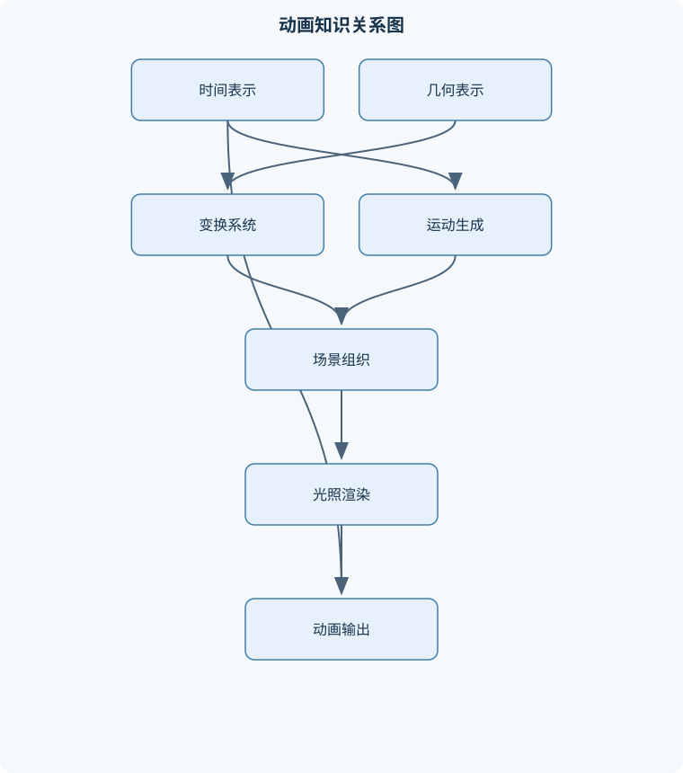
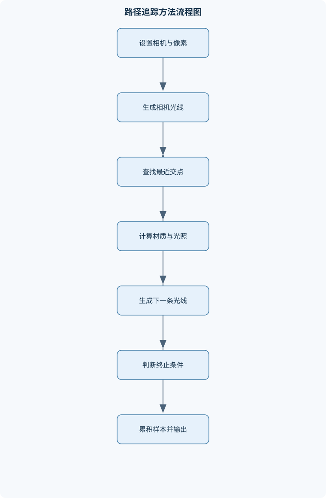

# 计算机动画

## 一、课程整体知识框架

### 课程边界与先修知识

本课程研究利用计算机生成连续或离散视觉运动的基本原理、数学模型、表示方法、渲染流程与工程实现。内容覆盖二维与三维几何、坐标变换、关键帧与插值、层次化建模、刚体与粒子运动、骨骼动画、摄像机与投影、光栅化与光线追踪、材质与光照、动画渲染优化及结果评估。课程重点是动画数据如何描述、运动如何生成、场景如何组织、图像如何由三维场景计算得到。先修知识包括高等数学中的向量与矩阵、基础线性代数、数据结构与算法、计算机图形学基础、基本编程能力，以及对离散时间、采样和数值误差的理解。不以特定软件界面操作为课程边界，但可用通用三维动画软件或自研程序验证原理。





### 1. 课程对象、问题边界与基本表示

计算机动画研究如何利用计算机生成随时间变化的视觉结果。输入通常包括几何模型、材质、光源、摄像机、动画控制数据和时间参数；输出可以是单帧图像、连续图像序列、实时显示画面或可供其他系统使用的动画状态。动画的核心不只是“让物体移动”，而是同时规定了对象是什么、对象在何时处于什么状态、状态如何随时间变化，以及该状态如何被摄像机和渲染器转换为图像。

动画时间通常记为 $t$，离散帧编号记为 $k$，帧率记为 $f$，帧间隔为

$$
\Delta t=\frac{1}{f}.
$$

其中，$t$ 的单位通常为秒，$f$ 的单位为帧每秒，$\Delta t$ 的单位为秒。若系统以固定帧率运行，第 $k$ 帧的采样时间可写为 $t_k=k\Delta t$；若系统采用可变帧率，则相邻帧的实际时间间隔可能不同，不能把帧编号差直接当作相同的物理时间。离散帧只是对连续时间状态的采样，帧与帧之间是否自然，取决于运动模型、插值方法和采样频率，而不是取决于帧数本身。

课程中的对象状态可以分成几何状态和时间状态。几何状态包括位置、旋转、缩放、网格顶点、骨骼姿态、粒子位置与速度等；时间状态包括当前时间、生命周期、关键帧区间、模拟步数和渲染采样时刻。动画系统的更新过程通常是：

$$
\text{输入数据}
\rightarrow
\text{时间推进}
\rightarrow
\text{状态更新}
\rightarrow
\text{场景组织}
\rightarrow
\text{可见性与光照计算}
\rightarrow
\text{图像输出}.
$$

离线渲染可以在较长时间内计算单帧高质量结果，常用于影视、产品展示和高质量视觉效果；实时渲染要求在有限帧时间内完成更新和绘制，常用于交互应用、游戏和虚拟现实。二者共享几何、变换、材质和摄像机等基础知识，但在精度、采样数、光照近似和计算预算方面不同。实时系统更重视稳定帧时间，离线系统则可以用更多样本、更多光线反弹或更复杂的全局光照换取质量。

### 2. 场景图、动画对象与数据流

场景图是组织动画场景的层次结构。节点可以表示模型、骨骼关节、摄像机、灯光、粒子发射器或空的变换控制节点。每个节点通常保存局部变换 $T_{\text{local}}$，并通过父子关系获得世界变换。若父节点的世界变换为 $T_{\text{parent}}$，则子节点世界变换为

$$
T_{\text{world}}=T_{\text{parent}}T_{\text{local}}.
$$

这里采用列向量约定，矩阵右侧的变换先作用于点。若改用行向量约定，乘法书写顺序会相反；因此不能脱离约定谈论“矩阵顺序正确”或“矩阵顺序错误”。场景图应保持无环，否则世界变换无法从根节点确定地传播到所有节点。

动画数据可以按通道存储。例如，一个对象的位置通道保存若干时间—数值对，旋转通道保存四元数关键帧，材质通道保存颜色或粗糙度随时间的变化。数据结构至少需要包含时间戳、数值、插值方式和区间外行为。区间外行为可以是夹紧、循环、镜像循环或外推。外推并不等于合理预测：线性外推可能使角色离开场景，角速度外推可能产生无限旋转，物理量外推则可能违反碰撞或能量约束。

理想模型假设浮点运算精确、时间连续、几何无退化、碰撞检测完整且渲染资源无限。工程实现则受到浮点误差、内存带宽、GPU并行结构、输入数据质量、遮挡关系、透明度排序和有限帧时间的限制。因此课程同时关注“数学模型是否成立”和“模型在离散系统中是否稳定”。

### 3. 二维与三维几何变换

三维点记为 $p$，方向向量记为 $v$，法向量记为 $n$。点具有位置语义，方向向量只表示方向或位移，平移应作用于点而不应作用于方向向量。齐次坐标将点写为 $(x,y,z,1)$，将方向向量写为 $(x,y,z,0)$，从而可以用统一矩阵表达旋转、缩放和平移。

刚体变换写作

$$
T=
\begin{bmatrix}
R & t\\
0 & 1
\end{bmatrix},
$$

其中 $R$ 为 $3\times3$ 旋转矩阵，$t$ 为平移向量。合法旋转矩阵应满足

$$
R^{\mathsf T}R=I,\qquad \det(R)=1.
$$

若 $\det(R)=-1$，则包含镜像反射而非纯旋转。非均匀缩放会改变长度比例，缩放与旋转一般不可交换；平移与旋转也通常不可交换。一个局部点到世界坐标的变换可写为

$$
p_w=M_{\text{parent}}M_{\text{local}}p_l.
$$

矩阵右侧先作用，因此“先缩放、再旋转、后平移”在列向量约定下应写成 $T R S p_l$。如果把矩阵顺序写成 $SRTp_l$，几何含义就改变了。

欧拉角用三个依次发生的轴旋转表示姿态，优点是直观、适合编辑，缺点是旋转顺序敏感并可能发生万向节锁。万向节锁并不是数值程序突然失效，而是某些姿态下两个旋转自由度重合，导致局部参数无法独立表示全部方向变化。四元数记为 $q=(w,x,y,z)$，单位四元数满足

$$
w^2+x^2+y^2+z^2=1.
$$

单位四元数可避免直接插值欧拉角所产生的轴顺序问题，但必须在计算后保持单位长度，并处理 $q$ 与 $-q$ 表示同一旋转这一双覆盖性质。

法向量不能在一般情况下直接使用模型矩阵变换。若切向量满足 $v'=Mv$，要求变换后的法向量仍满足 $n'\cdot v'=0$，则

$$
n'^{\mathsf T}Mv=0.
$$

令对任意 $v$ 成立，可得

$$
M^{\mathsf T}n'=n,
\qquad
n'=(M^{-1})^{\mathsf T}n
$$

再进行归一化。非均匀缩放下直接使用 $M n$ 会使法向量不再垂直于表面切线；只有在刚体变换或均匀缩放等特殊条件下，直接使用旋转部分通常才足够。

### 4. 关键帧、曲线与运动连续性

关键帧给出若干离散时间上的状态约束。给定相邻关键帧 $(t_0,x_0)$ 和 $(t_1,x_1)$，令

$$
u=\frac{t-t_0}{t_1-t_0},
\qquad 0\leq u\leq1,
$$

线性插值为

$$
x(u)=(1-u)x_0+ux_1.
$$

这里 $x$ 可以是标量、位置坐标或某些可线性插值的参数，但不能把普通线性插值直接用于旋转姿态而不考虑旋转空间。线性插值保证端点通过，但速度为常量

$$
\frac{dx}{dt}=\frac{x_1-x_0}{t_1-t_0}.
$$

相邻区间若斜率不同，关键帧处速度不连续；若还要求加速度连续，则需要更高阶曲线。

三次Hermite曲线使用两个端点位置和两个端点切向量：

$$
x(u)=h_{00}(u)x_0+h_{10}(u)m_0+
h_{01}(u)x_1+h_{11}(u)m_1,
$$

其中

$$
\begin{aligned}
h_{00}(u)&=2u^3-3u^2+1,\\
h_{10}(u)&=u^3-2u^2+u,\\
h_{01}(u)&=-2u^3+3u^2,\\
h_{11}(u)&=u^3-u^2.
\end{aligned}
$$

$m_0,m_1$ 是对归一化参数的切向量。通过相邻关键帧差分估计切向量，可使位置和速度在连接处连续；但过大的切向量可能产生过冲，使物体穿过墙壁或出现不合理反向运动。缓入缓出曲线本质上是对时间参数 $u$ 再映射，例如使用单调的平滑函数改变速度节奏，而不是改变几何端点。

旋转插值应使用球面线性插值。单位四元数 $q_0,q_1$ 的点积若为负，应将其中一个取反，以选择较短弧。令

$$
\theta=\arccos(q_0\cdot q_1),
$$

当 $\sin\theta$ 不接近零时，

$$
\operatorname{slerp}(q_0,q_1,u)=
\frac{\sin((1-u)\theta)}{\sin\theta}q_0+
\frac{\sin(u\theta)}{\sin\theta}q_1.
$$

当两个四元数非常接近时，直接使用该公式会发生除以接近零的问题，可改用归一化线性插值。时间重映射把原始时间 $t$ 映射为控制时间 $\tau=g(t)$，可用于慢动作、快动作、循环和节奏调整，但若 $g(t)$ 不单调，可能使动画回退或出现时间折返。

### 5. 层次化建模与角色动画

骨骼角色由关节层次、骨骼长度、局部姿态和皮肤网格组成。正向运动学从根节点开始，将关节局部变换依次累乘，得到所有关节世界姿态。若关节链局部变换为 $T_1,T_2,\ldots,T_n$，则末端姿态由从根到末端的有序乘积决定。正向运动学适合已知每个关节角度、需要快速得到末端位置的场景。

逆向运动学给定末端目标位置，反求关节参数。对于二维两连杆，连杆长度为 $l_1,l_2$，根节点到目标的距离为 $r$，目标可达的必要条件为

$$
|l_1-l_2|\le r\le l_1+l_2.
$$

若不满足条件，系统只能将末端放到约束允许的最近位置或执行优先级更高的姿态策略。数值方法如循环坐标下降和雅可比方法通过迭代减小末端误差，但必须结合关节角限位、障碍物约束和最大迭代次数。

蒙皮将骨骼运动传递给网格。线性混合蒙皮通常写为

$$
p'=\sum_i w_iT_i p,
\qquad
w_i\ge0,\quad \sum_iw_i=1.
$$

权重表示顶点受各关节影响的程度。线性混合在大幅扭转时可能出现“糖纸”塌陷或体积损失；双四元数蒙皮能更好地保持旋转体积，但实现和权重处理更复杂。角色动画还必须处理脚底滑动、手部目标约束、身体与服装穿插以及关节极限。仅使末端到达目标并不代表姿态合理，约束优先级和姿态连续性同样重要。

### 6. 刚体、粒子与布料运动

质点状态通常由位置 $x$ 和速度 $v$ 表示；刚体还需要姿态、角速度 $\omega$ 和角动量 $L$。经典力学近似下，

$$
F=ma,
\qquad
L=I\omega,
$$

其中 $F$ 为外力，单位为牛顿；$m$ 为质量，单位为千克；$a$ 为加速度，单位为米每二次方秒；$I$ 为转动惯量张量；$\omega$ 单位为弧度每秒。该模型适用于宏观低速、非相对论条件，不能直接描述流体内部复杂应力、塑性断裂或量子尺度现象。

半隐式欧拉积分先更新速度，再使用新速度更新位置：

$$
v_{k+1}=v_k+\frac{F_k}{m}\Delta t,
\qquad
x_{k+1}=x_k+v_{k+1}\Delta t.
$$

相较显式欧拉使用 $x_k$ 和 $v_k$ 同时推进，半隐式欧拉通常具有更好的能量行为，但并不能保证所有系统稳定。高刚度弹簧、强碰撞约束或过大的 $\Delta t$ 仍会造成震荡、穿透或能量爆炸。阻尼可表示为与速度相反的力，例如 $F_d=-cv$，其中 $c$ 为阻尼系数；阻尼过小会持续振荡，过大则会使运动失去弹性。

碰撞响应需要沿接触法线分解相对速度。无摩擦、恢复系数为 $e$ 的理想碰撞满足碰撞后法向相对速度与碰撞前相反，并缩小为 $e$ 倍。恢复系数取 $0$ 表示完全非弹性，取 $1$ 表示理想弹性；实际系统还要处理摩擦、旋转、多个接触点和穿透修正。只检查几何相交而不修正时间步内的连续运动，可能导致物体从薄墙中“穿过去”。

粒子系统把烟尘、火花、雨雪等效果分解成大量独立或弱耦合粒子。每个粒子至少需要位置、速度、剩余寿命和渲染属性。发射器按照时间或事件产生粒子，外力场更新速度，生命周期到期后删除粒子。布料可用弹簧质点模型近似，结构弹簧维持相邻点距离，剪切弹簧抵抗对角变形，弯曲弹簧控制折叠。约束投影方法通过直接修正位置满足长度约束，适合实时布料，但其结果不一定等价于严格物理积分。透明粒子通常需要按深度排序或使用适合的近似混合方法；直接写入深度缓冲可能遮挡后方透明粒子。

### 7. 摄像机、投影与时间视觉效果

局部坐标 $p_l$、世界坐标 $p_w$、观察坐标 $p_v$ 和裁剪坐标 $p_c$ 描述同一点在不同参考系中的表示。常见变换链为

$$
p_c=P\,V\,M\,p_l,
$$

其中 $M$ 为模型变换，$V$ 为世界到观察坐标的变换，$P$ 为投影矩阵。透视投影中，摄像机坐标点 $(x,y,z)$ 在成像平面上的位置与深度成反比，因此远处物体投影尺寸更小。正交投影不产生距离缩小，适合工程图、界面和某些非透视视觉风格。

视锥体由左右、上下、近裁剪面和远裁剪面界定。裁剪应在透视除法前依据裁剪坐标执行；透视除法后得到规范化设备坐标，再经过视口映射得到像素位置。近裁剪面过小会降低深度缓冲精度，远近比例过大时容易出现深度冲突。

摄像机动画包括位置轨迹、目标跟踪、轨道运动和朝向约束。目标跟踪不能只对位置做插值，还需要保证上方向、视线方向和滚转角稳定，否则摄像机可能突然翻转。运动模糊是曝光时间内多个时刻图像的积分，不能简单等同于把一帧图像向运动方向平移。景深则由光圈、焦距、焦平面和物距共同影响，焦平面附近清晰，前后区域逐渐模糊。镜头语言还要求保持视线方向、屏幕方向和动作连续性；单帧构图正确并不保证连续镜头没有跳切或空间关系混乱。

### 8. 几何表示与光栅化渲染

三角网格由顶点、索引、边和面构成，拓扑关系决定相邻面、边界和法向连续性。曲线可用控制点和参数函数表示，曲面可用参数曲面、细分曲面或隐式表面表示。包围盒是几何体的快速保守近似：若光线没有击中包围盒，则不必检查内部图元；击中包围盒并不等于击中真实表面。

光栅化流程通常包括顶点变换、图元装配、裁剪、透视除法、视口变换、三角形覆盖测试、属性插值、深度测试和片元着色。三角形内部点可用重心坐标表示：

$$
p=\alpha p_0+\beta p_1+\gamma p_2,
\qquad
\alpha+\beta+\gamma=1,
\qquad
\alpha,\beta,\gamma\ge0.
$$

颜色、纹理坐标和其他顶点属性也可插值。但透视投影后直接在屏幕空间线性插值会产生错误，通常需要使用深度相关的透视校正插值。纹理采样还涉及重复、夹取、过滤和多级纹理；缩小纹理若只取单个最近邻样本，容易产生闪烁和摩尔纹。

背面剔除依赖顶点绕序和观察方向；错误的绕序可能使可见面被剔除。深度测试解决不透明表面的前后遮挡，但透明表面通常需要排序、深度预通道或其他专门策略。抗锯齿可以通过多重采样、时间采样或后处理降低几何边缘和动画闪烁，但样本增加会带来带宽和计算开销。

### 9. 光线追踪与物理真实感渲染

光线可写为

$$
r(t)=o+td,\qquad t\ge0,
$$

其中 $o$ 为起点，$d$ 为方向，$t$ 是沿光线的距离参数。光线追踪从摄像机发射光线，寻找最近有效交点，再根据材质和光源计算可见性与反射。形状接口通常统一提供包围盒、表面积和求交函数，使渲染器不必知道球体、三角形等具体内部实现。

例如，球心为 $c$、半径为 $R$ 时，将光线代入

$$
\|o+td-c\|^2=R^2
$$

可得二次方程。若判别式小于零，则无交点；若判别式非负，选择满足 $t\ge0$ 且最小的有效根。若光线起点位于球内，可能只有一个正根，不能机械地只取通常假设下的“近根”。浮点误差还可能导致交点再次与原表面相交，需要沿法线设置合理的微小偏移，但偏移过大又会造成漏光。

材质的BRDF记为 $f_r(\omega_i,\omega_o)$，描述入射方向 $\omega_i$ 到出射方向 $\omega_o$ 的方向响应；辐亮度记为 $L$，入射辐照度记为 $E$。BRDF、材质颜色和光源强度不是同一概念。理想漫反射表面的方向响应与余弦项相关，但颜色通道值还必须区分线性空间和显示编码空间。若直接把显示编码后的数值当作线性辐射量参与光照，混合和曝光结果会出现系统性偏差。

渲染方程表达表面出射辐亮度由自发光和各方向入射光贡献组成。路径追踪用随机方向估计积分，每像素使用 $N$ 条路径时，统计误差通常随 $1/\sqrt N$ 下降；这意味着要将噪声降低约一半，通常需要约四倍样本，并不保证每次结果完全一致。重要性采样让更多样本集中在贡献较大的方向，能够降低方差。俄罗斯轮盘赌可随机终止长路径，但应使用无偏的权重补偿。降噪可以改善视觉质量，却不能替代收敛；强行降噪可能抹去细节或产生时间闪烁。

### 10. 动画系统实现、优化与评估

动画系统的更新循环通常分为输入处理、时间推进、动画采样、层次变换更新、物理或粒子模拟、可见性计算、渲染提交和结果输出。关键帧区间定位可使用二分查找，若关键帧数量为 $n$，定位复杂度为 $O(\log n)$；单个通道插值通常为 $O(1)$。场景图深度优先更新的节点复杂度为 $O(n)$，前提是每个节点只访问一次且图无环。

缓存世界变换可以避免同一帧内反复计算父子乘积；但父节点变化后必须使所有后代缓存失效。关键帧压缩可删除误差低于阈值的中间键，但位置、旋转和缩放应分别使用有意义的误差度量。流式数据适合粒子和大规模实例，但需要控制内存分配和数据搬运。并行计算适合粒子更新、顶点变换、光栅化片元和部分求交任务；层次依赖强、分支不规则的任务可能难以获得线性加速。

性能评估不能只看平均帧率。实时系统还应考察帧时间均值、峰值和尾部延迟，离线渲染还应考察单位画面时间、样本数和噪声。画面质量包括几何正确性、遮挡关系、材质一致性、抗锯齿和曝光；动画质量还包括时间连续性、速度节奏、碰撞稳定性、穿插、脚底滑动和帧间闪烁。理想模型中的高精度结果不一定适合作为实时方案，低延迟方案也不一定满足物理真实感要求。

## 二、章节和模块划分

### 核心知识覆盖清单

本清单用于检查正文是否覆盖本课程的主要知识模块：

- **计算机动画概论与表示基础**：计算机动画的定义与分类、离散帧与连续运动、场景图与动画对象、几何状态与时间状态、动画系统的输入输出、离线渲染与实时渲染、理想模型与工程限制。
- **二维与三维几何变换**：点向量与方向向量、齐次坐标表示、平移旋转与缩放、欧拉角与万向节锁、四元数旋转、局部坐标与世界坐标、变换矩阵的组合顺序、法向量的逆转置变换。
- **关键帧动画与插值**：关键帧的时间参数化、线性插值与分段插值、三次样条与连续性、位置速度加速度连续性、旋转插值与四元数球面插值、缓入缓出曲线、时间重映射、轨迹编辑与约束。
- **层次化建模与角色动画**：场景图的父子关系、局部变换传播、关节链与骨骼层次、正向运动学、逆向运动学、蒙皮权重与线性混合蒙皮、双四元数蒙皮、角色动画中的约束与穿插。
- **刚体与物理运动**：质心与刚体状态、牛顿运动方程、角动量与转动惯量、半隐式欧拉积分、约束与接触响应、碰撞检测与碰撞处理、数值稳定性与时间步长、阻尼与能量损失。
- **粒子系统与布料基础**：粒子状态与发射器、外力场与生命周期、弹簧质点模型、布料的结构弯曲与剪切弹簧、风力与阻力模型、约束投影方法、流体效果的近似表达、粒子排序与透明渲染。
- **摄像机与投影动画**：观察坐标系、正交投影与透视投影、视锥体与裁剪、摄像机轨迹、目标跟踪与朝向约束、运动模糊的时间积分、景深与焦平面、镜头语言与视觉连续性。
- **几何表示与光栅化渲染**：三角网格与拓扑、曲线曲面表示、包围盒与空间划分、模型视图投影变换、背面剔除与深度测试、顶点属性插值、纹理坐标与采样、抗锯齿与帧缓冲。
- **光线追踪与物理真实感渲染**：光线与几何体求交、射线递归与可见性、形状与图元抽象、材质与双向反射分布函数、直接光照与间接光照、蒙特卡洛积分、路径追踪与重要性采样、降噪与收敛性。
- **动画系统实现与性能评估**：动画数据结构、时间线与更新循环、渲染管线组织、缓存与流式数据、关键帧压缩、层次更新优化、并行计算与图形处理器、画面质量与性能指标。


### 1. 模块一：计算机动画概论与表示基础

本模块先建立“状态—时间—图像”的统一认识。课程使用离散时间更新连续运动：动画系统在时间 $t_k$ 读取状态，经过更新得到下一时刻状态，再由摄像机和渲染器产生图像。需要区分动画状态更新频率、渲染频率和显示频率；三者可以相同，也可以不同。例如物理模拟可用固定步长更新，渲染则按照当前显示时间插值状态。

动画对象的输入包括模型数据、关键帧、控制器、约束、外力和摄像机；输出包括对象状态、渲染命令、帧缓冲图像或导出的动画文件。一个完整系统必须明确数据单位、坐标约定、时间基准、颜色空间和资源生命周期。没有这些约定，即使每个局部模块都能运行，组合后也可能出现比例错误、镜头抖动或材质亮度异常。

### 2. 模块二：二维与三维几何变换

#### 关键算法：层次化场景更新

**输入**：无环场景树、每个节点的局部变换、根节点世界变换和时间 $t$。  
**输出**：每个节点的世界变换。

过程如下：

1. 从根节点开始，令根节点世界变换为预设的世界变换与根局部变换的组合。
2. 访问一个节点时，先确认父节点世界变换已经计算完成。
3. 对每个子节点计算 $T_{\text{world}}=T_{\text{parent}}T_{\text{local}}$。
4. 按深度优先或广度优先方式继续访问子节点。
5. 所有可达节点处理完毕后终止。

不变量是：访问节点时，其父节点世界变换已经确定。若场景树节点数为 $n$，每个节点只访问一次，则时间复杂度为 $O(n)$，存储复杂度主要来自节点和遍历栈。若检测到环，应立即报告层次结构错误，而不是无限递归。

```python
# Python：列向量约定下的层次变换伪实现
def update_world(node, parent_world):
    node.world = parent_world @ node.local

    for child in node.children:
        update_world(child, node.world)
```

该代码假设 `node.children` 构成无环树，`@` 表示矩阵乘法。实际实现还应处理脏标记：只有自身局部变换或祖先发生变化的节点才需要重新计算；若父节点未变化，则可以复用缓存。

### 3. 模块三：关键帧动画与插值

#### 关键算法：关键帧采样与插值

**输入**：按时间严格递增的关键帧序列、查询时间 $t$、插值类型。  
**输出**：时刻 $t$ 的位置、旋转、缩放等对象状态。

过程是先对关键帧时间进行区间定位，再计算

$$
u=\frac{t-t_i}{t_{i+1}-t_i}.
$$

位置和缩放可使用线性或Hermite插值；旋转使用四元数球面插值。若 $t$ 超出关键帧范围，依据通道策略执行夹紧、循环、镜像循环或外推。区间时间必须严格递增，否则分母可能为零，且动画时间语义不明确。二分定位为 $O(\log n)$，完成固定数量通道插值为 $O(1)$。

**例题一：线性与Hermite插值比较**

**题干**：物体在 $t_0=0$ 秒时位于 $x_0=0$ 米，在 $t_1=2$ 秒时位于 $x_1=10$ 米。求 $t=0.5$ 秒的线性插值位置，并说明相邻区间斜率不同会产生什么现象。若端点切向量分别为 $m_0=4$ 米、$m_1=6$ 米，求同一时刻的Hermite位置。

**分析**：归一化时间为

$$
u=\frac{0.5-0}{2-0}=0.25.
$$

线性插值使用端点位置；Hermite插值还使用切向量。切向量单位应与位置相同，因为它是对归一化参数的导数；若直接使用对真实时间的速度，应先根据区间时长换算。

**解答**：

$$
x_{\text{linear}}=(1-0.25)\times0+0.25\times10=2.5\text{ 米}.
$$

在 $u=0.25$ 时，

$$
h_{00}=0.84375,\quad h_{10}=0.140625,
$$

$$
h_{01}=0.15625,\quad h_{11}=-0.046875.
$$

因此

$$
x_{\text{Hermite}}
=0.84375\times0
+0.140625\times4
+0.15625\times10
-0.046875\times6
=1.75\text{ 米}.
$$

**结果验证**：线性结果位于端点连线的四分之一处；Hermite结果因初始切向量较小而低于线性结果，符合其曲线形状。若相邻区间斜率不同，线性插值在连接处速度发生跳变；Hermite曲线可通过统一切向量使速度连续。

**变式**：若 $t_1=t_0$，插值公式无定义，必须拒绝重复时间键或合并同时间关键帧；若查询时间超过末帧，外推可能使位置快速越界，通常应根据动画语义选择夹紧或循环。

### 4. 模块四：层次化建模与角色动画

#### 正向运动学与逆向运动学

正向运动学的输入为骨骼树、关节局部变换和根节点世界姿态，输出为各关节世界姿态。沿根到末端有序累乘即可，复杂度为 $O(n)$。逆向运动学以末端目标、关节限制和误差阈值为输入，通过CCD或雅可比迭代调整关节。终止条件可以是末端误差小于阈值、迭代次数达到上限或单轮更新量很小。

**例题二：二维两连杆可达性**

**题干**：二维机械臂两段长度分别为 $l_1=3$ 米和 $l_2=2$ 米，目标点到根节点的距离为 $r=4$ 米。判断目标是否可达，并求肘关节相对角的余弦。

**分析**：可达条件是

$$
|3-2|\le4\le3+2,
$$

成立，因此目标在可达环带内。根据余弦定理，肘关节夹角 $\theta_2$ 满足

$$
r^2=l_1^2+l_2^2+2l_1l_2\cos\theta_2.
$$

**解答**：

$$
16=9+4+12\cos\theta_2,
$$

所以

$$
\cos\theta_2=\frac{3}{12}=0.25.
$$

因此存在两个对称姿态：

$$
\theta_2=\pm\arccos(0.25).
$$

分别对应“肘上”和“肘下”构型。

**结果验证**：将任一解代回余弦定理，都能得到 $r=4$ 米。若目标距离大于 $5$ 米或小于 $1$ 米，则无精确解。工程上可把目标投影到可达边界，再执行近似求解；若存在关节角限制，即使几何上可达，也可能因限位而无解。

### 5. 模块五：刚体与物理运动

#### 半隐式欧拉积分

**输入**：$x,v,\omega,m,I,F,\tau,\Delta t$。  
**输出**：一个时间步后的刚体位置、速度和姿态。

先计算线性加速度 $a=F/m$，再更新

$$
v\leftarrow v+a\Delta t,\qquad
x\leftarrow x+v\Delta t.
$$

角速度更新需结合力矩和转动惯量；姿态更新后应重新归一化四元数。碰撞发生时，沿接触法线计算相对速度和冲量，并根据恢复系数修正法向速度；摩擦则需要额外处理切向分量。该方法适合步长较小、约束刚性有限的系统，单个刚体单步计算通常为 $O(1)$。

**例题三：一维无摩擦碰撞**

**题干**：物体质量为 $m=2$ 千克，碰撞前沿接触法线的相对速度为 $v_n=-3$ 米每二次方秒，恢复系数为 $e=0.5$。求碰撞后的法向相对速度，并解释 $e=0$ 与 $e=1$ 的含义。

**分析**：负号表示物体沿接触法线相互接近。无摩擦碰撞的恢复关系为

$$
v_n'=-e v_n.
$$

质量在求相对速度时不直接出现在该关系中；若求具体冲量，则需要质量或等效质量。

**解答**：

$$
v_n'=-0.5\times(-3)=1.5\text{ 米每二次方秒}.
$$

正号表示碰撞后沿法线分离。$e=0$ 表示完全非弹性，法向相对速度变为零；$e=1$ 表示理想弹性，速度大小不因法向碰撞而损失。

**结果验证**：碰撞前后法向相对速度方向相反，且碰撞后大小为碰撞前大小的一半，符合恢复系数定义。若使用过大的显式积分步长，物体可能在一次更新中穿过碰撞面，即使碰撞公式正确，也会出现穿透。

### 6. 模块六：粒子系统与布料基础

#### 粒子更新流程

**输入**：粒子集合、发射率、外力场、碰撞体、时间步长和粒子材质。  
**输出**：当前时间步存活粒子及其位置、速度、颜色、大小和透明度。

处理顺序通常为：按发射率创建粒子；计算重力、风力和阻力；积分速度与位置；执行碰撞或边界约束；减少剩余寿命；删除寿命小于等于零的粒子；准备渲染属性。若当前有 $n$ 个粒子，逐粒子更新通常为 $O(n)$，空间复杂度为 $O(n)$。粒子排序、碰撞检测和透明混合可能成为额外开销。

布料的结构、剪切和弯曲弹簧分别约束不同方向的变形。弹簧刚度越大，越接近不可伸长布料，但允许的稳定时间步越小。约束投影能够快速修正长度误差，然而过少迭代会造成布料伸长，过多迭代则增加计算成本。流体效果常用粒子群、速度场、噪声场或体积近似表现，不应把视觉近似误认为严格流体求解。

### 7. 模块七：摄像机与投影动画

#### 光栅化渲染流程

**输入**：顶点、索引、材质、摄像机、光源和帧缓冲。  
**输出**：分辨率为 $W\times H$ 的二维图像。

流程为：模型变换；观察变换；投影变换；图元装配；裁剪；透视除法；视口映射；三角形覆盖测试；重心坐标插值；深度测试；片元着色；颜色写入帧缓冲。覆盖像素数量和图元数量共同影响计算量。深度测试只能解决不透明表面的遮挡，透明对象还需处理排序和混合顺序。

**例题四：重心坐标插值**

**题干**：三角形三个顶点颜色分别为红色 $C_0=(1,0,0)$、绿色 $C_1=(0,1,0)$ 和蓝色 $C_2=(0,0,1)$。内部点重心坐标为 $\alpha=0.2,\beta=0.3,\gamma=0.5$。求点的颜色。

**分析**：重心坐标满足非负且和为 $1$，因此点位于三角形内部。属性可按相同权重线性插值。

**解答**：

$$
C=0.2C_0+0.3C_1+0.5C_2
=(0.2,0.3,0.5).
$$

**结果验证**：三个颜色通道之和为 $1$，且每个通道均在 $[0,1]$ 范围内。若某个坐标为负或三者之和不为 $1$，则点可能位于三角形外部或计算存在误差。透视投影下不能总是在屏幕坐标中直接使用该插值，必须进行透视校正，否则纹理会出现深度相关的变形。

**变式**：若点位于边上，则一个重心坐标为零；若位于顶点，则一个坐标为 $1$、其余为 $0$。三角形退化时面积为零，重心坐标计算不稳定，应在图元装配阶段剔除或单独处理。

### 8. 模块八：光线追踪与物理真实感渲染

#### 光线与三角形求交

**输入**：光线 $r(t)=o+td$ 和三角形顶点 $p_0,p_1,p_2$。  
**输出**：是否相交、距离 $t$、重心坐标及交点法向量。

构造边向量 $e_1=p_1-p_0$、$e_2=p_2-p_0$，求解交点参数与重心坐标。若 $t<0$、$\beta<0$、$\gamma<0$ 或 $\beta+\gamma>1$，则交点不在有效射线和三角形内部。浮点实现需要设置容差，不能把极小负数不加判断地视为有效结果。空间加速结构先测试包围盒，再测试候选图元；包围盒命中只是筛选结果。

**例题五：光线与球求交**

**题干**：光线为

$$
r(t)=(0,0,0)+t(0,0,1),
$$

球心为 $c=(0,0,5)$，半径为 $1$ 米。求交点，并判断若光线方向改为 $(0,1,0)$ 是否相交。

**分析**：代入球方程：

$$
\|o+td-c\|^2=1.
$$

原光线沿 $z$ 轴，球心也位于 $z$ 轴上，因此会穿过球心。方向改为 $y$ 轴后，光线与球心的最近距离为 $5$ 米，大于半径。

**解答**：原方向下，

$$
(0,0,t-5)^2=1,
$$

所以

$$
t-5=\pm1,
\qquad t=4\text{ 或 }6.
$$

最近有效交点为 $t=4$，交点为 $(0,0,4)$，表面法向量为

$$
n=\frac{(0,0,4)-(0,0,5)}{1}=(0,0,-1).
$$

改为方向 $(0,1,0)$ 时，光线上点为 $(0,t,0)$，到球心距离平方为

$$
t^2+25,
$$

其最小值为 $25>1$，因此无交点。

**结果验证**：交点到球心距离均为 $1$ 米，且选择了最小的正根。若光线起点位于球内，可能只有一个正根；若两个根都小于零，则球在射线起点后方，不应报告为可见交点。

### 9. 模块九：动画渲染优化与结果评估

#### 路径追踪流程

**输入**：摄像机、场景、材质、光源、每像素样本数 $N$ 和最大反弹深度。  
**输出**：每个像素的辐亮度估计。

每条路径从像素生成摄像机光线，查找最近交点；若未命中则返回环境光或背景；若命中则计算自发光和直接光照，根据BRDF采样下一方向，累加路径贡献；达到最大深度或俄罗斯轮盘赌终止条件后结束。每像素 $N$ 条路径、平均反弹深度为 $d$ 时，基本计算量近似为 $O(Nd)$，实际还取决于求交结构和材质分支。

增加样本数只能逐渐降低蒙特卡洛噪声，误差通常近似按 $1/\sqrt N$ 缩小。重要性采样能在相同样本数下降低方差，但采样概率密度必须正确进入权重，否则结果会有系统偏差。动画渲染还要检查相邻帧噪声是否闪烁；逐帧独立降噪可能导致静态物体表面在时间上跳动，因此需要时间一致性策略或共享信息。

### 10. 实验与项目流程

#### 实验一：关键帧、四元数与镜头运动验证

**输入数据**：至少三个位置关键帧、三个旋转关键帧、一个摄像机目标点和一段固定时长。位置单位为米，时间单位为秒，旋转使用单位四元数。

**步骤**：

1. 实现线性位置插值和Hermite位置插值。
2. 对旋转关键帧执行四元数点积检查、短弧选择和球面插值。
3. 在固定时间采样下输出位置、速度近似值和旋转矩阵。
4. 将对象置于场景中，用目标跟踪摄像机生成动画。
5. 分别测试固定帧率、可变帧率、循环和区间外夹紧。
6. 检查关键帧端点误差、单位四元数误差和相邻帧位移变化。

**评价标准**：关键帧端点应在容差内通过；四元数长度保持接近 $1$；相邻帧不应出现突然翻转；循环首尾位置、速度和朝向应满足预定连续性；摄像机不能因上方向退化而突然滚转。

**排错方法**：若对象位置跳变，检查关键帧是否排序、时间是否重复以及矩阵乘法约定；若旋转绕远路，检查四元数点积符号；若动画随帧率改变速度，检查是否错误地把 $f$ 当作 $\Delta t$；若摄像机翻转，检查视线方向与上方向是否接近共线。

#### 实验二：光栅化、光线追踪与性能比较

**输入数据**：一个包含三角网格、球体、透明粒子和材质的场景，分辨率为 $W\times H$，设置多组样本数和不同空间加速结构。

**步骤**：

1. 实现模型—观察—投影变换，验证一个已知顶点的裁剪坐标和屏幕坐标。
2. 实现三角形光栅化、重心坐标属性插值和深度测试。
3. 实现光线与球、三角形求交，并对交点距离排序。
4. 建立包围盒层次结构，比较有无加速结构时的求交次数。
5. 使用直接光照和路径追踪生成结果，改变每像素样本数 $N$。
6. 记录渲染时间、平均帧时间、峰值帧时间、噪声水平和透明物体排序错误。

**评价标准**：几何边界应连续，深度关系正确，法向方向一致；包围盒只能减少精确求交，不能改变可见结果；增加样本数时噪声总体下降但时间增加；实时模式关注帧时间稳定性，离线模式关注单位图像时间和画质。

**排错方法**：若模型全部消失，检查裁剪空间范围、顶点绕序和背面剔除；若出现深度闪烁，检查近远裁剪面比例和深度精度；若球体交点错误，检查二次方程判别式及 $t\ge0$ 条件；若光照过暗或过亮，检查法线归一化、线性颜色空间和BRDF权重；若透明粒子顺序错误，检查排序方向、深度写入策略和混合公式。

## 三、核心概念的详细解释

### 1. 动画表示、时间采样与场景组织

计算机动画是对随时间变化的视觉状态进行描述、生成、计算和显示的过程。一个动画对象的状态不只包括位置，还包括旋转、缩放、网格顶点、骨骼姿态、粒子速度、材质参数以及可见性等属性。时间记为 $t$，离散帧编号记为 $k$，帧率记为 $f$，帧间隔为 $\Delta t=1/f$。当帧率为 $24$ 帧每秒时，理想固定步长为 $\Delta t=1/24$ 秒；帧率是频率，不能直接当作时间步长使用。

离散帧是连续运动状态的采样。若物体在连续时间中的位置为 $x(t)$，渲染器只在 $t_k$ 处计算图像，则两个采样时刻之间的视觉运动必须由插值、物理积分或其他运动模型补足。提高帧率可以减少采样间隔，但不能自动修正错误的速度曲线、碰撞穿透或摄像机抖动。若运动中包含高频变化，例如快速旋转、细小粒子或周期性闪烁，采样频率不足会产生混叠。

场景图使用节点组织场景。节点可以表示模型、骨骼关节、摄像机、灯光、粒子发射器或辅助控制器。节点保存局部变换 $T_{\text{local}}$，通过父子关系获得世界变换：

$$
T_{\text{world}}=T_{\text{parent}}T_{\text{local}}.
$$

采用列向量约定时，右侧矩阵先作用于点。场景图通常要求是无环树或有向无环图；若存在环，节点的世界变换无法通过有限次父子传播确定。离线渲染可使用较多光线、样本和高精度模拟，实时渲染则必须在预算帧时间内完成更新和绘制，因此通常采用近似光照、有限反弹和缓存。

### 2. 二维、三维几何与坐标变换

点 $p$ 表示位置，方向向量 $v$ 表示位移、速度方向或切向方向，法向量 $n$ 表示曲面局部方向。点与方向向量即使数值上都写成三元组，仿射变换中的语义也不同。齐次坐标将三维点写为 $(x,y,z,1)$，方向向量写为 $(x,y,z,0)$，从而可以用一个四维矩阵统一表示线性变换和平移：

$$
M=
\begin{bmatrix}
A&t\\
0&1
\end{bmatrix},
$$

其中 $A$ 为 $3\times3$ 线性变换矩阵，$t$ 为平移向量。对点有 $p'=Ap+t$，对方向向量有 $v'=Av$。因此平移会改变点的位置，但不会改变纯方向向量。

刚体变换要求 $A=R$ 为旋转矩阵，满足

$$
R^{\mathsf T}R=I,\qquad \det(R)=1.
$$

前一个条件保证长度和夹角保持不变，后一个条件排除镜像反射。缩放、旋转和平移的组合顺序不能交换。例如先缩放后平移与先平移后缩放通常产生不同结果，因为平移也会被后续缩放影响。实际实现必须统一行向量或列向量约定，不能只依据某个矩阵的数字形式判断结果。

欧拉角以三个依次执行的轴旋转表示姿态，直观但依赖旋转顺序，并可能在某些姿态下使两个旋转轴重合，造成万向节锁。单位四元数 $q=(w,x,y,z)$ 满足

$$
w^2+x^2+y^2+z^2=1,
$$

适合表示三维旋转。四元数插值通常沿单位四元数球面上的较短弧进行，能够避免逐分量欧拉角插值的路径异常，但仍须处理单位化、符号等价和接近相同姿态时的数值问题。

法向量不能在非均匀缩放下直接使用模型矩阵变换。若切向量 $v$ 满足 $n\cdot v=0$，变换后要求 $n'\cdot v'=0$，且 $v'=Mv$，则

$$
n'^{\mathsf T}Mv=0.
$$

要对所有切向量 $v$ 成立，需要

$$
M^{\mathsf T}n'=n,
$$

因此

$$
n'\propto(M^{-1})^{\mathsf T}n.
$$

最后还要归一化。均匀缩放、纯旋转等特殊情况下，直接使用旋转部分可能恰好有效；一般非均匀缩放、剪切或组合变换下必须使用逆转置。

### 3. 关键帧、曲线和时间重映射

关键帧给出若干离散时间上的状态约束。位置关键帧通常记录 $(t_i,x_i)$，旋转关键帧记录 $(t_i,q_i)$。查询时间位于 $[t_0,t_1]$ 时，先计算归一化参数

$$
u=\frac{t-t_0}{t_1-t_0}.
$$

在线性插值中，

$$
x(u)=(1-u)x_0+ux_1,\qquad 0\leq u\leq1.
$$

该公式保证端点通过，但区间内速度为常数，且相邻区间若斜率不同，关键帧处速度不连续。线性插值适合简单位移、颜色或标量参数，不一定适合要求平滑加速度的角色运动。

三次 Hermite 曲线使用两个端点位置和两个端点切向量：

$$
x(u)=h_{00}(u)x_0+h_{10}(u)m_0+
h_{01}(u)x_1+h_{11}(u)m_1,
$$

其中

$$
\begin{aligned}
h_{00}(u)&=2u^3-3u^2+1,\\
h_{10}(u)&=u^3-2u^2+u,\\
h_{01}(u)&=-2u^3+3u^2,\\
h_{11}(u)&=u^3-u^2.
\end{aligned}
$$

这里的 $m_0,m_1$ 是对参数 $u$ 的切向量；若使用实际时间导数，则必须根据区间长度换算。通过让相邻关键帧共享同一端点速度，可以实现位置和速度连续。若还要求加速度连续，则需要更高阶曲线或额外约束。

缓入缓出通常不是改变空间路径，而是改变时间参数。令 $s=g(u)$，其中 $g(0)=0,g(1)=1$，再计算 $x(g(u))$，即可使运动开始和结束时变慢。时间重映射可用于慢动作、循环、加速和镜头节奏，但不应把时间重映射误认为物体受力后的真实物理运动。

旋转不能简单把两个四元数的四个分量分别线性插值后直接使用。设单位四元数为 $q_0,q_1$，先计算点积 $d=q_0\cdot q_1$。由于 $q$ 和 $-q$ 表示同一旋转，若 $d<0$，应令 $q_1\leftarrow-q_1$，以选择较短弧。设夹角为 $\theta=\arccos d$，当 $\sin\theta$ 不接近零时：

$$
\operatorname{slerp}(q_0,q_1,u)=
\frac{\sin((1-u)\theta)}{\sin\theta}q_0+
\frac{\sin(u\theta)}{\sin\theta}q_1.
$$

当两者非常接近时，可使用线性近似后归一化，避免除以接近零的数。

### 4. 层次化建模、骨骼与角色运动

正向运动学从根节点的已知姿态出发，沿骨骼层次向下传播。若第 $i$ 个关节的局部变换为 $T_i^{\text{local}}$，父关节世界变换为 $T_{\text{parent}}$，则

$$
T_i^{\text{world}}=
T_{\text{parent}}T_i^{\text{local}}.
$$

正向运动学适合已知关节角直接生成姿态，计算过程确定、复杂度与关节数线性相关。逆向运动学则给定末端执行器目标位置，反求一组关节参数。目标可能不可达，或受关节角度、长度和碰撞约束限制，因此逆向运动学一般只能求近似解。

CCD 方法从末端关节向根部逐个调整，使末端更接近目标；雅可比方法根据末端误差和关节速度之间的局部线性关系求更新量。数值方法需要误差阈值、最大迭代次数和关节限幅，否则可能振荡、越界或在不可达目标附近持续计算。

线性混合蒙皮使用多个关节变换影响一个顶点：

$$
p'=\sum_i w_iT_i p,\qquad
w_i\geq0,\qquad \sum_iw_i=1.
$$

权重和为 $1$ 有助于保持平移的合理性。大幅扭转时，线性插值可能导致肩部、手腕等区域塌陷，即“糖纸效应”。双四元数蒙皮以旋转和平移的双四元数进行混合，通常能更好保持体积，但实现需要处理双四元数归一化、符号一致和权重归属。蒙皮只描述顶点如何跟随骨骼，不会自动解决服装穿插、肢体碰撞或肌肉体积变化，后者需要碰撞约束、修形或额外模拟。

### 5. 刚体、粒子和布料运动

质心位置 $x$、速度 $v$、质量 $m$ 和外力 $F$ 在经典力学近似下满足：

$$
\frac{dx}{dt}=v,\qquad
\frac{dv}{dt}=\frac{F}{m}.
$$

角速度为 $\omega$，力矩为 $\tau$，转动惯量张量为 $I$，角动量基本关系为

$$
L=I\omega.
$$

在三维非主惯性轴情况下，角速度更新不能简单地把每个分量独立处理；需要考虑惯量张量在当前姿态下的表示。

半隐式欧拉先更新速度，再用新速度更新位置：

$$
v_{k+1}=v_k+a_k\Delta t,\qquad
x_{k+1}=x_k+v_{k+1}\Delta t.
$$

它通常比显式欧拉更适合中等刚性的物理动画，但并不保证所有系统稳定。弹簧刚度高、碰撞约束强或时间步长过大时，仍会出现振荡、能量爆炸或穿透。碰撞响应需要沿接触法线分解相对速度，并用冲量和恢复系数处理法向速度；切向摩擦还需要单独约束，不能只把速度沿法线反射。

粒子系统通常为每个粒子保存位置、速度、剩余寿命、颜色、大小和随机种子。更新流程包括发射、施加重力与阻力、积分、碰撞处理、减少寿命和删除失效粒子。布料可用弹簧质点模型近似，结构弹簧维持网格边长，剪切弹簧维持对角线关系，弯曲弹簧抑制折叠。约束投影可把粒子位置重新拉回满足距离或碰撞约束的状态，但投影顺序、迭代次数和阻尼会影响稳定性。透明粒子通常需要按深度排序，并谨慎处理深度写入和混合顺序。

### 6. 摄像机、投影和运动画面

摄像机变换把世界坐标转换为观察坐标。透视投影中，相机坐标点 $(x,y,z)$ 在成像平面上的位置与 $1/z$ 成正比，因此相同大小的物体距离越远，投影越小。正交投影不进行深度缩放，适合工程图、界面和某些风格化画面。投影后还要执行裁剪、透视除法和视口映射。

摄像机动画不仅是位置轨迹，还包括朝向、焦距、视场角、焦平面和运动模糊。目标跟踪需要构造从摄像机位置指向目标的方向，并选择不与视线共线的上方向；若二者接近共线，摄像机滚转角会变得不稳定。运动模糊是曝光时间内多个时刻图像或辐亮度的积分，不等于简单地把两帧图像平均。镜头连续性还要考虑视线方向、速度变化、剪辑关系和主体在画面中的相对位置。

### 7. 几何表示、光栅化与光线追踪

三角网格由顶点、索引和拓扑组成。顶点可携带位置、法线、颜色、纹理坐标和骨骼权重。包围盒只用于快速排除不可能相交的图元，包围盒命中不代表精确几何命中。空间划分或包围体层次结构可以减少求交候选数量，但构建成本、内存占用和动态场景更新也需要考虑。

光栅化流程通常为：模型变换、观察变换、投影变换、裁剪、透视除法、视口映射、三角形覆盖测试、属性插值、深度测试和片元着色。三角形内部点可写为

$$
p=\alpha p_0+\beta p_1+\gamma p_2,
$$

其中 $\alpha+\beta+\gamma=1$ 且 $\alpha,\beta,\gamma\geq0$。屏幕空间直接插值在透视投影下通常不正确，因为深度导致参数发生非线性变化，需要透视校正插值。背面剔除依赖顶点绕序和观察方向；顶点绕序不一致会使部分面消失或法线方向错误。

光线写作

$$
r(t)=o+td,\qquad t\geq0,
$$

其中 $o$ 为起点，$d$ 为方向。光线追踪通过求交确定可见表面，再计算阴影、反射、折射和间接光照。路径追踪以随机方式估计渲染方程，样本数 $N$ 增加时方差通常按 $1/N$ 下降，标准误差近似按 $1/\sqrt N$ 下降；因此画面噪声不会在少量样本下完全消失。BRDF $f_r(\omega_i,\omega_o)$ 描述入射方向到出射方向的反射响应，不能与材质颜色或光源强度混为一谈。

### 8. 动画系统实现与结果评估

动画系统通常分为数据读取、时间管理、动画采样、场景更新、物理模拟、可见性处理、渲染提交和结果输出。关键帧数据应按时间排序，区间查询可以使用二分查找。时间线必须明确固定步长或可变步长；物理模拟常用固定步长，而显示渲染可采用插值显示，以减小不同机器帧率差异。

性能评价不能只看平均帧率。实时系统还应记录平均帧时间、峰值帧时间、更新耗时、渲染耗时、GPU占用、内存带宽和卡顿次数。动画质量还包括关键帧通过误差、时间连续性、碰撞穿透、粒子生命周期、骨骼穿插、透明排序、噪声闪烁和摄像机抖动。单帧图像漂亮但相邻帧跳动，不能视为动画质量合格。

## 四、重要定义、公式、定理和推导

### 专业审校补充：关键定义与适用边界

时间采样与运动模糊的关键边界是：动画系统计算的是离散时刻的状态，而相机快门记录的是一个曝光时间区间内的光能积分，二者不能简单等同。设一帧中心时刻为 $t_c$，快门开启时间为 $\Delta t_s$，则曝光区间为 $[t_c-\Delta t_s/2,t_c+\Delta t_s/2]$。在忽略遮挡变化、非线性光照和景深的简化条件下，像素曝光值可写为 $C=\frac{1}{\Delta t_s}\int_{t_c-\Delta t_s/2}^{t_c+\Delta t_s/2}L(t)\,dt$，其中 $L(t)$ 是时刻 $t$ 的像素辐射亮度。实际渲染通常用 $N$ 个时间样本估计：$\hat C=\frac{1}{N}\sum_{k=1}^{N}L(t_k)$。快门越长，运动拖影通常越明显；样本数过少会产生时间混叠、断裂边缘或闪烁。若物体速度恒定且几何、遮挡不变，均匀时间采样较可靠；若存在快速加速、旋转、遮挡切换或粒子生成，必须增加样本或采用运动矢量、连续碰撞和更严格的时间积分。离线渲染可提高时间样本数，实时渲染则需在拖影质量与固定帧时间之间取舍。


### 1. 代表性算法与实现流程

#### 关键帧采样与插值

**输入**：按时间递增排列的关键帧序列、查询时间 $t$、插值类型和区间外策略。  
**输出**：时间 $t$ 对应的对象状态。

过程如下：

1. 检查关键帧时间严格递增，若存在重复时间，必须先合并或规定优先级。
2. 对查询时间执行夹紧、循环、镜像循环或外推。
3. 用二分查找定位相邻关键帧，复杂度为 $O(\log n)$。
4. 计算 $u=(t-t_0)/(t_1-t_0)$。
5. 对位置和标量通道执行线性或 Hermite 插值。
6. 对旋转通道执行短弧四元数球面插值，并归一化。
7. 组合各通道，输出局部或世界状态。

不变量是：查询时间位于当前插值区间，且所有通道使用一致的时间参数。终止条件是找到目标区间并完成所有通道计算。外推只适合明确允许预测的参数；对角色位置、碰撞状态和受约束物理量盲目外推可能产生严重错误。

```python
# Python：关键帧标量线性采样
def sample_linear(keys, t, mode="clamp"):
    # keys: [(time, value)]，time 严格递增
    if not keys:
        raise ValueError("关键帧不能为空")
    if len(keys) == 1:
        return keys[0][1]

    t0, v0 = keys[0]
    tn, vn = keys[-1]

    if t <= t0:
        if mode == "clamp":
            return v0
        if mode == "loop":
            period = tn - t0
            t = t0 + ((t - t0) % period)
        else:
            return v0

    if t >= tn:
        if mode == "clamp":
            return vn
        if mode == "loop":
            period = tn - t0
            t = t0 + ((t - t0) % period)
        else:
            return vn

    left, right = 0, len(keys) - 1
    while left + 1 < right:
        mid = (left + right) // 2
        if keys[mid][0] <= t:
            left = mid
        else:
            right = mid

    ta, va = keys[left]
    tb, vb = keys[right]
    u = (t - ta) / (tb - ta)
    return (1.0 - u) * va + u * vb
```

#### 层次化场景更新

**输入**：无环场景树、根节点世界变换、每个节点的局部变换和当前时间。  
**输出**：所有节点的世界变换。

从根节点开始深度优先遍历，先计算当前节点的世界变换，再访问子节点：

$$
T_{\text{world},i}=T_{\text{world},\text{parent}(i)}
T_{\text{local},i}.
$$

不变量是：访问节点时其父节点世界变换已经确定。若节点数为 $n$，每个节点只访问一次，时间复杂度为 $O(n)$，存储复杂度通常为 $O(n)$。场景图存在共享子节点时应记录访问状态，避免重复计算；存在环时必须拒绝输入或采用专门的约束求解流程。

#### 半隐式欧拉刚体积分

**输入**：位置 $x$、速度 $v$、质量 $m$、外力 $F$、角速度 $\omega$、力矩 $\tau$、姿态和时间步长 $\Delta t$。  
**输出**：下一时刻刚体状态。

先计算

$$
a=\frac{F}{m},
$$

再更新

$$
v_{k+1}=v_k+a\Delta t,\qquad
x_{k+1}=x_k+v_{k+1}\Delta t.
$$

角运动还要根据惯量和姿态计算角加速度，再更新角速度与姿态。四元数姿态更新后应归一化，以抑制浮点误差。该方法每个刚体每步的基础计算量为 $O(1)$，但碰撞检测和约束求解可能远高于积分本身。适用边界是时间步长足够小、力场变化不过于剧烈；高刚度弹簧、深度穿透和复杂接触需要更稳定的积分器或约束求解器。

#### 光线与三角形求交

给定三角形顶点 $p_0,p_1,p_2$，令

$$
e_1=p_1-p_0,\qquad e_2=p_2-p_0.
$$

交点可表示为

$$
o+td=p_0+\beta e_1+\gamma e_2.
$$

求解 $t,\beta,\gamma$ 后检查：

$$
t\geq0,\qquad \beta\geq0,\qquad
\gamma\geq0,\qquad \beta+\gamma\leq1.
$$

全部满足才表示射线命中三角形。浮点误差下应使用小容差，且需要排除过近交点，避免反射光线因数值误差再次击中原表面。单个三角形测试为 $O(1)$，但场景总成本取决于候选图元数量，因此通常先测试包围盒层次结构。

### 2. 代表性例题

#### 例题一：变换顺序

**题干**：局部点为 $p=(1,0,0)$。先绕 $z$ 轴旋转 $90^\circ$，再平移 $t=(2,0,0)$。求世界坐标。

**分析**：绕 $z$ 轴旋转后，点变为 $(0,1,0)$。再加平移得到 $(2,1,0)$。

**逐步解答**：

$$
R_z=
\begin{bmatrix}
0&-1&0\\
1&0&0\\
0&0&1
\end{bmatrix},
\qquad
Rp=
\begin{bmatrix}
0\\1\\0
\end{bmatrix}.
$$

因此

$$
p_w=Rp+t=(2,1,0).
$$

若改成先平移再旋转，则中间点为 $(3,0,0)$，旋转后为 $(0,3,0)$。结果不同，说明矩阵乘法顺序具有几何意义。

**结果验证**：旋转保持点到原点距离为 $1$；平移只改变位置，不改变旋转后的方向关系。

**变式**：若对象使用非均匀缩放 $(2,1,1)$，先缩放后旋转与先旋转后缩放仍不同；若缩放为统一比例，旋转与缩放可交换，但平移通常仍不可交换。

#### 例题二：线性插值与速度

**题干**：物体在 $t_0=0$ 秒时位于 $x_0=0$ 米，在 $t_1=2$ 秒时位于 $x_1=6$ 米。求 $t=0.5$ 秒的位置和速度。

**逐步解答**：

$$
u=\frac{0.5-0}{2-0}=0.25,
$$

$$
x=(1-0.25)\times0+0.25\times6=1.5\text{ 米}.
$$

线性插值速度为

$$
v=\frac{x_1-x_0}{t_1-t_0}
=\frac{6}{2}=3\text{ 米/秒}.
$$

**结果验证**：$t=0$ 时位置为 $0$，$t=2$ 时位置为 $6$，端点均通过。

**变式**：若相邻区间速度分别为 $3$ 米/秒和 $0$ 米/秒，关键帧处速度会发生突变。此时应使用共享切向量的 Hermite 曲线或缓入缓出函数。

#### 例题三：两连杆逆向运动学

**题干**：二维机械臂两根连杆长度分别为 $l_1=3$、$l_2=2$，目标点到根部距离为 $r=\sqrt{13}$。判断是否可达。

**分析**：两连杆末端距离必须满足

$$
|l_1-l_2|\leq r\leq l_1+l_2.
$$

代入得

$$
1\leq\sqrt{13}\leq5,
$$

成立，因此目标可达。

由余弦定理，肘部内角 $\theta_2$ 满足

$$
\cos\theta_2=
\frac{r^2-l_1^2-l_2^2}{2l_1l_2}
=\frac{13-9-4}{12}=0.
$$

所以 $\theta_2=\pm90^\circ$，分别对应肘上和肘下两组姿态。第一关节角还需根据目标方向和三角形内部角计算。

**结果验证**：将所得两个角代回正向运动学，末端位置应与目标点一致，误差应小于设定阈值。

**变式**：若 $r=6$，超过 $l_1+l_2=5$，目标不可达。工程上可以把目标投影到最大可达圆边界，或允许末端保留误差；若存在关节角限制，还可能出现几何上可达但约束下不可达的情况。

#### 例题四：光线与球求交

**题干**：光线为 $r(t)=(0,0,0)+t(0,0,1)$，球心为 $(0,0,5)$，半径为 $1$。求交点。

**逐步解答**：

代入球方程：

$$
\|r(t)-c\|^2=1.
$$

得到

$$
t^2-10t+24=0.
$$

判别式为

$$
\Delta=(-10)^2-4\times1\times24=4.
$$

两个根为

$$
t_1=4,\qquad t_2=6.
$$

取满足 $t\geq0$ 的最小根 $t=4$，交点为 $(0,0,4)$。法向量为交点减球心：

$$
n=(0,0,4)-(0,0,5)=(0,0,-1),
$$

归一化后仍为 $(0,0,-1)$。

**结果验证**：交点到球心距离为 $1$。若光线起点在球内，可能只有一个正根；若两个根都为负，则球不在射线前方。

#### 例题五：重心坐标和颜色插值

**题干**：三角形三个顶点颜色分别为红色 $C_0=(1,0,0)$、绿色 $C_1=(0,1,0)$、蓝色 $C_2=(0,0,1)$。内部点重心坐标为 $\alpha=0.2,\beta=0.3,\gamma=0.5$，求颜色。

**逐步解答**：

$$
C=\alpha C_0+\beta C_1+\gamma C_2
=(0.2,0.3,0.5).
$$

三个系数非负且和为 $1$，因此点位于三角形内部。

**结果验证**：颜色各通道均为顶点颜色的凸组合，不会超出 $[0,1]$。在透视投影下，屏幕空间直接使用这三个系数插值可能产生错误，应使用深度相关的透视校正。

### 3. 实验与项目验收

#### 实验一：关键帧、四元数与摄像机运动

**输入数据**：至少三个位置关键帧、三个旋转关键帧、固定时长、一个摄像机目标点。位置单位为米，时间单位为秒，旋转使用四元数。

**步骤**：

1. 实现线性位置插值、Hermite插值和四元数球面插值。
2. 分别测试固定帧率、可变帧率、循环和夹紧。
3. 输出关键帧位置、速度近似值、四元数长度和旋转矩阵。
4. 使用目标跟踪摄像机生成连续画面。
5. 检查循环首尾状态和摄像机上方向。

**评价标准**：关键帧通过误差在容差内；四元数长度接近 $1$；循环不出现跳变；速度曲线符合预期；摄像机不突然翻转。

**排错方法**：位置跳变时检查时间排序和矩阵顺序；旋转绕远路时检查四元数点积符号；速度随帧率改变时检查是否误用 $f$ 代替 $\Delta t$；摄像机翻滚时检查视线方向与上方向是否接近共线。

#### 实验二：光栅化、求交和性能比较

**输入数据**：三角网格、球体、透明粒子、多个材质、分辨率 $W\times H$、多组样本数 $N$ 和空间加速结构。

**步骤**：

1. 验证模型—观察—投影变换和已知顶点的屏幕位置。
2. 实现三角形覆盖测试、重心坐标插值和深度测试。
3. 实现光线与球、三角形求交。
4. 比较有无包围体层次结构时的精确求交次数。
5. 改变样本数，记录渲染时间和噪声。
6. 检查透明粒子排序、深度写入和混合结果。

**评价标准**：几何边界连续、深度关系正确、包围盒不改变最终可见结果；样本增加后总体噪声下降；实时模式重点验收帧时间稳定性，离线模式重点验收图像误差和单位时间质量。

**排错方法**：模型消失时检查裁剪范围、顶点绕序和背面剔除；深度闪烁时检查近远裁剪面比例和深度精度；光照异常时检查法线归一化、线性颜色空间和BRDF权重；透明错误时检查排序方向和深度写入策略。

### 4. 具体易错点与常见笔试问题

#### 易错点

1. 把帧率 $f$ 当成时间步长；正确关系是 $\Delta t=1/f$。
2. 把点、方向向量和法向量当成同一种数据。
3. 在非均匀缩放下直接用模型矩阵变换法向量。
4. 忽略矩阵乘法顺序和行列向量约定。
5. 逐分量插值欧拉角，导致路径异常或万向节锁。
6. 认为关键帧通过就等于运动自然，忽略速度和加速度连续性。
7. 允许无约束外推，使对象穿出场景或违反碰撞条件。
8. 用显式欧拉处理高刚度弹簧和接触约束。
9. 只检查几何命中而不检查光线参数 $t\geq0$。
10. 将包围盒命中误认为精确几何命中。
11. 直接在显示编码颜色空间中做光照计算。
12. 把BRDF、材质颜色和光源强度混为一谈。
13. 认为增加样本数会立即消除路径追踪噪声。
14. 对大幅扭转角色直接使用线性混合蒙皮而不检查体积塌陷。
15. 透明物体简单使用不透明物体的深度写入策略。
16. 只看单帧画质，不检查动画中的闪烁、穿插和帧间稳定性。

#### 常见笔试问题及解答思路

**问题一：为什么平移不能作用于方向向量？**  
解答思路：使用齐次坐标说明点的第四维为 $1$，方向向量的第四维为 $0$；矩阵乘法展开后，平移项只出现在点的结果中。

**问题二：推导法向量的逆转置变换。**  
解答思路：从 $n\cdot v=0$ 出发，令 $v'=Mv$，要求 $n'\cdot v'=0$ 对所有切向量成立，得到 $M^{\mathsf T}n'=n$，因此 $n'\propto(M^{-1})^{\mathsf T}n$。

**问题三：线性插值为什么会造成关键帧速度不连续？**  
解答思路：每个区间速度为常数 $(x_1-x_0)/(t_1-t_0)$，相邻区间斜率一般不同，因此关键帧左右导数不相等。

**问题四：四元数为什么要检查点积符号？**  
解答思路：单位四元数球面上的 $q$ 和 $-q$ 表示同一旋转；若点积为负，直接插值会选择较长弧，需要翻转其中一个四元数。

**问题五：半隐式欧拉为什么通常比显式欧拉稳定？**  
解答思路：半隐式欧拉先用新速度更新位置，使位置更新及时反映当前受力变化；它对部分保守系统具有更好的能量行为，但并非无条件稳定。

**问题六：透视投影为什么需要深度除法？**  
解答思路：成像几何中投影坐标与深度成反比，除以相机空间深度或等价的齐次坐标分量，才能表现远小近大的关系。

**问题七：重心坐标插值在透视投影下为什么需要校正？**  
解答思路：投影是非线性的，屏幕空间重心坐标不等于三维空间中对应的线性权重，需使用顶点齐次深度进行修正。

**问题八：蒙特卡洛路径追踪增加样本数的效果是什么？**  
解答思路：样本平均值的方差通常与 $1/N$ 成正比，标准误差与 $1/\sqrt N$ 成正比；增加样本能降低随机噪声，但计算时间近似增加，不能保证每次结果完全一致。

### 5. 面试问题、参考答案与岗位关联

#### 面试问题

**问题一：如何处理不同帧率下动画速度不一致？**  
参考答案：使用真实时间间隔而不是帧编号推进动画；物理模拟可用固定步长，渲染时对相邻模拟状态插值。  
深入追问要点：解释固定步长的稳定性、可变帧率的大步长风险，以及显示插值与物理状态的区别。

**问题二：如何选择欧拉角、旋转矩阵和四元数？**  
参考答案：欧拉角便于编辑和展示，矩阵适合变换计算，四元数适合姿态插值和连续旋转。实际系统通常在编辑层使用欧拉角，在计算层使用四元数或矩阵。  
深入追问要点：说明万向节锁、四元数单位化、$q$ 与 $-q$ 的等价性。

**问题三：角色手部够不到目标时如何排查？**  
参考答案：先检查目标是否在骨骼可达范围内，再检查骨骼长度、关节轴、局部坐标和关节限制；最后选择解析解或迭代逆向运动学，并设置误差阈值和最大迭代次数。  
深入追问要点：讨论肘上、肘下解、不可达目标投影和碰撞约束。

**问题四：为什么角色扭转时肩部会塌陷？**  
参考答案：线性混合蒙皮对旋转矩阵做线性加权，可能破坏旋转结构并造成体积损失。可调整权重、加入修形，或采用双四元数蒙皮。  
深入追问要点：比较双四元数的优点、符号一致性和仍需处理的穿插问题。

**问题五：如何降低路径追踪噪声？**  
参考答案：增加样本、采用重要性采样、改进光源采样、使用合适的俄罗斯轮盘赌和时间一致降噪。  
深入追问要点：说明降低方差不等于消除偏差，错误概率密度会导致系统性亮度错误。

**问题六：实时渲染中如何定位性能瓶颈？**  
参考答案：分别测量动画更新、物理、可见性、提交、顶点处理、片元处理和GPU同步时间，区分CPU受限、GPU受限和带宽受限。  
深入追问要点：说明缓存世界变换、批量提交、空间加速结构和降低过度绘制的适用边界。

**问题七：透明粒子为什么不能直接使用深度测试和深度写入？**  
参考答案：透明表面需要与背景混合，后面的透明粒子仍可能影响结果；通常按深度排序、关闭或特殊处理深度写入，并按正确顺序混合。  
深入追问要点：讨论排序开销、近似顺序无关透明和粒子数量增加后的性能问题。

**问题八：如何评价一个动画系统是否可靠？**  
参考答案：同时评价数值稳定性、关键帧误差、帧间连续性、碰撞一致性、渲染质量、帧时间稳定性和资源占用。  
深入追问要点：说明单帧截图不能验证闪烁、抖动、穿插和时间一致性。

#### 岗位关联

**计算机动画师和角色动画师**的实际任务包括设计关键帧、调整曲线、修正速度节奏、检查姿态连续性和处理穿插。使用的知识包括关键帧参数化、Hermite曲线、四元数插值、场景层次和摄像机连续性。产出是可编辑动画数据、预览序列和最终动作文件；验收标准包括关键帧准确、动作节奏符合要求、循环无跳变、角色无明显关节翻转和穿插。

**角色绑定师和技术美术**负责建立骨骼层次、蒙皮权重、约束、控制器和动画导出流程。使用正向运动学、逆向运动学、线性或双四元数蒙皮以及局部—世界变换知识。产出是骨架、权重、控制器和可供动画师使用的绑定系统；验收标准包括姿态传播正确、关节限制有效、极端姿态体积损失可接受、导出后坐标和旋转约定一致。

**实时图形程序员和游戏引擎开发工程师**负责动画更新循环、场景图、粒子系统、光栅化接口、缓存和性能优化。使用固定时间步长、半隐式欧拉、层次更新、空间加速、深度测试和批量提交。产出是运行时模块、调试工具和性能报告；验收标准包括不同帧率下速度一致、平均和峰值帧时间达到预算、无明显穿透和资源泄漏。

**渲染工程师和图形算法工程师**负责光线求交、包围体层次结构、材质模型、路径追踪、采样和降噪。使用光线方程、BRDF、蒙特卡洛估计、重要性采样和空间加速结构。产出是渲染器、求交模块、材质系统和质量评估结果；验收标准包括几何命中正确、法线和颜色空间处理正确、样本增加时噪声总体下降、渲染时间和图像误差符合目标。

**虚拟现实内容开发者和数字孪生仿真开发者**还需关注摄像机运动、延迟、时间同步、物理稳定性和交互响应。验收不仅包括图像质量，还包括运动连续性、视点切换安全、碰撞响应一致以及在目标硬件上的稳定帧时间。

## 五、算法、流程和实现思路

### 方法与流程覆盖索引

下列方法或流程应在正文中说明输入、步骤、适用条件、结果检查和边界：

- 关键帧采样与插值：输入为按时间排序的关键帧序列、查询时间和插值类型；输出为该时间的对象状态。过程是定位包含查询时间的相邻关键帧，计算归一化参数，分别插值位置、缩放和旋转，并在区间外执行夹紧、循环或外推策略。终止条件是找到目标区间并完成所有通道计算。适用条件是关键帧时间严格递增；二分查找定位区间复杂度为O(log n)，单次通道插值为O(1)。
- 层次化场景更新：输入为以根节点为起点的无环场景树、每个节点的局部变换和时间t；输出为全部节点的世界变换。过程是从根节点开始深度优先遍历，计算T_world=T_parent T_local，再递归处理子节点。不变量是访问节点时父节点世界变换已经确定；终止条件是所有可达节点处理完毕。若节点数为n，时间复杂度为O(n)，递归深度取决于层次高度。
- 正向运动学：输入为骨骼树、关节局部变换和根节点世界变换；输出为各关节世界姿态。过程是沿父子关系依次累乘变换，并从世界姿态提取位置和旋转。不变量是每个关节世界姿态等于从根到该关节路径上局部变换的有序乘积。适用于给定关节角直接生成姿态，复杂度为O(n)。
- 逆向运动学数值求解：输入为关节链、目标位置、关节约束和误差阈值；输出为满足约束的近似关节姿态。可使用CCD或雅可比方法，反复计算末端误差、选择关节更新方向、执行角度限幅并重新计算末端位置。终止条件为误差小于阈值、达到最大迭代次数或更新量足够小。适用条件是目标在可达范围或允许接受近似解；若每轮处理n个关节、迭代k轮，典型复杂度为O(kn)。
- 半隐式欧拉刚体积分：输入为位置x、速度v、角速度ω、质量m、惯量I、外力F、力矩τ和时间步长Δt；输出为下一时刻状态。先计算a=F/m和角加速度，再更新v←v+aΔt、x←x+vΔt，随后更新角速度和姿态并进行归一化。终止条件是完成一个时间步；适用于步长足够小且碰撞约束不太刚性的系统，单个刚体每步复杂度为O(1)。
- 空间加速结构构建：输入为三角形或其他几何图元集合；输出为包围体层次结构或空间划分结构。过程是计算节点包围盒，按最长轴或表面积启发式划分图元，递归构建子节点，直到图元数量低于叶节点阈值。不变量是父节点包围盒包含所有子节点图元；终止条件是达到叶节点阈值或不能有效划分。构建复杂度取决于划分策略，常见高质量构建约为O(n log n)，存储为O(n)。
- 光线与三角形求交：输入为光线o+td和三角形三个顶点；输出为是否相交、距离t、重心坐标和法向量。过程是用叉积构造三角形边向量，求解包含t、β、γ的线性关系，检查t≥0、β≥0、γ≥0及β+γ≤1。终止条件是通过任一约束即判定无交，或全部约束满足后返回交点。适用条件是浮点误差需要容差处理；单个三角形测试为O(1)。
- 路径追踪：输入为相机、场景、材质、光源和最大反弹深度；输出为像素辐亮度估计。过程是从像素生成相机光线，求最近交点，计算自发光和直接光照，根据BRDF与随机方向生成下一条光线，按俄罗斯轮盘赌决定是否终止，并累加路径贡献。终止条件是未命中场景、达到最大深度或随机终止。适用条件是允许随机估计和收敛时间；若每像素使用N条路径、平均深度为d，基本计算量约为O(Nd)，实际还取决于求交加速结构。
- 光栅化渲染流程：输入为三维顶点、索引、材质、摄像机和帧缓冲；输出为二维图像。过程是顶点变换、图元装配、裁剪、透视除法、视口映射、三角形光栅化、重心坐标插值、深度测试和片元着色。不变量是每个阶段只处理满足前一阶段输出约定的数据；终止条件是所有图元完成或被裁剪。适用于实时渲染，复杂度近似与图元数和覆盖像素数之和相关。
- 粒子系统更新：输入为粒子集合、发射规则、外力场、碰撞体和时间步长；输出为存活粒子及其渲染属性。过程是按发射率创建粒子，计算重力、阻力和用户定义力，积分位置速度，执行碰撞或边界处理，减少剩余寿命并删除失效粒子。终止条件是当前时间步所有粒子处理完成；若粒子数为n，每步复杂度通常为O(n)，空间复杂度为O(n)。





### 1. 动画系统的统一更新流程

动画系统应将“时间推进”“状态计算”和“图像生成”分开。一个稳定的单帧流程可写为：

1. 读取输入数据，包括关键帧、骨骼控制器、物理参数、摄像机参数和用户交互状态。
2. 确定本次更新的时间。实时系统通常使用固定模拟步长 $h$，渲染时间可与模拟时间不同；离线系统则可直接按目标帧的时间 $t_k$ 求值。
3. 更新动画通道，包括位置、旋转、缩放、材质参数和可见性。
4. 传播场景图和骨骼层次，计算节点世界变换。
5. 更新刚体、粒子、布料等动态系统，并执行碰撞检测和约束处理。
6. 更新摄像机，完成观察变换、投影变换和裁剪参数设置。
7. 组织渲染数据，执行光栅化或光线追踪。
8. 对输出图像进行颜色变换、抗锯齿、运动模糊或降噪，并写入帧缓冲。

固定模拟步长可以减少不同帧率对物理结果的影响。若实际渲染间隔为 $\Delta t_r$，可设置累加器 $A$，每帧执行：

$$
A\leftarrow A+\Delta t_r,
$$

当 $A\ge h$ 时重复执行物理更新，并令 $A\leftarrow A-h$。这样，渲染频率改变时，物理积分仍以相同的 $h$ 运行。若单帧耗时过长，累加器可能需要执行很多次更新，造成“追赶”问题；工程上通常设置每帧最大模拟步数，超过上限则采取时间丢弃、降低模拟精度或暂停渲染等策略。该方法适合需要确定性和稳定性的刚体、粒子及角色碰撞系统，但不适合无限制地处理高频变化。

### 2. 关键帧采样与插值算法

**输入**：按时间递增排列的关键帧序列、查询时间 $t$、通道类型和区间外行为。  
**输出**：时间 $t$ 对应的对象状态。

首先检查关键帧时间是否严格递增。若查询时间位于首帧之前或末帧之后，则依据夹紧、循环、镜像循环或外推策略处理。对处于 $[t_i,t_{i+1}]$ 的查询时间，计算归一化参数：

$$
u=\frac{t-t_i}{t_{i+1}-t_i}.
$$

线性插值为：

$$
x(u)=(1-u)x_i+ux_{i+1}.
$$

位置和标量参数通常可使用线性插值。旋转不应直接对欧拉角逐分量插值；两个单位四元数 $q_i,q_{i+1}$ 应先检查点积。若 $q_i\cdot q_{i+1}<0$，将其中一个四元数取反，因为 $q$ 和 $-q$ 表示同一个旋转，但球面插值的路径方向不同。随后执行球面线性插值，并在数值误差较大时重新归一化。

对需要速度连续的轨迹，可使用三次 Hermite 曲线：

$$
x(u)=h_{00}(u)x_i+h_{10}(u)m_i+h_{01}(u)x_{i+1}+h_{11}(u)m_{i+1},
$$

其中

$$
\begin{aligned}
h_{00}(u)&=2u^3-3u^2+1,\\
h_{10}(u)&=u^3-2u^2+u,\\
h_{01}(u)&=-2u^3+3u^2,\\
h_{11}(u)&=u^3-u^2.
\end{aligned}
$$

$x_i,x_{i+1}$ 是端点位置，$m_i,m_{i+1}$ 是相对于归一化参数或实际时间定义的切向量，二者的单位必须一致。若切向量按实际时间定义，曲线公式需要相应乘以区间长度；不能把“每秒速度”和“每个归一化区间的位移”混用。

关键帧定位可以使用顺序扫描或二分查找。若关键帧数量为 $n$，二分查找的区间定位复杂度为 $O(\log n)$，插值计算为 $O(1)$。播放连续时间轴时，可缓存上一次所在区间，因为时间通常单调增加，此时平均定位开销可接近常数。终止条件是确定唯一的相邻关键帧区间并完成所有动画通道计算。

```python
def sample_linear(keys, time, mode="clamp"):
    # keys: [(time_in_seconds, value), ...]
    # 只示范标量或可逐分量线性运算的值
    if not keys:
        raise ValueError("keyframe list is empty")
    if any(keys[i][0] >= keys[i + 1][0] for i in range(len(keys) - 1)):
        raise ValueError("keyframe times must be strictly increasing")

    first_t, first_v = keys[0]
    last_t, last_v = keys[-1]

    if time <= first_t:
        if mode == "clamp":
            return first_v
        if mode == "extrapolate" and len(keys) >= 2:
            t0, v0 = keys[0]
            t1, v1 = keys[1]
            u = (time - t0) / (t1 - t0)
            return (1 - u) * v0 + u * v1
        return first_v

    if time >= last_t:
        if mode == "clamp":
            return last_v
        if mode == "extrapolate" and len(keys) >= 2:
            t0, v0 = keys[-2]
            t1, v1 = keys[-1]
            u = (time - t0) / (t1 - t0)
            return (1 - u) * v0 + u * v1
        return last_v

    left, right = 0, len(keys) - 1
    while right - left > 1:
        mid = (left + right) // 2
        if keys[mid][0] <= time:
            left = mid
        else:
            right = mid

    t0, v0 = keys[left]
    t1, v1 = keys[right]
    u = (time - t0) / (t1 - t0)
    return (1 - u) * v0 + u * v1
```

该算法的输入不变量是关键帧时间严格递增，输出不变量是查询时间位于选定区间或已经按照区间外规则处理。若使用外推，必须设置有效范围或速度上限；外推不是对后续动作的可靠预测。

### 3. 场景图与骨骼层次更新

**输入**：无环场景树、节点局部变换、根节点世界变换。  
**输出**：每个节点的世界变换。

采用列向量约定时，节点更新公式为：

$$
T_{\text{world}}=T_{\text{parent}}T_{\text{local}}.
$$

实现过程是从根节点开始深度优先或广度优先遍历。访问一个节点时，父节点世界变换必须已经确定；随后将该节点世界变换传给所有子节点。若节点数量为 $n$，每个节点只访问一次，则时间复杂度为 $O(n)$，存储复杂度为 $O(n)$。场景图必须无环，否则深度优先遍历可能无限递归或需要额外的环检测。

骨骼动画本质上是场景图的特殊应用。正向运动学直接给定各关节局部旋转，通过从根到末端的累乘得到末端位置。逆向运动学则给定末端目标位置，反求若干关节角。数值逆向运动学每轮需要计算误差、选择关节更新方向、应用角度限制并重新计算末端位置；终止条件包括误差低于阈值、迭代次数达到上限或关节更新量足够小。

线性混合蒙皮通常写为：

$$
p'=\sum_{i=1}^{r}w_iT_i p,\qquad
\sum_{i=1}^{r}w_i=1,\quad w_i\ge 0.
$$

其中 $p$ 是绑定姿态中的顶点，$T_i$ 是关节相对绑定姿态的变换，$w_i$ 是蒙皮权重。权重不归一会造成缩放或位移偏差；大幅扭转时，线性混合可能使关节附近体积塌陷。双四元数蒙皮更适合表示刚体式旋转和位移的混合，但需要处理双四元数归一化、符号一致性和权重混合。

### 4. 刚体、粒子与布料的更新流程

刚体平移状态满足：

$$
\frac{dx}{dt}=v,\qquad
\frac{dv}{dt}=\frac{F}{m}.
$$

半隐式欧拉积分先更新速度，再使用新速度更新位置：

$$
v_{k+1}=v_k+\frac{F_k}{m}\Delta t,
$$

$$
x_{k+1}=x_k+v_{k+1}\Delta t.
$$

角运动还需要根据力矩 $\tau$ 和转动惯量张量 $I$ 更新角速度。姿态更新后应重新归一化四元数。半隐式欧拉通常比显式欧拉具有更好的能量行为，但它不是无条件稳定的；高刚度弹簧、大质量差异、快速碰撞或过大时间步长仍可能造成爆炸和穿透。

碰撞响应应先计算接触点的相对速度，并沿接触法线 $n$ 分解。无摩擦近似下，可用恢复系数 $e$ 控制碰撞后的法向速度：

$$
v_n'=-e\,v_n,\qquad 0\le e\le 1.
$$

其中 $e=1$ 表示理想弹性碰撞，$e=0$ 表示完全非弹性碰撞。该公式只处理法向分量；切向摩擦还需要摩擦系数和切向冲量约束。若只将速度整体反向，可能错误地改变滑动速度和旋转能量。

粒子系统通常为每个粒子保存位置、速度、剩余寿命、颜色、大小和随机种子。每个模拟步按照发射率创建粒子，计算重力、风力、阻力等外力，积分速度和位置，执行碰撞处理，再减少寿命并删除失效粒子。粒子数为 $n$ 时，朴素更新复杂度通常为 $O(n)$。透明粒子需要考虑深度排序和混合顺序；包围盒或排序键只能提高效率，不能替代正确的透明合成。

布料可用弹簧质点模型近似。结构弹簧保持相邻网格点距离，剪切弹簧限制对角线形变，弯曲弹簧约束较远点的相对弯曲。弹簧刚度越大，允许的稳定时间步通常越小。约束投影方法可以在积分后直接修正点的位置，使距离约束接近满足；其优点是对刚性约束较稳定，缺点是需要迭代，且约束顺序可能影响结果。

### 5. 光栅化与光线追踪流程

光栅化流程包括顶点变换、图元装配、裁剪、透视除法、视口映射、三角形覆盖测试、属性插值、深度测试和片元着色。三角形内部点可用重心坐标表示：

$$
p=\alpha p_0+\beta p_1+\gamma p_2,
$$

其中 $\alpha+\beta+\gamma=1$ 且 $\alpha,\beta,\gamma\ge0$。颜色、纹理坐标和法线可据此插值，但透视投影后不能直接对屏幕空间属性做普通线性插值；应使用透视校正，否则纹理和深度会出现变形。

光线写为：

$$
r(s)=o+sd,\qquad s\ge0.
$$

光线与球求交时，将其代入球面方程得到二次方程。判别式小于零表示无交点；取满足 $s\ge0$ 的最近根。与三角形求交时，还需检查重心坐标范围。包围盒层次结构的父节点必须包含所有子图元，遍历时先测试包围盒，命中后再测试子节点或精确图元。包围盒命中不等于几何体命中。

路径追踪从相机光线开始，寻找最近交点，计算自发光和直接光照，再根据 BRDF 采样新的出射方向。若路径深度达到上限、未命中场景或俄罗斯轮盘赌终止，则停止。每像素使用 $N$ 条路径时，估计量大致是样本贡献的平均值；在独立采样条件下，统计误差通常随 $1/\sqrt N$ 缩小。重要性采样可降低方差，但采样概率密度必须进入权重，否则会产生系统性亮度偏差。

### 6. 实验与项目流程

#### 项目一：动画曲线与骨骼系统验证

**输入数据**：至少三个位置关键帧、三个旋转关键帧、一条三段骨骼链和一个末端目标点。位置单位为米，时间单位为秒，角度使用弧度或明确的角度单位。

**步骤**：

1. 实现关键帧区间定位、夹紧、循环和外推。
2. 分别实现线性位置插值、Hermite插值和四元数球面插值。
3. 输出每个采样时刻的位置、近似速度和四元数长度。
4. 通过场景图计算骨骼世界变换。
5. 对同一目标点执行正向运动学和逆向运动学。
6. 在不同帧率下播放并比较运动轨迹。

**评价标准**：关键帧端点误差应在设定容差内；四元数长度接近 $1$；循环首尾不能突然跳变；固定模拟步长下改变渲染帧率不应显著改变物理轨迹；逆向运动学应报告目标不可达、达到约束边界或迭代失败等状态。

**排错方法**：位置跳变时检查关键帧排序和时间单位；旋转绕远路时检查四元数点积符号；骨骼整体偏移时检查绑定姿态逆矩阵；逆向运动学抖动时降低迭代步长、增加阻尼或检查目标是否接近奇异姿态。

#### 项目二：光栅化与路径追踪对比

**输入数据**：含三角网格、球体、透明粒子、材质和光源的场景，分辨率为 $W\times H$，设置多组样本数 $N$。

**步骤**：

1. 验证模型、观察、投影和视口变换。
2. 实现三角形光栅化、重心坐标插值和深度测试。
3. 实现光线与球、三角形求交。
4. 构建包围盒层次结构，记录精确求交次数。
5. 使用光栅化、直接光照和路径追踪分别生成结果。
6. 记录图像误差、渲染时间、平均帧时间、峰值帧时间和透明排序错误。

**评价标准**：三角形边界连续，深度关系正确，法线方向一致；加速结构只能减少候选求交，不能改变最终可见结果；增加 $N$ 后噪声总体下降，但时间应相应增加；实时模式重视帧时间稳定，离线模式重视图像质量和单位时间收敛速度。

**排错方法**：模型消失时检查裁剪范围、顶点绕序和背面剔除；深度闪烁时检查近裁剪面、远裁剪面和深度精度；光照异常时检查法线归一化、线性颜色空间和 BRDF 权重；透明物体错误时检查排序方向、深度写入和混合顺序。

### 7. 具体易错点与修正方法

1. 把帧率 $f$ 当作时间步长使用。正确关系是 $\Delta t=1/f$，可变帧率还必须使用实际间隔或固定模拟步长。
2. 将点和方向向量混用。齐次坐标中点的最后一维为 $1$，方向向量为 $0$，平移只应作用于点。
3. 非均匀缩放后直接用模型矩阵变换法线。正确方法是使用逆转置矩阵并归一化。
4. 忽略矩阵乘法顺序。列向量约定下右侧先作用，父变换通常位于局部变换左侧。
5. 直接插值欧拉角。角度跨越 $\pi$ 时可能走远路，也可能出现万向节锁。
6. 只让关键帧通过，却不检查速度和加速度连续性。位置连续并不等于运动自然。
7. 对区间外数据无限外推。外推可能导致位置、角速度或能量失控，应设置边界策略。
8. 对未归一化四元数进行旋转。长度误差会积累并造成缩放或姿态漂移。
9. 使用显式欧拉处理高刚度弹簧和碰撞。大步长可能造成能量爆炸和穿透。
10. 只检查几何交点，不检查光线参数。交点必须满足 $s\ge0$，并选择最近有效交点。
11. 把包围盒命中当成精确命中。包围盒只是候选筛选结构。
12. 重心坐标插值时忽略透视校正。屏幕空间直接线性插值会使纹理和深度不正确。
13. 将颜色数值直接当作线性辐射量。纹理和显示颜色可能处于编码空间，光照计算通常应在线性空间进行。
14. 将材质颜色、BRDF和光源强度混为一谈。材质描述反射响应，光源描述入射能量。
15. 认为增加采样数必然消除噪声。蒙特卡洛估计只会逐步收敛，采样分布决定方差。
16. 只用单帧截图评价动画。动画还需检查帧间闪烁、抖动、穿插、碰撞一致性和镜头连续性。
17. 透明物体沿用不透明物体的深度写入规则。透明合成通常需要排序或其他近似策略。
18. 只看平均帧率而忽略峰值帧时间。偶发卡顿会显著影响交互和虚拟现实体验。

### 8. 典型笔试问题及解答思路

#### 问题一：为什么平移、旋转和缩放的顺序不能随意交换？

**解答思路**：说明矩阵乘法一般不满足交换律。列向量约定下，右侧矩阵先作用；先缩放再平移与先平移再缩放会使平移量是否被缩放不同。可代入一个非原点点验证结果不同。只有在特殊条件下，例如两个纯旋转绕同一轴，或平移为零，某些操作才可能交换。

#### 问题二：为什么法线使用逆转置矩阵？

**解答思路**：设原法线 $n$ 与任意切向量 $v$ 满足 $n^{\mathsf T}v=0$，变换后切向量为 $Mv$。要求新法线仍与新切向量正交，得到 $(n')^{\mathsf T}Mv=0$，从而 $M^{\mathsf T}n'=n$，所以 $n'\propto(M^{-1})^{\mathsf T}n$。非均匀缩放时直接使用 $M$ 会破坏正交关系。

#### 问题三：线性插值为什么不能保证关键帧处速度连续？

**解答思路**：每个区间的速度等于端点差除以区间时长。相邻区间若斜率不同，关键帧左右速度不同，位置虽然连续，速度却发生突变。Hermite曲线通过端点切向量控制速度，可选择相邻区间斜率使速度连续。

#### 问题四：欧拉角和四元数各有什么适用边界？

**解答思路**：欧拉角便于编辑和表达“绕某轴转多少”，但依赖旋转顺序，可能出现万向节锁；四元数适合连续姿态插值和组合，计算稳定，但不如欧拉角直观，且需要处理单位化和符号等价。用户界面可使用欧拉角，内部动画计算通常使用四元数或旋转矩阵。

#### 问题五：半隐式欧拉为什么通常比显式欧拉稳定？

**解答思路**：显式欧拉使用旧速度更新位置，半隐式欧拉先用力更新速度，再用新速度更新位置。对于许多保守或弱阻尼系统，半隐式形式具有更好的能量行为；但它不是无条件稳定的，高刚度系统仍需减小步长、采用约束投影或更高阶积分方法。

#### 问题六：光栅化中的重心坐标有什么作用？

**解答思路**：重心坐标可以判断点是否位于三角形内部，并对颜色、深度、纹理坐标和法线进行插值。系数满足 $\alpha+\beta+\gamma=1$ 且非负。透视投影后必须考虑深度相关的透视校正，否则属性在屏幕上会错误地线性变化。

#### 问题七：为什么路径追踪增加样本后仍然可能有噪声？

**解答思路**：每个像素颜色是积分的随机估计，有限样本只能近似真实值。独立采样下误差通常按 $1/\sqrt N$ 缩小，因此要将误差减半，样本数大致需要增加到原来的四倍。重要性采样、分层采样和时空复用可降低方差，但不能保证单帧完全无噪声。

#### 问题八：如何区分平均帧率和帧时间稳定性？

**解答思路**：平均帧率是总帧数除以总时间，可能掩盖偶发长帧；帧时间是每一帧实际耗时，更适合描述卡顿。实时系统应同时记录平均帧时间、峰值帧时间和高分位帧时间，并检查动画更新、粒子、提交、光照和后处理各阶段的耗时。

### 9. 典型面试问题、参考答案与追问要点

#### 问题一：如何处理不同帧率下动画速度不一致？

**参考答案**：把时间作为连续量，动画通道按实际时间采样；物理系统使用固定模拟步长，渲染只读取当前状态。不能直接把每帧位移写死为固定数值，也不能把帧率当作步长。

**深入追问要点**：讨论累加器、最大追赶步数、插值渲染状态，以及高负载时如何避免“死亡螺旋”。

#### 问题二：角色手部需要到达指定位置，你会选正向还是逆向运动学？

**参考答案**：若关节角已由动画数据给定，使用正向运动学；若给定末端目标位置，需要反求关节姿态，则使用逆向运动学。实际角色系统通常两者结合，并加入关节限位、优先级和姿态偏好。

**深入追问要点**：说明目标不可达、奇异姿态、肘上肘下解、阻尼雅可比和迭代上限的处理。

#### 问题三：角色扭腰时出现明显塌陷，如何排查？

**参考答案**：先检查关节权重是否归一、绑定姿态逆矩阵是否正确、关节层次和坐标约定是否一致；再检查是否是线性混合蒙皮在大幅旋转下的体积损失。必要时使用双四元数蒙皮、增加辅助骨骼或调整权重分布。

**深入追问要点**：比较线性混合蒙皮和双四元数蒙皮的几何效果、计算代价及非刚性缩放下的限制。

#### 问题四：如何定位实时渲染中的偶发卡顿？

**参考答案**：先记录每帧总耗时和各阶段耗时，区分 CPU 更新、GPU 绘制、资源上传、粒子数量、阴影、后处理和同步等待。再使用固定场景与逐项关闭功能进行对照，确认瓶颈后采用批量提交、缓存、空间裁剪或降低采样等措施。

**深入追问要点**：说明平均值不能替代长尾统计；GPU 查询本身可能引入同步，需要避免用阻塞式测量扰乱结果。

#### 问题五：如何防止摄像机跟踪目标时突然翻转？

**参考答案**：由目标方向和上方向构造观察坐标系时，要检查二者是否接近共线。接近共线时不能直接叉乘，应使用备用上方向、平滑旋转或保持上一帧滚转角。摄像机旋转应按时间插值，而不是按帧数固定插值量。

**深入追问要点**：讨论目标跟踪中的阻尼、最大角速度、镜头切换连续性及镜头运动模糊。

#### 问题六：光线追踪中为什么必须寻找最近交点？

**参考答案**：沿光线可能命中多个物体，距离相机最近且满足 $s\ge0$ 的交点才是可见表面。若返回任意交点，后方物体可能错误遮挡前方物体，阴影和反射也会错误。

**深入追问要点**：讨论包围盒遍历、当前最近距离裁剪、浮点容差、自相交偏移以及透明表面的特殊处理。

#### 问题七：如何降低路径追踪噪声而不只是增加样本数？

**参考答案**：使用与 BRDF 和光源分布匹配的重要性采样，结合显式光源采样、分层采样、低差异序列和时空复用。降噪器应保持边缘、材质变化和运动的一致性，动画中还要避免逐帧独立降噪导致闪烁。

**深入追问要点**：解释概率密度在蒙特卡洛权重中的作用，以及错误 PDF 会造成偏差而不仅是噪声。

#### 问题八：如何评价一段动画是否“质量好”？

**参考答案**：不能只检查单帧画质，应同时评价时间连续性、速度和加速度变化、镜头构图、碰撞和穿插、角色姿态、透明粒子稳定性、颜色一致性及帧时间。离线渲染还需检查噪声、收敛和帧间闪烁；实时系统还需检查平均和峰值帧时间。

**深入追问要点**：说明客观指标与主观观感的结合方式，并区分几何错误、运动错误、光照错误和性能错误。

### 10. 岗位任务、知识使用与验收标准

#### 计算机动画师与角色动画师

实际任务包括设计关键帧、调整曲线切线、修正速度节奏、制作循环动作和处理穿插。需要使用关键帧参数化、Hermite曲线、四元数插值、场景层次和摄像机连续性。产出包括动画曲线、角色姿态序列和预览视频。验收标准是关键帧准确、动作节奏符合设计、循环首尾无跳变、关节无异常翻转、手脚与环境接触关系可信。

#### 角色绑定师与技术美术

实际任务包括建立骨骼层次、设计控制器、生成蒙皮权重、配置逆向运动学和维护导出流程。需要使用局部—世界变换、正向运动学、逆向运动学、约束、线性混合蒙皮和双四元数蒙皮。产出包括绑定文件、控制器、权重数据和运行时导出数据。验收标准是父子变换传播正确、关节限制有效、极端姿态体积损失可接受、导出前后坐标和旋转一致。

#### 实时图形程序员与引擎开发工程师

实际任务包括实现动画更新循环、粒子系统、场景图、碰撞处理、渲染提交和性能分析。需要使用固定时间步长、半隐式欧拉、空间加速、深度测试、批量提交和缓存。产出包括运行时模块、调试可视化工具和性能报告。验收标准是在不同帧率下运动速度一致，物理系统不出现明显爆炸和穿透，平均与峰值帧时间达到预算，资源占用处于限制内。

#### 渲染工程师与图形算法工程师

实际任务包括实现三角形和球体求交、包围盒层次结构、材质模型、路径追踪、采样和降噪。需要使用重心坐标、光线方程、BRDF、蒙特卡洛估计、重要性采样和颜色空间转换。产出包括渲染器模块、材质接口、加速结构和图像质量报告。验收标准是求交结果正确、法线方向一致、样本增加时噪声总体下降、透明和反射关系合理、构建与渲染时间符合目标。

## 六、概念之间的关系与对比

### 1. 连续运动、离散帧与时间采样

连续运动是函数 $x(t)$、$R(t)$ 或更一般的状态函数；离散帧是这些函数在 $t_k$ 处的采样。插值解决的是两个已知时刻之间的状态估计，物理积分解决的是根据微分方程推进状态，二者不能混为一谈。关键帧插值可以产生平滑轨迹，但不自动满足碰撞、受力和能量约束；物理模拟可以满足动力学关系，但未必符合艺术设计的节奏。

帧率提高通常能降低时间采样误差，却不能修复错误的运动曲线。若对象在一帧间隔内越过薄壁，单纯增加显示帧率并不能保证不穿透，仍需连续碰撞检测、较小模拟步长或扫掠体测试。

### 2. 关键帧动画、物理动画与程序化动画

| 比较维度 | 关键帧动画 | 物理动画 | 程序化动画 |
|---|---|---|---|
| 主要输入 | 时间—状态控制点 | 质量、力、约束、碰撞 | 规则、噪声、传感器或环境状态 |
| 优点 | 可控、可编辑、容易符合艺术意图 | 受力和碰撞关系自然 | 可生成大量变化，适合重复或响应式内容 |
| 局限 | 需要手工调整，可能缺乏真实反应 | 参数敏感，数值稳定性要求高 | 规则设计复杂，结果可能难以预测 |
| 典型用途 | 角色表演、镜头、界面动效 | 刚体、布料、破碎、碰撞 | 群体、植被、粒子、环境循环 |
| 验收重点 | 节奏、连续性、姿态 | 稳定性、能量、碰撞一致性 | 规则覆盖范围、随机性和可重复性 |

三者可以组合使用。例如角色主体使用关键帧，脚部接触使用逆向运动学，衣物和尘土使用物理或粒子系统。组合时必须明确控制优先级，避免关键帧和物理约束同时强行修改同一状态而产生抖动。

### 3. 正向运动学与逆向运动学

正向运动学的输入是根节点姿态和各关节局部变换，输出是所有关节世界姿态。它有唯一的计算方向，复杂度通常为 $O(n)$，适合播放已制作的骨骼动画。

逆向运动学的输入是末端目标和关节约束，输出是满足目标的近似关节姿态。它可能存在多个解、无解或奇异解。目标距离超过机械臂最大伸展长度时，不存在精确解；目标位于关节限制之外时，也只能求近似姿态。逆向运动学的“误差足够小”不等于“姿态一定合理”，还需加入姿态偏好、关节限位、平滑项和碰撞约束。

### 4. 欧拉角、旋转矩阵与四元数

旋转矩阵适合直接作用于向量和组合变换，满足正交性和行列式为 $1$。它表达明确，但存储元素较多，数值积分后需要重新正交化。

欧拉角参数少且便于界面编辑，但依赖旋转顺序，可能出现万向节锁；逐分量插值不代表沿三维旋转空间的合理路径。

四元数使用四个数表示旋转，单位四元数满足长度为 $1$。它适合插值和连续组合，球面插值可以控制短弧路径，但存在 $q$ 与 $-q$ 表示同一旋转的符号问题。实际系统常采用“编辑层使用欧拉角，内部层使用四元数，渲染层转换为矩阵”的组合方式。

### 5. 光栅化与光线追踪

| 比较维度 | 光栅化 | 光线追踪 |
|---|---|---|
| 基本方向 | 从图元覆盖哪些像素出发 | 从像素发射光线寻找交点 |
| 主要优势 | 速度快、硬件支持成熟、适合实时 | 可自然处理阴影、反射、折射和间接光 |
| 主要限制 | 全局光照需要额外近似，透明和反射处理复杂 | 求交和采样开销大，存在蒙特卡洛噪声 |
| 核心数据 | 顶点、索引、深度缓冲、纹理 | 光线、图元、加速结构、材质 |
| 常见错误 | 裁剪、深度、属性插值和绕序错误 | 最近交点、PDF、法线、自相交和收敛错误 |

光栅化按图元覆盖区域处理像素，复杂度与图元数和覆盖像素数有关；光线追踪按光线访问空间结构，复杂度取决于光线数量、平均反弹深度和求交效率。现代系统可以混合二者，例如使用光栅化完成主要可见表面，再用光线追踪计算软阴影、反射或环境光。

### 6. 直接光照、间接光照与环境光

直接光照表示光源经过一次传播到达表面；间接光照表示光线在其他表面反射后再到达当前表面。环境光是对复杂间接光照的简化近似，不能等同于真实的全局光照。

BRDF $f_r(\omega_i,\omega_o)$ 描述入射方向到出射方向的反射响应，光源强度描述入射能量，材质颜色或反射率描述表面对光的响应参数。将三者混为一谈会导致能量不守恒、图像过亮或过暗。光照计算通常要求法线、方向向量和辐射量处于明确的线性空间。

### 7. 关键帧插值与物理积分

关键帧插值根据端点状态构造时间函数，插值曲线是否合理取决于切线、参数化和边界策略。物理积分则离散化微分方程，误差来源包括截断误差、浮点误差和碰撞处理误差。

线性插值适合表示简单、可控的通道变化，但速度通常分段常量；Hermite或样条曲线能改善连续性，却可能在端点附近过冲。物理积分能够产生受力响应，但使用过大的时间步长会导致不稳定。因此“更平滑”不等于“更真实”，“更真实”也不等于“更符合艺术设计”。

### 8. 线性混合蒙皮与双四元数蒙皮

线性混合蒙皮对多个关节变换加权，结构简单，适合大多数普通姿态。大幅扭转时，旋转矩阵的线性组合不再是严格刚体变换，可能造成关节附近塌陷。

双四元数蒙皮在旋转与平移的统一表示上更接近刚体运动，通常能减少糖纸效应和体积损失。但它不是所有问题的通用解：非刚性缩放、复杂变形、权重错误和绑定姿态错误仍会造成问题。面部表情、肌肉挤压和布料褶皱通常需要额外的形状键、修正变形或物理模型。

### 9. 显式欧拉、半隐式欧拉与约束投影

显式欧拉先用旧速度更新位置，实现简单但能量误差较明显；半隐式欧拉先更新速度再更新位置，通常在刚体和弱阻尼系统中更稳定；约束投影则在积分后直接修正位置或速度，使距离、接触等约束近似满足。

约束投影适合处理布料距离约束、角色脚底接触和部分碰撞约束，但迭代次数有限时可能残留误差，约束顺序也会影响结果。高精度模拟可能采用更复杂的约束求解器，但其计算量和实现复杂度更高。

### 10. 离线渲染与实时渲染

离线渲染以单帧或整段序列的图像质量为主要目标，可以使用更多样本、更深光线反弹、更复杂的材质和较长的计算时间。实时渲染必须在严格帧时间内完成更新与绘制，更重视稳定性、延迟和资源峰值。

离线系统常关注每帧渲染时间、噪声、收敛、帧间闪烁和最终图像误差；实时系统常关注平均帧时间、峰值帧时间、输入延迟、显存占用和交互响应。实时并不意味着必须牺牲所有质量，离线也不意味着可以忽略时间一致性；二者的核心区别是计算预算和结果交付方式不同。

### 11. 包围盒、空间划分与精确求交

包围盒层次结构、网格划分和其他空间加速结构都用于减少不必要的精确求交。其共同不变量是上层空间范围必须包含下层图元。命中包围盒只表示“可能命中”，不能直接作为最终交点。

高质量划分可以减少光线访问的节点数，但构建本身需要时间和内存。静态场景适合预计算复杂加速结构；动态场景若每帧完全重建，构建成本可能抵消查询收益，通常需要局部更新、底层重建或适度降低结构质量。

### 12. 动画质量与渲染质量的关系

渲染质量包括几何精度、材质、光照、抗锯齿、噪声和颜色一致性；动画质量包括时间连续性、姿态、节奏、镜头运动、碰撞和帧间稳定性。高质量静态图像不一定对应高质量动画。例如逐帧独立路径追踪可能得到清晰单帧，但相邻帧噪声不同会产生闪烁；高精度模型若动画穿插严重，也不能称为高质量动画。

评价应同时覆盖空间和时间两个维度。空间维度检查单帧几何、光照和材质，时间维度检查速度、加速度、相邻帧差异、镜头连续性、模拟稳定性和性能长尾。只有在两类指标都满足目标时，动画结果才具有工程可用性。

## 七、典型例题和应用场景

### 专业审校补充：综合例题

题干：一个沿屏幕水平方向匀速移动的发光标记，其位置为 $x(t)=10t$，单位为米，时间单位为秒。某帧的中心时刻为 $t_c=0.5$ 秒，显示帧率为 $24$ 帧每秒，快门比例为 $0.5$，即快门开启时间等于帧周期的一半。假设标记颜色和亮度不变，忽略遮挡、景深和透视变化，求该帧的曝光区间、运动轨迹长度以及使用四个时间样本得到的平均位置。分析：帧周期为 $\Delta t_f=1/24\approx0.041667$ 秒，快门时间为 $\Delta t_s=0.5\Delta t_f\approx0.020833$ 秒。因此曝光区间端点为 $a=0.5-0.020833/2\approx0.489583$，$b=0.5+0.020833/2\approx0.510417$。标记在曝光期间移动的距离为 $10(b-a)=10\Delta t_s\approx0.208333$ 米，这就是简化模型中的拖影长度。逐步解答：取四个等间隔子区间的中点作为采样时刻，时间间隔为 $\delta=\Delta t_s/4\approx0.005208$ 秒，四个时刻分别为 $0.492188$、$0.497396$、$0.502604$ 和 $0.507812$ 秒。对应位置约为 $4.921875$、$4.973958$、$5.026042$ 和 $5.078125$ 米。平均位置为 $\hat x=(4.921875+4.973958+5.026042+5.078125)/4=5$ 米。结果验证：由于 $x(t)$ 是线性函数，区间平均值等于中心时刻位置 $x(0.5)=5$ 米；增加均匀样本数只会更准确地恢复同一平均值，不会改变理论轨迹长度。变式：若位置改为 $x(t)=5t^2$，则区间平均位置应按积分计算：$\bar x=\frac{1}{b-a}\int_a^b5t^2dt=\frac{5(b^3-a^3)}{3(b-a)}$，约为 $1.250181$ 米，而中心时刻位置为 $1.25$ 米。两者不完全相同，说明加速度存在时不能只渲染中心时刻来代替曝光积分。


### 典型题型与应用覆盖索引

建议通过下列题型或应用检查概念是否能够迁移：

- 变换组合例题：给定一个局部点、绕z轴旋转角度、非均匀缩放和平移，要求分别按“先缩放后旋转再平移”和“先平移后旋转再缩放”计算世界坐标，并解释矩阵右乘顺序改变为何导致不同结果。
- 四元数旋转例题：给定绕单位轴旋转的两个关键姿态和中间时刻，先构造单位四元数，再计算点积、选择短弧并进行球面插值，最后将结果转换为旋转矩阵验证点的位置。
- 关键帧曲线例题：给定三个位置关键帧及其时间，分别用线性插值和三次Hermite插值求中间位置与速度，比较关键帧处速度是否连续，并讨论外推超过末帧时的风险。
- 正向运动学例题：给定三段二维或三维骨骼的长度和局部旋转，按根节点到末端的顺序累乘变换，求每个关节世界位置和末端执行器位置。
- 逆向运动学例题：给定二维两连杆机械臂的杆长和目标点，先判断目标是否可达，再用解析几何求解肘上与肘下姿态，最后加入关节角限制分析无解时的近似策略。
- 刚体碰撞例题：给定一个物体的质量、碰撞前法向速度和恢复系数，计算无摩擦碰撞后的法向速度，并说明仅使用显式欧拉积分时可能出现的穿透问题。
- 光线求交例题：给定相机光线和球体中心、半径，代入二次方程求判别式和两个根，选择最近的有效根，计算交点法向量，并讨论光线起点位于球内的情况。
- 三角形插值例题：给定三角形顶点位置、颜色和纹理坐标，计算一个内部点的重心坐标并完成属性插值，再说明透视投影下为什么需要透视校正插值。
- 路径追踪例题：给定漫反射表面、点光源和一次反弹上限，分别计算直接光照、随机反弹贡献和像素样本平均值，解释增加样本数对噪声和计算时间的影响。
- 动画性能例题：给定场景图节点数、骨骼数量、粒子数量和分辨率，分析每帧更新与渲染的主要开销，提出缓存世界变换、空间加速结构和批量提交的优化方案，并说明优化的适用边界。


### 1. 变换组合与法向量变换

#### 例题一：局部坐标到世界坐标

**题干**：一个局部点为 $p_l=(1,0,0)$。先绕 $z$ 轴旋转 $90^\circ$，再沿世界坐标平移 $t=(2,3,0)$。求世界坐标 $p_w$。若把平移放在旋转之前，结果是否相同？

**分析**：采用列向量和齐次坐标。绕 $z$ 轴旋转矩阵为

$$
R_z=
\begin{bmatrix}
0&-1&0\\
1&0&0\\
0&0&1
\end{bmatrix}.
$$

旋转后，点由 $(1,0,0)$ 变为 $(0,1,0)$。再平移得到 $(2,4,0)$。因此组合变换为

$$
p_w=T R_z p_l,
$$

其中 $T$ 是平移矩阵。

若先平移再旋转，则

$$
p_w'=R_z T p_l.
$$

此时先将点平移为 $(3,3,0)$，再旋转为 $(-3,3,0)$。因此 $p_w\ne p_w'$。

**结果验证**：旋转改变方向，平移改变位置；平移向量是否被后续旋转影响，取决于它位于组合矩阵的哪一侧。矩阵右侧先作用，不能仅凭从左到右的书写顺序理解几何过程。

**变式**：若对象使用非均匀缩放 $S=\operatorname{diag}(2,1,1)$，应先明确“缩放是在局部坐标中进行”还是“缩放轴已经处于世界坐标中”。二者会得到不同结果。若要求刚体变换，则缩放不应出现，因为刚体变换必须保持长度和角度。

#### 例题二：非均匀缩放下的法向量

**题干**：一个平面法向量为 $n=(1,1,0)$，模型变换的线性部分为

$$
M=
\begin{bmatrix}
2&0&0\\
0&1&0\\
0&0&1
\end{bmatrix}.
$$

求变换后的法向量方向，并说明为什么不能直接计算 $Mn$。

**逐步解答**：逆矩阵为

$$
M^{-1}=
\begin{bmatrix}
1/2&0&0\\
0&1&0\\
0&0&1
\end{bmatrix}.
$$

因此法向量应按逆转置变换：

$$
n'\propto (M^{-1})^{\mathsf T}n=(1/2,1,0).
$$

归一化后为

$$
\hat n'=\frac{(1/2,1,0)}{\sqrt{1/4+1}}
=\left(\frac{1}{\sqrt5},\frac{2}{\sqrt5},0\right).
$$

如果直接使用 $Mn=(2,1,0)$，它一般不再垂直于变换后的切向量，因此会导致光照方向错误。

**适用边界**：纯旋转时，$R^{-1}=R^{\mathsf T}$，逆转置与旋转本身具有等价方向；但出现非均匀缩放、剪切或一般可逆线性变换时，必须使用逆转置。若矩阵不可逆，则不能用通常的逆转置公式，应避免将退化变换直接用于曲面着色。

### 2. 关键帧、曲线与旋转插值

#### 例题三：线性插值与速度连续性

**题干**：位置关键帧为 $(t_0,x_0)=(0,0)$、$(t_1,x_1)=(2,4)$、$(t_2,x_2)=(3,5)$，位置单位为米，时间单位为秒。求 $t=1$ 和 $t=2.5$ 时的位置，并比较两个区间的速度。

**逐步解答**：在第一个区间，

$$
u=\frac{1-0}{2-0}=\frac12,
\qquad
x(1)=(1-u)0+u4=2\ \text{m}.
$$

第一个区间速度为

$$
v_{01}=\frac{4-0}{2-0}=2\ \text{m/s}.
$$

在第二个区间，

$$
u=\frac{2.5-2}{3-2}=0.5,
\qquad
x(2.5)=0.5\times4+0.5\times5=4.5\ \text{m}.
$$

第二个区间速度为

$$
v_{12}=\frac{5-4}{3-2}=1\ \text{m/s}.
$$

位置在关键帧处连续，但速度从 $2\ \text{m/s}$ 突然变为 $1\ \text{m/s}$。这会表现为运动节奏突然改变。

**结果验证**：线性插值一定通过相邻关键帧，但不保证关键帧处的一阶导数连续。若需要速度连续，应使用Hermite曲线、Catmull–Rom曲线或其他具有切向量控制的曲线。

**变式**：若采用循环播放，首帧和末帧不仅要位置接近，还应检查速度方向和旋转姿态。只连接位置而不连接速度，循环处仍可能出现明显顿挫。

#### 例题四：四元数旋转插值

**题干**：两个单位四元数为 $q_0$ 和 $q_1$，其点积为负，要求在中间时刻进行球面插值。应先做什么处理？为什么？

**分析**：单位四元数 $q$ 与 $-q$ 表示同一个三维旋转，但它们是四维单位球面上的相反点。如果直接在 $q_0$ 和 $q_1$ 之间插值，可能沿球面较长弧运动，造成物体突然绕远路旋转。

因此先计算

$$
d=q_0\cdot q_1.
$$

当 $d<0$ 时，将 $q_1$ 替换为 $-q_1$，同时令 $d=-d$。之后根据球面角度执行球面线性插值：

$$
q(u)=
\frac{\sin((1-u)\theta)}{\sin\theta}q_0+
\frac{\sin(u\theta)}{\sin\theta}q_1,
$$

其中

$$
\theta=\arccos(d),\qquad 0\le u\le1.
$$

当两个四元数非常接近时，$\sin\theta$ 很小，直接使用上述公式会产生数值问题，通常改用归一化线性插值作为近似。

**结果验证**：插值结果应重新归一化，并转换为旋转矩阵检查其正交性和行列式。若旋转矩阵不满足 $R^{\mathsf T}R\approx I$ 或 $\det(R)\approx1$，说明归一化或矩阵转换存在错误。

### 3. 层次结构、正向运动学与逆向运动学

#### 例题五：二维两连杆机械臂

**题干**：二维机械臂两根连杆长度分别为 $l_1=2$、$l_2=1$，目标点为 $(x,y)=(2,1)$。判断目标是否可达，并说明如何得到肘上和肘下两组解。

**逐步解答**：目标距离为

$$
r=\sqrt{x^2+y^2}=\sqrt5.
$$

可达条件是

$$
|l_1-l_2|\le r\le l_1+l_2.
$$

代入得

$$
1\le\sqrt5\le3,
$$

所以目标可达。

由余弦定理，第二关节角满足

$$
\cos\theta_2=
\frac{x^2+y^2-l_1^2-l_2^2}{2l_1l_2}
=
\frac{5-4-1}{4}=0.
$$

因此 $\theta_2=\pm90^\circ$，正负号分别对应肘上和肘下姿态。

设目标方向角为

$$
\phi=\operatorname{atan2}(y,x).
$$

第一关节角可由三角关系求得：

$$
\theta_1=
\phi-\operatorname{atan2}
\left(l_2\sin\theta_2,\ l_1+l_2\cos\theta_2\right).
$$

两组 $\theta_2$ 分别代入即可得到两组姿态。

**结果验证**：将求得的关节角代入正向运动学：

$$
p_{\text{end}}=
\begin{bmatrix}
l_1\cos\theta_1+l_2\cos(\theta_1+\theta_2)\\
l_1\sin\theta_1+l_2\sin(\theta_1+\theta_2)
\end{bmatrix},
$$

应恢复到目标点 $(2,1)$，误差应小于预设容差。

**适用边界**：若目标距离大于 $l_1+l_2$ 或小于 $|l_1-l_2|$，目标不可达；加入关节角限制后，几何上可达不等于约束下可达。此时可以选择误差最小的近似姿态，或使用带约束的数值逆向运动学。

### 4. 刚体、碰撞和粒子系统

#### 例题六：无摩擦碰撞响应

**题干**：一个质量为 $m$ 的刚体以碰撞前法向速度 $v_n^-=-3\ \text{m/s}$ 撞向静止平面，恢复系数为 $e=0.5$。求碰撞后的法向速度。

**分析**：无摩擦碰撞只处理法向分量。恢复系数定义为分离速度与接近速度之比：

$$
v_n^+=-e v_n^-.
$$

因此

$$
v_n^+=-0.5\times(-3)=1.5\ \text{m/s}.
$$

碰撞后速度沿法线正方向，大小为 $1.5\ \text{m/s}$。切向速度在无摩擦模型中不变。

**结果验证**：若 $e=1$，碰撞完全弹性，法向速度大小不变；若 $e=0$，碰撞后法向速度为零。若计算得到碰撞后仍沿平面方向穿入，说明法线方向或符号约定错误。

**工程边界**：仅靠离散位置积分可能出现穿透：物体在一个时间步开始时位于平面外，结束时已经越过平面，检测不到连续过程。可使用连续碰撞检测、时间 of impact 求解、位置修正和冲量响应。高刚度弹簧、过大时间步长或显式欧拉积分还可能导致能量爆炸。

#### 例题七：粒子生命周期更新

**题干**：粒子初始位置为 $x=(0,0,0)$，初速度为 $v=(1,2,0)\ \text{m/s}$，重力加速度为 $a=(0,-9.8,0)\ \text{m/s}^2$，时间步长为 $\Delta t=0.1\ \text{s}$。使用半隐式欧拉更新一次。

**逐步解答**：

先更新速度：

$$
v'\leftarrow v+a\Delta t
=(1,2,0)+(0,-9.8,0)\times0.1
=(1,1.02,0)\ \text{m/s}.
$$

再使用新速度更新位置：

$$
x'\leftarrow x+v'\Delta t
=(0,0,0)+(1,1.02,0)\times0.1
=(0.1,0.102,0)\ \text{m}.
$$

若粒子剩余寿命为 $0.05\ \text{s}$，本次更新后应将其删除或截断到寿命结束时，不能继续作为存活粒子渲染。

**变式**：若使用可变帧率直接把每帧间隔用于高刚度弹簧，结果可能随帧率发生明显变化。对需要稳定性的模拟，应使用固定模拟步长，并限制单帧最多执行的模拟次数。

### 5. 投影、光栅化与光线追踪

#### 例题八：重心坐标插值

**题干**：三角形三个顶点颜色分别为红色 $C_0=(1,0,0)$、绿色 $C_1=(0,1,0)$、蓝色 $C_2=(0,0,1)$。某内部点重心坐标为 $\alpha=0.2$、$\beta=0.3$、$\gamma=0.5$。求该点颜色。

**解答**：重心坐标满足

$$
\alpha+\beta+\gamma=0.2+0.3+0.5=1,
$$

且三者均非负，因此该点位于三角形内部。颜色插值为

$$
C=\alpha C_0+\beta C_1+\gamma C_2
=(0.2,0.3,0.5).
$$

这表示在线性颜色空间中红、绿、蓝三个通道的权重分别为 $0.2$、$0.3$ 和 $0.5$。

**边界说明**：若颜色数据处于显示编码空间，不能直接把编码数值当作线性辐射量参与光照计算。纹理颜色通常需要先转换到线性空间，完成光照后再进行显示编码。透视投影下，纹理坐标和颜色还应进行透视校正，否则远处三角形会出现插值失真。

#### 例题九：光线与球求交

**题干**：光线为

$$
r(t)=o+td,
$$

其中 $o=(0,0,0)$、$d=(1,0,0)$；球心为 $c=(3,0,0)$，半径为 $R=1$。求交点。

**解答**：代入球面方程：

$$
\|o+td-c\|^2=R^2.
$$

得到

$$
\|(t-3,0,0)\|^2=1,
$$

即

$$
(t-3)^2=1.
$$

所以

$$
t=2\quad\text{或}\quad t=4.
$$

两个根都满足 $t\ge0$，取较小正根 $t=2$ 作为最近可见交点。交点为

$$
p=r(2)=(2,0,0).
$$

球面法向量为

$$
n=\frac{p-c}{R}=(-1,0,0).
$$

**边界说明**：若判别式小于零，则无交点；若根都小于零，则球体位于射线起点后方；若光线起点位于球内，可能只有一个正根，应选择最近的正根。浮点实现中还需使用小容差，避免表面自相交造成阴影痤疮。

### 6. 典型应用场景与岗位任务

#### 影视和离线动画

影视角色动画通常采用骨骼层次、关键帧、逆向运动学、蒙皮和离线渲染。动画师负责姿态、节奏和曲线，绑定师负责骨骼、权重和约束，渲染工程师负责材质、光照、光线追踪和降噪。验收不仅看单帧画质，还要检查角色穿插、关节翻转、镜头连续性和相邻帧闪烁。

#### 游戏和实时交互

游戏引擎更关注稳定帧时间、输入延迟、动画状态切换和资源预算。角色动画需要在有限时间内完成采样、骨骼更新、蒙皮和渲染；粒子系统需要限制最大粒子数，并使用生命周期、空间裁剪和批量提交降低开销。验收标准包括不同帧率下运动速度一致、碰撞响应稳定、摄像机无突跳、透明粒子排序合理以及峰值帧时间不超过目标预算。

#### 虚拟现实和数字孪生

虚拟现实要求摄像机运动和显示刷新具有较强时间一致性，过大的延迟、抖动和不合理加速度会破坏沉浸感。数字孪生还要保证仿真时间、场景状态和可视化时间同步。工程人员需要综合使用场景图、固定时间步长、刚体积分、目标跟踪摄像机、LOD和缓存更新。验收应包括状态同步误差、视点切换连续性、碰撞一致性和长期运行稳定性。

## 八、实验、实践和项目相关知识

### 专业审校补充：实践任务

建立一个时间采样与运动模糊验证程序。输入材料包括：一个带纯色材质的二维矩形或三角形、一条可解析的运动轨迹、帧率 $30$ 和 $60$ 帧每秒两组设置、快门比例 $0.25$、$0.5$、$1.0$，以及每帧的时间样本数 $1$、$2$、$4$、$8$。运动轨迹至少包含匀速平移、加速平移和绕自身中心旋转三种情况。步骤如下：先以固定帧中心时间计算对象状态；再根据快门区间生成均匀时间样本，对每个样本独立求变换和可见性，并将样本图像按等权重累加。同步输出每帧的曝光起止时间、样本时刻、对象质心和像素累计值。然后将单样本结果与多样本结果对比，分别记录拖影长度、边缘断裂、亮度变化和连续帧闪烁情况；对匀速轨迹再与解析区间平均位置比较。输出包括不同快门比例和样本数的图像序列、误差表、帧时间统计及一份排错记录。评价标准是：时间样本严格位于曝光区间；匀速运动的平均质心误差随样本数增加而不增大；快门比例增大时拖影长度符合运动方向和速度；加速与旋转场景不能错误地使用单一中心姿态代替全部曝光；相邻帧不存在由样本时刻重置造成的明显闪烁。若画面拖影方向反了，检查时间区间端点或坐标变换符号；若拖影长度随渲染帧率异常变化，检查是否把帧数当成秒或遗漏 $\Delta t_f=1/f$；若透明边缘变暗或变亮，检查样本累加是否重复执行了不透明度合成；若旋转物体出现断裂，检查每个时间样本是否都更新了完整层次变换、深度和可见性，而不是只更新中心点。


### 1. 实验一：关键帧、四元数与摄像机运动验证

#### 实验目标与输入数据

建立一个不依赖特定软件界面的动画采样程序，验证位置插值、旋转插值、时间重映射和摄像机目标跟踪。输入至少包含三个位置关键帧、三个旋转关键帧、一个目标点和一段固定时长。位置单位为米，时间单位为秒，旋转使用单位四元数，采样帧率至少设置两组。

每个关键帧通道应保存时间戳、数值、插值类型和区间外行为。测试数据需要包含正常递增时间、循环播放、末帧夹紧以及故意设置的未排序关键帧，用于验证错误处理。

#### 实验步骤

1. 检查关键帧时间是否严格递增。发现重复或逆序时间时，应报告错误，而不是用零长度区间进行除法。
2. 实现线性位置插值。对每个查询时间定位相邻关键帧，计算
   $$
   u=\frac{t-t_i}{t_{i+1}-t_i},
   $$
   再计算 $x(u)$。
3. 实现Hermite位置插值，并输出位置的一阶差分近似速度，比较其与线性插值的差异。
4. 对旋转关键帧计算四元数点积。点积小于零时翻转一个四元数，随后进行球面插值并归一化。
5. 将旋转四元数转换为旋转矩阵，检查矩阵正交性和行列式。
6. 建立目标跟踪摄像机。摄像机位置沿轨迹移动，朝向始终指向目标点；当视线方向接近上方向时，切换备用上方向，防止摄像机滚转突跳。
7. 分别以固定帧率和可变帧率采样，比较同一物理时间下的位置和姿态，而不是比较相同帧编号。
8. 生成位置、速度、四元数长度、矩阵正交误差和摄像机朝向的日志。

#### 评价标准

关键帧端点位置误差应小于设定容差；四元数长度应接近 $1$；旋转矩阵应满足 $R^{\mathsf T}R\approx I$ 且 $\det(R)\approx1$。循环播放时，首尾位置和朝向应连续，若要求速度连续，还应比较首尾速度。改变渲染帧率不应改变以秒为单位的运动速度。

#### 排错方法

若对象在关键帧之间跳变，检查时间排序、区间定位和矩阵乘法约定。若旋转绕远路，检查四元数点积符号。若速度随帧率变化，检查是否错误地把帧率 $f$ 当作时间步长，正确的帧间隔应为 $\Delta t=1/f$。若摄像机突然翻转，检查视线方向与上方向是否接近共线。若循环处出现顿挫，应同时检查首尾位置、速度和四元数符号。

### 2. 实验二：场景图、骨骼和蒙皮

#### 实验目标与输入数据

建立一个至少包含根节点、三段骨骼、一个末端控制器和一个网格的层次化场景。每个节点保存局部平移、旋转和缩放；网格顶点保存绑定姿态位置、骨骼索引和蒙皮权重。权重通常满足

$$
w_i\ge0,\qquad \sum_i w_i=1.
$$

#### 实验步骤

1. 从根节点开始深度优先遍历，计算
   $$
   T_{\text{world}}=T_{\text{parent}}T_{\text{local}}.
   $$
2. 使用正向运动学验证给定关节角如何传播到末端。
3. 设置一个末端目标点，使用解析方法或CCD迭代方法求逆向运动学姿态。
4. 每次更新后执行关节角限幅，并重新计算末端误差。
5. 根据绑定姿态逆矩阵，将关节当前变换应用于网格顶点：
   $$
   p'=\sum_i w_iT_i p.
   $$
6. 设置大幅扭转姿态，比较线性混合蒙皮与双四元数蒙皮的体积保持效果。
7. 对不可达目标、超出关节限制的目标和目标位于关节链奇异附近的情况分别测试。

#### 评价标准与排错

正向运动学的世界姿态必须等于根到关节路径上的有序乘积。逆向运动学应在误差阈值、最大迭代次数或更新量阈值达到时终止，不能无限循环。若末端抖动，检查目标误差符号、步长和迭代终止条件；若网格整体偏移，检查绑定姿态逆矩阵；若肩部或手腕在扭转时塌陷，检查权重分布和蒙皮表示；若出现父子节点反向传播，检查场景图遍历顺序。

### 3. 项目一：简化动画系统

#### 项目要求

实现一个包含关键帧、场景图、摄像机、粒子和基础渲染输出的动画系统。系统输入为动画通道、几何数据、材质、光源、摄像机和时间范围，输出为帧序列或实时预览。

#### 核心流程

1. 读取并验证时间轴、几何索引和材质参数。
2. 根据时间采样关键帧，分别处理位置、缩放、旋转和材质通道。
3. 更新场景图世界变换。
4. 使用固定模拟步长更新粒子和刚体；渲染时间与模拟时间可以通过插值连接。
5. 计算模型、观察和投影变换。
6. 执行光栅化流程：图元装配、裁剪、透视除法、视口映射、重心坐标插值、深度测试和片元着色。
7. 对透明粒子按深度排序，合理设置深度写入和混合顺序。
8. 输出帧时间、更新耗时、渲染耗时、粒子数和可见三角形数。

#### 验收标准

功能上应支持夹紧、循环和镜像循环；层次变换传播正确；粒子寿命到期后被删除；不同帧率下模拟速度基本一致；不透明物体深度关系正确；透明物体没有明显的错误遮挡。性能上应同时记录平均帧时间和峰值帧时间，因为平均值不能反映偶发卡顿。

#### 优化与边界

可缓存未变化节点的世界变换，使用脏标记避免整棵树重复更新；可将相同材质的网格批量提交；可使用包围盒进行视锥裁剪；粒子数量较大时可采用数组式存储提高缓存访问效率。但缓存必须在父节点或局部变换变化时失效，批量提交不能破坏透明排序，包围盒命中也不能替代精确几何判断。

### 4. 项目二：光栅化与路径追踪比较

#### 项目要求

使用同一场景分别实现基础光栅化和简化路径追踪，比较几何正确性、图像质量、噪声、渲染时间和动画帧间稳定性。场景至少包含三角网格、球体、一个透明粒子对象、漫反射材质和镜面材质。

#### 实施步骤

1. 实现光线与球体、三角形的求交。三角形求交结果必须返回命中标志、距离 $t$、重心坐标和法向量。
2. 为三角形建立包围盒层次结构。父包围盒必须包含全部子图元，叶节点保存有限数量的图元。
3. 实现光栅化顶点变换、裁剪、透视除法、重心插值和深度测试。
4. 实现基础路径追踪：从像素生成相机光线，寻找最近交点，计算自发光和直接光照，再根据BRDF采样下一条光线。
5. 对路径设置最大反弹深度，并使用俄罗斯轮盘赌终止长路径。
6. 分别设置每像素不同样本数 $N$，记录图像噪声和渲染时间。
7. 对动画序列使用逐帧独立随机采样，观察噪声闪烁；再使用时间一致性策略进行比较。
8. 使用已知几何交点、法线方向和遮挡关系进行单元测试。

#### 评价标准

光栅化结果应具有正确的可见性、深度关系和三角形边界；路径追踪结果应随样本数增加而总体收敛。蒙特卡洛估计的随机误差通常近似按 $1/\sqrt N$ 缩小，但不会保证每次结果完全一致。包围盒只能减少精确求交次数，不能改变最终可见交点。颜色比较必须在统一的线性空间中进行，不能直接比较不同显示编码下的数值。

#### 排错方法

模型全部消失时，检查裁剪范围、观察矩阵、顶点绕序和背面剔除。深度闪烁通常与近远裁剪面比例过大、深度缓冲精度不足或共面几何有关。光线结果过暗或过亮时，检查法线归一化、BRDF权重、光源方向、采样概率密度和颜色空间。路径追踪出现大量噪声时，先确认求交和法线正确，再检查采样分布、俄罗斯轮盘赌权重和光源采样；不能仅靠增加样本掩盖系统性偏差。

### 5. 项目报告与结果表达

项目报告应同时记录模型假设、坐标约定、单位、时间步长、随机种子、硬件环境和评价指标。动画结果不能只提交一张截图，应提供连续帧、关键状态日志和性能曲线。报告至少应回答以下问题：

- 时间是连续变量还是离散采样，渲染帧率与模拟步长是否相同；
- 点、方向向量和法向量是否使用了不同的变换规则；
- 关键帧插值是否保证位置、速度或加速度连续；
- 场景图更新是否满足父节点先于子节点；
- 碰撞、粒子和布料模拟是否存在穿透或能量爆炸；
- 光栅化和光线追踪分别采用了哪些可见性和加速策略；
- 颜色数值处于线性空间还是显示编码空间；
- 结果评价是否同时覆盖画质、时间连续性、性能和长期稳定性。

合格的项目产出应包括可复现实验数据、动画序列、错误案例、排错记录和性能分析，而不是只展示成功画面。工程验收应区分功能正确性、视觉质量、时间稳定性和资源开销：一个单帧清晰但帧间闪烁的结果，或平均帧率很高但偶发严重卡顿的结果，都不能被简单判定为完整合格。

## 九、常见错误和易混淆内容

### 重点易错项核对清单

复习和回答问题时应逐项检查以下边界：

- 把帧率当作时间步长使用；帧率是每秒帧数，时间步长应为其倒数，且可变帧率系统不能默认固定步长。
- 混淆点、向量和法向量；平移应作用于点而不应作用于方向向量，法向量在非均匀缩放下必须使用逆转置矩阵。
- 直接对欧拉角逐分量插值；这可能产生非期望路径、角速度变化和万向节锁，应根据需求使用旋转矩阵或四元数。
- 忽略矩阵乘法顺序；局部到世界变换的父子顺序、行向量与列向量约定必须统一。
- 把关键帧通过误认为运动自然；关键帧只定义离散约束，插值函数决定速度、加速度和视觉节奏。
- 用显式欧拉处理高刚度弹簧或碰撞约束；大步长可能导致能量爆炸、穿透和数值不稳定。
- 只检查几何相交而不检查光线参数；交点必须满足有效距离范围，并处理浮点误差、自相交和最近交点选择。
- 把颜色通道数值直接当作线性辐射量；显示编码空间、纹理空间和光照计算空间的转换必须明确。
- 将BRDF、材质颜色和光源强度混为一谈；BRDF描述方向响应，材质参数不是光源辐射量。
- 认为增加采样数必然消除所有噪声；蒙特卡洛估计只会逐渐收敛，采样分布和重要性采样会影响方差。
- 用线性混合蒙皮处理大幅扭转而不检查体积塌陷；应考虑权重分布、关节姿态和双四元数等替代表示。
- 忽略透明物体的深度排序与混合顺序；透明渲染通常不能简单套用不透明物体的深度写入策略。
- 把包围盒命中当作精确几何命中；包围盒只用于筛选候选图元，最终仍需执行精确求交。
- 只以单帧画质评价动画；动画还需要检查时间连续性、运动节奏、抖动、穿插、碰撞一致性和帧间稳定性。


### 1. 时间、帧率与时间步长混淆

帧率 $f$ 表示单位时间显示的帧数，单位是帧每秒；帧间隔或时间步长 $\Delta t$ 表示相邻采样时刻之间的时间，单位是秒，固定帧率下满足

$$
\Delta t=\frac{1}{f}.
$$

例如，帧率为 $30$ 帧每秒时，时间步长是 $1/30$ 秒，而不是 $30$ 秒。常见错误是将帧率直接乘到速度上，或在可变帧率系统中假定每一帧的时间间隔恒定。正确做法是使用实际经过的时间更新动画和物理状态。若物理模拟要求稳定性，可以使用固定模拟步长，并让渲染时间与模拟时间解耦。

帧编号 $k$ 只是离散索引，不等同于物理时间。固定帧率下可写为 $t_k=k\Delta t$；可变帧率下必须保存实际时间戳。将“第十帧”和“十秒”混为一谈，会直接造成速度、生命周期、粒子发射率和摄像机运动错误。

### 2. 把点、方向向量和法向量当作同一种数据

三维点 $p$ 表示位置，方向向量 $v$ 表示位移、速度方向或切向方向，法向量 $n$ 表示曲面局部的垂直方向。它们都可以用三个数存储，但在仿射变换中的语义不同。齐次坐标中，点写成 $(x,y,z,1)$，方向向量写成 $(x,y,z,0)$。因此平移应作用于点，而不应改变纯方向向量。

法向量又有额外约束：它必须与曲面的切向量垂直。若模型包含非均匀缩放，法向量不能直接乘模型矩阵 $M$，而应使用

$$
n'\propto (M^{-1})^{\mathsf T}n,
$$

之后再归一化。只有在纯旋转或某些特殊均匀缩放情况下，直接使用旋转部分才不会改变法向方向。若直接将顶点的变换方式套用于法向量，结果常表现为表面明暗方向错误、镜面高光偏移或光照不连续。

### 3. 忽略坐标系和矩阵乘法约定

局部坐标、世界坐标、观察坐标和裁剪坐标分别记为 $p_l,p_w,p_v,p_c$。同一个点在不同坐标系中的数值通常不同。采用列向量约定时，父子变换满足

$$
p_w=M_{\mathrm{parent}}M_{\mathrm{local}}p_l,
$$

右侧矩阵先作用。若程序采用行向量约定，书写顺序会相反。不能脱离向量约定、矩阵存储方式和乘法实现谈论“矩阵应该放左边还是右边”。

典型错误包括：将局部变换误当作世界变换；对子节点重复乘根节点变换；将观察矩阵当作摄像机世界矩阵直接使用；混淆右手坐标系与左手坐标系；三角形绕序和背面剔除规则不一致。排错时应选取一个已知点，逐步打印其局部、世界、观察和裁剪坐标，而不是只观察最终图像。

### 4. 误认为旋转矩阵的任意 $3\times3$ 矩阵都表示旋转

真正的旋转矩阵 $R$ 必须满足

$$
R^{\mathsf T}R=I,\qquad \det(R)=1.
$$

第一项表示列向量正交且长度为 $1$，第二项排除镜像反射。含有缩放、剪切或数值漂移的矩阵不能直接当作纯旋转使用。连续累积旋转时，浮点误差会使矩阵逐渐失去正交性，从而产生模型变形。工程上可以周期性正交化，或使用单位四元数并定期归一化。

### 5. 直接逐分量插值欧拉角

对欧拉角的三个分量分别线性插值，不一定得到期望的空间旋转路径。旋转顺序会影响结果；角度从 $179^\circ$ 变化到 $-179^\circ$ 时，逐分量插值可能沿长路径旋转 $358^\circ$，而实际较短路径只有 $2^\circ$。欧拉角还可能出现万向节锁，使两个旋转自由度在某些姿态下重合。

若需要平滑的三维姿态插值，应使用四元数球面插值或明确的旋转矩阵插值方法。单位四元数 $q$ 和 $-q$ 表示同一旋转，因此插值前应根据点积符号选择短弧；若 $q_0\cdot q_1<0$，通常将其中一个四元数取反。插值后还应检查单位长度，必要时重新归一化。

### 6. 把关键帧通过误认为运动自然

关键帧只规定若干时间点的状态，不规定中间时刻的速度和加速度。线性插值

$$
x(u)=(1-u)x_0+ux_1
$$

能保证位置通过端点，但一个区间的速度是常数，经过相邻关键帧时速度通常发生突变。三次 Hermite 曲线可以利用端点切向量控制速度连续性，但若切向量过大，可能产生过冲、反向运动或超出预期范围。

因此评价动画时不能只检查关键帧位置是否正确，还应检查位置、速度和加速度曲线。缓入缓出本质上是对时间参数 $u$ 进行非线性重映射；它改变运动节奏，而不是改变空间路径本身。对关键帧之外进行线性外推也需谨慎，外推可能使对象穿出场景或违反关节、碰撞和物理约束。

### 7. 混淆正向运动学与逆向运动学

正向运动学的输入是根节点和各关节的局部姿态，输出是各关节及末端执行器的世界姿态。它沿父子层次传播，结果通常唯一，复杂度与关节数量近似成正比。

逆向运动学的输入是目标位置或目标姿态，输出是满足目标的关节角。一个目标可能有多个解，也可能不可达。二维两连杆系统的目标距离 $d$ 必须满足

$$
|l_1-l_2|\le d\le l_1+l_2,
$$

其中 $l_1,l_2$ 是两段杆长。超出范围时不存在精确解，只能选择最近可达姿态或采用约束优化。数值逆向运动学还必须处理最大迭代次数、误差阈值、关节角限制和奇异姿态。

### 8. 线性混合蒙皮中权重处理不正确

线性混合蒙皮通常写为

$$
p'=\sum_i w_iT_i p,
$$

其中 $w_i$ 是顶点受第 $i$ 个关节影响的权重。常用条件是 $w_i\ge0$ 且 $\sum_iw_i=1$。权重和不为 $1$ 会造成整体缩放或位移偏差；权重突然变化会导致皮肤变形不连续。

线性混合蒙皮在大幅扭转时容易出现“糖纸效应”，即关节附近体积塌陷。双四元数蒙皮通常能更好地保持旋转体积，但并不是所有变形问题都能解决。肩部、髋部等复杂区域仍可能需要额外修形、姿态空间变形或辅助骨骼。

### 9. 用显式欧拉处理刚性约束和高刚度弹簧

显式欧拉更新通常写为

$$
x_{k+1}=x_k+v_k\Delta t,\qquad
v_{k+1}=v_k+a_k\Delta t.
$$

在高刚度弹簧、强碰撞或较大时间步长下，它可能产生能量爆炸、振荡甚至发散。半隐式欧拉先更新速度，再用新速度更新位置：

$$
v_{k+1}=v_k+a_k\Delta t,\qquad
x_{k+1}=x_k+v_{k+1}\Delta t.
$$

半隐式欧拉通常具有更好的能量行为，但并非无条件稳定。时间步长仍须与系统最高频率、弹簧刚度和碰撞尺度匹配。提高阻尼可以减少振荡，却可能使运动过度迟钝；阻尼不是修复错误积分的替代品。

### 10. 将碰撞检测和碰撞响应混为一谈

碰撞检测回答“是否相交、交点在哪里、接触法线是什么”；碰撞响应回答“相交后速度、位置和角速度如何改变”。只检测几何相交而不修正速度，会导致物体继续穿透；只反射速度而不处理位置，也可能因为离散步长过大而产生持续穿透。

无摩擦碰撞中，沿接触法线的相对速度可结合恢复系数计算冲量。恢复系数为 $0$ 表示完全非弹性，接触法向相对速度趋向于零；接近 $1$ 表示更有弹性的响应。切向摩擦需要单独处理，不能仅靠法向反射描述滑动、粘滞和能量损失。碰撞算法还必须处理接触抖动、堆叠稳定性和浮点容差。

### 11. 错误地理解粒子生命周期、发射率和透明排序

粒子系统中的生命周期通常以秒计，不是固定帧数。若每帧生成固定数量粒子，则帧率变化会导致实际发射率变化；正确做法是根据发射率和经过时间计算应发射的粒子数量，并处理小数累积。

透明粒子通常需要按深度排序，以便进行近似的背到前混合；但透明排序不是总能通过单一全局顺序解决，交叉透明面、半透明体积和复杂折射都可能破坏简单排序。透明物体通常不能直接照搬不透明物体的深度写入策略，否则后绘制的透明片元可能被深度测试错误丢弃。

### 12. 把包围盒命中当成精确几何命中

包围盒只用于筛选候选图元。光线命中包围盒后，还必须对其中的三角形、球体或其他图元执行精确求交。若将包围盒交点直接当作可见交点，会出现轮廓错误、阴影错误和遮挡错误。

光线写作

$$
r(t)=o+td,\qquad t\ge0.
$$

求交结果还必须检查 $t$ 的有效范围。负根位于射线起点后方，不能作为可见交点；多个正根中应选择最小的有效根。若光线从表面刚好发出，浮点误差可能使二次光线再次命中原表面，需要设置合理的起点偏移，但偏移过大又可能导致漏光。

### 13. 忽视透视校正和深度测试

三角形内部属性可用重心坐标 $\alpha,\beta,\gamma$ 插值，满足

$$
\alpha+\beta+\gamma=1,\qquad
\alpha,\beta,\gamma\ge0.
$$

在屏幕空间直接线性插值纹理坐标，会造成透视下的纹理扭曲。正确方法需要使用与裁剪空间深度相关的透视校正。深度测试也必须使用合适的裁剪空间深度范围和比较规则。

近裁剪面过近、远裁剪面过远会使深度缓冲精度分布不合理，产生深度闪烁。共面几何还可能出现深度冲突。排错时应同时检查投影矩阵、深度范围、深度写入和图元绘制顺序。

### 14. 把颜色数值直接当作线性辐射量

光照计算通常应在线性颜色空间中进行。显示编码空间中的颜色值经过非线性变换，不能直接用于加法、插值或物理光照计算。若把显示编码后的纹理颜色直接参与光照，结果可能过暗或亮度关系错误。

BRDF描述入射方向到出射方向的反射响应；材质颜色、粗糙度和金属度是材质参数；光源强度描述辐射输入。三者不能互相替代。改变材质颜色不等于改变光源辐射量，增加光源强度也不能修复错误的法线或BRDF归一化。

### 15. 认为增加蒙特卡洛样本必然解决所有噪声

路径追踪像素估计可写为多个随机样本的平均。样本数 $N$ 增大时，统计误差通常按 $1/\sqrt N$ 的量级下降，但不会保证每次结果相同，也不能消除系统性偏差。若采样概率密度、BRDF权重、光源可见性或俄罗斯轮盘赌补偿错误，增加样本只会更稳定地得到错误结果。

重要性采样应使样本更多集中在贡献大的方向，同时在估计公式中使用正确概率密度。动画还需关注时间一致性：逐帧独立随机采样可能使静态表面产生闪烁，单帧降噪器也可能在相邻帧改变细节。动画渲染的评价不能只看单帧峰值质量。

### 16. 只按平均帧率评价动画性能

平均帧率高不代表动画流畅。偶发的峰值帧时间会造成卡顿，尤其在粒子数量突增、场景切换、着色器分支增加或缓存失效时。性能评价应至少记录平均帧时间、峰值帧时间、长尾帧时间、CPU和图形处理器占用、显存或内存使用量。

缓存世界变换、批量提交、层次更新剪枝、空间加速结构和关键帧压缩都可能优化性能，但优化有适用边界。例如缓存会增加内存并带来失效管理；动态场景频繁重建加速结构可能不划算；关键帧压缩会损失细节；并行计算还必须处理数据依赖和同步开销。

## 十、笔试重点、题型和解题方法

### 专业审校补充：笔试题型

1. 时间积分与运动模糊计算题：给定帧率、帧中心时刻、快门比例和物体的解析轨迹，要求写出曝光区间，计算若干时间样本，并比较中心时刻渲染与区间平均渲染。解题关键是先将帧率转换为帧周期，再由快门比例得到曝光时间，明确样本是时间样本而非空间样本；匀速函数可用对称性验证，非匀速函数应进行积分或数值求积。常见失分点是把快门比例当作帧率、把曝光区间写成从帧起点到帧终点、忘记除以曝光时间进行平均，或将物体位移平均误认为任意场景的像素亮度平均。2. 动画时间线与重采样题：给定不等间隔关键帧、播放速率变化函数和目标输出帧率，要求求某一显示帧对应的动画时间，并说明应在动画时间轴还是显示帧编号上插值。解题关键是区分墙钟时间、显示时间和动画时间，先进行时间重映射 $t_a=g(t_d)$，再按动画时间定位关键帧；若播放速率改变，不能直接按帧编号线性推进。常见失分点是忽略关键帧时间单位、把变速后的帧间隔误用于物理模拟、对循环边界重复计算一个端点，或在区间外无说明地外推。3. 运动矢量与时间抗锯齿分析题：给定一个旋转或平移物体在相邻帧的位置、屏幕采样结果和历史帧信息，要求判断产生闪烁、拖影或重影的原因，并提出验证流程。解题关键是区分几何运动导致的真实覆盖变化、采样不足导致的时间混叠以及历史缓存错配；应检查对象标识、深度、法线、运动矢量方向和曝光时间是否一致。常见失分点是认为提高空间抗锯齿样本必然解决时间闪烁，忽略摄像机运动，或在遮挡关系变化时盲目复用历史颜色。


### 1. 坐标变换与法向量推导题

#### 典型题目

给定局部点 $p_l$、旋转矩阵 $R$、缩放矩阵 $S$ 和平移向量 $t$，要求计算世界坐标，并说明不同变换顺序的结果。另给定非均匀缩放矩阵，要求推导法向量变换方式。

#### 解题方法

第一步先写明列向量或行向量约定。第二步把点写成齐次坐标，并按照几何描述从右到左排列矩阵。例如“先缩放，再旋转，最后平移”在列向量约定下写为

$$
p_w=T R S p_l.
$$

第三步区分点和方向向量。第四步对法向量从正交关系出发：

$$
n\cdot v=0,\qquad v'=Mv.
$$

要求 $n'\cdot v'=0$ 对所有切向量成立，于是得到

$$
n'\propto(M^{-1})^{\mathsf T}n.
$$

验证时可取一个与原法向量垂直的切向量，检查变换后的点积是否接近零。常见失分原因是未说明矩阵约定、将平移作用于方向向量或忘记归一化法向量。

### 2. 欧拉角、四元数和旋转插值题

#### 典型题目

给定两个旋转关键帧的单位四元数，求中间时刻姿态，并判断应选择长弧还是短弧；或比较欧拉角逐分量插值与四元数球面插值的差异。

#### 解题方法

先检查四元数是否单位化。计算点积

$$
d=q_0\cdot q_1.
$$

若 $d<0$，将 $q_1$ 取反，以保证沿单位四元数球面的短弧插值。若两者非常接近，可使用归一化线性插值作为数值近似；若夹角明显，则使用球面线性插值。最后检查插值结果的长度是否接近 $1$，并可转换为旋转矩阵验证某个测试点的位置。

答题时应说明 $q$ 与 $-q$ 表示同一个旋转，但插值路径不同。还应指出四元数避免了欧拉角的万向节锁，却不能自动解决错误的坐标系、旋转顺序和单位约定。

### 3. 关键帧插值与连续性题

#### 典型题目

给定位置关键帧 $(t_i,x_i)$，分别求线性插值和 Hermite 插值的中间位置，比较关键帧处的位置、速度和加速度连续性。

#### 解题方法

先求归一化参数

$$
u=\frac{t-t_i}{t_{i+1}-t_i}.
$$

线性插值使用

$$
x(u)=(1-u)x_i+ux_{i+1},
$$

速度为区间斜率

$$
v=\frac{x_{i+1}-x_i}{t_{i+1}-t_i}.
$$

若相邻区间斜率不同，则关键帧处速度不连续。Hermite 曲线使用两个位置和两个切向量；若相邻区间在关键帧处使用相同实际速度，则可以实现 $C^1$ 连续，即位置和一阶导数连续。若还要求加速度连续，则需进一步约束二阶导数，或使用更高阶样条。

结果必须检查单位：位置通常为米，时间为秒，速度为米每秒。若切向量基于归一化参数而非秒定义，必须说明转换关系。

### 4. 层次化场景图与正向运动学题

#### 典型题目

给定根节点到末端的局部变换，要求计算每个关节的世界变换和末端位置。

#### 解题方法

从根节点开始，设置根节点世界变换；访问子节点时使用

$$
T_{\text{world},i}
=
T_{\text{world},\mathrm{parent}(i)}
T_{\text{local},i}.
$$

按照父节点先于子节点的顺序遍历。每个节点的世界变换都是从根到该节点路径上局部变换的有序乘积。若骨骼长度沿局部 $x$ 轴，可以将关节原点或末端标记点代入变换矩阵求位置。

验证时可检查：未旋转时末端距离是否等于各骨骼长度之和；单独旋转某个父关节时，所有后代是否一起旋转；若子节点只应改变局部姿态，父节点世界变换是否保持不变。

### 5. 逆向运动学可达性与数值求解题

#### 典型题目

二维两连杆长度为 $l_1,l_2$，目标点为 $(x,y)$，要求判断是否可达并求肘上、肘下两组姿态。

#### 解题方法

先计算目标距离

$$
d=\sqrt{x^2+y^2}.
$$

检查

$$
|l_1-l_2|\le d\le l_1+l_2.
$$

若不满足，目标不可达。若满足，可由余弦定理计算第二关节角：

$$
\cos\theta_2
=
\frac{d^2-l_1^2-l_2^2}{2l_1l_2}.
$$

再结合目标方向角和三角形内部角求第一关节角。正负平方根对应肘上和肘下解。若加入关节角限制，某些解析解可能被排除；此时应比较可行解，或使用 CCD、雅可比等数值方法进行近似。

数值解答必须写出终止条件：误差小于阈值、迭代次数达到上限或单次更新量足够小。不能只写“不断调整关节直到到达目标”，因为不可达目标可能导致无限迭代。

### 6. 刚体积分与碰撞响应题

#### 典型题目

给定质量 $m$、外力 $F$、时间步长 $\Delta t$、初始位置和速度，要求进行一次半隐式欧拉更新；或给定碰撞前法向速度和恢复系数，计算碰撞后的法向速度。

#### 解题方法

先由牛顿方程计算加速度：

$$
a=\frac{F}{m}.
$$

半隐式欧拉先更新速度：

$$
v_{k+1}=v_k+a\Delta t,
$$

再使用新速度更新位置：

$$
x_{k+1}=x_k+v_{k+1}\Delta t.
$$

若有力矩 $\tau$ 和转动惯量 $I$，还需计算角加速度并更新角速度、姿态。碰撞题先求接触点相对速度在法线方向的分量，再根据恢复系数计算法向冲量；若题目明确无摩擦，不能擅自加入切向速度改变。

验证时检查单位一致性、重力方向、时间步长符号以及碰撞后的法向速度是否满足恢复系数定义。若物体穿过碰撞面，应说明离散检测可能漏碰撞，需要连续碰撞检测、位置修正或更小时间步长。

### 7. 光线与球体、三角形求交题

#### 典型题目

给定光线

$$
r(t)=o+td
$$

以及球心 $c$、半径 $R$，求是否相交、交点距离和法向量。

#### 解题方法

代入球面方程：

$$
\|o+td-c\|^2=R^2.
$$

令 $q=o-c$，展开得到

$$
(d\cdot d)t^2+2(q\cdot d)t+(q\cdot q-R^2)=0.
$$

计算判别式 $\Delta$。若 $\Delta<0$，没有实交点；若 $\Delta\ge0$，求两个根，并选择最小的满足 $t\ge0$ 的根。交点为 $p=o+td$，球面法向量方向为

$$
n=\frac{p-c}{\|p-c\|}.
$$

若光线起点在球内，可能只有一个正根；不能机械地选择较小根而不检查符号。

三角形求交则需检查光线参数 $t$、重心坐标 $\beta,\gamma$，满足

$$
t\ge0,\qquad \beta\ge0,\qquad \gamma\ge0,\qquad \beta+\gamma\le1.
$$

题目若涉及浮点数，应说明使用容差，而不是使用完全相等判断。

### 8. 重心坐标与透视校正插值题

#### 典型题目

给定三角形顶点颜色、纹理坐标和一个内部点的重心坐标，求该点属性；进一步说明透视投影后为什么不能直接进行屏幕空间线性插值。

#### 解题方法

若点在三角形内部，其位置为

$$
p=\alpha p_0+\beta p_1+\gamma p_2,
$$

属性也可在线性空间中按同样权重插值：

$$
a=\alpha a_0+\beta a_1+\gamma a_2.
$$

但透视投影包含除以深度的过程，屏幕空间的重心坐标不再对应三维空间中的线性关系。透视校正通常需要对属性除以深度进行插值，再除以插值后的逆深度。答题时应明确区分“世界空间或相机空间插值”和“屏幕空间插值”。

结果验证可选取三角形顶点作为特殊情况：在顶点处对应权重应为 $1,0,0$ 等；在边上某点，一个重心坐标应为零。

### 9. 渲染方程、蒙特卡洛和噪声题

#### 典型题目

解释路径追踪如何估计像素辐亮度，并分析样本数增加对误差和时间的影响。

#### 解题方法

先说明像素颜色来自可见表面辐亮度的积分。对随机方向 $\omega$ 采样时，若采样概率密度为 $p(\omega)$，单个样本通常具有“被积函数除以概率密度”的权重结构，多个样本取平均得到估计值。不能只写“随机取平均”，必须说明采样概率与权重之间的关系。

样本数从 $N$ 增加到 $4N$ 时，统计误差在理想条件下大约缩小到原来的二分之一，而计算量通常约增加四倍。实际效果取决于方差、采样策略、光源大小、材质和遮挡。重要性采样的目标是减少方差，不是改变真实积分值。若路径追踪结果偏亮或偏暗，应优先检查概率密度、BRDF余弦项、光源可见性和颜色空间，而不是立即增加样本。

### 10. 光栅化与光线追踪比较题

#### 典型题目

比较光栅化和光线追踪在可见性、性能、阴影、反射和动画应用中的差异。

#### 解题方法

光栅化以图元覆盖像素为核心，流程包括顶点变换、裁剪、光栅化、属性插值和深度测试，适合大规模实时绘制。光线追踪从像素发射光线，通过与场景求交确定可见表面，并可自然扩展到反射、折射和阴影，但求交和采样成本较高。

比较时不能简单说某一种方法“更真实”或“更快”。实际性能取决于图元数、覆盖像素数、光线数量、反弹深度、加速结构、硬件并行能力和质量目标。实时系统可能使用混合渲染：主要可见性采用光栅化，部分阴影、反射或环境遮蔽使用光线追踪近似。

### 11. 面试题：如何设计动画系统的时间更新？

#### 参考答案

应将模拟时间与渲染时间区分。物理和约束系统通常使用固定步长 $h$ 更新，渲染器根据当前或插值后的状态显示画面。可使用时间累加器处理可变帧率，避免同一对象因显示帧率不同而运动速度不同。关键帧系统则根据实际查询时间定位区间并插值，不能使用帧编号代替时间。

#### 深入追问要点

应说明固定步长过大仍会导致数值不稳定；单帧模拟次数过多会造成追赶问题；渲染状态可以在两个模拟状态之间插值，但插值不能破坏碰撞和约束。还应区分离线逐帧求值与实时连续更新。

### 12. 面试题：为什么非均匀缩放后法向量必须使用逆转置？

#### 参考答案

法向量由“与所有切向量垂直”定义。若切向量按 $v'=Mv$ 变换，为保持

$$
n'\cdot v'=0
$$

对所有切向量成立，需要

$$
n'\propto(M^{-1})^{\mathsf T}n.
$$

直接使用 $Mn$ 不能保证新的法向量仍垂直于变换后的切平面。

#### 深入追问要点

应说明纯旋转时逆转置与旋转本身方向一致；均匀缩放只改变长度，归一化后方向仍可保持；非均匀缩放、剪切和一般线性变换必须使用逆转置。若矩阵不可逆，说明变换已经退化，不能直接依赖普通逆矩阵。

### 13. 面试题：如何选择欧拉角、旋转矩阵和四元数？

#### 参考答案

欧拉角便于人工编辑和表达局部轴向动作，但依赖旋转顺序并可能出现万向节锁。旋转矩阵适合直接变换点和向量，表达完整但存储冗余，累积运算后需维持正交性。四元数存储紧凑、适合旋转插值和连续姿态更新，但需要处理单位化和符号等价。

#### 深入追问要点

应说明四元数不表示平移和缩放；四元数球面插值需要选择短弧；从外部工具导入数据时仍必须确认坐标系、旋转顺序和单位。若需要组合完整刚体变换，通常仍使用齐次矩阵或将四元数转换为矩阵参与层次传播。

### 14. 面试题：如何处理角色的逆向运动学？

#### 参考答案

先判断目标是否在可达范围内，再根据任务选择解析法或数值法。二维两连杆可以用余弦定理得到多组解；复杂骨架通常使用 CCD、雅可比或约束优化。每轮迭代都应重新计算末端误差，更新关节，执行角度限幅，并设置误差阈值和最大迭代次数。

#### 深入追问要点

应讨论不可达目标的策略，例如将目标投影到可达区域、保持末端方向优先级或降低约束权重。还需处理奇异姿态、肘部翻转、关节限制和多目标约束。验收不能只看某个姿态是否命中，还要检查动画连续性和不同时间点的解是否发生不合理跳变。

### 15. 面试题：如何减少物理模拟中的穿透和爆炸？

#### 参考答案

可以使用较小或固定的时间步长、半隐式积分、连续碰撞检测、位置修正、约束求解和合理阻尼。高速度物体不能只依赖离散帧末端相交检测，应检测运动轨迹上的首次碰撞。刚性弹簧需要特别关注时间步长与刚度的关系。

#### 深入追问要点

应指出降低步长会增加计算量；过大阻尼会改变真实运动；位置修正若过强会造成抖动；堆叠接触需要迭代约束求解。还应区分数值不稳定、碰撞漏检和碰撞响应公式错误三类问题。

### 16. 面试题：如何设计粒子系统？

#### 参考答案

粒子至少保存位置、速度、剩余寿命、大小、颜色和渲染标志。系统按发射率创建粒子，计算外力和阻力，积分位置速度，处理碰撞或边界，减少寿命并删除失效粒子。每步处理 $n$ 个粒子时，基础更新通常为 $O(n)$。

#### 深入追问要点

应讨论粒子数量上限、对象池、生命周期分支、透明排序和批量渲染。若使用固定每帧发射数量，帧率改变会导致发射率改变；正确方式是按时间计算发射量。透明粒子的排序与深度写入也应根据混合模式单独设计。

### 17. 面试题：路径追踪中样本增加后为什么仍可能闪烁？

#### 参考答案

每帧独立随机采样会产生不同的统计误差。即使每帧单独看都接近真实值，相邻帧的噪声分布也可能不同，从而形成时间闪烁。增加样本能降低噪声，但不能保证有限样本下完全稳定。

#### 深入追问要点

可使用时间累积、运动矢量、重投影、共享随机序列和时间一致性降噪，但这些方法必须处理遮挡变化、物体运动和历史样本失效。时间复用过强会造成拖影和鬼影，因此需要对历史信息进行置信度判断。

### 18. 面试题：如何评价一个动画渲染系统？

#### 参考答案

应同时评价功能正确性、空间画质、时间稳定性和性能。功能包括变换、可见性、碰撞和材质计算是否正确；空间画质包括锯齿、噪声、法线、阴影和颜色；时间稳定性包括抖动、闪烁、穿插、速度变化和摄像机连续性；性能包括平均帧时间、峰值帧时间、内存和显存占用。

#### 深入追问要点

应说明单帧截图无法验证时间问题；平均帧率无法反映长尾卡顿；视觉指标和工程指标可能互相制约。验收应使用固定测试场景、多个摄像机和连续帧序列，并记录配置、分辨率、样本数和硬件环境。

### 19. 面试题：如何优化场景图和动画数据？

#### 参考答案

可缓存未变化节点的世界变换，使用版本号或脏标记只更新受影响的子树；对关键帧使用二分查找或单调播放时的区间缓存；对骨骼使用批量矩阵计算；对粒子使用连续内存和对象池；对渲染数据进行批量提交和实例化。

#### 深入追问要点

缓存并非总是有益。若场景高度动态，维护缓存的开销可能抵消收益；压缩关键帧会引入误差，必须设置位置、旋转和时间误差阈值；并行更新需要避免父子节点数据竞争。优化后的系统还应通过基准测试证明改进，而不是只根据代码复杂度判断。

### 20. 面试题：透明物体为什么难以使用普通深度测试？

#### 参考答案

不透明物体通常先绘制近处片元并写入深度，后续远处片元可被丢弃；透明物体则需要让后方颜色参与混合，若透明片元写入深度，后续应参与混合的片元可能被错误拒绝。因此常见近似是先绘制不透明物体，再对透明物体按深度排序并关闭或限制深度写入。

#### 深入追问要点

排序对相互交叉的透明面并不总能给出正确顺序；复杂透明场景可使用深度剥离、加权混合、体积积分或光线追踪等方法。验收时应检查半透明边缘、粒子重叠、交叉面和摄像机移动时的排序稳定性。

### 21. 面试题：光栅化和光线追踪如何在工程中结合？

#### 参考答案

光栅化适合高吞吐的不透明几何和实时主视图；光线追踪适合阴影、反射、折射、环境遮蔽和高质量离线效果。混合渲染可根据视觉重要性分配预算，例如主可见性用光栅化，选择性地对反射或阴影发射光线。

#### 深入追问要点

需要讨论噪声、加速结构更新、光线数量、降噪和时间稳定性。动态对象会增加加速结构维护成本；实时场景还必须满足帧时间预算。因此技术选择应根据场景、硬件和目标质量，而不是单纯按“真实程度”排序。

### 22. 岗位关联与实际验收

#### 计算机动画师、角色动画师

实际任务包括制作关键帧、调整曲线、设计缓入缓出、修正姿态翻转和处理动作循环。主要使用关键帧插值、四元数旋转、层次变换、摄像机连续性和穿插检查。产出包括可编辑动画曲线、角色动作序列和预览视频。验收标准是关键姿态准确、动作节奏连贯、循环首尾无跳变、关节无异常翻转、角色与场景无明显穿插。

#### 角色绑定师、技术美术

实际任务包括搭建骨骼、设置父子层次、制作蒙皮权重、建立逆向运动学控制器和处理导出坐标约定。主要使用正向运动学、逆向运动学、线性混合蒙皮、双四元数蒙皮和局部—世界变换。产出包括骨架、权重、控制器和运行时绑定数据。验收标准是极端姿态下体积损失可接受，关节限制有效，导入导出后姿态一致，动画师能够稳定控制角色。

#### 特效动画师、仿真开发者

实际任务包括粒子、布料、刚体和流体效果的生成与调参。主要使用力学积分、碰撞检测、阻尼、生命周期、弹簧质点模型和约束投影。产出包括模拟缓存、参数文件和连续帧序列。验收标准是无明显穿透和能量爆炸，发射率不随帧率异常变化，缓存可重复读取，长时间播放不出现累计漂移。

#### 实时图形程序员、游戏引擎开发工程师

实际任务包括动画更新循环、场景图、粒子更新、光栅化管线、深度测试和性能优化。主要使用固定时间步长、半隐式欧拉、层次更新、批量提交、实例化和缓存。产出包括运行时模块、调试工具和性能报告。验收标准是不同显示帧率下运动速度一致，平均和峰值帧时间满足预算，场景切换无明显卡顿，动画和碰撞状态长期稳定。

#### 渲染工程师、图形算法工程师

实际任务包括几何求交、包围盒层次结构、材质与光照、路径追踪、采样和降噪。主要使用光线方程、重心坐标、BRDF、蒙特卡洛估计、重要性采样和空间加速结构。产出包括渲染器模块、材质系统、求交测试和图像质量报告。验收标准是交点、法线和可见性正确，样本增加时噪声总体下降，颜色空间处理一致，渲染时间和结果误差满足目标。

#### 虚拟现实内容开发者、数字孪生与仿真开发者

实际任务包括摄像机跟踪、交互对象更新、碰撞反馈、实时可视化和状态同步。主要使用坐标变换、目标跟踪、投影、固定时间步长、物理约束和性能评估。产出包括交互场景、仿真模型和运行时配置。验收标准不仅是画面清晰，还包括摄像机运动连续、视点切换无突跳、碰撞响应可信、延迟和帧时间稳定。

## 十一、面试重点、追问方向和回答要点

### 专业审校补充：面试追问

问题一：为什么实时动画通常把模拟更新与渲染显示分开？参考回答：物理、粒子和约束系统对时间步长敏感，而显示刷新间隔可能变化。可采用固定模拟步长推进状态，再用当前状态与下一状态之间的插值生成显示姿态，从而减少结果随帧率变化的现象。固定步长并不意味着可以忽略碰撞、输入延迟和积压时间；若单帧需要执行过多模拟步，还必须设置预算或采取降级策略。深入追问：插值会不会破坏物理正确性？回答要点：插值通常只用于显示，不应把插值后的显示状态反写为模拟状态；对刚体旋转应使用适当的旋转插值，对发生碰撞、拓扑变化或约束切换的状态要避免跨越不连续事件插值。问题二：为什么“增加关键帧”不一定能使动画更自然？参考回答：关键帧只增加离散约束，运动观感还取决于时间分布、插值曲线、速度和加速度连续性、旋转路径以及摄像机采样。过密但时间分布不合理的关键帧可能造成速度突变，甚至放大噪声。应根据运动语义选择曲线，并检查位置、速度、加速度和曝光期间的连续性。深入追问：如何判断曲线编辑造成了过冲？回答要点：检查曲线在相邻关键帧之间是否超出合理位置范围、速度是否出现不应有的反向或极值，并用采样轨迹和导数曲线联合验证；对受约束对象还要检查碰撞、关节限位和穿插，不能只观察单帧画面。


### 1. 如何完整描述计算机动画系统的输入、状态更新和输出？

#### 参考回答

计算机动画系统的输入通常包括几何模型、场景层次、关键帧、骨骼控制器、物理参数、材质、光源、摄像机和当前时间。系统首先根据时间 $t$ 对动画通道求值，然后更新场景图、骨骼、刚体、粒子或布料等状态，接着完成摄像机变换、可见性判断和渲染，最后输出图像帧、动画缓存或实时显示结果。

一个较完整的数据流是：

$$
\text{输入数据}
\rightarrow
\text{时间推进}
\rightarrow
\text{动画与模拟更新}
\rightarrow
\text{层次变换传播}
\rightarrow
\text{摄像机与投影}
\rightarrow
\text{渲染}
\rightarrow
\text{图像或缓存输出}.
$$

应明确区分模拟时间、渲染时间和显示时间。固定帧率下，帧间隔为 $\Delta t=1/f$；可变帧率下，不能把每帧都当作相同时间长度。对于刚体和粒子等数值模拟，常使用固定模拟步长，以避免结果随显示帧率发生明显变化。

#### 深入追问方向

如果追问“动画只是修改物体位置吗”，应说明动画状态还包括旋转、缩放、顶点、骨骼姿态、粒子生命周期、材质参数、摄像机和灯光。若追问“为什么要区分离线和实时渲染”，应从计算预算解释：离线渲染可用更多样本和反弹次数，实时渲染则要求帧时间稳定，通常采用缓存、近似光照和有限计算路径。

### 2. 为什么局部坐标、世界坐标和观察坐标必须严格区分？

#### 参考回答

局部坐标描述对象自身的几何，世界坐标描述对象在场景中的位置，观察坐标描述从摄像机视角看到的场景。设局部点为 $p_l$，父节点变换为 $M_{\text{parent}}$，局部变换为 $M_{\text{local}}$，采用列向量约定时：

$$
p_w=M_{\text{parent}}M_{\text{local}}p_l.
$$

然后通过观察矩阵 $V$ 和投影矩阵 $P$ 得到：

$$
p_c=P V p_w.
$$

右侧矩阵先作用，因此矩阵组合顺序必须和坐标语义一致。把摄像机世界变换误当作观察矩阵，或者把局部变换直接当作世界变换，会导致模型位置、摄像机方向或层次结构错误。

#### 深入追问方向

可进一步说明行向量约定下公式书写会不同，但核心原则不变：必须统一向量方向、矩阵乘法顺序、坐标系定义和存储布局。排错时应使用一个已知点，逐步检查 $p_l$、$p_w$、$p_v$ 和 $p_c$，而不是只看最终画面。

### 3. 非均匀缩放为什么要求使用法向量的逆转置矩阵？

#### 参考回答

法向量 $n$ 必须始终垂直于曲面的切向量 $v$。若切向量经过线性变换 $M$ 变为 $v'=Mv$，则变换后的法向量 $n'$ 应满足：

$$
n'^{\mathsf T}v'=0.
$$

代入 $v'=Mv$：

$$
n'^{\mathsf T}Mv=0.
$$

为了使任意原始切向量 $v$ 都满足条件，需要：

$$
M^{\mathsf T}n'=n,
$$

从而得到：

$$
n'\propto(M^{-1})^{\mathsf T}n.
$$

计算后还必须归一化。直接使用 $Mn$ 只在纯旋转或少数特殊变换下可行。非均匀缩放会改变不同方向的长度，直接变换法向量后通常不再与变换后的曲面垂直，最终表现为光照方向和高光位置错误。

#### 深入追问方向

若矩阵包含退化缩放，$M$ 不可逆，逆转置不能直接计算，此时应避免这种退化模型变换，或者重新构造几何和法线。若使用切线空间法线贴图，还需同时保证切线、副切线和法线构成一致的局部基。

### 4. 关键帧插值中，线性插值、Hermite曲线和旋转插值分别适用于什么情况？

#### 参考回答

对于两个时间关键帧 $(t_0,x_0)$ 和 $(t_1,x_1)$，归一化时间为：

$$
u=\frac{t-t_0}{t_1-t_0}.
$$

线性插值为：

$$
x(u)=(1-u)x_0+ux_1.
$$

它计算简单、端点准确，但同一区间内速度恒定，在相邻关键帧处速度可能不连续，适合简单位置、标量参数或不要求高阶连续的通道。

Hermite曲线使用两个端点位置和两个端点切向量：

$$
x(u)=h_{00}x_0+h_{10}m_0+h_{01}x_1+h_{11}m_1.
$$

通过选择相邻关键帧切向量，可控制速度连续性，适合需要缓入缓出和较平滑轨迹的动画。切向量的单位必须明确：如果按实际时间定义，单位通常是米每秒；如果按归一化参数定义，则是每个参数区间的位移，二者不能混用。

三维旋转不应简单逐分量插值欧拉角。欧拉角依赖旋转顺序，可能产生长路径和万向节锁。单位四元数 $q=(w,x,y,z)$ 满足：

$$
w^2+x^2+y^2+z^2=1.
$$

插值前需要根据四元数点积选择较短弧，插值后重新归一化。

#### 深入追问方向

如果追问“关键帧首尾相同是否意味着循环平滑”，应回答不一定。首尾位置相同只能保证位置闭合；若首尾速度或旋转速度不同，循环时仍会出现速度突变。若追问“为什么不能随意外推”，应说明线性外推可能使对象离开场景、穿过障碍物或产生不合理速度，外推必须有明确的运动假设和边界约束。

### 5. 正向运动学和逆向运动学有什么区别？

#### 参考回答

正向运动学的输入是骨骼层次、根节点世界姿态以及各关节局部变换，输出是每个关节的世界姿态。对父节点为 $p$ 的关节 $i$：

$$
T_i^{\text{world}}
=
T_p^{\text{world}}T_i^{\text{local}}.
$$

从根节点开始遍历即可得到所有关节位置和旋转，若骨骼节点数为 $n$，通常复杂度为 $O(n)$。

逆向运动学给定末端执行器目标位置，反向求解关节角度。它通常是约束问题，目标可能不可达，还可能存在多个解。数值方法如CCD或雅可比方法需要反复计算末端误差、更新关节、执行角度限制并重新计算姿态。若每轮处理 $n$ 个关节，迭代 $k$ 轮，典型复杂度约为 $O(kn)$。

#### 深入追问方向

目标点超出机械臂最大伸展范围时，不能声称一定存在精确解，应采用最近可达姿态、限制误差或改变根节点。实际角色绑定中还需要处理膝盖、肘部朝向、关节限位、优先级和防止翻转等问题。仅让末端位置到达目标，并不保证姿态、脚底接触和身体重心合理。

### 6. 线性混合蒙皮为什么会产生体积塌陷？如何改进？

#### 参考回答

线性混合蒙皮通常按权重混合多个关节变换：

$$
p'=\sum_i w_iT_ip,
\qquad
w_i\ge0,\qquad
\sum_iw_i=1.
$$

当相邻关节发生大幅旋转时，直接对变换矩阵或变换后位置进行线性平均，得到的结果不一定是合理的刚体变换，可能造成肩部、肘部或手腕区域的体积收缩，甚至出现糖纸扭曲。

改进方法包括重新绘制权重、增加辅助骨骼、使用姿态修正形状、使用双四元数蒙皮，或对关键关节采用专门的变形模型。双四元数更适合组合旋转和平移，通常能较好保持扭转区域体积，但并不能自动解决错误权重、错误骨骼轴向或极端姿态问题。

#### 深入追问方向

应区分“变形算法问题”和“绑定数据问题”。如果权重分布不连续，即使采用更好的蒙皮表示，也会出现撕裂或局部异常。验收时应测试中性姿态、最大弯曲、最大扭转、负重姿态和循环动作，而不能只检查静态站立姿势。

### 7. 半隐式欧拉为什么通常比显式欧拉更适合基础刚体和粒子模拟？

#### 参考回答

对位置 $x$ 和速度 $v$：

$$
\frac{dx}{dt}=v,\qquad
\frac{dv}{dt}=\frac{F}{m}.
$$

显式欧拉先用旧速度更新位置：

$$
v_{k+1}=v_k+a_k\Delta t,
\qquad
x_{k+1}=x_k+v_k\Delta t.
$$

半隐式欧拉先更新速度，再用新速度更新位置：

$$
v_{k+1}=v_k+a_k\Delta t,
\qquad
x_{k+1}=x_k+v_{k+1}\Delta t.
$$

在某些保守系统中，半隐式欧拉的能量行为通常比显式欧拉稳定，特别适合作为简单实时模拟的基础方法。但它并非无条件稳定。时间步长过大、高刚度弹簧、强碰撞约束或巨大力都会导致振荡、能量爆炸或穿透。

#### 深入追问方向

应说明物理积分与显示帧率不一定相同。可使用固定模拟步长 $h$，每次渲染前执行若干个模拟子步。若单帧需要追赶的子步数过多，应限制最大步数，并采取降级策略，否则会出现“模拟越慢、追赶越多、最终完全无法恢复”的失控现象。

### 8. 碰撞响应为什么不能只把速度反向？

#### 参考回答

碰撞响应应先计算接触点处的相对速度，并沿碰撞法线分解。无摩擦简化模型中，恢复系数 $e$ 描述碰撞后法向分离速度与碰撞前接近速度的比例。对法向相对速度 $v_n$，理想表达是：

$$
v_n'=-e v_n.
$$

其中 $0\le e\le1$ 时表示有能量损失或完全弹性碰撞的常见范围。实际刚体碰撞还需要根据质量、转动惯量、接触点相对位置计算冲量；若存在摩擦，还需处理切向速度和摩擦约束。

单纯反向速度忽略了质量差异、接触法线、旋转、摩擦和多物体接触，因此不能正确处理箱体堆叠、滚动和滑动。碰撞检测还要处理离散时间穿透：如果物体在一个时间步内跨过薄障碍物，仅在末位置检测可能已经错过碰撞，需要连续碰撞检测或较小时间步长。

#### 深入追问方向

若追问“如何解决穿透”，可回答：减小步长、使用连续碰撞检测、执行位置修正、使用冲量约束求解器或预测接触。位置修正不应简单把所有物体强行弹开，否则会引入抖动和非物理能量。

### 9. 光栅化和光线追踪的核心区别是什么？

#### 参考回答

光栅化从图元出发，将三角形投影到屏幕，再覆盖像素、插值属性、执行深度测试和片元着色。它对大量三角形具有很高吞吐量，适合实时渲染，但反射、折射、软阴影和间接光照通常需要额外近似。

光线追踪从像素或光源出发，沿光线与场景求交。光线写作：

$$
r(t)=o+td,\qquad t\ge0.
$$

对每条光线需要选择最近有效交点，再根据材质和光源继续计算可见性或反弹。它能自然表达阴影、反射、折射和间接光照，但求交、随机采样、降噪和加速结构维护会带来较高开销。

#### 深入追问方向

不要简单回答“光线追踪一定比光栅化真实”。最终质量取决于材质模型、采样、光源表示、几何精度和降噪。实际系统常采用混合方案，例如主可见性使用光栅化，对反射、阴影或环境遮蔽选择性发射光线。

### 10. 为什么路径追踪增加样本数后仍可能有噪声？

#### 参考回答

路径追踪使用随机采样估计渲染方程中的积分。若每像素使用 $N$ 个样本，样本平均值的统计误差通常近似按：

$$
\text{误差}\propto\frac{1}{\sqrt N}
$$

下降。要使误差大约减半，样本数通常需要增加到原来的四倍。因此增加样本可以降低方差，但不会保证单次结果完全无噪声。

重要性采样可以使更多样本集中在贡献较大的方向，例如光源方向或BRDF高响应方向，从而在相同样本数下降低方差。但采样概率密度必须正确纳入估计权重，否则会产生系统偏差。动画中还要关注时间一致性：逐帧独立随机采样会使噪声图案变化，产生闪烁。

#### 深入追问方向

降噪器可以利用空间邻域、法线、深度和运动矢量，但过度平滑会损失细节。动画序列还需要使用运动补偿和历史信息，防止拖影、重影和历史数据错误传播。评价不能只看单帧均方误差，还要检查连续帧稳定性。

### 11. 如何定位动画系统中的性能瓶颈？

#### 参考回答

应先把一帧拆分为动画采样、场景图更新、骨骼蒙皮、物理模拟、粒子更新、可见性判断、渲染提交、GPU绘制和后处理等阶段，分别测量耗时，而不是凭感觉优化。

常见开销包括：

- 关键帧通道数量过多，且每帧重复线性扫描；
- 层次树重复计算世界变换；
- 骨骼蒙皮顶点数过大或更新范围过宽；
- 粒子数量增长且没有生命周期回收；
- 动态几何导致空间加速结构频繁重建；
- 绘制调用数量过多，CPU与GPU同步；
- 透明对象排序和过度绘制过重；
- 路径追踪样本数、反弹深度或降噪开销过高。

优化方法包括缓存上一次关键帧区间、只更新脏节点、使用批量数据布局、实例化绘制、压缩关键帧、限制粒子数量、采用层次包围盒和异步计算。优化后必须重新验证视觉结果，不能把“少更新”误当作正确优化。

#### 深入追问方向

应区分平均帧时间与峰值帧时间。平均值较低但偶发长帧仍会造成卡顿。还应同时记录CPU时间、GPU时间、内存带宽、显存占用、峰值延迟和不同场景规模下的扩展趋势。

### 12. 如何判断一个动画结果是否真正合格？

#### 参考回答

不能只看单帧画面。完整验收至少包括四类指标：

1. **功能正确性**：关键帧通过、层次变换正确、碰撞和生命周期符合规则。
2. **视觉质量**：模型无明显穿插，法线和材质正确，边缘、深度和透明度关系合理。
3. **时间稳定性**：没有突跳、抖动、闪烁、速度异常、循环断裂和摄像机翻转。
4. **工程性能**：平均帧时间、峰值帧时间、内存占用、缓存大小和渲染时长满足目标。

例如，一段角色动作即使姿态漂亮，如果手指穿透武器、脚底滑动、首尾循环跳变，也不能算完成。一个路径追踪单帧如果噪声很低，但相邻帧闪烁严重，同样不满足动画交付要求。

#### 深入追问方向

若要求设计测试，应包含边界案例：关键帧重复时间、四元数符号相反、目标超出逆向运动学可达范围、粒子同时生成和死亡、物体从球体内部发射光线、相机上方向与视线共线、透明物体相互遮挡等。边界测试比普通场景更容易暴露系统缺陷。

### 13. 常见面试排错场景及回答逻辑

#### 对象随帧率变化而移动速度不同

首先检查是否把帧率 $f$ 当成了时间步长，或者直接每帧增加固定距离。正确做法是使用实际 $\Delta t$ 或固定模拟步长。若是关键帧采样，则检查查询时间是否由真实时间推进，而不是简单增加帧编号。

#### 旋转突然翻转或绕远路

检查欧拉角旋转顺序、角度跨越 $180^\circ$ 的情况以及四元数点积符号。若两个单位四元数点积为负，应将其中一个取反后执行短弧插值。还需检查插值后是否重新归一化。

#### 模型光照方向错误

检查法向量是否使用了逆转置矩阵，是否归一化，是否与顶点变换使用同一坐标系。还需检查法线贴图的切线空间基、三角形绕序和颜色空间处理。

#### 场景中出现穿透或碰撞抖动

先确认碰撞检测是否在正确时间点执行，再检查步长是否过大、是否需要连续碰撞检测、位置修正是否过强以及冲量方向是否正确。对高刚度弹簧和堆叠物体，简单显式积分往往不稳定。

#### 透明粒子显示顺序错误

透明渲染通常不能直接使用不透明物体的深度写入策略。需要根据摄像机距离排序，明确混合公式和深度测试规则。若透明物体相互重叠，单纯排序仍可能不足，需要更复杂的近似或分层方法。

## 十二、与岗位技能和实际工作的关联

### 1. 计算机动画师与角色动画师

#### 实际任务

计算机动画师负责将动作意图转化为关键姿态、时间曲线和连续表演。具体工作包括设置关键帧、调整缓入缓出、修正脚步接触、处理身体重心、制作循环动作以及配合摄像机完成镜头节奏。角色动画师还要检查关节旋转是否经过合理路径，避免使用错误欧拉角导致翻转。

#### 使用的课程知识

主要使用关键帧参数化、线性插值、Hermite曲线、时间重映射、四元数球面插值、层次化场景图、正向运动学和逆向运动学。对镜头动画，还要使用目标跟踪、朝向约束、观察坐标和运动模糊的时间积分思想。

#### 产出与验收标准

产出包括关键帧文件、动画曲线、角色动作缓存、预览序列和镜头版本。验收时应检查：

- 关键姿态是否准确；
- 动作速度和加速度是否符合表演意图；
- 相邻关键帧处是否存在突跳；
- 循环首尾的位置、速度和朝向是否连续；
- 脚、手与场景接触是否稳定；
- 角色是否出现关节翻转、肢体穿插或异常拉伸；
- 摄像机运动是否平滑，是否出现不必要的滚转和抖动。

### 2. 角色绑定师

#### 实际任务

角色绑定师负责建立骨骼层次、设定关节轴向、制作蒙皮权重、构造控制器、配置逆向运动学和处理导出约定。绑定系统需要让动画师能够用少量控制器稳定地控制复杂角色，同时保留足够的姿态自由度。

#### 使用的课程知识

核心知识包括局部变换与世界变换、骨骼层次、正向运动学、逆向运动学、关节限制、线性混合蒙皮、双四元数蒙皮和姿态修正。绑定时还要明确模型坐标系、骨骼初始姿态、关节的旋转顺序和导出后的矩阵约定。

#### 产出与验收标准

产出包括骨骼结构、权重数据、控制器、约束网络和运行时绑定资源。验收应覆盖中性姿态、最大弯曲、最大扭转、负重姿态和快速动作。重点检查：

- 父子层次是否正确传播；
- 逆向运动学目标是否可达且不会频繁翻转；
- 关节限制是否生效；
- 蒙皮权重是否连续且总和符合约定；
- 肘部、膝部、肩部和腕部是否出现明显体积塌陷；
- 导入导出后位置、旋转和尺度是否保持一致。

### 3. 技术美术

#### 实际任务

技术美术连接美术生产和程序运行，负责建立动画工具、导入导出流程、材质和绑定规范、批处理工具、性能检查工具以及美术数据的运行时转换。技术美术通常需要判断问题究竟来自动画数据、场景层次、坐标约定、着色器还是运行时性能。

#### 使用的课程知识

需要综合使用关键帧压缩、数据结构、场景图、骨骼更新、蒙皮、粒子系统、材质、光照、颜色空间和性能评估。对于复杂项目，还要设计脏标记更新、缓存、批量提交和不同质量等级。

#### 产出与验收标准

产出包括导入器、检查器、动画压缩工具、绑定规范、材质模板和性能报告。验收标准包括：

- 数据导入后姿态与源文件一致；
- 不同坐标系和单位转换可追踪；
- 关键帧压缩后视觉误差在容差内；
- 工具能够报告重复关键帧、异常尺度、缺失骨骼和非法层次；
- 运行时数据大小和更新耗时满足预算；
- 错误信息能够定位到具体对象、通道或时间区间。

### 4. 特效动画师与仿真开发者

#### 实际任务

特效动画师和仿真开发者负责刚体破碎、粒子、烟尘近似、布料、绳索、弹簧和环境力场等动态效果。工作重点不是让每个粒子都精确模拟现实，而是在视觉目标、稳定性和计算成本之间取得平衡。

#### 使用的课程知识

需要掌握粒子状态、发射率、生命周期、重力、阻力、碰撞、半隐式欧拉、弹簧质点模型、结构弹簧、弯曲弹簧、剪切弹簧和约束投影。对透明粒子，还要理解摄像机距离排序、深度测试和混合顺序。

#### 产出与验收标准

产出包括模拟参数、粒子缓存、布料缓存、碰撞体配置和最终效果序列。验收时应检查：

- 发射数量是否与时间相关，而不是与显示帧数错误绑定；
- 速度和生命周期在不同帧率下是否一致；
- 粒子是否能正确生成、更新和回收；
- 刚体和布料是否出现穿透、爆炸或持续抖动；
- 阻尼和碰撞响应是否产生合理能量损失；
- 缓存是否能在不同机器或不同播放速度下稳定重现；
- 透明效果是否出现错误排序和过度叠加。

### 5. 实时图形程序员

#### 实际任务

实时图形程序员负责动画更新循环、场景图、骨骼蒙皮、粒子、相机、可见性、光栅化管线、材质接口和运行时性能。还要处理不同硬件、不同显示帧率和不同质量等级下的稳定运行。

#### 使用的课程知识

主要包括固定时间步长、半隐式欧拉、层次更新、关键帧采样、四元数、视图投影变换、裁剪、深度测试、纹理采样、抗锯齿、批量提交、实例化和缓存。实时系统尤其需要理解平均帧时间、峰值帧时间和CPU—GPU同步。

#### 产出与验收标准

产出包括运行时动画模块、渲染管线、调试可视化、性能统计和平台适配代码。验收标准包括：

- 显示帧率变化时，物理速度和动画时长保持正确；
- 父节点变化能够正确传播到子节点；
- 大量骨骼和粒子下仍满足帧时间预算；
- 不透明物体的深度关系稳定；
- 透明物体、阴影和后处理在质量降级后仍可接受；
- 长时间运行没有内存增长、状态漂移或资源泄漏；
- 峰值帧时间不会因偶发重建、同步或缓存抖动而严重超标。

### 6. 游戏引擎开发工程师

#### 实际任务

游戏引擎开发工程师负责把动画、物理、渲染和资源系统整合到统一运行框架中，处理动画状态机、混合树、实体组件、场景加载、资源缓存和多线程更新。

#### 使用的课程知识

需要综合理解动画通道、局部—世界变换、骨骼姿态混合、时间重映射、物理步进、粒子生命周期、包围盒和渲染管线。动画状态切换时，还要处理不同动作之间的姿态和速度过渡，避免状态瞬间改变造成跳变。

#### 产出与验收标准

产出包括动画运行时、状态机、资源格式、场景管理和调试工具。验收时关注：

- 状态切换是否具有明确的进入、更新和退出条件；
- 混合时间和姿态插值是否连续；
- 动画、物理和渲染线程之间的时间同步是否正确；
- 资源加载和卸载是否不会阻塞关键帧；
- 网络或回放场景中，动画状态是否可重现；
- 大规模实体场景下，更新复杂度和内存访问是否可控。

### 7. 渲染工程师与图形算法工程师

#### 实际任务

渲染工程师负责光栅化、光线追踪、几何求交、材质、光照、阴影、抗锯齿、降噪和颜色管理。图形算法工程师还可能负责空间加速结构、采样策略、动画去噪和复杂几何处理。

#### 使用的课程知识

核心包括三角形网格、重心坐标、顶点属性插值、透视校正、背面剔除、深度测试、光线与几何体求交、包围盒层次、BRDF、直接光照、间接光照、蒙特卡洛积分和重要性采样。

#### 产出与验收标准

产出包括渲染器模块、求交接口、材质系统、加速结构、采样器和图像质量报告。验收标准包括：

- 光线交点满足 $t\ge0$ 且选择最近有效交点；
- 包围盒只用于筛选，不改变精确求交结果；
- 三角形重心坐标满足 $\alpha+\beta+\gamma=1$；
- 透视投影下属性插值采用正确的透视校正；
- 法线方向、BRDF和光源单位一致；
- 增加样本时噪声总体下降，而不是出现系统性偏色；
- 动画序列中不会因为随机采样导致严重闪烁；
- 线性颜色空间与显示编码空间转换位置明确。

### 8. 虚拟现实内容开发者

#### 实际任务

虚拟现实开发需要制作立体场景、交互对象、用户视点、手部或控制器跟踪以及实时反馈。摄像机运动和延迟比普通屏幕动画更敏感，错误的视点变化可能引起明显不适。

#### 使用的课程知识

主要包括观察坐标、透视投影、摄像机轨迹、目标跟踪、朝向约束、碰撞、固定时间步长、实时渲染、帧时间和运动连续性。摄像机的视线方向、上方向和位置必须连续更新，避免突然翻转。

#### 产出与验收标准

产出包括可交互场景、视点控制、手柄或头部跟踪模块和性能配置。验收标准包括：

- 两个视点的投影参数和几何关系正确；
- 摄像机运动没有突跳、滚转和异常加速度；
- 交互对象碰撞和抓取位置稳定；
- 目标硬件上帧时间和延迟满足要求；
- 复杂场景降级后仍保持空间关系和深度判断；
- 透明、阴影和后处理不会造成明显的时间闪烁。

### 9. 影视后期技术工程师

#### 实际任务

影视后期技术工程师负责镜头渲染、动画缓存、摄像机匹配、批量渲染、分层输出、合成所需通道以及多帧一致性检查。离线渲染允许更高采样数和更复杂的光照，但时间序列中的噪声、运动模糊和景深必须保持稳定。

#### 使用的课程知识

需要理解摄像机与投影、运动模糊的时间积分、景深与焦平面、路径追踪、采样、降噪、材质、颜色空间和缓存管理。镜头切换时还要确保不同场景的坐标、曝光、颜色和时间采样约定一致。

#### 产出与验收标准

产出包括镜头序列、渲染分层、缓存文件、质量检查报告和失败帧列表。验收标准包括：

- 相邻帧无明显噪声闪烁和亮度跳变；
- 运动模糊方向与对象运动一致；
- 景深焦平面按镜头要求变化；
- 透明物体、阴影和反射在帧间稳定；
- 失败帧可定位并可单独重渲染；
- 输出颜色空间、分辨率、帧号和时间范围符合制作约定。

### 10. 数字孪生与仿真开发者

#### 实际任务

数字孪生和仿真开发者需要将现实对象、传感器数据或工程模型映射到可视化场景中，实时更新对象状态，并在虚拟环境中模拟运动、碰撞和设备行为。

#### 使用的课程知识

需要使用坐标变换、场景层次、刚体状态、物理积分、约束、碰撞检测、摄像机投影、实时渲染和误差评估。与普通视觉动画相比，数字孪生更强调单位、时间戳、坐标基准和状态同步的可追溯性。

#### 产出与验收标准

产出包括三维场景、状态同步模块、仿真模型、数据回放工具和误差分析报告。验收标准包括：

- 位置、速度和旋转单位明确；
- 外部数据时间戳与渲染时间正确对齐；
- 坐标转换可验证且误差可量化；
- 物理约束和碰撞状态与输入数据一致；
- 丢帧、延迟和数据插值不会造成明显跳变；
- 长时间运行不会出现累计漂移；
- 可通过日志和回放复现异常状态。

### 11. 跨岗位通用的工程能力

#### 数据与接口意识

动画数据不能只关注“能显示”，还要明确时间单位、空间单位、坐标系、旋转表示、关键帧顺序、区间外行为和缺失数据处理方式。接口应区分点、方向向量和法向量，区分局部变换、世界变换和观察变换，并为非法输入提供明确错误信息。

#### 验证与排错能力

可靠排错应从最小可验证单元开始：先测单个矩阵、单个四元数、单个关键帧区间、单个求交例子，再组合到骨骼、粒子和完整场景。每个模块都应有边界测试，例如零长度方向、重复关键帧时间、四元数符号相反、不可达目标、负光线距离、退化三角形和极端时间步长。

#### 性能与质量平衡

优化不能只追求更快，也不能只追求更清晰。应建立可量化指标，包括平均帧时间、峰值帧时间、内存占用、缓存大小、渲染时间、图像误差、噪声水平、相邻帧差异和穿插数量。任何优化都应重新进行功能和视觉回归测试，确认没有因缓存、压缩、降采样或异步更新引入时间错位与画面错误。

#### 理想模型与现实系统的边界

数学模型假设连续时间、精确算术、完整碰撞检测和无限计算资源；实际系统使用离散时间、浮点运算、有限采样、近似求交和有限带宽。因此回答工程问题时，应同时说明算法在理想条件下的结论，以及它在大步长、退化几何、动态场景、透明排序、极端姿态和资源不足时的失效边界。
