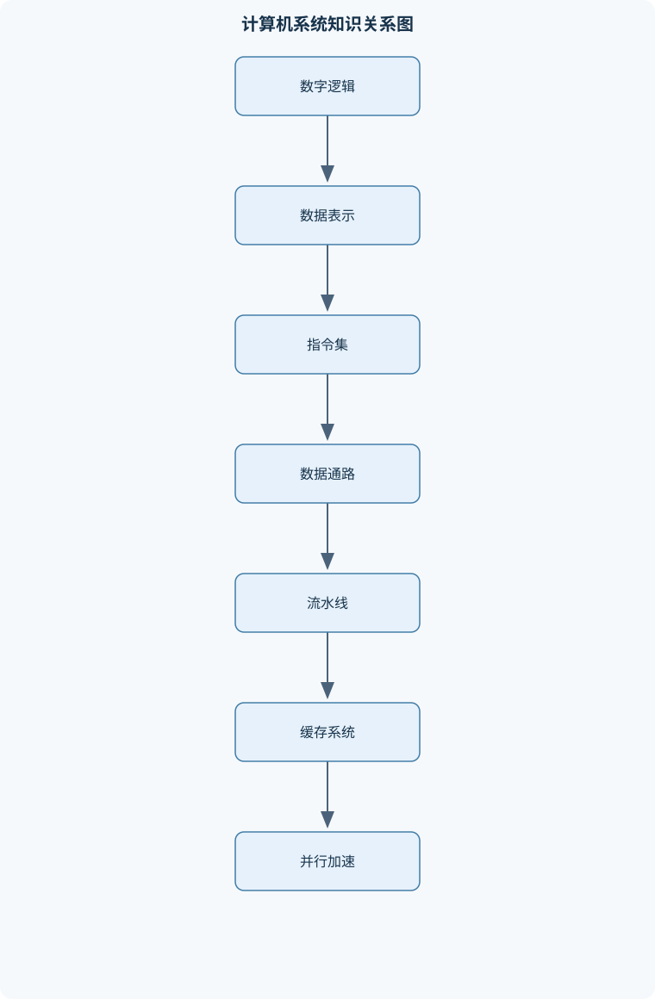
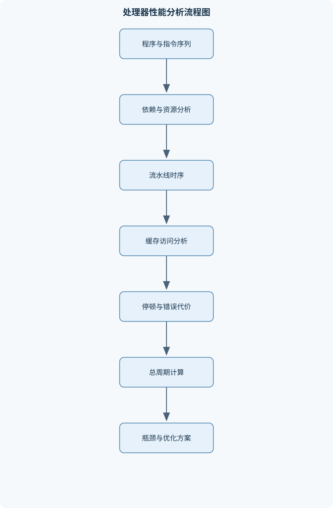

# 计算机组成与系统结构

## 一、课程整体知识框架

### 课程边界与先修知识

本课程研究计算机系统从数字逻辑、数据表示、指令集体系结构到处理器微结构、存储层次和并行系统的实现原理与定量分析。内容边界包括组合逻辑与时序逻辑基础、整数和浮点数表示、布尔运算、RISC类指令集、数据通路与控制器、单周期与多周期处理器、流水线、分支预测、乱序执行、缓存、虚拟存储、输入输出和多处理器一致性。课程重点是解释软件指令如何在硬件中执行，并依据周期数、吞吐率、延迟、命中率、带宽和能耗等指标分析设计取舍。先修知识包括离散数学中的二进制与逻辑运算、基础数字电路、C或类似高级语言、汇编语言基础、数据结构和基本概率；不要求先修操作系统实现，但需要理解地址空间、进程和异常等基本概念。课程不深入晶体管级版图、完整操作系统内核、编译器优化器实现或具体芯片产品细节。





### 1. 课程对象与抽象层次

《计算机组成与系统结构》研究的是“程序中的操作如何被硬件表示、调度和完成”。课程从数字逻辑出发，逐层连接数据表示、指令集体系结构、处理器数据通路、流水线、存储系统、输入输出和并行加速器。每一层都向上提供抽象接口，同时隐藏下一层的实现细节。

数字逻辑层用门电路、组合逻辑和时序逻辑表示计算与状态保存。数据表示层规定整数、浮点数和定点数如何编码，以及溢出、舍入和异常如何处理。指令集体系结构（ISA）规定软件可观察的寄存器、指令、寻址方式、异常和内存模型；微结构则规定这些指令由哪些功能部件、流水线阶段和控制逻辑实现。同一个ISA可以由单周期、多周期、流水线或乱序处理器实现，因此不能把ISA等同于具体硬件结构。

性能分析贯穿全课程。执行时间可写为

$$
T_{\mathrm{CPU}}=N_{\mathrm{inst}}\times CPI\times T_{\mathrm{cycle}},
$$

其中$N_{\mathrm{inst}}$是执行的指令条数，单位为条；$CPI$是平均每条指令所需周期数，单位为周期/条；$T_{\mathrm{cycle}}$是时钟周期，单位为秒/周期。降低指令条数、降低CPI或缩短时钟周期都可能提升性能，但三者通常相互影响。例如，增加流水线级数可能提高时钟频率，却增加分支错误清空代价和旁路复杂度。

### 2. 数字系统与计算机抽象层次

#### 2.1 组合逻辑、时序逻辑与模块化

组合逻辑的输出只由当前输入决定，例如加法器、比较器、多路选择器和译码器。时序逻辑包含触发器或寄存器，输出不仅与当前输入有关，还与过去保存的状态有关。同步设计通常在时钟边沿更新状态，组合逻辑在两个边沿之间计算下一状态。

一个时序模块可抽象为

$$
S_{t+1}=F(S_t,X_t),\qquad Y_t=G(S_t,X_t),
$$

其中$S_t$为时刻$t$的状态，$X_t$为输入，$Y_t$为输出。若组合逻辑延迟为$t_{\mathrm{comb}}$，寄存器建立时间为$t_{\mathrm{setup}}$，时钟偏斜和裕量合计为$t_{\mathrm{margin}}$，则理想时钟周期至少满足

$$
T_{\mathrm{cycle}}\ge t_{\mathrm{clk\text{-}q}}+t_{\mathrm{comb}}+t_{\mathrm{setup}}+t_{\mathrm{margin}}.
$$

该关系适用于同步电路的最慢寄存器到寄存器路径；异步输入、存储器内部时序和时钟门控还需要额外分析。

数据通路负责传送和变换数据，控制器负责产生选择信号、写使能、读写方向和状态转移。有限状态机通常由状态寄存器、下一状态组合逻辑和输出逻辑组成。模块化设计要求模块接口明确、状态边界清晰，并通过局部验证减少系统级调试范围。

#### 2.2 延迟、吞吐率与并发

延迟是单个任务从开始到完成的时间；吞吐率是单位时间内完成的任务数。流水线通常提高吞吐率，不必然降低单条指令延迟。若$k$级流水线处理$n$条相互独立的指令，理想情况下需要$k+n-1$个周期，而非流水线可能需要约$kn$个阶段周期。该结论假设各阶段能够均匀划分、没有结构冲突、没有数据和控制冒险，且每周期可推进一条指令。

从C程序到硬件执行通常经过高级语言、编译器中间表示、汇编语言、机器指令、指令译码、数据通路操作和存储器访问等层次。每一层都有自己的正确性边界：编译器必须保持程序语义，汇编器必须正确编码字段，处理器必须按照ISA更新体系结构状态。

### 3. 数制、整数与布尔运算

#### 3.1 进制、范围与补码

$b$位无符号整数的编码范围为$0$到$2^b-1$。若编码按补码解释，则范围为$-2^{b-1}$到$2^{b-1}-1$。二进制与十六进制转换可以按每四位二进制对应一个十六进制数字完成，但前提是地址或数据的位宽边界已经明确，不能把字节地址、字地址和块地址混用。

补码负数的形成方法是逐位取反后加一。补码加法直接保留低$b$位，因此硬件加法器既可用于有符号加法，也可用于无符号加法。区别在于溢出解释：

* 无符号加法的溢出由最高位产生的进位判断；
* 有符号加法中，两个同号操作数相加得到异号结果时发生溢出；
* 减法通常转化为$x+(\sim y)+1$。

例如，4位补码中$0111=7$，$0001=1$，相加得到$1000$。该位模式按补码解释为$-8$，所以有符号运算溢出；按无符号解释则为8，没有产生最高位外部进位。反例是$1000$取相反数：数学结果为8，但4位补码最大正数只有7，因此不能在原位宽表示。

符号扩展把较短补码扩展到更宽位数时复制最高位；零扩展则在高位补零。把负数错误地零扩展会改变数值。例如8位补码$11111111$表示$-1$，扩展为16位应为$1111111111111111$，而不是$0000000011111111$。

#### 3.2 位级运算与整数边界

按位与、或、异或和取反用于掩码、字段提取、权限位处理和硬件控制。左移通常相当于乘以$2^k$，但只有在结果未溢出且操作数解释允许时才能这样理解。逻辑右移在高位填零，算术右移复制符号位。对有符号负数使用逻辑右移会得到错误的除以二近似。

固定宽度运算本质上是在模$2^b$的环上进行。截断低$b$位等价于对$2^b$取模，但这不等价于数学上的无限精度整数。整数乘法可以通过部分积累加实现，除法可用恢复除法、非恢复除法或迭代移位减法实现；除法还必须规定除零、商的符号和余数符号。

定点数在固定小数点位置解释位模式。例如用总宽度$b$、小数位数$q$的补码定点数，实际数值为整数编码除以$2^q$。其量化间隔为$2^{-q}$，可表示范围受整数位宽限制。定点数适合范围已知、需要低成本并行计算的场景；当动态范围很大时，固定小数点容易溢出。

### 4. 浮点数与数值计算表示

浮点数通常由符号位、带偏置的指数和尾数组成。规格化有限数可以抽象为

$$
x=(-1)^s\times(1.f)\times 2^{e-\mathrm{bias}},
$$

其中$s$是符号位，$e$是编码指数，$f$是小数部分。指数全零时可能表示零或非规格化数；指数全一时通常表示无穷大或非数。具体位宽、偏置和舍入规则必须以所采用的浮点格式为准，不能把一种格式的字段解释套用于另一种格式。

浮点加法需要先比较指数并对阶，再进行尾数加减、规格化和舍入。若两个数指数差过大，小数较小的数右移后可能完全丢失，这称为吸收现象。浮点乘法则将符号异或、指数相加并减去偏置、尾数相乘，之后规格化和舍入。

舍入会造成误差，常见模式包括向零舍入、向正无穷舍入、向负无穷舍入和最近偶数舍入。溢出表示结果超出最大有限数，可能转为无穷大；下溢表示结果接近零，可能进入非规格化区域或变为零。NaN用于表示未定义数值运算，例如无穷大减无穷大。

浮点数范围大但硬件复杂，定点数和整数更适合规则、密集、低位宽的计算。矩阵乘加中，若输入分别为$b_a$位和$b_b$位有符号整数，单次乘积通常需要至多$b_a+b_b$位。累加$K$项时，理论上还需约$\lceil\log_2K\rceil$位增长，但实际还取决于输入最大幅值、是否允许负数抵消、舍入和饱和策略。直接把8位乘积截断为16位并不能保证累加不溢出。

### 5. 指令集体系结构与RISC-V基础

ISA规定寄存器状态、指令语义、编码格式、内存访问、异常和特权行为。典型RISC设计采用较多通用寄存器、加载/存储访问内存、固定长度或规则编码，并把复杂操作拆解为较简单的指令。

整数寄存器记为$x_i$，内存状态记为$M[a]$，其中$a$是字节地址。常见指令包括寄存器算术逻辑、立即数算术逻辑、加载、存储、条件分支和无条件跳转。RISC-V基础整数指令通常使用R、I、S、B、U、J等格式：

* R型使用$rd$、$rs1$、$rs2$，适合寄存器间运算；
* I型包含符号扩展立即数，常用于立即数运算、加载和间接跳转；
* S型把存储地址立即数拆到两个字段；
* B型把分支位移分散编码，并按指令对齐要求重组；
* U型提供高位立即数；
* J型用于较大范围的PC相对跳转。

立即数重组后必须进行符号扩展。PC相对寻址的目标通常为$PC+\mathrm{offset}$，而不是把偏移直接当作绝对地址。过程调用需要保存返回地址，并按调用约定保存必要寄存器；栈帧用于局部变量、保存寄存器和参数溢出区。伪指令只是汇编器提供的便捷表示，最终必须展开为真实机器指令。

异常或陷阱是执行过程中转移到处理程序的事件，可能由非法指令、访问权限错误、除零或外部设备请求引起。精确异常要求处理器能够明确哪些指令已经生效、哪些尚未生效；这会直接影响流水线和乱序执行设计。

### 6. 数据通路、控制器与单周期/多周期处理器

指令执行可分解为取指、译码、执行、访存和写回。PC选择器决定下一条指令地址，寄存器堆提供源操作数，立即数生成器恢复立即数字段，ALU完成算术、逻辑、地址计算和比较，数据存储器完成加载与存储，写回多路选择器决定写入寄存器的数据来源。

单周期处理器让每条指令在一个时钟周期内完成，因此时钟周期必须覆盖最长组合路径。若最长路径依次经过取指、寄存器读取、ALU、数据存储器和写回，则其延迟决定最高时钟频率。短指令也必须等待同样长的周期，硬件利用率和性能可能较低。

多周期处理器把执行过程拆成多个状态，并用中间寄存器保存指令、PC、ALU结果和存储器数据。不同指令可以复用同一套ALU和存储器，从而降低面积，但一条指令需要多个周期。控制器可以用硬布线有限状态机实现，也可以用微程序控制器从控制存储器读取控制字。自定义指令若增加新的运算，必须检查操作码编码、寄存器接口、数据通路、控制状态、异常行为和旧指令兼容性。

### 7. 流水线、控制冒险与高级执行

五级流水线通常包括取指、译码、执行、访存和写回。冒险分为：

* 结构冒险：多个阶段同时争用同一硬件；
* 数据冒险：后一条指令依赖前一条尚未产生的数据；
* 控制冒险：分支方向或目标尚未确定。

旁路把后续阶段产生的结果直接送回执行阶段，减少等待；暂停会保持相关指令并插入气泡。加载使用冒险通常即使有旁路也可能需要停顿，因为数据在访存结束后才可用。分支错误时必须清除错误路径中的指令。

理想流水线的性能可用

$$
CPI\approx CPI_{\mathrm{base}}+
CPI_{\mathrm{struct}}+
CPI_{\mathrm{data}}+
CPI_{\mathrm{branch}}+
CPI_{\mathrm{memory}}
$$

估计。该式是平均模型，不表示所有停顿项严格独立；若多个原因重叠，简单相加会高估代价。分支预测器根据历史预测跳转方向，常见两位饱和计数器用四个状态表示强不跳、弱不跳、弱跳、强跳。连续两次相反结果通常才能改变稳定方向，因此循环边界的一次反向结果不会立即破坏长期预测。

乱序执行通过寄存器重命名消除反相关和输出相关，通过保留站等待源操作数，通过重排序缓冲区按程序顺序提交。指令可以乱序发射、执行和完成，但支持精确异常时，体系结构状态通常必须按程序顺序提交。加载存储队列还要检查内存地址是否相同或可能别名。推测执行一旦发现分支预测错误，必须撤销错误路径的临时状态。

### 8. 存储层次、缓存与虚拟存储

存储层次利用时间局部性和空间局部性。缓存容量为$C$，块大小为$B$字节，组数为$S$，相联度为$W$时：

$$
C=S\times W\times B.
$$

对于$A$位字节地址，块内偏移位数为$\log_2B$，组索引位数为$\log_2S$，标签位数为

$$
A-\log_2B-\log_2S.
$$

该直接切分要求$B$和$S$为2的幂。直接映射每组只有一路，硬件简单但冲突失效较多；组相联在组内比较多路标签；全相联允许块放入任意位置，但比较器和替换逻辑成本高。

失效包括首次访问造成的强制失效、缓存容量不足造成的容量失效以及映射位置冲突造成的冲突失效。替换策略可用LRU、FIFO或随机策略。写直达同时更新下一级存储，控制简单但带宽压力大；写回只在缓存块被替换时写回，减少写流量但需要脏位。写分配在写失效时先取入缓存，非写分配则直接写下一级。

平均访存时间为

$$
AMAT=T_{\mathrm{hit}}+(1-h)T_{\mathrm{miss}},
$$

其中$h$是命中率，$T_{\mathrm{miss}}$是失效产生的额外代价。提高缓存容量或相联度可能提高命中率，却也可能增加

## 二、章节和模块划分

### 核心知识覆盖清单

本清单用于检查正文是否覆盖本课程的主要知识模块：

- **数字系统与计算机抽象层次**：信息表示与数字电路抽象、组合逻辑和时序逻辑、多级实现与模块化设计、数据通路、控制和状态机、延迟、吞吐率与并发、从高级语言到机器指令的转换、ISA、微结构与实现技术的区分。
- **数制、整数与布尔运算**：二进制、十六进制和不同进制转换、无符号数的范围与溢出、补码、有符号数和符号扩展、加法器、减法器与比较器、有符号乘法和除法的基本实现、位移、掩码与位级逻辑运算、整数截断、溢出和模运算、定点数与量化误差。
- **浮点数与数值计算表示**：浮点数的符号位、指数和尾数、规格化数、非规格化数、零和无穷大、舍入模式与舍入误差、浮点加法的对阶、尾数运算和规格化、浮点乘法的指数与尾数处理、溢出、下溢、非数和异常标志、整数、定点数与浮点数的适用边界、矩阵乘加中的量化和累加位宽设计。
- **指令集体系结构与RISC-V基础**：ISA的功能边界和设计原则、寄存器、内存和指令寻址、RISC-V整数寄存器与固定长度指令、R、I、S、B、U、J型指令格式、立即数编码、符号扩展和PC相对寻址、算术、逻辑、加载存储与分支指令、调用约定、栈帧和过程调用、伪指令、机器指令与汇编器表示、异常、陷阱和特权级的基本概念。
- **数据通路与控制器**：取指、译码、执行、访存和写回、程序计数器与下一条PC选择、寄存器堆、ALU、立即数生成器和多路选择器、加载存储数据通路、分支目标地址与条件判断、硬布线控制器的组合逻辑实现、有限状态机控制的多周期处理器、微程序控制与控制存储器、控制信号时序和结构验证。
- **单周期与多周期处理器设计**：单周期处理器的完整数据通路、单周期关键路径与时钟周期确定、不同指令共享硬件资源的方法、多周期处理器的状态划分、多周期执行中中间寄存器的作用、控制状态机的状态转移、单周期与多周期的面积、周期和吞吐率比较、设计自定义指令所需的数据通路修改、处理器仿真、波形检查和指令级验证。
- **流水线处理器与控制冒险**：流水线阶段划分和理想加速比、结构冒险、数据冒险和控制冒险、流水线寄存器与阶段间状态传递、旁路、暂停和插入气泡、加载使用冒险和分支相关冒险、分支解析阶段与错误路径清空、静态分支预测和动态分支预测、两位饱和计数器与分支历史表、分支预测准确率和有效CPI分析。
- **高级流水线与乱序执行**：指令级并行与依赖约束、保留站、发射和操作数就绪、寄存器重命名与伪相关消除、重排序缓冲区与按序提交、精确异常的实现条件、加载存储队列与内存依赖检查、推测执行和错误恢复、数据相关、控制相关和资源冲突的统一分析、顺序发射、乱序执行与乱序完成的区别。
- **存储层次与缓存系统**：局部性原理与存储层次、缓存块、组、路和地址划分、直接映射、组相联和全相联缓存、标签、索引和块内偏移的计算、强制失效、容量失效和冲突失效、LRU、FIFO和随机替换策略、写直达、写回、写分配和非写分配、平均访存时间与多级缓存、缓存关键路径和访问时序、预取、牺牲缓存和缓存性能权衡。
- **虚拟存储与内存管理硬件**：虚拟地址、物理地址和地址空间、页、页表和页表项、TLB的结构与地址转换流程、页表遍历和TLB未命中、页面置换与缺页异常、缓存与虚拟地址转换的组合方式、内存保护、权限位和共享页面、交换空间与物理内存不足时的性能影响、虚拟存储对缓存和流水线的影响。
- **输入输出、总线与并行系统**：存储映射输入输出、轮询、中断和直接内存访问、设备控制器与内存一致性、多核处理器中的共享内存、缓存一致性、写无效和写更新、监听协议与一致性状态机、同步、原子操作和锁的硬件支持、线程级并行和任务划分、加速器、专用功能单元与主处理器协同、多核性能中的通信、同步和负载不均衡。
- **系统级评估与专用加速器设计**：执行时间、CPI、IPC和加速比、Amdahl定律与瓶颈定位、功耗、面积、带宽和性能的权衡、矩阵乘法的数据复用和循环分块、乘加阵列与脉动数据流、定点量化和累加器位宽分析、RISC-V自定义指令的接口设计、单核、多核和专用加速器比较、基准程序、功能正确性和周期数评估、从C程序到RTL或硬件生成语言的验证流程。


### 2.1 数字系统、数据表示与抽象层次

本章首先建立从硬件逻辑到软件指令的抽象链条。数字系统以二进制位为基本信息单位，组合逻辑用于计算当前输入对应的输出，时序逻辑用于保存状态并在时钟边沿更新。加法器、比较器、多路选择器和译码器属于典型组合模块；程序计数器、寄存器堆、流水线寄存器和缓存状态寄存器属于时序模块。处理器并不是若干独立部件的简单堆叠，而是由数据通路、控制器、状态保存部件和存储接口共同构成的同步系统。

数据表示决定了同一组物理位如何解释为数值。$b$位无符号整数的范围是$0$到$2^b-1$，$b$位补码整数的范围是$-2^{b-1}$到$2^{b-1}-1$。补码加法可以直接复用无符号加法器，但溢出判断不同：无符号加法关注最高位进位；有符号加法则在两个操作数同号而结果异号时溢出。例如，$8$位补码的$127+1$产生位模式$10000000$，该位模式解释为$-128$，因此发生有符号溢出。硬件产生的位模式本身没有“正数”或“负数”的固有含义，含义取决于指令语义和后续解释。

位移和位级逻辑是处理器中常见的基础操作。逻辑左移通常在低位补零，逻辑右移在高位补零；算术右移则复制原数的符号位，用于保持补码数的符号趋势。掩码操作可用“与”运算保留指定字段，用“或”运算设置某些位，用“异或”运算翻转某些位。考试中常要求对寄存器中的字段进行提取、拼接和符号扩展，解题时必须先明确位宽、符号属性和移位方向，不能把十进制运算规则直接套用到位模式上。

浮点数进一步把有限位数分为符号、指数和尾数。规格化数通过指数调节表示较大的动态范围，但不能精确表示所有实数。浮点加法通常需要先对阶，再进行尾数加减、规格化和舍入；两个数值差异很大时，小数项可能在对阶过程中被舍弃。浮点表示还需要区分零、无穷大、非数和非规格化数。定点数适合范围已知、运算确定性要求较高的场景，但缩放因子必须统一；浮点数范围大、编程方便，却带来舍入、异常和非结合性问题。

本模块的重点不是记忆编码形式，而是理解表示对计算结果和硬件代价的影响。一个整数加法器可以支持有符号和无符号加法，但比较器、扩展方式和溢出标志必须依据操作类型设置。矩阵乘加中，若两个输入分别为$b_a$位和$b_b$位有符号整数，单次乘积通常需要约$b_a+b_b$位；累加$K$项时，还应为最坏情况下的幅度增长预留约$\lceil\log_2K\rceil$位。若直接把中间结果截断到输出位宽，可能造成累积误差或溢出，因此必须规定舍入、截断、饱和和异常处理方式。

### 2.2 指令集体系结构与RISC-V程序执行

指令集体系结构（ISA）是软件和硬件之间的可观察接口，规定寄存器、指令编码、寻址方式、异常、内存访问和部分内存顺序语义。微结构则规定ISA如何实现，例如一条加载指令可以在单周期数据通路中完成，也可以在多周期或流水线处理器中分阶段执行。实现技术还包括逻辑电路、工艺和时钟设计。三者不能混为一谈：改变缓存容量通常属于微结构变化，增加一条软件可见的指令则属于ISA扩展。

以RISC-V整数指令为例，常见指令格式包括R型、I型、S型、B型、U型和J型。R型指令通常包含两个源寄存器和一个目的寄存器，用于寄存器之间的算术或逻辑运算；I型指令携带立即数，常用于立即数运算和加载；S型用于存储指令，将立即数拆分在不同字段中；B型用于条件分支；U型和J型分别适合构造高位立即数和进行较大范围的跳转。解码时必须根据操作码确定格式，再提取寄存器号、功能字段和立即数字段，不能只按字段位置机械拼接。

立即数的符号扩展是指令执行中的关键步骤。若一个较短的补码立即数扩展到寄存器宽度，扩展后的高位必须复制原立即数的符号位。PC相对分支和跳转使用指令地址与编码偏移计算目标地址，实际位移范围和对齐方式取决于具体格式。常见考法是给出机器码或字段值，要求恢复指令、计算立即数、判断分支是否成立并求下一条$PC$。完整步骤应包括字段提取、符号扩展、寄存器读取、ALU运算、条件判断和目标地址选择。

加载和存储指令体现了RISC结构中“计算与访存分离”的思想。算术逻辑指令主要操作寄存器，访问内存需要显式使用加载或存储指令。若指令为加载，处理器先计算有效地址$R[rs1]+\mathrm{sext}(imm)$，再从$M[\text{有效地址}]$读取数据并写入$rd$；若为存储，则从寄存器读取待写数据并写入对应内存位置。地址计算正确并不保证访问一定成功，还可能发生未对齐、权限错误、页表无效或设备地址访问等异常。

过程调用涉及调用约定、返回地址和栈帧。调用者和被调用者必须按照约定保存需要长期保留的寄存器；返回地址通常需要保存在寄存器或栈中。栈帧用于保存局部变量、被保存寄存器和返回信息。分析汇编程序时，应先画出调用前后的寄存器和栈指针变化，再判断每条加载、存储和跳转指令的作用。伪指令只是汇编器提供的便捷表示，最终必须展开为一个或多个真实机器指令；考试中若要求机器码，应以真实指令格式为准。

异常、陷阱和中断改变了正常的顺序执行流程。异常可能由当前指令引起，例如非法指令、缺页或算术异常；中断通常来自外部设备或定时器。处理器需要保存足够的返回信息、切换到处理程序，并在条件满足时恢复执行。乱序处理器还必须保证异常具有精确性，即异常之前的指令已经按程序顺序生效，异常之后的指令不能把未提交结果暴露给软件。

### 2.3 数据通路、控制器与单周期、多周期处理器

处理器执行一条指令可以抽象为取指、译码、执行、访存和写回。程序计数器$PC$提供取指地址；指令存储器返回机器指令；寄存器堆读取$rs1$和$rs2$；立即数生成器根据指令格式构造扩展后的立即数；ALU执行算术、逻辑、地址计算或比较；数据存储器完成加载或存储；多路选择器决定写回数据和下一条$PC$。控制器根据操作码和功能字段产生寄存器写使能、存储器读写、ALU控制、立即数类型和分支选择等信号。

单周期处理器让每条指令在一个时钟周期内完成。它的优点是控制简单、指令执行过程直观；缺点是时钟周期必须覆盖最慢指令的完整组合路径。对于加载指令，路径可能包括取指、寄存器读取、立即数生成、ALU地址计算、数据存储器读取、写回选择和寄存器写入，因此加载路径往往比简单算术指令更长。若组合路径延迟依次为$t_1,t_2,\ldots,t_m$，还要计入寄存器时钟到输出、建立时间和时钟裕量，时钟周期必须大于这些延迟总和。缩短某条非关键路径不会提高最高频率，只有缩短关键路径才会直接改善时钟周期。

多周期处理器把一条指令拆分为多个状态，每个状态使用一个或少数几个功能部件。例如，取指状态更新$PC$并暂存指令，译码状态读取寄存器，执行状态完成ALU计算，访存状态访问数据存储器，写回状态更新寄存器。中间寄存器用于保存指令、操作数、ALU结果和加载数据，使后续状态能够继续执行。多周期设计允许不同指令共享ALU、存储器和寄存器堆，从而减少硬件面积，但一条指令需要多个周期，控制器也必须维护更复杂的状态转移。

单周期与多周期的比较不能只看单条指令周期数。单周期通常具有较长时钟周期但每条指令只占一个周期；多周期可采用较短时钟周期，但指令平均需要多个周期。应利用

$$
T_{\mathrm{CPU}}=N_{\mathrm{inst}}\times CPI\times T_{\mathrm{cycle}}
$$

进行整体比较。若程序中加载、存储和分支比例较高，多周期处理器的平均$CPI$会受到这些指令状态数影响；若单周期关键路径过长，则较低的时钟频率可能抵消其较低$CPI$优势。

设计自定义指令时，需要先确定指令语义和操作数，再检查数据通路是否已有所需功能。若新增操作只需ALU完成，可以增加译码和ALU控制；若需要额外乘加阵列、特殊寄存器或多周期状态，则必须扩展数据通路、控制器、异常处理和验证环境。功能验证应检查正常结果、边界值、非法编码、异常中断和与旧指令的兼容性。

### 2.4 流水线、冒险与分支预测

流水线把不同指令的执行阶段重叠起来。典型五级流水线包括取指（IF）、译码/读寄存器（ID）、执行（EX）、访存（MEM）和写回（WB）。理想情况下，$k$级流水线执行$n$条独立指令约需$k+n-1$个周期。这个结论假设阶段划分均衡、每周期有足够硬件资源、没有数据和控制冒险，也没有缓存失效。实际周期数应在理想值基础上增加暂停、气泡、分支清空和存储停顿。

结构冒险是多个阶段同时需要同一硬件资源。例如，取指和数据访问共用单端口存储器时，某周期可能无法同时完成两者。解决方法包括增加端口、复制资源、调整阶段安排或暂停流水线。数据冒险来自指令间的数据依赖。真实相关是后指令读取前指令将产生的结果；反相关和输出相关在乱序执行中还需要通过寄存器重命名处理。旁路可以把结果从执行或访存阶段直接送到后续指令输入，避免等待写回寄存器堆。

加载—使用冒险具有特殊性。加载数据通常在访存阶段末尾才产生，而紧随其后的使用指令在执行阶段较早需要该数据，即使存在旁路也可能必须暂停一个周期。若没有旁路，停顿更多。分析流水线时，不能只观察寄存器名称，还要确定结果产生阶段、操作数需要阶段和硬件是否提供旁路路径。

控制冒险来自条件分支和跳转。若分支结果在执行阶段才确定，取指阶段已经可能取入错误路径指令。确定分支不跳转或跳转后，需要清除错误路径中的指令，并承担错误预测代价。静态预测可采用“总是不跳转”或根据分支方向预测；动态预测则利用历史。两位饱和计数器通常以强不跳转、弱不跳转、弱跳转和强跳转四种状态表示倾向，连续一次相反结果通常只使状态减弱，不立即改变稳定预测方向，因此适合减少循环边界带来的干扰。

分支预测分析必须给出预测器初始状态、表索引、实际结果和状态更新。若多个分支的PC低位映射到同一预测表项，就会发生别名干扰，预测器不一定为每条分支维护独立状态。有效$CPI$可近似写为

$$
CPI=CPI_{\mathrm{base}}+CPI_{\mathrm{struct}}+CPI_{\mathrm{data}}+CPI_{\mathrm{branch}}+CPI_{\mathrm{memory}}.
$$

其中分支项可以由分支比例、预测错误率和错误代价共同决定。增加流水线级数可能缩短阶段组合延迟，却可能使分支解析更晚、错误清空范围更大，因此频率提升和分支代价之间存在权衡。

### 2.5 乱序执行、缓存与虚拟存储

乱序执行利用指令级并行，使不依赖尚未完成结果的指令先执行。典型结构包括寄存器重命名表、保留站、功能单元、加载存储队列和重排序缓冲区（ROB）。取指和重命名通常按程序顺序进行；当源操作数就绪且功能单元可用时，指令可以发射；执行完成后结果被写回或广播；最终由ROB头部按程序顺序提交。乱序执行不等于乱序提交，按序提交是实现精确异常和正确体系结构状态的重要条件。

缓存利用时间局部性和空间局部性减少平均访存时间。若缓存容量为$C$、块大小为$B$、相联度为$W$，则组数为

$$
S=\frac{C}{B\times W}.
$$

对$A$位字节地址，块内偏移位数为$\log_2B$，组索引位数为$\log_2S$，标签位数为

$$
A-\log_2B-\log_2S.
$$

访问时先用索引定位组，再比较该组中有效路的标签。首次访问某块造成强制失效；工作集超过缓存容量可能造成容量失效；多个活动块映射到同一组则可能造成冲突失效。直接映射比较器少、命中路径短，但冲突较多；高相联度减少冲突，却增加标签比较、替换选择、面积和功耗。

单级缓存的平均访存时间可写为

$$
AMAT=T_{\mathrm{hit}}+(1-h)T_{\mathrm{miss}},
$$

其中$h$是命中率。提高容量或相联度可能提高$h$，但也可能增加$T_{\mathrm{hit}}$，所以不能只依据命中率比较方案。写回缓存需要维护脏位，替换脏块时必须写回下一级；写直达则每次写入都传播到下一级，但控制较简单。写分配和非写分配还决定写失效时是否先把目标块装入缓存。

虚拟存储把虚拟页号映射到物理页号，页内偏移保持不变。页大小为$P$字节时，页内偏移位数为$\log_2P$。TLB缓存近期地址转换结果；TLB命中时可直接得到物理页号，TLB未命中时需要遍历页表。TLB未命中不等于缺页：若页表项有效，只需填充TLB并继续；若页面不在物理内存中，才产生缺页异常。权限位不允许访问时，可能产生保护异常，即使页面已经在内存中也不能访问。

缓存与虚拟地址转换的组合会影响访问时序。虚拟索引、物理标签的设计可以部分重叠缓存访问和地址转换，但必须避免不同虚拟地址映射到同一物理块而形成别名问题。分析题中应明确缓存使用虚拟地址还是物理地址、TLB是否命中、页表项是否有效，以及缺页处理是否计入总执行时间。

### 2.6 输入输出、多处理器与系统级定量分析

输入输出模块连接处理器与外设。轮询由处理器重复读取设备状态，控制简单但会占用处理器；中断允许设备在事件发生时通知处理器，适合不规则事件，但存在保存现场、进入处理程序和返回的开销；DMA由专用控制器批量搬运设备与内存之间的数据，适合大块传输，但需要处理总线占用、缓冲区边界、完成通知以及缓存一致性。

多核系统中，多个处理器可能缓存同一内存块。缓存一致性协议通过写无效、写更新和状态转换保证同一缓存线的副本具有规定的可见性。例如，某核心要写入共享缓存线时，通常需要获得独占或修改权限，并使其他核心的副本失效。缓存一致性不等于内存顺序；不同地址的访问先后仍由ISA、原子操作、锁和内存屏障共同决定。伪共享是常见性能问题：不同线程写入同一缓存线中的不同变量，也会引发不必要的缓存线转移。

系统级评估应同时考虑计算、存储、通信和同步。若原程序执行时间中比例$f$的部分可获得$s$倍加速，则Amdahl定律为

$$
Speedup=\frac{1}{(1-f)+f/s}.
$$

即使可加速部分无限快，整体加速也不超过$1/(1-f)$。因此，增加核心数或乘加单元前，应先判断串行代码、内存带宽、同步等待和负载不均衡是否已经成为瓶颈。

矩阵乘法中，$A$为$M\times K$矩阵，$B$为$K\times N$矩阵，输出满足

$$
C_{ij}=\sum_{k=0}^{K-1}A_{ik}B_{kj}.
$$

标量实现约需$MKN$次乘加。若有$P$个并行乘加单元，理想计算周期下界约为$\lceil MKN/P\rceil$，但实际总周期还包括数据加载、缓存失效、片上通信、同步、边界填充和结果写回。循环分块可以提高数据复用，脉动阵列可以让数据在相邻计算单元之间流动，二者都不能消除主存带宽和存储容量限制。

常见综合题要求从程序或指令序列出发，依次分析寄存器依赖和资源冲突，绘制流水线时序，计算缓存地址与命中情况，再把停顿周期、分支错误代价和缓存失效代价加入总周期。最终应使用

$$
T_{\mathrm{CPU}}=N_{\mathrm{inst}}\times CPI\times T_{\mathrm{cycle}}
$$

检查结果的单位和数量级。性能结论必须说明输入规模、缓存状态、并行度、带宽和同步假设；理想吞吐率只能作为上界，不能直接当作实际测量结果。

## 三、核心概念的详细解释

### 3.1 从数字逻辑到计算机系统

计算机系统可以看作多个抽象层次的组合。数字逻辑层由与门、或门、非门、异或门、多路选择器、译码器、加法器和触发器组成；数据表示层规定位模式如何解释为整数、浮点数或定点数；指令集体系结构（ISA）规定软件可观察的指令、寄存器、地址空间、异常和内存访问规则；微结构规定这些指令如何由数据通路、控制器、流水线、缓存和执行单元完成。

ISA与微结构必须区分。同一ISA可以由单周期、多周期、顺序流水线或乱序处理器实现，而软件通常不需要知道内部采用哪一种实现。相反，微结构中的流水线级数、旁路网络、缓存容量和分支预测器会影响性能，但只要满足ISA规定的结果和异常行为，就可以自由改变。

组合逻辑的输出只依赖当前输入。加法器、比较器和立即数生成器属于组合逻辑。时序逻辑通过寄存器保存状态，下一状态可写成

$$
S_{t+1}=F(S_t,X_t),
$$

其中$S_t$是当前状态，$X_t$是当前输入，$F$是下一状态函数。处理器中的程序计数器、流水线寄存器、缓存状态位和重排序缓冲区都属于状态存储结构。

同步电路的时钟周期必须覆盖寄存器输出、组合逻辑计算和下一级寄存器建立时间。理想情况下：

$$
T_{\mathrm{cycle}}\ge t_{\mathrm{clk-q}}+t_{\mathrm{comb}}+t_{\mathrm{setup}}+t_{\mathrm{margin}}.
$$

其中各项单位均为秒。该公式适用于同步寄存器到寄存器路径；若路径经过异步输入、片外存储器或跨时钟域接口，还需要额外处理同步和握手问题。

延迟与吞吐率不是同一概念。延迟表示一个任务从开始到结束所用的时间，吞吐率表示单位时间完成的任务数。一个五级流水线可能使连续指令达到每周期完成一条的吞吐率，但单条指令仍需经过五个阶段，且分支错误、缓存失效会增加实际延迟。

### 3.2 数制、整数和布尔运算

$b$位无符号整数的编码范围为

$$
0\le x\le 2^b-1.
$$

这是因为每一位有$0$和$1$两种取值，共有$2^b$种编码。补码有符号整数的范围为

$$
-2^{b-1}\le x\le 2^{b-1}-1.
$$

补码将最高位的权重解释为$-2^{b-1}$，其余位权重仍为正的二次幂。

对负数取补码的步骤是：先写出绝对值的$b$位二进制，逐位取反，再加$1$。例如，求$-5$的八位补码：

1. $5$的二进制为$00000101$；
2. 逐位取反得到$11111010$；
3. 加$1$得到$11111011$。

补码加法直接保留低$b$位。最高位产生的进位被丢弃，因此硬件加法器不需要区分有符号加法和无符号加法。区别在于溢出的判断：

- 无符号加法溢出：最高位产生进位；
- 有符号加法溢出：两个操作数同号，而结果与它们异号。

例如，四位补码$0111+0011=1010$。十进制上这是$7+3=10$，但四位补码最大值为$7$，结果$1010$解释为$-6$，因此发生有符号溢出。若把它看作无符号数，则$7+3=10$仍在$0$到$15$范围内，不发生无符号溢出。

减法通常转换为加法：

$$
A-B=A+\overline{B}+1.
$$

这里$\overline{B}$表示逐位取反。加法器将第二个操作数的每一位通过异或门与控制信号相连，同时把控制信号作为最低位进位输入，即可在同一硬件中完成加法和减法。

符号扩展用于把较短的补码数转换为较长位宽。正数在高位补$0$，负数在高位补$1$。例如，四位补码$1011$表示$-5$，符号扩展为八位后是$11111011$，仍表示$-5$。若误用零扩展得到$00001011$，数值将变成$11$。

移位和位级逻辑常用于地址计算、掩码和字段提取。逻辑左移一位相当于无符号数乘以$2$，但高位被移出时可能溢出。逻辑右移在高位补$0$，适合无符号数；算术右移在高位复制符号位，适合补码有符号数。按位与可清除位，按位或可设置位，异或可检测不同位。

定点数将整数位模式解释为带有固定小数缩放因子的数。若整数编码为$I$，缩放因子为$2^{-F}$，则实际值为

$$
x=I\times 2^{-F}.
$$

增加小数位$F$可以提高精度，但会减少相同总位宽下的整数范围。定点数适合范围已知、需要稳定硬件成本的场景；当数值范围变化很大时，浮点数更合适。

### 3.3 浮点数与数值误差

浮点数通常由符号位、指数和尾数组成。规格化二进制数可表示为

$$
x=(-1)^s\times(1.f)\times 2^{e-bias},
$$

其中$s$是符号位，$f$是尾数字段，$e$是存储的指数，$bias$是指数偏置。隐藏的最高位$1$使规格化数获得额外有效位。

浮点编码还需要表示零、非规格化数、无穷大和非数。零用于表示精确的零；无穷大常由指数全为$1$且尾数为零表示；非数（NaN）用于表示未定义结果，如$0/0$。非规格化数通常用于表示接近零的数，使下溢过程较平滑，但其精度低于规格化数。

浮点加法不能直接对指数和尾数分别相加。其基本过程是：

1. 比较两个操作数的指数；
2. 将较小指数对应的尾数右移，使两个指数相同；
3. 按符号执行尾数加法或减法；
4. 对结果规格化；
5. 按舍入模式舍入；
6. 检查溢出、下溢和异常标志。

例如，计算$1.25+0.5$。写成二进制为$1.01\times2^0$和$1.0\times2^{-1}$。先把第二个数对阶为$0.1\times2^0$，再得到$1.11\times2^0=1.75$。若尾数字段有限，最后还需舍入。

浮点乘法的指数通常相加后减去偏置，尾数相乘，符号位执行异或，随后进行规格化和舍入。浮点运算不满足所有实数运算的代数性质，例如计算$(a+b)+c$与$a+(b+c)$可能得到不同结果，因为中间结果可能发生舍入。

### 3.4 指令集体系结构与RISC-V基本组织

ISA必须规定指令能做什么，而不必规定具体电路如何完成。典型整数ISA提供寄存器到寄存器运算、立即数运算、加载、存储、条件分支、无条件跳转以及异常和特权操作。

RISC-V整数寄存器通常以$x_i$表示，$x_0$具有恒为零的特殊语义。若指令读取$x_0$，得到$0$；向$x_0$写入结果不会改变其值。内存用字节地址表示，$M[a]$表示地址$a$处的内存内容。加载指令把内存数据送入寄存器，存储指令把寄存器数据写入内存。

常见指令格式包括：

- R型：两个源寄存器和一个目的寄存器，适合寄存器间运算；
- I型：一个源寄存器、一个目的寄存器和立即数，适合立即数运算与加载；
- S型：两个源寄存器和分散编码的存储偏移量；
- B型：两个源寄存器和分支偏移量；
- U型：较宽的高位立即数；
- J型：无条件跳转及链接。

立即数通常需要从指令的多个字段重新拼接，再进行符号扩展。分支和跳转的目标地址常采用PC相对寻址：

$$
PC_{\mathrm{target}}=PC_{\mathrm{base}}+\operatorname{SEXT}(\mathrm{imm}),
$$

其中$\operatorname{SEXT}$表示符号扩展。具体的$PC_{\mathrm{base}}$取当前指令地址还是下一条指令地址，取决于ISA定义，不能凭习惯假设。

伪指令不是处理器直接识别的机器指令，而是汇编器提供的便捷表示。例如，一条“寄存器复制”伪指令可以展开为加立即数为零的真实指令。分析机器执行时必须看展开后的真实指令数量和编码。

过程调用需要保存返回地址、参数寄存器、临时寄存器和被调用者保存寄存器。栈帧通常由栈指针和必要的保存区域构成。调用约定是软件与软件之间的接口，不等同于硬件内部实现；只要寄存器和栈的使用满足约定，调用者和被调用者就能正确协作。

### 3.5 数据通路、控制器与处理器实现

处理器执行一条指令通常包括取指、译码、读寄存器、执行、访存和写回。程序计数器$PC$提供取指地址；指令存储器返回指令；译码器产生控制信号；寄存器堆提供$rs1$和$rs2$的值；ALU执行算术、逻辑或地址计算；数据存储器处理加载和存储；多路选择器决定写回寄存器的数据来源。

控制器的主要信号包括：

- 是否写寄存器；
- ALU第二操作数来自寄存器还是立即数；
- 是否读或写数据存储器；
- 写回数据来自ALU还是内存；
- 是否执行分支；
- 下一条$PC$来自$PC+4$、分支目标还是跳转目标。

单周期处理器让每条指令在一个时钟周期内完成。其优点是控制简单、状态少；缺点是时钟周期必须覆盖最长指令。例如，加载指令可能经过取指、寄存器读取、地址计算、数据存储器访问和写回，因此常成为关键路径。即使算术指令实际较短，也必须等待相同的时钟周期。

多周期处理器把一条指令拆分为多个状态，每个状态只使用必要的硬件资源。中间结果保存在临时寄存器中，例如保存取出的指令、寄存器操作数、ALU结果和存储器数据。这样可以复用单个ALU和存储器，但一条指令需要多个周期，控制器通常实现为有限状态机。

硬布线控制器通过组合逻辑直接产生控制信号，速度较快但修改复杂。微程序控制器把控制字存储在控制存储器中，状态转移由微程序决定，便于支持复杂指令，但需要额外的控制存储访问。

### 3.6 流水线、冒险与分支预测

五级流水线常划分为取指（IF）、译码（ID）、执行（EX）、访存（MEM）和写回（WB）。若流水线有$k$级，连续执行$n$条相互独立指令的理想周期数为

$$
k+n-1.
$$

该结论假设各阶段每周期都能推进、资源没有冲突、指令之间没有依赖、缓存永不失效且分支完全可预测。现实中的总周期数还要加上停顿和清空周期。

流水线冒险分为三类：

1. 结构冒险：多条指令同时需要同一硬件资源；
2. 数据冒险：后一条指令需要前一条尚未产生的结果；
3. 控制冒险：分支方向或目标地址尚未确定。

旁路将执行阶段或访存阶段产生的结果直接送到后续指令的输入端，减少等待。加载后使用冒险通常不能完全由旁路消除，因为数据在访存阶段结束后才可用，下一条指令可能必须暂停一个或多个周期。暂停时，控制器冻结部分流水线寄存器，并向后续阶段插入气泡。

分支预测器在分支结果确定前猜测方向。两位饱和计数器通常具有四个状态：强不跳转、弱不跳转、弱跳转、强跳转。实际结果为跳转时状态向跳转方向移动，为不跳转时向不跳转方向移动，并在两端饱和。两位设计可避免循环分支在最后一次退出时立即改变长期预测倾向。

有效CPI可写为

$$
CPI=CPI_{\mathrm{base}}+CPI_{\mathrm{struct}}+CPI_{\mathrm{data}}+CPI_{\mathrm{branch}}+CPI_{\mathrm{memory}}.
$$

若分支占比为$p_b$，预测错误率为$r_b$，每次错误代价为$P_b$个周期，则

$$
CPI_{\mathrm{branch}}\approx p_b r_b P_b.
$$

这个估算假设各类停顿可以独立相加；当多个停顿同时发生或处理器采用复杂重叠机制时，需要用时序模拟进行校正。

### 3.7 乱序执行与精确异常

指令级并行受真实数据依赖限制。写后读（RAW）是真实依赖，不能消除；写后写（WAW）和读后写（WAR）属于名称相关，可通过寄存器重命名消除。重命名为每次结果分配新的物理寄存器，使不同指令不再争用同一个暂存名称。

乱序处理器通常包含保留站、功能单元、重排序缓冲区（ROB）和加载存储队列。取指和重命名按程序顺序进行；当源操作数就绪且功能单元空闲时，指令可以发射；执行完成后广播结果；体系结构状态仍按ROB顺序提交。

精确异常要求异常发生时，软件看到的寄存器和内存状态就像所有更早指令已经完成，而更晚指令尚未执行。ROB保存完成状态、结果、异常信息和提交顺序。错误预测发生时，处理器丢弃错误路径上的未提交指令，并恢复重命名状态。

内存指令还存在地址依赖。加载和存储地址可能在执行前未知，加载不能随意越过可能修改同一地址的较早存储。加载存储队列需要进行地址比较、依赖检查和必要的回滚。

### 3.8 缓存、虚拟存储与输入输出

若缓存容量为$C$字节，块大小为$B$字节，组数为$S$，相联度为$W$，则

$$
C=S\times W\times B.
$$

对于$A$位字节地址，块内偏移位数为$\log_2B$，组索引位数为$\log_2S$，标签位数为

$$
A-\log_2B-\log_2S.
$$

该切分要求$B$和$S$为二的幂。直接映射缓存每组只有一路，组相联缓存每组有$W$路，全相联缓存允许块放置到任意位置。标签比较必须结合有效位；仅标签相同而有效位为零不能算命中。

缓存失效包括首次访问产生的强制失效、容量不足产生的容量失效以及多个块竞争同一位置产生的冲突失效。写直达每次写入都更新下一级存储，写回则设置脏位，在替换时写回。写分配先将写失效块加载进缓存，非写分配直接写下一级。

平均访存时间为

$$
AMAT=T_{\mathrm{hit}}+(1-h)T_{\mathrm{miss}},
$$

其中$T_{\mathrm{hit}}$为命中时间，$h$为命中率，$T_{\mathrm{miss}}$为失效产生的额外代价。多级缓存可递推计算。例如，一级缓存局部命中率为$h_1$，二级缓存局部命中率为$h_2$，则

$$
AMAT=T_1+(1-h_1)\left[T_2+(1-h_2)T_{\mathrm{mem}}\right].
$$

TLB缓存虚拟页号到物理页号的映射。页大小为$P$字节时，页内偏移位数为$\log_2P$。虚拟地址先分为虚拟页号和页内偏移；TLB命中时直接得到物理页号；TLB未命中时遍历页表。TLB未命中不等同于缺页，只有页表项表明页面不在物理内存中，或权限不允许访问时，才产生相应异常。

输入输出设备通常通过存储映射输入输出访问。轮询由处理器反复检查设备状态，软件简单但浪费处理器周期；中断由设备主动通知处理器，适合事件频率较低的场景；DMA由设备控制器直接搬移内存数据，适合大块传输，但必须处理缓存一致性和访问权限。

多核系统中的缓存一致性协议维护同一缓存线在不同核心中的状态。写无效协议在一个核心写入前使其他副本失效；写更新协议把新数据传播给其他副本。一致性保证对同一地址的可见性约束，但不自动等同于顺序一致性；内存屏障、原子读改写和锁用于建立跨线程的同步顺序。

### 3.9 并行系统与矩阵乘加加速

矩阵乘法中，$A$为$M\times K$，$B$为$K\times N$，$C$为$M\times N$：

$$
C_{ij}=\sum_{k=0}^{K-1}A_{ik}B_{kj}.
$$

总乘加次数约为$MKN$。若有$P$个并行乘加单元，理想计算周期下界约为

$$
\left\lceil\frac{MKN}{P}\right\rceil.
$$

这个下界没有计入数据搬移、同步、边界填充和存储带宽，因此不能直接当作实际运行时间。

循环分块把矩阵划分为适合缓存容量的子块，使已加载的元素被多次复用。脉动阵列让数据在相邻处理单元之间流动，每个处理单元执行乘加并传递部分和，可减少重复读写，但需要处理阵列填充、排空、边界和片上带宽。

若输入分别是$b_a$位和$b_b$位有符号整数，单次乘积通常需要至多$b_a+b_b$位。累加$K$项时，保守估计还需要约$\lceil\log_2K\rceil$位增长。因此，八位输入并不意味着十六位累加器总能安全保存结果；如果乘积符号和绝对值可能同向累加，还应根据最大绝对值计算所需位宽。量化时必须选择舍入、截断或饱和策略，否则溢出会造成严重误差。

## 四、重要定义、公式、定理和推导

### 专业审校补充：关键定义与适用边界

缓存一致性与内存一致性是两个不同层次的概念。缓存一致性关注同一内存位置在多个缓存中的副本，要求对该位置的写操作最终形成可解释的单一顺序；内存一致性关注不同内存位置的读写在多核处理器中允许呈现的全局顺序。一个系统可以具有缓存一致性，但仍允许不同核心观察到不同的跨地址访问顺序。以写无效协议为例，某核心写入处于共享状态的缓存块时，必须获得独占权限并使其他副本失效；若采用MESI协议，缓存块状态包括修改（M）、独占（E）、共享（S）和无效（I）。M状态表示本缓存持有唯一最新副本，主存可能仍是旧值；发生其他核心读请求时，拥有M状态的缓存必须提供最新数据，并按协议转为S或其他允许状态。上述规则只说明副本如何保持一致，不自动保证锁、原子操作或程序顺序在所有核心上均按直觉观察。分析并发程序时必须同时检查一致性协议、内存排序规则、同步指令和数据竞争条件。


### 4.1 性能公式与加速比

处理器执行时间为

$$
T_{\mathrm{CPU}}=N_{\mathrm{inst}}\times CPI\times T_{\mathrm{cycle}}.
$$

其中$N_{\mathrm{inst}}$单位为条，$CPI$单位为周期/条，$T_{\mathrm{cycle}}$单位为秒/周期，结果单位为秒。若时钟频率为$f$，则$T_{\mathrm{cycle}}=1/f$。

IPC表示每周期完成的指令数。对稳定、规则的理想互补情况，有

$$
IPC\approx\frac{1}{CPI}.
$$

但在多发射乱序处理器中，IPC上限还受每周期发射宽度、功能单元数量、依赖关系和缓存带宽限制，因此不能仅凭$CPI$推断全部性能。

若程序中比例$f$的部分加速$s$倍，其余部分不变，则Amdahl定律为

$$
Speedup=\frac{1}{(1-f)+\frac{f}{s}}.
$$

推导过程是：原时间归一化为$1$；可加速部分耗时$f$，加速后变为$f/s$；不可加速部分仍为$1-f$；新时间为$(1-f)+f/s$，所以加速比为原时间除以新时间。当$s\to\infty$时，

$$
Speedup_{\max}=\frac{1}{1-f}.
$$

因此只优化程序中很小的一部分，整体收益存在严格上限。

### 4.2 补码范围与溢出判定

$b$位补码共有$2^b$种编码。最高位为符号权重$-2^{b-1}$，其余位权重为$1,2,\ldots,2^{b-2}$，所以最大值为

$$
2^{b-2}+2^{b-3}+\cdots+1=2^{b-1}-1.
$$

最小值只有最高位为$1$，其余位为$0$，因此为$-2^{b-1}$。

有符号加法溢出的逻辑表达可写为：当两个操作数最高位相同且结果最高位不同，发生溢出。若操作数符号分别为$a_s,b_s$，结果符号为$r_s$，则

$$
V=\neg(a_s\oplus b_s)\land(a_s\oplus r_s).
$$

无符号溢出直接观察最高位进位$C_{\mathrm{out}}$。这说明同一个加法器可以服务两种数值解释，区别在于状态标志和软件如何解释结果。

### 4.3 缓存地址分析流程

**输入：**地址位数$A$、缓存容量$C$、块大小$B$、相联度$W$和访问地址$a$。  
**输出：**块内偏移、组索引、标签、命中状态和替换结果。

步骤如下：

1. 计算组数$S=C/(B\times W)$；
2. 计算偏移位数$b=\log_2B$；
3. 计算索引位数$s=\log_2S$；
4. 计算标签位数$t=A-b-s$；
5. 取地址低$b$位作为块内偏移；
6. 取接下来的$s$位作为组索引；
7. 其余高位作为标签；
8. 在对应组的有效路中比较标签；
9. 若匹配则命中，否则按替换策略选择一路；
10. 若被替换块为脏块，先写回下一级存储，再装入新块。

该流程要求$B$和$S$为二的幂。若缓存参数不是二的幂，不能简单按位切分，必须使用除法和取模计算块号与组号。

以$A=32$、$C=16$ KiB、$B=64$ B、$W=4$为例：

$$
S=\frac{16\times1024}{64\times4}=64.
$$

因此偏移位数为$\log_2 64=6$，索引位数为$\log_2 64=6$，标签位数为$32-6-6=20$。若访问地址为$0x12345678$，低六位是块内偏移，再取其上方六位作为组索引，其余高位作为标签。实际计算时必须先明确地址是字节地址；若误把字地址代入，三部分都会错误。

### 4.4 分支预测流程与准确率

**输入：**分支PC序列、两位计数器初始状态和实际结果序列。  
**输出：**每次预测结果、状态变化和总体准确率。

对每个分支：

1. 用PC的一部分低位索引分支历史表；
2. 若计数器处于“强跳转”或“弱跳转”，预测跳转；
3. 否则预测不跳转；
4. 将预测与实际结果比较；
5. 实际跳转时计数器加一，实际不跳转时减一；
6. 计数器在最小和最大状态饱和；
7. 累计正确预测次数；
8. 最后计算
   $$
   Accuracy=\frac{N_{\mathrm{correct}}}{N_{\mathrm{branch}}}.
   $$

例如，初始状态为“弱跳转”，循环分支实际结果为“跳转、跳转、跳转、不跳转”。前三次预测均为跳转且状态饱和在“强跳转”；最后一次仍预测跳转，因此只有循环退出时预测错误。若改用一位预测器，退出时状态会变为“不跳转”，下一次进入循环可能再次预测错误；两位预测器通常能减少这种边界干扰。

若分支预测表容量小于分支种类数，不同PC可能映射到同一表项，产生别名干扰。因此准确率不仅取决于分支行为，也取决于表大小、索引方式和历史信息。

### 4.5 流水线时序分析

**输入：**指令序列、流水线阶段、旁路规则、分支解析阶段和缓存延迟。  
**输出：**每条指令在各周期的阶段、停顿数、清空数和总周期。

分析步骤是：

1. 为第一条指令安排取指周期；
2. 后续指令按每周期推进一个阶段；
3. 检查源寄存器是否依赖尚未产生的结果；
4. 若旁路可以解决，则连接相应结果路径；
5. 若为加载后使用冒险，则插入气泡；
6. 检查同一周期是否争用功能单元；
7. 对分支使用预测路径继续取指；
8. 分支解析后若预测错误，清除错误路径；
9. 对缓存失效增加访存等待周期；
10. 直到最后一条指令完成或提交。

理想五级流水线执行$n$条指令需要$n+4$个周期。若出现$d$个数据停顿周期、$r$个结构冲突周期和$q$个分支错误清空周期，则可近似写为

$$
T_{\mathrm{cycles}}\approx n+4+d+r+q.
$$

该公式适合教学级时序估算；真实处理器还可能有多发射、部分重叠、非阻塞缓存和动态调度，需使用更精确的事件模型。

### 4.6 乱序执行与按序提交流程

**输入：**指令序列、物理寄存器、保留站、功能单元、ROB和加载存储队列。  
**输出：**发射、执行、完成和提交时间，以及异常恢复结果。

处理过程如下：

1. 按程序顺序取指和译码；
2. 为目的寄存器分配新的物理寄存器；
3. 将旧映射保存到ROB或恢复信息中；
4. 把指令放入保留站和ROB；
5. 当所有源操作数就绪且功能单元空闲时发射；
6. 执行完成后广播结果，唤醒等待者；
7. 对加载和存储检查地址依赖；
8. 只有ROB头部指令才能提交；
9. 若头部检测到异常，停止后续提交并进入异常处理；
10. 若分支预测错误，清除错误路径并恢复重命名状态。

不变量是：已提交的体系结构状态必须与程序顺序执行结果一致；ROB中的指令顺序不改变；未提交指令不能修改不可恢复的体系结构状态。若处理器允许乱序提交，较早指令发生异常时，后续指令可能已经修改体系结构状态，从而无法提供精确异常。

### 4.7 虚拟地址转换流程

**输入：**虚拟地址、页大小$P$、TLB和页表。  
**输出：**物理地址、TLB命中状态、页表命中状态和异常类型。

步骤为：

1. 计算页内偏移位数$\log_2P$；
2. 从虚拟地址分离虚拟页号和页内偏移；
3. 查询TLB；
4. 若命中，取得物理页号并拼接原页内偏移；
5. 若未命中，按照多级页表逐级索引；
6. 检查页表项有效位和读写执行权限；
7. 若有效且权限正确，更新TLB并形成物理地址；
8. 若无效，触发缺页异常；
9. 若有效但权限不符，触发保护异常。

TLB未命中只说明转换缓存中没有映射，不说明页面一定不在内存中。页表遍历可能恢复转换。缺页异常通常需要操作系统选择空闲物理页或置换页面，并更新页表后重新执行导致异常的指令。

### 4.8 矩阵乘加的位宽推导

设$a$和$b$分别为有符号$b_a$位和$b_b$位整数。其绝对值上界约为$2^{b_a-1}$和$2^{b_b-1}$，乘积绝对值上界约为

$$
2^{b_a-1}2^{b_b-1}=2^{b_a+b_b-2}.
$$

因此乘积通常需要不超过$b_a+b_b$位表示。若累加$K$项且各项符号相同，最大绝对值约增加$K$倍：

$$
|S|_{\max}\lesssim K\cdot 2^{b_a+b_b-2}.
$$

取二进制对数后，累加器相对于单次乘积通常需要增加

$$
\left\lceil\log_2K\right\rceil
$$

位。该推导是假设所有乘积都接近最大值且同号，属于保守估计。若输入范围更小、数据均值接近零或硬件采用饱和算术，实际位宽可以不同，但必须通过范围分析或形式验证证明安全。

### 4.9 代表性例题

#### 例题一：补码加法与两种溢出

**题干：**在四位补码中计算$0111+0011$，分别判断有符号和无符号溢出。

**分析与解答：**

$0111$为$7$，$0011$为$3$。二进制相加：

$$
0111+0011=1010.
$$

结果四位保留为$1010$。作为补码，$1010=-6$，两个正数相加得到负数，发生有符号溢出。作为无符号数，$7+3=10$，而四位无符号范围为$0$到$15$，不溢出。

**结果验证：**最高位没有产生额外进位，因此无符号溢出标志为零；两个输入符号相同而结果符号改变，因此有符号溢出标志为一。

**变式：**若计算$1111+0001$，结果为$0000$并产生最高位进位。作为无符号数是$15+1=16$，溢出；作为补码是$-1+1=0$，不溢出。

#### 例题二：缓存地址划分

**题干：**某缓存容量为$8$ KiB，块大小为$32$ B，四路组相联，地址为$32$位字节地址。求组数、偏移位、索引位和标签位。

**解答：**

缓存总字节数为$8192$，因此

$$
S=\frac{8192}{32\times4}=64.
$$

偏移位数为$\log_2 32=5$，索引位数为$\log_2 64=6$，标签位数为

$$
32-5-6=21.
$$

**结果验证：**$64\times4\times32=8192$，容量关系成立。

**变式：**若相联度改为直接映射，组数变为$8192/32=256$，索引位增加到$8$位，标签位减少到$19$位，但冲突失效可能增加。

#### 例题三：五级流水线中的加载后使用

**题干：**考虑：

```asm
lw   x5, 0(x6)
add  x7, x5, x8
sub  x9, x7, x10
```

假设五级流水线为IF、ID、EX、MEM、WB，支持ALU结果旁路但加载数据在MEM结束后才可用。分析停顿。

**解答：**

第一条加载指令在第1周期进入IF，第2周期进入ID，第3周期计算地址，第4周期访问数据，第5周期写回。第二条指令在第2周期译码时发现需要$x5$，但加载数据要到第4周期末才产生，因此必须暂停，使第二条指令在第3周期不进入EX。加载数据可在第4周期末旁路给第二条指令，使其在第5周期执行。第三条指令依赖第二条ALU结果，ALU旁路可以直接提供结果，通常无需额外停顿。

**结果：**至少插入一个加载使用气泡。若没有旁路，第二条和第三条可能都要等待写回。

**变式：**将第二条改为与$x5$无关的指令，则加载使用冒险消失，但缓存失效仍可能增加加载停顿。

#### 例题四：两级缓存平均访问时间

**题干：**一级缓存命中时间为$1$个周期，一级局部命中率为$95\%$；一级失效后访问二级缓存，二级命中时间为$8$个周期，二级局部命中率为$90\%$；二级失效后访问主存，代价为$80$个周期。求平均访问时间。

**解答：**

一级命中时耗时$1$周期。一级失效概率为$0.05$，失效后还需二级访问。二级访问的平均代价为

$$
8+(1-0.90)\times80=16.
$$

因此总平均访问时间为

$$
AMAT=1+0.05\times16=1.8\text{ 个周期}.
$$

**结果验证：**若一级命中，代价为$1$；若一级失效且二级命中，代价约为$1+8$；若两级均失效，代价约为$1+8+80$。按概率加权可得到相同结果。

**变式：**若一级命中时间增至$2$周期但命中率提高到$98\%$，应重新计算，不能只依据命中率判断优劣。

#### 例题五：矩阵乘加位宽

**题干：**两个输入均为八位有符号整数，计算$K=256$项乘积的累加，估计安全累加器位宽。

**解答：**

单次乘积通常需要$8+8=16$位。累加$256=2^8$项，保守情况下增加约$8$位，因此累加器约需$24$位。若直接把累加结果限制为十六位，最大同号累加可能溢出。

**结果验证：**单次乘积的数量级约为$2^{14}$，乘以$2^8$后约为$2^{22}$，再加符号和边界余量，二十四位是合理的保守选择。

**变式：**若每个输入先量化到原范围的四分之一，乘积和累加上界会下降，但必须重新计算量化误差和舍入误差，不能只减少寄存器位数。

### 4.10 实验与项目流程

#### 实验一：缓存与虚拟地址转换分析

**输入数据：**给定缓存容量、块大小、相联度、替换策略、TLB表项和一组字节地址访问序列。  
**步骤：**

1. 计算组数、偏移位、索引位和标签位；
2. 逐个访问地址，记录标签、组号和块内偏移；
3. 更新有效位、脏位和LRU或FIFO状态；
4. 区分强制、容量和冲突失效；
5. 对虚拟地址先分离页号和页内偏移；
6. 查询TLB，记录命中、未命中和缺页；
7. 计算命中率和AMAT；
8. 改变块大小或相联度，比较结果。

**评价标准：**地址字段划分正确；每次替换状态可复现；TLB未命中与缺页区分正确；AMAT计算使用统一单位；不同参数的性能变化能够用局部性和冲突解释。

**排错方法：**若所有地址均显示错误组号，首先检查地址是否按字节计；若命中率异常偏高，检查有效位是否初始化为零；若TLB未命中全部被判为缺页，检查是否执行了页表遍历；若写回结果错误，检查脏位和替换顺序。

#### 实验二：矩阵乘加加速器周期和精度评估

**输入数据：**矩阵维度$M,K,N$，输入位宽，累加器位宽，乘加单元数$P$，片上缓存容量和数据搬移带宽。  
**步骤：**

1. 编写整数参考实现，计算$C_{ij}$；
2. 统计标量实现的乘加次数$MKN$；
3. 按$P$个乘加单元估算计算周期下界；
4. 设计分块数据流，记录每个块的加载、计算和写回周期；
5. 对比截断、舍入和饱和三种量化策略；
6. 检查累加器是否发生溢出；
7. 用随机小矩阵与边界矩阵进行功能验证；
8. 统计总周期、有效吞吐率、片上存储占用和最大绝对误差。

**评价标准：**与参考实现的整数结果一致或误差符合预先定义的量化误差界；大矩阵和非整除维度能够正确处理；周期统计明确区分计算、搬移和同步；增加乘加单元后性能提升不会被错误地假设为线性。

**排错方法：**结果只在负数输入时错误，优先检查符号扩展和有符号乘法；结果在大$K$时溢出，检查累加器位宽；边界块错误，检查分块循环的有效行列数；周期明显低于理论搬移下界，检查是否漏算数据加载和写回；多核结果偶发错误，检查缓存一致性、写冲突和同步屏障。

## 五、算法、流程和实现思路

### 方法与流程覆盖索引

下列方法或流程应在正文中说明输入、步骤、适用条件、结果检查和边界：

- 缓存地址分析流程：输入地址位数、缓存容量、块大小、相联度和访问地址；先计算组数$S=C/(B\times W)$，再确定偏移位、索引位和标签位；逐次访问时比较目标组中有效路的标签；输出命中或失效类型、替换对象和更新后的替换状态。适用于直接映射、组相联和全相联缓存。
- 分支预测跟踪流程：输入分支地址、初始预测器状态和实际分支结果序列；用PC低位索引预测表；根据状态给出是否跳转的预测；执行后按实际结果递增或递减饱和计数器；累计正确次数；序列处理完毕后输出准确率和最终状态。
- 五级流水线时序分析流程：输入指令序列、阶段划分、功能单元延迟和冒险规则；建立每条指令的取指、译码、执行、访存和写回时间；检查前后指令的寄存器依赖、资源冲突和分支结果；加入旁路或暂停；遇到错误预测则清除错误路径；直到最后一条指令提交，输出总周期和各类停顿数。
- 乱序执行分析流程：输入指令序列、功能单元、发射规则、重命名表、保留站、加载存储队列和重排序缓冲区；按程序顺序取指和重命名；当源操作数就绪且功能单元可用时发射；执行完成后广播结果；按ROB头部顺序提交；出现异常或错误预测时停止提交并恢复重命名状态。终止条件是所有指令提交或流水线因异常进入处理程序。
- 虚拟地址转换流程：输入虚拟地址、页大小、TLB和页表；分离虚拟页号与页内偏移；查询TLB；命中时获得物理页号并拼接偏移；未命中时按多级页表遍历；若页表项无效则触发缺页异常，否则更新TLB并完成转换。输出物理地址、TLB命中状态和是否缺页。
- 矩阵分块乘法流程：输入矩阵维度、元素位宽、块大小和缓存容量；将$A$、$B$和$C$划分为可装入目标缓存的子块；按块顺序加载数据；对每个输出块执行局部乘加并重复利用已加载的行列数据；完成后写回结果；边界块使用实际有效维度。适用于减少容量失效和提高数据复用，但块大小必须结合缓存容量、相联度和带宽选择。
- 矩阵乘加加速器评估流程：输入矩阵维度、乘加单元数、存储带宽、数据位宽和控制开销；计算标量运算量$MKN$；估计并行计算下界$\lceil MKN/P\rceil$；计算输入、输出搬移量和所需带宽；加入量化、同步、填充和访存等待周期；输出总周期、有效吞吐率、资源使用量和数值误差。
- 缓存一致性状态转移分析：输入处理器读写序列、初始缓存状态和协议规则；为每条缓存线记录状态、拥有者和数据版本；遇到读或写请求时判断是否命中以及是否需要总线事务；更新其他缓存线状态和内存可见性；检查所有处理器读取同一地址时是否满足协议不变量；访问序列结束后输出状态变化和一致性结果。





### 5.1 五级流水线时序分析流程

流水线时序分析的输入包括指令序列、阶段划分、寄存器读写约定、旁路规则、功能部件数量、分支解析阶段以及缓存访问延迟；输出包括总周期数、各类停顿周期、错误路径清空周期和最终吞吐率。常见五级流水线为取指（IF）、译码/读寄存器（ID）、执行（EX）、访存（MEM）和写回（WB）。

分析时先为每条指令安排理想阶段，再依次检查三类冒险。结构冒险表示同一周期需要使用数量不足的硬件，例如单端口存储器同时承担取指和数据访问；数据冒险表示后一条指令需要前一条指令尚未写回的结果；控制冒险表示分支方向或目标地址尚未确定，处理器已经取入了后续路径上的指令。

对于指令序列：

```asm
lw   x5, 0(x6)
add  x7, x5, x8
sub  x9, x7, x10
beq  x9, x0, target
```

第一步是标记寄存器依赖：`add`读取`lw`产生的$x_5$，属于加载—使用相关；`sub`读取`add`产生的$x_7$；`beq`读取`sub`产生的$x_9$。第二步依据旁路路径判断结果何时可用。典型五级流水线中，ALU结果在EX阶段末即可旁路给下一条指令，而加载数据要到MEM阶段末才可用，因此紧接在加载后的使用通常至少需要一个暂停周期。第三步处理分支：若分支在EX阶段解析，则已经进入流水线的错误路径指令需要被清空，错误预测代价通常为若干个周期，具体取决于分支解析阶段和清空范围。

理想情况下，$k$级流水线执行$n$条独立指令需要

$$
T_{\mathrm{ideal}}=k+n-1
$$

个周期。实际周期数可写成

$$
T=T_{\mathrm{ideal}}+S_{\mathrm{struct}}+S_{\mathrm{data}}+S_{\mathrm{branch}}+S_{\mathrm{cache}},
$$

其中各$S$均以周期为单位，分别表示结构冲突、数据停顿、分支清空和缓存失效增加的周期。该式是分类统计模型，不意味着各项永远互相独立；例如缓存失效可能延长分支解析前后的停顿范围。

不变量是：存在真实数据依赖时，消费者不能在生产者结果可获得之前使用旧值；发生错误预测时，错误路径指令不能更新体系结构状态；同一个硬件资源在单端口约束下不能被两个操作同时占用。终止条件是最后一条指令完成写回或按体系结构规则提交。若每周期最多发射一条指令，理想吞吐率接近每周期一条，但单条指令延迟仍约为五个阶段周期。

### 5.2 两位饱和计数器分支预测流程

该流程的输入是分支PC、预测表初始状态和实际分支结果序列；输出是每次预测结果、正确预测次数、准确率和预测器最终状态。两位计数器有四种状态：强不跳转、弱不跳转、弱跳转、强跳转。计数器向“跳转”方向或“不跳转”方向饱和移动，不能越过两个边界。

若采用状态编码$0,1,2,3$，规定$0,1$预测不跳转，$2,3$预测跳转，则每次更新为：

- 实际跳转：$state\leftarrow\min(state+1,3)$；
- 实际不跳转：$state\leftarrow\max(state-1,0)$。

例如循环分支实际结果为“跳转、跳转、跳转、不跳转、跳转”。若初始状态为$3$，预测序列为“跳、跳、跳、跳、跳”，只有循环退出的第一次反向结果预测错误；更新状态依次为$3,3,3,2,3$，准确率为$4/5=80\%$。一位预测器在循环边界常常会因一次“不跳转”改变方向，下一轮第一次“跳转”又预测错误；两位预测器需要连续反向结果才会改变稳定方向，因此对循环更稳定。

预测表通常使用PC的低位索引。不同分支可能映射到同一表项，这称为别名冲突；因此“每个分支都有独立计数器”只是理想情况。实际准确率定义为

$$
\mathrm{Accuracy}=\frac{N_{\mathrm{correct}}}{N_{\mathrm{branch}}}.
$$

适用边界是：该模型只分析方向预测，不自动解决目标地址计算、返回地址预测和间接跳转预测；预测正确也不代表没有缓存失效或取指带宽瓶颈。

### 5.3 缓存地址分析与平均访存时间计算

缓存分析的输入包括地址位数$A$、缓存容量$C$、块大小$B$、相联度$W$、访问地址序列和替换策略。首先计算组数：

$$
S=\frac{C}{B\times W}.
$$

在$B$和$S$均为二的幂、地址按字节编址时，块内偏移位数为$\log_2B$，组索引位数为$\log_2S$，标签位数为

$$
A-\log_2B-\log_2S.
$$

例如，$A=12$位、$C=256$字节、$B=16$字节、$W=2$。则$S=256/(16\times2)=8$，偏移位为$4$位，索引位为$3$位，标签位为$12-4-3=5$位。访问地址必须先转换为固定宽度的二进制，再从低位切出偏移和索引，剩余高位为标签。不能把字节地址直接当作块号；块号通常为$\lfloor address/B\rfloor$。

逐次访问时，先根据索引定位目标组，再比较该组中所有有效路的标签。命中则更新LRU等替换状态；未命中则判断是强制、容量还是冲突失效，并按写策略装入或更新数据。若为写回缓存，还需检查被替换块的脏位。全相联缓存没有组索引字段，所有标签都需要比较；直接映射每组只有一路，不需要选择替换路。

单级缓存的平均访存时间为

$$
AMAT=T_{\mathrm{hit}}+(1-h)T_{\mathrm{miss}},
$$

其中$T_{\mathrm{hit}}$是命中路径时间，$h$是命中率，$T_{\mathrm{miss}}$是失效产生的额外代价。两级缓存若一级局部命中率为$h_1$，二级在一级失效后的命中率为$h_2$，则可写为

$$
AMAT=T_1+(1-h_1)\left[T_2+(1-h_2)T_{\mathrm{mem}}\right].
$$

必须说明$h_2$是局部命中率，而不是相对于所有访问的全局命中率。增加容量可能提高命中率，但标签阵列、比较器和线驱动延迟也可能增大$T_{\mathrm{hit}}$，因此不能只依据命中率判断方案优劣。

### 5.4 虚拟地址转换与乱序执行流程

虚拟地址转换流程的输入是虚拟地址、页大小、TLB内容和页表；输出是物理地址、TLB命中状态、页表遍历结果和异常类型。页大小为$P$字节时，页内偏移位数为$\log_2P$。先分离虚拟页号和页内偏移，再查询TLB。TLB命中时将物理页号与原偏移拼接；TLB未命中时遍历多级页表。页表项有效但不在TLB中，只产生页表遍历；页表项无效或权限不满足，才产生缺页或保护异常。TLB未命中不等于缺页。

乱序执行分析的输入包括指令序列、功能单元、重命名表、保留站、加载存储队列和重排序缓冲区（ROB）。处理器按程序顺序取指和重命名，消除反相关和输出相关；当源操作数就绪且功能单元空闲时发射；执行完成后广播结果；最后由ROB头部按程序顺序提交。其核心不变量是：可以乱序执行，但体系结构状态、异常和可见写回必须满足规定的程序顺序。若错误预测或异常发生，停止相关指令提交，恢复重命名状态并清除错误路径。

### 5.5 代表性例题

#### 例题一：补码溢出判定

**题干：**用四位补码计算$0111+0011$，分别判断有符号和无符号结果。

**解答：**逐位相加得到$1010$，最高位进位被丢弃。四位补码$1010$表示$-6$。两个操作数均为正数，结果却为负数，所以发生有符号溢出。若按无符号解释，$7+3=10$，仍在$0$到$15$范围内，因此无符号不溢出。

**验证与变式：**用$1111+0001$验证无符号进位：结果为$0000$并产生最高位进位，无符号溢出；按补码解释为$-1+1=0$，有符号不溢出。

#### 例题二：RISC-V加载指令的数据流

**题干：**说明`lw x5, 12(x6)`的执行过程。

**解答：**译码得到$rs1=x6$、$rd=x5$和立即数$12$。立即数经过符号扩展后送入ALU，与寄存器$x_6$相加得到有效地址；数据存储器读取$M[x_6+12]$；读取结果在写回阶段写入$x_5$。该指令不修改内存，也不使用$rs2$。

**验证与变式：**若立即数为$-4$，必须进行符号扩展；若将其零扩展，在高位地址计算中会得到完全不同的地址。

#### 例题三：缓存地址划分

**题干：**$C=1$ KiB、$B=32$字节、$W=4$，地址宽度为$16$位，求组数、偏移位、索引位和标签位。

**解答：**$S=1024/(32\times4)=8$。偏移位为$\log_2 32=5$，索引位为$\log_2 8=3$，标签位为$16-5-3=8$。访问时先用3位索引选组，再比较4个8位标签。

**验证与变式：**若改为直接映射，$W=1$，则$S=32$，索引位变为5位，标签位变为6位；容量不变但冲突行为和比较硬件不同。

#### 例题四：流水线停顿

**题干：**在五级流水线中，`lw`后紧接一条使用其结果的`add`，已提供ALU旁路但没有加载结果旁路，至少需要多少停顿？

**解答：**`lw`的数据在MEM阶段末才得到，而`add`需要在EX阶段开始时使用。即使有普通ALU旁路，也无法提前获得内存返回值，因此需要插入一个气泡，使`add`延后一周期。

**验证与变式：**若编译器在两条指令之间插入一条与$x_5$无关的指令，可以填充该空隙，硬件停顿可能降为零；若数据缓存失效，还需在此基础上增加失效代价。

#### 例题五：矩阵乘法位宽

**题干：**$A$和$B$均为8位有符号整数，计算$C_{ij}=\sum_{k=0}^{K-1}A_{ik}B_{kj}$，说明乘积和累加器位宽如何估计。

**解答：**单次乘积通常需要至多$8+8=16$位。若最坏情况下累加$K$项，幅值最多增加约$\lceil\log_2K\rceil$位，因此累加器至少应在16位基础上增加该数量的保护位。实际还要依据输入范围、是否允许饱和、是否先量化以及正负数的最坏组合确定。若最终输出只有16位，必须规定舍入、截断或饱和规则，不能直接丢弃高位。

**验证与变式：**当$K=256$时，约需增加8位保护；若输入先缩放到较小范围，实际所需位宽可能低于最坏界，但必须用边界数据验证。

### 5.6 实验与项目流程

#### 实验一：处理器流水线与缓存联合验证

**输入数据：**一组包含算术、加载、存储、循环分支和函数调用的指令序列；给定缓存容量、块大小、相联度和命中延迟。

**步骤：**先验证单条指令的寄存器和内存结果；再建立周期表，加入旁路、暂停、分支清空和缓存失效；记录每条指令进入各阶段的周期；最后与无流水线参考模型逐条比较体系结构状态。

**评价标准：**正常指令、边界地址、分支错误恢复和缓存替换结果一致；总周期可分解为基础周期和各类额外周期；波形中不存在错误路径写回。

**排错方法：**结果错误但周期正确，先查控制信号和写回选择；周期少于理论值，查是否漏算暂停或缓存失效；分支后出现错误寄存器更新，查流水线寄存器清空和提交条件。

#### 实验二：矩阵乘加加速器评估

**输入数据：**矩阵维度$M,K,N$、元素位宽、乘加单元数$P$、缓存容量和数据搬移带宽。

**步骤：**计算标量运算量$MKN$；估计理想计算下界$\lceil MKN/P\rceil$；设计循环分块和数据复用；分别统计输入加载、乘加、同步和输出写回周期；比较单核、多核和专用乘加阵列；用小矩阵、负数、非整除维度和极值输入验证功能。

**评价标准：**结果与高精度参考实现一致或误差满足预设量化界；周期统计覆盖计算和搬移；增加$P$不超过带宽上限时才应显示近似线性收益；累加器无未定义溢出。

**排错方法：**负数错误通常与符号扩展或有符号乘法有关；大$K$错误通常与累加器位宽有关；边界块错误通常与有效维度计算有关；理论周期低于数据搬移下界，说明漏算了带宽或同步开销。

## 六、概念之间的关系与对比

### 6.1 ISA、微结构与实现技术

| 概念 | 规定内容 | 对软件是否直接可见 | 典型变化 |
|---|---|---:|---|
| ISA | 指令语义、寄存器、地址空间、异常和内存规则 | 是 | 增加指令、改变寄存器或编码 |
| 微结构 | 数据通路、流水线、缓存、预测器和执行调度 | 通常否 | 单周期、多周期、流水线、乱序 |
| 实现技术 | 电路时序、工艺、版图和物理资源 | 否 | 时钟频率、功耗、面积、互连延迟 |

相同ISA可以有不同微结构；不同ISA也可以采用相似的流水线组织。ISA兼容保证功能和软件接口，不能保证周期数、功耗或缓存命中率相同。

### 6.2 单周期、多周期与流水线

单周期处理器让每条指令在一个长周期内完成，控制简单但周期必须覆盖最长路径，通常由加载指令的取指、读寄存器、地址计算、数据存储器访问和写回共同决定。多周期处理器把操作拆到多个周期，硬件资源可以复用，周期较短，但需要中间寄存器和状态机保存进展。流水线在阶段之间加入寄存器，使多条指令重叠执行，吞吐率提高，但引入结构、数据和控制冒险。

因此，“周期更短”不必然意味着“程序更快”。应使用

$$
T_{\mathrm{CPU}}=N_{\mathrm{inst}}\times CPI\times T_{\mathrm{cycle}}
$$

综合比较。流水线可能降低$T_{\mathrm{cycle}}$，却因停顿使$CPI$增加；多周期可能减少硬件面积，却使单条指令需要多个周期。

### 6.3 顺序执行、乱序执行与精确异常

顺序发射表示指令按程序顺序进入执行系统；乱序发射允许就绪指令先执行；乱序完成表示执行完成次序可以不同。精确异常要求异常发生时，较早指令已经完成，较晚指令尚未对体系结构状态产生不可恢复的可见影响。ROB通过保存结果、异常状态和程序顺序实现按序提交。

寄存器重命名消除反相关和输出相关，但不能消除真实数据相关；加载存储队列可以检查内存地址依赖，但地址尚未计算时不能武断地交换内存操作。推测执行提高资源利用率，却必须提供错误预测恢复机制。

### 6.4 延迟、吞吐率、CPI与IPC

延迟描述单个操作完成所需时间，吞吐率描述单位时间完成多少操作。$CPI$是平均每条指令的周期数，$IPC$是每周期完成的指令数。在特定统计口径和稳定条件下可近似有$IPC\approx1/CPI$，但宽发射处理器、不同指令宽度和未完成指令数量会使简单倒数失去解释力。流水线主要改善重叠和吞吐率，不保证降低单条指令延迟。

### 6.5 缓存、TLB与虚拟存储

缓存保存数据块，利用时间和空间局部性；TLB保存虚拟页号到物理页号的映射，减少页表遍历。缓存失效表示目标数据块不在缓存；TLB未命中表示地址映射不在TLB；缺页表示页面不在物理内存或权限不允许。三者可能连续发生，但不是同一事件。

虚拟地址访问通常需要先完成或并行完成地址转换，再确定缓存标签；具体采用虚拟索引、物理标签等组合方式时，必须满足别名和容量约束。交换空间可以扩大可用虚拟地址空间，但访问速度远低于内存，频繁缺页会使执行时间主要由页面搬移决定。

### 6.6 一致性、内存顺序与同步

缓存一致性关注多个处理器对同一缓存线的读写是否最终遵守协议规定的可见性关系；内存顺序关注不同地址访问的先后约束；同步原语通过原子操作、锁、屏障和内存序建立线程间可观察的顺序。一致性不等于顺序一致性。写无效协议通常使写入者获得独占权限并使其他副本失效；写更新协议则向其他副本传播新数据，前者通信量可能较小，后者可能减少后续读取失效。

### 6.7 典型易错点

1. 把ISA当成流水线结构；ISA是软件接口，流水线属于微结构。  
2. 把有符号溢出与无符号进位混为一谈；二者判断条件不同。  
3. 将负数符号扩展为零扩展，导致地址和算术结果错误。  
4. 忽略补码最小负数取相反数时仍无法在原位宽表示。  
5. 把逻辑右移和算术右移混淆；算术右移需要复制符号位。  
6. 认为流水线一定降低单条指令延迟；流水线主要提高吞吐率。  
7. 只检查数据冒险，不检查结构冒险、分支冒险和缓存失效。  
8. 认为旁路可以解决所有相关；加载—使用相关常仍需暂停。  
9. 认为两位预测器能消除所有分支错误；表项别名和复杂分支模式仍会造成错误。  
10. 把缓存块大小、块地址和字节地址混用。  
11. 认为提高缓存容量必然改善性能，忽略命中时间和带宽。  
12. 认为TLB未命中必然缺页；页表遍历可能恢复转换。  
13. 认为缓存一致性自动提供线程同步；还需要原子操作和内存排序。  
14. 认为乱序执行可以乱序提交；精确异常通常要求按程序顺序提交。  
15. 只增加乘加单元而不增加带宽，错误地假设性能线性增长。  
16. 将8位乘积直接截成16位输出，忽略$K$项累加造成的额外位宽需求。  
17. 只验证正常算术指令，不验证异常、错误预测、边界地址和缓存替换。  
18. 将命中率、命中时间和平均访存时间当作同一个指标。

### 6.8 典型笔试问题及解答思路

1. **为什么一个加法器可以同时支持有符号和无符号加法？**  
   解答要点：补码和无符号数使用相同位级加法；差别在结果解释，分别用最高位进位和同号异号规则判断溢出。

2. **为什么单周期处理器的周期由最长指令决定？**  
   解答要点：所有指令共享同一时钟周期，任何指令都必须在该周期内完成；取最大组合路径才能避免建立时间违例。

3. **五级流水线执行$n$条独立指令需要多少周期？**  
   解答要点：第一条需要$k$周期，之后每条理想情况下增加1周期，总数为$k+n-1$；再加停顿和清空周期。

4. **为什么加载—使用相关通常需要暂停？**  
   解答要点：加载数据到MEM阶段末才返回，而消费者在EX阶段初需要操作数；普通ALU旁路不能制造尚未返回的数据。

5. **如何区分缓存强制、容量和冲突失效？**  
   解答要点：第一次访问新块是强制失效；容量不足即使全相联也放不下是容量失效；映射位置冲突导致的额外失效是冲突失效。

6. **TLB未命中和缺页有什么区别？**  
   解答要点：TLB未命中只说明映射缓存中没有记录；页表项有效时可遍历页表并填充TLB；页表项无效或页面不在内存时才触发缺页。

7. **为什么乱序处理器还要按序提交？**  
   解答要点：按序提交维持精确异常和可恢复状态，避免较晚指令在较早指令异常前暴露结果。

8. **Amdahl定律说明了什么？**  
   解答要点：

   $$
   Speedup=\frac{1}{(1-f)+f/s}.
   $$

   不可加速部分$(1-f)$限制整体收益；即使可加速部分无限快，整体加速比也不超过$1/(1-f)$。

### 6.9 典型面试问题及参考回答

1. **如何定位处理器性能瓶颈？**  
   参考回答：先用$T=N_{\mathrm{inst}}\times CPI\times T_{\mathrm{cycle}}$拆分执行时间，再区分基础CPI、分支、数据、结构和存储代价。追问时应说明需要周期计数器、缓存命中率、分支准确率和带宽利用率，而不是只看主频。

2. **如何设计一个自定义矩阵乘加指令？**  
   参考回答：先确定操作数接口、数据位宽、寄存器或内存语义，再修改译码、控制器、数据通路和异常处理，最后提供汇编器表示或内联调用。追问应说明长延迟指令如何阻塞、如何处理未对齐地址、如何保证旧指令行为不变。

3. **旁路网络为什么会增加硬件复杂度？**  
   参考回答：每个执行单元需要多个结果源和比较器，并增加多路选择器输入及控制时序；旁路缩短停顿但可能延长关键路径。追问应比较完全旁路、部分旁路和编译器调度。

4. **分支预测错误如何恢复？**  
   参考回答：确认实际方向和目标后，清除错误路径上的流水线状态，恢复PC和相关重命名状态，保留已提交的正确状态。追问应说明乱序处理器通常依靠ROB标记错误预测指令。

5. **如何选择直接映射或组相联缓存？**  
   参考回答：直接映射面积小、命中路径短，但冲突失效较多；组相联减少冲突，却增加标签比较和路选择延迟。追问应结合工作集、访问模式、功耗和$AMAT$评估，而不是只比较容量。

6. **如何判断矩阵加速器受计算还是带宽限制？**  
   参考回答：比较计算所需周期$\lceil MKN/P\rceil$与输入输出搬移所需周期；若搬移周期更大，则增加乘加单元收益有限。追问应进一步分析分块、数据复用、片上缓存和脉动数据流。

7. **缓存一致性协议需要维护什么不变量？**  
   参考回答：同一缓存线的多个副本必须满足协议状态约束；独占写入时其他副本不能继续作为有效可写副本；读操作必须获得符合协议的数据版本。追问应区分一致性和内存排序，并说明屏障的作用。

8. **如何验证一个新处理器实现？**  
   参考回答：建立指令级参考模型，进行单条指令、随机指令流、异常、分支恢复、缓存失效和长时间状态一致性测试；比较提交点的寄存器、内存和PC。追问应说明随机测试不能替代定向边界测试，还需检查覆盖率和不可达状态。

### 6.10 岗位关联与产出验收

处理器微架构工程师的实际任务包括划分流水线、设计旁路和控制冒险处理，使用ISA、时序、CPI和异常知识，产出数据通路、控制逻辑和性能分析报告；验收标准是功能仿真正确、时序满足目标、异常精确且性能指标可重复。

RTL设计与验证工程师负责用硬件描述语言实现寄存器堆、ALU、缓存、TLB、状态机和自定义功能单元，使用布尔逻辑、时序逻辑、指令语义和随机验证方法，产出可综合模块、测试平台和覆盖率报告；验收重点是边界值、复位、异常、握手和长期状态一致性。

缓存与存储系统工程师分析工作集、局部性、替换策略、写策略和多级AMAT，产出缓存参数方案、访问轨迹分析和带宽评估；验收标准是命中率、命中延迟、面积功耗约束和实际基准程序表现均达到目标。

性能分析工程师使用$CPI$、$IPC$、Amdahl定律、分支准确率和缓存计数器定位瓶颈，产出基准测试报告和优化前后对比；验收时必须说明测试输入、统计口径、冷热缓存状态、线程数和是否包含初始化开销。

加速器设计工程师负责矩阵乘加阵列、分块数据流、定点量化、累加器位宽和主处理器接口，产出功能模型、RTL或硬件生成代码、周期模型和误差报告；验收标准包括功能正确、极值输入不溢出、非整除矩阵维度正确、带宽和资源估计可信，以及加速收益不能以漏算搬移和同步周期为代价。

## 七、典型例题和应用场景

### 专业审校补充：综合例题

题干：两个核心P0和P1各有一个私有、写回、写无效缓存，缓存块大小足以容纳变量X。初始时主存X=0，两个缓存均无效。采用MESI协议，假设总线请求按出现顺序完成。分析如下访问序列：P0读X；P1读X；P0写X=1；P1读X；P1写X=2；P0读X。要求写出每一步访问后的两核心缓存状态、X的值来源以及主存是否已更新。
分析：读未命中会发出BusRd；写共享块需要先取得独占权限并使其他副本失效。写回缓存中，M状态的数据不必立即写入主存，因此不能只看主存判断最新值。
逐步解答：第一步，P0读X未命中，从主存取0，P0由I变为E，P1仍为I。第二步，P1读X未命中，P0发现共享读请求并提供数据0，P0和P1均变为S，主存仍为0。第三步，P0写X=1，P0发出升级请求，使P1的副本由S变为I；P0获得M状态并在本地写入1，主存仍为0。第四步，P1读X，P0以M状态提供最新值1，P0由M变为S，P1由I变为S；在常见写回协议下，主存可以继续保持0，因为最新值已由缓存间接提供。第五步，P1写X=2，P1发出升级请求使P0变为I，P1变为M并保存2。第六步，P0读X未命中，P1提供值2；P1和P0最终均为S，主存仍可能为0。
结果验证：所有成功读操作观察到的值依次为0、0、1、2；每次写入前都排除了其他核心的有效副本，因而同一缓存块不存在两个可独立写入的最新副本。主存保持0并不矛盾，因为M状态允许缓存拥有比主存更新的数据。
变式：若第五步改为P1写X=2后立即发生缓存驱逐，P1必须先将2写回主存，再将该块标记为I或按具体协议转为干净状态；此时主存才更新为2。若两个核心同时写X，还必须额外说明总线仲裁或原子同步规则，不能仅凭MESI状态名称决定哪个写入先发生。


### 典型题型与应用覆盖索引

建议通过下列题型或应用检查概念是否能够迁移：

- 补码与溢出：给定固定宽度的正负整数，要求完成十进制、二进制和补码转换，执行加减法，分别判断有符号溢出与无符号进位，并解释为什么同一个加法器可以支持两种解释。
- RISC-V指令编码：给定一条立即数算术指令、加载存储指令或条件分支指令，分离操作码、寄存器号、功能字段和立即数，完成符号扩展、机器码拼接和执行结果计算。
- 单周期数据通路：给定算术、加载、存储和分支指令序列，画出各指令经过的硬件路径，列出控制信号，找出关键路径并计算可达到的最高时钟频率。
- 多周期控制器：给定一组指令及各功能部件延迟，设计取指、译码、执行、访存和写回状态，列出每个状态的控制信号，并比较单周期和多周期的总周期数。
- 流水线冒险：给定含有数据相关、加载后使用和分支的指令序列，画出周期表，分别使用无旁路、带旁路和带预测的条件计算停顿周期、错误清空周期和总执行时间。
- 分支预测准确率：给定循环和条件分支的实际结果序列，以及指定初始状态的两位BHT，逐次列出预测、实际结果、状态更新和准确率；进一步比较完整表和共享单表时的别名干扰。
- 缓存命中分析：给定字节地址序列、地址宽度、块大小、组数和替换策略，计算每次访问的标签、索引和偏移，区分强制、容量和冲突失效，更新LRU或FIFO状态并计算命中率。
- 平均访存时间：给定一级和二级缓存的命中时间、局部命中率、主存代价和访问比例，分层推导平均访问时间，并分析提高相联度、增加缓存容量或增加一级缓存延迟的影响。
- 乱序执行表格：给定浮点加载、乘法、加法和地址更新指令，按取指、重命名、发射、执行、写回和提交阶段填写时间表，标记真实相关、反相关、输出相关和内存别名约束。
- 虚拟存储与TLB：给定虚拟地址、页大小、TLB内容和多级页表，判断TLB命中、页表命中、缺页和权限错误，计算物理地址，并说明缓存访问是在转换前还是转换后进行。
- 矩阵乘法周期估算：给定$M$、$K$、$N$、乘加单元数、缓存容量和数据位宽，分别计算标量循环、循环展开、分块缓存和脉动阵列的理论运算量、数据搬移量与周期上界，指出理想估算和实际测量的差异来源。
- 自定义指令设计：给定一个矩阵乘加或向量运算需求，确定指令操作数、寄存器接口、控制编码、数据通路、异常行为和软件调用方式，并验证旧指令执行结果不受影响。


### 7.1 例题一：补码加法、溢出与符号扩展

#### 题干

设机器字长为 $8$ 位，计算 $37+(-58)$ 的补码结果，并分别判断有符号解释和无符号解释下是否溢出。随后将 $-58$ 符号扩展为 $16$ 位。

#### 分析

$8$ 位无符号数范围为 $0$ 到 $255$，$8$ 位补码范围为 $-128$ 到 $127$。正数直接写成二进制，负数采用“按位取反再加 $1$”得到补码。

#### 解答

$37$ 的二进制为：

$$
37=(00100101)_2
$$

$58$ 的二进制为：

$$
58=(00111010)_2
$$

因此 $-58$ 的 $8$ 位补码为：

$$
00111010\rightarrow11000101\rightarrow11000110
$$

执行加法：

```text
  00100101   (+37)
+ 11000110   (-58)
-----------
  11101011
```

结果 $11101011$ 的最高位为 $1$，按补码解释为负数。取反加一：

```text
11101011
00010100   取反
00010101   加一
```

因此结果为 $-21$，与十进制计算 $37-58=-21$ 一致。

两个操作数符号不同，因此不可能发生有符号加法溢出。无符号解释下，$00100101=37$，$11000110=198$，两者相加为 $235$，仍在 $0$ 到 $255$ 范围内，也没有无符号进位溢出。

$-58$ 符号扩展为 $16$ 位时，在高位补 $1$：

$$
11111111\,11000110
$$

#### 结果验证与变式

若把 $-58$ 错误地进行零扩展，将得到 $00000000\,11000110$，其数值为 $198$，这会导致地址计算、数组下标和比较结果错误。

变式：计算 $100+60$。二进制加法得到 $10100000$，该位模式按补码解释为 $-96$。两个操作数均为正数而结果为负数，因此发生有符号溢出；但无符号结果为 $160$，没有超出 $8$ 位无符号范围。这说明溢出判断依赖数值解释，而不是依赖加法器本身。

### 7.2 例题二：RISC-V加载指令的字段与地址计算

#### 题干

考虑一条形式为 `lw x5, 12(x10)` 的加载指令。已知 $x_{10}=1000$，内存采用字节编址，地址 $1012$ 处存放一个合法的 $32$ 位字。说明该指令的执行过程、立即数扩展和结果写回。

#### 分析

加载指令属于 I 型格式，字段包括操作码、目的寄存器、功能字段、源寄存器和立即数。立即数是有符号数，应先进行符号扩展，再与基址寄存器相加。加载不会把地址本身写入寄存器，而是把地址对应的内存数据写入 $rd$。

#### 解答

指令语义为：

$$
x_5\leftarrow M[x_{10}+\operatorname{sext}(12)]
$$

由于 $12$ 为正数，符号扩展后数值仍为 $12$。有效地址为：

$$
1000+12=1012
$$

处理器依次完成：

1. $PC$ 指向该指令，取指单元从指令存储器读取机器码；
2. 译码器识别出加载操作，读取 $x_{10}$；
3. 立即数生成器产生符号扩展后的 $12$；
4. ALU 计算有效地址 $1012$；
5. 数据存储器读取 $M[1012]$；
6. 写回阶段将读取的 $32$ 位数据写入 $x_5$。

如果地址 $1012$ 未对齐，是否允许访问取决于ISA和具体实现的对齐规则；不能仅凭“地址可以相加”就断定加载一定成功。

#### 结果验证与变式

变式一：若指令为 `lw x5, -4(x10)`，立即数必须符号扩展为负值，地址为 $1000-4=996$。若使用零扩展，会错误地把立即数解释为一个很大的正数。

变式二：若指令为 `sw x5, 12(x10)`，立即数分散在 S 型格式的两个字段中，且数据流方向相反：处理器从寄存器读取待存储数据，并将其写入 $M[1012]$，不会修改 $x_5$。

### 7.3 例题三：单周期与多周期处理器的性能比较

#### 题干

某处理器部件延迟如下：取指存储器 $300\ \mathrm{ps}$，寄存器堆读取 $100\ \mathrm{ps}$，ALU $200\ \mathrm{ps}$，数据存储器 $300\ \mathrm{ps}$，寄存器写回选择和建立时间合计 $50\ \mathrm{ps}$。忽略其他延迟。比较单周期处理器中加载、算术指令和分支指令的路径，并确定时钟周期。

#### 分析

单周期处理器的所有指令必须在一个周期内完成，因此时钟周期由最长路径决定，而不是由平均路径决定。加载指令需要取指、读寄存器、地址计算、数据存储器访问和写回，是常见的关键路径。

#### 解答

加载指令路径延迟近似为：

$$
T_{\mathrm{load}}=300+100+200+300+50=950\ \mathrm{ps}
$$

算术指令不经过数据存储器，路径约为：

$$
T_{\mathrm{ALU}}=300+100+200+50=650\ \mathrm{ps}
$$

分支指令通常需要取指、读寄存器、比较和目标地址计算，若比较与地址计算并行实现，其路径不超过加载路径。故单周期时钟周期至少为：

$$
T_{\mathrm{cycle}}=950\ \mathrm{ps}
$$

最高理想时钟频率为：

$$
f_{\max}=\frac{1}{950\ \mathrm{ps}}\approx1.053\ \mathrm{GHz}
$$

这是理想估算，尚未计入时钟偏斜、布线、控制器延迟和存储器实际时序。

多周期设计可以把取指、译码、执行、访存和写回分散到不同周期。若各阶段都以 $300\ \mathrm{ps}$ 级别的时钟运行，加载可能需要五个周期，但算术指令不必支付数据存储器访问阶段的组合延迟。比较时必须同时考虑时钟周期、每类指令周期数和指令比例，不能只比较某一个阶段的延迟。

#### 变式

若将数据存储器延迟从 $300\ \mathrm{ps}$ 降至 $180\ \mathrm{ps}$，新的加载路径为 $830\ \mathrm{ps}$。若此时某条分支路径因比较器和目标地址加法器串联而达到 $860\ \mathrm{ps}$，关键路径就会转移到分支路径。优化一个部件不一定改变整体时钟周期，必须重新检查所有候选路径。

### 7.4 例题四：五级流水线中的数据冒险

#### 题干

分析下面指令序列在典型五级流水线中的执行情况：

```asm
lw   x5, 0(x6)
add  x7, x5, x8
sub  x9, x7, x10
sw   x9, 4(x6)
```

分别讨论无旁路和带完整ALU旁路时的停顿。

#### 分析

五个阶段依次为 IF、ID、EX、MEM、WB。`add`读取 `lw` 的结果，形成加载—使用相关；`sub`读取 `add` 的ALU结果；`sw`需要使用 `sub` 产生的存储数据。

加载数据通常在 MEM 阶段结束时才可获得，即使存在旁路，也无法在紧接的下一周期 EX 阶段使用，因此加载—使用相关通常需要一个气泡。ALU结果可以从 EX 阶段末旁路到下一条指令的 EX 输入，因此 `add` 到 `sub`通常不需要停顿。

#### 解答

理想阶段安排为：

| 指令 | 1 | 2 | 3 | 4 | 5 | 6 | 7 |
|---|---:|---:|---:|---:|---:|---:|---:|
| `lw` | IF | ID | EX | MEM | WB |  |  |
| `add` |  | IF | ID | EX | MEM | WB |  |
| `sub` |  |  | IF | ID | EX | MEM | WB |
| `sw` |  |  |  | IF | ID | EX | MEM |

在第 $4$ 周期，`add`试图在 EX 阶段使用 $x_5$，但加载结果要到该周期末才从 MEM 得到。因此需要暂停 `add` 一个周期，同时向后续流水级插入气泡。带旁路时，调整后大致为：

| 指令 | 1 | 2 | 3 | 4 | 5 | 6 | 7 | 8 |
|---|---:|---:|---:|---:|---:|---:|---:|---:|
| `lw` | IF | ID | EX | MEM | WB |  |  |  |
| `add` |  | IF | ID | 停顿 | EX | MEM | WB |  |
| `sub` |  |  | IF | 停顿 | ID | EX | MEM | WB |
| `sw` |  |  |  |  | IF | ID | EX | MEM |

无旁路时，`add`必须等待 `lw` 写回寄存器堆；`sub`还必须等待 `add`写回，`sw`必须等待 `sub`写回，因此停顿更多。具体周期数取决于寄存器堆“先写后读”还是“先读后写”的时序约定。

#### 结果验证与变式

检查重点有三个：

1. 消费者不能在生产者结果可获得前读取旧值；
2. 插入气泡时不能错误地重复写回或改变 $PC$；
3. `sw`的地址和存储数据是两个不同的数据通路，不能只检查地址相关。

若将指令改为：

```asm
add  x7, x5, x8
nop
sub  x9, x7, x10
```

中间的独立指令可能自然覆盖加载延迟，从而减少显式停顿，但编译器调度不能替代硬件对所有依赖的正确检查。

### 7.5 例题五：缓存地址划分与命中分析

#### 题干

某缓存容量为 $C=1024\ \mathrm{B}$，块大小为 $B=16\ \mathrm{B}$，采用四路组相联，地址宽度为 $16$ 位，按字节编址。求组数、偏移位数、索引位数和标签位数。分析地址 $0x1234$ 所属的组和标签。

#### 解答

由

$$
C=S\times W\times B
$$

得到：

$$
S=\frac{1024}{4\times16}=16
$$

块内偏移位数为：

$$
\log_2 16=4
$$

组索引位数为：

$$
\log_2 16=4
$$

标签位数为：

$$
16-4-4=8
$$

地址 $0x1234$ 转换为二进制后，低 $4$ 位为块内偏移，中间 $4$ 位为组索引，高 $8$ 位为标签。其低字节为 $0x34$：

- 偏移：$0x4$，即十进制 $4$；
- 组索引：$0x3$，即第 $3$ 组；
- 标签：$0x12$。

处理器访问该地址时，先用索引选择第 $3$ 组，再在该组四个路中比较有效位为 $1$ 的标签。若某一路标签等于 $0x12$，则命中；否则为失效，并根据替换策略选择一路装入该块。

#### 边界与变式

若缓存改为直接映射，组数变为：

$$
S=\frac{1024}{1\times16}=64
$$

索引位数增加为 $6$ 位，标签位数减少为 $6$ 位。相同地址的组号也会改变。由此可见，容量不变时，相联度改变会同时改变索引和标签划分。

两个地址可能具有相同组索引但不同标签，此时它们不能同时放在直接映射缓存的同一位置；若频繁交替访问，就会产生冲突失效。增加相联度可以缓解该问题，但会增加比较器、路选择器和命中路径延迟。

### 7.6 例题六：AMAT与多级缓存

#### 题干

一级缓存命中时间为 $1\ \mathrm{ns}$，一级缓存命中率为 $95\%$；一级失效后访问二级缓存，二级命中时间为 $5\ \mathrm{ns}$，局部命中率为 $90\%$；二级失效后访问主存，额外代价为 $80\ \mathrm{ns}$。求平均访存时间。

#### 解答

一级缓存失效概率为：

$$
1-0.95=0.05
$$

二级访问的平均额外代价为：

$$
5+(1-0.90)\times80
=5+8
=13\ \mathrm{ns}
$$

因此：

$$
AMAT=1+0.05\times13=1.65\ \mathrm{ns}
$$

这里使用的是局部命中率，即“已经发生一级失效的访问中，二级命中的比例”。若题目给出的是相对于所有内存访问的全局命中率，计算方式不同，不能混用。

#### 变式

若通过增加缓存容量使一级命中率提高到 $97\%$，但一级命中时间增加到 $1.3\ \mathrm{ns}$，则：

$$
AMAT=1.3+0.03\times13=1.69\ \mathrm{ns}
$$

虽然命中率提高，平均时间反而增加。这说明降低失效率必须与命中路径延迟共同评估。

### 7.7 例题七：TLB未命中与缺页的区别

#### 题干

页大小为 $4\ \mathrm{KiB}$，某虚拟地址为 $0x12345ABC$。TLB中没有对应虚拟页号，但页表项有效且权限允许读。判断是否缺页，并求页内偏移。

#### 解答

$4\ \mathrm{KiB}=4096=2^{12}$，因此页内偏移占 $12$ 位。虚拟地址低 $12$ 位为：

$$
0xABC
$$

虚拟页号为去除低 $12$ 位后的部分：

$$
0x12345
$$

TLB未命中只表示硬件的快速转换缓存中没有该映射。处理器可以遍历页表。如果页表项有效且权限允许读，便得到物理页号，拼接页内偏移后形成物理地址，不产生缺页异常。

只有在页表项无效、页面尚未装入物理内存，或者访问权限不满足时，才会进入异常处理流程。权限错误与缺页在处理原因和操作系统处理方式上也可能不同。

### 7.8 例题八：矩阵乘法的运算量与位宽

#### 题干

计算 $C=A\times B$，其中 $A$ 为 $M\times K$，$B$ 为 $K\times N$。输入均为有符号 $8$ 位整数。说明乘积位宽、累加器位宽和总乘加次数。

#### 解答

每个乘积由两个 $8$ 位有符号数相乘，通常需要至多：

$$
8+8=16\ \text{位}
$$

表示完整乘积。每个输出元素需要累加 $K$ 项。若只按位宽增长估算，累加器至少还需考虑：

$$
\left\lceil\log_2 K\right\rceil
$$

位。因此保守位宽可取：

$$
16+\left\lceil\log_2K\right\rceil
$$

但这是上界式估算，实际还要结合输入范围、负数比例、是否采用饱和以及是否允许中间截断。若 $K=256$，则需要额外 $8$ 位，保守累加器宽度约为 $24$ 位。

总乘加次数为：

$$
MKN
$$

若有 $P$ 个每周期完成一次乘加的并行单元，纯计算周期下界为：

$$
\left\lceil\frac{MKN}{P}\right\rceil
$$

实际周期还必须加入矩阵搬移、片上缓存访问、同步、边界填充和输出写回时间。

#### 变式

若输出强制保存为 $16$ 位，不能直接把高位截掉而不说明数值策略。截断可能产生系统性误差；舍入可以减小平均误差；饱和可以避免溢出回绕，但会使超范围结果被压到最大或最小可表示值。工程设计应同时报告功能结果、误差指标和溢出行为。

### 7.9 应用场景：处理器、缓存和加速器的综合分析

#### 场景一：嵌入式控制器

嵌入式控制器通常关注功耗、实时性和确定性。简单的顺序流水线、较小缓存和明确的中断延迟可能比高复杂度乱序执行更合适。分析时需要使用指令周期、缓存最坏情况、异常入口延迟和内存映射输入输出知识。

#### 场景二：服务器处理器

服务器程序的工作集较大，访存延迟、分支预测、乱序窗口和多核一致性影响明显。性能分析不能只比较主频，而应结合 $CPI$、缓存命中率、内存带宽、同步开销和线程负载均衡。一个增加核心数的方案，如果共享内存带宽不足，可能出现吞吐率饱和。

#### 场景三：矩阵乘加加速器

矩阵乘法具有较高的数据复用潜力。分块可以让 $A$、$B$ 和 $C$ 的局部子块留在片上缓存中，减少主存访问；脉动阵列可以让数据在相邻处理单元之间传递，减少重复读取。设计时必须同时确定数据流、输入输出位宽、累加器宽度、控制接口和异常行为。增加乘加单元只有在数据供给和存储带宽足够时才会带来接近线性的加速。

### 7.10 算法与流程一：缓存访问轨迹分析

**输入：**地址位数、缓存容量 $C$、块大小 $B$、相联度 $W$、访问地址序列和替换策略。  
**输出：**每次访问的标签、索引、偏移、命中或失效类型、替换对象及命中率。

处理步骤如下：

1. 计算组数 $S=C/(B\times W)$；
2. 计算偏移位、索引位和标签位；
3. 对每个字节地址分离三部分字段；
4. 根据索引定位目标组；
5. 比较该组所有有效路的标签；
6. 若命中，更新LRU或其他替换状态；
7. 若失效，判断是首次访问、容量不足还是映射冲突；
8. 装入新块，必要时写回脏块；
9. 统计命中次数和访问总数。

不变量是：同一缓存组中最多有 $W$ 个有效块；写回缓存中的脏块在被替换前不能丢失。终止条件是处理完全部地址。该流程适用于直接映射、组相联和全相联缓存，但不同结构的索引和比较范围不同。

### 7.11 算法与流程二：虚拟地址转换

**输入：**虚拟地址、页大小、TLB内容、多级页表和访问类型。  
**输出：**物理地址、TLB是否命中、是否发生页表遍历、是否缺页或权限错误。

流程如下：

1. 用页大小确定页内偏移位数；
2. 分离虚拟页号和页内偏移；
3. 查询TLB；
4. 若命中，检查权限并拼接物理页号与页内偏移；
5. 若未命中，按页表级数逐级读取页表项；
6. 若页表项无效，触发缺页异常；
7. 若页表项有效但权限不符，触发保护异常；
8. 若有效且权限正确，更新TLB并形成物理地址。

不变量是页内偏移在地址转换过程中保持不变。TLB未命中不等于缺页；页表遍历成功后仍可能完成正常访问。缓存采用虚拟地址索引还是物理地址索引，还会影响转换与缓存访问的先后关系。

### 7.12 算法与流程三：流水线周期表生成

**输入：**指令序列、流水线阶段、旁路规则、功能单元数、分支解析阶段和缓存延迟。  
**输出：**各指令的阶段时间、总周期、停顿数、错误清空数和最终吞吐率。

步骤如下：

1. 按理想流水线安排每条指令；
2. 检查相邻和跨距离寄存器依赖；
3. 判断生产者结果的可用阶段；
4. 检查是否存在结构资源冲突；
5. 根据旁路规则决定是否停顿；
6. 对加载—使用相关插入气泡；
7. 对分支根据预测结果保留或清除错误路径；
8. 加入缓存失效和长延迟功能单元占用；
9. 直到最后一条指令写回或提交。

验证标准包括：没有消费者使用过早结果；错误预测指令不能修改体系结构状态；资源冲突时同一周期不会超额使用功能部件。复杂度若以 $n$ 条指令和固定数量的阶段、资源表示，基础扫描为 $O(n)$；若显式维护距离为 $d$ 的依赖窗口，通常为 $O(nd)$，其中 $d$ 由分析窗口大小决定。

### 7.13 完整代码示例：缓存地址字段分析

下面的 Python 程序只进行整数计算和打印，不访问外部资源。它输入地址宽度、缓存参数和访问地址，输出标签、组索引和块内偏移。

```python
def analyze_address(address, address_bits, cache_size, block_size, ways):
    if cache_size <= 0 or block_size <= 0 or ways <= 0:
        raise ValueError("缓存参数必须为正数")
    if cache_size % (block_size * ways) != 0:
        raise ValueError("缓存容量必须能被块大小乘相联度整除")

    sets = cache_size // (block_size * ways)

    def is_power_of_two(value):
        return value > 0 and (value & (value - 1)) == 0

    if not is_power_of_two(block_size) or not is_power_of_two(sets):
        raise ValueError("本示例要求块大小和组数为2的幂")

    offset_bits = block_size.bit_length() - 1
    index_bits = sets.bit_length() - 1
    tag_bits = address_bits - offset_bits - index_bits

    if tag_bits <= 0:
        raise ValueError("地址位数不足以容纳标签")

    max_address = (1 << address_bits) - 1
    if not 0 <= address <= max_address:
        raise ValueError("地址超出给定地址宽度")

    offset_mask = (1 << offset_bits) - 1
    index_mask = (1 << index_bits) - 1

    offset = address & offset_mask
    index = (address >> offset_bits) & index_mask
    tag = address >> (offset_bits + index_bits)

    return {
        "sets": sets,
        "offset_bits": offset_bits,
        "index_bits": index_bits,
        "tag_bits": tag_bits,
        "tag": tag,
        "index": index,
        "offset": offset,
    }


result = analyze_address(
    address=0x1234,
    address_bits=16,
    cache_size=1024,
    block_size=16,
    ways=4,
)

for key, value in result.items():
    print(f"{key}: {value}")
```

该代码的适用条件是字节地址、块大小和组数均为 $2$ 的幂，并且采用传统的连续字段划分。真实缓存还需维护有效位、脏位、替换状态和写策略；因此该程序只能完成地址分析，不能单独判断命中或失效。

## 八、实验、实践和项目相关知识

### 专业审校补充：实践任务

任务：实现一个离散事件缓存一致性模拟器，比较写无效MESI协议在不同访问轨迹下的状态变化。输入材料包括核心数2或4、每个核心的访问序列（读地址、写地址和值）、初始内存内容、缓存容量、块大小、相联度和替换策略。为便于验证，可先限定每个缓存只有一个数据块，再扩展到多块缓存。
执行步骤：第一步，定义每个缓存块的标签、有效位、脏位和MESI状态；第二步，按程序顺序读取访问事件，并把地址转换为块号；第三步，命中时依据读或写更新状态，写命中S状态必须产生升级请求；第四步，未命中时广播BusRd或读独占请求，检查其他缓存是否持有M或S副本；第五步，若其他缓存为M，先取得其最新数据，必要时回写主存；第六步，完成替换、更新本地块和所有相关缓存状态；第七步，记录每个事件后的状态表、总线事务、命中率、失效次数和主存写回次数。终止条件是全部访问事件处理完毕。
输出：逐事件状态日志、每个核心的读值、最终主存与缓存内容、协议错误计数，以及按读命中、写命中、读失效、升级失效和回写分类的统计结果。评价标准：同一缓存块不能同时存在两个M状态；P0写后，其他有效副本必须失效；所有读值应符合规定的总线顺序；M状态驱逐必须保留最新数据；状态转移和统计结果能由日志逐步复核。
排错方法：若读到旧值，检查M状态数据是否在BusRd时被转发；若写后其他核心仍能命中旧副本，检查升级请求的广播范围；若主存过早更新，检查是否误把写回协议实现成写直达；若随机替换后结果变化，先固定替换顺序，再检查块号、标签和索引计算。扩展实验可加入延迟，比较总线串行化、缓存失效和主存写回对执行时间的影响。


### 8.1 实验一：补码运算与ALU验证

#### 实验目标

实现一个支持加法、减法、按位与、按位或、异或、逻辑左移、逻辑右移和算术右移的定宽ALU，验证其在有符号和无符号解释下的结果及溢出标志。

#### 输入数据与步骤

1. 选定位宽，例如 $8$ 位；
2. 生成正常值、最大值、最小值、零、负数和边界相邻值；
3. 实现补码加法器；
4. 通过第二操作数按位取反并设置进位输入实现减法；
5. 分别计算无符号进位和有符号溢出；
6. 测试逻辑右移与算术右移；
7. 将硬件结果与高精度参考模型比较。

有符号溢出判定可以写为：两个输入符号相同且结果符号不同。无符号加法则检查最高位进位。减法的溢出必须依据减法语义单独判断，不能机械套用加法条件。

#### 评价标准

- 所有 $2^8$ 个输入组合的逻辑运算结果正确；
- 边界加法、减法与参考模型一致；
- 无符号进位和有符号溢出彼此独立；
- 算术右移能够复制符号位；
- 复位后输出和状态处于规定初值；
- 不同操作码不会互相污染控制信号。

#### 排错方法

若正数加法正常而负数错误，检查补码转换和符号扩展；若减法只在 $0$ 或最小负数附近错误，检查进位输入和固定宽度截断；若逻辑右移正确而算术右移错误，检查移位填充值是否固定为零；若溢出标志与结果不一致，分别打印输入符号、结果符号和最高位进位。

### 8.2 实验二：五级流水线与冒险处理

#### 实验目标

构建一个支持算术、加载、存储和条件分支的简化五级流水线，比较无旁路、带旁路和带分支预测三种配置的周期数。

#### 输入程序

```asm
lw   x5, 0(x6)
add  x7, x5, x8
sub  x9, x7, x10
beq  x9, x0, target
and  x11, x7, x12
target:
or   x13, x9, x14
```

测试数据应覆盖：加载—使用相关、连续ALU相关、分支成立、分支不成立、错误预测和数据存储器失效。

#### 实验步骤

1. 实现IF、ID、EX、MEM、WB五个阶段；
2. 为阶段间寄存器定义有效位、指令字段和控制信号；
3. 先关闭旁路和预测，使用暂停保证正确性；
4. 增加ALU结果旁路；
5. 增加加载—使用冒险检测；
6. 增加分支目标地址计算和错误路径清空；
7. 使用一位或两位饱和计数器进行预测；
8. 记录每周期各阶段指令、气泡和清空信号；
9. 将提交的寄存器和内存状态与顺序参考模型比较。

#### 评价标准

- 每条指令的体系结构结果与参考模型一致；
- 冒险检测不会漏停顿，也不会无故增加停顿；
- 错误预测路径上的指令不能写寄存器或内存；
- 分支预测准确率与实际结果序列一致；
- 总周期可由基础周期加停顿周期、清空周期和失效代价解释；
- 波形中流水线寄存器有效位和控制信号时序一致。

#### 排错方法

若结果比顺序模型提前改变，优先检查错误路径是否提交；若只有加载后第一条指令错误，检查加载—使用暂停；若分支目标正确但下一条错误，检查 $PC$ 选择和流水线清空范围；若周期数偶尔不同，检查缓存失效、分支预测初始状态和测试程序是否在相同初始条件下运行。

### 8.3 实验三：缓存参数与访问轨迹评估

#### 实验目标

研究缓存容量、块大小和相联度对命中率、命中时间和平均访存时间的影响。

#### 输入数据

准备三类地址序列：

1. 顺序访问数组；
2. 固定步长访问数组；
3. 两个或多个映射到同一组的交替访问序列。

每个地址必须明确是字节地址还是字地址。若访问数组元素，应先将元素下标乘以元素字节数，再进行缓存分析。

#### 实验步骤

1. 设置基准缓存参数；
2. 根据 $C=S\times W\times B$ 计算组数；
3. 对每次访问分离标签、索引和偏移；
4. 维护有效位、标签和替换状态；
5. 统计强制、容量和冲突失效；
6. 改变块大小，观察空间局部性收益和无效数据搬移；
7. 改变相联度，观察冲突失效和命中路径成本；
8. 根据

$$
AMAT=T_{\mathrm{hit}}+(1-h)T_{\mathrm{miss}}
$$

计算平均访存时间；
9. 比较直接映射、组相联和带牺牲缓存的结果。

#### 评价标准

- 地址字段计算与人工推导一致；
- 命中率统计分母明确为访问总数；
- 替换策略状态更新正确；
- 脏块不会在写回缓存中被静默丢弃；
- 参数变化造成的性能趋势能够由局部性和映射关系解释；
- 不把提高命中率直接等同于降低AMAT。

#### 排错方法

若所有访问都显示命中，检查初始有效位是否错误置为 $1$；若同一块重复访问仍失效，检查标签比较和块地址；若改变相联度后组号也被错误改变，检查组数公式；若写回缓存结果错误，检查脏位和替换时写回流程；若AMAT小于命中时间，通常是单位或概率计算错误。

### 8.4 项目一：简化RISC-V处理器实现

#### 项目目标

实现一个能够执行整数运算、加载、存储、分支和过程调用的简化RISC-V处理器，并通过指令级参考模型验证。

#### 功能范围

数据通路至少包括：

- 程序计数器；
- 指令存储器接口；
-寄存器堆；
- 立即数生成器；
- ALU；
- 数据存储器接口；
- 分支目标地址加法器；
- 写回多路选择器；
- 控制器和异常入口的基本框架。

应支持 R、I、S、B、U、J 型指令中选定的子集，并明确未实现指令的异常行为。若加入乘法或自定义矩阵乘加指令，必须说明其编码、操作数、结果写回方式、执行延迟和异常语义。

#### 实施步骤

1. 先完成单条指令级参考模型；
2. 验证寄存器读写、立即数拼接和符号扩展；
3. 实现单周期数据通路；
4. 使用波形检查取指、译码、执行、访存和写回；
5. 增加多周期或流水线结构；
6. 加入冒险检测、旁路和分支清空；
7. 运行定向程序和随机指令流；
8. 在每条指令提交点比较PC、寄存器和内存状态；
9. 对异常、未对齐地址、非法指令和边界立即数进行测试。

#### 评价标准

功能正确性必须优先于性能。提交状态应与参考模型一致；异常发生时，错误指令不能更新体系结构状态；流水线停顿和清空不能改变程序语义。性能评价应报告指令数、总周期、平均 $CPI$、缓存命中率和分支预测准确率，而不是只报告时钟频率。

#### 排错方法

若所有指令结果整体偏移，检查 $PC$ 更新；若只有分支错误，检查立即数拼接、符号扩展和目标地址对齐；若加载结果错误，检查字节地址、数据宽度和符号扩展；若连续指令错误，检查流水线寄存器控制信号是否随气泡正确清零；若异常后程序状态损坏，检查异常指令是否已经写回。

### 8.5 项目二：矩阵乘加加速器

#### 项目目标

设计一个由主处理器控制的矩阵乘加加速器，对 $A_{M\times K}$ 和 $B_{K\times N}$ 计算：

$$
C_{ij}=\sum_{k=0}^{K-1}A_{ik}B_{kj}
$$

重点评估计算周期、数据搬移周期、资源占用和数值误差。

#### 设计步骤

1. 确定输入、输出和累加器位宽；
2. 计算总乘加次数 $MKN$；
3. 选择标量ALU、并行乘加阵列或脉动阵列；
4. 设计片上缓存和分块大小；
5. 确定主处理器到加速器的控制寄存器；
6. 规定矩阵起始地址、维度和启动/完成状态；
7. 设计数据流和边界块处理；
8. 对累加结果执行截断、舍入或饱和；
9. 设计自定义指令或存储映射接口；
10. 用软件参考实现逐元素比对；
11. 分别测量计算、加载、写回和同步周期；
12. 比较单核、多核和加速器方案。

#### 位宽分析

若输入为有符号 $8$ 位整数，单次乘积通常需要 $16$ 位。累加 $K$ 项时，保守估算需要：

$$
16+\left\lceil\log_2K\right\rceil
$$

位。但如果输入经过缩放、实际绝对值范围较小，所需位宽可能低于该上界；如果采用饱和运算，则必须明确饱和点和误差定义。输出为 $16$ 位时，应区分“内部高精度累加”和“最终输出量化”，不能在每次乘加后无条件截断。

#### 评价标准

- 小矩阵、零矩阵、单位矩阵、全正和正负交替输入均正确；
- $M$、$N$ 或 $K$ 不能被分块大小整除时结果正确；
- 累加器不发生未定义溢出；
- 计算周期和数据搬移周期分别统计；
- 加速比按相同输入、相同输出和相同初始化条件计算；
- 资源使用量包括乘加单元、片上存储和控制逻辑；
- 误差报告包括最大绝对误差、平均误差和溢出样例。

#### 排错方法

结果只在负数输入时错误，检查有符号乘法和符号扩展；结果随 $K$ 增大而周期异常下降，检查是否漏算累加或加载；结果只在边界块错误，检查实际有效行列数；加速器状态长期停留在运行态，检查完成条件和最后一块写回握手；多核版本出现偶发错误，检查共享缓存一致性、写冲突和同步屏障。

### 8.6 项目三：多核一致性和同步实验

#### 项目目标

模拟两个或多个处理器核心访问共享缓存线，观察写无效、写更新、独占和共享状态变化，并区分缓存一致性与内存排序。

#### 输入访问序列

例如两个核心执行：

```text
Core 0: read X
Core 1: read X
Core 0: write X = 1
Core 1: read X
```

实验中记录每个核心缓存线状态、内存值、总线事务和无效化消息。

#### 实施步骤

1. 设置初始内存值和缓存状态；
2. 按顺序处理每个核心的读写请求；
3. 记录读命中、读失效、写命中和写失效；
4. 根据协议更新其他核心的缓存状态；
5. 检查写入后其他核心是否可能继续读取旧副本；
6. 增加锁变量和原子操作测试；
7. 比较无屏障、带屏障和使用原子指令的结果；
8. 分析通信流量和同步等待时间。

#### 评价标准

- 同一缓存线的状态转移符合协议不变量；
- 独占写入后其他有效副本被正确处理；
- 读操作获得的数据版本符合协议要求；
- 原子操作不可被其他核心观察为中间状态；
- 明确区分缓存一致性、原子性和内存排序；
- 报告通信次数、失效次数、等待周期和最终共享数据。

#### 排错方法

若某核心永久读到旧值，检查写无效消息或写回顺序；若两个核心同时成功获得锁，检查比较并交换是否真正原子；若单线程正确而多线程错误，检查共享变量缓存线、屏障和数据竞争；若协议状态正确但程序仍违反预期，检查体系结构内存排序规则，而不能仅靠一致性协议解释。

### 8.7 综合验收与结果记录规范

所有处理器、缓存和加速器实验都应同时记录功能和性能两类结果。功能记录至少包括测试输入、初始寄存器和内存、最终状态、异常情况及参考结果；性能记录至少包括指令数、周期数、$CPI$、命中率、分支准确率、带宽和同步开销。

理想模型中的周期下界不能直接作为实测周期。理想计算下界通常忽略缓存失效、总线争用、控制开销、边界处理和启动延迟；实测结果必须解释这些额外项。若理论加速比高于实测加速比，应从数据搬移、并行度不足、负载不均衡、同步和带宽瓶颈逐项定位，而不能简单归因于“硬件效率不高”。

验收时还应检查边界反例：零长度或最小维度、非二次幂缓存参数、地址未对齐、补码最小负数、分支连续反转、TLB未命中但页表有效、真正缺页、缓存脏块替换、矩阵维度不能整除分块大小，以及多核同时写同一缓存线。只有同时通过正常路径和边界路径，实验结果才具有系统结构层面的可信度。

## 九、常见错误和易混淆内容

### 重点易错项核对清单

复习和回答问题时应逐项检查以下边界：

- 把ISA、微结构和实现技术混为一谈；同一ISA可以由单周期、多周期、流水线或乱序处理器实现。
- 把字节地址、字地址、块地址和标签混用；缓存分析前必须明确地址单位。
- 认为有符号加法和无符号加法需要不同加法器；实际主要差别在溢出判断和结果解释。
- 忽略补码最小负数取相反数时无法在相同位宽表示的问题。
- 把逻辑右移和算术右移混淆；算术右移需要复制符号位。
- 把流水线吞吐率提升误认为单条指令延迟必然降低；流水线通常提高重叠执行能力。
- 只检查数据相关而忽略结构冒险、分支清空、缓存失效和加载使用延迟。
- 认为分支预测器每个分支都有独立状态；小型表可能发生不同PC之间的别名冲突。
- 认为TLB未命中必然产生缺页；TLB未命中可以通过页表遍历恢复。
- 只用缓存容量判断性能，忽略块大小、相联度、访问顺序、替换策略和写策略。
- 把缓存一致性等同于内存顺序；一致性解决同一地址的可见性，排序还涉及同步和体系结构规则。
- 认为乱序执行可以按任意顺序提交；精确异常通常要求体系结构状态按程序顺序提交。
- 矩阵乘法中直接增加并行单元不一定线性加速；存储带宽、数据复用、同步和片上缓存可能成为瓶颈。
- 用低位截断代替有符号量化而不分析舍入误差、饱和溢出和累加器位宽。
- 只用功能正确性验证处理器，不检查异常指令、边界地址、分支错误恢复、缓存失效和长期状态一致性。


### 9.1 抽象层次、时序与性能指标的混淆

#### ISA、微结构与实现技术不是同一概念

指令集体系结构（ISA）规定软件能够观察到的内容，包括指令语义、寄存器、地址空间、异常行为和内存访问规则。微结构规定这些指令如何在硬件内部执行，例如采用单周期、多周期、流水线、乱序执行、缓存和分支预测。实现技术还包括具体的电路组织、工艺、时钟设计和存储器实现。

同一个ISA可以由不同微结构实现。例如，某条整数加法指令在单周期处理器中可能一个周期完成，在多周期处理器中可能经历取指、译码、执行和写回多个周期，在乱序处理器中还可能与其他指令重叠执行。只要软件可观察的结果和异常行为符合ISA，内部实现就可以不同。常见错误是把“某条指令需要若干个流水线阶段”当成ISA规定；实际上，这通常是特定微结构的实现选择。

延迟和吞吐率也不能混用。延迟是单条指令或单个任务从开始到完成的时间，吞吐率是单位时间完成的任务数。理想$k$级流水线执行$n$条独立指令需要约$k+n-1$个周期，但单条指令仍需经过约$k$个阶段。流水线提高的是重叠执行能力，并不保证每条指令的延迟降低。

时钟周期必须覆盖一条最慢的寄存器到寄存器路径。若寄存器时钟到输出延迟为$t_{\mathrm{clk-q}}$，组合逻辑延迟为$t_{\mathrm{comb}}$，建立时间为$t_{\mathrm{setup}}$，时钟偏斜和设计裕量为$t_{\mathrm{margin}}$，则：

$$
T_{\mathrm{cycle}}\ge t_{\mathrm{clk-q}}+t_{\mathrm{comb}}+t_{\mathrm{setup}}+t_{\mathrm{margin}}.
$$

不能只看ALU延迟确定时钟周期；寄存器堆、旁路多路选择器、缓存标签比较、数据存储器和控制逻辑都可能位于关键路径中。

#### CPI、IPC、周期时间与执行时间的区别

执行时间为：

$$
T_{\mathrm{CPU}}=N_{\mathrm{inst}}\times CPI\times T_{\mathrm{cycle}}.
$$

其中$N_{\mathrm{inst}}$的单位是条，$CPI$的单位是周期/条，$T_{\mathrm{cycle}}$的单位是秒/周期。$IPC$表示每周期完成的指令数，只有在统计口径一致、没有额外定义差异时，才可近似写为$IPC\approx1/CPI$。对于多发射、乱序或存在不同指令完成宽度的处理器，不能仅凭某一类指令的CPI推断整体IPC。

降低CPI未必降低执行时间。例如，增加旁路和预测结构可能降低停顿，但增加组合逻辑延迟，使$T_{\mathrm{cycle}}$变长；增加流水线级数可能缩短周期，却提高分支错误恢复代价。性能分析必须同时观察指令数、CPI、时钟周期、缓存命中率、分支准确率和带宽利用率。

### 9.2 数制、整数和定点数的易错点

#### 进位、溢出和结果解释

加法器产生的最高位进位与有符号溢出不是同一个概念。无符号加法溢出由最高位进位判断；有符号补码加法溢出发生在两个操作数同号而结果异号时。例如，四位补码$0111+0011=1010$，两个正数相加得到负数，发生有符号溢出；但无符号解释为$7+3=10$，仍在$0$到$15$范围内。

补码加法硬件可以同时服务有符号和无符号运算，区别主要在结果解释和溢出判断。不能因为“有符号加法”和“无符号加法”不同，就设计两套完全独立的加法器。

补码最小负数是边界反例。以$8$位为例，$-128$的编码为$10000000$。对它取相反数时，数学结果为$128$，超出$8$位补码范围$[-128,127]$，因此仍可能得到$10000000$。不能用“按位取反加一”后直接断言结果一定可表示。

#### 符号扩展、零扩展和移位

将较短补码数放大位宽时，必须进行符号扩展：正数补$0$，负数补$1$。零扩展适用于无符号数。加载有符号小整数、计算带符号立即数和比较操作时，错误的扩展方式会改变数值。

逻辑右移在高位补$0$，适合无符号数；算术右移复制符号位，适合补码有符号数。对位模式$11110000$进行四位右移，逻辑右移得到$00001111$，算术右移得到$11111111$。二者不能根据“都是除以$2^k$”简单等同，因为负数的舍入方向和高位填充不同。

位移量还受到操作数宽度约束。若机器字长为$b$，某些ISA只允许移位量取低$\log_2 b$位；具体行为必须依据ISA定义，不能把任意大移位量自动理解为结果全零。

#### 截断、量化和定点误差

截断只是丢弃低位，不等于四舍五入。若定点数的小数位数为$q$，将整数编码$x$解释为$x/2^q$；改变$q$时需要明确缩放因子。量化误差不仅取决于位宽，还取决于舍入方式、是否饱和以及输入分布。

溢出处理有回绕和饱和两类。回绕保留低位，可能使大正数变成负数；饱和则把结果限制在最大值或最小值，通常更适合信号和神经网络推理。若输入为$b_a$位和$b_b$位有符号数，单次乘积通常需要至多$b_a+b_b$位；累加$K$项时，若所有项同向达到最大量级，还需考虑约$\lceil\log_2K\rceil$位增长。直接把乘积截断为输出位宽，可能在累加早期丢失精度或产生溢出。

### 9.3 浮点数的常见误判

浮点数通常由符号位、指数和尾数组成。规格化数的尾数隐含一个最高位，非规格化数则不使用该隐含位，因而能够逐渐接近零。零、无穷大和非数（NaN）具有特殊编码，不能按普通有限数参与所有运算。

浮点加法不是简单地把编码逐位相加。基本步骤是比较指数、较小数对阶、尾数相加或相减、规格化、舍入，并根据结果判断溢出或下溢。浮点乘法通常先处理符号，再计算指数和尾数，最后规格化和舍入。指数相加时还必须考虑偏置，不能直接把编码字段当作有符号指数相加。

浮点数的结合律一般不成立。例如，先把很大的数与很小的数相加，较小数可能因精度不足被舍入掉；改变运算顺序可能得到不同结果。浮点数表示范围大，但并不意味着每个实数都能精确表示。定点数适合范围已知、硬件并行度高的场景；浮点数适合动态范围大且需要较强数值适应性的场景。

### 9.4 ISA、汇编与指令编码的混淆

#### 指令格式、伪指令和真实机器指令

RISC-V常见基本格式包括R、I、S、B、U、J型。R型通常用于两个寄存器源操作数和一个目的寄存器；I型可表示立即数算术、加载和间接跳转；S型用于存储；B型用于条件分支；U型用于构造高位立即数；J型用于无条件跳转。

立即数字段不一定在机器码中连续排列。尤其是B型和J型指令，立即数的各位分散在不同字段中，解码后还要重新拼接并进行符号扩展。分支目标通常是$PC$相对地址：

$$
target=PC+\operatorname{sext}(imm).
$$

必须确认这里的$PC$是当前指令地址还是实现约定的其他地址，并确认立即数是否需要按指令对齐规则恢复低位。

伪指令是汇编器提供的便捷写法，不一定对应独立的ISA机器指令。例如，加载立即数、寄存器移动或无条件跳转可能由一条或多条真实指令展开。分析机器码、指令数和性能时，应使用展开后的真实指令，而不能把伪指令数量直接当成硬件执行的指令数量。

#### 调用约定、栈和异常

过程调用涉及参数传递、返回地址保存、被调用者保存寄存器、栈指针和栈帧。不能只看`jal`或返回指令而忽略寄存器保存责任。递归函数或嵌套调用中，如果返回地址或被调用者保存寄存器没有保存到栈帧，程序可能在浅层测试中正确、深层调用时失败。

异常、陷阱和中断会改变正常控制流。异常处理需要保存足以恢复或终止当前执行的信息，包括发生位置、原因和权限状态。不能把普通条件分支、系统调用、外部中断和缺页异常混为同一类事件。

### 9.5 数据通路、控制器和处理器结构

#### 单周期与多周期的比较

单周期处理器要求每条指令在一个周期内完成，因此周期必须覆盖最长路径。加载指令通常经过取指、读寄存器、地址计算、数据存储器读取和写回，容易成为关键路径。其优点是控制简单、每条指令一个周期；缺点是短指令也被迫使用最长周期，硬件资源难以在同一周期重复使用。

多周期处理器把指令分成多个状态，例如取指、译码、执行、访存和写回，并用中间寄存器保存指令、操作数、ALU结果和内存数据。它可以复用ALU和存储器，降低面积与单周期长度，但不同指令需要不同周期数，控制状态机更复杂。比较两者时不能只比较“每条指令周期数”，还必须结合时钟周期、面积和总执行时间。

硬布线控制器通过组合逻辑产生控制信号，速度较快但修改复杂；微程序控制器通过控制存储器保存微指令，便于组织复杂控制，但增加微指令访问和存储开销。二者都必须验证控制信号的时序，尤其是寄存器写使能、存储器写使能和PC更新是否只在正确状态生效。

#### 结构冒险、数据冒险和控制冒险

结构冒险是硬件资源不够，例如单端口存储器同一周期既要取指又要访问数据。数据冒险是指令之间存在真实依赖或名称依赖。控制冒险来自分支和跳转。只检查寄存器依赖而忽略存储器端口、缓存失效、分支错误和异常恢复，会低估实际周期数。

旁路只能解决部分数据冒险，不能消除所有停顿。典型五级流水线中，ALU结果通常可从执行阶段末旁路给后继指令；加载数据常在访存阶段末才可用，因此紧邻加载后的使用通常需要暂停一个或多个周期。具体停顿取决于流水线阶段、寄存器读写时序和旁路网络。

### 9.6 分支预测和乱序执行的误区

两位饱和计数器通常有“强不跳、弱不跳、弱跳、强跳”四种状态。预测方向由状态所在一侧决定，实际结果只使计数器向相应方向移动一步并饱和。不能把两位计数器误解为记录最近两次结果的简单移位寄存器。

分支预测表可能由PC低位索引，不同分支会发生别名冲突。分支预测准确率为：

$$
\text{Accuracy}=\frac{\text{正确预测次数}}{\text{总预测次数}}.
$$

预测错误代价取决于分支解析阶段和错误路径清空范围。不能仅凭准确率判断性能，还要考虑分支频率、错误代价和流水线深度。

乱序执行不等于乱序提交。保留站用于等待操作数和功能单元，寄存器重命名可消除反相关和输出相关，重排序缓冲区（ROB）则保存程序顺序、执行结果和异常状态。为了支持精确异常，结果可以乱序完成，但体系结构状态通常按程序顺序提交。错误预测或异常发生时，尚未提交的指令必须被清除或恢复。

### 9.7 缓存、TLB和虚拟存储的易错点

#### 缓存地址划分与失效分类

若字节地址宽度为$A$，缓存容量为$C$，块大小为$B$字节，相联度为$W$，则组数为：

$$
S=\frac{C}{B\times W}.
$$

当$B$和$S$为$2$的幂时，块内偏移位数为$\log_2B$，组索引位数为$\log_2S$，标签位数为：

$$
A-\log_2B-\log_2S.
$$

地址单位必须明确。若题目给的是字地址而公式按字节地址计算，偏移位数会发生错误。全相联缓存没有组索引字段，不能套用普通组相联公式。

强制失效来自第一次访问，容量失效来自工作集超过缓存容量，冲突失效来自多个块映射到同一组。一次访问只能根据具体访问历史和映射关系判断，不能把所有未命中都称为容量失效。

写直达需要同时更新下一级存储，带宽压力较大；写回只有脏块替换时才写回，必须维护脏位。写分配与非写分配描述的是写失效时是否把块装入缓存，不能与写直达、写回混为一组互斥概念。

#### TLB未命中不等于缺页

虚拟地址由虚拟页号和页内偏移组成。页大小为$P$字节且为$2$的幂时，页内偏移位数为$\log_2P$。TLB命中时直接得到物理页号；TLB未命中时还可以遍历页表。只有页表项无效、权限不满足或页面不在物理内存时，才可能触发缺页或保护异常。

缓存可以采用物理索引物理标签、虚拟索引物理标签等不同组织方式。地址转换与缓存访问的先后关系会影响命中延迟、别名问题和一致性处理，不能笼统地说“缓存总是在TLB之后”或“总是在TLB之前”。

### 9.8 输入输出、一致性和并行的误区

轮询由处理器反复检查设备状态，控制简单但会占用CPU；中断允许设备主动通知处理器，减少无效等待但增加中断处理开销；DMA由控制器直接搬运数据，适合大块传输，但需要处理缓存一致性、权限和内存可见性。

缓存一致性保证多个处理器对同一缓存线的副本遵守协议约束，但一致性不等于内存顺序。写无效协议通常使其他副本失效；写更新协议则传播新数据。原子操作和内存屏障还负责同步与排序。即使某个处理器最终能看到最新值，也不能据此断言多个读写操作具有期望顺序。

增加核心数不一定线性加速。通信、锁竞争、屏障、缓存一致性流量、负载不均衡和串行部分都会限制加速。任务划分应尽量减少共享写入，并根据数据依赖确定同步点。

### 9.9 代表性算法与流程中的错误检查

#### 缓存访问分析流程

**输入：**地址宽度$A$、缓存容量$C$、块大小$B$、相联度$W$、访问地址序列和替换策略。  
**输出：**每次访问的标签、索引、偏移、命中/失效结果、替换对象和命中率。

1. 计算$S=C/(B\times W)$；
2. 计算偏移位、索引位和标签位；
3. 对每个地址按位分离三部分；
4. 在目标组中检查有效位和标签；
5. 命中则更新LRU等替换状态；
6. 未命中则判断是否有空路，若无空路则按策略替换；
7. 根据访问类型更新脏位和下一级存储；
8. 统计强制、容量和冲突失效。

不变量是：每个缓存路的有效位、标签和数据必须对应同一缓存块；替换状态不能产生超过相联度的有效候选。复杂度为$O(nW)$，其中$n$是访问次数，$W$是每组路数；直接映射时可近似为$O(n)$。

#### 两位分支预测流程

```text
输入：分支地址序列、初始计数器表、实际结果序列
输出：预测序列、正确次数、准确率、最终计数器表

correct = 0
for each branch in sequence:
    index = low_bits(branch.PC)
    state = table[index]

    if state >= 2:
        prediction = TAKEN
    else:
        prediction = NOT_TAKEN

    if prediction == branch.actual:
        correct = correct + 1

    if branch.actual == TAKEN:
        table[index] = min(state + 1, 3)
    else:
        table[index] = max(state - 1, 0)

accuracy = correct / number_of_branches
```

该流程假设使用单表、两位饱和计数器且只预测方向。若还要预测目标地址，需要额外分析目标缓存或目标地址生成延迟。表项共享时必须记录别名干扰，不能把不同PC的状态分别独立统计。

#### 虚拟地址转换流程

**输入：**虚拟地址、页大小、TLB内容和页表。  
**输出：**物理地址、TLB命中状态、页表遍历结果和异常类型。

1. 分离虚拟页号和页内偏移；
2. 查询TLB；
3. TLB命中时检查权限并拼接物理页号与页内偏移；
4. TLB未命中时遍历多级页表；
5. 页表有效且权限满足时更新TLB；
6. 页表无效或权限不满足时产生缺页或保护异常；
7. 对缓存访问继续检查物理地址或具体缓存组织方式。

终止条件是得到物理地址、产生异常，或遍历完所有页表层级。TLB未命中和缺页必须分别记录。

#### 矩阵分块乘法流程

设$A$为$M\times K$，$B$为$K\times N$，$C$为$M\times N$，则：

$$
C_{ij}=\sum_{k=0}^{K-1}A_{ik}B_{kj}.
$$

分块时将三个矩阵划分成子块，使当前使用的子块尽量能放入目标缓存。对每个输出块，依次加载$A$和$B$的相关子块，执行局部乘加，最后写回$C$。边界块必须使用实际有效行数和列数，不能假设矩阵维度一定是块大小的整数倍。

标量实现的乘加次数约为$MKN$。若有$P$个并行乘加单元，理想计算周期下界约为：

$$
T_{\mathrm{compute}}\ge \left\lceil\frac{MKN}{P}\right\rceil.
$$

实际周期还包括数据搬移、缓存失效、同步、启动和边界处理。增加$P$不能突破存储带宽和数据依赖形成的上界。

### 9.10 实验与项目中的排错边界

#### 实验一：缓存与虚拟存储访问轨迹分析

**输入数据：**给定地址宽度、缓存容量、块大小、相联度、替换策略、TLB条目和一组字节地址访问序列。  
**步骤：**

1. 计算缓存组数、偏移位、索引位和标签位；
2. 逐次分解地址并记录缓存状态；
3. 区分强制、冲突和容量失效；
4. 记录脏块、写策略和替换状态；
5. 对每次虚拟地址先判断TLB，再判断页表和权限；
6. 统计命中率、TLB命中率和平均访问时间；
7. 用手工构造的重复访问、同组冲突和跨页访问进行边界验证。

**评价标准：**每一步地址分解可复算；TLB未命中与缺页区分正确；命中率与逐项记录一致；写回策略下脏块替换行为完整；$AMAT$的单位为时间而非无量纲比例。

**排错方法：**所有访问都未命中时先检查地址单位和初始有效位；只有冲突序列错误时检查索引位和替换状态；TLB未命中被误报为缺页时检查页表项有效位；平均时间异常偏低时检查是否漏计失效额外代价。

#### 实验二：矩阵乘加加速器与定点量化

**输入数据：**矩阵维度$M,K,N$、输入位宽、输出位宽、乘加单元数$P$、缓存容量、块大小和量化策略。  
**步骤：**

1. 用高精度参考模型计算$C=A\times B$；
2. 明确定点缩放因子、舍入方式和饱和范围；
3. 计算乘积所需位宽和累加器所需位宽；
4. 估算理想计算下界$\lceil MKN/P\rceil$；
5. 设计分块、加载、计算和写回流程；
6. 记录实际周期、搬移量、同步周期和资源占用；
7. 用全零、全最大值、正负交替、随机数据和非整除维度测试；
8. 将硬件结果与参考模型逐元素比较。

**评价标准：**结果符合定义的量化误差界；负数、边界值和大$K$不产生未解释的溢出；周期统计包含数据搬移和控制开销；提高乘加单元数后，性能变化能够用带宽或并行度解释。

**排错方法：**负数结果错误，检查符号扩展和乘法器符号；大$K$时错误，检查累加器位宽；只在边界块错误，检查循环上界；理论周期低于搬移下界，检查漏算加载和写回；多核结果偶发错误，检查共享缓存线、锁、屏障和一致性事务。

## 十、笔试重点、题型和解题方法

### 专业审校补充：笔试题型

题型一：虚拟地址转换与缺页区分。题目方向是给定虚拟地址位宽、页大小、TLB表项和多级页表内容，判断某次访问属于TLB命中、TLB未命中但页表有效、缺页还是权限错误，并计算物理地址。解题关键是先按页大小分离页内偏移和虚拟页号，再查询TLB；TLB未命中时必须继续遍历页表，只有页表项无效才是缺页。还要检查读写权限和缓存访问所使用的地址形式。常见失分点是把TLB未命中直接写成缺页、忘记保留页内偏移、把物理页号和虚拟页号混接，或忽略页表项中的有效位和权限位。
题型二：MESI协议状态追踪。题目方向是给出两个或多个核心对同一缓存块的读写序列，逐步填写M、E、S、I状态、总线事务、数据来源和主存更新时机。解题关键是区分读失效、写失效、升级请求和M状态转发；写回缓存中，M状态代表缓存中的数据可能比主存新。常见失分点是认为所有写操作都会立即写主存、认为读共享块后仍可保持E状态、漏写其他核心副本的失效变化，或没有说明总线仲裁对并发访问顺序的影响。
题型三：浮点舍入与异常边界。题目方向是给定有限位宽的符号位、指数位和尾数位，完成两个浮点数的对阶、尾数相加、规格化和舍入，并判断结果属于正常数、非规格化数、无穷大还是非数。解题关键是先比较指数并右移较小数的尾数，再进行带保护位、舍入位和粘滞位的舍入；舍入后若尾数进位导致规格化变化，还要重新调整指数。常见失分点是直接截断而不按指定舍入模式处理、忽略指数全零和全一的特殊编码、把下溢与结果恰好为零混淆，以及没有说明固定精度和异常标志的前提。


### 10.1 笔试解题的统一步骤

计算机组成题不能只写最终数字。推荐按“定义条件—建立字段或路径—逐步计算—检查边界—解释结果”的顺序作答。

首先明确地址单位、位宽、是否有符号、缓存容量是否包含数据区、命中时间是否包含下一级访问、分支在第几级解析、寄存器读写发生在周期前半段还是后半段。其次画出或列出状态变化，最后检查结果是否符合范围、对齐和资源约束。

### 10.2 典型笔试题一：补码与溢出

#### 题目

用$8$位补码计算$100+60$，判断有符号和无符号解释下的溢出。

#### 解题

$100=01100100$，$60=00111100$。相加得到：

$$
01100100+00111100=10100000.
$$

两个操作数都是正数，结果最高位为$1$，按补码解释为$-96$，因此有符号溢出。无符号解释下结果为$160$，在$0$到$255$范围内，没有无符号溢出。验证方法是分别比较有符号范围$[-128,127]$和无符号范围$[0,255]$。

### 10.3 典型笔试题二：RISC-V立即数和地址

#### 题目

若$x_{10}=2000$，执行`lw x5, -12(x10)`，求有效地址并说明立即数扩展。

#### 解题

$-12$必须按I型立即数进行符号扩展，扩展后的数值仍为$-12$。有效地址为：

$$
2000+(-12)=1988.
$$

然后从$M[1988]$读取数据写入$x_5$。还要检查地址对齐要求；若ISA要求$32$位字按$4$字节对齐，则$1988$可被$4$整除，地址对齐。若题目给出的地址不能对齐，必须说明可能产生未对齐异常或由实现拆分访问。

### 10.4 典型笔试题三：单周期关键路径

#### 题目

某单周期处理器中，取指、寄存器读取、ALU、数据存储器和写回路径的延迟分别为$200$、$100$、$150$、$300$和$100$ ps，暂不计寄存器开销。求加载指令路径和时钟周期下界。

#### 解题

加载路径延迟为：

$$
200+100+150+300+100=850\text{ ps}.
$$

若其他指令路径更短，加载指令决定关键路径，因此时钟周期至少为$850$ ps，最高理想频率约为：

$$
f_{\max}=\frac{1}{850\text{ ps}}\approx1.176\text{ GHz}.
$$

若还存在寄存器时钟到输出、建立时间和裕量，必须把这些延迟加入周期。不能直接用ALU的$150$ ps作为时钟周期。

### 10.5 典型笔试题四：流水线冒险

#### 题目

分析以下五级流水线指令：

```asm
lw   x5, 0(x6)
add  x7, x5, x8
sub  x9, x7, x10
```

假定有ALU旁路，但加载—使用相关需要一个停顿周期。

#### 解题

`add`读取`lw`产生的$x_5$，因此在`lw`后插入一个气泡。`sub`读取`add`产生的$x_7$，ALU结果可以通过旁路直接提供，不再停顿。若不考虑其他因素，三条指令的理想五级流水线周期为$5+3-1=7$，加一个加载—使用停顿后为$8$个周期。

验证时要检查：第一条指令完成取指后，第二条不能直接在下一周期使用尚未产生的加载数据；第三条可以通过EX阶段旁路获得`add`结果。若题目改变寄存器写回和读取的时序，停顿数可能随之变化。

### 10.6 典型笔试题五：两位分支预测

#### 题目

两位计数器初始状态为强跳转，状态编码$3$，实际结果序列为“跳、跳、不跳、跳”。求预测结果和准确率。

#### 解题

规定状态$2,3$预测跳转，状态$0,1$预测不跳转。

| 次数 | 初始状态 | 预测 | 实际 | 是否正确 | 更新状态 |
|---|---:|---|---|---|---:|
|1|3|跳|跳|是|3|
|2|3|跳|跳|是|3|
|3|3|跳|不跳|否|2|
|4|2|跳|跳|是|3|

正确$3$次，总计$4$次，准确率为：

$$
\frac{3}{4}=75\%.
$$

如果两个不同PC映射到同一个表项，还应把别名干扰纳入状态变化，不能为每个分支单独保留状态。

### 10.7 典型笔试题六：缓存地址划分

#### 题目

字节地址为$32$位，缓存容量为$16$ KiB，块大小为$64$字节，四路组相联。求组数、偏移位、索引位和标签位。

#### 解题

缓存容量：

$$
C=16\times1024=16384\text{ B}.
$$

组数为：

$$
S=\frac{16384}{64\times4}=64.
$$

块内偏移位数为：

$$
\log_2 64=6.
$$

组索引位数为：

$$
\log_2 64=6.
$$

标签位数为：

$$
32-6-6=20.
$$

所以地址格式为$[31:12]$标签、$[11:6]$组索引、$[5:0]$块内偏移。若题目把地址定义为字地址而非字节地址，必须重新计算，不能直接套用结果。

### 10.8 典型笔试题七：平均访存时间

#### 题目

一级缓存命中时间为$1$ ns，命中率为$95\%$，失效后的额外代价为$50$ ns。求平均访存时间。

#### 解题

使用：

$$
AMAT=T_{\mathrm{hit}}+(1-h)T_{\mathrm{miss}}.
$$

代入$T_{\mathrm{hit}}=1$ ns、$h=0.95$、$T_{\mathrm{miss}}=50$ ns：

$$
AMAT=1+(1-0.95)\times50=3.5\text{ ns}.
$$

这里的$50$ ns是额外代价，不是总访问时间。若题目给的是“失效后总访问时间”，则公式应改为命中路径和失效路径的加权平均，不能重复加上命中时间。

### 10.9 典型笔试题八：虚拟地址转换

#### 题目

页大小为$4$ KiB，虚拟地址宽度为$32$位。某虚拟地址的TLB未命中，但页表项有效且映射到物理页号$0x12345$。说明转换流程。

#### 解题

$4$ KiB=$2^{12}$字节，因此页内偏移为$12$位，虚拟页号为高$20$位。TLB未命中后，处理器遍历页表；页表项有效，说明页面在物理内存中，不产生缺页。将物理页号放到物理地址高位，再拼接原虚拟地址的低$12$位，得到物理地址。随后更新TLB。该题的关键是明确：TLB未命中只表示缓存的地址转换项不存在，不等于缺页。

### 10.10 典型笔试题九：Amdahl定律

#### 题目

程序中$60\%$的执行时间可被加速$4$倍，求整体加速比；若该部分无限加速，整体加速比上限是多少？

#### 解题

使用：

$$
Speedup=\frac{1}{(1-f)+\frac{f}{s}}.
$$

令$f=0.6$、$s=4$：

$$
Speedup=\frac{1}{0.4+\frac{0.6}{4}}
=\frac{1}{0.55}
\approx1.82.
$$

若$s\to\infty$：

$$
Speedup_{\max}=\frac{1}{1-f}=\frac{1}{0.4}=2.5.
$$

因此即使矩阵乘法部分完全免费，程序仍受不可加速部分限制。增加并行单元前必须确认可并行比例和串行控制开销。

### 10.11 典型笔试题十：矩阵加速器位宽

#### 题目

两个$8$位有符号整数相乘，累加$256$项。估算乘积和累加器所需位宽。

#### 解题

单次乘积通常需要$8+8=16$位。累加$K=256=2^8$项时，若按最保守的同向增长估计，需要额外约$8$位，因此累加器至少考虑$24$位。实际还要根据输入范围、缩放因子、是否允许饱和以及中间舍入策略确定最终位宽。若输出只有$16$位，必须明确何时量化、如何舍入以及溢出时回绕还是饱和，不能直接截取累加器低$16$位。

### 10.12 面试问题与深入追问

#### 问题一：为什么同一ISA可以有不同处理器实现？

参考答案：ISA规定软件可观察的指令语义、寄存器和异常行为，微结构规定硬件如何实现。单周期、多周期、流水线和乱序处理器可以实现同一ISA，只要提交到体系结构状态的结果一致。

深入追问要点：性能差异来自CPI、时钟周期、缓存和预测结构；验证重点是ISA级状态一致性，而不是要求内部流水线完全相同。

#### 问题二：为什么流水线提高吞吐率却不一定降低延迟？

参考答案：流水线将工作拆成多个阶段，使多个指令重叠执行。稳定状态下可能每周期完成一条，但单条指令仍需经过多个阶段，并可能受到旁路、缓存失效和分支清空影响。

深入追问要点：理想$n$条指令需要$k+n-1$个周期；短程序、强依赖和频繁分支时，启动和停顿开销占比更大。

#### 问题三：为什么加载—使用相关通常需要停顿？

参考答案：加载数据只有在数据缓存访问结束后才可获得，而紧随其后的算术指令在执行阶段就需要操作数。若旁路时机不足，必须插入气泡等待数据可用。

深入追问要点：是否停顿以及停顿几周期取决于缓存命中延迟、流水线阶段、寄存器读写时序和旁路网络。

#### 问题四：乱序执行如何保证精确异常？

参考答案：指令可以乱序发射和执行，但通过重排序缓冲区按程序顺序提交体系结构状态。发生异常时，只提交异常之前的指令，丢弃后续未提交结果。

深入追问要点：错误预测恢复需要恢复PC和重命名状态；加载存储队列还要处理内存依赖和推测访问。

#### 问题五：如何选择缓存的块大小和相联度？

参考答案：块大可以利用空间局部性，减少标签开销，但可能带来无效数据搬移和更高失效代价；相联度高可减少冲突失效，但增加比较器、面积、功耗和命中延迟。最终应根据$AMAT$、工作集、访问模式和时序目标选择。

深入追问要点：必须同时考虑预取、写策略、替换策略、带宽和关键路径，不能只比较命中率。

#### 问题六：TLB未命中与缺页有什么区别？

参考答案：TLB是页表项的高速缓存。TLB未命中时可以遍历页表；只有页表项无效、权限不满足或页面不在物理内存时才产生缺页或保护异常。

深入追问要点：缺页处理通常需要软件或特权机制参与，代价远高于普通TLB填充；地址转换还会影响缓存访问时序。

#### 问题七：缓存一致性为什么不等于内存一致性或顺序一致性？

参考答案：缓存一致性主要约束同一个内存位置的副本和写入可见性；内存排序还规定不同位置的读写能以何种顺序被观察。同步指令和内存屏障负责建立排序关系。

深入追问要点：应区分写无效、写更新、原子读改写、锁和屏障；多核程序不能只依赖“最终能看到最新值”。

#### 问题八：增加乘加单元为什么不一定线性加速矩阵乘法？

参考答案：理想计算周期约为$\lceil MKN/P\rceil$，但实际还受内存带宽、片上缓存容量、数据复用、同步、启动和边界处理限制。当搬移周期大于计算周期时，继续增加$P$只会使乘加单元空闲。

深入追问要点：应比较计算下界和数据搬移下界，采用分块、脉动数据流或局部缓冲提高复用，并报告有效吞吐率而不是只报告峰值。

#### 问题九：如何验证一个新设计的自定义指令？

参考答案：先定义操作数、编码、结果、异常和内存语义，再实现译码、数据通路和控制逻辑。使用参考模型进行单指令、随机指令流、边界值、异常和与旧指令混合执行验证，比较提交点的寄存器、内存和PC状态。

深入追问要点：还需验证非法编码、未对齐地址、长延迟指令、分支恢复、缓存失效和复位后的状态。

#### 问题十：如何判断系统受计算限制还是存储限制？

参考答案：分别估算计算所需周期和数据搬移所需周期。矩阵乘加中，计算下界可近似为$\lceil MKN/P\rceil$；再根据输入、输出、块大小、带宽和复用次数估计搬移周期。搬移周期更大时属于存储或带宽受限。

深入追问要点：应结合性能计数器、缓存命中率、带宽利用率、功能单元利用率和不同数据规模实验验证，而不能只看主频。

### 10.13 岗位关联、产出与验收标准

#### 处理器微架构与RTL设计岗位

实际任务包括设计数据通路、流水线寄存器、旁路网络、控制状态机、异常处理和缓存接口。使用的知识包括ISA语义、组合与时序逻辑、关键路径、冒险处理、CPI分析和精确异常。

主要产出包括RTL模块、控制信号表、时序约束、波形记录、指令级仿真和性能报告。验收标准是：合法指令结果正确；非法指令和异常行为符合定义；分支错误不能提交错误路径状态；复位和边界地址行为稳定；关键路径满足时钟目标。

#### 缓存、TLB与存储系统岗位

实际任务包括确定缓存容量、块大小、相联度、替换策略、写策略、TLB结构和多级存储层次。使用的知识包括局部性、地址划分、AMAT、虚拟地址转换、缺页边界和一致性协议。

主要产出包括访问轨迹分析、参数比较报告、缓存状态机和性能计数器方案。验收标准是地址分解可复算，命中与失效分类正确，写回脏数据不丢失，TLB未命中与缺页区分准确，并能用实测工作负载解释命中率和平均访问时间。

#### 性能分析岗位

实际任务包括分析基准程序的指令数、CPI、缓存命中率、分支准确率、带宽和并行效率，定位性能瓶颈。使用的知识包括执行时间公式、Amdahl定律、流水线停顿、缓存层次和同步开销。

主要产出包括基线测试、优化前后对比、瓶颈归因和可重复实验脚本。验收标准是明确输入规模、线程数、冷热缓存状态、是否包含初始化、计时范围和统计方法；优化收益必须能由周期、带宽或命中率变化解释，不能只报告一次运行时间。

#### 加速器与异构系统岗位

实际任务包括设计矩阵乘加阵列、脉动数据流、定点量化、累加器、DMA接口和主处理器协同机制。使用的知识包括乘积位宽、累加增长、数据复用、缓存分块、带宽下界、RISC-V自定义指令和一致性。

主要产出包括高精度参考模型、周期模型、RTL或硬件生成代码、量化误差报告和接口验证结果。验收标准是正负极值、全零、随机数据和非整除矩阵维度均正确；溢出策略明确；周期统计包含搬移和同步；性能提升不能以降低功能正确性或遗漏数据传输为代价。

#### 硬件验证岗位

实际任务包括建立指令级参考模型、定向测试、随机测试、异常测试、缓存失效测试和长时间一致性测试。使用的知识包括ISA状态、流水线提交、异常精确性、分支恢复、缓存一致性和边界条件。

主要产出包括测试平台、检查器、覆盖率报告、失败波形和问题定位记录。验收标准是功能覆盖与状态覆盖均达到预定目标，不能只测试正常算术指令；必须覆盖补码边界、浮点特殊值、未对齐访问、TLB未命中、真正缺页、错误预测恢复、脏块替换和多核同步场景。

## 十一、面试重点、追问方向和回答要点

### 专业审校补充：面试追问

问题一：缓存一致性为什么不能等同于内存一致性？参考回答：缓存一致性针对同一地址的多个缓存副本，要求读写该地址时能够形成一致的值序列；内存一致性则规定多个地址的读写顺序哪些可以被其他核心观察到。写无效MESI可以保证同一缓存块不会被多个核心同时以可写状态持有，但并不单独规定普通加载和存储之间的全局排序。锁、屏障和原子读改写指令需要由体系结构的内存模型共同约束。深入追问：若一个核心先写数据再写锁，另一个核心先读锁再读数据，为什么仍可能读到旧数据？回答要点是处理器或编译器可能重排普通内存访问，必须使用满足发布—获取语义的同步操作；同时还要考虑写缓冲区、缓存传播延迟和具体内存排序规则。
问题二：乱序处理器如何同时获得高性能和精确异常？参考回答：处理器可以在保留站中等待操作数就绪并乱序执行，但通过重排序缓冲区按程序顺序提交结果。执行结果先写入物理寄存器或ROB记录，只有到达ROB头部且确认没有更早异常时，才更新体系结构可见状态；分支预测错误或异常发生时，停止提交错误路径指令，并依据检查点恢复重命名状态和程序计数器。深入追问：一条较老指令发生缺页，而更年轻指令已经执行并修改了临时物理寄存器，为什么不会破坏精确异常？回答要点是年轻指令的结果尚未按序提交，异常处理程序只能看到异常点之前的体系结构状态；同时必须取消未提交的存储操作，并恢复加载存储队列、ROB和重命名映射中的推测状态。


### 11.1 抽象层次、数字逻辑与性能指标

#### 常见笔试问题一：ISA、微结构和实现技术有什么区别？

**回答思路：**ISA是软件可观察的规范，规定寄存器、指令语义、寻址方式、异常、地址空间和内存访问规则；微结构是实现ISA的内部组织，例如单周期、多周期、流水线、乱序执行、缓存和分支预测；实现技术则进一步涉及具体电路、时钟、存储器和工艺约束。

同一个ISA可以由完全不同的微结构实现。一个整数加法指令在单周期处理器中可能一个周期完成，在多周期处理器中可能经过取指、译码、执行和写回，在乱序处理器中还可能与其他指令重叠执行。只要软件可观察的结果、异常行为和内存语义符合ISA，内部实现就可以变化。

**追问方向：**为什么不能根据流水线级数判断指令编码？因为流水线级数属于微结构，指令格式属于ISA。为什么缓存容量通常不属于ISA？因为缓存对软件一般是透明的，但缓存一致性、内存排序和显式缓存管理指令可能属于体系结构可观察部分。

#### 常见笔试问题二：为什么时钟周期由关键路径决定？

同步寄存器到寄存器路径必须满足：

$$
T_{\mathrm{cycle}}\ge t_{\mathrm{clk-q}}+t_{\mathrm{comb}}+t_{\mathrm{setup}}+t_{\mathrm{margin}}.
$$

其中，$T_{\mathrm{cycle}}$是时钟周期，单位为秒；$t_{\mathrm{clk-q}}$是源寄存器时钟到输出延迟，$t_{\mathrm{comb}}$是组合逻辑延迟，$t_{\mathrm{setup}}$是目标寄存器建立时间，$t_{\mathrm{margin}}$包括时钟偏斜和设计裕量。所有候选寄存器路径中，延迟最大的一条决定最小时钟周期。

单周期处理器的组合路径可能包括取指、寄存器读取、立即数生成、ALU计算、数据存储器访问和写回选择。若加载指令经过的路径最长，即使算术指令更简单，时钟周期仍必须满足加载路径。多周期处理器通过在中间结果处插入寄存器，把长路径拆成多个较短阶段，但会增加状态机、寄存器和控制开销。

**边界说明：**实际芯片还需考虑跨时钟域、异步输入、存储器宏单元时序、时钟树和工艺变化，不能只把门延迟相加作为最终时序结论。

#### 常见笔试问题三：延迟、吞吐率、CPI和IPC如何区分？

延迟描述一个任务从开始到完成的时间，吞吐率描述单位时间完成的任务数。流水线可以使连续指令达到接近每周期完成一条的吞吐率，但一条指令仍要经过多个阶段，单条延迟未必降低。

处理器执行时间为：

$$
T_{\mathrm{CPU}}=N_{\mathrm{inst}}\times CPI\times T_{\mathrm{cycle}}.
$$

其中$N_{\mathrm{inst}}$为指令条数，$CPI$为周期/条，$T_{\mathrm{cycle}}$为秒/周期。$IPC$表示条/周期。在统计口径一致且没有额外完成宽度定义时，可以近似使用$IPC\approx1/CPI$；多发射处理器中，IPC可能大于$1$，此时不能把“每条指令平均周期”简单理解为单个流水线阶段的延迟。

回答性能问题时，应同时说明指令条数、CPI和时钟周期。只提高主频可能导致缓存访问、旁路和分支恢复更困难；只降低CPI可能增加组合路径和时钟周期。

### 11.2 整数、补码、浮点和定点表示

#### 常见笔试问题四：同一个加法器如何同时处理有符号和无符号加法？

$b$位加法器只执行逐位相加并产生进位，结果保留低$b$位。有符号和无符号的区别在于解释方式及溢出判断。

无符号加法溢出由最高位产生的进位判断。有符号补码加法溢出发生在两个操作数同号而结果异号。例如，四位补码：

$$
0111+0011=1010.
$$

两个操作数都是正数，但结果最高位为$1$，按补码解释为负数，因此有符号溢出；按无符号解释，结果为$10$，仍在$0$到$15$范围内。

减法利用：

$$
A-B=A+\overline{B}+1.
$$

因此同一个加法器只需对第二个操作数逐位取反，并把控制信号作为最低位进位输入，就能完成加法和减法。

**追问方向：**补码最小负数取相反数为什么特殊？$b$位补码的最小值$-2^{b-1}$没有对应的正数，取反加一后仍可能得到自身编码。逻辑右移补零，算术右移复制符号位，二者不能混淆。

#### 常见笔试问题五：浮点加法为什么需要对阶和规格化？

浮点数通常表示为：

$$
(-1)^s\times m\times 2^e,
$$

其中$s$为符号，$m$为尾数，$e$为指数。两个浮点数相加前，必须先让指数相同。设两个数为$m_1 2^{e_1}$和$m_2 2^{e_2}$，若$e_1>e_2$，则将$m_2$右移$e_1-e_2$位，使其改写为：

$$
m_1 2^{e_1}+\left(m_2 2^{e_2-e_1}\right)2^{e_1}.
$$

然后进行尾数加减，最后通过规格化调整尾数和指数，并根据舍入模式处理被丢弃的低位。若指数超过上界，可能产生无穷大或溢出标志；若低于下界，可能产生非规格化数、下溢或逐渐舍入为零。

**追问方向：**为什么浮点加法不满足普通实数加法的结合律？因为每一步运算都可能舍入。例如，先把两个很小数相加再加大数，与先把大数和一个小数相加，舍入位置不同。矩阵乘加中应根据输入范围和累加项数确定累加器位宽，不能只看输出位宽。

### 11.3 指令集、调用约定和数据通路

#### 常见笔试问题六：加载、存储和算术指令为什么采用不同数据通路？

算术指令通常从寄存器堆读取$rs1$和$rs2$，由ALU计算结果，最后写回$rd$。加载指令先将$rs1$与符号扩展后的立即数相加得到有效地址，再访问数据存储器，并把读出的数据写回$rd$。存储指令也要计算有效地址，但数据来自$rs2$，最终写入内存，不写回通用寄存器。分支指令则比较寄存器，并根据条件选择顺序$PC$或目标$PC$。

控制器需要根据操作码和功能字段产生寄存器写使能、ALU操作、数据存储器读写、写回选择和下一条$PC$选择信号。不同指令共享ALU和寄存器堆，但通过多路选择器选择不同输入和输出路径。

**追问方向：**为什么分支立即数需要符号扩展并进行PC相对计算？这样可以在较短编码中表达前后方向的目标地址，并支持位置无关的局部控制流。为什么伪指令不能直接等同于机器指令？伪指令是汇编器提供的便利表示，最终可能展开为一条或多条真实指令。

### 11.4 流水线、分支预测与乱序执行

#### 常见面试问题一：流水线为什么提高吞吐率但不一定降低延迟？

**参考答案：**流水线把长组合路径划分为多个阶段，使不同指令可以同时处于不同阶段。理想$k$级流水线执行$n$条独立指令需要约$k+n-1$个周期，稳态吞吐率接近每周期一条；但单条指令仍要经过$k$个阶段，且流水线寄存器、旁路和控制逻辑还可能增加延迟。

**深入追问要点：**应说明阶段划分并不一定均匀；结构冒险、数据冒险、加载—使用相关、缓存失效和分支错误都会降低实际吞吐率。更深流水线可能缩短每级组合延迟，却提高分支错误清空代价、旁路复杂度和功耗。

#### 常见面试问题二：如何处理数据冒险？

**参考答案：**先识别真实相关，即后一条指令读取前一条指令产生的值；然后根据结果产生阶段决定采用旁路还是暂停。ALU结果通常在执行阶段末可通过旁路送给后续指令，但加载数据常在访存阶段末才可用，因此紧接加载后的使用通常需要至少一个停顿周期。

**深入追问要点：**应区分真实相关、反相关和输出相关。顺序流水线通常主要处理RAW真实相关；乱序执行还需通过寄存器重命名消除WAR和WAW伪相关。旁路减少停顿，但会增加比较器、多路选择器和关键路径延迟。

#### 常见面试问题三：两位饱和计数器为什么比一位预测器稳定？

**参考答案：**两位计数器用四个状态表示预测倾向，通常只有连续两次反向结果才会改变稳定方向。循环分支大多次跳转、最后一次不跳转；两位预测器通常只在循环退出处错一次，而一位预测器可能在退出处和下一次循环第一次跳转处各错一次。

**深入追问要点：**预测准确率还受分支历史表大小和PC索引影响。不同分支映射到同一表项会产生别名干扰；预测错误代价取决于分支解析阶段和清空的错误路径指令数。不能只报告准确率，还应估算：

$$
CPI=CPI_{\mathrm{base}}+CPI_{\mathrm{branch}},
$$

其中分支项与分支比例、错误率和每次错误代价有关。

#### 常见面试问题四：乱序执行如何保证精确异常？

**参考答案：**指令可以乱序发射、执行和完成，但体系结构状态必须按程序顺序提交。重排序缓冲区（ROB）记录指令顺序、完成状态、结果和异常信息。只有ROB头部指令完成且没有更早异常时，结果才提交到体系结构寄存器或内存。

**深入追问要点：**错误预测时，处理器清除错误路径指令，恢复$PC$和重命名状态；发生异常时，停止后续提交并保存异常点。加载存储队列还要检查内存地址是否相同、是否存在先后依赖，不能只依据寄存器依赖进行乱序。

### 11.5 缓存、TLB和虚拟存储

#### 常见面试问题五：如何计算缓存地址的标签、索引和偏移？

**参考答案：**先确认地址是字节地址还是字地址。对于容量$C$、块大小$B$、相联度$W$的缓存，组数为：

$$
S=\frac{C}{B\times W}.
$$

当$B$和$S$为二的幂时，块内偏移位数为$\log_2B$，组索引位数为$\log_2S$，若地址宽度为$A$位，则标签位数为：

$$
A-\log_2B-\log_2S.
$$

访问时先由索引定位组，再在该组的有效路中比较标签；命中时更新替换状态，失效时依据替换策略装入新块，并根据写策略处理脏数据。

**深入追问要点：**应区分强制、容量和冲突失效；说明直接映射命中路径短但冲突较多，组相联减少冲突却增加比较和选择延迟。更大块不一定更好，因为空间局部性不足时会增加无用数据搬移和失效代价。

#### 常见面试问题六：TLB未命中是否等于缺页？

**参考答案：**不等于。TLB是虚拟页号到物理页号的高速缓存。TLB未命中时，硬件或软件可以遍历页表；如果页表项有效且权限允许，只需将映射装入TLB后继续访问。如果页表项表明页面不在物理内存中，才产生缺页异常，由软件处理换入或分配物理页。

**深入追问要点：**还应说明虚拟地址由虚拟页号和页内偏移组成，页大小为$P$字节时偏移位数为$\log_2P$。权限错误、不可执行页面、只读页面写入也可能产生异常，但它们不等同于普通缺页。缓存访问还需考虑虚拟索引、物理标签、地址转换时序和别名问题。

#### 常见面试问题七：AMAT如何用于缓存方案比较？

**参考答案：**单级缓存可写为：

$$
AMAT=T_{\mathrm{hit}}+(1-h)T_{\mathrm{miss}},
$$

其中$h$为命中率，$T_{\mathrm{hit}}$为命中时间，$T_{\mathrm{miss}}$为失效后的额外代价。多级缓存应把一级失效后的二级访问代价继续展开，不能把各级命中率简单相乘而不区分局部命中率和全局命中率。

**深入追问要点：**提高容量和相联度可能提高$h$，但也可能增加$T_{\mathrm{hit}}$、面积和功耗。评价缓存方案必须结合工作集、访问顺序、块大小、写策略、替换策略和实际带宽，而不是只看容量或命中率。

### 11.6 输入输出、一致性和并行系统

#### 常见面试问题八：轮询、中断和DMA如何选择？

**参考答案：**轮询由处理器反复读取设备状态，控制简单但会占用CPU；中断允许设备在事件发生时通知处理器，适合低频或不规则事件，但有中断进入和保存现场开销；DMA由专用控制器在设备和内存之间批量搬运数据，适合大块数据，但需要处理总线占用、缓存一致性、缓冲区边界和完成通知。

**深入追问要点：**若设备通过存储映射I/O访问，设备寄存器具有内存地址形式，但不一定具备普通内存的全部语义。DMA写内存后，CPU缓存可能仍保存旧副本，需要由硬件一致性机制或显式缓存维护保证可见性。

#### 常见面试问题九：缓存一致性与内存顺序有什么区别？

**参考答案：**缓存一致性主要解决多个处理器对同一缓存线的副本如何保持可见性和写入序列，例如写无效协议使写者获得独占状态，其他缓存副本失效。内存顺序则规定不同地址访问在其他处理器看来可以以何种顺序观察到。一致性不自动等于顺序一致性。

**深入追问要点：**应提到原子操作、锁和内存屏障。锁需要既保证互斥，又保证临界区内存操作在正确顺序下对其他处理器可见。伪共享会使不同线程写入同一缓存线的不同字段，造成不必要的一致性通信。

#### 常见面试问题十：为什么增加核心数后性能不一定线性增长？

**参考答案：**总执行时间中只有可并行部分能随核心数显著缩短。Amdahl定律为：

$$
Speedup=\frac{1}{(1-f)+f/s},
$$

其中$f$是可加速部分占原执行时间比例，$s$是该部分的加速倍数。除此之外，多核还受到同步、通信、缓存一致性、内存带宽、负载不均衡和串行临界区影响。

**深入追问要点：**矩阵乘法虽然计算规则规整，但若多个核心频繁写同一缓存线，会产生一致性通信；若数据未分块，缓存容量失效和带宽可能成为瓶颈。应通过任务划分、局部性优化、减少共享写入和合理同步提高并行效率。

### 11.7 专用加速器和系统级评估

#### 常见面试问题十一：矩阵乘法加速器如何判断计算瓶颈和带宽瓶颈？

**参考答案：**对于$A$为$M\times K$、$B$为$K\times N$的矩阵乘法，标量乘加次数约为$MKN$。若有$P$个并行乘加单元，理想计算周期下界约为：

$$
T_{\mathrm{compute}}\ge \left\lceil\frac{MKN}{P}\right\rceil.
$$

然后计算输入、输出及中间数据搬移量，并用可用带宽估计$T_{\mathrm{memory}}$。若$T_{\mathrm{memory}}>T_{\mathrm{compute}}$，继续增加乘加单元通常不能线性加速。

**深入追问要点：**要说明循环分块、片上缓存、数据复用、脉动阵列和DMA如何减少搬移。实际周期还应加入启动、边界填充、同步、访存冲突和写回开销。

#### 常见面试问题十二：如何设计一条RISC-V自定义矩阵指令？

**参考答案：**首先定义指令语义、操作数位置、矩阵维度和数据位宽；然后确定编码字段、寄存器或内存接口、执行周期、异常行为和完成通知方式。硬件侧需修改译码器、控制器、数据通路、乘加阵列及必要的状态寄存器；软件侧需提供汇编表示、内联调用或编译器接口。最后用参考模型、随机测试和边界测试验证新指令，同时确保旧指令行为不变。

**深入追问要点：**需要说明长延迟指令是否阻塞流水线、如何处理未对齐地址和页面异常、如何处理中断或分支、数据搬移由处理器还是DMA完成，以及量化舍入和累加溢出的定义。若输出为较窄位宽，必须明确截断、舍入、饱和或溢出标志，不能只保留低位。

## 十二、与岗位技能和实际工作的关联

### 12.1 处理器微架构工程师

#### 实际任务

处理器微架构工程师负责把ISA语义落实为数据通路和控制逻辑，包括寄存器堆、ALU、立即数生成器、流水线寄存器、旁路网络、暂停逻辑、分支预测器、重排序缓冲区和异常恢复机制。设计工作不仅要求“能执行”，还要在周期时间、面积、功耗和验证成本之间平衡。

#### 使用的课程知识

需要综合使用组合逻辑和时序逻辑、关键路径分析、单周期与多周期设计、流水线冒险、分支预测、乱序执行、精确异常和$CPI$分解。设计加载—使用旁路时，要知道数据在哪个阶段产生；设计分支恢复时，要知道错误路径哪些状态尚未提交；设计ROB时，要保证乱序完成不破坏按序提交。

#### 主要产出与验收标准

主要产出包括数据通路规格、控制信号表、流水线时序图、RTL模块、仿真波形和性能模型。验收应包括：

- 合法指令的寄存器、内存和$PC$结果正确；
- 补码边界、非法指令、未对齐访问和异常行为正确；
- 数据相关、分支错误和缓存失效不会提交错误路径状态；
- 关键路径满足目标时钟周期；
- 性能报告明确基础CPI、停顿来源和测试输入。

### 12.2 RTL设计与硬件验证工程师

#### 实际任务

RTL设计岗位通常实现寄存器、ALU、比较器、状态机、缓存控制器、TLB、总线接口和专用功能单元。验证岗位则建立参考模型、测试激励、断言、覆盖率和差分检查，定位功能错误与时序相关问题。

#### 使用的课程知识

需要理解布尔逻辑、同步状态更新、复位语义、握手协议、指令编码、异常边界和缓存状态机。验证处理器不能只测试加法和加载，还要覆盖补码最小负数、浮点零和非数、分支错误清空、TLB未命中、页表权限错误、脏块替换和多核共享写入。

#### 主要产出与验收标准

产出包括可综合RTL、仿真测试平台、指令级参考模型、随机测试程序、波形、覆盖率报告和缺陷记录。验收不能只看测试数量，还应检查状态覆盖、异常覆盖和边界覆盖。对比参考模型时，应在指令提交点比较寄存器、内存、$PC$和异常状态；若内部执行顺序不同，不应错误地要求每个中间周期状态完全相同。

### 12.3 CPU性能分析工程师

#### 实际任务

性能分析工程师对基准程序进行指令数、周期数、CPI、IPC、缓存命中率、TLB命中率、分支准确率、内存带宽和同步时间分析，定位系统瓶颈并评估优化收益。

#### 使用的课程知识

核心公式是：

$$
T_{\mathrm{CPU}}=N_{\mathrm{inst}}\times CPI\times T_{\mathrm{cycle}}.
$$

还需使用：

$$
CPI=CPI_{\mathrm{base}}+CPI_{\mathrm{struct}}+CPI_{\mathrm{data}}+CPI_{\mathrm{branch}}+CPI_{\mathrm{memory}},
$$

以及Amdahl定律评估局部优化对整体的影响。分析时要区分缓存命中率、局部命中率和全局命中率，区分流水线吞吐率与单条指令延迟，区分计算周期和数据搬移周期。

#### 主要产出与验收标准

产出包括基线报告、优化前后对比、性能计数器采集结果、瓶颈归因和复现实验脚本。报告必须说明输入规模、线程数、编译选项、冷热缓存状态、计时范围、是否包含初始化和重复次数。若声称缓存优化有效，应同时给出命中率、$AMAT$或内存停顿变化；若声称并行化有效，应说明同步、通信和负载均衡成本。

### 12.4 缓存、TLB与存储系统工程师

#### 实际任务

存储系统工程师设计或评估缓存容量、块大小、组相联度、替换策略、写策略、预取器、TLB和多级存储层次，并分析工作负载对局部性和带宽的需求。

#### 使用的课程知识

需要熟练完成地址划分：

$$
C=S\times W\times B,
$$

并根据地址宽度、块大小和组数计算偏移、索引和标签。还要理解强制、容量和冲突失效，写直达、写回、写分配和非写分配，TLB遍历、缺页和权限异常，以及缓存一致性状态转移。

#### 主要产出与验收标准

主要产出包括缓存参数比较、地址访问轨迹分析、AMAT模型、替换策略评估、TLB命中分析和一致性状态机。验收标准包括：地址单位明确；每次访问的命中、失效和替换状态可复算；脏块替换不会丢失数据；TLB未命中与缺页严格区分；提高容量或相联度后的命中率变化能够由访问模式解释，而不是只给出孤立百分比。

### 12.5 SoC与片上互连工程师

#### 实际任务

SoC工程师负责处理器、缓存、DMA、设备控制器、总线、共享内存和加速器之间的连接，处理带宽、仲裁、延迟、地址映射和一致性问题。

#### 使用的课程知识

需要理解存储映射I/O、轮询、中断、DMA、缓存一致性、内存排序、原子操作和同步屏障。DMA传输时，必须考虑CPU缓存是否持有旧副本；多个主设备访问共享内存时，需要分析总线事务、缓存线所有权和写回顺序。

#### 主要产出与验收标准

产出包括地址映射表、总线接口、DMA描述符、仲裁策略、设备驱动接口和一致性验证场景。验收应覆盖单次传输、连续传输、边界地址、跨缓存线缓冲区、设备中断、DMA与CPU并发访问和错误恢复。性能指标应同时包括有效带宽、端到端延迟、总线占用和CPU干预次数。

### 12.6 编译器后端与汇编工具工程师

#### 实际任务

该岗位负责将高级语言或中间表示转换为目标ISA指令，处理寄存器分配、调用约定、栈帧、分支、立即数、伪指令展开和异常相关约束。面对新的自定义指令，还需决定其是否值得由编译器自动生成，或通过内联汇编和库接口调用。

#### 使用的课程知识

需要掌握RISC-V指令格式、符号扩展、PC相对寻址、加载存储结构、过程调用、栈帧、寄存器保存规则和伪指令与真实机器指令的区别。性能方面还需了解指令条数、分支行为、缓存访问和流水线相关，避免仅从源代码行数判断效率。

#### 主要产出与验收标准

产出包括汇编器编码、反汇编器显示、调用约定文档、机器码测试、编译结果和性能对比。验收时应验证负立即数、边界偏移、跳转范围、寄存器保存恢复、嵌套调用和异常返回。若加入自定义指令，应确保旧程序仍能正确运行，并明确工具链无法识别该指令时的诊断行为。

### 12.7 嵌入式系统工程师

#### 实际任务

嵌入式工程师需要在资源有限、实时性明确的条件下配置处理器、缓存、内存、外设、中断和DMA，处理低功耗、确定性延迟和异常恢复。

#### 使用的课程知识

需要综合理解地址空间、存储映射I/O、轮询与中断、缓存和写缓冲、异常、分支、整数溢出、定点数和位级操作。实时任务中不能只看平均性能，还要分析最坏情况下的缓存失效、中断延迟、总线争用和缺页风险；对有实时约束的系统，虚拟存储策略也可能需要限制或特别配置。

#### 主要产出与验收标准

产出包括启动代码、设备访问模块、中断处理程序、DMA配置、定点运算模型和性能测试。验收应包括设备寄存器时序、复位状态、中断嵌套、缓冲区边界、整数溢出、定点量化误差和最坏响应时间。不能用一次平均运行时间替代实时性证明。

### 12.8 AI加速器与计算架构工程师

#### 实际任务

AI加速器工程师设计矩阵乘加阵列、向量单元、脉动数据流、片上缓存、量化模块和主处理器接口，重点解决计算吞吐、数据复用、带宽和数值误差之间的矛盾。

#### 使用的课程知识

矩阵乘法：

$$
C_{ij}=\sum_{k=0}^{K-1}A_{ik}B_{kj}.
$$

若输入分别为$b_a$位和$b_b$位有符号整数，单次乘积通常最多需要约$b_a+b_b$位；累加$K$项时，还需考虑约$\lceil\log_2K\rceil$位增长，但最终位宽应根据实际范围、符号、缩放因子和饱和策略确定。不能因为输出规定为较窄位宽，就直接把每次乘加结果截断为输出位宽。

设计还要比较标量单元、多核处理器和专用阵列。并行单元数$P$增加时，理想计算周期约为$\lceil MKN/P\rceil$，但数据搬移、片上缓存容量、边界填充、同步和主存带宽会限制实际收益。循环分块通过提高时间和空间局部性减少容量失效；脉动阵列通过在相邻处理单元间传递数据减少重复搬移。

#### 主要产出与验收标准

产出包括高精度参考模型、定点量化方案、累加器位宽分析、周期模型、RTL或硬件生成代码、接口说明和误差报告。验收必须覆盖全零、正负极值、随机输入、非整除矩阵维度、溢出边界和不同缩放因子。性能报告应把计算、加载、写回、同步和启动周期分开统计，并同时报告有效吞吐率、片上存储占用、带宽需求和数值误差。只有在功能正确、误差可解释且周期统计完整的条件下，所谓加速比才具有工程意义。
