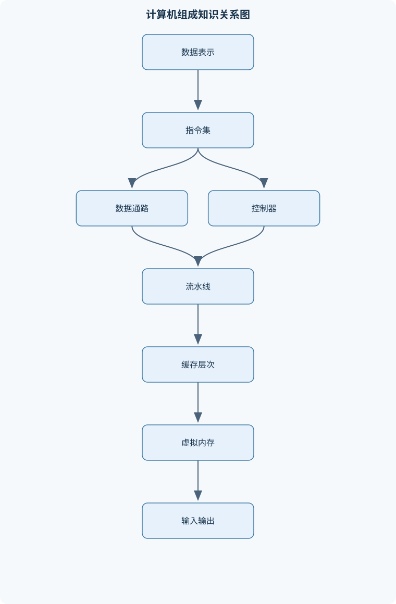
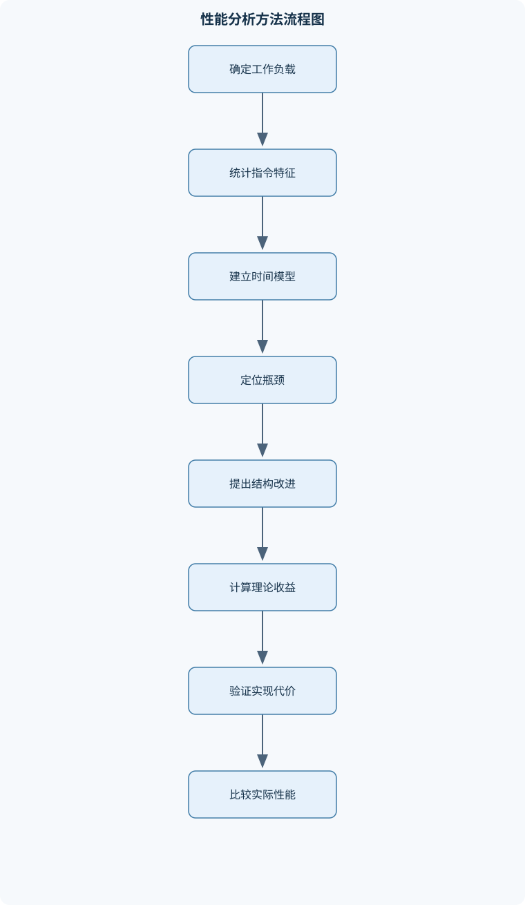

# 计算机组成与设计

## 一、课程整体知识框架

### 课程边界与先修知识

本课程研究计算机系统中从数字逻辑、数据表示、指令集体系结构到处理器、存储层次、输入输出和并行执行的组织原理。重点解释程序如何被表示、取指、译码、执行、访存和提交，以及硬件结构如何影响性能、容量、功耗和可靠性。课程覆盖组合逻辑与时序逻辑基础、整数与浮点数据表示、RISC-V风格指令集、汇编程序执行、单周期与多周期数据通路、流水线、数据与控制冒险、缓存、虚拟内存、异常中断、总线和基本并行体系结构。先修知识包括数字逻辑基础、二进制与十六进制运算、基础概率与代数、C语言或其他命令式程序设计、数据结构基本概念，以及程序运行时的栈、堆和指针概念。课程不深入操作系统调度、编译器优化、具体芯片版图和设备驱动实现，但会说明这些领域与计算机组成之间的接口。





### 1. 研究对象与核心问题

《计算机组成与设计》研究程序语义如何落实为硬件中的状态变化，以及硬件组织如何影响程序的执行时间、容量、功耗和可靠性。程序员看到的是变量、函数、数组和控制流；指令集体系结构将这些概念转换为寄存器、内存访问、算术运算和分支；微体系结构再用数据通路、控制器、流水线、缓存和总线实现这些指令；数字逻辑最终用门电路、触发器和存储单元实现硬件。

课程中的一个基本执行模型是：处理器通过 $PC$ 指向下一条指令，从指令存储器取出指令并保存到 $IR$，译码后读取 $GPR[i]$，由算术逻辑单元计算结果或有效地址，必要时访问 $M[a]$，最后将结果写回寄存器或更新控制流。这里 $PC$ 是程序计数器，保存下一条待取指令的地址；$IR$ 保存当前指令；$GPR[i]$ 表示第 $i$ 个通用寄存器；$M[a]$ 表示地址 $a$ 处的数据。除非特别说明，地址按字节编址，$M[a:a+n-1]$ 表示从 $a$ 开始的连续 $n$ 个字节。

这一执行模型不是单一电路，而是多个抽象层的接口。数字逻辑决定“能否构造加法器、寄存器和控制器”；数据表示决定位串如何解释为整数、地址或浮点数；指令集体系结构规定软件可见的寄存器、指令格式、异常和内存模型；微体系结构决定一条指令由几个阶段完成、是否使用流水线和缓存；输入输出与并行结构则决定处理器如何与外部设备及其他执行单元协作。

### 2. 性能、容量与代价的统一分析

处理器执行时间的基本关系为

$$
T_{CPU}=IC\times CPI\times T_{cycle}
=\frac{IC\times CPI}{f},
$$

其中，$IC$ 是动态执行的指令条数，$CPI$ 是平均每条指令所需的时钟周期数，$f$ 是时钟频率，单位为 Hz，$T_{cycle}=1/f$ 是时钟周期。该式只描述处理器执行程序主体的时间；若包含操作系统调度、输入输出等待或缺页处理，还必须把这些时间计入总响应时间。

当有 $m$ 类指令时，若第 $i$ 类指令的动态频率为 $f_i$、对应平均 CPI 为 $CPI_i$，且 $\sum_i f_i=1$，则

$$
CPI_{avg}=\sum_{i=1}^{m}f_iCPI_i.
$$

例如某类指令占动态指令数的 $2\%$，其 CPI 从 $20$ 降为 $7$，平均 CPI 的降低量为

$$
0.02\times(20-7)=0.26.
$$

这说明优化高 CPI 指令的效果不仅取决于其单条指令改进幅度，还取决于它在动态执行中的比例。主频高不必然更快：若高频处理器需要更多流水线级、具有更高 CPI 或执行更多指令，$IC\times CPI/f$ 仍可能更大。

对程序中占原执行时间比例为 $p$ 的部分进行 $s$ 倍加速，整体加速比为

$$
Speedup=\frac{1}{(1-p)+p/s}.
$$

推导方法是把原总时间归一化为 $1$，未优化部分仍耗时 $1-p$，优化部分变为 $p/s$，新总时间为 $(1-p)+p/s$。当 $s$ 趋于无穷时，整体加速上限为 $1/(1-p)$。因此，不能只根据某个部件的局部加速比判断系统性能。

性能分析还要区分延迟和带宽。延迟是一次操作从开始到结果可用所需的时间；带宽是单位时间能够传输的数据量。流水线主要提高稳定状态下的吞吐率，缓存和总线主要影响数据访问延迟及带宽，二者不能相互替代。例如，一个总线带宽很高但启动延迟很大的设备，适合连续大块传输，却不一定适合大量小请求。

### 3. 从逻辑电路到处理器

组合逻辑的输出只由当前输入决定，例如与门、或门、异或门、多路选择器、译码器和加法器。时序逻辑含有状态，输出不仅取决于当前输入，还取决于时钟边沿前保存的内容，例如锁存器、触发器、寄存器和寄存器组。组合逻辑负责计算，时序逻辑负责保存状态，二者结合形成时钟驱动的数据通路。

加法器可以由全加器级联构成，算术逻辑单元在此基础上实现加法、减法、按位逻辑运算、比较和地址计算。固定宽度的补码加法直接按模 $2^n$ 运算，但有符号溢出需要额外判断：两个同号数相加，若结果符号与操作数不同，则发生溢出。最高位产生进位并不等价于有符号溢出，因为无符号进位和有符号范围越界是不同概念。

处理器数据通路通常由寄存器组、$PC$、指令存储器、算术逻辑单元、数据存储器、多个多路选择器和写回路径组成。控制器根据指令字段产生寄存器写使能、内存读写、ALU 操作、分支选择和写回选择等控制信号。数据通路回答“数据经过哪些部件”，控制器回答“每个部件在当前指令中做什么”。

### 4. 数据表示与内存解释

无符号 $n$ 位整数的表示范围为 $0$ 到 $2^n-1$。$n$ 位补码的表示范围为

$$
-2^{n-1}\le x\le 2^{n-1}-1.
$$

负数的补码可由其绝对值的二进制位逐位取反再加一得到；也可理解为按模 $2^n$ 表示。补码只有一个零，而原码和反码通常存在正零与负零。补码的最小值 $-2^{n-1}$ 没有正对应值，因此对其取相反数仍得到自身的位模式，这属于表示范围边界而非正常正负转换。

把较窄位宽的数扩展到 $XLEN$ 位时，无符号数使用零扩展，有符号补码数使用符号扩展。立即数的扩展规则由指令语义决定，不能把所有立即数字段都当成无符号数。定点数必须先明确小数点位置；若第 $k$ 位权重为 $2^{-k}$，则位串的数值是各位权重之和，不能仅依据位数推断实数大小。

浮点数通常可抽象为

$$
(-1)^s\times(1.f)\times 2^{e-bias},
$$

其中 $s$ 是符号位，$f$ 是有效数字字段，$e$ 是指数编码，$bias$ 是偏置。正规数、非正规数、无穷大和 NaN 的编码边界不同，浮点加法还可能发生舍入、上溢和下溢，因此浮点数不等同于任意精确实数。

多字节数据在内存中的排列受字节序影响。大端序把高有效字节放在低地址，小端序把低有效字节放在低地址。字节序只改变存储排列，不改变抽象数值本身；但在读取字节数组、解析文件格式或跨设备通信时，若双方约定不同，就会产生错误。

### 5. 指令集、汇编与机器级程序

指令集体系结构是软件与硬件之间的契约，规定寄存器、指令编码、寻址方式、异常行为和可见的内存操作。微体系结构是该契约的具体实现，同一指令集可以由单周期、多周期、流水线或乱序处理器实现。RISC 思想倾向于使用格式规整、操作简单、加载存储分离的指令；复杂指令集可能提供更复杂的指令和寻址方式，但编码与控制也可能更复杂。

RISC-V 风格整数指令通常使用固定长度编码，并按算术立即数、寄存器运算、加载、存储、分支和跳转等类别组织字段。算术指令在寄存器之间运算，加载指令把内存数据读入寄存器，存储指令把寄存器数据写入内存。基址寻址通常计算

$$
有效地址=GPR[rs1]+\operatorname{sign\_extend}(imm),
$$

PC 相对寻址则以当前 $PC$ 或体系结构规定的基准加上经过规定缩放的偏移量形成目标地址。立即数字段可能在编码中被拆分，解码时必须按指令格式重新排列后再进行符号扩展。

过程调用需要保存返回地址，并按照调用约定安排参数、返回值和需要保存的寄存器。栈帧通常保存返回地址、被调用者必须恢复的寄存器以及局部变量。递归调用的每一层都需要独立的栈帧，否则局部变量和返回地址会相互覆盖。伪指令只是汇编器提供的便捷写法，最终必须展开为一条或多条真实机器指令，不能把伪指令直接当作固定硬件操作。

### 6. 存储、输入输出与并行执行

存储系统按速度、容量和单位成本形成层次：寄存器最快且容量最小，随后通常是缓存、主存和更大容量的外部存储。局部性原理包括时间局部性和空间局部性：近期访问过的数据可能再次访问，邻近地址可能很快被访问。SRAM 通常用于高速缓存，结构复杂但访问快；DRAM 单元密度高、容量大，但需要刷新并具有较高访问延迟。

缓存容量 $C$、块大小 $B$、组数 $S$ 和相联度 $E$ 满足

$$
C=S\times E\times B.
$$

若地址宽度为 $A$ 位，$B=2^b$ 字节，$S=2^s$，则地址低 $b$ 位为块内偏移，接着 $s$ 位为组索引，其余 $A-b-s$ 位为标签。直接映射是 $E=1$，全相联不使用组索引，组相联介于二者之间。缓存访问要检查有效位 $V$ 和标签 $T$；写回策略还需使用脏位 $D$。平均存储访问时间可写为

$$
AMAT=HitTime+MissRate\times MissPenalty,
$$

但必须说明缺失代价是否已经包含命中时间。多级缓存中，局部缺失率以该级收到的访问为分母，全局缺失率则以处理器发起的总访问为分母。

虚拟内存把虚拟地址划分为虚拟页号和页内偏移。页大小为 $P=2^p$ 字节时，低 $p$ 位为页内偏移，与虚拟地址总宽度无关。页表把虚拟页映射到物理页框，并记录有效位、访问权限、脏位等信息。多级页表在地址空间稀疏时节省空间，转址旁路缓存则缓存近期的地址转换结果。若页表项无效，处理器触发缺页异常；若权限不符，则触发保护异常。虚拟内存还提供进程地址空间隔离，但缺页处理的代价远高于普通缓存缺失。

输入输出包括存储器映射输入输出、轮询、中断和直接存储器访问。存储器映射方式把设备控制寄存器放入处理器可访问的地址空间；轮询由处理器反复检查设备状态，简单但会占用处理器；中断允许设备主动通知处理器；DMA 则让设备控制器直接在设备与内存之间传输数据，减少处理器逐字节搬运的开销。总线仲裁负责解决多个主设备同时请求共享总线的问题，同步通信依赖共同时钟，异步通信依赖握手或其他事件协议。

并行体系结构从指令级并行扩展到多核和多处理器。超标量处理器可在一个周期发射多条指令，乱序执行通过保留站、完成队列和提交机制隐藏不同指令的执行延迟；寄存器重命名可消除由名称复用造成的 WAR 和 WAW 假相关，但不能消除真实的 RAW 依赖。多核系统需要处理共享内存、消息传递、缓存一致性和同步原子操作。提高并行度通常会增加硬件面积、功耗、验证难度和一致性开销，因此性能目标必须与可靠性及能耗共同考虑。

## 二、章节和模块划分

### 核心知识覆盖清单

本清单用于检查正文是否覆盖本课程的主要知识模块：

- **计算机系统抽象与性能基础**：程序到硬件的多层抽象、指令集与微体系结构区别、数据通路与控制器分工、时钟周期与执行时间、指令数与平均CPI、主频与吞吐率、加速比与阿姆达尔定律、延迟和带宽区别。
- **数字逻辑与数据表示**：组合逻辑和时序逻辑、布尔代数与逻辑门、加法器和算术逻辑单元、锁存器与触发器、寄存器与寄存器组、无符号整数表示、原码反码与补码、符号扩展与溢出检测、定点数与浮点数、大小端存储约定。
- **指令集体系结构与RISC-V汇编**：RISC与复杂指令集思想、寄存器文件与程序计数器、RISC-V指令格式、算术逻辑指令、加载存储指令、条件分支与跳转、立即数编码与符号扩展、基址寻址与PC相对寻址、过程调用与返回地址、伪指令和机器指令区别。
- **汇编程序与机器级执行**：C语句到汇编的映射、数组与指针访问、条件语句翻译、循环结构翻译、栈帧与局部变量、调用约定与寄存器保存、递归过程的栈行为、机器码字段拆解、有效地址计算、汇编调试中的状态跟踪。
- **处理器数据通路与控制**：单周期处理器结构、取指与指令存储器、寄存器读写时序、算术逻辑单元控制、数据存储器接口、分支目标地址计算、多周期数据通路、有限状态机控制器、硬布线控制与微程序控制、结构冒险的来源。
- **流水线处理器**：流水线阶段划分、吞吐率与流水线延迟、流水线寄存器、结构冒险、RAW数据相关、WAR和WAW相关、旁路与前递网络、加载使用冒险、分支冒险与冲刷流水线、停顿和气泡计数。
- **存储层次与缓存**：局部性原理、存储层次结构、SRAM与DRAM差异、缓存块和缓存行、直接映射缓存、组相联缓存、全相联缓存、标签索引和块内偏移、写直达与写回、替换策略与一致性位、命中时间和缺失代价。
- **虚拟内存与地址转换**：虚拟地址和物理地址、页与页框、页表项组成、单级页表、多级页表、转址旁路缓存、缺页异常、页面置换基本思想、虚拟索引与物理标签缓存、保护位和地址空间隔离。
- **输入输出与系统控制**：存储器映射输入输出、轮询方式输入输出、中断响应流程、异常与中断区别、精确异常与非精确异常、中断向量表、直接存储器访问、总线仲裁、设备控制器与处理器接口、同步与异步通信。
- **并行体系结构与可靠性**：指令级并行、超标量发射、乱序执行基本机制、寄存器重命名思想、多核处理器结构、共享内存与消息传递、缓存一致性基本概念、同步原子操作、可靠性与冗余、功耗和性能权衡。


### 第一章 计算机系统抽象与性能基础

本章先建立程序、指令集、微体系结构和数字逻辑之间的层次关系，再使用 $T_{CPU}=IC\times CPI/f$ 分析性能。重点区分静态程序大小与动态 $IC$，区分主频、吞吐率和延迟，并用阿姆达尔定律分析局部优化的整体上限。边界反例是：增加缓存容量可能降低缺失率，却可能增加命中时间；提高主频可能导致流水线加深和分支代价增加，因此不能脱离 CPI 判断性能。

### 第二章 数字逻辑与数据表示

本章从布尔代数、逻辑门、组合逻辑和时序逻辑出发，构造多路选择器、译码器、加法器、ALU、锁存器、触发器、寄存器和寄存器组。随后讨论无符号数、原码、反码、补码、符号扩展、溢出、定点数、浮点数和字节序。分析时必须先确定位宽、编码方式和小数点位置。对于 $n$ 位补码，范围是 $-2^{n-1}$ 到 $2^{n-1}-1$；发生最高位进位不等价于有符号溢出。

### 第三章 指令集体系结构与 RISC-V 风格汇编

本章解释 RISC 与复杂指令集思想、寄存器文件、$PC$、指令格式和机器状态。算术逻辑指令主要改变寄存器状态，加载和存储指令通过有效地址访问内存，分支和跳转指令改变 $PC$。重点处理立即数编码、符号扩展、基址寻址、PC 相对寻址、过程调用、返回地址、伪指令与真实机器指令的区别。解码时必须先确定指令类别，再提取字段，不能把编码位串直接当成一个无符号整数解释。

### 第四章 汇编程序与机器级执行

本章把 C 语言中的赋值、数组、指针、条件语句、循环和函数调用映射为汇编操作。数组访问通常是基址加索引乘元素宽度，指针访问必须明确指向对象的大小和符号属性。栈帧分析包括返回地址、参数、局部变量和寄存器保存位置；递归过程则要逐层跟踪 $SP$、返回地址和局部状态。机器码分析要拆解操作码、寄存器字段、功能码和立即数字段，并验证有效地址、读写宽度和返回值寄存器是否一致。

### 第五章 处理器数据通路与控制

本章设计单周期和多周期处理器。单周期实现中，一条指令在一个长时钟周期内完成取指、译码、运算、访存和写回，控制简单但周期长度受最慢路径限制。多周期实现把这些操作拆分到多个周期，通过有限状态机控制器复用 ALU、存储器和总线，减少硬件并提高时钟频率，但一条指令需要多个周期。

设计数据通路时，先列出每类指令的寄存器传送操作，再确定共享资源、多路选择器和控制信号。加载指令需要“取指—读寄存器—计算地址—读数据—写回”，存储指令省略寄存器写回但增加内存写使能，分支指令需要比较寄存器并计算目标地址。未使用部件的控制信号必须定义为无效或无关，避免产生误写。

### 第六章 流水线处理器

本章把指令执行划分为 IF、ID、EX、MEM、WB 等阶段，并在阶段之间加入流水线寄存器。理想情况下，$n$ 条指令经过 $k$ 个阶段需要约 $k+n-1$ 个周期；填充和排空阶段不能忽略，吞吐率提高也不意味着单条指令延迟必然降低。

结构冒险来自同一周期争用不可复制资源；RAW 是先写后读的真实数据依赖，WAR 和 WAW 通常在乱序执行中更重要。旁路或前递可把已经产生的 ALU 结果直接送到后续阶段，但加载数据通常到 MEM 阶段末才可用，因此紧随其后的使用者常需停顿。分支冒险需要预测、延迟决定或冲刷流水线。停顿分析应逐周期标出气泡，并检查每个阶段的资源占用和操作数可用时间。

### 第七章 存储层次与缓存

本章从局部性出发建立寄存器、缓存、主存和外部存储的层次模型，比较 SRAM 与 DRAM。缓存地址划分为标签、组索引和块内偏移；容量计算必须区分数据容量与标签、有效位、脏位等元数据开销。直接映射易发生冲突缺失，组相联通过增加候选行减少冲突，全相联需要在所有行中比较标签。

写直达每次写命中都更新下一级，控制简单但流量较大；写回只在脏块替换时写回，需要维护 $D$。缓存缺失包括强制缺失、容量缺失和冲突缺失。增大块大小可能利用空间局部性，却也可能增加传输延迟、缓存污染和无效带宽。替换策略必须结合相联度和访问序列评价，不能只依据缓存容量判断命中率。

### 第八章 虚拟内存与地址转换

本章解释虚拟地址、物理地址、页、页框、页表项和地址空间隔离。页大小为 $P=2^p$ 字节时，页内偏移占 $p$ 位，剩余位构成虚拟页号。单级页表大小等于虚拟页数乘以页表项大小；例如 32 位地址、4 KiB 页和 4 字节页表项时，虚拟页数为 $2^{32}/2^{12}=2^{20}$，页表大小为 $2^{20}\times4$ 字节，即 4 MiB。

多级页表只为实际使用的虚拟区域建立下级表，因此适合稀疏地址空间；若所有虚拟页都使用，多级结构会增加上级表项和查找层级。转址旁路缓存命中时可以跳过部分页表访问。地址转换必须依次检查有效位和访问权限；无效映射触发缺页异常，权限不符触发保护异常。虚拟内存扩大的是地址空间和隔离能力，不等价于提供与主存相同速度的额外内存。

### 第九章 输入输出与系统控制

本章讨论设备控制器、处理器接口、存储器映射输入输出、轮询、中断、DMA 和总线仲裁。中断由外部设备或内部事件触发，异常通常由当前指令执行引起；二者都可能改变控制流，但保存现场、返回机制和权限语义不同。精确异常要求处理器能够明确哪些指令已完成、哪条指令出错以及后续指令尚未产生可见效果；乱序执行必须通过提交机制维持这种架构可见顺序。

中断处理流程包括请求、完成可精确提交的指令、保存 PC 和状态、查询向量、识别并确认中断源、执行服务程序、恢复现场和返回。DMA 适合连续数据块传输，但需要处理缓存可见性、地址权限和总线占用。同步通信由共享时钟约束时序，异步通信通过握手或请求—应答信号协调。

### 第十章 并行体系结构与可靠性

本章从指令级并行、超标量发射、乱序执行和寄存器重命名扩展到多核、共享内存和消息传递。乱序执行可以改变内部完成顺序，但必须保持真实数据依赖、异常语义和提交顺序。缓存一致性解决多个核心对同一共享数据副本的可见性问题；原子操作用于实现锁、计数器和无锁数据结构中的不可分割更新。

可靠性设计包括错误检测、冗余、超时恢复和故障隔离。性能提升常伴随功耗增加：提高频率通常增加动态功耗，增大缓存和增加发射宽度会增加面积与漏电，过度并行还会扩大验证和一致性成本。因此最终评价应同时考虑执行时间、吞吐率、能耗、故障恢复能力和实现复杂度。

### 代表性算法与流程

#### 1. 缓存地址划分与访问判定

**输入**：地址宽度 $A$、缓存容量 $C$、块大小 $B$、相联度 $E$、待访问地址和缓存元数据。  
**过程**：

1. 计算组数 $S=C/(B\times E)$。
2. 若 $B=2^b$、$S=2^s$，取地址低 $b$ 位作为块内偏移，接着 $s$ 位作为组索引，其余为标签。
3. 用组索引定位缓存组。
4. 在该组的 $E$ 行中检查有效位 $V$，再比较标签 $T$。
5. 标签匹配则命中；否则根据替换策略选择空行或受害行。
6. 缺失时从下一级取回整块，并更新 $V$、$T$，写回策略还要更新 $D$。

不变量是：缓存行只有在 $V=1$ 时标签才有效；命中数据必须来自标签匹配的有效行。复杂度为 $O(E)$。该流程假设容量、块大小和组数可进行相应的二进制划分；非二次幂结构需要采用不同的地址映射实现。

```text
# 语言：伪代码
function cache_access(address, operation, value):
    offset_bits = log2(B)
    index_bits  = log2(S)
    block_offset = address & ((1 << offset_bits) - 1)
    set_index = (address >> offset_bits) & ((1 << index_bits) - 1)
    tag = address >> (offset_bits + index_bits)

    for line in cache[set_index]:
        if line.valid == 1 and line.tag == tag:
            if operation == READ:
                return HIT, line.data[block_offset]
            else:
                line.data[block_offset] = value
                update_write_metadata(line)
                return HIT, null

    victim = choose_empty_or_victim(cache[set_index])
    if victim.dirty == 1:
        write_back(victim)
    victim.data = fetch_block(address - block_offset)
    victim.tag = tag
    victim.valid = 1
    victim.dirty = 0
    return MISS, retry_access(address, operation, value)
```

#### 2. 页表地址转换

**输入**：虚拟地址、页大小、页表层数、页表基址和各级页表项。  
**过程**：先提取低 $p$ 位页内偏移；再从高到低提取各级索引，逐级读取页表项；检查有效位和权限；得到物理页框号后，与页内偏移拼接形成物理地址。转址旁路缓存命中时直接取得页框号。查找复杂度为 $O(L)$，$L$ 为页表层数。无效项触发缺页异常，权限不符触发保护异常。

#### 3. 流水线时序分析

**输入**：指令序列、每条指令读写寄存器集合、阶段资源、前递规则和分支处理规则。  
**过程**：逐周期安排指令进入各阶段；检查同一资源是否被冲突占用；检查 RAW 等数据相关；若结果尚未产生或控制流尚未确定，则插入停顿或气泡；分支确定后冲刷错误路径上的指令。终止条件是最后一条指令完成写回。直接模拟复杂度为 $O(nk)$，其中 $n$ 为指令数，$k$ 为阶段数。

#### 4. 机器码反汇编

**输入**：一条固定长度或变长机器码。  
**过程**：先依据操作码确定指令类别，再切分寄存器、功能码和立即数字段；按照指令格式重排立即数；执行符号扩展；结合寻址基准计算有效地址或目标地址；最后输出汇编表示。固定长度单条 RISC 风格指令的解码复杂度为 $O(1)$。验证时应检查字段位宽、立即数符号、寄存器编号和目标地址缩放规则。

### 代表性例题

#### 例题一：平均 CPI 与执行时间

**题干**：某程序中 A 类指令占 $25\%$，CPI 为 $4$；B 类指令占 $2\%$，CPI 从 $20$ 降为 $7$；其余指令 CPI 为 $1.2$。求优化后的平均 CPI，并比较主频为 $1$ GHz、动态指令数为 $10^9$ 时的执行时间。

**分析**：各类频率必须按动态执行比例加权，不能对 CPI 做简单平均。其余指令比例为 $1-0.25-0.02=0.73$。

**解答**：

$$
CPI_{avg}=0.25\times4+0.02\times7+0.73\times1.2
=1+0.14+0.876=2.016.
$$

时钟周期为 $1/(10^9)$ 秒，因此

$$
T_{CPU}=\frac{10^9\times2.016}{10^9}=2.016\text{ s}.
$$

**结果验证**：频率之和为 $1$，CPI 介于各类 CPI 的最小值和最大值之间，单位换算正确。  
**变式**：若只给出平均 CPI 和某一类指令比例，应先根据变化量 $\Delta CPI=f_i(CPI_{old}-CPI_{new})$ 修正总 CPI，不能直接用新 CPI 替代总 CPI。

#### 例题二：补码加法与溢出

**题干**：用 8 位补码计算 $100+60$，判断是否溢出；再计算 $100+(-60)$。

**分析**：8 位补码范围为 $-128$ 到 $127$。先写出操作数，再观察同号相加后的结果符号。

**解答**：

$100$ 的二进制为 $01100100$，$60$ 为 $00111100$：

$$
01100100+00111100=10100000.
$$

两个正数相加得到最高位为 1 的负数位模式，发生有符号溢出。位串 $10100000$ 按补码解释为 $-96$，不是数学结果 $160$。

$-60$ 的补码为 $11000100$，因此

$$
01100100+11000100=1\,00101000.
$$

丢弃第 9 位进位，结果为 $00101000=40$，没有溢出。

**结果验证**：第一组是同号相加且结果异号，满足溢出条件；第二组是异号相加，不发生有符号溢出。  
**变式**：若题目要求无符号解释，第一组结果是 $160\bmod256=160$，此时应讨论无符号进位而不是有符号溢出。

#### 例题三：缓存地址划分

**题干**：32 位地址处理器使用容量 $16$ KiB、块大小 $64$ B、四路组相联缓存。求偏移位、索引位和标签位。

**分析**：先统一单位：$16$ KiB=$16\times1024=16384$ B。由 $C=S\times E\times B$ 求组数。

**解答**：

$$
S=\frac{16384}{4\times64}=64=2^6.
$$

块大小 $64=2^6$ B，因此块内偏移为 6 位；组数为 $2^6$，组索引为 6 位；标签位为

$$
32-6-6=20.
$$

**结果验证**：$64\times4\times64=16384$ B，三类地址字段总位数为 32。  
**变式**：改为直接映射时 $E=1$，组数变为 256，索引位为 8，标签位为 18；容量不变但冲突行为会改变。

#### 例题四：分页地址转换

**题干**：虚拟地址宽度为 32 位，页大小为 4 KiB。某虚拟地址的低 12 位为页内偏移，页表把虚拟页号映射到物理页框号。说明转换步骤。

**分析**：$4$ KiB=$2^{12}$ B，所以页内偏移固定占低 12 位，不能因为物理地址宽度不同而改变。

**解答**：

1. 将虚拟地址右移 12 位，得到虚拟页号。
2. 用虚拟页号查询页表。
3. 检查页表项有效位和读写执行权限。
4. 若有效且权限满足，得到物理页框号。
5. 将物理页框号左移 12 位，再按位或上原来的低 12 位偏移，形成物理地址。
6. 若无效，触发缺页异常；若权限不符，触发保护异常。

**结果验证**：转换前后页内偏移保持不变；页框号只替换虚拟页号。  
**变式**：若 TLB 命中，则不必访问各级页表；若 TLB 未命中但页表项有效，则完成页表遍历并回填 TLB。

#### 例题五：流水线加载使用冒险

**题干**：五级流水线为 IF、ID、EX、MEM、WB，指令为 `lw x1, 0(x2)`，紧接着为 `add x3, x1, x4`。说明带前递时为何仍可能停顿。

**分析**：加载数据在 MEM 阶段末才从数据存储器返回，而下一条 `add` 在 EX 阶段开始时需要读取 $x1$。若两个时刻不重合，前递网络也无法提前提供数据。

**解答**：

1. `lw` 进入 IF、ID、EX，EX 阶段计算有效地址。
2. `lw` 在 MEM 阶段读取数据。
3. 紧随其后的 `add` 若不暂停，会在 EX 阶段过早使用 $x1$。
4. 因而插入一个气泡，使 `add` 的 EX 阶段延后一周期。
5. 当加载数据在 MEM 末产生后，通过前递送至 `add` 的 EX 输入。

**结果验证**：前递消除了普通 ALU—ALU 相关的多数停顿，但不能消除加载—使用的产生时间差。  
**变式**：若加载与使用之间隔着一条独立 ALU 指令，通常可在不增加停顿的情况下完成，具体仍取决于实现的阶段时序。

### 实验与项目

#### 实验一：缓存映射与命中率模拟

**输入数据**：设置 32 位地址、容量 1 KiB、块大小 16 B，分别测试直接映射和二路组相联；准备包含连续访问、重复访问和跨组冲突的地址序列。  
**步骤**：

1. 计算两种缓存的组数、偏移位、索引位和标签位。
2. 手工预测每次访问的命中或缺失。
3. 用不依赖外部文件的程序实现缓存访问模拟。
4. 分别统计命中次数、缺失次数和命中率。
5. 改变块大小及相联度，比较强制、容量和冲突缺失的变化。

**评价标准**：地址划分正确；有效位、标签和替换状态更新正确；局部缺失率与全局缺失率定义清楚；实验结果能够由访问序列逐项复核。  
**排错方法**：若所有访问均缺失，检查有效位初始化和块号计算；若组索引异常，检查是否把字节地址误当成块地址；若命中率超过 100%，检查命中次数和访问次数的统计边界。

#### 实验二：流水线时序与冒险分析

**输入数据**：包含 ALU 运算、加载、存储、条件分支的指令序列；分别设置无前递、有前递和采用简单分支预测三种配置。  
**步骤**：

1. 为每条指令列出源寄存器和目的寄存器。
2. 逐周期填写 IF、ID、EX、MEM、WB。
3. 标出结构冒险、RAW 相关、加载使用冒险和分支冒险。
4. 按配置插入停顿、气泡或冲刷。
5. 计算总周期、完成指令数和稳定吞吐率。
6. 用改变指令顺序或插入独立指令的方式验证停顿是否减少。

**评价标准**：每个阶段资源占用不冲突；操作数只能在可用后读取；分支错误路径被冲刷；周期统计包含流水线填充和排空。  
**排错方法**：若前递后仍无停顿，检查加载数据产生阶段；若周期数过少，检查是否遗漏分支冲刷；若结果寄存器错误，检查气泡是否同时冻结了应冻结的流水线寄存器和 $PC$。

## 三、核心概念的详细解释

### 1. 抽象层次、性能指标与硬件组织

计算机系统不是由程序直接驱动晶体管，而是通过多个相互约束的抽象层实现。数字逻辑层使用门电路、加法器、多路选择器、锁存器和触发器；数据表示层规定位串如何解释为整数、地址或浮点数；指令集体系结构（ISA）规定程序可观察的寄存器、指令、内存模型、异常和调用约定；微体系结构规定如何用数据通路、控制器、流水线、缓存和执行部件实现 ISA。相同 ISA 可以有不同微体系结构，因此同一机器码能够在不同处理器上运行，但执行时间、功耗和吞吐率可能不同。

数据通路负责搬运和变换数据，例如从寄存器组读取操作数、由 ALU 计算、访问数据存储器并将结果写回；控制器根据指令字段和当前状态产生寄存器写使能、ALU 操作选择、存储器读写和多路选择信号。数据通路回答“数据经过哪里”，控制器回答“何时做什么”。若控制信号错误，即使数据通路结构正确，也可能把加载指令误写成存储指令。

处理器执行时间满足

$$
T_{CPU}=IC\times CPI\times T_{cycle}
=\frac{IC\times CPI}{f}.
$$

其中，$IC$ 是动态执行指令数，$CPI$ 是平均每条指令所需周期数，$f$ 的单位是 Hz，$T_{cycle}$ 的单位是秒。该式适用于把执行过程近似为总周期数乘以周期时间的情况；缓存缺失、分支冲刷、流水线停顿通常已经反映在有效 CPI 中。若只测量程序主体而忽略输入输出等待、操作系统调度和缺页处理，得到的是处理器执行时间而不是完整响应时间。

延迟表示单次操作从发起到结果可用所需的时间，带宽表示单位时间可传输的数据量。例如，缓存命中时间低，适合小而频繁的访问；高带宽内存适合连续大块传输，但不一定能降低第一次访问的等待时间。流水线主要提高稳定状态下的吞吐率，不能简单地把单条指令的逻辑延迟除以流水级数。

### 2. 组合逻辑、时序逻辑与数据表示

组合逻辑的输出只由当前输入决定。全加器输入两个加数位、低位进位，输出和位与进位；多个全加器串联可以形成波纹进位加法器。多路选择器根据控制信号从多个输入中选择一个，常用于选择 ALU 的第二个操作数、写回数据或下一条 $PC$。译码器把指令字段转换为互斥控制信号，比较器可由减法结果和符号条件实现。

时序逻辑具有状态。锁存器通常受电平控制，触发器通常在时钟边沿采样输入。寄存器由多个触发器组成，在一个时钟边沿同时保存多个比特。寄存器组提供多个读端口和一个或多个写端口；典型 RISC 风格设计允许同一周期读出两个源寄存器，并在时钟边沿写回一个目的寄存器。$PC$ 也是寄存器，其输入可能来自 $PC+4$、分支目标地址或跳转目标地址。

无符号 $n$ 位数的范围是 $0$ 到 $2^n-1$。补码 $n$ 位数的范围是 $-2^{n-1}$ 到 $2^{n-1}-1$，负数由对应正数按位取反再加一得到。补码加法直接进行模 $2^n$ 运算；最高位进位被丢弃并不等于溢出。只有两个同号数相加而结果符号改变时，才发生有符号溢出。减法可转化为加上减数的补码，但必须保持位宽一致。

符号扩展把最高位复制到更高位，适用于有符号立即数和有符号整数；零扩展把高位补零，适用于无符号数。将一个负的 $8$ 位补码数直接零扩展为 $16$ 位会改变数值，因此扩展规则必须由操作数的语义决定。定点数的数值还取决于小数点位置。例如位权从 $2^3$ 到 $2^{-4}$，同一位串若按整数解释和按定点小数解释会得到不同结果。

浮点数通常写作

$$
(-1)^s\times(1.f)\times 2^{e-bias},
$$

其中 $s$ 是符号位，$f$ 是有效数字字段，$e$ 是指数编码，$bias$ 是偏置值。正规数具有隐含的最高有效位；非正规数用于逐渐接近零；指数全为最大值时通常表示无穷或 NaN。浮点加法需要对阶、尾数相加、规格化和舍入，因而不满足一般实数加法的结合律。两个很大的数相减可能产生灾难性消去，超出有限精度时还可能上溢或下溢。

多字节数据在内存中的排列有字节序差异。大端序把高有效字节放在低地址，小端序把低有效字节放在低地址。字节序只改变内存字节排列，不改变寄存器中抽象数值；当数据通过文件、网络或设备接口交换时，发送方和接收方必须约定字节序。

### 3. 指令集、汇编程序与机器级状态

RISC 风格 ISA 倾向于固定长度、少量寻址方式、加载/存储分离和大量通用寄存器；复杂指令集可能允许一条指令完成更复杂的内存或算术操作。RISC 并不意味着所有指令都只需一个周期，而是强调规则的编码和硬件实现简洁性。

RISC-V 风格整数指令通常使用固定长度机器码。常见格式包括寄存器-寄存器运算格式、立即数运算或加载格式、存储格式、条件分支格式和无条件跳转格式。字段可能在机器码中分散排列，尤其是分支和跳转立即数，需要按规范重新拼接并进行符号扩展，不能把连续字段直接当作一个无符号整数。

算术逻辑指令直接在 $GPR[i]$ 中计算；加载指令根据基址寄存器与符号扩展立即数形成有效地址，从 $M[a]$ 读数据到寄存器；存储指令把寄存器数据写入 $M[a]$。典型有效地址计算为

$$
a=GPR[rs1]+\operatorname{signextend}(imm).
$$

分支通常比较两个寄存器，并把经过规定缩放的 PC 相对偏移加入分支基准地址。跳转指令还会保存返回地址，使被调用过程能够回到调用点之后继续执行。伪指令是汇编器展开出的书写简化形式，不一定对应独立的机器指令，因此分析机器码和动态指令数时必须使用展开后的真实指令。

C 语言中的数组访问可翻译为“基址加索引乘元素大小”。若数组首地址为 $A$，下标为 $i$，元素大小为 $w$ 字节，则元素地址为 $A+i\times w$。指针递增通常按所指类型大小移动，而不是只增加一个字节。条件语句可由比较、条件分支和跳转组成；循环通常包含初始化、条件测试、循环体和回跳四部分。

过程调用需要处理返回地址、参数、返回值和被调用者保存寄存器。栈帧通常保存返回地址、旧帧指针、局部变量和需要保留的寄存器。递归调用会为每一层创建新的栈帧；若递归深度过大，栈空间耗尽会导致运行失败。调用约定是软件与硬件之间的接口，不能仅凭某一段汇编代码假定所有寄存器都必须保存。

### 4. 单周期、多周期与流水线处理器

单周期处理器让一条指令在一个时钟周期内完成。周期必须足够覆盖最慢指令的所有组合逻辑路径，例如取指、寄存器读取、ALU 地址计算、数据存储器访问和寄存器写回。因此单周期结构控制简单，但周期过长，且不同指令使用硬件资源的程度不均衡。

多周期处理器把取指、译码、执行、访存和写回分散到多个周期。有限状态机根据当前状态和指令类型决定下一状态及控制信号。同一部件可在不同周期复用，从而减少硬件，但必须增加中间寄存器保存临时结果。硬布线控制通常速度较快但修改困难；微程序控制将控制信号组织为微指令，便于实现复杂指令，但需要微指令存储和额外访问时间。

典型五级流水线可表示为 IF、ID、EX、MEM、WB。流水线寄存器保存每一级产生的操作数、控制信号和目的寄存器号。理想情况下，流水线填满后每周期完成一条指令；若有 $k$ 个阶段、$n$ 条指令且无停顿，总周期约为 $k+n-1$，而不是 $n/k$。

流水线冒险分为结构、数据和控制三类。结构冒险是多个阶段同时争用不可复制资源；数据冒险来自读写顺序，RAW 表示后指令读取前指令写出的值，WAR 与 WAW 在乱序执行中尤其重要。旁路或前递把已产生但尚未写回寄存器组的结果直接送给后续 ALU。加载指令的数据通常到 MEM 阶段末才产生，紧随其后的使用者常需要一个停顿。分支方向未知时，处理器可能停顿、预测或先取错误路径；预测错误后必须冲刷错误路径上的指令。

### 5. 存储层次、缓存与虚拟内存

存储层次利用时间局部性和空间局部性。刚访问过的数据可能再次访问，邻近地址也可能很快被访问。寄存器最快但容量最小，随后通常是多级缓存、主存和更慢的大容量存储。SRAM 使用稳定状态单元，速度快、面积大，常用于缓存；DRAM 以电容存储电荷，密度高但需要刷新，常用于主存。

缓存容量、块大小、相联度和组数满足

$$
C=S\times E\times B.
$$

若地址宽度为 $A$ 位，$B=2^b$ 字节，$S=2^s$ 组，则地址低 $b$ 位是块内偏移，接着 $s$ 位是组索引，剩余 $A-b-s$ 位是标签。直接映射的 $E=1$；全相联只有一个组，不使用组索引；组相联在一个组内比较 $E$ 个标签。访问时先依据索引定位组，再比较有效行的标签。缓存行中的有效位 $V$ 表示内容是否可用，脏位 $D$ 表示内容是否被修改但尚未写入下一级。

写直达在写命中时立即更新下一级，控制简单但流量大；写回只在脏行替换时写回，流量较小但必须维护脏位。替换策略可采用先进先出、最近最少使用或随机策略。大块能利用空间局部性并减少块级强制缺失，但会增加填充时间、污染缓存和无效传输。

虚拟内存把虚拟地址空间划分为页，把物理内存划分为页框。虚拟地址由虚拟页号和页内偏移构成。页大小为 $P=2^p$ 字节时，低 $p$ 位是页内偏移，转换时该部分保持不变，虚拟页号通过页表映射为物理页框号。页表项通常包含有效位、物理页框号、读写执行权限、用户/内核权限和访问或修改状态。

单级页表查找简单，但虚拟地址空间很大时页表本身占用大量空间。多级页表按虚拟页号分段索引，只为实际使用的区域创建下级表，适合稀疏地址空间。转址旁路缓存（TLB）保存近期的虚拟页号到物理页框映射，命中时可避免多次页表访问。页表项无效触发缺页异常；权限不符则触发保护异常。缺页处理需要操作系统选择空闲页框或牺牲页框，必要时写回被修改页面，再从后备存储装入目标页，因此代价远高于普通缓存缺失。

### 6. 输入输出、并行执行与可靠性

存储器映射输入输出把设备控制器寄存器映射到处理器地址空间，处理器使用加载和存储指令访问设备。轮询方式由处理器反复读取状态寄存器，逻辑简单但浪费处理器时间。中断方式由设备主动请求服务，处理器保存必要状态，依据中断向量转入处理程序，识别来源、清除请求、完成服务，再恢复现场返回。异常通常由当前指令执行引起，中断通常由外部设备或异步事件引起；二者都改变控制流，但保存现场和返回语义可能不同。

直接存储器访问（DMA）允许设备控制器在获得总线后直接在设备与内存之间传输数据，处理器只需配置地址、长度和方向，并在完成或出错时接收中断。总线仲裁决定多个主设备谁能使用共享总线；同步通信由共同时钟约束，异步通信依靠握手或起始停止信号，不要求双方共享时钟。

指令级并行通过同时发射多条独立指令提高吞吐率。超标量处理器需要多个执行端口、发射逻辑和资源冲突检查。乱序执行允许不依赖的指令先执行，但必须在提交阶段保持程序可观察的顺序，以维持异常和内存语义。寄存器重命名把逻辑寄存器映射到更多物理寄存器，可消除 WAR 和 WAW 名称相关，但不能消除真正的 RAW 数据依赖。

多核处理器可以共享内存，也可以通过消息传递通信。共享缓存系统需要缓存一致性协议，使多个核心对同一内存位置的读写最终遵循规定顺序；一致性解决“数据副本是否相同”，内存一致性还涉及“不同读写被观察的顺序”。原子操作保证读-改-写不可被其他核心插入，常用于锁、计数器和无锁数据结构。

可靠性设计使用奇偶校验、纠错码、冗余执行、看门狗和故障隔离等机制。增加校验和冗余会提高可靠性，但增加面积、延迟和功耗。提高主频、增加并行度、扩大缓存也可能带来更高功耗和散热压力，性能、容量、能耗和可靠性必须作为整体权衡。

## 四、重要定义、公式、定理和推导

### 专业审校补充：关键定义与适用边界

精确异常是乱序或推测执行必须维护的体系结构边界：当第 $i$ 条指令发生异常时，处理器对软件可见的状态应等价于“第 $i$ 条之前的指令已经按程序顺序完成，第 $i$ 条及其后的指令尚未产生可见更新”。这里的状态包括程序计数器、通用寄存器、存储器以及规定的异常原因。执行完成不等于提交完成；结果可以暂存在保留站、物理寄存器或存储缓冲区中，只有按程序顺序提交后才更新架构状态。分支预测错误也必须撤销错误路径上的未提交结果。若允许较早指令之后的指令先写回架构寄存器或直接修改内存，就可能出现异常处理程序观察到部分执行结果的非精确异常。实现通常使用重排序缓冲区按序提交，并在异常或冲刷时丢弃未提交项。该边界不要求内部执行严格按序，但要求异常、分支恢复和软件可见状态满足程序顺序；对外部设备副作用和内存排序，还需结合具体 ISA 的 I/O 与内存模型规定，不能仅凭一般乱序执行规则判断。


### 1. 关键公式与边界条件

平均 CPI 的推导是把各类指令周期数相加。若总指令数为 $IC$，第 $i$ 类动态频率为 $f_i$，则该类指令数为 $ICf_i$，总周期为

$$
\sum_i ICf_iCPI_i.
$$

除以 $IC$ 得

$$
CPI_{avg}=\sum_i f_iCPI_i,\qquad \sum_i f_i=1.
$$

若把各类 CPI 直接做算术平均，只有在各类动态频率相等时才正确。

阿姆达尔定律由时间分解得到。原总时间归一化为 $1$，可优化部分占 $p$，优化后获得 $s$ 倍加速，则新时间为

$$
T_{new}=(1-p)+\frac{p}{s},
$$

所以

$$
Speedup=\frac{T_{old}}{T_{new}}
=\frac{1}{(1-p)+p/s}.
$$

当 $s\to\infty$ 时，

$$
Speedup_{\max}=\frac{1}{1-p}.
$$

例如只有 $20\%$ 的时间可优化，即使该部分无限快，整体加速也不超过 $1/0.8=1.25$。该结论适用于时间比例在优化前已确定、其余部分未同步变快的情况。

缓存平均访问时间可写为

$$
AMAT=HitTime+MissRate\times MissPenalty.
$$

这里的 $MissPenalty$ 必须明确是否已经包含再次付出的命中时间。若一级缓存访问时间为 $t_1$，一级局部缺失率为 $m_1$，二级访问时间为 $t_2$，二级局部缺失率为 $m_2$，主存代价为 $t_m$，一种常见写法是

$$
AMAT=t_1+m_1(t_2+m_2t_m).
$$

一级缺失率的分母是处理器对一级缓存的访问次数；二级局部缺失率的分母是到达二级缓存的访问次数，而不是所有处理器访问次数。

若 $C=32\text{ KiB}$、$B=64\text{ B}$、二路组相联，则

$$
S=\frac{32\times 1024}{64\times 2}=256=2^8.
$$

块内偏移为 $b=\log_2 64=6$ 位，组索引为 $8$ 位。若物理地址为 $32$ 位，标签位数为 $32-6-8=18$ 位。这个计算假定容量单位是数据区容量，且容量、块大小和组数均为适合二进制划分的二次幂。

页表大小的推导是虚拟页数乘以页表项大小。若虚拟地址宽度为 $32$ 位，页大小为 $4\text{ KiB}=2^{12}$ 字节，则虚拟页数为

$$
2^{32}/2^{12}=2^{20}.
$$

若每个页表项为 $4$ 字节，单级页表大小为

$$
2^{20}\times4=2^{22}\text{ B}=4\text{ MiB}.
$$

页内偏移始终为低 $12$ 位，与物理地址宽度无关。

### 2. 代表性算法与流程

#### 缓存地址划分与访问判定

**输入**：地址宽度 $A$、缓存容量 $C$、块大小 $B$、相联度 $E$、访问地址及缓存行状态。  
**输出**：标签、组索引、块内偏移，以及命中或缺失结果。

1. 计算组数 $S=C/(B\times E)$。
2. 计算 $b=\log_2B$ 和 $s=\log_2S$。
3. 取地址低 $b$ 位作为块内偏移，再取高一段 $s$ 位作为组索引，剩余部分作为标签。
4. 检查目标组中每个缓存行的有效位。
5. 对有效行比较标签；相等则命中，否则缺失。
6. 缺失时优先选择无效行，否则按替换策略选择牺牲行。
7. 装入新块并更新标签、有效位、脏位和替换状态。

该算法假设 $B$、$S$ 为二次幂；直接映射时比较次数为 $O(1)$，一般组相联时一次判定最多比较 $E$ 个标签，复杂度为 $O(E)$。不变量是每个有效缓存行的标签与其所保存块一致。

#### 页表地址转换

**输入**：虚拟地址、页大小、页表层数、页表基址。  
**输出**：物理地址，或缺页、保护异常。

1. 根据页大小提取低位页内偏移。
2. 按页表层级从高到低提取各级索引。
3. 用当前页表基址和索引定位页表项。
4. 检查有效位和访问权限。
5. 若页表项有效，将物理页框号与页内偏移拼接。
6. 若无效，触发缺页异常；若权限不符，触发保护异常。
7. 若 TLB 命中，可直接获得物理页框号，跳过部分页表查找。

层级为 $L$ 时，页表查找复杂度为 $O(L)$。不变量是页内偏移在转换过程中不改变。

#### 流水线时序分析

**输入**：指令序列、每条指令的源寄存器和目的寄存器、阶段数量、前递规则和分支规则。  
**输出**：逐周期阶段表、停顿数、气泡数、冲刷数和总周期。

1. 为每条指令标注 IF、ID、EX、MEM、WB。
2. 检查同一周期是否争用不可复制资源。
3. 检查 RAW、WAR 和 WAW 相关。
4. 判断前递是否能在使用时刻提供结果。
5. 若不能提供，冻结相关阶段并插入气泡。
6. 遇到分支时按预测规则继续或停顿；预测错误则冲刷错误路径。
7. 当最后一条指令完成写回时终止。

不变量是任何阶段不能同时占用同一个不可复制资源，且指令使用的数据必须已经产生并对该阶段可见。直接模拟 $n$ 条指令、$k$ 个阶段的基本复杂度为 $O(nk)$。

#### 机器码解码

**输入**：机器码位串。  
**输出**：指令类别、寄存器、立即数及其语义。

1. 读取操作码，确定指令格式。
2. 按格式提取寄存器字段、功能字段和立即数字段。
3. 对分散的立即数字段按规定位置重新拼接。
4. 根据符号规则扩展到 $XLEN$ 位。
5. 结合基址寄存器、$PC$ 或隐含常数解释有效地址和目标地址。
6. 输出汇编表示及其读写寄存器集合。

固定长度指令单条解码复杂度为 $O(1)$。主要边界是不能把跳转偏移当作绝对地址，也不能把立即数字段无条件当作无符号数。

```text
# 语言：伪代码
function access_cache(address):
    offset_bits = log2(B)
    set_count = C / (B * E)
    index_bits = log2(set_count)

    offset = address & ((1 << offset_bits) - 1)
    set_id = (address >> offset_bits) & ((1 << index_bits) - 1)
    tag = address >> (offset_bits + index_bits)

    for line in cache[set_id]:
        if line.valid and line.tag == tag:
            update_replacement_state(line)
            return HIT, line.data[offset]

    victim = choose_invalid_or_victim(cache[set_id])
    if victim.valid and victim.dirty:
        write_back(victim)
    fill(victim, address)
    update_replacement_state(victim)
    return MISS, victim.data[offset]
```

### 3. 典型例题与逐步解答

#### 例题一：平均 CPI 与优化

**题干**：某程序中 A 类指令占 $25\%$，CPI 为 $4$；B 类指令占 $2\%$，CPI 从 $20$ 降为 $7$；其余指令 CPI 为 $1.2$。求优化后的平均 CPI。

**分析与解答**：

1. 其余指令比例为 $1-0.25-0.02=0.73$。
2. 分别计算各类对平均 CPI 的贡献：
   $$
   0.25\times4=1.00,\quad 0.02\times7=0.14,\quad 0.73\times1.2=0.876.
   $$
3. 相加得
   $$
   CPI_{avg}=1.00+0.14+0.876=2.016.
   $$

**结果验证**：优化前 B 类贡献为 $0.02\times20=0.4$，优化后减少 $0.26$，因此优化前平均 CPI 为 $2.276$，减去 $0.26$ 得 $2.016$。变式是若 B 类只占静态代码的 $2\%$ 而非动态执行的 $2\%$，则不能直接使用该比例。

#### 例题二：补码加法与溢出

**题干**：用 $8$ 位补码计算 $100+60$，判断是否溢出。

**分析与解答**：

1. $100$ 的二进制为 $01100100$，$60$ 为 $00111100$。
2. 相加：
   $$
   01100100+00111100=10100000.
   $$
3. 两个操作数都是正数，但结果最高位为 $1$，解释为负数 $-96$。
4. 因而发生有符号溢出。$8$ 位补码范围为 $-128$ 到 $127$，真实结果 $160$ 超出上界。

**结果验证**：最高位进位被丢弃不是判断依据；同号相加得到异号结果才是溢出条件。变式是 $-100+60$，两数异号，不会发生有符号溢出。

#### 例题三：缓存地址划分

**题干**：32 位地址、$16\text{ KiB}$ 直接映射缓存、块大小 $32\text{ B}$。求偏移、索引和标签位数。

**分析与解答**：

1. $C=16\times1024=2^{14}$ 字节。
2. $B=32=2^5$，所以偏移为 $5$ 位。
3. 直接映射 $E=1$，组数
   $$
   S=2^{14}/2^5=2^9,
   $$
   所以索引为 $9$ 位。
4. 标签位数为
   $$
   32-5-9=18.
   $$

**结果验证**：缓存总容量为 $2^9$ 组乘 $2^5$ 字节，等于 $2^{14}$ 字节。变式是改为二路组相联，组数减半为 $2^8$，偏移仍为 $5$ 位，标签增加为 $19$ 位。

#### 例题四：流水线加载使用冒险

**题干**：五级流水线执行：

```asm
lw   x1, 0(x2)
add  x3, x1, x4
sub  x5, x3, x6
```

假设有 ALU 前递，但加载数据到 MEM 阶段末才可用。说明停顿。

**分析与解答**：

1. `add` 在 EX 阶段需要 $x1$。
2. `lw` 的数据直到 MEM 阶段末才产生，`add` 原计划下一周期进入 EX，时间过早。
3. 插入一个气泡，使 `add` 延后一周期。
4. `add` 的 ALU 结果可以通过前递直接给 `sub`，因此 `add` 与 `sub` 之间通常不需额外停顿。

**结果验证**：若错误地认为所有前递都能消除停顿，会使 `add` 在数据尚未产生时读取旧值。变式是两条独立指令插在 `lw` 与 `add` 之间，此时可能无需气泡。

#### 例题五：虚拟地址转换

**题干**：页大小为 $4\text{ KiB}$，某虚拟地址的虚拟页号映射到物理页框号 $0x35A$，求物理地址的形成方式。

**分析与解答**：

1. $4\text{ KiB}=2^{12}$，页内偏移为虚拟地址低 $12$ 位。
2. 将虚拟页号替换为物理页框号。
3. 物理地址为
   $$
   PA=(0x35A\ll12)\;|\;(VA\ \&\ 0xFFF).
   $$
4. 若虚拟地址低 $12$ 位为 $0x7C0$，则
   $$
   PA=0x35A7C0.
   $$

**结果验证**：页内偏移仍为 $0x7C0$，只替换高位页号。变式是页表项无效，此时不应生成普通物理地址，而应触发缺页异常。

### 4. 实验与项目流程

#### 实验一：缓存映射模拟

**输入数据**：32 位地址、容量 $1\text{ KiB}$、块大小 $16\text{ B}$；设计连续访问、重复访问和映射到同一组的冲突访问序列。

**步骤**：

1. 分别计算直接映射和二路组相联的组数、偏移位和标签位。
2. 初始化所有有效位为零。
3. 对访问序列逐项计算块号、组索引和标签。
4. 手工记录命中、强制缺失、容量缺失和冲突缺失。
5. 编写缓存模拟程序，比较程序输出与手算结果。
6. 改变块大小和相联度，重新统计命中率。

**评价标准**：地址划分准确；有效位初值正确；替换状态更新一致；局部缺失率和全局缺失率的分母明确；每一项结果可由访问序列复核。

**排错方法**：全部缺失时检查有效位初始化和块号计算；组号异常时检查是否误把字节地址当作块地址；命中率超过 $100\%$ 时检查统计计数器和循环边界。

#### 实验二：流水线冒险分析

**输入数据**：含 ALU、加载、存储和条件分支的指令序列，设置无前递、有前递和简单分支预测三种配置。

**步骤**：

1. 列出每条指令读写的寄存器。
2. 按周期填写 IF、ID、EX、MEM、WB。
3. 标出结构冲突、RAW 相关、加载使用冒险和分支冒险。
4. 根据配置插入停顿、气泡或冲刷。
5. 计算总周期、完成指令数和吞吐率。
6. 调换独立指令位置，观察停顿是否减少。

**评价标准**：每个阶段的资源占用不冲突；操作数在可用后才被读取；错误分支路径被冲刷；周期数包含流水线填充和排空。

**排错方法**：前递后仍然出现错误结果时检查旁路端点；加载后结果错误时检查是否遗漏加载使用停顿；总周期过少时检查分支冲刷；$PC$ 和流水线寄存器冻结不一致时检查停顿控制信号。

### 5. 易错点、笔试与面试问题

#### 典型易错点

1. 用主频直接比较性能，忽略 $IC$ 和 CPI。
2. 把静态指令比例当作动态执行比例。
3. 对各类 CPI 做简单平均而不是加权平均。
4. 把补码最高位进位直接当作溢出。
5. 符号扩展与零扩展混用。
6. 把加载方向和存储方向颠倒。
7. 把跳转偏移直接当作绝对地址。
8. 把伪指令当作一条真实机器指令统计。
9. 把缓存容量、数据区容量和芯片总容量混为一谈。
10. 忘记缓存块内偏移由字节数决定。
11. 将局部缺失率和全局缺失率混用。
12. 认为缓存越大或块越大一定更快。
13. 认为流水线能降低单条指令组合逻辑延迟。
14. 认为前递可以消除所有数据冒险。
15. 把虚拟地址转换误认为只改变地址高位而不检查权限。
16. 把中断、异常和过程调用视为同一种控制转移。
17. 认为一致性自动等于顺序一致性。
18. 认为增加并行执行单元不会增加功耗和控制复杂度。

#### 典型笔试问题及解答思路

1. **为什么高主频处理器可能更慢？**  
   写出 $T_{CPU}=IC\times CPI/f$，比较三项而非只比较 $f$。

2. **补码为何适合实现加减法？**  
   说明减法可转为加法，正负数统一使用模 $2^n$ 加法器。

3. **如何判断有符号溢出？**  
   检查两个操作数是否同号，以及结果符号是否改变。

4. **给定缓存参数如何划分地址？**  
   先算 $S=C/(B E)$，再计算偏移、索引和标签位数。

5. **为什么二路组相联能降低冲突缺失？**  
   同一组允许两个候选位置，减少不同块竞争同一行，但不能消除容量缺失。

6. **为什么加载后紧接使用常需停顿？**  
   加载数据到 MEM 末才产生，而使用者 EX 阶段更早需要操作数。

7. **多级页表何时节省空间？**  
   虚拟地址空间稀疏时只创建被使用区域；全覆盖时需考虑额外上级表项。

8. **DMA 为什么能提高输入输出效率？**  
   数据块传输由设备控制器完成，处理器只负责配置和完成通知，但仍需处理总线竞争和缓存一致性。

#### 典型面试问题及回答要点

1. **如何定位程序变慢的原因？**  
   先区分 $IC$、CPI、主频、缓存缺失、分支错误和输入输出等待；产出应包括可复现实验、计数器数据和改进前后对比，而不是只报告主频。

2. **前递网络解决什么问题？**  
   它把已产生的结果送到后续执行级，主要解决可及时获得的 RAW；加载使用冒险和分支冒险仍可能需要停顿或预测。

3. **写回缓存为什么需要脏位？**  
   脏位记录缓存行是否被修改；替换脏行时必须写回，否则会丢失数据。只读行或未修改行可直接丢弃。

4. **TLB 和缓存分别解决什么问题？**  
   TLB 缓存地址转换结果，缓存保存数据或指令块；TLB 命中不代表数据缓存命中，二者失效机制也不同。

5. **乱序执行如何保持程序正确性？**  
   通过依赖检查、保留站或队列、寄存器重命名和按程序顺序提交，避免异常和提交结果被错误顺序观察。

6. **中断处理必须保存哪些状态？**  
   至少包括恢复执行所需的 PC、权限和必要控制状态，具体寄存器集合由体系结构规定；还要处理嵌套中断和中断源确认。

7. **如何解释缓存一致性与内存一致性的区别？**  
   一致性关注同一地址的副本是否最终一致，内存一致性关注不同地址读写的可观察顺序；两者不能互相替代。

8. **性能优化为什么要遵循阿姆达尔定律？**  
   优化收益受原程序时间占比限制。应先测量瓶颈，再估算局部加速对总体时间的上限，并同时评估功耗和硬件代价。

### 6. 岗位关联与验收标准

处理器微架构和 RTL 设计任务通常包括数据通路、流水线控制、旁路网络和异常路径实现；使用的知识包括寄存器传送、有限状态机、时序约束和冒险处理；产出是设计说明、RTL 和验证结果；验收要求是指令语义正确、时序满足约束、异常可恢复、仿真覆盖关键边界。

底层系统软件和编译器后端任务涉及调用约定、机器码生成、栈帧、寄存器分配和地址空间；产出是汇编、目标代码、调试信息或运行时组件；验收标准包括 ABI 兼容、寄存器保存规则正确、递归和异常路径不破坏现场、生成代码在规定 ISA 和运行环境下正确执行。

性能分析任务需要结合硬件计数器、缓存行为、分支预测和 CPI 分解定位瓶颈；产出是基线测量、瓶颈解释和优化前后对比；验收标准是测试负载可复现、单位明确、结果具有统计稳定性，且不能把局部指标改善误报为整体加速。

硬件接口与设备软件任务涉及存储器映射输入输出、中断、DMA、总线仲裁和同步通信；产出是寄存器访问流程、驱动接口或测试程序；验收标准包括设备状态转换正确、并发访问不丢数据、中断能够确认和清除、DMA 地址和缓存一致性处理正确。

芯片验证与系统测试任务需要覆盖补码边界、缓存替换、缺页和保护异常、分支冲刷、乱序提交及故障注入；产出是测试用例、参考模型、波形分析和缺陷报告；验收标准是结果可重复、边界条件覆盖充分、错误能够定位到具体控制信号或状态转移，并且修复后不存在新的体系结构可见错误。

## 五、算法、流程和实现思路

### 方法与流程覆盖索引

下列方法或流程应在正文中说明输入、步骤、适用条件、结果检查和边界：

- 缓存地址划分与映射：输入地址宽度$A$、缓存容量$C$、块大小$B$和相联度$E$；先计算组数$S=C/(B\times E)$，再取$b=\log_2B$和$s=\log_2S$，低$b$位为块内偏移，接着$s$位为组索引，剩余高位为标签；输出标签、组索引、偏移和候选缓存位置。假设容量和块大小是2的幂；复杂度为$O(1)$。
- 缓存访问判定：输入物理地址和缓存各组内容；用地址索引定位组，比较该组中所有有效行的标签，若相等则命中，否则为缺失；命中时根据读写策略更新数据和元数据，缺失时选择空行或按替换策略选择受害行。循环对相联度$E$个标签比较，复杂度为$O(E)$。
- 流水线时序分析：输入按程序顺序排列的指令、每条指令的读写寄存器、阶段延迟和前递规则；逐周期建立阶段表，检查结构冲突、RAW相关和控制转移，若操作数不可用则插入停顿或气泡，直到所有指令完成；不变量是任一阶段不得同时占用同一不可复制资源，且指令只能读取已产生并可见的数据；终止条件是最后一条指令完成写回。直接模拟复杂度为$O(nk)$，其中$n$为指令数、$k$为阶段数。
- 页表地址转换：输入虚拟地址、页大小、页表层数和页表基址；先用低位提取页内偏移，再按各级索引位从高到低查找页表项，检查有效位和访问权限，得到物理页框号后与页内偏移拼接；无效时触发缺页异常，权限不符时触发保护异常；在转址旁路缓存命中时可跳过部分页表访问。层级查找复杂度为$O(L)$，$L$为页表层数。
- 机器码反汇编流程：输入固定长度或变长机器码；先依据操作码确定指令类别，再按指令格式切分寄存器字段、立即数字段和功能码，执行符号扩展与字段重排，最后结合指令语义生成汇编表示；输出必须标明立即数位宽和寻址基准，避免把编码字段直接当作无符号十进制数。固定长度RISC风格指令的单条解码复杂度为$O(1)$。
- 性能加速分析：输入原始指令数、各类指令频率、CPI、时钟频率以及改进后的参数；分别计算原始和改进后的$T_{CPU}$，再用$Speedup=T_{old}/T_{new}$比较；检查频率之和是否为1、单位是否统一、CPI是否为动态平均值；复杂度为$O(m)$，$m$为指令类别数。
- 中断处理流程：设备或内部事件提出请求，处理器完成当前可精确提交的指令，保存必要的PC和状态，依据向量号转入处理程序，识别来源并清除或确认设备请求，执行服务逻辑，恢复状态并返回被中断程序；终止条件是中断源已处理且返回指令完成。该流程要求保存现场、权限切换和嵌套策略由体系结构明确规定。
- 组合逻辑到数据通路设计：输入指令语义和寄存器传送描述；列出每条指令所需的取指、寄存器读、运算、访存和写回操作，确定共享资源，增加多路选择器和控制信号，逐条验证控制信号组合；不变量是每条指令的架构状态变化与规范语义一致；适用于单周期、多周期和流水线数据通路设计。
- 替换策略分析：输入一组访问序列、缓存组数、块大小和替换规则；逐次计算块号和组号，判断命中，缺失时按先进先出、最近最少使用或随机规则选择受害行并更新状态；输出命中次数、缺失次数和最终缓存内容。直接模拟复杂度为$O(nE)$，其中$n$为访问次数、$E$为相联度。





### 1. 由指令语义生成数据通路控制信号

#### 1.1 输入、输出与基本过程

该流程的输入是指令集体系结构规定的指令语义，输出是数据通路中的资源连接方式和控制信号。对一条指令，首先将其架构状态变化写成寄存器传送形式。例如，加载指令可以抽象为

$$
addr=GPR[rs1]+\operatorname{SEXT}(imm),
$$

$$
GPR[rd]\leftarrow M[addr:addr+n-1],
$$

其中，$rs1$ 是基址寄存器编号，$rd$ 是目的寄存器编号，$imm$ 是立即数，$\operatorname{SEXT}$ 表示符号扩展到 $XLEN$ 位，$n$ 是访存字节数。存储指令则为

$$
addr=GPR[rs1]+\operatorname{SEXT}(imm),
$$

$$
M[addr:addr+n-1]\leftarrow GPR[rs2].
$$

二者都需要 ALU 计算有效地址，但加载指令把存储器输出选择为写回数据，存储指令则把寄存器数据送入存储器写数据端口。

设计步骤如下：

1. **列出状态读写**：确定指令读取哪些寄存器、读取何种内存数据、写回哪些寄存器或内存位置。
2. **确定数据路径**：连接 $PC$、指令存储器、寄存器组、ALU、数据存储器和写回多路选择器。
3. **识别共享资源**：若多个指令都使用 ALU，就通过控制信号选择 ALU 的第二个输入；若多个来源都可能更新 $PC$，就设置下一条 $PC$ 的多路选择器。
4. **产生控制信号**：包括寄存器写使能、存储器写使能、ALU 操作码、立即数扩展方式、写回数据来源和分支选择信号。
5. **按指令逐条验证**：检查每一条指令的最终架构状态是否与 ISA 语义一致。

不变量是：任何控制信号组合都不能使同一个架构状态在不应修改时被修改。例如，存储指令不能开启寄存器写使能，分支指令不能把比较结果误写入通用寄存器。该方法适用于单周期、多周期和流水线处理器；流水线实现还需要把控制信号随指令一起存入流水线寄存器。

#### 1.2 单周期与多周期实现的差异

单周期处理器在一个时钟周期内完成一条指令的全部操作，因此周期长度必须覆盖最慢路径，通常是“取指—读寄存器—计算地址—访问数据存储器—写回”。它的优点是控制简单、每条指令只需一个周期；缺点是短指令也被迫使用同样长的周期，组合逻辑路径较长，时钟频率受最慢指令限制。

多周期处理器把执行拆分为多个时钟周期，例如取指、译码、执行、访存和写回。不同指令可以经过不同状态序列：算术指令无需数据存储器访问，存储指令无需寄存器写回。控制器通常采用有限状态机，状态寄存器保存当前阶段，下一状态由当前状态和指令类型共同决定。多周期设计可以复用 ALU、地址加法器等部件，降低硬件数量，但需要保存中间结果，并使控制器更加复杂。

#### 1.3 代码示例：缓存地址划分与访问判定

下面的 Python 代码只模拟缓存的标签、组索引和块内偏移，不涉及文件、网络或系统状态修改。假设缓存容量、块大小和相联度均为 $2$ 的幂，采用写入后不改变替换顺序的简化只读模型。

```python
from dataclasses import dataclass

@dataclass
class Line:
    valid: bool = False
    tag: int = 0

class SetAssociativeCache:
    def __init__(self, capacity, block_size, ways, address_bits=32):
        if capacity <= 0 or block_size <= 0 or ways <= 0:
            raise ValueError("容量、块大小和相联度必须为正数")
        if capacity % (block_size * ways) != 0:
            raise ValueError("容量必须能被块大小与相联度整除")

        self.capacity = capacity
        self.block_size = block_size
        self.ways = ways
        self.set_count = capacity // (block_size * ways)
        self.address_bits = address_bits
        self.sets = [
            [Line() for _ in range(ways)]
            for _ in range(self.set_count)
        ]
        self.hits = 0
        self.misses = 0

    def access(self, address):
        if address < 0 or address >= (1 << self.address_bits):
            raise ValueError("地址超出规定宽度")

        block_number = address // self.block_size
        set_index = block_number % self.set_count
        tag = block_number // self.set_count
        offset = address % self.block_size

        target_set = self.sets[set_index]
        for line in target_set:
            if line.valid and line.tag == tag:
                self.hits += 1
                return {
                    "result": "hit",
                    "tag": tag,
                    "set": set_index,
                    "offset": offset
                }

        self.misses += 1
        victim = next((line for line in target_set if not line.valid),
                      target_set[0])
        victim.valid = True
        victim.tag = tag
        return {
            "result": "miss",
            "tag": tag,
            "set": set_index,
            "offset": offset
        }
```

输入是地址序列、缓存容量、块大小和相联度；输出是每次访问的命中或缺失以及地址分解结果。缓存组数由

$$
S=\frac{C}{B\times E}
$$

得到；若 $B=2^b$、$S=2^s$，则低 $b$ 位是块内偏移，接下来 $s$ 位是组索引，其余为标签。每次访问在指定组内比较最多 $E$ 个有效标签，时间复杂度为 $O(E)$；访问序列长度为 $n$ 时，直接模拟的总复杂度为 $O(nE)$。代码中的受害行规则是“优先选择无效行，否则选择该组第一行”，它不是严格的 LRU，只适合演示地址映射和基本命中判定。

### 2. 流水线时序分析与冒险处理

#### 2.1 输入、状态和终止条件

流水线分析的输入包括按程序顺序排列的指令、每条指令的源寄存器集合和目的寄存器、阶段划分、功能部件使用情况、前递规则以及分支处理策略。典型五级流水线为 IF、ID、EX、MEM、WB，但具体实现可能增加取指、译码、执行或提交阶段。

分析时逐周期建立表格。每个周期先检查结构资源是否冲突，再检查数据相关，最后检查控制转移是否改变取指路径。若某条指令需要的操作数尚未产生，则插入停顿或气泡；若分支结果表明已经取入的指令属于错误路径，则冲刷这些指令。

核心不变量包括：

- 同一周期内不可让两个阶段独占同一个不可复制资源；
- 指令只能在操作数已产生且对当前阶段可见时读取；
- 停顿时必须冻结正确的流水线寄存器和 $PC$；
- 冲刷时必须使错误路径指令失效，不能让其产生寄存器或内存副作用。

终止条件是最后一条有效指令完成写回或提交。若无冒险、阶段数为 $k$、指令数为 $n$，理想完成周期数约为

$$
k+n-1,
$$

其中前 $k-1$ 个周期用于填充，最后的若干周期用于排空。真实周期数还要加上结构停顿、数据停顿和分支冲刷周期。

#### 2.2 数据冒险的判断

若前一条指令写寄存器 $x$，后一条指令读取 $x$，形成 RAW，即先写后读相关。例如：

```asm
lw   x5, 0(x10)
add  x6, x5, x7
```

加载指令的数据通常在 MEM 阶段末才产生，而紧随其后的 `add` 在 EX 阶段就需要该数据。即使有前递，也常需插入一个停顿。若前一条是 ALU 指令：

```asm
add  x5, x10, x11
sub  x6, x5, x12
```

ALU 结果通常在 EX 阶段末已经产生，可以从后续流水级前递给下一条指令的 EX 输入，因此可能无需停顿。

WAR 和 WAW 是先读后写、先写后写相关。在严格顺序发射、顺序执行和顺序写回的简单五级流水线中，它们通常不会形成实际冲突；在乱序执行中则必须通过寄存器重命名、保留站和有序提交等机制处理。

### 3. 页表地址转换与异常处理流程

#### 3.1 多级页表转换

输入包括虚拟地址、页大小、页表层数、页表基址和各级页表项。若页大小为 $P=2^p$ 字节，则虚拟地址低 $p$ 位是页内偏移，不能被页表转换改变。设虚拟地址为 $VA$，则

$$
VPN=\left\lfloor\frac{VA}{P}\right\rfloor,
\qquad
offset=VA\bmod P.
$$

多级页表把 $VPN$ 拆分为多个索引。处理器从根页表开始，逐级读取页表项，检查有效位、读写执行权限和用户/特权访问权限。最后得到物理页框号 $PPN$，拼接物理地址：

$$
PA=(PPN\ll p)\;|\;offset.
$$

若页表项无效，则产生缺页异常；若页表项有效但权限不满足，则产生保护异常。转址旁路缓存（TLB）命中时，可以直接得到 $PPN$，避免逐级访问页表；TLB 未命中并不等于缺页，仍需查询页表才能判断页面是否存在。

以 32 位虚拟地址、4 KiB 页和 4 字节页表项为例：

$$
p=\log_2(4096)=12,
$$

$$
VPN\text{ 位数}=32-12=20.
$$

单级页表包含 $2^{20}$ 个页表项，总大小为

$$
2^{20}\times4\text{ B}=2^{22}\text{ B}=4\text{ MiB}.
$$

该结果是假设整个虚拟地址空间都需要一个完整单级页表。多级页表可以只为实际使用的虚拟地址区域分配下级页表，因此在地址空间稀疏时节省空间；若所有虚拟页都被使用，多级结构还会增加上级表的存储和访问开销。

#### 3.2 中断与异常处理流程

设备中断通常来自处理器外部的异步事件，例如设备完成数据传输；异常通常由当前指令或当前执行环境引起，例如非法指令、缺页或除零。二者都可能改变控制流，但保存的返回地址、触发时机和优先级规则由体系结构规定。

规范流程为：

1. 事件源提出中断或异常请求。
2. 处理器在允许的边界检查请求；精确异常要求较早指令已完成，较晚指令尚未产生架构可见副作用。
3. 保存必要的 $PC$、状态寄存器、特权级和异常原因。
4. 根据异常号或中断向量进入处理程序。
5. 处理程序读取设备状态或异常原因，确认并清除设备请求。
6. 完成服务逻辑，必要时修改待恢复的返回状态。
7. 恢复现场并执行返回控制转移。

轮询方式不依赖中断入口：处理器反复读取设备状态寄存器，发现就绪后进行数据传输。轮询实现简单，但设备长时间未就绪时会消耗处理器周期。中断适合事件稀疏的设备，DMA 适合大块数据传输；DMA 直接在设备与内存之间搬运数据，完成时通常通过中断通知处理器。若缓存中存在与 DMA 区域对应的旧副本，就必须由硬件一致性机制或软件维护缓存一致性，否则处理器可能读到过期数据。

### 4. 性能加速分析流程

#### 4.1 计算步骤与检查条件

输入为 $IC$、各类指令动态频率、各类 CPI、时钟频率以及改进后的参数。先检查所有动态频率之和是否为 $1$，再计算

$$
CPI_{avg}=\sum_i f_iCPI_i.
$$

然后分别计算原始和改进后的执行时间：

$$
T_{old}=\frac{IC\times CPI_{old}}{f_{old}},
\qquad
T_{new}=\frac{IC'\times CPI_{new}}{f_{new}}.
$$

最后计算

$$
Speedup=\frac{T_{old}}{T_{new}}.
$$

例如某类指令占 $2\%$，CPI 从 $20$ 降低到 $7$，其对平均 CPI 的降低量为

$$
0.02\times(20-7)=0.26.
$$

若原平均 CPI 为 $1.80$，改进后为 $1.54$；在 $IC$ 和频率不变时，理论加速比为

$$
\frac{1.80}{1.54}\approx1.169.
$$

这里不能直接用 $20/7$ 作为整体加速比，因为其他 $98\%$ 的指令没有加速。若优化对象只占原执行时间比例 $p$，局部加速为 $s$，则整体加速比为

$$
Speedup=\frac{1}{(1-p)+p/s}.
$$

当 $s$ 趋于无穷时，整体上限仍为 $1/(1-p)$。该边界说明优化前应先确定真正的时间瓶颈。

### 5. 实验与项目流程

#### 5.1 缓存映射实验

**输入数据**：32 位地址、容量 $1$ KiB、块大小 $16$ B，分别设置直接映射和二路组相联；访问序列同时包含连续地址、重复地址和映射到同一组的冲突地址。

**步骤**：

1. 计算块内偏移位数、组索引位数和标签位数。
2. 手工计算每个地址的块号、组号和标签。
3. 逐次记录有效位、标签、命中或缺失。
4. 用程序实现同一访问序列，比较程序输出与手工记录。
5. 改变块大小和相联度，观察强制缺失、容量缺失和冲突缺失的变化。

**评价标准**：地址必须先除以块大小得到块号，不能直接把字节地址当作块号；命中率不能超过 $100\%$；二级缓存的局部缺失率分母应是一级缓存缺失次数，而不是处理器全部访问次数。

**排错方法**：若第一次访问同一块就命中，检查有效位是否错误初始化；若不同组地址被判为同组，检查组数计算和取模位置；若扩大块大小后所有地址都缺失，检查块内偏移是否从地址中正确剥离。

#### 5.2 流水线分析项目

**输入数据**：包含 ALU 运算、加载、存储和条件分支的指令序列；配置无前递、有前递和简单分支预测三组实验条件。

**步骤**：

1. 为每条指令列出源寄存器、目的寄存器和使用的功能部件。
2. 逐周期填写 IF、ID、EX、MEM、WB。
3. 标注 RAW 相关、加载使用冒险、结构冒险和分支冲刷。
4. 按不同配置插入停顿、气泡或错误路径冲刷。
5. 计算总周期、完成指令数和稳定吞吐率。
6. 在相关指令之间插入独立指令，比较调度前后的周期数。

**评价标准**：前递只能用于结果已经产生的情况；流水线填充与排空周期必须计入总周期；分支预测错误时，错误路径指令不能写回寄存器或修改内存。

**排错方法**：若有前递后加载使用仍零停顿，检查是否错误地把加载数据产生时间提前到 EX 阶段；若分支执行后出现错误寄存器值，检查冲刷信号是否同时清除了错误路径流水线寄存器；若总周期少于 $k+n-1$，通常是遗漏了填充、排空或停顿统计。

## 六、概念之间的关系与对比

### 1. ISA、微体系结构与数字逻辑

| 层次 | 规定内容 | 对软件是否可见 | 典型变化 |
|---|---|---:|---|
| 指令集体系结构 | 指令语义、寄存器、地址空间、异常和内存访问规则 | 是 | 改变后可能影响机器码兼容性 |
| 微体系结构 | 流水线、缓存、执行单元、预测和乱序机制 | 通常否 | 可在不改变机器码的情况下改进性能 |
| 数字逻辑 | 门、加法器、触发器、寄存器和控制电路 | 否 | 决定硬件能否实现所需状态转移 |

同一 ISA 可以由单周期、多周期、顺序流水线或乱序超标量处理器实现。ISA 主要回答“程序能观察到什么”，微体系结构回答“硬件怎样实现”，数字逻辑回答“用哪些电路构造”。因此，增加缓存容量通常不改变 ISA，但可能改变缺失率和执行时间；改变寄存器编号或指令编码则可能改变 ISA 兼容性。

### 2. 组合逻辑与时序逻辑

组合逻辑没有内部状态，输入改变后经过传播延迟输出随之改变；时序逻辑在时钟边沿保存状态。ALU、比较器和多路选择器主要属于组合逻辑；$PC$、$IR$、流水线寄存器和寄存器组属于时序逻辑。

组合逻辑决定一个周期内“算出什么”，时序逻辑决定“何时保存结果”。若组合路径过长，必须降低时钟频率或插入更多流水线寄存器；若时钟周期过短，触发器建立时间、保持时间和时钟偏斜可能导致错误采样。流水线并没有消除组合逻辑延迟，而是把长路径切分为多个较短路径，并以额外的寄存器和填充排空代价换取更高吞吐率。

### 3. 原码、反码与补码

| 表示法 | 负数构造 | 零的表示 | 加法特点 | $n$ 位范围 |
|---|---|---|---|---|
| 原码 | 符号位与数值位分开 | 有正零和负零 | 加减需判断符号和大小 | $-(2^{n-1}-1)$ 到 $2^{n-1}-1$ |
| 反码 | 正数按位取反 | 有正零和负零 | 最高位进位需回加 | $-(2^{n-1}-1)$ 到 $2^{n-1}-1$ |
| 补码 | 按位取反再加一 | 只有一个零 | 可直接模 $2^n$ 加法 | $-2^{n-1}$ 到 $2^{n-1}-1$ |

补码多表示一个负数，即 $-2^{n-1}$，但没有对应的正数。补码最高位进位被丢弃是模运算规则；是否溢出要看两个操作数符号和结果符号，而不能只看是否产生进位。

### 4. 加载、存储与算术指令

算术指令通常从寄存器读取操作数，经 ALU 运算后写回寄存器；加载指令从内存读取数据并写入寄存器；存储指令从寄存器读取数据并写入内存。加载和存储都需要有效地址计算，但数据方向相反：

- 加载：$M[address]\rightarrow GPR[rd]$；
- 存储：$GPR[rs2]\rightarrow M[address]$；
- 算术：$GPR[rs1],GPR[rs2]\rightarrow ALU\rightarrow GPR[rd]$。

RISC 风格通常采用加载/存储架构，算术指令不直接把内存作为操作数。这样可以使寄存器读写、ALU 运算和内存访问的职责清晰，便于译码和流水线实现。复杂指令集可能允许一条指令同时进行内存访问和运算，但控制逻辑与执行时序更复杂。

### 5. 基址寻址、PC 相对寻址与跳转

基址寻址通常计算

$$
address=GPR[base]+\operatorname{SEXT}(offset).
$$

它适合访问数组元素、结构体字段和栈帧局部变量。数组元素地址还需要把下标乘以元素大小，因此编译后的地址计算可能包含移位或加法。

PC 相对寻址计算

$$
target=PC_{base}+\operatorname{SEXT}(offset)\times scale,
$$

其中 $PC_{base}$ 和 $scale$ 必须按照具体指令格式确定。立即数字段可能被分散在多个编码位置，解码时需要重排后再符号扩展。不能把跳转指令中的立即数字段直接当成绝对地址，也不能忽略指令对齐带来的缩放规则。

子程序调用同时完成控制流转移和返回地址保存；普通跳转只改变 $PC$，不一定保存返回地址。伪指令是汇编器提供的便利写法，可能展开为一条或多条真实机器指令，因此调试和计算动态 $IC$ 时必须区分伪指令与机器指令。

### 6. 单周期、多周期与流水线

| 实现方式 | 一条指令的完成方式 | 主要优点 | 主要限制 |
|---|---|---|---|
| 单周期 | 一个周期完成全部操作 | 控制直观、无跨周期中间状态 | 周期必须覆盖最慢指令 |
| 多周期 | 多个周期完成，不同指令经过不同状态 | 复用硬件、周期较短 | 需要状态机和中间寄存器 |
| 流水线 | 多条指令同时处于不同阶段 | 提高稳定吞吐率 | 需要处理结构、数据和控制冒险 |

流水线的理想吞吐率在填满后约为每周期一条指令，但单条指令延迟并不会自动降低。停顿会增加有效 CPI，分支冲刷会减少实际完成的指令数，结构资源不足则可能让某些阶段无法同时工作。

### 7. RAW、WAR、WAW与处理机制

RAW 表示后一条指令读取前一条指令写入的值，是顺序流水线最常见的真实数据依赖。旁路或前递可以把已产生的结果直接送到需要它的执行阶段，减少等待。

WAR 和 WAW 常见于允许指令乱序执行的处理器。寄存器重命名为不同的逻辑写入分配不同的物理寄存器，可以消除名称冲突；保留站记录操作数是否就绪；重排序缓冲区按程序顺序提交结果，以维持异常精确性。重命名不能消除真正的 RAW 依赖，因为后一条指令确实需要前一条产生的值。

### 8. SRAM、DRAM与存储层次

SRAM 使用双稳态存储单元，访问快、无需周期性刷新，但单位面积容量较低、成本较高，常用于缓存。DRAM 使用电容保存电荷，密度高、成本低，但需要刷新和更复杂的访问时序，常用于主存。

存储层次从寄存器、缓存、主存到更低速的大容量存储，利用时间局部性和空间局部性。时间局部性表示近期访问的数据可能再次访问；空间局部性表示访问某地址后，附近地址可能被访问。缓存块越大，可能降低空间局部性造成的强制缺失，但会增加填充传输时间、缓存污染和无效带宽消耗，因此不存在脱离访问模式的“越大越好”。

### 9. 直接映射、组相联与全相联缓存

| 方式 | 一个内存块可放置位置 | 硬件比较量 | 冲突缺失 | 硬件成本 |
|---|---:|---:|---:|---:|
| 直接映射 | 固定一个缓存行 | 1 个标签 | 较多 | 低 |
| 组相联 | 固定一个组中的任意一行 | $E$ 个标签 | 中等 | 中等 |
| 全相联 | 任意缓存行 | 全部标签 | 最少 | 高 |

地址划分满足：低位块内偏移、中间组索引、高位标签。全相联缓存没有组索引，所有标签都参与比较。容量相同的缓存仍可能因映射方式不同产生不同缺失率；容量足够也不能消除直接映射中的冲突缺失。

写直达每次写命中都更新下一级，控制简单但总线流量较大；写回只在脏块被替换时写回，减少流量但需要脏位。有效位表示缓存行是否含有合法数据，脏位表示缓存行是否被修改且尚未同步到下一级，二者不能混淆。

### 10. 虚拟内存、缓存与保护

虚拟内存把进程使用的虚拟页映射到物理页框，使多个进程拥有相互隔离的地址空间，并允许虚拟地址空间大于物理内存。页内偏移由页大小决定，例如 4 KiB 页始终使用 12 位偏移，与虚拟地址总宽度无关。

TLB 缓存的是虚拟页号到物理页框号的转换结果；数据缓存缓存的是内存数据。TLB 命中表示地址转换快速完成，不表示数据缓存命中。虚拟索引、物理标签缓存可以并行进行索引和地址转换，但必须处理别名、权限和一致性问题。缺页是页表层面的无效映射，缓存缺失是缓存中没有所需块，二者代价和处理路径完全不同。

### 11. 轮询、中断与 DMA

轮询由处理器主动反复检查设备状态，控制简单但可能浪费 CPU 周期；中断由设备在事件发生时通知处理器，适合低频或不确定时刻的事件，但需要保存现场、进入处理程序并承担中断响应开销；DMA 让专用控制器完成大块数据搬运，降低处理器逐字节参与的负担，但需要处理地址、边界、中断通知和缓存一致性。

同步通信通常要求发送方和接收方共享明确的时序或握手关系；异步通信允许双方以独立时钟工作，通过起始位、停止位、握手信号或缓冲区协调。总线仲裁解决多个主设备同时请求共享总线的问题，集中式仲裁控制简单，分布式仲裁扩展性可能更好，但协议验证更复杂。

### 12. 指令级并行、多核与并行模型

指令级并行在单个线程内部寻找可同时执行的独立指令。超标量处理器每周期可以发射多条指令，但实际吞吐受数据依赖、功能部件数量、分支预测准确率和内存访问延迟限制。乱序执行可在等待指令之外执行后续独立指令，但必须通过重命名和有序提交保持程序可观察结果及精确异常。

多核处理器把多个执行核心放在同一芯片上。共享内存模型使核心通过共同地址空间通信，编程方便但需要缓存一致性和同步原子操作；消息传递模型明确发送和接收数据，适合分布式系统，但通信管理负担较大。缓存一致性解决多个缓存对同一内存块副本的可见性问题；同步原子操作还要解决操作顺序和临界区互斥问题。一致性不等同于完整的内存顺序，后者还涉及不同核心观察内存操作的先后关系。

### 13. 性能、功耗与可靠性之间的权衡

提高主频可能缩短时钟周期，但通常需要更深流水线、更严格时序和更高功耗；增加执行单元可以提高并行吞吐率，但若程序存在依赖或内存瓶颈，额外硬件可能闲置；扩大缓存可能降低缺失率，却增加面积、访问能量和命中时间。

可靠性设计通过冗余、奇偶校验、纠错码、重试、检查点和故障隔离降低错误影响。冗余硬件可以检测或纠正部分瞬态故障，但会增加面积和功耗。性能优化必须保持架构状态正确、异常行为可解释以及内存和缓存一致性不被破坏；若只追求局部吞吐率而破坏精确异常或数据一致性，不能视为有效的处理器优化。

## 七、典型例题和应用场景

### 专业审校补充：综合例题

题干：两个处理器核心共享一个采用写回、写分配和写失效协议的缓存行。初始时变量 $x$ 位于主存，两个核心的缓存均无该行。按顺序执行：核心 $P_0$ 读 $x$；核心 $P_1$ 读 $x$；核心 $P_0$ 写 $x=1$；核心 $P_1$ 读 $x$；最后核心 $P_1$ 写 $x=2$。忽略总线传输延迟，说明每一步的缓存状态、总线动作和主存最终值。分析：采用简化 MESI 状态，$M$ 表示本核心独占且被修改，$S$ 表示多个缓存共享且干净，$I$ 表示无效；读缺失装入后为 $S$，写命中时需取得独占权并使其他副本失效。逐步解答：第1步，$P_0$ 读缺失，从主存装入 $x$，$P_0$ 为 $S$，主存仍为 $0$。第2步，$P_1$ 读缺失，系统提供该行，两个缓存均为 $S$，主存仍为 $0$。第3步，$P_0$ 写命中但当前为共享状态，发出写失效请求，使 $P_1$ 的副本变为 $I$；$P_0$ 获得独占修改权，状态变为 $M$，缓存中的 $x=1$，由于写回策略主存暂不更新。第4步，$P_1$ 读缺失并请求该行，$P_0$ 必须提供脏数据 $1$，将数据写回主存或直接转发给 $P_1$，随后两方均为 $S$，主存值至少已更新为 $1$。第5步，$P_1$ 写命中但为共享状态，发出失效请求使 $P_0$ 变为 $I$；$P_1$ 变为 $M$，缓存中的值为 $2$，主存暂时仍可能为 $1$。最终若发生缓存驱逐或显式写回，$P_1$ 将脏块写回主存，因此主存最终值为 $2$。结果验证：任意时刻两个核心不能同时保持同一行的 $M$ 状态；每次写入都使其他可读副本失效；读操作不会返回早于最近一次已完成写入的旧值。变式：若第3步改为 $P_0$ 仅读而不写，则第4步是共享命中或读共享，不产生失效；若采用写直达策略，写入后的主存更新时机改变，但写失效仍需保证其他缓存不会继续使用旧副本。


### 典型题型与应用覆盖索引

建议通过下列题型或应用检查概念是否能够迁移：

- 数值表示例题：给定固定$n$位二进制补码，完成十进制正负数转换、补码加减、符号扩展和溢出判断。解答应先确定位宽，再写出绝对值、按位取反加一或模运算过程，最后检查结果是否落在表示范围内。
- CPI与性能例题：给出三类指令的动态频率、CPI和主频，计算平均CPI、执行时间及某一类指令优化后的加速比。解答应列出$IC$、频率、CPI、周期时间和单位换算，区分降低CPI与提高频率的影响。
- RISC-V机器码例题：给定一条加载、存储、分支或跳转指令的32位编码，按操作码、寄存器字段、立即数字段和功能码逐段提取，重排立即数并进行符号扩展，得到汇编指令和有效地址计算式。
- 汇编到C例题：分析包含数组、指针、循环、函数调用和栈访问的RISC-V代码，逐条建立寄存器与变量的对应关系，恢复控制流，并写出等价C程序；需要说明访存宽度、符号扩展和返回值位置。
- 单周期数据通路例题：给定算术、加载、存储和条件分支指令，画出取指、寄存器读、ALU、数据存储器和写回路径，列出每类指令的控制信号，并说明未使用部件的状态。
- 流水线调度例题：给出含加载、算术运算和分支的指令序列，分别在无前递、有前递和带分支预测的条件下绘制周期表，标出RAW相关、停顿、气泡和冲刷，计算总周期数和吞吐率。
- 缓存映射例题：给定32位物理地址、缓存容量、块大小和相联度，计算偏移、索引和标签位数，判断若干地址是否映射到同一组，并模拟一段访问序列的命中和缺失。
- 缓存性能例题：给出命中时间、各级缺失率和缺失代价，计算一级和多级缓存的AMAT；解答需明确局部缺失率与全局缺失率，并说明下一级命中是否包含在缺失代价中。
- 虚拟内存例题：给定虚拟地址宽度、物理地址宽度、页大小、页表项大小和进程数量，计算虚拟页号位数、页表大小、多级页表索引位数，并将一个虚拟地址转换为物理地址。
- 乱序执行例题：给出每条指令的操作数依赖和执行延迟，按发射条件安排指令，记录完成时间和写回时间，比较原始顺序与重排后的总执行周期；必须保留程序可观察的依赖和异常语义。


### 1. 性能模型与优化边界

处理器执行时间可按 $T_{CPU}=IC\times CPI/f$ 估算，其中 $IC$ 是动态指令数，单位为条；$CPI$ 是平均每条指令的周期数；$f$ 是时钟频率，单位为 Hz；结果单位为秒。若指令分为 $m$ 类，第 $i$ 类指令占动态指令比例 $q_i$，平均 CPI 为 $CPI_i$，则 $CPI_{avg}=\sum_{i=1}^{m}q_iCPI_i$，且 $\sum_i q_i=1$。各类 CPI 不能直接做不加权的算术平均。

**例题一：优化高代价指令。** 某程序有三类指令：A 类占 25%，CPI 为 4；B 类占 2%，CPI 从 20 降为 7；其余 73% 的 CPI 为 1.2。求优化前后平均 CPI，并判断执行时间变化。

**分析与解答：** 优化前，$CPI_{old}=0.25\times4+0.02\times20+0.73\times1.2=2.036$。优化后，$CPI_{new}=0.25\times4+0.02\times7+0.73\times1.2=1.776$，平均 CPI 降低 $0.26$。若动态指令数和频率不变，执行时间之比为 $T_{old}/T_{new}=2.036/1.776\approx1.146$，即执行时间约缩短 12.7%。该结论假设改进没有改变指令数、频率和其他类别的 CPI。若优化使代码执行更多指令，必须重新代入完整公式。**验证：** B 类贡献的 CPI 降幅为 $0.02\times(20-7)=0.26$，与总 CPI 差值一致。**变式：** 若仅将频率提高 10%，而 CPI 也因更深流水线增加 5%，加速比为 $1.10/1.05\approx1.048$，不能只凭频率变化判断。

阿姆达尔定律补充了局部优化的上限。若原执行时间中比例 $p$ 的部分加速 $s$ 倍，新执行时间相对原时间为 $(1-p)+p/s$，整体加速比为 $1/((1-p)+p/s)$。$p$ 和 $s$ 均为无量纲量。即使该部分无限快，整体上限仍是 $1/(1-p)$；因此性能工程必须先识别程序实际耗时所在的部分。

### 2. 补码、溢出与立即数

$n$ 位补码范围为 $-2^{n-1}$ 至 $2^{n-1}-1$。位串可视为模 $2^n$ 的运算结果，但有符号溢出要依据数值范围判断：两个同号数相加，结果符号与操作数不同则溢出。最高位产生进位不是充分条件。

**例题二：八位补码加法。** 计算 $70+70$，并判断结果是否可由八位补码表示。

**分析与解答：** $70$ 的八位二进制为 $01000110$。相加得 $10001100$。该位串按八位补码解释为 $-116$，但数学结果是 $140$，超出八位补码范围 $[-128,127]$。两个正数相加得到符号位为 1，故发生有符号溢出。**验证：** 扩展到九位后，$001000110+001000110=010001100$，其值为正 140。**变式：** $-70+(-70)$ 也超出范围；同样由“同号相加、结果异号”判定，不能因为最高位进位丢弃就认为结果有效。

立即数字段须先按指令格式提取，再依 ISA 规定重排、符号扩展或零扩展。分支和跳转偏移通常相对某个 PC 基准计算，字段值不一定就是最终字节地址。对机器码解码时，必须区分立即数位宽、符号和缩放因子；把字段直接当十进制无符号数是常见错误。

### 3. 汇编状态跟踪与机器级执行

数组访问常将元素地址计算为基址加偏移。若数组元素宽度为 $w$ 字节，索引为 $i$，则第 $i$ 个元素地址为 $base+i\times w$；若索引已按字节计数，则不能再次乘以 $w$。加载把内存数据送入寄存器，存储把寄存器数据写入内存。函数调用还需按调用约定处理返回地址、参数、返回值和被调用者保存寄存器；具体寄存器角色依 ISA 与 ABI 而定。

**例题三：循环访问数组。** 假设 `a` 为 32 位有符号整数数组，`x10` 保存基址，`x11` 保存元素下标，计算 `a[i]` 的有效地址并读取元素。

**分析与解答：** 每个元素为 4 字节，字节偏移为 $4i$。可写成：

```asm
slli x12, x11, 2
add  x12, x10, x12
lw   x13, 0(x12)
```

第一条将下标左移两位，得到 $4i$；第二条加上基址；第三条从该地址读取 4 字节，并按 `lw` 的语义将结果符号扩展到寄存器宽度。**验证：** 当 $i=3$ 时，偏移为 12 字节，访问地址为 $base+12$。**变式：** 若数组元素为无符号 8 位数，应使用对应字节加载语义；若把基址误当成元素下标，地址计算会多乘一次元素宽度。

**例题四：递归过程为何需要栈帧。** 一个递归函数在调用自身后仍需使用当前层的局部变量和返回地址，说明是否必须保存这些值。

**分析与解答：** 每层调用都可能覆盖返回地址寄存器或临时寄存器中的状态，因此当被覆盖的值在递归调用后仍需使用时，当前层必须将其保存到栈帧或遵守调用约定的保存位置。每层建立独立栈帧，使局部变量地址随栈指针变化；返回时恢复必要寄存器和栈指针，再跳转到保存的返回地址。**验证：** 两层递归若共用同一未保存返回地址，内层返回可能丢失外层继续执行的位置。**变式：** 尾递归是否能省略栈帧取决于编译器优化和调用约定，不能从递归语法本身断定。

### 4. 流水线、冒险与吞吐率

五级流水线常用 IF、ID、EX、MEM、WB 描述取指、译码、执行、访存和写回。若有 $k$ 个阶段、执行 $n$ 条指令且无冒险，完成周期数约为 $k+n-1$，不是 $n/k$。流水线填满后理想吞吐率约为每周期完成一条指令，但单条指令的端到端延迟并不会因此自动缩短。

RAW 是先写后读依赖。旁路可把已产生的结果直接送到后续指令使用位置；若加载数据直到 MEM 阶段末才产生，紧随其后的消费者通常仍需停顿。分支方向未确定时，处理器可能停顿、预测或暂时执行后续指令；预测错误时需冲刷错误路径指令。停顿周期必须按具体流水线阶段、前递路径及分支处理时机计算。

**例题五：加载使用相关。** 五级流水线执行 `lw x5, 0(x1)`，随后执行 `add x6, x5, x2`。有完整 ALU 前递，但加载结果在 MEM 阶段末产生。求是否需要停顿。

**分析与解答：** `add` 在 EX 阶段需要 `x5`。若不插入停顿，加载的结果到达时间晚于消费者的 EX 操作数使用时刻，普通 ALU 前递无法提前产生尚未读出的数据，因此需要至少一个停顿周期。插入气泡后，加载结果可通过前递路径送给 `add`。**验证：** 若在两条指令间插入一条与 `x5` 无关的指令，可能用该指令占据等待周期；实际周期数仍取决于实现的阶段和时序约定。**变式：** 若加载使用者间隔足够多，数据可能已写回寄存器，便不再需要加载使用停顿。

WAR 和 WAW 在简单顺序流水线中通常不会像 RAW 一样造成数据等待，但在多发射、乱序执行设计中可能形成名称相关。寄存器重命名为不同的逻辑写入分配不同物理寄存器，可消除名称相关；它不能消除真实的 RAW 数据依赖，也不能忽略异常和提交顺序要求。

### 5. 缓存映射与平均访问时间

缓存数据区容量为 $C$ 字节，块大小为 $B$ 字节，相联度为 $E$，组数 $S=C/(BE)$。若 $B=2^b$、$S=2^s$，地址低 $b$ 位为块内偏移，接着 $s$ 位为组索引，剩余高位为标签。直接映射是 $E=1$；全相联没有组索引。缓存数据区容量不包括标签、有效位、脏位等元数据。

**例题六：划分缓存地址。** 一种缓存数据区容量为 1 KiB，块大小为 16 B，采用二路组相联，物理地址为 32 位。求组数和地址字段宽度。

**分析与解答：** $C=1024$ B，$B=16$ B，$E=2$，故 $S=1024/(16\times2)=32$ 组。块内偏移位数为 $\log_2 16=4$，组索引位数为 $\log_2 32=5$，标签位数为 $32-4-5=23$。地址首先按块大小去掉偏移，再按组数定位组，组内比较最多两个有效标签。**验证：** $32$ 组乘以每组 $2$ 行再乘以每行 $16$ B，得到 $1024$ B。**变式：** 若块大小增加而容量不变，组数会减少；不能把地址低位直接当标签。

平均存储访问时间常写为 $AMAT=HitTime+MissRate\times MissPenalty$。命中时间和缺失代价必须采用一致口径：若缺失代价已包含命中阶段，则不能重复计入命中时间。多级缓存中，局部缺失率的分母是该级收到的访问数；全局缺失率的分母是处理器发起的访问数。写直达每次写命中都更新下一级，流量较大；写回仅在脏块替换时写回，需维护脏位。

### 6. 虚拟内存、I/O 与并行执行

页大小为 $P=2^p$ 字节时，虚拟地址低 $p$ 位是页内偏移，其余高位是虚拟页号。转换时由页表把虚拟页号映射到物理页框号，偏移保持不变；页表项还可包含有效位、读写执行权限和其他状态。TLB 缓存近期转换结果，TLB 未命中不必然意味着缺页：仍可能在页表中找到有效映射。页表项无效或页面不在物理内存时，处理器触发缺页异常；权限不符则是保护错误。虚拟内存扩大可用地址空间并隔离进程，但后备存储访问远慢于 DRAM，不能把磁盘视为等速内存。

**常见笔试问题及解答思路：**

1. **为何主频较高不一定更快？** 比较 $IC\times CPI/f$；主频变化还可能伴随 CPI、指令数或停顿比例变化。
2. **补码相加有最高位进位是否必然溢出？** 不必然；判断有符号溢出要检查两个操作数同号而结果异号。
3. **指令数和程序文件大小有何区别？** 动态指令数按运行时实际执行次数计数，循环和函数调用会重复执行；文件大小是静态字节数。
4. **直接映射缓存为何会冲突缺失？** 不同内存块可能映射到同一缓存行，即使其他行空闲也不能容纳该映射。
5. **TLB 未命中是否就是缺页？** 不是；TLB 未命中后可查页表，只有映射无效或页面不在内存等情形才触发相应异常。
6. **前递为何不能消除所有 RAW 停顿？** 前递只能传送已经产生的值；加载数据可能晚于紧邻消费者的使用时刻。
7. **中断和异常有何区别？** 异常通常由当前指令执行引起；中断通常由外部异步事件引起。精确异常要求可观察状态表现为某条指令之前均已完成、之后均未提交。
8. **DMA 的作用与边界是什么？** DMA 控制器可在处理器配置后直接搬运内存与设备间的数据，减少逐字节处理器参与；处理器仍需管理缓冲区、完成通知、权限及缓存一致性等问题。

### 7. 输入输出与并行体系结构的应用

存储器映射 I/O 将设备寄存器放入物理地址空间，处理器用加载和存储访问设备控制器；轮询方式由处理器反复检查状态，逻辑直接但会占用处理器时间。中断方式由设备在事件发生时请求处理器服务，需保存现场、识别来源、处理或确认请求并恢复执行。总线仲裁决定多个主设备同时请求时谁先使用共享总线；同步通信依赖共同的时钟或时序约定，异步通信使用请求、应答等信号协调传输。

超标量处理器每周期可发射多条指令，但实际吞吐受数据依赖、功能部件数量、分支和内存延迟限制。乱序执行可在等待某条指令时执行独立指令，通常借助重命名消除 WAR、WAW 名称相关，并在提交阶段按程序顺序更新架构状态，以维护精确异常。多核共享内存系统还需处理缓存一致性；原子操作提供不可分割的读改写，但仍需明确内存顺序和同步协议。增加并行执行单元不保证加速：受串行部分、同步和共享资源限制。

## 八、实验、实践和项目相关知识

### 专业审校补充：实践任务

任务：实现并验证一个两核心、单缓存行的 MESI 事件模拟器，重点观察缓存一致性而非完整处理器性能。输入材料包括核心访问序列，例如 $P_0:R(x),P_1:R(x),P_0:W(x,1),P_1:R(x),P_1:W(x,2)$；初始主存值、缓存初始状态、写回或写直达策略，以及是否采用写失效协议。步骤如下：第一，定义每个核心缓存行的状态、数据、有效位和脏位，并定义主存副本；第二，按序处理读、写、读缺失、写缺失和失效通知，记录总线请求；第三，对每个事件输出两个缓存状态、缓存数据、主存数据及是否发生转发、写回和失效；第四，编写独立参考规则或手工状态表，与模拟器逐步比对；第五，增加交错访问、连续写、一个核心驱逐脏块、两个核心先读后写等测试。输出应包括事件日志、最终缓存和主存状态、读返回值、失效次数、写回次数以及违反一致性规则的报告。评价标准：基本状态转移和读写结果正确占主要部分；能区分共享干净块与独占修改块；脏数据不会丢失；同一时刻不存在两个可写副本；边界序列可重复；日志能定位到具体事件。排错方法：若读到旧值，检查写失效是否广播及读缺失是否从脏拥有者取数；若主存过早变化，检查是否误将写回策略实现为写直达；若两个缓存同时为 $M$，检查写请求是否在获得独占权前使其他副本失效；若最终值错误，按事件序列核对状态转换、数据转发和驱逐写回。模拟器每处理一个事件都应检查不变量：$M$ 状态最多一个，$M$ 状态不能与其他有效副本并存，$S$ 状态的数据应与一致性规定的最新值相符。


### 1. 代表性算法与流程

#### 1.1 缓存访问模拟

**输入：** 地址宽度、缓存容量、块大小、相联度、访问序列、替换策略及读写序列。**输出：** 每次访问的块号、组号、标签、命中或缺失结果、最终缓存状态与统计量。假设容量和块大小为 2 的幂，块大小、组数可整除容量。

过程是先计算 $S=C/(BE)$；对每个字节地址 $a$，令块号 $q=\lfloor a/B\rfloor$，组号为 $q\bmod S$，标签为 $\lfloor q/S\rfloor$。检查该组有效行的标签；命中则更新替换状态，写访问按写策略更新；缺失则选择无效行或替换受害行，必要时写回脏块，再装入新块并更新标签、有效位和脏位。不变量是有效行的标签与其所代表的内存块一致，写回缓存中的脏位只在块数据与下一级不一致时置位。访问序列结束即终止。逐次比较相联度为 $E$ 的标签，复杂度为 $O(nE)$，其中 $n$ 为访问次数。

```python
def simulate_direct_mapped(addresses, capacity, block_size):
    if capacity <= 0 or block_size <= 0:
        raise ValueError("容量和块大小必须为正数")
    if capacity % block_size != 0:
        raise ValueError("容量必须是块大小的整数倍")

    sets = capacity // block_size
    valid = [False] * sets
    tags = [None] * sets
    results = []

    for address in addresses:
        if address < 0:
            raise ValueError("地址必须非负")
        block_number = address // block_size
        set_index = block_number % sets
        tag = block_number // sets
        hit = valid[set_index] and tags[set_index] == tag

        if not hit:
            valid[set_index] = True
            tags[set_index] = tag

        results.append({
            "address": address,
            "set": set_index,
            "tag": tag,
            "hit": hit,
        })

    return results
```

此代码模拟直接映射的只读缓存，不模拟写策略、脏块写回或多级缓存。其不变量是每组至多保存一个有效标签；空缓存的首次访问必为缺失。复杂度为 $O(n)$，额外空间为 $O(S+n)$，其中结果列表占 $O(n)$。

#### 1.2 虚拟地址转换与异常判定

**输入：** 虚拟地址、页大小、页表层级结构、页表基址和访问类型。**输出：** 物理地址或缺页/保护异常。先提取低 $p=\log_2P$ 位作为页内偏移，再按页表层级索引读取页表项；每级索引宽度由该级表项数决定，不能仅凭地址宽度猜定。若任一必要页表项无效，则进入缺页处理；若映射有效但权限不允许本次访问，则产生保护异常；否则把物理页框号与页内偏移拼接。有效映射下页内偏移保持不变是转换不变量。处理器查找层级数为 $L$ 时，未命中 TLB 的页表遍历为 $O(L)$；实际缺页处理还包括操作系统与存储设备开销，不能用这一遍历复杂度代表完整服务时间。

#### 1.3 流水线逐周期时序分析

**输入：** 按程序顺序排列的指令、读写寄存器集合、阶段划分、功能部件数量、前递路径和分支处理规则。**输出：** 周期表、停顿与冲刷位置、完成周期数。逐周期把指令放入阶段，检查同一周期是否争用不可复制资源；检查消费者使用操作数时生产者结果是否已产生且可旁路；若不可用则按实现规则停顿；控制转移结果确定后冲刷错误路径。阶段资源不得发生非预期双重占用，指令必须维持体系结构规定的顺序或通过正确的提交机制维持可观察顺序。最后一条指令完成写回或提交时终止。直接模拟 $n$ 条指令和 $k$ 个阶段的表格，复杂度为 $O(nk)$。

### 2. 实验一：缓存映射和替换行为

**输入数据：** 1 KiB 数据区、16 B 块；分别配置直接映射和二路组相联。使用字节地址序列 `0, 16, 0, 512, 0, 16`。比较时采用相同替换规则，并明确冷启动为空。

**步骤：** 先算直接映射有 64 行、二路组相联有 32 组；把每个地址换算为块号，依次记录组号和标签；逐项模拟访问；再改变容量、块大小或相联度，每次只改一个参数，比较命中数。地址 0 和 512 的块号分别为 0 和 32；在 64 行直接映射中映射到不同组，在二路缓存的 32 组中映射到同一组，但可同时驻留，因而该序列不应误判为冲突替换。

**评价标准：** 地址单位一致，块号以整除得到；初始有效位为 0；每次缺失和命中都可逐项复核；报告命中率时给出访问次数作分母。该序列共 6 次访问，若冷启动且无其他访问，前三次分别为缺失、缺失、命中，后续按具体映射继续推演。**排错方法：** 若重复访问始终缺失，检查是否每次访问都错误地清空缓存；若组号计算异常，检查是否直接用字节地址取模而未先除以块大小；若二路组相联出现第三个同组块被替换，检查相联度是否正确实现。

### 3. 实验二：流水线冒险与性能评估

**输入数据：** 一段包含加载、依赖 ALU 运算、独立运算、条件分支和存储指令的程序；分别设置无前递、有前递、前递加分支预测三种实验配置。每条指令标出源寄存器、目的寄存器和实际分支结果。

**步骤：** 对每条指令填写 IF、ID、EX、MEM、WB 的周期；先模拟无前递条件，结果未写回前禁止消费者读取；再开启前递，标注每条旁路的数据来源；检查加载使用冒险是否仍需停顿；最后加入分支预测，按预测结果标出错误路径冲刷的指令。记录总周期、完成指令条数、平均 CPI 和停顿来源。平均 CPI 为总周期数除以动态完成指令数，统计时须说明是否包含流水线填充和排空。

**评价标准：** 没有指令在操作数尚未产生时读取其值；错误路径指令不得提交架构状态；周期表覆盖全部完成阶段；同一功能部件的使用符合资源约束。**排错方法：** 有前递配置下结果仍错误时，先检查旁路选择优先级和寄存器编号；周期数过少时检查分支冲刷与加载使用停顿；若只在分支错误时出错，检查是否仍允许错误路径写回。

### 4. 典型笔试问题及解答思路

1. **给出若干指令类别的动态比例和 CPI，求平均 CPI。** 将各比例化为总和为 1 的权重，计算 $\sum_i q_iCPI_i$；再用 $IC\times CPI/f$ 求时间，统一 Hz 与秒。
2. **比较两个处理器执行同一程序的速度。** 分别求动态指令数、平均 CPI 和频率的组合；只有指令数相同等条件明确时才可约去相应项。
3. **给定补码位串求十进制值并判断加法溢出。** 先固定位宽，按符号位解释；验证和是否落入补码范围，再用同号相加异号结果作溢出判据。
4. **从指令编码提取 RISC 风格指令操作数。** 先认操作码和格式，再提取寄存器字段；立即数按格式重排并依规定符号扩展，最后按寻址规则求目标地址。
5. **分析加载和算术指令的流水线周期。** 列出读写集合，按结果产生与使用阶段检查 RAW；逐项标记前递、停顿和气泡，周期数包含填充和排空。
6. **计算缓存标签、索引和偏移位数。** 先求组数，再对块大小和组数取以 2 为底的对数；标签位数为地址位数减去其余字段位数。
7. **求两级缓存 AMAT。** 先明确各级缺失率的分母及缺失代价是否包含下一级访问；逐级展开访问时间，避免将局部缺失率误当全局缺失率。
8. **计算页表大小或转换虚拟地址。** 先由页大小确定偏移位数，再算虚拟页数和页表项数；多级页表依各级索引查表，最后拼接页框号和原偏移。
9. **解释 DMA、中断与轮询的差别。** 说明处理器参与程度、通知机制和控制器职责；结合小数据频繁访问或大块传输讨论取舍。
10. **说明寄存器重命名解决什么问题。** 它消除 WAR、WAW 名称相关，不能消除 RAW 真实依赖；还需说明乱序执行通常依靠提交机制维护程序可见顺序。

### 5. 常见面试问题与深入追问要点

1. **问：缓存命中率高就代表程序一定快吗？** 答：不一定，还要考虑命中时间、缺失代价、访问并发和处理器停顿。追问可讨论增大缓存造成命中时间变长的情形。
2. **问：为何提高缓存相联度可能改善性能，也可能降低性能？** 答：更高相联度可减少冲突缺失，但需要更多标签比较和选择逻辑，可能增加面积、功耗和命中延迟。追问应区分冲突缺失与容量缺失。
3. **问：加载使用冒险为什么不能总靠前递解决？** 答：数据产生时间可能晚于消费者需要时间。追问应按具体阶段画出数据到达和使用周期，而不是笼统回答“加载有延迟”。
4. **问：流水线为什么不能让每条指令都更快完成？** 答：流水线提高重叠执行能力和吞吐率，单条指令仍经过各阶段，端到端延迟还可能受流水线寄存器影响。追问可比较延迟和稳态吞吐率。
5. **问：乱序处理器如何保证精确异常？** 答：执行可以乱序，但通过重排序缓冲区等机制按程序顺序提交；异常指令之前的指令已提交，之后的指令不提交。追问可讨论错误分支路径的状态如何撤销。
6. **问：TLB 未命中后发生什么？** 答：处理器或硬件页表遍历器查页表；若映射有效则填充 TLB，若页面无效或不在内存则进入异常处理。追问需区分 TLB 未命中、缺页和权限错误。
7. **问：写回缓存为什么要有脏位？** 答：它标记缓存行是否比下一级更新；替换干净行不需写回，替换脏行必须回写以避免丢失修改。追问可讨论多核环境下一致性协议如何与写回配合。
8. **问：DMA 与缓存一致性有什么关系？** 答：设备可能绕过处理器缓存直接读写内存；若缓存仍持有旧数据或脏数据，处理器与设备会看到不一致内容。追问可说明系统通过一致性硬件、缓存维护操作或非缓存映射等方式处理。
9. **问：原子操作和普通读改写有何不同？** 答：原子操作的整个读改写在并发观察下不可分割，可用于同步；普通多条指令间可能被其他执行单元插入操作。追问需指出原子性不自动决定所有内存操作的顺序。
10. **问：阿姆达尔定律对多核加速有什么启示？** 答：串行部分限制整体加速上限，核心数增加不能消除串行工作；同步和通信开销会使实际效果更低。追问应明确给定并行比例与核心加速条件后再计算。

### 6. 项目实践与岗位关联

**项目：简化处理器参考模型与测试。** 输入为一组受支持的机器指令和初始寄存器、内存状态；按取指、译码、执行、访存、写回更新状态，并与预期结果逐条比较。验收标准是算术边界、分支取舍、加载存储宽度和异常边界均有测试，失败时能定位到具体指令和状态字段。排错时先检查 PC 更新，再检查立即数解码、符号扩展、有效地址和写回选择。

处理器微架构工程师的实际任务包括选择流水线结构、旁路网络、缓存组织和发射策略；使用 CPI、相关分析及数据通路知识；产出微架构规格、时序模型和性能评估；验收关注目标工作负载上的性能、功耗、面积约束及 ISA 行为正确性。芯片验证工程师使用指令语义、异常、缓存和流水线知识设计测试及参考模型；产出覆盖报告、波形分析和缺陷记录；验收要求边界条件可重复、架构状态无错误，并能将故障定位到控制或数据路径。

底层软件工程师和嵌入式软件工程师通过汇编、调用约定、内存映射 I/O、中断和 DMA 与硬件交互；产出启动代码、设备访问程序或性能关键路径；验收依据接口约定、数据完整性、异常恢复和时延需求。性能分析工程师测量动态指令、缓存缺失、分支和等待时间，使用执行时间模型识别瓶颈；产出可复现的性能报告和优化对比；验收标准是测量口径一致、优化收益可重复且没有把局部指标误当端到端加速。操作系统内核与驱动工作则需要理解地址转换、权限、中断和缓存一致性；硬件接口设计人员需要理解总线时序、仲裁和设备控制器状态；高性能计算工作需要分析并行比例、同步、内存带宽和缓存一致性。各岗位共同的验收原则是：软件可观察状态符合接口定义，性能比较控制变量一致，错误和异常路径也经过验证。

## 九、常见错误和易混淆内容

### 重点易错项核对清单

复习和回答问题时应逐项检查以下边界：

- 不能用主频直接判断处理器快慢；必须结合动态指令数和CPI计算执行时间。
- 平均CPI必须按动态指令频率加权，不能对各类CPI做简单算术平均。
- 补码、反码和原码都能表示负数，但零的表示数量、加减规则和表示范围不同。
- 补码加法的最高位进位被丢弃不等于一定溢出；有符号溢出应检查同号相加得到异号结果。
- 立即数、地址和偏移量的位宽与符号扩展规则不同，不能把所有字段都当作无符号数。
- 加载指令通常是从内存读入寄存器，存储指令通常是从寄存器写入内存，方向不能混淆。
- PC相对寻址的偏移基准和缩放规则由指令集规定，不能把跳转目标直接等同于立即数字段。
- 缓存容量、缓存数据区容量和包含标签元数据的总芯片容量不是同一个概念。
- 局部缺失率以某一级收到的访问为分母，全局缺失率以处理器发起的总访问为分母。
- 直接映射缓存中不同块可能冲突到同一行；容量足够并不意味着没有冲突缺失。
- 写回缓存必须使用脏位记录被修改但尚未写入下一级的数据；有效位和脏位的意义不同。
- 缓存块越大不一定越好；它可能降低强制缺失，但也会增加传输时间、污染缓存和无效数据带宽。
- 流水线提高的是吞吐率，不会自动降低单条指令的组合逻辑延迟。
- 前递只能解决结果已经产生且可被旁路的相关，不能消除所有加载使用冒险和控制冒险。
- RAW、WAR、WAW是依赖类别，不应仅根据指令相邻关系判断，必须查看读写寄存器集合和执行顺序。
- 虚拟内存不是简单把硬盘当作更快的内存；缺页和换入换出通常具有很高的时间代价。


### 1. 抽象层次、性能指标与实现机制混淆

#### 1.1 指令集体系结构不等同于微体系结构

指令集体系结构（ISA）规定软件可观察的内容，包括寄存器、指令编码、寻址方式、异常行为和内存访问规则；微体系结构规定这些指令如何由数据通路、控制器、流水线、缓存和执行部件实现。同一 ISA 可以由单周期处理器、多周期处理器、顺序流水线处理器或乱序超标量处理器实现。因而，“支持同一种指令集”不能推出“执行速度、功耗和缓存行为相同”。

常见错误是把某种处理器的流水线级数、缓存容量或执行部件数量写成 ISA 的规定。纠正方法是先问：该性质是否会被机器码或程序直接观察到？若只是内部时序和资源组织，通常属于微体系结构；若涉及寄存器编号、指令语义、异常返回地址和访存权限，则属于 ISA 或特权体系结构。

#### 1.2 主频、CPI、指令数和执行时间不可互相替代

处理器执行时间为

$$
T_{CPU}=\frac{IC\times CPI}{f},
$$

其中 $IC$ 是动态执行指令条数，单位为条；$CPI$ 是平均每条指令的周期数；$f$ 是时钟频率，单位为 Hz。主频增加只缩短单个时钟周期，不保证 $IC$ 和 $CPI$ 不变。更深的流水线可能提高频率，却增加分支错误代价；复杂的缓存层次可能降低平均 CPI，却增加硬件延迟和功耗。

平均 CPI 应按动态频率加权：

$$
CPI_{avg}=\sum_i q_iCPI_i,\qquad \sum_iq_i=1.
$$

不能把各类 CPI 直接相加，也不能用静态程序大小代替 $IC$。循环体执行次数、分支路径和函数调用次数都会影响动态指令数。

延迟和带宽也不能混淆。延迟是一次请求从发起到完成的时间，带宽是单位时间内完成的数据量。高带宽总线适合连续大块传输，但不一定适合大量小请求；流水线提高的是稳态吞吐率，不等于单条指令的延迟按阶段数同比下降。

### 2. 数字逻辑和数据表示中的错误

#### 2.1 组合逻辑与时序逻辑

组合逻辑的输出只由当前输入决定，如加法器、比较器、多路选择器和译码器；时序逻辑含有状态，输出还取决于先前保存的值，如寄存器、$PC$、流水线寄存器和有限状态机。把寄存器误认为“带延迟的组合电路”会导致时序分析错误。寄存器在规定的时钟边沿采样输入，输入还必须满足建立时间和保持时间等电路约束。

数据通路负责传递和处理数据，控制器产生写使能、选择信号和 ALU 控制码。若存储指令错误地开启寄存器写使能，即使 ALU 的地址计算正确，架构状态仍会错误。

#### 2.2 原码、反码、补码不能混用

原码用最高位表示符号，反码的负数由正数按位取反得到，补码的负数由正数按位取反再加一得到。三者都可以表示负数，但存在以下差异：

| 表示法 | 零的表示 | $n$ 位表示范围 | 加法规则 |
|---|---|---|---|
| 原码 | $+0$、$-0$ | $-(2^{n-1}-1)$ 到 $2^{n-1}-1$ | 需单独处理符号 |
| 反码 | $+0$、$-0$ | $-(2^{n-1}-1)$ 到 $2^{n-1}-1$ | 可能需要循环进位 |
| 补码 | 只有一个零 | $-2^{n-1}$ 到 $2^{n-1}-1$ | 直接按位相加并丢弃最高进位 |

补码加法中，最高位进位被丢弃不等于发生溢出。判断有符号溢出的可靠方法是：两个同号数相加，结果符号与操作数不同，则溢出。例如八位补码中 $70+70=140$，超出 $[-128,127]$，结果位串为 $10001100$，按补码解释为 $-116$，因此溢出。

符号扩展适用于有符号数：复制最高位；零扩展适用于无符号数：高位补零。八位补码的 $11111111$ 表示 $-1$，符号扩展到十六位应为 $1111111111111111$，不能零扩展为 $0000000011111111$。

#### 2.3 浮点、定点和整数解释不同

同一位串的数值必须结合格式解释。定点数要先确定小数点位置；浮点数要区分符号位、指数编码、偏置值和有效数字。正规数、非正规数、无穷和 NaN 的编码边界不能用普通正规数公式无条件处理。浮点运算还可能发生舍入、上溢、下溢和精度损失，因此“指数更大”不一定表示实际数值更大，尤其在符号位不同或存在特殊值时。

大小端只决定多字节数据在内存中的字节排列，不改变数据本身的数值。大端序将高有效字节放在低地址，小端序将低有效字节放在低地址。字节序与位序不是同一个概念，不能把“低地址”直接理解为“低位在一个字节内部”。

### 3. 指令、汇编和机器级执行中的错误

#### 3.1 加载、存储和地址计算方向

加载指令通常执行：

$$
addr=GPR[rs1]+\operatorname{SEXT}(imm),
$$

$$
GPR[rd]\leftarrow M[addr:addr+n-1].
$$

存储指令执行：

$$
addr=GPR[rs1]+\operatorname{SEXT}(imm),
$$

$$
M[addr:addr+n-1]\leftarrow GPR[rs2].
$$

二者都计算有效地址，但加载是“内存到寄存器”，存储是“寄存器到内存”。分析汇编时，应先写出地址表达式，再确定数据流向，最后检查访问宽度和符号扩展。

数组第 $i$ 个元素的地址通常为 $base+i\times w$，其中 $w$ 是元素字节数。若寄存器中的索引已经是字节偏移，就不能再次乘以 $w$。指针加法在 C 语言中按元素大小缩放，而机器级加法通常只是整数加法。

#### 3.2 立即数、分支偏移和伪指令

立即数字段不是总能直接解释为无符号整数。必须依据指令格式判断字段是否分散编码、是否需要重排、是否符号扩展，以及是否按字节或指令长度缩放。PC 相对分支和跳转的目标一般形如

$$
target=PC_{base}+\operatorname{SEXT}(offset)\times scale,
$$

其中 $PC_{base}$ 和 $scale$ 由具体指令规定。不能把立即数字段直接当作绝对地址。

伪指令是汇编器提供的便捷写法，不一定对应一条机器指令。分析执行周期、机器码字段和流水线行为时，必须展开为实际指令。过程调用还要区分返回地址、栈指针、参数寄存器和被调用者保存寄存器；不能仅凭寄存器名称猜测变量含义。

### 4. 数据通路与流水线中的错误

#### 4.1 单周期、多周期和流水线的差别

单周期处理器一条指令占用一个较长时钟周期，周期长度由最慢指令路径决定；多周期处理器将一条指令拆成多个状态，允许不同指令经过不同数量的周期；流水线让不同指令的不同阶段重叠执行。流水线不改变单条指令的架构语义，主要提高稳态吞吐率。

无冒险、$k$ 个阶段、$n$ 条指令时，理想完成周期数约为

$$
k+n-1,
$$

而不是 $n/k$。前者包含填充和排空，后者只是粗略描述理想稳态吞吐率。短程序、频繁分支和大量停顿时，流水线收益会明显降低。

#### 4.2 数据相关与冒险类型

RAW 表示先写后读，是顺序发射流水线中最常见的真实数据依赖；WAR 表示先读后写；WAW 表示先写后写。判断相关不能只看相邻指令，必须列出每条指令的源寄存器集合和目的寄存器集合。

前递只能解决结果已经产生并且可以从内部路径提供的问题。ALU 指令的结果通常可在执行阶段末前递给后续指令，但加载指令的数据通常要到访存阶段末才得到，因此紧随其后的使用者通常仍需停顿一个或多个周期，具体数量取决于实现。

分支冒险的处理方式包括等待分支结果、预测并在错误时冲刷、延迟转移等。错误路径上的指令即使已经进入流水线，也不能提交其架构状态。若绘制时序表只删除错误指令而不恢复 $PC$ 或相关控制状态，最终结果仍会错误。

### 5. 缓存、虚拟内存和输入输出中的错误

#### 5.1 缓存地址划分和缺失率

缓存容量、块大小、相联度和组数满足

$$
C=S\times E\times B.
$$

若 $B=2^b$ 字节、$S=2^s$ 组、地址宽度为 $A$ 位，则低 $b$ 位为块内偏移，接着 $s$ 位为组索引，其余为标签。应先把字节地址除以块大小得到块号，再按组数取模：

$$
set=(block\ number)\bmod S.
$$

直接映射是 $E=1$；全相联没有组索引；组相联在对应组内比较多个有效标签。容量足够不代表没有冲突缺失，不同内存块仍可能映射到同一组。

局部缺失率的分母是该级缓存收到的访问次数；全局缺失率的分母是处理器发起的总访问次数。多级缓存中，若一级访问数为 $N_1$、一级缺失数为 $M_1$、二级缺失数为 $M_2$，则二级局部缺失率是 $M_2/M_1$，全局缺失率是 $M_2/N_1$。

AMAT 应明确缺失代价是否包含本级命中时间：

$$
AMAT=HitTime+MissRate\times MissPenalty.
$$

写直达每次写命中都更新下一级，通常需要写缓冲；写回只在脏块替换时写回，因此必须维护脏位。有效位表示该缓存行是否包含有效数据，不能用脏位代替有效位。

#### 5.2 虚拟地址转换和缺页

虚拟地址由虚拟页号和页内偏移组成。页大小为 $P=2^p$ 字节时，低 $p$ 位一定是页内偏移，与虚拟地址总宽度无关。地址转换时先提取偏移，再按页表层级索引查找页表项，检查有效位、读写执行权限和用户权限，得到物理页框号后拼接偏移。

页表项无效不一定是普通缓存缺失，而可能触发缺页异常。缺页处理可能需要选择牺牲页、写回脏页、从后备存储取入页面并更新页表；其代价远高于普通缓存缺失。转址旁路缓存（TLB）缓存的是地址转换结果，不是普通数据；TLB 命中也不意味着数据缓存必然命中。

#### 5.3 异常、中断、调用和 DMA

子程序调用由程序主动执行，通常按调用约定保存返回地址；异常由当前指令或执行环境触发，如非法指令、缺页和除零；中断通常由外部设备或异步事件提出。三者都会改变控制流，但保存现场、返回地址和权限语义不同。

中断处理通常包括：保存必要状态、根据向量号转入处理程序、识别中断源、确认或清除设备请求、执行服务逻辑、恢复现场并返回。若不清除设备请求，返回后可能立即再次进入同一中断。

DMA 能让设备控制器直接读写内存，减少处理器逐字节搬运，但会引入缓存一致性问题。设备写入内存后，处理器缓存中可能仍有旧副本；处理器写回缓存后，设备可能读取到旧内存数据。因此 DMA 接口必须明确缓存刷新、失效或硬件一致性机制。

### 6. 并行、可靠性和功耗中的边界

超标量处理器每周期可发射多条指令，但实际发射数受数据相关、功能部件、寄存器端口和缓存带宽限制。乱序执行可以隐藏部分延迟，但必须通过寄存器重命名消除假相关，并通过重排序缓冲区等机制保证按程序顺序提交，从而维持精确异常。

共享内存多核需要缓存一致性协议和同步原语；消息传递则通过显式发送和接收交换数据。原子操作保证某个读—改—写序列不可被其他处理器插入，但原子性不自动保证算法无死锁或无活锁。

并行加速受串行比例限制：

$$
Speedup=\frac{1}{(1-p)+p/s}.
$$

增加核心数不能消除串行部分、通信开销和同步等待。更高性能也通常伴随更高功耗、面积或散热压力；可靠性设计中的冗余、纠错和重试会增加硬件与时间开销，不能只比较峰值吞吐率。

## 十、笔试重点、题型和解题方法

### 专业审校补充：笔试题型

1. 流水线与精确异常综合题：给出含分支预测、加载使用相关和一条可能触发异常的指令序列，要求绘制各周期的取指、译码、执行、访存、写回和提交状态。解题关键是区分“执行完成”和“按序提交”，标出分支错误路径的冲刷，并判断加载结果何时可由前递网络提供。常见失分点是把写回时间直接当成提交时间、忽略异常指令之后的未提交指令，以及把所有 RAW 相关都误判为同样数量的停顿。2. 虚拟地址、TLB 与缺页综合题：给出虚拟地址宽度、页大小、多级页表索引划分、TLB 命中率和页表访问代价，要求完成地址转换并计算命中、TLB 未命中但页表有效、缺页和权限错误四种路径的时间或结果。解题关键是先拆分页号与页内偏移，再按层级查表；TLB 未命中不等于缺页，页内偏移在转换前后保持不变。常见失分点是把页表索引位当成页内偏移、漏乘内存访问次数、混淆缺页异常与保护异常。3. DMA、缓存和一致性分析题：给出设备向内存缓冲区写入数据、处理器缓存中已有旧副本的场景，要求说明 DMA 前后的缓存维护、完成中断和处理器读取顺序。解题关键是判断缓冲区是否可缓存、DMA 写入后处理器是否需要失效缓存行，以及设备完成通知和内存数据可见性之间的先后关系。常见失分点是认为 DMA 自动更新处理器缓存、只清除脏位却不处理旧有效副本，或在设备尚未完成时读取缓冲区。


### 1. 性能计算题

**题型**：给出 $IC$、各类指令比例、CPI 和主频，计算平均 CPI、执行时间或优化后的加速比。

**解题步骤**：

1. 将百分比转换为小数，并检查各类比例之和是否为 $1$。
2. 计算 $CPI_{avg}=\sum_iq_iCPI_i$。
3. 统一频率单位，如 $700\text{ MHz}=7\times10^8\text{ Hz}$。
4. 代入 $T_{CPU}=IC\times CPI/f$。
5. 用 $T_{old}/T_{new}$ 求加速比，而不是直接比较 CPI 或主频。

**边界检查**：若优化某类指令但其动态比例很低，整体收益不应超过阿姆达尔定律允许的上限。

### 2. 补码和溢出题

**题型**：给定位宽和十进制数，写出补码；或给出位串，判断数值及加法是否溢出。

**解题方法**：先写出表示范围；负数取绝对值的二进制，按位取反并加一；加法保持固定宽度；最后用“同号相加、异号结果”判断溢出。不要根据最高位进位单独判断。

**变式**：符号扩展、减法、无符号比较和有符号比较混合出现时，必须分别写出解释方式，不能只看同一位串的十进制值。

### 3. 机器码和立即数解码题

**题型**：根据操作码、寄存器字段、功能码和立即数字段还原汇编指令。

**解题流程**：

1. 先根据操作码确定指令格式。
2. 提取 $rd$、$rs1$、$rs2$ 和功能字段。
3. 按格式重新拼接立即数。
4. 判断立即数是否符号扩展，以及是否有缩放。
5. 写出有效地址或 PC 相对目标地址。
6. 检查寄存器编号、访问宽度和读写方向。

**常见失分点**：将存储指令的源寄存器当成目的寄存器；把分支偏移当作绝对地址；遗漏负立即数的符号扩展。

### 4. 汇编与 C 代码互译题

**题型**：从数组、指针、循环和过程调用的汇编中恢复等价 C 逻辑。

**解题方法**：建立寄存器—变量对应表，标出每条加载和存储的宽度；识别比较指令和跳转方向；先恢复基本块，再连接循环和条件分支；最后根据调用约定确定参数和返回值。

**验证方法**：选择一个小数组和边界索引，手工跟踪地址与寄存器值。若 C 代码与汇编在负数、越界、返回值或循环终止条件上不一致，说明恢复错误。

### 5. 数据通路与控制信号题

**题型**：分析算术、加载、存储和分支指令经过哪些部件，并填写控制信号。

**解题步骤**：

1. 写出指令语义和架构状态变化。
2. 标出取指、读寄存器、ALU、数据存储器和写回路径。
3. 确定 ALU 第二操作数来自寄存器还是立即数。
4. 确定写回数据来自 ALU 还是内存。
5. 检查 $PC$ 来自顺序地址、分支目标还是跳转目标。
6. 对不使用的部件注明“无效”或“不关心”，不能误认为一定写入。

**核心检查**：加载应开启内存读和寄存器写；存储应开启内存写而关闭寄存器写；分支通常不写通用寄存器。

### 6. 流水线时序题

**题型**：给出指令序列，要求在无前递、有前递或存在分支预测时画出周期表并计算停顿。

**解题步骤**：

1. 列出每条指令的读寄存器和写寄存器。
2. 先画无冲突的 IF、ID、EX、MEM、WB。
3. 检查结构冲突，再检查 RAW、WAR、WAW。
4. 根据前递规则判断结果最早何时可用。
5. 对加载—使用相关插入气泡。
6. 对错误分支路径冲刷已取指令。
7. 计入流水线填充和排空。

**验证不变量**：任何指令只能读取已经产生并且在该阶段可见的值；同一周期不可违反共享资源端口限制。

### 7. 缓存映射和命中率题

**题型**：给定地址宽度、容量、块大小和相联度，计算标签、索引、偏移，并模拟访问序列。

**解题步骤**：

1. 计算 $S=C/(B\times E)$。
2. 求偏移位数 $b=\log_2B$、索引位数 $s=\log_2S$。
3. 将地址分成标签、索引和偏移。
4. 根据索引定位组，在组内比较有效标签。
5. 命中则更新替换状态；缺失则选择空行或受害行。
6. 统计命中率 $HR$ 和缺失率 $MR$。

**变式**：改变块大小时，强制缺失可能减少，但冲突、污染和传输代价可能增加；不能预先断言“大块一定更好”。

### 8. AMAT 与多级缓存题

**题型**：给出各级命中时间、局部缺失率和缺失代价，求平均访问时间。

**解题关键**：先明确缺失率的分母。若二级局部缺失率为 $m_2$，一级局部缺失率为 $m_1$，则二级缺失对所有处理器访问的比例通常是 $m_1m_2$。计算时必须说明缺失代价是否已包含下一级命中时间，避免重复相加。

### 9. 虚拟内存和地址转换题

**题型**：计算页内偏移位数、页数、单级或多级页表大小，并完成虚拟地址转换。

**解题步骤**：

1. 页大小为 $2^p$ 字节，则低 $p$ 位是页内偏移。
2. 虚拟页号位数为虚拟地址宽度减 $p$。
3. 单级页表大小为虚拟页数乘页表项字节数。
4. 多级页表按各级索引逐级查表。
5. 检查有效位和权限位。
6. 物理页框号与页内偏移拼接得到物理地址。

**边界**：页表项无效可能触发缺页；权限不符是保护异常；两者不能混为普通缓存未命中。

### 10. 中断、异常和 I/O 题

**题型**：比较轮询、中断和 DMA，或描述一次中断响应过程。

**参考作答结构**：先说明触发源，再说明处理器是否完成当前指令、保存哪些现场、如何定位处理程序、如何确认设备请求、如何恢复现场。轮询由处理器主动反复检查状态，控制简单但可能浪费 CPU；中断由设备通知处理器，减少无效检查；DMA 适合大块传输，但需要处理总线仲裁和缓存一致性。

### 11. 乱序执行与并行题

**题型**：根据操作数依赖、执行延迟和发射端口安排完成时间。

**解题步骤**：

1. 为每条指令标出源寄存器和目的寄存器。
2. 区分真实 RAW 依赖和 WAR、WAW 假相关。
3. 判断操作数是否已经准备好、功能部件是否空闲。
4. 记录发射、执行完成、写回和提交时间。
5. 检查异常和分支错误路径是否仍能按程序顺序提交。

寄存器重命名可以消除部分 WAR 和 WAW，但不能消除真实的 RAW 依赖。

### 12. 常见面试问题及回答要点

#### 问题一：为什么主频高不一定更快？

**参考答案**：执行时间取决于 $IC\times CPI/f$。主频只是分母中的一个因素；更高频率可能伴随更高 CPI、更长分支恢复代价或更多实际执行指令。  
**深入追问**：若两处理器运行同一程序，应给出动态指令数、平均 CPI 和频率后比较，而不能只比较 GHz。

#### 问题二：补码最高位产生进位是否表示溢出？

**参考答案**：不一定。补码加法丢弃最高进位是模 $2^n$ 运算；有符号溢出发生在两个同号数相加而结果异号时。  
**追问要点**：无符号溢出可通过最高位进位判断，但有符号溢出和无符号溢出的判据不同。

#### 问题三：前递为什么不能消除所有数据冒险？

**参考答案**：前递只能把已经产生的数据绕过写回阶段提供给后续指令。加载数据通常到访存阶段末才产生，紧随其后的使用者在执行阶段已经需要该值，因此仍需停顿。  
**追问要点**：应结合具体流水线阶段和前递路径计算停顿周期，不能固定回答一个与实现无关的数值。

#### 问题四：写回缓存为什么需要脏位？

**参考答案**：写回策略下，写命中只修改缓存行，不立即更新下一级；被替换时必须知道该行是否被修改过。脏位为 1 才需要写回。  
**追问要点**：有效位表示内容是否有效，不能用有效位判断是否需要写回。

#### 问题五：TLB 和缓存有什么区别？

**参考答案**：TLB 缓存虚拟页号到物理页框号的转换结果，缓存保存数据或指令块。TLB 命中只说明地址转换较快，不代表数据缓存命中。  
**追问要点**：应进一步说明 TLB 未命中可能需要访问多级页表，而数据缓存仍可能发生独立的命中或缺失。

#### 问题六：多级页表为什么能节省空间？

**参考答案**：它只为实际使用的虚拟地址区域分配下级页表，适合稀疏地址空间。若所有虚拟页都使用，多级结构会增加上级页表和层级访问开销。  
**追问要点**：说明 TLB 可缓存近期转换结果，从而减少每次访存的页表访问次数。

#### 问题七：中断和异常有什么区别？

**参考答案**：异常通常由当前指令或执行环境同步触发，如非法指令和缺页；中断通常由处理器外部设备异步提出。二者都需要保存现场和转入处理程序，但返回地址、可重试性和优先级处理可能不同。  
**追问要点**：应说明精确异常要求提交点之前的指令完成，之后的指令不能产生架构可见副作用。

#### 问题八：乱序执行如何保证程序正确？

**参考答案**：处理器可以在操作数就绪时提前执行，但通过寄存器重命名、保留站、重排序缓冲区和按程序顺序提交来消除假相关并维持精确异常。  
**追问要点**：真实 RAW 依赖不能被重命名消除；错误预测路径上的结果必须在提交前丢弃。

#### 问题九：缓存块越大是否一定提高性能？

**参考答案**：大块利用空间局部性，可能减少强制缺失，但会增加填充传输时间、缓存污染和无效数据带宽，也可能降低可容纳的块数并加重冲突。  
**追问要点**：应结合访问模式、内存带宽、缺失代价和缓存容量进行实验或测量。

#### 问题十：如何验证一个处理器数据通路？

**参考答案**：先建立 ISA 级参考模型，再对算术、分支、加载存储、异常和边界地址编写测试；逐周期比较寄存器、内存、$PC$ 和提交状态。  
**追问要点**：测试不仅要覆盖正常路径，还要覆盖补码溢出、加载使用冒险、分支冲刷、缺页、权限错误和中断嵌套等情况。

### 13. 实验、项目和岗位关联

#### 13.1 缓存与流水线综合实验

**输入数据**：给定 32 位地址、若干缓存参数，以及包含连续访问、重复访问和冲突访问的序列；另给出含加载、ALU 运算、存储和分支的指令序列。

**步骤**：

1. 计算缓存的偏移、索引和标签位数。
2. 逐次模拟缓存命中、缺失和替换。
3. 为流水线指令列出读写寄存器。
4. 在无前递、有前递和分支预测条件下绘制周期表。
5. 分别统计命中率、停顿周期、冲刷周期和总完成周期。
6. 改变块大小、相联度或指令顺序，比较性能变化。

**评价标准**：地址划分、有效位和替换状态正确；流水线中不存在未处理的 RAW；错误路径被冲刷；统计包含填充和排空。  
**排错方法**：若缓存全部缺失，检查有效位初始化和块号是否正确；若流水线结果错误，先检查 $PC$ 冻结、气泡插入和加载数据产生阶段。

#### 13.2 简化处理器参考模型项目

**输入数据**：机器指令序列、初始寄存器状态、初始内存和预期架构结果。

**步骤**：

1. 按指令格式提取操作码和寄存器字段。
2. 进行立即数重排与符号扩展。
3. 执行取指、译码、执行、访存和写回。
4. 对每条指令记录 $PC$、寄存器变化和内存变化。
5. 与参考结果逐条比较。
6. 增加异常、非法指令和边界地址测试。

**验收标准**：算术结果、分支目标、加载存储宽度、返回地址和异常状态均正确；错误能够定位到具体指令和字段。该项目对应处理器微架构、芯片验证、底层软件和系统测试岗位：产出可以是参考模型、测试用例、波形分析和缺陷报告，验收重点是架构语义正确、边界覆盖充分、结果可重复。

## 十一、面试重点、追问方向和回答要点

### 专业审校补充：面试追问

1. 问题：为什么乱序执行不能简单地按完成顺序更新架构寄存器？参考回答：不同指令的执行延迟不同，后面的独立指令可能先完成；若按完成顺序更新架构状态，较早指令发生异常时，软件可能观察到后续指令已经生效，破坏精确异常。通常将结果写入物理寄存器或重排序缓冲区，待指令按程序顺序提交后才更新架构状态。深入追问：寄存器重命名主要解决什么问题？回答要点：它为不同的写入分配不同物理寄存器，消除 WAR 和 WAW 名称相关，但不能消除真正的 RAW 数据依赖，也不能单独保证异常精确性。2. 问题：DMA 为什么可能使处理器读到旧数据？参考回答：若处理器此前访问过缓冲区，缓存中可能保留旧的有效副本；设备直接写内存不会自动修改该副本，处理器再次读取时可能命中旧数据。系统必须依据缓存一致性和 DMA 约定，在设备写入前后执行适当的缓存写回、失效或使用不可缓存区域，并确保完成通知具有正确的内存可见性。深入追问：为什么只使缓存失效仍可能不够？回答要点：若处理器在 DMA 开始前有尚未写回内存的脏缓存行，直接失效会丢失处理器数据；因此设备写入前通常要先处理脏数据，设备完成后再处理可能存在的旧副本，具体顺序取决于缓冲区方向和系统一致性机制。


### 1. 抽象层次、性能模型与设计权衡

#### 1.1 如何区分指令集体系结构与微体系结构

**参考答案：**  
指令集体系结构（ISA）是软件可观察的接口，规定寄存器、指令语义、机器码格式、寻址方式、异常行为以及部分内存访问规则。微体系结构则是实现 ISA 的内部组织，包括数据通路、控制器、流水线级数、缓存层次、执行部件、旁路网络和乱序机制。同一 ISA 可以由单周期、多周期、顺序流水线或乱序超标量处理器实现，因此机器码兼容不代表性能、功耗和缓存行为相同。

**深入追问：为什么缓存通常属于微体系结构，而异常类型又常属于 ISA？**

**回答要点：**  
程序通常不能直接依赖某个具体缓存容量或组数；只要最终行为符合 ISA，缓存可以改变。但程序可以观察异常类型、异常返回地址和寄存器状态，因此这些内容必须由体系结构接口规定。某些缓存一致性、内存排序和特权异常还可能由特权体系结构或内存模型进一步规定，不能简单归入普通用户 ISA。

#### 1.2 主频越高是否一定越快

**参考答案：**  
不一定。处理器执行时间为

$$
T_{CPU}=\frac{IC\times CPI}{f},
$$

其中 $IC$ 是动态执行指令条数，单位为条；$CPI$ 是平均每条指令的周期数；$f$ 是时钟频率，单位为 Hz。提高 $f$ 只能缩短单个周期，若同时导致流水线更深、分支错误代价更高、缓存延迟增加或 CPI 上升，整体执行时间可能不降反升。比较处理器必须在相同工作负载和一致测量口径下比较 $IC$、CPI 与频率。

**深入追问：为什么不能只比较平均 CPI？**

**回答要点：**  
CPI 是“每条指令需要多少周期”，而执行时间还取决于实际执行了多少条指令以及每周期持续多久。一个处理器的 CPI 较低，但如果编译结果包含更多指令，或者时钟频率明显更低，仍可能更慢。比较应计算完整的 $IC\times CPI/f$。

#### 1.3 如何解释阿姆达尔定律的工程含义

**参考答案：**  
若原程序中占时间比例 $p$ 的部分得到 $s$ 倍加速，整体加速比为

$$
Speedup=\frac{1}{(1-p)+p/s}.
$$

推导时把原总时间归一化为 $1$：未优化部分仍耗时 $1-p$，优化部分变为 $p/s$，新总时间为 $(1-p)+p/s$。当 $s$ 趋于无穷时，整体加速上限为 $1/(1-p)$。

**深入追问：缓存容量增加为什么可能没有收益？**

**回答要点：**  
如果程序瓶颈是分支错误、计算依赖、内存带宽或同步等待，缓存容量并不是主要耗时部分。即使缓存减少了某类缺失，缺失部分在总执行时间中的比例也可能很小。工程上应先测量缓存命中率、缺失代价和 stall 时间，再判断扩容是否值得。缓存过大还可能增加访问延迟、面积和功耗。

### 2. 数字逻辑、数据表示与机器码

#### 2.1 补码溢出如何判断

**参考答案：**  
$n$ 位补码的表示范围是

$$
-2^{n-1}\le x\le 2^{n-1}-1.
$$

补码加法按模 $2^n$ 进行，最高位进位可以丢弃。判断有符号溢出时，若两个操作数同号而结果与它们异号，则发生溢出。例如八位补码中，$70+70=140$，超出 $[-128,127]$；二进制结果为 $10001100$，按八位补码解释为 $-116$，因此这是溢出，而不是有效的负数结果。

**深入追问：最高位产生进位是否等价于溢出？**

**回答要点：**  
不等价。例如一个正数和一个负数相加不可能发生有符号溢出，即使产生进位也只是模运算现象。应根据操作数符号和结果符号判断。若讨论无符号数，则应检查结果是否超过 $2^n-1$，判断规则与有符号数不同。

#### 2.2 符号扩展和零扩展如何选择

**参考答案：**  
扩展方式由数据语义决定，而不是由位数本身决定。把有符号的 $n$ 位补码扩展到 $XLEN$ 位时，复制最高位；把无符号数扩展时，高位补零。例如八位补码 $11111111$ 表示 $-1$，符号扩展到十六位为 $1111111111111111$，仍表示 $-1$；若零扩展为 $0000000011111111$，则变成 $255$。

**深入追问：立即数为什么不能全部按无符号数处理？**

**回答要点：**  
算术立即数、栈偏移、基址偏移和 PC 相对分支偏移通常需要表示负值，必须符号扩展。位移量、掩码或某些逻辑立即数可能采用不同规则。解码时应先依据指令格式确定字段含义，再执行重排、符号扩展或零扩展，不能看到字段就直接转成无符号十进制数。

#### 2.3 如何从机器码恢复一条 RISC-V 风格指令

**参考答案：**  
先根据固定长度指令的操作码确定指令类别，再提取寄存器字段、功能码和立即数字段。对于分散编码的立即数，需要按照格式重新拼接；随后按规定进行符号扩展，并结合基址寄存器或 $PC$ 计算有效地址或转移目标。最后检查字段之间是否满足该指令类别的约束。

加载指令的有效地址通常可写为

$$
addr=GPR[rs1]+\operatorname{SEXT}(imm),
$$

存储指令则将 $GPR[rs2]$ 写入从 $addr$ 开始的内存区间。分支指令的立即数通常表示相对偏移，目标地址不能简单等于立即数字段本身。

**深入追问：反汇编结果为什么不能只看助记符？**

**回答要点：**  
还要说明寄存器宽度、立即数位宽、符号、PC 基准、偏移缩放以及加载存储的数据宽度。相同的位串在不同指令格式下字段含义不同；若忽略这些信息，可能把负偏移、字节偏移误判为大正数或绝对地址。

### 3. 数据通路、控制器与流水线

#### 3.1 单周期和多周期处理器有什么差异

**参考答案：**  
单周期处理器在一个时钟周期内完成一条指令。其周期必须覆盖最慢指令的组合路径，例如取指、读寄存器、地址计算、数据存储器访问和写回，因此控制简单但时钟周期较长，短指令也要等待同样长的周期。

多周期处理器把取指、译码、执行、访存和写回拆成多个状态。不同指令可以经过不同状态序列，且可复用 ALU、存储器接口等硬件。它能缩短单个周期并减少硬件重复，但需要有限状态机和中间寄存器保存阶段结果。

**深入追问：多周期设计是否一定比单周期快？**

**回答要点：**  
不一定。多周期减少了每周期组合路径，但一条指令可能需要多个周期，并且控制状态转换、寄存器保存和资源复用会增加开销。必须结合动态指令混合、周期时间和各类指令的平均周期数计算总执行时间。

#### 3.2 流水线为什么能提高吞吐率，却不必然降低单条指令延迟

**参考答案：**  
流水线把一条指令的执行拆成多个阶段，例如 IF、ID、EX、MEM、WB，并用流水线寄存器隔离阶段。填满后，各阶段可以同时处理不同指令，理想情况下每周期完成一条指令。若有 $k$ 个阶段、连续执行 $n$ 条无冒险指令，理想完成周期数约为

$$
k+n-1.
$$

这里的前 $k-1$ 个周期用于填充，最后还需要排空。流水线缩短的是稳态吞吐率，不会自动消除最慢阶段的组合逻辑延迟；停顿、气泡和分支冲刷还会降低实际吞吐率。

**深入追问：前递为什么不能完全消除加载使用冒险？**

**回答要点：**  
ALU 指令的结果通常在 EX 阶段末产生，可以前递给后续指令；加载指令的数据通常要到 MEM 阶段访问存储器后才产生。若下一条指令紧接着使用该数据，数据产生时间晚于其 EX 阶段的需要时间，因此通常至少需要一个停顿。具体停顿数量取决于流水线阶段划分、缓存命中时间和前递网络。

#### 3.3 RAW、WAR、WAW 的区别及解决方式

**参考答案：**  
RAW 是先写后读，后续指令必须读取前一条指令产生的值；顺序流水线中最常见。WAR 是先读后写，后发射的写操作不能提前覆盖前一条指令尚未读取的值。WAW 是先写后写，后续写不能先于前一写提交，否则最终寄存器值会错误。

顺序发射、顺序执行的简单流水线主要遇到 RAW。乱序执行需要通过寄存器重命名消除由名字冲突引起的 WAR 和 WAW，通过保留站、完成队列和按序提交保持程序可观察的异常与结果顺序。

**深入追问：寄存器重命名是否可以消除所有数据相关？**

**回答要点：**  
不能。它主要消除假相关，即 WAR 和 WAW；真正的数据依赖 RAW 仍然存在，因为消费者必须等待生产者的值。内存访问之间还存在内存依赖，若地址未知，处理器必须保守处理或使用内存依赖预测。

### 4. 存储层次、虚拟内存与 I/O

#### 4.1 如何计算缓存地址字段

**参考答案：**  
缓存容量、块大小和相联度满足

$$
C=S\times E\times B,
$$

其中 $C$ 为数据容量，$S$ 为组数，$E$ 为每组行数，$B$ 为块大小，三者单位分别为字节、组、行和字节。若 $B=2^b$ 字节、$S=2^s$ 组、地址宽度为 $A$ 位，则低 $b$ 位是块内偏移，接着 $s$ 位是组索引，剩余 $A-b-s$ 位是标签。

访问时先由组索引定位一组，再比较该组中所有有效行的标签。命中条件是有效位为 1 且标签相等。缺失时选择空行或按替换策略选择受害行。

**深入追问：为什么容量足够仍可能发生冲突缺失？**

**回答要点：**  
直接映射或低相联缓存将不同内存块限制到固定组。若两个经常交替访问的块映射到同一组，即使其他组仍为空，也会反复替换，产生冲突缺失。增加相联度、改变访问布局或调整块大小可能减少冲突，但也会增加比较器、功耗和访问复杂度。

#### 4.2 如何解释 AMAT 与多级缓存缺失率

**参考答案：**  
平均存储访问时间可写为

$$
AMAT=HitTime+MissRate\times MissPenalty.
$$

式中 $HitTime$ 是本级命中时间，$MissRate$ 是本级缺失率，$MissPenalty$ 是缺失后从下一级获得数据所需的额外时间。必须明确缺失代价是否已经包含本级命中时间，避免重复相加。

若一级缓存总访问次数为 $N_1$，一级缺失次数为 $M_1$，二级缓存缺失次数为 $M_2$，二级局部缺失率为 $M_2/M_1$，相对处理器全部访问的全局缺失率为 $M_2/N_1$。二者分母不同，不能混用。

**深入追问：写回缓存为什么需要脏位？**

**回答要点：**  
写回策略下，缓存写命中只修改缓存行，不立即更新下一级。若该行后来被替换，必须根据脏位判断是否需要将数据写回。有效位表示该行是否包含合法缓存块，脏位表示内容是否被修改但尚未写回，二者功能不同。

#### 4.3 虚拟地址转换和缺页处理如何进行

**参考答案：**  
虚拟地址由虚拟页号和页内偏移组成。页大小为 $P=2^p$ 字节时，低 $p$ 位是页内偏移。地址转换流程是：

1. 从虚拟地址提取页内偏移；
2. 查询转址旁路缓存；
3. 若未命中，按多级页表索引逐级读取页表项；
4. 检查有效位、读写执行权限和用户权限；
5. 取得物理页框号，与原页内偏移拼接成物理地址；
6. 若页表项无效，触发缺页异常；若权限不符，触发保护异常。

页内偏移在转换过程中保持不变。以 4 KiB 页为例，$P=2^{12}$，因此偏移固定为 12 位，与虚拟地址总宽度无关。

**深入追问：多级页表为什么能节省空间？**

**回答要点：**  
单级页表必须为整个虚拟地址空间预留页表项。多级页表可以只为实际使用的虚拟地址区域建立下级页表，因此适合稀疏地址空间。若所有虚拟页都被使用，多级页表会增加上级表项和多次访问开销，并不一定更省空间。

#### 4.4 中断、异常、轮询与 DMA 如何比较

**参考答案：**  
轮询由处理器反复读取设备状态，结构简单，但设备未就绪时会浪费处理器周期。中断由设备主动通知处理器，处理器保存必要现场、依据向量转入处理程序、识别并确认中断源、执行服务逻辑，最后恢复状态返回。异常通常由当前指令或处理器内部事件引起，例如非法指令、缺页和算术异常；中断通常由外部设备或异步事件引起。

DMA 允许设备控制器直接在设备与内存之间传输数据，处理器只需配置传输地址、长度和方向，并在完成时接收通知。使用 DMA 时必须处理缓存一致性：缓存中可能存在尚未写回的旧数据，或内存中已更新但缓存仍保存旧副本。

**深入追问：精确异常为什么重要？**

**回答要点：**  
精确异常要求处理器能够明确区分异常指令之前已经提交的状态与异常指令及之后尚未提交的状态。这样软件才能从确定的 PC 和寄存器状态恢复或处理异常。乱序执行通常通过按序提交、重排序缓冲区等机制维持这一性质。

### 5. 并行执行、可靠性与功耗

#### 5.1 乱序执行如何保证程序正确

**参考答案：**  
乱序执行允许独立指令先于等待中的指令执行，以提高功能部件利用率。处理器通常使用寄存器重命名消除 WAR、WAW 假相关，使用保留站或调度队列跟踪操作数，使用旁路传递已完成结果，并通过重排序缓冲区按程序顺序提交。这样内部执行顺序可以改变，但最终寄存器、内存和异常行为仍符合体系结构要求。

**深入追问：为什么不能让完成的指令立即修改架


## 十二、与岗位技能和实际工作的关联

### 12.1 从程序行为定位到处理器执行路径

计算机组成知识的直接工作价值，是把“程序运行结果不对、性能下降或设备响应异常”还原为可观察的硬件状态变化。分析一个简单的数组循环时，不能只停留在 C 语言语句层面，而应依次追踪动态指令、寄存器、有效地址、缓存访问和流水线停顿。

例如，设有如下操作：

```c
for (int i = 0; i < n; i++) {
    sum += a[i];
}
```

若数组元素为 32 位整数，且 `a` 的首地址保存在寄存器 `x10`，下标 `i` 保存在 `x11`，则一次迭代通常包含下标递增、地址计算、加载和加法。若按 RISC-V 风格指令实现，可以抽象为：

```asm
slli  x12, x11, 2      # x12 = i * 4
add   x13, x10, x12    # x13 = &a[i]
lw    x14, 0(x13)      # x14 = a[i]
add   x5,  x5,  x14    # sum += a[i]
addi  x11, x11, 1      # i++
```

其中，`slli` 将下标乘以元素大小，`add` 计算有效地址，`lw` 从 $M[x13:x13+3]$ 读取四字节数据，`add` 更新累加器。若处理器采用五级流水线，`lw` 的数据通常到 MEM 阶段末才产生，而紧随其后的 `add x5,x5,x14` 在 EX 阶段就需要该数据，因此即使有前递，也可能需要插入一个停顿。分析岗位中的性能问题时，应区分三种现象：指令本身较多导致 $IC$ 增加，流水线相关导致 CPI 增加，以及缓存缺失导致访存停顿增加。

芯片验证工程师或处理器设计工程师会把上述语义写成参考模型和检查条件。例如，执行 `lw` 后必须满足：有效地址等于基址寄存器与符号扩展立即数之和；加载结果的符号扩展或零扩展符合指令规定；非对齐地址是否允许必须依据具体体系结构约定；异常发生时，程序计数器和异常原因寄存器必须保存规定状态。这里不能仅检查最终 `sum` 是否正确，因为多个错误可能在后续计算中偶然抵消。更可靠的检查方法是逐条记录 $PC$、$GPR[i]$、内存写入和异常状态，并与参考执行结果比较。

常见考法是给出一段汇编代码，要求恢复等价 C 语句或计算执行后的寄存器值。解题时必须先建立寄存器与变量的对应关系，再区分加载和存储的方向。例如：

$$
addr=GPR[rs1]+\operatorname{SEXT}(imm)
$$

表示基址寻址；若指令是加载，则从 $M[addr]$ 取得数据写入目标寄存器；若指令是存储，则把源寄存器数据写入内存。若忽略访存宽度、符号扩展和寄存器保存规则，可能得到控制流正确但数值错误的答案。

### 12.2 性能分析岗位中的可测量模型

性能分析工程师不能用“主频高”“缓存大”或“核心多”直接判断系统优劣，而应建立工作负载对应的时间模型。处理器执行时间为

$$
T_{CPU}=\frac{IC\times CPI}{f}.
$$

实际分析通常先确定工作负载，再取得动态指令数、指令类别比例、缓存命中情况、分支错误次数和停顿周期，最后判断瓶颈位于计算、访存、控制流还是同步。

例如，某程序执行 $10^9$ 条指令，平均 CPI 为 $1.5$，处理器频率为 $3\ \mathrm{GHz}$，则

$$
T_{CPU}
=\frac{10^9\times1.5}{3\times10^9}
=0.5\ \mathrm{s}.
$$

若改进缓存后，动态指令数不变，平均 CPI 降为 $1.2$，但为提高频率而增加流水线级数，使分支错误代价上升，最终 CPI 又升至 $1.4$，则新时间为

$$
T'_{CPU}
=\frac{10^9\times1.4}{3\times10^9}
\approx0.467\ \mathrm{s}.
$$

改进有效，但收益只有约 $7\%$，不能表述为“CPI 降低了多少就整体加速多少”。如果系统还包含输入输出等待、缺页处理或线程同步，用户观察到的响应时间还要加上这些非 $T_{CPU}$ 部分。

阿姆达尔定律适合判断局部优化的上限。若缓存优化只影响原程序 $30\%$ 的时间，即 $p=0.3$，即使该部分无限加速，整体加速上限也只有

$$
\frac{1}{1-0.3}\approx1.43.
$$

因此，在岗位实践中，扩容缓存前要确认缺失停顿确实占主要时间；增加执行单元前要确认程序具有足够的指令级或线程级并行；优化乘法器前要确认乘法指令不是低比例事件。测试报告应同时给出工作负载、测量条件、原始时间、改进后时间和资源代价，不能只报告单一峰值。

常见考法是计算不同指令类别的平均 CPI。若整数、加载存储和分支指令的动态比例分别为 $0.5$、$0.3$ 和 $0.2$，CPI 分别为 $1$、$3$ 和 $2$，则

$$
CPI_{avg}
=0.5\times1+0.3\times3+0.2\times2
=1.8.
$$

不能将 $1$、$3$、$2$ 做简单平均，因为各类指令出现次数不同。若只把加载存储 CPI 从 $3$ 降到 $2$，平均 CPI 下降量为

$$
0.3\times(3-2)=0.3.
$$

这个结果还必须结合频率变化和实现代价判断。

### 12.3 RTL 设计、验证与流水线调试

数字逻辑与数据通路知识对应 RTL 设计工程师、处理器微架构工程师和芯片验证工程师的核心工作。设计一条指令的硬件路径时，需要把架构语义拆成寄存器传送操作。例如，加载指令至少需要完成取指、译码、读取基址寄存器、立即数符号扩展、ALU 地址计算、数据存储器读取和寄存器写回。控制器必须产生寄存器写使能、ALU 操作码、数据存储器读使能、写回多路选择和下一条 PC 选择等信号。

控制信号验证不能只检查“常用指令能运行”。应建立覆盖不同类别的测试：算术指令检查进位和溢出边界；加载存储检查地址边界、数据宽度和符号扩展；分支检查条件成立与不成立、正负偏移和目标地址；非法指令检查异常入口和保存的 PC。对于 $n$ 位补码，加法测试应包含最大正数、最小负数、同号溢出和异号相加等情况。最高位产生进位不能直接作为有符号溢出的判断依据。

流水线调试的基本单位是周期表。输入是按程序顺序排列的指令、每条指令的读写寄存器和阶段延迟；过程是逐周期放置 IF、ID、EX、MEM、WB，检查资源冲突和操作数可用性；输出是每条指令的完成周期、停顿周期和冲刷情况。其不变量包括：同一不可复制资源不能被两个阶段同时占用；消费者只能读取已经产生并在当前实现中可见的数据；被冲刷的指令不能修改架构状态。

例如：

```asm
lw   x5, 0(x10)
add  x6, x5, x7
sub  x8, x6, x9
```

第一条指令写入 `x5`，第二条读取 `x5`，构成 RAW 相关。若加载结果到 MEM 阶段末才可用，则第二条指令通常需要停顿。第二条产生的 `x6` 若可由 EX/MEM 流水线寄存器前递给第三条指令，则第三条可能无需额外停顿。若分支指令在 EX 阶段才确定方向，则已进入取指或译码阶段的错误路径指令可能需要冲刷。工作中常通过波形查看流水线寄存器、有效位、旁路选择信号、停顿信号和 PC 写使能，而不是只观察最终寄存器结果。

### 12.4 缓存、虚拟内存与系统软件接口

底层系统软件、操作系统内核和性能工程岗位需要理解虚拟地址、缓存和页表之间的接口。缓存地址分析首先计算组数：

$$
S=\frac{C}{E\times B}.
$$

若缓存数据容量为 $32\ \mathrm{KiB}$，块大小为 $64\ \mathrm{B}$，直接映射即 $E=1$，则

$$
S=\frac{32\times2^{10}}{64}=512=2^9.
$$

因此块内偏移为 $6$ 位，组索引为 $9$ 位。若物理地址宽度为 32 位，标签位数为

$$
32-6-9=17.
$$

访问某地址时，低 6 位确定块内字节位置，接下来的 9 位确定缓存组，高 17 位与有效位共同判断是否命中。不同内存块即使容量上能够同时存放，也可能因组索引相同而互相替换。分析数组访问性能时，应同时考虑空间局部性、时间局部性、块大小和循环访问顺序。

平均访问时间计算必须明确缺失率口径。若一级缓存命中时间为 $1$ 个周期，缺失率为 $5\%$，缺失代价为 $20$ 个周期，且缺失代价已表示额外等待时间，则

$$
AMAT=1+0.05\times20=2\ \text{个周期}.
$$

如果题目将缺失代价定义为从请求开始到数据返回的总时间，则不能再重复加上一级命中时间。多级缓存中，局部缺失率以进入该级的访问次数为分母，全局缺失率则以处理器发起的总访问次数为分母。

虚拟内存调试还要区分页表错误、缓存错误和权限错误。4 KiB 页的页内偏移固定为 12 位。转换时先保留低 12 位，再用虚拟页号查找页表项；页表项有效但权限不符时产生保护异常，页表项无效时可能产生缺页异常。缺页处理通常涉及保存异常现场、检查访问是否合法、分配或换入物理页、更新页表和重新执行引发异常的指令。它的代价远高于普通缓存缺失，因此不能把“缺页”简单看成一次慢速缓存访问。

在设备驱动和硬件接口工作中，存储器映射输入输出意味着设备寄存器被映射到处理器地址空间，加载和存储指令可能具有读状态、写控制、清除中断等副作用。因此，编译器或处理器不能随意把设备寄存器访问当作普通内存访问消除或合并，具体约束由体系结构的内存顺序和设备接口规定。DMA 场景还需考虑缓存中的脏数据是否已写回，以及设备写入内存后处理器缓存是否需要失效，否则处理器可能读到旧副本。

### 12.5 并行、可靠性和功耗的工程权衡

多核处理器、高性能计算和嵌入式系统岗位都需要同时考虑并行度、通信代价、缓存一致性和功耗。增加核心数只有在工作负载能够有效划分、线程同步代价可接受且内存带宽足够时才有收益。若程序中有不可并行部分，仍受阿姆达尔定律限制；若多个核心频繁写入同一缓存行，还会产生一致性通信和伪共享，导致扩展性下降。

乱序执行可以让独立指令先执行，但必须保持程序可观察的结果和异常语义。寄存器重命名可以消除 WAR 与 WAW 假相关，却不能消除 RAW 真相关；内存访问还需要判断地址是否相同。为了实现精确异常，处理器通常让指令可以乱序完成，但按程序顺序提交架构状态。若某条较早指令发生异常，较晚指令即使已经执行，也不能提前对外显现不可恢复的结果。

可靠性设计则使用奇偶校验、纠错码、看门狗、冗余执行或错误重试等机制。设计目标不同，检测错误、纠正单比特错误和恢复系统状态所需的硬件代价也不同。嵌入式系统常在性能、功耗和实时性之间取平衡：降低电压可以减少动态功耗，但可能降低最高频率并缩小时序裕量；增加缓存可以减少访存延迟，却增加面积、漏电和一致性维护成本。

常见面试或笔试追问会要求解释“为什么核心数增加后性能没有线性增长”。完整回答应包括四类原因：程序中存在串行部分；线程之间存在锁和屏障等待；共享缓存和内存带宽成为瓶颈；一致性协议和线程调度带来通信开销。只有给出工作负载、并行比例、同步方式和内存访问特征，才能判断增加核心是否合理，而不能仅依据处理器标称核心数作结论。

### 12.6 面向岗位任务的综合分析流程

一个完整的系统问题分析可以按以下流程进行。首先确定可观察现象，例如响应时间增加、吞吐率下降、结果偶发错误或设备中断丢失；其次明确工作负载和边界条件，包括输入规模、数据布局、线程数、地址宽度、缓存配置和异常环境；然后建立从程序到硬件的链路，记录指令条数、CPI、缓存命中率、页表命中率、分支错误和 I/O 等待；最后提出改动并计算理论收益，再用实现测试验证。

例如，数组程序变慢时，不能直接断定“缓存太小”。应先检查地址是否连续、块内偏移是否重复利用、不同数组是否映射到同一缓存组、加载使用冒险是否造成停顿，以及页是否频繁发生缺页。若问题是冲突缺失，增加容量未必有效，改变相联度或数据布局可能更合适；若问题是缺页，则优化缓存命中率的收益可能被页错误代价完全掩盖。

这套流程也对应综合考试题的答题结构：先写清假设和位宽，再进行字段提取或周期计算；涉及性能时列出 $IC$、CPI 和 $f$；涉及缓存时列出 $C$、$B$、$E$、$S$ 以及标签、索引、偏移位数；涉及虚拟内存时先提取页内偏移，再查页表项并检查有效位和权限；涉及流水线时按周期标注阶段、相关、停顿和冲刷。只有把数值步骤、控制条件和适用边界同时写出，结论才具有工程可验证性。
