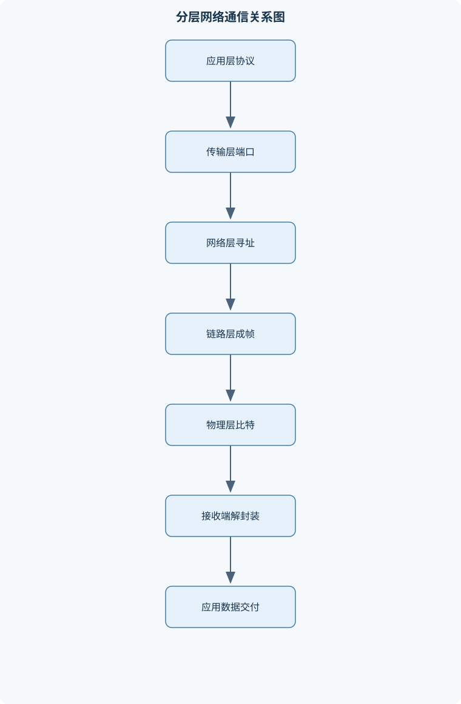
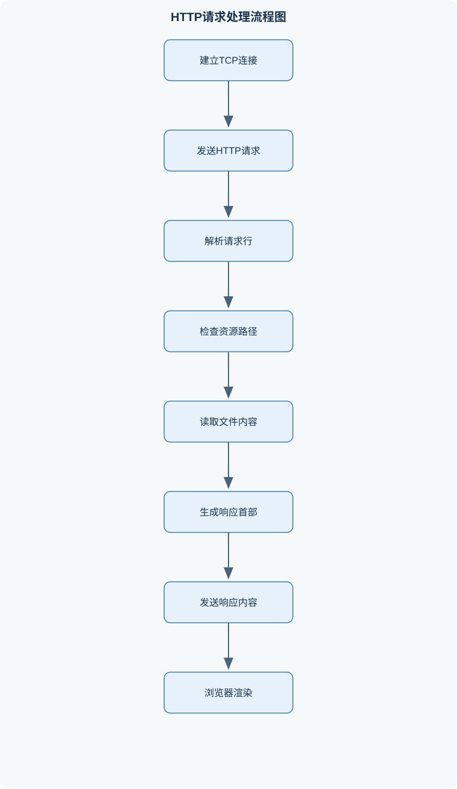

# 计算机网络

## 一、课程整体知识框架

### 课程边界与先修知识

本课程系统讲授计算机网络的基本原理、分层体系结构、数据传输、链路接入、网络互联、端到端通信、应用协议与网络安全，并结合协议分析、交换机组网、静态路由、OSPF、Socket通信和轻量级Web服务器实验。课程边界覆盖OSI与TCP/IP体系结构、物理层信号与编码、数据链路层成帧与差错控制、MAC介质访问、IPv4/IPv6与路由、UDP/TCP、DNS与HTTP、基本网络安全和网络编程接口。先修知识包括计算机组成原理中的二进制与字节表示、概率基础、操作系统中的进程线程与并发、数据结构中的队列和图，以及基本C/C++、Java或Python编程能力。不深入覆盖通信电路设计、运营商级硬件实现、密码学证明和大型分布式系统；这些内容只在网络原理所需范围内介绍。





### 1. 网络的组成与分层视角

计算机网络将分布在不同位置的端系统连接起来，使应用能够交换数据。端系统包括个人计算机、服务器、手机和嵌入式设备；链路包括以太网、无线局域网和广域链路；交换机在链路层转发帧，路由器在网络层依据 IP 地址转发分组。网络的逻辑边界由互联的链路和转发设备构成，端系统通过网络向其他端系统提供或使用服务。

网络通信通常采用分组交换：发送端把较大的数据拆分为分组，网络设备逐跳转发，接收端再将数据交给相应应用。分组交换允许多个通信流共享链路，但也会造成排队、丢包和时延变化。与此不同，电路交换为通信预留一条逻辑或物理通路，时延和带宽较可预测，但资源可能在空闲时仍被占用。

协议规定通信实体之间交换消息的格式、顺序和处理规则。服务描述某一层向上层提供的功能，接口则规定上层如何调用该服务。协议、服务和接口不可混为一谈：TCP 是端系统之间的传输协议，应用通过套接字接口使用 TCP 提供的字节流服务。

分层体系结构将复杂通信拆分为职责相对独立的部分。发送端每层在上层数据前添加本层控制信息，称为封装；接收端逐层解析并移除对应控制信息，称为解封装。端口用于传输层的进程复用，IP 地址用于跨网络寻址，MAC 地址用于链路局部传送。多路复用使多个上层通信共享下层资源，接收端则依据协议字段、地址和端口等信息分用到正确的协议实体或应用进程。

OSI 模型将功能划分为物理层、数据链路层、网络层、传输层、会话层、表示层和应用层。TCP/IP 常见教学模型将其概括为链路层、网际层、传输层和应用层；有些描述把链路层拆为物理层与数据链路层，并将应用层对应到 OSI 的上三层。两套模型不是名称逐层一一相同的实现规范，但都用于理解职责边界。分层便于模块化开发、互操作和局部替换；代价包括额外首部与处理开销、跨层优化受限，以及相邻层功能可能出现重复。

### 2. 性能量度与端到端传输

发送时延和传播时延描述不同过程。长度为 $L$ bit 的分组以速率 $R$ bit/s 发送，发送时延为

$$
t_{\text{trans}}=\frac{L}{R}.
$$

它是把整个分组的比特推出发送接口所需的时间。距离为 $d$ m、信号传播速度为 $v$ m/s 时，传播时延为

$$
t_{\text{prop}}=\frac{d}{v}.
$$

传播时延是信号从链路一端到达另一端的时间。提高链路速率会降低发送时延，但不会直接缩短既定介质中的传播时间。排队时延取决于设备负载和调度，处理时延取决于设备解析与转发；端到端时延通常由路径上各段的发送、传播、排队和处理时延共同构成。

带宽在通信语境中可能表示频率范围，单位 Hz；数据速率表示每秒传送的比特数，单位 bit/s。吞吐量是实际成功交付的数据速率，通常低于链路标称速率，因为协议首部、竞争、拥塞、差错重传和端点处理都会消耗资源。对于瓶颈链路，端到端吞吐量通常受路径上最小有效服务能力限制。

带宽时延积描述一个往返时间内可容纳的在途数据量：

$$
\text{BDP}=R\times \text{RTT}.
$$

其中 $R$ 用 bit/s、RTT 用 s，结果为 bit。若发送窗口明显小于 BDP，发送端可能在收到确认前耗尽窗口，链路无法持续满载。BDP 是理想化容量估计，实际还受拥塞窗口、接收窗口、协议开销和丢包影响。

数据运输与线路传输的比较也可用有效数据率说明。若运输载体携带总容量 $Q$ bit，以速度 $u$ m/s 行进距离 $d$ m，则运输耗时为 $d/u$，有效数据率为 $Qu/d$ bit/s。以三盘各 7 GB 的磁带为例，按十进制单位计，总容量是 $21\times10^9$ byte，即 $168\times10^9$ bit。速度 18 km/h 等于 5 m/s。要超过 150 Mbit/s 线路，需满足

$$
\frac{168\times10^9\times5}{d}>150\times10^6,
$$

解得 $d<5600$ m，即约 5.6 km。这里比较的是运输完成前的平均容量速率，忽略装卸、读取和协议成本；若把 GB 按二进制 GiB 解释，数值会不同。

### 3. 物理层与数据传输

物理层负责在介质上表示和传送比特。模拟信号的幅度、频率或相位可连续变化；数字信号用离散符号表示信息。比特率是每秒传送的比特数，波特率是每秒传送的信号符号数。若每个符号可表示 $V$ 种离散状态，理想情况下每符号承载 $\log_2 V$ bit；实际编码可能包含冗余，符号率与净数据率不一定相等。

奈奎斯特公式给出理想无噪声带限信道的最大符号数据率上界：

$$
R_{\max}=2B\log_2 V,
$$

其中 $B$ 为带宽、单位 Hz，$V$ 为信号电平数，结果单位 bit/s。它假设信道无噪声、带宽受限且信号电平可可靠区分；增加电平数虽提高理论上限，却会使噪声环境下的判决更困难。

香农公式给出带宽受限且存在加性噪声时的信道容量上界：

$$
C=B\log_2(1+\text{SNR}),
$$

其中 $C$ 和 $B$ 分别以 bit/s、Hz 计，SNR 是信号功率与噪声功率之比，为无量纲值。分贝与线性比值换算为 $\text{SNR}_{\text{dB}}=10\log_{10}(\text{SNR})$。例如 20 dB 对应 $\text{SNR}=10^{20/10}=100$；带宽为 3 kHz 时，容量约为 $3000\log_2(101)\approx 20.0$ kbit/s。该值是理想编码可无限接近的理论界限，不是实际链路速率保证。若同时考虑带宽和噪声，实际可行速率必须满足相关理论上限，且还要扣除编码、帧和协议开销。

基带传输直接在介质上发送脉冲或线路编码信号；通带传输把信号调制到适合信道传输的载波频带。导向介质（如铜缆、光纤）约束信号沿介质传播，非导向介质（如无线电波）通过空间传播。信号传播速度取决于介质；在同轴电缆中若近似为真空光速的 $2/3$，即约 $2\times10^8$ m/s。一个比特在介质中的空间长度可按 $v/R$ 估算；在 10 Mbit/s 下约为 20 m。该估算假设连续以该速率发送，描述比特在介质中的传播占距，不是电缆允许长度。

### 4. 数据链路层、差错控制与局域网接入

数据链路层把网络层分组封装为帧，并在单条链路上完成寻址、成帧和差错检测。成帧可依据长度字段、特殊定界字节或比特模式划分边界。字节填充在数据中出现定界字节时插入转义字节；比特填充则在连续若干个 1 后插入 0，避免数据误被识别为帧标志。接收方按规则去除填充内容。

奇偶校验通过附加一位使 1 的总数满足奇数或偶数约定，能检测奇数个比特翻转，但不能保证发现偶数个翻转。校验和把数据按固定宽度分组求和并取反等方式生成校验字段，计算简单但检测能力有限。CRC 把比特串视为二元多项式，在模 2 运算下除以生成多项式，将余数附加到数据后；接收端对完整码字做同样除法，余数非零表示检测到差错。CRC 能检测大量常见突发错误，但余数为零不等于数据绝对无误，也不提供纠错或身份认证。

可靠链路可使用确认、超时和重传。若每次传输独立以概率 $p$ 损坏，确认不丢失，且错误帧总能重传直至成功，则传输次数服从成功概率为 $1-p$ 的几何分布，平均次数为 $1/(1-p)$。若确认也可能丢失、错误具有相关性或协议有重试上限，这个结论便不直接适用。

停止等待协议每次只发送一帧，收到确认后才发送下一帧。无损且忽略确认发送时延时，其理想链路利用率约为 $t_{\text{trans}}/(\text{RTT}+t_{\text{trans}})$；当 RTT 远大于发送时延，利用率较低。滑动窗口允许多个帧在途，提升流水线效率。选择重传只重传未确认帧，并在接收端缓存乱序帧；序号空间必须足以区分新旧帧。若序号空间大小为 $N$，一种常见选择重传设计要求发送窗口和接收窗口各不超过 $N/2$，以避免回绕后新旧序号混淆；具体约束取决于协议的接收规则。

介质访问控制解决多个设备共享同一信道时如何发送。纯 ALOHA 随机发送，容易冲突；时隙 ALOHA 将发送限制在时隙边界，减少碰撞窗口。CSMA 发送前侦听信道，CSMA/CD 在共享介质中发送期间检测碰撞并中止冲突帧；传统共享以太网使用二进制指数退避，碰撞后从扩大的时隙范围随机选择等待时间，超过重试限制则报告失败。交换式全双工以太网没有传统共享介质碰撞，因此不使用这种碰撞退避过程。令牌传递由持有令牌的节点发送，轮询由控制端依次询问节点，二者减少碰撞但增加控制开销或等待时间。

以太网帧包含目的和源 MAC 地址、类型或长度字段、数据及差错检测字段等。MAC 地址用于链路局部交付，不替代 IP 的跨网寻址。交换机依据源 MAC 学习端口映射，依据目的 MAC 转发；未知单播和广播通常在所属广播域内泛洪。VLAN 将交换网络划分为逻辑广播域，减少广播范围并支持逻辑隔离；跨 VLAN 通信需要三层转发。

### 5. 网络层、IP互联与路由

网络层提供主机到主机的寻址和逐跳转发。数据报服务不预先建立固定路径，每个 IP 分组独立转发，路径可能变化；虚电路服务先建立逻辑连接，后续分组按连接状态转发。互联网 IP 主要采用尽力而为的数据报服务，不保证交付、顺序或时延。

IPv4 地址长 32 bit。CIDR 用“地址/前缀长度”表示网络部分，前缀长度为 $k$ 时地址块大小为 $2^{32-k}$。传统普通子网中，可分配主机地址通常需扣除网络地址和定向广播地址；点到点链路、特殊用途地址和具体地址规划存在例外。路由器对目的地址应用路由前缀，多个条目匹配时采用最长前缀匹配，即选择前缀位数最多的路由。没有具体匹配时才检查默认路由。

IPv4 首部携带源、目的地址、TTL、协议、分片相关字段等。MTU 是链路允许承载的最大 IP 分组长度；超过路径限制时可能需要分片。IPv4 分片由分片偏移和标志等字段标识，重组通常在目的端完成；丢失任一分片可能导致整个原始数据报无法重组。TTL 每经过路由器递减，归零时丢弃，可避免分组无限循环。

IPv6 地址长 128 bit，基本首部固定 40 byte，地址空间扩大且首部字段设计不同。路由器通常不为 IPv6 分片，源端依据路径 MTU 发现调整分组大小；需要分片时由源端使用扩展首部。邻居发现使用 ICMPv6 消息完成链路邻居解析、路由器发现和地址配置等功能。IPv6 不是单纯延长地址字段，首部、分片和邻居发现机制均有差异。

ARP 在 IPv4 同一链路内查询 IP 地址对应的 MAC 地址；DNS 查询域名对应的资源记录，两者作用不同。ICMP 用于差错报告和诊断，`ping` 常借助回显消息测试可达性，`traceroute` 类工具利用 TTL/Hop Limit 逐步探测路径，但中间设备可能过滤或限速响应。NAT 改写地址，常结合端口映射让多个内部主机共享公网地址；它缓解地址使用压力，但破坏端到端可达性，不能等同于防火墙或完整安全机制。

转发是路由器依当前转发表为单个分组选择出接口和下一跳；路由是生成或维护这些表项的过程。静态路由由管理员配置，适合拓扑简单、变化少的网络；错误的掩码、下一跳或出接口会导致黑洞、环路或不可达。默认路由将未匹配目的地交给指定下一跳。路由聚合用较短前缀表示连续地址块，缩小路由表，但聚合范围必须覆盖实际可达网络。

最短路径可在非负边权图上用 Dijkstra 算法计算。初始化源点距离为 0，其余为无穷大；反复选取未确定且距离最小的节点，对边执行松弛：若 $d[v]>d[u]+w(u,v)$，则更新 $d[v]$。当节点被确定时，其距离已是最短距离。链路状态路由将拓扑信息传播到区域内节点，再各自计算最短路径；OSPF 使用链路状态数据库和区域机制控制规模。距离向量路由则交换到各目的地的距离估计，依据 Bellman-Ford 关系更新下一跳，可能遇到环路和计数到无穷问题，需要抑制机制。OSPF 属于链路状态协议，不是距离向量协议。

### 6. 传输层与端到端通信

传输层通过端口把主机间通信交付到进程。套接字端点通常由 IP 地址、传输协议和端口共同确定；五元组（协议、源 IP、源端口、目的 IP、目的端口）可区分一条流。

UDP 提供无连接数据报服务，保留消息边界，首部开销小，但不提供可靠交付、按序、流量控制或拥塞控制。TCP 提供面向连接的可靠有序字节流；它不保留应用层消息边界，也不能保证应用每次 `send` 对应一次 `recv`。UDP 并非必然更快或更可靠，其效果取决于应用需求、网络条件和应用自行实现的控制机制。

TCP 通过三次握手交换 SYN 和 ACK 并同步初始序号，建立双方状态。若客户端初始序号为 $x$，其 SYN 占用一个序号；服务端确认号为 $x+1$。TCP 序号按字节编号，ACK 表示下一个期望字节，而不是最后一个已收到字节。MSS 限定一个 TCP 段中通常可承载的最大应用数据量，受链路 MTU 和首部开销影响。

TCP 用校验、确认、重传和序号实现可靠字节流。超时重传定时器基于 RTT 估计设置，丢包也可能通过重复 ACK 等机制被较早发现。接收窗口通告接收端缓冲能力，构成流量控制；拥塞窗口反映发送端对网络承载能力的估计，构成拥塞控制。实际发送量受接收窗口和拥塞窗口共同限制，还受应用供数速度、RTT、MSS、丢包和路径带宽影响。

正常关闭时，双方分别发送 FIN 并确认，因为 TCP 是全双工连接，两个方向可以独立结束。RST 用于复位连接或报告异常状态。进程崩溃、主机断网不一定使对端立即收到 FIN 或 RST；对端可能长时间显示连接仍建立，直到超时、读写错误、应用心跳或 TCP 保活机制发现异常。

### 7. 应用层协议与网络服务

DNS 将域名解析为 IP 地址或其他资源记录，解析结果可被本地解析器和中间缓存按 TTL 缓存。缓存降低查询时延和权威服务器负载，但记录变更不会立即在所有缓存中生效。DNS 与 ARP 的对象不同：DNS 面向名称系统，ARP 面向同一链路上的地址解析。

URI 标识资源，URL 是包含访问定位信息的一类 URI。典型 URL 包含方案、主机、可选端口、路径、查询部分和片段标识；片段通常由客户端处理，不作为 HTTP 请求目标的一部分发送给服务器。

HTTP 使用请求—响应模型。请求行包含方法、目标和协议版本，之后是首部；首部与消息体之间必须有空行，消息行通常以 CRLF 结束。响应包含状态行、首部和可选消息体。GET 用于获取表示，通常不应产生改变服务器状态的副作用；POST 常用于提交数据或请求服务器处理，但具体语义取决于资源设计。状态码表达处理结果类别，服务器还应设置恰当的 `Content-Type`、`Content-Length` 或传输编码，使客户端识别消息内容和边界。

表单数据可位于查询字符串或消息体，其编码由 `Content-Type` 等信息描述；不能假设所有 POST 都采用同一种格式。服务器必须依据消息长度或传输编码确定消息体结束位置。轻量级 Web 服务器可按连接读取完整请求、解析方法和路径、检查资源访问范围，再生成状态行、首部和正文。浏览器解析 HTML 后若发现图片等外部资源，通常会另发请求。

并发 Web 服务可采用每连接线程、线程池或事件循环。线程模型直观，但连接多时线程栈与调度开销上升；事件驱动模型可减少线程数量，但状态管理更复杂。两者都必须正确处理部分接收、超时、客户端提前关闭、资源释放和请求边界。

### 8. 网络安全、编程接口与实验体系

网络安全目标通常包括机密性、完整性、身份认证和可用性。威胁模型明确保护对象、攻击者能力和信任边界；防护措施是否有效，取决于威胁是否被正确界定。对称加密使用共享密钥，适合高效加密大量数据；非对称密码使用公私钥机制，常用于密钥协商、身份认证或签名，但计算开销较高。散列函数把任意长度输入映射为固定长度摘要，不能单独提供来源认证；消息认证码使用共享密钥检测完整性和来源，数字签名则由私钥签名、公钥验证，提供可验证的来源与完整性证据。

证书把公钥与身份信息绑定，并由信任链验证；证书有效不代表应用数据自动安全，客户端还必须检查名称、有效期、用途和信任链。TLS 在 TCP 之上建立加密会话，核心过程包括协商版本与算法、认证服务器（依配置也可认证客户端）、建立共享会话密钥，随后用对称密码保护应用数据。具体握手消息随 TLS 版本和配置而异，不能把某一版本的握手细节当作所有版本通用。防火墙按策略限制流量，入侵检测系统分析流量或主机事件寻找异常；二者不能替代安全编码、补丁管理和身份治理。

Socket 是应用使用传输服务的编程接口。服务端通常创建套接字、绑定地址、监听，再接受连接；客户端创建套接字并连接。TCP 是字节流，应用协议必须自行定义边界，例如固定长度首部加长度字段，再按长度累积接收、拆出完整消息并保留未完成字节。单次 `recv` 可能只返回消息的一部分，也可能一次包含多个消息，因此不可把调用边界当作协议边界。

课程实验把抽象协议落实为可观察行为：协议分析通过抓包检查帧、IP、TCP/UDP 和 HTTP 字段及状态变化；交换机实验验证 MAC 学习、泛洪和 VLAN 广播域；静态路由与 OSPF 实验比较手工配置和动态收敛；Socket 实验检验连接管理、消息定界和并发；轻量级 Web 服务器实验检验 HTTP 请求解析、资源映射和响应格式。实验结论应以输入、拓扑、抓包或程序日志及可重复验证结果为依据，而不能仅凭浏览器页面是否显示来判断所有协议行为。

## 二、章节和模块划分

### 核心知识覆盖清单

本清单用于检查正文是否覆盖本课程的主要知识模块：

- **网络体系结构与性能基础**：网络边界与主要组成、端系统、链路与分组交换、协议、服务与接口、OSI与TCP/IP分层模型、封装、解封装与多路复用、时延、吞吐量与丢包、带宽时延积、分层设计的优势与代价。
- **物理层与数据传输**：模拟信号与数字信号、带宽、波特率与比特率、奈奎斯特无噪声上限、香农有噪声信道容量、信噪比的分贝表示、基带传输与通带传输、导向与非导向介质、传播时延与比特长度。
- **数据链路层与差错控制**：帧的定义与成帧方法、字节填充与比特填充、奇偶校验与校验和、循环冗余校验CRC、确认、超时与重传、停止等待协议、滑动窗口协议、流水线传输与选择重传。
- **介质访问控制与局域网**：共享信道与冲突模型、ALOHA与时隙ALOHA、CSMA与碰撞检测、二进制指数退避、令牌与轮询机制、以太网帧结构、MAC地址与交换表、VLAN与广播域。
- **网络层与IP互联**：数据报服务与虚电路对比、IPv4地址与子网划分、CIDR与最长前缀匹配、IPv4首部与分片、IPv6地址与基本首部、IPv6扩展首部与邻居发现、ARP、ICMP与路径诊断、NAT及其适用边界。
- **路由原理与路由协议**：转发与路由的区别、路由表与下一跳、最短路径问题、距离向量算法、链路状态算法、OSPF区域与链路状态数据库、路由聚合与默认路由、静态路由配置与故障分析。
- **传输层与端到端通信**：端口与套接字、UDP报文与无连接服务、TCP连接管理、TCP序号与确认号、可靠字节流与重传、流量控制与接收窗口、拥塞控制与拥塞窗口、TCP连接终止与异常断开。
- **应用层协议与网络服务**：DNS名称解析与缓存、URL与URI组成、HTTP请求响应模型、HTTP方法与状态码、HTTP首部与消息体、Content-Type与Content-Length、GET与POST语义、并发Web服务器结构。
- **网络安全基础**：安全目标与威胁模型、对称加密与非对称加密、散列函数与消息认证、数字签名与证书、TLS建立安全会话的基本过程、身份认证与访问控制、防火墙与入侵检测、常见应用层攻击与防护。
- **网络编程、协议分析与综合实验**：Socket创建与地址绑定、客户端connect与服务端listen、accept与并发处理、TCP字节流的消息边界、协议字段设计与解析、抓包与协议状态分析、交换机和路由器拓扑验证、轻量级HTTP服务器实现。


### 1. 章节组织与知识依赖

课程从体系结构和性能量度开始，再由单链路传输推进到多跳互联，最后讨论端到端协议、应用服务和安全。物理层建立速率、带宽、噪声与传播的量纲基础；链路层引入帧、差错检测和共享介质访问；网络层解决跨链路寻址与路由；传输层把网络服务整理为进程间通信；应用层定义 DNS、HTTP 等具体消息语义。网络编程、协议分析和综合实验贯穿各层，要求能把概念映射到实际报文、状态和故障。

先修知识包括二进制与字节表示、概率、进程和并发、队列与图，以及一种基本编程语言。二进制知识用于子网掩码、首部字段和 CRC；概率用于差错重传和随机接入；队列用于理解排队时延；图用于路由；并发和套接字知识用于实现服务器。通信电路设计、运营商级硬件实现、密码学形式化证明和大型分布式系统不属于本课程深入范围，只讨论理解网络机制所必需的部分。

### 2. 代表性算法与流程

#### 2.1 停止等待ARQ

输入为待发送帧序列、超时值及每次传输的确认事件；输出为按序且无重复的数据流。发送方发送当前帧并启动计时器，收到正确确认后清除计时器并发送下一帧；超时或检测到错误确认时重传当前帧。未确认帧始终保留在发送缓存中，这是协议的不变量；全部帧获得确认后终止。该协议适合实现简单、窗口小或带宽时延积低的链路。单帧事件处理为 $O(1)$，处理 $n$ 帧的帧事件总数在无重传时为 $O(n)$；重传会增加实际处理次数。若确认会丢失，还需序号去重，避免接收方重复交付。

#### 2.2 最长前缀匹配

输入为目的 IP 地址和路由表，输出为下一跳或出接口。对每条路由检查目的地址的前缀位是否相同，保留前缀长度最大的匹配项；无匹配时查询默认路由，否则报告不可达。当前候选项始终是已检查且匹配的路由，这是处理不变量。线性扫描 $m$ 条路由的时间复杂度为 $O(m)$，额外空间为 $O(1)$；前缀树等结构可减少查找成本。该流程适用于 IP 转发表查询，不负责生成路由，也不保证端到端可靠交付。

#### 2.3 Socket并发服务器流程

输入为监听地址、端口、并发处理策略和应用消息格式；输出为对多个客户端请求的响应。服务端创建套接字、绑定地址、监听并循环接受连接；每个活动连接必须有独立状态记录，包括接收缓存、解析进度和关闭状态。处理器持续累积字节，按协议边界提取完整消息，生成响应并发送；连接关闭或发生错误时释放连接资源。线程池或每连接线程便于隔离处理逻辑，但需管理线程数；事件循环减少线程开销，但必须显式维护连接状态。终止条件是服务退出、监听套接字关闭且活动连接完成清理。事件驱动模型对 $n$ 个连接的状态空间为 $O(n)$；线程模型还需计入线程栈与调度成本。

#### 2.4 HTTP静态文件服务

输入为 HTTP 请求字节流和允许访问的资源映射；输出为符合 HTTP 格式的响应。服务端先累积数据直至读到头部结束空行，再解析请求行和首部；随后规范化请求路径，映射到允许目录，拒绝越界路径，检查资源是否存在及其类型。成功时生成状态行、`Content-Type`、`Content-Length`、空行和文件内容；资源不存在时返回 404。消息体长度必须与实际发送字节数一致，头部和消息体之间必须有空行。此流程适用于教学型静态服务，不适合未经授权地暴露文件系统或承担复杂动态业务。路径检查、部分写入处理和客户端提前关闭是实现正确性的必要条件。

### 3. 代码示例：TCP长度字段消息解析

以下 Python 示例展示 TCP 接收缓存如何处理半条消息、连续多条消息和不完整尾部。协议规定每条消息前两个字节为无符号大端长度，后接 UTF-8 正文；最大正文长度为 4096 byte。示例只解析内存中的字节，不进行网络访问。

```python
HEADER_SIZE = 2
MAX_BODY_SIZE = 4096


def extract_messages(buffer: bytearray) -> list[str]:
    messages = []

    while len(buffer) >= HEADER_SIZE:
        body_size = int.from_bytes(buffer[:HEADER_SIZE], "big")

        if body_size > MAX_BODY_SIZE:
            raise ValueError("message body is too large")

        frame_size = HEADER_SIZE + body_size
        if len(buffer) < frame_size:
            break

        body = bytes(buffer[HEADER_SIZE:frame_size])
        del buffer[:frame_size]
        messages.append(body.decode("utf-8"))

    return messages


def encode_message(text: str) -> bytes:
    body = text.encode("utf-8")
    if len(body) > MAX_BODY_SIZE:
        raise ValueError("message body is too large")
    return len(body).to_bytes(HEADER_SIZE, "big") + body


buffer = bytearray()
wire_data = encode_message("one") + encode_message("two")

buffer.extend(wire_data[:4])
assert extract_messages(buffer) == ["one"]
assert len(buffer) == 1

buffer.extend(wire_data[4:])
assert extract_messages(buffer) == ["two"]
assert buffer == bytearray()
```

解析器的不变量是：缓冲区开头始终是尚未完整消费的数据；只有首部和声明长度的正文都齐全时才移除该帧。生产实现还应处理解码错误、连接关闭时残留的不完整消息、最大缓冲区限制以及超时。若长度字段可能被恶意构造，必须先检查上限再等待完整正文，以免无限占用内存。

### 4. 例题与逐步解答

#### 4.1 磁带运输与线路速率

**题干：** 三盘介质各存储 7 GB，运输速度为 18 km/h。线路有效速率为 150 Mbit/s。按十进制 GB 计算，运输距离多大时介质运输的平均数据率更高？速度、容量或线路速率改变时如何变化？

**分析：** 把容量换算为 bit，把速度换算为 m/s。运输时间是距离除以速度，平均数据率是总比特数除以运输时间。

**逐步解答：** 总容量为 $3\times7\times10^9\times8=168\times10^9$ bit；速度为 $18/3.6=5$ m/s。运输速率为 $168\times10^9/(d/5)$ bit/s。令其大于 $150\times10^6$ bit/s，得到 $d<5600$ m。

**结果验证：** 在 5.6 km 处运输时间为 1120 s，线路同期传输 $150\times10^6\times1120=168\times10^9$ bit，恰与介质容量相等；因此严格大于线路速率要求距离小于 5.6 km。

**变式：** 速度加倍或容量加倍，距离上界均加倍；线路速率加倍，距离上界减半。若把 GB 当作 GiB，需用 $2^{30}$ byte，结果相应增加，不能混用单位。

#### 4.2 有噪声信道容量

**题干：** 带宽为 3 kHz，信噪比为 20 dB，求香农容量；若采用二进制信号，说明与奈奎斯特上限的关系。

**分析：** 香农公式使用线性 SNR，不能直接把分贝数代入。

**逐步解答：** $\text{SNR}=10^{20/10}=100$。因此 $C=3000\log_2(1+100)\approx3000\times6.658\approx19974$ bit/s，约 20.0 kbit/s。二进制信号的理想奈奎斯特上限为 $2B\log_2 2=6000$ bit/s。

**结果验证：** 在二进制电平约束下，奈奎斯特上限低于香农噪声容量，故 6 kbit/s 是该理想二电平条件下更严格的上限。实际编码还受同步、线路编码和协议开销影响。

**变式：** 若允许更多电平，奈奎斯特上限随 $\log_2 V$ 增加，但噪声下电平更难区分；不能只增加电平便假设实际速率无限提高。

#### 4.3 IPv4子网划分

**题干：** 将 `192.0.2.0/24` 划分为至少 6 个等长子网，列出新前缀、子网地址、可用范围和广播地址。

**分析：** 借用 $s$ 个主机位可形成 $2^s$ 个子网。要求 $2^s\ge6$，最小 $s=3$，新前缀为 `/27`。

**逐步解答：** 每个 `/27` 有 $2^{32-27}=32$ 个地址，子网步长为 32。依次为 `192.0.2.0/27`、`.32/27`、`.64/27`、`.96/27`、`.128/27`、`.160/27`、`.192/27`、`.224/27`。普通广播子网中，每块网络地址后一个至广播地址前一个为可用主机地址。例如第一块可用 `.1` 至 `.30`，广播地址 `.31`；第二块可用 `.33` 至 `.62`，广播 `.63`，其余依步长类推。

**结果验证：** 共得到 8 个子网，满足至少 6 个；$8\times32=256$ 个地址，与原 `/24` 地址总量一致。每个普通子网有 30 个可分配地址。

**变式：** 若要求每个子网至少 50 台主机，至少需 6 个主机位，因为 $2^6-2=62$，对应 `/26`；但一个 `/24` 只能划分为 4 个 `/26`，无法同时满足至少 6 个子网，必须扩大地址块或调整需求。点到点链路和特殊规划可能采用不同地址分配规则。

#### 4.4 路由表最长前缀匹配

**题干：** 路由表有 `10.0.0.0/8 -> A`、`10.1.0.0/16 -> B`、`10.1.2.0/24 -> C` 和默认路由 `0.0.0.0/0 -> D`。目的地址为 `10.1.2.9`，应选择哪个下一跳？

**分析：** 地址同时匹配多个前缀，必须比较匹配位数，而不是按路由表出现顺序选择。

**逐步解答：** `10.1.2.9` 属于 `10.0.0.0/8`、`10.1.0.0/16` 和 `10.1.2.0/24`；默认路由也匹配任意 IPv4 地址。前缀长度最大的是 `/24`，因此选择 C。

**结果验证：** `/24` 包含目的地址所在的 256 地址块；按 `/8` 或 `/16` 转发会忽略更具体的可达性信息。

**变式：** 若删除 `/24`，应选择 `/16` 的 B；若目的地址改为 `10.2.2.9`，匹配 `/8`，选择 A；若改为 `192.0.2.1` 且无其他路由，则选择默认路由 D。

#### 4.5 TCP序号与确认号

**题干：** 客户端初始序号为 1000，发送 1200 byte 数据，MSS 为 500 byte。忽略选项和重传，分段序号范围及全部收到后的 ACK 是什么？

**分析：** TCP 序号按字节计数。每段覆盖的序号区间按左闭右开理解，ACK 指向下一个期望字节。

**逐步解答：** 第一段携带 500 byte，序号为 1000 至 1499；第二段为 1500 至 1999；第三段为 2000 至 2199。连续收到 1200 byte 后，下一个期望字节是 2200，所以 ACK 为 2200。

**结果验证：** 字节区间长度分别为 500、500、200，总计 1200；$1000+1200=2200$。若 ACK 为 2199，则会把“最后收到的字节”误当成“下一个期望字节”。

**变式：** 若第二段丢失而第三段先到，接收端可能重复确认 1500，表示仍期望从 1500 开始的字节；发送端可依重传机制补发缺失段。具体重传时机取决于重复 ACK、计时器及拥塞控制状态。

#### 4.6 HTTP响应边界

**题干：** 服务器要返回 5 byte 的文本 `hello`。写出响应必须包含的关键部分，并说明浏览器为何可能不显示正文。

**分析：** HTTP/1.1 响应需要状态行、首部、空行和正文。`Content-Length` 按正文的 byte 数计算，不是字符数的普遍替代。

**逐步解答：**

```http
HTTP/1.1 200 OK
Content-Type: text/plain; charset=utf-8
Content-Length: 5

hello
```

状态行和每行首部以 CRLF 结束，首部与正文之间另有一个空行。对于 UTF-8 的 ASCII 文本 `hello`，字符数和 byte 数均为 5。

**结果验证：** 客户端按 `Content-Length: 5` 读取 5 byte 后可确定消息体结束；若遗漏空行，客户端可能继续把正文当作首部，或等待完整消息边界。

**变式：** 若正文包含多字节字符，应对实际编码后的 byte 序列计数；若使用分块传输编码，则消息体边界由分块格式确定，不能再把 `Content-Length` 当作唯一边界依据。

### 5. 实验与项目

#### 5.1 交换机、VLAN与静态路由验证

**目标与步骤：** 在隔离的教学拓扑中连接两台交换机、多个端系统和一台三层设备。先配置同一 VLAN 内的地址并互相发送测试报文，观察交换机学习源 MAC 后转发单播的变化；再将端口分到不同 VLAN，验证广播不跨 VLAN；最后配置三层接口或静态路由，使不同网段互通。

**输入数据：** 拓扑端口连接关系、各主机 IPv4 地址与前缀、VLAN 号、网关地址、路由器接口地址和目标路由前缀。输入表应保证同一网段地址不重复，网关与主机处于同一子网。

**评价标准：** 同 VLAN 主机能按预期二层通信；跨 VLAN 未配置三层转发时不可达，配置正确后可达；交换表端口与实际源 MAC 学习结果一致；路由表中的下一跳或出接口符合最长前缀匹配；抓包中源、目的 MAC 会逐跳变化，而端到端 IP 地址通常保持不变（不考虑 NAT）。

**排错方法：** 先核对链路状态和 VLAN 端口归属，再核对 IP、掩码和默认网关；检查交换表是否学到源地址；逐跳检查路由表、下一跳可达性和返回路由。若只有单向通信，检查反向路由及过滤策略；若同 VLAN 广播异常，检查 VLAN 标记和端口模式。

#### 5.2 Socket消息边界与HTTP服务器

**目标与步骤：** 编写客户端与 TCP 服务端，以“长度字段加正文”定义应用消息。测试一次读取只得到部分首部、多个消息连续到达和消息尾部不完整三种情况；随后将解析结果映射到静态 HTTP 响应，返回文本、图片和不存在资源的不同响应。

**输入数据：** 本地监听地址和端口、消息编码、首部字节数、最大消息长度、若干请求样例及资源映射。测试样例应包含正常 GET、缺失资源、分段发送请求、一次发送多个消息和客户端提前关闭。

**评价标准：** 服务端只在完整消息到齐后处理；多条消息均能准确拆分；不完整消息保留在缓存中而不误解析；HTTP 响应状态、`Content-Type`、正文 byte 数和消息边界一致；访问路径不能越出允许资源目录；关闭连接后释放缓冲区和连接状态。

**排错方法：** 记录每次读取的字节数和解析缓存长度；逐字节检查长度字段的端序及其是否表示 byte 数；用抓包确认请求行、首部、空行和正文；若浏览器显示失败，分别检查状态行、CRLF、头体空行、`Content-Length` 与实际正文长度。对大文件发送应循环处理部分写入，不假设一次 `send` 写完全部数据。

### 6. 常见考法、面试问题与岗位关联

#### 6.1 常见笔试问题及解题思路

1. **区分发送时延与传播时延。** 先判断题目给的是分组长度和链路速率，还是距离和传播速度；分别代入 $L/R$ 与 $d/v$，最后统一单位。线路速率提高只直接减小发送时延。
2. **计算带宽时延积。** 将速率换为 bit/s、RTT 换为秒，乘积得到 bit；若题目需要 byte，再除以 8。比较窗口大小时必须保证单位一致。
3. **由 dB 求信噪比和容量。** 用 $\text{SNR}=10^{\text{SNR}_{\text{dB}}/10}$ 转换，再代入香农公式；检查 SNR 是否为功率比，并说明结果是理论上限。
4. **解释差错重传平均次数。** 每次独立成功概率为 $1-p$，几何分布期望为 $1/(1-p)$；若确认可能丢失或尝试次数有限，应说明假设变化。
5. **比较停止等待和滑动窗口。** 根据 RTT 与发送时延判断停止等待空闲比例；窗口增大可提高流水线利用率，但需序号、缓存和确认机制避免混淆。
6. **计算子网范围。** 先从前缀长度求地址总数，再按块大小定位网络边界；普通 IPv4 广播子网需说明网络地址与广播地址不可分配的约定及例外。
7. **确定路由下一跳。** 将目的地址与每个前缀比较，选择最长匹配项；没有具体匹配时检查默认路由，不能按表项顺序或最短前缀选择。
8. **解释 CRC 检错能力。** 说明模 2 多项式除法和余数判定，并区分“检测到错误”与“能纠正错误”；零余数只表示未检测到，不证明绝对无差错。
9. **分析 TCP ACK。** 按字节范围计算序号，ACK 写下一个期望字节；遇到乱序或丢失时，结合累计确认解释重复 ACK。
10. **分析 HTTP消息边界。** 检查 CRLF、首部结束空行、`Content-Length` 或传输编码以及实际正文长度；不能只看状态码判断格式正确。

#### 6.2 面试问题与参考回答

1. **TCP 和 UDP 的主要差异是什么？** TCP 提供连接状态、可靠有序字节流、流量控制和拥塞控制；UDP 提供无连接数据报，保留消息边界但不负责可靠重传和拥塞控制。深入追问可讨论应用如何在 UDP 上自行实现确认、重传、拥塞控制，以及额外机制带来的复杂度。
2. **为什么一次 `send` 不对应一次 `recv`？** TCP 只保证有序字节流，发送调用边界不是线上协议边界；缓冲、分段和合并会改变接收批次。深入追问应说明可用固定长度、分隔符转义或长度字段定义应用消息边界，并处理部分读写。
3. **交换机与路由器分别依据什么转发？** 交换机通常依据目的 MAC 和二层转发表在广播域内转发，路由器依据目的 IP 和路由表跨网转发。深入追问可说明路由器转发时链路首部会逐跳重建，而 IP TTL/Hop Limit 递减。
4. **ARP 与 DNS 有什么区别？** ARP 在 IPv4 链路内解析 IP 到 MAC；DNS 解析域名及相关资源记录，结果可能被缓存。深入追问可讨论目标不在本地子网时，主机解析的是默认网关的 MAC，而非远端服务器 MAC。
5. **什么是最长前缀匹配？** 多条路由都匹配目的地址时选择前缀长度最大的路由，以便更具体路由覆盖汇总路由。深入追问可要求给出重叠前缀表，并解释默认路由为何最后才起作用。
6. **TCP 流量控制和拥塞控制有何不同？** 流量控制保护接收端缓冲，由接收窗口表达；拥塞控制保护网络，由拥塞窗口调节发送负载。深入追问应指出有效在途数据受两者共同约束，并受应用供数和窗口缩放等条件影响。
7. **为什么 IPv6 路由器通常不分片？** IPv6 将分片职责放在源端，路由器可按路径 MTU 转发，减少中间转发复杂度；源端通过路径 MTU 反馈调整。深入追问可讨论过大分组触发 ICMPv6 报文及过滤该报文造成的连接故障。
8. **TLS 保护了什么，未保护什么？** TLS 可在端点之间提供机密性、完整性和基于证书的身份认证，但不自动证明业务逻辑安全，也不隐藏所有元数据或防止端点被攻陷。深入追问可要求说明证书名称校验、信任链和会话密钥建立各自职责。
9. **HTTP服务器为何要准确设置 `Content-Length`？** 它帮助客户端确定正文长度；长度与实际发送不一致会造成截断、等待或连接复用解析错误。深入追问可比较长度字段与分块传输编码，并说明二者不能随意冲突。
10. **主机断网后，TCP 对端会立即看到连接断开吗？** 不一定。若没有 FIN/RST 到达，对端可能暂时保持 ESTABLISHED，直到重传超时、应用 I/O、心跳或保活机制发现问题。深入追问可讨论检测时延与误判风险的权衡。

#### 6.3 岗位任务与知识产出

| 岗位方向 | 实际任务与使用知识 | 典型产出 | 验收标准 |
|---|---|---|---|
| 网络工程与运维 | 规划 VLAN、地址、静态路由或 OSPF；依据链路、ARP、路由表和抓包定位不可达 | 拓扑与地址规划、配置变更、故障分析记录 | 目标网段按策略可达，冗余路径行为符合预期，变更可回滚且记录完整 |
| 云网络工程 | 配置虚拟子网、路由、安全组及 NAT；分析 MTU、路由传播和流量路径 | 网络架构配置、连通性测试和性能数据 | 路径符合隔离策略，关键服务端到端连通，吞吐与时延满足明确的业务指标 |
| 网络安全工程与分析 | 分析防火墙日志、异常流量、TLS证书和应用层输入；区分认证、授权和加密 | 告警研判、规则变更、风险报告和验证记录 | 告警可复现或有证据支持，规则不过度阻断正常流量，整改后测试通过 |
| 后端开发 | 实现 Socket 客户端服务、HTTP API 和并发处理；处理 TCP 字节流边界及错误状态 | 协议解析器、服务接口、自动化测试和运行日志 | 合法请求解析一致，畸形输入受限，部分读写和客户端断开可恢复，资源能释放 |
| 协议开发与嵌入式通信 | 设计字段、序号、校验和状态机；评估重传、缓存和链路错误 | 协议定义、编码解码实现、互操作测试 | 字段边界明确，错误输入处理确定，多实现交换结果一致，资源上限符合设备约束 |
| 性能测试与故障诊断 | 用 RTT、BDP、吞吐、丢包和抓包分析瓶颈；区分端点、链路和应用问题 | 测试方案、性能曲线、根因分析和复测结果 | 测量口径与单位明确，实验可重复，根因由数据支持，优化前后比较使用相同条件 |

## 三、核心概念的详细解释

### 3.1 分层体系结构、封装与性能基础

计算机网络由端系统、通信链路和中间转发设备组成。端系统运行应用程序，交换机主要依据 MAC 地址在局域网内转发帧，路由器依据 IP 地址在不同网络之间转发分组。协议规定通信双方可识别的消息格式、字段含义、消息顺序和异常处理规则；服务是某层向上层提供的功能；接口是上层调用该服务的操作方式。三者的关系是“协议实现服务，接口暴露服务”，不能把协议名称直接等同于接口。

分层的基本操作是封装和解封装。应用数据向下交给传输层，传输层加入端口、序号或校验等字段形成报文段；网络层加入源、目的 IP 地址形成分组；数据链路层加入 MAC 地址和帧校验字段形成帧；物理层把帧转换为信号。接收端按相反方向解析。若一个应用进程同时与多个远程进程通信，传输层依据端口进行多路复用；接收端依据协议、IP 地址和端口分用到正确进程。

OSI 模型将通信功能划分为物理层、数据链路层、网络层、传输层、会话层、表示层和应用层。常见 TCP/IP 教学模型通常包括链路层、网际层、传输层和应用层。两者的职责可以对应，但不是名称和实现的一一映射。分层便于协议替换、故障定位和标准化，也会引入首部、复制、处理和缓存开销；严格分层还可能使跨层优化困难，并造成差错控制、流量控制等功能在不同层重复出现。

网络时延至少包括发送时延、传播时延、排队时延和处理时延。长度为 $L$ bit 的分组以速率 $R$ bit/s 发送时，发送时延为

$$
t_{\mathrm{trans}}=\frac{L}{R}.
$$

距离为 $d$ m、信号传播速度为 $v$ m/s 时，传播时延为

$$
t_{\mathrm{prop}}=\frac{d}{v}.
$$

发送时延表示把全部比特推出发送接口所需的时间；传播时延表示第一个比特从链路一端到达另一端所需的时间。提高 $R$ 会降低发送时延，但不会直接改变既定介质中的 $d/v$。因此，短距离高速局域网可能主要受处理和排队影响，长距离链路则可能主要受传播时延影响。

带宽可以表示频率范围，单位为 Hz；数据速率表示单位时间传输的比特数，单位为 bit/s；吞吐量表示实际成功交付的速率。吞吐量受到瓶颈链路、协议首部、竞争、重传、拥塞和端点处理能力共同限制，不能简单把“带宽”当成“实际速率”。往返时间为 RTT 时，速率为 $R$ 的链路带宽时延积为

$$
\mathrm{BDP}=R\times \mathrm{RTT}.
$$

BDP 的单位是 bit，表示保持链路持续发送所需的在途数据量。若 TCP 发送窗口或拥塞窗口显著小于 BDP，发送方会在确认返回前停止发送，实际吞吐量近似受窗口限制；但 BDP 不是保证吞吐量，丢包和排队仍可能降低性能。

### 3.2 物理层信号、编码和信道容量

模拟信号的幅度或频率随时间连续变化，数字信号通常用有限个离散电平表示。波特率是每秒传输的符号数，单位为 baud；比特率是每秒传输的比特数。若每个符号有 $V$ 个可区分电平，理想情况下一个符号最多携带 $\log_2 V$ bit，因此比特率不一定等于波特率。

无噪声、带宽为 $B$ Hz、信号有 $V$ 个电平时，奈奎斯特上限为

$$
R_{\max}=2B\log_2 V.
$$

该公式假设信道无噪声、符号可以可靠区分，并且使用理想脉冲成形。现实信道存在噪声时，有噪声信道容量由香农公式给出：

$$
C=B\log_2(1+\mathrm{SNR}).
$$

其中 $C$ 的单位为 bit/s，$B$ 的单位为 Hz，SNR 是信号功率与噪声功率之比。若信噪比用分贝表示，则

$$
\mathrm{SNR}_{\mathrm{dB}}=10\log_{10}(\mathrm{SNR}),\qquad
\mathrm{SNR}=10^{\mathrm{SNR}_{\mathrm{dB}}/10}.
$$

奈奎斯特上限反映符号速率和电平数限制，香农容量反映带宽和噪声共同造成的理论上限；实际速率还会受到编码实现、同步、功放、协议首部和误码率要求影响。

基带传输直接在链路上发送脉冲，通带传输则把数据调制到载波频率附近。双绞线、同轴电缆和光纤属于导向介质；无线电、微波和红外等属于非导向介质。若一个比特持续时间为 $1/R$，信号传播速度为 $v$，则比特长度为

$$
l_{\mathrm{bit}}=\frac{v}{R}.
$$

这不是链路长度，而是同一时刻介质中一个比特所占的空间长度。10 Mbit/s、传播速度约为 $2\times10^8$ m/s 时，比特长度约为 $20$ m。线路速率提高会使比特长度缩短，但不会自动提高传播速度。

### 3.3 数据链路层、成帧和差错控制

数据链路层在相邻节点之间传输帧，主要职责包括成帧、介质访问、差错检测以及在特定协议中进行重传。常见成帧方式有长度字段、特殊字节作为边界、字节填充和比特填充。若控制字节也可能出现在数据中，发送端在数据中的控制字节前增加转义字节，接收端再删除转义；若使用连续标志位作为边界，则可在数据中连续出现若干个“1”时插入一个“0”，接收端删除该填充位。

奇偶校验只能检测部分错误。例如偶校验要求整个比特串中“1”的个数为偶数；两个比特同时翻转时奇偶性不变，因此可能漏检。校验和把数据分成固定宽度的字并进行反码加法，计算开销较低但检测能力取决于数据排列。CRC 将数据视为二进制多项式，使用生成多项式进行模 2 除法，发送端附加余数，接收端对完整码字再次相除；余数为零表示“未检测到错误”，不等于数学上证明没有错误。

确认、超时和重传构成 ARQ 可靠传输机制。停止等待协议每次只发送一个未确认帧：发送后启动计时器，收到正确 ACK 才发送下一帧，超时或收到否定确认则重传。发送方必须保留未确认帧，接收方通常需要通过序号识别重复帧。滑动窗口允许多个帧同时在途，提高长 RTT 链路的利用率；选择重传只重传丢失或损坏的帧，接收方可缓存乱序帧，但需要更多缓存和序号管理。

### 3.4 介质访问控制与局域网

共享信道中多个节点可能同时发送而发生冲突。ALOHA 发送前不监听信道，冲突后随机等待再重传；时隙 ALOHA 只允许在时隙边界发送，减少冲突时间但要求时间同步。CSMA 先监听信道，空闲时发送；带碰撞检测的机制在发送过程中检测冲突，发现冲突后停止并退避。二进制指数退避在第 $k$ 次碰撞后从扩大范围内随机选择等待时隙，既降低持续冲突概率，也不能保证严格时延上界。

令牌机制使只有持有令牌的节点发送，避免竞争冲突，但令牌丢失、重复或某节点故障会影响系统。轮询由控制节点依次询问各站点，管理简单但会增加轮询开销和中心节点压力。

以太网帧通常包括目的 MAC 地址、源 MAC 地址、类型或长度字段、有效载荷和帧校验序列。MAC 地址用于链路局部通信，不能替代跨网络使用的 IP 地址。交换机通过学习源 MAC 地址与入端口的对应关系形成交换表；目的地址未知或属于广播时，交换机可能向多个端口泛洪。VLAN 将一个物理交换网络划分为多个逻辑广播域，不同 VLAN 间通信通常需要三层设备转发。

### 3.5 IP 编址、互联和转发

IPv4 地址为 32 bit，CIDR 用“地址/前缀长度”表示网络部分。例如 `/24` 表示前 24 bit 为网络前缀，地址总数为

$$
2^{32-24}=256.
$$

一般 `/p` 地址块有 $2^{32-p}$ 个地址。传统局域网规划通常扣除网络地址和广播地址，但点到点链路、特殊用途地址和具体地址规划可能采用不同规则，因此不能机械地始终减去两个地址。

路由器收到分组后执行转发，不负责建立端到端可靠字节流。对于多个匹配路由，必须采用最长前缀匹配，即选择前缀长度最大的条目。默认路由 `0.0.0.0/0` 能匹配所有地址，但只有在不存在更具体匹配时才使用。IPv4 首部包含源、目的地址、TTL、协议、首部校验和等字段；TTL 每经过一个路由器通常减一，减至零时丢弃并可返回 ICMP 超时报文。IPv4 分片可能由中间路由器执行，分片重组通常在目的端完成。

IPv6 地址为 128 bit，基本首部固定为 40 字节，使用 Hop Limit 防止分组无限循环。IPv6 路由器通常不进行分片，源端需要通过路径 MTU 发现调整发送规模；过大的分组可能触发 ICMPv6 的相关通知。IPv6 扩展首部承载分片、目的选项等功能，不能把 IPv6 简单理解为“更长的 IPv4”。

ARP 用于在同一链路中解析 IPv4 地址对应的 MAC 地址，DNS 用于解析域名及其资源记录，二者职责不同。NAT 修改地址或端口，使多个内部地址共享外部地址，能够缓解地址短缺并隐藏内部编址，但会破坏端到端可达性，不能替代认证、防火墙或真正的 IPv6 地址规划。

### 3.6 路由算法与协议

转发是依据当前路由表处理一个分组；路由是计算或学习到目的网络的路径。链路状态算法让节点获得拓扑和链路代价，再运行最短路径算法。Dijkstra 算法要求边权非负，反复选择当前估计距离最小的未确定节点并松弛其邻居。距离向量协议只向邻居交换到各目的地的距离估计，依据 Bellman-Ford 关系更新：

$$
D_x(y)=\min_{v}\{c(x,v)+D_v(y)\}.
$$

距离向量可能出现“计数到无穷”问题，可用最大度量、毒性逆转、触发更新等方式缓解。OSPF 属于链路状态路由协议，路由器维护链路状态数据库，在区域内计算最短路径；区域划分和路由聚合可减少状态传播与计算规模。静态路由适合拓扑稳定、规模较小或需要明确控制路径的场景，但链路故障后不会自动重新计算，必须检查接口状态、下一跳、掩码、回程路由和防火墙策略。

### 3.7 UDP、TCP 和端到端通信

端口标识主机上的进程，套接字通常由传输协议、源 IP、源端口、目的 IP 和目的端口共同确定。UDP 提供无连接、尽力而为的数据报服务，保留应用消息边界，但不保证到达、顺序、唯一性或拥塞控制。TCP 提供面向连接的可靠有序字节流，应用必须自行定义消息边界。

TCP 三次握手的基本过程是：客户端发送 SYN 并携带初始序号；服务端返回 SYN+ACK，确认客户端序号并给出自己的初始序号；客户端返回 ACK，确认服务端序号。TCP 序号按字节编号，ACK 表示接收方期望的下一个字节。例如已按序收到序号 1000 至 1499 的 500 字节，确认号为 1500，而不是 1499。

TCP 通过接收窗口实现流量控制，防止发送方超过接收缓存；通过拥塞窗口和拥塞控制适应网络负载。实际可发送量受到拥塞窗口和接收窗口共同限制。TCP 连接正常终止通常需要 FIN 和 ACK 的交互，RST 表示异常复位；主机断网时可能没有 FIN 或 RST 到达，对端不会立即知道连接失效，只能通过重传超时、应用读写、心跳或保活机制发现。

### 3.8 DNS、URI、HTTP 与网络安全

DNS 将域名解析为 IP 地址或其他资源记录，解析结果会被缓存，缓存能降低时延和查询负载，但也会使地址变更不会立即反映。URI 可包含方案、权限信息、主机、端口、路径、查询和片段。HTTP 是无状态的请求—响应应用协议，请求行和响应状态行使用 CRLF 结束，首部与消息体之间必须有一个空行。

GET 通常用于获取资源，设计上应具有安全、幂等的语义；POST 常用于提交数据或触发资源处理，不能仅依据方法名称判断是否加密。HTTP 状态码表达处理结果，如 200 表示成功，404 表示目标资源不存在，500 表示服务器内部错误。`Content-Type` 说明消息体格式，`Content-Length` 说明消息体字节数。长度错误、空行缺失或消息体边界判断错误，会造成客户端等待、截断或连接复用解析失败。浏览器解析 HTML 后若发现图片、脚本或样式表，还会针对这些资源发起额外请求。

网络安全目标包括机密性、完整性、可用性、身份认证和访问控制。对称加密使用同一类密钥，速度较快；非对称加密使用公钥和私钥，适合身份认证和密钥协商，但计算开销通常较高。散列函数用于生成固定长度摘要，消息认证码结合密钥验证完整性和来源；数字签名使用私钥签名、公钥验证，证书把公钥与身份绑定。TLS 可在端点之间提供加密、完整性保护和基于证书的身份认证，但不自动修复业务逻辑漏洞，也不隐藏全部流量元数据。防火墙依据规则控制流量，入侵检测系统分析异常行为；输入校验、参数化查询、权限最小化和安全会话管理是应用层防护的重要组成部分。

## 四、重要定义、公式、定理和推导

### 专业审校补充：关键定义与适用边界

TCP流量控制与拥塞控制都可能限制发送速率，但控制对象不同。流量控制保护接收端，接收端在TCP首部中通告接收窗口 $rwnd$；拥塞控制保护网络，发送端维护拥塞窗口 $cwnd$，并根据确认、超时和重复确认调整它。在忽略应用层限速、处理瓶颈和协议开销的理想条件下，发送端允许的未确认数据量不应超过 $W=\min(cwnd,rwnd)$，其中 $W$ 的单位为字节。若RTT为 $T$秒，则窗口受限吞吐量近似为 $R_{\mathrm{window}}=8W/T$ bit/s（若先将 W 换算为 bit，则写成 $W_{\mathrm{bits}}/T$）。$cwnd$ 小于 $rwnd$ 时主要受网络拥塞控制；$rwnd$ 小于 $cwnd$ 时主要受接收端缓存限制。该近似不适用于严重丢包、短连接慢启动、应用读取不及时或速率单位未统一的情况；因此不能仅凭接收窗口推断链路已拥塞，也不能把TCP窗口直接等同于物理链路带宽。


### 4.1 代表性算法与流程

#### 停止等待 ARQ

**输入：**待发送帧序列、序号、超时时间和确认事件。  
**输出：**接收端按序且不重复交付的数据。

1. 发送当前帧并保存副本，启动计时器。
2. 收到正确 ACK 时停止计时器，转到下一帧。
3. 收到否定确认、收到 NAK，或在规定时间内未收到有效 ACK，则重传保存的帧；帧损坏通常由接收端检测后通过 NAK、重复 ACK 或超时间接反映。
4. 接收端依据序号丢弃重复帧，并对最近一次正确接收的帧发送确认。
5. 所有帧均被确认后终止。

不变量是：任何未确认帧始终保留在发送缓存中。若每次传输独立地以概率 $p$ 损坏，则成功概率为 $1-p$，成功前传输次数 $T$ 服从几何分布：

$$
P(T=k)=(1-p)^{k-1}p^0(1-p)=(1-p)^{k-1}p,
$$

其中更直接地写成“前 $k-1$ 次失败、 第 $k$ 次成功”，其期望为

$$
E[T]=\frac{1}{1-p}.
$$

该推导假设 ACK 不丢失、每次重传条件相同且错误事件独立。若 ACK 也会丢失，发送方可能重复传输，必须把 ACK 丢失概率纳入模型。

#### 滑动窗口选择重传

发送方维护发送基序号、下一个可用序号和未确认帧缓存；接收方维护接收窗口和乱序缓存。发送窗口内的帧可以连续发送，不必逐帧等待 ACK。接收端正确收到某帧后单独确认，并缓存可接受的乱序帧；某帧超时后只重传该帧。接收端只有在连续数据齐全时才向上层交付并推进窗口。

**不变量：**窗口外的序号不能被当作当前有效帧；未确认帧不能从发送缓存删除。  
**终止条件：**所有帧均按序交付且发送缓存为空。  
**适用条件：**链路 RTT 较大、允许流水线发送、接收端有缓存。  
维护 $n$ 个未确认帧需要 $O(n)$ 空间；单个 ACK 或超时事件的处理可设计为均摊 $O(1)$。序号空间不能过小，否则旧帧与新帧可能重名；窗口范围必须小于序号空间可区分的范围，具体上限取决于是否允许乱序接收。

#### 最长前缀匹配

**输入：**目的 IP 地址和路由表。  
**输出：**下一跳或出接口。

对每条路由执行：

$$
(\mathrm{IP}_{dst}\ \&\ \mathrm{mask})=(\mathrm{prefix}\ \&\ \mathrm{mask}).
$$

保留所有匹配条目，并选择前缀长度最大的条目。若没有匹配项，则检查默认路由；没有默认路由时报告不可达。线性扫描 $m$ 条路由的复杂度为 $O(m)$；前缀树或硬件查表可降低查找开销，但需要额外存储和更新机制。

#### Dijkstra 链路状态算法

**输入：**节点、非负边权和源节点。  
**输出：**源节点到各节点的最短距离及前驱。

初始化源节点距离为 0，其余为无穷大；反复选择未确定且距离最小的节点 $u$，对每条邻边执行松弛：

$$
\text{若 }d[v]>d[u]+w(u,v)，\quad
d[v]\leftarrow d[u]+w(u,v).
$$

当所有节点确定或剩余节点均不可达时终止。不变量是已确定节点的距离已经是最终最短距离。边权非负是关键条件；若存在负权边，不能直接使用该算法。采用二叉堆时复杂度约为 $O((V+E)\log V)$。

#### Socket 并发服务器

**输入：**监听地址、端口和并发策略。  
**输出：**能为多个客户端提供服务的服务器。

创建套接字后执行 `bind` 绑定本地地址，执行 `listen` 建立监听队列，在循环中调用 `accept` 获得已建立连接。每个连接可由独立线程处理，也可由事件循环统一管理。处理器必须循环读取，因为一次 `recv` 可能只得到半个消息，也可能得到多个消息。解析完整消息、生成响应后关闭连接或进入下一次请求处理。每个活动连接必须有独立状态记录；退出时应停止接收新连接、处理或关闭现有连接并释放监听套接字。

### 4.2 代码示例：按长度字段解析 TCP 字节流

下面代码展示如何处理 TCP 的部分接收、粘包和拆包。协议格式为：4 字节大端无符号长度字段，后跟指定长度的 UTF-8 负载。

```python
import struct

HEADER_SIZE = 4
MAX_PAYLOAD = 1024 * 1024

def extract_messages(buffer: bytearray):
    """输入为累计接收缓存，输出完整消息列表，并保留未完成字节。"""
    messages = []

    while True:
        if len(buffer) < HEADER_SIZE:
            break

        length = struct.unpack("!I", buffer[:HEADER_SIZE])[0]
        if length > MAX_PAYLOAD:
            raise ValueError("消息长度超过上限")

        total = HEADER_SIZE + length
        if len(buffer) < total:
            break

        payload = bytes(buffer[HEADER_SIZE:total])
        del buffer[:total]
        messages.append(payload)

    return messages
```

该过程的输入是不断追加的字节缓存，输出是完整负载列表。循环不变量是：循环结束时，缓存开头不是完整消息，或者缓存不足以形成一个完整消息；所有已输出消息均已从缓存删除。一次调用的时间复杂度与本次扫描和删除的数据量成正比，缓存空间为未完成消息大小。实际服务器还必须处理对端提前关闭、读取错误、超长字段、非法编码和连接超时。

### 4.3 例题一：发送时延、传播时延和比特长度

**题干：**长度为 $12{,}000$ bit 的分组在速率 $R=6$ Mbit/s、距离 $d=1{,}500$ m、传播速度 $v=2\times10^8$ m/s 的链路上传输，求发送时延、传播时延和比特长度。

**分析与解答：**

$$
t_{\mathrm{trans}}=\frac{12{,}000}{6\times10^6}=0.002\ \mathrm{s}=2\ \mathrm{ms}.
$$

$$
t_{\mathrm{prop}}=\frac{1{,}500}{2\times10^8}
=7.5\ \mu\mathrm{s}.
$$

$$
l_{\mathrm{bit}}=\frac{2\times10^8}{6\times10^6}
\approx33.3\ \mathrm{m}.
$$

**结果验证：**发送时延按“数据量除以速率”得到，传播时延按“距离除以速度”得到，单位分别为 s；比特长度按“每秒传播距离除以每秒比特数”得到 m。提高速率到 12 Mbit/s 时发送时延和比特长度减半，但传播时延仍为 $7.5\ \mu\mathrm{s}$。

### 4.4 例题二：香农容量与奈奎斯特上限

**题干：**二进制信号通过带宽 $B=3$ kHz、信噪比为 20 dB 的信道，求香农容量，并求无噪声二电平情况下的奈奎斯特上限。

**分析与解答：**

先把分贝转换为线性信噪比：

$$
\mathrm{SNR}=10^{20/10}=100.
$$

香农容量为：

$$
C=3000\log_2(1+100)
=3000\log_2(101)
\approx 19{,}966\ \mathrm{bit/s}.
$$

二电平信号的奈奎斯特上限为：

$$
R_{\max}=2B\log_2 2=2\times3000=6000\ \mathrm{bit/s}.
$$

**结果验证：**二进制电平限制了每个符号只能携带 1 bit，因此奈奎斯特结果低于香农容量。若增加电平数，奈奎斯特上限会增加，但噪声使电平更难区分，不能据此无限提高实际速率。两者都是理论上限，实际编码速率还必须低于适用的约束。

### 4.5 例题三：CRC 的模 2 除法

**题干：**数据为 `1101011011`，生成多项式对应比特串为 `10011`，求 CRC 校验余数。

**分析与步骤：**

生成多项式长度为 5，因此数据后补 4 个零：

```text
11010110110000
```

发送端使用异或代替普通减法，从左到右对当前最高位为 1 的部分与 `10011` 异或。每次只处理当前窗口，处理完最高位后继续向右移动。最终保留 4 位余数，形成“原数据 + 余数”的码字。

**结果验证：**接收端对完整码字再次用 `10011` 做模 2 除法，余数为 `0000` 表示未检测出错误。若错误模式恰好是生成多项式的倍数，CRC 可能漏检，因此“余数为零”不能解释为绝对无错误。变式是改变生成多项式或数据长度，补零位数始终等于生成多项式次数，而不是固定为 8 位。

### 4.6 例题四：IPv4 子网与最长前缀匹配

**题干：**将 `192.168.10.0/24` 划分为至少 4 个等大小子网，并判断目的地址 `192.168.10.130` 的子网。

**分析与解答：**

至少 4 个子网需要借用 2 个主机位，因为 $2^2=4$，新前缀为 `/26`。每个子网有

$$
2^{32-26}=64
$$

个地址，步长为 64：

| 子网 | 网络地址 | 主机地址范围 | 广播地址 |
|---|---|---|---|
| 1 | 192.168.10.0 | .1—.62 | .63 |
| 2 | 192.168.10.64 | .65—.126 | .127 |
| 3 | 192.168.10.128 | .129—.190 | .191 |
| 4 | 192.168.10.192 | .193—.254 | .255 |

`192.168.10.130` 位于第三个子网，可用主机地址范围为 `.129—.190`。

**结果验证：**地址 `.130` 与 `/26` 掩码 `255.255.255.192` 按位与得到 `.128`。若路由表同时存在 `/24` 和 `/26`，目的地址匹配二者时选择 `/26`。点到点链路或特殊地址规划可能不使用“扣除网络地址和广播地址”的传统主机数规则，必须以具体协议和规划为准。

### 4.7 例题五：TCP 序号与确认号

**题干：**TCP 连接中，某报文段序号为 5000，携带 1200 字节数据；随后序号为 6200 的报文段丢失，但序号为 7400 的报文段先到达。接收方应如何确认？

**分析与解答：**

第一个报文段覆盖字节序号 5000 至 6199，因此接收方下一段期望序号为 6200。由于 6200 至 7399 缺失，即使序号 7400 的报文段到达，接收方也不能形成连续字节流。

若接收方采用累计确认，它会继续发送确认号 6200，表示“我仍在等待 6200”。发送方可能根据重复 ACK 触发快速重传，也可能等待超时后重传序号 6200 的报文段。若接收方支持乱序缓存，可以暂存序号 7400 的数据，但只有补齐 6200 至 7399 后才能连续交付。

**结果验证：**ACK 是下一个期望字节，而非最后一个已收字节。变式是若报文段 6200 携带 800 字节，则下一确认号为 7000；序号按字节递增，不按报文段个数递增。

### 4.8 实验一：抓包分析 TCP 与 HTTP 状态

**输入数据：**一台客户端、一个教学型 HTTP 服务器、静态文本文件和图片文件；记录客户端地址、服务端地址、端口、请求路径和响应状态。

**步骤：**

1. 启动服务器并绑定测试地址，确认监听套接字处于监听状态。
2. 客户端访问文本资源，记录 DNS、TCP 三次握手、HTTP 请求和响应。
3. 检查请求行、`Host`、`Content-Type`、`Content-Length`，确认头部和消息体之间存在空行。
4. 访问不存在资源，验证服务器返回 404。
5. 访问图片，比较浏览器为 HTML 和图片分别发起的请求。
6. 关闭连接，观察 FIN、ACK；若强制复位，观察 RST；若模拟断网，记录对端不会必然立即显示断开。

**评价标准：**能按时间顺序区分 DNS、TCP、HTTP 层消息；能正确解释源端口、目的端口、序号和确认号；响应正文长度与 `Content-Length` 一致；错误路径不会访问资源目录之外的文件。

**排错方法：**若浏览器一直等待，首先检查状态行、CRLF 和头部后的空行；若显示截断，检查 `Content-Length` 与实际字节数；若连接被重置，检查服务器是否提前关闭、是否写入二进制文件时发生错误，以及异常路径是否释放了连接资源。不能把一次 `send` 与一次 TCP 报文段直接对应。

### 4.9 实验二：交换机、VLAN 与静态路由验证

**输入数据：**两台交换机、三台主机、一个三层转发设备；规划两个 VLAN 和两个 IPv4 子网，配置静态路由或默认路由。

**步骤：**

1. 为不同主机分配不同 VLAN、IP 地址和子网掩码。
2. 配置交换机接入口，验证同一 VLAN 内主机可互通。
3. 配置 VLAN 间转发接口，验证不同 VLAN 的通信必须经过三层设备。
4. 在路由表中加入目标网段、下一跳和默认路由。
5. 使用 ARP、ICMP 和路径诊断观察地址解析、逐跳转发和 TTL 变化。
6. 关闭一条接口，比较静态路由是否仍指向失效下一跳。

**评价标准：**同一广播域内通信正常，不同 VLAN 未配置三层转发时不可达；路由表存在正确前缀和回程路径；最长前缀匹配结果符合预期；链路故障能通过接口状态、ARP 缓存、路由表和抓包定位。

**排错方法：**先检查物理链路和端口 VLAN，再检查主机 IP、掩码、默认网关，随后检查 ARP，最后检查路由表和防火墙。若单向可达，重点检查回程路由；若只访问大文件失败，检查 MTU、分片或路径 MTU 发现；若所有外部地址均走错路径，检查默认路由和更具体前缀。

## 五、算法、流程和实现思路

### 方法与流程覆盖索引

下列方法或流程应在正文中说明输入、步骤、适用条件、结果检查和边界：

- 停止等待ARQ：输入待发送帧序列、超时值和损坏概率；输出按序且无重复的数据流。发送一帧并启动计时器，收到正确ACK则发送下一帧，超时或收到否定确认则重传；不变量是未收到确认的帧仍保留在发送缓存中；所有帧被确认后终止。适用于窗口较小、实现简单的可靠链路；单帧理想状态下时间复杂度为O(1)，总复杂度为O(n)次帧处理。
- 滑动窗口选择重传：输入帧序列、窗口大小、序号空间和确认事件；输出按序交付的数据。维护发送基序号、下一个序号、接收窗口和每个未确认帧的计时器；正确帧被缓存并单独确认，超时只重传对应帧；当接收端连续数据可交付时推进接收窗口；所有帧交付后终止。适用于误码率不低且需要流水线的链路；发送端事件处理通常为O(1)，维护n个缓存帧需要O(n)空间。
- 二进制指数退避：输入碰撞次数k、竞争窗口上限和时隙长度；输出本次重传等待的时隙数。计算竞争窗口范围，随机选择整数r，在等待r个时隙后重传；碰撞后增大窗口，成功后重置窗口；达到最大重传次数则报告失败。适用于共享以太网类随机接入，不能保证严格确定性时延；每次退避选择为O(1)。
- 最长前缀匹配：输入目的IP地址和路由表；输出下一跳或出接口。逐项检查目的地址是否匹配路由前缀，保留匹配长度最大的条目；若无匹配则使用默认路由，否则报告不可达；不变量是当前候选条目均为已发现的匹配项；线性查表为O(m)，m为路由条目数，使用前缀树可降低平均查找成本。
- Dijkstra链路状态路由：输入带非负权边的网络拓扑和源节点；输出源节点到各节点的最短路径及下一跳。初始化源距离为0、其余为无穷大，反复选取未确定且距离最小的节点，对相邻边执行松弛；所有节点确定或剩余节点不可达时终止；不变量是已确定节点的距离为最终最短距离；二叉堆实现复杂度为O((V+E)logV)。
- 距离向量路由：输入每个节点的邻居及链路代价；输出到各目的地的估计距离和下一跳。节点周期性向邻居发送距离向量，依据Bellman-Ford关系D_x(y)=min_v{c(x,v)+D_v(y)}更新表项；无变化或达到稳定状态时停止更新，实际系统需使用毒性逆转、最大度量和触发更新抑制环路；每轮本地处理复杂度为O(V)，收敛时间取决于拓扑变化。
- TCP三次握手分析：输入客户端初始序号、服务端初始序号及报文标志；输出连接建立状态。客户端发送SYN，服务端返回SYN+ACK，客户端发送ACK；双方确认彼此可达并协商序号；若超时则按重传定时器重发，达到重试上限后失败；成功后进入ESTABLISHED。适用于面向连接的字节流通信，单次建立至少需要一个往返传播过程。
- Socket并发服务器流程：输入监听地址、端口和并发处理策略；输出可服务多个客户端的服务器。创建socket、bind、listen，循环accept；为每个连接分配线程或事件循环，持续接收并解析完整应用消息，生成响应，连接关闭时释放资源；不变量是每个活动连接都有唯一状态记录；收到退出信号、所有连接关闭且监听套接字释放时终止。线程模型每连接空间约为O(1)加线程栈，事件驱动模型可减少线程开销。
- HTTP静态文件服务流程：输入HTTP请求字节流和服务器资源映射；输出符合HTTP格式的响应。累计读取数据直至出现头部结束空行，解析请求方法、目标路径和首部；进行路径规范化并映射到允许的资源目录，检查文件是否存在和类型；生成状态行、Content-Type、Content-Length及空行，发送文件内容；请求结束或连接关闭时终止。适用于教学型静态服务，不适合直接暴露未授权文件或处理复杂动态业务。


### 5.1 可靠传输与停止等待 ARQ

停止等待 ARQ 的目标是在可能发生帧损坏的链路上实现可靠交付。输入包括待发送帧序列、帧编号、超时时间和确认规则；输出是接收端按序且不重复的数据。发送端一次只发送一个未确认帧，收到正确 ACK 后再发送下一帧；如果帧损坏、ACK 损坏或计时器超时，则重传当前帧。

其核心不变量是：发送端缓存中尚未获得有效确认的帧不能被释放。接收端必须依据序号识别重复帧。若数据帧已经正确接收但 ACK 丢失，发送端会重传，接收端不能把该帧再次交付给应用，而应重新发送 ACK。若每次传输独立地以概率 $p$ 损坏，成功概率为 $1-p$，直到成功所需的传输次数 $T$ 服从几何分布：

$$
P(T=k)=(1-p)^{k-1}p
$$

这里的 $p$ 表示“第 $k$ 次以前均未成功且第 $k$ 次成功”时应使用成功概率；若用损坏概率表示，则更直接地写为

$$
P(T=k)=p^{k-1}(1-p).
$$

因此：

$$
E[T]=\frac{1}{1-p}.
$$

该结论假设各次传输相互独立、每次传输成本相同、确认不会丢失，且重传次数没有上限。现实系统通常设置最大重试次数，否则链路永久故障时协议可能无限等待。

停止等待协议在无损链路上的理想利用率约为

$$
U=\frac{t_{\mathrm{trans}}}{\mathrm{RTT}+t_{\mathrm{trans}}},
$$

其中 $t_{\mathrm{trans}}=L/R$，$L$ 是帧长度，单位为 bit；$R$ 是发送速率，单位为 bit/s；RTT 是往返时间，单位为 s。该式忽略确认帧的发送时延、处理时延和排队时延。当 RTT 远大于发送时延时，发送方大部分时间都在等待确认，链路利用率很低。

### 5.2 滑动窗口与选择重传

为了避免等待一个 ACK 时链路空闲，发送方可以连续发送多个帧。滑动窗口协议维护发送窗口和接收窗口，窗口大小 $W$ 表示允许同时存在的未确认数据量。发送窗口中的帧可以处于“已发送但未确认”状态；最早未确认帧通常决定窗口左边界，新的序号从窗口右侧加入。

选择重传的输入包括帧序列、序号空间大小 $N$、窗口大小 $W$ 和到达事件；输出是按序交付的数据。发送方为每个未确认帧维护状态和计时器；接收方正确收到某帧后单独确认，并缓存允许乱序到达的帧；某一帧超时后，只重传该帧，而不是重传其后的全部帧。

算法过程可以概括为：

1. 初始化发送基序号、下一个可用序号、接收窗口和缓存。
2. 只要发送窗口未满，就从待发送队列取帧并赋予序号。
3. 接收端检查帧校验和与序号，正确帧写入接收缓存，并发送对应 ACK。
4. 若接收缓存中从窗口左边界开始形成连续数据，则依次交付应用并推进窗口。
5. 发送方收到 ACK 后删除对应缓存帧；若 ACK 对应最早未确认帧，则连续推进发送窗口。
6. 某帧计时器超时，只重传该帧；所有帧交付后终止。

序号会循环使用，因此不能只看数值大小。若新一轮序号与旧帧序号混淆，接收端可能把迟到的旧帧误认为新帧。窗口约束取决于具体确认规则，但基本要求是窗口覆盖范围不能让同一个序号同时代表两个不同的数据周期。窗口大小还应与带宽时延积相匹配：窗口明显小于 BDP 时，即使链路速率很高，发送方也可能因等待 ACK 而无法保持满载。

选择重传需要 $O(n)$ 级缓存空间来保存未确认帧，其中 $n$ 为同时保留的帧数量；单个 ACK 或超时事件的处理通常可做到 $O(1)$，但计时器管理若采用优先队列则可能产生 $O(\log n)$ 的维护开销。它适合误码率较高、RTT 较大且需要流水线传输的链路；在极简设备或窗口很小的环境中，停止等待更容易实现和验证。

### 5.3 共享信道接入与二进制指数退避

共享信道中多个节点使用同一传输介质，若两个节点在相近时间发送，信号可能发生碰撞。ALOHA 允许节点有数据就发送，发生碰撞后随机等待再重传；时隙 ALOHA 将发送动作限制在时隙边界，从而减少部分碰撞。CSMA 在发送前先侦听信道，若信道忙则等待；带碰撞检测的机制在发送过程中继续检查碰撞。

二进制指数退避的输入包括碰撞次数 $k$、竞争窗口上限和时隙长度。发生碰撞后，节点从一个随 $k$ 增大的整数区间随机选择等待时隙数 $r$，等待 $r$ 个时隙后重传。连续碰撞会扩大随机选择范围，成功后将退避状态恢复到初始水平，达到最大重传次数则报告失败。

退避降低了多个节点在同一时刻再次发送的概率，但不能保证严格确定的时延上界。节点数量多、业务突发或信道质量差时，碰撞和退避会显著降低有效吞吐量。令牌传递和轮询机制通过安排发送权避免随机碰撞，但会引入令牌维护、轮询等待或中心节点故障等代价。

### 5.4 最长前缀匹配和路由表转发

路由器转发一个 IP 分组时，输入是目的地址 `IP_dst` 和路由表，输出是下一跳或出接口。对每条路由前缀执行掩码匹配，保留所有匹配项中前缀长度最大的条目；若没有更具体的匹配，则使用默认路由；没有匹配且没有默认路由时，报告不可达。

伪代码如下：

```text
function forward(IP_dst, routing_table):
    best = NONE
    for route in routing_table:
        if (IP_dst AND route.mask) == route.prefix:
            if best == NONE or route.prefix_length > best.prefix_length:
                best = route

    if best != NONE:
        return best.next_hop, best.interface
    else:
        return UNREACHABLE
```

循环检查 $m$ 条路由的时间复杂度为 $O(m)$。实际设备可以使用前缀树、压缩树或硬件查表结构降低平均查找成本。算法不变量是：处理到任意时刻，`best` 都是已经检查过的匹配路由中前缀最长者。

例如，路由表有：

- `10.0.0.0/8`，下一跳 A；
- `10.1.0.0/16`，下一跳 B；
- `0.0.0.0/0`，下一跳 C。

目的地址 `10.1.2.8` 同时匹配前两个具体前缀和默认路由，最终选择 `/16` 的下一跳 B。若目的地址为 `10.9.2.8`，只匹配 `/8` 和默认路由，选择 A。路由器只依据当前转发表完成逐跳转发，不负责 TCP 的端到端重传、应用消息重组或业务身份认证。

### 5.5 最短路径、距离向量和链路状态流程

最短路径问题把网络表示为带权图：节点表示路由器，边表示链路，边权可以代表传播时延、管理代价、带宽倒数或综合度量。Dijkstra 算法适用于边权非负的图。初始化源节点距离为 $0$，其他节点为无穷大；每次选择当前估计距离最小且尚未确定的节点，对其邻边执行松弛：

$$
d[v]\leftarrow\min(d[v],d[u]+w(u,v)).
$$

当所有节点确定或剩余节点不可达时终止。已确定节点的距离是最终最短距离，这是算法正确性的关键不变量。使用二叉堆时，复杂度通常为 $O((V+E)\log V)$，其中 $V$ 是节点数，$E$ 是边数。若存在负权边，不能直接使用 Dijkstra。

链路状态协议要求路由器了解拓扑信息。每台路由器发布邻接关系和链路代价，其他路由器通过泛洪获得链路状态数据库，再以自身为源运行最短路径算法。OSPF 的区域设计用于限制链路状态泛洪范围并支持路由聚合，但区域边界、汇总和默认路由配置错误会造成路径不对称或黑洞。

距离向量协议不交换完整拓扑，而是向邻居发送到各目的地的距离估计。节点 $x$ 根据邻居 $v$ 的信息更新：

$$
D_x(y)=\min_v\{c(x,v)+D_v(y)\}.
$$

其中 $c(x,v)$ 是 $x$ 到邻居 $v$ 的链路代价，$D_v(y)$ 是邻居对目的地 $y$ 的估计。距离向量实现简单，但拓扑变化后可能出现计数到无穷和路由环路，因此需要最大度量、毒性逆转、触发更新等机制。链路状态通常具有更完整的拓扑视图，但需要更多数据库和泛洪资源。

### 5.6 TCP 连接建立、序号确认和 Socket 实现

TCP 三次握手的输入是双方初始序号和报文标志，输出是双方进入 `ESTABLISHED` 状态。客户端发送 SYN；服务端返回 SYN+ACK，确认客户端序号并公布自己的初始序号；客户端发送 ACK，确认服务端的 SYN。三次握手不仅用于表达“我能发送”，还用于确认双方收发方向均可达，并协商序号起点。

TCP 序号按字节编号。若某报文段从序号 `1000` 开始，携带 $500$ 字节，则覆盖字节区间 $1000$ 至 $1499$，下一个期望字节为 `1500`，因此 ACK 通常为 `1500`，而不是最后一个已收到字节的编号。SYN 和 FIN 各自占用一个序号空间位置。乱序数据可能被缓存；缺失数据到达后，接收端再把连续字节交付应用。

TCP 是字节流，不保留应用层 `send` 的边界。一次 `send` 可能被拆成多个 TCP 报文段，也可能与另一次 `send` 合并；一次 `recv` 可能得到半个应用消息、多个消息或一个消息加半个下一个消息。因此应用协议必须设计消息边界，例如固定长度、分隔符、长度字段或自描述编码。

基于 Socket 的并发服务器流程为：

1. 创建套接字。
2. 使用 `bind` 绑定本地地址和端口。
3. 使用 `listen` 建立监听队列。
4. 循环调用 `accept` 获取已建立连接。
5. 为连接分配线程、进程或事件循环状态。
6. 持续接收字节，累积到缓存并解析完整应用消息。
7. 生成响应，处理部分写入、对端关闭和异常返回。
8. 关闭连接并释放线程、缓存和文件描述符。

每个活动连接应有唯一状态记录。线程模型实现直观，但连接数量大时线程栈和调度开销较高；事件驱动模型能够减少线程数量，但需要更严格地管理状态机、非阻塞读写和错误事件。

### 5.7 HTTP 静态服务与协议解析

HTTP 请求由请求行、首部字段、空行和可选消息体组成。请求行和响应状态行使用 CRLF 结束；首部与消息体之间必须存在空行。服务器读取数据时不能假设一次 `recv` 就得到完整请求，必须持续读取，直到发现头部结束标志，或者依据协议规则确定消息边界。

静态文件服务的流程是：解析方法和目标路径；对路径进行规范化，拒绝路径穿越；将路径映射到允许的资源目录；检查文件是否存在、是否为允许类型；生成状态行、`Content-Type`、`Content-Length` 和空行；随后发送文件内容。成功返回 `200`，资源不存在返回 `404`，方法不支持可返回相应的客户端错误。

`Content-Length` 用字节数表示消息体长度。长度少于实际内容会导致客户端截断，长度大于实际内容会使客户端继续等待或影响连接复用。若采用分块传输，则应使用对应的传输编码规则，不能让多个互相冲突的消息边界定义同时生效。

### 5.8 典型例题与逐步分析

#### 例题一：运输介质与线路速率比较

**题干：**三盘磁带每盘容量为 $7$ GB，运输速度为 $18$ km/h，线路速率为 $150$ Mbit/s。距离为多少时，运输方式速率更高？

**分析：**按十进制单位，容量为

$$
Q=3\times7\times10^9\times8=168\times10^9\ \text{bit}.
$$

速度换算为

$$
u=18/3.6=5\ \text{m/s}.
$$

运输时间为 $d/u$，有效速率为

$$
R_{\text{dog}}=\frac{Qu}{d}.
$$

要求 $R_{\text{dog}}>150\times10^6$，所以

$$
d<\frac{168\times10^9\times5}{150\times10^6}=5600\ \text{m}.
$$

**结果验证：**距离等于 $5.6$ km 时两种方式速率相等；距离小于该值时运输方式更快。若速度或容量加倍，临界距离也加倍；线路速率加倍，临界距离减半。若采用二进制 GiB，数值会略有变化，必须先统一单位。

#### 例题二：香农容量计算

**题干：**信道带宽为 $3$ kHz，信噪比为 $20$ dB，求香农容量。

**逐步解答：**

$$
\mathrm{SNR}=10^{20/10}=100.
$$

代入：

$$
C=3000\log_2(1+100)
=3000\log_2(101).
$$

由于 $\log_2(101)$ 约为 $6.66$，所以

$$
C\approx19980\ \text{bit/s}.
$$

**结果验证：**这只是有噪声信道的理论上限，不等于实际应用吞吐量。编码效率、同步、首部、重传和设备能力都会使实际速率低于该值。若错误地把 $20$ dB 直接当成 SNR，则会得到明显错误的容量。

#### 例题三：CRC 校验流程

**题干：**数据为 `1101`，生成多项式为 `1011`，求 CRC 校验字段。补零后为 `1101000`，模 2 除法余数为 `001`，发送码字为 `1101001`。

**逐步解答：**生成多项式最高次数为 $3$，先在数据后补三个零：

```text
1101000
```

使用模 2 除法，减法等价于异或。每次让当前最高位为 1 的部分与 `1011` 异或，直到剩余位数小于生成多项式长度，最终得到 3 位余数。发送方把余数附加在原数据后形成码字；接收方用同一生成多项式除完整码字，余数为零表示未检测到错误。

**结果验证：**“余数为零”只能表示该错误模式没有被当前多项式检测出来，不能证明绝对没有错误。CRC 的检测能力取决于生成多项式及错误模式。

#### 例题四：IPv4 子网划分

**题干：**将 `192.168.10.0/24` 划分为至少 4 个等大小子网。

**逐步解答：**需要借用主机位 $b$，满足

$$
2^b\ge4.
$$

因此 $b=2$，新前缀为 `/26`。每个子网地址数量为

$$
2^{32-26}=64.
$$

四个子网分别为：

| 子网 | 网络地址 | 可分配主机范围 | 广播地址 |
|---|---|---|---|
| 1 | 192.168.10.0/26 | .1 至 .62 | .63 |
| 2 | 192.168.10.64/26 | .65 至 .126 | .127 |
| 3 | 192.168.10.128/26 | .129 至 .190 | .191 |
| 4 | 192.168.10.192/26 | .193 至 .254 | .255 |

**边界：**传统普通局域网规划中通常扣除网络地址和广播地址；点到点链路、特殊保留地址和现代地址规划可能采用不同规则，不能机械套用“每个子网减 2”。

#### 例题五：TCP 序号与确认号

**题干：**TCP 报文段序号为 `5000`，携带 $1000$ 字节数据，接收端已按序收到该报文段，确认号是多少？

**逐步解答：**该段覆盖字节 `5000` 至 `5999`，接收端下一个期望字节是 `6000`，因此 ACK 为 `6000`。若中间有一个报文段丢失，后续数据先到，接收端可能重复确认缺失位置的起始序号；发送端可依据超时或重复 ACK 触发重传。

**变式：**若该段只有 SYN 而没有应用数据，SYN 占用一个序号位置，因此确认号仍应在初始序号基础上加一。不能把 ACK 理解为“最后一个已收到字节”。

### 5.9 实验与项目流程

#### 实验一：Socket 字节流边界实验

**输入数据：**设计如下应用消息格式：

```text
版本(1字节) | 类型(1字节) | 长度(4字节) | 负载(长度字节)
```

**步骤：**

1. 客户端连续发送两个消息，并故意把一次消息拆成多次写入。
2. 服务端让 `recv` 每次最多读取少量字节。
3. 将读取结果追加到接收缓存。
4. 当缓存长度至少达到固定首部长度时，解析长度字段。
5. 若缓存不足以容纳完整消息，则保留缓存，等待下一次接收。
6. 若缓存中有完整消息，则提取并交付应用，继续解析剩余字节。
7. 测试客户端一次发送半个消息、一个半消息和多个消息的情况。

**评价标准：**所有合法消息均能完整还原；消息顺序不变；半包不会被误解析；多个消息不会被合并为一个；长度字段过大时能够拒绝或限制缓存。

**排错方法：**记录每次接收的字节数、缓存长度、解析偏移和消息长度。若服务端一直等待，检查是否漏读了首部或错误解释了长度单位；若出现乱码或消息错位，检查字节序、固定首部长度和缓存删除位置。

#### 实验二：轻量级 HTTP 静态服务器

**输入数据：**监听地址、端口、允许访问的资源目录以及若干 HTML、文本和图片文件。

**步骤：**

1. 创建监听 Socket，绑定地址和端口并进入监听状态。
2. 接收连接，读取请求直到发现头部结束的空行。
3. 解析请求行，确认方法为 `GET`，提取目标路径。
4. 对路径进行规范化，禁止 `..` 穿越资源根目录。
5. 判断文件是否存在，按扩展名设置 `Content-Type`。
6. 生成状态行、必要首部、空行和文件内容。
7. 用抓包工具观察请求行、CRLF、首部、消息体和连接关闭过程。
8. 测试正常文件、缺失文件、大文件、非法路径和客户端提前断开。

**评价标准：**合法 HTML 返回 `200` 并可正常显示；图片和文本的 `Content-Type` 正确；`Content-Length` 与实际字节数一致；不存在资源返回 `404`；非法路径不会访问资源目录之外的文件；部分读写和客户端断开不会导致资源泄漏。

**排错方法：**浏览器无法显示时，先检查状态行和头部与消息体之间是否存在空行，再检查 `Content-Type` 和长度字段。大文件传输失败时，检查循环发送是否处理了部分写入、是否错误地把一次 `send` 当作全部完成，以及客户端关闭后是否仍继续写入。不能仅凭浏览器现象判断问题所在，应结合抓包和服务器日志。

## 六、概念之间的关系与对比

### 6.1 分层模型、协议、服务和接口

| 概念 | 关注对象 | 典型问题 |
|---|---|---|
| 分层模型 | 功能如何划分 | 哪一层负责寻址、可靠传输或信号发送 |
| 协议 | 对等实体如何通信 | 消息格式、顺序、确认和异常处理是什么 |
| 服务 | 某层向上层提供什么能力 | 上层能否获得可靠字节流或尽力而为的数据报 |
| 接口 | 上层如何调用服务 | 使用何种 Socket 操作建立连接、发送和接收数据 |

分层的优点是模块化、互操作和故障隔离；缺点是首部与处理开销、功能重复和跨层优化受限。OSI 与 TCP/IP 模型都强调分层职责，但 TCP/IP 实际协议栈并不要求严格对应 OSI 的每一层。不能因为某功能在教学模型中位于某层，就推断所有实现都以相同模块边界实现。

### 6.2 发送时延、传播时延、吞吐量和 RTT

发送时延 $L/R$ 取决于数据长度和接口速率；传播时延 $d/v$ 取决于距离和介质传播速度；排队时延取决于当前负载；处理时延取决于设备解析、校验和转发。提高带宽通常降低发送时延，但不会直接降低光纤或同轴电缆中的传播时延。

吞吐量是实际成功交付速率，不等于链路标称带宽。一个路径即使每条链路都很快，只要其中存在拥塞瓶颈，端到端吞吐量仍受最小有效服务能力限制。BDP 用 $R\times\mathrm{RTT}$ 估计在途数据需求，适合判断窗口是否过小，但不表示网络一定能无损传输这么多数据。

### 6.3 停止等待、滑动窗口与 TCP

停止等待一次只保留一个未确认帧，实现简单但 RTT 较大时利用率低；滑动窗口允许流水线传输，提高链路利用率，但需要序号、缓存和计时器管理。TCP 也采用窗口思想，但它不仅处理可靠性，还处理接收端流量控制和网络拥塞控制。

接收窗口反映接收端缓存能力，拥塞窗口反映发送方对网络承载能力的估计。实际可发送窗口通常受二者共同约束，可近似表示为：

$$
W_{\text{effective}}=\min(W_{\text{receiver}},W_{\text{congestion}}).
$$

因此，增加接收缓存不能自动消除网络拥塞；提高链路带宽也不能保证 TCP 吞吐量同步提高。

### 6.4 TCP 与 UDP

| 特性 | TCP | UDP |
|---|---|---|
| 连接 | 面向连接，建立连接状态 | 无连接 |
| 数据形式 | 有序可靠字节流 | 独立数据报 |
| 重传 | 协议内置 | 通常由应用决定 |
| 流量控制 | 有接收窗口 | 无统一内置机制 |
| 拥塞控制 | 通常具备拥塞控制 | 协议本身不统一提供 |
| 消息边界 | 不保留应用消息边界 | 每个数据报保留边界 |
| 适用场景 | 文件传输、网页、长连接业务 | 实时媒体、简单请求、应用自定义可靠机制 |

“UDP 更快”不是普遍结论。UDP 减少了连接和可靠性机制，但应用必须自行面对丢包、乱序、重复、拥塞和安全问题。TCP 也不是“绝对可靠”：它只能在连接仍然存在且重试策略允许的范围内提供可靠字节流，无法保证远端应用一定处理了数据。

### 6.5 MAC 地址、IP 地址和端口

MAC 地址主要用于同一链路或局域网内的帧转发；IP 地址用于跨网络的分组寻址；端口用于一台主机内部区分不同进程或服务。五元组为协议、源 IP、源端口、目的 IP、目的端口，可用于区分传输流。

ARP 将同一链路上的 IPv4 地址解析为 MAC 地址；DNS 将域名解析为 IP 地址或其他资源记录，二者不能互换。交换机依据 MAC 地址表转发帧，路由器依据最长前缀匹配转发 IP 分组。NAT 改写地址和端口，可缓解 IPv4 地址不足并隐藏内部地址，但会破坏端到端可达性，增加协议调试和入站连接建立的复杂度。

### 6.6 距离向量、链路状态和静态路由

静态路由由管理员直接配置，路径明确、开销小，但拓扑变化时不会自动适应，适合小型稳定网络或特定默认路径。距离向量只交换距离估计，配置和实现相对简单，但容易受路由环路和慢收敛影响。链路状态协议交换拓扑信息，节点独立计算最短路径，通常收敛更快、路径视图更完整，但需要泛洪、数据库和计算资源。

转发是“依据现有表项发送当前分组”；路由是“根据拓扑和策略计算或学习表项”。转发平面错误不一定意味着路由协议错误，也可能是接口、ARP、VLAN、下一跳或策略过滤问题。故障分析必须区分控制平面是否形成了正确路由，以及数据平面是否真正能够发送帧。

### 6.7 IPv4、IPv6、ARP 和邻居发现

IPv4 地址长度为 32 bit，支持 CIDR 和传统广播；IPv6 地址长度为 128 bit，基本首部固定为 40 字节，使用扩展首部表达部分可选功能。IPv6 路由器通常不对数据包执行分片，源端应依据路径 MTU 调整发送规模；过大的分组可能触发路径 MTU 发现相关报文。IPv6 并非只是“更长的 IPv4”，其首部、邻居发现、分片方式和地址配置机制均有所不同。

ARP 在 IPv4 局域网中完成 IP 到 MAC 的解析；IPv6 使用邻居发现机制完成邻居解析、路由器发现和地址相关功能。若能解析域名但无法连接，问题可能发生在 DNS 之后的路由、ARP、端口监听或防火墙阶段；不能把 DNS 成功误认为端到端通信成功。

### 6.8 HTTP、TCP、TLS 和应用安全

HTTP 定义应用消息语义，TCP 提供有序字节流，TLS 在应用和传输之间建立加密会话。三者职责不同：TCP 不理解 URL 和状态码，HTTP 不负责底层重传，TLS 也不自动保证业务授权正确。

TLS 可以提供机密性、消息完整性和基于证书的服务器身份认证，但不能自动修复越权、注入、弱口令或不安全业务逻辑。证书名称校验用于确认访问的主机名与证书身份匹配；信任链用于验证证书由可信机构签发；会话密钥用于保护实际通信内容。这些环节任一配置错误都可能削弱安全性。

### 6.9 具体易错点

1. 把传播时延 $d/v$ 与发送时延 $L/R$ 混为一谈。
2. 把带宽、数据速率和吞吐量当成同一个量。
3. 混用 bit、byte、GB 和 GiB，导致容量和速率计算错误。
4. 认为 TCP 一次 `send` 必然对应一次 `recv`。
5. 认为 TCP 的 ACK 是最后一个已收到字节，而不是下一个期望字节。
6. 认为 UDP 天然低延迟、TCP 天然高延迟，忽略网络和应用负载。
7. 认为交换机依据 IP 地址转发，或路由器依据 MAC 地址完成跨网寻址。
8. 选择路由时只看数值大小，不执行最长前缀匹配。
9. 将 ARP 和 DNS 都理解为“地址解析”而不区分作用范围。
10. 把 OSPF 误认为距离向量协议。
11. 认为默认路由一定会被使用，而忽略更具体前缀优先。
12. 认为 IPv6 只是把地址字段扩展为 128 bit。
13. HTTP 响应忘记在首部和消息体之间添加空行。
14. `Content-Length` 按字符数计算，而不是按传输字节数计算。
15. 认为主机断网后 TCP 对端会立即收到 FIN。
16. 把抓包中的 TCP 段数量直接对应到应用层发送次数。
17. 只检查去程路由，不检查回程路径。
18. 服务器不处理部分读写、提前关闭和异常返回，导致资源泄漏。

### 6.10 典型笔试问题及解答思路

#### 问题一：为什么需要分层协议？

**解答思路：**指出模块化、接口稳定、便于替换和互操作。再说明代价：首部开销、重复功能、跨层优化受限。不能只回答“便于理解”，还应联系实现和维护。

#### 问题二：链路速率提高一倍，端到端时延是否减半？

**解答思路：**只有发送时延 $L/R$ 直接减半；传播时延 $d/v$ 不因速率提高而自动改变，排队和处理时延还取决于负载和设备。因此总时延通常不会严格减半。

#### 问题三：为什么停止等待在长 RTT 链路上效率低？

**解答思路：**发送方发送一帧后必须等待 ACK，理想利用率为 $t_{\mathrm{trans}}/(\mathrm{RTT}+t_{\mathrm{trans}})$。当 RTT 远大于发送时延，等待部分占主导；滑动窗口通过增加在途帧改善这一点。

#### 问题四：选择重传为什么需要序号空间约束？

**解答思路：**序号循环使用，旧帧可能延迟到达。若窗口范围过大，同一数值可能同时表示旧数据和新数据，接收端无法判定。必须使窗口和序号空间满足具体协议的消歧约束。

#### 问题五：路由表中多个前缀都匹配时如何选择？

**解答思路：**选择前缀长度最大的条目，即最长前缀匹配。它表示最具体的网络范围。默认路由 `/0` 只有在没有更具体匹配时使用。

#### 问题六：TCP 为什么需要三次握手而不是一次？

**解答思路：**双方需要确认两个方向的可达性并同步初始序号。第三次 ACK 让服务端确认客户端确实收到了自己的 SYN+ACK，避免旧连接请求造成错误状态。

#### 问题七：为什么 HTTP 服务器必须正确设置消息边界？

**解答思路：**客户端需要知道消息体何时结束，才能解析响应并决定是否复用连接。`Content-Length` 错误会导致截断、等待或后续消息错位；必须同时考虑分块传输和连接关闭等边界方式。

#### 问题八：主机断网后对端为何可能仍显示连接建立？

**解答思路：**断网主机没有机会发送 FIN 或 RST，对端只有在重传超时、应用读写、心跳或保活机制触发后才可能发现异常。TCP 状态显示的是协议已知状态，不是物理链路实时健康状态。

### 6.11 典型面试问题、参考答案与追问

#### 问题一：如何定位“能解析域名但访问失败”？

**参考答案：**依次检查 DNS 返回地址、主机路由和默认网关、ARP 或 IPv6 邻居解析、TCP 端口连接、防火墙和应用日志。不能只停留在 DNS 层。

**深入追问要点：**区分解析成功、三次握手成功和 HTTP 响应成功；检查去程与回程路径；对大报文失败时进一步检查 MTU。

#### 问题二：TCP 和 UDP 如何选择？

**参考答案：**需要有序可靠字节流、流量控制和拥塞控制时选择 TCP；需要保留数据报边界、允许应用自行处理可靠性或强调快速交互时可选择 UDP，但必须明确补充机制和安全边界。

**深入追问要点：**讨论实时媒体、DNS、文件传输、重传策略、拥塞公平性以及 UDP 应用不能无限制发送。

#### 问题三：如何解释一次 `recv` 只收到半个消息？

**参考答案：**TCP 是字节流，不保留 `send` 边界。应用必须在缓存中累积字节，依据固定长度、分隔符或长度字段解析完整消息。

**深入追问要点：**说明多个消息合并、长度字段字节序、异常长度上限和客户端提前关闭的处理。

#### 问题四：如何判断是路由问题还是应用问题？

**参考答案：**先检查链路和接口，再检查 ARP/邻居、路由表和 TCP 端口状态；若三次握手成功但 HTTP 返回错误，则网络路径基本可用，应转向应用日志、请求格式和权限。

**深入追问要点：**区分连接超时、连接拒绝、RST 和 HTTP 4xx/5xx，它们分别指向不同故障阶段。

#### 问题五：OSPF 与距离向量的核心差异是什么？

**参考答案：**OSPF 传播链路状态，节点建立拓扑数据库并运行最短路径算法；距离向量交换到目的地的距离估计，依据邻居信息迭代更新。前者拓扑视图更完整，后者实现更简单但更容易出现环路和慢收敛。

**深入追问要点：**讨论区域、泛洪范围、数据库一致性、毒性逆转和收敛行为。

#### 问题六：HTTP 服务器如何防止路径穿越？

**参考答案：**解析并规范化目标路径，拒绝包含越权语义的路径，确认最终规范化路径仍位于允许的资源根目录内，并限制可访问文件类型。

**深入追问要点：**讨论编码后的 `..`、符号链接、绝对路径、大小写差异和错误信息泄露。

#### 问题七：TLS 是否能防止所有网络攻击？

**参考答案：**不能。TLS 主要保护端点之间的机密性、完整性和身份认证，不会自动阻止越权、恶意业务逻辑、端点被攻陷、流量分析或拒绝服务。

**深入追问要点：**说明证书主机名校验、信任链、会话密钥和应用认证各自负责什么。

#### 问题八：如何处理 TCP 连接异常终止？

**参考答案：**区分正常 FIN、复位 RST、超时重传和应用读写错误。服务端应检查系统调用返回值，释放连接状态和缓存；若需要更快发现断网，可使用应用层心跳或合适的保活机制。

**深入追问要点：**说明主机断网不一定立即产生 FIN；心跳周期过短会增加负载，过长则检测延迟大。

### 6.12 岗位任务、知识应用与验收标准

| 岗位方向 | 实际任务 | 主要知识 | 产出与验收 |
|---|---|---|---|
| 网络工程与运维 | 规划 VLAN、地址、静态路由和 OSPF，定位不可达 | MAC、IP、ARP、最长前缀匹配、路由状态 | 拓扑与配置文档；目标网段可达，故障可复现、可定位、可回滚 |
| 云网络工程 | 配置虚拟子网、路由、安全组和 NAT | CIDR、路由传播、MTU、状态检测 | 架构配置和连通性报告；路径符合隔离策略，性能指标可重复 |
| 网络安全工程 | 分析防火墙日志、异常连接和证书问题 | TLS、认证授权、HTTP 攻击面、流量分析 | 告警研判和整改验证；误阻断可控，风险证据完整 |
| 后端开发 | 实现 Socket 服务、HTTP 接口和并发处理 | TCP 字节流、消息边界、状态机、异常处理 | 可运行服务、测试用例和日志；部分读写、畸形输入和断连均能正确处理 |
| 协议开发与嵌入式通信 | 设计字段、序号、校验和重传状态机 | CRC、滑动窗口、字节序、超时机制 | 协议定义和编码解码实现；多实现互操作，错误输入处理确定 |
| 性能测试与故障诊断 | 分析 RTT、BDP、丢包和吞吐瓶颈 | 时延分解、窗口、拥塞、抓包 | 测试方案、性能曲线和根因报告；单位明确、实验可重复、优化前后条件一致 |

在这些岗位中，验收不能只看“程序能运行”或“网络能通”。可靠传输应验证乱序、丢包、重复和超时；路由配置应验证故障切换和回程路径；HTTP 服务应验证消息边界、内容类型、长度字段和非法路径；安全配置应验证身份、授权、加密和异常流量处理是否分别达到目标。

## 七、典型例题和应用场景

### 专业审校补充：综合例题

题干：一台主机发送一个总长度为4000字节的IPv4数据报，IPv4首部无选项，首部长度为20字节。路径上某链路的MTU为1500字节，且允许路由器分片。求各分片的总长度、数据长度、片偏移和MF标志，并说明接收端如何重组。
分析：原数据部分为 $4000-20=3980$字节。每个分片除去20字节首部后，数据长度不得超过1480字节；除最后一个分片外，数据长度还必须是8字节的整数倍，因为片偏移字段以8字节为单位。于是前两个分片各承载1480字节，剩余数据为1020字节。
解答：第一个分片数据范围为原数据的0至1479字节，总长度为1500字节，片偏移为 $0/8=0$，MF=1。第二个分片数据范围为1480至2959字节，总长度为1500字节，片偏移为 $1480/8=185$，MF=1。第三个分片数据范围为2960至3979字节，总长度为 $1020+20=1040$字节，片偏移为 $2960/8=370$，MF=0。三个分片具有相同的源地址、目的地址、协议和标识字段；接收端依据标识、片偏移和MF判断分片是否属于同一数据报，并在全部数据到齐后去掉各分片首部、按偏移拼接，再交给上层。结果验证：数据长度 $1480+1480+1020=3980$字节，总长度之和为4040字节，额外增加了三个IPv4首部；最后一个分片MF为0，表示其后没有分片。
变式：若原始数据报设置DF标志，则路由器不能分片；当MTU不足时应丢弃数据报，并通常通过ICMP报告需要分片的错误，使发送端通过路径MTU发现调整报文大小。若改为IPv6，普通路由器不负责分片，源端必须依据路径MTU发送合适大小的数据，必要时使用分片扩展首部。


### 典型题型与应用覆盖索引

建议通过下列题型或应用检查概念是否能够迁移：

- 端到端传输速率比较：三盘磁带总容量为21 GB，运输速度为18 km/h，比较其有效数据率与150 Mbit/s线路。先将速度换算为5 m/s，将容量换算为168×10^9 bit；距离为d时运输时间d/5，运输速率为168×10^9/(d/5)，令其大于150×10^6并解不等式，得到距离上界约为5.6 km。再分别说明运输速度、介质容量和线路速率加倍时上界如何按比例变化，并明确十进制GB与二进制GiB会造成不同数值。
- 物理层容量计算：给定3 kHz带宽、20 dB信噪比和二进制信号，先将20 dB转换为SNR=10^(20/10)=100，再用香农公式计算有噪声容量；同时用奈奎斯特公式说明二进制电平下的无噪声上限，并比较两个上限，指出实际编码速率不能超过更严格的理论约束。
- CRC校验：给出数据比特串和生成多项式，发送端在数据后补生成多项式次数个零，进行模2除法，将余数作为校验字段；接收端对完整码字再次模2除法，余数为零表示未检测到错误。解答中逐位展示异或步骤，并说明CRC不能保证检测所有多比特错误。
- 子网划分：给定一个IPv4前缀和所需子网数量，计算需要借用的主机位数，得到新前缀；列出每个子网的网络地址、可分配地址范围、广播地址和地址数量；对于点到点链路、全零主机号和全一主机号等特殊情况说明适用边界。
- 路由表转发：给定多个可能匹配的路由前缀和一个目的地址，逐项写出二进制或掩码匹配结果，选择最长前缀，确定下一跳；若无具体路由则检查默认路由；说明路由器只依据当前转发表转发，不负责端到端可靠传输。
- TCP序号确认分析：给定初始序号、MSS、发送字节数和确认号，逐段计算序号范围及ACK含义；区分ACK确认的是下一个期望字节而不是最后一个已收字节，并分析丢失报文段、重复ACK、超时重传和乱序到达。
- Socket消息边界实验：设计固定首部、消息类型、长度字段和负载的数据包格式；展示一次recv只收到半个消息、多个消息或一个半消息的情况；编写接收缓存累积、按长度字段拆包、保留未完成字节的流程，并解释TCP字节流不保留应用层send边界。
- HTTP静态服务器分析：给出浏览器的GET请求和服务器资源路径，逐行解析请求行与首部，生成200响应；对不存在资源生成404，对文本和图片分别设置不同Content-Type，并计算Content-Length；进一步分析HTML中引用图片时浏览器为何会发起额外请求。
- TCP异常断开诊断：给定正常关闭、进程崩溃、主机断网和RST四种场景，结合netstat状态与抓包结果判断是否出现FIN、ACK、RST或重传；说明断网不一定立即改变对端连接状态，应用可通过读写错误、应用层心跳或TCP保活机制发现失效连接。


### 7.1 数据率、时延与带宽时延积

#### 例题一：运输介质与传输线路的有效数据率比较

**题干：**有三盘磁带，每盘容量为 $7$ GB，运输速度为 $18$ km/h。比较运输磁带与速率为 $150$ Mbit/s 的通信线路，求运输方式数据率超过线路速率时的距离范围。若运输速度加倍、磁带容量加倍或线路速率加倍，结论如何变化？

**分析：**必须先统一单位。按十进制单位计算：

- 总容量为 $21\times 10^9$ byte；
- 换算为比特：$Q=21\times10^9\times8=168\times10^9$ bit；
- 运输速度为 $18$ km/h，即 $5$ m/s；
- 距离为 $d$ m 时，运输时间为 $d/5$ s；
- 运输有效数据率为
  $$
  R_{\mathrm{dog}}=\frac{Q}{d/5}=\frac{5Q}{d}.
  $$

要求运输数据率大于线路速率 $R_{\mathrm{line}}=150\times10^6$ bit/s：

$$
\frac{5\times168\times10^9}{d}>150\times10^6.
$$

因此：

$$
d<\frac{840\times10^9}{150\times10^6}=5600\ \mathrm{m}=5.6\ \mathrm{km}.
$$

**结果验证：**当 $d=5.6$ km 时，运输时间为 $5600/5=1120$ s，数据率为 $168\times10^9/1120=150\times10^6$ bit/s，恰好与线路相等。因此严格超过线路速率时，距离应小于 $5.6$ km。

**变式：**

1. 运输速度加倍时，运输数据率也加倍，临界距离变为 $11.2$ km。
2. 磁带容量加倍时，数据率加倍，临界距离也变为 $11.2$ km。
3. 线路速率加倍为 $300$ Mbit/s 时，临界距离减半，变为 $2.8$ km。
4. 若使用二进制单位 GiB 而不是十进制 GB，数值会不同，计算时必须说明单位约定。

该题说明：吞吐量不仅由瞬时链路速率决定，还取决于数据批量、运输时间和等待方式。运输方式通常具有很大的批量容量，但交付延迟不稳定，也不适用于实时交互。

#### 例题二：发送时延和传播时延的区分

**题干：**某链路速率为 $R=10$ Mbit/s，链路距离为 $d=2000$ m，信号在介质中的传播速度为 $v=2\times10^8$ m/s，发送一个 $L=1500$ byte 的帧。求发送时延和传播时延，并说明提高链路速率后哪一项发生变化。

**逐步解答：**

帧长度换算为：

$$
L=1500\times8=12000\ \mathrm{bit}.
$$

发送时延为：

$$
t_{\mathrm{trans}}=\frac{L}{R}
=\frac{12000}{10\times10^6}
=1.2\times10^{-3}\ \mathrm{s}=1.2\ \mathrm{ms}.
$$

传播时延为：

$$
t_{\mathrm{prop}}=\frac{d}{v}
=\frac{2000}{2\times10^8}
=10^{-5}\ \mathrm{s}=0.01\ \mathrm{ms}.
$$

因此该帧从开始发送到最后一个比特到达，忽略排队和处理时延时，近似需要：

$$
t_{\mathrm{trans}}+t_{\mathrm{prop}}=1.21\ \mathrm{ms}.
$$

若速率提高到 $100$ Mbit/s，发送时延降为 $0.12$ ms，而传播时延仍为 $0.01$ ms。提高速率只能直接减少把比特推出接口的时间，不能改变既定距离和介质产生的传播时间。

**边界说明：**在卫星或跨洲链路中，传播时延可能远大于发送时延；在短距离低速链路中，发送时延可能占主要部分。不能仅凭“带宽高”判断端到端时延低。

### 7.2 物理层容量与信号参数

#### 例题三：奈奎斯特上限与香农容量

**题干：**二进制信号通过带宽 $B=3$ kHz 的信道，信噪比为 $20$ dB。分别计算无噪声条件下的奈奎斯特上限和有噪声条件下的香农容量。

**逐步解答：**

二进制信号的电平数为 $V=2$。奈奎斯特公式为：

$$
R_{\max}=2B\log_2 V.
$$

代入 $B=3000$ Hz 和 $V=2$：

$$
R_{\max}=2\times3000\times\log_2 2
=6000\ \mathrm{bit/s}.
$$

先将分贝信噪比转换为线性值：

$$
\mathrm{SNR}=10^{\mathrm{SNR}_{\mathrm{dB}}/10}
=10^{20/10}=100.
$$

香农容量为：

$$
C=B\log_2(1+\mathrm{SNR})
=3000\log_2(101).
$$

因为 $\log_2(101)\approx6.658$，所以：

$$
C\approx19974\ \mathrm{bit/s}\approx19.97\ \mathrm{kbit/s}.
$$

**结果解释：**奈奎斯特结果是在无噪声且二进制电平数固定时得到的上限；香农容量是在给定带宽和信噪比下、允许采用足够先进编码时的理论容量。二者并非简单取“较小值”作为所有系统的实际速率，而是对应不同假设。实际系统还受到调制方式、编码复杂度、误码率目标、设备处理能力和协议开销限制。

**变式：**若信号电平数增加到 $V=4$，奈奎斯特上限变为：

$$
2\times3000\times\log_2 4=12000\ \mathrm{bit/s}.
$$

但增加电平会缩小电平间隔，现实中更容易受噪声影响，因此不能无限增加 $V$。

### 7.3 差错控制与可靠传输

#### 例题四：重传次数的期望值

**题干：**每次发送帧独立地以概率 $p=0.1$ 损坏，确认不会丢失。采用“损坏即重传，成功即停止”的策略，求成功发送一个帧所需的平均传输次数。

**分析：**每次成功概率为 $1-p=0.9$。令随机变量 $T$ 表示首次成功所需的传输次数，则：

$$
P(T=k)=p^{k-1}(1-p),\quad k=1,2,\ldots
$$

这是参数为 $0.9$ 的几何分布，因此：

$$
E[T]=\frac{1}{1-p}
=\frac{1}{0.9}
\approx1.111.
$$

**结果验证：**从直观上看，第一次发送平均贡献 $0.9$ 的成功概率；少量重传补足剩余失败概率，所以平均次数略高于一次。若 $p=0$，公式得到 $E[T]=1$；若 $p$ 接近 $1$，平均次数趋向无穷大。这符合边界情形。

该结论依赖三个条件：各次损坏相互独立、每次发送成本相同、没有最大重试次数。如果系统规定最多重试 $m$ 次，则实际传输次数被截断，失败事件也必须单独统计，不能继续直接使用无限重传模型。

#### 例题五：CRC 校验过程

**题干：**数据比特串为 `1101`，生成多项式为 $G=1011$。求发送端应附加的 CRC 余数，并说明接收端如何检查。

**逐步解答：**

生成多项式长度为 4，因此次数为 3。发送端在数据后补 3 个零：

```text
1101 000
```

使用模 2 除法，减法等价于按位异或：

```text
1101000
1011000
-------
0110000
 101100
 -------
 0011100
   10110
   -----
   000100
```

余数取最后 3 位，即 `100`。因此发送码字为：

```text
1101 100
```

接收端将完整码字 `1101100` 再除以 `1011`。若余数为 `000`，表示该次传输未检测到错误；若余数非零，则判定检测到错误并丢弃或请求重传。

**边界说明：**CRC 能检测大量常见突发错误，但不是所有错误都能保证被检测。若错误模式恰好是生成多项式的倍数，余数可能仍为零。因此 CRC 是差错检测机制，不等同于纠错，也不能替代可靠传输协议。

### 7.4 IP 编址、转发与路由

#### 例题六：IPv4 子网划分

**题干：**将 `192.168.10.0/24` 划分为至少 4 个等长子网，列出每个子网的前缀、地址范围和广播地址。

**逐步解答：**

原前缀为 `/24`，主机位有：

$$
32-24=8\ \text{位}.
$$

至少需要 4 个子网，因此借用主机位数 $s$ 应满足：

$$
2^s\ge4.
$$

最小 $s=2$，新前缀为 `/26`。每个子网地址数为：

$$
2^{32-26}=64.
$$

传统 IPv4 局域网规划中，通常扣除网络地址和广播地址，每个子网可分配 $62$ 个普通主机地址。

| 子网 | 网络地址 | 可分配地址范围 | 广播地址 |
|---|---|---|---|
| 1 | 192.168.10.0/26 | 192.168.10.1—192.168.10.62 | 192.168.10.63 |
| 2 | 192.168.10.64/26 | 192.168.10.65—192.168.10.126 | 192.168.10.127 |
| 3 | 192.168.10.128/26 | 192.168.10.129—192.168.10.190 | 192.168.10.191 |
| 4 | 192.168.10.192/26 | 192.168.10.193—192.168.10.254 | 192.168.10.255 |

**结果验证：**4 个子网各 64 个地址，总数为 $4\times64=256$，与原 `/24` 地址块一致。

**边界说明：**点到点链路、特殊用途地址和现代地址规划可能采用不同规则，不能机械地对所有前缀都扣除两个地址。路由转发时，如果目的地址同时匹配多个前缀，必须选择前缀长度最大的条目，而不是选择地址范围看起来最大的条目。

### 7.5 TCP 序号与 HTTP 消息解析

#### 例题七：TCP 序号和确认号

**题干：**某 TCP 数据段的第一个字节序号为 $1000$，携带 $500$ byte 数据。若接收端按序收到该段，确认号是多少？若下一个数据段序号为 $1500$，长度为 $300$ byte，确认号又是多少？

**逐步解答：**

TCP 确认号表示“接收端期望收到的下一个字节序号”，不是最后一个已收到的字节序号。

第一段覆盖序号：

$$
1000\text{ 到 }1499.
$$

因此确认号为：

$$
ACK=1500.
$$

第二段覆盖：

$$
1500\text{ 到 }1799.
$$

若两段均按序收到，累计确认号为：

$$
ACK=1800.
$$

若第二段先到达而第一段丢失，接收端通常不能将确认号直接推进到 $1800$，而会重复确认仍然期望的序号 $1000$，具体行为还取决于接收端实现和是否支持乱序缓存。发送端可依据重复 ACK 或超时重传丢失数据。

**常见误区：**TCP 序号按字节计数，不是按报文段计数；SYN 和 FIN 虽然不携带普通应用数据，也分别消耗一个序号。

#### 例题八：HTTP 静态资源请求

**题干：**客户端请求 `/index.html`，服务器找到文件，文件长度为 1200 byte；随后 HTML 中引用 `/logo.jpg`。说明服务器应怎样生成响应，以及浏览器为何会发起第二次请求。

**分析与解答：**

请求头部结束位置由一个空行表示，即连续的 `CRLF`：

```http
GET /index.html HTTP/1.1
Host: example.test
Connection: close

```

服务器响应至少应包含状态行、必要首部、空行和消息体：

```http
HTTP/1.1 200 OK
Content-Type: text/html
Content-Length: 1200
Connection: close

<文件的1200字节内容>
```

`Content-Type` 告诉客户端如何解释消息体，`Content-Length` 告诉客户端消息体长度，头部与消息体之间的空行用于划分两部分。若文件不存在，应返回：

```http
HTTP/1.1 404 Not Found
Content-Type: text/plain
Content-Length: <错误信息长度>

资源不存在
```

浏览器解析 HTML 时发现其中包含 `/logo.jpg`，该图片是独立资源，因此会再次向服务器发起 GET 请求。图片响应应设置适当的 `Content-Type`，例如 JPEG 文件使用图像类型，而不能继续使用 `text/html`。

**边界说明：**若 `Content-Length` 大于实际发送字节数，客户端可能等待剩余数据；若小于实际长度，连接复用时后续字节可能被误认为下一条响应的一部分。实际 HTTP 实现还可能使用分块传输等方式确定消息体边界，但不同边界机制不能随意冲突。

### 7.6 典型应用场景中的协议选择

#### 实时传感器数据

传感器周期性发送温度、位置或状态信息时，UDP 可以减少连接管理和重传等待，但应用必须自行处理序号、丢失检测、重复过滤和必要的拥塞控制。若数据每条都必须可靠到达，则应在 UDP 之上设计确认和重传，或者直接使用 TCP 等可靠传输协议。

#### 文件传输和网页访问

文件传输要求数据完整、有序且不能重复，TCP 的可靠字节流、流量控制和拥塞控制适合此类场景。HTTP 运行在 TCP 或其他能够提供相应传输语义的协议之上，负责定义请求方法、状态码、首部和消息体，不负责替代 IP 路由或 TCP 重传。

#### 多 VLAN 企业网络

交换机可以依据 VLAN 将一个物理局域网划分为多个逻辑广播域。不同 VLAN 之间的通信必须经过三层设备。故障定位应依次检查端口所属 VLAN、主机地址与掩码、默认网关、ARP 解析、三层路由和回程路径。仅仅看到交换机端口物理链路正常，并不能推出跨 VLAN 通信一定可达。

#### 路由故障与路径诊断

当目的地址不可达时，先区分“主机未配置默认网关”“本地 ARP 失败”“路由器无匹配路由”“回程路由缺失”和“防火墙丢弃”这几类原因。ICMP 回显和路径诊断工具只能提供观测线索，某些设备可能限制或过滤 ICMP，因此超时不必然等于目标主机完全不可达。

## 八、实验、实践和项目相关知识

### 专业审校补充：实践任务

实验任务：验证IPv4分片、禁止分片与路径MTU变化对通信的影响。输入材料包括两台同一实验网络中的主机、一个可配置MTU或存在较小MTU的中间链路、可记录ICMP和IPv4首部的抓包工具，以及长度明显超过链路MTU的测试数据。步骤如下：先记录主机地址、默认网关和接口MTU，使用小尺寸探测报文确认基本连通；再逐步增大探测报文，分别观察允许分片和设置DF标志时的结果。对成功传输的报文抓包，筛选相同标识字段的IPv4分片，记录每片总长度、数据长度、片偏移和MF标志，并验证偏移乘8后对应原始数据位置。随后改变中间链路MTU，重复测试，比较分片数量、ICMP反馈和端到端结果。
输出应包括拓扑与地址表、至少一组分片首部记录、DF失败时的ICMP证据、MTU变化前后的对比表和故障解释。评价标准是：能区分总长度与数据长度；片偏移换算正确；能说明分片发生在路由器还是源端、重组发生在目的端；不能把每个分片误判为独立应用消息。排错时先检查是否抓到了正确接口、抓包点是否位于分片前或分片后；若看不到分片，检查链路MTU、DF标志、操作系统卸载功能和抓包过滤条件；若大报文失败，区分ICMP被过滤、路由不通和真实MTU不足，不能仅凭一次超时断定发生了分片。





### 8.1 实验一：协议分析与分层封装观察

#### 实验目标

通过抓包观察 DNS、TCP、HTTP 或 HTTPS 通信，建立“应用

### 8.2 实验二：可靠传输与 TCP 状态观察

实验目标是把序号、确认号、重传、流量控制和拥塞控制映射到真实报文。准备一个可控的客户端和服务器、抓包工具以及能够制造延迟或丢包的测试环境。先在无丢包条件下记录三次握手、数据段序号、确认号和挥手过程，再逐步增加往返时延或丢包比例，观察重复确认、超时重传和接收窗口变化。

输出应包含时间线、关键报文五元组、序号空间、确认推进过程和异常前后吞吐量。验收时要区分接收窗口造成的流量控制和拥塞窗口造成的拥塞控制；不能把一次重复确认直接解释成链路故障，也不能把应用层重试误判为 TCP 重传。排错顺序应是先确认抓包点、过滤条件和校验和卸载，再核对连接状态、序号是否连续以及是否存在中间设备丢包。

### 8.3 实验三：IP 编址、路由与路径 MTU

给定多个网段、路由器接口和默认路由，先计算每个前缀的网络地址、广播地址和可用主机范围，再配置静态路由或最小动态路由。使用逐跳探测和路由表查询验证最长前缀匹配，分别测试同网段通信、跨网段通信、默认路由命中和无匹配路由的情况。改变一条链路的 MTU 后，比较允许分片和设置 DF 标志时的结果，并记录 ICMP 反馈。

项目产出包括地址规划表、拓扑图、路由表、抓包证据和故障定位记录。验收标准是每个目的地址都能说明下一跳选择依据，能区分路由不可达、ARP 或邻居解析失败、路径 MTU 不足以及应用服务未监听。安全测试还应检查是否误把管理网段发布到不需要的接口。

### 8.4 项目：最小可审计 HTTP 服务

实现一个仅服务指定目录的教学型 HTTP 服务。请求解析必须处理半包、粘包、空行、方法和路径字段，响应必须包含状态行、内容类型、内容长度和空行。路径规范化后才允许映射到根目录，必须拒绝目录穿越、非法编码和超出大小限制的请求；资源不存在返回 404，方法不支持返回 405，服务器异常不能泄露本地路径。

测试矩阵至少包括正常静态文件、空文件、中文路径、超长请求、不完整请求、目录穿越、并发连接和客户端提前关闭。输出是测试记录、访问日志和缺陷修复说明。评价不只看“能返回页面”，还要检查字节数一致、连接关闭行为、错误码语义、日志字段和资源释放。

### 8.5 实践复盘与知识迁移

每次实验应记录假设、拓扑或输入、观察到的证据、结论和未验证项。将协议概念迁移到岗位任务时，可把抓包分析对应到故障定位，把路由与地址规划对应到网络部署，把长度字段解析对应到服务端接口开发，把日志与测试矩阵对应到可观测性和回归测试。回答综合题时应先描述现象，再列出候选原因和区分证据，最后给出修复、验证和回滚方法。

## 九、常见错误和易混淆内容

### 重点易错项核对清单

复习和回答问题时应逐项检查以下边界：

- 把传播时延与发送时延混为一谈；线路很长时传播时延可能主导总时延，线路速率提高只直接降低发送时延。
- 把带宽当作吞吐量；带宽是容量或频率范围，实际吞吐量还受协议开销、拥塞、丢包和设备处理能力影响。
- 把十进制GB、二进制GiB、字节和比特混用；计算前必须统一单位。
- 认为TCP一次send必然对应一次recv或一个TCP报文段；TCP只提供有序字节流，应用必须自行定义消息边界。
- 认为UDP一定比TCP更快或更可靠；UDP没有连接、重传和拥塞控制，性能和可靠性取决于应用设计及网络环境。
- 把MAC地址、IP地址和端口当作同一层标识；MAC用于链路局部转发，IP用于跨网络寻址，端口用于主机内的进程复用。
- 子网掩码匹配时只看地址数值而不看前缀长度；存在多个匹配项时必须采用最长前缀匹配。
- 混淆ARP与DNS；ARP解析同一链路上的IP到MAC，DNS解析域名到IP或其他资源记录。
- 认为IPv6只是把IPv4地址扩展为更长字段；IPv6还改变了首部、分片、邻居发现和扩展首部处理方式。
- 将OSPF误认为距离向量协议；OSPF基于链路状态数据库和最短路径计算，距离向量协议交换的是到目的地的距离估计。
- 只为HTTP响应填写状态码而忽略Content-Type、Content-Length和头部与消息体之间的空行；这些错误会导致浏览器解析失败或等待更多数据。
- 把断网等同于立即发送TCP连接释放；断网时端点可能没有机会发送FIN，对端可能在较长时间内仍显示ESTABLISHED。
- 在Socket服务器中不处理部分接收、客户端提前关闭、异常返回值和线程资源释放，容易造成协议截断、死连接和资源泄漏。
- 把抓包中的TCP分段数量与应用层send调用次数简单对应；分段可能被合并、拆分或因重传而重复出现。
- 将TLS、HTTP和TCP视为同一协议层；TCP提供传输，TLS提供加密会话，HTTP定义应用消息语义，三者可以组合但职责不同。


### 9.1 体系结构、封装与地址标识的混淆

#### 分层模型不是网络设备的简单“层数对应”

OSI 将功能划分为七层，TCP/IP 教学模型通常合并会话层、表示层和应用层，并将物理层与数据链路层有时合并为链路层。因此，不能认为“OSI 的每一层都必须由一个独立设备实现”，也不能认为 TCP/IP 中没有会话或表示功能。实际系统中，数据编码、会话管理和加密可能由应用库或运行时完成，而不是由一个名为“表示层”的独立模块完成。

分层的优势是职责清晰、便于替换和故障定位；代价是增加首部、解析、复制和缓存开销，且不同层可能重复提供差错处理、流量控制等功能。分层模型是分析工具，不应机械地把每一个现象都归入唯一层。例如，TLS通常位于应用数据与TCP之间，既不等同于HTTP，也不等同于传输层。

#### MAC地址、IP地址和端口的职责不同

MAC地址用于链路局部的帧传送，通常只在当前二层广播域内有意义；IP地址用于跨网络寻址，路由器依据目的IP进行逐跳转发；端口用于区分同一主机上的不同进程或套接字。一个数据包跨越多个路由器时，链路层帧的源、目的MAC地址通常会在每一跳改变，而IP首部中的源、目的地址通常保持端到端不变，除非发生NAT等地址转换。

ARP不是DNS。ARP解决同一链路上“某个IPv4地址对应哪个MAC地址”，DNS解决“某个域名对应哪些资源记录”。IPv6不依赖传统ARP，而使用邻居发现机制完成地址解析、邻居可达性检测和路由器发现。

### 9.2 时延、带宽和物理层计算的错误

#### 不要混淆发送时延与传播时延

长度为 $L$ bit、速率为 $R$ bit/s 的分组，发送时延为

$$
t_{\mathrm{trans}}=\frac{L}{R}.
$$

它表示把全部比特推出发送接口所需的时间。距离为 $d$ m、传播速度为 $v$ m/s 时，传播时延为

$$
t_{\mathrm{prop}}=\frac{d}{v}.
$$

它表示信号从链路一端传播到另一端所需的时间。提高链路速率会降低发送时延，但不会直接改变介质中的传播速度。长距离链路即使速率很高，也可能具有较大的传播时延；短距离低速链路则可能主要受发送时延影响。

#### 带宽不是吞吐量，波特率也不等于比特率

“带宽”在物理层公式中通常指频率范围，单位为 Hz；数据速率和吞吐量的单位是 bit/s。实际吞吐量还受到协议首部、排队、竞争、丢包、重传和端点处理能力的限制。波特率表示每秒符号数，若每个符号有 $V$ 个可区分电平，则理想比特率可达到符号率乘以 $\log_2V$，但增加电平数会提高噪声判决难度。

奈奎斯特公式

$$
R_{\max}=2B\log_2V
$$

只适用于理想无噪声模型；香农容量

$$
C=B\log_2(1+\mathrm{SNR})
$$

描述有噪声信道的理论上限。计算香农容量时，若给的是分贝值，必须先转换：

$$
\mathrm{SNR}=10^{\mathrm{SNR}_{\mathrm{dB}}/10}.
$$

例如 $20$ dB 对应的线性信噪比是 $100$，不是 $20$。理论容量也不等于实际可用速率，因为编码、同步、协议开销和设备实现会进一步降低有效速率。

#### 比特长度与分组长度不是同一概念

速率为 $R$ bit/s、传播速度为 $v$ m/s 时，链路中的一个比特在物理介质上的长度可表示为

$$
\ell_{\mathrm{bit}}=\frac{v}{R}.
$$

它是传播速度与比特持续时间 $1/R$ 的乘积。比特长度越短，不代表发送时延一定越小；发送时延还取决于待发送比特总数 $L$。计算中还要区分 bit、byte、GB 和 GiB。十进制 $1$ GB 通常按 $10^9$ byte 计算，而 $1$ GiB 按 $2^{30}$ byte 计算，不能混用。

### 9.3 差错控制、窗口和确认机制的错误

#### CRC为零不等于“绝对没有错误”

CRC接收校验余数为零，只能说明该错误模式未被当前生成多项式检测出来。CRC具有较强的突发错误检测能力，但不是加密校验，也不能保证检测所有错误。奇偶校验实现简单，只能检测奇数个比特翻转；校验和适合较低成本的错误检测，但检测能力通常不等同于CRC。

模2除法中的减法是按位异或，不借位也不进位。发送端在数据末尾补上生成多项式次数个零，再用生成多项式进行模2除法，所得余数附加到数据后形成码字。接收端对完整码字重新除法，余数为零才表示“未检测到错误”，不能写成“证明数据无错误”。

#### 确认丢失会造成重复传输

若数据帧已正确到达，但ACK在返回途中丢失，发送方超时后会重传。接收方必须根据序号识别重复帧，不能把同一数据再次交付应用。停止等待协议中，发送方缓存未确认帧的基本不变量是：未收到有效确认前，该帧不能从重传缓存中删除。

若每次发送独立地以概率 $p$ 损坏，则一次成功的概率为 $1-p$，直到成功所需传输次数的期望为

$$
E[T]=\frac{1}{1-p}.
$$

该结论假设每次传输成本相同、错误相互独立、确认不丢失且允许继续重传。若设置最大重传次数，实际期望值会与无限重传模型不同。

#### 滑动窗口中的序号不能按普通整数无限递增

序号通常在有限空间内循环。若序号空间为 $N$，窗口为 $W$，必须设计窗口范围，避免迟到的旧帧与新一轮同编号帧混淆。选择重传还要缓存乱序帧，并为未确认帧分别计时；累计确认和选择确认的语义不能混写。窗口大小明显小于 $\mathrm{BDP}=R\times\mathrm{RTT}$ 时，发送方可能在等待确认期间停止发送，即使链路本身仍有空闲能力。

### 9.4 介质访问和局域网的错误

#### CSMA/CD不能直接等同于现代无线接入

CSMA/CD用于传统共享有线以太网中的冲突检测。无线网络通常难以在发送时同时可靠检测碰撞，因而采用冲突避免及确认等机制。ALOHA、时隙ALOHA、CSMA、令牌和轮询具有不同的冲突模型与时延特性，不能只按“谁先发送”判断性能。

二进制指数退避是在发生碰撞后扩大随机等待范围，不能保证严格确定的时延。达到最大重传次数后，协议可能报告失败，而不是无限重试。交换机端口通常形成独立冲突域，但VLAN主要划分广播域；“交换机端口多”不等于“广播域自动增多”。

### 9.5 IP、路由和分片的错误

#### 转发和路由不是同一个过程

路由是依据网络拓扑、度量和策略计算或学习到达目的网络的路径，结果写入路由表；转发是路由器收到当前分组后，查找目的IP并决定下一跳或出接口。路由协议出错时可能导致路由表错误，转发过程本身仍可能按照错误表项正常执行。

查找路由表时必须进行最长前缀匹配。若目的地址同时匹配 `/16` 和 `/24`，通常选择 `/24`，因为它提供了更具体的路径。默认路由只有在没有更具体匹配项时才使用。只比较网络地址的数值而不比较前缀长度，会得到错误的下一跳。

#### 子网地址数量与可用主机数量不是一回事

IPv4 `/prefix` 地址块总数为

$$
2^{32-\mathrm{prefix}}.
$$

传统子网规划中，主机位全零表示网络地址，主机位全一表示广播地址，因此常见可分配主机数为地址总数减二。但点到点链路、特殊地址规划和具体设备实现可能采用不同规则，不能把“减二”不加条件地用于所有场景。

IPv4路由器可能执行分片，但分片会增加处理和重组风险；IPv6路由器通常不负责中途分片，源端应根据路径MTU发现调整报文大小。IPv6基本首部固定为40字节，并通过扩展首部提供额外功能，不能仅理解为“把IPv4地址改成128位”。

#### NAT不是完整安全机制

NAT改变地址或端口映射，常用于多个内部主机共享外部地址，但它不等于认证、加密或全面防火墙。某些应用需要穿越地址转换设备时，可能遇到嵌入地址、端口协商和入站映射问题。分析连通性时必须同时检查NAT状态、回程路径和过滤规则。

### 9.6 TCP、UDP和应用协议的错误

#### UDP不等于“更快”，TCP也不等于“无条件可靠”

UDP提供无连接的数据报服务，通常不负责重传、按序交付、流量控制和拥塞控制。它的优势是报文边界明确、协议开销和等待机制较少，但应用若需要可靠性，必须自行设计序号、确认、重传和拥塞控制。TCP提供可靠、有序的字节流，但仍可能因网络故障、超时和端点关闭而失败，并不保证业务层操作一定成功。

TCP一次 `send` 不对应一次 `recv`，也不一定对应一个TCP报文段。一次接收可能得到半条消息、多个消息或一条消息的一部分。应用必须设计长度字段、固定长度首部、分隔符或其他消息边界机制。`recv` 返回零通常表示对端已经有序关闭连接；负值或异常返回则需要结合错误码判断。

TCP确认号表示接收方期望的下一个字节序号，而不是“最后收到的字节序号”。若接收方已经连续收到序号为1000至1499的字节，则确认号通常为1500。SYN和FIN各自消耗一个序号，即使它们不携带普通应用数据。

#### HTTP首部、正文和状态码必须完整

HTTP请求行或响应状态行以及首部行以CRLF结束，首部与消息体之间必须有一个空行。缺少空行时，接收端无法判断首部何时结束，可能一直等待或将正文误认为首部。`Content-Type`说明正文如何解释，`Content-Length`说明正文长度；长度错误会造成截断、等待或连接复用解析错位。

GET通常用于请求资源，参数常放在URI中；POST通常把提交数据放入消息体，但最终语义仍由具体应用定义，不能简单说“GET绝对没有正文”或“POST一定改变服务器状态”。HTTP状态码也不能代替完整响应格式，至少还要检查首部、正文边界和资源类型。

### 9.7 安全、抓包和Socket实现的错误

#### 加密、认证、授权和完整性不是同一目标

对称加密适合高效保护大量数据，但密钥分发是难点；非对称密码便于密钥交换和数字签名，但计算成本通常较高。散列函数用于生成固定长度摘要，不能直接当作加密；消息认证码需要共享密钥，数字签名依赖私钥并可由公钥验证。证书用于把公钥与身份绑定，但客户端仍需验证证书链、有效期、用途和主机名。

TLS可以提供机密性、完整性和一定程度的身份认证，但不会自动修复越权、SQL注入、路径遍历、弱口令或业务逻辑错误。防火墙主要依据地址、端口、状态和规则过滤流量；入侵检测系统负责发现异常特征，两者都不是万能的安全边界。

#### 抓包中的报文段不能直接对应应用调用

TCP可能合并或拆分应用写入的数据，也可能因重传在抓包中看到重复报文。抓包分析应结合序号、确认号、时间戳、窗口、重传和应用层内容，而不能按报文数量推断调用次数。若只看到单向流量，必须进一步判断是回程路由、过滤规则、端点关闭还是抓包点位置造成的。

Socket程序还必须处理部分读写、异常返回、客户端提前关闭、超时、并发资源释放和非法长度字段。服务端不能根据客户端提供的长度无限分配内存，也不能把未经验证的路径直接拼接到文件系统路径中。静态文件服务应进行路径规范化，并确认规范化结果仍位于允许的资源根目录内。

## 十、笔试重点、题型和解题方法

### 专业审校补充：笔试题型

题型一：TCP窗口与吞吐量综合计算。给定RTT、MSS、接收窗口和拥塞窗口，要求计算理想状态下允许的在途数据量及窗口受限吞吐量，并判断扩大接收缓存是否有效。解题关键是统一字节、比特和秒的单位，使用 $W=\min(cwnd,rwnd)$，再计算 $8W/RTT$。常见失分点是把两个窗口相加、把RTT误当单向传播时延，或忽略慢启动和丢包等题设边界。

题型二：IPv4分片字段推导题。给定原始数据报长度、首部长度和MTU，要求列出每个分片的总长度、数据长度、片偏移和MF。解题关键是先扣除首部，除最后片外将数据长度截取为不超过MTU减首部且为8字节倍数，片偏移按累计数据长度除以8计算。常见失分点是用字节直接填写偏移、把MF写成“是否已经分片”，以及忘记每个分片都包含独立IPv4首部。

题型三：DNS解析过程与缓存判断题。给定客户端缓存、递归解析器缓存和权威服务器记录，要求判断一次域名访问会产生哪些查询、哪些结果可直接返回，以及TTL到期后的变化。解题关键是区分递归查询与迭代查询，按照缓存命中、TTL有效、逐级查询和结果缓存的顺序论证。常见失分点是把DNS解析等同于ARP，把域名解析结果永久保存，或认为浏览器、操作系统和递归解析器只能存在一层缓存。


### 10.1 计算题与推导题

#### 题型一：发送时延、传播时延和端到端时延

**典型题目：**链路速率为 $10$ Mbit/s，距离为 $2000$ m，传播速度为 $2\times10^8$ m/s，发送一个 $1500$ byte 帧，求发送时延和传播时延。

**解题步骤：**

1. 将长度换算为比特：$1500\times8=12000$ bit。
2. 计算发送时延：
   $$
   t_{\mathrm{trans}}=\frac{12000}{10\times10^6}=1.2\ \mathrm{ms}.
   $$
3. 计算传播时延：
   $$
   t_{\mathrm{prop}}=\frac{2000}{2\times10^8}=0.01\ \mathrm{ms}.
   $$
4. 忽略处理和排队时延时，总时间约为 $1.21$ ms。

**结果检查：**速率提高十倍时发送时延缩短十倍，传播时延不变。若解答让两者同时按速率变化，说明混淆了物理过程。

#### 题型二：物理层理论上限

**典型题目：**带宽 $B=3$ kHz、信噪比为 $20$ dB，求香农容量。

**解题步骤：**

1. 将分贝转换为线性值：
   $$
   \mathrm{SNR}=10^{20/10}=100.
   $$
2. 代入香农公式：
   $$
   C=3000\log_2(1+100)=3000\log_2(101).
   $$
3. $\log_2(101)$ 约为 $6.66$，所以容量约为 $19.98$ kbit/s。

若题目同时给出二进制信号，可用奈奎斯特公式计算无噪声二电平上限：

$$
R_{\max}=2B\log_2 2=2B=6\ \mathrm{kbit/s}.
$$

在给定条件下，实际理论上限应同时受到无噪声信号电平模型和有噪声容量模型的约束；不能只计算一个公式后声称实际系统一定能达到该速率。

#### 题型三：重传次数和ARQ利用率

**典型题目：**帧损坏概率为 $p=0.1$，确认不丢失，求成功发送一帧所需的平均传输次数。

**解题：**

每次成功概率为 $1-p=0.9$。直到成功的传输次数服从几何分布，因此：

$$
E[T]=\frac{1}{1-p}=\frac{1}{0.9}\approx1.111.
$$

若进一步询问停止等待协议无损链路利用率，则使用：

$$
U=\frac{t_{\mathrm{trans}}}{\mathrm{RTT}+t_{\mathrm{trans}}}.
$$

有损链路下还要考虑重传造成的额外时间，不能直接把无损利用率当作实际吞吐量。

#### 题型四：子网划分

**典型题目：**将一个 `/24` 网络划分为至少4个等大小子网。

**解题步骤：**

1. 需要满足 $2^b\ge4$，所以借用 $b=2$ 个主机位。
2. 新前缀为 `/26`。
3. 每个子网地址数为：
   $$
   2^{32-26}=64.
   $$
4. 子网步长为64，网络地址依次为 `.0`、`.64`、`.128`、`.192`。
5. 传统规划下，每个子网的首地址为网络地址，末地址为广播地址，中间地址可分配给主机。

解题时必须列出网络地址、可用范围和广播地址，不能只写“变成四个子网”。若题目指定点到点链路或特殊地址规则，应依据题设调整“可用地址数量”的判断。

#### 题型五：最长前缀匹配

**典型题目：**路由表中有 `10.0.0.0/8`、`10.1.0.0/16`、`10.1.2.0/24` 和默认路由，目的地址为 `10.1.2.35`，求下一跳。

**解题步骤：**

1. 检查目的地址是否匹配 `/8`：匹配。
2. 检查是否匹配 `/16`：匹配。
3. 检查是否匹配 `/24`：匹配。
4. 比较前缀长度，选择 `/24`。
5. 只有当所有具体前缀均不匹配时，才选择默认路由。

不能因为 `/8` 的网络地址先出现在表中就直接使用它。路由表的查找规则是最长前缀优先，而不是表项顺序优先。

#### 题型六：TCP序号和确认号

**典型题目：**TCP初始数据序号为1000，发送一个长度为500 byte的报文段，接收端按序收到，确认号是多少？

**解题：**

数据覆盖序号区间 $1000$ 至 $1499$，共500 byte。下一个期望字节是1500，因此ACK确认号为1500。若报文段包含SYN，则初始序号的消耗还要加上SYN占用的一个序号；若包含FIN，也需额外消耗一个序号。解题时应区分数据长度和控制标志消耗的序号。

### 10.2 协议分析与综合题

#### 题型七：TCP三次握手与四次挥手

**典型题目：**解释TCP三次握手的每一步及其必要性。

**解题框架：**

1. 客户端发送SYN，声明自己的初始序号。
2. 服务端返回SYN+ACK，确认客户端序号，同时声明自己的初始序号。
3. 客户端发送ACK，确认服务端序号，双方进入已建立状态。

三次握手不仅是“建立连接”的形式，还用于确认双方的收发方向可达并同步序号。正常关闭时，两个方向可以独立终止，因此常见过程包含FIN、ACK、FIN、ACK；RST则表示异常复位，不能与正常FIN关闭混同。

#### 题型八：HTTP报文格式与故障定位

**典型题目：**浏览器收到服务器数据但无法显示，抓包发现响应状态码为200。如何分析？

**解题框架：**

依次检查：

1. 状态行是否符合HTTP格式；
2. 首部行是否以CRLF结束；
3. 首部与正文之间是否存在空行；
4. `Content-Length`是否等于实际正文长度；
5. `Content-Type`是否与文件内容相符；
6. 连接关闭或其他消息边界机制是否正确；
7. HTML引用的图片、脚本等资源是否需要额外请求。

状态码为200只表示服务器声明请求成功，不代表响应字节格式一定正确。若图片请求出现连接重置，还要结合服务器日志、发送缓冲区错误、客户端提前关闭、文件读取和响应长度逐项排查，不能仅凭浏览器提示确定原因。

### 10.3 面试和口头问答

#### 面试问题一：TCP和UDP的主要区别是什么？

**参考答案：**TCP提供面向连接的可靠字节流，包含序号、确认、重传、流量控制和拥塞控制；UDP提供无连接数据报服务，保留报文边界，但通常不负责可靠交付、排序和拥塞控制。选择协议取决于应用对可靠性、时延、报文边界和控制复杂度的要求。

**深入追问要点：**UDP并非必然低时延，应用仍可能因重传、排队或处理而变慢；若在UDP上自行实现可靠传输，还必须考虑重复、乱序、拥塞和公平性。

#### 面试问题二：为什么TCP是字节流而不是消息协议？

**参考答案：**TCP向应用提供连续、有序的字节序列，不保留发送端写调用的边界。这样可以适应不同大小的读写和底层分段，但应用必须自行定义消息格式。

**深入追问要点：**说明固定首部加长度字段、分隔符和固定长度消息三种方案，并解释接收缓存如何处理半包、粘包和多个完整消息。

#### 面试问题三：如何定位“能访问内网，不能访问外网”？

**参考答案：**先检查主机IP、掩码和默认网关，再检查本地ARP是否成功；随后查看路由表和默认路由，确认网关是否有外部路由或NAT；最后检查防火墙、回程路由、DNS解析和MTU问题。

**深入追问要点：**区分“域名不能访问”和“IP地址不能访问”：前者可能只是DNS故障，后者才更可能涉及路由、NAT或过滤。

#### 面试问题四：交换机和路由器的主要区别是什么？

**参考答案：**交换机通常依据MAC地址在二层广播域内转发帧，路由器依据IP前缀在不同网络之间转发分组。路由器通常隔离广播域，并可参与路由协议；交换机的VLAN功能可以划分多个逻辑广播域，但跨VLAN通信仍需三层转发。

**深入追问要点：**说明路由器逐跳更换链路层封装，而IP地址通常保持端到端语义；也要说明现代设备可能集成多层功能，不能只根据设备名称判断实际转发行为。

#### 面试问题五：什么是带宽时延积？它有什么实际意义？

**参考答案：**带宽时延积为

$$
\mathrm{BDP}=R\times\mathrm{RTT},
$$

表示一个往返时间内链路中可能存在的在途数据量。若发送窗口明显小于BDP，发送方会等待确认，难以持续占满链路。

**深入追问要点：**BDP不是吞吐量，也不是必须设置成完全相同的TCP窗口；丢包、接收窗口、拥塞控制和协议开销都会影响实际结果。

#### 面试问题六：IPv4分片与IPv6分片有何差别？

**参考答案：**IPv4中路由器可能对超过链路MTU的分组进行分片，接收端重组；IPv6通常由源端依据路径MTU发现调整大小，路由器不进行普通分片，相关信息通过扩展首部表达。

**深入追问要点：**说明过滤ICMP或ICMPv6路径MTU消息可能导致“连接建立但大报文失败”的黑洞问题；还要区分链路MTU与TCP MSS，MSS只描述TCP可承载的应用数据长度。

#### 面试问题七：TLS保护了什么，不能保护什么？

**参考答案：**TLS可在合适的端点和证书验证条件下提供机密性、完整性和服务器身份认证，并协商会话密钥。它不自动防止业务越权、恶意输入、端点木马、拒绝服务或流量元数据泄露。

**深入追问要点：**解释证书主机名校验、证书链验证、密钥交换、应用层登录认证和授权判断不是同一过程。

#### 面试问题八：如何设计并发Socket服务器？

**参考答案：**服务端先创建套接字、绑定地址和端口、监听，然后循环调用`accept`获得连接。每个连接应有独立状态，可由线程、进程或事件循环处理；接收数据时必须累积缓存，按协议解析完整消息，生成响应，并在关闭或异常时释放资源。

**深入追问要点：**比较“一连接一线程”和事件驱动模型的资源开销；说明监听套接字与已连接套接字的区别；检查客户端提前关闭、部分写入、超时、非法长度、线程退出和文件描述符泄漏。

### 10.4 岗位关联、实践产出与验收标准

#### 网络工程与网络运维

实际任务包括VLAN规划、IPv4/IPv6地址分配、静态路由和OSPF配置、ARP与路由表检查以及故障切换验证。需要使用MAC学习、广播域、最长前缀匹配、默认路由、链路状态和距离向量等知识。典型产出包括拓扑图、地址表、配置变更记录、连通性测试和故障报告。

验收应包括：目标网段能够按设计互通；不同VLAN之间的访问策略符合要求；更改链路状态后路由能够收敛或明确报告不可达；配置具备回滚方式；故障报告能够区分物理、链路、ARP、路由、防火墙和应用层原因。

#### 云网络与系统运维

实际任务包括虚拟子网、路由表、安全组、NAT、负载路径和MTU问题分析。需要使用CIDR、路由优先级、状态检测、端口和TCP连接状态等知识。产出包括网络架构配置、访问控制规则、路径验证记录和性能数据。

验收不能只以“端口开放”为标准，还要验证请求方向、回程方向、不同来源地址、域名解析、连接复用和大报文传输。吞吐量和时延测试必须明确单位、测试负载、RTT、并发数和重复次数。

#### 网络安全工程与安全分析

实际任务包括防火墙规则设计、异常流量分析、TLS证书问题处理、HTTP输入验证和入侵告警研判。需要区分机密性、完整性、认证、授权、审计和可用性，并理解DNS、HTTP、TCP状态和抓包证据。

产出包括告警研判报告、规则变更、证书校验记录、风险复现和整改验证。验收标准是：结论由日志或抓包证据支持；规则能够阻断目标行为而不过度影响正常业务；整改后能用相同输入复测；敏感信息不被错误写入日志。

#### 后端开发与协议开发

实际任务包括HTTP服务、Socket客户端和服务端、协议字段设计、消息解析、并发处理和异常恢复。需要使用TCP字节流、长度字段、字节序、状态机、校验、超时和资源管理等知识。

产出包括协议说明、编码解码程序、自动化测试、接口文档和运行日志。验收应覆盖部分接收、多个消息合并、客户端提前关闭、非法长度、重复请求、超时、并发访问和资源释放。对于静态文件服务，还必须验证路径规范化、文件类型、`Content-Length`、头部空行和不存在资源时的404响应。

#### 性能测试与故障诊断

实际任务包括测量RTT、吞吐、丢包、窗口、重传和队列等待，判断瓶颈位于端点、链路、路由设备还是应用。需要综合使用发送时延、传播时延、BDP、TCP窗口、拥塞控制和抓包状态。

产出包括测试方案、原始测量数据、性能曲线、抓包分析和根因报告。验收标准是测量条件可重复，单位和时间范围明确，优化前后使用相同测试口径，结论能够由序号、确认号、重传、窗口或设备计数器等证据支持，而不是仅凭主观感觉判断“网络变慢”。

## 十一、面试重点、追问方向和回答要点

### 专业审校补充：面试追问

问题一：TCP为什么同时需要流量控制和拥塞控制？参考回答：流量控制以接收端处理能力为约束，通过接收窗口避免发送端把数据推入已满缓存；拥塞控制以网络承载能力为约束，通过拥塞窗口和确认反馈避免路由器队列持续增长。实际发送窗口通常受两者较小值限制，接收端窗口小不等于网络拥塞，拥塞窗口小也不一定表示接收端处理慢。深入追问：若接收窗口很大但吞吐量仍低，回答要点包括拥塞窗口、RTT、丢包重传、应用读取速度、发送端缓存和路径瓶颈。

问题二：为什么IPv6路由器通常不对数据报进行分片？参考回答：IPv6将路径MTU发现和分片责任更多交给源端，路由器只转发而不在途中拆分数据，减少了中间设备的处理状态和转发开销；源端若需要分片，使用分片扩展首部，目的端负责重组。深入追问：若路径MTU发现报文被过滤，回答要点是大报文可能反复超时，应检查ICMPv6过大报文、逐步降低探测尺寸或修复过滤策略；不能简单认为把IPv6地址改长就是IPv6分片机制的全部变化。


### 11.1 网络体系结构、分层与性能基础

#### 问题一：为什么要采用分层体系结构？分层有什么代价？

**参考答案：**分层将复杂通信过程拆分为职责相对独立的模块。应用层关注消息语义，传输层关注进程间通信和端到端控制，网络层关注跨网络寻址与转发，链路层关注相邻节点之间的帧传输，物理层负责比特到信号的转换。分层带来三个直接好处：第一，模块职责清晰，便于协议设计和故障定位；第二，各层可以通过稳定接口替换实现，例如更换链路技术而不必修改 HTTP 语义；第三，不同厂商的设备和软件可以依据共同协议互操作。

分层并不意味着每层都由独立设备实现，也不意味着 OSI 七层与 TCP/IP 模型一一对应。实际系统中，表示、会话、加密等功能可能由应用库或中间协议完成。

代价包括每层增加首部、解析、缓存和处理开销；严格分层可能限制跨层优化；差错控制、流量控制等功能还可能在不同层重复出现。例如链路层可以重传损坏帧，TCP 又可能因端到端丢失而重传数据，两者目的和作用范围不同。

**深入追问要点：**说明协议、服务和接口的区别；解释封装与解封装；说明 MAC 地址、IP 地址和端口分别承担链路局部转发、跨网络寻址和进程复用职责。还应指出“带宽”不能直接等同于吞吐量，实际吞吐量会受协议开销、竞争、拥塞、丢包和端点处理能力影响。

#### 问题二：如何区分发送时延、传播时延、排队时延和处理时延？

**参考答案：**长度为 $L$ bit 的分组以速率 $R$ bit/s 发送时，发送时延为

$$
t_{\mathrm{trans}}=\frac{L}{R}.
$$

它表示把整个分组的比特推出发送接口所需的时间。链路距离为 $d$ m、信号传播速度为 $v$ m/s 时，传播时延为

$$
t_{\mathrm{prop}}=\frac{d}{v}.
$$

它表示信号从链路一端到达另一端所需的时间。排队时延由设备当前负载、队列长度和调度策略决定；处理时延包括校验、查表、首部解析和转发决策等操作。提高链路速率会直接降低发送时延，但不会直接改变既定介质的传播速度。

**深入追问要点：**要求解释带宽时延积

$$
\mathrm{BDP}=R\times\mathrm{RTT},
$$

其中 $R$ 为 bit/s，RTT 为 s，BDP 的单位为 bit。若 TCP 窗口显著小于 BDP，发送端会在确认返回前耗尽窗口，链路不能持续满载。还应说明 BDP 只是理想容量估计，实际吞吐量还受拥塞窗口、接收窗口、丢包和协议开销限制。

### 11.2 物理层、链路层与介质访问

#### 问题三：奈奎斯特上限和香农容量有什么区别？

**参考答案：**对于带宽为 $B$ Hz、具有 $V$ 个离散信号电平的理想无噪声信道，奈奎斯特上限为

$$
R_{\max}=2B\log_2V.
$$

该公式假设噪声可以忽略，且接收端能够可靠地区分信号电平。对于有噪声信道，香农容量为

$$
C=B\log_2(1+\mathrm{SNR}),
$$

其中 SNR 是信号功率与噪声功率之比。若给出分贝形式，应先换算：

$$
\mathrm{SNR}=10^{\mathrm{SNR}_{\mathrm{dB}}/10}.
$$

例如 $20$ dB 对应线性信噪比 $100$，而不是 $20$。奈奎斯特公式主要体现符号速率和电平数的限制，香农公式体现带宽和噪声共同造成的理论容量上限。实际可获得速率还会受到编码能力、同步误差、设备实现和协议开销限制，因此不能把理论容量直接当作用户吞吐量。

**深入追问要点：**区分波特率和比特率；一个符号若可表示 $V$ 种状态，理想情况下携带 $\log_2V$ bit。还可追问比特长度：

$$
\ell_{\mathrm{bit}}=\frac{v}{R},
$$

其中 $v$ 为传播速度，$R$ 为 bit/s；比特长度不是分组发送时延，不能用两者互相替代。

#### 问题四：CRC、校验和和重传分别解决什么问题？

**参考答案：**CRC、奇偶校验和校验和属于差错检测机制，目标是判断接收数据是否可能被破坏，并不能直接恢复错误内容。CRC 的做法是：发送端在数据末尾补上生成多项式次数个零，用生成多项式进行模二除法，所得余数作为校验字段；接收端对完整码字再次进行模二除法，余数为零表示没有检测到该类错误。CRC 对突发错误通常具有较好的检测能力，但不能保证检测所有多比特错误，也不能替代可靠传输。

确认、超时和重传构成 ARQ 机制。接收端发现帧损坏时可以丢弃并等待重传，或发送否定确认；发送端在超时或收到否定确认后重发。停止等待协议实现简单，但当 RTT 较大时利用率低；滑动窗口允许多个帧同时在途，能提高流水线效率；选择重传只重发丢失帧，但需要更多缓存、序号管理和状态处理。

**深入追问要点：**说明 ACK 丢失时接收端可能重复收到同一帧，因此必须使用序号去重；解释选择重传的序号空间不能造成新旧帧混淆；说明二进制指数退避通过碰撞次数扩大随机等待范围，但不能提供严格确定性的时延保证。

### 11.3 以太网、交换机、VLAN 与局域网诊断

#### 问题五：交换机如何学习和转发帧？VLAN 解决什么问题？

**参考答案：**交换机收到帧后，先根据帧的源 MAC 地址和入端口更新交换表，再查询目的 MAC 地址。如果目的地址位于某个已知端口，交换机通常只从该端口转发；如果目的未知，或帧是广播帧，则在同一广播域的相关端口泛洪；如果目的端口就是入端口，则不需要再次转发。交换机转发依据的是链路层 MAC 地址，不负责跨网络的 IP 路由。

VLAN 在一台或一组交换设备上划分逻辑广播域，使不同业务、部门或安全区域在二层上隔离。不同 VLAN 之间若要通信，必须经过三层设备进行路由。排查跨 VLAN 不通时，不能只看端口是否亮起，还应检查端口 VLAN、主机地址和掩码、默认网关、ARP、三层路由以及回程路径。

**深入追问要点：**区分共享介质中的冲突与交换式全双工网络；说明 CSMA/CD 依赖冲突检测和二进制指数退避，在现代全双工交换网络中通常不是主要工作机制；说明广播域扩大可能导致广播流量和故障影响范围增加。

### 11.4 IP 编址、路由和路径诊断

#### 问题六：最长前缀匹配是什么？为什么默认路由不是总是优先？

**参考答案：**路由器将目的 IP 地址与路由表中的前缀逐项比较，所有匹配项中，前缀长度最长的条目优先。例如，一个目的地址同时匹配 `10.0.0.0/8` 和 `10.1.0.0/16`，应选择 `/16`，因为它提供了更具体的路径。只有没有更具体匹配项时，才使用默认路由 `0.0.0.0/0`。若既没有具体路由也没有默认路由，路由器会报告不可达或丢弃分组。

IPv4 地址块中，前缀为 `/prefix` 时，地址总数为

$$
2^{32-\mathrm{prefix}}.
$$

普通子网的可分配主机数通常要扣除网络地址和广播地址，但点到点链路、特殊用途地址和具体地址规划可能采用不同规则。IPv6 地址为 128 bit，基本首部固定为 40 字节；IPv6 路由器通常不对经过的分组进行分片，源端应根据路径 MTU 调整发送规模。

**深入追问要点：**区分转发与路由：转发是依据当前路由表逐个分组做出下一跳决定，路由是计算或学习路由表的过程。OSPF 属于链路状态路由协议，节点建立链路状态数据库后运行最短路径计算；距离向量协议交换到各目的地的距离估计，依据 Bellman-Ford 关系更新。还应说明静态路由简单、可预测，但拓扑变化时不会自动收敛。

#### 问题七：ARP、DNS、ICMP 和 NAT 的作用分别是什么？

**参考答案：**ARP 在同一 IPv4 链路上把 IP 地址解析为 MAC 地址；DNS 将域名解析为 IP 地址或其他资源记录；ICMP 用于差错报告、控制消息和连通性诊断；NAT 在地址边界处改写地址和通常的端口映射，使多个内部主机共享外部地址。四者解决的问题不同，不能把 ARP 当作 DNS，也不能把 ICMP 当作路由协议。

访问远程主机时，主机先依据路由表决定下一跳；如果下一跳位于本地链路，便通过 ARP 获得其 MAC 地址，然后封装链路层帧。路由器逐跳修改链路层封装，而 IP 分组通常保持端到端源、目的地址，除非经过 NAT。路径诊断中的 ICMP 超时只能作为线索，过滤 ICMP 不必然说明目标业务完全不可达。

**深入追问要点：**说明 DNS 缓存会带来旧记录仍被使用的现象；说明 NAT 不是完整的安全边界，不能代替身份认证、访问控制和防火墙策略；说明 IPv6 使用邻居发现机制完成相应的邻居解析和路由器发现功能。

### 11.5 UDP、TCP 与端到端通信

#### 问题八：TCP 和 UDP 的核心区别是什么？什么时候不能简单说“UDP 更快”？

**参考答案：**UDP 提供无连接的数据报服务，通常不保证可靠交付、有序交付、去重、流量控制和拥塞控制；应用可以获得较少的协议状态和较低的等待约束，但必须自行承担丢失、重复、乱序和速率控制等问题。TCP 提供面向连接的可靠字节流，使用序号、确认、重传、接收窗口和拥塞控制来实现端到端传输。

TCP 三次握手的基本过程是：客户端发送 SYN，服务端返回 SYN+ACK，客户端再发送 ACK，双方由此确认初始序号和双向可达性。TCP 序号按字节计数，确认号表示接收端期望收到的下一个字节，而不是“最后一个已收到字节”。TCP 连接正常关闭时通常通过 FIN 和 ACK 进行；RST 表示复位。主机突然断网时，对端不一定立即收到 FIN 或 RST，可能在重传超时、应用读写、保活或应用层心跳后才发现异常。

**深入追问要点：**强调 TCP 是字节流协议，一次 `send` 不对应一次 `recv`，也不保证对应一个 TCP 报文段。应用必须设计消息边界，例如固定长度、分隔符或“固定首部加长度字段”。还应区分流量控制和拥塞控制：接收窗口反映接收方缓存能力，拥塞窗口反映网络承载能力；实际发送量受二者共同限制。

### 11.6 DNS、HTTP 与并发服务器

#### 问题九：HTTP 请求或响应为什么必须正确处理空行、长度和内容类型？

**参考答案：**HTTP 请求行或响应状态行以 CRLF 结束，首部字段逐行使用 CRLF，首部与消息体之间使用一个空行分隔。客户端或服务器必须依据 `Content-Length`、传输编码或连接关闭等规则确定消息体边界。`Content-Type` 说明消息体的媒体类型和解释方式，例如 HTML 与 JPEG 不能使用相同类型。

`GET` 通常用于获取资源，具有可缓存、可重复请求等语义；`POST` 通常用于提交数据或触发资源处理，具体语义仍取决于应用设计。状态码应与实际结果一致：`200` 表示成功，`404` 表示目标资源不存在，`400` 表示请求格式或参数错误，`500` 表示服务器内部处理失败。只填写状态码而忽略长度、类型和空行，可能导致客户端等待、截断、错误解析或连接复用混乱。

**深入追问要点：**说明浏览器解析 HTML 后会为图片、脚本和样式表发起额外请求；讨论并发服务器的每连接线程、线程池和事件驱动模型；说明并发实现必须处理部分读写、客户端提前关闭、异常返回值、超时和资源释放。

### 11.7 网络安全与协议分析

#### 问题十：TLS 保护了什么，不能保护什么？

**参考答案：**TLS 通常在 TCP 与应用协议之间建立安全会话，目标包括通信机密性、完整性以及通过证书验证服务器身份。建立会话时，双方协商密码套件和参数，通过证书及信任链验证身份，再建立会话密钥；后续应用数据使用对称加密和完整性保护传输。

TLS 不会自动修复应用逻辑漏洞、越权、注入、弱口令或端点被攻陷问题，也不能隐藏所有元数据，例如连接时间、通信双方和流量规模等。证书有效不等于业务用户已经完成身份认证，也不等于服务器授权策略正确。

**深入追问要点：**区分身份认证、授权和加密；说明证书名称校验、信任链验证和会话密钥建立各自负责什么；说明防火墙负责访问控制和流量过滤，入侵检测负责发现可疑行为，二者都不能替代安全编码和补丁管理。

#### 问题十一：如何通过抓包判断 TCP 或 HTTP 故障？

**参考答案：**先建立时间线，再结合五元组、TCP 标志、序号、确认号、窗口、重传和应用层消息分析。若看到 SYN 后没有 SYN+ACK，可能涉及目标不可达、防火墙过滤、监听端口不存在或回程路径问题；若出现 RST，通常表示连接被主动复位、端口未监听或协议状态不接受该报文；若大量重传且确认迟迟不前进，应检查丢包、拥塞、路径故障或接收端处理。

HTTP 层还要检查请求行、首部、空行、消息体长度、状态码和 `Content-Type`。如果只在大文件传输时失败，应进一步检查 MTU、路径 MTU 发现、窗口、超时和中间设备行为。抓包中的 TCP 分段数量不能直接对应应用层 `send` 次数，因为数据可能被拆分、合并或重传。

**深入追问要点：**要求区分网络无响应与应用处理慢；解释“连接建立成功但请求超时”可能发生在 HTTP 服务、后端依赖、队列或应用锁，而不一定是三次握手问题；说明单向通信正常、反向通信失败时应重点检查回程路由和状态防火墙。

### 11.8 网络编程与综合故障处理

#### 问题十二：如何设计一个健壮的 Socket 服务器？

**参考答案：**服务端先创建套接字，绑定监听地址和端口，调用 `listen`，再循环执行 `accept`。每个连接应拥有独立的状态记录，包括接收缓存、解析状态、发送队列、超时信息和关闭状态。处理模型可以是每连接线程、线程池或事件循环。接收数据后不能假定一次 `recv` 就得到完整消息，应将数据追加到缓存，根据协议的固定首部、长度字段或分隔符判断是否形成完整消息；不足时继续读取，多余数据应保留给下一条消息。

服务器必须检查所有系统调用返回值，处理客户端提前关闭、部分写入、超时、非法长度、异常连接和线程退出；连接结束时释放文件描述符、缓存和线程资源。对于 HTTP 静态文件服务，还应规范化路径，禁止访问资源根目录之外的文件，并正确设置状态码、`Content-Type`、`Content-Length` 和首部空行。

**深入追问要点：**比较线程模型与事件驱动模型的资源开销；说明固定长度、分隔符和长度字段三种消息边界设计的优缺点；讨论恶意客户端发送超大长度字段、永不结束的首部或频繁建立连接时，服务器如何设置上限、超时和并发控制。

## 十二、与岗位技能和实际工作的关联

### 12.1 网络工程师与网络运维工程师

#### 典型任务

岗位工作通常包括交换机端口与 VLAN 规划、IPv4/IPv6 地址分配、静态路由配置、OSPF 邻居和区域检查、默认路由设计、链路故障切换以及跨网段连通性验证。实际排错需要沿着“物理链路—二层转发—ARP 或邻居发现—三层路由—传输层端口—应用服务”的顺序缩小范围。

#### 使用的课程知识

需要综合使用以太网帧、MAC 地址、交换表、广播域、CIDR、最长前缀匹配、ARP、ICMP、TTL、分片与 MTU、静态路由、距离向量和链路状态路由。OSPF 故障不能只看某条路由是否存在，还要检查邻居关系、链路状态数据库、区域边界和代价计算。对于 IPv6，还应检查邻居发现、路由器通告和路径 MTU。

#### 产出与验收标准

典型产出包括拓扑图、地址规划表、设备配置、变更记录、连通性测试结果和故障分析报告。验收时应确认：

- 目标网段具有正确路由，且不存在错误的更具体前缀；
- VLAN 隔离和跨 VLAN 通信符合设计；
- 链路、邻居、ARP 或 IPv6 邻居状态稳定；
- 单向故障能够通过回程路由、ACL 或防火墙规则定位；
- 链路断开后路由收敛行为符合预期；
- 配置变更可回滚，测试结果包含时间、地址、路径和失败现象。

### 12.2 云网络工程师与系统运维工程师

#### 典型任务

云网络工作涉及虚拟网络、子网、路由表、安全组、网络访问控制、NAT、负载均衡、跨网络互联和服务发现。系统运维则经常处理服务器端口监听、DNS 解析失败、连接数增长、TCP 重传、证书失效和 MTU 不一致。

#### 使用的课程知识

CIDR 决定子网范围，路由表决定下一跳，安全组或防火墙决定允许哪些方向和端口，NAT 改变地址或端口映射。判断服务不可达时，必须区分 DNS 解析失败、TCP 连接失败、TLS 握手失败和 HTTP 应用错误。通过 RTT、吞吐、丢包、窗口和抓包可判断瓶颈是否位于网络，而不能把所有超时都归结为带宽不足。

#### 产出与验收标准

产出包括网络架构配置、访问矩阵、路由传播记录、连通性测试、性能基线和回滚方案。验收应包括：

- 允许的源、目的、端口和方向明确；
- 不同环境或业务网段按设计隔离；
- DNS、路由、NAT 和防火墙策略组合后路径可解释；
- 关键服务的 RTT、吞吐、丢包和连接成功率达到明确指标；
- MTU 较小或路径变化时，大分组业务仍能正确处理；
- 配置变更前后使用相同测试条件，结论有日志、计数器或抓包证据支持。

### 12.3 网络安全工程师与安全分析人员

#### 典型任务

工作内容包括防火墙策略设计、入侵检测告警分析、异常 DNS 或 HTTP 流量识别、TLS 证书和握手检查、认证授权问题排查、常见应用层攻击验证以及安全事件取证。

#### 使用的课程知识

需要理解安全目标中的机密性、完整性、可用性和身份认证，区分对称加密、非对称加密、散列、消息认证、数字签名和证书的职责。还要掌握 TCP 状态、端口、五元组、HTTP 方法和状态码，以判断扫描、暴力连接、异常请求、路径遍历、注入或资源耗尽行为。

安全分析不能只依据单个告警。应结合时间、源地址、目标地址、端口、连接状态、TLS 证书、HTTP 请求和服务器日志建立证据链。TLS 能保护传输过程，但不能消除越权、弱认证、恶意参数或端点入侵风险。

#### 产出与验收标准

产出包括告警研判报告、规则变更、流量证据、风险复现、修复建议和复测记录。验收标准包括：

- 告警结论由日志、抓包或主机证据支持；
- 规则能够阻断目标行为，同时不过度阻断合法业务；
- 身份认证与授权检查分别验证；
- 证书名称、有效期、信任链和私钥使用方式符合部署要求；
- 畸形 HTTP 请求不会导致未授权文件访问、解析崩溃或敏感信息泄露；
- 整改后能够用相同攻击输入和正常输入分别复测。

### 12.4 后端开发工程师

#### 典型任务

后端开发需要实现 HTTP 接口、Socket 客户端和服务端、连接池、并发请求处理、协议解析、超时重试和资源释放。涉及网络的代码不仅要处理正常路径，还要处理部分读写、客户端断开、重复请求、非法消息、超大请求和下游服务超时。

#### 使用的课程知识

TCP 提供有序字节流，不保存应用层消息边界，因此程序必须设计固定长度、分隔符或长度字段协议。HTTP 服务必须正确处理请求行、首部、空行、消息体、`Content-Type` 和 `Content-Length`。并发服务还要理解监听套接字与已建立连接的区别，避免把连接状态、线程资源和缓存混在一起。

#### 产出与验收标准

产出包括协议定义、Socket 或 HTTP 服务代码、接口文档、自动化测试和运行日志。验收应覆盖：

- 一次接收半条消息、多个消息或一条半消息；
- 客户端提前关闭、连接超时和重复发送；
- 非法长度、超大消息和错误编码；
- HTTP 的 `200`、`400`、`404`、`500` 等状态路径；
- 文本、JSON、图片等不同 `Content-Type`；
- 每个连接的文件描述符、缓存、线程或事件状态均能释放；
- 并发访问下无共享状态竞争、死锁或连接泄漏。

### 12.5 网络协议开发与嵌入式通信开发

#### 典型任务

协议开发需要定义字段、字节序、版本号、消息类型、长度、序号、校验、确认、重传和状态转换。嵌入式设备还要在有限内存、有限带宽和不稳定链路下控制缓存上限、超时和功耗。

#### 使用的课程知识

需要使用 CRC 或校验和检测错误，使用序号处理重复和乱序，使用停止等待或滑动窗口实现可靠传输，并根据 RTT、帧长度和丢包率选择窗口与重传策略。协议字段必须明确单位、最大值、字节序、合法范围和扩展方式。序号空间与窗口大小必须避免旧帧和新帧混淆。

#### 产出与验收标准

产出包括协议说明书、状态机、编码解码程序、互操作测试和资源预算。验收包括：

- 不同实现对同一合法消息产生相同解析结果；
- 截断消息、未知类型、非法长度和错误校验可确定处理；
- 丢包、重复、乱序和 ACK 丢失不会造成重复交付；
- 重传次数、缓存长度和超时均有上限；
- 版本升级或扩展字段不会破坏旧实现的基本解析；
- 在设备内存和处理能力限制下，最坏情况资源使用可估计。

### 12.6 性能测试与故障诊断工程师

#### 典型任务

该岗位负责建立吞吐、时延、丢包、连接建立时间、HTTP 响应时间和并发容量基线，并通过抓包、系统指标和设备计数器定位瓶颈。常见问题包括高 RTT 下吞吐不足、窗口过小、重复 ACK、超时重传、队列积压、应用处理慢和中间设备丢弃。

#### 使用的课程知识

分析时应先计算或估计发送时延、传播时延和 BDP，再观察 TCP 接收窗口、拥塞窗口、RTT、重传和 MSS。若吞吐接近路径瓶颈但应用响应仍慢，可能是服务器排队或处理延迟；若 TCP 连接建立正常但 HTTP 请求等待，应继续分析应用层；若大报文失败而小报文正常，应检查 MTU、分片和路径 MTU 发现。

#### 产出与验收标准

产出包括测试方案、原始数据、抓包文件、性能曲线、根因分析和优化复测报告。验收要求：

- 明确测试拓扑、数据方向、报文大小、并发数和时间范围；
- 统一 bit、byte、Mbit/s、MB/s、GB 和 GiB 的单位；
- 区分平均值、分位数、峰值和异常样本；
- 将重传、窗口、队列和 CPU 等证据与性能现象对应；
- 优化前后使用相同流量、路径和负载条件；
- 结论能够解释为什么性能改善或没有改善，而不是只报告一个速率数字。
