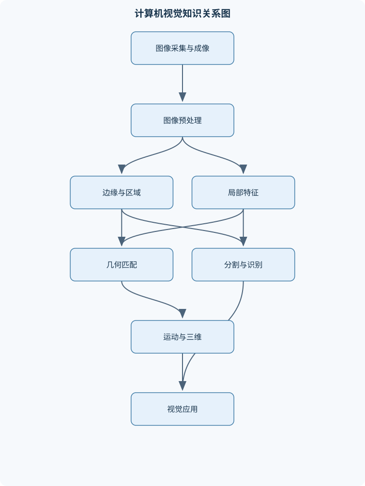
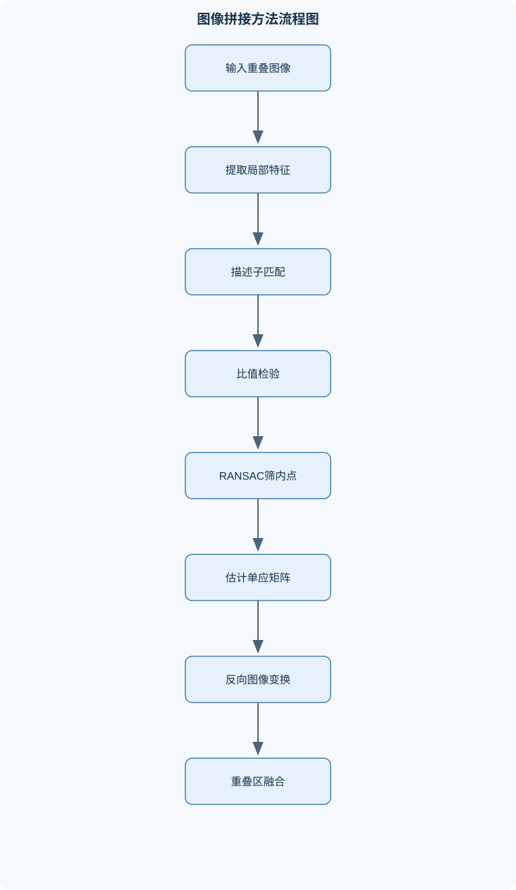

# 计算机视觉

## 一、课程整体知识框架

### 课程边界与先修知识

计算机视觉研究如何从图像、视频和多视角观测中提取几何、运动、形状、纹理和语义信息，并完成检测、分割、识别、三维重建与视觉测量。课程覆盖低层视觉、中层视觉和高层视觉：低层视觉包括成像、滤波、频域分析和边缘；中层视觉包括特征、匹配、分割、光流、拼接、立体视觉和三维数据配准；高层视觉包括词袋模型、主成分分析、人脸识别和卷积神经网络。先修知识包括高等数学、线性代数、概率统计、数字图像处理和数据结构；应掌握矩阵运算、特征值与特征向量、梯度与偏导数、卷积、最小二乘法和基本编程。课程边界不涵盖完整的现代视觉大模型、医学影像专门算法和机器人操作规划，但可说明其与经典视觉方法的联系。





### 1. 研究对象与问题链条

计算机视觉研究如何把图像、视频、深度图和多视角观测转换为可计算的几何、运动、形状、纹理与语义信息。灰度图像记为 $I(x,y)$，其中 $(x,y)$ 是像素坐标，$I$ 可以是标量灰度值，也可以是颜色向量。视觉系统通常不是直接从像素跳到类别，而是经历“成像—表示—特征—对应—结构恢复—识别决策”的问题链条。

低层视觉主要处理像素及其局部邻域，包括去噪、增强、频域分析和边缘检测。其目标通常是改善信号质量或发现图像中的不连续位置，但低层响应不必然对应物体边界。例如，阴影边界、纹理变化和反光都可能产生强梯度。中层视觉利用局部特征、轮廓、区域和运动建立图像元素之间的关系，包括匹配、配准、分割、拼接、光流、立体视觉和点云配准。高层视觉则面向物体类别、身份、场景和语义，包括主成分分析、Eigenface、视觉词袋和卷积神经网络。

### 2. Marr三阶段表示框架

Marr视觉理论把视觉处理区分为三个层次。Primal Sketch描述图像中与强度变化有关的基本图元，例如边缘、线段、端点、角点、斑点和纹理变化。它主要依赖局部灰度结构，不直接说明这些图元属于哪个物体。

2.5D Sketch描述以观察者为中心的可见表面信息，包括局部深度、表面方向、遮挡边界和运动线索。它不是完整三维模型：同一物体不可见的背面通常没有表示，深度还可能只在部分区域可获得。双目视差、运动视差、阴影和纹理梯度都可以提供2.5D线索，但每种线索都带有条件限制。例如，均匀白墙缺少可匹配纹理，单凭双目图像难以稳定恢复深度。

3D Model表示与视点相对独立的物体结构、表面几何和部件关系，可用于识别、测量和位姿估计。由2.5D观测推断3D模型通常需要多个视角、先验模型或额外传感器，因此三者不是简单的图像分辨率层级，而是从局部信号到可见表面再到物体结构的表示层级。

### 3. 从几何成像到语义决策

成像模型说明三维世界如何投影到二维图像；图像处理说明如何抑制噪声、增强结构并提取边缘；局部特征和区域方法说明如何建立稳定的对应关系；相机几何、立体视觉和运动分析进一步恢复空间结构与时间变化；识别模型则利用这些表示完成分类、检测或身份判断。

课程中的关键因果关系是：成像误差会影响特征定位，特征定位误差会影响匹配，错误匹配会导致几何估计失败，几何估计错误又会传播到拼接、测量和识别。例如，相机畸变未校正时，图像边缘区域的点对可能无法由单一理想单应模型解释；视差匹配错误时，由 $Z=fB/d$ 计算的深度会产生异常值。

视觉算法必须区分理想模型与现实限制。针孔模型假设光心、无畸变和精确投影；实际镜头存在径向、切向畸变。亮度恒常的光流模型假设观察点在相邻帧中的亮度不变；实际场景会受光照、反射、曝光和遮挡影响。K-means假设欧氏距离和近似凸簇适合区分样本；实际图像区域可能具有复杂形状。卷积神经网络可以学习复杂表示，但训练集性能不等于跨设备、跨视角和跨环境的泛化性能。

### 4. 数学与实现基础

课程需要使用矩阵运算、特征值与特征向量、梯度和偏导数、卷积、最小二乘法、概率统计和基本数据结构。图像梯度记为

$$
\nabla I=(I_x,I_y)^T,
$$

其中 $I_x$ 和 $I_y$ 分别表示水平方向和垂直方向的灰度变化率；梯度幅值为

$$
|\nabla I|=\sqrt{I_x^2+I_y^2},
$$

方向为

$$
\theta=\operatorname{atan2}(I_y,I_x).
$$

梯度方向指向灰度增长最快的方向，通常垂直于局部边缘切线方向。把梯度方向误认为边缘延伸方向，会导致Canny非极大值抑制方向选择错误。

离散卷积可写为

$$
(I*K)(x,y)=\sum_m\sum_n I(x-m,y-n)K(m,n).
$$

该式包含模板翻转；许多图像库的“卷积”接口实际执行的是相关运算，即不翻转核。边界处理必须明确，可采用零填充、复制边界、镜像边界或只计算有效区域。边界策略会改变图像边缘附近的结果，不能把不同策略的输出直接比较。

线性代数贯穿几何和特征分析。Harris结构矩阵为

$$
M=\sum_{q\in W}w(q)\nabla I(q)\nabla I(q)^T,
$$

其中 $W$ 是局部窗口，$w(q)$ 是权重。PCA使用协方差矩阵的特征向量作为主方向；立体视觉使用投影矩阵和三角测量；点云配准常通过奇异值分解求解刚体变换。最小二乘法能在观测带噪时寻找总体误差较小的参数，但如果模型不适用、外点过多或矩阵病态，计算结果仍可能不可靠。

## 二、章节和模块划分

### 核心知识覆盖清单

本清单用于检查正文是否覆盖本课程的主要知识模块：

- **视觉计算框架与图像表示**：Marr三阶段视觉表示、Primal Sketch与基本图元、2.5D Sketch与深度线索、3D Model与物体表征、低层中层高层视觉、图像坐标与像素坐标、邻域与连通性、几何特性与不变量。
- **图像形成与相机模型**：针孔相机模型、透视投影推导、内参矩阵与像素尺度、外参矩阵与坐标变换、齐次坐标表示、径向与切向畸变、焦距视场与光圈、景深及其影响因素、相机标定与参数可观测性。
- **图像处理与频域分析**：模板相关与离散卷积、均值与高斯平滑、图像增强与直方图变换、二维傅里叶变换、低频与高频成分、频域滤波器、高斯金字塔、拉普拉斯金字塔、采样、混叠与边界处理。
- **边缘、轮廓与区域结构**：边缘产生的四类不连续、一阶梯度算子、Roberts、Prewitt与Sobel算子、二阶拉普拉斯算子、LoG与高斯平滑、Canny边缘检测、非极大值抑制、双阈值边缘连接、链码与边界跟踪、连通分量标记。
- **曲线拟合与几何特征**：参数空间与投票机制、直线Hough变换、圆和圆弧Hough变换、参数量化误差、边缘点到模型残差、曲线长度与斜率表示、区域几何描述子、面积周长与形状比、欧拉数与拓扑结构。
- **局部特征与特征匹配**：Harris角点响应、结构张量与二阶矩阵、尺度空间与DoG、SIFT关键点定位、SIFT边缘响应剔除、主方向分配、梯度方向直方图、SIFT描述子构造、最近邻比值匹配、尺度旋转光照不变性。
- **图像配准、拼接与鲁棒估计**：点对与单应性变换、单应矩阵的自由度、特征匹配误差、RANSAC内点外点模型、RANSAC迭代次数、自适应内点比例估计、图像变换与反向映射、重叠区域融合、多频段与金字塔融合、拼接失败原因分析。
- **运动分析与光流**：光流问题定义、亮度恒常假设、空间一致性假设、短时间间隔假设、光流约束方程、孔径问题、Lucas-Kanade局部模型、结构张量可逆条件、纹理区域与边缘区域、运动场估计误差。
- **图像分割与聚类**：区域相似性与不连续性、特征空间设计、灰度和彩色聚类、坐标与颜色联合特征、K-means分割流程、聚类中心初始化、目标函数与局部最优、Mean Shift分割、核带宽影响、分割后区域合并与标记。
- **立体视觉与三维数据获取**：双目成像几何、对极几何、图像去畸变、立体矫正、视差与深度关系、三角测量、结构光三维重建、飞行时间测距、多视角点云、ICP点云配准。
- **经典视觉识别方法**：主成分分析、协方差矩阵与主方向、Eigenface人脸识别、投影空间距离、重构误差、特征值能量比例、视觉词袋模型、视觉码本构建、图像直方图表示、最近邻图像分类。
- **卷积神经网络视觉基础**：卷积层与感受野、步长和填充、特征图尺寸计算、参数共享、池化层、最大池化与平均池化、卷积网络层级特征、计算图与链式法则、反向传播、训练误差与泛化限制。


### 1. 视觉计算框架与图像表示

本模块建立从像素到物体模型的统一视角。内容包括Primal Sketch、2.5D Sketch、3D Model、低层视觉、中层视觉和高层视觉。还讨论图像坐标、像素坐标、邻域和连通性。

像素坐标通常表示离散采样位置，图像坐标可以表示成像平面上的连续位置。四邻域只连接水平和垂直相邻像素，八邻域还连接对角像素。邻域定义会改变连通区域数量：两个仅在角点接触的前景像素，在八邻域下可能属于同一区域，在四邻域下则属于两个区域。

几何特性包括长度、面积、周长、质心、方向、长宽比、圆度和拓扑关系。平移不变量要求整体移动不改变描述值；旋转不变量要求改变坐标方向后描述值保持一致；尺度不变量要求物体缩放后描述值不变。面积和周长本身不是尺度不变量，但圆度等经过归一化的量可以降低尺度影响。欧拉数通常表示连通分量数减去孔洞数，必须先明确前景、背景和邻域约定。

### 2. 图像形成与相机模型

理想针孔相机中，三维相机坐标为 $(X,Y,Z)$，成像平面坐标为 $(x,y)$，相似三角形给出

$$
x=f\frac{X}{Z},\qquad y=f\frac{Y}{Z}.
$$

其中 $f$ 是焦距，单位通常为毫米或与成像平面一致的长度单位，且要求 $Z>0$。当 $Z$ 增大时，投影尺度变小；当 $Z=0$ 时模型无定义，$Z<0$ 表示点位于相机后方，不应直接解释为正常成像点。

像素坐标需要考虑像素尺度、主点和坐标轴斜交。齐次形式为

$$
\tilde{x}=K
\begin{bmatrix}
X_c/Z_c\\
Y_c/Z_c\\
1
\end{bmatrix},
\qquad
K=
\begin{bmatrix}
f_x&\gamma&c_x\\
0&f_y&c_y\\
0&0&1
\end{bmatrix}.
$$

$f_x,f_y$ 是以像素为单位的焦距，$\gamma$ 是轴斜交系数，$(c_x,c_y)$ 是主点。世界坐标到相机坐标的变换为

$$
X_c=RX_w+t,
$$

其中 $R$ 是旋转矩阵，$t$ 是平移向量。齐次空间点记为 $\tilde X=(X,Y,Z,1)^T$，图像点记为 $\tilde x=(u,v,1)^T$。

径向畸变使距离主点较远的点产生桶形或枕形偏移，切向畸变通常源于镜片与成像平面未完全对准。标定需要多个姿态和覆盖不同图像区域的已知几何点。若所有标定板姿态近似相同、角点几乎共线或只覆盖图像中央，部分参数缺乏可观测性，即使优化能够输出数值，参数也可能不稳定。

焦距增大通常缩小视场，使远处目标在图像中占据更大比例；焦距减小通常扩大视场。光圈变大表示有效孔径增大，进光量增加但景深通常减小；光圈变小通常增加景深但需要更长曝光或更高增益。景深还受焦距、对焦距离、允许弥散圈和传感器尺寸影响，不能只归因于光圈。

### 3. 图像处理与频域分析

模板相关或卷积通过局部加权求和检测或改变图像结构。均值滤波平均邻域像素，能降低随机噪声但容易模糊边缘；高斯滤波使用

$$
G_\sigma(x,y)=\frac{1}{2\pi\sigma^2}
\exp\left(-\frac{x^2+y^2}{2\sigma^2}\right),
$$

其中 $\sigma$ 控制平滑尺度，单位与图像坐标一致。$\sigma$ 越大，抑制的高频成分越多，但相邻边缘可能被合并。

直方图变换通过改变像素值分布增强对比度。全局直方图均衡化适合整体对比度偏低的图像，但在局部照明不均或噪声较强时可能过度增强。二维傅里叶变换把空间图像表示为不同空间频率成分：缓慢变化的背景和大面积结构主要对应低频，细边缘、纹理和噪声通常包含较多高频。低通滤波可平滑图像，高通滤波可突出边缘，但高频并不等同于有用细节。

采样频率不足会产生混叠，使不同高频结构映射到相同或错误的低频模式。下采样前通常需要低通滤波。高斯金字塔通过平滑和逐级下采样表示多尺度图像；拉普拉斯金字塔存储相邻高斯层之间的细节差异，可用于图像重建和多频段融合。频域处理还必须处理边界延拓，否则图像首尾不连续会在频谱中产生额外高频。

### 4. 边缘、轮廓与区域结构

图像边缘可能由表面反射不连续、深度不连续、表面方向不连续和光照不连续产生。因此强梯度只能说明局部信号变化显著，不能直接保证存在物体轮廓。

一阶算子利用梯度极值检测边缘，常见的Roberts、Prewitt和Sobel算子分别具有不同的邻域结构与平滑特性。二阶拉普拉斯算子可用

$$
\nabla^2I=I_{xx}+I_{yy}
$$

表示。理想阶跃边缘附近一阶导数出现极值，二阶导数在边缘附近发生过零；但二阶微分对噪声更敏感，不能单独依据过零点作可靠判断。LoG先进行高斯平滑，再施加拉普拉斯算子：

$$
\nabla^2(G_\sigma*I)=(\nabla^2G_\sigma)*I.
$$

这个交换关系来自卷积与微分在适当光滑条件下的可交换性。高斯项用于抑制高频噪声，拉普拉斯项用于寻找结构变化。

Canny流程包括高斯平滑、梯度计算、非极大值抑制、双阈值检测和滞后连接。非极大值抑制沿梯度方向比较当前响应与邻近响应，只保留局部最大值，从而把宽边缘压细。高阈值确定强边缘，低阈值保留可能与强边缘相连的弱边缘。低阈值过低会引入噪声，高阈值过高会断开真实边缘。连通分量标记和边界跟踪则把二值区域转换为标签图或有序边界链，必须明确四邻域、八邻域及孔洞处理方式。

### 5. 曲线拟合与几何特征

Hough变换把图像空间中的模型检测转换为参数空间投票。直线使用法向式

$$
\rho=x\cos\theta+y\sin\theta.
$$

每个边缘点在参数空间形成一条可能曲线，多点对应的同一直线会在某个参数单元形成峰值。相比直接连接边缘点，Hough方法对局部断裂和少量外点更稳健，但参数离散化会引入定位误差；参数网格太粗会合并不同模型，太细则投票稀疏且计算量增加。圆和圆弧需要圆心坐标、半径以及可能的角度参数，参数维度增加后投票成本和数据需求也增加。

轮廓可用链码、边界长度、斜率变化和曲率等描述。区域可用面积、周长、质心、外接矩形、形状比和圆度描述。边界长度受像素网格方向影响，简单逐像素计数会对斜线产生偏差；面积和周长也会受分辨率、阈值和边界噪声影响。几何描述子必须说明对平移、旋转、尺度和噪声的敏感性。

### 6. 局部特征与特征匹配

Harris检测器在窗口内考察小位移造成的灰度变化：

$$
E(u,v)\approx [u,v]M
\begin{bmatrix}
u\\v
\end{bmatrix}.
$$

若结构矩阵的两个特征值都很小，窗口近似平坦；一个大、一个小表示边缘；两个都大表示两个方向均有显著变化，通常对应角点。Harris响应为

$$
R=\det(M)-k(\operatorname{tr}M)^2.
$$

只看行列式不能区分角点与某些边缘，必须结合迹或特征值关系。

SIFT在高斯尺度空间中寻找关键点，通过相邻尺度高斯图像之差构成DoG近似尺度归一化的拉普拉斯响应。关键点定位后，需要剔除低对比度点和边缘响应过强点；随后根据局部梯度方向分配主方向，在旋转坐标系中统计空间网格与方向区间的梯度直方图并归一化。这样可以减弱整体亮度偏移，并对尺度和旋转变化具有较强稳定性，但不能保证抵抗严重仿射变形、遮挡、重复纹理和非刚体变形。

匹配时可比较描述子欧氏距离，并用最近邻与次近邻距离比排除模糊匹配。比值检验不是对所有错误匹配的绝对保证：当图像存在大量重复纹理时，多个候选描述子可能具有相近距离。

### 7. 图像配准、拼接与鲁棒估计

平面场景或纯旋转相机条件下，图像点可以近似满足单应关系

$$
\tilde{x}'\sim H\tilde{x}.
$$

一般单应矩阵有8个自由度，乘以非零尺度不改变映射，因此至少需要4对不共线点对应。近共线点会使估计数值不稳定，少于4对点或点对不满足同一几何模型时不能可靠估计一般单应矩阵。

RANSAC从候选点对中随机抽取最小样本，估计模型，计算所有点的重投影残差并统计内点，重复后选择支持度最高的模型，再用全部内点重新估计。若单次抽样包含全内点最小样本的概率为 $w^n$，经过 $K$ 次采样仍失败的概率为

$$
(1-w^n)^K.
$$

达到置信度 $p$ 时，可取

$$
K\geq\frac{\log(1-p)}{\log(1-w^n)}.
$$

该估计依赖内点比例、残差阈值和最小样本模型。图像变换时通常采用反向映射：对目标图像像素通过逆变换寻找源图像位置并插值，可减少空洞。拼接还需要重叠区域融合；多频段或金字塔融合能分别处理低频亮度差异与高频接缝。视差变化过大、动态物体、畸变未校正、错误匹配和曝光差异都可能导致拼接失败。

### 8. 运动分析与光流

光流描述像素在连续帧中的表观运动，向量记为 $(u,v)$。其基本假设是亮度恒常、空间一致和短时间间隔。亮度恒常可写为

$$
I(x,y,t)=I(x+u\Delta t,y+v\Delta t,t+\Delta t).
$$

一阶泰勒展开并忽略高阶项：

$$
I_xu+I_yv+I_t=0.
$$

单个像素只有一个方程，却包含两个未知速度分量，因此存在孔径问题。Lucas–Kanade在局部窗口内假设速度近似恒定，堆叠多组约束后求解

$$
A\mathbf v=\mathbf b,
\qquad
(A^TA)\mathbf v=A^T\mathbf b.
$$

当窗口内梯度方向多样且 $A^TA$ 满秩、最小特征值不太小时，估计才稳定。纯边缘区域只有一个主要梯度方向，沿边缘方向的速度难以确定；平坦区域梯度接近零，无法提供有效约束。大位移违反短时间假设时，可使用图像金字塔逐层估计。

### 9. 图像分割与聚类

分割根据区域相似性或不连续性把图像划分为具有任务意义的区域。特征可以只使用灰度或颜色，也可以加入坐标、纹理和局部梯度。只用颜色会把相距很远但颜色相同的区域归为一类；加入坐标能够增强空间连续性，但坐标和颜色必须适当标准化，否则尺度较大的特征会主导距离。

K-means最小化

$$
J=\sum_i\|z_i-\mu_{c(i)}\|^2,
$$

其中 $z_i$ 是像素特征，$\mu_j$ 是第 $j$ 个中心，$c(i)$ 是样本类别。算法交替执行最近中心分配和均值更新，每次操作不会增加目标函数，但只能保证收敛到局部最优。类别数 $K$ 需要由任务约束、验证指标或先验知识确定。Mean Shift通过核带宽定义局部密度，带宽过小会产生碎片区域，过大则合并不同结构。聚类后还需进行小区域合并、孔洞处理、区域标记和边界平滑。

### 10. 立体视觉与三维数据获取

双目系统通过两个相机观察同一空间点。完成去畸变和立体矫正后，同名点位于近似同一图像行，匹配可主要沿水平方向进行。在平行双目理想模型中，

$$
d=\frac{fB}{Z},
\qquad
Z=\frac{fB}{d},
$$

其中 $B$ 是基线长度，$f$ 是像素单位焦距，$d$ 是视差，$Z$ 是深度。该式要求相机已标定、视差为正且匹配正确。视差越小，深度对视差误差越敏感，因此远距离测量尤其不稳定。无纹理、重复纹理、遮挡和反光区域应标记为低可信度，而不能强行填充为真实深度。

结构光通过投射已知图案建立对应关系，飞行时间方法根据光传播时间估计距离，多视角系统则通过多个视点获得更完整的点云。ICP点云配准交替执行最近点对应和刚体变换更新，适用于重叠充分且初始位姿较接近的点云；初始位姿差距过大、重叠不足或存在大量外点时，可能陷入错误局部最优。

### 11. 经典视觉识别方法

PCA将样本中心化后计算协方差矩阵 $S$，寻找满足 $a^Ta=1$ 时投影方差最大的方向：

$$
\max_a a^TSa.
$$

拉格朗日条件给出

$$
Sa=\lambda a.
$$

最大特征值对应第一主成分。前 $k$ 个特征值之和占总特征值的比例可表示保留的方差能量，但高方差不一定意味着高类别可分性。

Eigenface把对齐的人脸图像展平为向量，用均值脸和主成分构成低维特征脸空间，将测试人脸投影后与训练样本比较。该方法对姿态、光照、表情和对齐误差敏感，适合受控条件而不适合直接处理任意姿态人脸。

视觉词袋先提取局部描述子，再用K-means构建视觉码本，将每个描述子量化为一个视觉词，并用词频直方图表示图像。它能利用局部纹理进行图像分类，但忽略局部特征的空间排列；两幅图像即使物体位置完全不同，只要词频相近，也可能得到相近表示。

### 12. 卷积神经网络视觉基础

卷积层使用局部连接和参数共享，从局部邻域提取特征。若输入边长为 $N$，卷积核边长为 $F$，填充为 $P$，步长为 $S_t$，输出边长为

$$
\left\lfloor\frac{N+2P-F}{S_t}\right\rfloor+1.
$$

若输入通道数为 $C_{in}$、输出卷积核数为 $C_{out}$，卷积权重参数量为

$$
F_hF_wC_{in}C_{out},
$$

若使用偏置，还需增加 $C_{out}$。参数共享降低了参数量，但计算量仍受特征图尺寸、通道数、批量大小和内存访问影响。

池化层进行局部下采样。最大池化保留局部最大响应，适合突出显著激活；平均池化保留局部平均趋势。池化提高了一定的平移鲁棒性，但会损失精确位置和细节，因此不能认为池化没有信息损失。网络浅层通常学习边缘和简单纹理，较深层通过组合形成部件与语义结构，但这种层级解释依赖数据、网络结构和训练过程。

训练过程包括前向传播、损失计算、反向传播和参数更新。反向传播依据计算图和链式法则计算各层梯度，再使用梯度下降更新权重。训练误差降低并不保证泛化；数据量不足、标签错误、训练测试分布差异和过度拟合都可能使实际性能下降。课程重点是卷积网络的视觉计算基础，不延伸到完整的现代视觉大模型、医学影像专门算法或机器人操作规划。

### 13. 代表性算法流程一：Canny边缘检测与连通结构提取

**输入**为灰度图像、高斯尺度 $\sigma$、高阈值和低阈值；**输出**为连接后的二值边缘图以及可选的连通区域标签。

1. 用高斯核平滑图像，抑制会被微分放大的噪声。
2. 计算 $I_x,I_y$、梯度幅值和梯度方向。
3. 沿梯度方向插值比较邻近响应，执行非极大值抑制。
4. 梯度幅值高于高阈值的像素作为强边缘，介于两阈值之间的像素作为弱边缘。
5. 从强边缘出发，沿八邻域连接弱边缘；未被连接的弱边缘删除。
6. 若需要区域统计，则对二值结果执行连通分量标记。

不变量是：边缘连接过程中，已确认的强边缘不会被删除；终止条件是所有候选弱边缘都完成访问。主要计算量与像素数成正比，平滑尺度决定检测噪声和定位精度之间的折中。

### 14. 代表性算法流程二：SIFT匹配与RANSAC拼接

**输入**为两幅有重叠区域的图像；**输出**为可靠点对、单应矩阵和融合图像。

先建立高斯尺度空间，检测DoG局部极值并精确定位关键点；剔除低对比度点和边缘响应过强点；分配主方向并生成归一化描述子。对两幅图像的描述子进行最近邻搜索，用最近邻与次近邻距离比筛选候选匹配。

随后随机抽取四个不共线点对估计单应矩阵，计算所有点的重投影误差并统计内点。经过足够迭代后，使用最佳模型的全部内点重新估计 $H$。最后采用反向映射将图像投影到公共平面，在重叠区域进行线性、多频段或金字塔融合。

失败排查应按“特征不足—匹配错误—模型不适用—映射错误—融合异常”顺序进行。若纹理不足，应增加有效纹理或改变尺度；若重复纹理导致误匹配，应收紧比值阈值并检查RANSAC内点；若场景有明显视差或动态物体，单一单应矩阵可能不再适用。

```python
# Python：基于候选点对的简化RANSAC单应性估计流程
def ransac_homography(matches, iterations, reproj_threshold):
    best_H = None
    best_inliers = []

    for _ in range(iterations):
        sample = random_noncollinear_four_pairs(matches)
        H = estimate_homography_normalized(sample)

        inliers = []
        for src, dst in matches:
            pred = apply_homography(H, src)
            error = euclidean_distance(pred, dst)
            if error < reproj_threshold:
                inliers.append((src, dst))

        if len(inliers) > len(best_inliers):
            best_H = H
            best_inliers = inliers

    if len(best_inliers) >= 4:
        best_H = estimate_homography_normalized(best_inliers)
    return best_H, best_inliers
```

该伪实现要求点对坐标有效、抽样点不共线，并且 `estimate_homography_normalized` 使用归一化坐标以减轻数值尺度影响。它没有处理重复模型、退化样本和双向重投影误差，因此只能作为流程说明，不能直接视为完整工程实现。

### 15. 代表性算法流程三：双目深度估计

**输入**为左右图像、内参、外参、畸变参数、基线和匹配参数；**输出**为视差图、深度图和置信度图。

首先根据标定参数去畸变并进行立体矫正。对左图像每个有效像素，在右图同一行搜索候选对应点，使用块匹配或代价聚合选择视差。进行左右一致性检查，剔除遮挡和不一致区域，再通过

$$
Z=\frac{fB}{d}
$$

转换深度。由于视差误差会在远距离处造成更大的深度误差，输出中应保留无效标记和置信度，而不是把所有缺失区域都当成精确测量。

### 16. 例题与分析

#### 例题一：透视投影计算

**题干**：相机焦距为 $f=20\text{ mm}$，空间点为 $(X,Y,Z)=(10,5,100)\text{ mm}$，求理想针孔模型下的成像平面坐标。

**分析**：使用相似三角形关系，要求 $Z>0$。

**逐步解答**：

$$
x=f\frac{X}{Z}=20\times\frac{10}{100}=2\text{ mm},
$$

$$
y=f\frac{Y}{Z}=20\times\frac{5}{100}=1\text{ mm}.
$$

**结果验证**：若将深度增大到 $200\text{ mm}$，投影坐标变为 $(1,0.5)\text{ mm}$，恰好缩小为原来的一半，符合透视投影规律。

**变式**：若 $Z=0$，公式无定义；若 $Z<0$，点位于相机后方，不能按正常前方成像解释。

#### 例题二：梯度幅值与方向

**题干**：某像素的梯度为 $I_x=3$、$I_y=4$，求梯度幅值和方向。

**分析**：梯度方向采用从水平轴正向起算的有向角。

**逐步解答**：

$$
|\nabla I|=\sqrt{3^2+4^2}=5,
$$

$$
\theta=\operatorname{atan2}(4,3)\approx53.13^\circ.
$$

**结果验证**：梯度向量长度为5，方向位于第一象限。Canny应沿该方向比较邻域响应，因为边缘切线方向与梯度方向近似垂直。

**变式**：若 $I_x=0,I_y=0$，方向没有稳定意义，通常应视为平坦或低置信度区域。

#### 例题三：Harris结构矩阵判断

**题干**：给定

$$
M=
\begin{bmatrix}
9&0\\
0&4
\end{bmatrix},
$$

判断该窗口更接近平坦区、边缘还是角点。

**分析**：矩阵特征值为 $\lambda_1=9,\lambda_2=4$，二者都明显大于零且数量级相近。

**逐步解答**：窗口在两个相互独立方向都有较强灰度变化，因此不是平坦区；若只有一个特征值大，才更符合边缘。此处两个特征值均大，判为角点候选。

Harris响应为

$$
R=\det(M)-k(\operatorname{tr}M)^2
=36-k(13)^2.
$$

若 $k=0.04$，则

$$
R=36-6.76=29.24>0.
$$

**结果验证**：正响应支持角点判断，但实际仍需阈值和局部非极大值抑制。

**变式**：若 $M=\operatorname{diag}(12,0.1)$，一个特征值远大于另一个，应判断为边缘，而不能只因行列式为正就判为角点。

#### 例题四：光流最小二乘

**题干**：窗口中有三组观测：

$$
(I_x,I_y,I_t)=(1,0,-2),(0,1,-3),(1,1,-5).
$$

求光流向量 $(u,v)$。

**分析**：由 $I_xu+I_yv+I_t=0$，得到 $I_xu+I_yv=-I_t$。

**逐步解答**：

$$
A=
\begin{bmatrix}
1&0\\
0&1\\
1&1
\end{bmatrix},
\qquad
b=
\begin{bmatrix}
2\\3\\5
\end{bmatrix}.
$$

前两行直接给出 $u=2,v=3$，第三行也满足 $2+3=5$。因此

$$
\mathbf v=
\begin{bmatrix}
2\\3
\end{bmatrix}.
$$

**结果验证**：代回三组方程，残差均为0，说明该理想数据与恒定速度模型一致。

**变式**：若所有窗口梯度都形如 $(a,2a)$，则 $A^TA$ 可能病态，只有一个主要梯度方向，孔径问题使速度的某个方向难以估计。

#### 例题五：双目深度及误差

**题干**：焦距 $f=800$ 像素，基线 $B=0.1\text{ m}$，视差 $d=40$ 像素，求深度。

**逐步解答**：

$$
Z=\frac{fB}{d}
=\frac{800\times0.1}{40}
=2\text{ m}.
$$

若视差误差为 $1$ 像素，在小误差近似下，由

$$
Z=\frac{fB}{d}
$$

可得

$$
\left|\frac{\partial Z}{\partial d}\right|
=\frac{fB}{d^2}.
$$

在 $d=40$ 时，深度变化率为

$$
\frac{800\times0.1}{40^2}=0.05\text{ m/pixel}.
$$

**结果验证**：视差减小到20像素时，深度变为4米，且同样的1像素误差造成的深度变化率为 $0.2\text{ m/pixel}$，说明远处深度更敏感。

**变式**：若 $d\leq0$，不能直接按正常平行双目深度解释；若相机未标定，代入的 $f$ 和 $B$ 可能不代表真实几何关系。

### 17. 实验与项目流程

#### 实验一：边缘检测参数影响分析

**输入数据**：包含平滑区域、阶跃边缘、细纹理和一定噪声的灰度图像；记录图像尺寸、灰度范围和噪声条件。

**实验步骤**：

1. 使用同一图像分别运行均值滤波、高斯滤波和不平滑的梯度检测。
2. 改变高斯尺度 $\sigma$，观察边缘数量、边缘连续性和定位偏移。
3. 对Canny改变高阈值与低阈值，比较断裂边缘、伪边缘和细节丢失。
4. 对输出执行连通分量标记，统计边缘连通区域数量和平均长度。
5. 在已知边缘位置的合成图像上计算检测率、误检率和定位误差。

**评价标准**：真实边缘附近是否被检测、噪声区域是否产生伪边缘、边缘是否连续、定位误差是否随平滑尺度增大而变化。不能只用边缘总数评价，因为过度检测也可能增加边缘数量。

**排错方法**：若整幅图像出现大量边缘，检查图像是否未转灰度、灰度范围是否错误或阈值是否过低；若边缘全部断裂，检查高阈值是否过高、弱边缘连接是否实现以及邻域定义是否一致；若边缘过厚，检查非极大值抑制是否沿梯度方向执行。

#### 实验二：双目深度与误差评估

**输入数据**：已标定的左右图像、内参、外参和若干已知距离的平面或物体；记录焦距、基线和视差单位。

**实验步骤**：

1. 对左右图像去畸变并进行立体矫正。
2. 选择纹理充分、无明显遮挡的区域进行视差匹配。
3. 用左右一致性检查标记不可靠视差。
4. 根据 $Z=fB/d$ 计算深度，并与已知距离比较。
5. 分别在近距离、远距离、低纹理和重复纹理区域统计误差。
6. 改变匹配窗口大小，观察噪声抑制和边界精度的变化。

**评价标准**：有效像素比例、平均绝对深度误差、异常值比例、物体边界保持程度和左右一致性通过率。评价时必须单独报告无效区域，不能把填补后的深度与直接测量结果混为一谈。

**排错方法**：若同一空间点不在同一行，检查立体矫正和外参方向；若深度整体偏大或偏小，检查焦距单位、基线单位和视差符号；若平面出现条纹或跳变，检查重复纹理、匹配窗口和遮挡处理；若远处误差急剧增大，这是视差量化敏感性的正常现象，但应确认误差是否超过系统设计边界。

## 三、核心概念的详细解释

### 1. 视觉表示、坐标系统与几何不变量

计算机视觉的输入可以是单幅图像、视频帧、深度图、点云或多视角图像。视觉计算的基本链条是：由成像模型获得像素观测，对像素进行去噪和增强，提取边缘、角点或局部描述子，建立像素之间或不同图像之间的对应关系，再恢复运动、深度、形状或语义类别。

Marr的三阶段表示提供了从信号到结构的层次化框架。Primal Sketch描述局部强度变化形成的边缘、线段、端点、角点、斑点和纹理。2.5D Sketch描述以观察者为中心的可见表面，包括局部深度、表面方向、遮挡边界和运动线索，但不等同于完整三维模型。3D Model则试图表示与观察视点相对独立的物体结构、表面几何和部件关系。均匀纹理表面可能难以从双目视差恢复深度；单个视角也无法直接得到物体背面，因此2.5D信息不能简单替代3D模型。

图像坐标通常记为 $(x,y)$，像素坐标记为 $(u,v)$。前者可以表示连续成像平面上的位置，后者通常表示离散图像矩阵中的列、行索引。实际系统必须明确坐标原点、轴方向和单位。像素索引一般是无量纲整数，而相机坐标 $(X,Y,Z)$ 的单位可以是毫米或米。若混用米和毫米，投影比例会整体错误。

邻域定义决定区域和边界的拓扑结果。四邻域只连接上、下、左、右像素，八邻域还连接四个对角像素。两个仅在对角处接触的前景像素，在八邻域下属于同一区域，在四邻域下属于两个区域。为了避免前景和背景同时产生拓扑矛盾，处理区域边界和孔洞时必须明确采用的邻域规则。

常用几何特性包括面积、周长、质心、边界框、长宽比、圆度、凸性、欧拉数和方向。面积是区域中像素的数量乘以像素物理面积；周长是边界长度的估计值，受四邻域、八邻域和数字曲线修正方式影响。圆度常写为

$$
C=\frac{4\pi A}{P^2},
$$

其中 $A$ 为面积，$P$ 为周长。理想圆的圆度为 $1$，锯齿边界或细长区域的圆度较小。该指标对分辨率、边界噪声和周长估计方法敏感，不能把它当作完全尺度无关且无噪声的判别量。

### 2. 图像形成与相机参数

针孔相机模型假设所有光线通过一个光心，成像平面没有镜头畸变。设空间点为 $(X,Y,Z)$，相机坐标系的光心为原点，光轴为 $Z$ 轴，成像平面距离光心为焦距 $f$。由相似三角形得到

$$
x=f\frac{X}{Z},\qquad y=f\frac{Y}{Z}.
$$

这里 $f$、$X$、$Y$、$Z$ 使用相同长度单位，$x,y$ 也是成像平面上的长度坐标。该公式要求 $Z>0$，即点位于相机前方；当 $Z$ 接近零时，投影趋于无穷，针孔模型不再适用于实际成像。

像素坐标还需要考虑像素尺寸、坐标原点、主点和可能的轴不垂直。齐次形式为

$$
\tilde{x}=K
\begin{bmatrix}
X_c/Z_c\\
Y_c/Z_c\\
1
\end{bmatrix},
\qquad
K=
\begin{bmatrix}
f_x&\gamma&c_x\\
0&f_y&c_y\\
0&0&1
\end{bmatrix}.
$$

其中 $f_x,f_y$ 是以像素为单位的等效焦距，$(c_x,c_y)$ 是主点，$\gamma$ 是轴斜交系数。若像素为正方形且坐标轴正交，通常有 $f_x=f_y$、$\gamma=0$，但实际相机不应无条件采用这些简化。

外参描述世界坐标系到相机坐标系的刚体变换：

$$
X_c=RX_w+t,
$$

其中 $R$ 是满足 $R^TR=I$、$\det(R)=1$ 的旋转矩阵，$t$ 是平移向量。旋转不改变长度和夹角，平移改变坐标原点的位置。内参和外参的作用不同：内参描述相机自身的成像尺度和主点，外参描述相机相对于世界的姿态和位置。

焦距增大时，在传感器尺寸固定的条件下视场角减小，远处物体在图像中的投影更大；焦距减小时视场角增大，但单位角度对应的像素数减少。光圈由相对孔径控制进光量和景深。光圈开大时进光量增加、景深通常减小；光圈缩小时景深通常增大，但过小的光圈会因衍射降低清晰度。景深还受到焦距、对焦距离、允许弥散圈和传感器尺寸影响，不能只由光圈单独决定。

径向畸变使直线在图像边缘发生桶形或枕形弯曲，切向畸变通常由镜片与成像平面不平行引起。畸变校正应先估计参数，再把理想坐标映射到畸变坐标或进行反向采样。相机标定需要多个姿态不同的标定板观测。若所有标定板图像几乎相同、角点集中在图像中央或点近似共线，则参数可观测性不足；增加重复图像不能弥补几何姿态缺乏。

### 3. 滤波、频域表示与边缘

离散卷积为

$$
(I*K)(x,y)=\sum_m\sum_n I(x-m,y-n)K(m,n).
$$

卷积要求模板在求和前翻转；许多图像库函数实际实现的是相关运算

$$
(I\star K)(x,y)=\sum_m\sum_n I(x+m,y+n)K(m,n),
$$

二者在中心对称模板上结果相同，在非对称模板上结果不同。边界处理也必须说明：零填充可能产生黑边，复制边界会延拓边缘值，有效卷积则只计算模板完全落在图像内部的位置。

均值滤波用局部平均抑制随机噪声，但会模糊边缘。高斯滤波使用

$$
G_\sigma(x,y)=\frac{1}{2\pi\sigma^2}
\exp\left(-\frac{x^2+y^2}{2\sigma^2}\right),
$$

其中 $\sigma$ 是空间尺度，单位与坐标一致。$\sigma$ 越大，平滑越强、细节损失越多。频域中，低频通常对应缓慢变化的亮度和大尺度结构，高频通常对应边缘、细纹理和噪声。二维傅里叶变换将空间图像表示为不同空间频率正弦波的叠加。低通滤波保留低频并削弱高频，可用于平滑；高通滤波突出高频，可增强边缘，但也会放大噪声。

采样频率不足时会产生混叠：高频信号被错误解释为低频信号。下采样前应先低通滤波，否则细纹理可能在缩小图像中变成虚假条纹。高斯金字塔通过平滑和逐级下采样表示不同尺度的图像；拉普拉斯金字塔保存相邻高斯层之间的细节差异，可用于多尺度重建和图像融合。边界延拓方式会改变频率响应，因而实验中应固定边界规则。

理想阶跃边缘在一阶导数附近产生极值，在二阶导数附近产生过零。边缘可由物体表面深度不连续、表面反射率不连续、表面方向变化造成的阴影变化以及光照不连续产生。因此强边缘不一定是物体轮廓，反光和纹理同样可能产生梯度。

梯度为

$$
\nabla I=(I_x,I_y)^T,
$$

幅值和方向为

$$
|\nabla I|=\sqrt{I_x^2+I_y^2},\qquad
\theta=\operatorname{atan2}(I_y,I_x).
$$

Roberts使用小尺寸差分，定位较敏感但抗噪声能力弱；Prewitt和Sobel使用邻域平均，Sobel在垂直方向采用较大权重，通常具有更强的平滑效果。拉普拉斯算子为

$$
\nabla^2I=I_{xx}+I_{yy},
$$

它对噪声敏感，因此通常先用高斯平滑。高斯平滑与拉普拉斯算子可交换：

$$
\nabla^2(G_\sigma*I)
=(\nabla^2G_\sigma)*I.
$$

这形成LoG算子。LoG先削弱高频噪声，再通过二阶导数过零检测边缘；$\sigma$ 决定检测尺度，过大的 $\sigma$ 会合并相邻边缘并造成定位偏移。

Canny检测先高斯平滑，再计算梯度，沿梯度方向进行非极大值抑制，只保留局部最大响应，最后用高低双阈值进行滞后连接。高阈值确定可靠强边缘，低阈值保留可能属于强边缘的弱响应；从强边缘出发，只有与其连通的弱边缘才被保留。高阈值过高会造成断裂，低阈值过低会引入伪边缘。

### 4. 曲线、连通区域与局部特征

直线的斜率式在垂直线附近不稳定，因此Hough变换常用法向式

$$
\rho=x\cos\theta+y\sin\theta.
$$

每个边缘点在 $(\rho,\theta)$ 参数空间中形成一条曲线，属于同一直线的边缘点会在同一参数位置附近投票形成峰值。参数空间需要离散化，网格过粗会造成定位误差，过细则投票分散且计算量增加。Hough对孤立外点较稳健，但当边缘点很多或模型参数维数较高时，累加器内存和计算成本会明显增加。

连通分量标记将二值图像中的前景区域赋予不同标签。贯序扫描时，当前像素若无已标记邻居则新建标签；若有一个邻居标签则继承；若有多个不同标签则记录标签等价关系。扫描结束后统一合并等价标签。该流程需要预先确定四邻域或八邻域，并处理孔洞和边界接触情况。

Harris角点利用局部窗口内灰度变化的方向分布。若图像发生小位移 $(u,v)$，窗口内平方差可近似为

$$
E(u,v)\approx
\begin{bmatrix}u&v\end{bmatrix}
M
\begin{bmatrix}u\\v\end{bmatrix},
$$

其中

$$
M=\sum_{q\in W}w(q)
\nabla I(q)\nabla I(q)^T.
$$

若 $M$ 的两个特征值都小，窗口近似平坦；一个大一个小，表示边缘；两个都大，表示角点。Harris响应为

$$
R=\det(M)-k(\operatorname{tr}M)^2.
$$

$k$ 是经验系数。只看行列式会混淆“两个中等特征值”和“一个很大、一个很小”的情况，因此必须同时分析迹或特征值。

SIFT在高斯尺度空间中寻找局部极值，利用相邻尺度高斯图像之差近似尺度归一化的拉普拉斯响应。关键点定位后剔除低对比度点和边缘响应过强点，再依据局部梯度方向分配主方向。描述子将局部区域划分为网格，在每个网格中统计梯度方向直方图并归一化。使用梯度而不是原始像素值，可以减弱整体亮度偏移和部分对比度变化的影响；将坐标旋转到主方向，可以获得旋转稳定性；在尺度空间中检测极值，可以获得一定尺度不变性。但强仿射变形、非刚体变形、遮挡和重复纹理仍可能导致错误匹配。

### 5. 匹配、配准、拼接与运动

图像拼接通常先提取局部特征，再用最近邻距离与次近邻距离之比筛选候选匹配。若两幅图像来自同一平面，或相机绕光心旋转，点对可近似满足单应关系

$$
\tilde{x}'\sim H\tilde{x}.
$$

一般单应矩阵有8个自由度，至少需要4对不共线点对应。近共线点会造成病态估计，少于4对点通常无法估计一般单应矩阵。

真实匹配中常混有外点。RANSAC每次随机抽取最小样本估计模型，再用重投影误差判断所有点的内外点。设内点比例为 $w$，最小样本数为 $n$，则一次抽到全内点样本的概率为 $w^n$。经过 $K$ 次采样仍失败的概率为

$$
(1-w^n)^K.
$$

若要求成功概率至少为 $p$，则

$$
K\geq
\frac{\log(1-p)}{\log(1-w^n)}.
$$

当内点比例估计过高时，实际迭代次数可能不足；应根据当前最佳模型自适应更新。估计出单应矩阵后，拼接通常采用反向映射：对目标图像中的每个像素，通过 $H^{-1}$ 查找源图像位置并插值，从而避免前向映射产生空洞。重叠区域可采用加权平均、羽化、多频段融合或金字塔融合。视差、曝光差、畸变未校正和错误匹配都会造成接缝、重影或局部撕裂。

光流描述图像亮度结构在时间上的运动。其基本假设包括亮度恒常、短时间小位移和局部空间一致性。亮度恒常写为

$$
I(x,y,t)=I(x+u\Delta t,y+v\Delta t,t+\Delta t).
$$

对右侧作一阶泰勒展开并忽略高阶项：

$$
I(x+u\Delta t,y+v\Delta t,t+\Delta t)
\approx I+I_xu\Delta t+I_yv\Delta t+I_t\Delta t.
$$

整理得光流约束方程

$$
I_xu+I_yv+I_t=0.
$$

单个像素只有一个方程，却有两个未知速度分量，因此存在孔径问题。Lucas-Kanade假设窗口内速度近似恒定，利用多个像素建立超定方程并最小二乘求解。若窗口内梯度方向相近，$A^TA$ 的一个特征值很小，速度估计不稳定；纹理丰富且方向多样的窗口更适合估计。大运动、遮挡、亮度变化和非刚体运动会破坏基本假设，通常需要图像金字塔、鲁棒损失或遮挡检测。

### 6. 分割、三维视觉与点云

图像分割依据区域内部相似性或区域之间不连续性，将像素划分为目标和背景或多个类别。特征可以是灰度、颜色、纹理、坐标及其组合。只使用颜色可能把相距很远但颜色相同的区域合并；加入归一化坐标可以鼓励空间连续，但坐标尺度过大又可能压制颜色差异。

K-means最小化

$$
J=\sum_i\|z_i-\mu_{c(i)}\|^2,
$$

其中 $z_i$ 是像素特征，$\mu_j$ 是聚类中心，$c(i)$ 是样本类别。算法交替执行最近中心分配和均值更新，每一步不会增加目标函数，但只能收敛到局部最优。初始化不同、类别数 $K$ 不同、特征尺度未标准化，都会产生不同分割。Mean Shift不预先固定类别数，通过核带宽寻找密度峰；带宽过小会产生碎片，过大则合并相异区域。

双目视觉通过同一空间点在左右图像中的位置差异恢复深度。经过去畸变和立体矫正后，对应点应位于同一图像行。平行双目模型中

$$
d=\frac{fB}{Z},\qquad
Z=\frac{fB}{d},
$$

其中 $d$ 为视差，单位为像素；$f$ 为像素单位焦距；$B$ 为基线；$Z$ 与 $B$ 使用相同长度单位。要求相机已标定且 $d>0$。当视差很小时，深度对匹配误差非常敏感。结构光通过投射已知编码图案实现三角测量，飞行时间方法依据光传播时间测距，适用距离范围、精度和表面条件不同。

ICP点云配准交替执行最近点对应和刚体变换更新。给定对应点后，先去除源点和目标点质心，再对互相关矩阵进行奇异值分解求旋转，最后由质心关系求平移。ICP是局部优化方法，初始位姿差距过大、重叠不足、重复结构或外点过多时，可能收敛到错误局部最优。

### 7. PCA、视觉词袋与卷积神经网络

PCA先对样本去均值，计算协方差矩阵 $S$。寻找单位方向 $a$ 使投影方差最大：

$$
\max_a a^TSa,\qquad a^Ta=1.
$$

构造拉格朗日函数并求导：

$$
\mathcal L(a,\lambda)=a^TSa-\lambda(a^Ta-1),
$$

得到

$$
Sa=\lambda a.
$$

最大特征值对应第一主成分，前 $k$ 个特征值之和占总特征值的比例为

$$
\eta_k=\frac{\sum_{i=1}^{k}\lambda_i}
{\sum_i\lambda_i}.
$$

$\eta_k$ 可用于衡量保留方差的比例，但PCA最大化的是总体方差，不保证最大化类别可分性。Eigenface将对齐的人脸图像投影到主成分空间，用投影距离或重构误差识别；其效果依赖人脸对齐、光照和姿态控制。

视觉词袋先提取局部描述子，再用K-means建立视觉码本。每个描述子量化为最近的视觉词，将一幅图像表示为词频直方图，最后用最近邻或分类器完成识别。该表示忽略局部特征的空间排列，因此适合纹理和局部结构分类，但难以区分局部组成相同而空间布局不同的图像。

卷积神经网络由卷积层、非线性激活、池化层和全连接或分类层组成。卷积核在不同位置共享参数，使相同局部模式可以在不同位置被检测。若输入尺寸为 $N$，卷积核尺寸为 $F$，填充为 $P$，步长为 $S_t$，输出空间尺寸为

$$
\left\lfloor\frac{N+2P-F}{S_t}\right\rfloor+1.
$$

输入有 $C_{\mathrm{in}}$ 个通道、卷积核数为 $C_{\mathrm{out}}$ 时，权重参数量为

$$
F_hF_wC_{\mathrm{in}}C_{\mathrm{out}},
$$

若有偏置，还需增加 $C_{\mathrm{out}}$。池化通过局部最大值或平均值下采样，提高一定平移鲁棒性，但会损失精确位置和细节。反向传播按照计算图使用链式法则计算损失对各层参数的梯度，再用梯度下降更新参数。训练误差低不代表泛化好，光照、视角、传感器、标签质量和数据分布变化都会影响实际性能。

## 四、重要定义、公式、定理和推导

### 专业审校补充：关键定义与适用边界

相机标定的目标不是单纯求焦距，而是估计成像模型中的内参、畸变参数以及相机相对于标定物的外参。针孔内参矩阵通常写为 $K=\begin{bmatrix}f_x&\gamma&c_x\\0&f_y&c_y\\0&0&1\end{bmatrix}$，其中 $f_x,f_y$ 是以像素为单位的水平和垂直焦距，$\gamma$ 是像素轴斜交参数，$(c_x,c_y)$ 是主点。实际镜头还可能具有径向畸变和切向畸变，因此像素点应先反畸变，再用于精确几何计算。平面标定物可通过多幅不同姿态图像估计内参，但标定板姿态不能全部近似正对相机，否则约束退化。标定结果只在相机、焦距、分辨率和对焦状态不变时可靠；改变分辨率、裁剪图像或变焦后，内参必须按坐标变换重新换算或重新标定。重投影误差较小也不等价于三维测量一定准确，还需检查标定点空间覆盖、畸变残差和外部独立距离验证。


### 1. 代表性算法与完整流程

#### 1.1 Canny边缘检测

**输入**：灰度图像、高斯尺度 $\sigma$、高阈值和低阈值。  
**输出**：连接后的二值边缘图。

步骤如下：

1. 用高斯核平滑图像，降低噪声造成的导数响应。
2. 计算 $I_x,I_y$、梯度幅值和梯度方向。
3. 沿梯度方向比较相邻响应，执行非极大值抑制。
4. 高于高阈值的像素作为强边缘，介于两阈值之间的像素作为弱边缘。
5. 从强边缘出发，在八邻域内连接弱边缘。
6. 删除未与强边缘连接的弱边缘。

主要复杂度为 $O(HW)$。$\sigma$ 越大，噪声越少但定位越粗；高阈值控制可靠性，低阈值控制边缘延续能力。

#### 1.2 RANSAC单应性估计

**输入**：候选点对、最小样本数、误差阈值、置信度。  
**输出**：单应矩阵 $H$ 和内点集合。

每轮随机选取四个不共线点对，估计 $H$，计算每个点对的重投影误差，统计小于阈值的内点数。保存内点数最多的模型，最终使用全部内点重新估计。单次模型验证约为 $O(M)$，$M$ 为匹配数，总成本约为 $O(KM)$。

伪代码如下：

```python
def ransac_homography(matches, threshold, confidence, max_trials):
    best_model = None
    best_inliers = []

    for trial in range(max_trials):
        sample = random_noncollinear_four_pairs(matches)
        H = estimate_homography_normalized(sample)

        inliers = []
        for x, x_prime in matches:
            y = H @ homogeneous(x)
            y = y[:2] / y[2]
            if norm(y - x_prime) < threshold:
                inliers.append((x, x_prime))

        if len(inliers) > len(best_inliers):
            best_model = H
            best_inliers = inliers

        if enough_confidence(best_inliers, len(matches), confidence):
            break

    refined_H = estimate_homography_normalized(best_inliers)
    return refined_H, best_inliers
```

该流程要求存在足够比例的真实一致点，且误差阈值应与特征定位误差、图像分辨率和畸变程度相匹配。伪代码中的 `random_noncollinear_four_pairs` 必须拒绝近共线样本，否则矩阵估计会数值不稳定。

#### 1.3 双目深度估计

**输入**：左右图像、内参、外参和匹配参数。  
**输出**：视差图和深度图。

先去畸变并立体矫正，再在同一行搜索对应点。匹配完成后进行左右一致性检查，剔除遮挡、无纹理和重复纹理区域，最后按

$$
Z=\frac{fB}{d}
$$

转换深度。若视差误差为 $\delta d$，一阶误差传播给出

$$
\delta Z\approx
\left|\frac{\partial Z}{\partial d}\right|\delta d
=\frac{fB}{d^2}\delta d.
$$

因此远处点因 $d$ 较小而更敏感。若输出深度出现负值、极大值或大片空洞，应优先检查视差符号、基线单位、矫正结果和无效视差处理。

#### 1.4 K-means图像分割

**输入**：图像、类别数 $K$、像素特征设计。  
**输出**：每个像素的类别标签。

先将像素转换为特征，例如灰度特征 $z_i=[I_i]$，或颜色与位置联合特征

$$
z_i=[\alpha r_i,\alpha g_i,\alpha b_i,\beta x_i,\beta y_i]^T.
$$

其中 $\alpha,\beta$ 用于平衡颜色与空间距离。然后初始化中心，分配最近中心，重新计算均值，重复直到标签不变、目标函数变化小于阈值或达到最大迭代次数。单次迭代复杂度为 $O(NKd)$，其中 $N$ 是像素数，$d$ 是特征维数。

### 2. 典型例题与逐步解答

#### 例题一：卷积与相关的差异

**题干**：一维信号为 $I=[1,2,3]$，模板为 $K=[1,2]$，采用有效运算，分别计算卷积和相关。

**解答**：卷积先翻转模板，得到 $K_r=[2,1]$。有效卷积结果为

$$
1\times2+2\times1=4,
\qquad
2\times2+3\times1=7.
$$

相关不翻转模板，结果为

$$
1\times1+2\times2=5,
\qquad
2\times1+3\times2=8.
$$

**结果验证**：模板不是中心对称的，因此卷积与相关不同。若模板为 $[1,2,1]$，翻转后不变，两者结果相同。实际调用图像库时必须确认函数实现的是卷积还是相关。

#### 例题二：Harris响应判断

**题干**：设结构矩阵为

$$
M=
\begin{bmatrix}
9&0\\
0&4
\end{bmatrix},
$$

取 $k=0.04$，求Harris响应并判断区域类型。

**解答**：

$$
\det(M)=36,\qquad \operatorname{tr}(M)=13.
$$

因此

$$
R=36-0.04\times13^2
=36-6.76
=29.24.
$$

$M$ 的特征值为 $9$ 和 $4$，两者均较大且没有接近零的特征值，说明窗口在两个方向都有明显灰度变化，属于角点候选。

**结果验证**：若矩阵改为 $\operatorname{diag}(9,0.01)$，一个特征值很小，区域更接近边缘；若改为 $\operatorname{diag}(0.1,0.2)$，则是平坦区域。判断不能只依据 $\det(M)$，还需观察两个特征值的相对大小。

#### 例题三：光流最小二乘

**题干**：窗口中有三组约束：

$$
(1,0, -2),\quad
(0,1,-3),\quad
(1,1,-5),
$$

其中每组为 $(I_x,I_y,I_t)$，求速度 $(u,v)$。

**解答**：由

$$
I_xu+I_yv=-I_t
$$

得到

$$
A=
\begin{bmatrix}
1&0\\
0&1\\
1&1
\end{bmatrix},
\qquad
b=
\begin{bmatrix}
2\\3\\5
\end{bmatrix}.
$$

正规方程为

$$
A^TA=
\begin{bmatrix}
2&1\\
1&2
\end{bmatrix},
\qquad
A^Tb=
\begin{bmatrix}
7\\8
\end{bmatrix}.
$$

解得

$$
\begin{bmatrix}
2&1\\1&2
\end{bmatrix}
\begin{bmatrix}u\\v\end{bmatrix}
=
\begin{bmatrix}7\\8\end{bmatrix},
\qquad
u=2,\quad v=3.
$$

**结果验证**：代回三组约束分别得到 $2$、$3$ 和 $5$，残差均为零。若所有梯度都平行，例如均为 $(1,1)$，则 $A^TA$ 接近秩一，无法稳定区分 $u$ 和 $v$。

#### 例题四：RANSAC迭代次数

**题干**：估计单应矩阵需要4对点，预计内点比例为 $w=0.5$，要求成功概率 $p=0.99$，求理论最小迭代次数。

**解答**：

$$
K\geq
\frac{\log(1-0.99)}
{\log(1-0.5^4)}
=
\frac{\log(0.01)}
{\log(0.9375)}
\approx 71.4.
$$

因此至少取72轮。

**结果验证**：若内点比例实际只有 $0.3$，则全内点样本概率降为 $0.3^4=0.0081$，所需迭代次数会显著增加。该公式假设各轮独立随机抽样，实际实现还需考虑重复样本、近共线样本和自适应内点比例估计。

#### 例题五：卷积层输出尺寸和参数量

**题干**：输入特征图为 $32\times32$，输入通道数为3，使用6个 $5\times5$ 卷积核，步长为1，填充为0，含偏置。求输出尺寸和参数量。

**解答**：空间输出尺寸为

$$
\left\lfloor\frac{32+2\times0-5}{1}\right\rfloor+1
=28.
$$

因此输出为 $28\times28\times6$。每个卷积核包含 $5\times5\times3=75$ 个权重，6个卷积核共有450个权重，加上6个偏置，总参数量为

$$
450+6=456.
$$

**结果验证**：若输入为单通道，参数量会变为 $5\times5\times1\times6+6=156$；输出空间尺寸不因输入通道数改变，但通道数和参数量会改变。

### 3. 实验与项目流程

#### 实验一：边缘尺度与阈值分析

**输入数据**：包含阶跃边缘、细纹理、平滑区域和可控噪声的灰度图像。  
**步骤**：

1. 固定边界处理方式，分别使用均值滤波、高斯滤波和不平滑梯度检测。
2. 改变 $\sigma$，记录边缘数量、连通长度和边缘位置偏移。
3. 对Canny改变高阈值与低阈值，分别观察断裂、伪边缘和细节丢失。
4. 使用连通分量标记统计边缘区域数量。
5. 在已知边缘位置的合成图像上计算检测率、误检率和平均定位误差。

**评价标准**：检测率高、误检率低、边缘连续且定位偏移小。不能只比较边缘总数，因为阈值过低时边缘数量增加可能只是噪声增加。

**排错方法**：整图边缘过多时检查灰度范围、噪声强度和阈值；边缘断裂时检查高阈值、弱边缘连接和邻域定义；边缘过厚时检查非极大值抑制是否沿梯度方向执行。

#### 实验二：双目深度误差分析

**输入数据**：左右相机图像、内外参、已知距离的平面或物体。  
**步骤**：

1. 去畸变并执行立体矫正。
2. 在纹理充分区域进行视差匹配。
3. 执行左右一致性检查，标记遮挡和无纹理区域。
4. 用 $Z=fB/d$ 生成深度图。
5. 在近距离、远距离、低纹理和重复纹理区域分别统计误差。
6. 改变匹配窗口大小，分析噪声与边界保持之间的折中。

**评价标准**：报告有效像素比例、平均绝对深度误差、异常值比例、左右一致性通过率和边界保持程度。无效区域应单独统计，不能把插值填补结果当作直接测量结果。

**排错方法**：对应点不在同一行时检查立体矫正；整体深度偏大或偏小时检查焦距、基线单位和视差符号；平面出现条纹时检查重复纹理和匹配窗口；远处误差明显变大通常符合 $\delta Z\propto1/d^2$ 的误差传播规律，但仍需确认是否超出系统容许范围。

## 五、算法、流程和实现思路

### 方法与流程覆盖索引

下列方法或流程应在正文中说明输入、步骤、适用条件、结果检查和边界：

- 连通分量标记：输入为二值图像和四邻域或八邻域定义，输出为每个前景像素的区域标签。按行优先扫描；遇到前景像素时检查已扫描邻域，若无标签则建立新标签，若有一个标签则继承，若有多个不同标签则暂时赋一个标签并记录等价关系；扫描结束后合并等价标签并重新标记。终止条件是所有像素完成扫描。适用于二值区域分离，时间复杂度为 $O(HW)$，其中 $H,W$ 是图像高宽。
- 边界跟踪：输入为二值区域，输出为按顺序排列的边界像素链。按从上到下、从左到右寻找区域起始点；以当前边界点和其外侧邻点为状态，按固定方向搜索下一个区域邻点；更新当前点与外侧点并重复，直到回到起点且满足终止状态。适用于提取单个连通区域轮廓，必须明确四邻域或八邻域、起始点和孔洞处理规则。
- Canny边缘检测：输入为灰度图像和高低阈值，输出为连接后的二值边缘图。先用高斯滤波抑制噪声，再计算梯度幅值与方向；沿梯度方向做非极大值抑制；用高阈值确定强边缘，用低阈值保留可能边缘，并从强边缘出发连接八邻域内的弱边缘。终止条件是所有候选边缘完成连接。主要复杂度为 $O(HW)$，阈值和高斯尺度决定检测与定位折中。
- Hough直线检测：输入为边缘点集合，输出为直线参数。采用法向式 $\rho=x\cos\theta+y\sin\theta$ 参数化并离散化参数空间；每个边缘点对满足方程的参数单元投票；寻找局部峰值并将峰值转换为直线。算法对孤立外点较稳健，但参数量化会造成定位误差；若参数网格大小为 $N_\rho N_\theta$、边缘点数为 $M$，直接投票复杂度约为 $O(MN_\theta)$。
- Harris角点检测：输入为图像、窗口权重和响应阈值，输出为角点位置。计算水平和垂直梯度；在每个窗口累积结构矩阵 $M$；计算 $R=\det(M)-k(\operatorname{tr}M)^2$；阈值筛选并进行局部非极大值抑制。适用于纹理变化明显且局部近似平面的图像，复杂度为 $O(HW)$，窗口大小影响定位稳定性。
- SIFT特征提取与匹配：输入为图像，输出为关键点、尺度、方向和描述子。构建高斯尺度空间和相邻尺度差分；在三维邻域寻找极值并用二次近似精确定位；剔除低对比度点和边缘响应过强点；为关键点分配主方向；在旋转坐标系中计算局部梯度直方图并归一化为描述子；两幅图像间用最近邻与次近邻距离比筛选匹配。适用于尺度和旋转变化明显的纹理图像，计算量高于简单角点方法。
- RANSAC单应性估计：输入为候选点对、最小样本数、残差阈值和置信度，输出为单应矩阵及内点集合。随机抽取四个不共线点对；用最小二乘或归一化方法估计单应矩阵；计算所有点的重投影误差并统计内点；保留内点数最多或鲁棒损失最小的模型；达到自适应迭代次数或最大次数后，用全部内点重新估计模型。适用于外点比例较高的匹配数据，但要求存在足够数量的真实一致点。单次检验复杂度为 $O(M)$，总复杂度约为 $O(KM)$。
- Lucas-Kanade光流：输入为相邻两帧、窗口和正则化或可逆性阈值，输出为局部光流向量。计算 $I_x,I_y,I_t$；在每个窗口建立多个约束方程；求解 $(A^TA)\mathbf{v}=A^T\mathbf{b}$；检查结构矩阵特征值，拒绝纹理不足区域；在需要时使用图像金字塔处理较大运动。适用于小位移、局部刚性和亮度变化较小的场景；单窗口求解为常数阶，整幅图像复杂度约为 $O(HW)$。
- K-means图像分割：输入为图像、类别数和特征设计，输出为像素类别图。先选择灰度、颜色、坐标或其组合形成特征向量并标准化；初始化 $K$ 个中心；将每个样本分配给最近中心；重新计算各簇均值；重复分配和更新直到标签不再变化或目标函数改变量低于阈值；最后对小区域进行合并或形态学后处理。适用于特征空间中近似凸且可用欧氏距离区分的区域，单次迭代复杂度为 $O(NKd)$。
- 相机标定：输入为已知几何尺寸的标定板及多个视角图像，输出为内参、各视角外参和畸变参数。检测标定板角点；建立空间点与像素点对应；先由投影约束估计初值，再通过重投影误差最小化联合优化参数；检查重投影误差和参数稳定性。适用于标定板覆盖足够视场且视角、姿态多样的情况，单纯增加共线或近似重复视角不能有效增加可观测性。


### 1. 从图像观测到视觉结论的通用流程

一个完整的计算机视觉系统通常按照“输入检查—成像校正—预处理—特征或表示构建—对应关系建立—模型估计—后处理—评价与拒识”的顺序组织。输入可能是单幅图像、视频帧、双目图像、深度图或点云。首先应确认图像尺寸、颜色通道、灰度范围、像素坐标原点和单位；若输入来自相机，还要判断是否需要去畸变、白平衡或曝光校正。

相机标定是几何视觉流程的基础。给定标定板空间点 $X_w$ 与图像点 $\tilde{x}$，建立

$$
\tilde{x}\sim K(RX_w+t),
$$

其中 $K$ 是内参矩阵，$R,t$ 是外参。实现时先检测标定板角点，再通过投影关系获得参数初值，最后最小化所有观测点的重投影误差。标定图像不能只来自同一姿态；若所有角点近似共线、视角变化极小或只覆盖图像中央，内参和畸变参数的可观测性不足。验收时应检查重投影误差、参数在不同图像子集上的稳定性以及图像边缘区域的残差。

预处理需要根据后续任务选择。边缘检测通常采用高斯平滑抑制噪声，匹配任务可能采用亮度归一化和对比度限制，立体视觉必须先去畸变和立体矫正，点云配准则可能需要体素下采样和法向估计。预处理不是越强越好：过大的高斯尺度会合并相邻边缘，过度锐化会放大噪声，过度下采样会丢失细小结构。

### 2. 边缘、连通区域与几何曲线的联合处理

Canny边缘检测的输入是灰度图像和高、低两个阈值，输出是经过连接的二值边缘图。其过程为：

1. 用尺度为 $\sigma$ 的高斯核平滑图像；
2. 计算 $I_x,I_y$，得到梯度幅值 $|\nabla I|$ 和方向 $\theta$；
3. 沿梯度方向执行非极大值抑制，仅保留局部最大响应；
4. 高于高阈值的像素作为强边缘，低于低阈值的像素作为非边缘；
5. 位于两阈值之间的弱边缘只有在八邻域内连接到强边缘时才保留。

梯度方向垂直于理想边缘切线，因此非极大值抑制应沿梯度方向比较，而不是沿边缘延伸方向比较。高阈值越高，强边缘越可靠但可能断裂；低阈值越低，弱边缘连接越充分但伪边缘增加。参数应与噪声水平、边缘尺度和任务对定位或连续性的要求相匹配。

二值边缘或区域生成后，可使用连通分量标记。输入为二值图像和四邻域或八邻域定义，输出为区域标签。按行优先扫描时，当前像素若无已标记前景邻居则建立新标签；若只有一个邻居标签则继承；若存在多个不同标签，则暂时采用一个标签并记录标签等价关系；扫描结束后统一合并等价类。该流程时间复杂度为 $O(HW)$。四邻域和八邻域不能混用，否则对角接触区域的数量、孔洞数和欧拉数都会发生变化。

对于具有明确形状的边界，可用Hough变换估计直线或圆。直线用法向式表示：

$$
\rho=x\cos\theta+y\sin\theta.
$$

每个边缘点在离散参数空间中投票，峰值对应可能的直线。参数网格过粗会产生定位误差，过细则降低投票集中度并增加存储和计算开销。Hough适合检测大量点共同支持的规则形状，但不直接保证检测出的曲线属于同一物体，也不能自动解决遮挡和多个相近峰值的问题。

### 3. 局部特征、匹配与RANSAC配准

Harris角点从窗口灰度变化的方向性判断局部结构。窗口发生小位移 $(u,v)$ 时，灰度变化能量近似为

$$
E(u,v)\approx
\begin{bmatrix}u&v\end{bmatrix}
M
\begin{bmatrix}u\\v\end{bmatrix},
$$

其中

$$
M=\sum_{q\in W}w(q)
\begin{bmatrix}
I_x(q)^2&I_x(q)I_y(q)\\
I_x(q)I_y(q)&I_y(q)^2
\end{bmatrix}.
$$

若 $M$ 的两个特征值都小，窗口近似平坦；一个大、一个小，说明主要是边缘；两个都大，说明在两个方向都有明显变化，适合定位角点。常用响应为

$$
R=\det(M)-k(\operatorname{tr}M)^2.
$$

响应阈值和局部非极大值抑制用于减少重复角点。Harris对尺度变化并非天然不变，因此大尺度差异时应使用尺度空间方法。

SIFT流程包括构建高斯尺度空间、计算相邻尺度差分、寻找三维尺度空间极值、剔除低对比度点和边缘响应过强点、分配主方向、构造梯度方向直方图描述子以及归一化。描述子使用局部梯度而非绝对像素值，是因为梯度更关注结构变化，对整体亮度平移和一定程度的对比度变化更稳定。主方向分配把局部坐标旋转到关键点方向，从而获得旋转稳定性；尺度空间极值使关键点在一定范围内具有尺度稳定性。但SIFT不能保证对任意仿射变换、非刚体变形、遮挡和重复纹理不变。

两幅图像拼接时，先进行局部特征匹配，再用最近邻与次近邻距离比排除模糊匹配。若场景近似平面或相机主要发生旋转，可使用单应性：

$$
\tilde{x}'\sim H\tilde{x}.
$$

一般单应矩阵有8个自由度，至少需要4对不共线点。由于匹配中通常存在外点，直接最小二乘估计会被错误点拉偏，因此采用RANSAC：

1. 随机抽取4对不共线匹配点；
2. 估计单应矩阵 $H$；
3. 计算所有点的重投影残差；
4. 以阈值划分内点和外点；
5. 重复采样并保留内点数最多或鲁棒损失最小的模型；
6. 用最终内点重新估计 $H$。

若单次采样包含全内点最小样本集的概率为 $w^n$，达到置信度 $p$ 所需迭代次数可取

$$
K\geq
\frac{\log(1-p)}{\log(1-w^n)}.
$$

其中 $n=4$。当内点比例降低时，所需迭代次数会迅速增加。图像变换通常采用反向映射：对目标图像像素用 $H^{-1}$ 找到源图像位置，再插值取值，避免前向映射产生空洞。重叠区域可使用线性融合、羽化或多频段金字塔融合。若场景存在明显视差、动态物体、曝光差异或相机畸变未校正，单应拼接会出现重影、断裂和局部错位。

### 4. 光流、分割与三维重建流程

光流以相邻帧中像素的运动向量 $(u,v)$ 为目标。亮度恒常假设写为

$$
I(x,y,t)=I(x+u\Delta t,y+v\Delta t,t+\Delta t).
$$

一阶泰勒展开后得到

$$
I_xu+I_yv+I_t=0.
$$

单个像素只有一个方程，却有两个未知量，因此存在孔径问题。Lucas-Kanade在窗口内假设速度近似恒定，将多个像素约束组成最小二乘问题：

$$
A
\begin{bmatrix}u\\v\end{bmatrix}
=\mathbf b.
$$

只有当 $A^TA$ 满秩且最小特征值不太小时，速度估计才稳定。纹理丰富区域通常可解，单一长边缘区域只能估计垂直边缘方向的运动。大位移会违反小运动近似，需要使用图像金字塔，从粗尺度估计大致位移，再逐层细化。

K-means图像分割的关键不只是运行聚类，而是设计特征。可以使用灰度、颜色、位置，或把颜色与坐标组合为

$$
z_i=[r_i,g_i,b_i,\lambda x_i,\lambda y_i]^T,
$$

其中 $\lambda$ 控制空间距离相对于颜色距离的权重。算法交替执行最近中心分配和中心均值更新，优化

$$
J=\sum_i\|z_i-\mu_{c(i)}\|^2.
$$

每轮迭代不会增加 $J$，但只能保证收敛到局部最优。聚类前应进行颜色空间选择和特征标准化，聚类后应删除噪声小区域、合并相邻同类区域并进行连通标记。若只使用颜色，图像中相距很远但颜色相同的区域可能被归为同一类。

平行双目立体流程为：去畸变、立体矫正、同一行搜索对应点、计算视差、左右一致性检查、孔洞处理和深度转换。理想模型中

$$
Z=\frac{fB}{d},
$$

要求相机已经标定且 $d>0$。视差误差为 $\delta d$ 时，近似有

$$
|\delta Z|\approx\frac{fB}{d^2}|\delta d|.
$$

因此远处视差小，深度对一个像素误差更敏感。无纹理、重复纹理、遮挡和反光区域应被标记为低置信度，而不是强行生成可信深度。

ICP点云配准输入源点云、目标点云和初始位姿。每轮先按当前位姿寻找最近点对应，剔除距离过大的对应关系，再通过去质心和奇异值分解求解最小平方刚体变换，更新位姿，直到误差变化小于阈值或达到最大迭代次数。ICP是局部优化方法，初始位姿差距过大、重叠率不足或几何结构对称时容易陷入错误局部最优。

### 5. 从经典表示到卷积神经网络

PCA通过协方差矩阵的特征分解获得最大方差方向。对中心化样本，若投影方向为单位向量 $a$，投影方差为

$$
a^TSa,\qquad a^Ta=1.
$$

拉格朗日条件给出

$$
Sa=\lambda a.
$$

最大特征值对应第一主成分，前 $k$ 个特征值之和占总特征值的比例可用于判断保留信息量。PCA是无监督降维，并不保证最大化类别可分性。Eigenface把对齐人脸投影到主成分空间，再用投影距离或重构误差识别；未对齐、强遮挡和光照变化会显著降低可靠性。

视觉词袋模型先提取局部描述子，再用K-means构建视觉码本，把每个描述子量化为最近视觉词，并统计图像中的词频直方图。它适合比较局部纹理分布，但忽略局部特征的空间排列，因此两个空间布局完全不同的图像可能具有相似直方图。

卷积神经网络前向流程包括卷积、非线性激活、池化和分类层。单通道输入尺寸为 $N$、卷积核尺寸为 $F$、填充为 $P$、步长为 $S_t$ 时，输出尺寸为

$$
\left\lfloor\frac{N+2P-F}{S_t}\right\rfloor+1.
$$

若卷积核为 $F_h\times F_w$，输入通道数为 $C_{\text{in}}$，输出通道数为 $C_{\text{out}}$，权重参数量为

$$
F_hF_wC_{\text{in}}C_{\text{out}},
$$

有偏置时还需增加 $C_{\text{out}}$。反向传播按照计算图和链式法则计算梯度，再用梯度下降更新参数。池化可降低空间尺寸和计算量，但会损失精确位置信息；参数共享减少参数量，却不能消除过拟合、标注偏差和分布变化。

## 六、概念之间的关系与对比

### 1. 低层、中层与高层视觉的关系

| 层次 | 主要对象 | 代表方法 | 主要输出 | 典型限制 |
|---|---|---|---|---|
| 低层视觉 | 像素、局部强度和频率 | 滤波、傅里叶变换、梯度、Canny | 平滑图像、边缘、频率响应 | 不理解物体语义，阴影也可能产生边缘 |
| 中层视觉 | 特征、区域、对应关系、几何结构 | SIFT、RANSAC、光流、分割、立体、ICP | 匹配、运动、深度、点云位姿 | 依赖纹理、重叠、模型假设和初值 |
| 高层视觉 | 物体、身份、类别和场景 | Eigenface、词袋、CNN | 分类、识别、语义表示 | 依赖训练数据，对分布偏移敏感 |

三者不是严格串行的独立模块。边缘可以作为分割和几何拟合的输入，局部特征可以辅助高层识别，识别结果又可以反过来约束几何估计。例如，已知目标类别后可以采用类别模型进行位姿估计；已知场景中只有平面墙壁时，单应模型更合理。实际系统常通过反馈和置信度管理形成闭环，而不是假定每一步输出绝对正确。

### 2. 卷积、相关与频域滤波

数学卷积包含核翻转：

$$
(I*K)(x,y)=\sum_m\sum_n I(x-m,y-n)K(m,n).
$$

许多图像库实现的是不翻转模板的相关运算。对称高斯核下二者结果相同，但方向性边缘模板下结果可能不同。频域中，卷积对应频谱相乘，因此低通滤波削弱高频噪声和细节，高通滤波突出快速变化和边缘。低频不等同于“背景”，高频也不等同于“目标”：细小目标、纹理和噪声都可能占据高频。边界填充方式也会影响频域结果，零填充可能引入人为边界，复制填充虽然减轻跳变，却可能扩大边缘区域。

### 3. 一阶边缘、二阶边缘与Canny

一阶导数在阶跃边缘附近形成极值，梯度幅值可以直接表示变化强度；二阶导数在理想边缘附近出现过零，但噪声会被二阶微分进一步放大。因此拉普拉斯算子通常配合高斯平滑形成LoG：

$$
\nabla^2(G_\sigma*I)
=(\nabla^2G_\sigma)*I.
$$

Canny并非简单选择一阶或二阶导数，而是综合平滑、梯度、非极大值抑制和滞后阈值连接，在检测率、定位精度和单边缘响应之间取得折中。平滑尺度增大时，噪声降低但相近边缘可能合并，定位也可能偏移。

### 4. Harris、SIFT与视觉词袋

Harris判断局部窗口是否在两个方向上都有显著变化，适合定位角点，但其尺度固定，无法自然应对目标大小变化。SIFT在尺度空间寻找稳定极值，并为关键点建立具有方向归一化的梯度描述子，因此尺度和旋转稳定性更强。Harris主要回答“哪里适合定位”，SIFT还回答“这个局部结构是什么样”。

视觉词袋使用SIFT等局部描述子作为输入，再通过码本量化得到图像级直方图。它保留局部外观统计，却丢失精确空间布局；CNN则通过卷积层逐层学习局部到全局的表示，并可在训练中利用任务标签调整特征。词袋模型对训练数据量和计算资源要求较低、解释性相对明确；CNN表达能力更强，但需要更严格的数据划分、正则化和跨场景验证。

### 5. 匹配、配准与识别的区别

匹配是建立两个观测中的对应关系，例如局部描述子匹配或立体像素匹配；配准是在对应关系基础上估计几何变换，例如单应矩阵、刚体变换或相机位姿；识别则根据表示判断类别、身份或是否属于目标。匹配错误会传播到配准，配准错误会导致拼接和测量错误，但识别有时可以在几何不完整时仍然成功。

RANSAC与ICP都具有鲁棒估计性质，但应用对象不同。RANSAC从含外点的点对中选择支持某一模型的内点，适合单应性、基础矩阵等模型估计；ICP在已有相对合理初始位姿的情况下交替更新对应点和刚体变换，适合局部精配准。RANSAC依赖足够内点比例，ICP依赖重叠区域、初始位姿和几何可辨识性。

### 6. 分割、连通标记与几何描述

分割的目标是把图像划分为具有相似属性或连续结构的区域，K-means依据特征空间距离分配像素，连通分量标记则在二值结果上依据邻域拓扑赋予区域标签。前者解决“哪些像素相似”，后者解决“哪些相似像素相互连接”。因此K-means输出的类别标签不一定等于物理区域，必须结合空间特征、连通标记和区域合并。

面积、周长、圆度和欧拉数属于区域级描述。面积对平移不变，对尺度变化按平方变化；周长对尺度按一次变化；圆度通过面积和周长组合后对理想连续缩放近似不变，但受数字化边界影响。欧拉数反映连通分量数与孔洞数的拓扑关系，不能仅靠颜色或灰度直接确定。

### 7. 单目、双目、运动与结构光

单目针孔投影存在深度尺度歧义：同一条成像光线上的不同深度点可以投影到同一像素。双目通过已知基线和视差三角测量解除部分歧义，但依赖可靠对应。光流通过时间变化估计运动，同样需要亮度恒常、短时间间隔和局部一致性；遮挡、反光和快速运动会破坏这些假设。结构光主动投射已知图案，通常可获得更稳定的对应，但受投射器、遮挡和环境光影响。飞行时间方法依据传播时间测距，适合直接获得深度，却会受到时间分辨率、多路径反射和材料性质影响。

### 8. 具体易错点及纠正方法

1. **把图像坐标和像素索引混用**：必须说明原点、轴方向和单位。
2. **把卷积当作相关**：检查模板是否翻转；非对称模板下结果不同。
3. **把梯度方向当作边缘方向**：梯度垂直于理想边缘切线。
4. **认为二阶过零必然是边缘**：噪声会产生伪过零，必须先平滑并结合阈值。
5. **认为平滑只会改善图像**：平滑也会削弱细节、合并边缘并造成定位偏差。
6. **只根据Harris行列式判断角点**：必须同时考虑两个特征值的相对大小。
7. **认为单个光流方程可求两个速度分量**：需要窗口内多个方向不同的梯度约束。
8. **把SIFT不变性理解为任意形变不变**：强仿射、非刚体、遮挡和重复纹理仍会失败。
9. **用少于四个非共线点估计一般单应矩阵**：模型自由度不足或数值不稳定。
10. **把RANSAC采样次数和最小样本数混为一谈**：前者由内点比例和置信度决定，后者由模型自由度决定。
11. **认为K-means一定得到全局最优**：其结果依赖初始化，类别数也需外部确定。
12. **只用颜色做分割**：相距很远的同色区域可能被合并，应加入坐标或后续连通处理。
13. **忽略畸变就做立体匹配**：对应点可能不在同一行，视差会产生系统误差。
14. **认为远处深度同样精确**：由 $Z=fB/d$ 可知，视差越小，深度误差越敏感。
15. **认为ICP能从任意初始位姿收敛**：它通常只能保证局部改进。
16. **把PCA最大方差当作最大分类能力**：无监督方差方向不一定区分类别。
17. **只按CNN参数量估算计算成本**：特征图尺寸、通道数、批量和内存访问同样重要。
18. **把训练集准确率当作系统性能**：必须评估跨设备、跨光照、跨视角和未见场景的泛化。

### 9. 典型笔试问题及解答思路

#### 问题一：推导光流约束方程

从亮度恒常关系出发，对右侧关于 $\Delta t$ 做一阶泰勒展开，消去原始亮度项并除以 $\Delta t$，得到

$$
I_xu+I_yv+I_t=0.
$$

最后说明单点一条方程不能求两个未知量，必须引入空间一致性或其他先验。

#### 问题二：判断Harris窗口类型

先求矩阵 $M$ 的两个特征值 $\lambda_1,\lambda_2$。若两者都小，是平坦区；一个大一个小，是边缘；两者都大，是角点。也可结合 $R=\det(M)-k(\operatorname{tr}M)^2$ 判断，但不能只看行列式。

#### 问题三：计算双目深度及误差

先代入 $Z=fB/d$，检查焦距和基线单位一致；再利用

$$
\frac{\partial Z}{\partial d}=-\frac{fB}{d^2}
$$

分析视差误差。应指出视差减小时深度误差增大。

#### 问题四：说明Canny两阈值作用

高阈值用于确定可靠强边缘，低阈值用于保留可能与强边缘连接的弱边缘。弱边缘不能单独保留，必须通过滞后连接与强边缘相连。高低阈值差距过小会断裂，差距过大可能引入伪边缘。

#### 问题五：计算卷积与相关的区别

写出求和公式，明确卷积先翻转核、相关不翻转核。若核关于中心对称，二者相同；若核具有方向性，必须分别计算。

#### 问题六：计算RANSAC迭代次数

根据最小样本数 $n$、内点比例 $w$ 和置信度 $p$ 使用

$$
K\geq\frac{\log(1-p)}{\log(1-w^n)}.
$$

解题时应说明这是“至少一次采到全内点样本”的概率保证，不是模型一定正确的保证。

#### 问题七：解释K-means为什么可能得到不同结果

K-means每次分配和更新只使平方距离目标不增加，因此收敛到局部最优。不同中心初始化可能把样本分到不同区域，导致不同聚类结果。可通过多次初始化、选择较优目标值和验证任务指标减轻影响。

#### 问题八：计算卷积层输出尺寸和参数量

先用

$$
\left\lfloor\frac{N+2P-F}{S_t}\right\rfloor+1
$$

求空间输出尺寸，再用 $F_hF_wC_{\text{in}}C_{\text{out}}$ 加偏置数计算参数量。必须区分参数量、连接数和运行乘加次数。

### 10. 典型面试问题、参考答案与追问要点

#### 问题一：如何设计一个稳定的图像拼接系统？

**参考答案**：先做畸变校正和亮度处理，提取SIFT等局部特征，使用最近邻比值筛选候选匹配，再用RANSAC估计单应矩阵，反向映射到公共画布，最后在重叠区进行曝光补偿和多频段融合。  
**追问要点**：若场景有明显视差，应改用局部单应、柱面投影、深度辅助方法或放弃全局单应；验收需检查内点比例、重投影误差、接缝重影和全景边界。

#### 问题二：光流在纯色墙面上为什么不稳定？

**参考答案**：纯色区域的 $I_x,I_y$ 接近零，结构矩阵特征值很小，约束不足，无法确定运动方向。  
**追问要点**：可使用更大窗口、图像金字塔或引入稠密正则化，但若真实区域没有可观测纹理，算法无法凭空恢复可靠运动。

#### 问题三：如何判断双目深度图中的异常值？

**参考答案**：检查视差是否为非正、左右一致性是否通过、匹配代价是否过高、局部纹理是否不足以及深度是否超出相机工作范围。  
**追问要点**：不能只依据深度数值阈值，还应结合遮挡边界和置信度；验收要报告有效率、深度误差和异常值比例。

#### 问题四：Harris和SIFT如何选择？

**参考答案**：若只需在固定尺度图像中定位角点，Harris计算简单；若存在显著尺度和旋转变化，需要SIFT等尺度空间描述方法。二者也可组合使用，但SIFT需承担尺度、方向和描述子构造成本。  
**追问要点**：若场景有强仿射变化、重复纹理或非刚体形变，仍需采用更适合的特征或学习型描述子。

#### 问题五：K-means分割结果不稳定时如何排查？

**参考答案**：检查特征是否标准化、类别数是否合理、初始化是否随机、颜色空间是否适合，并比较多次运行的目标函数和区域质量。  
**追问要点**：若区域具有复杂形状或非凸分布，K-means的欧氏距离假设可能不合适，应考虑Mean Shift、图分割或学习型分割方法。

#### 问题六：如何避免CNN过拟合？

**参考答案**：使用独立验证集、数据增强、权重衰减、早停、合理模型容量和交叉场景测试；同时检查训练集与验证集是否存在近重复样本泄漏。  
**追问要点**：若训练和验证分布不同，应优先分析分布偏移，而不是只增加网络深度；验收应包含未见设备、光照和目标姿态上的指标。

#### 问题七：ICP配准失败通常是什么原因？

**参考答案**：常见原因包括初始位姿差距过大、点云重叠率低、噪声和离群点过多、法向或尺度不一致以及几何结构对称。  
**追问要点**：可先用特征匹配或粗配准获得初值，再进行体素下采样、距离阈值剔除和多尺度ICP；验收需看配准残差、重叠区域一致性和独立测量误差。

#### 问题八：如何区分模型问题和数据问题？

**参考答案**：固定模型并分层检查数据质量、标签一致性、类别分布、传感器条件和训练验证划分；再通过小规模可控数据验证模型是否能拟合基本样例。  
**追问要点**：若可控数据有效而真实数据失败，通常是域差异、标注噪声或采集流程问题；应报告失败样本类型，而不能只给平均准确率。

### 11. 岗位任务、知识使用与验收标准

计算机视觉算法工程师通常负责从图像输入到模型输出的完整链路，使用相机模型、特征匹配、几何估计、分割和CNN知识，产出可复现的算法模块、参数配置、误差报告和部署接口。验收包括准确率、召回率、定位误差、运行时间、异常输入处理和跨场景稳定性。

图像处理算法工程师更多处理滤波、增强、边缘、频域和工业缺陷区域提取，产出预处理模块、边缘或区域检测结果及参数敏感性报告。验收不能只看视觉效果，还应测量误检率、漏检率、边缘定位误差和不同噪声水平下的稳定性。

三维视觉与点云算法工程师使用双目几何、三角测量、结构光、点云配准和ICP，产出深度图、点云、位姿变换和测量结果。验收应包含尺度误差、深度有效率、点云重叠一致性、配准残差以及不同距离和材质下的性能。

工业视觉检测工程师需要把分割、连通区域、几何描述子和分类模型结合起来，产出缺陷位置、尺寸、类别和是否合格的判定。验收必须明确缺陷漏检与误检的代价、最小可检测尺寸、节拍、光照变化范围和设备重复性。

机器学习或深度学习工程师负责数据处理、CNN训练、评估和部署，使用卷积、反向传播、损失函数、泛化分析和模型压缩知识，产出训练模型、推理程序、数据版本和评测报告。验收应区分训练、验证和独立测试结果，并报告模型延迟、内存占用、置信度校准和分布变化下的退化情况。

视觉系统测试与评测工程师则负责构造覆盖光照、视角、遮挡、噪声、纹理和设备差异的测试集，检查输出格式、异常处理和指标是否可复现。其核心产出不是单一准确率，而是按场景分层的测试报告、失败案例分类、回归测试结果和系统上线边界。

## 七、典型例题和应用场景

### 专业审校补充：综合例题

题干：一台相机用平面标定板完成标定。原始图像宽度为 4000 像素，标定得到 $f_x=2000$ 像素、$f_y=1980$ 像素、主点 $(c_x,c_y)=(2000,1500)$，且像素轴斜交参数为零。现将图像中心裁剪为左上角坐标 $(500,300)$、尺寸 $2000\times1500$ 的子图，并把子图缩放为 $1000\times750$。求新图像中的内参矩阵，并判断能否继续直接使用原主点。分析：裁剪改变主点坐标，缩放同时改变焦距和主点坐标；若缩放比例在水平、垂直方向相同，则内参的前三项按该比例缩放，裁剪偏移先从原坐标中减去。原图内一点 $(u,v)$ 裁剪后为 $(u-500,v-300)$，再缩放为原来的 $1/2$。因此新内参为 $K'=S(K-C)$，其中 $S=\operatorname{diag}(0.5,0.5,1)$，$C=\begin{bmatrix}1&0&500\\0&1&300\\0&0&1\end{bmatrix}$。逐步解答：原焦距先因裁剪保持不变，再因缩放变为 $f_x'=1000$、$f_y'=990$；主点先变为 $(1500,1200)$，再缩放为 $(750,600)$；斜交参数仍为零。因此 $K'=\begin{bmatrix}1000&0&750\\0&990&600\\0&0&1\end{bmatrix}$。结果验证：原图中心 $(2000,1500)$ 裁剪后为 $(1500,1200)$，缩放后正好为 $(750,600)$，与新主点一致；新图尺寸为 $1000\times750$，主点位于图像中心附近，坐标关系自洽。不能继续直接使用原矩阵，因为原矩阵的焦距和主点仍对应 4000 像素宽的图像。变式：若只裁剪、不缩放，则新内参为 $\begin{bmatrix}2000&0&1500\\0&1980&1200\\0&0&1\end{bmatrix}$；若水平和垂直缩放比例不同，还应分别缩放 $f_x,c_x$ 与 $f_y,c_y$，不能使用单一比例。


### 典型题型与应用覆盖索引

建议通过下列题型或应用检查概念是否能够迁移：

- 给定一个3×3灰度图像和3×3模板，逐元素相乘后求和，分别说明卷积翻转模板与相关运算不翻转模板的结果，并处理零填充、复制边界和有效卷积三种边界条件。
- 给定一个像素的水平、垂直梯度，计算梯度幅值和方向，并说明该方向为什么用于Canny非极大值抑制，而不是直接使用边缘切线方向。
- 给定结构矩阵 $M=\begin{bmatrix}m_{11}&m_{12}\\m_{12}&m_{22}\end{bmatrix}$，推导Harris响应，计算其特征值，并判断窗口属于平坦区、边缘还是角点。
- 给定少量边缘点，建立直线Hough累加器，说明参数量化、投票、峰值检测和参数空间分辨率对结果的影响。
- 给定一幅小型二值图像，使用四邻域和八邻域分别执行贯序连通分量标记，并比较两种邻域下区域数量的变化。
- 给定光流窗口中多组 $(I_x,I_y,I_t)$，构造最小二乘方程并求解速度向量；通过 $A^TA$ 的特征值判断该窗口是否适合估计光流。
- 给定一组匹配点对和若干外点，手算一次RANSAC模型采样、重投影误差、内点统计，并根据内点比例估计所需迭代次数。
- 给定双目焦距、基线和视差，计算空间深度，并分析视差误差在近距离和远距离处造成的深度误差差异。
- 给定一组二维特征向量，完整执行一次K-means的分配、中心更新和目标函数计算，并说明不同初始化为何可能得到不同分割。
- 给定人脸样本的均值向量和协方差矩阵，求主成分并计算样本在特征脸空间的坐标，再用重构误差进行识别或拒识。
- 给定卷积层输入尺寸、通道数、卷积核数、步长和填充，计算输出特征图尺寸、参数量、连接数和感受野变化。
- 给定两幅有重叠区域的图像，设计从SIFT特征提取、比值检验、RANSAC估计单应矩阵到反向映射和多频段融合的完整拼接流程。





### 1. 代表性算法与端到端流程

#### Canny边缘检测

Canny检测的输入是灰度图像 $I(x,y)$、高斯尺度 $\sigma$ 以及高、低阈值，输出是连接后的二值边缘图。先以高斯滤波抑制噪声，再计算梯度 $I_x,I_y$、幅值 $|\nabla I|$ 和方向 $\theta=\operatorname{atan2}(I_y,I_x)$。梯度方向是灰度变化最快的方向，近似垂直于边缘切线；因此非极大值抑制要沿梯度方向比较邻点，只保留局部最大响应。之后以高阈值确定强边缘，以低阈值筛出候选弱边缘，从强边缘出发连接八邻域内的弱边缘，直到没有可继续连接的候选点。

高阈值控制强边缘的严格程度，低阈值控制允许连接的弱边缘范围。低阈值过低容易把噪声接入边缘，高阈值过高会使真实边缘断裂。增大 $\sigma$ 可以平滑更多噪声，但也可能合并相邻边缘并增加定位偏差。对 $H\times W$ 图像，常规逐像素实现的主要时间复杂度为 $O(HW)$；实际耗时还取决于滤波核尺寸、数据类型和并行实现。

#### RANSAC单应性估计与图像拼接

图像拼接的输入是具有重叠区域的两幅图像，输出是统一画布上的变换图像及融合结果。流程是：提取局部特征并计算描述子；用最近邻与次近邻距离比筛除含混匹配；用RANSAC估计单应矩阵；将图像反向映射到共同画布；最后对重叠区进行加权或多频段融合。

一般单应矩阵有八个自由度，因为整体比例不改变投影关系；估计至少需要四组对应点，且点不能共线或近似共线。RANSAC每次随机取四组点估计候选模型，再计算所有点的重投影误差，将误差小于阈值的点记为内点，保留支持度较高的模型，并用其全部内点重新估计。

若单次最小样本全为内点的概率为 $w^n$，独立采样 $K$ 次仍未取得全内点样本的概率为 $(1-w^n)^K$。要达到置信度 $p$，迭代次数可取

$$
K\geq \frac{\log(1-p)}{\log(1-w^n)}.
$$

这里 $w$ 是内点比例，$n=4$ 是单应性最小样本数，$p$ 是目标成功概率。该估计假定随机抽样近似独立，且内点比例可合理估计；当真实内点很少时，所需迭代次数会迅速增大。模型几何正确也不保证拼接视觉自然：视差、动态物体和曝光差异会造成重影或接缝。

#### K-means图像分割

K-means分割把每个像素映射为特征向量，例如颜色 $(R,G,B)$，或加入归一化坐标 $(x,y)$ 形成颜色与空间联合特征。输入包括图像、类别数 $K$、特征定义、初始化方法及停止条件，输出是像素标签图。先按量纲和范围对特征作合适标准化；初始化中心；逐像素分配给最近中心；对每类重新计算均值；重复分配和更新，直到标签稳定或目标函数改变量低于阈值。最后可按邻接关系合并很小的区域，并给连通区域重新编号。

其目标为

$$
J=\sum_i\|z_i-\mu_{c(i)}\|^2,
$$

其中 $z_i$ 是第 $i$ 个像素的特征，$\mu_{c(i)}$ 是其所属簇中心。分配步骤和均值更新步骤分别不会增加该目标值，但算法可能停在局部最优，结果受初始化和 $K$ 影响。单次迭代对 $N$ 个样本、$K$ 个中心、$d$ 维特征的直接实现复杂度为 $O(NKd)$。加入空间坐标会鼓励相邻像素分组，但坐标权重过大可能把跨越真实边界的区域硬分开。

#### 双目深度估计

双目深度流程以左右图像和标定参数为输入，以视差图、深度图和无效像素掩码为输出。先去畸变并立体矫正，使同一空间点的左右像素近似位于同一行；然后沿行搜索匹配，计算局部匹配代价并选择视差；通过左右一致性检查标记遮挡、无纹理和重复纹理区域；最后在已标定的平行双目模型下计算深度：

$$
Z=\frac{fB}{d}.
$$

这里 $f$ 的单位为像素，基线 $B$ 以米或毫米表示，视差 $d$ 以像素表示，则 $Z$ 与 $B$ 使用相同长度单位。要求 $d>0$，且公式依赖平行双目几何、正确标定和可靠匹配。若视差误差为 $\delta d$，一阶误差近似为

$$
|\delta Z|\approx \frac{fB}{d^2}|\delta d|.
$$

同样大小的视差误差在小视差的远处造成更大深度误差。无纹理或遮挡区域没有可靠对应点，不能把公式输出当作可信测量值。

### 2. 典型例题

#### 例题一：模板卷积与相关

**题干**：给定灰度图像

$$
I=\begin{bmatrix}1&2&0\\0&1&3\\2&0&1\end{bmatrix}
$$

和模板

$$
K=\begin{bmatrix}1&0\\-1&2\end{bmatrix}.
$$

求有效卷积与有效相关结果，并说明两者的差异。

**分析与解答**：有效运算不填充，输出尺寸为 $2\times2$。相关运算不翻转模板。左上位置的结果为 $1\cdot1+2\cdot0+0\cdot(-1)+1\cdot2=3$。依次滑动可得

$$
I\star K=
\begin{bmatrix}
3&5\\
-1&3
\end{bmatrix}.
$$

离散卷积需将模板水平、垂直翻转后再滑动。翻转后的模板为
$\begin{bmatrix}2&-1\\0&1\end{bmatrix}$，于是

$$
I*K=
\begin{bmatrix}
3&2\\
-3&2
\end{bmatrix}.
$$

**结果验证**：两种运算的左上窗口都使用图像块 $\begin{bmatrix}1&2\\0&1\end{bmatrix}$，但模板方向不同，因此结果可直接由逐项乘加核对。**变式**：若模板中心对称，翻转后不变，此时卷积与相关结果相同；若模板是奇数尺寸，填充方式仍会影响边界输出。

#### 例题二：梯度幅值与方向

**题干**：某像素的 $I_x=3$、$I_y=4$，求梯度幅值与方向，并说明Canny应沿哪个方向比较邻点。

**分析与解答**：

$$
|\nabla I|=\sqrt{3^2+4^2}=5,\qquad
\theta=\operatorname{atan2}(4,3)\approx 53.1^\circ.
$$

梯度指向强度增长最快方向。理想边缘切线与梯度近似垂直，因此Canny非极大值抑制沿约 $53.1^\circ$ 的梯度方向比较相邻响应，而不是沿边缘切线方向比较。

**结果验证**：将梯度分量归一化为 $(0.6,0.8)$，其长度为 $1$，方向与幅值计算一致。**变式**：若梯度为 $(-3,4)$，幅值仍为 $5$，但方向位于第二象限；不能仅用 $\arctan(I_y/I_x)$ 忽略象限。

#### 例题三：Harris结构矩阵判别

**题干**：给定结构矩阵 $M=\begin{bmatrix}9&0\\0&1\end{bmatrix}$，判断该窗口是角点、边缘还是平坦区。

**分析与解答**：其特征值为 $\lambda_1=9,\lambda_2=1$。一个特征值大、另一个较小，表示灰度主要沿一个方向变化，对应边缘型窗口。Harris响应为

$$
R=\det(M)-k(\operatorname{tr}M)^2=9-100k.
$$

若常用参数 $k=0.04$，则 $R=5>0$，但不能只凭响应正负判别；应结合两个特征值的相对大小或迹、行列式共同判断。角点要求两个方向变化都显著，平坦区则两者都小。

**结果验证**：矩阵的主方向分别沿坐标轴，沿第一方向变化远强于第二方向，与边缘判断一致。**变式**：若 $M=\begin{bmatrix}8&0\\0&7\end{bmatrix}$，两个方向响应都大，窗口更符合角点；若两特征值都接近零，则属于平坦区。

#### 例题四：Lucas-Kanade光流

**题干**：光流窗口内有三组观测：
$(I_x,I_y,I_t)=(1,0,-2),(0,1,-3),(1,1,-5)$。求最小二乘速度 $(u,v)$。

**分析与解答**：光流约束为 $I_xu+I_yv=-I_t$，所以

$$
A=\begin{bmatrix}1&0\\0&1\\1&1\end{bmatrix},\qquad
b=\begin{bmatrix}2\\3\\5\end{bmatrix}.
$$

正规方程为

$$
A^TA\mathbf v=A^Tb,\qquad
\begin{bmatrix}2&1\\1&2\end{bmatrix}
\begin{bmatrix}u\\v\end{bmatrix}
=
\begin{bmatrix}7\\8\end{bmatrix}.
$$

解得 $u=2,\ v=3$。矩阵 $A^TA$ 的特征值为 $3$ 和 $1$，均大于零且不接近零，说明该窗口具有两个独立梯度方向，局部速度可解。

**结果验证**：代入三条约束分别得到 $2,3,5$，与右侧一致。**变式**：若所有梯度都为 $(1,0)$，$A^TA$ 秩不足，垂直于梯度的运动不可观测，不能把单像素约束误当成完整二维速度。

#### 例题五：视差误差传播

**题干**：双目焦距 $f=800$ 像素、基线 $B=0.1\text{ m}$、视差 $d=40$ 像素，求深度；若视差误差为 $1$ 像素，估算深度误差。

**分析与解答**：

$$
Z=\frac{800\times0.1}{40}=2\text{ m}.
$$

误差一阶近似为

$$
|\delta Z|\approx\frac{fB}{d^2}|\delta d|
=\frac{80}{1600}\times1
=0.05\text{ m}.
$$

**结果验证**：视差降为 $20$ 像素时深度为 $4\text{ m}$，同样一像素误差约造成 $0.2\text{ m}$ 深度变化，远处更敏感。**变式**：若 $d\leq0$，或未完成标定与立体矫正，不应直接把该深度公式解释为有效测量。

#### 例题六：卷积层尺寸与参数量

**题干**：输入特征图为 $32\times32\times3$，使用 $6$ 个 $5\times5$ 卷积核，步长 $1$、填充 $0$，每个输出通道有一个偏置。求输出尺寸和参数量。

**分析与解答**：空间尺寸为

$$
\left\lfloor\frac{32+2(0)-5}{1}\right\rfloor+1=28.
$$

因此输出为 $28\times28\times6$。参数量为

$$
5\times5\times3\times6+6=456.
$$

每个卷积核连接三个输入通道，参数在空间位置间共享，所以不能按输出像素数重复计数。

**结果验证**：每个输出通道有 $75$ 个权重和 $1$ 个偏置，共 $76$ 个参数；六个通道共 $456$。**变式**：若步长改为 $2$，尺寸按取整公式重新计算；若改变填充，输出尺寸变化，但参数量不变。

### 3. 典型笔试问题及解答思路

#### 问题一：为什么LoG要先平滑再求二阶导数？

二阶微分会放大高频噪声，直接对含噪图像求拉普拉斯容易产生大量伪过零点。先以高斯核平滑、再求拉普拉斯，等价于与拉普拉斯高斯核卷积：

$$
\nabla^2(G_\sigma*I)=(\nabla^2G_\sigma)*I.
$$

高斯尺度决定平滑强度；过大时噪声少但细节和相邻边缘可能消失。过零点仍需幅值或尺度条件筛选，不能单独视为可靠边缘。

#### 问题二：推导Harris窗口变化能量的二次近似。

定义窗口位移 $(u,v)$ 下的灰度变化能量
$E(u,v)=\sum_{q\in W}w(q)[I(q+(u,v))-I(q)]^2$。对小位移作一阶泰勒展开：

$$
I(x+u,y+v)\approx I(x,y)+I_xu+I_yv.
$$

代入后得到

$$
E(u,v)\approx
\begin{bmatrix}u&v\end{bmatrix}
M
\begin{bmatrix}u\\v\end{bmatrix},
$$

其中 $M=\sum_{q\in W}w(q)\nabla I(q)\nabla I(q)^T$。推导依赖位移足够小、图像局部可微以及窗口内灰度变化可由一阶项近似。

#### 问题三：为什么光流单像素不可唯一确定二维速度？

亮度恒常假设经一阶展开只给出一个标量方程
$I_xu+I_yv+I_t=0$，但未知量有 $u,v$ 两个。沿梯度方向的运动可以约束，沿等亮度线方向的分量不易观测，这就是孔径问题。Lucas-Kanade在邻域内假设速度近似相同，用多个像素方程组成最小二乘系统；结构矩阵须满秩且条件不能过差。

#### 问题四：RANSAC迭代次数由什么决定？

最小样本数 $n$ 由模型决定，单应性为四对非共线点；内点比例 $w$ 与目标置信度 $p$ 决定随机采到全内点样本的概率。失效率为 $(1-w^n)^K$，从而得到 $K\ge\log(1-p)/\log(1-w^n)$。模型复杂度、残差阈值和退化样本也会影响实际有效性，不能把最小样本数误认为总迭代次数。

#### 问题五：卷积和相关有什么区别？

相关直接按模板原方向逐元素乘加；卷积先把核在两个维度翻转再计算。对称核两者相同，非对称核结果通常不同。图像库函数常见的是相关式实现；高斯核的对称性会掩盖方向差异，因此用非对称模板核验实现更可靠。

#### 问题六：为什么不能仅用Harris响应的行列式判断角点？

行列式是两个特征值的乘积；一个大一个小和两个都中等可能产生相近乘积。角点的关键是两个主方向的变化都显著，边缘则只有一个方向显著。可用 $R=\det(M)-k(\operatorname{tr}M)^2$，或直接考察特征值，但实际仍需阈值和非极大值抑制。

#### 问题七：双目深度为何在远处不稳定？

由 $Z=fB/d$ 可得 $\left|\partial Z/\partial d\right|=fB/d^2$。远处视差 $d$ 较小，同样的像素级视差误差会造成更大深度误差。标定误差、匹配错误和遮挡还会继续增加不确定性；因此深度图应包含无效点或置信度信息。

#### 问题八：PCA保留最大方差方向是否等于分类效果最好？

不等于。PCA无监督地最大化投影方差 $a^TSa$，不利用类别标签；最大方差可能来自光照或背景变化，而不一定区分类别。分类任务应在独立验证数据上检查保留维数及判别性能，不能以解释方差比例替代分类评价。

### 4. 典型面试问题与参考回答

#### 问题一：如何判断Harris检测到的是角点而非边缘？

查看窗口结构矩阵的两个特征值。两个都大表示两个独立方向均有明显灰度变化，通常是角点；一个大一个小表示边缘；两个都小表示平坦区。实际流程还需响应阈值和局部非极大值抑制。**深入追问要点**：窗口尺寸和权重会改变稳定性；梯度尺度和图像噪声影响特征值；Harris本身不具备尺度不变性。

#### 问题二：SIFT如何减弱旋转和尺度变化的影响？

在高斯尺度空间的差分中寻找跨尺度极值，给关键点分配主方向，再在关键点尺度和主方向坐标系中累积局部梯度方向直方图并归一化。梯度比绝对像素值更能抵抗整体亮度偏移，但不能消除任意形变。**深入追问要点**：重复纹理会造成歧义；强仿射变化、遮挡、非刚体变形仍会使描述子失配；匹配后通常要用几何一致性筛选。

#### 问题三：图像拼接出现重影或弯曲，如何定位问题？

先检查点匹配分布和RANSAC内点，而不只看内点数量；再检查单应矩阵是否适合场景。单应性适用于近似平面场景或纯旋转相机的情形；明显视差和非平面近景会产生无法由单一单应解释的残差。**深入追问要点**：检查动态物体、曝光差、畸变校正、反向映射和接缝位置；多频段融合只能缓解接缝，不能修复错误几何模型。

#### 问题四：如何判断Lucas-Kanade光流结果是否可信？

检查 $A^TA$ 的最小特征值和条件数，纹理不足或仅有单一梯度方向时拒绝该点；检查前后向一致性、残差和时间连续性。**深入追问要点**：大位移会破坏小运动线性化，应使用图像金字塔；亮度变化、遮挡和运动边界会违反模型假设；正则化能稳定数值但不能创造缺失观测信息。

#### 问题五：K-means分割为什么会出现空间上相距很远的同类区域？

若特征只包含颜色或灰度，欧氏距离不惩罚空间距离，远处同色像素自然可能归于同簇。可加入归一化坐标或在分割后按连通性处理，但空间权重过大也会抹去真实细长结构。**深入追问要点**：说明特征尺度标准化、$K$ 的选择、初始化敏感性和局部最优；不能把聚类标签直接视为语义类别。

#### 问题六：怎样评价一个双目深度系统？

在多个距离和纹理条件下比较有效像素比例、深度绝对误差、异常值率、边界保持和左右一致性，并分开报告遮挡及无纹理区域。**深入追问要点**：确认焦距和基线单位、标定误差、视差范围；分析远距离误差为何更大；无效点填补结果要与直接匹配结果分别统计。

#### 问题七：为什么ICP对初始位姿敏感？

ICP交替固定对应关系和刚体变换，每轮通常降低当前对应下的平方误差，但整体目标非凸；初始位置差大时最近邻可能配错并收敛到局部极小。**深入追问要点**：用特征匹配或粗配准给初值；按距离和法向剔除不可靠对应；报告重叠率和残差，不能只报告算法终止。

#### 问题八：训练集准确率很高，部署效果却下降，可能是什么原因？

训练与部署的光照、相机、视角、压缩、类别比例或标注分布不同，也可能存在训练测试泄漏或过拟合。**深入追问要点**：按设备和场景分层测试；检查输入预处理一致性、阈值校准和失败案例；使用独立测试集评估，而不是反复调参后的验证集成绩。

### 5. 易错点

1. 将相关当作卷积；非对称模板必须核对是否翻转。
2. 把梯度方向当作边缘切线方向；Canny沿梯度方向做非极大值抑制。
3. 把任意二阶导数过零点都当成边缘；噪声和纹理也会产生过零响应。
4. 认为平滑只改善结果；增大尺度会降低噪声，也会模糊和移动细节。
5. 只看Harris行列式；边缘与角点须结合两个特征值的相对大小判断。
6. 用单个光流方程求出两个速度分量；必须利用空间一致性和多个独立梯度约束。
7. 将RANSAC最小样本数当作迭代次数；总次数还依赖内点比例和置信度。
8. 认为RANSAC可自动纠正错误模型；单应性不适合有显著视差的非平面场景。
9. 认为K-means会自动选择类别数；$K$ 需依据任务和验证结果确定。
10. 忽略K-means特征量纲；坐标与颜色尺度失衡会改变距离和分组。
11. 把SIFT不变性理解为对所有变化不变；遮挡、重复纹理和强形变仍会导致失配。
12. 用少于四组或近共线匹配点估计一般单应性，造成不可解或数值不稳定。
13. 直接前向映射拼接像素，造成空洞；通常采用目标到源的反向映射和插值。
14. 未做去畸变和立体矫正就按同一图像行搜索双目对应点。
15. 认为ICP能从任意位姿开始；它通常需要较好初值和足够重叠。
16. 把PCA最大方差当成最大类别区分能力；PCA不使用类别标签。
17. 只按CNN参数量估算计算成本；特征图尺寸和通道数也显著影响计算与内存。
18. 把池化看作无损操作；池化减少空间细节，可能损伤精确定位。
19. 以训练集识别率代替系统泛化能力；必须考虑跨设备、光照和视角变化。
20. 把无效深度插值值当成传感器测量；评价应区分直接估计与后处理填补。

### 6. 岗位关联与交付验收

#### 计算机视觉与图像处理算法工程师

实际任务包括缺陷检测、目标定位、图像增强、边缘与区域提取，使用滤波、频域分析、Canny、几何描述子、局部特征及CNN。交付通常包括可复现的推理模块、输入输出定义、参数配置和失败案例报告。验收应按任务明确召回率、误检率、定位误差、处理时延及噪声和光照变化下的稳定性，不能只展示少量成功样例。

#### 三维视觉与点云算法工程师

实际任务包括相机标定、双目深度、结构光重建、多视角点云配准和尺寸测量，使用内外参、对极几何、三角测量和ICP。交付包括标定参数、深度图或点云、坐标变换和误差报告。验收应检查长度单位一致性、深度有效率、已知距离上的测量误差、点云重叠一致性、配准残差以及不同距离和表面纹理下的表现。

#### 机器学习与深度学习工程师

实际任务包括视觉数据处理、CNN训练、分类或检测部署及模型评估，使用卷积、感受野、反向传播、损失函数和泛化分析。交付包括模型文件、推理接口、数据与训练配置、独立测试报告。验收应报告独立测试集指标、各场景分层结果、推理延迟、内存占用和输入分布变化时的性能退化。

#### 自动驾驶、机器人视觉与视觉测试

感知工程任务包括图像中的目标和场景识别、运动估计与深度获取，结合光流、双目几何和CNN；机器人视觉与定位任务还会利用特征匹配、相机运动估计和点云配准。视觉测试任务则构造覆盖光照、视角、遮挡、纹理和设备差异的测试集。交付物包括感知或定位结果、失败案例分类和回归测试报告；验收应定义时延、定位或测量误差、异常输入处理、场景覆盖范围及可重复性。医学影像系统属于专门应用领域，除通用视觉方法外还必须满足相应数据、临床验证和规范要求，不能仅凭通用图像指标判定其适用性。

## 八、实验、实践和项目相关知识

### 专业审校补充：实践任务

实验任务：验证图像裁剪、缩放和镜头畸变对几何测量的影响。输入材料包括带有规则角点的平面标定板图像至少十幅、相机原始分辨率信息、标定板格点实际尺寸，以及同一相机在固定对焦状态下拍摄的独立验证图像。步骤如下：先记录原始图像尺寸和角点坐标约定，在不同位置、距离和倾角下提取标定板角点，要求角点覆盖画面中央及边缘；用针孔模型联合径向、切向畸变估计内参和每幅图像的外参；保存每个角点的重投影误差，并检查误差是否集中在图像边缘；随后对原图执行中心裁剪、非中心裁剪、等比例缩放和非等比例缩放，按坐标变换换算内参，分别重新投影验证角点；最后使用未参与标定的图像和已知长度标尺进行独立测量。输出包括内参矩阵、畸变参数、各图像重投影误差、换算后的内参、标尺长度误差和失败案例说明。评价标准：角点检测应覆盖足够视场；重投影误差应稳定且无明显空间系统偏差；裁剪缩放后的投影应与重新解释坐标得到的角点一致；独立长度误差须单独报告，不能只报告训练或标定图像误差。排错方法：若误差集中在边缘，检查畸变模型和角点定位；若裁剪后整体偏移，检查裁剪原点及像素中心约定；若缩放后比例错误，检查水平、垂直缩放因子；若标定结果波动大，检查姿态是否过于单一、角点是否集中在中央或图像是否存在运动模糊。


### 1. 实验通用记录与评价原则

视觉实验必须固定并记录输入数据版本、图像尺寸和颜色格式、坐标约定、相机参数、算法参数、随机种子、软件环境及评价代码。否则，结果差异可能来自输入预处理或坐标解释，而不一定来自算法本身。应区分定量指标、可视化观察和失败案例：可视化适合发现结构性问题，但不能替代统一指标；平均误差也可能掩盖少数严重失败场景。

对于含随机初始化的K-means或随机采样的RANSAC，应记录随机种子并重复运行，报告结果波动。训练模型的实验还应分离训练、验证和测试数据，避免同一场景或近重复图像同时进入训练和测试，使评价虚高。几何实验应统一长度单位和像素坐标约定，明确误差是在像素、毫米还是米下计算。

### 2. 实验一：滤波、边缘与连通结构

**目标**：比较噪声抑制与边缘定位之间的折中，并观察边缘阈值对轮廓连续性和连通区域的影响。

**输入数据**：包含已知直线或阶跃边缘、平滑区域、纹理区域和不同噪声水平的灰度图像。合成图像的真实边缘位置可用于测量定位误差；实际图像则应明确采用的人工标注或参考轮廓。

**步骤**：

1. 检查图像尺寸、灰度范围和数据类型，显示原图并记录噪声区域。
2. 分别使用均值滤波、高斯滤波和不平滑输入计算梯度，记录滤波核或尺度。
3. 执行Canny边缘检测，改变高、低阈值，并保持其他条件不变。
4. 对边缘图执行连通分量标记；分别使用四邻域和八邻域，比较区域数和轮廓连通性。
5. 在有真实边缘的合成数据上统计边缘检测率、误检率及到真实边缘的平均距离。
6. 对每组参数保存边缘图、连通区域统计和参数配置，形成可重复对照。

**评价标准**：检测率高并不意味着结果好，还需检查误检率、边缘断裂、边缘厚度和定位误差。对于数字轮廓，周长和连通分量会受到邻域定义影响，因此比较几何量时必须固定邻域规则。

**排错方法**：整幅图像出现密集边缘时检查输入是否误用颜色通道、灰度范围是否被压缩及阈值是否过低；边缘断裂时检查高阈值和弱边缘连接；边缘过厚时检查非极大值抑制方向；区域数异常时核对二值化极性、四邻域或八邻域定义及前景背景约定。

### 3. 实验二：局部特征匹配与图像拼接

**目标**：检验特征描述子、匹配筛选、鲁棒几何估计和图像融合各环节的作用，定位拼接失败原因。

**输入数据**：至少两幅具有重叠区域的图像，最好同时包含平面场景和有明显深度变化的场景。记录图像分辨率、相机是否移动、是否存在动态物体及是否做过畸变校正。

**步骤**：

1. 对图像执行必要的颜色和畸变处理，并检查重叠区域是否足以支持几何估计。
2. 提取SIFT关键点和描述子，记录每幅图像关键点数量及其空间分布。
3. 计算描述子匹配，应用最近邻比值检验；可视化保留和拒绝的匹配，检查是否集中于单一小区域。
4. 用RANSAC估计单应矩阵，记录残差阈值、内点数量、内点比例和迭代条件。
5. 将图像映射到共同画布，使用反向映射和插值；先查看未融合的变换结果，再试用加权或多频段融合。
6. 对匹配和拼接失败案例分类：描述子歧义、外点、退化点集、模型不适用、畸变未校正、动态物体或曝光差异。

**评价标准**：几何阶段检查重投影误差及匹配点的空间覆盖；成像阶段检查重叠区域接缝、重影、空洞和局部拉伸。只报告RANSAC内点数不足以判断拼接质量，很多聚集在小区域的内点可能无法稳定约束整个画面。

**排错方法**：匹配点很少时检查图像纹理、尺度差异和描述子阈值；内点集中在一小块时扩大特征覆盖或拒绝退化模型；整体对齐但局部重影时检查视差和场景非平面性；出现空洞时检查映射方向、目标画布范围和插值坐标是否越界。

### 4. 实验三：双目深度与误差来源

双目实验应明确标定参数、基线长度单位、视差单位和深度有效范围。完成去畸变和立体矫正后，选取具有可辨识纹理的区域计算视差，并用左右一致性检查识别遮挡和误匹配。对多个已知距离的目标计算深度误差，同时按近处、远处、边缘、低纹理和重复纹理区域分组统计。

评价指标至少包括有效视差比例、深度绝对误差、异常值比例和边界保持程度。将深度误差与视差大小联系起来，可验证误差传播关系：视差较小时，单位视差误差对应更大的深度变化。若远处误差大于近处，应进一步检查视差量化和匹配错误，而不是简单通过平滑隐藏误差。

调试时先在矫正后的左右图像上检查对应点是否处于同一行；若深度整体偏移，核查焦距和基线单位；若出现大片无效区，区分遮挡、无纹理和搜索范围不足；若边界深度被扩散，检查匹配窗口是否过大以及后处理是否跨物体边界填充。

### 5. 项目：从相机图像到可测量结果

一个完整视觉项目可设定为对具有已知几何尺寸的目标进行定位和尺寸估计。输入包括相机图像、相机标定数据、目标样本和独立测试图像；输出应包括目标区域或关键点、坐标变换、尺寸估计、置信或无效标记及运行记录。

实施时先完成相机标定和图像质量检查，再根据目标外观选择边缘、局部特征、区域分割或CNN获得候选位置。若任务要求真实尺寸，应建立像素到相机坐标的几何关系，不能只用像素面积直接宣称物理面积。对于平面目标，可利用平面单应性校正透视后测量；对于非平面目标，通常需要深度信息或多视角几何。

验收应分别报告检测漏失、定位误差、尺寸误差、无效输出比例和运行时间，并在不同位置、姿态、距离和照明条件下测试。排错时先区分检测失败与标定误差：目标区域正确但尺寸随图像位置变化，优先检查透视和畸变；轮廓随光照变化明显，检查阈值依赖、反光和曝光；少数样本严重异常时查看原始图像、匹配点和中间特征，而不是只调整最终阈值。

### 6. CNN实验的训练与泛化检查

CNN实验的输入是有标签的图像集合，输出是训练完成的模型、预测结果和评估报告。先固定训练、验证和独立测试划分；检查类别数量、标签一致性、图像尺寸和归一化方式。前向计算生成预测和损失，反向传播按链式法则计算梯度，再由优化器更新权重。训练误差下降只说明模型拟合训练数据的能力，不等于泛化改善。

应同时记录训练和验证损失、分类或检测指标、每轮耗时和模型参数配置。训练指标持续改善而验证指标停滞或恶化，提示过拟合或数据分布差异；训练和验证指标都差，需检查标签、输入预处理、网络容量、优化设置和数据质量。对分类任务，除总体准确率外，还应查看各类别召回率和混淆情况；对定位任务则还需记录空间误差。

测试集不得用于反复选择网络、阈值或训练轮数，否则测试结果不再是独立评价。部署前应在实际输入链路上检查颜色通道顺序、尺寸变换、数值范围、推理延迟和异常输入处理，并对相机或场景变化进行分层评估。

## 九、常见错误和易混淆内容

### 重点易错项核对清单

复习和回答问题时应逐项检查以下边界：

- 把卷积与相关混为一谈；许多图像库函数实际执行相关运算，模板是否翻转必须明确。
- 把边缘方向和梯度方向混淆；梯度方向垂直于理想边缘，Canny沿梯度方向比较邻点。
- 认为二阶导数过零点必然是可靠边缘；噪声和纹理会产生大量伪过零点，必须结合平滑和阈值。
- 将高斯平滑理解为只会削弱边缘；平滑确实降低噪声，但也会降低定位精度并合并相近边缘。
- Harris中只看行列式而忽略迹；两个特征值的相对大小决定角点与边缘的区别。
- 认为单个光流约束方程可以求出两个速度分量；孔径问题要求窗口内具有多个方向不同的梯度。
- 把RANSAC的随机采样数等同于总迭代次数；最小样本数由模型自由度决定，总迭代次数由内点比例和置信度决定。
- 认为RANSAC一定优于Hough变换；RANSAC适合内点比例尚可且模型验证便宜的情况，外点极多时可能需要大量迭代。
- 把K-means的类别数当作自动得到的结果；K通常需要先验设定、验证集比较或结合任务约束选择。
- 仅用颜色或灰度进行分割却忽略空间位置，容易把相距很远但颜色相似的区域分到同一类。
- 把SIFT的尺度旋转不变性理解为对所有形变不变；强仿射变换、非刚体形变、遮挡和重复纹理仍会造成匹配失败。
- 用少于四个非共线点估计一般单应矩阵，或使用近共线点，都会导致模型不可解或数值不稳定。
- 直接用前向映射拼接图像容易产生空洞；通常使用目标图像像素反向映射到源图像并插值。
- 忽略相机畸变和立体矫正就进行视差匹配，会使同一空间点不再位于同一图像行。
- 认为ICP能够从任意初始位姿自动完成配准；ICP是局部优化方法，初始位姿、重叠率和对应点质量决定收敛结果。
- 把PCA最大化方差等同于最大化类别可分性；PCA是无监督降维方法，最大方差方向不一定最有利于分类。


### 1. 视觉表示、坐标和几何概念

#### 1.1 将 Primal Sketch、2.5D Sketch 和 3D Model 混为同一层次

Primal Sketch主要表示图像中的局部强度结构，例如边缘、端点、角点、线段和纹理变化；它回答的是“图像哪里发生了显著变化”，不能直接说明这些变化属于哪个物体。2.5D Sketch描述以观察者为中心的可见表面信息，例如局部深度、表面朝向、遮挡边界和运动线索；它不是完整三维模型，因为不可见的背面和被遮挡区域通常没有表示。3D Model则试图表示与观察视点相对独立的物体结构、表面和部件关系。

边缘检测得到一条闭合轮廓，并不等于恢复了物体的三维形状。阴影边界、纹理边界和反光也可能产生边缘，因此低层图像结构不能直接当作高层语义边界。

#### 1.2 混淆连续图像坐标、像素索引和相机坐标

$(x,y)$可以表示连续图像平面坐标，$(u,v)$通常表示离散像素坐标，$(X,Y,Z)$表示三维相机坐标。像素坐标的单位是像素，相机坐标必须明确使用米、毫米等长度单位。若焦距用像素表示而基线用毫米表示，直接代入深度公式会造成单位不一致。

还要明确图像坐标的原点和轴方向。许多图像数组以左上角为原点、向右为横轴、向下为纵轴；数学推导中也可能采用向上为正的坐标系。坐标方向不一致会使旋转、平移、光流方向和外参符号全部发生错误。

#### 1.3 四邻域与八邻域的拓扑结果不同

四邻域只连接水平和垂直相邻像素，八邻域还连接对角像素。两个区域仅在一个角点接触时，在八邻域下可能被标为同一连通分量，在四邻域下则可能是两个分量。连通分量、边界跟踪、孔洞数和欧拉数都依赖邻域定义，因此不能在标记时使用四邻域、在边界解释时又默认八邻域。

数字图像中的周长也不是唯一值。四方向步长、八方向步长以及对角线修正会产生不同周长估计，从而影响圆度

$$
C=\frac{4\pi A}{P^2}.
$$

所以圆度比较必须固定像素分辨率和周长计算规则。

### 2. 相机模型与成像参数

#### 2.1 误用针孔投影公式

针孔模型由相似三角形得到

$$
x=f\frac{X}{Z},\qquad y=f\frac{Y}{Z}.
$$

该公式要求点位于相机前方，即 $Z>0$，且 $f,X,Y,Z$ 使用相同长度单位。深度增加时，投影尺度减小；但公式本身不包含镜头畸变、景深模糊和传感器噪声。若直接将畸变图像边缘点代入理想模型，边缘区域的重投影误差会明显增大。

齐次投影写为

$$
\tilde{x}=K
\begin{bmatrix}
X_c/Z_c\\Y_c/Z_c\\1
\end{bmatrix}.
$$

这里的“$\sim$”表示齐次坐标只在非零比例意义下相等，不是普通向量的逐元素相等。

#### 2.2 混淆焦距、视场、光圈和景深

焦距主要影响视场角和投影尺度。焦距增大，在传感器尺寸不变时视场变窄、远处物体投影更大；焦距减小则视场变宽。光圈描述镜头有效通光孔径，通常用 $f$ 数表示，$f$ 数越小表示光圈越大。光圈变大，进光量增加，但景深通常变浅；光圈变小，景深通常变深，但需要更长曝光或更高增益。

景深不是“图像整体清晰度”，而是满足允许弥散圈约束的物距范围。它还受焦距、对焦距离、光圈、传感器尺寸和允许弥散圈影响。不能仅根据一张图像的清晰程度反推出唯一的光圈或焦距。

#### 2.3 忽视内参和外参的不同作用

内参矩阵

$$
K=
\begin{bmatrix}
f_x&\gamma&c_x\\
0&f_y&c_y\\
0&0&1
\end{bmatrix}
$$

描述相机自身的像素尺度、主点和轴斜交；外参 $R,t$ 描述世界坐标到相机坐标的关系：

$$
X_c=RX_w+t.
$$

把平移向量误认为相机中心坐标是常见错误。若世界点满足 $RX_w+t=0$，相机中心在世界坐标中的位置为 $-R^Tt$，并不一般等于 $t$。

标定板图像若只有重复姿态、角点近似共线或只覆盖图像中央，参数可观测性不足。增加图像数量不等于增加有效信息；视角、距离和图像覆盖范围必须有变化。

### 3. 卷积、滤波与频域

#### 3.1 把卷积和相关运算混为一谈

二维离散卷积为

$$
(I*K)(x,y)=\sum_m\sum_n I(x-m,y-n)K(m,n),
$$

其中核在计算前相当于水平、垂直方向都翻转。相关运算通常不翻转模板。对称高斯核下两者结果相同，但方向性边缘核下结果可能相反。许多图像库函数名称写作“卷积”，实际实现可能是相关，因此必须说明模板是否翻转。

边界条件也必须写明。零填充会使边缘附近的响应受到黑边影响；复制边界会延续边缘像素；有效卷积只计算模板完全落入图像的区域，输出尺寸更小。只给出一个数值而不说明边界规则，通常不能认为答案完整。

#### 3.2 认为平滑只会降低噪声

高斯平滑能削弱高频噪声，但也会降低边缘幅值、扩大边缘过渡区域，甚至合并相近边缘。尺度 $\sigma$ 越大，噪声抑制通常越强，定位精度和细节保留却可能变差。均值滤波对异常值不够稳健，椒盐噪声常更适合用中值滤波处理；高斯滤波则更适合近似高斯噪声和尺度空间分析。

#### 3.3 混淆低频和高频的图像含义

低频成分主要描述缓慢变化的亮度和大尺度结构，高频成分主要描述快速变化、细节和边缘。高频并不等于噪声，真实物体轮廓也包含高频；低频也不等于有用信息，光照不均和背景渐变同样可能占据低频。傅里叶变换把空间结构表示为不同空间频率的组合，但不能自动告诉我们某个频率对应哪个物体。

下采样前若未进行足够低通滤波，会发生混叠：高频结构被错误地折叠为低频结构。单纯缩小图像而不预滤波，可能产生锯齿、摩尔纹和虚假纹理。

### 4. 边缘、Hough和形状分析

#### 4.1 混淆边缘方向和梯度方向

梯度

$$
\nabla I=(I_x,I_y)^T
$$

指向灰度增长最快的方向，理想情况下垂直于边缘切线。Canny非极大值抑制应沿梯度方向比较响应；若沿边缘切线方向比较，会保留错误像素并造成边缘变厚或断裂。

一阶导数在阶跃边缘附近出现极值，二阶导数在边缘附近可能过零。但二阶过零不必然是可靠边缘，噪声、细纹理和振铃都会产生伪过零点。

#### 4.2 误解 LoG 中高斯平滑的作用

拉普拉斯算子对噪声敏感，因为二阶微分会放大快速变化。LoG先用高斯核平滑，再计算拉普拉斯：

$$
\nabla^2(G_\sigma*I)=(\nabla^2G_\sigma)*I.
$$

加入高斯不是为了增强所有边缘，而是为了在检测二阶结构前抑制高频噪声。$\sigma$ 过小，噪声仍会产生伪边缘；$\sigma$ 过大，细边缘可能消失或相邻边缘被合并。

#### 4.3 认为Hough峰值必然是物体边界

Hough变换检测的是参数空间中获得较多投票的模型。直线法向表示为

$$
\rho=x\cos\theta+y\sin\theta.
$$

峰值可能来自墙面纹理、阴影边界、多个共线物体或噪声偶然聚集。参数量化过粗会降低定位精度，过细则会使投票分散。Hough对孤立外点较稳健，但不能自动区分物体归属，也不能保证峰值对应完整可见曲线。

### 5. 局部特征、匹配与几何估计

#### 5.1 只看Harris矩阵的行列式

Harris结构矩阵为

$$
M=\sum_{q\in W}w(q)\nabla I(q)\nabla I(q)^T,
$$

响应为

$$
R=\det(M)-k(\operatorname{tr}M)^2.
$$

只看 $\det(M)$ 不足以区分角点和边缘。若两个特征值都小，是平坦区；一个大、一个小，是边缘；两个都大，才更接近角点。窗口大小、权重函数和阈值都会影响定位结果。

#### 5.2 误解SIFT的不变性

SIFT通过尺度空间和DoG寻找关键点，在局部梯度直方图中分配主方向，并在旋转坐标系中构造描述子，因此对尺度和旋转变化具有一定鲁棒性。使用梯度而非原始像素值，可减弱整体亮度偏移影响；归一化可减弱部分对比度变化。

但SIFT并非对所有变化不变。强仿射变形、非刚体变形、遮挡、重复纹理、严重模糊和大面积无纹理区域都可能导致匹配失败。最近邻比值检验只是排除含混匹配，不能替代几何验证。

#### 5.3 单应性点数和退化配置错误

一般单应矩阵有八个自由度，至少需要四组对应点，且点不能共线或近似共线。少于四组点不能估计一般单应性；四点接近共线时虽然形式上可计算，但数值会极不稳定。RANSAC的最小样本数由模型决定，不应把样本数与总迭代次数混淆。

RANSAC并不保证一定找到正确模型。若内点比例 $w$ 很低，达到置信度 $p$ 所需迭代次数

$$
K\geq\frac{\log(1-p)}{\log(1-w^n)}
$$

会迅速增大。残差阈值过小会丢失真实内点，过大会把外点纳入模型。

#### 5.4 使用前向映射导致拼接空洞

前向映射把源图像像素投到目标图像，目标网格中容易留下空洞和重叠冲突。通常采用反向映射：对目标图像像素通过逆变换查找源图像位置，再进行双线性插值。拼接仍可能因视差、动态物体、曝光差异、畸变未校正或单应性模型不适用而出现重影和接缝。

### 6. 光流、分割、三维和识别

#### 6.1 认为一个光流方程可以求出速度

亮度恒常的一阶展开得到

$$
I_xu+I_yv+I_t=0.
$$

一个像素只有一个方程，却有两个未知速度分量 $u,v$，因此存在孔径问题。Lucas-Kanade在窗口内假设速度近似一致，利用多组方程最小二乘求解。若窗口内梯度方向都相同，$A^TA$ 病态，速度只能在某一方向上可靠估计。纹理平坦区域则几乎没有有效梯度。

光流的三个基本条件通常包括亮度恒常、空间一致和短时间小位移。快速运动、遮挡、曝光变化和非刚体形变会破坏这些假设；图像金字塔只能扩大可处理位移范围，不能消除模型误差。

#### 6.2 误以为K-means自动决定类别数

K-means需要预先给定类别数 $K$，并最小化

$$
J=\sum_i\|z_i-\mu_{c(i)}\|^2.
$$

算法通常只能收敛到局部最优，初始化不同可能产生不同分割。只用颜色或灰度会把空间上相距很远但外观相似的像素分到同一类；加入坐标可增强区域连续性，但坐标权重过大又可能跨越真实边界。分割后还需要连通区域标记、小区域合并和边界检查。

#### 6.3 误解视差和深度关系

平行双目理想模型中

$$
Z=\frac{fB}{d}.
$$

该式要求相机已经标定、图像完成立体矫正、视差 $d>0$ 且对应点正确。视差越小，深度越远；同样的视差误差在远处造成更大的深度误差。无纹理、重复纹理、遮挡和反光区域的视差应标记为不可靠，不能盲目填充后当作真实测量。

ICP是局部优化方法，不是任意初始位姿下的全局配准算法。初始位姿差距过大、重叠不足、点云对称或存在大量离群点时，ICP可能收敛到错误局部最优。

#### 6.4 混淆PCA的最大方差与最大分类能力

PCA求解的是最大化投影方差：

$$
\max_{a^Ta=1}a^TSa,
$$

得到特征值方程 $Sa=\lambda a$。最大方差方向不一定具有最大类别可分性；判别信息可能位于低方差方向。Eigenface适用于对齐、尺度一致且光照受控的人脸，对姿态、遮挡和跨设备变化敏感。

视觉词袋将局部描述子量化为视觉词，并用词频直方图表示图像。它忽略局部特征的空间排列，因此对纹理分类有用，但难以表示部件之间的精确结构关系。

#### 6.5 CNN尺寸和参数量计算错误

卷积输出空间尺寸为

$$
\left\lfloor\frac{N+2P-F}{S_t}\right\rfloor+1.
$$

多通道卷积核参数量为

$$
F_hF_wC_{\mathrm{in}}C_{\mathrm{out}}+C_{\mathrm{out}}
$$

（含偏置）。不能只按二维核尺寸计算而忽略输入通道。池化会减少空间尺寸和部分计算量，但也会丢失精确位置。训练误差下降不等于泛化能力提高，必须结合独立测试集、跨光照和跨设备测试判断模型是否可靠。

## 十、笔试重点、题型和解题方法

### 专业审校补充：笔试题型

题型一：相机内参随图像坐标变换的换算。题目方向是给定裁剪矩形和水平、垂直缩放比例，求新的 $K$ 并解释主点变化。解题关键是先减去裁剪左上角坐标，再分别按缩放比例变换焦距、主点和斜交参数；验证时可将原图中心点按同一坐标变换映射到新图像。常见失分点是只修改焦距而忘记修改主点、把裁剪尺寸误当作裁剪偏移、混用像素中心约定，以及非等比例缩放时仍使用单一比例。题型二：极线约束与退化条件。题目方向是给定基础矩阵 $F$ 和一幅图中的点 $\tilde{x}$，求另一幅图中的极线 $l'=F\tilde{x}$，并判断候选匹配点是否满足 $\tilde{x}'^{T}F\tilde{x}\approx0$。解题关键是使用齐次坐标，明确极线系数只在比例意义下有效，并结合像素噪声设置距离容差；平面场景、纯旋转或基线过小时，三维深度约束可能退化。常见失分点是把极线当成唯一对应点、漏除以直线系数的范数计算点线距离，或混淆基础矩阵与单应矩阵。题型三：畸变模型和反畸变迭代。题目方向是给定归一化坐标及径向畸变系数，计算畸变后坐标，或说明为什么反畸变通常需要数值迭代。解题关键是先以主点和焦距把像素坐标转为归一化坐标，再计算 $r^2=x^2+y^2$ 和径向修正；反向求未畸变坐标时应检查迭代收敛及有效视场。常见失分点是直接在像素坐标上套归一化公式、漏掉焦距尺度、符号方向写反，以及在大半径或强畸变区域盲目使用一阶近似。


### 1. 公式推导与数值计算题

#### 题型一：针孔投影与相机坐标变换

**题目**：给定空间点 $(X,Y,Z)$、焦距 $f$ 和内参，求像素坐标。  
**解题方法**：先用外参计算 $(X_c,Y_c,Z_c)$，再确认 $Z_c>0$；计算归一化坐标 $X_c/Z_c,Y_c/Z_c$；最后左乘 $K$。  
**易错点**：漏掉主点平移、混用米和毫米、把外参平移直接当成相机中心。

#### 题型二：卷积与相关

**题目**：给定 $3\times3$ 图像和模板，分别计算零填充卷积与有效相关。  
**解题方法**：先写明输出尺寸和边界规则；卷积必须翻转模板，相关不翻转；逐元素相乘后求和。  
**验证方法**：若模板为全一核，翻转不影响结果；若模板为非对称方向核，两种结果应可能不同。

#### 题型三：梯度幅值、方向与Canny

**题目**：给定 $I_x,I_y$，求梯度幅值和方向，并说明非极大值抑制方向。  
**解题方法**：

$$
|\nabla I|=\sqrt{I_x^2+I_y^2},\qquad
\theta=\operatorname{atan2}(I_y,I_x).
$$

沿梯度方向比较相邻响应，而不是沿边缘切线方向比较。随后说明高斯平滑、双阈值和滞后连接的作用。

#### 题型四：Harris角点判断

**题目**：给定

$$
M=
\begin{bmatrix}
m_{11}&m_{12}\\
m_{12}&m_{22}
\end{bmatrix},
$$

求特征值并判断区域类型。  
**解题方法**：先求 $\det(M)$ 和 $\operatorname{tr}(M)$，再求特征值；两个特征值都小为平坦区，一个大一个小为边缘，两个都大为角点。不要只依据 $\det(M)$ 判断。

#### 题型五：Hough直线

**题目**：给定若干边缘点，建立直线参数空间并找峰值。  
**解题方法**：对每个点遍历离散 $\theta$，计算 $\rho=x\cos\theta+y\sin\theta$ 并累加；寻找局部峰值；将峰值转换回直线。说明量化分辨率对定位和计算量的影响。

#### 题型六：光流最小二乘

**题目**：给定窗口内多组 $(I_x,I_y,I_t)$，求 $(u,v)$。  
**解题方法**：写成

$$
A
\begin{bmatrix}u\\v\end{bmatrix}
=-\mathbf I_t,
$$

再计算

$$
\mathbf v=(A^TA)^{-1}A^T(-\mathbf I_t).
$$

验证 $A^TA$ 的最小特征值；若接近零，说明窗口存在孔径问题，数值结果不稳定。还需说明亮度恒常、小位移和局部一致性假设。

#### 题型七：双目深度和误差传播

**题目**：给定 $f,B,d$，求 $Z$，并分析视差误差。  
**解题方法**：

$$
Z=\frac{fB}{d}.
$$

若视差误差为 $\delta d$，小误差近似下

$$
|\delta Z|\approx\frac{fB}{d^2}|\delta d|.
$$

由 $1/d^2$ 可知，远处小视差区域对量化误差更敏感。若 $d\leq0$ 或未完成标定，不能直接解释为正常深度。

#### 题型八：K-means、PCA和CNN尺寸

**K-means**：逐样本计算到各中心的距离，分配类别，重新求中心，计算

$$
J=\sum_i\|z_i-\mu_{c(i)}\|^2
$$

并说明局部最优和初始化影响。

**PCA**：先中心化样本，求协方差矩阵的特征值和特征向量；前 $k$ 个特征值能量比例为

$$
\frac{\sum_{i=1}^{k}\lambda_i}{\sum_i\lambda_i}.
$$

**CNN**：使用

$$
N_{\mathrm{out}}=
\left\lfloor\frac{N+2P-F}{S_t}\right\rfloor+1
$$

计算空间尺寸，再用输入通道数、输出通道数和偏置计算参数量。

### 2. 论述与比较题

#### 题型九：比较一阶、二阶边缘检测

一阶方法直接寻找梯度幅值较大的位置，定位直观，通常需要阈值；二阶方法寻找拉普拉斯响应过零点，对噪声更敏感，常需先高斯平滑。回答时应说明“导数阶数—噪声敏感性—边缘定位—参数尺度”的因果关系，而不是只罗列算子名称。

#### 题型十：比较Harris、SIFT和CNN特征

Harris计算局部结构矩阵，适合检测角点，但基本不具备尺度不变性；SIFT在尺度空间中检测关键点并构造梯度描述子，对尺度和旋转变化更鲁棒；CNN通过训练学习层级特征，表达能力更强，但依赖数据、训练和计算资源。比较时应从输入、表示、监督方式、不变性、计算代价和失败条件展开。

#### 题型十一：解释RANSAC为什么能处理外点

RANSAC不是修改所有点的最小二乘目标，而是反复随机抽取最小样本并用全体数据验证模型。只要某次抽样全由内点组成，就有机会获得正确模型。应写出内点比例、最小样本数、置信度与迭代次数的关系，并指出内点过少、阈值不当和退化样本会导致失败。

#### 题型十二：解释图像拼接失败

应按链条排查：特征数量是否足够，描述子匹配是否含大量错误，RANSAC内点是否足够，单应性是否适用于场景，畸变是否校正，图像是否存在视差或动态物体，反向映射和融合是否正确。不能把所有失败归因于“特征点太少”。

### 3. 常见面试问题及回答要点

#### 面试题一：为什么边缘不一定是物体边界？

边缘只表示局部强度不连续，可能来自遮挡、材质变化、阴影、反光、纹理和噪声。物体边界还需要结合区域、深度、运动一致性或语义信息判断。追问时应说明低层边缘与高层轮廓之间存在歧义。

#### 面试题二：如何判断光流窗口是否可解？

检查结构矩阵或 $A^TA$ 的两个特征值。两个特征值都足够大，说明窗口内有两个独立梯度方向，速度可稳定估计；一个大一个小是边缘区域，存在孔径问题；两个都小是平坦区域。追问可说明使用图像金字塔处理较大位移。

#### 面试题三：RANSAC的优点和局限是什么？

优点是对较高比例外点具有鲁棒性，不要求所有匹配都正确；局限是随机性、迭代次数可能很大、需要残差阈值，并且对退化采样和模型不适用无能为力。追问时应区分“外点鲁棒”与“任意场景都能成功”。

#### 面试题四：如何改进K-means分割？

先设计特征并统一量纲，再使用更稳定的初始化；根据任务选择 $K$，例如结合验证集指标或聚类评价；聚类后执行连通区域标记、小区域合并和形态学处理。若区域形状复杂或颜色重叠明显，应考虑空间正则、Mean Shift或监督模型，而不是只增加迭代次数。

#### 面试题五：双目系统中远处深度为什么不稳定？

因为

$$
Z=\frac{fB}{d}
$$

且

$$
\left|\frac{\partial Z}{\partial d}\right|=\frac{fB}{d^2}.
$$

远处物体视差 $d$ 小，同样的像素级匹配误差会造成更大的深度误差。可通过增大基线、提高分辨率、提高匹配精度或采用更适合的传感器改善，但增大基线也可能增加遮挡和匹配难度。

#### 面试题六：ICP为什么会配准到错误结果？

ICP交替优化对应关系和刚体变换，属于局部优化。初始位姿差距大、点云重叠不足、表面对称、噪声和离群点过多时，最近点对应可能从一开始就错误，算法会在错误目标附近收敛。实际流程常先用特征或粗配准获得初值，再用ICP精配准。

#### 面试题七：PCA能否直接用于分类？

PCA是无监督降维，最大化总体方差，不使用类别标签，因此最大方差方向不一定最有利于类别分离。它可以降低维度、去除部分冗余并提高计算效率，但分类性能应在验证集上比较，不能仅依据保留方差比例判断。

#### 面试题八：CNN中增加池化是否总是有利？

池化可降低空间分辨率、扩大后续层对应的有效感受野并减少计算量，还能提供一定局部平移鲁棒性。但它会丢失精确位置和细节，对小目标、边界定位和像素级分割可能不利。是否使用、池化位置和步长应由任务和评价指标决定。

### 4. 面向岗位的综合考查方法

#### 4.1 图像处理与工业视觉岗位

常见任务包括缺陷边缘提取、区域分割、尺寸测量和合格判定。应能说明滤波、Canny、连通分量、轮廓跟踪、Hough和几何描述子的组合关系。产出包括缺陷位置、面积、长度、类别和判定报告；验收标准应包含漏检率、误检率、最小可检尺寸、测量误差、节拍和光照变化下的稳定性。

#### 4.2 三维视觉与点云岗位

常见任务包括双目深度、结构光测量、多视角点云融合和刚体配准。应掌握标定、去畸变、立体矫正、视差质量检查、三角测量和ICP。产出包括深度图、点云、位姿变换和误差报告；验收应报告有效深度比例、尺度误差、配准残差、边界误差、遮挡区域处理和不同距离下的精度。

#### 4.3 机器学习和深度学习岗位

常见任务包括分类、检测、分割和特征学习。应能解释卷积尺寸、参数量、感受野、前向传播、链式法则、反向传播、过拟合和数据分布偏移。产出包括模型、推理接口、数据划分、训练日志和独立测试报告；验收不能只看训练准确率，还应包括验证和测试指标、各类别召回率、推理延迟、内存占用及异常输入处理。

#### 4.4 视觉系统测试与评测岗位

该岗位需要构造覆盖光照、视角、遮挡、噪声、纹理、设备和距离变化的测试集，检查中间结果与最终结果的一致性。验收应包括可复现实验流程、分场景指标、失败案例分类、回归测试和系统边界。排错时按照“输入—预处理—特征—匹配—几何模型—后处理—评价”的链条定位问题，不能只调整最终阈值掩盖前级误差。

## 十一、面试重点、追问方向和回答要点

### 专业审校补充：面试追问

问题一：为什么相机完成标定后，改变图像分辨率仍可能导致三维测量错误？参考回答：标定参数与像素坐标系绑定。若图像只是按已知比例缩放，应同步缩放 $f_x,f_y,c_x,c_y$；若发生裁剪，应先平移主点；若改变了相机焦距、对焦状态或图像处理链，还可能改变成像模型，不能只按尺寸比例换算。畸变参数通常以归一化坐标表达，但其有效性仍依赖镜头状态和处理流程。深入追问：为什么小重投影误差仍不能证明测量可靠？回答要点：标定点可能集中在中央，模型在边缘未受约束；角点误差小不代表标尺尺度、外参稳定性和独立场景误差小，还应检查空间覆盖、残差分布和独立验证。问题二：基础矩阵、单应矩阵和本质矩阵分别适用于什么条件？参考回答：基础矩阵描述未标定双目之间的极线约束，适用于一般相机内参未知情形；本质矩阵在内参已知并使用归一化坐标时描述相对旋转和平移方向；单应矩阵描述同一平面上的点或纯旋转下的投影对应，不能在一般非平面场景中替代完整三维几何。深入追问：为什么平面场景可能使单应性拼接很好，却无法可靠恢复深度？回答要点：平面点的对应关系可由单个单应矩阵解释，深度和相机运动存在退化耦合；还需额外尺度、非共面点或可靠双目基线约束。


### 1. 面试中的总体回答框架

计算机视觉问题不应只回答某个算法的名称，而应说明“输入是什么、成像或数据假设是什么、算法如何计算、输出如何评价、失败时如何定位”。一个完整回答通常包含五个层次：

1. **任务定义**：明确是检测边缘、建立对应、估计几何、恢复深度、分割区域，还是进行分类识别。
2. **观测与假设**：说明输入图像、视频、双目图像或点云，以及亮度恒常、针孔成像、局部刚性、纹理可匹配等假设。
3. **核心计算**：给出关键公式、参数含义和算法流程。
4. **误差与边界**：说明噪声、遮挡、畸变、外点、无纹理、重复纹理或分布偏移造成的影响。
5. **评价与工程闭环**：说明输出指标、失败案例、运行代价和上线验收标准。

面试中常见的追问不是要求背诵算法名称，而是检查候选人能否把理想模型与实际系统区分开。例如回答“用双目计算深度”时，还应说明必须先标定、去畸变和立体矫正；回答“用RANSAC去除错误匹配”时，还应说明内点比例、最小样本数、残差阈值和模型是否适合当前场景。

### 2. 常见笔试问题及解答思路

#### 2.1 如何由针孔模型推导透视投影？

设三维点在相机坐标系中为 $(X,Y,Z)$，光心为原点，成像平面距离光心为 $f$。由相似三角形可得

$$
x=f\frac{X}{Z},\qquad y=f\frac{Y}{Z}.
$$

其中 $f、X、Y、Z$ 使用相同长度单位，且要求 $Z>0$。这说明深度越大，投影尺度越小；当 $Z$ 接近零时，投影会急剧放大。转换到像素坐标后，需要使用内参矩阵：

$$
\tilde{x}=K
\begin{bmatrix}
X_c/Z_c\\
Y_c/Z_c\\
1
\end{bmatrix},
\qquad
K=
\begin{bmatrix}
f_x&\gamma&c_x\\
0&f_y&c_y\\
0&0&1
\end{bmatrix}.
$$

回答时应补充：针孔模型不包含镜头畸变；实际图像若未去畸变，边缘区域的投影误差可能明显增大。

#### 2.2 如何解释Harris角点响应及其推导？

窗口发生小位移 $(u,v)$ 后，图像灰度变化能量为

$$
E(u,v)=\sum_{q\in W}w(q)
[I(q+(u,v))-I(q)]^2.
$$

对灰度函数作一阶泰勒展开：

$$
I(q+(u,v))-I(q)
\approx I_x(q)u+I_y(q)v.
$$

代入并整理，得到

$$
E(u,v)\approx
\begin{bmatrix}u&v\end{bmatrix}
M
\begin{bmatrix}u\\v\end{bmatrix},
$$

其中

$$
M=\sum_{q\in W}w(q)
\begin{bmatrix}
I_x^2&I_xI_y\\
I_xI_y&I_y^2
\end{bmatrix}.
$$

若 $M$ 的两个特征值都小，窗口为平坦区域；一个大、一个小，窗口主要沿一个方向变化，为边缘；两个都大，表示两个方向均有明显变化，为角点。常用响应为

$$
R=\det(M)-k(\operatorname{tr}M)^2.
$$

回答不能只说“行列式大就是角点”，因为还要结合迹或两个特征值的相对大小判断结构类型。重复纹理、强噪声和尺度变化也会影响角点稳定性。

#### 2.3 为什么LoG要在拉普拉斯前加入高斯平滑？

拉普拉斯算子是二阶导数，对噪声非常敏感。若直接对含噪图像计算二阶导数，随机噪声会产生大量伪过零点。先进行高斯平滑，再计算拉普拉斯，可写为

$$
\nabla^2(G_\sigma*I)
=(\nabla^2G_\sigma)*I.
$$

因此LoG先抑制高频噪声，再利用二阶导数过零定位边缘。$\sigma$ 控制检测尺度：$\sigma$ 较小，定位较精细但抗噪声能力弱；$\sigma$ 较大，噪声抑制更强但可能合并相邻边缘并造成定位偏移。二阶导数过零点不必然是真实物体边界，纹理和噪声也可能产生过零响应。

#### 2.4 Canny中的两个阈值分别起什么作用？

Canny先计算梯度，再进行非极大值抑制和双阈值连接。高阈值用于确定可靠的强边缘；低阈值用于确定可被强边缘连接的候选弱边缘。弱边缘只有与强边缘在邻域内相连时才保留。

高阈值过高会使真实边缘断裂，低阈值过低会把噪声接入边缘。参数选择必须结合高斯尺度、图像噪声和目标边缘强度。若边缘很厚，应检查非极大值抑制是否沿梯度方向执行；梯度方向垂直于边缘切线，不能沿边缘方向比较。

#### 2.5 如何说明卷积与相关的区别？

离散卷积为

$$
(I*K)(x,y)=\sum_m\sum_n I(x-m,y-n)K(m,n),
$$

计算前需要将核在水平和垂直方向翻转；相关运算通常不翻转模板，形式更接近

$$
\sum_m\sum_n I(x+m,y+n)K(m,n).
$$

若核具有中心对称性，两者结果可能相同；若核不对称，结果不同。实际图像库中的“卷积”接口有时实现的是相关运算，因此回答或编程时必须确认模板方向和边界处理。零填充、复制边界和有效卷积会导致边缘区域结果不同，不能只给出中心区域的计算。

#### 2.6 如何推导光流约束方程，并解释孔径问题？

亮度恒常假设认为同一物点在短时间内的亮度近似不变：

$$
I(x,y,t)=I(x+u\Delta t,y+v\Delta t,t+\Delta t).
$$

对右侧作一阶泰勒展开并忽略高阶项：

$$
I_xu\Delta t+I_yv\Delta t+I_t\Delta t=0.
$$

除以 $\Delta t$ 得

$$
I_xu+I_yv+I_t=0.
$$

单个像素只有一个方程，却有两个未知速度分量 $u,v$，所以不能独立求解。Lucas-Kanade在窗口内假设速度近似恒定，用多个像素建立最小二乘问题：

$$
A\mathbf v=\mathbf b,\qquad
\mathbf v=
\begin{bmatrix}u\\v\end{bmatrix}.
$$

只有当 $A^TA$ 满秩且最小特征值不太小时，速度估计才稳定。均匀区域没有足够梯度，单一边缘只有一个主要梯度方向，都会造成孔径问题。

#### 2.7 RANSAC的迭代次数如何确定？

若模型最小样本数为 $n$，内点比例为 $w$，一次采样全为内点的概率为 $w^n$。连续采样 $K$ 次仍失败的概率为

$$
(1-w^n)^K.
$$

若希望成功概率至少为 $p$，则可取

$$
K\geq
\frac{\log(1-p)}{\log(1-w^n)}.
$$

估计单应矩阵时，一般需要四组不共线点，因此 $n=4$。例如，当估计内点比例为 $w=0.5$、目标置信度 $p=0.99$ 时，需要代入公式计算迭代次数，而不能把“最小样本数四”误认为“总共只采样四次”。

追问时应说明：内点比例估计过高会导致迭代次数不足；残差阈值过小会把真实内点排除，过大则会接纳外点；候选模型确定后，通常要用全部内点重新估计。

#### 2.8 双目深度为什么在远处更不稳定？

平行双目理想模型中

$$
Z=\frac{fB}{d},
$$

其中 $f$ 是像素单位焦距，$B$ 是基线长度，$d$ 是视差，$Z$ 与 $B$ 使用相同长度单位。对视差求导：

$$
\left|\frac{\partial Z}{\partial d}\right|
=\frac{fB}{d^2}.
$$

远处目标的视差较小，同样的一个像素匹配误差会导致更大的深度误差。改善方法包括增大基线、提高图像分辨率、改进匹配精度或使用其他深度传感器，但增大基线会增加遮挡和视差搜索范围。无纹理、重复纹理和遮挡区域必须标为低置信度，不能强行输出看似连续的深度。

#### 2.9 K-means为什么不保证得到全局最优分割？

K-means最小化

$$
J=\sum_i\|z_i-\mu_{c(i)}\|^2.
$$

每轮先固定中心进行类别分配，再固定类别更新中心。分配和更新都不会增加 $J$，因此算法通常收敛到一个局部最优或稳定状态，但目标函数是非凸的，初始化不同可能得到不同结果。K-means还隐含了欧氏距离和近似凸簇假设，对细长、环形或复杂非凸区域并不合适。

图像分割时，$z_i$ 可以是颜色、灰度、空间坐标或其组合。若只使用颜色，距离很远但颜色相似的像素可能被分到同一类；若空间坐标权重过大，则可能跨越真实边界形成不合理区域。类别数 $K$ 也不是算法自动确定的，需结合任务约束、验证结果或后续区域处理选择。

#### 2.10 PCA与分类目标有什么区别？

PCA寻找最大化投影方差的方向。对协方差矩阵 $S$ 和单位向量 $a$，优化问题为

$$
\max_a a^TSa,\qquad a^Ta=1.
$$

拉格朗日条件给出

$$
Sa=\lambda a.
$$

最大特征值对应第一主成分，前 $k$ 个特征值之和占总特征值的比例可用于选择降维维数。但PCA不使用类别标签，最大方差方向不一定具有最大类别区分能力。因此Eigenface适合姿态、光照和对齐较受控的人脸识别，却不应被解释为对所有姿态和遮挡都稳健的识别方法。

#### 2.11 如何计算卷积层输出尺寸和参数量？

输入空间尺寸为 $N$，卷积核尺寸为 $F$，填充为 $P$，步长为 $S_t$ 时，输出尺寸为

$$
\left\lfloor\frac{N+2P-F}{S_t}\right\rfloor+1.
$$

若输入通道数为 $C_{in}$，卷积核数量为 $C_{out}$，核空间尺寸为 $F_h\times F_w$，则权重参数量为

$$
F_hF_wC_{in}C_{out},
$$

若含偏置，还需增加 $C_{out}$。例如输入为 $32\times32$，单通道，使用6个$5\times5$卷积核，步长为1、无填充，则输出为 $28\times28$，参数量为

$$
(5\times5\times1+1)\times6=156.
$$

追问时应区分参数量、乘加计算量和内存访问量。池化通常没有可学习参数，但会改变特征图尺寸并损失部分空间细节。

### 3. 常见面试问题、参考答案和深入追问

#### 面试题一：你会如何设计一个图像拼接系统？

**参考答案**：先检查两幅图像是否有足够重叠和纹理，进行必要的去畸变与亮度预处理；提取SIFT等局部特征并构造描述子；用最近邻距离比筛除含混匹配；采用RANSAC估计单应矩阵并统计内点；把目标画布中的像素反向映射到源图像进行插值；最后在重叠区做加权、多频段或金字塔融合。

**深入追问要点**：  
- 若两幅图像存在明显视差，单一单应矩阵只能近似解释平面或远景区域，非平面目标会出现重影。  
- 若有动态物体，应通过运动一致性、区域掩码或更鲁棒的模型处理。  
- 若拼接接缝明显，应区分几何错位、曝光差异和融合问题，而不是盲目调整融合权重。  
- 反向映射可避免前向映射产生空洞，但需要处理插值和画布边界。

#### 面试题二：SIFT为什么使用梯度描述子而不是直接使用像素值？

**参考答案**：局部梯度能够表达边缘方向和局部结构，对整体亮度偏移及一定程度的对比度变化更稳定。SIFT在尺度空间中寻找关键点，在局部窗口内统计分块梯度方向直方图，并进行归一化，因此对旋转具有较好的适应性，对尺度变化也有一定鲁棒性。

**深入追问要点**：  
- 关键点主方向由局部梯度方向统计得到，描述子坐标系按该方向旋转。  
- 梯度描述子并不对强仿射变形、非刚体变形、遮挡和重复纹理完全不变。  
- 归一化不能消除所有光照和反射变化，匹配仍需距离比检验和几何一致性验证。

#### 面试题三：Harris与SIFT关键点如何选择？

**参考答案**：Harris计算简单，适合检测局部位移下稳定的角点，但本身不具备完整的尺度不变描述能力；SIFT通过尺度空间和局部梯度描述子处理尺度、旋转变化，适合跨尺度匹配，但计算和存储代价更高。若任务是固定相机、尺度变化小的快速定位，可考虑Harris；若任务是多视角、缩放明显的匹配，应优先考虑尺度空间特征。

**深入追问要点**：应说明实际选择还取决于纹理、实时性、重复纹理、设备算力和误匹配代价，不能只按算法先进程度选择。

#### 面试题四：如何判断一次相机标定是否可靠？

**参考答案**：检查标定板角点检测质量、重投影误差、不同图像子集下的参数稳定性，以及图像边缘区域的残差。标定图像应覆盖不同位置、尺度和姿态，不能全部集中在图像中央或近似同一视角。还应检查内参、畸变参数和外参是否符合相机物理结构。

**深入追问要点**：  
- 重投影误差低不一定代表参数可观测性好，若数据姿态单一，参数可能互相补偿。  
- 标定板角点误检、板面不平、图像模糊和坐标单位错误都会造成系统误差。  
- 立体系统还需检查极线约束、左右一致性和深度误差，而不仅是单目标定误差。

#### 面试题五：工业缺陷检测中，为什么不直接用全局阈值？

**参考答案**：全局阈值假设目标和背景的灰度分布稳定，但实际工业图像可能有光照不均、反光、材料纹理、设备漂移和缺陷形态变化。全局阈值在部分区域可能漏检，在其他区域又产生大量误检。应根据成像条件选择局部阈值、背景校正、边缘与区域联合方法或监督模型。

**深入追问要点**：  
- 先检查光源、曝光和镜头是否稳定，算法不能替代不合理的成像设计。  
- 分割后需用连通分量、面积、长宽比、圆度和位置约束去除明显噪声。  
- 验收应同时关注漏检率、误检率、最小可检尺寸和检测节拍。

#### 面试题六：光流估计失败时如何排错？

**参考答案**：先检查相邻帧是否满足小位移和亮度变化较小的条件，再检查图像梯度、窗口大小和结构矩阵的条件数。均匀区域缺乏约束，单一边缘存在孔径问题；大位移应使用图像金字塔；快速光照变化、反射和遮挡会破坏亮度恒常假设。

**深入追问要点**：  
- 检查 $A^TA$ 的最小特征值，拒绝纹理不足窗口。  
- 增大窗口可提高约束数量，但可能违反局部恒速假设并跨越运动边界。  
- 金字塔可处理较大运动，但下采样会损失细节，需逐层细化和一致性检查。

#### 面试题七：如何评价一个图像分割系统？

**参考答案**：不能只看分割图是否“看起来合理”。应根据任务报告区域交并比、像素准确率、边界误差、目标级召回率、误检率和小区域漏检情况。工业检测还要加入最小缺陷尺寸、处理节拍和跨批次稳定性。

**深入追问要点**：  
- 类别极不平衡时，总体像素准确率可能掩盖小缺陷完全漏检的问题。  
- 应按光照、材质、位置、缺陷尺寸和设备批次分层统计。  
- 需要保留中间结果，如滤波图、响应图、阈值图和后处理标签，便于定位问题。

#### 面试题八：如何判断CNN过拟合？

**参考答案**：若训练损失继续下降、训练指标继续提高，而验证损失上升或验证指标停滞，通常说明模型开始记忆训练样本，泛化能力不足。还需检查训练和验证数据是否来自不同分布，以及是否存在数据泄漏或标签问题。

**深入追问要点**：  
- 不能只依赖增加数据增强；应检查数据划分、标签一致性和类别覆盖。  
- 可通过正则化、早停、减少模型容量、改进数据采样或增加具有代表性的数据缓解。  
- 独立测试集应在模型选择完成后使用，不能反复调参后仍把它当作无偏评价。

#### 面试题九：为什么ICP不能保证从任意初始位姿完成点云配准？

**参考答案**：ICP交替执行最近点匹配和刚体变换更新，是局部优化方法。初始位姿过差时，最近点对应可能从第一轮就错误；对称物体、重叠不足、遮挡和离群点会使多个错误局部最优都具有较小残差。

**深入追问要点**：  
- 先用特征匹配、已知位姿或粗粒度全局方法获得初始变换。  
- 通过距离阈值、法向一致性、随机采样或鲁棒损失剔除错误对应。  
- 验收除最终残差外，还要检查重叠区域、变换物理合理性和多次初始化的一致性。

#### 面试题十：PCA降维保留95%方差是否意味着分类准确率也达到95%？

**参考答案**：不意味着。方差保留比例只表示重构误差或总体能量的一个指标，不直接表示类别可分性。类别区分信息可能位于低方差方向，也可能被高方差的光照变化掩盖。应在验证集上比较不同维度下的分类指标和拒识表现。

**深入追问要点**：需要结合标签监督、距离度量、类内类间分布和实际任务目标选择维数，不能只按累计特征值比例作决定。

### 4. 综合追问中的回答边界

#### 4.1 不把算法假设说成现实事实

“亮度恒常”是光流推导的近似假设，不是所有视频都成立；“针孔投影”是理想成像模型，不包含畸变和模糊；“K-means收敛”通常只表示目标函数不再明显下降，不表示得到全局最优；“SIFT尺度不变”也不等于对所有尺度、仿射形变和遮挡完全不敏感。

#### 4.2 不把单一指标当作系统结论

准确率不能替代召回率、定位误差和异常样本分析；重投影误差不能替代标定参数稳定性；ICP残差不能替代真实配准正确性；训练集精度不能替代独立测试和跨设备泛化。回答中应明确任务目标和错误代价。

#### 4.3 不忽略单位、坐标和数据预处理

双目深度必须统一 $f$ 的像素单位、$B$ 的长度单位和视差 $d$ 的像素单位；卷积输出尺寸必须明确填充和步长；点云配准必须确认坐标系方向；CNN输入必须确认颜色通道顺序、数值范围和归一化方式。工程中的许多“算法问题”实际上是单位、坐标或数据接口问题。

## 十二、与岗位技能和实际工作的关联

### 1. 计算机视觉算法工程师

#### 1.1 典型任务

该岗位通常负责从图像或视频输入建立完整的视觉处理链路，例如目标检测、局部匹配、图像拼接、位姿估计、区域分割或视觉测量。实际工作不是单独调用某个算法，而是确定成像条件、数据格式、预处理、模型、后处理和评测方法之间的关系。

#### 1.2 使用的课程知识

需要使用针孔相机模型、内外参、畸变校正、滤波、边缘、Harris或SIFT特征、RANSAC、单应性、分割、PCA、视觉词袋和CNN等知识。若任务涉及视频，还要使用光流和运动一致性；若涉及空间测量，则要使用双目几何、三角测量或点云配准。

#### 1.3 主要产出与验收

主要产出包括算法模块、参数配置、训练或标定数据说明、推理接口、失败案例集和评测报告。验收应包括准确率或召回率、定位或测量误差、运行延迟、内存占用、异常输入处理、跨场景稳定性和结果可复现性。对于几何算法，还要报告重投影误差、内点比例、深度有效率或配准残差；对于识别算法，还要报告拒识机制和置信度分布。

### 2. 图像处理算法工程师

#### 2.1 典型任务

典型任务包括相机图像去噪、增强、边缘提取、纹理分析、缺陷区域提取和尺寸测量。工业现场常需要处理固定机位图像，但光照、曝光、材料纹理和镜面反射仍可能变化。

#### 2.2 使用的课程知识

均值和高斯滤波用于噪声抑制；傅里叶变换用于理解低频背景和高频纹理；直方图变换用于对比度调整；梯度、Sobel、LoG和Canny用于边缘检测；连通分量、边界跟踪和几何描述子用于区域测量；Hough变换适合检测直线、圆和规则结构。

#### 2.3 主要产出与验收

产出通常包括预处理模块、边缘或分割结果、缺陷几何属性和参数敏感性报告。验收不能只看少数示例图，而应统计漏检率、误检率、边缘定位误差、最小可检测尺寸、区域面积误差、处理节拍和光照变化下的稳定性。排错时应保留原图、滤波图、梯度图、阈值图和连通区域标签，逐级判断问题来自成像、预处理还是后处理。

### 3. 三维视觉与点云算法工程师

#### 3.1 典型任务

典型任务包括双目深度估计、结构光重建、飞行时间数据处理、多视角点云融合、物体尺寸测量和位姿配准。输入可能是左右相机图像、深度图或多个视角点云。

#### 3.2 使用的课程知识

必须掌握内外参标定、径向和切向畸变、立体矫正、对极几何、视差匹配和三角测量。平行双目下使用

$$
Z=\frac{fB}{d},
$$

但实际系统还必须处理遮挡、无纹理、重复纹理、视差量化和无效区域。点云配准可使用ICP，但ICP需要较好的初始位姿和足够重叠；初始位姿通常来自特征匹配或其他粗配准流程。

#### 3.3 主要产出与验收

产出包括标定参数、视差图、深度图、点云、坐标变换和测量报告。验收应报告有效深度比例、平均绝对深度误差、远近距离误差、边界误差、遮挡区域处理、点云重叠率、配准残差和变换稳定性。必须统一坐标系和单位，不能把像素、毫米和米混用。

### 4. 机器学习与深度学习工程师

#### 4.1 典型任务

典型任务包括图像分类、目标检测、语义分割、实例分割、特征提取和模型部署。工作内容包括数据清洗、标签检查、网络设计、训练、验证、错误分析和推理优化。

#### 4.2 使用的课程知识

卷积层通过局部连接和参数共享提取特征；步长和填充决定特征图尺寸；池化减少空间分辨率并增加一定局部鲁棒性，但可能损失边界和小目标细节。前向传播计算预测和损失，反向传播依据链式法则计算梯度，再用梯度下降或其他优化方法更新权重。

输入尺寸为 $N$、卷积核为 $F$、填充为 $P$、步长为 $S_t$ 时，输出尺寸为

$$
\left\lfloor\frac{N+2P-F}{S_t}\right\rfloor+1.
$$

若输入通道数为 $C_{in}$、输出通道数为 $C_{out}$，参数量为

$$
F_hF_wC_{in}C_{out}+C_{out},
$$

其中最后一项是假设存在偏置。参数量不等同于运行时间，特征图尺寸、批量大小、内存访问和硬件并行度也会影响部署性能。

#### 4.3 主要产出与验收

产出包括数据版本、训练脚本、模型权重、推理程序、指标报告和部署配置。验收应区分训练、验证和独立测试结果，报告各类别召回率、精确率、定位误差、混淆矩阵、推理延迟、内存占用和异常输入表现。若训练指标高而验证指标低，应检查过拟合、数据泄漏、标签质量和训练测试分布差异，而不能只继续增加训练轮数。

### 5. 自动驾驶感知工程师

#### 5.1 典型任务

典型任务包括车辆、行人和道路结构检测，双目或多视角深度估计，运动目标跟踪，以及在复杂光照、天气和遮挡条件下输出感知结果。该岗位对误检、漏检、延迟和时序稳定性都有严格要求。

#### 5.2 使用的课程知识

相机标定和畸变校正保证几何一致性；双目匹配和三角测量提供深度；光流可辅助估计局部运动和检测运动异常；SIFT、RANSAC和单应性可用于局部配准或场景几何分析；CNN用于检测和分割。需要特别重视低纹理道路、反光表面、远距离小目标、遮挡和动态物体造成的失败。

#### 5.3 主要产出与验收

产出包括检测框或分割掩码、深度和跟踪结果、时序评测报告及失败案例分类。验收应按距离、目标尺寸、天气、光照、遮挡比例和道路类型分层统计，同时报告端到端延迟、时序抖动、无效深度比例和安全相关漏检。不能用平均指标掩盖远距离小目标或特定天气下的严重退化。

### 6. 机器人视觉工程师

#### 6.1 典型任务

典型任务包括物体定位、相机与机器人坐标系转换、视觉引导、场景建图和物体姿态估计。课程边界不包含完整的机器人操作规划，但视觉模块必须输出可供后续系统使用的位置、姿态、置信度和坐标变换。

#### 6.2 使用的课程知识

需要使用相机内外参、齐次坐标、刚体变换、局部特征匹配、RANSAC、点云配准和ICP。若输出物体位姿，必须说明参考坐标系、旋转表示、平移单位和时间同步关系。若使用点云配准，应检查初始位姿、重叠率和对称物体导致的多解问题。

#### 6.3 主要产出与验收

产出包括目标位姿、坐标变换、置信度、异常状态和标定文件。验收包括位置误差、姿态误差、重复运行稳定性、不同目标姿态下的成功率、遮挡处理和系统延迟。错误排查应先确认坐标系和外参方向，再检查特征匹配、配准残差和时间同步，不能仅通过修改坐标符号掩盖系统性标定错误。

### 7. 工业视觉检测工程师

#### 7.1 典型任务

工业视觉通常围绕“是否合格、缺陷在哪里、缺陷有多大、是否满足尺寸公差”展开。相机、镜头、光源和工件姿态的稳定性决定了算法上限；算法需要与机械节拍和现场控制系统配合。

#### 7.2 使用的课程知识

可根据目标特点组合使用高斯滤波、直方图增强、Canny、阈值分割、连通分量、边界跟踪、Hough检测、面积、周长、圆度、长宽比和欧拉数。颜色或灰度分割后，应进行区域合并、孔洞处理和小区域过滤。若缺陷外观变化较大，可使用CNN，但仍需保留成像和几何分析作为解释与排错手段。

#### 7.3 主要产出与验收

产出包括缺陷位置、尺寸、类型、合格判定和可追溯日志。验收标准应明确缺陷漏检率、误检率、最小可检尺寸、尺寸测量误差、节拍、设备重复性和光照变化范围。评价数据必须覆盖正常样本、边界样本、真实缺陷和容易混淆的纹理，不能只使用算法开发阶段挑选的清晰样本。

### 8. 增强现实、视觉定位与计算摄影岗位

增强现实和视觉定位任务通常需要从连续图像中获得稳定的局部对应和相机运动信息。SIFT等局部特征可以在尺度和旋转变化下提供匹配，RANSAC可从含外点匹配中估计几何模型，光流可用于短时间连续跟踪，单应性适合近似平面场景。若场景具有明显三维结构，单一平面模型可能产生漂移或错误定位。

计算摄影任务则更多关注成像质量、曝光、噪声、景深和图像融合。光圈、焦距和视场影响成像几何与景深；高斯滤波、频域分析和多频段融合影响细节与噪声；拼接和增强结果应同时评价视觉自然度、结构保持和几何一致性。

主要验收包括跟踪成功率、定位漂移、重定位能力、处理延迟、不同纹理和光照条件下的稳定性，以及融合接缝、重影和细节保真度。发生失败时，应区分纹理不足、动态物体、几何模型不适用、匹配外点过多和曝光差异等原因。

### 9. 视觉系统测试与评测岗位

#### 9.1 典型任务

该岗位负责设计数据集、测试场景、评价指标、回归流程和失败案例分类，验证视觉算法是否满足实际使用边界。测试对象可能包括边缘检测、分割、识别、深度、点云配准和CNN模型。

#### 9.2 使用的课程知识

需要理解每个算法的输入假设和误差传播：滤波参数影响边缘定位；匹配错误影响RANSAC和单应性；视差误差按 $1/d^2$ 放大到深度；PCA降维不保证类别可分；CNN训练误差不代表泛化性能。测试时应保存中间输出，按照输入、预处理、特征、匹配、模型估计、后处理和最终评价逐层定位。

#### 9.3 主要产出与验收

产出包括分层测试集、指标定义、自动化评测程序、失败案例报告、回归测试结果和上线边界说明。评价标准应覆盖准确性、召回率、定位误差、几何误差、处理延迟、内存占用、异常输入和跨设备稳定性。若指标下降，首先比较数据版本、预处理、参数和运行环境，再判断是模型退化还是输入分布改变。

### 10. 医学影像等专门领域的边界

医学影像算法可以使用滤波、分割、三维重建、特征提取和CNN等通用视觉方法，但其数据采集方式、组织结构、标注规范和临床评价要求具有专门性。课程中的通用视觉知识不能直接替代医学影像的设备校准、临床验证和专业工作流程。实际岗位中应明确算法输出是研究性图像分析、辅助测量还是需要进一步验证的临床辅助结果，不能把一般图像分类指标直接解释为临床结论。
