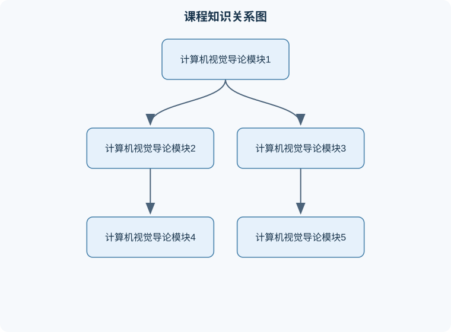

# 计算机视觉导论

## 一、课程整体知识框架

### 课程边界与先修知识

《计算机视觉导论》研究如何从图像、视频和多视角观测中恢复几何结构、运动、外观与语义信息，覆盖图像形成与处理、特征与匹配、模型拟合、运动估计、三维重建、深度学习、识别和计算摄影。课程边界包括从二维像素到三维场景和高层语义的主要方法，但不深入专用医学影像、遥感成像、机器人控制或大规模视觉语言模型。先修知识包括高等数学中的向量与矩阵、概率统计、微积分和基础优化，程序设计与数据结构，基本数字图像处理，以及能够使用 Python、NumPy 和深度学习框架完成实验。需要明确区分理想针孔相机模型与真实镜头、传感器、噪声、遮挡和标定误差造成的现实限制。





### 1. 课程对象与问题边界

计算机视觉研究如何使计算机从图像、视频或三维传感器数据中恢复可计算的信息。输入可以是单张图像、多视角图像、视频帧、深度图或点云；输出可以是类别、位置、边界、像素级区域、深度、三维模型、物体姿态或动作轨迹。视觉系统通常包含四个层次：**成像与表示、低层处理、中层结构理解、高层任务决策**。

图像不是现实世界的直接复制，而是三维场景经过光照、材质、镜头、传感器采样和压缩形成的二维观测。同一个物体在不同视角、尺度、光照下可能产生差异很大的图像；不同物体也可能因为遮挡、纹理相似或视角特殊而产生相似外观。因此，视觉问题通常是欠定的：仅凭一幅图像，往往不能唯一确定真实的三维形状、材质和空间位置。算法输出必须结合成像模型、先验知识、训练数据和不确定性进行解释。

### 2. 第一模块：图像表示、成像模型与坐标系

数字图像可表示为函数 $I(u,v,c)$，其中 $(u,v)$ 是像素坐标，$c$ 是颜色通道；灰度图像只有一个强度值，彩色图像常用红、绿、蓝三个通道。若图像宽度为 $W$、高度为 $H$，则像素数组通常形状为 $H\times W\times C$。像素值的单位取决于存储方式：8位图像常用 $0$ 到 $255$ 的整数，归一化后则常用 $[0,1]$ 的浮点数。两种表示不能混用，否则会导致阈值、均值和损失函数的数量级错误。

针孔相机模型描述三维点如何投影到图像平面。设相机坐标系中的点为

$$
\mathbf{X}_c=(X_c,Y_c,Z_c)^\mathsf{T},
$$

其中长度单位可以是米或毫米，但同一计算过程必须保持一致，且 $Z_c>0$ 表示点位于相机前方。理想投影为

$$
u=f_x\frac{X_c}{Z_c}+c_x,\qquad
v=f_y\frac{Y_c}{Z_c}+c_y,
$$

其中 $f_x,f_y$ 是以像素为单位的水平、垂直焦距，$(c_x,c_y)$ 是主点像素坐标。焦距的物理单位并不直接代入该式；若使用毫米焦距，必须结合像元尺寸转换为像素焦距。

世界坐标到相机坐标的变换为

$$
\mathbf{X}_c=\mathbf{R}\mathbf{X}_w+\mathbf{t},
$$

其中 $\mathbf{R}\in SO(3)$ 是旋转矩阵，满足 $\mathbf{R}^{\mathsf T}\mathbf{R}=\mathbf{I}$ 且 $\det(\mathbf{R})=1$，$\mathbf{t}$ 是平移向量，单位与 $\mathbf{X}_w$ 相同。外参方向必须明确：上述公式表示“世界到相机”；若已知“相机到世界”变换，则需要使用逆变换 $\mathbf{X}_w=\mathbf{R}^{\mathsf T}(\mathbf{X}_c-\mathbf{t})$。边界反例是把相机中心坐标直接当作平移向量；相机中心为 $\mathbf{C}_w=-\mathbf{R}^{\mathsf T}\mathbf{t}$，二者一般不相等。

### 3. 第二模块：图像预处理与低层视觉

低层视觉处理的目标是降低噪声、增强结构和提取局部变化。线性滤波可写为

$$
J(u,v)=\sum_{i,j}K(i,j)I(u-i,v-j),
$$

其中 $K$ 是卷积核，$I$ 是输入图像，$J$ 是输出图像。若 $K$ 的元素和为 $1$，常用于平滑并近似保持平均亮度；若核元素和为 $0$，则更可能强调边缘。边界像素没有完整邻域，必须指定零填充、复制边界、镜像边界或裁剪策略，不同策略会改变图像边缘结果。

高斯滤波使用近似高斯核抑制高频噪声。尺度参数为 $\sigma$，$\sigma$ 越大，平滑范围越宽，但细小结构也越容易消失。边缘检测通常包括平滑、梯度计算、非极大值抑制和阈值连接。二维梯度可表示为

$$
\nabla I=(I_x,I_y)^\mathsf{T},\qquad
\|\nabla I\|_2=\sqrt{I_x^2+I_y^2}.
$$

梯度方向表示强度变化最快的方向，不等同于边缘延伸方向；边缘延伸方向与梯度方向近似垂直。使用固定阈值时，曝光变化会导致同一物体边缘数量明显变化，因此实际系统常需要归一化、局部阈值或多尺度处理。

### 4. 第三模块：特征、匹配与几何估计

局部特征包括关键点位置、尺度、方向及描述子。好的特征应具有重复性，即同一物理点在视角、尺度和光照改变后仍能被检测；还应具有区分性，以减少不同位置之间的错误匹配。匹配常通过描述子距离进行初筛，再用比值检验、互相一致性或几何约束剔除异常点。

两幅图像之间的对应点若来自同一平面或纯旋转相机运动，可由单应矩阵 $\mathbf{H}$ 联系：

$$
\lambda
\begin{bmatrix}u'\\v'\\1\end{bmatrix}
=
\mathbf{H}
\begin{bmatrix}u\\v\\1\end{bmatrix},
$$

其中 $\lambda$ 是非零尺度因子。若场景为一般三维结构且相机发生平移，则对应关系更适合由基础矩阵或本质矩阵描述。基础矩阵满足

$$
\mathbf{x}'^{\mathsf T}\mathbf{F}\mathbf{x}=0,
$$

其中 $\mathbf{x}=[u,v,1]^\mathsf T$ 和 $\mathbf{x}'$ 是齐次像素坐标。归一化像平面坐标后使用本质矩阵 $\mathbf{E}$，其关系为 $\mathbf{x}'_n{}^\mathsf T\mathbf{E}\mathbf{x}_n=0$。该约束只表达极线几何，不能单独确定绝对尺度；若场景整体按比例放大，投影可能保持不变。

随机采样一致性方法用于从含外点的匹配中估计模型。每次随机抽取满足最小样本数的点，计算候选模型，再统计误差小于阈值的内点数。其结果依赖采样次数、误差阈值和内点比例；外点比例很高或点分布退化时，随机模型可能错误。共面点估计三维运动时容易退化，纯旋转时也不能从普通双目几何恢复平移尺度。

### 5. 第四模块：目标检测、分割与识别

图像分类输出整幅图像的类别；目标检测输出每个实例的类别和边界框；语义分割为每个像素分配类别，但不区分同类实例；实例分割则进一步区分同类不同物体。边界框通常用 $(x_{\min},y_{\min},x_{\max},y_{\max})$ 表示，坐标必须说明是像素、归一化比例还是中心宽高格式。

两个框的交并比为

$$
\operatorname{IoU}(A,B)=\frac{|A\cap B|}{|A\cup B|}.
$$

若两个框无重叠，IoU 为 $0$；若完全相同，IoU 为 $1$。检测评价还需要置信度排序、匹配规则和类别条件，不能仅用一个框的面积或中心距离替代 IoU。非极大值抑制按置信度从高到低保留候选框，删除与当前保留框 IoU 超过阈值的其他框。阈值过低可能删除相邻目标，过高则会保留重复框。

分割任务常用交并比、像素准确率和平均交并比。类别不平衡时，像素准确率可能被大面积背景主导；例如背景占 $99\%$ 时，全部预测为背景也能得到很高准确率，却完全没有完成前景分割。因此必须同时观察前景召回率、精确率、每类 IoU 和混淆矩阵。

### 6. 第五模块：深度学习视觉模型

卷积神经网络通过局部连接、权重共享和层级特征提取处理图像。卷积层输出可表示为

$$
Y_{o}(u,v)=b_o+\sum_{i}\sum_{j}\sum_{c}
K_{o,c}(i,j)X_c(u-i,v-j),
$$

其中 $X_c$ 是输入第 $c$ 个通道，$K_{o,c}$ 是产生第 $o$ 个输出通道的卷积核，$b_o$ 是偏置。步幅决定输出采样间隔，填充决定边界尺寸；步幅增大通常降低空间分辨率而扩大有效感受野，但也可能丢失小目标。

分类交叉熵以真实类别 $y$ 和预测概率 $p_k$ 为基础：

$$
\mathcal{L}=-\log p_y.
$$

这里 $p_y\in(0,1]$，损失无量纲；预测真实类别概率越小，损失越大。训练损失下降不代表泛化能力必然提高，因为模型可能过拟合训练集。训练集、验证集和测试集必须在用途上分离；若根据测试集反复调参，测试结果将不再是独立泛化评价。

单张图像超分辨率试图从低分辨率图像恢复高分辨率图像。设退化过程为

$$
I_{\mathrm{LR}}=D(I_{\mathrm{HR}})+\varepsilon,
$$

其中 $D$ 表示下采样、模糊或压缩等退化，$\varepsilon$ 是噪声。由于不同高分辨率图像可能产生相同低分辨率观测，问题并无唯一解。像素级均方误差倾向于产生平均化结果；感知损失或生成模型可以生成视觉上锐利的纹理，但锐利纹理不必然是真实细节，评价时需区分像素保真度和感知质量。

### 7. 第六模块：三维重建与多视角几何

多视角立体重建利用不同视角对同一点的观测恢复深度。对已校准的平行双目模型，焦距为 $f$（像素），基线为 $B$（米），像素视差为 $d$（像素）时，深度为

$$
Z=\frac{fB}{d}.
$$

推导过程是：相似三角形给出左、右投影横坐标差与深度成反比，即 $d/f=B/Z$；整理得到上式。该公式要求相机内参已知、图像已校正、对应点位于同一水平极线上且 $d\ne0$。当 $d$ 接近零时，深度对匹配误差极其敏感；当基线或焦距未知时，不能直接得到有尺度的深度。

多视角重建通常包含相机位姿估计、特征匹配、三角化、稠密深度估计、点云融合和网格化。三角化的输入是至少两个已知投影矩阵和对应像素，输出是使重投影误差尽可能小的三维点。重投影误差可写为

$$
e=\left\|\mathbf{x}-\pi(\mathbf{R}\mathbf{X}+\mathbf{t})\right\|_2,
$$

其中 $\pi$ 是透视投影函数，$\mathbf{x}$ 是观测像素。低重投影误差不保证完整重建：无纹理、镜面反射、遮挡和视角覆盖不足都会造成空洞或错误表面。

网格评价常使用倒角距离。设预测点集为 $P$，真实点集为 $Q$，一种对称形式为

$$
d_{\mathrm{Chamfer}}(P,Q)=
\frac{1}{|P|}\sum_{p\in P}\min_{q\in Q}\|p-q\|_2^2+
\frac{1}{|Q|}\sum_{q\in Q}\min_{p\in P}\|q-p\|_2^2.
$$

它同时惩罚预测点偏离真实表面和真实表面未被覆盖，但对少量离群点、拓扑错误和法向方向不一定敏感；因此不能只看该指标判断网格视觉质量。

### 8. 第七模块：物体六自由度姿态估计

六自由度姿态由三维旋转和三维平移组成。设物体坐标系中的点为 $\mathbf{X}_o$，相机坐标系中的点为 $\mathbf{X}_c$，姿态变换为

$$
\mathbf{X}_c=\mathbf{R}_{co}\mathbf{X}_o+\mathbf{t}_{co}.
$$

旋转可用旋转矩阵、欧拉角、轴角或四元数表示。四元数通常写为 $q=(q_w,q_x,q_y,q_z)$，表示旋转时必须归一化，即 $\|q\|_2=1$；$q$ 与 $-q$ 表示同一个旋转。姿态文件中若约定顺序为 $q_w,q_x,q_y,q_z,t_x,t_y,t_z$，交换分量顺序会产生完全不同的姿态。

已知三维模型点与图像二维对应点时，可通过透视-$n$-点问题估计姿态。其目标是最小化所有点的重投影误差：

$$
\min_{\mathbf{R},\mathbf{t}}
\sum_i
\left\|\mathbf{x}_i-\pi(\mathbf{R}\mathbf{X}_i+\mathbf{t})\right\|_2^2.
$$

旋转必须满足正交约束，平移单位应与三维模型一致。姿态评价可分别计算旋转角误差和平移误差，例如旋转误差为预测旋转与真实旋转相对变换的角度，平移误差为 $\|\hat{\mathbf{t}}-\mathbf{t}\|_2$。若验收要求角度和距离同时低于给定阈值，不能用二者平均值替代双重判定。

### 9. 第八模块：系统评测、部署与应用

完整视觉系统包括数据读取、标定转换、预处理、模型推理、后处理、坐标变换、结果保存和评价。工程上最常见的错误不是模型公式本身，而是图像通道顺序、尺寸缩放、坐标原点、单位、外参方向和文件格式不一致。

系统评价必须区分任务目标。检测关注定位和分类，分割关注像素区域，重建关注几何距离、覆盖率和尺度一致性，姿态估计关注旋转与平移误差，超分辨率同时涉及像素指标和感知质量。模型输出达到数值指标不代表可部署：还需考虑推理时间、显存、功耗、异常输入、隐私和安全边界。

相关岗位包括视觉算法工程师、三维视觉工程师、数据分析与标注工程师、机器学习研发工程师、视觉应用开发工程师和算法测试工程师。实际任务可能是构建检测数据集、训练模型、处理相机标定、重建工件表面、估计机器人抓取姿态或分析模型误差。交付物通常包括可复现实验代码、模型权重、配置文件、推理接口、评价报告和异常案例；验收应同时检查精度、坐标与格式正确性、运行稳定性和资源消耗。

## 二、章节和模块划分

### 核心知识覆盖清单

本清单根据本课程的章节划分整理，用于检查正文是否覆盖各个核心模块：

- **1. 代表性算法与流程**。
- **2. 完整伪代码：由双视图匹配生成三维点**。
- **3. 典型例题**。
- **4. 实验与项目流程**。
- **5. 具体易错点**。
- **6. 典型笔试问题与解答思路**。
- **7. 典型面试问题、参考答案与追问要点**。
- **8. 岗位任务与产出验收**。


### 1. 代表性算法与流程

#### 1.1 图像到三维点的三角化流程

**输入**：两幅或多幅已标定图像、每幅图像的内参和外参、同一物理点的二维匹配。  
**输出**：相机坐标系或世界坐标系中的三维点及重投影误差。

过程如下：

1. 将像素坐标通过内参逆变换为归一化成像坐标。
2. 根据内外参构造投影矩阵 $\mathbf{P}_i=\mathbf{K}_i[\mathbf{R}_i\mid\mathbf{t}_i]$。
3. 对每个对应点建立线性方程，求得齐次三维点。
4. 将齐次坐标除以最后一个分量，得到欧氏坐标。
5. 检查点在所有相机前方，并计算每幅图像的重投影误差。
6. 删除误差过大、深度为负或明显离群的点。

不变量是投影矩阵和坐标系定义在整个流程中保持一致；终止条件是所有匹配点处理完毕。适用条件是对应关系较可靠、相机参数已知且视角具有足够基线。点接近极线退化状态或视差很小时，线性解会对噪声敏感。对 $N$ 个匹配点，若每个点的矩阵求解规模固定，基础计算量为 $O(N)$，但匹配搜索和全局优化可能远高于该复杂度。

#### 1.2 随机采样一致性估计几何模型

**输入**：带有外点的点对应集合、最小样本数 $s$、误差阈值 $\tau$ 和采样次数。  
**输出**：最优模型参数及内点集合。

每轮随机抽取 $s$ 个样本，拟合模型；计算每个数据点到模型的几何误差；将误差不超过 $\tau$ 的点记为内点；保留内点数最多或总误差最小的模型；最后使用全部内点重新拟合。阈值 $\tau$ 必须与像素噪声和图像分辨率相匹配，不能机械使用同一数值。若内点比例为 $w$，一次抽到全内点样本的概率约为 $w^s$，因此外点多时需要更多迭代。若样本存在共线、共面或重复点，模型可能退化。

#### 1.3 六自由度姿态估计流程

**输入**：物体三维模型、相机内参、图像中的二维特征或目标区域。  
**输出**：旋转 $\mathbf{R}$ 或四元数 $q$，以及平移 $\mathbf{t}$。

流程为：先检测或分割物体；提取图像特征并与模型特征匹配；用几何约束剔除外点；用初始姿态求解器得到候选姿态；通过重投影误差优化旋转和平移；检查正深度、物体是否落在图像合理区域及姿态是否满足物理约束。若背景特征很多，应先限制到物体区域，否则错误匹配会使优化收敛到背景结构。对无纹理、对称物体，应使用轮廓、深度或对称性等额外信息；视觉上相同的对称姿态可能不应被错误地判为不同姿态。

#### 1.4 单图像超分辨率训练与评价流程

**输入**：低分辨率图像及对应高分辨率图像，或由高分辨率图像生成的退化样本。  
**输出**：超分辨率模型和放大图像。

训练时先统一颜色空间、裁剪尺寸和归一化方式，再将图像送入网络。损失可由像素重建项和感知项组成；验证时固定模型参数，分别计算 PSNR、结构相似性或感知质量。若训练数据的退化方式与真实摄像机不一致，模型在实验数据上可能很好，在真实图像上却产生伪纹理。评价时必须同时保存原图、输出图和差异图，检查边缘振铃、纹理幻觉和颜色偏移，而不能只看单一分数。

### 2. 完整伪代码：由双视图匹配生成三维点

```python
# Python-like pseudocode
# Input:
#   matches: [(u1, v1, u2, v2), ...] in pixel units
#   K1, K2: 3x3 intrinsic matrices
#   R1, t1, R2, t2: world-to-camera extrinsics
# Output:
#   valid_points: 3D points in world coordinates

def reconstruct_points(matches, K1, K2, R1, t1, R2, t2,
                       reproj_threshold):
    P1 = K1 @ concatenate(R1, t1)  # 3x4
    P2 = K2 @ concatenate(R2, t2)  # 3x4
    valid_points = []

    for u1, v1, u2, v2 in matches:
        A = stack([
            u1 * P1[2, :] - P1[0, :],
            v1 * P1[2, :] - P1[1, :],
            u2 * P2[2, :] - P2[0, :],
            v2 * P2[2, :] - P2[1, :]
        ])

        _, _, Vt = svd(A)
        X_h = Vt[-1, :]                 # homogeneous 3D point
        if abs(X_h[3]) < 1e-12:
            continue
        X_w = X_h[:3] / X_h[3]

        X_c1 = R1 @ X_w + t1
        X_c2 = R2 @ X_w + t2
        if X_c1[2] <= 0 or X_c2[2] <= 0:
            continue

        p1 = project(K1, X_c1)
        p2 = project(K2, X_c2)
        error = norm(p1 - [u1, v1]) + norm(p2 - [u2, v2])

        if error <= reproj_threshold:
            valid_points.append(X_w)

    return valid_points
```

该流程的关键不变量是齐次坐标归一化前不丢失尺度信息、每个三维点必须通过两个相机的正深度检查、重投影坐标与输入像素使用同一单位。代码假设 `project` 已实现透视除法，且 `concatenate(R,t)` 的外参方向确实是世界到相机。若将相机到世界外参直接代入，点云可能整体翻转、平移错误或全部落在相机后方。

### 3. 典型例题

#### 例题一：透视投影计算

**题干**：相机内参为 $f_x=f_y=800$ 像素，主点为 $(320,240)$。相机坐标系中点为 $(0.1,0.05,2)$ 米，求像素坐标。

**分析**：点在相机前方，满足 $Z_c>0$，可直接使用针孔投影。

**解答**：

$$
u=800\cdot\frac{0.1}{2}+320=360,
\qquad
v=800\cdot\frac{0.05}{2}+240=260.
$$

**结果验证**：点的横向偏移为 $0.05$ 个成像深度，乘以 $800$ 得 $40$ 像素；纵向偏移为 $20$ 像素，因此结果为 $(360,260)$。  
**变式**：若 $Z_c=-2$ 米，公式仍可代数计算，但点在相机后方，不能作为有效成像点；若焦距单位误写为毫米，结果的像素坐标将没有物理意义。

#### 例题二：双目深度

**题干**：双目焦距为 $600$ 像素，基线为 $0.12$ 米，某点视差为 $24$ 像素，求深度。

**分析**：假设图像已经校正，左右匹配点位于同一极线，使用 $Z=fB/d$。

**解答**：

$$
Z=\frac{600\times0.12}{24}=3\ \text{米}.
$$

**结果验证**：视差越大，深度越近；若视差变为 $12$ 像素，深度变为 $6$ 米，符合反比关系。  
**变式**：若视差误差为 $1$ 像素，深度分别约为 $3.13$ 米或 $2.88$ 米，说明远处点对匹配误差更敏感。若未校正图像，不能直接套用水平视差公式。

#### 例题三：交并比与检测判断

**题干**：预测框为 $(10,10,50,50)$，真实框为 $(30,30,70,70)$，求 IoU。

**分析**：预测框和真实框均为闭区间近似的连续面积表示。交集宽、高均为 $20$，面积为 $400$；各框面积均为 $1600$。

**解答**：

$$
\operatorname{IoU}=\frac{400}{1600+1600-400}
=\frac{400}{2800}\approx0.143.
$$

**结果验证**：交集明显小于并集，IoU 应接近零而不是接近一。  
**变式**：若两框完全重合，IoU 为 $1$；若边界仅接触，连续面积模型下交集为零。计算时若把并集误写成两个面积相加，会得到错误结果。

#### 例题四：姿态坐标变换

**题干**：物体点为 $\mathbf{X}_o=(1,0,0)^\mathsf T$ 米，旋转为单位矩阵，平移为 $\mathbf{t}=(0,0,2)^\mathsf T$ 米，求相机坐标中的点。

**分析**：根据 $\mathbf{X}_c=\mathbf{R}\mathbf{X}_o+\mathbf{t}$，单位旋转不改变点坐标。

**解答**：

$$
\mathbf{X}_c=(1,0,2)^\mathsf T\ \text{米}.
$$

**结果验证**：深度为 $2$ 米，点位于相机前方；若把平移误认为相机中心，可能得到相反方向的结果。  
**变式**：若给定的是相机到物体变换，必须先求逆；旋转矩阵的逆为转置，平移不能简单取负，而应计算 $\mathbf{t}^{-1}=-\mathbf{R}^{\mathsf T}\mathbf{t}$。

#### 例题五：重建误差解释

**题干**：预测点集 $P=\{(0,0),(1,0)\}$，真实点集 $Q=\{(0,0),(2,0)\}$，使用平方欧氏距离的对称倒角距离，求结果。

**分析**：先计算每个预测点到真实点集的最近距离，再计算每个真实点到预测点集的最近距离。

**解答**：  
预测点 $(0,0)$ 到 $Q$ 的最近距离平方为 $0$；预测点 $(1,0)$ 到 $Q$ 的最近距离平方为 $1$，第一项平均为 $(0+1)/2=0.5$。真实点 $(0,0)$ 到 $P$ 的最近距离平方为 $0$；真实点 $(2,0)$ 到 $P$ 的最近距离平方为 $1$，第二项平均为 $0.5$。因此

$$
d_{\mathrm{Chamfer}}=0.5+0.5=1.
$$

**结果验证**：若预测点集改为 $\{(0,0),(2,0)\}$，距离为 $0$。  
**变式**：增加一个远离表面的离群点会提高第一项，但如果真实点覆盖充分，倒角距离未必像最大 Hausdorff 距离那样敏感。

### 4. 实验与项目流程

#### 实验一：双视图三维重建

**步骤**：

1. 准备同一物体的多视角图像，记录图像尺寸、内参、外参和坐标系方向。
2. 检查图像是否存在通道交换、缩放或裁剪；若裁剪，必须同步修改主点。
3. 提取局部特征并进行描述子匹配。
4. 使用比值检验和几何一致性剔除外点。
5. 三角化得到点云，进行正深度和重投影误差检查。
6. 将多视角点云融合，必要时进行表面重建并保存网格。
7. 以点到网格或网格到点的距离评价几何质量，并单独查看遮挡区域和薄结构。

**输入数据**：多视角图像、内参矩阵、世界到相机外参、匹配点或特征描述子。  
**评价标准**：重投影误差、有效点比例、点云覆盖率、倒角距离、尺度和坐标系是否正确。  
**排错方法**：若点云整体翻转，检查外参方向和齐次坐标符号；若点云比例错误，检查米与毫米、归一化坐标与像素坐标；若点云呈多个分离簇，检查相机位姿是否属于同一世界坐标系；若只有少量点，检查纹理、曝光、匹配阈值和遮挡。

#### 实验二：物体六自由度姿态估计

**步骤**：

1. 为物体建立坐标原点、轴方向和尺度明确的三维模型。
2. 用训练视图进行检测、分割或特征匹配，建立二维—三维对应关系。
3. 使用相机内参求解初始姿态。
4. 通过重投影误差优化并过滤外点。
5. 在测试图像上输出统一格式的四元数和三维平移。
6. 分别统计旋转误差、平移误差和同时满足阈值的准确率。
7. 对失败样本按遮挡、反光、对称、背景干扰和尺度错误分类。

**输入数据**：物体三维模型、训练图像及姿态标注、测试图像、相机内参。  
**评价标准**：旋转误差、平移误差、阈值内准确率、推理时间、输出文件可解析性。  
**排错方法**：若所有预测平移偏大，检查模型单位；若旋转角普遍接近固定偏差，检查物体坐标轴定义；若四元数范数不为一，检查归一化；若只有对称物体失败，加入对称等价姿态判断；若训练图像成功而测试图像失败，检查背景、视角覆盖和域差异。

### 5. 具体易错点

1. 把像素坐标、归一化坐标和齐次坐标混为一谈。  
2. 把世界到相机外参与相机到世界外参直接互换。  
3. 忽略相机坐标中 $Z_c>0$ 的正深度条件。  
4. 用毫米模型和米制平移直接相加。  
5. 把焦距的物理长度直接当作像素焦距。  
6. 图像缩放后不按比例修改内参主点和焦距。  
7. 将梯度方向误认为边缘方向。  
8. 使用固定阈值却不考虑曝光和噪声变化。  
9. 将分类、检测、语义分割和实例分割混为同一任务。  
10. 用像素准确率评价严重类别不平衡的分割结果。  
11. 认为重投影误差小就必然得到完整三维模型。  
12. 认为四元数的四个分量可以任意交换。  
13. 忘记四元数归一化或错误处理 $q$ 与 $-q$ 的等价性。  
14. 将姿态的旋转误差和平移误差简单相加。  
15. 只看 PSNR，不检查超分辨率产生的伪纹理。  
16. 只看倒角距离，不检查离群点、法向和拓扑结构。  
17. 在测试集上反复调参后仍把结果当作独立泛化性能。  
18. 文件格式、图像名称或小数精度不符合评价程序要求。

### 6. 典型笔试问题与解答思路

#### 问题一：为什么远处深度估计更不稳定？

由 $Z=fB/d$ 得

$$
\left|\frac{\partial Z}{\partial d}\right|=\frac{fB}{d^2}.
$$

视差 $d$ 越小，单位视差误差造成的深度误差越大。因此远处目标需要更高匹配精度、更大基线或更高分辨率。

#### 问题二：单幅图像为什么不能唯一恢复三维形状？

透视投影丢失深度，多个不同深度和尺度组合可以产生相同像素位置。没有额外视角、深度传感器、形状先验或纹理约束时，逆问题存在多解。

#### 问题三：单应矩阵和基础矩阵何时使用？

单应矩阵适合平面场景或纯旋转造成的图像变换；一般三维场景的两视图对应使用基础矩阵约束。若误把非平面场景当作单应变换，图像不同区域会出现系统性残差。

#### 问题四：为什么需要非极大值抑制？

检测器可能对同一目标产生多个重叠框。非极大值抑制按置信度保留代表框并删除高重叠候选，但相邻目标过近时可能误删，因此阈值需要结合目标密度调整。

#### 问题五：训练损失下降而验证损失上升说明什么？

通常说明模型开始记忆训练数据而非学习可泛化规律，即过拟合。应检查数据划分、增强、模型容量和正则化，但不能仅凭一次曲线排除数据泄漏或标签噪声。

#### 问题六：为什么重建需要多视角覆盖？

单一视角存在遮挡和不可见表面；增加视角可以提供新的观察射线并约束深度。但视角过于相近时基线不足，过于分散时匹配困难，因此应兼顾覆盖、重叠和视差。

#### 问题七：四元数为什么要归一化？

单位四元数才能表示纯旋转。非单位四元数会使对应旋转矩阵不满足正交性，进而造成缩放、剪切或数值漂移。归一化时应检查范数是否接近零，接近零的输入不能直接修正。

#### 问题八：为什么评价指标必须与任务目标匹配？

检测框位置、像素区域、三维表面和姿态误差分别对应不同输出空间。单一指标无法覆盖所有失败模式，例如准确率高可能掩盖前景漏检，倒角距离低可能掩盖法向反转。因此应使用主指标、辅助指标和可视化诊断共同评价。

### 7. 典型面试问题、参考答案与追问要点

#### 面试问题一：如何设计一个工业零件检测系统？

**参考答案**：先明确缺陷类别、尺寸范围、误报和漏报代价；采集覆盖光照、姿态和背景变化的数据；划分训练、验证和独立测试集；选择检测或分割模型；以类别级召回率、精确率、定位误差和单张推理时间验收；最后加入置信度校准和异常样本记录。  
**深入追问要点**：若缺陷极少，应讨论类别不平衡和异常检测；若需要尺寸测量，应增加相机标定、尺度基准和几何误差验证，不能只依赖检测框。

#### 面试问题二：如何排查三维点云整体位置错误？

**参考答案**：依次检查坐标单位、外参方向、旋转矩阵正交性、平移定义、齐次坐标归一化和点的正深度；用一个已知三维点手工投影验证端到端变换。  
**深入追问要点**：若形状正确但位置错，优先检查刚体变换；若形状比例也错，优先检查单位和内参；若局部扭曲，检查匹配和相机模型。

#### 面试问题三：如何处理无纹理物体的姿态估计？

**参考答案**：利用轮廓、边缘、深度、几何关键点、渲染模板或多视角特征；通过物体分割减少背景干扰，并使用姿态优化使轮廓或深度一致。  
**深入追问要点**：对称物体需要定义姿态等价类；纯轮廓可能存在多个解，应结合深度、遮挡关系或时间连续性。

#### 面试问题四：如何判断模型是否过拟合？

**参考答案**：比较训练、验证和独立测试表现，分析不同场景、类别和光照条件下的误差；检查训练样本与验证样本是否存在近重复；观察模型对轻微扰动的稳定性。  
**深入追问要点**：验证集表现好但上线差，可能是域偏移而非传统过拟合，应检查采集设备、背景、分辨率和标签定义差异。

#### 面试问题五：如何评价一个超分辨率模型？

**参考答案**：在有真实高分辨率参考时计算 PSNR、结构相似性等像素或结构指标，并进行主观和任务级评价；在无参考场景下检查伪纹理、边缘振铃和下游检测性能。  
**深入追问要点**：生成锐利纹理不等于恢复真实信息；若用于计量或医学图像，必须优先保证事实保真而不是视觉锐化。

#### 面试问题六：如何提高多视角重建质量？

**参考答案**：先提高相机标定和位姿质量，再改善视角覆盖、曝光一致性和匹配鲁棒性；对无纹理区域使用深度或学习型多视角方法；融合点云后进行离群点清理和表面重建。  
**深入追问要点**：学习方法依赖训练域；镜面、透明和动态物体违反静态表面假设，不能只增加网络规模解决。

#### 面试问题七：如何设计视觉算法的线上监控？

**参考答案**：监控输入分辨率、亮度、清晰度、目标数量、置信度分布、推理耗时和失败率；抽样保存匿名化困难案例；以人工复核或延迟标签估计真实精度变化。  
**深入追问要点**：监控系统本身要处理隐私、存储和告警阈值；置信度下降不一定等于准确率下降，需要结合标注样本验证。

#### 面试问题八：算法离线指标很好但部署效果差，如何处理？

**参考答案**：逐项核对预处理、颜色通道、归一化、图像缩放、模型版本、后处理阈值和硬件精度；用同一批样本比较离线脚本与部署输出；再分析真实数据的域差异。  
**深入追问要点**：浮点与低精度推理可能造成数值变化；文件读取顺序、线程并发和内存复用也可能产生非模型错误。

### 8. 岗位任务与产出验收

#### 8.1 视觉算法研发岗位

实际任务包括训练检测、分割、识别或姿态模型，设计数据增强，分析失败样本并迭代模型。使用的知识包括图像表示、卷积网络、损失函数、评价指标和误差分析。产出包括训练脚本、模型权重、推理接口、实验记录和指标报告。验收应检查独立测试集精度、类别分项指标、推理时间、异常输入处理和结果可复现性。

#### 8.2 三维视觉与机器人岗位

实际任务包括相机标定、点云处理、物体重建、六自由度姿态估计和坐标变换。使用的知识包括针孔模型、刚体变换、三角化、PnP、重投影误差和姿态表示。产出包括标定参数、三维模型、姿态文件、可视化工具和现场演示流程。验收应检查尺度、坐标系、旋转方向、平移误差、抓取或定位成功率，以及不同光照和遮挡条件下的稳定性。

#### 8.3 数据与模型测试岗位

实际任务包括构造数据集、制定标注规范、生成混淆矩阵、定位回归问题和维护评价流水线。使用的知识包括采样偏差、数据划分、IoU、精确率、召回率、误差分布和统计检验。产出包括数据质量报告、测试用例、自动评测脚本和问题单。验收应检查标签一致性、测试覆盖率、指标计算正确性、版本可追溯性和失败案例是否能够稳定复现。

#### 8.4 视觉应用与业务分析岗位

实际任务包括把模型输出转化为计数、告警、质量判定、搜索或辅助决策。使用的知识包括任务定义、阈值选择、成本敏感评价、结果解释和系统边界。产出包括业务流程、接口协议、报表、告警规则和验收方案。验收不能只看模型分数，还要检查业务误报成本、漏报后果、响应时间、人工复核流程和数据安全要求。

## 三、核心概念的详细解释

### 1. 计算机视觉问题的统一表示

计算机视觉的基本任务，是从图像、视频、深度图或点云等观测数据中推断场景的结构、属性和状态。一个视觉系统可以抽象为

$$
\text{观测数据}\longrightarrow \text{特征或表示}\longrightarrow \text{任务输出}\longrightarrow \text{评价与决策}.
$$

观测数据是经过成像、采样和编码后的结果，不等于现实场景本身。光照变化、镜面反射、遮挡、运动模糊、传感器噪声和压缩都会造成信息损失。因此，视觉推断通常不是简单的像素匹配，而是利用几何约束、统计规律和任务先验求解不适定问题。

常见输出可分为四类。第一类是分类，即判断整幅图像属于哪个类别；第二类是检测，即同时给出类别和目标位置，通常用边界框表示；第三类是分割，即为每个像素分配类别或实例编号；第四类是几何恢复，包括深度估计、三维重建、相机姿态估计和物体六自由度位姿估计。六自由度位姿包含三个平移参数和三个旋转参数，通常写成旋转矩阵、旋转向量、欧拉角或单位四元数加平移向量。

视觉任务还可以按推理层次划分为低层、中层和高层。低层任务处理亮度、颜色、边缘和纹理；中层任务提取关键点、轮廓、区域和几何关系；高层任务完成识别、定位、跟踪和行为理解。层次之间并非严格串联。例如，现代检测网络可能直接从像素学习类别和位置，但其内部仍隐含了边缘、纹理和局部结构表示。

### 2. 图像表示、颜色空间与采样

灰度图像可以表示为二维函数 $I(u,v)$，彩色图像表示为 $I(u,v,c)$。其中 $u$ 是水平方向像素坐标，$v$ 是垂直方向像素坐标，$c$ 是颜色通道索引。若图像宽度为 $W$、高度为 $H$、通道数为 $C$，则数组形状通常为 $H\times W\times C$。8位图像的整数像素范围是 $[0,255]$；转换为浮点表示时，常使用

$$
I_{\text{norm}}=\frac{I_{\text{uint8}}}{255},
$$

此时数值范围为 $[0,1]$。若在未归一化时误用只适用于 $[0,1]$ 的阈值或均值，会导致结果完全失真。

RGB通道适合存储和显示，但不一定适合所有分析任务。HSV将颜色分解为色调、饱和度和明度，便于依据颜色范围进行粗分割；灰度表示适合边缘、纹理和形状分析；不同颜色空间并不存在对所有任务都最优的选择。色彩转换还会受到白平衡、伽马校正和设备色彩响应的影响，因此颜色阈值不能脱离成像设备和光照条件直接迁移。

数字图像是连续场景经过空间采样和强度量化得到的。若采样频率不足，可能产生混叠，即高频纹理被错误表示为低频结构。缩小图像前通常需要低通滤波，以减少超过新采样频率一半的空间频率。实际图像还存在插值问题：最近邻插值速度快但边缘呈阶梯状，双线性插值较平滑，双三次插值通常更清晰但计算量更高。插值会产生估计值，并不会恢复采样时已经丢失的信息。

### 3. 成像模型、坐标系与投影几何

针孔相机模型中，世界坐标点 $\mathbf X_w$ 先经外参变换进入相机坐标系：

$$
\mathbf X_c=\mathbf R\mathbf X_w+\mathbf t,
$$

其中 $\mathbf R$ 是旋转矩阵，$\mathbf t$ 是平移向量。若三维点为 $\mathbf X_c=(X_c,Y_c,Z_c)^\mathsf T$，要求 $Z_c>0$，则理想透视投影为

$$
u=f_x\frac{X_c}{Z_c}+c_x,\qquad
v=f_y\frac{Y_c}{Z_c}+c_y.
$$

$f_x,f_y$ 的单位是像素，$(c_x,c_y)$ 是主点坐标，$(u,v)$ 也是像素坐标。三维坐标可以使用米或毫米，但平移、点坐标和模型尺寸必须使用相同单位。投影结果只在点位于相机前方且不超出图像边界时具有可见意义。

齐次坐标可将投影写成

$$
s
\begin{bmatrix}
u\\v\\1
\end{bmatrix}
=
\mathbf K
\begin{bmatrix}
\mathbf R&\mathbf t
\end{bmatrix}
\begin{bmatrix}
\mathbf X_w\\1
\end{bmatrix},
$$

其中 $s=Z_c$ 为非零尺度因子，内参矩阵为

$$
\mathbf K=
\begin{bmatrix}
f_x&\gamma&c_x\\
0&f_y&c_y\\
0&0&1
\end{bmatrix}.
$$

$\gamma$ 是像素轴非正交时的斜切参数，许多普通相机中可近似取零。矩阵形式便于进行多视角几何计算，但不能省略深度正性和坐标方向检查。

外参方向是常见错误来源。若

$$
\mathbf X_c=\mathbf R\mathbf X_w+\mathbf t,
$$

则相机中心在世界坐标系中为

$$
\mathbf C_w=-\mathbf R^\mathsf T\mathbf t.
$$

不能把 $\mathbf t$ 直接解释为相机中心。因为旋转矩阵满足 $\mathbf R^{-1}=\mathbf R^\mathsf T$，所以逆变换为

$$
\mathbf X_w=\mathbf R^\mathsf T(\mathbf X_c-\mathbf t).
$$

### 4. 滤波、边缘与局部特征

线性滤波可写为

$$
J(u,v)=\sum_{i=-r}^{r}\sum_{j=-r}^{r}K(i,j)I(u-i,v-j),
$$

其中 $K$ 是大小为 $(2r+1)\times(2r+1)$ 的核。核元素和为 $1$ 时，常用于保持常量区域的平均亮度；核元素和为 $0$ 时，通常用于检测变化。边界处必须指定填充方式。零填充会引入人为暗边，复制边界会延拓边缘像素，镜像填充通常能减小边界突变，但不同策略会产生不同输出。

高斯核是常见的平滑核：

$$
G_\sigma(x,y)=\frac{1}{2\pi\sigma^2}
\exp\left(-\frac{x^2+y^2}{2\sigma^2}\right).
$$

$\sigma$ 控制平滑尺度。$\sigma$ 增大时，随机噪声被更强地抑制，但细线、角点和小目标也更可能消失。高斯滤波是低通处理，不等于去除了所有噪声；若噪声具有明显方向性或非高斯特征，应选择更适合的滤波方法。

图像梯度描述局部亮度变化：

$$
\nabla I=
\begin{bmatrix}
I_u\\I_v
\end{bmatrix},
\qquad
\|\nabla I\|=\sqrt{I_u^2+I_v^2}.
$$

梯度方向可写为

$$
\theta=\operatorname{atan2}(I_v,I_u).
$$

边缘通常对应亮度的一阶导数较大区域，但纹理、噪声和阴影也会产生梯度。边缘检测流程通常包括平滑、梯度计算、非极大值抑制、双阈值筛选和边缘连接。高阈值控制强边缘，低阈值用于连接与强边缘相邻的弱边缘。阈值过高会断裂，过低会把纹理噪声当作目标边界。

局部特征通常包括关键点位置、尺度、方向和描述子。好的特征应尽量具有重复性、区分性和对尺度或旋转变化的稳定性。特征匹配不能只按最近距离接受结果，常需使用比值检验、交叉验证和几何一致性检验排除错误匹配。

### 5. 目标检测、分割与评价

目标检测输出边界框、类别和置信度。边界框可表示为 $(x_{\min},y_{\min},x_{\max},y_{\max})$，坐标必须说明是像素坐标、归一化坐标还是中心点宽高格式。非极大值抑制用于删除同一目标的重复框。设两个框面积交集为 $A_{\cap}$，并集为 $A_{\cup}$，交并比为

$$
\operatorname{IoU}=\frac{A_{\cap}}{A_{\cup}}.
$$

IoU越大表示重叠越充分。给定阈值 $\tau$，保留最高置信度框后，可删除与其 IoU 大于 $\tau$ 的其他框。该方法在目标高度重叠时可能误删真实目标，因此拥挤场景需要更谨慎的策略。

语义分割为像素分配类别，实例分割还要区分同类的不同对象。像素准确率容易受到背景像素数量影响；交并比可按类别计算，平均交并比能更公平地反映小目标类别表现。检测中的精确率和召回率分别为

$$
\operatorname{Precision}=\frac{TP}{TP+FP},
\qquad
\operatorname{Recall}=\frac{TP}{TP+FN},
$$

其中 $TP$、$FP$、$FN$ 分别是真阳性、假阳性和假阴性。调高阈值通常减少假阳性、提高精确率，但可能增加漏检、降低召回率。因此，阈值应依据误报和漏报代价设定，不能只追求一个指标。

### 6. 多视角几何、三维重建与位姿估计

同一个三维点在多个相机中的投影提供了三角测量约束。若已知相机内外参，可从对应像素反投影出两条空间射线，理想情况下两条射线相交于三维点；实际存在噪声时，两条射线通常不严格相交，需要寻找距离最小的点或进行重投影误差优化。

多视角立体重建的典型流程是：校验相机内外参；提取或学习跨视角匹配；估计深度或稠密点；融合多视角点云；估计法向并生成网格；进行裁剪、去噪和坐标变换。深度越远，固定像素误差通常对应越大的空间误差；低纹理区域缺少匹配约束，反光和透明表面会破坏亮度一致性，遮挡区域只能从部分视角观察，因此完整网格并不总是可恢复。

隐式表示用函数描述表面。例如，符号距离函数 $F(\mathbf x)$ 的零水平集可以表示表面：

$$
\mathcal S=\{\mathbf x\mid F(\mathbf x)=0\}.
$$

若函数由神经网络表示，则可通过多视角颜色一致性、几何正则项或深度约束学习表面。此类方法能补全稀疏观测，但其结果受训练分布、采样范围、姿态初始化和背景分割影响，不能把视觉上平滑的结果自动视为真实几何。

物体位姿估计的目标是从测试图像求出物体相对于相机或世界坐标系的旋转和平移。若物体模型坐标中的点为 $\mathbf X_o$，位姿为 $(\mathbf R_{co},\mathbf t_{co})$，则

$$
\mathbf X_c=\mathbf R_{co}\mathbf X_o+\mathbf t_{co}.
$$

输出旋转四元数 $\mathbf q=(q_w,q_x,q_y,q_z)$ 时，应满足

$$
q_w^2+q_x^2+q_y^2+q_z^2=1.
$$

$\mathbf q$ 和 $-\mathbf q$ 表示同一个旋转，但文件格式中的分量顺序必须固定。位姿误差通常分别计算旋转误差和平移误差，不能把角度单位和长度单位直接相加。对称物体还存在多解：绕对称轴旋转可能不会改变外观，评价时需要明确是否考虑对称等价姿态。

### 7. 超分辨率与感知质量

单幅图像超分辨率试图从低分辨率图像恢复高分辨率图像。常用退化模型为

$$
I_{\mathrm{LR}}=\mathcal D(\mathcal B(I_{\mathrm{HR}}))+\mathbf n,
$$

其中 $I_{\mathrm{HR}}$ 是高分辨率图像，$\mathcal B$ 是模糊算子，$\mathcal D$ 是下采样算子，$\mathbf n$ 是噪声。该问题通常没有唯一解，因为多个高分辨率图像经过退化后可能产生同一个低分辨率结果。

均方误差为

$$
\operatorname{MSE}
=\frac{1}{N}\sum_{i=1}^{N}(x_i-y_i)^2,
$$

峰值信噪比为

$$
\operatorname{PSNR}
=10\log_{10}\frac{L^2}{\operatorname{MSE}},
$$

其中 $L$ 是像素最大值；若像素归一化到 $[0,1]$，则 $L=1$。PSNR偏好逐像素接近的结果，但不一定与人眼感知质量一致。感知型损失或生成式模型可能产生更锐利、更符合自然图像统计规律的纹理，但这些纹理可能是模型推断出来的，不应解释为输入中真实存在的细节。

### 8. 计算机视觉系统的工程边界

一个可用系统不仅要有模型，还要包含数据读取、坐标转换、预处理、推理、后处理、结果保存、异常处理和评价脚本。输入输出协议必须明确，例如网格文件的顶点单位和坐标系、位姿文件的四元数顺序、平移单位、图像命名规则和缺失结果处理方式。

系统验收应区分离线指标和实际任务指标。三维重建可使用倒角距离、点到面距离或重投影误差；位姿估计可使用旋转误差和位移误差，并设置明确容差；检测和分割则需说明匹配阈值与类别规则。指标提高不一定意味着业务质量提高，例如背景区域过多会掩盖目标重建错误，平均指标也可能掩盖某一类目标完全失败。

## 四、重要定义、公式、定理和推导

### 专业审校补充：关键定义与适用边界

极线约束是双目几何中判断对应点是否符合相机运动模型的核心条件。设同一空间点在两幅图像中的齐次像素坐标分别为 x 和 x′，基础矩阵为 F，则必须满足 x′ᵀFx=0；其中 x=(u,v,1)ᵀ，F 为 3×3 矩阵，通常秩为 2，尺度只在整体倍乘意义下有区别。对第一幅图像中的点 x，第二幅图像中的对应点不应在整幅图像中任意搜索，而应位于极线 l′=Fx 上；实际计算允许存在由像素噪声、标定误差和模型误差造成的距离偏差。基础矩阵适用于一般相机内参未知或未归一化的两视图几何，不能直接提供绝对尺度。若相机纯旋转、场景近似平面或匹配点几乎共线，基础矩阵估计可能退化；平面场景更适合用单应矩阵描述，但单应矩阵不能据此恢复一般三维结构。若内参已知，可使用本质矩阵 E=K′ᵀFK，并通过分解获得相对旋转和平移方向，但平移仍只有尺度不确定性。


### 1. 代表性算法与流程

#### 1.1 基于梯度的边缘检测流程

**输入：** 灰度图像 $I$、平滑参数 $\sigma$、高低阈值 $T_h,T_l$。  
**输出：** 二值边缘图 $E$。  
**过程：**

1. 用高斯核平滑图像，得到 $I_s$。
2. 用水平和垂直差分核估计 $I_u,I_v$。
3. 计算梯度幅值和方向。
4. 沿梯度方向进行非极大值抑制，使边缘变细。
5. 将幅值大于 $T_h$ 的像素标为强边缘，将介于 $T_l$ 与 $T_h$ 之间的像素标为候选弱边缘。
6. 从强边缘出发连接相邻弱边缘；未连接的弱边缘删除。
7. 输出边缘图。

**不变量与终止条件：** 连接过程中已经访问的像素不重复处理；当队列为空时终止。  
**适用条件：** 目标边界与背景存在一定亮度或颜色变化，噪声没有完全淹没结构。  
**复杂度：** 对 $H\times W$ 图像，固定大小核下各步骤总体为 $O(HW)$；若直接使用大小随 $\sigma$ 增长的二维核，卷积常数会增大，可利用可分离高斯核降低计算量。  
**局限：** 纹理、阴影和反射也会形成边缘；阈值不能脱离图像动态范围直接复制。

#### 1.2 特征匹配与随机一致性估计

**输入：** 两幅图像、关键点检测器、描述子、距离阈值和随机采样次数。  
**输出：** 匹配点对及几何模型。  
**过程：**

1. 在两幅图像中检测关键点。
2. 为每个关键点计算描述子。
3. 对每个描述子寻找另一幅图像中的候选匹配。
4. 用距离比值或互相最近规则筛除明显错误匹配。
5. 随机抽取最小样本估计几何模型，例如单应矩阵或基础矩阵。
6. 计算所有匹配对的几何残差，残差小于阈值的视为内点。
7. 重复采样并保留内点数最多或总残差最小的模型。
8. 用最终内点重新估计模型。

**不变量：** 当前最佳模型对应的内点数不下降；每个匹配点要么未判断，要么被归入内点或外点。  
**终止条件：** 达到最大迭代次数，或根据期望内点率达到置信要求。  
**复杂度：** 特征匹配的朴素搜索约为 $O(N_1N_2d)$，其中 $N_1,N_2$ 是关键点数，$d$ 是描述子维度；随机一致性部分约为 $O(KN)$，$K$ 为采样次数，$N$ 为匹配数。  
**适用条件：** 至少存在足够的正确对应，且场景满足所选几何模型。纯旋转、强透视或非平面场景不能随意使用单一平面单应模型。

#### 1.3 多视角三维重建流程

**输入：** 多视角图像、相机内参、相机外参或可估计的相对姿态。  
**输出：** 坐标一致的点云或三角网格。  
**过程：**

1. 检查所有图像尺寸、内参和畸变参数是否对应。
2. 进行去畸变或在投影模型中显式使用畸变。
3. 建立跨视角对应关系，并删除低置信度匹配。
4. 对每个对应点执行三角测量，获得三维点。
5. 计算每个点在各视角中的重投影误差，删除不满足阈值的点。
6. 融合不同视角的点云，进行半径滤波或统计滤波。
7. 根据点云密度和法向估计表面，生成网格。
8. 将结果变换到规定坐标系，检查单位、朝向、尺度和物体边界。
9. 保存顶点、面片和必要的法向或颜色属性。

理想条件下，两条视线相交于真实点；实际情况下，若像素误差为 $\delta$，基线为 $b$，焦距为 $f$，深度为 $Z$，则深度误差量级可近似表现为

$$
\delta Z\propto \frac{Z^2}{fb}\delta.
$$

这说明增大基线和焦距有助于提高深度精度，而远距离目标对像素误差更敏感。该关系是近似尺度分析，不应替代完整的误差传播计算。

#### 1.4 基于模型的物体位姿估计

**输入：** 物体三维模型、测试图像、相机内参、训练或参考图像及其位姿。  
**输出：** 物体到相机的旋转 $\mathbf R$ 和平移 $\mathbf t$。  
**过程：**

1. 对参考图像和测试图像进行目标区域提取，尽量去除背景干扰。
2. 检测关键点或提取局部、全局描述子。
3. 建立测试图像与模型或参考图像之间的二维—三维、二维—二维对应。
4. 用最小样本几何估计获得初始位姿。
5. 通过重投影误差优化位姿：
   
   $$
   \min_{\mathbf R,\mathbf t}
   \sum_i
   \left\|
   \pi(\mathbf R\mathbf X_i+\mathbf t)-\mathbf x_i
   \right\|_2^2,
   $$
   
   其中 $\mathbf X_i$ 是模型点，$\mathbf x_i$ 是图像观测点，$\pi$ 是投影函数。
6. 检查正深度、投影范围和重投影残差。
7. 对多候选结果排序，输出最可信的合法位姿。
8. 按规定格式写出四元数和平移，并验证四元数归一化和坐标系方向。

**适用条件：** 模型尺度、相机内参和坐标定义一致；图像中有足够可识别的目标结构。  
**主要失败原因：** 纹理缺失、遮挡严重、物体对称、背景相似、模型与实物不一致以及四元数或外参方向错误。

#### 1.5 可运行的投影与重投影误差示例

下面代码只使用本地数组完成投影和误差计算，不读取文件、不联网，也不执行外部命令。

```python
import numpy as np

def project_points(points_world, K, R, t):
    """
    points_world: shape (N, 3)，世界坐标，长度单位可为米或毫米
    K: shape (3, 3)，相机内参，焦距单位为像素
    R: shape (3, 3)，世界到相机的旋转矩阵
    t: shape (3,)，世界到相机的平移，单位与点坐标相同
    return: shape (N, 2)，像素坐标；若点在相机后方则返回 nan
    """
    points_camera = (R @ points_world.T).T + t
    result = np.full((len(points_world), 2), np.nan, dtype=float)

    valid = points_camera[:, 2] > 0
    z = points_camera[valid, 2]
    normalized = points_camera[valid] / z[:, None]
    pixels = (K @ normalized.T).T
    result[valid] = pixels[:, :2]
    return result

def reprojection_rmse(predicted, observed):
    """只对两者均为有限值的点计算像素均方根误差。"""
    valid = np.isfinite(predicted).all(axis=1) & np.isfinite(observed).all(axis=1)
    if not np.any(valid):
        raise ValueError("没有可用于计算的有效点")
    diff = predicted[valid] - observed[valid]
    return float(np.sqrt(np.mean(np.sum(diff * diff, axis=1))))

K = np.array([[800.0, 0.0, 320.0],
              [0.0, 800.0, 240.0],
              [0.0, 0.0, 1.0]])
R = np.eye(3)
t = np.array([0.0, 0.0, 2.0])
points = np.array([[0.0, 0.0, 0.0],
                   [0.1, 0.0, 0.0],
                   [0.0, 0.1, 0.0]])

projected = project_points(points, K, R, t)
observed = projected.copy()
observed[1, 0] += 2.0
print(projected)
print(reprojection_rmse(projected, observed))
```

代码中的 $t_z=2$ 表示世界原点在相机前方两种长度单位处；若点坐标使用米，则平移也是米。输出像素坐标前没有进行畸变校正，因此只适用于理想针孔模型或已完成去畸变的图像。

### 2. 典型例题

#### 例题一：透视投影计算

**题干：** 相机内参为 $f_x=f_y=800$ 像素，主点为 $(320,240)$。相机坐标系中的点为 $(0.1,0.2,2.0)$ 米，求其像素坐标。

**分析：** 点深度 $Z_c=2.0>0$，可以投影。代入针孔模型：

$$
u=800\times\frac{0.1}{2.0}+320=360,
$$

$$
v=800\times\frac{0.2}{2.0}+240=320.
$$

**结果验证：** 点在相机前方；若图像大小为 $640\times480$，则 $(360,320)$ 在图像范围内。  
**变式：** 若 $Z_c=-2$，计算式仍可能得到数值，但该点位于相机后方，不能作为可见投影；若图像主点或焦距单位错误，结果会出现整体平移或比例错误。

#### 例题二：外参逆变换

**题干：** 已知 $\mathbf X_c=\mathbf R\mathbf X_w+\mathbf t$，其中 $\mathbf R$ 为绕垂直轴的合法旋转矩阵，$\mathbf t=(1,2,3)^\mathsf T$。如何由相机坐标恢复世界坐标？平移向量是否等于相机中心？

**分析：** 左乘 $\mathbf R^\mathsf T$：

$$
\mathbf R^\mathsf T\mathbf X_c
=\mathbf X_w+\mathbf R^\mathsf T\mathbf t.
$$

因此

$$
\mathbf X_w=\mathbf R^\mathsf T(\mathbf X_c-\mathbf t).
$$

相机中心满足 $\mathbf 0=\mathbf R\mathbf C_w+\mathbf t$，所以

$$
\mathbf C_w=-\mathbf R^\mathsf T\mathbf t.
$$

**结果验证：** 将 $\mathbf X_w$ 代回正变换可恢复 $\mathbf X_c$。  
**变式：** 只有在 $\mathbf R=\mathbf I$ 且坐标约定特殊时，$\mathbf t$ 才可能与相机中心仅差一个负号；一般不能直接相等。

#### 例题三：卷积核的亮度作用

**题干：** 对常量图像 $I(u,v)=100$ 使用 $3\times3$ 均值核，核中每个元素为 $1/9$。输出是多少？若改用元素和为零的边缘核，含义有何不同？

**分析：** 均值核元素和为 $1$，因此

$$
J=\sum_{i,j}\frac{1}{9}\times100=100.
$$

常量区域经过均值滤波后保持不变。元素和为零的边缘核对常量输入输出为零，因为正负响应相互抵消；但在亮度突变处会产生较大响应。

**结果验证：** 均值核不改变常量输入，符合亮度保持性质。  
**变式：** 在边界使用零填充时，常量图像边缘输出会低于100，因此“核元素和为1”只保证完整邻域内的常量保持，不能忽略边界策略。

#### 例题四：检测框的交并比

**题干：** 预测框为 $(10,10,50,50)$，真实框为 $(20,20,60,60)$，求 IoU。

**分析：** 交集左上角为 $(20,20)$，右下角为 $(50,50)$，交集面积为 $30\times30=900$。两个框面积均为 $40\times40=1600$，并集面积为

$$
1600+1600-900=2300.
$$

所以

$$
\operatorname{IoU}=\frac{900}{2300}\approx0.3913.
$$

**结果验证：** IoU 应在 $[0,1]$ 内，且小于单个框面积比值，结果合理。  
**变式：** 若两个框只在边界接触，交集面积为零，IoU为零；若一个框完全包含另一个框，IoU等于小框面积除以大框面积，而不是一。

#### 例题五：位姿阈值判定

**题干：** 某系统规定旋转误差小于 $3^\circ$ 且平移误差小于 $0.03$ 米才算正确。某预测误差为 $2.8^\circ$ 和 $0.031$ 米，是否通过？

**分析：** 两个条件必须同时满足。虽然旋转误差满足 $2.8<3$，但平移误差 $0.031>0.03$，因此整体不通过。

**结果验证：** 不能用两个误差的平均值替代双阈值判断，也不能把 $0.031$ 米误看成 $0.031$ 厘米。  
**变式：** 若系统要求“不超过”阈值，则边界值是否通过取决于明确的比较规则；报告中必须说明使用严格小于还是小于等于。

#### 例题六：PSNR计算

**题干：** 图像像素已归一化到 $[0,1]$，均方误差为 $0.001$，求 PSNR。

**分析：** 此时 $L=1$，所以

$$
\operatorname{PSNR}
=10\log_{10}\frac{1}{0.001}
=10\log_{10}(1000)
=30\text{ dB}.
$$

**结果验证：** MSE越小，PSNR越大；若误把 $L$ 取为255，会多出约 $48.13$ dB，说明像素范围必须和公式一致。  
**变式：** PSNR提高不必然意味着视觉感知质量提高，过度平滑的图像可能具有较高PSNR但缺少清晰纹理。

### 3. 实验与项目流程

#### 3.1 实验一：多视角三维重建质量分析

**输入数据：** 同一物体的多视角图像、每幅图像对应的内参和外参、物体区域标注或掩膜。  
**步骤：**

1. 读取图像与标定参数，检查图像尺寸是否与内参对应。
2. 对图像进行去畸变，或在投影计算中使用畸变模型。
3. 利用掩膜去除背景，避免背景纹理参与匹配。
4. 提取跨视角特征并建立匹配。
5. 用三角测量生成初始点云。
6. 计算点在各视角中的重投影误差，排除高误差点。
7. 融合点云并生成网格。
8. 统一坐标系、尺度和物体裁剪范围，保存网格文件。
9. 采用倒角距离或点到面距离评价，并分别统计物体主体、边缘和遮挡区域的误差。

**评价标准：** 不能只看网格是否“视觉上完整”，还需检查坐标系、单位、法向方向、孔洞数量、重投影误差和与参考模型的几何距离。  
**排错方法：**

- 网格整体平移：检查外参方向和世界坐标原点。
- 尺度整体错误：检查点坐标、平移单位和模型单位。
- 物体变形：检查匹配外点、相机姿态和同步关系。
- 背景被重建：检查掩膜边界和点云裁剪。
- 深度噪声较大：增加有效基线、改善匹配或删除低视差点。
- 网格破碎：检查点云密度、法向估计和表面重建参数。

#### 3.2 实验二：物体六自由度位姿估计

**输入数据：** 物体三维模型、参考图像及其位姿、测试图像、相机内参。  
**步骤：**

1. 从参考图像建立模型点或局部特征索引。
2. 在测试图像中检测特征并建立候选对应。
3. 使用几何一致性方法剔除错误对应。
4. 通过二维—三维对应估计初始位姿。
5. 最小化重投影误差进行精细优化。
6. 对结果执行正深度检查、物体投影范围检查和模型覆盖检查。
7. 将旋转矩阵转换为规定顺序的单位四元数。
8. 保存图像标识、四元数和平移，逐行检查数量和命名是否一致。
9. 用旋转角误差与平移误差进行阈值验收，并分别统计不同视角、遮挡程度和物体类别的结果。

**评价标准：** 旋转和平移误差必须分别满足规定阈值；同时检查输出格式、单位、坐标系和四元数顺序。  
**排错方法：**

- 所有结果旋转方向相反：检查相机到物体与物体到相机的变换方向。
- 平移数值数量级错误：检查米、毫米和模型单位。
- 只有部分图像失败：检查遮挡、低纹理、反光和特征数量。
- 旋转误差异常大但投影近似正确：检查物体对称性和四元数分量顺序。
- 优化发散：检查初值、异常匹配、点的深度正性和相机内参。
- 输出无法解析：检查图像名、空格、列数、小数格式和缺失行。

### 4. 易错点与边界条件

1. 将图像数组的形状 $H\times W\times C$ 错写成 $W\times H\times C$，导致坐标和尺寸交换。
2. 将8位整数像素与 $[0,1]$ 浮点像素混用，造成阈值和损失数量级错误。
3. 忽略 $Z_c>0$，把相机后方的点当作有效投影。
4. 把世界到相机的平移向量直接当作相机中心。
5. 混淆相机坐标到世界坐标与世界坐标到相机坐标。
6. 用毫米模型配合米制平移，导致重建尺度错误。
7. 忘记图像坐标的原点通常位于左上角，且向下为正。
8. 忽略镜头畸变，在大视场或图像边缘进行高精度几何估计。
9. 认为边缘响应越多越好，实际上纹理和噪声也会形成伪边缘。
10. 只按描述子距离进行匹配，不进行几何一致性筛选。
11. 用单应矩阵处理明显非平面三维场景。
12. 把 IoU 阈值、检测置信度阈值和非极大值抑制阈值混为一谈。
13. 只报告平均准确率，不报告类别不平衡、遮挡区域和失败样本。
14. 将四元数顺序 $(w,x,y,z)$ 错写成 $(x,y,z,w)$。
15. 忘记四元数归一化，导致其不再表示标准旋转。
16. 忽略对称物体的多解，误把视觉等价姿态当作完全错误。
17. 认为超分辨率模型生成的纹理必然来自真实观测。
18. 仅凭视觉检查网格，不检查单位、坐标系、重投影误差和几何距离。

### 5. 典型笔试问题及解答思路

#### 问题一：为什么透视投影含有 $1/Z$？

答题思路：从相似三角形说明成像平面上的横坐标与 $X/Z$ 成正比；深度增大时，同样的横向距离投影更靠近主点，因此出现除以深度的非线性。

#### 问题二：为什么相机后方的点不能用于正常投影？

答题思路：针孔模型要求成像射线与前方成像平面相交；$Z\leq0$ 不满足可见性约束。即使代数式能产生数值，也不代表该点在物理相机视野内。

#### 问题三：为什么增加双目基线通常有助于深度估计？

答题思路：视差与基线、焦距和深度的关系近似为 $d=fB/Z$；深度由 $Z=fB/d$ 得到，视差测量误差会随深度平方放大，因此增加 $B$ 可提高视差变化量，但过大基线也会增加遮挡和匹配困难。

#### 问题四：均值滤波为何能抑制噪声？

答题思路：独立零均值噪声经过多个像素平均后，噪声方差约按参与平均的样本数减少；但真实边缘也会被平均，说明降噪与保边存在权衡。

#### 问题五：精确率和召回率有什么区别？

答题思路：精确率回答“预测为目标的结果中有多少是真的”，召回率回答“真实目标中找到了多少”。误报代价高时关注精确率，漏报代价高时关注召回率，阈值选择应结合任务成本。

#### 问题六：为什么随机一致性估计能处理错误匹配？

答题思路：它假设正确匹配服从同一几何模型，随机抽取最小样本并用全体数据验证，正确模型能获得较多内点；若正确匹配比例过低或模型不适用，方法会失败。

#### 问题七：为什么单幅图像三维重建通常不唯一？

答题思路：二维投影丢失了深度信息，沿同一成像射线的多个三维点可产生相同像素；必须依赖多视角、深度传感器、形状先验或学习先验才能缩小解空间。

#### 问题八：PSNR高是否说明视觉质量一定好？

答题思路：不一定。PSNR基于逐像素误差，对轻微位移和纹理差异敏感；过度平滑可能降低均方误差，却损失边缘和感知细节。应结合结构、感知评价和下游任务指标。

### 6. 典型面试问题、参考答案与追问要点

#### 问题一：如何定位一个三维重建系统的误差来源？

参考答案：先固定输入和随机性，分别检查标定、坐标变换、匹配、三角测量、点云过滤和网格生成。用重投影误差判断几何一致性，用已知尺度检查单位，用局部可视化定位误差集中区域。  
深入追问要点：说明如何区分外参错误与匹配错误；解释为什么整体平移、整体缩放和局部噪声对应不同故障。

#### 问题二：检测模型在新场景中漏检，如何分析？

参考答案：先检查图像预处理、尺寸缩放和颜色范围，再按目标尺度、光照、遮挡、背景和类别统计召回率。若训练分布与部署分布不同，应补充代表性数据、调整增强或重新校准阈值。  
深入追问要点：不能只增加置信度阈值；需要说明误报和漏报的业务代价，以及数据泄漏和测试集污染问题。

#### 问题三：怎样验证位姿输出的坐标系没有写反？

参考答案：选取模型中已知三维点，用输出位姿投影到图像；若投影整体合理且点深度为正，再用逆变换恢复模型坐标。还应检查相机中心和物体中心的相对位置是否符合场景。  
深入追问要点：说明如何处理右手系、轴方向、单位和四元数符号等问题。

#### 问题四：为什么特征匹配在纹理少的物体上失败？

参考答案：局部描述子依赖可区分的亮度或纹理结构，低纹理区域提供的约束不足。可结合轮廓、边缘、模板、深度、物体模型或学习型全局特征，但必须增加几何和置信度验证。  
深入追问要点：说明反光、透明和重复纹理如何造成错误匹配，以及如何用掩膜减少背景干扰。

#### 问题五：如何选择视觉系统的评价指标？

参考答案：根据输出类型和错误代价选择。检测使用精确率、召回率、IoU相关指标；分割使用类别交并比；重建使用几何距离和重投影误差；位姿使用旋转与平移误差。指标必须与坐标、单位、阈值和匹配规则一起定义。  
深入追问要点：说明平均指标为何会掩盖小目标、少数类别或困难样本的失败。

#### 问题六：如何使视觉算法满足实时要求？

参考答案：先测量数据读取、预处理、模型推理、后处理和输出的分阶段耗时，再针对瓶颈优化。可采用降采样、批处理、模型压缩、缓存特征或减少重复计算，但必须重新验证精度。  
深入追问要点：区分平均延迟、最坏延迟和吞吐量，不能只报告单次最快时间。

#### 问题七：如何处理物体对称导致的位姿多解？

参考答案：先定义任务中的等价姿态，再用对称变换集合计算最小等价旋转误差；若业务要求区分对称方向，则需要额外纹理、标记或时间连续性约束。  
深入追问要点：说明“视觉等价”与“物理姿态相同”不是同一概念，评价协议必须提前明确。

#### 问题八：如何保证模型不会把背景重建为物体？

参考答案：在数据层使用目标掩膜和多视角一致性，在几何层检查点的可见性与重投影误差，在输出层按物体范围裁剪并人工抽查边界。  
深入追问要点：讨论背景与物体颜色相近、掩膜不完整以及相机位姿误差对结果的影响。

### 7. 岗位关联与交付验收

视觉算法工程师的实际任务可能包括目标检测、三维重建、位姿估计、图像质量评估和模型部署。所需知识包括成像模型、坐标变换、特征匹配、深度学习表示、评价指标和误差分析。主要产出是训练或推理代码、模型文件、配置文件、数据处理脚本、实验报告和可复现的评价结果。验收标准包括输入输出协议正确、指标达到要求、异常输入可处理、结果可复现、延迟满足约束，并且不把背景、坐标或单位错误隐藏在平均分数中。

三维视觉研发岗位通常负责传感器标定、点云处理、重建和位姿跟踪。产出包括标定参数、点云或网格、位姿轨迹、误差统计和可视化诊断工具。验收应检查重投影误差、尺度一致性、轨迹连续性、遮挡场景表现和坐标系文档。

视觉数据与质量分析岗位负责数据清洗、标注检查、分布分析和模型错误归因。产出包括类别统计、困难样本集、数据质量报告和改进建议。验收不能只看样本数量，还要检查标注一致性、类别覆盖、训练测试隔离和错误案例闭环。

面向业务的视觉应用岗位需要把模型输出转化为计数、告警、质量判定、搜索或辅助决策。使用的知识包括任务定义、阈值选择、成本敏感评价、结果解释和系统边界。产出包括业务流程、接口协议、报表、告警规则和验收方案。验收不能只看模型分数，还要检查误报成本、漏报后果、响应时间、人工复核流程和数据安全要求。

## 五、算法、流程和实现思路

### 方法与流程覆盖索引

下列方法或流程应在正文中说明输入、步骤、适用条件、结果检查和边界：

- 1. 多视角三维重建的统一流程
- 2. 特征匹配与几何剔除算法
- 3. 物体六自由度位姿估计
- 4. 五个典型例题
- 5. 实验与项目流程
- 6. 常见易错点
- 7. 常见笔试问题与解答思路


### 1. 多视角三维重建的统一流程

多视角三维重建的输入是同一物体在多个视角下拍摄的图像，以及每幅图像对应的相机内参和外参；输出可以是带颜色的点云、三角网格或隐式表面。已知相机参数时，问题的核心是：寻找不同图像中的同一物理点，利用相机之间的几何关系恢复其三维位置，再将稠密点连接成表面。

一个完整流程包括：

1. **数据检查**：确认图像顺序、分辨率、内参是否对应当前分辨率，外参的方向是否为世界到相机或相机到世界。
2. **前景提取**：去除背景，得到物体掩膜。背景纹理过强时，特征匹配可能把背景点错误地重建为物体表面。
3. **特征提取与匹配**：在相邻或重叠视角中提取关键点和描述子，建立候选对应关系。
4. **几何验证**：利用极线约束、基础矩阵或已知相机位姿剔除错误匹配。
5. **三角测量**：由一对或多对观测光线求三维点。
6. **点云融合与滤波**：将多个视角的三维点变换到统一世界坐标系，去除离群点并合并重复点。
7. **表面重建**：使用体素融合、泊松表面重建、滚球法或学习型隐式表示得到网格。
8. **坐标和尺度检查**：确认输出网格与给定世界坐标系一致，而不是停留在任意局部坐标系。
9. **评价**：通过重投影误差、点云距离、网格距离和完整性检查判断结果是否可靠。

设两个相机的投影矩阵分别为 $\mathbf P_1$ 和 $\mathbf P_2$，空间点的齐次坐标为 $\mathbf X=(X,Y,Z,1)^\mathsf T$，图像观测为 $\tilde{\mathbf x}_i=(u_i,v_i,1)^\mathsf T$。理想条件下满足

$$
\tilde{\mathbf x}_i\times(\mathbf P_i\mathbf X)=\mathbf 0.
$$

每个观测可提供两个独立线性方程。将多个视角的方程叠加，得到 $\mathbf A\mathbf X=\mathbf 0$，再通过奇异值分解求使 $\|\mathbf A\mathbf X\|$ 最小的齐次解。该方法假设匹配点确实对应同一空间点、相机参数已标定、点不接近相机投影的退化位置。若两条观测光线几乎平行，深度对像素误差非常敏感，三角测量结果会产生很大的不确定性。

理想针孔模型并不能解释反光、透明、无纹理和被遮挡区域。反光表面可能在不同视角呈现不同图案，透明表面上的匹配点不一定来自同一物理层；无纹理表面缺少可区分特征；遮挡区域则没有完整观测。因此，重建网格的空洞不一定是算法实现错误，也可能是输入信息不足。

### 2. 特征匹配与几何剔除算法

特征匹配流程的输入是两幅图像，输出是经过几何验证的对应点集合。典型步骤如下：

- 对图像进行灰度化、适度降噪和前景裁剪；
- 提取关键点及描述子；
- 对每个描述子寻找最近邻和次近邻；
- 用距离比值、双向一致性或描述子距离筛除明显错误；
- 根据相机几何关系进行极线距离检查；
- 使用随机抽样一致性方法估计几何模型；
- 输出内点匹配、内点率和残差统计。

若已知相机内外参，可将图像点反投影为相机坐标系中的光线。对于世界坐标中的相机中心 $\mathbf C_i$ 和单位光线方向 $\mathbf d_i$，理想情况下空间点满足

$$
\mathbf X=\mathbf C_i+\lambda_i\mathbf d_i,\qquad \lambda_i>0.
$$

由于噪声影响，两条光线通常不相交，而是形成一段最短连线。可求使两条光线距离最小的 $\lambda_1,\lambda_2$，再取两条最近点的中点作为三维估计。若最近距离超过设定阈值，说明匹配可能错误，或相机参数、畸变校正存在问题。

带语言标注的伪代码如下：

```python
# Python-like pseudocode
def match_and_triangulate(image_a, image_b, K_a, K_b, T_a, T_b):
    # 输入：
    # image_a, image_b: 两幅图像
    # K_a, K_b: 内参矩阵
    # T_a, T_b: 世界坐标到相机坐标的外参
    # 输出：世界坐标系中的可靠三维点和匹配索引

    mask_a = segment_foreground(image_a)
    mask_b = segment_foreground(image_b)

    key_a, desc_a = extract_features(image_a, mask_a)
    key_b, desc_b = extract_features(image_b, mask_b)

    candidates = nearest_neighbor_match(desc_a, desc_b)
    candidates = ratio_test(candidates, threshold=0.8)
    candidates = cross_check(candidates)

    verified = []
    for p_a, p_b in candidates:
        ray_a = back_project_to_world_ray(p_a, K_a, T_a)
        ray_b = back_project_to_world_ray(p_b, K_b, T_b)
        point, gap, depth_a, depth_b = closest_point_between_rays(ray_a, ray_b)

        if depth_a > 0 and depth_b > 0 and gap < geometric_threshold:
            verified.append((p_a, p_b, point))

    return verified
```

该流程的输入条件是相机参数方向明确、图像之间有足够重叠、匹配点位于可见物体区域。输出不仅应包括三维点，还应保留每个点的观测来源、重投影误差和置信度，便于排错。若每幅图像有 $N$ 个描述子、平均候选数为 $k$，朴素两两匹配的代价约为 $O(N^2)$；使用近似最近邻索引后通常可降低实际搜索成本，但复杂度取决于索引结构和维度。几何验证对 $M$ 个候选匹配通常为 $O(M)$，不包括模型估计的随机迭代次数。

### 3. 物体六自由度位姿估计

六自由度位姿由旋转和位移组成。给定物体模型坐标系中的三维点 $\mathbf X_j$、测试图像中的二维观测 $\mathbf x_j=(u_j,v_j)$ 和相机内参，目标是估计旋转 $\mathbf R$ 与平移 $\mathbf t$，使

$$
\mathbf x_j\sim \mathbf K(\mathbf R\mathbf X_j+\mathbf t).
$$

这里 $\mathbf K$ 是内参矩阵，符号 $\sim$ 表示齐次坐标相差非零尺度因子。常见流程如下：

1. 在测试图像中检测物体并生成前景区域；
2. 从物体模型或训练图像中提取三维—二维对应关系；
3. 采用最小点法或随机抽样一致性估计初始位姿；
4. 检查点的正深度、重投影误差和物体轮廓一致性；
5. 使用非线性优化细化旋转和平移；
6. 对称物体按照等价姿态计算误差；
7. 输出统一格式的旋转表示和位移，明确单位。

位姿估计中的旋转可以用旋转矩阵、旋转向量、欧拉角或单位四元数表示。若使用四元数 $(q_w,q_x,q_y,q_z)$，必须明确分量顺序和归一化要求；$q$ 与 $-q$ 表示同一旋转，不能简单按四个分量逐项比较。位移向量的单位必须与三维模型一致。模型以毫米建系而输出系统按米解释时，即使旋转完全正确，平移也会产生数量级错误。

位姿评价应区分旋转误差和位移误差。例如，旋转误差可由

$$
\theta=\arccos\left(\frac{\operatorname{tr}(\mathbf R_{\text{gt}}^\mathsf T\mathbf R_{\text{pred}})-1}{2}\right)
$$

计算，其中 $\theta$ 的单位为弧度；实际报告时可转换为角度。该公式要求矩阵是合法旋转矩阵，数值计算时应将反余弦输入截断到 $[-1,1]$。位移误差为

$$
e_t=\|\mathbf t_{\text{pred}}-\mathbf t_{\text{gt}}\|_2,
$$

其单位与平移向量一致。若任务要求同时满足旋转阈值和位移阈值，则不能用平均误差替代逐样本判定。

### 4. 五个典型例题

#### 例题一：透视投影计算

**题干**：相机内参为 $f_x=f_y=800$ 像素，主点为 $(320,240)$。相机坐标系中有点 $(0.1,0.05,2)$，长度单位为米。求其像素坐标。

**分析**：点在相机前方，因为 $Z_c=2>0$。直接代入针孔模型：

$$
u=800\frac{0.1}{2}+320=360,
\qquad
v=800\frac{0.05}{2}+240=260.
$$

**结果验证**：横向坐标偏离主点 $40$ 像素，纵向偏离主点 $20$ 像素，符合点位于主点右上方的几何关系。若将 $Z_c$ 错写成 $2000$ 毫米而仍使用米制平移和坐标，投影会错误缩小一千倍。变式是当 $Z_c<0$ 时，点位于相机后方，不能作为正常成像点；当 $Z_c$ 接近零时，投影趋于无穷，模型失去数值稳定性。

#### 例题二：外参方向判断

**题干**：已知世界到相机变换为 $\mathbf X_c=\mathbf R\mathbf X_w+\mathbf t$。若要把相机坐标点转换到世界坐标，如何计算？

**分析**：旋转矩阵满足 $\mathbf R^{-1}=\mathbf R^\mathsf T$。先从方程中减去 $\mathbf t$，再左乘 $\mathbf R^\mathsf T$：

$$
\mathbf R^\mathsf T\mathbf X_c
=\mathbf X_w+\mathbf R^\mathsf T\mathbf t,
$$

因此

$$
\mathbf X_w=\mathbf R^\mathsf T(\mathbf X_c-\mathbf t).
$$

**结果验证**：代回原式可得 $\mathbf R\mathbf R^\mathsf T(\mathbf X_c-\mathbf t)+\mathbf t=\mathbf X_c$。变式是若给出的是相机到世界的变换，不能再次套用该逆变换；应先明确变换箭头和坐标系名称。

#### 例题三：重投影误差

**题干**：某三维点投影到图像中的预测位置为 $(102,76)$，人工标注位置为 $(100,80)$。求欧氏重投影误差。

**分析**：误差为

$$
e=\sqrt{(102-100)^2+(76-80)^2}
=\sqrt{4+16}
=\sqrt{20}\approx4.47\text{ 像素}.
$$

**结果验证**：误差应为非负，且单位是像素。若评价要求小于 $5$ 像素，该点通过；若要求小于 $3$ 像素，则不通过。变式是多个点应报告平均误差、中位数和异常值比例，不能只挑选误差最小的点。

#### 例题四：位姿阈值判定

**题干**：某预测位姿相对于真实位姿的旋转误差为 $2.6^\circ$，平移误差为 $3.4$ 厘米。若判定条件是旋转误差小于 $3^\circ$ 且平移误差小于 $3$ 厘米，是否正确？

**分析**：旋转条件满足，但平移条件不满足。两个条件必须同时成立，因此该样本判定为错误。

**结果验证**：不能用“一个误差较小”抵消“另一个误差超阈值”。变式是平移误差若以米表示，应将 $3$ 厘米换为 $0.03$ 米；单位不统一会导致错误判定。

#### 例题五：两条观测光线的三角测量

**题干**：两台相机中心分别为 $\mathbf C_1=(0,0,0)$ 和 $\mathbf C_2=(1,0,0)$，观测光线方向分别为 $\mathbf d_1=(0,0,1)$ 和 $\mathbf d_2=(-1,0,1)$。求它们的交点。

**分析**：第一条光线为

$$
\mathbf X_1=(0,0,\lambda_1).
$$

第二条光线为

$$
\mathbf X_2=(1,0,0)+\lambda_2(-1,0,1)
=(1-\lambda_2,0,\lambda_2).
$$

令两者相等，得到 $1-\lambda_2=0$，所以 $\lambda_2=1$；再由深度相等得 $\lambda_1=1$。交点为 $(0,0,1)$。

**结果验证**：两条深度参数均为正，点位于两台相机前方。变式是有噪声时两条光线通常不相交，应求最短连线；若最短距离过大，应拒绝该匹配而不是强行生成三维点。

### 5. 实验与项目流程

#### 实验一：多视角物体重建

**输入数据**：同一物体的多视角图像、每幅图像的内参和外参、物体前景掩膜或可生成掩膜的规则。  
**步骤**：

1. 检查图像分辨率与内参是否一致；
2. 将所有外参统一转换为世界到相机形式；
3. 对图像进行畸变校正和前景分割；
4. 进行特征匹配与极线或光线几何验证；
5. 三角测量并融合多视角点云；
6. 根据点云法向和密度重建网格；
7. 将网格重新投影到各视角，检查轮廓和表面覆盖；
8. 保存顶点、面片、颜色和坐标系信息。

**评价标准**：报告有效三维点比例、重投影误差、点云离群点比例、网格完整性和与参考模型的几何距离。若使用 Chamfer Distance，应明确采样点数量、坐标单位和是否只评价物体区域。  
**排错方法**：若点云呈多层重影，优先检查外参方向和图像配对；若尺度错误，检查平移单位；若背景被重建，检查掩膜；若局部表面出现长条三角面片，检查匹配外点和网格拓扑。

#### 实验二：测试图像中的物体位姿估计

**输入数据**：物体三维模型、训练图像及其位姿、测试图像和相机内参。  
**步骤**：

1. 从训练数据建立物体特征库或模型采样点；
2. 在测试图像中检测物体区域；
3. 建立二维观测与模型三维点的候选对应；
4. 用随机抽样一致性估计初始位姿；
5. 进行正深度、重投影和轮廓一致性检查；
6. 通过非线性优化减少重投影误差；
7. 将旋转和平移转换为约定格式输出；
8. 对每张测试图像分别记录旋转误差、平移误差和是否通过阈值。

**评价标准**：准确率应按样本逐一判定，并同时满足旋转与平移误差条件；还应报告不同视角、遮挡程度和背景类型下的结果。  
**排错方法**：若所有样本的平移方向相反，检查外参和位姿定义；若旋转基本正确但平移尺度错误，检查模型单位；若对称物体被判定为错误，检查评价是否考虑对称变换；若只有复杂背景失败，检查目标检测和背景掩膜。

### 6. 常见易错点

1. 把像素坐标、相机坐标和世界坐标混为一谈。
2. 将相机中心 $\mathbf C$ 直接当作外参平移 $\mathbf t$。
3. 忽略外参是“世界到相机”还是“相机到世界”。
4. 在米和毫米之间切换，却没有同步修改平移和模型坐标。
5. 使用未校正畸变的图像进行高精度三角测量。
6. 将四元数分量顺序误读为 $(q_x,q_y,q_z,q_w)$。
7. 直接比较四元数分量，没有处理 $q$ 与 $-q$ 的等价性。
8. 只看匹配数量，不检查匹配的空间分布。
9. 把描述子最近邻当作必然正确的对应关系。
10. 忽略反光、透明、重复纹理导致的非刚性外观变化。
11. 用背景特征参与物体三维重建。
12. 将深度为负的三角测量结果保留下来。
13. 只报告平均重投影误差，不检查异常点和最大误差。
14. 用旋转平均误差替代逐样本的位姿阈值判定。
15. 把对称物体的视觉等价姿态误判为不同物理姿态。
16. 网格文件能打开，但顶点坐标系或尺度不符合任务约定。
17. 只优化训练图像误差，没有验证新视角和遮挡场景。
18. 以视觉质量较好的网格表面替代真实几何评价，忽略坐标和尺度。

### 7. 常见笔试问题与解答思路

#### 问题一：为什么单幅图像不能唯一恢复三维形状？

答案思路：透视投影将三维点沿同一条成像光线压缩到一个像素，深度信息被丢失。不同深度的点可以产生相同二维位置，因此需要多视角、深度传感器、遮挡先验或物体类别先验。反例是同一像素对应整条空间光线，而不是唯一三维点。

#### 问题二：焦距增大对投影有何影响？

答案思路：由 $u=f_xX_c/Z_c+c_x$ 可知，在三维点和主点不变时，焦距增大使偏离主点的像素距离按比例增大，视场角通常减小。该结论只适用于同一像素尺度、针孔模型和未改变裁剪方式的比较。

#### 问题三：为什么三角测量需要足够的基线？

答案思路：两视线夹角过小时，像素误差会引起很大的深度误差；增大基线通常能提高深度可观测性，但也可能减少视场重叠并增加遮挡。不能简单认为基线越大越好。

#### 问题四：RANSAC为什么适合特征匹配？

答案思路：匹配集合中常含有外点，RANSAC反复随机采样最小样本、估计模型、统计内点，选择支持度最高的模型。它依赖外点比例、阈值和迭代次数；外点过多或几何模型错误时仍会失败。

#### 问题五：PnP问题需要什么信息？

答案思路：需要相机内参以及至少若干个不共线的三维—二维对应点。实际还需考虑点的空间分布、噪声、遮挡和位姿多解。只有二维点而没有三维模型时，不能直接获得完整尺度位姿。

#### 问题六：重投影误差小是否意味着三维重建正确？

答案思路：不一定。相机参数错误但模型与参数相互补偿、或只在少量视角上拟合，都可能得到较小重投影误差；还需检查多视角一致性、尺度、遮挡区域、点云距离和表面完整性。

#### 问题七：检测、分割和位姿估计有什么区别？

答案思路：检测通常输出类别和边界框，分割输出像素级区域，位姿估计输出物体相对于相机或世界坐标的旋转和平移。分割不必然提供三维姿态，检测框也不能直接替代精确物体轮廓。

#### 问题八：如何评价一个三维重建结果？

答案思路：从几何准确性、完整性、坐标一致性和可见视角重投影四方面评价。可使用点到点或点到面距离、Chamfer Distance、重投影误差和有效覆盖率，并报告单位、采样方式和物体区域定义。

## 六、概念之间的关系与对比

### 1. 低层视觉、中层几何与高层语义

低层视觉处理像素、颜色、噪声、边缘和纹理，目标是形成稳定的局部证据；中层视觉将局部证据组织为关键点、轮廓、区域、对应关系和三维结构；高层视觉则输出类别、物体身份、姿态、动作或业务决策。三者不是互相替代的关系。低层结果不稳定会破坏匹配，高层先验可以帮助低层去除背景，但错误的高层检测也会把正确的几何证据裁掉。

传统流程通常是“特征—匹配—几何估计—任务输出”，优点是可解释、便于检查坐标和误差来源；端到端学习则直接从图像学习任务表示，适合复杂外观变化，但依赖训练分布、标注质量和部署环境。两种方法可结合：学习模型负责检测和描述子，几何模块负责三角测量、姿态约束和结果验证。

### 2. 分类、检测、分割与位姿估计对比

| 任务 | 主要输出 | 典型监督 | 主要错误 | 适用边界 |
|---|---|---|---|---|
| 分类 | 整图或区域类别 | 图像级标签 | 类别混淆、背景偏置 | 不提供位置和姿态 |
| 检测 | 类别与边界框 | 框标注 | 漏检、误检、定位偏差 | 框内可能含大量背景 |
| 语义分割 | 每个像素的类别 | 像素标签 | 边界偏差、类别混淆 | 同类实例通常不区分 |
| 实例分割 | 每个实例的像素区域 | 实例掩膜 | 粘连、遮挡、边界错误 | 标注和计算成本较高 |
| 位姿估计 | 旋转与平移 | 位姿或二维三维对应 | 坐标、尺度、对称性错误 | 需要模型、标定或足够先验 |

检测适合快速定位，分割适合前景提取和面积测量，位姿估计适合抓取、装配和三维叠加。若物体形状规则但背景复杂，可先检测再分割；若需要高精度位姿，边界框通常不足，必须加入关键点、深度或三维模型约束。

### 3. 特征匹配、光流与目标跟踪

特征匹配通常在两幅不同时刻或不同视角的图像中寻找稀疏对应点，对较大视角变化具有一定适应性；光流估计每个像素的局部运动，适合连续视频和小位移场景；目标跟踪则关注同一物体在时间序列中的身份和状态连续性。

光流依赖亮度近似恒定和局部运动平滑，快速运动、遮挡和光照变化会破坏这些条件；特征匹配依赖可区分纹理，重复纹理会出现多解；跟踪可以利用时间先验弥补单帧检测不稳定，但长期遮挡或目标离开视野后容易发生身份漂移。实际系统常采用“检测初始化、特征或光流短时跟踪、周期性重新检测”的组合。

### 4. 深度估计、三角测量与三维重建

三角测量是基于已知相机几何和对应点恢复三维位置，尺度由相机基线和外参决定；单目深度估计通常从单幅图像预测相对或绝对深度，依赖训练数据和场景先验；三维重建则是在大量点、面或隐式函数基础上形成完整表面。

三角测量具有明确的几何解释，但要求可靠匹配和标定；学习型深度估计可以处理纹理不足区域，却可能产生平滑表面、尺度漂移和数据分布外错误；网格重建还涉及拓扑连接，因此点云质量好并不保证网格质量好。评价时应区分深度误差、点云误差、网格误差和视觉外观质量。

### 5. 解析模型与学习模型

解析模型通过投影方程、极线约束、刚体变换和优化目标表达问题，优点是数据需求少、边界条件清晰、误差可追溯；缺点是难以完整表达反光、透明、复杂材质和非刚性形变。学习模型能从数据中提取复杂外观规律，适合大规模场景，但性能依赖训练分布，可能利用背景捷径，且置信度不一定反映真实错误概率。

二者的结合不是简单叠加。学习模块输出的匹配、掩膜或初始位姿仍需通过几何约束验证；几何模块提供的重投影误差、正深度和多视角一致性可以作为训练约束或后验筛选。若两者冲突，应检查数据分布、坐标定义和模型假设，而不能仅选择分数更高的一方。

### 6. 理想模型与现实限制

理想针孔模型假设无畸变、无噪声、刚性物体、精确标定和无遮挡；现实系统中还存在镜头畸变、滚动快门、曝光变化、传感器噪声、动态物体、反光、透明和压缩。理想模型适合推导投影关系和建立初始算法，现实实现则必须加入畸变校正、鲁棒估计、遮挡处理和异常值诊断。

例如，极线约束在精确标定时可有效剔除外点，但标定误差会使真实匹配也偏离理论极线；Chamfer Distance可以衡量两个表面的几何接近程度，但对采样密度、局部缺失和对称结构敏感；重投影误差可以反映图像一致性，却不能独立证明网格坐标、尺度和不可见区域正确。

### 7. 岗位任务、知识使用与验收关系

视觉算法研发岗位需要将图像表示、几何模型、特征匹配、优化和评价指标转化为可运行模块，产出包括模型、推理程序、配置、日志和实验报告。验收标准包括坐标系正确、输入异常可处理、指标可复现、延迟满足约束，以及对失败案例有明确归因。

三维视觉工程岗位重点处理标定、点云、网格和位姿轨迹，使用多视角几何、刚体变换、三角测量和误差传播知识，产出是三维模型、相机参数、位姿文件和诊断工具。验收不仅看平均几何误差，还要检查尺度、坐标方向、遮挡区域、轨迹连续性和跨场景稳定性。

视觉数据分析岗位负责数据清洗、标注质量、类别分布、困难样本和错误归因，使用采样、分布分析、混淆矩阵、空间误差和可视化方法，产出数据质量报告、问题样本集和修订规则。验收标准是标注一致性、训练测试隔离、类别覆盖和问题闭环，而不是单纯增加数据数量。

视觉应用岗位负责将检测、分割、重建或位姿结果接入计数、告警、检索、质量检测和机器人控制流程，必须同时考虑误报成本、漏报后果、响应时间、人工复核和安全边界。模型分数达到要求并不等于系统验收通过；只有当输入、推理、后处理、业务规则和异常回退均能稳定工作，才构成完整交付。

## 七、典型例题和应用场景

### 专业审校补充：综合例题

题干：两幅图像中检测到三组候选对应点。已知其中一组对应关系的基础矩阵为 F，归一化后的观测点为 x=(0.20,−0.10,1)ᵀ，x′=(0.35,0.05,1)ᵀ，且 F=[[0,−0.2,0.1],[0.2,0,−0.3],[−0.1,0.3,0]]。判断该对应是否满足极线约束，并说明实际系统如何用它筛除错误匹配。分析：理想对应应满足 x′ᵀFx=0。先计算 Fx。第一行结果为 0×0.20−0.2×(−0.10)+0.1×1=0.12；第二行为 0.2×0.20+0×(−0.10)−0.3×1=−0.26；第三行为 −0.1×0.20+0.3×(−0.10)+0×1=−0.05。因此 Fx=(0.12,−0.26,−0.05)ᵀ，这表示第二幅图像中的对应点应落在极线 0.12u′−0.26v′−0.05=0 上。代入观测点得 0.12×0.35−0.26×0.05−0.05=0.042−0.013−0.05=−0.021。该数值不等于零，说明存在几何残差。为了使残差具有像素意义，不能只比较代数残差，而应计算点到极线的距离：d=|0.12u′−0.26v′−0.05|/√(0.12²+0.26²)=0.021/0.286≈0.073。若归一化坐标对应的容许误差为 0.01，则该匹配应判为外点。结果验证：将候选点投影到极线上，或检查同一匹配在反向约束中的残差，可避免因单向计算造成误判。实际流程是先用足量匹配估计 F，再计算每个匹配的对称极线距离，并结合随机一致性估计保留内点；F 必须由非共线且具有足够视差的对应点支持。变式：若所有有效点来自同一平面，单应矩阵 H 可能比 F 更稳定，此时应比较 x′与Hx 的重投影误差；但若把平面单应矩阵用于一般非平面场景，会把深度差异错误解释为二维变形。


### 典型题型与应用覆盖索引

建议通过下列题型或应用检查概念是否能够迁移：

- 1. 例题一：由三维点计算像素投影
- 2. 例题二：世界坐标到相机坐标的变换
- 3. 例题三：检测框的交并比与阈值判断
- 4. 例题四：三角测量中的视差和深度
- 5. 例题五：位姿误差的判定
- 6. 典型算法一：多视角三维重建流程
- 7. 典型算法二：基于模型的物体六自由度位姿估计
- 8. 典型应用场景
- 9. 典型易错点与纠正方法
- 10. 常见笔试问题及解答思路


### 1. 例题一：由三维点计算像素投影

**题干：**相机内参为 $f_x=800\ \text{pixel}$、$f_y=800\ \text{pixel}$、$c_x=320\ \text{pixel}$、$c_y=240\ \text{pixel}$。某点在相机坐标系中的坐标为 $\mathbf X_c=(0.10,0.05,1.00)^\mathsf T\ \text{m}$。求该点的像素坐标，并判断点是否位于相机前方。

**分析：**针孔模型要求 $Z_c>0$，投影公式为

$$
u=f_x\frac{X_c}{Z_c}+c_x,\qquad
v=f_y\frac{Y_c}{Z_c}+c_y.
$$

其中三维坐标单位可以是米，但比例 $X_c/Z_c$ 和 $Y_c/Z_c$ 无量纲，焦距和主点均使用像素单位。

**解答：**

$$
u=800\times\frac{0.10}{1.00}+320=400\ \text{pixel},
$$

$$
v=800\times\frac{0.05}{1.00}+240=280\ \text{pixel}.
$$

因为 $Z_c=1.00>0$，该点位于相机前方，投影点为 $(400,280)$。

**结果验证：**若图像宽度为 $640$、高度为 $480$，则 $0\leq u<640$ 且 $0\leq v<480$，投影位于图像范围内。若将深度误写成 $Z_c=0$，公式无定义；若 $Z_c<0$，点位于相机后方，不能作为正常可见点投影。

**变式：**若焦距以毫米给出，则不能直接代入上述公式。必须用像元尺寸将其换算为像素焦距。例如，若物理焦距为 $8\ \text{mm}$，水平像元尺寸为 $0.01\ \text{mm/pixel}$，则近似有 $f_x=800\ \text{pixel}$。若图像经过缩放，内参也必须按相同缩放比例调整。

### 2. 例题二：世界坐标到相机坐标的变换

**题干：**世界坐标点为 $\mathbf X_w=(1,2,4)^\mathsf T\ \text{m}$。相机外参满足 $\mathbf X_c=\mathbf R\mathbf X_w+\mathbf t$，其中 $\mathbf R=\mathbf I$，$\mathbf t=(-1,0,1)^\mathsf T\ \text{m}$。求相机坐标，并判断把 $\mathbf t$ 直接当作相机中心是否正确。

**分析：**这里的平移向量是“世界坐标到相机坐标”变换中的平移，不等于相机中心。由于 $\mathbf R=\mathbf I$，可直接计算：

$$
\mathbf X_c=
\begin{bmatrix}
1\\2\\4
\end{bmatrix}
+
\begin{bmatrix}
-1\\0\\1
\end{bmatrix}
=
\begin{bmatrix}
0\\2\\5
\end{bmatrix}\ \text{m}.
$$

**结果：**点在相机前方，因为 $Z_c=5\ \text{m}>0$。

相机中心应由

$$
\mathbf C_w=-\mathbf R^\mathsf T\mathbf t
$$

计算。由于 $\mathbf R=\mathbf I$，

$$
\mathbf C_w=(1,0,-1)^\mathsf T\ \text{m}.
$$

因此，$\mathbf t=(-1,0,1)^\mathsf T$ 不能直接解释为相机中心。

**结果验证：**将相机中心代回变换式：

$$
\mathbf X_c=\mathbf R(\mathbf X_w-\mathbf C_w)
=(1,2,4)^\mathsf T-(1,0,-1)^\mathsf T
=(0,2,5)^\mathsf T.
$$

与前面结果一致。

**变式：**若已知的是相机到世界变换 $\mathbf X_w=\mathbf R\mathbf X_c+\mathbf t$，则不能使用同一方向的公式。此时应先求逆：

$$
\mathbf X_c=\mathbf R^\mathsf T(\mathbf X_w-\mathbf t),
$$

前提是 $\mathbf R$ 为合法旋转矩阵，满足 $\mathbf R^\mathsf T\mathbf R=\mathbf I$ 且 $\det(\mathbf R)=1$。

### 3. 例题三：检测框的交并比与阈值判断

**题干：**真实框为 $[10,10,50,50]$，预测框为 $[30,20,70,60]$，坐标采用左上角和右下角表示。求交集面积、并集面积和交并比 IoU。若评价阈值为 $0.3$，判断该预测框是否达到匹配条件。

**分析：**交集左上角坐标取两个框左上角的逐坐标最大值，右下角坐标取逐坐标最小值：

$$
x_{\text{left}}=\max(10,30)=30,\qquad
y_{\text{top}}=\max(10,20)=20,
$$

$$
x_{\text{right}}=\min(50,70)=50,\qquad
y_{\text{bottom}}=\min(50,60)=50.
$$

交集宽度为 $20$，高度为 $30$，面积为 $600$。两个框面积均为 $40\times40=1600$，因此并集面积为

$$
1600+1600-600=2600.
$$

所以

$$
\operatorname{IoU}=\frac{600}{2600}\approx0.231.
$$

**结果：**$0.231<0.3$，该预测框不能按给定阈值与真实框匹配。

**结果验证：**交集面积不能大于任一单独框面积，IoU 必须位于 $[0,1]$。本题结果满足这些边界条件。

**变式：**若坐标是像素索引且采用闭区间，例如从 $10$ 到 $50$ 包含两端像素，则宽度可能按 $50-10+1$ 计算。实际系统必须先明确框坐标约定，否则面积会出现一个像素边界差异。小目标检测中，这种差异可能明显影响评价。

### 4. 例题四：三角测量中的视差和深度

**题干：**双目相机焦距为 $f=600\ \text{pixel}$，基线长度为 $B=0.12\ \text{m}$，某点在左右图像中的水平坐标分别为 $u_l=350$ 和 $u_r=314$。在平行双目、同一行成像的理想模型下，估计深度。

**分析：**视差为

$$
d=u_l-u_r=350-314=36\ \text{pixel}.
$$

平行双目模型下，深度为

$$
Z=\frac{fB}{d}.
$$

其中 $f$ 使用像素，$B$ 使用米，因此 $Z$ 的单位为米。

**解答：**

$$
Z=\frac{600\times0.12}{36}=2.0\ \text{m}.
$$

**结果验证：**左图像坐标大于右图像坐标，视差为正，符合位于相机前方的正常情况。若 $d$ 越小，估计深度越大；若两幅图像中点的水平坐标相同，则 $d=0$，深度趋向无穷或无法估计。

**变式：**若视差误差为 $1\ \text{pixel}$，在 $d=36$ 时相对深度误差并不小。由

$$
Z=\frac{fB}{d}
$$

可得一阶近似

$$
\frac{\Delta Z}{Z}\approx-\frac{\Delta d}{d}.
$$

因此，远处目标的视差较小，像素定位误差会造成更大的深度相对误差。该结论说明提高匹配精度和增加基线都可能改善深度估计，但过大的基线也会增加遮挡和匹配困难。

### 5. 例题五：位姿误差的判定

**题干：**某物体真实平移为 $\mathbf t_{\text{gt}}=(0.20,0.10,0.50)^\mathsf T\ \text{m}$，预测平移为 $\mathbf t_{\text{pred}}=(0.22,0.09,0.51)^\mathsf T\ \text{m}$。旋转误差为 $2.5^\circ$，评价要求平移误差小于 $0.03\ \text{m}$ 且旋转误差小于 $3^\circ$。判断预测是否合格。

**分析：**平移误差采用欧氏距离：

$$
e_t=\|\mathbf t_{\text{pred}}-\mathbf t_{\text{gt}}\|_2.
$$

差向量为 $(0.02,-0.01,0.01)^\mathsf T\ \text{m}$，因此

$$
e_t=\sqrt{0.02^2+(-0.01)^2+0.01^2}
=\sqrt{0.0006}\approx0.0245\ \text{m}.
$$

**结果：**$0.0245<0.03$，且 $2.5^\circ<3^\circ$，所以该预测满足两个条件。

**结果验证：**不能用每个坐标分量分别小于阈值替代欧氏距离判断，也不能把角度单位误当作弧度。若旋转由矩阵 $\mathbf R_{\text{pred}}$ 和 $\mathbf R_{\text{gt}}$ 表示，常用相对旋转

$$
\mathbf R_{\text{err}}=
\mathbf R_{\text{pred}}\mathbf R_{\text{gt}}^\mathsf T
$$

的旋转角进行评价。

**变式：**对具有旋转对称性的物体，多个姿态可能在图像上等价。此时直接比较旋转矩阵会把视觉上不可区分的结果判为错误，应先定义对称变换集合，再计算等价姿态中的最小误差。

### 6. 典型算法一：多视角三维重建流程

多视角重建的**输入**是多幅有重叠区域的图像、相机内参、相机外参和可选的物体掩膜；**输出**是统一世界坐标系下的点云或三角网格。一个可复现的流程如下：

1. 检查图像分辨率与内参是否匹配，确认外参方向和长度单位。
2. 对图像进行畸变校正、前景提取和必要的亮度处理。
3. 在相邻视角中提取关键点和描述子，建立候选匹配。
4. 根据极线约束或已知投影模型进行几何验证。
5. 对通过验证的对应点进行三角测量。
6. 将各视角点云变换到同一世界坐标系，融合并去除离群点。
7. 根据点云密度和法向估计结果生成网格。
8. 将网格投影回输入图像，检查轮廓和表面是否对齐。

若使用线性三角测量，输入为投影矩阵 $\mathbf P_i$ 和对应图像点 $\tilde{\mathbf x}_i$，输出是齐次三维点 $\mathbf X$。其约束为

$$
\tilde{\mathbf x}_i\times(\mathbf P_i\mathbf X)=\mathbf0.
$$

算法不变量是：每次使用的点和相机必须处于同一坐标约定，且三维点投影后应接近原始观测。终止条件可以是所有视角处理完成，或重投影误差和点云增量低于预设阈值。若有 $N$ 幅图像、每幅提取 $K$ 个特征，朴素两两匹配的图像对数量为 $O(N^2)$，描述子匹配的代价还与特征维度有关；实际系统通常只匹配相邻或重叠视角以降低开销。

适用条件包括视角之间存在足够重叠、表面具有可区分纹理、相机参数可靠且物体在拍摄期间保持静止。反光、透明、纯色和严重遮挡区域不满足这些理想条件，重建空洞可能来自信息不足而非代码错误。

### 7. 典型算法二：基于模型的物体六自由度位姿估计

位姿估计的**输入**是物体三维模型、测试图像、相机内参以及训练阶段获得的模板、特征或模型；**输出**是每张图像中的旋转 $\mathbf R$ 和平移 $\mathbf t$。典型流程为：

1. 用检测器或人工区域得到物体候选区域。
2. 提取图像特征，并从物体模型或训练图像中提取参考特征。
3. 建立二维—三维或二维—二维对应关系。
4. 用随机抽样一致性剔除错误匹配。
5. 通过透视几何求初始位姿。
6. 以重投影误差为目标进行局部优化。
7. 检查物体是否在相机前方、投影轮廓是否合理以及姿态是否超出场景约束。

重投影误差可以写为

$$
E(\mathbf R,\mathbf t)=
\sum_i
\left\|
\pi\!\left(\mathbf R\mathbf X_i+\mathbf t\right)-\mathbf x_i
\right\|_2^2,
$$

其中 $\mathbf X_i$ 是模型中的三维点，$\mathbf x_i$ 是图像观测点，$\pi(\cdot)$ 是针孔投影函数。优化的目标是降低图像平面残差，但低重投影误差不一定意味着物体三维模型正确；对称物体、错误对应和错误尺度都可能产生局部合理的结果。

若有 $M$ 个候选匹配，随机抽样一致性迭代次数取决于内点比例和置信要求，不能脱离数据分布给出固定次数。每次模型验证通常需要遍历候选点，单轮验证代价约为 $O(M)$。适用条件是物体模型坐标系明确、相机内参可靠、图像中物体具有足够可见结构。纯色、反光、严重遮挡和物体超出视野会降低稳定性。

### 8. 典型应用场景

在工业质量检测中，视觉系统可以定位零件、检查缺陷和测量尺寸。实际流程包括相机固定、光源控制、标定、目标分割、缺陷判定和人工复核。验收不能只看分类准确率，还应检查漏检成本、误报率、工件节拍、不同批次和光照变化下的稳定性。

在机器人抓取中，系统需要估计目标位置和姿态，将相机坐标转换到机器人基座坐标，再生成抓取位姿。任何坐标方向、单位或外参方向错误，都可能导致机械臂向相反方向运动，因此必须通过已知标定物和安全限位验证。

在增强现实和三维展示中，视觉系统需要持续估计相机位姿并保持虚拟模型与真实场景对齐。评价重点包括轨迹连续性、漂移、遮挡恢复和延迟。单帧误差较小但时间上抖动严重，也会产生明显的视觉不稳定。

### 9. 典型易错点与纠正方法

1. **把图像宽高和数组行列顺序混淆。**通常数组形状为 $H\times W\times C$，不能把 $W$ 当第一维。
2. **混用 $[0,255]$ 与 $[0,1]$ 像素范围。**阈值、均值和网络输入必须对应同一数值范围。
3. **把 RGB 和 BGR 顺序混用。**颜色统计和预训练模型输入可能因此失效。
4. **把世界到相机外参当成相机到世界外参。**必须根据公式方向求逆。
5. **把平移向量当作相机中心。**相机中心为 $\mathbf C_w=-\mathbf R^\mathsf T\mathbf t$。
6. **使用错误分辨率对应的内参。**图像缩放后，焦距和主点通常也要缩放。
7. **忽略畸变。**广角或边缘区域的像素不能直接套用无畸变针孔模型。
8. **把毫米、米和像素混在同一计算中。**三维长度单位必须统一，焦距必须明确是物理单位还是像素单位。
9. **接受 $Z_c\leq0$ 的三维点。**相机后方的点不能作为正常可见点。
10. **只按描述子距离接受匹配。**相似纹理、重复结构和背景会产生错误匹配，必须进行几何验证。
11. **把重投影误差低等同于三维重建正确。**错误模型也可能在有限视角下获得较低图像残差。
12. **把 Chamfer 距离理解为完整性证明。**该距离受点云采样密度、对称结构和未观测区域影响。
13. **忽略物体掩膜。**背景点可能被重建为物体表面。
14. **忽略旋转对称性。**视觉等价姿态可能被错误判为失败。
15. **只报告平均指标。**平均值可能掩盖小目标、困难视角和少数类别的严重失败。
16. **把预测框边界格式混用。**中心点宽高格式与左上右下格式必须明确转换。
17. **将角度的度数与弧度混用。**三角函数和旋转库通常对单位有明确要求。
18. **只测平均延迟。**实时系统还需检查最坏延迟、丢帧和后处理时间。

### 10. 常见笔试问题及解答思路

#### 问题一：为什么单幅图像通常不能唯一恢复三维形状？

答题思路：说明二维投影丢失深度信息，不同三维点可能投影到同一像素；遮挡、光照和材质还会造成额外不确定性。需要利用多视角、深度传感器、物体先验或学习到的统计规律。边界是特定场景中可通过强先验得到近似结果，但不代表单幅图像包含完整几何信息。

#### 问题二：为什么三角测量中增加基线通常有利于深度估计？

答题思路：由 $Z=fB/d$ 可知，在焦距和深度固定时，基线 $B$ 增大使视差 $d$ 增大，从而降低相同像素误差造成的相对深度误差。但基线过大可能增加遮挡、视角差异和匹配困难，因此不是无限增大。

#### 问题三：卷积核元素和为零通常会产生什么效果？

答题思路：常数区域与零和核卷积后响应接近零，因此该类核倾向于突出亮度变化，如边缘。它不等同于所有边缘检测器；噪声也属于高频变化，可能被同时放大。

#### 问题四：准确率为什么不适合单独评价类别不平衡的缺陷检测？

答题思路：若缺陷样本很少，全部预测为正常也可能得到很高准确率，却完全不能发现缺陷。应结合精确率、召回率、特异性、类别均衡指标和业务误报漏报成本。

#### 问题五：为什么需要训练集、验证集和测试集隔离？

答题思路：训练集用于拟合参数，验证集用于选择模型和阈值，测试集用于近似未见数据上的最终评价。若测试图像或同一物体的高度相似帧泄漏到训练过程，指标会过于乐观。

#### 问题六：什么是重投影误差？它有什么局限？

答题思路：将估计的三维点或模型投影回图像，与观测像素之间的距离就是重投影误差。它可检验几何一致性，但受错误匹配、相机内参、遮挡和模型局部性影响，不能单独证明世界坐标、尺度和不可见表面正确。

#### 问题七：为什么随机抽样一致性能够处理错误匹配？

答题思路：算法反复从候选对应中抽取最小样本估计模型，再统计符合模型的内点。若正确匹配比例足够高，某次抽样有机会全由内点构成，从而得到合理模型。其效果依赖内点比例、残差阈值和迭代次数，不能保证在任意错误率下成功。

#### 问题八：为什么物体对称会影响位姿评价？

答题思路：旋转对称物体经过某些旋转后外观不变，图像无法区分这些姿态。若评价直接比较参数，会把等价结果判错。应定义对称变换集合，计算等价姿态中的最小误差，或通过纹理和标记消除歧义。

## 八、实验、实践和项目相关知识

### 专业审校补充：实践任务

实验任务：比较镜头畸变校正前后的几何一致性。输入材料包括一组不同角度拍摄的棋盘格图像、每张图像的尺寸、棋盘格内角点行列数和棋盘格单格边长。步骤如下：首先读取图像并检测角点，剔除角点数量不足、遮挡严重或角点顺序明显错误的图像；其次为每幅图像建立平面世界坐标，例如令棋盘格平面为 Z=0，角点坐标按单格边长生成；再次用多幅图像联合估计相机内参、径向畸变和切向畸变参数，并保存重投影误差；然后分别使用原始图像和去畸变图像，检测棋盘格边缘或相邻角点连线，比较直线弯曲程度与角点重投影误差；最后使用未参与标定的验证图像检查参数泛化。输出包括内参矩阵、畸变参数、每张图像的重投影误差、去畸变图像和定性可视化。评价标准包括：角点检测成功率、训练图像与验证图像上的平均及最大重投影误差、图像边缘处直线弯曲是否减小，以及内参在不同图像子集上是否稳定。排错时，若角点整体偏移，检查棋盘格行列定义和角点排序；若误差集中在图像边缘，检查畸变模型或图像尺寸是否被改变；若中心区域正常而边缘爆炸，检查是否把像素坐标归一化了两次；若去畸变后图像被过度裁剪，区分参数错误与有效视场缩小。验证时不得只看训练误差，还要确认标定图像与验证图像的拍摄姿态覆盖了不同距离、倾角和图像区域。


### 1. 实验一：多视角物体三维重建

#### 实验目标与输入

目标是从多视角图像生成与相机世界坐标一致的物体点云或网格。输入包括图像序列、内参、外参和可选物体掩膜；输出为带顶点和面信息的网格文件，以及重投影误差、点数、面数和处理日志。

#### 实验步骤

1. **数据核对。**读取图像尺寸，检查内参主点是否处于合理图像范围，确认外参对应的图像编号和坐标方向。
2. **前景分割。**对每幅图像生成物体掩膜，并检查掩膜是否覆盖完整物体。背景边界不应大面积混入。
3. **特征匹配。**在有重叠的视角之间提取特征，采用双向一致性和距离比值获得初始匹配。
4. **几何筛选。**根据相机参数计算极线或三维光线，剔除不满足几何关系的匹配。
5. **三角测量。**将通过筛选的像素点恢复为三维点，并检查深度是否为正。
6. **点云融合。**将各视角结果统一到世界坐标系，去除孤立点和明显偏离物体范围的点。
7. **网格生成。**根据点云密度估计法向并生成表面。过度平滑可能填补真实空洞，也可能使细节消失。
8. **回投影检查。**将网格顶点或表面采样点投影到各视角，观察是否落在物体轮廓和可见表面内。
9. **结果保存。**记录坐标系、单位、图像分辨率、参数和评价结果，避免只保存最终网格而无法追溯。

#### 评价标准

几何评价可以使用 Chamfer 距离、点到面距离、法向一致性和完整率。若使用 Chamfer 距离，必须说明点云采样方式和距离单位。图像一致性可用平均重投影误差评价。工程验收还应检查网格是否只有物体部分、坐标是否与输入世界坐标一致、是否存在翻转、尺度错误和非流形异常。

#### 排错方法

若点云整体旋转或平移错误，优先检查外参方向、相机坐标轴定义和相机中心公式。若模型尺度错误，检查米与毫米是否混用，以及外参平移是否采用同一单位。若出现大量背景表面，检查掩膜和匹配区域。若点云呈长条或深度爆炸，检查小视差、近似平行光线、焦距单位和像素匹配精度。若网格有大量空洞，应区分无纹理、遮挡、反光造成的信息缺失与算法参数问题。

### 2. 实验二：基于三维模型的物体位姿估计

#### 实验目标与输入

目标是对测试图像估计物体的六自由度位姿。输入包括物体三维模型、训练图像及对应位姿、测试图像和相机内参；输出包括每张图像的旋转表示和三维平移，以及可视化投影结果。

#### 实验步骤

1. 对训练图像和测试图像执行一致的尺寸调整、颜色处理和畸变校正。
2. 用检测器或掩膜确定物体候选区域，降低背景特征干扰。
3. 从模型渲染视图或训练图像中建立参考特征。
4. 建立测试图像与参考数据之间的对应关系。
5. 使用几何一致性筛选匹配，记录内点数和内点率。
6. 根据二维—三维对应求初始位姿。
7. 通过重投影误差优化旋转和平移。
8. 将三维模型按估计位姿投影到测试图像，检查轮廓、关键点和遮挡关系。
9. 按旋转误差和平移误差统计成功率，并分视角、遮挡程度和物体类别分析。

#### 评价标准

平移误差可使用

$$
e_t=\|\mathbf t_{\text{pred}}-\mathbf t_{\text{gt}}\|_2,
$$

旋转误差可由相对旋转矩阵求角度。若任务规定阈值判断，则必须同时满足平移和旋转条件；不能用其中一个指标合格替代全部条件。对称物体应在评价前定义等价姿态。除平均准确率外，还应报告失败样本、内点率、重投影误差和推理耗时。

#### 排错方法

若所有预测都有固定偏移，检查模型坐标系与训练位姿坐标系是否一致。若旋转方向普遍反向，检查矩阵乘法顺序、四元数排列和坐标轴方向。若只有反光或纯色区域失败，说明局部描述子缺少稳定纹理，可增加轮廓、深度、模板或学习型匹配。若背景造成错误位姿，应扩大检测约束或使用物体掩膜。若姿态在视频中跳变，应加入时间连续性和上一帧初始化，但仍需防止错误结果被连续传播。

### 3. 项目实践：可复现的视觉系统交付

一个完整项目不应只提交模型文件，还应包含数据说明、坐标系约定、预处理、推理、后处理、评价脚本和失败案例。建议将每次实验记录为“输入版本—参数—输出—指标—错误分析”的闭环。测试数据不能参与模型选择；同一物体的高度相似视角也要谨慎划分，避免近重复样本造成虚高结果。

项目验收可分为四层：第一层是格式验收，检查文件名、数组维度、旋转表示和单位；第二层是数值验收，检查重投影、几何距离、位姿误差和阈值准确率；第三层是鲁棒性验收，测试光照变化、遮挡、背景变化和不同距离；第四层是工程验收，检查运行时间、异常输入处理、日志和结果复现能力。

### 4. 可直接使用的投影与重投影检查代码

下面代码只实现相机坐标投影和重投影误差计算，不联网、不读写文件，适合用于检查内参、坐标和单位是否一致。

```python
import numpy as np


def project_points(points_camera, fx, fy, cx, cy):
    """
    输入：
        points_camera: 形状为 (N, 3) 的相机坐标点，长度单位可以是米或毫米
        fx, fy: 水平和垂直焦距，单位为 pixel
        cx, cy: 主点坐标，单位为 pixel
    输出：
        pixels: 形状为 (N, 2) 的像素坐标
        valid: 形状为 (N,) 的布尔数组，表示点是否位于相机前方
    """
    points_camera = np.asarray(points_camera, dtype=float)
    if points_camera.ndim != 2 or points_camera.shape[1] != 3:
        raise ValueError("points_camera 必须是形状为 (N, 3) 的数组")

    z = points_camera[:, 2]
    valid = z > 0

    pixels = np.full((len(points_camera), 2), np.nan, dtype=float)
    pixels[valid, 0] = fx * points_camera[valid, 0] / z[valid] + cx
    pixels[valid, 1] = fy * points_camera[valid, 1] / z[valid] + cy
    return pixels, valid


def mean_reprojection_error(predicted_pixels, observed_pixels, valid=None):
    """
    输入：
        predicted_pixels: 预测像素坐标，形状为 (N, 2)
        observed_pixels: 观测像素坐标，形状为 (N, 2)
        valid: 可选布尔数组，用于排除无效点
    输出：
        有效点的平均欧氏像素误差
    """
    predicted_pixels = np.asarray(predicted_pixels, dtype=float)
    observed_pixels = np.asarray(observed_pixels, dtype=float)

    if predicted_pixels.shape != observed_pixels.shape:
        raise ValueError("预测和观测坐标的形状必须一致")

    errors = np.linalg.norm(predicted_pixels - observed_pixels, axis=1)

    if valid is not None:
        valid = np.asarray(valid, dtype=bool)
        if len(valid) != len(errors):
            raise ValueError("valid 的长度必须与点数一致")
        errors = errors[valid]

    if len(errors) == 0:
        raise ValueError("没有可用于计算的有效点")

    return float(np.mean(errors))


if __name__ == "__main__":
    points_camera = np.array([
        [0.10, 0.05, 1.00],
        [0.00, 0.00, 2.00],
        [0.20, 0.10, -1.00],  # 位于相机后方，应被标记为无效
    ])

    predicted, valid = project_points(
        points_camera,
        fx=800.0,
        fy=800.0,
        cx=320.0,
        cy=240.0,
    )

    observed = np.array([
        [400.0, 280.0],
        [320.0, 240.0],
        [0.0, 0.0],
    ])

    error = mean_reprojection_error(predicted, observed, valid)
    print("有效点：", valid)
    print("预测像素：\n", predicted)
    print("平均重投影误差：", error, "pixel")
```

该代码的关键不变量是：深度为正的点才参与投影，焦距和主点使用像素单位，三维坐标的长度单位在同一批数据中保持一致。若误差异常大，应依次检查点坐标是否在相机坐标系、内参是否对应当前图像尺寸、观测点顺序是否与三维点顺序一致，以及是否遗漏畸变校正。

### 5. 岗位任务与成果验收

视觉算法工程师的实际任务包括检测、分割、三维重建、位姿估计和模型部署。所需知识包括图像表示、相机模型、坐标变换、匹配、优化和评价指标。交付物应包括可运行代码、模型或参数、配置文件、测试报告和失败案例。验收标准是输入输出正确、指标可复现、异常输入可处理、坐标和单位有明确文档，并满足规定的延迟或吞吐要求。

三维视觉工程师主要负责相机标定、点云处理、网格生成和位姿跟踪。成果包括标定参数、点云或网格、位姿轨迹和可视化工具。验收应检查重投影误差、尺度一致性、坐标方向、遮挡区域表现、轨迹连续性以及不同场景下的稳定性。

视觉数据与质量分析岗位负责数据清洗、标注检查、类别分布、困难样本和错误归因。产出包括数据质量报告、标注修订记录、困难样本集和指标分解表。验收重点是训练测试隔离、标注一致性、类别覆盖和问题闭环，而不是单纯增加样本数量。

面向业务的视觉应用岗位需要把模型输出转化为计数、告警、检索、质量判定或机器人控制。除模型分数外，还必须验收误报和漏报成本、人工复核流程、响应时间、异常回退、数据安全和系统可解释性。一个平均指标较高但在关键场景频繁漏检的系统，不能视为业务上合格。

## 九、常见错误和易混淆内容

### 重点易错项核对清单

复习和回答问题时应逐项检查以下边界：

- 1. 图像数值范围、通道顺序与数据类型混淆
- 2. 滤波、边缘与特征的概念混淆
- 3. 相机模型与坐标系错误
- 4. 特征匹配与三维重建中的错误
- 5. 位姿估计、深度学习和评价中的错误


### 1. 图像数值范围、通道顺序与数据类型混淆

#### 错误一：把 $[0,255]$ 与 $[0,1]$ 的像素值混用

8位图像通常用整数表示，像素值范围为 $0$ 到 $255$；归一化浮点图像通常用 $[0,1]$ 表示。若对未归一化的图像直接使用阈值 $0.5$，几乎所有非黑像素都会被判断为前景；若把 $[0,1]$ 图像误当作8位图像保存，图像通常会变得近乎全黑。进行均值、阈值、损失或可视化时，必须先注明数值范围和数据类型。

#### 错误二：混淆 RGB、BGR 和灰度通道

不同软件库的默认通道顺序可能不同。把 BGR 图像直接按照 RGB 解释，会导致颜色互换，进而影响颜色分割、数据增强和模型推理。灰度化后只剩一个强度通道，不能再把它当作具有三个独立颜色通道的图像。排错时应检查数组形状、通道顺序和一幅样例图的实际显示结果。

#### 错误三：忽略图像缩放对内参的影响

若原图坐标为 $(u,v)$，图像水平、垂直分别缩放为 $s_x,s_y$，则近似有

$$
u'=s_xu,\qquad v'=s_yv,
$$

对应内参也应更新为

$$
f_x'=s_xf_x,\quad f_y'=s_yf_y,\quad
c_x'=s_xc_x,\quad c_y'=s_yc_y.
$$

只缩放图像而不缩放内参，会使投影、三角测量和位姿估计产生系统性偏差。

### 2. 滤波、边缘与特征的概念混淆

#### 错误四：认为平滑能够恢复真实细节

高斯滤波可以降低高频噪声，但也会削弱细边缘和小目标。滤波不能恢复采集阶段已经丢失的信息，也不能保证纹理模糊后仍能正确匹配。平滑尺度 $\sigma$ 越大，抑噪能力通常越强，但空间定位精度可能下降。需要根据目标尺寸、噪声类型和后续任务选择尺度。

#### 错误五：把梯度大小当成边缘位置

图像梯度描述亮度变化速率，边缘通常对应梯度幅值较大的区域，但梯度峰值的位置可能受噪声、滤波核和边缘宽度影响。边缘检测通常还需要非极大值抑制、双阈值连接等步骤。仅对梯度做阈值处理，容易得到粗边缘、断裂边缘或大量噪声响应。

#### 错误六：把卷积和相关的核方向忽略

严格的二维卷积会翻转核，相关运算通常不翻转核。在对称高斯核上两者结果相同，但在方向性边缘核上结果可能不同。实现滤波或解释网络中的卷积层时，必须明确采用的运算定义、边界填充方式和输出尺寸。

### 3. 相机模型与坐标系错误

#### 错误七：把相机平移向量当作相机中心

若外参写为

$$
\mathbf X_c=\mathbf R\mathbf X_w+\mathbf t,
$$

则相机中心在世界坐标系中为

$$
\mathbf C_w=-\mathbf R^\mathsf T\mathbf t.
$$

只有在特定坐标变换定义下，平移量才可能直接具有相机位置的含义。把 $\mathbf t$ 直接作为相机中心，会使所有点产生整体但方向依赖的错误。

#### 错误八：忽略深度必须满足 $Z_c>0$

针孔投影

$$
u=f_x\frac{X_c}{Z_c}+c_x,\qquad
v=f_y\frac{Y_c}{Z_c}+c_y
$$

要求 $Z_c\neq 0$，而正常可见点还应满足 $Z_c>0$。当 $Z_c$ 接近零时，像素位置对三维坐标噪声极其敏感；当 $Z_c<0$ 时，点位于相机后方，不能当作普通可见点参与重投影误差计算。

#### 错误九：混淆行向量和列向量

若采用列向量，刚体变换通常写成 $\mathbf R\mathbf X+\mathbf t$；若采用行向量，乘法顺序和转置形式会改变。部分程序使用齐次坐标，部分程序使用三维向量，不能只凭变量名判断变换方向。排错时应选取一个已知点，手工计算变换结果，并检查旋转矩阵是否满足

$$
\mathbf R^\mathsf T\mathbf R=\mathbf I,\qquad \det(\mathbf R)=1.
$$

#### 错误十：把欧拉角、旋转向量和四元数当作同一种格式

欧拉角存在旋转顺序问题和万向节锁；旋转向量的方向表示旋转轴，模长表示旋转角；单位四元数需要归一化，并且 $\mathbf q$ 与 $-\mathbf q$ 表示同一旋转。姿态文件若规定为 $(q_w,q_x,q_y,q_z)$，却按 $(q_x,q_y,q_z,q_w)$ 输出，会造成完全错误的姿态。读取和写入时必须固定约定。

### 4. 特征匹配与三维重建中的错误

#### 错误十一：认为最近邻匹配一定是真实对应

描述子距离较小只能说明局部外观相似，不能保证来自同一物理点。重复纹理、对称结构、反光表面和背景区域都可能产生错误匹配。应结合次近邻距离比、双向一致性、极线约束和随机抽样一致性进行几何验证。

#### 错误十二：忽略基线长度和三角测量退化

两个相机光心间距离称为基线。基线过小，视差不足，深度估计对像素误差很敏感；基线过大则可能降低重叠区域，增加遮挡和匹配难度。两条观测光线接近平行时，三角测量的深度不稳定，即使重投影误差不大，三维位置也可能偏差很大。

#### 错误十三：把重投影误差小等同于三维模型正确

重投影误差只检查三维点投回图像后的像素一致性。错误的深度、错误的尺度、局部错误的网格或不可见区域，仍可能产生较小的重投影误差。应同时检查点云距离、网格距离、完整性、尺度、坐标系和跨视角一致性。

#### 错误十四：把背景重建为物体

多视角图像中的背景纹理可能比物体本身更稳定，匹配算法会将背景点错误地融合进物体网格。物体重建前应进行前景分割或掩膜裁剪，重建后还要检查点云的空间范围、颜色分布和相机可见性。仅靠删除远离物体中心的点，不能可靠解决复杂背景问题。

#### 错误十五：把 Chamfer Distance 当作唯一质量标准

Chamfer Distance通常衡量两个点集之间的双向最近邻距离，适合评价整体几何接近程度，但对局部空洞、异常点、采样密度和对称结构较敏感。一个模型可能平均距离较小，却缺失关键细节；另一个模型可能细节丰富，但存在少量严重离群点。因此应结合可视化、重投影误差、完整性和局部误差分析。

### 5. 位姿估计、深度学习和评价中的错误

#### 错误十六：把检测框当作精确位姿

目标检测只给出类别和二维位置，不能直接给出物体在三维空间中的旋转、平移和尺度。位姿估计还需要相机内参、物体几何模型、关键点、深度或训练得到的姿态表示。检测框可以用于去背景和缩小搜索范围，但不能替代六自由度位姿求解。

#### 错误十七：忽略物体对称性

对称物体存在多个视觉上等价的姿态。例如，绕对称轴旋转某些角度后，图像外观可能不变。若评价时直接比较旋转矩阵，可能把视觉等价姿态错误判为失败。应先定义对称变换集合，再计算等价姿态中的最小旋转误差；若业务需要区分对称方向，则需引入纹理、标记或时间连续性约束。

#### 错误十八：只看平均准确率，不分析误差类型

位姿任务可能使用旋转误差和平移误差的联合阈值。例如规定旋转误差小于某角度、平移误差小于某距离，只有同时满足才算正确。只报告平均误差会掩盖少数严重失败；只报告准确率又看不出误差距离阈值有多远。应同时给出分位数、失败样本、按视角或遮挡程度分组的结果。

#### 错误十九：训练集、验证集和测试集发生泄漏

若同一物体、相邻视频帧或高度相似视角同时出现在训练和测试集合中，模型可能记住背景和纹理，而不是学习可迁移的视觉规律。数据划分应按场景、拍摄序列或物体实例进行，不能只随机打散单张图像。验证时还要检查测试图像的预处理是否与训练阶段一致。

#### 错误二十：超分辨率结果“更清晰”不等于真实

超分辨率模型可能生成视觉上合理但原图中不存在的纹理。PSNR和SSIM主要衡量像素或结构相似性；感知质量评价可能更符合人眼，但也可能奖励不真实的细节。对于测量、识别和几何重建任务，必须明确是追求视觉效果、像素保真还是几何可靠性，不能用单一指标替代任务目标。

## 十、笔试重点、题型和解题方法

### 专业审校补充：笔试题型

题型一：给出径向畸变模型和一个像素点，计算校正前后的归一化坐标。解题关键是先用内参把像素坐标转换为归一化坐标，再代入径向项，例如 x_d=x(1+k₁r²+k₂r⁴)，其中 r²=x²+y²；必须说明模型方向是由无畸变到有畸变，还是反向求解。常见失分点是直接对像素坐标计算 r²、漏掉主点平移、混用像素和归一化坐标，以及把近似反畸变当成精确逆变换。题型二：给出连续两帧中某点的局部亮度变化和邻域梯度，建立 Lucas–Kanade 光流方程并判断能否唯一求出二维运动。解题关键是使用亮度恒常假设 Iₓu+Iᵧv+Iₜ=0，并在邻域内累积方程形成 2×2 正规矩阵；只有两个特征值都足够大时，水平和垂直运动才可稳定区分。常见失分点是把一个像素的一条方程直接解出两个未知量、忽略小运动和亮度恒常假设、未说明迭代线性化，以及把边缘方向运动误认为可靠。题型三：比较单应矩阵和基础矩阵在两视图匹配中的适用性。解题关键是指出单应矩阵适用于同一平面、纯旋转或近似远景场景，基础矩阵描述一般三维场景的极线约束；应结合场景结构、相机运动和残差分布选择模型。常见失分点是认为基础矩阵总能恢复尺度、把单应矩阵的低残差等同于场景是平面、忽略纯旋转和共线点造成的退化，以及没有说明错误匹配需要用几何一致性进一步筛除。


### 1. 概念辨析题

#### 题型一：分类、检测、语义分割和实例分割有何区别？

**解题思路：**先看输出粒度，再看是否需要区分同类目标。分类输出整幅图像的类别；检测输出目标类别和边界框；语义分割为每个像素分配类别，但同一类别的不同实例不区分；实例分割不仅给出像素区域，还区分同类物体的实例编号。若题目要求“每个目标的轮廓和编号”，应判断为实例分割，而不是普通语义分割。

**边界说明：**边界框并不提供精确轮廓；语义分割也不必然包含目标检测框。实际系统可以将多个任务联合训练，但概念上仍应按输出定义区分。

#### 题型二：解释为什么计算机视觉问题通常是不适定的。

**解题思路：**从观测过程说明信息损失。同一个三维点经过不同光照、材质和视角会形成不同像素；同一幅二维图像可能由多个不同三维场景产生。由于投影、遮挡和采样不可逆，单张图像往往不能唯一恢复三维场景。因此需要引入多视角约束、物体模型、统计先验或学习数据。

**容易失分的地方：**不能简单写“图像有噪声所以不适定”。不适定还包括解不唯一和对输入扰动敏感。

### 2. 公式计算题

#### 题型三：给定三维点和内参，计算像素投影。

**解题步骤：**

1. 确认点已经位于相机坐标系，或先完成外参变换。
2. 检查 $Z_c>0$。
3. 代入
   $$
   u=f_xX_c/Z_c+c_x,\qquad
   v=f_yY_c/Z_c+c_y.
   $$
4. 检查像素是否落在图像范围内。
5. 写清焦距和主点的单位是像素。

**结果验证：**若点的 $X_c$ 增大而其他量不变，则 $u$ 应增大；若深度 $Z_c$ 增大，则投影相对主点的偏移应减小。利用单调性可以发现符号或分母错误。

#### 题型四：给定外参，求相机坐标或相机中心。

**解题步骤：**先辨认公式方向。对于

$$
\mathbf X_c=\mathbf R\mathbf X_w+\mathbf t,
$$

点变换直接使用该式；相机中心使用

$$
\mathbf C_w=-\mathbf R^\mathsf T\mathbf t.
$$

若已知的是相机到世界变换，则必须先求逆。刚体变换的逆为

$$
\mathbf X_w=\mathbf R^\mathsf T(\mathbf X_c-\mathbf t).
$$

**结果验证：**将相机中心代入 $\mathbf R(\mathbf X_w-\mathbf C_w)$，应能恢复相机坐标。若旋转矩阵不是正交矩阵，应先考虑数据是否包含尺度、数值误差或格式错误。

### 3. 图像处理与滤波题

#### 题型五：判断一个卷积核是平滑、锐化还是边缘检测。

**解题步骤：**

- 检查核元素总和。总和接近 $1$，通常保持常量区域的平均亮度，可能用于平滑；
- 总和接近 $0$，对常量区域输出接近零，通常强调变化或边缘；
- 中心元素大于周围、并且核总和接近 $1$，可能是锐化核；
- 检查核是否对称，以判断卷积与相关在结果上是否相同；
- 说明边界处理方式，因为边缘像素结果依赖填充策略。

**验证方法：**把常量图像代入核。平滑核应输出近似同一常数；边缘核应输出近似零。再用一条亮暗阶跃边缘测试其响应位置和符号。

#### 题型六：解释高斯滤波与边缘检测之间的关系。

**参考答案：**高斯滤波在空间域抑制高频噪声，梯度算子再检测亮度变化。先平滑可以降低噪声引起的伪边缘，但过度平滑会使真实边缘变宽、相邻边缘合并或小目标消失。因此尺度参数应与目标结构大小和噪声水平匹配。多尺度边缘检测用于同时考察不同空间尺度，但会增加边缘合并和结果选择的复杂性。

### 4. 几何与三维重建题

#### 题型七：为什么多视角三角测量需要足够的基线？

**解题步骤：**说明深度由视差决定。简化双目模型中，深度近似满足

$$
Z=\frac{fB}{d},
$$

其中 $Z$ 是深度，$f$ 是像素焦距，$B$ 是基线长度，$d$ 是视差，单位为像素。若像素定位误差为 $\delta d$，对该关系求导可得近似深度误差

$$
|\delta Z|\approx \frac{fB}{d^2}|\delta d|.
$$

由于 $d=fB/Z$，远距离目标的视差较小，深度误差会迅速增大。增加基线可以提高视差，但过大的基线可能减少共同视野并增加遮挡。

**边界说明：**该公式建立在理想平行双目和准确匹配的简化条件下，实际系统还受到畸变、标定误差、非平行相机和遮挡影响。

#### 题型八：如何判断三维重建失败是匹配错误还是标定错误？

**解题步骤：**

1. 检查匹配点的描述子距离、双向一致性和空间分布；
2. 计算极线距离或重投影残差，观察是否只有少量离群点；
3. 若局部点错误而大多数点一致，优先怀疑匹配错误；
4. 若所有区域都存在相似方向的系统偏差，优先怀疑内参、外参、畸变或坐标变换方向；
5. 检查不同视角、不同物体和不同图像尺寸上的误差是否具有一致模式；
6. 通过已知标定点或人工对应点进行独立验证。

不能只看最终网格，因为网格化过程可能掩盖前面的错误。应保留匹配点、三角测量点、重投影点和滤波前后的中间结果。

### 5. 评价指标与综合分析题

#### 题型九：如何选择检测和分割的评价指标？

**参考答案：**检测需要同时评价类别是否正确和位置是否重合，常用交并比衡量预测框与真实框的重叠程度：

$$
\operatorname{IoU}(A,B)=\frac{|A\cap B|}{|A\cup B|}.
$$

分割可以按类别计算预测像素集合与真实像素集合的交并比。精确率反映预测为正的样本中有多少正确，召回率反映真实正样本中有多少被找出。类别不均衡或漏检代价较高时，不能只使用总体准确率。

#### 题型十：为什么一个模型的数值指标提高，实际效果却可能变差？

**参考答案：**可能是评价指标与业务目标不一致，也可能是数据分布发生变化、测试集存在泄漏、阈值改变或少数关键场景被平均指标掩盖。例如模型提高了大目标检测准确率，却在小目标和遮挡场景中漏检更多。应进行分场景评价，检查混淆矩阵、误报漏报代价、延迟、资源消耗和失败案例。

### 6. 常见面试问题及参考回答

#### 问题一：你会如何设计一个多视角三维重建流程？

**参考答案：**先确认图像分辨率、内外参、坐标系和物体掩膜；再做关键点匹配和几何剔除，通过三角测量获得点云；将各视角点云变换到统一世界坐标，进行去噪、融合和表面重建；最后用重投影误差、点云或网格距离及可视化检查质量。

**深入追问要点：**说明反光、透明、无纹理、遮挡和基线过小的处理边界；说明为什么必须保存中间结果，而不能只验收最终网格。

#### 问题二：如何提高特征匹配的可靠性？

**参考答案：**可使用更稳定的局部描述子或学习型匹配器，但仍需利用前景掩膜、双向匹配、距离比值、极线约束和随机抽样一致性进行验证。对于重复纹理，应结合多视角一致性和物体几何模型。

**深入追问要点：**解释为什么学习型方法不能消除输入信息不足；在低纹理、反光和透明表面上仍可能没有可靠对应。

#### 问题三：如何评价一个物体位姿估计系统？

**参考答案：**分别计算旋转误差和平移误差，明确旋转表示、平移单位、相机坐标或世界坐标，以及对称物体的等价姿态规则。若采用联合阈值，应统计同时满足两项条件的准确率，并补充误差分布和按遮挡、距离、视角分组的结果。

**深入追问要点：**说明四元数符号等价性、旋转顺序、坐标系方向和尺度错误如何影响评价。

#### 问题四：遇到模型在测试场景失效，你如何排查？

**参考答案：**先确认输入尺寸、颜色通道、归一化、内参和坐标系，再检查训练测试分布差异。随后按目标大小、光照、遮挡、背景、视角和材质分组统计错误，区分数据问题、预处理问题、模型容量问题和后处理阈值问题。

**深入追问要点：**不能立即通过增加模型复杂度解决问题；应先用可复现样例定位失败原因。

#### 问题五：如何在精度和实时性之间做权衡？

**参考答案：**把耗时拆分为读取、预处理、推理、后处理和输出，先定位瓶颈，再考虑降采样、减少候选区域、缓存特征、模型压缩或硬件加速。每次优化后都要重新评价精度、显存、平均延迟和最坏延迟。

**深入追问要点：**区分吞吐量与单帧延迟；对于机器人控制或安全告警，最坏延迟可能比平均延迟更重要。

#### 问题六：为什么视觉系统需要前景分割？

**参考答案：**前景分割可以减少背景纹理引起的错误匹配，缩小检测和位姿估计的搜索空间，并避免将背景重建进物体网格。但分割边界错误会造成物体表面缺失，因此应保存掩膜置信度并进行边界检查。

**深入追问要点：**讨论背景与物体颜色相似、透明物体和阴影区域的处理，不应假设简单颜色阈值始终有效。

#### 问题七：如何解释深度学习视觉模型的错误？

**参考答案：**从输入质量、标签质量、数据分布、模型表示和决策阈值五个方面分析。应建立可复现的错误样本集，查看目标尺寸、遮挡、背景和光照等属性，并用分组指标和可视化比较模型在不同条件下的表现。

**深入追问要点：**解释注意力图或特征可视化只能作为辅助证据，不能单独证明模型使用了正确因果线索。

#### 问题八：如何保证一个视觉项目可以被复现和验收？

**参考答案：**固定输入输出格式、随机种子、坐标系、单位、模型配置和评价脚本；记录数据划分、预处理、版本和运行环境；保留中间结果及失败案例。验收应包括功能正确性、指标、延迟、异常输入和跨场景稳定性。

**深入追问要点：**说明“代码能够运行”不等于“结果可复现”；还需要确认测试数据未泄漏、文件格式正确、单位一致且评价脚本独立可信。

### 7. 算法题和实验项目的分析流程

#### 7.1 特征匹配与几何验证流程

**输入：**两幅或多幅图像、相机内参、外参或可估计的几何模型。  
**输出：**经过验证的对应点、三维点或相对位姿，以及匹配内点率和重投影误差。

**过程：**

1. 检查图像尺寸与内参是否对应；
2. 进行颜色转换、适度降噪和前景裁剪；
3. 提取关键点与描述子；
4. 建立候选匹配并进行双向一致性检查；
5. 使用极线距离或随机抽样一致性剔除离群点；
6. 三角测量并检查深度为正；
7. 统计重投影误差和三维点空间分布。

**不变量与终止条件：**匹配点的图像索引必须保持对应；迭代估计在内点集合稳定或达到最大迭代次数时终止；输出点必须满足可见性和深度约束。  
**复杂度说明：**若有 $N$ 个描述子，朴素两两比较约为 $O(N^2)$；使用近似近邻索引可降低匹配阶段的实际开销，但会引入近似误差。几何验证的复杂度取决于候选匹配数和随机采样次数。

#### 7.2 物体位姿估计实验

**输入数据：**带相机内参和物体位姿的训练图像、物体三维模型、测试图像。  
**步骤：**

1. 统一模型单位和世界坐标系；
2. 对训练图像检查物体掩膜、姿态格式和四元数顺序；
3. 提取物体特征或建立渲染模板；
4. 在测试图像中检测并裁剪物体区域；
5. 通过匹配、关键点求解或学习模型得到候选姿态；
6. 用重投影、深度正值和物体范围检查候选结果；
7. 输出每张图像的旋转和平移，并统计旋转、平移及联合阈值准确率。

**评价标准：**旋转误差和平移误差必须明确单位和参考坐标系；对称物体要按照预先规定的等价关系评价。  
**排错方法：**若所有结果整体平移，检查外参方向和单位；若旋转误差接近固定角度，检查四元数顺序或旋转约定；若只有部分视角失败，检查遮挡、纹理和训练数据覆盖。

#### 7.3 三维重建项目验收

**输入数据：**多视角图像、内外参、物体掩膜或前景提取结果。  
**输出：**与规定世界坐标系一致的点云或网格文件。

**评价步骤：**

1. 检查网格文件能否读取，顶点坐标是否为有限数；
2. 检查尺度、轴方向和物体空间范围；
3. 将网格采样点投影回多个输入视角；
4. 计算有效区域内的重投影误差；
5. 与真实网格或点云计算几何距离；
6. 检查孔洞、背景残留、离群点和局部过度平滑；
7. 对不同视角分别统计结果，避免平均值掩盖单个视角失败。

**验收标准：**文件格式正确、坐标系和单位一致、模型主要表面被重建、背景不占主要区域，并且几何和投影误差处于任务允许范围内。项目报告应说明输入、流程、参数、失败案例和改进依据，而不能只给出一个最终分数。

## 十一、面试重点、追问方向和回答要点

### 专业审校补充：面试追问

问题一：为什么一个在训练集上重投影误差很低的标定结果，仍可能在实际图像中失效？参考回答：重投影误差只衡量给定模型、给定角点和给定图像上的拟合程度。若标定图像姿态单一、角点集中在图像中央、镜头存在未建模的高阶畸变，参数可能在训练数据上过拟合；图像缩放、裁剪、不同分辨率或对焦变化也会使原内参失效。因此应使用覆盖整个视场和多种距离、倾角的验证图像，并检查误差随位置的分布，而不能只报告平均值。深入追问：若验证误差只在边缘升高，应回答优先检查畸变模型、角点定位质量、图像尺寸变换和镜头是否发生变焦；若中心与边缘均出现固定偏移，则应检查主点、坐标原点和外参方向。问题二：光流估计中的亮度恒常假设为什么常常不成立？参考回答：物体运动之外，光照变化、阴影、反射、曝光调整、透明表面和运动模糊都会改变像素亮度；因此直接使用亮度恒常方程可能产生错误速度。工程上可采用梯度或归一化亮度、鲁棒损失、多尺度估计和前后向一致性检查，并在纹理不足区域降低置信度。深入追问：为什么多尺度不能解决全部问题？回答要点是大尺度有助于处理较大位移，但会丢失细节并混合不同运动；遮挡区域没有真实对应点，任何仅依赖亮度一致性的算法都应允许拒绝或标记为不可估计，而不是强行输出运动。


### 1. 计算机视觉问题的统一分析框架

面试中回答视觉问题，不能只说“使用深度学习模型”，而应先说明输入、输出、成像条件、误差来源和评价方式。一个完整的分析框架是：

1. **定义任务**：判断是分类、检测、分割、跟踪、深度估计、三维重建还是六自由度位姿估计。
2. **明确输入**：单张图像、视频、多视角图像、深度图或点云；说明图像分辨率、传感器类型和标定信息是否已知。
3. **说明输出**：类别、边界框、掩膜、深度、点云、网格或姿态参数。
4. **分析不适定因素**：遮挡、反光、透明、纹理重复、光照变化、运动模糊、尺度变化和背景干扰。
5. **选择方法**：根据实时性、数据量、标注成本、几何先验和误差代价选择传统方法、学习方法或二者结合。
6. **定义评价**：明确误差单位、匹配规则、阈值、坐标系和测试集划分。
7. **说明失败处理**：输出置信度、拒识、人工复核、时序平滑或异常告警，而不是无条件接受模型结果。

例如，“从多视角图像重建物体”并不等于“把图像输入网络生成网格”。应说明相机内外参、前景掩膜、跨视角匹配、三角测量、点云融合、表面重建和坐标系转换之间的因果关系。若采用学习型多视角立体方法，还应说明训练数据的场景分布、深度假设和对未见物体的泛化风险。

### 2. 典型笔试问题及解答思路

#### 笔试问题一：针孔相机模型如何投影三维点？

设相机坐标系中的点为 $\mathbf X_c=(X_c,Y_c,Z_c)^\mathsf T$，内参为焦距 $f_x,f_y$ 和主点 $(c_x,c_y)$，则

$$
u=f_x\frac{X_c}{Z_c}+c_x,\qquad
v=f_y\frac{Y_c}{Z_c}+c_y.
$$

解题时必须先检查 $Z_c>0$。$f_x,f_y,u,v,c_x,c_y$ 的单位是像素；$X_c,Y_c,Z_c$ 可以使用米或毫米，但必须统一。若 $Z_c=0$，投影无定义；若 $Z_c<0$，点位于相机后方，不能视为正常可见点。若图像被缩放，内参也必须按水平和垂直缩放比例同步更新。

#### 笔试问题二：外参中的平移向量是否等于相机位置？

若外参定义为

$$
\mathbf X_c=\mathbf R\mathbf X_w+\mathbf t,
$$

则相机中心在世界坐标系中的位置为

$$
\mathbf C_w=-\mathbf R^\mathsf T\mathbf t.
$$

推导方法是令相机中心经过变换后落在相机坐标原点，即

$$
\mathbf 0=\mathbf R\mathbf C_w+\mathbf t.
$$

左乘 $\mathbf R^\mathsf T$，并利用 $\mathbf R^\mathsf T\mathbf R=\mathbf I$，得到上述结论。只有在特定变换方向和特殊旋转条件下，$\mathbf t$ 才可能数值上接近相机位置，不能一般性地直接等同。

#### 笔试问题三：为什么双目或多视角系统能够恢复深度？

两幅图像中的同一空间点在左右图像上产生不同水平位置，差异称为视差。平行双目模型下，若焦距为 $f$，基线长度为 $B$，视差为 $d$，深度为 $Z$，则

$$
Z=\frac{fB}{d}.
$$

该公式要求焦距与视差使用相容的像素单位，基线与深度使用相同长度单位。视差越小，深度对像素误差越敏感；远距离物体、基线过短或纹理不足时，深度估计更不稳定。若两条观测光线接近平行，三角测量会出现几何退化。

#### 笔试问题四：如何理解重投影误差？

已知三维点 $\mathbf X_j$、相机参数和观测像素 $\mathbf x_j$，将三维点投影得到 $\hat{\mathbf x}_j$，重投影误差可写为

$$
e_j=\|\hat{\mathbf x}_j-\mathbf x_j\|_2.
$$

平均误差为

$$
\bar e=\frac{1}{N}\sum_{j=1}^{N}e_j,
$$

其中 $N$ 是有效点数量，误差单位为像素。计算前应排除深度非正、无效观测和越界点。重投影误差小只能说明图像几何一致，不能单独证明三维尺度、不可见区域或网格拓扑正确。

#### 笔试问题五：IoU、精确率和召回率有什么区别？

两个区域或边界框的交并比为

$$
\operatorname{IoU}=\frac{|A\cap B|}{|A\cup B|}.
$$

其中 $A$ 为预测区域，$B$ 为真实区域，取值范围为 $[0,1]$。检测中，精确率是预测为正的样本中真正例所占比例，召回率是真正例中被检测出来的比例。提高阈值通常会减少误报但可能增加漏报；降低阈值通常会提高召回率但可能降低精确率。应根据漏检和误检成本选择工作点，不能只报告单一准确率。

#### 笔试问题六：为什么卷积网络中的下采样会影响小目标检测？

下采样减少空间分辨率，使特征图中一个像素对应原图更大的区域。这样可以扩大感受野、降低计算量，但小目标可能在采样后只剩少量像素甚至消失。解决方式包括提高输入分辨率、使用多尺度特征、保留高分辨率分支、调整检测头或采用针对小目标的数据增强。代价是显存、延迟和误检风险可能增加。

#### 笔试问题七：RANSAC为什么能处理错误匹配？

RANSAC反复随机抽取最小样本集，估计一个候选几何模型，再统计所有数据点中满足残差阈值的内点数量，最终选择内点支持最多或代价最小的模型。其有效前提是正确匹配的比例不能过低，且内点大致符合同一几何模型。阈值过小会误删正确点，过大则会保留错误点。算法还需要设定迭代上限或达到目标置信度后终止。

#### 笔试问题八：如何评价六自由度位姿估计？

位姿通常由旋转 $\mathbf R$ 和平移 $\mathbf t$ 表示。旋转误差可用相对旋转矩阵的角度度量，平移误差可用欧氏距离：

$$
e_t=\|\hat{\mathbf t}-\mathbf t\|_2.
$$

若任务规定角度误差小于某阈值且平移误差小于某阈值，只有两个条件同时满足才算正确。对称物体必须定义等价姿态集合，否则模型即使预测了视觉上不可区分的姿态，也可能被错误判为失败。评价文件还必须明确四元数顺序、平移单位和坐标变换方向。

### 3. 代表性面试问题、参考答案与追问

#### 面试问题一：你会如何设计一个多视角三维重建流程？

参考答案：先检查图像分辨率、内参、外参方向和坐标单位；然后提取前景，减少背景匹配；在视角重叠区域提取局部特征或学习型特征；通过描述子距离、双向一致性和极线约束剔除候选错误匹配；使用三角测量恢复三维点，统一变换到世界坐标系；融合点云并进行离群点删除，最后生成网格。评价时同时检查重投影误差、点云或网格距离、尺度、背景残留和不可见区域。

深入追问要点：反光或透明表面不满足稳定外观假设；低纹理区域需要轮廓、深度或模型先验；若输入相机姿态不准确，匹配正确也会导致点云错位；输出必须确认网格坐标系不是任意局部坐标系。

#### 面试问题二：如何判断三维重建结果是算法问题还是输入信息不足？

参考答案：先检查标定和坐标变换，再查看匹配内点率、三角测量夹角、重投影误差和点云分布。如果误差集中在所有视角，优先怀疑内参、外参方向或单位；如果只在反光、透明、无纹理区域失败，可能是观测本身缺乏稳定约束；如果背景点大量进入模型，则应检查前景掩膜和匹配筛选。

深入追问要点：不能把所有空洞归咎于实现错误；不可见表面无法仅凭没有观测的图像被唯一恢复，补全结果依赖先验，必须单独标注其不确定性。

#### 面试问题三：为什么要在位姿估计前进行目标检测或背景去除？

参考答案：背景中的纹理可能比目标更丰富，直接匹配会得到大量背景对应关系，使估计的几何模型偏向背景。检测或分割可以缩小搜索区域、减少错误匹配和计算量，并改善模板匹配或关键点提取的稳定性。但检测器也可能漏检或裁剪目标，实际系统需要设置检测失败回退策略和边界扩张。

深入追问要点：目标掩膜不应盲目裁得过紧；应保留足够上下文用于定位，同时避免大面积背景进入匹配；检测置信度低时可进入人工复核或时序跟踪模式。

#### 面试问题四：为什么特征匹配在纹理少或重复纹理物体上容易失败？

参考答案：局部描述子依赖可区分的亮度、边缘或纹理结构。纹理少时，多个位置的描述子相似，无法确定唯一对应；重复纹理则会产生多个外观相同的候选点。可使用轮廓、边缘、深度、物体CAD模型、全局特征或学习型匹配器，并结合极线约束、时序约束和多视角一致性验证。

深入追问要点：反光会使同一物理点在不同视角外观变化；透明物体的图像位置可能对应不同深度层；对称结构会导致位姿多解，评价和优化必须显式处理。

#### 面试问题五：如何使视觉模型满足实时要求？

参考答案：先分阶段测量数据读取、预处理、模型推理、后处理和结果输出的耗时，找出真正瓶颈。可采用图像降采样、减少重复特征计算、轻量化模型、缓存、批处理或硬件加速，但每次优化后都要重新评估精度和稳定性。实时性不能只报告平均帧率，还应关注单帧延迟、最坏延迟、内存占用和连续运行稳定性。

深入追问要点：批处理可以提高吞吐量，却可能增加单帧等待时间；视频系统还要考虑帧丢失、时间戳、队列堆积和模型输出滞后。

#### 面试问题六：如何处理类别不均衡和少数类漏检？

参考答案：先统计训练集、验证集和实际业务流中的类别分布，确认是否存在采样偏差。可以使用重采样、类别权重、难例挖掘、数据增强或针对少数类的阈值调整，但必须避免测试集信息泄漏。评价时报告分类型召回率、混淆矩阵和关键类别的漏检代价，而不能只看总体准确率。

深入追问要点：少数类过采样可能导致过拟合；类别权重改变优化目标，却不一定解决数据本身缺乏多样性的问题；验证集应反映实际使用分布和关键风险场景。

#### 面试问题七：怎样解释一个模型的错误预测？

参考答案：先按类别、场景、尺寸、光照、遮挡、背景和置信度分组，分别检查误报与漏报。再判断错误来自标注问题、数据分布偏移、预处理不一致、模型容量不足、后处理阈值不当还是坐标转换错误。应保留可复现样本、输入、模型版本、配置和中间结果，形成错误案例闭环。

深入追问要点：可视化注意力或特征只能作为辅助证据，不能替代定量验证；模型解释应与输入扰动、遮挡测试、匹配结果和错误统计结合。

#### 面试问题八：如果预测姿态整体偏转固定角度，你会如何排查？

参考答案：首先检查预测姿态与真实姿态的坐标系定义、旋转矩阵乘法方向、四元数顺序和相机到世界或世界到相机的转换。然后使用一个已知三维点进行投影验证，检查旋转矩阵是否满足正交性和行列式为 $1$。若只存在固定角度偏移，优先检查模型坐标系与数据标注坐标系是否存在固定旋转；若误差随视角变化，进一步检查外参和畸变。

深入追问要点：四元数 $\mathbf q$ 与 $-\mathbf q$ 表示同一旋转，不能仅比较四元数分量差；对称物体的旋转误差需要在等价变换下计算。

### 4. 算法流程题与实现要求

#### 流程一：几何验证的特征匹配

**输入：**两幅图像、关键点、描述子、相机内外参或基础矩阵。  
**输出：**经验证的匹配点、内点集合和残差统计。

**过程：**

1. 对每个描述子寻找最近邻与次近邻；
2. 使用距离比值或双向一致性保留候选匹配；
3. 根据极线约束计算点到极线的距离；
4. 使用RANSAC估计基础矩阵、单应矩阵或其他几何模型；
5. 保留满足残差阈值的内点；
6. 统计内点率、平均残差和空间覆盖范围；
7. 若匹配点集中在单一小区域，降低其作为全局位姿约束的可信度。

**不变量与终止条件：**每个保留匹配应对应合法图像坐标；RANSAC达到最大迭代次数或满足目标内点置信度后终止。适用条件是存在足够多的正确对应点，且场景满足所选几何模型。若场景为近似平面，单应模型可能解释大量匹配，但不能据此恢复一般三维结构。

#### 流程二：重投影误差计算

```python
import numpy as np

def project_points(points_camera, fx, fy, cx, cy):
    """
    points_camera: shape 为 (N, 3)，列分别为 Xc, Yc, Zc
    焦距和主点单位均为 pixel
    返回：预测像素坐标、有效点掩膜
    """
    points_camera = np.asarray(points_camera, dtype=float)
    if points_camera.ndim != 2 or points_camera.shape[1] != 3:
        raise ValueError("输入必须是形状为 (N, 3) 的数组")

    z = points_camera[:, 2]
    valid = np.isfinite(points_camera).all(axis=1) & (z > 0)

    projected = np.full((len(points_camera), 2), np.nan)
    projected[valid, 0] = fx * points_camera[valid, 0] / z[valid] + cx
    projected[valid, 1] = fy * points_camera[valid, 1] / z[valid] + cy
    return projected, valid


def mean_reprojection_error(predicted, observed, valid):
    """
    predicted 和 observed 的单位均为 pixel。
    只对 valid 且观测有限的点计算平均欧氏误差。
    """
    predicted = np.asarray(predicted, dtype=float)
    observed = np.asarray(observed, dtype=float)
    valid = np.asarray(valid, dtype=bool)

    usable = valid & np.isfinite(observed).all(axis=1)
    if not np.any(usable):
        raise ValueError("没有可用于计算的有效点")

    errors = np.linalg.norm(
        predicted[usable] - observed[usable],
        axis=1
    )
    return float(errors.mean())
```

该实现的关键边界是：不能对 $Z_c\leq 0$ 的点直接计算；不能混用米与毫米导致的坐标比例错误；观测像素顺序必须与三维点顺序一致。复杂度为 $O(N)$，其中 $N$ 是点的数量。若加入畸变校正、掩膜判断或批量相机，还应明确相应输入格式和计算顺序。

### 5. 实验与项目排错方法

#### 实验一：多视角三维重建

**输入数据：**多视角图像、内参、外参、前景掩膜或前景提取结果。  
**实验步骤：**

1. 随机抽取两个有重叠视角，检查图像尺寸与内参是否一致；
2. 将三维坐标统一到世界坐标系，验证外参方向；
3. 提取特征并统计候选匹配数量和几何内点率；
4. 三角测量得到稀疏点云，删除深度非正和重投影误差过大的点；
5. 融合多个视角点云，观察是否出现层状重复、整体漂移或背景残留；
6. 生成网格并保存为规定格式；
7. 通过重投影和点云距离评价，分别报告每个视角与每个物体的结果。

**评价标准：**点云或网格坐标系正确，单位一致，背景不占主要区域，重投影误差和几何距离在任务允许范围内，且对不可见区域的补全方式有明确说明。  
**排错方法：**整体错位通常检查外参方向；尺度错误检查单位和基线；局部重影检查匹配和相机姿态；空洞集中在反光或无纹理区域时，应区分算法缺陷和观测不足。

#### 实验二：物体六自由度位姿估计

**输入数据：**带相机参数的训练图像、训练姿态、物体三维模型和测试图像。  
**实验步骤：**

1. 统一模型坐标系、图像坐标系和姿态表示；
2. 采用目标检测或掩膜去除大部分背景；
3. 通过关键点匹配、模板渲染、学习型匹配或姿态网络生成候选姿态；
4. 用重投影误差、深度正值、物体范围和时序连续性筛选结果；
5. 将每张测试图像的旋转和平移按照固定字段顺序输出；
6. 分别统计旋转误差、平移误差和联合阈值准确率；
7. 对失败样本按遮挡、反光、对称、背景干扰和检测失败分类。

**评价标准：**姿态格式、四元数顺序、平移单位和坐标变换方向正确；角度和平移误差均满足规定阈值的样本才算正确。  
**排错方法：**所有结果旋转方向相反，检查坐标变换逆运算；平移量大一个固定倍数，检查米与厘米等单位；结果在对称物体上呈固定多解，应修改评价或加入额外外观约束。

## 十二、与岗位技能和实际工作的关联

### 1. 视觉算法研发岗位

视觉算法研发人员需要将成像模型、图像处理、特征表示、深度学习、几何估计和误差分析组织成可复现的系统。实际任务可能包括目标检测、实例分割、关键点定位、三维重建、位姿估计或视频跟踪。

**典型工作流程：**

1. 根据业务目标定义预测对象和错误代价；
2. 检查数据标注、类别分布、分辨率和传感器条件；
3. 建立基线方法，记录训练、验证和测试划分；
4. 分析模型输出与错误案例；
5. 设计改进并进行消融实验；
6. 固化推理接口、配置文件和评价脚本；
7. 形成模型版本、实验报告和部署说明。

**主要产出：**训练代码、推理代码、模型参数、数据处理程序、评价脚本、实验记录和错误样本集。  
**验收标准：**输入输出协议正确，随机性和版本信息可追踪，指标能够复现，异常输入不会导致无提示崩溃，模型在关键场景的误报和漏报满足要求，并且延迟、内存和吞吐量符合系统约束。

### 2. 三维视觉与机器人感知岗位

三维视觉岗位关注相机标定、深度估计、点云处理、三维重建、物体位姿和空间定位。工作中最容易造成系统性错误的不是单个网络层，而是坐标系、外参方向、尺度单位和时间同步。

**实际任务包括：**

- 标定内参、畸变参数和多传感器外参；
- 将深度图、点云和图像对齐；
- 根据多视角图像生成物体点云或网格；
- 估计物体相对于相机、机器人或世界坐标系的位姿；
- 对点云进行离群点删除、配准、分割和碰撞区域检查；
- 将位姿输出给抓取、导航或装配模块。

**使用的课程知识：**针孔模型、刚体变换、旋转矩阵、四元数、三角测量、重投影误差、点云距离、遮挡分析和不确定性判断。  
**产出与验收：**标定文件、点云或网格、姿态轨迹、诊断日志和可视化工具。验收应检查坐标方向、尺度、轨迹连续性、遮挡场景、重复运行一致性和最坏误差，而不能只看平均位置误差。

### 3. 视觉数据与标注质量岗位

数据岗位并非简单收集图片。其核心是判断数据是否覆盖实际分布，以及标注是否支持目标任务。需要检查类别不均衡、训练测试泄漏、边界框偏移、分割边界不一致、姿态格式错误和三维模型坐标不统一。

**实际工作流程：**

1. 按场景、设备、时间、物体、光照和遮挡情况统计数据；
2. 随机抽样检查标注，建立明确的标注规范；
3. 对相同对象的重复标注计算一致性；
4. 分析模型错误与数据属性之间的关系；
5. 建立困难样本集和回归测试集；
6. 追踪数据修改对指标和业务错误的影响。

**主要产出：**数据质量报告、标注修订记录、类别分布表、困难样本集和回归测试集。  
**验收标准：**样本来源可追踪，训练测试严格隔离，关键类别和困难场景有覆盖，标注规则具有可执行性，模型错误能够回溯到具体数据或流程环节。

### 4. 视觉应用工程岗位

视觉应用工程师负责把模型输出转化为实际业务功能，例如计数、缺陷筛选、质量判定、告警、检索或辅助控制。该岗位需要同时理解模型、后处理和业务规则。

例如，检测模型给出若干边界框后，系统可能还要完成重复框抑制、区域过滤、计数、连续帧确认和告警去重。每一步都可能改变最终业务结果。一个模型在离线测试中召回率较高，并不意味着在线告警系统合格，因为阈值、时间窗口、输入质量和人工复核流程会改变实际误报与漏报。

**主要产出：**推理服务、接口协议、业务规则、日志系统、异常回退流程和验收报告。  
**验收标准：**

- 输入分辨率、颜色通道和预处理方式明确；
- 模型输出的类别、坐标和单位正确；
- 置信度阈值有验证依据；
- 误报、漏报和人工复核成本可量化；
- 平均延迟、最坏延迟和资源占用满足约束；
- 摄像头断流、图像损坏、目标缺失和模型异常时有回退行为；
- 结果能够追溯到输入、模型版本和配置。

### 5. 计算机视觉系统的通用交付标准

无论岗位名称如何变化，视觉项目交付都应至少包含五类证据。

第一是**功能正确性**：输入输出格式、坐标系、单位、文件格式和接口字段均符合约定。第二是**定量性能**：针对任务定义合理指标，如检测的精确率与召回率、分割的交并比、重建的几何距离与重投影误差、位姿的旋转和平移误差。第三是**稳定性**：不同光照、遮挡、尺度、视角和传感器条件下不会出现不可解释的系统性崩溃。第四是**效率**：记录预处理、模型推理、后处理和数据传输的分阶段耗时。第五是**可维护性**：保留配置、版本、日志、测试样例和失败案例。

### 6. 理想模型与实际工作的边界

课程中的针孔相机、无噪声匹配、精确标定和完整可见表面是理想模型。实际系统存在镜头畸变、传感器噪声、曝光变化、压缩、标注误差、动态遮挡、反光、透明和数据分布变化。理想公式适合建立关系和定位误差来源，但不能承诺在所有场景中得到唯一、准确的真实结构。

因此，工程回答必须同时包含“模型在什么条件下成立”和“条件不满足时如何检测”。例如，三角测量依赖多视角对应关系；重投影误差依赖相机模型和观测点正确；位姿估计依赖坐标定义和物体模型一致；学习型方法依赖训练数据覆盖。能明确这些边界，并用实验、日志和误差分解验证假设，是计算机视觉岗位中比单纯记忆模型名称更重要的能力。
