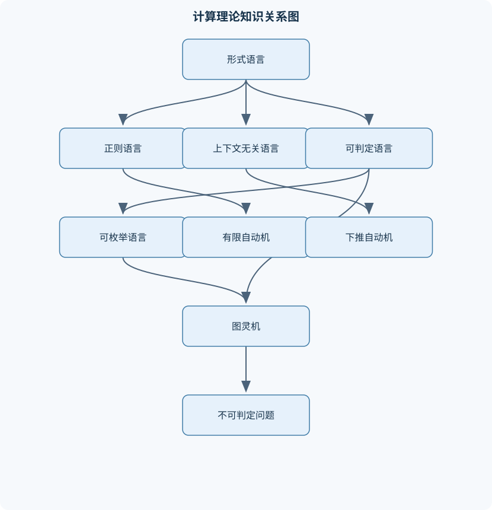
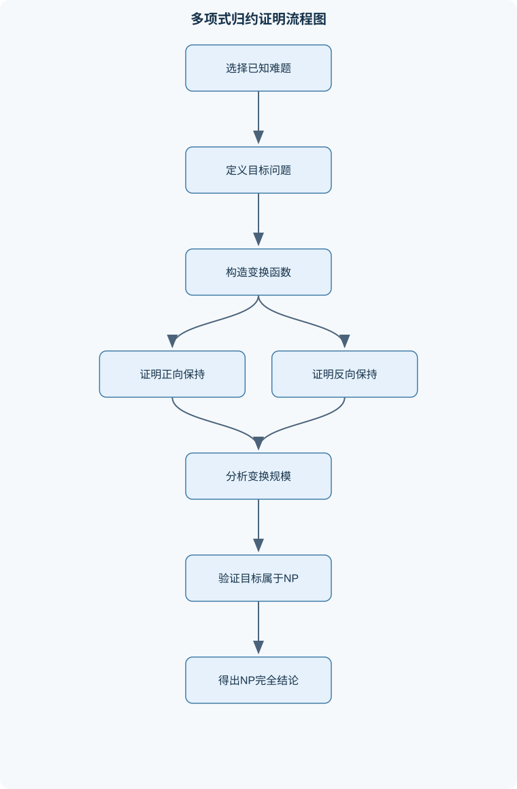

# 计算理论

## 一、课程整体知识框架

### 课程边界与先修知识

本课程研究形式语言、自动机、可计算性与计算复杂性，重点回答三个层次的问题：哪些语言可以由有限状态、栈或无限带空间的计算模型识别；不同计算模型的表达能力是否等价；给定问题是否存在算法，以及存在算法时资源消耗是否可接受。课程覆盖集合与关系、字符串与语言、正则语言与有限自动机、上下文无关语言与下推自动机、图灵机与可枚举语言、可判定性与不可判定性、归约、时间复杂性、P类、NP类与NP完全性。先修知识包括离散数学中的集合、函数、关系、数学归纳法、反证法和图论基础，以及基本程序设计和算法分析。课程不以某种编程语言实现为核心，算法主要用于构造自动机、证明等价性、判定语法性质、验证归约和分析计算资源。





### 1. 研究对象与三层核心问题

《计算理论》研究“计算”这一概念的形式化结构，主要围绕三个层次展开。

第一层是**表达能力问题**：给定语言 $L\subseteq\Sigma^*$，有限状态自动机、带栈的自动机和具有无限带空间的图灵机，分别能够识别哪些语言？有限自动机只能保存有限控制状态，不能无界地记录输入前缀中的信息；下推自动机增加了一个后进先出的栈，能够处理某些嵌套结构；图灵机可以读写带上的符号，因此能够模拟一般算法所需的无界工作空间。

第二层是**模型等价性问题**：不同形式模型是否能识别相同的语言？例如，确定有限自动机、非确定有限自动机和正则表达式虽然描述方式不同，但表达能力相同；多带图灵机、非确定图灵机与单带图灵机在可计算语言的集合上等价，但模拟时的时间开销可能不同。模型等价不表示构造规模或运行效率相同，必须区分“能否计算”和“计算得多快”。

第三层是**可计算性与复杂性问题**：某个问题是否存在对所有输入都正确终止的算法？如果存在，算法所需的时间和空间是否可接受？停机问题说明存在不可判定问题，即不存在对所有输入都终止并给出正确答案的算法。复杂性理论进一步研究可判定问题的资源消耗，重点考察输入长度 $n=|w|$ 与时间、空间的函数关系。这里的 $n$ 的单位是输入符号数，而不是输入所表示的数值大小；例如整数 $N$ 的二进制编码长度约为 $\log_2N$，不能把数值 $N$ 直接当作输入长度。

### 2. 先修数学与证明方法

课程使用集合、函数、关系、图论、数学归纳法和反证法。字母表 $\Sigma$ 是有限且非空的符号集合，$\Sigma^*$ 表示由 $\Sigma$ 中符号组成的全部有限字符串集合，空串记为 $\varepsilon$，且 $|\varepsilon|=0$。字符串长度 $|w|$ 的单位是符号个数；如果 $w=abc$，则 $|w|=3$。字符串连接满足结合律，但一般不满足交换律，即 $(uv)z=u(vz)$，却通常有 $uv\ne vu$。

形式语言是字符串集合，即 $L\subseteq\Sigma^*$。证明两个语言相等时，通常使用双包含法：先证明任意 $w\in L$ 都满足 $w\in M$，再证明任意 $w\in M$ 都满足 $w\in L$。证明语言运算性质时，必须注意空集 $\varnothing$、空串 $\varepsilon$ 和只含空串的语言 $\{\varepsilon\}$ 是三个不同对象。它们分别满足
$$
|\varepsilon|=0,\qquad \varnothing\ne\{\varepsilon\},\qquad \varepsilon\in\{\varepsilon\}.
$$

归纳定义适合描述正则表达式、文法和递归构造。结构归纳法的基本步骤是：证明基本对象满足命题；假设较小结构满足命题，再证明并、连接、闭包等构造保留命题。对于字符串长度归纳，则以 $|w|$ 为归纳量。归纳证明必须明确归纳基、归纳假设和归纳步，不能仅凭若干短字符串成立就断言对所有字符串成立。

### 3. 四类语言与计算模型的层次关系

课程中的主要语言类及其典型模型如下。

| 语言类 | 典型模型 | 主要记忆能力 | 典型限制 |
|---|---|---|---|
| 正则语言 | DFA、NFA、正则表达式 | 有限状态 | 不能无界计数或保存任意长前缀 |
| 上下文无关语言 | CFG、PDA | 一个后进先出栈 | 不适合同时独立比较多个无界计数 |
| 上下文有关语言 | 线性有界自动机 | 与输入长度线性相关的空间 | 工作空间受输入长度限制 |
| 可枚举语言 | 图灵机识别器 | 无界带空间和时间 | 非成员输入可能永不停机 |
| 可判定语言 | 图灵机判定器 | 无界带空间和时间 | 必须对所有输入停机 |

这些包含关系通常写作
$$
\text{正则语言}\subseteq\text{上下文无关语言}\subseteq\text{可判定语言}\subseteq\text{可枚举语言}.
$$
其中正则语言到上下文无关语言的包含是严格的，例如
$$
L=\{a^nb^n:n\ge 0\}
$$
是上下文无关语言但不是正则语言。上下文无关语言到可判定语言的包含也是严格的；可枚举语言到可判定语言的包含严格，因为存在可枚举但不可判定的语言。不同教材对“上下文有关语言”和线性有界自动机的定义细节可能略有差异，但本课程重点是空间受限模型与无界图灵机之间表达能力的差异。

### 4. 课程的证明主线

课程证明通常沿着以下逻辑推进：

1. 用形式语言运算定义正则表达式和语言性质；
2. 证明正则表达式、NFA 和 DFA 的表达能力相同；
3. 用 Myhill–Nerode 定理刻画正则性，用泵引理证明某些语言不是正则语言；
4. 用上下文无关文法和下推自动机描述嵌套结构；
5. 用图灵机统一表示一般算法，区分识别器、判定器和枚举器；
6. 用对角线法和归约证明停机问题、Post 对应问题等不可判定；
7. 用时间和空间资源定义复杂度类；
8. 用多项式时间归约建立 NP 完全性。

归约方向是证明中的关键。若要说明目标问题 $B$ 至少和问题 $A$ 一样困难，需构造
$$
A\le_p B.
$$
这表示存在多项式时间可计算函数 $f$，使得
$$
x\in A\Longleftrightarrow f(x)\in B.
$$
若 $B$ 有一个快速算法，则先计算 $f(x)$ 再运行该算法，就能快速解决 $A$。因此，归约方向不能写反。

## 二、章节和模块划分

### 核心知识覆盖清单

本清单用于检查正文是否覆盖本课程的主要知识模块：

- **形式化基础与语言运算**：字母表、字符串、空串与字符串长度、字符串连接、幂运算与反转、语言的并、交、补、连接与幂、克林闭包与正闭包、语言包含、相等与等价证明、正则表达式的语义解释、归纳定义与结构归纳法、语言同态、逆同态与商运算。
- **有限自动机与正则语言**：确定有限自动机的形式定义、非确定有限自动机与空串转移、自动机运行、可达状态与接受条件、正则语言的闭包性质、正则表达式到有限自动机的构造、有限自动机到正则表达式的转换、正则语言与有限自动机的等价性、正则语言的判定问题。
- **正则语言的结构与最小化**：状态等价与不可区分字符串、Myhill-Nerode等价关系、Myhill-Nerode定理、确定有限自动机的可达性分析、确定有限自动机的状态最小化、自动机等价性判定、正则语言的泵引理、利用泵引理证明非正则性。
- **上下文无关文法与语法分析**：上下文无关文法的形式定义、推导、句型与句子、最左推导与最右推导、语法树与派生树、二义性文法与固有二义性、乔姆斯基范式与格雷巴赫范式、上下文无关语言的闭包性质、上下文无关语言的泵引理。
- **下推自动机与上下文无关语言**：下推自动机的状态、输入和栈、按终态接受与按空栈接受、非确定下推自动机的运行、上下文无关文法到下推自动机的构造、下推自动机到上下文无关文法的构造、自顶向下与自底向上识别思想、上下文无关语言的成员判定、上下文无关语言与正则语言的关系。
- **图灵机与可计算函数**：图灵机的形式定义与配置、转移函数、带头移动和停机、图灵机识别器与判定器、多带图灵机和非确定图灵机、图灵机编码与通用图灵机、图灵可计算函数、丘奇—图灵论题的含义与边界、可枚举语言、可判定语言及其关系。
- **可计算性与不可判定性**：停机问题及其不可判定性、对角线方法与自指构造、语言判定器的补语言性质、可枚举语言的闭包性质、不可判定问题的映射归约、Rice定理及其适用条件、Post对应问题、平铺问题和计算历史编码。
- **受限计算模型与判定层次**：线性有界自动机、上下文有关语言、图灵机的空间受限计算、递归语言与递归可枚举语言的区别、半判定与判定的差异、判定问题的可约性、语言层次之间的包含关系、模型限制对表达能力的影响。
- **时间复杂性与空间复杂性**：输入长度与计算资源度量、时间复杂度和空间复杂度、确定型与非确定型复杂度、复杂度类P、NP与co-NP、多项式时间验证器与证书、多项式时间图灵机归约、空间复杂度类及其基本包含关系、复杂度分析中的编码长度与模型依赖。
- **NP完全性与经典复杂性问题**：NP完全问题的定义、NP困难与NP完全的区别、Cook—Levin定理的证明框架、SAT与3-SAT、团、顶点覆盖和独立集、哈密顿路径与哈密顿回路、集合覆盖、划分和背包问题、从已知NP完全问题构造多项式归约、P与NP关系的已知结论和未解决边界。


### 1. 形式化基础与语言运算

设 $\Sigma$ 为有限非空字母表。字符串 $w=a_1a_2\cdots a_k$ 的长度为 $|w|=k$，连接写作 $uv$。字符串幂定义为
$$
w^0=\varepsilon,\qquad w^{k+1}=w^kw.
$$
对语言 $L,M\subseteq\Sigma^*$，有
$$
LM=\{uv:u\in L,\ v\in M\},
$$
$$
L^0=\{\varepsilon\},\qquad L^+=\bigcup_{k\ge1}L^k,\qquad L^*=\bigcup_{k\ge0}L^k=L^+\cup\{\varepsilon\}.
$$
因此，若 $\varepsilon\notin L$，则 $L^+=L^*-\{\varepsilon\}$；若 $\varepsilon\in L$，则 $\varepsilon\in L^+$，此时两者相等而不是相差一个空串。

语言还可进行并、交、差和补运算。补语言必须相对于固定全集 $\Sigma^*$ 定义：
$$
\overline L=\Sigma^*-L.
$$
若没有指定全集，直接写“补集”是不完整的。语言同态 $h:\Sigma^*\to\Delta^*$ 由对单个符号的映射扩展到字符串，并满足 $h(uv)=h(u)h(v)$；逆同态为
$$
h^{-1}(K)=\{w\in\Sigma^*:h(w)\in K\}.
$$
左商可定义为
$$
u^{-1}L=\{v:uv\in L\},
$$
它描述在固定前缀 $u$ 后仍能使字符串属于 $L$ 的后缀集合，是理解 Myhill–Nerode 等价关系的重要工具。

**例题一：语言幂与空串。** 设 $L=\{a,ab\}$，求 $L^0$、$L^1$ 和 $L^2$。

分析：$L^0$ 不取决于 $L$ 的具体内容，始终为 $\{\varepsilon\}$；$L^1=L$；$L^2$ 包含从 $L$ 中任选两个字符串连接得到的结果。

逐步计算：
$$
L^0=\{\varepsilon\},
$$
$$
L^1=\{a,ab\},
$$
$$
L^2=\{aa,aab,aba,abab\}.
$$
结果验证：四种组合分别为 $a\cdot a$、$a\cdot ab$、$ab\cdot a$ 和 $ab\cdot ab$，没有其他选择。变式是求 $L^+$，它是所有正次数连接的并，包含 $a$ 和 $ab$，但不包含 $\varepsilon$，因为 $\varepsilon\notin L$。

### 2. 有限自动机与正则语言

确定有限自动机记为
$$
M=(Q,\Sigma,\delta,q_0,F),
$$
其中 $Q$ 是有限状态集，$\delta:Q\times\Sigma\to Q$ 是确定转移函数，$q_0$ 是初态，$F\subseteq Q$ 是终态集合。扩展转移函数 $\delta^*$ 满足
$$
\delta^*(q,\varepsilon)=q,\qquad
\delta^*(q,xa)=\delta(\delta^*(q,x),a).
$$
字符串 $w$ 被接受，当且仅当 $\delta^*(q_0,w)\in F$。

非确定有限自动机允许一个状态在同一输入符号下转移到多个状态，并可使用 $\varepsilon$-转移。输入被接受，当且仅当至少存在一条运行路径最终到达终态；“非确定”不是物理上同时执行所有路径，而是接受条件中的存在性定义。通过子集构造法，可将含 $n$ 个状态的 NFA 转换为至多 $2^n$ 个状态的 DFA。新 DFA 的一个状态是原 NFA 可能同时处于的状态集合，其不变量是：读入同一前缀后，新状态集合恰好等于原 NFA 的所有可达状态。

正则表达式由基本符号、$\varepsilon$、$\varnothing$ 以及并、连接、克林闭包构成。其语义递归定义，例如
$$
L(R\cup S)=L(R)\cup L(S),\qquad
L(RS)=L(R)L(S),\qquad
L(R^*)=L(R)^*.
$$
正则表达式到 NFA 可用局部片段递归组合；NFA 到 DFA 使用子集构造；DFA 到正则表达式可用状态消去法。三者表达能力相同，但转换可能造成规模增长：正则表达式转 NFA 通常保持线性量级的状态数，NFA 确定化最坏可指数增长。

正则语言对并、连接、克林闭包、交、补和差封闭。并可通过新初态连接两个自动机；交使用乘积自动机
$$
Q=Q_1\times Q_2,
$$
转移为
$$
\delta((p,q),a)=(\delta_1(p,a),\delta_2(q,a)),
$$
终态取两个自动机终态条件的合取；补通常要求先使用完备 DFA，再交换终态与非终态。

**例题二：构造“恰好出现一个 $aaa$”的识别器。** 字母表为 $\{a,b\}$，目标语言是包含子串 $aaa$ 且不包含第二个非重叠出现的 $aaa$ 的字符串集合。构造时需要记录两类信息：已经发现的完整出现次数，以及当前后缀连续 $a$ 的长度。状态可按“尚未发现、刚发现一次、已发现两次或更多次”分组，并在读入 $b$ 时将连续 $a$ 计数归零。若要求严格处理重叠出现，例如字符串 $aaaa$ 中位置 $1$ 和位置 $2$ 都形成 $aaa$，则必须以每个长度为三的窗口判断，而不能只按不重叠片段计数。这个例子说明自然语言中的“出现一次”必须先规定是否计重叠。

**自动机构造伪代码：**

```text
```text
算法：NFAtoDFA
输入：NFA N=(Q, Σ, δ, q0, F)，允许 ε-转移
输出：等价 DFA D

1. S ← ε-闭包({q0})
2. 将 S 加入待处理集合，并作为 D 的初态
3. 当待处理集合非空时：
4.     取出一个未处理状态集合 T
5.     对每个输入符号 a∈Σ：
6.         U ← ε-闭包(所有 q∈T 经 a 可到达的状态)
7.         建立 D 中从 T 经 a 到 U 的转移
8.         若 U 尚未出现，则加入待处理集合
9.     将 T 标记为已处理
10. D 的终态集合为所有与 F 有交集的状态集合
11. 返回 D
```
```

算法输入是 NFA，输出是等价 DFA。终止条件是不存在未处理状态集合。核心不变量是每个 DFA 状态集合表示 NFA 读入某个共同前缀后所有可能状态。若 NFA 有 $n$ 个状态，DFA 状态数最多为 $2^n$；实际状态数通常因不可达集合而更少。该算法适用于有限字母表和有限状态自动机，不适用于转移依赖无界栈内容的模型。

### 3. 正则语言的结构与最小化

两个字符串 $x,y$ 关于语言 $L$ 不可区分，若对任意 $z\in\Sigma^*$ 都有
$$
xz\in L\Longleftrightarrow yz\in L.
$$
记作 $x\equiv_L y$。这是一个等价关系，其等价类数量决定识别 $L$ 所需的最小状态数。Myhill–Nerode 定理说明：
$$
L\text{ 是正则语言}
\Longleftrightarrow
\equiv_L\text{ 只有有限多个等价类}.
$$
若能构造无限多个两两可区分的字符串，就能证明语言不是正则语言。

DFA 最小化先删除不可达状态，再把状态划分为终态组与非终态组。随后反复检查：若两个状态在某个输入符号下转移到不同分块，则必须拆分它们所在分块；划分稳定后，每个分块合并为一个状态。最小 DFA 的状态数等于 Myhill–Nerode 等价类数量，且在同构意义下唯一。

自动机等价性可通过乘积图搜索。若两个 DFA 的某个可达状态对中恰有一个分量为终态，则从初态对到该状态对的路径标签就是反例字符串。若所有可达状态对的接受标记都相同，则两个 DFA 等价。搜索的时间量级为 $O(|Q_1||Q_2||\Sigma|)$。

**例题三：证明 $\{a^nb^n:n\ge0\}$ 非正则。** 对每个 $i\ge0$ 取前缀 $x_i=a^i$。若 $i<j$，选择后缀 $z=b^i$，则
$$
x_i z=a^ib^i\in L,
$$
而
$$
x_j z=a^jb^i\notin L.
$$
因此任意两个不同的 $x_i,x_j$ 都可被某个后缀区分，得到无限多个两两可区分的前缀。根据 Myhill–Nerode 定理，$L$ 不是正则语言。变式是使用泵引理证明：假设泵长度为 $p$，取 $a^pb^p$，分解 $xyz$ 满足 $|xy|\le p$、$|y|>0$，则 $y=a^k$。令泵次数为 $0$ 或 $2$，会破坏 $a$ 和 $b$ 数量相等。泵引理只能用于证明非正则性，不能由“存在一个可泵分解”推出正则性。

### 4. 上下文无关文法与语法分析

上下文无关文法记为
$$
G=(V,\Sigma,P,S),
$$
其中 $V$ 是变量集合，$\Sigma$ 是终结符集合，$P$ 是产生式集合，$S$ 是开始变量。产生式形式为
$$
A\to\alpha,
$$
其中 $A\in V$，$\alpha\in(V\cup\Sigma)^*$。从 $S$ 经过有限次推导得到的只含终结符的字符串称为句子，所有句子组成语言 $L(G)$。推导中仍含变量的字符串称为句型。

最左推导每一步替换最左侧变量，最右推导每一步替换最右侧变量。语法树把推导的层次结构表示出来；若同一个句子存在两棵不同语法树，文法是二义的。某些语言的二义性是文法写法造成的，可以通过重新组织产生式消除；若语言的任何上下文无关文法都二义，则称该语言具有固有二义性。

乔姆斯基范式通常将产生式整理为
$$
A\to BC,\qquad A\to a,
$$
并根据需要保留开始变量产生空串的特殊产生式。转换过程包括删除无用变量、消除 $\varepsilon$-产生式、消除单位产生式，再把长右部拆成二元形式。每一步都需说明是否保留空串以及开始变量的特殊处理，否则可能错误改变语言。

上下文无关语言对并、连接和克林闭包封闭，但一般不对交和补封闭；与正则语言的交仍是上下文无关语言。上下文无关语言也有泵引理，但其分解形式涉及五段字符串和两个可泵部分，适用条件更复杂，不能把正则语言泵引理直接套用。

**例题四：判断文法是否二义。** 设
$$
E\to E+E\mid E*E\mid (E)\mid id.
$$
字符串 $id+id*id$ 可先使用 $+$ 作为根运算，也可先使用 $*$ 作为根运算，因此有不同语法树。该文法二义。若希望规定乘法优先于加法，可改写为
$$
E\to E+T\mid T,\qquad
T\to T*F\mid F,\qquad
F\to(E)\mid id.
$$
改写后的文法表达相应的优先级，但“某一文法无二义”不等于其语言不存在其他二义文法；固有二义性需要对所有文法进行论证。

### 5. 下推自动机与上下文无关语言

下推自动机记为
$$
P=(Q,\Sigma,\Gamma,\delta,q_0,Z_0,F),
$$
其中 $\Gamma$ 是栈字母表，$Z_0$ 是初始栈符号。转移可读取输入符号或 $\varepsilon$，检查栈顶符号，改变状态并替换栈顶。非确定 PDA 的一条运行由状态、剩余输入和栈内容共同决定；输入只要存在一条成功运行路径即可接受。

PDA 可按终态接受，也可按空栈接受。两种方式表达相同的上下文无关语言类，但转换需要增加控制状态或底标记，不能直接把同一台机器的接受条件无条件替换。文法到 PDA 的构造通常让栈保存待展开变量：若栈顶为变量，则依据产生式替换；若栈顶为终结符，则与当前输入符号匹配并弹栈。PDA 到文法的构造则用变量记录“从某状态、弹出某栈符号到达另一状态”的可能过程。

**例题五：识别括号匹配语言。** 对语言
$$
L=\{w\in\{(,)\}^*:w\text{ 的括号正确匹配}\},
$$
PDA 读到左括号时将标记压栈，读到右括号时要求栈顶存在对应标记并弹出；若栈底标记被弹出前输入结束，则拒绝。若输入为 $(()())$，栈深度依次增加、增加、减少、增加、减少、减少，最后只剩栈底标记，接受。若输入为 $())$，第三个符号会在栈中没有可匹配左括号时出现，拒绝。变式是加入多种括号类型，此时栈顶必须保存括号类别，不能只记录数量。

### 6. 成员判定与语法分析算法

CYK 算法要求文法处于乔姆斯基范式。给定长度为 $n$ 的字符串 $w=w_1\cdots w_n$，表项 $T[i,\ell]$ 记录能生成从位置 $i$ 开始、长度为 $\ell$ 的子串的变量。长度为 $1$ 时使用 $A\to a$；长度大于 $1$ 时枚举分割点 $k$，若
$$
A\to BC,\quad B\in T[i,k],\quad C\in T[i+k,\ell-k],
$$
则把 $A$ 加入 $T[i,\ell]$。不变量是每个表项恰好记录该区间可生成的变量。最终检查开始变量是否属于 $T[1,n]$。固定文法下，时间复杂度为 $O(n^3|P|)$，空间复杂度为 $O(n^2|V|)$。

### 7. 图灵机与可计算函数

图灵机由有限控制、可读写带和带头组成，记为
$$
M=(Q,\Sigma,\Gamma,\delta,q_0,q_{\mathrm{accept}},q_{\mathrm{reject}}).
$$
其中 $\Gamma$ 包含输入字母表 $\Sigma$ 和空白符号，转移函数记录写入符号、头向左或向右移动以及下一状态。配置包括当前状态、带上非空白内容和读写头位置。一次计算就是配置序列。

若机器接受所有属于 $L$ 的输入，并对非成员输入可能拒绝或不停机，则它是识别器；若对每个输入都停机并正确接受或拒绝，则它是判定器。可枚举语言由识别器识别，可判定语言由判定器判定。多带图灵机和非确定图灵机可由单带确定图灵机模拟，模拟可能增加时间，但不改变可计算语言集合。

通用图灵机把另一台机器的编码和输入作为自身输入，形式上可表示为 $\langle M,w\rangle$。丘奇—图灵论题认为所有直观上有效的算法都可由图灵机模拟，它是关于“有效可计算”概念的论题，不是由某个形式系统内部证明出的普通定理。

### 8. 可计算性与不可判定性

停机语言可写为
$$
HALT=\{\langle M,w\rangle:M\text{ 在 }w\text{ 上最终停机}\}.
$$
若存在判定器 $H$ 判断机器是否停机，则构造机器 $D$：输入机器编码 $\langle M\rangle$，若 $H(\langle M,M\rangle)$ 判断其停机，则 $D$ 拒绝；若判断其不停机，则 $D$ 停机。将 $D$ 自身作为输入会导致矛盾，因此 $HALT$ 不可判定。

语言 $L$ 可判定，当且仅当 $L$ 和补语言 $\overline L$ 都可枚举。正向证明中，判定器直接构造两个枚举器；反向证明中，同时交错运行 $L$ 和 $\overline L$ 的枚举器，输入必在其中一个语言中出现，因此最终停机。不可判定不等于“运行时间很长”，而是不存在对所有输入都正确终止的算法。

Rice 定理用于机器所识别语言的非平凡语义性质：若某性质不是所有可枚举语言都具有，也不是所有可枚举语言都不具有，则判断任意机器是否具有该性质通常不可判定。它不适用于纯语法性质，例如“机器编码长度是否为偶数”。

### 9. 受限计算模型与判定层次

线性有界自动机使用与输入长度成线性关系的带空间，典型地只能在输入区域及其常数倍范围内工作。它比 PDA 有更强的存储能力，但比无界图灵机受限。空间受限模型说明表达能力不仅由控制状态决定，也由可使用的存储规模决定。

“递归语言”常用来指可判定语言，“递归可枚举语言”常用来指可枚举语言。半判定过程对成员输入最终给出接受，但对非成员输入可能无限运行；判定过程必须在两类输入上都终止。Post 对应问题、平铺问题和计算历史编码都通过把无限计算行为转化为有限对象或局部约束，建立不可判定性归约。

### 10. 时间、空间与复杂度类

对输入长度 $n$，确定型图灵机在每一步只有一个后继配置。时间复杂度是运行步数的函数 $T(n)$，空间复杂度是访问过的带格数量的函数 $S(n)$。复杂度分析必须说明输入编码、机器模型和最坏情况；同一个数值问题用一元编码或二进制编码，输入长度可能相差指数级。

复杂度类 $\mathrm P$ 包含能由确定型图灵机在多项式时间内判定的语言。$\mathrm{NP}$ 可用多项式长度证书定义：存在多项式 $p$ 和多项式时间验证器 $V$，使
$$
x\in L\Longleftrightarrow
\exists c,\ |c|\le p(|x|),\ V(x,c)=1.
$$
证书是对“是”实例的可验证证明，不等于已经找到证书的算法。$\mathrm{co\text{-}NP}$ 包含 NP 语言的补语言。已知
$$
\mathrm P\subseteq\mathrm{NP},
$$
但是否 $\mathrm P=\mathrm{NP}$ 是未解决问题。空间复杂度还可定义 $\mathrm{PSPACE}$ 等类，确定型与非确定型空间复杂度之间存在比时间复杂度更强的模拟关系，但课程重点首先是资源定义、编码依赖和基本包含关系。

### 11. NP 完全性与经典问题

语言 $B$ 是 NP 完全的，当且仅当：

1. $B\in\mathrm{NP}$；
2. 对任意 $A\in\mathrm{NP}$，都有 $A\le_pB$。

若只满足第二条，称 $B$ 是 NP 困难，不一定属于 NP。Cook–Levin 定理的核心是：任意多项式时间验证过程都可编码为多项式大小的布尔公式，变量描述计算历史中各位置、各时刻的状态或带符号，局部约束保证相邻时间步符合转移规则。公式可满足，当且仅当存在一条接受计算。

SAT、3-SAT、团、顶点覆盖、独立集、哈密顿路径、哈密顿回路、集合覆盖、划分和背包等是经典问题。证明某问题 NP 完全通常包括四步：先说明问题属于 NP；选择已知 NP 完全问题 $A$；构造多项式时间变换 $f$；证明
$$
x\in A\Longleftrightarrow f(x)\in B.
$$
若 $A$ 是 NP 完全、$A\le_pB$ 且 $B\in\mathrm{NP}$，则 $B$ 也是 NP 完全。若某个 NP 完全问题属于 P，则由归约传递性得到 $\mathrm P=\mathrm{NP}$；但尚未找到某个具体 NP 完全问题的多项式时间算法，不能把“属于 NP”误写成“已知可快速求解”。

**代表性流程：多项式时间归约验证。**

输入为源问题 $A$、目标问题 $B$ 和构造函数 $f$。输出是对 $A\le_pB$ 的完整证明。步骤如下：

1. 明确输入实例的编码和规模参数；
2. 给出从 $x$ 到 $f(x)$ 的具体构造；
3. 证明 $f$ 的计算时间是输入长度的多项式；
4. 证明正向性：$x\in A$ 时，构造出的 $f(x)\in B$；
5. 证明反向性：$f(x)\in B$ 时，推出 $x\in A$；
6. 检查规模没有指数膨胀；
7. 若目标是 NP 完全，再证明 $B\in\mathrm{NP}$。

**实验项目一：自动机构造与等价性验证。**

输入数据：给定一个含 $\varepsilon$-转移的 NFA、两个待比较的 DFA，以及若干测试字符串。步骤是先计算 $\varepsilon$-闭包，再执行子集构造；随后删除不可达状态并最小化 DFA；最后构造两个 DFA 的乘积图，搜索终态标记不同的状态对。评价标准包括：每个状态转移完整、接受结果与定义一致、最小化后语言不变、若不等价则能输出反例字符串。排错方法包括检查初态是否进行了空串闭包、终态集合是否按“与原终态有交集”确定、补运算前是否补全了缺失转移，以及乘积搜索是否只访问可达状态。

**实验项目二：CFG 成员判定与归约证明。**

输入数据：一个已转换为乔姆斯基范式的文法、若干待判定字符串，以及一个从已知问题到目标问题的实例变换。步骤是先核对终结符产生式和二元产生式，再按子串长度填写 CYK 表；随后检查开始变量是否生成完整字符串；对归约部分，分别记录输入实例、变换后实例、正向证明、反向证明和规模界。评价标准包括表项不遗漏、不重复影响正确性、完整字符串的开始变量判断正确、变换时间为多项式、两方向逻辑均成立。排错方法包括检查数组下标对应的字符串区间、避免把变量名当作终结符、处理空串和单位产生式的前置转换，以及确认归约方向是从已知困难问题指向待证明问题。

## 三、核心概念的详细解释

### 1. 字符串、语言及其基本运算

设 $\Sigma$ 是有限且非空的字母表。$\Sigma^*$ 表示由 $\Sigma$ 中符号组成的全部有限字符串集合，$\varepsilon$ 表示空串，满足 $|\varepsilon|=0$。语言是字符串的集合，即 $L\subseteq\Sigma^*$。必须区分空串 $\varepsilon$、空集 $\varnothing$ 和只含空串的语言 $\{\varepsilon\}$：$\varepsilon$ 是字符串，$\varnothing$ 是没有元素的集合，而 $\{\varepsilon\}$ 含有一个字符串。

若 $u,v\in\Sigma^*$，则连接 $uv$ 表示先写 $u$ 再写 $v$，并满足
$$
|uv|=|u|+|v|.
$$
连接满足结合律，但一般不满足交换律。例如 $ab\ne ba$。字符串反转记为 $w^R$，若 $w=a_1a_2\cdots a_n$，则
$$
w^R=a_n\cdots a_2a_1.
$$

语言的连接定义为
$$
LM=\{uv:u\in L,\ v\in M\}.
$$
语言幂定义为
$$
L^0=\{\varepsilon\},\qquad L^{k+1}=L^kL.
$$
因此，克林闭包和正闭包分别为
$$
L^*=\bigcup_{k\ge 0}L^k,\qquad L^+=\bigcup_{k\ge 1}L^k.
$$
始终有 $L^+=LL^*=L^*L$。若 $\varepsilon\notin L$，则
$$
L^+=L^*-\{\varepsilon\};
$$
若 $\varepsilon\in L$，则 $\varepsilon\in L^+$，从而 $L^+=L^*$。例如，若 $L=\{a\}$，则 $L^*=\{\varepsilon,a,aa,aaa,\ldots\}$，而 $L^+=\{a,aa,aaa,\ldots\}$。

语言运算包括并、交、差和补：
$$
L\cup M,\qquad L\cap M,\qquad L-M,\qquad \overline L=\Sigma^*-L.
$$
补运算依赖固定全集 $\Sigma^*$；如果改变字母表，补语言也可能改变。语言连接对并满足分配律：
$$
L(M\cup N)=LM\cup LN,\qquad (L\cup M)N=LN\cup MN,
$$
但一般不满足交换律。空集具有
$$
\varnothing L=L\varnothing=\varnothing,
$$
而 $\{\varepsilon\}$ 是连接运算的单位元：
$$
L\{\varepsilon\}=\{\varepsilon\}L=L.
$$

### 2. 语言相等、归纳定义与同态

证明语言相等通常采用双包含法。要证明 $L=M$，必须分别证明：

1. 任取 $w\in L$，推出 $w\in M$；
2. 任取 $w\in M$，推出 $w\in L$。

只验证若干短字符串不能证明两个无限语言相等。例如，$a^*b^*$ 与“所有不含子串 $ba$ 的字符串”在若干短字符串上表现相同，但必须通过任意字符串的结构证明二者确实相等。

字符串和语言常用归纳定义。对字符串长度进行归纳时，归纳基通常是 $\varepsilon$，归纳步假设长度为 $n$ 的字符串满足命题，再证明长度为 $n+1$ 的字符串也满足命题。对正则表达式、文法推导树等结构进行证明时，应使用结构归纳：证明基本构造成立，再证明每一种复合构造保持性质。

语言同态是由符号映射扩展到字符串和语言的函数。若 $h:\Sigma\to\Gamma^*$，则规定
$$
h(\varepsilon)=\varepsilon,\qquad h(x_1x_2\cdots x_n)=h(x_1)h(x_2)\cdots h(x_n).
$$
对语言 $L$，定义
$$
h(L)=\{h(w):w\in L\}.
$$
逆同态为
$$
h^{-1}(K)=\{w\in\Sigma^*:h(w)\in K\}.
$$
同态保持连接和闭包：
$$
h(LM)=h(L)h(M),\qquad h(L^*)=h(L)^*.
$$
但同态可能把不同字符串映射为同一个字符串，因此通常不能由 $h(u)=h(v)$ 推出 $u=v$。

语言的左商可定义为
$$
u^{-1}L=\{v\in\Sigma^*:uv\in L\}.
$$
它表示去掉前缀 $u$ 后仍能使完整字符串属于 $L$ 的所有后缀。商运算是研究有限状态记忆能力和 Myhill–Nerode 等价关系的重要工具。

### 3. 正则表达式与有限自动机

正则表达式由基本表达式和运算构成。基本表达式包括 $\varnothing$、$\varepsilon$ 和每个符号 $a\in\Sigma$；复合表达式包括并、连接和闭包。其语义递归定义为
$$
L(\varnothing)=\varnothing,\quad L(\varepsilon)=\{\varepsilon\},\quad L(a)=\{a\},
$$
$$
L(R\cup S)=L(R)\cup L(S),\quad
L(RS)=L(R)L(S),\quad
L(R^*)=L(R)^*.
$$
正则表达式中的符号含义必须以所采用的语法约定为准。例如，某些语法用“+”表示正闭包，另一些语法用“+”表示并运算，不能脱离定义直接解释。

确定有限自动机记为
$$
M=(Q,\Sigma,\delta,q_0,F),
$$
其中 $Q$ 是有限状态集，$\Sigma$ 是输入字母表，$\delta:Q\times\Sigma\to Q$ 是确定转移函数，$q_0$ 是初态，$F\subseteq Q$ 是终态集合。将转移函数扩展到字符串：
$$
\hat\delta(q,\varepsilon)=q,\qquad
\hat\delta(q,wa)=\delta(\hat\delta(q,w),a).
$$
自动机接受语言为
$$
L(M)=\{w\in\Sigma^*:\hat\delta(q_0,w)\in F\}.
$$

非确定有限自动机允许一个状态和输入符号对应多个后继状态，空串转移还允许在不消耗输入的情况下改变状态。NFA 接受字符串的条件是：存在至少一条运行路径消耗完整输入并到达终态。这里的“非确定”是数学上的存在性定义，不是要求物理机器同时执行所有路径。

NFA 与 DFA 的表达能力相同。子集构造法把 NFA 的状态集合映射为 DFA 的一个状态。若 NFA 有 $n$ 个状态，构造得到的 DFA 最多有 $2^n$ 个状态，实际数量可能因不可达而更少。该结果说明表达能力相同，但不说明构造后规模相同。

### 4. 正则语言的结构性质

正则语言对并、连接、克林闭包、交、补和差封闭。并、连接和闭包可以通过正则表达式运算或 ε-NFA 构造得到。交通常使用乘积自动机。若
$$
M_1=(Q_1,\Sigma,\delta_1,q_{01},F_1),\qquad
M_2=(Q_2,\Sigma,\delta_2,q_{02},F_2),
$$
则乘积自动机状态为 $Q_1\times Q_2$，转移为
$$
\delta((p,q),a)=(\delta_1(p,a),\delta_2(q,a)).
$$
若要识别交集，终态为 $F_1\times F_2$；若要识别差集 $L(M_1)-L(M_2)$，终态为
$$
F_1\times(Q_2-F_2).
$$
补集要求 DFA 的每个输入符号都有定义转移；若原自动机不是完备 DFA，应先加入死状态。

有限自动机的状态数不是表达能力的唯一指标。两个状态数相同的自动机可能识别不同语言，状态数不同的自动机也可能识别同一语言。判断语言等价性应比较其接受行为，而不是直接比较图形或状态名称。

### 5. Myhill–Nerode 等价关系与最小化

对语言 $L\subseteq\Sigma^*$，定义字符串等价关系
$$
x\equiv_L y
\iff
\forall z\in\Sigma^*,\; xz\in L\Longleftrightarrow yz\in L.
$$
如果 $x\equiv_L y$，则任何后缀 $z$ 都不能区分它们；如果存在某个 $z$ 使一个属于 $L$、另一个不属于 $L$，则称 $z$ 区分 $x$ 和 $y$。

Myhill–Nerode 定理为：
$$
L\text{ 是正则语言}
\iff
\equiv_L\text{ 只有有限多个等价类}.
$$
若语言是正则的，其最小 DFA 的状态数恰好等于 $\equiv_L$ 的等价类数量。这个结论不仅能证明语言正则，还能给出任何 DFA 至少需要多少状态的下界。

例如，考虑
$$
L=\{a^nb^n:n\ge 0\}.
$$
对任意 $i\ne j$，前缀 $a^i$ 和 $a^j$ 可由后缀 $b^i$ 区分：$a^ib^i\in L$，但 $a^jb^i\notin L$。因此存在无限多个两两可区分的前缀，等价类无限，故 $L$ 不是正则语言。

正则语言泵引理给出另一种非正则性证明工具。若 $L$ 是正则语言，则存在泵长 $p$，使任意满足 $|w|\ge p$ 的 $w\in L$ 都能写成
$$
w=xyz,
$$
并满足
$$
|xy|\le p,\qquad |y|>0,\qquad
xy^iz\in L\quad\text{对所有 }i\ge 0.
$$
使用该引理证明非正则性时，必须对所有满足条件的分解进行处理，不能只找到一种分解后就得出结论。泵引理不能单独用来证明语言正则，因为满足泵引理只是正则语言的必要条件，不是充分条件。

### 6. 上下文无关文法、下推自动机与语法结构

上下文无关文法记为
$$
G=(V,\Sigma,P,S),
$$
其中 $V$ 是变量集合，$\Sigma$ 是终结符集合，$V\cap\Sigma=\varnothing$，$P$ 是产生式集合，$S\in V$ 是开始变量。产生式形如
$$
A\to\alpha,\qquad A\in V,\ \alpha\in(V\cup\Sigma)^*.
$$
若将句型中的某个变量替换为产生式右部，就得到一步推导。若推导最终得到只含终结符的字符串，则该字符串是文法生成的句子。

语法树记录推导结构。最左推导每一步替换最左侧变量，最右推导每一步替换最右侧变量。一个句子可能有多个不同语法树，此时文法具有二义性。二义性是文法的性质；即使某个文法二义，也不代表其生成的语言一定不存在无二义文法。若一个语言的所有上下文无关文法都二义，则称其具有固有二义性。

乔姆斯基范式要求产生式主要为
$$
A\to BC
\quad\text{或}\quad
A\to a,
$$
必要时允许开始变量产生 $\varepsilon$。转换时通常依次处理非生成变量、不可达变量、空串产生式、单位产生式，并把长右部拆成二元形式。每一步转换都必须说明是否保留原语言，或是否仅在排除 $\varepsilon$ 后保留等价语言。

下推自动机在有限控制状态之外增加一个后进先出栈。其典型形式为
$$
P=(Q,\Sigma,\Gamma,\delta,q_0,Z_0,F),
$$
其中 $\Gamma$ 是栈字母表，$Z_0$ 是初始栈符号。转移可以读取输入符号，也可以进行 ε 转移；同时改变状态并弹出、压入栈符号。PDA 能识别括号嵌套、$a^nb^n$ 等语言，但一个栈不适合同时独立比较多个无界计数。

按终态接受和按空栈接受可以表达相同的上下文无关语言类，但它们的运行条件不同。按终态接受要求输入耗尽后处于终态；按空栈接受要求输入耗尽并且栈被清空。不能把两种条件直接当作同一台机器的同一运行规则。

上下文无关语言对并、连接和克林闭包封闭，但一般不对交和补封闭。然而，若 $L$ 是上下文无关语言而 $R$ 是正则语言，则
$$
L\cap R
$$
仍是上下文无关语言。这可以通过构造 PDA 与 DFA 的乘积模拟实现。

### 7. 图灵机、可计算性与语言层次

图灵机用有限控制、读写带和带头描述计算。可用
$$
M=(Q,\Sigma,\Gamma,\delta,q_0,q_{\mathrm{accept}},q_{\mathrm{reject}})
$$
表示，其中 $\Gamma$ 包含输入字母表 $\Sigma$ 和空白符号。转移函数决定当前状态和读到的带符号，并给出写入符号、头移动方向和下一状态。

图灵机的配置包括当前状态、带上非空内容、读写头位置。一次转移把一个配置变成下一个配置。若机器对所有输入都停机并正确接受或拒绝，则它是判定器；若只要求成员输入最终接受，而非成员输入可能拒绝或无限运行，则它是识别器。

可判定语言、可枚举语言之间满足
$$
\text{正则语言}\subseteq
\text{上下文无关语言}\subseteq
\text{可判定语言}\subseteq
\text{可枚举语言}.
$$
其中部分包含关系是严格的。语言可枚举表示存在机器能在成员输入上最终接受，不等于存在对所有输入都终止的判定算法。

一个语言 $L$ 可判定，当且仅当 $L$ 与补语言 $\overline L$ 都可枚举。正向地，判定器本身既可作为 $L$ 的识别器，也可交换接受和拒绝状态作为 $\overline L$ 的识别器。反向地，对输入 $w$ 同时交错模拟 $L$ 和 $\overline L$ 的识别器；其中一个必然接受，因此可以终止并给出判定结果。

### 8. 归约、不可判定性与复杂性

停机问题要求判断给定机器 $M$ 和输入 $w$ 是否最终停机。假设存在停机判定器 $H(M,w)$，构造机器 $D$：若 $H(M,M)$ 判断 $M$ 会停机，则 $D$ 拒绝；若判断 $M$ 不会停机，则 $D$ 停机。将 $D$ 输入自身时，若 $H(D,D)$ 判断停机，$D$ 就拒绝而不是停机；若判断不停机，$D$ 又会停机，均产生矛盾。因此停机问题不可判定。

映射归约 $A\le_p B$ 表示存在多项式时间可计算函数 $f$，满足
$$
x\in A\Longleftrightarrow f(x)\in B.
$$
不可判定性证明通常不关注运行时间，而是构造一个可计算变换：若目标问题 $B$ 可判定，则利用该判定器和变换就能判定已知不可判定问题 $A$，形成矛盾。归约方向必须是已知困难问题到目标问题，即 $A\le B$，不能写反。

复杂性理论以输入长度 $n=|w|$ 为资源度量。P 是确定型图灵机可在多项式时间内判定的语言类。NP 可以定义为存在长度受 $n$ 的多项式约束的证书，并且证书可由确定型算法在多项式时间内验证的语言类。证书是“证明答案为是”的对象，不等于求解器，也不保证能快速找到证书。

若 $A$ 是 NP 完全问题，且 $A\le_p B$、$B\in\mathrm{NP}$，则 $B$ 是 NP 完全问题。证明分为两步：因为 $A$ 是 NP 困难问题，任意 NP 中语言可归约到 $A$；再利用归约传递性得到任意 NP 中语言可归约到 $B$。同时 $B\in\mathrm{NP}$，故满足 NP 完全性的两个条件。

## 四、重要定义、公式、定理和推导

### 专业审校补充：关键定义与适用边界

映射归约是不可判定性证明中必须严格区分方向的工具。对语言 $A,B$，若存在一个总计算函数 $f$，使得对任意字符串 $x$ 都有 $x\in A\iff f(x)\in B$，记为 $A\leq_m B$。若 $B$ 可判定，则先计算 $f(x)$、再调用 $B$ 的判定器即可判定 $A$；因此，已知 $A$ 不可判定时，$A\leq_m B$ 能推出 $B$ 不可判定。归约函数必须对每个输入终止，并且正确性要证明正向和反向两个方向。不能把“把目标问题转换成已知困难问题”自动视为有效证明，也不能用复杂度归约替代可计算性归约：多项式时间归约要求 $f$ 还必须在多项式时间内计算，而不可判定性证明只要求其总可计算。另一个重要边界是识别器与判定器：识别器对非成员输入可以永不停机，因而不能直接作为判定器使用。若语言及其补语言都可枚举，则可交错模拟两台识别器；对输入 $x$，每轮各运行一步，一台接受即输出相应结论。由于 $x$ 必属于语言或补语言之一，该过程必终止，从而得到判定器。


### 1. 自动机等价性判定

**输入：** 两个字母表相同的 DFA $M_1,M_2$。  
**输出：** “等价”或“不等价”；若不等价，给出反例字符串。

构造乘积自动机，其状态为 $(p,q)$。从初始状态 $(q_{01},q_{02})$ 出发，沿相同输入符号同步移动。若到达某个状态对，其中一个分量属于终态、另一个不属于终态，则当前路径标签就是反例字符串。

不变量是：每个已访问状态对都对应一个共同输入前缀，两个分量分别是原自动机读入该前缀后的状态。若搜索结束而没有发现终态差异，则不存在区分两个自动机的字符串，故二者等价。若状态数分别为 $n_1,n_2$，时间复杂度为
$$
O(n_1n_2|\Sigma|),
$$
空间复杂度为
$$
O(n_1n_2).
$$

### 2. 正则表达式到有限自动机的递归构造

对正则表达式进行结构归纳。基本表达式分别构造：

- $\varnothing$：构造没有接受路径的片段；
- $\varepsilon$：构造一条 ε 路径；
- $a$：构造一条标记为 $a$ 的路径。

若已有 $R,S$ 的自动机片段，则：

- 对 $R\cup S$，增加新起点和新终点，从新起点通过 ε 边进入两个片段，并从两个片段的终点通过 ε 边到新终点；
- 对 $RS$，把 $R$ 的终点通过 ε 边连接到 $S$ 的起点；
- 对 $R^*$，增加新起点和新终点，并加入绕回原片段的 ε 边，同时允许直接跳过原片段。

结构归纳保证每个构造片段接受的语言正好是对应表达式的语言。若正则表达式长度为 $m$，该类构造得到的 NFA 状态数通常为 $O(m)$；随后进行子集构造时，DFA 状态数最坏可增长到指数级。

### 3. 子集构造法

**输入：** 含 ε 转移的 NFA $N=(Q,\Sigma,\Delta,q_0,F)$。  
**输出：** 接受同一语言的 DFA。

对状态集合 $S$ 定义 ε-闭包 $\operatorname{EClosure}(S)$，表示从 $S$ 中状态出发仅经过 ε 转移能够到达的全部状态。DFA 初态为
$$
S_0=\operatorname{EClosure}(\{q_0\}).
$$
对每个待处理集合 $S$ 和输入符号 $a$，计算
$$
T=\operatorname{EClosure}\left(
\bigcup_{q\in S}\Delta(q,a)
\right).
$$
若 $T$ 未出现，则加入待处理集合；定义 DFA 转移 $\delta(S,a)=T$。凡与 $F$ 有交集的集合都是 DFA 终态。

不变量是：DFA 状态集合 $S$ 恰好等于 NFA 读入当前前缀后可能处于的全部状态，包括通过 ε 转移可达的状态。当没有未处理集合时算法终止。若 NFA 有 $n$ 个状态，DFA 最多有 $2^n$ 个状态，空集也可能作为死状态出现。

### 4. DFA 最小化

**输入：** DFA。  
**输出：** 接受同一语言且状态数最少的 DFA。

第一步删除从初态不可达的状态，因为这些状态不影响任何输入的运行。第二步将状态划分为终态块和非终态块。随后反复检查：若同一分块中的两个状态对某个输入符号转移到不同分块，则必须拆分该分块。直到没有分块可再拆分为止。

稳定划分中的两个状态对所有字符串具有相同接受行为，因此可以合并。最小 DFA 的状态正好对应 Myhill–Nerode 等价类。常见划分细化实现的时间复杂度为多项式量级；具体上界取决于数据结构和实现方法。

### 5. 上下文无关语言的 CYK 成员判定

假设文法已转换为乔姆斯基范式，输入字符串
$$
w=a_1a_2\cdots a_n.
$$
令 $T[i,\ell]$ 表示能够生成从位置 $i$ 开始、长度为 $\ell$ 的子串的变量集合。

长度为 $1$ 时，若存在产生式 $A\to a_i$，则把 $A$ 加入 $T[i,1]$。对 $\ell\ge2$，枚举分割点 $k$，若存在产生式 $A\to BC$，满足
$$
B\in T[i,k],\qquad
C\in T[i+k,\ell-k],
$$
则将 $A$ 加入 $T[i,\ell]$。最后检查开始变量 $S$ 是否属于 $T[1,n]$。

递推的正确性来自语法树根产生式：根若为 $A\to BC$，其左右子树必分别生成某个前缀和后缀；反过来，若两个子区间分别可由 $B,C$ 生成，则可合并为 $A$ 的推导。时间复杂度为
$$
O(n^3|P|),
$$
空间复杂度为
$$
O(n^2|V|).
$$
该算法要求文法处于适合的二元产生式形式；含有 ε 产生式或单位产生式时，应先进行规范化处理。

### 6. 图灵机配置模拟

**输入：** 图灵机 $M$ 和字符串 $w$。  
**输出：** 若机器停机，则输出接受或拒绝；若机器未停机，模拟过程可能无限持续。

初始化带内容为 $w$，读写头位于第一个输入符号，当前状态为 $q_0$。每一步读取当前带符号，根据 $\delta$ 写入新符号、移动读写头并改变状态。若进入 $q_{\mathrm{accept}}$ 或 $q_{\mathrm{reject}}$，过程终止。

不变量是：模拟器记录的配置与机器真实运行相同步数后的配置完全一致。因此，若 $M$ 是判定器，模拟必然终止；若 $M$ 只是识别器，对非成员输入不能保证终止。该区别正是“识别”与“判定”的边界。

### 7. 典型例题与推导

#### 例题一：计算语言连接和闭包

设
$$
L=\{a,ab\},\qquad M=\{\varepsilon,b\}.
$$
求 $LM$、$L^+$ 和 $L^*$。

**分析：** 连接要求从 $L$ 取一个字符串、从 $M$ 取一个字符串并拼接。

**解答：**
$$
LM=\{a\varepsilon,ab,a b,abb\}=\{a,ab,abb\}.
$$
由于 $L$ 不含 $\varepsilon$，
$$
L^+=L\cup L^2\cup L^3\cup\cdots,
$$
其中 $L^2$ 包括 $aa,aab,aba,abab$ 等字符串。于是
$$
L^*= \{\varepsilon\}\cup L^+.
$$

**验证：** $\varepsilon\in L^*$，但 $\varepsilon\notin L^+$，因为 $L$ 的每个元素长度至少为 $1$。若把 $L$ 换成 $L\cup\{\varepsilon\}$，则正闭包和克林闭包相同。

#### 例题二：证明 $L=\{a^nb^n:n\ge0\}$ 非正则

**分析：** 采用 Myhill–Nerode 定理构造无限多个两两可区分字符串。

**解答：** 对任意 $i\ne j$，取前缀 $x_i=a^i$ 和 $x_j=a^j$。令后缀 $z=b^i$。则
$$
x_iz=a^ib^i\in L,
$$
但
$$
x_jz=a^jb^i\notin L.
$$
因此 $x_i$ 与 $x_j$ 不等价。由于有无限多个两两可区分前缀，$\equiv_L$ 有无限多个等价类，依据 Myhill–Nerode 定理，$L$ 非正则。

**变式：** 若语言改为 $\{a^ib^j:i,j\ge0\}$，则它等于 $a^*b^*$，是正则语言，因为不再要求两个计数相等。

#### 例题三：判断两个 DFA 是否等价

设两个 DFA 的初态分别为 $p_0,q_0$。从 $(p_0,q_0)$ 开始构造乘积状态。若读入字符串 $w$ 后到达 $(p,q)$，且 $p$ 为终态、$q$ 非终态，则 $w$ 是反例。

**分析：** 不需要枚举所有字符串，只需搜索有限个乘积状态。

**解答步骤：**

1. 建立初始状态对 $(p_0,q_0)$；
2. 对每个未访问状态对和每个 $a\in\Sigma$ 计算后继；
3. 若某后继状态对的终态标记不同，立即输出当前路径字符串；
4. 若所有可达状态对均已搜索且无差异，则两个 DFA 等价。

**结果验证：** 若找到反例 $w$，直接运行两个 DFA 检查一个接受、另一个拒绝即可；若没有反例，乘积图的可达性保证不存在任何区分字符串。

#### 例题四：CYK 判断字符串是否属于文法

设文法包含
$$
S\to AB,\quad A\to a,\quad B\to b,
$$
输入 $w=ab$。

**解答：**

- 对长度为 $1$ 的子串 $a$，有 $A\in T[1,1]$；
- 对长度为 $1$ 的子串 $b$，有 $B\in T[2,1]$；
- 对长度为 $2$ 的子串 $ab$，按唯一分割 $a|b$ 检查 $S\to AB$；
- 因为 $A\in T[1,1]$ 且 $B\in T[2,1]$，所以 $S\in T[1,2]$。

因此 $ab\in L(G)$。若输入改为 $aa$，第二个位置不能由 $B$ 生成，故 $S\notin T[1,2]$，判定结果为不属于该语言。

#### 例题五：说明识别器不一定是判定器

设图灵机在输入属于语言 $L$ 时接受，在输入不属于 $L$ 时进入无限循环。

**分析：** 该机器满足识别器的成员正确性，但不满足判定器的终止要求。

**解答：** 对 $w\in L$，机器最终进入接受状态，因此 $w$ 被识别；对 $w\notin L$，机器永不停机，既不接受也不拒绝。故它识别 $L$，但不判定 $L$。

**边界：** 若另有一个识别器识别 $\overline L$，则可以交错运行两个识别器：一个接受时输出“不属于 $L$”，另一个接受时输出“属于 $L$”。因为每个输入必属于二者之一，过程最终终止，从而得到 $L$ 的判定器。

### 8. NP、NP 困难与 NP 完全

语言 $L$ 属于 NP，当且仅当存在多项式 $p$ 和确定型多项式时间验证器 $V$，使得
$$
x\in L
\iff
\exists c,\ |c|\le p(|x|),\ V(x,c)=1.
$$
其中 $c$ 是证书，$|c|$ 的单位是编码后的符号数。对于图问题，证书可以是顶点集合、路径或顶点排列；验证器需要检查证书格式、约束满足情况以及规模是否符合多项式界。

语言 $B$ 是 NP 困难的，如果任意 $A\in\mathrm{NP}$ 都满足
$$
A\le_p B.
$$
若同时有 $B\in\mathrm{NP}$，则 $B$ 是 NP 完全的。NP 困难不要求问题属于 NP，甚至问题可以不可判定；因此“NP 困难”和“NP 完全”不能混用。

Cook–Levin 定理的核心思想是：对任意多项式时间验证过程，把计算过程按时间排列为有限长度的配置序列，再用布尔变量表示每个时间、位置上的机器状态和带符号。局部约束保证：

1. 每个位置每个时刻只有一种状态或符号；
2. 初始行正确编码输入；
3. 相邻两行满足图灵机转移规则；
4. 某个时刻进入接受状态。

这些约束可以组合成一个多项式大小的布尔公式。公式可满足，当且仅当存在一条接受计算历史。因此 SAT 是 NP 完全问题。

若某个 NP 完全问题属于 P，则任意 NP 中语言都可先多项式时间归约到该问题，再使用其多项式时间算法解决，因此
$$
\mathrm{P}=\mathrm{NP}.
$$
但反过来，尚未因某个具体问题缺少已知多项式算法，就能断言它不属于 P；“尚未找到算法”与“已证明不存在算法”是不同结论。

## 五、算法、流程和实现思路

### 方法与流程覆盖索引

下列方法或流程应在正文中说明输入、步骤、适用条件、结果检查和边界：

- 子集构造法：输入非确定有限自动机；输出等价确定有限自动机；过程是以状态集合作为新状态，从初始状态的空串闭包开始，按每个输入符号计算后继集合并继续扩展；不变量是新状态集合恰好表示原自动机读入同一前缀后可能处于的全部状态；当待处理集合为空时终止；最坏状态数为2的n次方，单步转移还需考虑空串闭包。
- 正则表达式到有限自动机：输入正则表达式；输出等价非确定有限自动机；过程是为基本符号建立局部片段，再对并、连接和闭包递归组合，并引入新的起止状态和空串边；结构归纳保证每个片段接受原子表达式对应的语言；适用于构造性证明和自动化转换，状态数通常与表达式长度线性相关。
- 有限自动机最小化：输入确定有限自动机；输出接受同一语言的最小确定有限自动机；先删除不可达状态，再按终态与非终态初始化划分，反复依据各输入符号的目标分块细分，直到划分稳定；不变量是同一分块中的状态对当前已检查的字符串不可区分；稳定后合并每个分块；时间复杂度可达到与状态数和字母表大小相关的多项式量级。
- 自动机等价性判定：输入两个确定有限自动机；输出等价或不等价，并在不等价时给出反例字符串；构造状态对的乘积图，从初始状态对开始搜索，只扩展尚未访问的状态对；不变量是每个被访问状态对都对应一个共同输入前缀；发现一边终态一边非终态即可停止；若搜索完毕仍未发现，则两者等价；时间复杂度为状态数乘积乘以字母表大小。
- CYK成员判定：输入乔姆斯基范式上下文无关文法和字符串w；输出w是否属于文法语言；建立表格T[i,j]记录生成从位置i开始、长度j的变量，先填长度为1的终结符产生式，再按分割点合并长度更短的区间；不变量是表项恰好记录该区间可生成的变量；检查开始变量是否出现在完整区间；时间复杂度为O(n^3|P|)，空间复杂度为O(n^2|V|)。
- 图灵机配置模拟：输入图灵机M和字符串w；输出接受、拒绝或在模拟资源耗尽时报告尚未停机；初始化带内容、读写头和状态，逐步依据转移函数更新三者；不变量是模拟配置与M在相同步数后的真实配置一致；若进入接受或拒绝状态则终止；对判定器一定终止，对一般识别器不保证终止。
- 停机问题归约：输入待证明不可判定的问题B和已知不可判定问题A；输出从A到B的有效变换；给定A的实例，构造B的实例，使B有正确答案当且仅当A有正确答案；证明构造可计算且保持答案；若B可判定，则可借此判定A，形成矛盾；适用于判定问题而非直接比较运行时间。
- 多项式时间归约：输入源问题A、目标问题B和变换函数f；输出A≤pB的证明；逐项验证f可在多项式时间计算，并证明x属于A当且仅当f(x)属于B；若需要证明B为NP完全，还需另证B属于NP并从已知NP完全问题归约到B；关键不变量是实例的可行解关系在变换前后保持等价。
- NP验证器分析：输入判定问题、证书格式和验证算法；输出问题是否属于NP的证明框架；证明任意是实例存在长度受输入规模多项式约束的证书，验证器在多项式时间内检查证书；必须同时说明证书长度上界、验证步骤和正确性；不适用于证书可能指数增长或验证本身不可控的问题。
- 图灵机计算历史编码：输入机器M和输入w；输出描述有限步计算是否满足局部转移约束的组合对象；将每个时间步的带配置编码为行，将相邻行之间的读写和移动关系转化为局部约束，再用于归约到逻辑公式或平铺系统；不变量是每个合法对象都对应一条一致计算历史；适用于不可判定性和NP完全性证明。


### 1. 形式语言运算与等价证明流程

#### 1.1 语言运算的计算步骤

给定字母表 $\Sigma$ 及语言 $L,M\subseteq\Sigma^*$，计算语言运算时应先明确对象的类型。字符串连接作用于两个字符串，语言连接作用于两个语言；$\varepsilon$ 是字符串，$\{\varepsilon\}$ 是语言，而 $\varnothing$ 不含任何字符串。对语言连接，定义为

$$
LM=\{uv\mid u\in L,\ v\in M\}.
$$

计算 $L^0,L^+,L^*$ 时，必须分别处理零次连接和正次数连接：

$$
L^0=\{\varepsilon\},\qquad
L^+=\bigcup_{k\geq 1}L^k,\qquad
L^*=\bigcup_{k\geq 0}L^k.
$$

因此，$L^+=L^*-\{\varepsilon\}$ 当且仅当 $\varepsilon\notin L$。若 $\varepsilon\in L$，则 $\varepsilon$ 已经属于 $L^+$，此时 $L^+=L^*$。

证明两个语言相等时，采用双包含流程：

1. 任取 $w\in L$，分析 $w$ 的构成，证明 $w\in M$；
2. 任取 $w\in M$，反向分析其构成，证明 $w\in L$；
3. 得出 $L=M$。

例如，设 $\Sigma=\{a,b\}$，证明

$$
\{a,b\}^*=\{a\}^*(\{b\}\{a\}^*)^*.
$$

右侧中的字符串先包含任意多个 $a$，随后重复若干次“一个 $b$ 加任意多个 $a$”，所以只含 $a,b$，从而右侧包含于左侧。反向地，任意 $w\in\{a,b\}^*$ 都可以按每个 $b$ 分段写为

$$
w=a^{i_0}ba^{i_1}b\cdots ba^{i_k},
$$

其中 $k\geq 0$，各 $i_j\geq 0$。因此 $w$ 属于右侧语言，双包含成立。

语言同态的计算也应按字符串分解进行。若 $h:\Sigma\to\Gamma^*$，则扩展为

$$
h(\varepsilon)=\varepsilon,\qquad h(x_1x_2\cdots x_n)=h(x_1)h(x_2)\cdots h(x_n),
$$

并定义 $h(L)=\{h(w)\mid w\in L\}$。逆同态为

$$
h^{-1}(K)=\{w\in\Sigma^*\mid h(w)\in K\}.
$$

同态保持连接和克林闭包，即

$$
h(LM)=h(L)h(M),\qquad h(L^*)=h(L)^*,
$$

但一般不能把逆同态误写成普通的逐符号逆映射。商运算则根据固定前缀或后缀筛选字符串，例如左商

$$
u^{-1}L=\{v\mid uv\in L\}.
$$

在自动机中，商语言常对应“读入前缀后从当前状态继续运行”的剩余语言。

#### 1.2 正则表达式、NFA 与 DFA 的构造链

正则表达式到非确定有限自动机可采用递归构造。输入是正则表达式 $R$，输出是只含一个入口和一个出口的 $\varepsilon$-NFA。基本情形为：

- 对符号 $a$，建立一条标记为 $a$ 的边；
- 对 $\varepsilon$，建立一条 $\varepsilon$ 边；
- 对空集，建立不产生可接受路径的片段。

复合情形为：

- $R_1\cup R_2$：从新入口通过 $\varepsilon$ 边分别进入两个片段，再由两个出口连接到新出口；
- $R_1R_2$：把第一个片段出口用 $\varepsilon$ 边连接到第二个片段入口；
- $R_1^*$：增加新入口和新出口，并加入跳过原片段、重复原片段和退出原片段的 $\varepsilon$ 边。

结构归纳保证每个构造片段接受的语言恰好等于对应正则表达式的语义。若正则表达式长度为 $m$，这种局部构造通常产生线性数量级的状态和边，但后续确定化可能产生指数级状态。

将 $\varepsilon$-NFA 转换为 DFA 使用子集构造法。设 NFA 有 $n$ 个状态，DFA 的一个状态是 NFA 状态集合 $S\subseteq Q$。初态为初始状态的 $\varepsilon$-闭包：

$$
S_0=\varepsilon\text{-closure}(\{q_0\}).
$$

对每个集合 $S$ 和输入符号 $a$，计算

$$
\delta_D(S,a)=\varepsilon\text{-closure}\left(\bigcup_{q\in S}\delta_N(q,a)\right).
$$

若集合 $S$ 含有至少一个 NFA 终态，则它是 DFA 终态。算法的不变量是：DFA 状态集合恰好表示 NFA 读入当前前缀后所有可能到达的状态。所有可达集合处理完毕后终止。理论上最多有 $2^n$ 个状态，实际状态通常少于该上界。

```text
伪代码：NFA 转 DFA 的子集构造

输入：NFA N=(Q,Σ,δ,q0,F)
输出：等价 DFA D

S0 ← ε-closure({q0})
待处理 ← [S0]
已生成 ← {S0}
D 的初态 ← S0

当待处理非空时：
    S ← 从待处理取出一个状态集合
    对每个 a ∈ Σ：
        T ← ε-closure(∪_{q∈S} δ(q,a))
        添加 DFA 转移 S --a--> T
        如果 T 不在已生成中：
            加入已生成
            加入待处理
    如果 S ∩ F ≠ ∅：
        将 S 标记为 DFA 终态

返回 D
```

该流程的输入字母表必须有限；若把无限对象或未定义的转移直接当作状态，算法就不再符合有限自动机模型。

#### 1.3 DFA 最小化与等价性判定

DFA 最小化先删除从初态不可达的状态，因为这些状态不会影响接受语言。随后把状态初始划分为终态块和非终态块。若同一分块中的两个状态对某个输入符号转移到不同分块，则它们必须分开。重复细分直到划分稳定，再把同一块中的状态合并。

稳定划分的不变量是：同一分块中的状态目前无法被已经检查的字符串区分。稳定后，它们对所有字符串的接受行为一致，可以安全合并。最小 DFA 的状态数等于 Myhill–Nerode 等价关系的等价类数量。

两个 DFA 等价性判定可直接使用乘积图。给定 $A$ 和 $B$，构造状态对 $(p,q)$。从初始对 $(p_0,q_0)$ 出发，按相同输入符号同步转移。如果到达某个状态对，其中一个分量是终态而另一个不是，则当前路径标签就是反例字符串。若所有可达状态对都没有终态差异，则两个 DFA 接受同一语言。状态数分别为 $m,n$ 时，搜索最多处理 $mn$ 个状态对，时间复杂度为

$$
O(mn|\Sigma|).
$$

#### 1.4 上下文无关文法的规范化与成员判定

上下文无关文法记为 $G=(V,\Sigma,P,S)$。推导中的字符串若仍含变量，则称为句型；只含终结符的句型才是句子。最左推导每次替换最左变量，最右推导每次替换最右变量。相同语法树可能对应不同推导顺序，但若一个句子有两棵不同语法树，则文法具有二义性。

将文法转换为乔姆斯基范式时，通常依次处理：

1. 增加新的开始变量；
2. 消除 $\varepsilon$-产生式；
3. 消除单位产生式；
4. 删除无用变量；
5. 把长产生式拆为二元产生式；
6. 将终结符从长产生式中分离。

转换过程可能保留语言，也可能需要对空串作特殊处理。若原文法生成 $\varepsilon$，新开始变量必须允许生成 $\varepsilon$，否则会错误丢失该句子。

在乔姆斯基范式下，CYK 算法判定字符串 $w=w_1\cdots w_n$ 是否属于 $L(G)$。表项 $T[i,\ell]$ 表示从位置 $i$ 开始、长度为 $\ell$ 的子串可由哪些变量生成。长度为 $1$ 时，根据 $A\to a$ 填表；长度大于 $1$ 时，对每个切分点 $k$ 检查是否存在

$$
A\to BC,\quad B\in T[i,k],\quad C\in T[i+k,\ell-k].
$$

当 $S\in T[1,n]$ 时接受。表项不变量是：它恰好记录能够生成对应子串的变量。时间复杂度为 $O(n^3|P|)$，空间复杂度为 $O(n^2|V|)$；这里 $n=|w|$，不是字符串所表示的数值大小。

#### 1.5 下推自动机与图灵机模拟

由 CFG 构造 PDA 时，可让栈保存尚未展开的变量或待匹配符号。机器从栈顶取出变量，用产生式右侧替换；取出终结符时，必须与当前输入符号相同并弹栈。输入读完且栈清空时接受。由于存在多个产生式选择，该 PDA 通常是非确定的。

PDA 按终态接受和按空栈接受的语言类相同，但不能把两种接受条件当作同一运行规则。转换时可增加新的初态、底栈符号和终态，使原来的空栈条件被控制状态显式记录。

图灵机配置包含当前状态、带内容和读写头位置。模拟时每一步严格执行：读取头下符号、依据转移函数写入新符号、向左或向右移动、更新状态。配置模拟的不变量是模拟记录与机器真实运行经过相同步数后的配置一致。进入接受态或拒绝态时终止；一般识别器在非成员输入上可能永不停止。

多带图灵机可由单带图灵机模拟。模拟器在带上用分隔符记录各条带内容，并周期性扫描全带，保存每条带头的位置。该模拟会增加时间开销，但不改变可计算语言集合。非确定图灵机的每条分支都可按宽度优先交错模拟；若存在有限步接受分支，模拟最终会发现它。若机器只要求识别语言，不能采用深度优先无限深入某一分支，否则可能错过其他分支的接受路径。

### 2. 不可判定性、归约与复杂性分析流程

#### 2.1 停机问题与可枚举性判定

停机问题的标准反证流程如下：

1. 假设存在判定器 $H(M,w)$，当且仅当机器 $M$ 在输入 $w$ 上停机时接受；
2. 构造机器 $D(x)$：若 $H(x,x)$ 判断为停机，则 $D$ 进入死循环；若判断为不停机，则 $D$ 立即停机；
3. 运行 $D(D)$；
4. 若 $D(D)$ 停机，则按构造它应死循环；若不停止，则按构造它应停机，均矛盾。

因此不存在对所有输入都停机且正确的 $H$。这证明的是不可判定性，不是“运行时间很长”。

语言 $L$ 可判定，当且仅当 $L$ 和补语言 $\overline L$ 都可枚举。正向地，两个枚举器对输入 $w$ 交错模拟：一个接受时输出“属于”，另一个接受时输出“不属于”；由于 $w$ 必属于二者之一，过程必停机。反向地，判定器本身可以枚举所有字符串，并在每个字符串上运行判定器，遇到属于 $L$ 的字符串就输出。

#### 2.2 映射归约与 Rice 定理应用流程

要证明目标问题 $B$ 不可判定，通常从已知不可判定问题 $A$ 构造可计算函数 $f$，满足

$$
x\in A\Longleftrightarrow f(x)\in B.
$$

若 $B$ 有判定器，则先计算 $f(x)$，再调用该判定器即可判定 $A$，形成矛盾。归约方向必须是 $A\leq_m B$，即把已知困难问题归约到目标问题。

Rice 定理适用于图灵机所识别语言的非平凡语义性质。若性质只取真或假，且至少有一个可枚举语言具有该性质、至少有一个不具有该性质，则判断“给定机器的语言是否具有该性质”不可判定。它不适用于机器编码的纯语法性质，例如“状态数是否为偶数”，因为这类性质不由机器所识别的语言决定。

#### 2.3 NP 验证与多项式归约流程

证明问题 $B\in\mathrm{NP}$，必须明确三项内容：

1. 输入规模为 $n$；
2. 若答案为“是”，存在长度至多为 $p(n)$ 的证书，其中 $p$ 是多项式；
3. 验证器在多项式时间内检查证书，并满足完备性和可靠性。

例如，团问题的证书是一组顶点。验证器检查顶点数是否达到给定阈值，并检查任意两点之间是否有边。证书长度和边检查次数均为输入规模的多项式。

证明 $A\leq_p B$ 时，要给出函数 $f$，并验证：

$$
x\in A\Longleftrightarrow f(x)\in B,
$$

同时说明计算 $f$ 的时间为多项式。若还要证明 $B$ 为 NP 完全，需要同时证明 $B\in\mathrm{NP}$ 和某个已知 NP 完全问题满足 $A\leq_p B$。

Cook–Levin 定理的构造把多项式时间验证过程编码为计算历史。布尔变量表示某个时间、带位置上的符号或状态；局部公式保证初始配置合法、每个时间步遵守转移规则、最后出现接受状态。公式可满足，当且仅当存在一条接受计算历史，因此 SAT 为 NP 完全问题。

#### 2.4 代表性例题

##### 例题一：计算闭包并判断空串

**题干：** 设 $L=\{a,ab\}$，求 $L^0,L^1,L^2$，并判断 $\varepsilon$ 是否属于 $L^+$。

**分析：** 零次幂固定为 $\{\varepsilon\}$；一次幂就是 $L$；二次幂由四种连接组成。

**解答：**

$$
L^0=\{\varepsilon\},
$$

$$
L^1=\{a,ab\},
$$

$$
L^2=\{aa,aab,aba,abab\}.
$$

因为 $\varepsilon\notin L$，任何正次数连接都不会产生空串，所以

$$
\varepsilon\notin L^+,\qquad L^+=L^*-\{\varepsilon\}.
$$

**结果验证：** $L^+$ 中每个字符串至少来自一次连接，而 $a$ 和 $ab$ 都非空，故结果不含 $\varepsilon$。

**变式：** 若改为 $L'=\{\varepsilon,a\}$，则 $\varepsilon\in L'^+$，并且 $L'^+=L'^*$。

##### 例题二：用 Myhill–Nerode 定理证明非正则性

**题干：** 证明

$$
L=\{a^nb^n\mid n\geq 0\}
$$

不是正则语言。

**分析：** 构造无限多个两两可区分的前缀 $a^i$。

**解答：** 对任意 $i\ne j$，不妨设 $i<j$，取后缀 $z=b^i$。则

$$
a^iz=a^ib^i\in L,
$$

但

$$
a^jz=a^jb^i\notin L.
$$

因此 $a^i$ 与 $a^j$ 可被后缀 $b^i$ 区分。存在无限多个两两可区分字符串，Myhill–Nerode 等价类无限，所以 $L$ 不是正则语言。

**结果验证：** 证明使用的是所有不同 $i,j$ 的区分关系，而不是只验证有限样本。

**变式：** $\{a^nb^m\mid n,m\geq0\}$ 是正则语言，因为它等于 $a^*b^*$；改变两个计数必须相等才导致非正则性。

##### 例题三：DFA 等价性判定

**题干：** 两个 DFA 的状态数分别为 $3$ 和 $4$，字母表为 $\{0,1\}$。如何判断它们是否等价？

**分析：** 不需要枚举所有字符串，而应搜索乘积状态图。

**解答：**

1. 建立初始状态对 $(p_0,q_0)$；
2. 对每个已访问状态对，分别按 $0,1$ 转移；
3. 将新状态对加入队列；
4. 若某状态对恰有一个分量为终态，则取从初始状态到该对的路径标签作为反例；
5. 若全部可达状态对处理完毕而未发现差异，则等价。

最多有 $3\times4=12$ 个状态对，每个状态对检查两个符号，因此时间复杂度为 $O(24)$，忽略状态转移表访问成本。

**结果验证：** 找到终态差异即可证明不等价；没有找到差异只能在所有可达乘积状态均检查后作出等价结论。

**变式：** 若两个 DFA 含有不可达状态，乘积搜索无需处理这些状态；状态数相同也不能直接推出等价。

##### 例题四：CYK 判断成员关系

**题干：** 文法含产生式 $S\to AB\mid BC$，$A\to a$，$B\to b$，$C\to SB$。判断字符串 $ba$ 是否属于该文法语言。

**分析：** 对长度为 $1$ 的子串先填终结符产生式，再合并长度为 $2$ 的区间。

**解答：**

- 对子串 $b$，由 $B\to b$ 得 $T[1,1]=\{B\}$；
- 对子串 $a$，由 $A\to a$ 得 $T[2,1]=\{A\}$；
- 对完整子串 $ba$，唯一切分为 $b|a$，需要检查 $S\to XY$ 中是否有 $X\in\{B\}$ 且 $Y\in\{A\}$；
- 文法中没有 $S\to BA$，所以 $S\notin T[1,2]$。

因此 $ba\notin L(G)$。

**结果验证：** 完整区间不含开始变量 $S$，故拒绝。

**变式：** 若增加产生式 $S\to BA$，则 $ba\in L(G)$。

##### 例题五：3-SAT 到团的归约思路

**题干：** 给定含 $m$ 个子句的 3-CNF 公式，构造团问题实例。

**分析：** 每个子句的每个文字产生一个顶点；只在不同子句中且文字不互相矛盾时连边；目标团大小设为 $m$。

**解答：**

1. 每个文字对应一个顶点；
2. 同一子句内不连边；
3. 不同子句中的两个文字若不是互补文字，则连边；
4. 令团大小为 $m$。

若公式可满足，从每个子句选择一个为真的文字。所选文字来自不同子句且不矛盾，两两相连，形成大小为 $m$ 的团。反过来，大小为 $m$ 的团由于同一子句内部无边，必从每个子句各选一个文字；由于互补文字不连边，这些文字可同时为真，从而公式可满足。

顶点数为 $3m$，边数至多为二次多项式，构造可在多项式时间完成。

**结果验证：** 必须同时证明“可满足推出有团”和“有团推出可满足”，只证明一个方向不足以完成归约。

**变式：** 若目标改为独立集，可将边关系取补，或使用顶点覆盖与独立集之间的互补关系。

### 3. 实验与项目工作流

#### 3.1 自动机等价性与最小化实验

**输入数据：** 两个 DFA 的状态集合、初态、终态、转移表，以及一组用于人工核对的测试字符串。

**步骤：**

1. 删除不可达状态；
2. 使用乘积搜索寻找终态差异；
3. 若等价，分别最小化两个 DFA；
4. 比较最小化后的状态数和转移结构；
5. 输出等价性结论及最短反例（若存在）。

**评价标准：**

- 是否正确处理所有可达状态；
- 是否把终态差异作为唯一反例条件；
- 反例输入是否确实被一个自动机接受、另一个拒绝；
- 最小化后是否保持原语言。

**排错方法：** 若测试字符串结论与乘积搜索不一致，应优先检查初态、终态标记和空转移，而不是直接修改算法。若最小化结果仍有两个状态在所有符号上转向同一分块，应继续合并。

#### 3.2 CFG 成员判定实验

**输入数据：** 已转换为乔姆斯基范式的文法和若干待判定字符串。

**步骤：**

1. 为长度为 $1$ 的子串建立表项；
2. 按子串长度递增填表；
3. 对每个区间枚举切分点；
4. 根据二元产生式加入变量；
5. 检查完整区间是否包含开始变量；
6. 可选地保存来源，以恢复一棵语法树。

**评价标准：**

- 表项是否对应准确的区间；
- 每个变量是否确实由相应产生式推出；
- 是否处理重复变量而不造成逻辑错误；
- 最终判断是否与语法树推导一致；
- 时间和空间是否符合 $O(n^3|P|)$ 与 $O(n^2|V|)$ 的量级。

**排错方法：** 若短字符串被错误接受，检查终结符初始化和切分边界；若长字符串被错误拒绝，检查是否遗漏某个切分点或单位产生式未彻底消除。不能用单个测试字符串证明算法正确。

#### 3.3 图灵机计算历史与验证器项目

**输入数据：** 一台有限描述的图灵机、输入字符串和若干步配置记录。

**步骤：**

1. 用状态、带内容和读写头位置表示初始配置；
2. 按转移函数逐步生成后继配置；
3. 对每相邻配置检查局部转移是否合法；
4. 找到接受态、拒绝态或达到预设模拟步数时停止记录；
5. 将配置序列编码为证书，并设计验证器检查编码合法性。

**评价标准：**

- 初始配置是否正确；
- 每一步是否只改变转移函数允许的位置；
- 接受证书是否能被多项式时间验证；
- 对非法计算历史是否可靠拒绝；
- 明确区分“达到资源上限仍未停机”和“机器拒绝”。

**排错方法：** 若验证器接受非法历史，应逐格比较相邻配置，重点检查头位置附近的局部窗口；若将未停机误报为拒绝，应增加第三种输出状态“尚未确定”。

## 六、概念之间的关系与对比

### 1. 语言类与计算模型的层次

| 语言类 | 等价或典型模型 | 记忆能力 | 典型闭包性质 | 主要边界 |
|---|---|---|---|---|
| 正则语言 | DFA、NFA、正则表达式 | 有限状态 | 对并、交、补、连接、闭包封闭 | 不能保存无界计数 |
| 上下文无关语言 | CFG、非确定 PDA | 一个后进先出栈 | 对并、连接、闭包封闭；与正则语言交仍为上下文无关 | 一般不对交、补封闭 |
| 上下文有关语言 | 线性有界自动机 | 与输入长度线性相关的空间 | 表达能力强于上下文无关语言 | 工作带受输入长度限制 |
| 可判定语言 | 总停机图灵机 | 可使用有限但无预设统一上界的资源 | 对补封闭 | 可能需要极高时间或空间 |
| 可枚举语言 | 图灵机识别器 | 无界带空间和时间 | 对并、交、连接等多种运算封闭 | 补语言不一定可枚举 |

通常有

$$
\mathrm{REG}\subseteq\mathrm{CFL}\subseteq\mathrm{CSL}\subseteq\mathrm{DEC}\subseteq\mathrm{RE}.
$$

其中部分包含关系可以证明为严格包含，例如正则语言严格少于上下文无关语言，上下文无关语言严格少于可判定语言。可枚举语言中存在不可判定语言，因此 $\mathrm{DEC}\subsetneq\mathrm{RE}$。不能把“课程中常用模型表达能力不同”误解为所有层次的严格性都能用同一种简单泵引理证明。

### 2. DFA、NFA、正则表达式与 PDA 的对比

DFA 对每个状态和输入符号只有一个后继，运行路径唯一；NFA 可以有多个后继或 $\varepsilon$-转移，接受条件是存在一条接受路径。NFA 的非确定性不是物理上同时运行所有分支，而是语言定义中的存在性条件。DFA 和 NFA 表达能力相同，但 NFA 转 DFA 可能出现指数级状态增长。

正则表达式是声明式描述，自动机是运行模型。正则表达式到 NFA 通常线性增长，NFA 到 DFA 可能指数增长，DFA 最小化又可显著减少状态。有限自动机只能依据有限等价类区分前缀，不能准确记住任意大的计数。

PDA 比有限自动机多一个栈，适合括号匹配、嵌套结构和 $\{a^nb^n\mid n\geq0\}$。但一个栈是后进先出结构，不能自由访问任意位置；对需要同时比较三个独立计数的语言，单个 PDA 通常不足。CFG 与非确定 PDA 等价，但确定 PDA 只是其中的受限子类，不能替代所有非确定 PDA。

### 3. 判定器、识别器、枚举器与可计算函数

判定器对每个输入都停机并给出接受或拒绝；识别器只要求成员输入最终接受，非成员输入可以拒绝，也可以无限运行。由此：

- 可判定语言一定可枚举；
- 可枚举语言不一定可判定；
- 若语言及其补语言都可枚举，则该语言可判定；
- “算法可能最终找到答案”不等于“算法对所有输入都终止”。

图灵可计算函数要求存在图灵机在规定输入上停机并输出函数值。丘奇—图灵论题认为所有直观意义上的有效可计算过程都可由图灵机模拟，但它是关于“有效计算”概念的论题，不是从某个形式系统内部推出的普通定理。多带图灵机、合理编码下的非确定图灵机和单带图灵机在可计算性上等价，却不必在时间复杂度上相同。

### 4. 可计算性与复杂性的区别

可计算性先问“是否存在总能终止的正确算法”；复杂性再问“该算法需要多少资源”。停机问题是不可判定问题，不能归入“复杂度很高但仍可解决”。反之，某些问题可判定，却可能需要超多项式时间，甚至资源消耗远超实际可接受范围。

复杂度以输入编码长度为尺度。若整数 $N$ 用二进制表示，输入长度约为 $\log_2N$；运行时间为 $O(N)$ 不一定是多项式时间，因为它相对于编码长度可能是指数级。复杂度还依赖编码方式、机器模型和是否允许随机性等前提，因此比较算法时必须先统一输入表示和资源计量方式。

### 5. P、NP、co-NP 与 NP 完全性

$\mathrm P$ 是确定型图灵机多项式时间可判定语言类。$\mathrm{NP}$ 可以用多项式长度证书和确定型多项式时间验证器定义。显然

$$
\mathrm P\subseteq\mathrm{NP},
$$

因为若问题能快速求解，就能把求解结果作为验证过程的一部分。$\mathrm{co\text{-}NP}$ 包含所有补语言属于 NP 的语言。已知

$$
\mathrm P\subseteq\mathrm{NP},\qquad
\mathrm P\subseteq\mathrm{co\text{-}NP},
$$

但不能据此断言 $\mathrm{NP}=\mathrm{co\text{-}NP}$ 或 $\mathrm P\ne\mathrm{NP}$。

问题 $B$ 为 NP 完全，当且仅当：

1. $B\in\mathrm{NP}$；
2. 对任意 $A\in\mathrm{NP}$，都有 $A\leq_pB$。

NP 困难只要求满足第二类困难性条件，不要求问题属于 NP，因此一个不可判定问题也可能是 NP 困难，但不会因此成为 NP 完全。若某个 NP 完全问题属于 P，则通过归约可得 $\mathrm P=\mathrm{NP}$；这只是条件推论，不表示已找到任何具体 NP 完全问题的多项式算法。

### 6. 典型易错点

1. 把 $\varepsilon$、$\varnothing$ 和 $\{\varepsilon\}$ 当作同一对象；三者的类型和连接行为不同。
2. 忘记补语言依赖固定全集 $\Sigma^*$；更换字母表会改变补集。
3. 认为 $L^+$ 永远等于 $L^*-\{\varepsilon\}$；只有在 $\varepsilon\notin L$ 时成立。
4. 将字符串连接误认为交换运算；一般有 $uv\ne vu$。
5. 把 NFA 的多个分支理解成实际并行硬件；非确定性是存在接受路径的数学定义。
6. 认为 DFA 与 NFA 状态数必然相同；确定化可能产生指数级状态。
7. 只找到一个泵分解就用泵引理证明语言正则；证明非正则时必须处理所有合法分解。
8. 用泵引理直接证明正则性；泵引理通常是非正则性的必要条件工具，不是充分条件。
9. 把文法中的句型和句子混淆；含变量的字符串不是终结符句子。
10. 认为 CFG 对交和补封闭；一般不成立，但与正则语言交仍是上下文无关。
11. 把按终态接受和按空栈接受当作同一台 PDA 的同一条件；二者需要转换构造。
12. 把识别器的“不停机”误判为拒绝；识别器可能永不作出结论。
13. 把不可判定理解成“算法运行时间很长”；不可判定表示不存在对所有输入终止的正确算法。
14. 把 Rice 定理用于状态数、编码长度等语法性质；Rice 定理针对由所识别语言决定的非平凡语义性质。
15. 将归约方向写反；证明 $B$ 至少和 $A$ 一样难，通常要证明 $A\leq_pB$。
16. 证明 NP 完全时只证明 NP 困难，遗漏 $B\in\mathrm{NP}$。
17. 将多项式验证器当成多项式求解器；NP 只保证短证书易验证，不保证证书易寻找。
18. 忽略输入编码长度；数值大小和二进制输入长度不是同一尺度。

### 7. 典型笔试问题及解答思路

#### 问题一：证明两个语言相等应采用什么方法？

**解答思路：** 使用双包含法。分别从任意 $w\in L$ 和任意 $w\in M$ 出发，利用字符串分解、产生式结构或自动机运行证明另一侧包含。只验证有限样例不能证明无限语言相等。

#### 问题二：为什么 NFA 与 DFA 表达能力相同？

**解答思路：** 正则表达式可构造 $\varepsilon$-NFA，NFA 通过子集构造转为 DFA；DFA 是 NFA 的特殊情形。转换可能增加状态数量，但不改变可识别语言类。

#### 问题三：如何用 Myhill–Nerode 定理证明非正则性？

**解答思路：** 找到无限多个前缀，并对任意两个不同前缀构造后缀，使一个拼接后属于语言、另一个不属于语言。由此产生无限多个等价类，推出非正则。

#### 问题四：泵引理证明非正则性时最容易错在哪里？

**解答思路：** 必须先假设语言正则并取得统一泵长度 $p$，选择长度至少为 $p$ 的字符串，然后对所有满足分解条件的 $xyz$ 分析，而不是自行挑选一个有利分解。

#### 问题五：为什么 CFG 一般不对交封闭？

**解答思路：** 可以说明存在两个上下文无关语言，其交为非上下文无关语言。答题时应区分“与正则语言交仍为上下文无关”和“一般两个 CFL 相交仍为 CFL”这两个命题。

#### 问题六：可判定语言与可枚举语言有什么关系？

**解答思路：** 判定器本身就是识别器，所以 $\mathrm{DEC}\subseteq\mathrm{RE}$。若 $L$ 与 $\overline L$ 都可枚举，则交错运行两个识别器即可保证停机，从而 $L$ 可判定。

#### 问题七：如何证明一个问题不可判定？

**解答思路：** 选择已知不可判定问题 $A$，对任意实例 $x$ 有效构造目标实例 $f(x)$，证明 $x\in A$ 当且仅当 $f(x)\in B$。若 $B$ 可判定，则可判定 $A$，产生矛盾。

#### 问题八：如何证明问题是 NP 完全？

**解答思路：** 先给出多项式长度证书和多项式时间验证器，证明属于 NP；再从已知 NP 完全问题向该问题作多项式时间归约。两个部分缺一不可。

### 8. 典型面试问题、参考答案与追问要点

#### 问题一：DFA 和 NFA 的实际区别是什么？

**参考答案：** 表达能力相同，但运行结构不同。DFA 每一步只有一个状态，便于直接执行；NFA 允许多条可能路径，通常更适合构造。转为 DFA 后可能出现指数级状态增长。

**追问要点：** 说明子集构造的不变量；解释状态爆炸是最坏情况而非每个实例都会发生；讨论最小化如何降低实际规模。

#### 问题二：正则表达式为什么不能匹配任意嵌套括号？

**参考答案：** 任意深度嵌套需要保存无界深度信息，而有限自动机只有有限状态。括号匹配通常需要栈，因此属于上下文无关语言范畴。

**追问要点：** 区分固定最大嵌套深度与任意深度；固定深度可以展开为正则语言，任意深度通常不能。

#### 问题三：如何验证两个自动机是否等价？

**参考答案：** 构造乘积状态图，从初始状态对搜索；若发现一边终态、一边非终态，则得到反例字符串；搜索结束仍无差异则等价。

**追问要点：** 说明如何恢复最短反例；解释为什么只比较状态数量无效；给出复杂度 $O(mn|\Sigma|)$。

#### 问题四：识别器和判定器有什么区别？

**参考答案：** 判定器对所有输入停机；识别器只保证成员输入最终接受，非成员输入可能拒绝或无限运行。

**追问要点：** 说明两个互补识别器交错运行可构造判定器；联系停机问题解释为什么不能默认识别器会停机。

#### 问题五：为什么验证器不能直接解决 NP 问题？

**参考答案：** 验证器接收一个已有证书并快速检查，而寻找证书可能需要指数级尝试。除非另有结构或算法，否则验证容易不等于求解容易。

**追问要点：** 用 SAT 的赋值作为证书；说明随机抽取证书也不能保证确定性多项式时间找到解。

#### 问题六：如何判断归约方向是否正确？

**参考答案：** 若要证明目标问题 $B$ 至少和已知困难问题 $A$ 一样难，应把 $A$ 的实例转换为 $B$ 的实例，即证明 $A\leq_pB$。若 $B$ 有快速算法，就能反向解决 $A$。

**追问要点：** 解释 $B\leq_pA$ 只能说明 $B$ 不比 $A$ 难，不能单独证明 $B$ NP 困难。

#### 问题七：多带图灵机是否比单带图灵机更强？

**参考答案：** 在可计算性层面不更强，可以由单带图灵机模拟；但模拟会产生时间开销，因此在复杂性分析中模型差异仍然重要。

**追问要点：** 说明合理编码、带分隔符和模拟扫描；区分“同一可计算集合”和“同一时间复杂度”。

#### 问题八：Rice 定理什么时候不能使用？

**参考答案：** 当性质不是由机器所识别的语言决定，或性质是平凡性质时不能直接使用。例如状态数奇偶性是机器描述的语法性质，不是语言语义性质。

**追问要点：** 给出“语言为空”“语言是否为正则语言”等语义性质；说明必须先确认性质非平凡。

### 9. 岗位任务与知识产出

在编译器前端工作中，正则表达式、DFA 最小化、CFG、PDA 和 CYK 等知识用于词法分析、语法分析和错误定位。实际产出包括词法自动机、无二义性文法、语法树和错误报告；验收标准是合法程序被接受、非法程序被拒绝、关键语法结构的解析结果唯一且性能满足输入规模要求。

在形式化验证和模型检测工作中，自动机乘积、可达性分析、补语言、等价性判定和反例恢复用于验证系统行为。产出包括状态空间、性质判定结果和最短反例；验收标准是反例可复现、状态覆盖完整、终态条件和初态条件定义准确。

在算法与优化岗位中，P、NP、归约、证书和 NP 完全性用于判断问题是否适合精确算法、参数化算法、近似算法或启发式方法。产出包括复杂度证明、归约文档、验证器和规模分析；验收标准是输入编码明确、归约方向正确、时间空间界限可核查，并区分“可验证”与“可快速求解”。

在安全与密码算法研究中，不可判定性、复杂性、图灵机模型和编码长度帮助分析协议验证、攻击搜索和形式化安全性质。产出包括攻击模型、判定流程、复杂度界和可复现实验；验收标准是威胁模型边界明确，不把经验上难解误写成数学上不可判定，也不把尚未找到算法写成已证明不存在算法。

## 七、典型例题和应用场景

### 专业审校补充：综合例题

题干：证明语言 $A_{TM}=\{\langle M,w\rangle\mid M\text{ 在输入 }w\text{ 上接受}\}$ 不可判定，并进一步证明其补语言不是可枚举语言。假设编码能够有效区分机器和输入字符串，且格式错误的编码统一判为不属于该语言。

分析：先用停机问题 $HALT_{TM}$ 进行映射归约，或直接使用对角线方法。为同时说明补语言性质，采用“若 $A_{TM}$ 及其补集都可枚举，则可判定 $A_{TM}$”这一判据。注意，接受不等于停机；机器可能拒绝，也可能无限运行。

解答：第一步证明不可判定。假设存在判定器 $H$，对任意 $\langle M,w\rangle$ 都终止，并在且仅在 $M$ 接受 $w$ 时输出“是”。构造机器 $D$：输入机器编码 $\langle X\rangle$，运行 $H(\langle X,\langle X\rangle\rangle)$；若 $H$ 输出“是”，则 $D$ 拒绝；若输出“否”，则 $D$ 接受。因为 $H$ 是判定器，$D$ 对所有输入都终止。现在运行 $D$ 于自身编码 $\langle D\rangle$。若 $H$ 判断 $D$ 接受自身，则 $D$ 按定义拒绝；若 $H$ 判断其不接受自身，则 $D$ 按定义接受，均产生矛盾。因此不存在这样的 $H$，$A_{TM}$ 不可判定。

第二步说明补语言不可枚举。$A_{TM}$ 本身可枚举：模拟 $M$ 在 $w$ 上的运行，若进入接受状态就接受；若拒绝或永不接受，则枚举器不必输出。若补语言也可枚举，则交错运行两个识别器：第一轮各运行一步，第二轮各再运行一步，依此进行。对任意输入，恰有一个识别器最终接受，因此可构造一个总判定器，矛盾。故 $\overline{A_{TM}}$ 不是可枚举语言。

结果验证：证明区分了“可枚举”与“可判定”；$A_{TM}$ 的成员输入保证最终接受，但非成员输入可能拒绝或不终止。变式：将问题改为 $E_{TM}=\{\langle M\rangle\mid L(M)=\varnothing\}$，可用 Rice 定理直接判断其不可判定，因为“所识别语言为空”是关于识别语言的非平凡性质，而不是关于机器编码形式的性质。


### 典型题型与应用覆盖索引

建议通过下列题型或应用检查概念是否能够迁移：

- 给定字母表和语言表达式，逐步计算语言连接、克林闭包、正闭包、交和补，并证明两个语言表达式相等；要求明确空串是否属于各语言。
- 对语言“恰好包含一个指定子串”的字符串集合构造正则表达式和非确定有限自动机，再用子集构造法得到确定有限自动机。
- 给定两个确定有限自动机，列出乘积状态、可达状态和终态差异，给出判断它们等价或不等价的完整过程，并在不等价时写出最短反例。
- 对识别二进制回文、相等数量符号或形如a的n次方b的n次方的语言，分别尝试有限自动机、下推自动机和图灵机，解释模型选择的原因。
- 使用Myhill-Nerode定理证明语言{a的n次方b的n次方：n大于等于0}不是正则语言，并明确构造无限多个两两可区分前缀。
- 把一个含空串产生式和单位产生式的上下文无关文法转换为乔姆斯基范式，并说明每次消除产生式对语言的影响。
- 为文法S生成括号匹配语言构造下推自动机，分别演示读入左括号、读入右括号和输入结束时的栈变化。
- 对给定上下文无关文法和短字符串建立CYK表，逐格说明每个变量的来源，最后判断开始变量是否生成完整字符串。
- 设计图灵机判定含有相同数量0和1的字符串，给出状态含义、带操作、终止条件，并分析它与有限自动机能力的区别。
- 用对角线论证证明停机问题不可判定，并把“假设判定器存在—构造反例机器—输入自身—得到矛盾”的每一步形式化。
- 证明一个给定语言是可枚举但不可判定，说明枚举过程如何在接受实例时输出，以及为什么对非成员实例不能保证停机。
- 证明3-SAT到团问题或顶点覆盖问题的多项式时间归约，明确实例构造、正确性正向证明、反向证明和规模界。


### 1. 语言运算与正则表达式

#### 例题一：语言连接、闭包与空串

设 $\Sigma=\{a,b\}$，$L=\{a,ab\}$，$M=\{b,\varepsilon\}$，求 $LM$、$L^2$、$L^+$ 中长度不超过 $3$ 的字符串，并判断 $L^+=L^*-\{\varepsilon\}$ 是否成立。

**分析。**语言连接要求从左侧语言选取一个字符串、从右侧语言选取一个字符串，再按顺序连接。$L^+$ 与 $L^*$ 的区别只在于是否允许零次连接；但是如果 $\varepsilon\in L$，则一次连接已经可能得到 $\varepsilon$。

**解答。**

首先计算语言连接：

$$
LM=\{ab,\,a,\,abb,\,ab\}.
$$

去掉重复元素得

$$
LM=\{a,ab,abb\}.
$$

计算 $L^2=LL$：

$$
L^2=\{aa,aab,aba,abab\}.
$$

其中长度不超过 $3$ 的字符串为 $\{aa,aab,aba\}$。由于 $L$ 中不含 $\varepsilon$，每次连接至少增加一个符号，所以 $L^+$ 不含 $\varepsilon$，而 $L^*$ 必含 $\varepsilon$。因此

$$
L^+=L^*-\{\varepsilon\}.
$$

**结果验证。**直接检查 $L^*$ 的零次连接产生 $\varepsilon$，而 $L^+$ 从一次连接开始；由于 $\varepsilon\notin L$，不存在其他方式在正次数连接中产生空串。

**变式。**若改为 $L'=\{\varepsilon,a\}$，则 $\varepsilon\in L'^+$，从而

$$
L'^+=L'^*,
$$

不能再写成 $L'^*-\{\varepsilon\}$。

#### 例题二：证明两个语言表达式相等

证明

$$
\{a,b\}^*=\{a\}^*(\{b\}\{a\}^*)^*.
$$

**分析。**右侧表达式描述的字符串先有一段只含 $a$ 的前缀，之后重复若干次“一个 $b$ 后跟任意多个 $a$”。这正好按每个 $b$ 对任意二进制字符串分段。

**逐步证明。**

一方面，$\{a\}^*\subseteq\{a,b\}^*$，且 $\{b\}\{a\}^*\subseteq\{a,b\}^*$。由于 $\{a,b\}^*$ 对连接和有限次重复封闭，故

$$
\{a\}^*(\{b\}\{a\}^*)^*\subseteq\{a,b\}^*.
$$

另一方面，任取 $w\in\{a,b\}^*$。按 $b$ 的出现位置分解：

$$
w=a^{i_0}ba^{i_1}b\cdots ba^{i_k},
$$

其中 $k\geq 0$，每个 $i_j\geq 0$。于是

$$
a^{i_0}\in\{a\}^*,
\qquad
ba^{i_j}\in\{b\}\{a\}^*,
$$

所以 $w\in\{a\}^*(\{b\}\{a\}^*)^*$。两边互相包含，等式成立。

**边界说明。**该证明依赖于字母表只有 $a,b$。若字母表扩大为 $\{a,b,c\}$，左侧应相应改为 $\{a,b,c\}^*$，右侧也必须增加对 $c$ 的描述。

---

### 2. 有限自动机的构造、等价性与最小化

#### 例题三：构造识别“恰好包含一个子串 $aaa$”的自动机

设 $\Sigma=\{a,b\}$，构造识别恰好包含一次子串 $aaa$ 的有限自动机。

**分析。**需要记录三个信息：尚未出现 $aaa$ 时，当前后缀连续 $a$ 的长度；已经出现一次 $aaa$ 后，是否又出现第二次；一旦第二次出现，应进入永久拒绝状态。可以用状态记录“已经匹配到的前缀长度”，并在首次完成匹配后切换到“已出现一次”的状态组。

**构造步骤。**

使用状态：

- $q_0$：尚未出现 $aaa$，当前连续后缀中有 $0$ 个 $a$；
- $q_1$：尚未出现 $aaa$，当前连续后缀为 $a$；
- $q_2$：尚未出现 $aaa$，当前连续后缀为 $aa$；
- $q_3$：已经出现一次 $aaa$，当前连续后缀中有 $0$ 个 $a$；
- $q_4$：已经出现一次 $aaa$，当前连续后缀为 $a$；
- $q_5$：已经出现一次 $aaa$，当前连续后缀为 $aa$；
- $q_d$：已经出现第二次 $aaa$，永久拒绝。

初态为 $q_0$，唯一终态可设为 $q_3,q_4,q_5$。关键转移包括：

$$
\begin{array}{c|cc}
 &a&b\\ \hline
q_0&q_1&q_0\\
q_1&q_2&q_0\\
q_2&q_3&q_0\\
q_3&q_4&q_3\\
q_4&q_5&q_3\\
q_5&q_d&q_3\\
q_d&q_d&q_d
\end{array}
$$

**验证。**

- 输入 $aaab$：运行路径为 $q_0q_1q_2q_3q_3$，接受；
- 输入 $aaa$：到达 $q_3$，接受；
- 输入 $aaaa$：前三个 $a$ 使机器到达 $q_3$，第四个 $a$ 到达 $q_4$，仍只表示一个出现；
- 输入 $aaaaaa$：从 $q_5$ 读入 $a$ 后到达 $q_d$，表示出现第二个重叠的 $aaa$，拒绝；
- 输入 $baab$：从未完成 $aaa$，停在非终态，拒绝。

**变式。**若要求“至少包含一次 $aaa$”，则首次进入 $q_3,q_4,q_5$ 后可合并为一个接受状态；若要求“不含 $aaa$”，则把 $q_0,q_1,q_2$ 设为终态，把 $q_3,q_4,q_5,q_d$ 设为非终态即可。

#### 例题四：用乘积自动机寻找最短反例

给定两个 DFA，如何判定它们是否等价，并在不等价时给出最短反例？

**分析。**设两个 DFA 分别为 $M_1=(Q_1,\Sigma,\delta_1,q_1,F_1)$ 和 $M_2=(Q_2,\Sigma,\delta_2,q_2,F_2)$。在乘积状态 $(p,q)$ 中同时记录两个自动机读入同一前缀后的状态。若一个状态属于 $F_1$ 而另一个不属于 $F_2$，则当前前缀就是反例。

**算法流程。**

1. 输入两个 DFA，要求它们使用同一字母表；若不同，先补全缺失符号的转移。
2. 从 $(q_1,q_2)$ 开始进行广度优先搜索。
3. 对每个状态对 $(p,q)$ 和每个符号 $a$，加入后继
   $$
   (\delta_1(p,a),\delta_2(q,a)).
   $$
4. 若发现一个状态对满足
   $$
   [p\in F_1]\ne[q\in F_2],
   $$
   则返回“不等价”及对应路径上的字符串。
5. 若所有可达状态对均未出现终态差异，则两个自动机等价。

广度优先搜索保证第一次发现的反例长度最短。若可达状态数分别为 $|Q_1|$ 和 $|Q_2|$，算法至多检查 $|Q_1||Q_2|$ 个状态对，时间复杂度为

$$
O(|Q_1||Q_2||\Sigma|).
$$

**错误排查。**最常见错误是只比较同编号状态，而不是比较所有可达状态对；另一个错误是忘记处理某个 DFA 缺少的转移。DFA 必须对每个状态和每个输入符号都有确定后继，缺失转移应补到非终态陷阱状态。

---

### 3. 非正则性、上下文无关语言与语法分析

#### 例题五：用 Myhill–Nerode 定理证明非正则性

证明

$$
L=\{a^nb^n\mid n\geq 0\}
$$

不是正则语言。

**分析。**若语言正则，则其不可区分关系只能有有限多个等价类。构造无限多个前缀 $a^0,a^1,a^2,\ldots$，证明任意两个不同前缀都能被某个后缀区分。

**解答。**任取 $i\ne j$，不妨设 $i<j$。取后缀

$$
z=b^i.
$$

则

$$
a^iz=a^ib^i\in L,
$$

但

$$
a^jz=a^jb^i\notin L,
$$

因为 $j\ne i$。因此 $a^i$ 与 $a^j$ 对语言 $L$ 不可区分关系不同。由于存在无限多个两两可区分的字符串，等价类无限多个。根据 Myhill–Nerode 定理，$L$ 不是正则语言。

**结果验证。**证明没有依赖某个特定 DFA 的状态数，而是直接说明任何 DFA 都必须区分无限多个前缀，因此比“假设机器有 $k$ 个状态”的泵引理证明更具有结构性。

**变式。**语言

$$
\{a^nb^m\mid n,m\geq0\}
$$

是正则语言，因为它等于 $a^*b^*$；这里并不要求两个计数相等。语言

$$
\{a^nb^nc^n\mid n\geq0\}
$$

也不是上下文无关语言，其原因是单个栈不能同时独立保存并比较两个无界计数。

#### 例题六：CYK 成员判定

设文法处于乔姆斯基范式：

$$
S\to AB\mid BC,\quad
A\to BA\mid a,\quad
B\to CC\mid b,\quad
C\to AB\mid a.
$$

判断字符串 $w=ba$ 是否属于该文法生成的语言。

**分析。**CYK 表格的表项 $T[i,j]$ 记录从位置 $i$ 开始、长度为 $j$ 的子串可由哪些变量生成。先填长度为 $1$ 的表项，再按长度递增合并。

**逐步计算。**

字符串位置为 $1:b$、$2:a$。

长度为 $1$：

- $b$ 可由 $B\to b$ 生成，因此
  $$
  T[1,1]=\{B\};
  $$
- $a$ 可由 $A\to a$ 和 $C\to a$ 生成，因此
  $$
  T[2,1]=\{A,C\}.
  $$

长度为 $2$ 的子串为 $ba$，唯一分割点在 $b|a$。枚举左变量 $B$ 与右变量 $A,C$：

- $BA$ 对应 $A\to BA$，所以 $A$ 可生成 $ba$；
- $BC$ 没有产生式；
- 因此
  $$
  T[1,2]=\{A\}.
  $$

开始变量 $S$ 不在 $T[1,2]$ 中，所以

$$
ba\notin L(G).
$$

**复杂度与边界。**对长度为 $n$ 的字符串，CYK 需要枚举区间长度、起点、分割点和产生式，固定文法时通常为 $O(n^3)$；若文法大小也作为输入，则可写为 $O(n^3|P|)$。该方法要求文法已转换为适合的乔姆斯基范式，含有单位产生式、空串产生式或长右部时必须先处理。

---

### 4. 可计算性与复杂性典型问题

#### 例题七：区分识别器与判定器

设机器 $M$ 在输入属于 $L$ 时最终接受，在输入不属于 $L$ 时可能拒绝，也可能永不停机。问 $M$ 能否说明 $L$ 可判定？

**分析。**这种机器是 $L$ 的识别器，只能保证成员输入最终被接受。可判定要求存在一台机器对所有输入都停机，并正确接受或拒绝。

**解答。**仅凭 $M$ 不能推出 $L$ 可判定。若 $M$ 对不属于 $L$ 的输入可能永不停机，则不能直接给出拒绝结论。若同时存在识别器 $M_1$ 识别 $L$ 和识别器 $M_2$ 识别 $\overline L$，则可以交错模拟二者：每轮各运行一步；由于输入必属于其中一个语言，至少有一台最终接受，从而构造一个必停机的判定器。

因此：

$$
L\text{ 可判定}
\Longleftrightarrow
L\text{ 和 }\overline L\text{ 都可枚举}.
$$

**变式。**若机器对所有输入均停机，则它是判定器；若只在成员输入上停机，则通常称为识别器或半判定过程。

#### 例题八：证明归约方向与 NP 完全性条件

要证明目标问题 $B$ 是 NP 完全，已有问题 $A$ 是 NP 完全，应完成哪些步骤？

**解答。**

第一步证明 $B\in\mathrm{NP}$：给出证书长度的多项式上界，并说明验证器在输入长度 $n$ 的多项式时间内检查证书。

第二步构造多项式时间映射 $f$，满足

$$
x\in A\Longleftrightarrow f(x)\in B.
$$

这表示

$$
A\leq_p B.
$$

归约方向必须从已知困难问题指向目标问题。若写成 $B\leq_p A$，只能说明 $B$ 不比 $A$ 更难，通常不足以证明 $B$ 是 NP 困难。

第三步证明变换正确性：

- 正向：若 $x$ 是 $A$ 的“是”实例，则构造出的 $f(x)$ 是 $B$ 的“是”实例；
- 反向：若 $f(x)$ 是 $B$ 的“是”实例，则从其可行结构恢复或推出 $x$ 是 $A$ 的“是”实例；
- 证明构造规模和计算时间均为输入长度的多项式。

若三步均成立，则 $B$ 为 NP 完全。只证明 $A\leq_pB$ 而不证明 $B\in\mathrm{NP}$，最多得到 $B$ 是 NP 困难，不能得到 NP 完全。

---

### 5. 常见易错点与笔试、面试问题

#### 5.1 具体易错点

1. 把空串 $\varepsilon$、空集 $\varnothing$ 和语言 $\{\varepsilon\}$ 混为一谈。
2. 忘记 $L^0=\{\varepsilon\}$，错误地把 $L^0$ 写成 $L$ 或 $\varnothing$。
3. 将字符串连接当作交换运算，误写 $uv=vu$。
4. 忽略补语言依赖固定全集 $\Sigma^*$。
5. 用泵引理只找到一个分解，就断言语言是正则的。
6. 在泵引理反证中没有处理所有满足条件的分解。
7. 把 NFA 的“存在接受路径”误解为所有路径都必须接受。
8. 把 DFA 与 NFA 的表达能力相同误解为状态数量和运行时间相同。
9. 认为自动机状态数量相同就一定等价。
10. 把仍含变量的句型误称为文法生成的句子。
11. 把上下文无关语言对交、补的封闭性误写成一般成立。
12. 混淆按终态接受和按空栈接受的 PDA 定义。
13. 把识别器对非成员输入的永不停机当作拒绝。
14. 把不可判定误解为“运行时间很长”。
15. 证明 NP 完全时只证明 NP 困难，没有证明属于 NP。
16. 把多项式时间验证器当成可以在多项式时间内找到证书的求解器。
17. 忽略数值问题的编码长度，直接用数值大小作为复杂度参数。
18. 归约方向写反，使用 $B\leq_pA$ 代替证明困难性所需的 $A\leq_pB$。

#### 5.2 常见笔试问题及解答思路

1. **证明 $L^+=L^*-\{\varepsilon\}$ 的充要条件。**  
   关键是比较 $\varepsilon$ 是否属于 $L^+$。若 $\varepsilon\notin L$，正次数连接不能产生空串；若 $\varepsilon\in L$，则 $\varepsilon\in L^+$，等式不成立。

2. **证明正则语言对补运算封闭。**  
   先将 NFA 确定化，补全 DFA 的转移，再交换终态与非终态。不能直接对 NFA 交换终态，因为 NFA 存在多条运行路径。

3. **证明两个 DFA 等价。**  
   构造乘积自动机，搜索终态标记不同的可达状态对。找到即给出反例；搜索结束未找到则等价。

4. **使用 Myhill–Nerode 定理证明非正则性。**  
   构造无限个前缀，并对任意两个不同前缀找到区分后缀，证明它们属于不同等价类。

5. **说明 CFG 与 PDA 的关系。**  
   文法变量展开可模拟为栈顶替换；反向则把 PDA 的栈行为编码为变量产生式。需要强调是非确定 PDA 与 CFG 等价。

6. **区分可判定语言与可枚举语言。**  
   可判定语言存在对所有输入终止的判定器；可枚举语言只要求成员输入最终被接受。可判定语言一定可枚举，但反向一般不成立。

7. **证明停机问题不可判定。**  
   假设存在停机判定器，构造在“判定为停机”时拒绝、在“判定为不停机”时停机的机器，再把机器自身作为输入产生矛盾。

8. **证明一个问题是 NP 完全。**  
   先给出多项式验证器证明属于 NP，再从已知 NP 完全问题进行多项式时间归约，并完成正向、反向正确性和规模界证明。

9. **说明 $P\subseteq NP$ 的原因。**  
   确定型多项式时间算法本身可以作为验证过程，忽略证书或使用空证书即可在多项式时间内验证。

10. **说明“NP 完全问题没有已知多项式算法”不等于“不存在多项式算法”。**  
    后者需要证明不属于 P，而这通常是远 stronger 的结论；已知结果只能说明若某个 NP 完全问题属于 P，则 $P=NP$。

#### 5.3 常见面试问题、参考答案与追问要点

1. **为什么 NFA 不一定比 DFA 更强？**  
   参考答案：NFA 的存在路径可以用状态集合表示，子集构造法能得到等价 DFA，因此两者表达能力相同。  
   追问要点：最坏情况下 DFA 状态数可由 $n$ 增长到 $2^n$，表达能力等价不代表构造规模等价。

2. **正则语言为什么不能表达任意相等计数？**  
   参考答案：有限自动机只有有限状态，不能保存任意大的计数差异；Myhill–Nerode 定理可形式化证明需要无限多个等价类。  
   追问要点：$\{a^nb^n\}$ 非正则，但 $a^*b^*$ 正则，因为后者不要求两个数量相等。

3. **泵引理证明非正则性时最容易错在哪里？**  
   参考答案：必须对所有满足泵引理条件的分解进行处理，不能自行挑选一个有利分解。  
   追问要点：泵引理不能单独用于证明正则性，证明正则性应构造自动机、正则表达式或使用闭包性质。

4. **PDA 比 DFA 多了什么能力？**  
   参考答案：PDA 有一个后进先出的无界栈，能够处理括号嵌套和 $\{a^nb^n\}$ 这类单一匹配关系。  
   追问要点：单个栈不能一般性地同时比较三个独立计数，$\{a^nb^nc^n\}$ 不是上下文无关语言。

5. **识别器与判定器有什么区别？**  
   参考答案：识别器只保证成员输入最终接受；判定器必须对所有输入终止并给出接受或拒绝。  
   追问要点：若语言和补语言都可枚举，可通过交错模拟构造判定器。

6. **多带图灵机是否比单带图灵机更强？**  
   参考答案：可计算性层面不更强，单带图灵机能够模拟多带图灵机；但模拟可能产生时间开销，因此复杂性分析必须说明模型。  
   追问要点：模型等价关注可计算语言集合，复杂度等价则需要更细的模拟上界。

7. **为什么证明 NP 困难性时归约方向是 $A\leq_pB$？**  
   参考答案：这样若能高效解决 $B$，就能先把 $A$ 的实例转换为 $B$ 的实例，从而高效解决已知困难问题 $A$。  
   追问要点：反向归约通常不能证明目标问题至少一样难。

8. **NP 中的证书是否就是解题算法？**  
   参考答案：不是。证书是对“是”实例的短证明，验证器能快速检查它，但寻找证书可能仍然困难。  
   追问要点：若能对任意 NP 问题都在多项式时间找到证书，则会得到 $P=NP$。

9. **不可判定问题能否通过增加运行时间解决？**  
   参考答案：不能。不可判定表示不存在对所有输入都正确终止的算法，不是有限但很大的时间界。  
   追问要点：可判定但复杂度极高的问题仍然存在一个总能终止的算法，二者必须区分。

10. **如何验证一个复杂性归约没有隐藏错误？**  
    参考答案：逐项检查输入编码、变换可计算性、规模增长、正向正确性和反向正确性。  
    追问要点：尤其要检查是否把“存在一个局部结构”误当作“所有约束同时满足”，以及是否引入了指数大小的构造。

---

## 八、实验、实践和项目相关知识

### 专业审校补充：实践任务

任务：实现并验证从无向图的顶点覆盖实例到独立集实例的多项式时间归约，并用穷举程序检查小规模实例的正确性。

输入材料：给定无向简单图 $G=(V,E)$ 和整数 $k$，其中顶点用连续编号表示；准备若干包含空图、完全图、孤立顶点和重复边的边界实例。输出实例为同一图 $G$ 与参数 $|V|-k$，目标是验证 $G$ 有大小至多 $k$ 的顶点覆盖，当且仅当 $G$ 有大小至少 $|V|-k$ 的独立集。

步骤：首先明确证书语义：顶点覆盖必须覆盖每条边，独立集中的任意两点之间不能有边。对每个输入实例计算 $k'=|V|-k$，记录转换前后规模。然后枚举所有顶点子集：分别检查是否为顶点覆盖，以及其补集是否为独立集；比较两种判定结果。再写出理论证明：若 $C$ 是顶点覆盖，则 $V\setminus C$ 不含边，因此是独立集；若 $I$ 是独立集，则每条边至少有一个端点在 $V\setminus I$ 中，所以该补集是顶点覆盖。最后统计输入规模与枚举次数，说明归约本身只需线性或近线性时间，而穷举验证为指数级。

输出：归约后的实例表、每个实例的两类证书、理论证明文本、转换运行时间和错误实例清单。评价标准：转换参数正确占25%；正向与反向证明均完整占25%；穷举检查覆盖所有子集且判定条件准确占25%；边界案例和复杂度分析占15%；结果格式与可复现记录占10%。

排错方法：若结果不一致，先检查顶点覆盖使用“每条边至少一个端点被选中”，不是“每个顶点都被覆盖”；再检查独立集应检查选中顶点之间不存在边；参数必须是 $|V|-k$，不能写成 $|E|-k$。若枚举结果只在某些实例错误，检查空集、全体顶点、孤立顶点以及 $k<0$ 或 $k>|V|$ 的输入约定。若声称归约为多项式时间，应把理论转换与用于小实例的指数级穷举明确区分。


### 1. 实验一：正则表达式、NFA、DFA 与最小 DFA 的转换

#### 实验目标

输入一个由符号、并运算、连接和克林闭包组成的正则表达式，依次构造 $\varepsilon$-NFA、DFA，并通过可达性分析和状态最小化得到最小 DFA。实验重点不是依赖某种编程语言，而是验证三种表示具有相同语言，并观察子集构造造成的状态数量增长。

#### 输入数据

可使用正则表达式

$$
R=(a\cup b)^*abb
$$

其目标语言是所有以 $abb$ 结尾的字符串。输入还应包括测试字符串集合，例如：

$$
\{\varepsilon,\ abb,\ aabb,\ babb,\ ab,\ abba,\ aaabb\}.
$$

#### 操作步骤

1. 按正则表达式的语法树递归构造 NFA。每个基本符号建立局部片段，并对并、连接和闭包引入 $\varepsilon$ 转移。
2. 计算初态的 $\varepsilon$-闭包，作为 DFA 初态的状态集合。
3. 对每个待处理状态集合和每个输入符号，计算“先读符号再取 $\varepsilon$-闭包”的后继集合。
4. 重复扩展，直到没有新的状态集合。
5. 将包含 NFA 终态的集合标记为 DFA 终态。
6. 删除不可达状态，再按“终态/非终态”初始划分，反复细分状态，直至划分稳定。
7. 对每个测试字符串分别运行 NFA、DFA 和最小 DFA，比较接受结果。

#### 评价标准

- 每个 $\varepsilon$-闭包计算准确；
- DFA 状态的含义是“读入相同前缀后 NFA 可能所在的全部状态”，不能只记录其中一个状态；
- 三种模型对全部测试字符串的接受结果一致；
- 最小化后没有两个状态仍可被某个后缀区分；
- 能给出至少一个被接受字符串和一个被拒绝字符串的完整运行路径。

#### 排错方法

若 NFA 和 DFA 结果不一致，先检查 $\varepsilon$-闭包是否包含间接可达状态；若测试结果全部拒绝，检查终态标记是否从 NFA 传播到包含终态的状态集合；若最小化后结果改变，通常是合并了终态与非终态，或合并前没有删除不可达状态。对于表达式解析错误，应先明确运算优先级：闭包优先于连接，连接优先于并。

#### 可复用代码框架

下列伪代码展示子集构造的核心过程。输入是 NFA 的状态集合、输入字母表、转移函数、初态和终态；输出是等价 DFA。

```text
function subset_construction(NFA):
    start = epsilon_closure({NFA.start})
    queue = [start]
    discovered = {start}
    DFA.transitions = empty_map
    DFA.accepting = empty_set

    while queue is not empty:
        S = pop_front(queue)

        if S intersects NFA.accepting:
            add S to DFA.accepting

        for symbol in NFA.alphabet:
            T = empty_set

            for state in S:
                T = T union NFA.move(state, symbol)

            T = epsilon_closure(T)
            DFA.transitions[S, symbol] = T

            if T not in discovered:
                add T to discovered
                push_back(queue, T)

    DFA.start = start
    DFA.states = discovered
    return DFA
```

算法不变量是：每个 DFA 状态集合恰好表示 NFA 读入某个共同前缀后所有可能的当前状态。队列为空时，所有可达集合均已处理。若 NFA 有 $n$ 个状态，DFA 最坏可能有 $2^n$ 个状态，但实际状态数取决于可达集合数量。

---

### 2. 实验二：CFG、CYK 与语法歧义分析

#### 实验目标

给定上下文无关文法和输入字符串，判断字符串是否属于文法语言，并分析文法是否可能产生多个语法树。实验同时比较“接受/拒绝”与“唯一语法结构”之间的差异：成员判定成功不等于文法无二义性。

#### 输入数据

使用表达式文法：

$$
E\to E+E\mid E*E\mid (E)\mid id.
$$

测试字符串包括：

$$
id+id*id,\qquad (id+id)*id,\qquad id+id.
$$

为了使用 CYK，需要先消除长右部、必要的单位产生式和空串产生式，并转换为乔姆斯基范式。转换时必须记录每个新变量的含义，避免把辅助变量误当作原始语义符号。

#### 操作步骤

1. 明确终结符、变量、开始变量和产生式集合。
2. 对原文法进行规范化，说明每一步如何保持或调整语言。
3. 建立 CYK 表格。长度为 $1$ 的表项记录可生成单个终结符的变量。
4. 对长度为 $2$ 到 $n$ 的子串，枚举每个分割点。若
   $$
   X\to YZ,
   $$
   且左区间包含 $Y$、右区间包含 $Z$，则把 $X$ 加入当前表项。
5. 检查完整字符串的表项是否包含开始变量。
6. 对被接受的字符串，尝试构造两棵不同语法树。例如在 $id+id*id$ 中，可以产生不同的运算结合方式，说明原文法可能二义。
7. 若项目目标是编译器前端，还应设计消除二义性的文法或通过优先级、结合性规则进行语法分析。

#### 评价标准

- CYK 表格每个单元均能追溯到具体产生式和分割点；
- 识别结果与独立的推导或语法树验证一致；
- 能区分“字符串属于语言”和“字符串只有一棵语法树”；
- 对文法转换说明语言是否保持完全不变，或是否只在非空句子上保持；
- 能指出 $id+id*id$ 存在加法与乘法结合顺序的歧义。

#### 排错方法

若一个本应接受的字符串被拒绝，优先检查终结符产生式是否正确写入长度为 $1$ 的表项；若长字符串表项为空，检查分割点是否遍历完整；若语法树数量判断错误，不能只列出一种最左推导，必须比较语法树结构而非推导顺序。文法转换中删除 $\varepsilon$ 产生式时，要特别处理开始变量能否生成空串的边界情况。

#### 复杂度记录

对长度为 $n$ 的输入，CYK 需要处理 $O(n^2)$ 个区间，每个区间最多有 $n$ 个分割点，因此固定文法时为三次方量级；若把产生式数量计入，时间复杂度可写为

$$
O(n^3|P|),
$$

空间复杂度为

$$
O(n^2|V|).
$$

这里 $n$ 是输入字符串的符号数，$|V|$ 是变量数量，$|P|$ 是产生式数量。复杂度结论依赖文法已转换为适合的二元产生式形式。

---

### 3. 项目实践：有限自动机等价性验证器

#### 项目任务

实现或手工设计一个验证流程，输入两个 DFA，输出“等价”或“不等价”；若不等价，还要输出一个反例字符串。该项目适合用于协议状态机、词法规则和模型检测中的局部行为比较。

#### 输入与输出

输入包括：

- 两个有限状态集合；
- 同一个有限字母表；
- 两个初态；
- 两组终态；
- 两个完整的确定转移表。

输出包括：

- 等价性判断；
- 若不等价，给出最短反例；
- 反例在两个自动机中的运行路径；
- 两个终止状态的接受标记差异。

#### 实施步骤

1. 检查两个自动机的字母表是否一致。
2. 对缺失转移补充拒绝陷阱状态。
3. 在状态对图上从初始状态对开始广度优先搜索。
4. 为每个状态对保存其父状态对和产生该状态的输入符号，以便恢复反例。
5. 首次遇到终态标记不同的状态对时，沿父指针反向恢复字符串。
6. 用原始两个 DFA 再次运行恢复出的字符串，验证一个接受、一个拒绝。
7. 若搜索结束没有差异，则报告等价。

#### 验收标准

- 搜索只访问可达状态对；
- 第一个找到的反例按长度最短；
- 反例重新运行后确实产生接受差异；
- 等价实例不会因状态命名不同而误判；
- 状态数量、边数量和搜索时间均有记录。

#### 典型排错

若两个结构明显不同却被判定为等价，不应直接根据状态数量判断，而应检查终态差异检测条件。若反例字符串无法复现，通常是父指针更新错误或把状态对中的输入符号顺序写反。若程序搜索无限进行，检查访问标记是否作用于状态对，而不是分别作用于两个单独状态。

---

### 4. 项目实践：NP 完全问题归约文档

#### 项目任务

选择一个图论或组合问题作为目标问题，例如团、顶点覆盖、独立集、集合覆盖或 3-SAT，编写从已知 NP 完全问题到目标问题的多项式时间归约说明。项目重点是形式化正确性，而不是只给出直观相似性。

#### 文档结构与步骤

1. **定义实例和问题答案。**明确输入对象、规模参数和“是/否”判定条件。
2. **证明属于 NP。**给出证书格式、证书长度上界和验证算法。例如，团问题的证书是顶点集合，验证器检查顶点数是否达到阈值以及任意两点是否有边。
3. **构造变换。**给定源问题实例 $x$，在多项式时间内构造目标实例 $f(x)$。
4. **证明正向正确性。**若 $x$ 为源问题的“是”实例，则说明如何从源问题的可行解构造目标问题的可行解。
5. **证明反向正确性。**若 $f(x)$ 为目标问题的“是”实例，则从目标解恢复源问题解，或推出源实例必须为“是”实例。
6. **给出规模界。**证明顶点数、边数、变量数或约束数均为输入规模的多项式函数。
7. **检查归约方向。**目标问题必须位于归约箭头右侧：
   $$
   A\leq_pB.
   $$
8. **设计小规模验证。**使用手工实例检查“是”与“否”实例，确认构造没有遗漏约束。

#### 评价标准

- 归约函数可计算且运行时间为多项式；
- 正向和反向证明均完整；
- 没有把优化问题直接当作判定问题而省略阈值；
- 证书验证确实是多项式时间；
- 结论准确区分 NP、NP 困难和 NP 完全；
- 不把“目前没有已知多项式算法”写成“已证明不存在多项式算法”。

---

### 5. 实践中的应用边界

在编译器前端中，正则语言和 DFA 适合词法分析，例如识别标识符、整数常量和关键字；CFG、PDA 和 CYK 等方法适合表达嵌套结构，但实际编译器常使用更高效的专用语法分析器。对任意程序行为进行终止性判断则会遇到停机问题的不可判定边界，不能把测试覆盖不足误写成形式上的可判定性证明。

在形式化验证和模型检测中，状态机乘积用于比较系统行为、寻找反例和检查安全性质。有限状态模型适用于状态空间可枚举的问题；当系统包含无界计数器、无限队列或递归数据结构时，必须说明采用了截断、抽象或其他近似，否则有限状态结论不能直接推广。

在算法工程和组合优化中，NP 完全性用于判断精确求解的潜在困难程度。归约结果不能直接给出实际运行时间，也不能证明所有实例都难；它说明的是问题在多项式时间意义下的相对困难性。实际系统还需结合输入规模、实例分布、参数限制、近似算法和启发式方法进行评估。

在安全分析中，可计算性结果用于识别“不可能由统一算法彻底解决”的问题边界，复杂性结果用于说明某些问题在有限资源下难以处理。二者必须区分：不可判定性是不存在总能终止的正确算法，复杂性困难则是在可判定前提下资源消耗可能过高。

## 九、常见错误和易混淆内容

### 重点易错项核对清单

复习和回答问题时应逐项检查以下边界：

- 把非确定自动机理解为同时执行所有分支的物理机器；非确定性是语言定义和存在接受路径的数学机制。
- 混淆空串ε、空集和只含空串的语言；三者在连接、闭包和接受判断中作用不同。
- 认为正则表达式中的加号总表示正闭包；具体符号必须先依据课程约定定义，不能脱离语义直接套用。
- 用泵引理找到某一种可泵分解就断言语言正则；泵引理通常用于反证非正则性，且必须处理所有可能分解。
- 把自动机状态数量相同误认为自动机等价；等价性由接受语言决定，需通过乘积搜索或最小化验证。
- 混淆文法的变量、终结符、句型和句子；推导中仍含变量的字符串不是由文法生成的终结符句子。
- 认为所有上下文无关语言对交和补封闭；一般不成立，但与正则语言取交仍保持上下文无关。
- 把按空栈接受和按终态接受当作同一台下推自动机的同一运行条件；二者可表达相同语言类，但转换需要构造新的控制机制。
- 把识别器、判定器和枚举器混为一谈；识别器对非成员输入可能永不停机，判定器必须对所有输入终止。
- 把丘奇—图灵论题当作已被形式系统证明的定理；它是关于有效可计算概念与图灵机模型一致性的论题。
- 把不可判定等同于运行很慢；不可判定表示不存在对所有输入都正确终止的算法，不是复杂度很高的可判定算法。
- 归约方向写反；要证明目标问题B至少和已知困难问题A一样难，通常应构造A≤pB，而不是B≤pA。
- 证明NP完全性时只证明NP困难而未证明问题属于NP；NP完全性必须同时满足两个条件。
- 把多项式时间验证器误认为多项式时间求解器；NP定义的是短证书的快速验证，不直接给出寻找证书的快速算法。
- 忽略输入编码对复杂度的影响；数值问题中按数值大小和按二进制编码长度衡量会导致不同的复杂度结论。
- 把P是否等于NP当作已经解决的问题；课程只能介绍定义、已知包含关系和经典完全性结果。


### 1. 形式语言、字符串与语言运算中的混淆

#### 1.1 空串、空集和只含空串的语言

$\varepsilon$ 是一个字符串，满足 $|\varepsilon|=0$；$\varnothing$ 是不含任何元素的集合；$\{\varepsilon\}$ 是只含一个元素的语言。三者不能互换。它们在连接运算中的作用不同：

$$
L\varnothing=\varnothing,\qquad
L\{\varepsilon\}=L,\qquad
L\{\varepsilon\}\ne L\varnothing.
$$

语言的零次幂总是定义为

$$
L^0=\{\varepsilon\},
$$

即使 $L=\varnothing$ 也成立。因此

$$
\varnothing^*=\{\varepsilon\},\qquad
\varnothing^+=\varnothing.
$$

常见错误是把“没有进行连接”理解为“没有字符串”，而实际上零次连接产生空串。

#### 1.2 正闭包与克林闭包

克林闭包和正闭包分别为

$$
L^*=\bigcup_{k\geq 0}L^k,\qquad
L^+=\bigcup_{k\geq 1}L^k.
$$

始终有 $L^+\subseteq L^*$。只有在 $\varepsilon\notin L$ 时，才有

$$
L^+=L^*-\{\varepsilon\}.
$$

若 $\varepsilon\in L$，则 $\varepsilon$ 已经属于 $L^1$，于是 $\varepsilon\in L^+$，此时 $L^+=L^*$。例如 $L=\{\varepsilon,a\}$ 时，$L^+=L^*$。

还要区分正则表达式中的符号约定。在本课程中，$+$ 若表示正闭包，则 $R^+$ 表示至少重复一次；在某些编程语言的正则表达式语法中，符号含义可能扩展为其他操作，不能脱离形式语义直接套用。

#### 1.3 连接的方向和补语言的全集

字符串连接一般不满足交换律：

$$
uv\ne vu.
$$

同样，语言连接一般不满足 $LM=ML$。例如 $\{a\}\{b\}=\{ab\}$，而 $\{b\}\{a\}=\{ba\}$。

补语言必须相对于固定全集定义：

$$
\overline L=\Sigma^*-L.
$$

若把字母表从 $\{a,b\}$ 改成 $\{a,b,c\}$，同一个语言的补集会发生变化。因此，在证明补语言性质时，必须先写明所使用的字母表。

### 2. 有限自动机与正则语言中的混淆

#### 2.1 DFA、NFA 与 $\varepsilon$-NFA 的区别

DFA 的转移函数为

$$
\delta:Q\times\Sigma\to Q,
$$

对每个状态和每个输入符号必须恰好给出一个后继状态。NFA 的转移函数为

$$
\delta:Q\times\Sigma\to 2^Q,
$$

允许有多个后继状态、一个后继状态或没有后继状态。$\varepsilon$-NFA 还允许不读取输入就改变状态。

NFA 的“非确定”不是指机器在物理上同时执行多个分支，而是接受条件采用存在性定义：只要存在一条完整运行路径到达终态，输入就被接受。拒绝则要求所有可能路径都不能接受。

#### 2.2 自动机状态相同不代表语言相同

两个 DFA 即使状态数、字母表大小和终态数量相同，也不一定等价。等价性取决于它们对每个输入字符串的接受结果是否相同。判定两个 DFA 是否等价，可以构造乘积自动机：

$$
Q' = Q_1\times Q_2.
$$

从初始状态对开始搜索。如果到达某个状态对 $(p,q)$，使得 $p$ 是终态而 $q$ 不是终态，或反之，则找到区分两个语言的字符串。若所有可达状态对的终态标记都相同，则两个 DFA 等价。

#### 2.3 子集构造法中的状态含义

将 NFA 转换为 DFA 时，DFA 的一个状态不是原 NFA 的单个状态，而是原 NFA 可能同时处于的状态集合。若存在 $\varepsilon$-转移，必须使用 $\varepsilon$-闭包。对状态集合 $S$ 和输入符号 $a$，新状态为

$$
\varepsilon\text{-closure}\bigl(\operatorname{move}(S,a)\bigr).
$$

其不变量是：DFA 读入某个前缀后所在的集合，恰好等于 NFA 读入同一前缀后所有可能所在状态的集合。若 NFA 有 $n$ 个状态，DFA 最多有 $2^n$ 个状态，但实际只需保留从初始集合可达的子集。

#### 2.4 泵引理不能用于证明正则性

正则语言泵引理的形式是：若 $L$ 为正则语言，则存在泵长度 $p$，使任意满足 $|w|\geq p$ 的 $w\in L$ 都可以分解为 $w=xyz$，并满足

$$
|xy|\leq p,\qquad |y|>0,\qquad
xy^iz\in L\quad\text{对所有 }i\geq 0.
$$

证明非正则性时，必须对任意可能的合法分解进行反驳，不能只找到一种分解泵不动。泵引理通常不能用来证明语言正则，因为满足泵性质的非正则语言也可能存在。

例如证明

$$
L=\{a^nb^n:n\geq 0\}
$$

非正则时，取 $w=a^pb^p$。由 $|xy|\leq p$，$y$ 只能由若干个 $a$ 组成。令 $i=0$，得到少于 $p$ 个 $a$ 而仍有 $p$ 个 $b$ 的字符串，不属于 $L$，产生矛盾。

#### 2.5 Myhill–Nerode 定理的方向错误

对语言 $L$，定义

$$
x\equiv_L y
\iff
\forall z\in\Sigma^*,\;xz\in L\Longleftrightarrow yz\in L.
$$

若两个前缀属于同一等价类，则任何后缀都不能区分它们。Myhill–Nerode 定理说明：

$$
L\text{ 是正则语言}
\iff
\equiv_L\text{ 只有有限多个等价类}.
$$

证明非正则性时，应构造无限多个两两可区分的字符串。例如对 $a^ib^i$ 类型语言，取前缀 $a^0,a^1,a^2,\ldots$。对 $i\ne j$，选取后缀 $b^i$，则 $a^ib^i\in L$，而 $a^jb^i\notin L$，所以这些前缀属于不同等价类。

### 3. 上下文无关文法与下推自动机中的混淆

#### 3.1 变量、终结符、句型和句子

上下文无关文法记为

$$
G=(V,\Sigma,P,S).
$$

其中 $V$ 是变量集合，$\Sigma$ 是终结符集合，$P$ 是产生式集合，$S$ 是开始变量。推导过程中只要字符串中仍含有变量，它就是句型；只有完全由终结符组成的句型才可能是句子。不能把含有变量的中间结果直接称为文法生成的字符串。

最左推导每一步都替换最左侧变量，最右推导每一步都替换最右侧变量。一个句子可能有不同推导，但这不自动意味着文法二义；二义性要求同一个句子存在两棵不同的语法树，或等价地存在两个不同的最左推导。

#### 3.2 文法二义性与固有二义性

文法二义性是某个具体文法的性质；固有二义性是语言的性质，指不存在任何无二义性上下文无关文法能够生成该语言。不能因为一个文法有二义性，就断言其语言固有二义。消除二义性常需要重新设计产生式，例如规定运算符优先级和结合性，但并非所有上下文无关语言都能如此处理。

#### 3.3 上下文无关语言的闭包性质

上下文无关语言对并、连接和克林闭包封闭，但一般不对交和补封闭。若 $L$ 是上下文无关语言，$R$ 是正则语言，则

$$
L\cap R
$$

仍是上下文无关语言。这里的条件不能删除；两个上下文无关语言的交一般不是上下文无关语言。

#### 3.4 PDA 的两种接受方式

下推自动机可以按终态接受，也可以按空栈接受。这两种方式表达的语言类相同，但并不意味着同一台机器在不改变结构的情况下自动具有两种接受条件。转换通常需要加入新的初态、底标记或终止控制。

栈是后进先出存储。它适合匹配嵌套结构，如括号匹配和 $a^nb^n$，但通常不能同时独立保存两个无界计数。例如

$$
\{a^nb^nc^n:n\geq 0\}
$$

不是上下文无关语言，单个栈不能直接完成三个区段的同步比较。

### 4. 图灵机、可判定性和归约中的混淆

#### 4.1 识别器、判定器与枚举器

图灵机识别语言 $L$，表示：

- 若 $w\in L$，机器最终接受；
- 若 $w\notin L$，机器可以拒绝，也可以永不停机。

若机器对所有输入都停机，并在成员上接受、非成员上拒绝，则它判定 $L$。因此，可判定语言一定可枚举，但可枚举语言不一定可判定。

语言 $L$ 可判定当且仅当 $L$ 与补语言 $\overline L$ 都可枚举。若两个枚举器存在，可以交错模拟它们；对输入 $w$，哪个枚举器先输出 $w$，就确定其成员关系。若只有 $L$ 的枚举器，则非成员输入可能永远没有输出，不能据此得到判定器。

#### 4.2 不可判定不等于运行时间很长

不可判定表示不存在一个对所有输入都正确并终止的算法。一个可判定问题即使需要指数时间或更大资源，仍然是可判定的。复杂度高低讨论的是已有算法的资源消耗；不可判定性讨论的是是否存在总能终止的正确算法，二者属于不同层次。

#### 4.3 停机问题证明中的自指步骤

反证证明停机问题不可判定时，假设存在判定器 $H(M,w)$，当且仅当机器 $M$ 在输入 $w$ 上停机时返回“是”。构造机器 $D$：

- 若 $H(x,x)$ 判断 $x$ 会停机，则 $D$ 进入无限循环；
- 若 $H(x,x)$ 判断 $x$ 不会停机，则 $D$ 立即停机。

再运行 $D(D)$。若 $D(D)$ 停机，则根据 $H$ 它不应停机；若 $D(D)$ 不停机，则根据 $H$ 它应停机，均矛盾。关键不是“机器运行很慢”，而是自指构造破坏了任何总判定器的正确性。

#### 4.4 归约方向不能写反

要证明问题 $B$ 至少和已知困难问题 $A$ 一样难，应构造

$$
A\leq_p B.
$$

这表示如果能够快速解决 $B$，就能先把 $A$ 的实例转换为 $B$ 的实例，再解决 $A$。反向归约 $B\leq_p A$ 通常只能说明 $B$ 不比 $A$ 更难，不能证明 $B$ 困难。

归约还必须证明两点：

$$
x\in A\Longleftrightarrow f(x)\in B,
$$

以及 $f$ 能在多项式时间内计算。只说明“可以构造一个相似实例”不构成归约证明。

### 5. 复杂度与 NP 完全性中的混淆

#### 5.1 输入规模不是输入数值

复杂度以输入编码长度 $n$ 为自变量。例如整数 $N$ 用二进制表示时，编码长度约为 $\log_2N$。一个运行时间为 $O(N)$ 的算法，按编码长度表示可能是指数时间，而不是多项式时间。数值问题必须说明采用二进制、十进制还是一元编码。

#### 5.2 验证器不是求解器

语言 $L$ 属于 NP，表示存在多项式长度证书 $c$，使验证器 $V$ 在多项式时间内判断

$$
x\in L
\iff
\exists c,\;V(x,c)=1.
$$

这不表示能在多项式时间内找到证书。证书可能需要搜索指数多个候选。因而“容易验证”不能直接推出“容易求解”。

#### 5.3 NP 困难与 NP 完全

问题 $B$ 是 NP 困难，表示所有 NP 中问题都可多项式时间归约到 $B$；$B$ 不一定属于 NP。问题 $B$ 是 NP 完全，必须同时满足：

1. $B\in\mathrm{NP}$；
2. $B$ 是 NP 困难。

若证明了某问题 NP 困难，却没有给出多项式验证器，只能得到 NP 困难结论，不能写成 NP 完全。

#### 5.4 不要把 P 与 NP 的关系写成已解决结论

已知

$$
\mathrm{P}\subseteq\mathrm{NP}.
$$

但是否有 $\mathrm{P}=\mathrm{NP}$，不能在一般课程结论中断言已经解决。若某个 NP 完全问题属于 P，则可推出 $\mathrm{P}=\mathrm{NP}$；反之，当前没有某个具体问题的多项式算法，不足以证明它不属于 P。

## 十、笔试重点、题型和解题方法

### 专业审校补充：笔试题型

1. 下推自动机构造题：给定语言 $L=\{a^ib^j\mid i\geq j\geq0\}$，要求构造按终态或空栈接受的非确定下推自动机，并说明每次读入 $a$、读入 $b$ 和输入结束时的栈行为。解题关键是用栈记录尚未匹配的 $a$，读入每个 $b$ 时弹出一个标记，并禁止在标记不足时继续接受；若采用空栈接受，必须额外处理输入结束与底标记。常见失分点是没有限制输入顺序、把“存在一条接受路径”误写成所有路径都接受，或未说明空串和 $i=j$ 的情形。

2. 可枚举性与判定性证明题：证明某语言可枚举但不可判定，或根据语言及补语言的枚举性推出其可判定性。解题关键是分别描述成员输入上的模拟过程、非成员输入可能不终止的原因，并在不可判定部分给出明确的总计算归约或对角线矛盾。常见失分点是把识别器当作判定器，声称“模拟一段时间未接受就拒绝”，或只证明了问题困难而没有说明归约函数对所有输入终止且满足双向正确性。

3. NP 完全性证明题：要求证明一个图问题是 NP 完全的，或验证从 3-SAT、团、顶点覆盖等已知问题到目标问题的多项式时间归约。解题关键分三段：先证明目标问题属于 NP，明确证书格式和验证时间；再定义实例转换；最后分别证明原实例为“是”当且仅当转换后实例为“是”，并给出规模界。常见失分点包括归约方向写反、只证明一个方向、没有证明验证器多项式时间，或把 NP 困难误写成 NP 完全而遗漏目标问题属于 NP。





### 1. 形式语言与正则表达式题

#### 题型一：计算语言运算

设 $L=\{a,ab\}$，$M=\{\varepsilon,b\}$，求 $LM$ 及 $L^2$。

**解题方法。**逐一选取左语言和右语言中的字符串并连接：

$$
LM=\{a\varepsilon,ab,a b,abb\}
=\{a,ab,abb\}.
$$

进一步，

$$
L^2=\{aa,aab,aba,abab\}.
$$

解题时应删除重复元素，并检查是否遗漏 $\varepsilon$。若题目询问 $L^+$ 或 $L^*$，必须单独检查 $\varepsilon\in L$。

**变式。**证明

$$
\{a,b\}^*=\{a\}^*(\{b\}\{a\}^*)^*.
$$

正向包含通过表达式结构直接得到；反向包含则把任意字符串按 $b$ 分段为

$$
a^{i_0}ba^{i_1}b\cdots ba^{i_k}.
$$

#### 题型二：正则表达式语义判断

判断 $w=baaa$ 是否属于 $a^*b^*a^*b^*$。

**解题方法。**需要找到四段分解：

$$
baaa=\varepsilon\cdot b\cdot aaa\cdot\varepsilon.
$$

其中 $\varepsilon\in a^*$，$b\in b^*$，$aaa\in a^*$，$\varepsilon\in b^*$，所以属于该语言。不能只按表达式中的字面顺序粗略判断，而应明确给出各段字符串。

### 2. 有限自动机题

#### 题型三：由 NFA 构造 DFA

**解题方法。**

1. 求初始状态的 $\varepsilon$-闭包；
2. 对每个待处理状态集合和每个输入符号求后继；
3. 对后继集合继续取 $\varepsilon$-闭包；
4. 将所得集合视为 DFA 状态；
5. 含有 NFA 终态的集合标记为 DFA 终态；
6. 重复直到没有新集合。

必须说明不变量：每个 DFA 状态代表 NFA 读入同一前缀后所有可能状态的集合。只列出部分状态而没有说明可达性，通常不能算完整构造。

#### 题型四：判定两个 DFA 是否等价

给定 $M_1,M_2$，构造乘积状态 $(p,q)$。从初始对开始进行广度优先搜索。若发现一边为终态、另一边不是终态的状态对，则沿搜索前驱回溯即可得到反例字符串。若所有可达状态对都没有终态差异，则语言相等。

若两个自动机状态数分别为 $n_1,n_2$，字母表大小为 $k$，乘积图最多有 $n_1n_2$ 个状态对，搜索时间量级为

$$
O(n_1n_2k).
$$

该结论只针对显式构造和常规图搜索；若自动机采用压缩表示，实际复杂度还依赖表示方式。

### 3. 正则性证明题

#### 题型五：使用 Myhill–Nerode 定理

证明

$$
L=\{a^nb^n:n\geq 0\}
$$

不是正则语言。

**解题步骤。**

取无限前缀集合

$$
S=\{\varepsilon,a,a^2,a^3,\ldots\}.
$$

任意取 $a^i,a^j$，其中 $i\ne j$。不妨设 $i<j$，取后缀 $z=b^i$。则

$$
a^iz=a^ib^i\in L,
$$

但

$$
a^jz=a^jb^i\notin L.
$$

因此 $a^i$ 与 $a^j$ 可被后缀 $b^i$ 区分。存在无限多个两两可区分前缀，所以 $\equiv_L$ 有无限多个等价类。由 Myhill–Nerode 定理，$L$ 非正则。

**结果验证。**证明必须对任意 $i\ne j$ 成立，而不是只展示两组前缀。

#### 题型六：使用泵引理证明非正则

对同一语言取任意泵长度 $p$，选择

$$
w=a^pb^p.
$$

任意满足 $|xy|\leq p$、$|y|>0$ 的分解中，$y=a^t$ 且 $t>0$。令 $i=0$，得到

$$
xz=a^{p-t}b^p\notin L.
$$

这与泵引理要求 $xy^iz\in L$ 矛盾。因此语言非正则。

**常见失分点。**不能先自行指定一个方便的分解，再证明该分解泵出后不在语言中；必须处理所有满足泵引理条件的分解。

### 4. 上下文无关文法与成员判定题

#### 题型七：分析文法推导与二义性

给定产生式

$$
E\to E+E\mid E*E\mid (E)\mid id,
$$

字符串 $id+id*id$ 至少有两种语法树：一种先计算加法，另一种先计算乘法。因此该文法二义。若要表达通常的优先级，需要拆分变量，例如设置表达式层、项层和因子层，使乘法产生式位于比加法更深的层次。

答题时应给出两棵不同语法树，或给出两组不同的最左推导；只写“存在不同运算顺序”而没有推导证据，论证不完整。

#### 题型八：CYK 动态规划成员判定

对转换为乔姆斯基范式的文法和输入串 $w=w_1\cdots w_n$，建立表项 $T[i,\ell]$，表示从位置 $i$ 开始、长度为 $\ell$ 的子串可由哪些变量生成。

初始化：若有产生式 $A\to w_i$，则把 $A$ 放入 $T[i,1]$。

递推：若 $A\to BC$，对每个分割点 $r$ 检查

$$
B\in T[i,r],
\qquad
C\in T[i+r,\ell-r].
$$

若二者均成立，则把 $A$ 放入 $T[i,\ell]$。最后检查开始变量 $S$ 是否属于 $T[1,n]$。在固定 CNF 下，时间复杂度为

$$
O(n^3|P|),
$$

空间复杂度为

$$
O(n^2|V|).
$$

### 5. 图灵机与可计算性题

#### 题型九：区分识别与判定

题目给出一台图灵机，要求判断它识别还是判定某语言。应检查三种情况：

- 对成员输入是否最终接受；
- 对非成员输入是否最终拒绝；
- 是否对所有输入停机。

若成员输入接受、非成员输入可能循环，则只能称为识别器。若所有输入均停机，才是判定器。不能根据有限个运行样例推断“对所有输入都停机”。

#### 题型十：停机问题不可判定

证明结构应按以下顺序书写：

1. 假设存在停机判定器 $H$；
2. 定义反常机器 $D$，让其在 $H(x,x)$ 判断停机时循环，在判断不停机时停机；
3. 将 $D$ 作为输入运行 $D(D)$；
4. 分析停机和不停机两种情况；
5. 两种情况都产生矛盾；
6. 因此假设不成立，停机问题不可判定。

必须明确自指输入是 $D$ 本身，不能只写“构造一台相反机器”而跳过定义。

### 6. 归约、复杂度与 NP 完全性题

#### 题型十一：证明一个问题属于 NP

需要同时写出证书、证书长度上界、验证步骤和验证时间。例如团问题输入图 $G=(V,E)$ 和整数 $k$，证书是 $k$ 个顶点的列表。验证器检查：

1. 列表中顶点是否互不相同；
2. 任意两点之间是否都有边。

若顶点数为 $n$，检查点对至多需要 $O(k^2)$ 次，属于多项式时间。证书长度为 $O(k\log n)$，也为输入编码长度的多项式函数。

#### 题型十二：从已知 NP 完全问题归约

要证明目标问题 $B$ 为 NP 完全，步骤为：

1. 证明 $B\in\mathrm{NP}$；
2. 选择已知 NP 完全问题 $A$；
3. 构造多项式时间函数 $f$；
4. 证明
   $$
   x\in A\Longleftrightarrow f(x)\in B;
   $$
5. 证明 $f$ 的规模和计算时间为多项式；
6. 由传递性得出 $B$ 是 NP 困难，再结合第 1 步得到 NP 完全。

最常见的逻辑错误是只证明了“若 $x\in A$，则 $f(x)\in B$”，却没有证明反向蕴含。

### 7. 常见面试问题与回答要点

#### 面试问题一：DFA 和 NFA 的表达能力是否相同？

**参考答案：**相同。NFA 可以通过子集构造法转换为等价 DFA。DFA 的一个状态对应 NFA 可能所在状态的集合；含有原 NFA 终态的集合成为 DFA 终态。二者语言表达能力相同，但子集构造可能使状态数从 $n$ 增长到最多 $2^n$。

**深入追问要点：**表达能力相同不等于构造规模相同，也不等于运行时间完全相同。NFA 在描述某些模式时更紧凑，DFA 在逐字符运行时转移更直接。

#### 面试问题二：为什么 DFA 可以容易地取补，而 NFA 不能直接交换终态？

**参考答案：**DFA 对每个输入都有唯一运行路径，因此交换终态和非终态后，接受结果恰好取反。NFA 存在多条路径，原机器拒绝只说明没有接受路径，不能通过简单交换终态得到补语言。通常先将 NFA 确定化，再补全 DFA 的缺省转移，最后交换终态。

#### 面试问题三：泵引理和 Myhill–Nerode 定理有什么区别？

**参考答案：**泵引理提供正则语言必须满足的必要条件，主要用于证明非正则性；它的分解具有“存在一个分解”的结构，反证时要处理所有合法分解。Myhill–Nerode 定理给出正则性的充要条件，既能证明非正则，也能从有限等价类构造最小 DFA。后者在最小化和状态数证明中更直接。

#### 面试问题四：上下文无关语言为什么不能一般地对交封闭？

**参考答案：**上下文无关文法只有一个栈式依赖，两个上下文无关约束同时成立时可能需要独立维护两种无界信息。一般交不保持上下文无关性。但若其中一个语言是正则语言，则可以构造 PDA 与 DFA 的乘积，使 PDA 同时跟踪正则自动机状态，因此 CFL 与正则语言的交仍是 CFL。

#### 面试问题五：识别器和判定器在实际系统中有什么区别？

**参考答案：**判定器对每个输入都终止，适合需要可靠返回结果的编译检查或协议验证。识别器只保证成员输入最终接受，非成员输入可能无限运行，适合描述可枚举性，但不适合作为无超时保证的生产判定流程。

**深入追问要点：**可通过设置资源上限得到有界模拟，但超限只能说明“在当前资源内未完成”，不能等同于数学上的拒绝。

#### 面试问题六：如何证明一个问题 NP 完全？

**参考答案：**先证明目标问题属于 NP，给出多项式长度证书和多项式时间验证器；再从已知 NP 完全问题 $A$ 构造 $A\leq_pB$，证明实例满足性等价且变换时间为多项式。两部分缺一不可。

#### 面试问题七：多项式时间归约为什么具有传递性？

**参考答案：**若 $A\leq_pB$ 由 $f$ 给出，$B\leq_pC$ 由 $g$ 给出，则使用复合函数 $g\circ f$。多项式时间函数的复合仍在多项式时间内，且

$$
x\in A\Longleftrightarrow f(x)\in B
\Longleftrightarrow g(f(x))\in C.
$$

因此 $A\leq_pC$。

#### 面试问题八：P 与 NP 的差异是什么？

**参考答案：**P 是可由确定型图灵机在多项式时间内判定的语言类；NP 是存在多项式长度证书并能由确定型图灵机在多项式时间内验证的语言类。已知 $\mathrm{P}\subseteq\mathrm{NP}$，但不能把“容易验证”直接等同于“容易求解”，也不能把尚未找到算法写成已证明不属于 P。

### 8. 岗位关联与知识应用

#### 8.1 编译器前端与语法分析

实际任务包括词法规则设计、Token 识别、上下文无关文法维护、语法错误定位和解析器测试。正则表达式、DFA/NFA 用于词法分析；CFG、PDA、语法树和二义性分析用于语法分析。产出包括自动机、文法、解析表、错误报告和测试用例。验收标准是合法输入被接受、非法输入被拒绝、优先级和结合性符合语言规范，并且错误位置可复现。

#### 8.2 形式化验证与模型检测

实际任务包括构造有限状态模型、检查可达性、验证安全性质和生成反例。自动机乘积、补语言、可达性搜索和等价性判定用于比较系统行为。产出包括状态空间、性质表达式、验证结果和最短反例。验收标准是初始状态、终态、转移条件和抽象假设明确；若采用状态截断，必须说明结论只对抽象模型成立。

#### 8.3 算法工程与组合优化

实际任务包括判断问题是否适合精确求解、设计验证器、分析输入编码和选择归约或近似策略。NP、NP 完全性和多项式归约用于评估问题的相对困难性。产出包括复杂度分析、归约证明、算法边界和实验规模报告。验收标准是区分判定问题与优化问题，明确输入长度，给出正确归约方向，并避免把 NP 完全性误写成“不可能求解”。

#### 8.4 程序分析与软件测试

实际任务包括检查程序路径、构造有限抽象、生成反例和判断某些性质是否可以自动验证。可计算性理论用于识别统一程序分析的不可判定边界；自动机和归约用于描述有限抽象与问题变换。产出包括分析规则、覆盖报告、误报和漏报说明。验收标准是明确分析对象、终止条件和近似误差，不能把测试未发现错误等同于程序不存在错误。

#### 8.5 信息安全与复杂性分析

实际任务包括分析攻击搜索空间、协议状态、密码问题的验证过程和资源限制。复杂度理论帮助区分可判定、可验证和在给定资源下可行的问题；图灵机与归约帮助说明问题边界。产出包括威胁模型、判定条件、复杂度估计和实验验证。验收标准是明确输入编码、攻击者能力、资源上限和结论适用范围，不把经验上的计算困难直接写成不可判定。

## 十一、面试重点、追问方向和回答要点

### 专业审校补充：面试追问

1. 问题：Rice 定理为什么不能直接用于证明任意图灵机性质都不可判定？参考回答：Rice 定理适用于关于机器所识别语言的非平凡语义性质。性质必须只取决于 $L(M)$，而不能取决于机器的状态数、是否含某个特定状态名等语法性质；同时必须存在至少一台机器具有该性质、至少一台机器不具有该性质。满足这些条件时，性质的判定问题不可判定。深入追问：为什么“机器是否有三个状态”不适用？回答要点：两台识别同一语言的机器可以有不同状态数，该性质依赖编码结构而非识别语言。

2. 问题：为什么“NP 中的验证很快”不等于“问题可以很快求解”？参考回答：NP 的定义要求对每个“是”实例存在长度受输入规模多项式界约束的证书，并有确定型多项式时间验证器；它没有要求在多项式时间内找到证书。若对每个 NP 问题都能高效寻找证书，则可据此得到多项式时间求解算法，从而推出 $P=NP$，但该等式目前不能仅由“尚未找到算法”推出。深入追问：归约到 NP 完全问题后能否直接断言实际系统运行缓慢？回答要点：不能；归约说明理论上的多项式时间相对困难性，实际性能还取决于实例规模、结构、实现和启发式方法。


### 1. 面试回答的总原则：先区分问题层次

计算理论面试中，首先要判断问题属于哪一层：

- **表达能力层**：询问 DFA、NFA、正则表达式、CFG、PDA、图灵机分别能描述哪些语言。
- **可计算性层**：询问是否存在对所有输入都正确终止的算法。
- **复杂性层**：询问在问题可判定的前提下，算法需要多少时间或空间。
- **构造与证明层**：要求给出自动机构造、文法转换、归约、反例或不可判定性证明。

回答时应先给定义，再说明构造或证明，再指出条件和边界。例如，不能只说“这个问题很难”，而应区分“不可判定”“NP 困难”“目前没有已知多项式时间算法”三种完全不同的结论。

还应明确输入规模。对字符串问题，通常以 $n=|w|$ 表示输入长度，单位是符号个数；对数值问题，复杂度取决于编码长度。例如整数 $N$ 用二进制表示时，输入长度约为 $\log_2N$，不能把数值 $N$ 直接当作输入长度。复杂度结论还依赖编码方式、计算模型和是否允许随机访问等假设。

### 2. 正则语言、自动机与最小化

#### 面试问题一：DFA、NFA 和正则表达式是否具有相同表达能力？

**参考答案：**三者表达的语言类相同，都是正则语言，但构造规模和运行方式不同。

DFA 可写为

$$
M=(Q,\Sigma,\delta,q_0,F),
$$

其中 $\delta:Q\times\Sigma\to Q$，每个状态和输入符号只有一个后继状态。NFA 的转移函数为

$$
\delta:Q\times\Sigma\to 2^Q,
$$

允许多个后继状态、没有后继状态或多个可能分支。NFA 接受字符串的条件是存在一条运行路径到达终态，而不是要求所有路径都接受。

从正则表达式到 $\varepsilon$-NFA，可以按表达式结构递归构造：基本符号对应一条边；并运算使用分支；连接运算串接两个片段；克林闭包增加回返路径和空串边。由 NFA 到 DFA 使用子集构造法，把 NFA 运行到同一输入前缀后所有可能状态组成一个 DFA 状态。若原 NFA 有 $n$ 个状态，DFA 最多有 $2^n$ 个状态，但实际可达状态通常少于该上界。

从 DFA 到正则表达式可以使用状态消除法或基于路径方程的方法。因此，三种表示方式表达能力相同，但转换可能造成指数级状态增长。

**深入追问：为什么 NFA 通常不比 DFA 更强？**

回答应指出，NFA 的每个状态集合准确表示读入同一前缀后可能处于的全部状态。子集构造的不变量是：DFA 当前状态集合等于 NFA 在该前缀后的可达状态集合。因此，NFA 存在接受路径，当且仅当对应 DFA 状态集合与原终态集合有非空交集。

#### 面试问题二：如何判定两个 DFA 是否等价？

**参考答案：**不能仅比较状态数或终态数。应构造乘积自动机，状态为

$$
Q_1\times Q_2,
$$

初始状态为 $(q_{01},q_{02})$，对输入符号 $a$ 的转移为

$$
\delta((p,q),a)=(\delta_1(p,a),\delta_2(q,a)).
$$

搜索从初始状态对可达的所有状态对。如果发现 $(p,q)$ 满足“一边为终态、另一边不是终态”，则两个自动机不等价。到达该状态对的输入前缀就是反例字符串。若所有可达状态对都没有终态差异，则两个 DFA 接受同一语言。

该方法的状态对数量最多为 $|Q_1||Q_2|$，时间复杂度为

$$
O(|Q_1||Q_2||\Sigma|),
$$

忽略队列和标记操作的常数因素。

**深入追问：如何得到最短反例？**

使用按输入长度逐层扩展的 BFS。初始状态对的距离为 $0$，每次按符号扩展下一层。第一次发现终态标记不同的状态对时，对应路径长度最短；保存每个状态对的前驱和输入符号，即可反向恢复最短反例。

#### 面试问题三：Myhill–Nerode 定理在工程上有什么用？

**参考答案：**对语言 $L$ 定义不可区分关系：

$$
x\equiv_L y
\iff
\forall z\in\Sigma^*,\;xz\in L\Longleftrightarrow yz\in L.
$$

若两个前缀对所有后缀的接受结果都相同，它们可以被同一个 DFA 状态表示。Myhill–Nerode 定理说明：语言 $L$ 是正则语言，当且仅当 $\equiv_L$ 只有有限多个等价类；最小 DFA 的状态数等于等价类数量。

工程上，该定理解释了状态最小化的本质：不是机械地删除状态，而是合并未来行为完全相同的状态。若能构造无限多个两两可区分前缀，就能证明语言不是正则语言。例如对

$$
L=\{a^nb^n:n\geq0\},
$$

取前缀 $a^i$ 和 $a^j$，其中 $i<j$，选择后缀 $b^i$。则 $a^ib^i\in L$，而 $a^jb^i\notin L$，所以这些前缀两两可区分，语言不是正则语言。

### 3. 泵引理及其证明边界

#### 面试问题四：如何正确使用正则语言泵引理？

**参考答案：**若 $L$ 是正则语言，则存在泵长度 $p$，使得任意满足 $|w|\geq p$ 的 $w\in L$ 都可以写成

$$
w=xyz,
$$

并满足

$$
|xy|\leq p,\qquad |y|>0,\qquad xy^iz\in L\quad\text{对所有 }i\geq0.
$$

用于证明非正则性时，应假设 $L$ 正则，取得泵长度 $p$，选择一个长度至少为 $p$ 的字符串 $w$，然后必须分析所有满足条件的分解，而不是自行挑选一个有利分解。若对每一种合法分解都能找到某个 $i$ 使 $xy^iz\notin L$，则产生矛盾。

例如对 $L=\{a^nb^n:n\geq0\}$，取 $w=a^pb^p$。因为 $|xy|\leq p$，且 $|y|>0$，所以 $y=a^k$，其中 $k>0$。令 $i=0$，得到

$$
xz=a^{p-k}b^p\notin L,
$$

矛盾。

泵引理不能单独证明语言是正则的。某个非正则语言可能满足某种表面上的“可泵”性质，因此证明正则性应使用自动机构造、正则表达式、闭包性质或 Myhill–Nerode 定理。

### 4. 上下文无关文法、下推自动机与语法分析

#### 面试问题五：CFG 与 PDA 为什么表达同一类语言？

**参考答案：**上下文无关文法写为

$$
G=(V,\Sigma,P,S),
$$

下推自动机具有有限控制和一个后进先出栈。文法到 PDA 的构造可以把开始变量 $S$ 压入栈：若栈顶是变量 $A$，则根据产生式 $A\to\alpha$，用非确定方式将 $A$ 替换为 $\alpha$；若栈顶是终结符，就与当前输入符号匹配并弹栈。输入读完且栈处理完毕时接受。

PDA 到 CFG 的反向构造则用变量记录“从某个状态、经过栈顶符号的处理，最终到达某个状态而不再保留该栈符号”的过程。每一条合法的 PDA 运行可以对应一棵文法派生树，反之亦然。

因此，CFG 和非确定 PDA 的语言表达能力相同，但构造后的状态、变量和产生式数量可能增加。PDA 的一个栈适合处理嵌套结构，例如括号匹配和

$$
\{a^nb^n:n\geq0\},
$$

但不适合一般地同时比较三个独立无界计数。

#### 面试问题六：什么是二义性文法？如何处理？

**参考答案：**如果同一个句子有两棵不同的语法树，或有两个不同的最左推导，则文法是二义的。表达式文法

$$
E\to E+E\mid E*E\mid(E)\mid id
$$

通常会使 $id+id*id$ 产生多种语法树，因为没有规定加法和乘法的优先级，也没有规定结合方向。

处理方式包括分层文法、显式引入优先级变量和使用解析器规则。例如可以设置不同层次表示乘法优先于加法。需要注意，某个文法二义并不自动说明其语言固有二义；固有二义性要求该语言的每个上下文无关文法都二义。

### 5. 图灵机、可判定性与不可判定性

#### 面试问题七：识别器和判定器有什么区别？

**参考答案：**图灵机识别语言 $L$，是指对 $w\in L$ 时最终接受；对 $w\notin L$ 时可以拒绝，也可以永不停机。判定器则要求对每个输入都停机，并在成员与非成员之间给出正确答案。

可判定语言一定可枚举：直接运行判定器，接受时输出字符串即可。反过来，若 $L$ 和补语言 $\overline L$ 都可枚举，可以交错运行两个枚举器或识别器。对输入 $w$，并行模拟它们；由于 $w$ 必属于二者之一，至少有一个最终接受，于是算法终止并作出判断。因此，

$$
L\text{ 可判定}
\Longleftrightarrow
L\text{ 与 }\overline L\text{ 都可枚举}.
$$

**深入追问：为什么停机问题不可判定？**

假设存在判定器 $H(M,w)$，当机器 $M$ 在输入 $w$ 上停机时返回真，否则返回假。构造机器 $D$：输入机器编码 $\langle M\rangle$，先运行 $H(M,M)$；若判断会停机，则进入死循环；若判断不会停机，则立即停机。现在运行 $D$ 的自身编码 $\langle D\rangle$。若 $H(D,D)$ 返回真，按 $D$ 定义它应不停机；若返回假，按定义它应停机，均矛盾。因此 $H$ 不存在。

这里的结论是不可判定，而不是“运行时间特别长”。不可判定表示不存在对所有输入都正确终止的统一算法。

#### 面试问题八：Rice 定理何时可以使用？

**参考答案：**Rice 定理适用于图灵机所识别语言的非平凡语义性质。若性质只取决于机器识别的语言，并且有些可枚举语言具有该性质、另一些不具有该性质，则判断机器是否具有该性质是不可判定的。

例如，判断某台图灵机识别的语言是否为空、是否为全部字符串集合、是否包含某个字符串，通常属于这类非平凡语义性质。Rice 定理不适用于仅关于机器语法或编码形式的性质，例如“机器是否有十个状态”“转移表中是否出现某个符号”，因为这些是语法性质，不是机器所识别语言的语义性质。

### 6. 归约、复杂性和 NP 完全性

#### 面试问题九：证明 NP 完全性的标准步骤是什么？

**参考答案：**要证明问题 $B$ 是 NP 完全，必须完成两步：

1. 证明 $B\in\mathrm{NP}$：给出一个长度受输入规模多项式约束的证书，并说明验证器在多项式时间内检查证书。
2. 证明 $B$ 是 NP 困难：从已知 NP 完全问题 $A$ 构造多项式时间归约
   $$
   A\leq_pB.
   $$

归约需要验证三件事：函数 $f$ 能在多项式时间计算；$x\in A$ 时 $f(x)\in B$；$x\notin A$ 时 $f(x)\notin B$。等价地写成

$$
x\in A\Longleftrightarrow f(x)\in B.
$$

归约方向不能写反。$A\leq_pB$ 表示如果能高效解决 $B$，就能借助变换高效解决 $A$，因此 $B$ 至少和 $A$ 一样难。

#### 面试问题十：如何解释 3-SAT 到团问题的归约？

**参考答案：**设 3-SAT 有 $m$ 个子句。为每个子句中的每个文字建立一个顶点；只在来自不同子句且不互相矛盾的两个文字之间连边。把目标团大小设为 $m$。

若公式可满足，从每个子句选取一个为真的文字。不同子句中选出的文字不矛盾，因此对应顶点两两相邻，形成大小为 $m$ 的团。

反向地，若图中存在大小为 $m$ 的团，由于同一子句内部没有连接，团必须从每个子句选一个顶点。团中任意两个文字不矛盾，因此可以同时为真，构成满足赋值。

图中顶点数和边数均为子句数的多项式函数，构造可在多项式时间完成。再加上团问题的证书是顶点集合、验证时间为多项式，因此团问题为 NP 完全。

#### 面试问题十一：P、NP、co-NP、NP 困难和 NP 完全如何区分？

**参考答案：**

- $\mathrm{P}$：可由确定型图灵机在多项式时间内判定。
- $\mathrm{NP}$：存在多项式长度证书，并可在多项式时间内验证。
- $\mathrm{co\text{-}NP}$：NP 中语言的补语言所构成的类。
- NP 困难：至少所有 NP 问题都能多项式归约到该问题；该问题本身不一定属于 NP。
- NP 完全：既属于 NP，又是 NP 困难。

已知

$$
\mathrm{P}\subseteq\mathrm{NP},
$$

且若 $\mathrm{P}=\mathrm{NP}$，则 NP 完全问题都有多项式时间算法；若某一个 NP 完全问题属于 P，也可推出 $\mathrm{P}=\mathrm{NP}$。但目前不能因缺少已知算法，就断言某个 NP 完全问题一定不在 P。

#### 面试问题十二：Cook–Levin 定理的核心思想是什么？

**参考答案：**任意 NP 问题都有一个多项式时间验证器。对输入 $x$ 和候选证书 $y$，验证器在多项式步内运行。把该验证过程编码成一张有限计算历史表：每一行表示一个时间点的带配置或电路状态，局部约束保证相邻两行符合转移规则，另外的约束保证初始配置正确并且最终进入接受状态。

为每个位置、时间和符号设置布尔变量，再把“每个位置必须有唯一符号”“相邻时间步满足转移”“存在接受状态”等条件组合成布尔公式。公式大小是输入长度的多


## 十二、与岗位技能和实际工作的关联

### 1. 从“语言识别”到软件输入校验

计算理论中的语言不是自然语言，而是字母表 $\Sigma$ 上有限字符串的集合。软件工程中的文件格式、协议报文、命令行参数、配置文件和程序源代码，都可以抽象为某种语言。一个输入校验器的基本任务，就是判断给定字符串是否属于规定语言。

当格式只需要有限记忆时，正则语言和有限自动机通常是合适模型。例如，判断二进制字符串是否以 `01` 结尾，只需记录当前输入的有限后缀；判断标识符是否由字母开头、后接若干字母或数字，也可以用正则表达式描述。将正则表达式转换为 $\varepsilon$-NFA，再通过子集构造法得到 DFA，可以明确说明校验器在每个输入前缀后需要保存什么信息。子集构造法中的不变量是：DFA 当前状态集合等于原 NFA 读入相同前缀后所有可能到达状态的集合。若 NFA 有 $n$ 个状态，DFA 最多有 $2^n$ 个状态，因此工程上还需要继续删除不可达状态并进行最小化。

最小 DFA 的状态不是任意划分，而是由未来行为决定的。若两个前缀 $x,y$ 对任意后缀 $z$ 都满足
$$
xz\in L\Longleftrightarrow yz\in L,
$$
则它们对语言 $L$ 不可区分，可以合并为同一状态。这个结论对应 Myhill–Nerode 定理，也解释了为什么状态最小化能够减少规则引擎、协议解析器和模型检测器的内存消耗。

但是，有限自动机不适合表达所有输入约束。例如，语言
$$
L=\{a^nb^n:n\geq 0\}
$$
要求无界地比较两个数量。若有限自动机只有有限个状态，则存在不同的 $i,j$ 使前缀 $a^i$ 与 $a^j$ 到达同一状态；再读入适当数量的 $b$ 就会产生矛盾。实际工作中，遇到嵌套括号、递归结构或成对标记时，应转向上下文无关文法和下推自动机，而不是不断增加有限状态规则。

常见考法是给定一个输入格式，要求判断它属于正则语言、上下文无关语言还是需要更强模型；或者要求构造 DFA、NFA，说明接受条件、状态含义和状态数量上界。答题时必须明确空串 $\varepsilon$、空集 $\varnothing$ 和只含空串的语言 $\{\varepsilon\}$ 的区别，并说明补集是在固定全集 $\Sigma^*$ 下定义的。

### 2. 编译器前端与语法分析岗位

编译器前端通常把源程序处理为词法单元序列，再检查这些单元是否符合语法规则。词法分析适合用正则表达式和 DFA 实现：关键字、标识符、整数、运算符和空白符都可以先定义为正则语言。若多个规则同时匹配，应额外规定最长匹配、规则优先级等工程约束；这些约束并不是 DFA 表达能力定理自动提供的内容。

语法分析处理的是嵌套和递归结构，典型模型是上下文无关文法
$$
G=(V,\Sigma,P,S),
$$
其中 $V$ 是变量集合，$\Sigma$ 是终结符集合，$P$ 是产生式集合，$S$ 是开始变量。表达式文法若写成
$$
E\to E+E\mid E*E\mid (E)\mid id,
$$
则字符串 $id+id*id$ 可能有不同语法树，原因是文法没有规定运算符优先级和结合方向。实际编译器通常通过分层变量改写文法，例如使用“表达式—项—因子”三层结构，使乘法层高于加法层。这里必须区分“某个文法二义”和“语言固有二义”：前者可以通过改写文法消除，后者则要求该语言的所有上下文无关文法都二义。

下推自动机通过栈处理嵌套结构。以括号匹配为例，读入左括号时将标记压栈，读入右括号时检查栈顶是否为匹配标记并弹栈；若遇到右括号时栈为空或栈顶不匹配，应拒绝；输入结束时还必须检查栈是否恰好为空。这个流程说明了 PDA 的有限控制、输入位置和栈内容分别承担什么作用。按终态接受和按空栈接受可以表达同一类上下文无关语言，但两种接受方式不是同一台机器上无需修改的运行条件，转换时需要增加控制状态或底栈标记。

在语法分析中，CYK 算法适用于乔姆斯基范式文法。对于字符串 $w=w_1w_2\cdots w_n$，表项记录某个区间能由哪些变量生成。长度为 $1$ 的区间先由终结符产生式初始化；较长区间在每个分割点 $k$ 处检查
$$
A\to BC
$$
是否满足左区间可由 $B$ 生成、右区间可由 $C$ 生成。固定文法规模时，时间复杂度为 $O(n^3)$，空间复杂度为 $O(n^2|V|)$。算法不变量是：表项恰好记录对应子串可生成的变量。若完整区间包含开始变量 $S$，则字符串属于文法语言。

常见考法包括文法推导、最左推导、最右推导、语法树、文法二义性判断、范式转换和 CYK 表填写。完整作答不能只写最终“接受”或“拒绝”，而要说明每个产生式如何应用、每个表项来自哪个分割点，以及输入结束时的栈状态。

### 3. 形式化验证、模型检测与程序正确性

形式化验证工程师需要把程序行为转换为可以机械检查的模型。有限状态系统可以表示为状态图或 DFA；若系统包含队列、递归调用或未界定的计数，则有限状态模型可能遗漏关键行为。课程中的状态等价、乘积自动机和可达性搜索，直接对应模型检测中的状态空间探索。

判定两个 DFA 是否等价时，构造乘积自动机，状态为
$$
Q_1\times Q_2.
$$
从初始状态对 $(q_{01},q_{02})$ 开始搜索。若到达某个状态对 $(p,q)$，其中一个状态属于终态集合而另一个不属于，则当前输入前缀就是两台机器行为不同的反例。若所有可达状态对都没有终态差异，则两台 DFA 等价。乘积状态最多为 $|Q_1||Q_2|$，每个状态对需要考察 $|\Sigma|$ 个输入符号，因此时间复杂度为
$$
O(|Q_1||Q_2||\Sigma|).
$$
若使用按层 BFS，第一次发现终态差异时，可以得到长度最短的反例，并通过保存前驱恢复具体字符串。

这一方法在测试和验证中有明确含义：两套协议规则、两个编译器词法模块或新旧版本状态机是否对所有输入产生相同结果，可以转化为等价性判定。状态数量相同并不意味着等价；终态数量相同也不意味着等价，必须比较所有可能输入导致的行为。

图灵机模型则用于描述一般程序和算法的可计算性。对机器配置进行模拟时，配置包括当前状态、带内容和读写头位置。模拟器每一步按照转移函数更新三者，不变量是模拟配置与原机器执行相同步数后的真实配置一致。若机器进入接受态或拒绝态，模拟终止；若机器只是识别器，则对非成员输入可能永不停机。因此，验证流程必须区分“程序返回错误结果”“程序拒绝输入”和“程序没有终止”。

停机问题给出自动化分析的根本边界。不存在一个对任意程序 $M$ 和输入 $w$ 都能终止并准确判断“$M$ 是否会停机”的算法。证明采用反证和自指构造：假设存在停机判定器，再构造一台在判定为停机时故意死循环、判定为不停机时立即停机的机器，输入其自身编码后产生矛盾。实际工作中，静态分析工具只能针对受限程序语言、有限抽象或特定性质给出结果，不能据此声称解决了所有程序的停机问题。

常见考法是区分判定器、识别器和枚举器，或使用归约证明某个程序性质不可判定。使用 Rice 定理时，必须确认所考察的是机器所识别语言的非平凡语义性质，而不是状态数、编码长度等机器语法性质。

### 4. 算法设计、复杂性分析与优化工作

可计算性回答“是否存在算法”，复杂性回答“算法是否使用可接受资源”。复杂度中的输入规模通常是编码长度。例如，整数 $N$ 用二进制编码时，输入长度约为 $\log_2N$；若算法运行 $O(N)$ 步，则按编码长度衡量可能是指数时间，而不能简单称为线性时间。

在算法工程和优化岗位中，NP、证书和多项式归约用于判断问题难度。问题属于 NP，表示存在长度受输入规模多项式约束的证书，并且确定型验证器能在多项式时间内检查证书。例如，团问题的证书是一组顶点，验证器检查顶点数是否达到给定阈值，以及任意两点之间是否有边。这里的“快速验证”不等于“快速找到证书”，因此不能把 NP 直接理解为容易求解。

证明问题 $B$ 为 NP 完全，需要两部分。第一，证明 $B\in\mathrm{NP}$，包括证书格式、证书长度上界、验证步骤和验证正确性。第二，从已知 NP 完全问题 $A$ 构造
$$
A\leq_p B.
$$
必须证明变换函数 $f$ 可在多项式时间计算，并满足
$$
x\in A\Longleftrightarrow f(x)\in B.
$$
归约方向不能写反，因为 $A\leq_pB$ 的含义是：若存在高效算法解决 $B$，就能先计算 $f(x)$，再借此高效解决 $A$。

例如，从 3-SAT 归约到团问题时，为每个子句中的文字建立顶点；来自不同子句且不互相矛盾的两个文字之间连边；目标团大小设置为子句数 $m$。若公式可满足，每个子句选一个为真的文字，得到大小为 $m$ 的团。反过来，大小为 $m$ 的团必须从每个子句选一个顶点，且这些文字互不矛盾，因此可组成满足赋值。构造规模是子句数和文字出现次数的多项式函数。

在实际优化中，判定版本和优化版本要分开。例如，“是否存在总重量不超过 $B$ 且价值至少为 $K$ 的背包方案”是判定问题；“求最大价值”是优化问题。复杂性课程通常先对判定版本定义 NP 完全性，再讨论如何通过二分、近似、参数化、动态规划或分支限界处理实际规模实例。NP 完全并不表示所有实例都无法求解，而是说明目前缺少对所有输入都有效的已知多项式时间算法；小规模、特殊结构或受限参数下仍可能有高效方法。

### 5. 信息安全、规划推理与研究工作的边界意识

密码协议、访问控制和攻击路径分析常涉及字符串语言、状态转换和可达性。有限自动机可以描述有限状态协议；下推模型可以表示某些嵌套认证过程；图灵机和归约则用于说明某些自动分析任务的不可判定性或计算困难性。这里不能把“理论上可表达”误认为“工程上可直接实现”：模型等价只说明语言表达能力相同，转换过程可能造成指数级状态增长，实际系统还会受到内存、并发、随机性和输入编码的影响。

人工智能推理与规划中的状态空间搜索，也可以使用课程中的复杂性概念分析。一个候选方案可以视为证书，验证动作序列是否合法、资源约束是否满足，可能在多项式时间完成；但寻找该方案可能是组合爆炸问题。若要证明某种规划问题 NP 困难，应给出从已知困难问题到该规划问题的多项式时间归约，而不能只展示若干大规模实例运行缓慢。

课程考试与岗位面试都重视证明链条的完整性。自动机题要说明状态含义、转移规则、接受条件和正确性不变量；泵引理题必须处理所有合法分解，不能自行挑选分解；不可判定性题必须明确已知问题、构造过程、答案保持关系和矛盾来源；NP 完全性题必须同时证明属于 NP 和 NP 困难。掌握这些结构，才能把形式化定义转化为可审查的工程结论，而不是仅凭术语判断问题难度。
