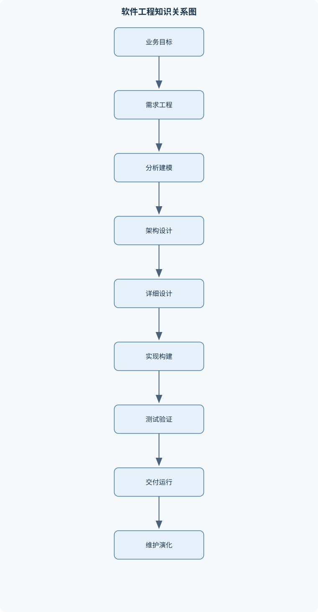
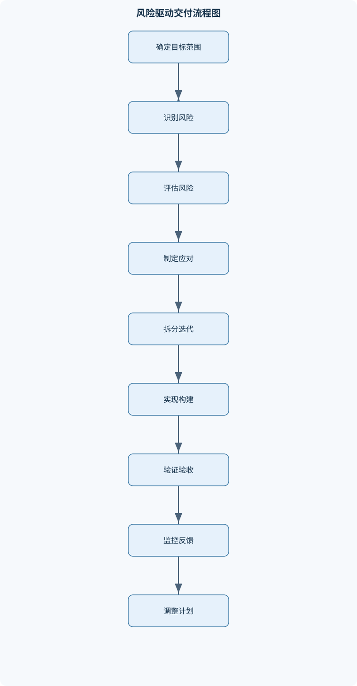

# 软件工程

## 一、课程整体知识框架

### 课程边界与先修知识

软件工程研究和实践软件系统从需求获取、分析建模、架构与详细设计、实现、测试、交付、运行维护到演化重构的系统化方法。课程覆盖过程模型、敏捷与迭代开发、需求工程、统一建模语言、软件架构与设计模式、项目计划与风险管理、质量保证与测试、配置管理与版本控制、用户界面设计、软件维护与再工程。课程不以某一种编程语言或工具为前提，但要求具备程序设计、数据结构、数据库和操作系统基础，能够阅读基本代码并理解模块、接口、数据结构、并发、异常和持久化等概念。课程关注可维护、可靠、安全、可验证和可交付的软件产品，不把软件工程简化为编码技巧；安全、性能、合规和组织流程应根据具体系统边界、风险等级和适用规范单独确定。





### 1. 软件工程的对象、目标与基本活动

软件工程研究的是软件系统从问题定义到退役的系统化开发、交付、运行和演化方法。软件产品不仅包括可执行代码，还包括需求规格、架构与设计模型、测试用例和报告、部署配置、用户文档、运行数据及维护记录。软件过程则是组织这些工作所采用的活动、角色、制品、决策和控制机制。产品回答“交付了什么”，过程回答“如何稳定地产生、验证和维护这些成果”。

典型生命周期活动包括需求获取与分析、架构和详细设计、实现、验证与确认、交付部署、运行维护以及演化重构。活动之间不是简单的单向流水线：测试结果可能促使需求澄清，运行故障可能促使架构调整，变更请求可能反向影响设计、代码、数据库和测试。工程目标是使系统在明确边界和约束下具备可维护性、可靠性、安全性、可用性、可验证性和可交付性，而不是单纯追求代码量或功能数量。

软件工程要求把需求表示为可追踪的对象。可用需求集合 $R$ 表示全部需求，$r_i$ 表示第 $i$ 条需求。每条需求至少应有唯一标识、描述、来源、优先级、验收条件和状态。验收条件必须能够通过观察、测试、检查或评审判断是否满足；“系统应当方便”“性能要好”缺少可操作的判定标准，不能直接作为完整需求。

### 2. 生命周期与过程模型

瀑布模型按需求、设计、实现、测试、交付和维护等阶段组织工作，阶段输出经过评审后进入下一阶段。它适合需求较稳定、法规或合同要求阶段性审批、交付物必须完整留痕且反馈成本较高的项目。其边界在于：如果需求尚未稳定却强行冻结，后期变更会沿需求、设计、代码和测试链条传播，返工代价显著上升。瀑布模型并不意味着阶段之间绝对不能反馈，而是强调阶段性基线和受控变更。

增量模型把系统分成若干可交付增量，每次交付一部分业务价值；演化模型先交付可运行版本，再根据用户反馈逐步完善。二者适合能够分解价值、需要早期反馈或需求存在不确定性的项目，但必须保证增量之间的接口、数据迁移和整体架构不会失控。螺旋模型以风险为驱动，每一轮依次完成目标确定、风险分析、方案开发和评估，适用于技术不确定性高、失败后果严重的系统。它的代价是风险分析和决策管理本身需要较强能力。

敏捷开发强调个体和交互、可工作的软件、客户协作以及响应变化，但不等于不计划、不写文档或不做设计。迭代计划应明确目标、范围、验收条件和完成标准；文档应保留足以支持沟通、维护、审计和交付的信息。统一过程通常以迭代方式推进，并把需求、分析设计、实现、测试等工作流分散到多个迭代中，使高风险问题尽早暴露。

过程裁剪要根据系统规模、风险等级、团队能力、合规要求、交付频率和技术不确定性确定。小型低风险项目可以采用轻量需求记录和自动化测试；高风险系统则需要更严格的独立评审、配置基线、验证证据和变更审批。技术债务是为了短期交付而接受的设计、代码、测试或文档缺口。债务只有在被记录、评估并安排偿还时才可控；长期不偿还会扩大变更传播范围和维护成本。

### 3. 需求工程与需求建模

需求工程包括利益相关者识别、范围界定、需求获取、分析协商、规格说明、验证确认、基线管理和变更追踪。利益相关者可能包括最终用户、业务负责人、运维人员、监管方、外部接口提供者和受影响的第三方。系统边界必须说明哪些能力由本系统承担，哪些由外部系统承担；边界模糊会造成职责重复、接口遗漏或验收争议。

功能需求描述系统应提供的服务，例如开户、登录、查询余额、提交订单、撮合交易和发布行情。质量属性描述系统在什么条件下以何种程度提供服务，例如响应时间、可用性、可靠性、安全性、可维护性和可审计性。功能需求与质量属性不能混写：前者回答“做什么”，后者回答“做得多快、多可靠、多安全以及如何维护”。

用户需求面向业务人员和最终用户，强调目标和价值；系统需求面向设计、开发和测试人员，必须更加精确。用例描述系统边界外的参与者为获得可观察价值而完成的完整目标，通常包括前置条件、主成功场景、备选流程、异常流程、后置条件和验收条件。用户故事可以采用“作为某角色，我希望完成某目标，以便获得某价值”的形式，但仍需补充可测试的验收条件。

需求获取可采用访谈、观察、工作坊、问卷、原型和文档分析。访谈记录应区分事实、意见、假设和待确认事项，不能把一次访谈中的个人偏好直接当作全体用户需求。需求冲突应先识别冲突来源，再比较业务价值、风险、依赖关系和成本，通过协商形成可追踪的决策，而不是由记录者擅自取舍。

需求优先级可用加权评分辅助排序：

$$
Score(r_i)=\sum_k w_k s_{ik}
$$

其中，$w_k$ 是第 $k$ 个评价维度的权重，权重和为 $1$；$s_{ik}$ 是需求 $r_i$ 在该维度上的标准化分数。评分只能辅助决策，不能取代法规约束、前置依赖、技术风险和安全要求。例如法规强制需求即使业务评分不高，也不能因总分低而删除。

需求验证应检查正确性、完整性、一致性、可行性、可验证性、可追踪性和无歧义性。需求基线是经批准的特定版本，基线之后的修改必须形成变更请求并评估影响。若一项变更影响需求、用例、架构、代码、数据库、测试和部署配置，就应通过双向追踪关系检查影响范围；只有从需求追踪到实现、测试以及从测试反向追溯需求，才能解释验收覆盖情况。

### 4. 分析模型与统一建模语言

用例图表示参与者、系统边界和用例之间的关系，不等同于业务流程图。活动图适合表达业务流程、分支、并行和汇合；顺序图强调对象之间按时间顺序发送的消息；类图描述类、属性、操作和结构关系；状态机图描述对象在事件作用下的状态变化。状态机中的状态是对象在一段时间内满足的条件，事件触发转换，守卫条件决定转换是否允许，动作描述转换产生的行为。

类图中的关联表示相对稳定的结构关系，依赖表示临时使用关系，泛化表示可替换的继承关系。若“支付服务调用日志服务”只表示一次使用，通常不应建模为继承。领域模型应从业务概念、职责和约束出发，而不是把数据库表机械地转换成类。数据流图强调数据经过处理、存储和外部实体的流动，数据字典则定义数据项含义、格式、来源和使用规则。

模型一致性检查包括：用例中的系统责任是否在类或组件中有对应承担者；顺序图中的消息是否存在于接收对象接口；状态转换是否有事件、守卫和动作；活动图中的数据是否有来源和去向；数据字典中的字段是否与接口和持久化模型一致。原型能够暴露流程和界面理解差异，但原型中的交互不应被误认为已经实现了安全、并发、性能和事务语义。

### 5. 架构设计与详细设计

架构设计关注系统的主要组件、接口、数据流、部署拓扑以及质量属性权衡。模块化把系统分割成具有明确职责和接口的单元；分层架构按表示层、业务层和数据层组织依赖；关注点分离要求业务规则、界面展示、持久化、认证和日志等变化原因尽量隔离。客户端—服务器架构适合把终端交互与集中服务分开，但必须处理网络延迟、服务不可用、身份认证和数据一致性。

管道—过滤器架构适合数据按阶段处理的场景，各过滤器通过标准数据流连接。事件驱动架构通过事件发布和订阅降低直接调用耦合，但会引入事件重复、乱序、延迟、丢失和最终一致性问题。微服务只有在服务边界清晰、团队能够承担分布式运维、监控、部署和故障处理时才有合理性；把单体系统机械拆成多个服务，可能增加网络调用、事务协调和排障成本。

接口契约应明确输入、输出、错误、超时、幂等性、版本兼容、权限和数据格式。架构评审以质量属性场景为依据，例如“在外部支付渠道超时后，订单状态应可查询且不得重复扣款”。评审应记录备选方案、选择理由、代价、风险、未决问题和接受条件，形成架构决策记录。部署视图需要说明运行节点、服务实例、数据库、消息系统、网络边界和故障转移关系。

详细设计强调信息隐藏、高内聚和低耦合。若模块只负责一种稳定职责，输入输出清晰，内部变化不会扩散到调用者，则其内聚性较高、耦合性较低；模块代码少不代表设计良好。面向对象设计需关注职责分配、依赖倒置、接口隔离和替换关系。组合优于继承适用于行为需要运行时替换、继承层次容易膨胀或子类并不满足真正可替换关系的情况。

设计模式不是固定代码模板。工厂和抽象工厂解决对象创建与具体类型解耦；适配器隔离外部接口差异；装饰器在不修改核心对象的情况下叠加行为；策略模式封装可替换算法；观察者适合一对多通知，但要处理订阅生命周期和通知失败。设计还必须考虑可测试性，例如通过接口注入外部支付、数据库和时钟依赖，使测试可以使用测试替身。

### 6. 项目计划、估算与风险管理

项目计划需要明确范围、工作分解结构、任务依赖、里程碑、交付物、人员责任和验收标准。设任务网络为有向图 $G=(V,E)$，其中 $V$ 是任务节点集合，$E$ 是依赖边集合；边 $(u,v)$ 表示任务 $u$ 必须先于任务 $v$。若任务持续时间为 $d_i$，则前向计算为：

$$
ES_i=\max_{j\in Pred(i)}(EF_j),\qquad EF_i=ES_i+d_i
$$

无前置任务时令 $ES_i=0$。从项目终点逆向计算：

$$
LF_i=\min_{k\in Succ(i)}(LS_k),\qquad LS_i=LF_i-d_i
$$

终点任务的 $LF$ 等于项目总工期。总时差为 $TF_i=LS_i-ES_i$，连续且 $TF_i=0$ 的任务构成关键路径候选。该方法适用于持续时间可估计、依赖明确且网络无环的计划。若存在环，说明依赖关系不能形成可执行顺序；压缩关键路径任务可能改变关键路径，还可能增加成本和技术风险。

规模 $S$、工作量 $E$、历时 $T$ 和成本 $C$ 必须说明单位，例如功能点、代码行、人月、月和货币单位。不能把工作量简单等同于历时，因为增加人员可能引入沟通和培训成本。风险记录应包含风险来源、事件、后果、概率 $P$、影响 $I$、责任人、监控指标、触发阈值和应对措施。若量表和单位一致，可定义风险暴露量：

$$
RE=P\times I
$$

若 $P$ 是概率，取值通常为 $0$ 到 $1$，则 $I$ 应采用货币、停机小时或统一等级；若二者都是五级评分，乘积只是排序分数，不能解释为货币损失。高风险必须有预防措施和应急计划，未知风险不能伪装成精确概率。

### 7. 质量保证、测试与验证

质量模型应把抽象目标转化为可观察指标。可靠性关注规定条件和时间内无故障运行的能力，可用故障率、平均故障间隔时间 $MTBF$ 等指标描述；可用性关注系统在需要时可使用的程度。在简单可修复系统假设下：

$$
A=\frac{MTBF}{MTBF+MTTR}
$$

其中 $MTTR$ 为平均修复时间。若多个组件是独立串联系统，组件可靠度为 $R_1,\ldots,R_n$，系统可靠度为：

$$
R_s=\prod_{i=1}^{n}R_i
$$

该结论不适用于共享数据库、共同网络、共享电源、冗余或强依赖系统。质量保证关注过程是否能持续产生合格产品，包括过程审计、技术评审、检查表、度量、缺陷预防和持续改进。验证关注“是否按规格正确构建”，确认关注“是否构建了满足用户目标的正确系统”。

测试层次包括单元测试、组件测试、集成测试、系统测试和验收测试。黑盒测试依据输入输出和业务规则设计；等价类划分先按可观察行为划分有效类和无效类，再取代表值；边界值测试应覆盖边界本身及相邻值，因为比较运算符和范围条件容易出错。白盒测试可度量语句、分支和路径覆盖。覆盖率是被测试结构元素占目标结构元素的比例，三者分母不同，不能互换。圈复杂度在结构化控制流图中可写为：

$$
V(G)=b-p+2
$$

其中 $b$ 为分支数，$p$ 为连通分量数；单入口单出口且 $p=1$ 时为 $b+1$。它可估计独立路径数量，但不能证明没有缺陷。

回归测试验证修改没有破坏既有行为；冒烟测试快速判断构建是否具备进一步测试条件；测试替身、桩、模拟对象和测试夹具用于隔离外部依赖。缺陷记录应包含环境、复现步骤、期望结果、实际结果、严重性、优先级、责任人、修复版本和验证证据。测试通过只说明在已执行的范围内获得了证据，不等于软件无缺陷。

### 8. 配置管理、持续交付与交互设计

配置项包括源代码、需求、设计模型、测试资产、数据库脚本、部署配置、依赖声明和文档。版本表示可识别的软件状态；基线是经批准、可复现且后续变更需要受控的配置状态。配置管理还包括状态记录、变更审计、分支策略、标签、构建制品和发布记录，不能被简化为备份。

分支合并应根据共同祖先进行三方合并。文本合并成功不代表语义正确，仍需检查接口契约、数据库迁移、异常处理、构建和回归测试。持续集成由提交或合并触发自动构建和测试；持续交付要求制品版本、测试结果、质量门禁和部署环境可追溯。可重复构建要求相同源代码、依赖和配置能够产生等价制品。发布应设计回滚条件、数据兼容策略和不可逆迁移的恢复方案。

用户界面设计从用户任务和交互上下文出发，关注一致性、可见性、反馈、可撤销性、认知负荷、导航结构、表单校验和错误恢复。错误提示应说明发生了什么、原因是什么以及用户可以如何修复，不应只显示内部异常信息。响应式设计适应不同屏幕和输入方式；无障碍设计应考虑键盘操作、颜色对比、替代文本、焦点顺序和辅助技术。可用性测试通过代表性任务、观察记录、完成率、错误类型和主观反馈发现问题，不能只凭设计者个人判断。

### 9. 维护、演化、再工程与综合实践

纠错性维护修复已发现缺陷；适应性维护使系统适应操作系统、数据库、法规或外部接口变化；完善性维护增加或改进业务能力；预防性维护通过重构、补充测试和改善监控降低未来风险。可维护性取决于结构清晰、依赖可控、测试充分、文档可恢复和部署可重复，而不只是代码行数。

遗留系统评价应同时检查业务价值、技术健康度、运行风险、维护成本、数据质量、人员能力和外部依赖。逆向工程从代码、数据库和运行行为恢复高层知识；重构改善内部结构并保持外部行为；再工程通常还涉及架构、数据、文档、业务过程和迁移方式。继续维护与再工程比较时，必须在相同评估期间统一单位。设继续维护方案的年维护成本、年运行成本和年业务价值分别为 $P_1,P_2,P_3$，再工程后的相应值为 $P_4,P_5,P_6$，再工程成本为 $P_7$，历时为 $P_8$，风险系数为 $P_9$，预期寿命为 $L$，则应分别计算两种方案在相同期间内的净收益；业务价值不能直接当作现金收益，迁移中断、数据转换和人员能力不足也必须单独评估。

综合实践可用交易或支付系统贯穿课程：划分证券账户、资金账户、交易客户端、撮合服务、行情发布和管理端边界；为账户、权限、订单、撮合、审计日志和外部接口分配职责；使用幂等键防止重复请求，处理超时、乱序通知、部分失败和并发更新；按照风险为余额、交易时段、价格合法性、权限和审计完整性设计测试。最终交付物应包括需求基线、架构决策、接口契约、源代码、测试证据、部署制品、运行监控、缺陷记录和复盘结论。

## 二、章节和模块划分

### 核心知识覆盖清单

本清单用于检查正文是否覆盖本课程的主要知识模块：

- **软件工程基础与过程模型**：软件工程的目标与基本活动、软件产品与软件过程的区别、软件生命周期与过程框架、瀑布模型及其适用条件、增量模型与演化模型、螺旋模型与风险驱动、敏捷开发的价值观与原则、统一过程的迭代和工作流、过程裁剪与项目约束、技术债务与过程改进。
- **需求工程**：利益相关者识别与需求范围、功能需求与质量属性、用户需求和系统需求、场景、用例与用户故事、需求获取和访谈记录、需求分析与冲突协商、需求规格说明的结构、需求优先级与发布规划、需求验证和确认、需求基线与变更追踪。
- **需求建模与软件分析**：用例图及系统边界、活动图与业务流程、类图中的类、属性和关联、顺序图与消息交互、状态机图与状态转换、数据流图与数据字典、领域模型与边界上下文、CRC卡片和职责分配、原型法与需求澄清、模型一致性检查。
- **软件架构设计**：架构设计目标与约束、模块化、分层与关注点分离、客户端服务器架构、三层架构与表示层业务层数据层、管道过滤器和事件驱动架构、微服务边界与分布式代价、架构质量属性权衡、接口契约与组件依赖、架构评审与架构决策记录、部署视图和运行时拓扑。
- **详细设计与设计模式**：信息隐藏与高内聚低耦合、面向对象设计原则、职责驱动设计、组合优于继承的适用条件、创建型设计模式、结构型设计模式、行为型设计模式、适配器与外部接口兼容、工厂和抽象工厂的对象创建、可测试性与可替换设计。
- **项目计划、估算与风险管理**：项目范围和工作分解结构、任务网络与依赖关系、里程碑和交付物定义、规模、工作量与成本估算、关键路径和进度压缩、时间盒与迭代计划、人员组织和责任分配、风险识别与风险登记册、风险概率影响评估、风险监控和应急计划。
- **软件质量保证与评审**：质量属性和质量模型、过程质量与产品质量、软件质量保证活动、技术评审和审查角色、检查表与缺陷记录、度量元和质量目标、验证、确认与独立评价、可靠性和可用性分析、安全性和危害分析、过程成熟度与持续改进。
- **软件测试与验证**：测试层次和测试对象、单元测试与组件测试、集成测试策略、系统测试和验收测试、黑盒等价类与边界值、决策表和状态转换测试、白盒语句分支和路径覆盖、回归测试与冒烟测试、测试替身和测试夹具、缺陷生命周期与测试报告。
- **配置管理、版本控制与持续交付**：软件配置项和基线、版本、变更和发布的关系、配置状态记录与审计、分支合并和冲突解决、提交历史与可追溯性、变更控制委员会和轻量审批、构建自动化与制品管理、持续集成的触发和反馈、持续交付的环境 promotion、可重复构建与回滚策略。
- **用户界面与人机交互**：用户任务和交互上下文、界面一致性与可见性、反馈、状态沟通和可撤销性、认知负荷与记忆负担、导航结构和信息架构、表单、错误提示与恢复、响应式和无障碍设计、可用性测试与观察记录、Web应用界面设计原则、界面原型和迭代验证。
- **软件维护、演化与再工程**：纠错性维护与适应性维护、完善性维护和预防性维护、可维护性和可支持性、遗留系统评价与应用清单、逆向工程和知识恢复、代码重构与数据重构、文档重构与按需补文档、业务过程再工程、正向工程与系统迁移、再工程成本收益分析。
- **综合软件工程实践**：业务系统范围划分、账户和权限边界设计、交易或支付流程建模、并发一致性和幂等性、审计日志与异常处理、领域对象和外部接口设计、质量风险驱动的测试计划、迭代交付和演示验收、运行监控和缺陷反馈、项目文档和工程复盘。


### 1. 十二个核心模块及其关系

#### 模块一：软件工程基础与过程模型

本模块建立“产品—过程—生命周期—质量”的基本概念，比较瀑布、增量、演化、螺旋、敏捷和统一过程。重点不是背诵模型名称，而是根据需求稳定性、风险、反馈成本、合规和交付节奏选择过程。过程改进应依据缺陷返工、交付延迟、变更传播和质量数据，而不是盲目增加流程。

#### 模块二：需求工程与需求建模

本模块从利益相关者、范围和需求基线出发，讲解访谈、观察、原型、用例、用户故事、需求规格和变更追踪。通过用例图、活动图、类图、顺序图、状态机图、数据流图和领域模型表达不同视角，并检查模型间的一致性。需求阶段的核心产出是可验证、可追踪且经过协商的系统目标。

#### 模块三：软件架构与详细设计

本模块讲解模块化、分层、客户端—服务器、管道—过滤器、事件驱动和微服务架构，分析质量属性之间的权衡。随后讨论信息隐藏、高内聚、低耦合、职责驱动设计、面向对象原则、组合与继承、创建型、结构型和行为型设计模式，并以接口契约和测试替身检验设计是否可替换、可维护。

#### 模块四：项目计划、估算与风险管理

本模块建立范围、工作分解结构、任务依赖、里程碑、人员责任和交付物之间的关系。关键路径分析要求先检查任务图无环，再按拓扑序进行前向和逆向计算。风险管理则从识别、分析、登记、应对、监控到关闭形成闭环，避免把风险分数当作精确预测。

#### 模块五：软件质量保证与评审

本模块区分过程质量和产品质量，讨论质量属性、技术评审、检查表、缺陷记录、度量元、独立评价、可靠性、可用性、安全性和危害分析。质量目标必须转化为可观察指标，例如错误率、恢复时间、可用性目标或审计完整性。评审应记录发现、严重性、责任人、整改期限和关闭证据。

#### 模块六：软件测试与验证

本模块覆盖单元、组件、集成、系统和验收测试，比较自底向上、自顶向下、三明治和持续集成下的集成策略。黑盒方法包括等价类、边界值、决策表和状态转换测试；白盒方法包括语句、分支和路径覆盖。测试计划应按风险分配资源，缺陷则经历报告、分派、定位、修复、验证、回归和关闭等状态。

#### 模块七：配置管理、版本控制与持续交付

本模块管理配置项、版本、基线、分支、合并、构建、制品和发布。三方合并解决文本差异后，仍需进行编译、接口检查、单元测试、集成测试和构建验证。持续交付要求提交、构建、测试、质量门禁、制品和环境晋级可追溯，并设计回滚与数据兼容策略。

#### 模块八：用户界面与人机交互

本模块以用户任务为中心，分析信息架构、导航、表单、反馈、错误提示、可撤销性、响应式和无障碍设计。原型用于澄清需求并快速验证交互，不代表后端业务规则已经实现。可用性实验要记录任务完成率、错误、停顿、求助行为和用户反馈，依据观察证据修改界面。

#### 模块九：软件维护、演化与再工程

本模块区分纠错性、适应性、完善性和预防性维护，分析遗留系统价值、技术风险、逆向工程、代码重构、数据重构、文档恢复、业务过程再工程和系统迁移。决策时比较继续维护与再工程的累计成本和业务价值，同时考虑迁移中断、数据质量、人员能力和不可逆风险。

#### 模块十：综合软件工程实践

综合案例要求从业务范围、账户和权限、交易或支付流程、领域对象、外部接口、并发一致性、幂等性、审计日志和异常处理出发，完成需求、架构、设计、测试和交付。综合验收不仅检查正常流程，还检查重复请求、超时、乱序通知、部分失败、权限越界和审计记录是否完整。

#### 模块十一：质量风险驱动的交付

本模块把风险登记、架构评审、自动化测试、持续集成、演示验收和运行监控连接起来。高风险需求必须有明确的验收证据；通过自动化测试只能说明某些行为符合预期，不能替代业务确认、运行安全评估和合规审查。

#### 模块十二：工程角色与产出

需求工程师产出需求规格、用例和追踪矩阵；系统分析师产出业务流程和领域模型；架构师产出架构方案、接口契约和决策记录；开发工程师产出可构建代码；测试工程师产出测试设计、报告和缺陷记录；质量保证工程师实施过程审计和质量门禁；项目经理维护计划、风险和交付状态；配置管理或持续交付工程师维护基线、构建和发布；用户体验设计师产出原型和可用性证据；维护与再工程工程师负责遗留系统评价、重构和迁移。每类岗位的验收标准都应落到可检查的制品和证据上。

### 2. 代表性算法与工程流程

#### 2.1 关键路径分析

**输入：**任务集合、任务持续时间 $d_i$ 和前置关系。  
**输出：**项目总工期、每项任务的 $ES,EF,LS,LF,TF$ 及关键路径。  
**过程：**

1. 检查依赖图是否有环；有环时停止并修正依赖。
2. 对任务图进行拓扑排序。
3. 按拓扑序计算 $ES$ 和 $EF$。
4. 从终点开始按逆拓扑序计算 $LF$ 和 $LS$。
5. 计算 $TF=LS-ES$，筛选总时差为零的连续任务。

不变量是：任务的前置任务全部计算完成后，才能计算该任务的最早时间；逆向计算时，后继任务的最迟时间必须已知。无环图的时间复杂度为 $O(|V|+|E|)$，适用于任务依赖明确且持续时间可估计的计划。

#### 2.2 等价类与边界值测试

**输入：**带约束的输入域；**输出：**有效、无效及边界测试数据。  
先按输入对可观察行为的影响划分等价类，再为每个关键有效类和无效类选代表值。对范围 $[18,60]$，有效类为 $18\le x\le60$，无效类为 $x<18$ 和 $x>60$；边界数据至少包括 $17,18,19,59,60,61$。多个输入条件不能简单做全组合，应依据风险采用决策表、正交组合或成对组合控制规模。该方法提高缺陷发现效率，但不能覆盖复杂时序、并发和分布式故障。

#### 2.3 需求变更影响分析

**输入：**变更请求、需求追踪矩阵、架构依赖、代码模块、数据结构、测试项和部署配置。  
**输出：**影响范围、工作量、回归范围、风险和批准建议。  
步骤为：解析变更目标；查找直接关联项；沿模块依赖和数据流扩展；标记受影响的接口、数据迁移、异常处理和文档；评估工作量、风险和发布影响；形成评审记录。使用邻接表遍历影响图时，记录已访问节点，时间复杂度为 $O(|V|+|E|)$。若只修改页面而未检查服务端认证、数据库字段和测试，影响分析是不完整的。

#### 2.4 缺陷闭环流程

缺陷报告应记录环境、复现步骤、期望与实际结果、严重性和优先级。随后分派责任人，定位根因，修复并提交变更，执行针对性验证和回归测试，确认没有引入新问题后关闭。无法稳定复现的问题进入调查状态并保留日志、输入和时间信息，不能直接标记为无效。缺陷可关闭、延期、拒绝、重复或重新打开，但每个状态都必须有依据。

### 3. 代表性例题

#### 例题一：关键路径计算

**题干：**任务 A 为 3 天；B 在 A 后执行，需 4 天；C 在 A 后执行，需 2 天；D 需在 B、C 完成后执行，需 3 天。求工期和关键路径。

**分析与解答：**  
A：$ES=0,EF=3$；B：$ES=3,EF=7$；C：$ES=3,EF=5$；D：$ES=\max(7,5)=7,EF=10$。逆向计算得 D 的 $LF=10,LS=7$；B 的 $LF=7,LS=3$；C 的 $LF=7,LS=5$；A 的 $LF=3,LS=0$。因此 A、B、D 的总时差为 0，工期为 10 天，关键路径为 A—B—D。

**验证与变式：**C 有 2 天总时差，延迟不超过 2 天不影响总工期；若 C 延迟 3 天，则其完成时间为 8 天，D 的开始时间变为 8 天，项目工期变为 11 天。若压缩 B，应比较压缩成本和是否出现新的关键路径。

#### 例题二：边界值测试

**题干：**年龄必须为 $18$ 至 $60$ 岁，包含端点。生成关键测试数据。

**分析与解答：**  
有效类为 $18\le x\le60$，无效类为 $x<18$ 和 $x>60$。边界及相邻值为 $17,18,19,59,60,61$。其中 17 和 61 检查无效边界，18 和 60 检查端点是否包含，19 和 59 检查边界内侧行为。

**验证与变式：**若实现条件误写为 $18<x<60$，18 和 60 会暴露错误；若规定不包含 60，则 60 应归入无效类。若年龄为空、非数字或带小数，还需补充格式和缺失值测试。

#### 例题三：交易规则决策表

**题干：**只有账户正常、余额不少于订单金额、交易时间开放且价格合法时才允许下单。

**分析与解答：**  
四个条件均为真时动作是“接受订单并记录审计日志”。任一条件为假，动作是“拒绝订单并返回明确原因”。测试至少包括：全部满足；账户冻结；余额等于订单金额；余额少于订单金额；交易时段刚开始和刚结束；价格等于允许边界、低于边界和格式错误。

**结果验证与变式：**余额等于金额应验证是否允许；交易时间端点必须由需求明确是闭区间还是开区间。若订单先被接受后异步扣款，还需增加并发、重复提交、扣款失败和状态补偿测试。

#### 例题四：串联系统可用性

**题干：**两个独立串联组件的 $MTBF$ 分别为 900 小时和 600 小时，$MTTR$ 分别为 9 小时和 6 小时，求简单假设下系统可用性。

**分析与解答：**  
组件一可用性为 $900/(900+9)\approx0.9901$；组件二为 $600/(600+6)\approx0.9901$。串联系统可用性约为 $0.9901\times0.9901\approx0.9803$，即约 98.03%。

**验证与变式：**该结果假设故障独立、无共享故障源且系统只有串联依赖。若二者共用同一数据库，独立性不成立；若增加故障转移，还需根据切换成功率、恢复时间和共享资源重新建模。

#### 例题五：需求变更影响分析

**题干：**将“账户首次登录完成证书认证”改为新的认证流程，应检查哪些对象？

**分析与解答：**  
先定位需求条目和账户登录用例，再检查客户端页面、认证接口、账户状态字段、证书或凭据存储、异常处理、权限判断、审计日志、测试用例、部署配置和运维文档。区分直接影响和间接影响：认证接口和登录用例属于直接影响；会话管理、失败锁定、监控告警和回归测试属于间接影响。随后估算开发、迁移、测试和发布工作量，评估认证失败、旧客户端兼容和数据迁移风险。

**结果验证与变式：**必须通过需求到测试的追踪关系证明新流程有验收证据。若旧客户端仍需兼容，应设计接口版本或过渡期；若新流程不可回退，应先验证数据和部署回滚方案。

### 4. 实验与项目实践

#### 实验一：任务网络与计划分析

**输入数据：**提供至少八项任务的持续时间和前置关系，其中包含一个可并行分支和一个非关键任务。  
**步骤：**

1. 用表格录入任务、持续时间和前置任务。
2. 检查是否存在环。
3. 按拓扑序计算 $ES,EF$，再逆向计算 $LS,LF$。
4. 标记关键路径并模拟压缩一个关键任务。
5. 比较压缩前后的工期、成本和关键路径变化。

**评价标准：**依赖关系无环；计算过程完整；单位统一；关键路径与总时差一致；能够解释压缩后新增风险。  
**排错方法：**若工期异常，检查是否遗漏前置任务；若出现负总时差，检查终点 $LF$ 和逆向顺序；若多个终点，先增加统一项目终点节点。

#### 实验二：交易或支付流程质量验证

**输入数据：**账户正常、余额、订单金额、交易时间、价格范围、重复请求标识、异步通知和超时条件。  
**步骤：**

1. 绘制系统边界并定义账户、订单、支付或撮合服务职责。
2. 编写正常流程、余额不足、权限失败、重复提交、外部超时、通知乱序和部分失败用例。
3. 为金额和时间边界建立等价类、边界值和决策表。
4. 使用测试替身模拟外部渠道或撮合服务。
5. 检查订单状态、幂等结果、审计日志和异常恢复。
6. 提交缺陷并执行修复后的回归测试。

**评价标准：**每条高风险需求有测试证据；重复请求不会造成重复扣款或重复成交；异常状态可查询且可恢复；日志包含必要的关联标识；测试结果可追溯到版本和构建制品。  
**排错方法：**先区分前端校验失败、服务端业务拒绝和外部系统失败；再检查是否存在并发竞态、状态更新非原子、通知重复或时间端点判断错误。

### 5. 具体易错点与常见笔试、面试问题

#### 具体易错点

1. 把软件工程等同于编码，忽略需求、测试、配置、运行和维护。
2. 认为瀑布模型任何项目都必须一次性冻结全部需求。
3. 把敏捷误解为不计划、不设计或不写文档。
4. 把质量属性当成功能需求的同义表达。
5. 把用例图当作详细业务流程图。
6. 混淆关联、依赖和泛化关系。
7. 以模块数量或代码行数判断高内聚低耦合。
8. 机械套用设计模式而不分析代价和替代方案。
9. 把 $P\times I$ 风险分数当作精确损失预测。
10. 把测试通过当作没有缺陷。
11. 把语句覆盖率等同于测试充分性。
12. 把版本控制当作简单文件备份。
13. 把文本冲突解决当作语义合并完成。
14. 只考虑交易正常路径，忽略幂等、超时、乱序和并发。
15. 把维护只理解为修复错误。
16. 混淆逆向工程、重构和再工程。

#### 常见笔试问题及解答思路

1. **比较瀑布模型与敏捷迭代。**  
   从需求稳定性、反馈周期、基线、交付频率和风险暴露解释，不能简单说某一种模型绝对更好。

2. **说明功能需求和质量属性的区别。**  
   功能需求描述服务行为；质量属性描述性能、可靠性、安全性等可度量特征，并分别给出验收条件。

3. **计算任务网络关键路径。**  
   先检查有环，再前向计算 $ES,EF$，逆向计算 $LS,LF$，最后求 $TF$ 和关键路径。

4. **为什么边界值测试有效？**  
   因为范围比较、等号和数组下标错误常发生在边界；应测试边界本身及相邻值。

5. **解释验证与确认。**  
   验证检查是否按规格正确构建，确认检查是否满足用户和业务目标，二者证据来源不同。

6. **给出串联系统可靠度公式及限制。**  
   独立串联系统为 $R_s=\prod R_i$；共享故障源、冗余和强依赖会破坏公式条件。

7. **说明需求变更为何需要追踪矩阵。**  
   追踪矩阵能从需求定位设计、代码、测试和文档，并反向检查是否存在无来源实现或无测试需求。

8. **解释持续交付不等于自动部署到生产。**  
   持续交付要求制品随时具备发布条件，但生产发布仍可能受业务窗口、审批、风险和回滚条件约束。

#### 常见面试问题、参考答案与追问要点

1. **如何处理需求冲突？**  
   参考答案：识别利益相关者和冲突目标，澄清业务规则，比较价值、风险、依赖和成本，记录协商结论。追问应说明无法达成一致时如何升级决策并保留不同方案。

2. **如何判断一个模块设计良好？**  
   参考答案：职责集中、接口清晰、依赖稳定、变化不易传播且容易独立测试。追问可要求举例说明如何通过依赖注入替换数据库或外部服务。

3. **为什么不建议直接拆成微服务？**  
   参考答案：微服务会引入网络、分布式事务、部署、监控和故障排查成本，必须先证明边界和组织能力。追问应讨论最终一致性和幂等处理。

4. **如何制定风险驱动的测试计划？**  
   参考答案：按影响和发生可能性排序，高风险需求优先做验收、异常、边界和恢复测试。追问应说明剩余风险如何接受、监控或升级。

5. **遇到无法复现的缺陷怎么办？**  
   参考答案：保留环境、日志、输入、时间和关联标识，增加诊断信息并进入调查状态，不直接关闭。追问可讨论复现概率、并发和环境差异。

6. **如何解决版本合并冲突？**  
   参考答案：基于共同祖先三方合并，人工判断语义冲突，随后运行构建、单元、集成测试并评审。追问应说明数据库迁移和接口兼容问题。

7. **支付或交易系统如何防止重复处理？**  
   参考答案：使用业务幂等键、唯一约束、状态机和可追踪审计记录，并处理超时重试和异步通知重复。追问应说明幂等键过期、并发竞争和部分失败。

8. **何时选择重构而不是重写？**  
   参考答案：若业务规则仍有价值、系统可逐步验证且风险可分阶段控制，优先渐进重构；若架构和数据模型已无法支撑目标且迁移边界清晰，才考虑重写。追问应比较数据迁移、停机、人员能力和回滚风险。

9. **如何证明一次发布可回滚？**  
   参考答案：制品、配置和数据库变更可追踪，准备回滚触发条件、兼容版本和演练记录。追问应指出不可逆数据库迁移不能只依赖代码回滚。

10. **如何评价一次项目复盘？**  
    参考答案：基于事实数据分析计划偏差、缺陷根因、变更传播和交付质量，形成责任明确、可验证的改进措施。追问应区分个人归因与过程系统性原因。

### 6. 岗位关联与工程验收

需求工程师的实际任务是访谈、整理需求、维护基线和追踪矩阵，产出需求规格、用例和验收条件；验收标准是需求无歧义、可测试、来源明确且与实现和测试双向关联。系统分析师负责范围、业务流程、领域模型和异常场景，产出分析模型；验收标准是边界清楚、职责不重叠、关键流程和异常路径完整。

架构师和应用设计师负责组件划分、接口契约、质量属性权衡、设计决策和部署视图，产出架构文档、接口定义、设计模型和风险清单；验收标准是高风险场景有方案，依赖、数据流和故障处理可解释。开发工程师负责实现、单元测试、代码评审和重构，产出可构建代码和测试证据；验收标准是行为符合需求、构建可重复、静态检查和测试门禁通过。

测试工程师负责测试设计、自动化执行、缺陷闭环和发布回归，产出测试计划、用例、报告和缺陷记录；验收标准是高风险需求覆盖充分、缺陷状态有依据、环境和版本可追溯。质量保证工程师负责过程审计、评审和质量度量，产出评审记录、质量报告和改进项。项目经理负责范围、进度、成本、人员、风险和沟通，产出计划、风险登记册、里程碑报告和复盘记录。配置管理与持续交付工程师负责基线、分支、构建、制品、环境晋级和回滚，验收标准是发布过程可重复、可审计并能在规定条件下恢复。

用户体验设计师负责任务分析、信息架构、界面原型和可用性验证，产出原型、交互规范和观察记录；维护与再工程工程师负责遗留系统评价、逆向工程、重构、数据迁移和运行支持，验收标准是外部行为、数据完整性、迁移风险和维护收益均有证据。

## 三、核心概念的详细解释

### 1. 软件过程、生命周期与过程模型

软件过程是将人员、活动、制品、决策和控制机制组织起来，以生产、验证、交付和维护软件的方式。生命周期描述软件从问题定义到退役的状态与活动；过程模型则规定这些活动如何排序、如何反馈以及在何处设置决策点。二者不是同一概念：同一生命周期可以采用不同过程模型，同一模型也可以按项目风险和约束裁剪。

瀑布模型强调阶段顺序和阶段性基线，适用于需求较稳定、审批和交付证据要求明确、阶段间反馈成本较高的项目。它的关键风险不是“不能变更”，而是需求变化发生后，必须评估其对设计、实现、测试、计划和合同承诺的连锁影响。若需求不确定性高、早期错误会延迟到后期才暴露，严格按阶段推进可能导致大规模返工。

增量模型把系统划分为多个能够单独验证或交付的能力片段。每个增量都要与总体架构、共享数据和既有接口协调；若只按界面页面切分而忽略业务一致性，可能得到看似可演示、实际无法完整工作的版本。演化模型强调通过可运行产品逐步澄清需求，适用于用户能够持续反馈且系统允许分阶段演进的情形。螺旋模型以风险为每轮工作的组织中心：先确定目标和约束，再识别高影响不确定性、评估备选方案、构建和验证方案，最后决定继续、调整或停止。风险分析不足时，螺旋过程会退化成重复开发，失去其控制不确定性的作用。

敏捷开发以短反馈周期、可工作的软件、协作和适应变化为重点。迭代不是免除计划，而是把计划分成不同时间尺度：产品范围可调整，当前迭代仍须有明确目标、验收条件和完成标准。文档的形式可以轻重不同，但需求边界、重要设计决策、测试证据和发布信息必须足以支撑维护与审计。统一过程也采用迭代，通常由多个阶段构成，并在每个迭代中以不同强度执行需求、分析设计、实现和测试工作流。

过程裁剪应依据系统规模、故障后果、技术不确定性、组织能力、合规约束和交付节奏作出。减少流程活动不能消除风险，只会改变风险暴露和控制方式。技术债务是为获取短期收益而接受的结构、测试或文档缺口；若债务没有明确记录、影响范围和偿还条件，后续变化可能使局部捷径扩展为全局维护负担。

### 2. 需求工程与需求模型

需求工程从利益相关者和系统边界开始。利益相关者不仅包括最终用户，还包括业务负责人、运维人员、管理者、外部系统提供者以及可能受系统决策影响的群体。系统边界规定哪些行为由本系统负责、哪些由外部参与者或系统负责。边界不清会造成需求遗漏、接口责任重复，以及验收时双方对“系统应当做什么”理解不同。

功能需求描述系统应提供的行为，例如提交订单、查询资金或记录交易结果。质量属性描述系统在特定条件下对这些行为的性能要求，例如响应时间、可用性、安全性、可靠性和可维护性。质量属性应写成可观察的场景：给出触发条件、运行环境、期望响应和判定指标。“速度快”无法验收；“在指定负载和部署条件下，某操作的响应时间满足约定阈值”才具有可测试性。具体阈值必须由项目约束和风险分析确定，不能脱离场景套用。

用户需求面向业务目标，系统需求把目标转为可实现、可验证的行为与约束。用例描述系统边界外的参与者为实现目标而与系统进行的一组交互，通常需要主成功流程、备选流程、前置条件和后置条件。用例图展示参与者与用例的关系，不足以表达完整业务顺序；详细流程应使用用例文本、活动图或顺序图。用户故事可以简洁表达角色、目标和价值，但必须配有验收条件，否则无法判断实现是否满足预期。

需求获取可通过访谈、观察、工作坊、原型和既有流程分析进行。访谈记录应区分事实、假设、意见和待决问题，不能把单个受访者的表述直接当作全体用户需求。需求分析要发现冲突、重复、缺口、不可行约束和隐含依赖，并与利益相关者协商优先级。加权评分可辅助排序，但权重和评分依赖决策者的尺度；法律约束、依赖关系和安全风险不能被简单的总分抵消。

需求规格说明应有稳定标识、来源、描述、优先级、验收条件和状态。需求基线是经批准并受变更控制的需求集合，不表示需求此后绝不改变。变更应记录原因、影响范围、成本、风险和批准结论，并通过追踪关系定位受影响的架构、接口、代码、数据、测试和文档。双向追踪有助于确认每项需求有实现与验证证据，也能识别没有需求依据的实现。

### 3. 需求建模、领域分析与模型一致性

统一建模语言（UML）提供多种视角，不同图不能相互替代。用例图表达系统边界外的参与者与系统目标；活动图表达活动、决策和流程分支；类图表达静态结构，包括类、属性和关系；顺序图按时间顺序表达对象间消息；状态机图描述对象状态以及事件触发的转换。建模时必须说明抽象层次和假设，避免把设计实现细节误当成业务事实。

类图中的关联表示对象之间较稳定的结构关系，依赖表示某元素在某一操作或实现中使用另一元素，泛化表示子类型可在相应契约下替代父类型。关系方向和多重性应按所采用的建模约定明确标出。若“客户”和“账户”存在关联，模型还应说明一个客户是否可有多个账户、账户是否可有多个持有人等约束；仅画一条线不能表达这些规则。

状态机中的状态是对象在一段时间内满足的条件，事件触发转换，守卫条件决定转换是否允许，动作描述转换时产生的行为。账户状态可以包括待审核、正常、冻结和销户等，但合法状态及其转换取决于业务规则。将“冻结账户仍可提交交易”留在未定义状态，会使实现、测试和审计规则不一致。

数据流图从过程、数据流、数据存储和外部实体描述信息如何流动；数据字典补充数据项的定义、格式和约束。领域模型按业务概念和关系组织知识，不应等同于数据库表结构。边界上下文用于明确某组模型和术语适用的范围：同一名称在不同业务区域可能具有不同含义，应通过明确的接口和翻译规则连接，而不是共享含糊的数据对象。

CRC（类—职责—协作者）卡片通过列出类的职责及完成职责所需协作对象，帮助检查职责分配。若一个对象同时负责订单校验、数据库事务、支付渠道调用和通知发送，变更任一外部规则都可能迫使其修改，说明职责边界值得重新审视。原型适合澄清交互、术语和流程，但原型能运行不等于已满足安全、可靠性、性能或数据一致性要求。模型一致性检查要比较同一业务规则在需求文本、活动流程、状态转换、接口契约和测试条件中的含义是否一致。

### 4. 架构设计、详细设计与设计模式

软件架构描述系统的主要结构、组件职责、交互关系、部署方式和关键设计决策。架构设计从质量属性和约束出发，而不是先选技术再寻找理由。模块化与关注点分离旨在限制变化传播；高内聚表示模块内部职责围绕稳定目标组织，低耦合表示模块之间依赖少、依赖关系清晰且接口相对稳定。模块数量多不等于模块化良好，判断重点是变化是否能局部处理。

分层架构把表示、业务规则和数据访问等职责分开，适合边界清楚、依赖方向可控制的系统。若所有业务规则被塞入数据访问层，或表示层直接绕过业务层写数据，分层只剩目录形式。客户端—服务器架构明确请求方和服务方的责任，适用于集中提供共享能力的系统，但网络故障、延迟、认证授权和服务端容量成为必须处理的工程问题。管道过滤器适合由若干变换阶段处理数据流的场景；事件驱动架构适合生产者与消费者解耦的场景，但需要处理事件重复、乱序、延迟、失败重试和可观察性。

微服务以可独立部署的服务边界组织系统。它可能改善局部自治和独立发布能力，但会引入网络调用、分布式事务、服务发现、跨服务监控和数据一致性等成本。把一个单体按代码目录拆成多个远程服务，并不自动形成有效微服务架构。服务边界应围绕业务能力、数据所有权和变化原因设计，并明确故障传播及降级方式。

接口契约规定调用语义、输入输出、错误、时序和兼容策略。架构决策记录应保存问题背景、备选方案、决策理由、后果和待验证风险，防止重要约束只存在于个人记忆中。部署视图则描述组件在运行节点、容器或其他执行环境中的分布及连接关系。架构评审应以具体质量属性场景检查方案，例如负载增加、节点故障、凭据失效或数据迁移时系统如何响应。

详细设计将模块职责进一步落实为对象、函数、数据结构、异常边界和并发规则。职责驱动设计强调对象应承担与其掌握信息相匹配的职责。组合优于继承适用于行为需要动态拼装或继承层次容易僵化的情形；继承仍适用于确有稳定“可替换”关系且满足子类型契约的情况。设计模式是解决反复出现的设计问题的可复用结构，不是固定模板。工厂集中对象创建，适合创建过程随配置或具体类型变化的场景；适配器转换外部接口以隔离兼容差异；观察者或事件机制用于发布变化，但必须考虑订阅生命周期、重复通知和处理失败。引入模式若增加了无必要的层次和间接性，反而会降低可理解性和可测试性。

### 5. 项目计划、估算与风险管理

项目计划把范围分解为可估算、可分配、可验证的工作包。工作分解结构说明交付范围及其组成；任务网络说明任务依赖；里程碑是可检查的状态或交付结果，不应只用“完成约一半”描述。估算应区分软件规模 $S$、工作量 $E$、历时 $T$ 和成本 $C$：规模不是工作量，工作量也不等于日历时间。$S$可用适合项目的规模单位表示，$E$常以人时或人月表示，$T$以日或月表示，$C$以明确货币单位表示。不同团队能力、工作并行性、返工和沟通成本会影响这些量之间的关系。

任务依赖构成有向图。若任务网络有环，意味着计划要求某任务最终先于自身，不能直接形成可执行顺序。关键路径分析用前向计算最早时间、逆向计算最迟时间，确定决定计划总工期的路径。压缩关键任务持续时间不一定缩短整体工期：压缩后另一条路径可能成为新的关键路径，且赶工可能增加成本、缺陷或人员冲突风险。

风险是可能发生并影响项目目标的不确定事件。风险登记册应包含事件、原因、后果、概率与影响评估、责任人、监控指标、应对策略和触发条件。风险暴露量 $RE=P\times I$ 是一种排序辅助量：$P$需是无量纲概率或一致量表，$I$需采用统一影响量表；若用货币表示影响，结果才可解释为概率加权的货币暴露，但仍依赖估计假设。评分不是精确预测，低分也不能替代对法规、安全和灾难性后果的单独审查。

风险应对可包括降低发生可能性、降低影响、转移部分后果或接受风险并准备应急方案。每项高风险应有负责人和可观察触发条件。风险评估需随需求、技术方案、人员和外部依赖变化而更新；项目初期的排序不应被视为固定事实。

### 6. 质量保证、评审与软件测试

质量是系统满足明确需求、利益相关者需要和运行约束的程度。质量属性必须联系场景和测量条件。过程质量关注开发活动是否足以产生可验证成果；产品质量关注交付软件的行为和属性。质量保证通过计划、标准、审查、度量和改进活动降低缺陷进入后续阶段的可能性，但不能仅凭流程文件证明产品正确。

技术评审应明确评审范围、材料、角色、缺陷记录方式和后续处置。评审意见要描述位置、现象、影响及依据，避免把风格偏好与实质性风险混为一谈。验证关注产品是否符合规格，确认关注产品是否满足用户和业务目标。两者的证据不同：需求追踪、设计检查和测试可支持验证；用户试用、验收场景和业务流程评估可支持确认。

测试通过具体执行和观察提供质量证据，不能证明所有输入、状态和环境均无缺陷。测试层次可包括单元、组件、集成、系统和验收测试；它们按测试对象与目标区分，不是必须完全由不同人员执行的组织层级。黑盒测试从需求行为出发，使用等价类、边界值、决策表和状态转换等方法。白盒测试利用代码结构设计用例，语句覆盖、分支覆盖和路径覆盖的分母不同，不能混为一个数字。

边界值测试关注范围端点及邻近值，因为比较符号、整数舍入和区间定义错误常出现在边界。对“年龄在 $[18,60]$ 内有效”的输入规则，可检查 $17,18,19,59,60,61$；若输入还受身份状态、时间或权限影响，需要另设计组合和状态测试。测试替身可隔离外部服务、时钟或存储，但替身行为若与真实依赖不一致，会给出误导性信心。测试夹具需稳定建立前置条件，并在测试后清理或恢复状态。

回归测试在变更后检查既有行为是否受影响；冒烟测试用于快速判断构建是否具备进一步验证的基本条件。缺陷记录应包括环境、输入、复现步骤、期望与实际结果、证据和版本。无法稳定复现的问题应保留调查状态与观测信息，不应仅因复现困难而关闭。

可靠性描述系统在规定条件和时间内提供正确服务的能力。可用性衡量系统在需要时可用的比例。对于简单可修复系统，在故障间隔和修复过程可用平均值近似描述时，
$$
A=\frac{MTBF}{MTBF+MTTR}
$$
其中 $MTBF$ 为平均故障间隔时间，$MTTR$ 为平均修复时间，二者单位必须一致。该近似不覆盖复杂维护窗口、非计划停机定义差异和依赖系统故障等所有情况。若系统由相互独立的串联组件构成，所有组件都必须可用，且组件可靠度为 $R_1,\ldots,R_n$，则系统可靠度为
$$
R_s=\prod_{i=1}^{n}R_i
$$
独立性和串联假设不成立时，该乘积不能直接使用；共享数据库、共同电源或共同配置错误可能造成相关故障。安全性和危害分析应识别资产、威胁、失效模式、影响和控制措施，系统具体安全要求由边界、风险和适用规范决定。

### 7. 配置管理、版本控制与持续交付

软件配置管理识别并控制会影响产品状态的配置项，包括需求、模型、代码、测试、构建脚本、部署配置和文档。版本是可识别的软件状态；基线是经过批准、可复现且后续变更受控的配置状态；发布则是面向特定环境或用户交付的版本及其配套说明。三者关系密切但含义不同：一个版本可能尚未批准为基线，已批准基线也不必然已经发布。

配置状态记录应能回答某一时间点交付了哪些制品、依据哪个源代码状态构建、使用何种配置和依赖。审计要确认实际状态与批准状态一致。分支用于并行维护或开发，合并用于整合变化；文本自动合并不代表语义兼容。合并冲突要结合共同祖先、需求和接口契约判断，并在合并后执行相应验证。

持续集成通过变更触发自动构建和反馈，缩短集成问题的发现时间。构建自动化和制品管理应保证构建输入、输出及版本可追踪。持续交付强调制品能够经过受控环境晋级，但“自动化测试通过”不等于满足全部业务验收、安全和运行条件。可重复构建依赖稳定工具、依赖版本、环境参数和输入制品。回滚策略须考虑数据迁移与外部副作用；代码回退并不能自动撤销已发送的支付、已提交的交易或不可逆数据变更。

### 8. 用户界面与人机交互

界面设计以用户任务和交互上下文为依据。任务分析要识别用户目标、已有知识、输入限制、错误代价和使用环境。信息架构组织内容和导航，使用户能够找到对象并理解当前位置；界面一致性减少重复学习，但一致并非所有操作都使用同一布局，而是相同概念和行为有稳定表达。

系统应及时反馈操作结果、当前状态和错误原因，并在适用时提供撤销或恢复路径。认知负荷来自信息数量、记忆要求和任务切换；通过合理分组、默认值、约束输入和显示必要上下文，可以减少记忆负担。表单应验证输入并说明如何修正错误，不能只给出“操作失败”。涉及账户、交易或权限的界面还应让用户明确知道操作对象、关键条件和最终状态。

响应式设计适应不同屏幕和输入方式；无障碍设计关注键盘操作、可读性、语义结构、对比度和辅助技术支持。可用性测试通过观察代表性任务的完成过程记录错误、停顿、误解和恢复行为。原型用于验证流程与信息组织，测试结果应反馈到需求和设计；视觉上可点击不证明后台状态、权限和异常处理已经设计完整。

### 9. 维护、演化与再工程

维护包括纠错性维护、适应性维护、完善性维护和预防性维护。纠错性维护处理已发现缺陷；适应性维护响应运行环境或外部接口变化；完善性维护增加或调整业务能力；预防性维护通过重构、测试补强和依赖治理降低未来故障或变更成本。维护不是系统生命周期末尾的附属活动，而是软件运行期间持续发生的工程工作。

遗留系统评价应同时考察业务价值、运行风险、维护成本、技术状态、数据质量和人员知识。应用清单帮助识别系统之间的接口、责任和使用情况。逆向工程从代码、数据和运行行为恢复设计与业务知识；重构在保持外部行为的前提下改善内部结构；再工程通常覆盖更大范围，可涉及架构、数据、部署、业务过程或迁移策略。三者目标和风险不同，不应混用。

迁移方案可能采用分阶段替换、并行运行、接口适配或整体切换。分阶段迁移有利于降低一次性风险，但新旧系统并存会增加同步、对账和运维复杂度。数据重构需要明确字段语义、转换规则、校验方法和回退条件。维护与再工程比较必须统一评估期间、成本单位和业务价值的口径，不能把业务价值未经转换就当成现金收益。再工程可能降低后续维护成本，却在实施期间产生中断、迁移和人员能力风险。

### 10. 交易类业务系统的综合工程边界

交易系统由证券账户、资金账户、交易客户端、撮合处理、信息发布和管理功能构成时，首先要明确各组件的业务责任和数据所有权。账户服务负责账户状态和授权信息，交易处理负责接收并验证指令，撮合能力负责按既定规则处理可匹配指令，信息发布负责提供查询视图，管理功能应按权限暴露监控数据。系统边界外的市场、身份服务、外部网络和监管要求必须作为外部依赖或约束单独描述。

核心流程需要表达成功和失败路径。提交指令时，应考虑账户状态、权限、输入合法性、资金或证券约束、重复请求和审计记录；撮合后需要明确成交结果如何持久化、账户变更如何与指令状态保持一致。跨组件操作可能出现部分成功，因此应定义状态转换、重试语义、补偿或对账机制。幂等键和唯一约束可降低重复请求造成重复处理的风险，但必须说明键的作用范围、保存期限和并发冲突处理。

安全不能因教学案例缩小范围而被当作现实系统中的可忽略事项。登录确认、首次认证、授权边界、敏感数据保护、审计日志和安全失败处理均需依据具体风险和适用规范确定。界面、接口和管理操作应遵循最小权限原则，避免把“能够登录”误当成“有权执行所有操作”。

## 四、重要定义、公式、定理和推导

### 专业审校补充：关键定义与适用边界

软件配置管理中的“版本一致性”不等于“文件版本号相同”。配置项之间存在依赖关系时，必须保证源代码、接口定义、数据库迁移、运行配置、依赖包和测试制品能够共同形成一个可构建、可验证、可部署的配置状态。设配置项集合为 $C$，依赖关系为有向图 $G=(C,E)$；若边 $(c_i,c_j)$ 表示 $c_j$ 依赖 $c_i$，则一次发布候选必须为所有受影响节点确定可兼容版本，并验证图中不存在未满足的依赖。该边界尤其适用于数据库向前兼容、接口渐进升级和分阶段发布。文本合并成功只能说明文件冲突已消除，不能证明接口语义、数据迁移和运行行为一致。若配置含有外部服务版本、密钥或环境变量，还应区分可追踪的配置模板与不可直接进入版本库的敏感值。配置管理的目标是可识别、可重现、可审计和可恢复，而不是追求所有项目都采用同一种分支模型。


### 1. 需求评分与变更追踪

设 $R$ 为需求集合，$r_i$ 为其中第 $i$ 条需求。每条需求应有唯一标识、描述、来源、优先级、验收条件和状态。若采用多维加权评分，可定义
$$
Score(r_i)=\sum_{k=1}^{m} w_k s_{ik}
$$
其中 $m$ 是评价维度数，$w_k$ 是第 $k$ 个维度的权重，满足 $w_k\ge 0$ 且 $\sum_{k=1}^{m}w_k=1$；$s_{ik}$ 是需求 $r_i$ 在维度 $k$ 上经过统一尺度归一化后的分数。计算步骤是先确定维度及其尺度，再确定权重，随后给每条需求评分并计算加权和。若两个需求总分相近，仍须检查它们之间的依赖、法规约束、风险和实现顺序。该公式辅助比较，不证明分数更高的需求必然应先实现。

需求变更影响分析以需求、模型、代码、数据和测试之间的追踪关系为基础。给定变更需求，沿关联项向外遍历，记录直接受影响项和因依赖产生的间接受影响项，并评估成本、风险、回归范围和文档更新。若关系表示为有向图 $G=(V,E)$，其中 $V$ 是需求及工程制品节点，$E$ 是追踪或依赖边，则从变更节点开始的图遍历可在邻接表表示下以 $O(|V|+|E|)$ 时间完成。该复杂度描述遍历成本，不表示影响估算本身可以自动准确完成；遗漏追踪边会造成漏项，过时的关系则会产生误报。

### 2. 任务网络、关键路径与进度

任务网络表示为有向无环图 $G=(V,E)$。$V$ 是任务集合，边 $(u,v)$ 表示任务 $u$ 完成后任务 $v$ 才能开始；$d_i$ 是任务 $i$ 的持续时间，单位必须一致，例如均以工作日计。无前置任务的任务最早开始时间为 $ES_i=0$，其他任务满足
$$
ES_i=\max_{j\in Pred(i)} EF_j,\qquad EF_i=ES_i+d_i
$$
其中 $Pred(i)$ 是任务 $i$ 的直接前置任务集合，$EF_i$ 是最早完成时间。按拓扑序依次计算即可得到终点的最早完成时间，也就是在给定依赖与持续时间假设下的项目最短工期。

逆向计算时，将终点任务的最迟完成时间 $LF$ 设为项目总工期，其他任务满足
$$
LF_i=\min_{k\in Succ(i)}LS_k,\qquad LS_i=LF_i-d_i
$$
其中 $Succ(i)$ 是任务 $i$ 的直接后继集合，$LS_i$ 是最迟开始时间。总时差为
$$
TF_i=LS_i-ES_i
$$
$TF_i=0$ 的连续任务构成关键路径候选。其含义是，在当前网络与估算条件下，这些任务延迟会直接推迟项目终点。若存在多条等长路径，关键路径不唯一；若资源容量、日历约束、返工或任务持续时间不确定，简单网络计算只能作为基准计划，不能代表实际进度保证。

**完整示例。**任务 $A$ 历时 3 天，无前置任务；$B$ 历时 4 天，依赖 $A$；$C$ 历时 2 天，依赖 $A$；$D$ 历时 5 天，同时依赖 $B$ 和 $C$。前向计算得：$A$ 的 $ES=0, EF=3$；$B$ 的 $ES=3, EF=7$；$C$ 的 $ES=3, EF=5$；$D$ 的 $ES=\max(7,5)=7, EF=12$。项目工期为 12 天。逆向计算：$D$ 的 $LF=12, LS=7$；$B$ 的 $LF=7, LS=3$；$C$ 的 $LF=7, LS=5$；$A$ 的 $LF=\min(3,5)=3, LS=0$。因此 $A,B,D$ 的总时差为 0，$C$ 的总时差为 2 天，关键路径是 $A\to B\to D$。若把 $C$ 延长 1 天，项目工期仍为 12 天；若延长超过 2 天，则可能成为关键路径的一部分。任务网络无环时，拓扑排序和前后向计算的时间复杂度为 $O(|V|+|E|)$；图中有环时，必须先修正互相矛盾的依赖关系。

### 3. 风险暴露量与风险应对

风险暴露量可表示为
$$
RE=P\times I
$$
其中 $P$ 是风险发生概率，$I$ 是发生后的影响。若 $P$ 取 $0$ 到 $1$ 的无量纲概率，$I$ 以货币表示，则 $RE$ 的单位也是货币，可解释为概率加权影响的简化估计。若 $P$ 和 $I$ 都采用序数等级，例如 1 至 5，乘积仅是排序分数，不具有货币期望值含义。两种解释不能混用。

风险流程从识别事件和后果开始，随后估计概率与影响，指定责任人，定义监控指标和触发阈值，制定降低概率或影响的措施及应急计划。风险分数相同的项目可能需要不同应对：低概率但灾难性影响的风险，可能要求冗余或停止条件；较高概率但影响有限的风险，可能适合监控和低成本缓解。风险清单应随项目变化更新，不能把一次评分当作确定事实。

### 4. 测试设计、覆盖率与圈复杂度

等价类划分根据输入对可观察行为的影响，把输入域划为若干类，再选择代表值。边界值测试进一步检查合法区间端点和邻近值。对 $18\le x\le60$ 的规则，典型边界输入为 $17,18,19,59,60,61$。这些值可发现严格大于与大于等于混淆、端点遗漏和范围错误，但不能覆盖多个输入条件的全部组合。决策表可列出条件组合和对应动作，适合检查账户状态、余额、交易时段和价格合法性共同决定交易结果的规则。

覆盖率是已覆盖结构元素占目标结构元素的比例。语句覆盖以可执行语句为分母，分支覆盖以判定分支或结果为分母，路径覆盖以可行路径为分母。语句覆盖达到 100% 并不意味着分支覆盖或路径覆盖达到 100%，更不能证明需求没有错误。

对结构化控制流图，若判定分支数为 $b$、连通分量数为 $p$，圈复杂度可计算为
$$
V(G)=b-p+2
$$
在单入口、单出口且 $p=1$ 的常见情形下，$V(G)=b+1$。该量用于估计独立路径数量和辅助设计结构测试。它不是缺陷数、测试通过率或正确性证明；异常处理、并发交错和数据约束仍可能产生未被简单控制流计数表达的风险。

### 5. 可靠性、可用性与系统结构

可修复系统的简单可用性近似为
$$
A=\frac{MTBF}{MTBF+MTTR}
$$
其中 $MTBF$ 是平均故障间隔时间，$MTTR$ 是平均修复时间，二者须采用相同时间单位。分母表示平均运行周期与平均修复时间之和，分子表示其中平均可运行时间。例：若 $MTBF=99$ 小时、$MTTR=1$ 小时，则 $A=99/(99+1)=0.99$，即该模型下的可用性估计为 $99\%$。该估计假设故障与修复过程可由这些平均值合理描述；若计划维护、检测延迟或外部依赖停机未被纳入定义，结果不能代表端到端服务可用性。

若所有组件均需成功工作且故障相互独立，串联系统可靠度为
$$
R_s=\prod_{i=1}^{n}R_i
$$
其中 $R_i$ 是组件 $i$ 在指定任务时间和条件下可靠工作的概率。两个独立组件各自可靠度为 $0.99$ 时，串联系统可靠度为 $0.99^2=0.9801$。组件数量增加会降低串联系统可靠度；若组件故障相关、存在冗余、共享故障源或不同组件并非都为系统成功所必需，该公式不适用。冗余也不能仅凭组件数量推导收益，还要分析切换、共同原因故障和冗余机制自身的失效。

### 6. 模块耦合、内聚与变更传播

模块质量不能用代码行数或模块数量单独判断。若模块的职责围绕一个稳定目标组织，内部元素协同完成该目标，则其内聚性较高；若调用者依赖清晰、稳定且尽量小的接口，模块内部变化不要求大量调用方同步修改，则耦合较低。推导依据是变更传播范围：局部需求变化引起的修改节点越少，通常越容易定位、测试和发布。该判断仍需结合数据共享、运行时依赖和团队边界；表面上接口很小的模块，若依赖共享数据库中的隐式约定，实际耦合仍可能很高。

接口契约应包含输入、输出、错误、状态影响和兼容规则。可测试性也依赖于依赖是否可替换、状态是否可控以及结果是否可观察。把外部支付调用封装在可替换接口后，单元测试可以用测试替身验证业务决策，但仍需通过集成测试验证真实接口契约和失败行为。

### 7. 配置基线、构建与交付条件

基线是经批准、可识别并受变更控制的配置状态。一个可交付候选至少需要明确源代码版本、依赖、构建配置、测试结果和制品标识。只有当制品可追踪、构建可重复、自动化验证与质量门禁有结果记录时，代码提交才具备作为交付候选的证据。制品经过测试不代表满足所有业务验收、安全评估和运行约束，因此发布决策还需检查剩余风险和批准条件。

合并冲突的处理流程包括确定共同祖先、进行三方合并、人工判断语义冲突、运行构建与测试、评审并记录结果。若分支同时改变接口语义，即使版本控制工具没有报告文本冲突，也可能存在行为冲突。数据库迁移和外部副作用应单独检查，不能把撤销代码提交视为完整回滚方案。

### 8. 维护与再工程的成本比较

维护决策应比较继续维护与再工程在相同评估期间内的成本和业务价值。设 $L$ 为预期评估寿命，$P_1$ 为继续维护的年维护成本，$P_2$ 为继续运行成本，$P_3$ 为继续方案的年业务价值；$P_4$、$P_5$、$P_6$ 分别为再工程后的年维护成本、年运行成本和年业务价值；$P_7$ 为再工程一次性成本，$P_8$ 为再工程历时，$P_9$ 为风险系数。若按简单线性模型，继续维护的累计净值可写为
$$
C_{\mathrm{maint}}=(P_3-P_1-P_2)L
$$
若再工程历时从评估期起点占用 $P_8$，并假设再工程后只有 $L-P_8$ 年产生新系统价值，且风险系数用于调整一次性成本，则可写为
$$
C_{\mathrm{reeng}}=(P_6-P_4-P_5)(L-P_8)-P_7P_9
$$
两式中的年度成本和业务价值必须采用同一年度口径，$L$ 与 $P_8$ 使用同一时间单位，$P_7$ 与按年累计的净值使用同一货币单位。若 $L\le P_8$，模型中再工程后的运营期不为正，应重新设定评估问题，不能机械代入。比较时还要确认风险系数的定义；若它不是成本倍数或调整因子，上式不成立。

此模型忽略折现、成本随时间变化、迁移期间并行运行、业务中断、数据质量、人员能力和收益不确定性，适合作为透明的初步比较，不是普适财务定律。若业务价值不是现金收益，应以一致的价值尺度比较，或将其作为独立决策维度，不应直接与货币相加。若考虑折现，应采用适用于项目的折现率和现金流时间点重新计算，而不能仍用简单线性累计值。

## 五、算法、流程和实现思路

### 方法与流程覆盖索引

下列方法或流程应在正文中说明输入、步骤、适用条件、结果检查和边界：

- 关键路径分析：输入为任务集合、持续时间和前置关系，输出项目总工期、每项任务的最早与最迟时间及关键路径。先检查依赖图是否有环；按拓扑序前向计算$ES$和$EF$，再从终点逆拓扑计算$LS$和$LF$，最后计算总时差。若发现环，则依赖关系无法形成可执行计划；在无环图中时间复杂度为$O(|V|+|E|)$，适用于任务持续时间可估计且前置关系明确的计划。
- 风险登记与应对流程：输入为项目目标、约束、技术方案和组织信息，输出为排序后的风险登记册和责任人明确的应对计划。依次识别风险来源，描述风险事件和后果，估计概率与影响，计算或分级风险暴露量，指定风险负责人、监控指标、触发阈值和应对策略，定期复核并关闭或升级风险。终止条件是每项高风险都有监控和应急方案；适用于存在不确定性且风险能够被观察或讨论的项目，不应把未知风险伪装成精确概率。
- 需求变更影响分析：输入为变更请求、需求追踪矩阵、架构依赖、代码模块和测试项，输出影响范围、成本估算、风险判断和批准建议。先解析变更目标，再查找直接关联项，沿模块依赖和数据流扩展搜索，标记受影响设计、接口、数据迁移、测试和文档，评估工作量与回归范围，形成评审记录。若存在循环依赖，应记录已访问节点避免重复遍历；使用邻接表遍历的时间复杂度为$O(|V|+|E|)$。
- 基于风险的测试选择：输入为需求集合、风险等级、故障后果和可用测试资源，输出分层测试计划。先为需求建立风险项，按影响和发生可能性排序，再为高风险需求设计验收和系统测试，为边界和异常路径补充黑盒测试，为高复杂度代码补充分支测试，执行后根据缺陷和剩余风险调整优先级。终止条件是达到发布质量门禁且剩余风险被明确接受；适用于资源有限且风险差异显著的项目。
- 等价类与边界值测试生成：输入为带约束的输入域，例如年龄范围$[18,60]$，输出测试数据集合。先划分有效类$18\le x\le60$、无效类$x<18$和$x>60$，再选择有效代表值和边界邻近值$17,18,19,59,60,61$，对多输入条件使用组合策略控制规模。算法目标是提高缺陷发现效率，不保证覆盖所有组合行为，尤其不适合复杂时序和并发问题。
- 版本合并冲突处理：输入为共同祖先版本、当前分支和目标分支，输出经过验证的新版本。先更新并记录共同基线，执行三方合并，区分自动合并内容与冲突标记，依据需求和接口契约人工决策，运行格式检查、单元测试、集成测试和构建验证，确认无误后提交合并结果。终止条件是工作区无未解决冲突且验证通过；冲突多发生在同一语义区域，文本合并成功不等于行为正确。
- 架构评审流程：输入为架构方案、质量属性场景、约束和备选方案，输出架构决策记录和整改项。先明确评审范围与质量属性，再让设计者说明组件、接口和数据流，针对性能、可靠性、安全性、可维护性等场景检查敏感点和权衡，比较备选方案的收益、代价与风险，记录决策依据、未决问题、责任人和截止条件。终止条件是高风险问题有处置结论或明确接受；适用于架构尚未固化且修改成本仍可控的阶段。
- 缺陷闭环流程：输入为测试发现的问题，输出为已验证关闭或重新打开的缺陷记录。记录环境、复现步骤、期望与实际结果、严重性和优先级；分派责任人，定位根因，修复并提交变更，进行针对性验证和回归测试，确认修复未引入新问题后关闭。若无法稳定复现，应保留证据并进入调查状态，不应直接标记为无效；流程终止于关闭、延期、拒绝或重复等有依据的状态。


### 1. 关键路径分析流程

关键路径分析用于根据任务持续时间和前置关系计算项目最短计划工期。输入包括任务集合、每项任务的持续时间 $d_i$ 以及有向依赖图 $G=(V,E)$。其中，$V$ 是任务集合，边 $(u,v)$ 表示任务 $u$ 必须先于任务 $v$。输出包括项目总工期、每项任务的最早开始时间 $ES$、最早完成时间 $EF$、最迟开始时间 $LS$、最迟完成时间 $LF$ 和总时差 $TF$。

#### 算法步骤

1. 检查依赖图是否存在环。若存在环，说明任务互相等待，当前计划不能直接执行。
2. 对无环图进行拓扑排序，得到满足所有前置关系的任务序列。
3. 按拓扑序进行正向计算。无前置任务的 $ES$ 取 $0$；有前置任务时：
   $$
   ES_i=\max_{j\in Pred(i)}EF_j
   $$
   其中，$Pred(i)$ 是任务 $i$ 的直接前置任务集合。然后计算：
   $$
   EF_i=ES_i+d_i
   $$
4. 项目总工期取所有终点任务的最大 $EF$。若只有一个明确终点，则该终点的 $EF$ 就是项目工期。
5. 从终点按逆拓扑序进行反向计算。终点任务的 $LF$ 等于项目总工期；其他任务计算为：
   $$
   LF_i=\min_{k\in Succ(i)}LS_k
   $$
   其中，$Succ(i)$ 是任务 $i$ 的直接后继任务集合。再计算：
   $$
   LS_i=LF_i-d_i
   $$
6. 计算总时差：
   $$
   TF_i=LS_i-ES_i
   $$
   $TF_i=0$ 的连续任务构成关键路径候选。

这里的 $d_i$ 必须使用统一时间单位，例如天或工作日。关键路径表示在当前持续时间估计和依赖关系下，任何关键任务延迟都可能导致项目终点延迟，并不表示该路径在现实中永远不可调整。若增加资源、改变任务依赖或采用并行实现，关键路径可能发生变化。拓扑排序和前后向计算的时间复杂度为 $O(|V|+|E|)$，适用于任务持续时间可以估计、依赖关系相对明确的计划。

#### 例题一：任务网络计算

**题干：**有任务 A、B、C、D、E、F，持续时间分别为 $3,4,2,5,3,2$ 个工作日。依赖关系为：A 无前置；B 和 C 依赖 A；D 依赖 B；E 依赖 C；F 依赖 D 和 E。求项目工期和关键路径。

**分析：**任务网络可表示为：

- A：无前置；
- B、C：前置为 A；
- D：前置为 B；
- E：前置为 C；
- F：前置为 D、E。

**逐步解答：**

| 任务 | $d_i$ | $ES$ | $EF$ |
|---|---:|---:|---:|
| A | 3 | 0 | 3 |
| B | 4 | 3 | 7 |
| C | 2 | 3 | 5 |
| D | 5 | 7 | 12 |
| E | 3 | 5 | 8 |
| F | 2 | $\max(12,8)=12$ | 14 |

项目工期为 $14$ 个工作日。反向计算：

| 任务 | $LF$ | $LS$ | $TF$ |
|---|---:|---:|---:|
| F | 14 | 12 | 0 |
| D | 12 | 7 | 0 |
| E | 12 | 9 | 4 |
| B | 7 | 3 | 0 |
| C | 9 | 7 | 4 |
| A | 3 | 0 | 0 |

因此关键路径为 A-B-D-F，项目工期为 $14$ 个工作日。

**结果验证：**A-B-D-F 的持续时间为 $3+4+5+2=14$，与项目工期一致；A-C-E-F 的持续时间为 $3+2+3+2=10$，存在 $4$ 个工作日时差。

**变式：**若 D 的持续时间由 $5$ 天压缩为 $3$ 天，则 A-B-D-F 变为 $12$ 天，但此时 A-C-E-F 仍为 $10$ 天，项目理论工期可缩短为 $12$ 天。若继续压缩 D 到 $1$ 天，另一条路径可能成为新的主要约束，因此不能只盯着原关键路径压缩。

### 2. 需求变更影响分析流程

需求变更影响分析的输入是变更请求、需求追踪矩阵、架构依赖、接口定义、代码模块、数据库对象、测试用例和部署配置。输出应包括直接影响项、间接影响项、工作量估计、回归测试范围、风险、审批建议和责任人。

#### 处理过程

1. 解析变更目标，确认变更是增加功能、修改约束、替换接口还是调整业务规则。
2. 在需求库中定位受影响的需求条目，核对其来源、优先级、验收条件和当前状态。
3. 沿需求到用例、设计、代码、数据、测试和文档的追踪关系查找直接关联项。
4. 沿模块依赖、数据流、接口调用和部署拓扑继续扩展搜索，识别间接影响。
5. 评估数据库迁移、接口兼容、权限边界、并发处理、异常流程和运行配置的变化。
6. 估算修改工作量，并列出需要新增、修改和重跑的测试。
7. 由有权限的角色评审并批准、拒绝、延期或拆分变更。
8. 批准后更新基线、计划、版本和追踪关系。

若使用邻接表表示依赖关系，遍历过程应维护“已访问”集合，避免循环依赖导致重复搜索。遍历复杂度为 $O(|V|+|E|)$；但实际工作量不等于这个复杂度，因为接口语义、数据迁移和人工评审不能只靠图遍历完成。

#### 例题二：认证流程变更

**题干：**系统原要求用户首次登录时输入初始密码，现改为首次登录必须完成证书认证。分析影响范围。

**分析：**不能只修改登录页面，因为认证规则同时影响需求、用例、接口、数据、异常处理、测试和部署配置。

**逐步解答：**

- 需求层：修改首次登录需求，增加证书有效性、失效、吊销和认证失败条件。
- 用例层：修改“首次登录”用例，增加证书申请、安装、验证和重试流程。
- 界面层：增加证书导入、状态显示、失败提示和恢复操作。
- 接口层：修改认证接口契约，明确证书标识、有效期和错误码。
- 数据层：增加证书状态、绑定账户、签发信息和吊销状态等数据。
- 安全边界：确认认证服务、账户服务和客户端之间的责任，不能把证书私钥直接记录在服务端日志中。
- 测试层：覆盖首次登录、已完成认证的再次登录、证书过期、证书不匹配、认证服务不可用和重复提交。
- 部署层：检查证书服务地址、信任配置、密钥轮换和环境差异。
- 发布层：需要兼容旧账户状态，规划存量用户迁移和失败回退。

**结果验证：**需求到实现、实现到测试均应存在追踪关系；若只有页面测试而没有接口、数据和异常测试，不能认为影响分析完整。

**变式：**若变更仅适用于高风险操作而不适用于普通登录，则系统需要区分登录认证和交易授权两个层次，不能简单把所有登录流程都改成证书认证。

### 3. 基于风险的测试选择

基于风险的测试适用于测试资源有限、需求的重要性和故障后果差异明显的项目。输入包括需求集合、故障影响、发生可能性、系统复杂度、测试资源和发布条件；输出是分层测试计划。

风险暴露量可定义为：

$$
RE=P\times I
$$

其中，$P$ 表示风险发生概率，$I$ 表示影响。$P$ 可以是概率，也可以是统一等级量表；若使用等级量表，$RE$ 只是排序指标，不能解释成精确损失金额。$I$ 必须明确其含义，例如业务损失、数据影响、服务中断或合规后果。

测试步骤如下：

1. 为每条重要需求识别潜在失效模式。
2. 按影响和发生可能性进行分级。
3. 为高风险需求设计系统测试、验收测试和异常路径。
4. 为高复杂度模块补充分支覆盖和边界测试。
5. 为接口、数据迁移和并发行为安排集成测试。
6. 执行测试后，根据缺陷数量、严重性和剩余风险重新排序。
7. 在发布前检查质量门禁，并明确由谁接受剩余风险。

#### 例题三：下单规则测试

**题干：**只有账户状态正常、余额不少于订单金额、交易时间处于开放时段且价格合法时，系统才允许下单。请设计测试。

**分析：**这是多个条件共同决定一个动作的规则，不能只选一条正常案例。应使用决策表，同时关注条件边界。

设四个条件为：

- $C_1$：账户状态正常；
- $C_2$：余额不少于订单金额；
- $C_3$：当前时间处于开放时段；
- $C_4$：订单价格合法。

动作 $A$ 为允许下单。只有 $C_1,C_2,C_3,C_4$ 全部成立时，$A$ 才成立。

| 用例 | $C_1$ | $C_2$ | $C_3$ | $C_4$ | 预期 |
|---|---|---|---|---|---|
| 1 | 是 | 是 | 是 | 是 | 允许 |
| 2 | 否 | 是 | 是 | 是 | 拒绝 |
| 3 | 是 | 否 | 是 | 是 | 拒绝 |
| 4 | 是 | 是 | 否 | 是 | 拒绝 |
| 5 | 是 | 是 | 是 | 否 | 拒绝 |
| 6 | 是 | 等于订单金额 | 是 | 是 | 允许 |
| 7 | 是 | 是 | 开放时段起点 | 是 | 按时段定义判定 |
| 8 | 是 | 是 | 开放时段终点 | 是 | 按时段定义判定 |
| 9 | 刚被冻结 | 是 | 是 | 是 | 拒绝 |
| 10 | 是 | 是 | 是 | 价格为最小合法值 | 允许 |

**结果验证：**用例 2 至 5 分别隔离一个失败条件，可定位规则实现错误；用例 6 至 10 检验等值边界和状态瞬时变化。若系统还支持并发扣款，则必须增加两个请求同时使用同一余额的测试，这不属于普通等价类测试能够覆盖的问题。

### 4. 等价类与边界值测试生成

等价类划分根据输入对可观察行为的影响，将输入划分为若干类。同一类中的输入通常被认为会触发相似行为，因此可以选择代表值减少测试数量。边界值测试则重点检查范围端点及其邻近值，因为小于、等于和大于比较符号错误经常出现在边界附近。

#### 例题四：年龄输入校验

**题干：**年龄必须为 $18$ 至 $60$ 的整数，生成测试数据。

**解答：**

有效等价类为 $18\le x\le60$；无效等价类为 $x<18$、$x>60$、非整数、空值和格式错误。边界值可选择：

$$
17,\ 18,\ 19,\ 59,\ 60,\ 61
$$

另加代表性数据：

- 有效普通值：$30$；
- 小于下限：$0$、$-1$；
- 大于上限：$100$；
- 非整数：$18.5$；
- 空值：空字符串；
- 格式错误：字母或包含非法字符的字符串。

**结果验证：**测试必须依据实际输入类型执行。如果系统在解析阶段拒绝小数，则“18.5”属于格式错误；如果系统先转换为整数，则可能出现截断风险，必须明确转换规则。该方法不能覆盖输入之间的复杂组合，也不能覆盖并发、时序和权限问题。

**变式：**若年龄条件改为“年满 18 周岁”，输入就不应只按整数年龄判断，还要考虑出生日期、当前日期和时区。边界条件必须从业务语义重新定义。

### 5. 缺陷闭环与版本合并流程

缺陷记录至少应包括唯一标识、环境、软件版本、复现步骤、实际结果、期望结果、严重性、优先级、证据和当前状态。典型状态包括新建、已分派、处理中、待验证、已关闭、重新打开、延期、拒绝和重复。

缺陷处理步骤为：

1. 测试人员记录可复现证据和影响范围。
2. 负责人确认问题是否属于当前版本和当前范围。
3. 开发人员定位根因，不只修改触发位置。
4. 提交修复并关联需求、缺陷和版本。
5. 测试人员执行针对性验证。
6. 执行必要的回归测试。
7. 若修复有效且没有引入新的问题，则关闭；否则重新打开或补充调查。

若问题无法稳定复现，应保留日志、时间、输入、环境和请求关联标识，进入调查状态，不能直接标记为无效。

版本合并应采用共同祖先、当前分支和目标分支进行三方合并。自动合并只解决文本层面的部分冲突；同一接口的参数语义变化、数据库迁移顺序变化和业务规则不一致都可能是语义冲突。合并完成后，必须执行构建、单元测试、集成测试和必要的系统测试。

#### 代码示例：依据输入选择测试类别

```python
def classify_age(value):
    """
    输入：任意待校验值
    输出：输入所属的测试分类
    说明：该函数只做分类，不执行文件、网络或数据库操作
    """
    if value is None or value == "":
        return "空值"

    if not isinstance(value, int):
        return "非整数"

    if value < 18:
        return "低于下限"

    if value > 60:
        return "高于上限"

    if value in (18, 19, 59, 60):
        return "边界有效值"

    return "普通有效值"


samples = [None, "", 17, 18, 30, 60, 61, 18.5, "20"]

for sample in samples:
    print(repr(sample), classify_age(sample))
```

该代码的输入是待分类的值，输出是分类标签；终止条件是遍历完测试数据。单次分类时间复杂度为 $O(1)$，样例集合规模为 $m$ 时总复杂度为 $O(m)$。它只能帮助生成和检查测试数据，不能证明业务校验完整，也不能代替接口、数据库和并发测试。

### 6. 实验一：需求追踪与变更影响分析

#### 输入数据

建立一个小型交易系统需求集，包括：

- 账户开户；
- 用户登录；
- 查询余额；
- 提交买卖指令；
- 交易结果记录；
- 行情查询；
- 管理员查看指令；
- 首次登录认证。

为每条需求配置唯一标识、来源、优先级、验收条件和状态，再建立需求—用例—设计模块—测试用例的关联。

#### 实施步骤

1. 为每条需求编写可观察的验收条件。
2. 绘制系统边界，区分交易客户端、账户服务、撮合服务、行情发布服务和管理端。
3. 将需求映射到用例和模块。
4. 提交“首次登录认证方式变更”的变更请求。
5. 沿追踪关系识别页面、接口、数据、异常流程、部署配置和测试项。
6. 输出影响范围、估算工作量、风险和回归测试计划。

#### 评价标准

- 每条需求都有唯一标识和验收条件；
- 高风险需求存在双向追踪；
- 变更报告区分直接影响和间接影响；
- 没有把安全认证简化为页面字段修改；
- 回归测试范围能够解释其来源；
- 每项高风险工作都有责任人和完成条件。

#### 排错方法

若出现“测试通过但不知道对应哪条需求”，检查测试用例到需求的反向链接；若变更后遗漏数据库或部署配置，检查是否只沿代码调用关系搜索而未检查数据流和运行拓扑；若需求互相冲突，应回到利益相关者和业务规则进行协商，而不是由开发人员擅自选择。

### 7. 实验二：分层系统的重构与质量验证

#### 输入数据

提供一个同时负责订单校验、数据库写入、支付调用和消息通知的高耦合类，以及已有的正常流程和异常流程测试。

#### 实施步骤

1. 记录重构前行为，包括输入、输出、异常和外部副作用。
2. 识别职责边界，将订单校验、订单持久化、支付编排和消息通知拆分为独立组件。
3. 使用接口隔离外部支付服务和数据库。
4. 使用测试替身验证支付超时、数据库失败和消息发送失败。
5. 先运行重构前测试，再逐步迁移调用关系。
6. 运行单元、集成和回归测试。
7. 对关键接口和数据结构进行代码评审。
8. 比较重构前后日志、状态转换和业务结果。

#### 评价标准

- 订单规则变化不需要修改支付客户端；
- 外部依赖可以被测试替身替换；
- 失败状态不会被误报为成功；
- 原有可观察行为保持不变；
- 构建、测试和版本均可追溯；
- 重构后模块职责和接口边界能够由文档解释。

#### 排错方法

若单元测试难以编写，检查模块是否仍直接创建外部对象；若测试通过但系统行为变化，检查异常传播、事务边界和消息发送时机；若数据库写入成功但支付失败，检查状态机是否支持部分失败和补偿处理；若接口拆分后调用链变长，应评估可维护性收益是否抵消了额外通信和故障点。

### 5.10 可执行实现：需求到回归测试的最小闭环

以“简历上传后生成解析任务”为例，先把需求拆成可验证的行为：文件类型在允许集合内、大小不超过上限、任务创建后返回唯一标识、重复提交具有幂等结果、解析失败可查询原因且不会泄露本地路径。每条行为都应关联输入、预期状态、错误码或可观察事件。

```text
for each requirement:
    define preconditions and test data
    execute the smallest successful case
    execute boundary and invalid cases
    record response, persisted state and audit event
    repeat the same request to check idempotency
    run the regression suite after the implementation changes
```

测试矩阵至少包含：允许的 PDF、空文件、超过大小上限的文件、未知扩展名、内容类型与扩展名不一致、同一幂等键重复提交、解析器超时和下游服务不可用。单元测试验证格式校验和状态机，集成测试验证对象存储、任务队列和解析服务之间的契约，端到端测试验证用户可见状态。验收标准包括需求覆盖率、失败路径可诊断、重试不会产生重复任务、敏感路径不出现在响应和日志中，以及回归测试在每次接口变更后仍可复现。

## 六、概念之间的关系与对比




### 1. 软件产品、软件过程与生命周期

| 概念 | 主要回答的问题 | 典型内容 | 常见误区 |
|---|---|---|---|
| 软件产品 | 最终交付了什么 | 代码、配置、文档、测试证据、部署制品 | 只把代码看作产品 |
| 软件过程 | 如何组织工作 | 角色、活动、评审、变更和质量控制 | 把流程文件当作全部工程 |
| 生命周期 | 软件经历哪些阶段 | 获取、开发、交付、运行、维护、退役 | 认为阶段只能线性执行 |

生命周期描述范围，过程描述组织方式，产品描述结果。敏捷、瀑布、增量和螺旋是过程组织方式，不是不同的软件产品类型。

### 2. 瀑布、增量、演化、螺旋与敏捷

| 模型 | 主要驱动因素 | 优势 | 局限 | 适用边界 |
|---|---|---|---|---|
| 瀑布 | 阶段基线和完整交付物 | 计划和审计清晰 | 变化成本高，反馈较晚 | 需求较稳定、审批严格 |
| 增量 | 分批交付业务价值 | 早期可交付、便于分阶段验证 | 增量接口和架构需协调 | 需求可拆分、价值可分段 |
| 演化 | 通过运行版本澄清需求 | 适合不确定需求 | 可能产生架构漂移 | 用户能持续反馈 |
| 螺旋 | 风险降低 | 适合高风险和高不确定性 | 风险分析成本高 | 技术、组织或安全风险突出 |
| 敏捷 | 快速反馈和响应变化 | 反馈周期短、适应性强 | 需要高协作和持续验证 | 需求变化快、团队沟通有效 |

敏捷不是“没有设计”，而是允许设计随反馈演化；瀑布也不是“绝对不能变更”，而是通过基线和审批控制变更。统一过程通常是迭代式过程框架，能够吸收风险驱动和阶段性评审，但具体裁剪方式取决于项目约束。

### 3. 用户需求、系统需求、功能需求与质量属性

用户需求强调业务目标和用户价值，例如“投资者能够提交买入指令”。系统需求进一步规定参与条件、输入、处理、输出和异常，例如“账户状态正常、余额满足要求且交易时段开放时，系统接受买入指令并返回可追踪的指令编号”。

功能需求回答“系统做什么”，质量属性回答“系统以什么程度和条件完成”。“系统支持行情查询”是功能需求；“在规定负载下，行情查询响应满足约定阈值”是性能质量属性。二者需要关联：没有功能对象，质量属性缺少作用范围；没有质量属性，功能实现可能无法满足实际使用目标。

### 4. 用例、用户故事与业务流程

用例围绕参与者的完整目标，强调系统边界外角色与系统之间的可观察交互；用户故事强调角色、目标和价值，适合短周期协作和迭代规划；业务流程描述活动顺序、决策、责任和业务规则。用例图不能代替业务流程图，用户故事也不能代替详细验收条件。

例如“用户提交买单”是一个目标；活动流程可能包含登录、查询余额、填写订单、校验、保存指令、返回结果和异常处理；顺序图进一步描述客户端、账户服务和交易服务之间的消息顺序。三者可以互相补充，但不应混用符号和语义。

### 5. 类图、状态机、活动图与顺序图

| 模型 | 关注对象 | 适合表达的内容 |
|---|---|---|
| 类图 | 静态结构 | 类、属性、操作、关联、依赖和泛化 |
| 状态机图 | 对象状态变化 | 事件、守卫、动作和状态转换 |
| 活动图 | 流程控制 | 顺序、分支、并行和汇合 |
| 顺序图 | 时间顺序交互 | 对象之间的消息和调用顺序 |
| 数据流图 | 数据处理 | 数据输入、处理、存储和输出 |

类图中的关联表示较稳定的结构关系，依赖表示临时使用，泛化表示可替换的继承关系。状态机中的状态必须是对象在一段时间内满足的条件，而不是任意页面名称。活动图中的并行分支需要考虑汇合条件，否则流程模型可能暗示不完整的同步逻辑。多个模型应保持一致：类图中的对象、顺序图中的消息和状态机中的状态不能互相矛盾。

### 6. 分层架构、管道过滤器、事件驱动与微服务

分层架构按照职责组织表示层、业务层和数据层，有利于隔离变化和测试，但跨层调用过多会产生性能和维护负担。管道过滤器把处理过程拆成若干独立处理步骤，适合数据转换和批处理；若步骤之间需要共享复杂事务状态，则实现难度会上升。

事件驱动架构通过事件发布和订阅解耦生产者与消费者，适合异步通知和独立扩展，但需要处理重复事件、乱序、延迟、事件版本兼容和失败重试。微服务进一步强调按业务边界拆分独立部署单元，不能仅以“服务数量多”判断架构先进。服务之间的网络通信、分布式事务、监控、部署和故障定位都是额外代价。

架构选择应围绕质量属性场景进行。对高可用要求，应分析单点故障、故障转移和数据一致性；对性能要求，应分析通信次数、数据访问和并发；对安全要求，应分析身份认证、授权、敏感数据和审计；对可维护性要求，应分析模块职责、接口稳定性和变更传播范围。

### 7. 高内聚、低耦合与设计模式

高内聚表示模块内部职责集中且围绕稳定目标组织；低耦合表示模块之间依赖少、接口清晰且一个模块的变化不容易传播到其他模块。模块数量多不等于低耦合，代码行数少也不等于高内聚。应从职责集中度、接口数量、依赖方向和变更传播范围判断。

设计模式不是必须套用的代码模板，而是针对重复设计问题的可复用结构。工厂模式适合对象创建规则复杂或需要替换具体类型的场景；适配器适合隔离外部接口差异；策略模式适合运行时替换算法或业务规则；观察者或事件机制适合降低发布者与订阅者之间的直接依赖。模式会增加抽象层、对象数量和理解成本，若问题本身简单，直接实现可能更清晰。

### 8. 验证、确认、评审与测试

验证关注“是否按规格正确构建”，包括需求评审、设计评审、代码检查和测试；确认关注“是否构建了满足用户和业务目标的正确系统”，包括用户验收、场景演示和实际使用评价。技术评审可以在运行前发现模型、接口和逻辑问题，测试则通过执行软件获得运行时证据；二者不能互相完全替代。

测试层次通常包括单元测试、组件测试、集成测试、系统测试和验收测试。黑盒测试依据外部行为设计，白盒测试依据代码结构设计。语句覆盖、分支覆盖和路径覆盖的分母不同，覆盖率只能说明执行到的结构比例，不能证明需求正确或缺陷不存在。

### 9. 等价类、边界值、决策表与状态转换测试

等价类适合输入域可以按行为划分类别的场景；边界值适合范围条件；决策表适合多个条件组合决定动作的规则；状态转换测试适合登录、订单、支付和审批等具有明显状态变化的系统。

它们不能互相替代。例如，支付通知重复和乱序需要状态转换测试；余额、金额和时间条件需要边界值与决策表；输入格式需要等价类。复杂系统还需要组合策略，不能简单穷举所有输入组合，也不能因为几个代表值通过就断言业务逻辑完整。

### 10. 版本、基线、变更与发布

版本是可识别的软件状态；基线是经过批准、可复现且后续变更受控的软件配置状态；变更是对基线内容或行为的修改；发布是将某个经过验证的版本交付到目标环境。版本控制不仅是备份，还应记录提交原因、关联需求、分支关系、评审和构建制品。

文本合并成功不代表行为合并成功。接口参数、事务边界、数据库迁移和异常处理都可能产生语义冲突。持续集成要求提交能够触发构建和自动化测试并快速反馈；持续交付还要求制品、环境晋级、质量门禁、配置和回滚策略可追踪。代码通过测试不等于满足全部业务验收和运行安全条件。

### 11. 维护、逆向工程、重构与再工程

纠错性维护处理已发现缺陷；适应性维护使系统适应操作系统、数据库、接口或法规环境变化；完善性维护增加或改进功能；预防性维护通过重构、补测试和改进文档降低未来风险。

逆向工程是从代码、数据和运行行为恢复设计与业务知识；重构是在不改变外部可观察行为的前提下改善内部结构；再工程通常涉及架构、数据、文档、业务流程或系统迁移的系统性改造。三者可能组合使用，但目标不同。若遗留系统业务规则仍有价值、可逐步验证且迁移边界不清，应优先渐进重构；若架构、数据模型和运行环境均无法支撑目标，且迁移与验证条件明确，才考虑较大规模再工程。

继续维护与再工程比较必须统一单位。设评估寿命为 $L$，继续维护年成本为 $P_1$，年运行成本为 $P_2$，年业务价值为 $P_3$，再工程后年维护成本为 $P_4$，年运行成本为 $P_5$，年业务价值为 $P_6$，再工程成本为 $P_7$，再工程历时为 $P_8$，风险系数为 $P_9$。在简单线性、无折现、再工程期间不产生新系统价值的假设下：

$$
C_{\mathrm{maint}}=(P_3-P_1-P_2)L
$$

$$
C_{\mathrm{reeng}}=(P_6-P_4-P_5)(L-P_8)-P_7P_9
$$

其中，$P_1$ 至 $P_6$ 的年度量必须使用同一货币和时间单位，$P_7$ 使用同一货币单位，$L$ 和 $P_8$ 使用同一时间单位。若 $L\le P_8$，再工程后的运营期间不为正，模型不能直接用于决策。业务价值不是现金收益时，不应直接与货币成本相加；还应考虑停机、数据迁移、人员能力、合规和失败回滚等因素。

### 12. 典型易错点

1. 把软件工程等同于写代码，忽略需求、设计、测试、交付和维护。
2. 认为瀑布模型完全禁止反馈，忽略受控变更和阶段评审。
3. 把敏捷理解为不计划、不设计、不写文档。
4. 将功能需求和响应时间、可用性、安全性等质量属性混写。
5. 把用例图当成详细业务流程图。
6. 将关联、依赖和泛化视为同一种关系。
7. 把模块数量多误认为低耦合高内聚。
8. 为了“使用模式”而强行增加工厂、适配器或事件层。
9. 把风险暴露量 $P\times I$ 当作精确预测结果。
10. 把测试通过当作软件不存在缺陷。
11. 把语句覆盖率当作测试充分性的证明。
12. 把版本控制当作简单备份。
13. 把文本冲突解决当作语义冲突解决。
14. 把维护只理解为修复错误。
15. 把逆向工程、重构和再工程混为一谈。
16. 在交易和支付系统中忽略重复请求、超时、乱序通知、并发更新和部分失败。
17. 认为安全性未纳入某个案例范围就可以省略登录确认、授权和审计边界。
18. 在再工程成本比较中混用年度成本、一次性成本、时间单位和非货币价值。

### 13. 典型笔试问题及解答思路

#### 问题一：为什么需求变更会导致后期成本增加？

解答思路：说明需求变更会沿需求、设计、代码、数据库、测试、文档和部署配置传播；越晚发现，已完成制品越多，返工和回归范围越大。但不能绝对断言所有项目都符合固定增长曲线，应结合架构可变性、自动化测试和变更隔离能力分析。

#### 问题二：关键路径上的任务是否绝对不能延迟？

解答思路：在当前任务网络、持续时间和资源假设下，关键任务总时差为零，延迟可能推迟项目终点；但增加资源、改变依赖、并行处理或重新估算后，关键路径可能变化。因此“关键”是计划模型中的结论，不是永久属性。

#### 问题三：验证与确认有什么区别？

解答思路：验证关注是否按规格正确构建，确认关注是否满足用户和业务目标。代码评审和单元测试偏验证，用户验收和真实场景评价偏确认；两者都需要证据。

#### 问题四：为什么高覆盖率仍可能有缺陷？

解答思路：覆盖率只衡量执行到的结构元素，不能发现未表达的需求、错误的预期结果、未覆盖的输入组合、并发问题、环境故障和安全边界。应将覆盖率与需求覆盖、风险分析、缺陷趋势和验收结果结合。

#### 问题五：微服务一定优于单体架构吗？

解答思路：不一定。微服务有独立部署和按边界扩展的优势，但会增加网络调用、分布式一致性、监控、部署和故障定位成本。应根据团队能力、业务边界、扩展需求和可靠性目标选择。

#### 问题六：如何判断一个模块是否高内聚低耦合？

解答思路：检查模块是否围绕单一稳定职责组织，接口是否清晰，内部变化是否会传播到调用者，是否依赖过多外部实现。代码行数和模块数量只能提供表面信息。

#### 问题七：为什么等价类测试不能替代边界值测试？

解答思路：等价类选择行为相似的代表值，可能跳过范围端点；边界值专门检查端点及相邻值，可发现比较符号、截断和范围判断错误。二者应结合使用。

#### 问题八：为什么版本合并成功后还必须测试？

解答思路：文本合并只说明文件冲突标记已处理，不能证明接口语义、业务规则、数据库迁移和异常路径正确。构建、单元测试、集成测试和必要的系统测试才能提供行为证据。

### 14. 典型面试问题、参考答案与深入追问

#### 问题一：你如何组织一次需求访谈？

参考答案：先识别利益相关者和目标，准备问题清单，区分事实、意见和假设，记录业务规则、异常场景和待决问题，访谈后形成可验证需求并请参与者确认。  
深入追问要点：如何处理不同角色冲突；如何确认需求来源；如何把模糊表述转成验收条件。

#### 问题二：如何设计一个可维护的分层系统？

参考答案：按稳定职责划分表示、业务、数据和外部适配层，明确依赖方向，通过接口隔离外部变化，避免业务层直接依赖具体数据库或渠道实现。  
深入追问要点：跨层调用是否过多；事务边界在哪里；如何测试每一层；何时不应机械分层。

#### 问题三：支付或交易系统如何防止重复处理？

参考答案：使用业务幂等键、唯一约束、状态机和审计记录；对超时重试和重复异步通知进行幂等处理；并发场景下通过事务、锁或其他一致性机制保护状态转换。  
深入追问要点：幂等键保存多久；通知乱序怎么办；数据库成功而外部支付失败怎么办；如何回放和审计。

#### 问题四：如何制定发布前测试计划？

参考答案：先按影响和发生可能性进行风险排序，再为高风险需求安排验收、系统、异常和回归测试，为高复杂度代码补充分支测试，并明确质量门禁和剩余风险接受人。  
深入追问要点：资源不足如何取舍；覆盖率不达标是否必然阻止发布；如何处理新增缺陷。

#### 问题五：遇到无法稳定复现的缺陷怎么办？

参考答案：保留环境、日志、时间、输入和关联标识，尝试缩小复现条件，增加必要诊断信息，进入调查状态，不直接关闭为无效。  
深入追问要点：并发和时序问题如何捕获；如何避免日志泄露敏感数据；何时升级为运行事件。

#### 问题六：何时选择重构而不是重写？

参考答案：业务规则仍有价值、系统可以逐步验证、迁移边界不清或停机风险较高时，优先渐进重构；架构和数据模型已无法支撑目标且迁移、验证和回滚条件明确时，才考虑重写或再工程。  
深入追问要点：如何保护旧系统行为；数据迁移如何分阶段；如何比较人员能力和停机成本。

#### 问题七：如何证明一次发布可以回滚？

参考答案：记录代码、配置、数据库迁移和制品版本，明确回滚触发条件，准备兼容版本和数据恢复方案，并在接近生产的环境中演练。  
深入追问要点：不可逆数据库迁移怎么办；回滚代码后旧版本能否读取新数据；回滚期间如何处理新增请求。

#### 问题八：如何解决分支合并冲突？

参考答案：确认共同祖先和目标基线，执行三方合并，区分文本冲突与语义冲突，依据需求和接口契约人工决策，随后运行构建、单元、集成测试并进行评审。  
深入追问要点：如何减少长期分支；数据库迁移冲突如何处理；合并后如何确保提交历史可追溯。

### 15. 岗位任务、知识使用与验收产出

| 岗位 | 实际任务 | 使用的知识 | 主要产出 | 验收标准 |
|---|---|---|---|---|
| 需求工程师 | 访谈、整理、基线和变更追踪 | 需求工程、用例、优先级、验证确认 | 需求规格、验收条件、追踪矩阵 | 需求可测试、来源明确、双向可追踪 |
| 系统分析师 | 划定边界、建模流程和领域对象 | 用例图、活动图、类图、状态机 | 分析模型和业务规则 | 边界清晰、异常和职责完整 |
| 软件架构师 | 组件划分、质量权衡和架构评审 | 分层、事件驱动、接口契约、质量属性 | 架构说明、决策记录、部署视图 | 高风险场景有方案，依赖可解释 |
| 开发工程师 | 实现、重构、单元测试和代码评审 | 设计原则、模式、异常、持久化 | 可构建代码、测试和提交记录 | 行为符合需求，质量门禁通过 |
| 测试工程师 | 设计用例、执行测试、缺陷闭环 | 黑盒、白盒、覆盖率、回归测试 | 测试计划、报告、缺陷记录 | 高风险需求有证据，缺陷状态有依据 |
| 质量保证工程师 | 过程审计、评审和度量 | 质量模型、评审、度量、改进 | 质量报告、整改项 | 过程活动和产品证据可追踪 |
| 项目经理 | 计划、估算、风险和资源协调 | 关键路径、风险登记册、里程碑 | 项目计划、风险表、复盘记录 | 约束、责任人和触发条件明确 |
| 配置管理工程师 | 基线、分支、制品和审计 | 版本、变更控制、可重复构建 | 配置记录、制品、发布记录 | 版本可识别、构建可复现、可回滚 |
| 持续交付工程师 | 自动构建、测试和环境晋级 | 持续集成、质量门禁、制品管理 | 流水线、制品和部署记录 | 提交反馈及时，发布过程可追踪 |
| 用户体验设计师 | 任务分析、原型和可用性测试 | 交互上下文、反馈、可见性、无障碍 | 原型、交互规范、观察记录 | 用户任务可完成，错误可恢复 |
| 维护与再工程工程师 | 遗留系统评价、重构和迁移 | 逆向工程、重构、数据迁移 | 迁移方案、重构代码、运行记录 | 外部行为、数据完整性和收益有证据 |

岗位分工不能割裂成互不相干的流水线。需求工程师的验收条件会影响测试设计，架构师的接口决策会影响开发和运维，配置管理记录会影响缺陷定位和回滚，用户体验观察结果也可能反向触发需求变更。工程交付的最终标准不是某一个岗位“完成了自己的文件”，而是需求、实现、测试、版本、部署和运行证据能够形成一致、可追踪、可解释的闭环。

## 七、典型例题和应用场景

### 专业审校补充：综合例题

题干：某会议室预约系统允许用户选择会议室、日期和时间段。相同会议室的时间段不能重叠；用户可能因网络重试而重复提交；系统采用多个应用实例并行处理请求。请设计预约接口的关键逻辑、并发控制和测试方案，并说明失败时的结果。

分析：仅在应用层先查询“是否空闲”，再执行插入并不安全。两个请求可能同时读到空闲状态，随后都写入成功，形成超卖。因此必须让数据库约束或事务锁承担最终一致性判断，并使用业务幂等键抑制重复请求。

逐步解答：第一步定义输入：用户标识、会议室标识、开始时间、结束时间和幂等键；校验开始时间早于结束时间、时间格式合法、会议室存在且用户有预约权限。第二步建立预约记录，幂等键在同一业务范围内建立唯一约束；若已存在相同幂等键，返回原预约结果，而不是再次创建。第三步在事务中检查时间重叠并写入预约。可采用数据库排他锁、具有排斥约束的数据库能力，或在串行化事务中完成；具体方案必须与数据库能力和性能目标匹配。第四步若发生唯一约束或并发冲突，事务回滚并返回“时段已被占用”，不能返回模糊的成功状态。第五步提交后记录审计信息，通知属于提交后的异步副作用，通知失败不能反向制造一条重复预约。

结果验证：用两个不同幂等键并发请求同一会议室、同一时段，最多只能有一个成功；用同一幂等键重复请求，应返回同一业务结果；重试、事务回滚和通知失败后，查询数据库不得出现重复预约或悬挂锁。还应验证相邻时段是否允许连接，例如前一预约在十点结束、后一预约十点开始时不应被误判为重叠。

变式：若系统改为“预约可暂存五分钟”，则应增加“暂存”和“正式确认”状态；只有正式确认才占用资源，超时任务释放暂存记录。此时测试重点从单一插入扩展到状态转换、超时竞态和重复确认。


### 典型题型与应用覆盖索引

建议通过下列题型或应用检查概念是否能够迁移：

- 股票交易系统需求与边界建模：给定证券账户、资金账户、交易客户端、中央撮合、行情发布和管理端，先识别投资者、柜员、管理员和外部行情使用者，再划定系统边界；为开户、登录、查询资金、提交买卖指令、撮合和发布行情编写用例。对提交买单的完整解答应包括前置条件、主成功场景、余额不足和指令格式错误等备选流程、后置条件、审计记录及可验收条件，并说明账户服务与撮合服务之间的接口责任。
- 支付平台分层架构设计：以用户下单、支付渠道选择、支付结果通知为场景，分别设计表示层、订单业务层、支付编排层、渠道适配器和持久化层。完整解答需说明适配器如何隔离不同渠道接口差异，如何用幂等键防止重复扣款，如何处理异步通知乱序和超时，并列出性能、可用性、安全性和可维护性之间的权衡。
- 任务网络和关键路径计算：给出任务A至F的持续时间及前置关系，完整解答应先检查是否有环，列出拓扑序，逐项计算$ES$、$EF$、$LS$、$LF$和总时差，再给出项目工期和关键路径；若压缩某任务，应比较缩短工期的成本、是否改变关键路径以及新增风险。
- 需求变更影响分析：将“账户首次登录必须完成证书认证”改为新的认证流程，完整解答需从需求条目追踪到登录用例、认证接口、账户数据、客户端页面、异常处理、测试用例和部署配置，区分直接影响与间接影响，给出变更工作量、回归测试范围、风险及是否批准的依据。
- 边界值和决策表测试：针对“只有账户状态正常、余额不少于订单金额、交易时间处于开放时段且指令价格合法时才允许下单”的规则，建立条件与动作决策表，生成有效和无效测试用例，并解释为什么每个用例覆盖某一规则组合；解答需处理余额等于金额、交易时段端点、账户刚被冻结等边界。
- 可靠性与可用性计算：给定多个串联系统组件的平均故障间隔时间和平均修复时间，先分别计算组件可用性，再在独立故障假设下计算系统可用性；完整解答必须说明串联系统假设、共享数据库和外部网络可能破坏独立性，并提出冗余、故障转移和监控对结果的影响。
- 遗留系统再工程决策：给出若干应用的维护成本、运行成本、业务价值、再工程成本、历时、风险系数和预期寿命，统一货币与时间单位后分别计算继续维护和再工程的累计净收益，说明再工程期间的业务中断、数据迁移和人员能力等非公式因素，最后给出分阶段迁移或维持现状的条件化结论。
- 代码评审与重构案例：给出一个同时负责订单校验、数据库写入、支付调用和消息通知的高耦合类，完整解答需识别职责混杂、外部依赖难替换、异常边界不清等问题，按照单一职责、依赖倒置和接口隔离原则拆分模块，设计测试替身，并说明重构前后行为保持不变的验证步骤。


### 1. 业务系统范围划分与需求追踪

#### 例题一：股票交易系统的边界、参与者与用例

**题干：**某股票交易系统包括证券账户业务、资金账户业务、交易客户端、中央撮合、行情发布和管理端。系统需要支持开户、登录、查询资金、查询持仓、提交买卖指令、撮合交易、发布行情以及管理员查看指令信息。要求划定系统边界，并为“提交买入指令”编写主要用例。

**分析：**系统边界不能简单等同于所有业务组织边界。需要先识别系统能够直接控制的功能，再识别外部角色和外部系统。投资者通过交易客户端提交指令；账户服务负责账户状态和余额查询；中央交易系统负责保存、校验和撮合指令；行情发布模块负责向查询者提供已成交信息。若把投资者、银行或外部行情源也画入本系统内部，会造成责任边界错误。

**逐步解答：**

1. **参与者识别：**
   - 投资者：登录、查询资产、提交买卖指令和查看交易结果。
   - 柜员或业务人员：办理开户、挂失、销户和账户信息维护。
   - 交易系统管理员：查看指令、监控系统状态和处理管理事务。
   - 外部资金服务：在需要时提供资金扣划或余额确认。
   - 外部行情使用者：查询公开的成交信息。

2. **系统边界内的主要子系统：**
   - 证券账户服务；
   - 资金账户服务；
   - 交易客户端后端；
   - 指令管理与中央撮合服务；
   - 行情发布服务；
   - 管理与审计服务。

3. **“提交买入指令”用例：**

   - **参与者：**投资者。
   - **前置条件：**投资者已完成身份确认；证券账户和资金账户状态正常；客户端与交易服务连接可用。
   - **输入：**证券代码、买入数量、委托价格、幂等请求标识。
   - **主成功场景：**
     1. 投资者填写买入信息；
     2. 系统检查证券代码、数量、价格和交易时段；
     3. 系统检查账户状态和可用资金；
     4. 系统生成唯一指令编号并记录原始请求；
     5. 指令进入撮合队列；
     6. 撮合服务根据规则匹配相反方向的合适指令；
     7. 系统记录成交或未成交状态；
     8. 成交后更新相关账户持仓和资金，并发布行情；
     9. 系统形成可审计的操作记录。
   - **备选流程：**
     - 账户状态异常：拒绝下单并说明原因；
     - 余额不足：不进入可执行撮合队列；
     - 价格或数量格式错误：返回校验错误；
     - 请求超时：客户端可以凭幂等请求标识查询原处理结果，不能无条件重复创建指令；
     - 撮合服务暂不可用：记录待处理或失败状态，不能假装成交。
   - **后置条件：**指令具有明确状态；若已成交，成交记录、账户变化和审计信息保持一致；若未成交，保留可查询的委托状态。

**结果验证：**该用例不仅描述正常路径，还覆盖了账户状态、资金校验、指令持久化、撮合、结果通知和异常处理。每个验收条件都应能通过测试、检查日志或查询状态进行判断。仅写“用户可以成功买入股票”不能证明资金扣减、重复请求和部分失败已被正确处理。

**变式：**将“账户首次登录必须完成证书认证”改为新的认证流程时，至少影响登录用例、认证接口、客户端页面、账户状态、异常提示、部署配置和登录测试。若只修改页面而未修改服务端状态校验，属于需求追踪不完整。

### 2. 架构分层、接口适配与分布式代价

#### 例题二：支付平台的架构设计

**题干：**设计一个支付平台，支持用户下单、选择不同支付渠道、接收异步支付通知和查询支付结果。要求说明分层结构、外部接口适配、幂等处理和异常恢复方式。

**分析：**不同支付渠道通常具有不同的请求字段、签名方式、同步返回格式和异步通知规则。如果订单业务直接调用每个渠道的接口，业务层会被外部协议污染，新增渠道时需要修改大量代码。因此应通过支付编排层和渠道适配器隔离外部差异。

**逐步解答：**

1. **表示层：**接收用户下单请求、展示支付状态和返回可理解的错误信息。
2. **订单业务层：**创建订单、校验金额和订单状态，决定是否允许发起支付。
3. **支付编排层：**根据渠道选择调用统一支付接口，控制状态转换、超时和重试。
4. **渠道适配层：**把统一支付请求转换为具体渠道协议，把渠道响应转换为内部结果。
5. **持久化层：**保存订单、支付尝试、渠道流水号、通知记录和状态变化。
6. **异步通知处理器：**验证通知来源和签名，依据渠道流水号定位支付尝试，重复通知只产生一次有效状态变化。
7. **审计与监控模块：**记录请求关联标识、状态转换、失败原因和处理耗时，但不得在普通日志中泄露敏感凭据。

幂等处理至少需要业务幂等键、数据库唯一约束和状态机共同支持。设同一个订单的支付请求重复到达，系统应先查询该订单已有的有效支付尝试；若已成功，则返回原成功结果；若仍处理中，则返回处理中状态；若失败且业务允许重试，则创建新的尝试，但不能覆盖原审计记录。

**结果验证：**测试应覆盖重复提交、同步响应丢失、异步通知先于同步响应到达、通知重复、通知乱序、渠道超时以及本地写库成功但远程调用失败等情况。文本层面的接口调用成功不等于业务支付成功，最终状态必须依靠可验证的渠道结果和本地状态转换确定。

**变式：**若支付渠道不支持可靠的反向查询，则不能把“调用返回成功”直接作为最终成功依据，应设计人工对账、延迟核验或风险隔离状态。若数据库迁移不可逆，发布回滚也不能只回滚应用制品，还需设计数据兼容和恢复方案。

### 3. 任务网络与关键路径

#### 例题三：项目计划计算

**题干：**任务 A、B、C、D、E、F 的持续时间分别为 $3,4,2,5,3,2$ 个工作日。A 无前置；B、C 依赖 A；D 依赖 B；E 依赖 C；F 依赖 D、E。求项目总工期、关键路径和非关键任务的时差。

**分析：**依赖关系形成无环有向图。先正向计算最早时间，再反向计算最迟时间。对任务 $i$，$d_i$ 表示持续时间，$ES_i$ 和 $EF_i$ 分别表示最早开始和最早完成时间。

**逐步解答：**

正向计算：
- A：$ES=0$，$EF=0+3=3$；
- B：$ES=3$，$EF=3+4=7$；
- C：$ES=3$，$EF=3+2=5$；
- D：$ES=7$，$EF=7+5=12$；
- E：$ES=5$，$EF=5+3=8$；
- F：$ES=\max(12,8)=12$，$EF=12+2=14$。

项目工期为 $14$ 个工作日。

从项目终点反向计算，令 F 的 $LF=14$，$LS=12$：
- D：$LF=12$，$LS=7$；
- E：$LF=12$，$LS=9$；
- B：$LF=7$，$LS=3$；
- C：$LF=9$，$LS=7$；
- A：$LF=\min(3,7)=3$，$LS=0$。

总时差为
$$
TF_i=LS_i-ES_i
$$

因此 A、B、D、F 的总时差为 $0$，构成关键路径；C 和 E 的总时差分别为 $4$ 个工作日。关键路径长度为
$$
3+4+5+2=14
$$

**结果验证：**另一条路径 A-C-E-F 的长度为 $3+2+3+2=10$，比项目工期少 $4$ 个工作日，与 C、E 的总时差一致。若压缩 D 的工期，项目工期可能缩短；若压缩 E，在其总时差未耗尽前，项目总工期不一定变化。

**变式：**如果 D 与 E 还共享同一名开发人员，则原有网络的“可并行”假设不成立，需要增加资源约束边或重新排程。关键路径分析只反映已给出的前置关系，不自动解决人员冲突、节假日、返工和风险事件。

### 4. 黑盒测试、决策表与覆盖率

#### 例题四：交易下单规则测试

**题干：**只有满足以下条件时才允许下单：账户状态正常、可用余额不少于订单金额、交易时间处于开放时段、订单价格合法。请设计决策表和测试数据。

**分析：**这是多个布尔条件共同决定一个动作的规则。不能只测试一条成功路径，还要逐项验证每个条件为假时系统是否拒绝下单。边界值尤其重要，例如余额等于订单金额、开放时段的起止点和价格最小单位。

**逐步解答：**

设四个条件分别为：

- $C_1$：账户状态正常；
- $C_2$：余额不少于订单金额；
- $C_3$：当前时间处于开放时段；
- $C_4$：订单价格合法。

主要规则包括：

| 规则 | $C_1$ | $C_2$ | $C_3$ | $C_4$ | 动作 |
|---|---|---|---|---|---|
| R1 | 是 | 是 | 是 | 是 | 允许下单 |
| R2 | 否 | 是 | 是 | 是 | 拒绝，账户异常 |
| R3 | 是 | 否 | 是 | 是 | 拒绝，余额不足 |
| R4 | 是 | 是 | 否 | 是 | 拒绝，非开放时段 |
| R5 | 是 | 是 | 是 | 否 | 拒绝，价格非法 |
| R6 | 否 | 否 | 是 | 是 | 拒绝并返回优先级明确的错误 |
| R7 | 是 | 是 | 否 | 否 | 拒绝，记录全部失败条件或按约定返回首个错误 |

代表性测试数据应包括：
- 账户正常、余额等于订单金额、开放时段起点、价格合法；
- 账户被冻结；
- 余额比订单金额少一个最小货币单位；
- 开放时段结束点及结束点之后；
- 价格为零、负数、超过允许精度或不符合价格步长；
- 多条件同时失败。

**结果验证：**测试结果不仅要检查“是否允许”，还要检查拒绝原因、是否生成订单记录、是否扣减余额、是否写入审计日志。若余额不足时系统已经创建可撮合订单，说明校验与状态写入顺序存在缺陷。

**变式：**若系统采用异步下单，提交成功只表示请求已接收，不能直接表示交易成功。测试应区分“请求已接收”“排队中”“部分成交”“全部成交”“拒绝”和“撤销”等状态。

### 5. 可靠性、可用性与故障分析

#### 例题五：串联系统可用性计算

**题干：**某系统由数据库、订单服务和消息服务三个独立串联组件组成。三个组件的平均故障间隔时间分别为 $1000$、$2000$、$500$ 小时，平均修复时间分别为 $10$、$8$、$5$ 小时。在简单可修复、独立故障和无冗余假设下，求系统可用性的近似值。

**分析：**单个组件可用性近似为
$$
A_i=\frac{MTBF_i}{MTBF_i+MTTR_i}
$$
串联系统只有所有组件都可用时才能提供完整服务，因此在独立假设下：
$$
A_s=\prod_i A_i
$$

**逐步解答：**

数据库可用性：
$$
A_1=\frac{1000}{1000+10}\approx0.9901
$$

订单服务可用性：
$$
A_2=\frac{2000}{2000+8}\approx0.9960
$$

消息服务可用性：
$$
A_3=\frac{500}{500+5}\approx0.9901
$$

系统可用性：
$$
A_s=A_1A_2A_3\approx0.9901\times0.9960\times0.9901\approx0.9764
$$

因此在给定模型下，系统可用性约为 $97.64\%$。

**结果验证：**串联系统的可用性低于任一高可用组件，符合“任一关键组件不可用都会影响系统”的逻辑。若数据库和消息服务共享同一机房电源，则故障并不独立，直接相乘会高估可用性。

**变式：**增加故障转移节点后，系统可能变为并联系统，但备用节点是否真正可用取决于切换检测、数据同步、配置一致性和故障演练。不能仅因“部署了两台机器”就按理想冗余公式计算。

### 6. 遗留系统再工程决策

#### 例题六：继续维护还是再工程

**题干：**某遗留系统预计继续使用 $L=5$ 年。继续维护时，年维护成本为 $P_1$、年运行成本为 $P_2$、年业务价值为 $P_3$。再工程后，年维护成本为 $P_4$、年运行成本为 $P_5$、年业务价值为 $P_6$，再工程成本为 $P_7$，历时为 $P_8$ 年，风险系数为 $P_9$。如何比较两种方案？

**分析：**所有成本和收益必须统一单位，$P_1,P_2,P_3,P_4,P_5,P_6$ 是年度量，$P_7$ 是一次性成本，$P_8$ 与 $L$ 使用相同时间单位。若采用简单线性模型，继续维护方案为：
$$
C_{\mathrm{maint}}=(P_3-P_1-P_2)L
$$

若再工程期间不产生新系统业务价值，再工程后的有效运营期为 $L-P_8$，则：
$$
C_{\mathrm{reeng}}=(P_6-P_4-P_5)(L-P_8)-P_7P_9
$$

再工程收益相对继续维护的差值为：
$$
B=C_{\mathrm{reeng}}-C_{\mathrm{maint}}
$$

当 $B>0$ 时，按该简化模型再工程具有较高净收益；当 $B<0$ 时，继续维护在模型中更有利。

**结果验证：**若 $L\le P_8$，再工程完成后没有正的运营期，公式不能机械套用；若 $P_9$ 不是成本调整系数，也不能直接与 $P_7$ 相乘。模型还应补充数据迁移、停机、人员培训、合规风险和业务中断等非公式因素。

**变式：**可以把再工程拆成多个阶段，先迁移低风险模块，再通过并行运行比较数据和行为结果。分阶段策略可能降低一次性风险，但会增加双系统运行、接口同步和运营复杂度。

### 7. 代码评

## 八、实验、实践和项目相关知识

### 专业审校补充：实践任务

任务：为一个“设备检修预约”模块完成从需求到可验证交付的工程实验。输入材料包括一页业务说明、设备清单、预约时间规则、用户角色、已有接口说明和一组故意存在缺陷的测试用例。要求处理同一设备时间重叠、重复提交、取消后重新预约、无权限用户和服务超时等情形。

步骤：先划定系统边界，列出用户、设备管理系统和通知服务等外部参与者；再编写带唯一标识的功能需求和质量属性需求，并为每条需求写可观察验收条件。随后绘制预约对象的状态机，至少包含待确认、已确认、已取消和已过期状态，标出事件、守卫条件及非法转换。接着设计接口契约，明确输入、成功响应、错误码、幂等键、状态影响和超时语义。基于风险建立测试矩阵：对时间边界使用等价类和边界值，对状态转换使用状态覆盖，对并发预约设计双请求测试，对重复提交验证幂等性。最后建立需求—设计—代码—测试追踪关系，执行构建、测试和一次模拟回滚，记录版本、测试结果与未关闭风险。

输出应包括需求表、系统边界图、状态机图、接口契约、风险登记项、测试用例及执行记录、追踪矩阵、缺陷报告和发布判定。评价标准包括：边界和责任清楚占20%；需求验收条件可判定占20%；并发、幂等和异常处理覆盖占25%；追踪和版本记录完整占15%；测试结果与缺陷分析占20%。排错时先区分需求误解、状态模型错误、接口实现错误、测试数据错误和环境配置错误；若测试偶发失败，应保存请求关联标识、时间线、版本和并发条件，不能只重复执行直到“通过”。


本章将软件工程知识落实为可执行的实验、课程项目和工程工作流程。软件工程实践的对象不是某个孤立的程序函数，而是从业务目标、需求、模型、架构、代码、测试、配置到运行反馈的一组相互关联的制品。一个项目即使能够运行，也可能存在需求遗漏、边界不清、接口不一致、测试不足、版本不可追溯或无法回滚等工程缺陷。因此，实践任务应同时评价“功能是否完成”和“交付过程是否可验证、可维护、可复现”。

### 8.1 综合项目的范围划分与需求基线

综合项目应先确定业务范围和系统边界，再确定功能优先级。以小型支付平台为例，系统可能涉及用户登录、订单创建、支付渠道选择、支付结果查询和管理端对账。用户、商户管理员、支付渠道和运维人员是系统边界外的参与者；订单服务、支付编排、渠道适配器、账户数据和审计日志则属于系统内部组件或受控资源。支付渠道的实际扣款能力如果由外部机构提供，就不能把其内部清算逻辑错误地当作本系统功能。

需求记录可使用需求集合 $R$ 表示，$r_i$ 表示第 $i$ 条需求。每一条需求至少包含唯一标识、描述、来源、优先级、验收条件和状态。例如：

- $r_1$：已登录用户可以创建订单，订单必须包含有效商品、数量和金额。
- $r_2$：同一个业务幂等键在有效期内重复提交，不得产生两笔支付。
- $r_3$：支付结果通知到达后，系统应根据订单状态规则更新支付状态，并保留审计记录。
- $r_4$：支付服务不可用时，用户应看到可理解的失败或处理中状态，系统不得把未知结果直接标记为支付失败。

上述需求同时包含功能要求和质量、可靠性要求。验收条件必须可观察，例如“重复发送相同请求两次，系统只生成一个支付意图，第二次返回第一次请求对应的结果或明确的处理中状态”。“系统应稳定”“界面应友好”不能直接作为完整验收条件，因为缺少测量条件和判定规则。

项目实践中应建立需求追踪关系。需求可以追踪到用例、活动图、设计模块、代码变更、测试用例和缺陷记录。若将“首次登录必须完成证书认证”改为新的认证流程，影响分析不能只修改登录页面，还应检查登录用例、认证接口、账户数据字段、异常处理、客户端配置、部署参数、测试数据和安全审计。缺少其中任一关联，都可能导致实现与需求不一致。

需求基线是经过评审和批准、后续变更必须受控的需求状态。基线建立后，新增或修改需求应形成变更请求，说明变更原因、受影响对象、工作量、风险、回归范围和批准结论。敏捷项目也需要基线，只是基线可以按迭代或发布建立，而不是要求整个项目一次性冻结。

### 8.2 用例、状态与接口的实践建模

用例图用于表达系统边界外角色与系统目标之间的关系，不用于代替详细业务流程。以“提交支付”为例，参与者可以是用户和外部支付渠道；用例应描述用户能够观察到的完整目标，而不仅是一个内部函数名。用例文本至少应包含前置条件、触发事件、主成功场景、备选流程、异常流程、后置条件和验收条件。

一个支付用例的主成功场景可以是：用户确认订单；系统校验订单金额和状态；系统生成唯一幂等键；支付编排模块调用渠道适配器；渠道返回受理结果；系统将订单置为“支付处理中”；渠道异步通知支付结果；系统验证通知并更新订单；用户查询到最终状态。余额不足、订单已关闭、渠道超时、通知重复、通知乱序和签名验证失败都应在备选或异常流程中明确。

状态机适合描述订单、支付意图或账户等对象在一段时间内满足的条件。支付意图可以具有“待支付”“处理中”“成功”“失败”“已关闭”等状态。事件触发状态转换，守卫条件决定转换是否允许，动作描述转换产生的行为。例如，“支付通知”事件只有在签名有效、订单存在且通知金额与订单金额一致时，才允许从“处理中”转换为“成功”。已经成功的订单再次收到相同成功通知时，应执行幂等处理，而不是再次扣款或重复记账。

活动图适合表达业务步骤、分支、并行和异常流；顺序图适合表达对象之间按时间发生的消息。实践中应保持模型一致：如果顺序图显示支付编排模块直接修改渠道数据库，而架构规定渠道数据由外部系统拥有，则模型存在职责冲突。类图中的关联表示相对稳定的结构关系，依赖表示临时使用关系，泛化表示可替换的继承关系，不能把三者混为一谈。

接口设计应明确输入、输出、错误、超时、重试、幂等和版本兼容条件。支付接口可要求调用方提供业务幂等键、订单编号、金额和货币单位；服务端应验证金额精度、订单状态和调用权限。接口返回“成功”时必须说明是“已受理”还是“已最终支付成功”，否则调用方可能把受理结果误当作结算结果。外部渠道差异应由适配器隔离，核心业务不应散落大量渠道专用判断。

### 8.3 架构设计、详细设计与可测试实现

综合实践可以采用分层架构：表示层负责请求接收和响应组织；业务层负责订单、支付和状态规则；基础设施层负责数据库、消息、日志和外部渠道调用。分层不是机械地增加目录，而是限制职责和依赖方向。业务规则不应直接创建数据库连接或调用具体支付客户端，否则单元测试需要真实外部环境，且渠道变化会传播到大量业务代码。

支付平台可以进一步划分为订单模块、支付编排模块、渠道适配模块、账户或对账模块和审计模块。模块边界应依据业务职责、数据所有权、变化原因和事务边界确定。若为了“看起来先进”而拆成多个微服务，却没有独立部署、监控、故障隔离和数据治理能力，网络延迟、分布式故障和跨服务一致性可能超过拆分收益。规模较小的项目可以优先采用模块化单体，并保持清晰接口，为以后迁移保留边界。

详细设计需要说明类、接口、异常和数据结构之间的关系。一个同时负责订单校验、数据库写入、支付调用和消息通知的类通常存在职责混杂和外部依赖过多的问题。可以拆分为订单规则服务、订单仓储接口、支付渠道接口和通知发布接口，由应用服务协调流程。数据库仓储和支付渠道使用接口隔离，测试时可以注入内存仓储、固定响应的渠道替身和消息记录器。

重构必须以行为保持为前提。先为关键业务建立行为基线，包括正常支付、金额不一致、重复请求、超时和异常恢复；再进行小步拆分，每一步执行构建、单元测试和集成测试。若重构改变了外部接口、状态转换或异常语义，应作为受控变更评审，不能仅以“代码更整洁”为理由直接合并。设计模式也不是固定模板：适配器适合隔离外部接口差异，工厂适合封装对象创建，策略适合替换一组可变算法；如果只有一个稳定实现，增加抽象可能反而提高理解和维护成本。

### 8.4 项目计划、风险登记与迭代交付

项目计划应把范围拆解为可验证的任务和交付物，例如需求基线、领域模型、架构评审记录、接口定义、实现增量、测试报告、部署制品和项目复盘。任务之间可用有向图 $G=(V,E)$ 表示，其中节点集合 $V$ 是任务，边集合 $E$ 表示前置关系，边 $(u,v)$ 表示任务 $u$ 必须先于任务 $v$。

关键路径分析的输入是任务、持续时间和前置关系，输出是项目总工期、最早和最迟时间及关键路径。先检查依赖图是否有环；存在环时，任务计划无法按依赖执行。对无前置任务令 $ES=0$，对其他任务计算：

$$
ES_i=\max_{j\in Pred(i)}(EF_j)
$$

再按：

$$
EF_i=ES_i+d_i
$$

计算最早完成时间，其中 $d_i$ 是任务持续时间。逆向计算时，终点任务的 $LF$ 等于项目总工期，其他任务计算：

$$
LF_i=\min_{k\in Succ(i)}(LS_k),\qquad LS_i=LF_i-d_i
$$

总时差为：

$$
TF_i=LS_i-ES_i
$$

总时差为零的连续任务构成关键路径候选。若压缩关键路径上的任务，必须同时比较压缩成本、质量风险、资源可用性以及是否会形成新的关键路径。关键路径算法在依赖图无环且任务持续时间已给定时，使用邻接表的时间复杂度为 $O(|V|+|E|)$；实际项目中的持续时间往往存在不确定性，因此计算结果不是绝对承诺。

风险登记册应记录风险来源、风险事件、后果、概率、影响、风险负责人、监控指标、触发阈值、预防措施和应急方案。风险暴露量可定义为：

$$
RE=P\times I
$$

其中 $P$ 与 $I$ 必须采用一致量表，或明确概率与货币等单位。比如外部支付渠道接口尚未稳定，若概率为 $0.4$、影响估计为 10 人日，则风险暴露量为 $4$ 人日；该数值只能辅助排序，不能伪装成精确预测。应对措施可以是提前制作适配器、使用模拟渠道进行联调、安排接口冻结日期，并规定当连续两次联调失败时启动备用方案。

迭代交付应为每轮设置目标、范围、验收条件和完成标准。一个迭代可以先交付订单创建和支付状态查询，再交付真实渠道接入和异步通知。早期增量不应为了展示界面而忽略状态模型、幂等和审计，否则后续补充核心规则时会产生结构性返工。迭代评审不仅展示功能，还要说明已知缺陷、剩余风险、未完成需求和下一轮调整依据。

### 8.5 测试实验：从黑盒规则到缺陷闭环

测试计划应由需求风险、故障后果、技术复杂度、变更范围和外部依赖共同决定。单元测试验证单个函数或类的规则；组件测试验证模块内部协作；集成测试验证数据库、消息系统和外部适配器之间的契约；系统测试验证完整业务流程；验收测试验证系统是否满足用户和业务目标。验证关注“是否按规格正确构建”，确认关注“是否构建了满足真实目标的正确系统”。

针对“账户状态正常、余额不少于订单金额、交易时间处于开放时段且指令价格合法时才允许下单”的规则，可以建立决策表。四个条件分别为账户正常、余额足够、时间开放、价格合法，动作是允许或拒绝下单。至少应覆盖全部条件为真时的成功组合，以及每个关键条件为假时的拒绝组合。边界测试还应包括余额等于订单金额、开放时段起点和终点、账户刚被冻结、价格等于允许上下限等情况。

等价类测试先按照对可观察行为的影响划分输入。例如年龄约束为 $[18,60]$ 时，有效类为 $18\le x\le60$，无效类为 $x<18$ 和 $x>60$。代表值可取 30、17、61；边界值应取 $17,18,19,59,60,61$。这种方法可以减少测试数量，但不能覆盖复杂时序、并发交互或所有多输入组合。

白盒测试应区分语句覆盖、分支覆盖和路径覆盖的分母。分支数为 $b$、连通分量数为 $p$ 时，结构化控制流图的圈复杂度为：

$$
V(G)=b-p+2
$$

在单入口、单出口且 $p=1$ 时可写为 $V(G)=b+1$。它可用于估计独立路径数量和辅助安排测试，不等于证明程序无缺陷。高覆盖率仍可能遗漏需求错误、异常路径、并发竞争、超时和真实环境配置问题。

缺陷记录应包含版本、环境、前置数据、复现步骤、期望结果、实际结果、日志关联标识、严重性、优先级和当前状态。修复流程包括定位根因、提交变更、执行针对性验证、运行回归测试、评审并关闭缺陷。无法稳定复现的问题应进入调查状态，保留证据和分析过程，不能直接标记为无效。发布前还应执行冒烟测试，确认构建能够启动、关键接口可访问、数据库连接正常，再进入完整回归。

### 8.6 配置管理、持续交付与发布回滚

项目应识别源代码、需求、模型、测试数据、数据库脚本、配置文件、部署清单和运行制品等软件配置项。版本表示可识别的软件状态，基线是经批准、可复现且后续变更受控的状态。一次发布必须能够回答：使用了哪一版本代码、哪些配置、哪组数据库迁移、哪些测试证据以及由谁批准。

分支合并应基于共同祖先执行三方合并。文本没有冲突不代表语义正确，例如一方修改订单状态名称，另一方修改状态转换规则，工具可能自动合并但造成接口含义不一致。合并后必须执行格式检查、构建、单元测试、集成测试和必要的回归测试，确认工作区无未解决冲突且制品可生成。提交历史应能说明变更原因，并与需求或缺陷标识关联。

持续集成通常在提交或合并后触发构建和自动化测试；持续交付还要求候选制品经过质量门禁，并以受控方式从测试环境晋级到预发布和生产环境。代码、配置、制品、测试结果和部署记录都可追溯时，提交才具有可交付候选的工程意义。通过自动化测试不等于满足所有业务验收、安全条件和运行条件。

回滚设计必须同时考虑代码、配置、数据库、缓存、消息和外部副作用。若数据库变更不可逆，不能简单恢复旧代码；应优先采用向后兼容的字段扩展、分阶段迁移、双读或双写校验，并明确停止新请求、恢复数据、补偿外部交易和重新放量的条件。发布前应在接近生产的环境中演练回滚，记录触发指标，例如错误率、支付处理中订单比例或关键接口延迟超过阈值。只有证明旧版本能够读取当前数据、审计记录不丢失且业务状态可核对，回滚方案才具有实际可信度。

### 8.7 维护、再工程与项目验收

运行阶段应收集日志、指标、告警、缺陷反馈和用户行为信息，但日志不得直接记录密码、完整支付凭证等敏感数据。故障分析应结合软件版本、配置、环境、输入、时间、依赖状态和请求关联标识，区分代码缺陷、数据错误、外部服务故障和部署问题。$MTBF$ 表示平均故障间隔时间，$MTTR$ 表示平均修复时间。在简单可修复系统假设下，可用性近似为：

$$
A=\frac{MTBF}{MTBF+MTTR}
$$

该公式不适用于具有共享故障源、复杂冗余或强依赖关系的所有系统。共享数据库、网络和外部渠道可能使组件故障并不独立，不能直接把各组件可用性相乘。

维护包括纠错性维护、适应性维护、完善性维护和预防性维护。逆向工程用于从代码、数据库和运行行为恢复领域知识；重构主要改善内部结构并尽量保持外部行为；再工程通常还涉及架构、数据、部署或业务过程的系统性改造。遗留系统决策不能只看技术新旧，应比较继续维护与再工程在相同评估期间内的维护成本、运行成本、业务价值、迁移成本、停机风险和人员能力。业务价值不能未经说明直接等同于现金收益，所有比较项必须统一时间和货币单位。

综合项目的最终验收应同时检查功能、质量属性、数据一致性、审计记录、版本信息、测试证据和恢复能力。以支付流程为例，正常支付成功只是最低条件，还应确认重复请求不会重复扣款，超时后结果可以查询，异步通知乱序不会破坏状态，签名错误会被拒绝，账户无权限时不能操作，失败能够告警，发布版本可以定位，缺陷可以闭环，运行反馈能够进入后续需求、测试和重构计划。项目复盘应基于需求变更、缺陷趋势、风险状态、返工量、发布故障和用户反馈形成具体改进项，并为每项改进规定责任人、完成条件和验证指标。

## 九、常见错误和易混淆内容

### 重点易错项核对清单

复习和回答问题时应逐项检查以下边界：

- 把软件工程等同于编程，忽略需求、验证、配置、运行和维护活动。
- 把瀑布模型理解为任何项目都必须一次性完成全部需求，而不分析需求稳定性、风险和反馈成本。
- 把敏捷理解为不写文档、不做设计或不进行计划；敏捷强调适应变化，并不取消工程约束。
- 把功能需求与质量属性混写；响应时间、可用性、安全性和可维护性必须有可观察的度量或验收条件。
- 把用例图当作业务流程图；用例图表达参与者与目标关系，详细流程通常需要用例文本、活动图或顺序图。
- 把关联、依赖和泛化当作同一种关系；不同关系会影响模型含义、耦合解释和设计实现。
- 把模块数量多误认为低耦合高内聚；应分析职责集中度、接口稳定性和变更传播范围。
- 把设计模式当作固定代码模板；模式只有在其适用问题、参与者、代价和替代方案均成立时才有意义。
- 把风险发生概率乘影响当作精确预测；风险评分依赖假设和尺度，必须配合监控、触发条件和应急方案。
- 把测试通过当作软件无缺陷；测试只能在有限观测范围内提供证据，不能证明所有输入、状态和环境均正确。
- 混淆验证和确认；验证关注是否按规格正确构建，确认关注是否构建了满足用户和业务目标的正确系统。
- 把语句覆盖率等同于测试充分性；高语句覆盖仍可能遗漏分支组合、异常路径、并发问题和需求错误。
- 把版本控制当作简单备份；版本控制还要管理分支、基线、变更原因、审计信息和可复现构建。
- 把文本合并成功当作代码合并成功；语义冲突、接口不兼容和回归缺陷仍需编译、测试和评审发现。
- 把维护只理解为修复错误；适应环境变化、功能增强和预防性重构同样属于维护活动。
- 把逆向工程、重构和再工程混为一谈；逆向工程恢复高层知识，重构改善内部结构，再工程通常还涉及架构、数据或业务过程的系统性改造。


### 1. 把软件工程等同于编程

软件工程的对象是软件系统及其生命周期，不只是源代码。需求规格、领域模型、架构决策、接口契约、测试证据、部署配置、运行监控、缺陷记录和维护方案，都是软件产品或工程过程的重要组成部分。一个程序能够运行，只能说明实现了某些可执行行为，不能说明需求正确、边界清楚、异常可恢复、版本可追踪或系统能够长期维护。

常见错误是先写代码，遇到问题再补需求、测试和文档。这样做会使隐含假设分散在代码和个人经验中，导致需求冲突难以发现，变更影响无法评估，缺陷也难以判断是需求错误、设计错误还是实现错误。对于低风险的小型任务，可以采用轻量过程，但不能省略问题定义、验收条件和基本验证。

### 2. 混淆软件产品、过程模型与生命周期

软件产品回答“交付了什么”，软件过程回答“如何组织活动和控制变更”，生命周期回答“系统经历哪些阶段”。瀑布、增量、演化、螺旋和敏捷是过程组织方式，不是软件产品类型。

瀑布模型并不表示项目永远不能变更，而是强调阶段性输出、评审和基线。需求稳定、审批严格、交付证据要求明确时，它可能更合适；需求高度不确定时，如果过早冻结需求，后期修改会沿需求、设计、代码、测试和文档传播。敏捷也不等于“不做设计、不写文档、不做计划”。敏捷只是缩短反馈周期、提高适应变化的能力，仍然需要迭代目标、验收条件、质量门禁和可维护的工程记录。

螺旋模型的核心不是“重复开发很多轮”，而是以风险为中心安排每轮工作。若每轮都只增加功能，却没有识别技术、组织、性能、安全或数据迁移风险，就没有发挥风险驱动的作用。

### 3. 混淆功能需求与质量属性

功能需求描述系统做什么，例如“允许用户提交订单”“记录交易结果”。质量属性描述系统在什么条件下以何种程度完成这些功能，例如响应时间、可靠性、可用性、安全性、可维护性和可审计性。

“系统响应要快”“系统要安全”“系统要方便”不能直接作为完整需求，因为缺少测量条件和判定方法。质量属性应写成可观察场景：触发事件、运行环境、期望响应和度量指标。例如，在给定负载和部署条件下，某类查询的响应时间应满足约定阈值。阈值必须由业务风险、用户任务、资源约束和适用要求确定，不能脱离场景套用。

质量属性之间还可能冲突。提高加密强度可能增加计算开销；同步复制可能提高数据一致性，却增加响应延迟；拆分微服务可能改善独立部署，却增加网络调用和运维复杂度。题目要求“设计最优架构”时，不能只列优点，应说明权衡条件。

### 4. 混淆用户需求、系统需求和验收条件

用户需求表达业务目标和用户价值，系统需求则需要转化为可设计、可实现和可验证的行为约束。用户故事“作为账户用户，我希望查询余额，以便了解可用资金”仍不完整，至少还要补充身份状态、数据时点、异常情况和验收条件。

验收条件应说明：

- 在什么前置条件下执行；
- 输入或触发事件是什么；
- 系统产生什么可观察结果；
- 异常时如何处理；
- 如何判断通过或失败。

需求还应具有唯一标识、来源、优先级、状态和追踪关系。只写自然语言描述而没有来源和状态，无法判断需求是否已确认、是否发生变更，也无法解释测试范围。

### 5. 把用例图当作业务流程图

用例图主要表达系统边界外的参与者与系统目标之间的关系。参与者是与系统交互的角色或外部系统，不一定是具体的人；用例是能为参与者提供可观察价值的完整目标。

用例图不适合表达详细的先后顺序、循环、异常分支和数据变化。完整流程应使用用例文本、活动图、顺序图或状态机图补充。把每个页面按钮都画成用例，也会把用户界面结构误当作业务目标。例如，“点击提交按钮”通常不是业务用例，“提交买入指令并得到明确处理状态”才可能是完整目标。

### 6. 混淆关联、依赖、泛化和组合关系

类图中的关联表示对象之间相对稳定的结构关系；依赖表示一个元素临时使用另一个元素，使用方的变化可能影响依赖方；泛化表示一般类与特殊类之间的继承和可替换关系。不同建模约定可能使用不同箭头，但必须在答案中保持一致。

继承不是代码复用的通用工具。只有当子类型确实满足父类型契约、能够在需要父类型的地方被替换时，泛化关系才合理。如果只是为了复用几个方法而继承，可能造成不恰当的耦合。组合或委托通常更适合表达“对象由若干可替换部件协作完成”的关系。

### 7. 把模块数量多误认为高内聚、低耦合

模块多不等于设计好，类少也不等于设计差。高内聚要求一个模块的职责集中且相互关联；低耦合要求模块之间依赖数量少、接口稳定、变化不易扩散。判断时应分析职责是否混杂、接口是否暴露内部数据、调用方是否依赖具体实现，以及一次需求变更会影响多少模块。

一个同时负责订单校验、数据库写入、支付调用和消息通知的类，即使代码量不大，也可能职责混杂、测试困难、异常边界不清。拆分时不能只按代码行数切割，还要明确每个模块的职责、输入输出、事务边界和失败处理。

### 8. 把设计模式当作固定模板

设计模式是针对反复出现的设计问题的可复用方案，不是必须套用的代码结构。工厂适合对象创建逻辑复杂、创建类型需要隔离或变化频繁的场景；适配器适合隔离外部接口差异；策略适合运行时替换一组算法或业务规则。若对象只有一种稳定实现，却为了“使用模式”增加多层接口，反而会提高理解和维护成本。

答题时应说明问题背景、参与者、协作方式、适用条件、代价和替代方案。只写“使用工厂模式提高扩展性”，没有说明创建逻辑为何需要封装，结论不充分。

### 9. 混淆风险、问题和已发生缺陷

风险是尚未发生但可能影响目标的不确定事件；问题是已经发生的事实；缺陷是软件与需求、设计或预期行为不一致的具体问题。风险登记册应包含风险事件、原因、后果、概率、影响、负责人、监控指标、触发阈值和应对计划。

风险暴露量可定义为：
$$
RE=P\times I
$$
其中 $P$ 是发生概率，$I$ 是影响。$P$ 与 $I$ 必须采用一致量表，或者明确概率与货币等单位。$RE$ 只是排序和沟通工具，不是精确预测。若两个风险的评分相同，还要比较可检测性、不可逆性、处置成本和依赖关系。

### 10. 混淆验证与确认

验证关注“是否按照规格正确构建系统”，例如代码评审、静态检查、单元测试和接口测试；确认关注“是否构建了满足用户和业务目标的正确系统”，例如场景演示、验收测试和可用性评价。

测试通过并不自动表示确认成功。若需求本身写错，系统可能严格实现了错误规则；若用户任务难以完成，功能测试通过也不能证明可用。反过来，用户认为界面方便，也不能替代接口契约、异常处理和安全验证。

### 11. 混淆测试层次与测试类型

单元测试针对小范围程序单元，组件测试关注组件边界和依赖协作，集成测试关注模块之间的接口与数据流，系统测试关注完整系统在目标环境中的行为，验收测试关注业务方是否接受交付结果。黑盒、白盒、回归、冒烟和探索性测试是测试设计或执行方式，不能与测试层次简单等同。

语句覆盖率、分支覆盖率和路径覆盖率的分母不同。若目标结构元素总数为 $N$，实际执行元素数为 $n$，覆盖率是 $n/N$；但语句、分支和路径中的“元素”不同。高语句覆盖仍可能遗漏条件组合、异常路径、并发交错和错误需求。

### 12. 等价类与边界值的使用错误

对输入范围 $[18,60]$，有效类可表示为 $18\le x\le60$，无效类包括 $x<18$ 和 $x>60$。边界值应覆盖边界本身及其相邻值，例如 $17,18,19,59,60,61$。只取一个中间值，无法有效发现把 $\le$ 写成 $<$、把边界写错一位等问题。

多输入条件不能机械地把所有等价类完全组合，否则用例数量可能迅速增加。应根据风险选择全组合、成对组合或重点组合。但等价类和边界值主要针对输入域约束，不足以覆盖复杂时序、并发、状态转换和分布式重复通知。

### 13. 把版本控制当作备份，把合并成功当作正确

版本是可识别的软件状态；基线是经批准、可复现且后续变更受控的配置状态。版本控制还应记录变更原因、提交者、关联需求、构建结果、制品和发布环境。只保存多个源代码压缩包，不能提供可靠的差异、回滚和审计能力。

文本三方合并成功，只表示冲突标记已处理，不表示行为正确。语义冲突可能表现为接口参数不匹配、数据库迁移顺序错误、状态转换不一致或测试被错误删除。合并后必须执行格式检查、构建、单元测试、集成测试和必要的人工评审。

### 14. 把持续集成、持续交付和持续部署混为一谈

持续集成强调频繁合并并自动构建、测试和反馈；持续交付强调软件始终保持可发布状态，但实际发布仍可能经过人工批准；持续部署则进一步自动将符合条件的变更部署到目标环境。通过自动化测试不等于已经满足业务验收、运行安全、数据迁移和合规要求。

可交付候选至少应具有可追踪的提交、构建、自动化测试结果、质量门禁、制品版本和环境信息。数据库变更不可逆、配置依赖不完整或制品无法复现时，不能仅凭“流水线成功”宣布可安全发布。

### 15. 忽略交易系统中的并发、幂等和部分失败

交易或支付流程不能只描述“提交—成功”。客户端可能因超时重试，异步通知可能重复或乱序，两个请求可能同时读取相同余额，外部渠道可能已扣款但本系统未及时收到结果。

常见控制包括：

- 使用业务幂等键和唯一约束避免重复创建；
- 用明确状态机表示待处理、处理中、成功、失败和人工核查等状态；
- 对余额、库存或持仓更新设置一致性边界；
- 保存原始请求、外部响应和审计日志；
- 对超时采用查询、补偿或对账，而不是简单重复提交。

“加锁”不是所有并发问题的答案。锁的粒度、持续时间、事务边界、死锁风险和跨服务一致性都需要分析。

### 16. 混淆维护类型、逆向工程、重构和再工程

纠错性维护修复已发现的问题；适应性维护使系统适应操作系统、数据库、接口或法规环境变化；完善性维护增加功能或改善质量属性；预防性维护降低未来缺陷和维护成本，例如重构、补充测试和更新文档。

逆向工程是从代码、数据和运行行为恢复较高层知识；重构是在不改变外部可观察行为的前提下改善内部结构；再工程通常涉及架构、数据、业务过程或平台的系统性改造。三者可能结合，但含义不同。把“把旧系统重新实现一遍”直接称为重构，忽略数据迁移、业务连续性和验证风险，是概念错误。

### 17. 忽略用户界面中的认知和恢复问题

界面设计不仅是颜色和布局。用户需要知道当前状态、操作是否成功、错误原因是什么、下一步如何恢复，以及是否可以撤销。错误提示“操作失败”缺少诊断价值；更好的提示应说明受影响对象、失败原因和可行恢复动作，同时避免暴露敏感信息。

导航结构应符合用户任务和信息架构，表单应明确必填项、格式和边界，关键操作应避免不可逆的误触。响应式设计要考虑不同屏幕和输入方式，无障碍设计要关注键盘操作、文本替代、对比度、焦点顺序和错误可识别性。可用性不能只靠设计者自评，应通过观察用户完成任务时的路径、停顿、错误和求助行为进行验证。

### 18. 岗位任务与验收标准容易脱节

需求工程师的产出不是“开过会”，而是有来源、状态、优先级和验收条件的需求及追踪关系。架构师的产出不是一张组件图，而是包含质量属性场景、接口契约、部署视图、权衡和架构决策记录的方案。测试工程师的产出不是测试用例数量，而是风险覆盖、可复现缺陷和版本环境可追溯的测试证据。

配置管理工程师应证明基线、制品和发布记录一致；持续交付工程师应证明构建可重复、质量门禁有效、环境晋级可追踪；维护工程师应证明迁移后的外部行为、数据完整性和回滚条件。岗位验收必须针对实际产出和可验证标准，而不是针对活动表面完成情况。

## 十、笔试重点、题型和解题方法

### 专业审校补充：笔试题型

题型一：给出“设备预约”需求、接口变更和若干代码模块，要求填写影响分析表并判断是否需要重新建立发布基线。解题关键是从需求出发沿用例、状态模型、接口、数据结构、部署配置和测试用例双向追踪，区分直接影响与依赖传播影响；还要说明数据迁移、回滚和验收范围。常见失分点是只列出修改的代码文件，忽略数据库约束、异常流程、运行配置和文档；或者把“发现关联项”直接等同于“变更已批准”。

题型二：给出一个含有共享状态、重试和异步通知的订单模块，要求指出竞态条件并设计验证方案。解题关键是明确并发交错顺序，说明检查与写入之间为何可能失效，再选择事务隔离、唯一约束、锁、幂等键或状态机等机制；同时区分业务结果提交与通知等外部副作用。常见失分点是只写“加锁”而不说明锁的范围、释放条件和失败处理，或把网络超时直接判为业务失败，未考虑请求可能已经成功。

题型三：给出一组缺陷记录、测试结果和发布约束，要求制定质量门禁并作出发布决策。解题关键是按缺陷严重性、影响范围、可复现性和剩余风险分类，检查关键需求是否有验收证据，确认制品、配置、测试环境和回滚方案可追溯，再说明哪些风险必须修复、哪些风险可由授权责任人接受。常见失分点是用通过率或缺陷数量单独决定发布，忽略高影响低频故障；或者把自动化测试全部通过理解为满足安全、性能、数据迁移和业务验收条件。


### 1. 过程模型选择题

**题型：**某项目需求变化频繁、用户可以持续参与、需要尽早获得可运行版本，应优先选择哪类过程模型？

**解题思路：**

1. 判断需求稳定性；
2. 判断是否需要早期反馈和分阶段价值；
3. 判断技术风险是否高到需要风险驱动原型；
4. 判断审批、合同和合规是否要求阶段性基线；
5. 再比较增量、演化、敏捷或螺旋模型。

**参考结论：**需求不确定且用户能持续反馈时，增量、演化或敏捷迭代通常更合适；若技术风险和失败后果特别高，应在迭代中强化螺旋式风险分析。不能仅因“项目复杂”就直接选择瀑布，也不能因“采用敏捷”就省略需求和质量控制。

### 2. 需求规格与需求追踪题

**题型：**说明一条合格系统需求应包含哪些信息，并解释为什么需要双向追踪。

**逐步解答：**

1. 给需求分配唯一标识；
2. 记录描述、来源、优先级、状态和验收条件；
3. 关联用例、模型、架构决策、代码模块、测试用例和发布版本；
4. 从需求向实现和测试追踪，检查是否实现和验证；
5. 从测试或缺陷反向追踪需求，检查其业务依据和影响范围。

若某条需求变更，影响分析不能只查代码，还要查界面、接口、数据迁移、异常处理、部署配置、测试和文档。缺少任一关键方向，都会降低验收解释能力。

### 3. 用例、活动图和顺序图辨析题

**题型：**为什么用例图不能替代业务流程图？如何为“提交订单”补充模型？

**参考答案：**用例图表达参与者与系统目标关系，不表达完整时序和数据处理。活动图适合表示业务流程、分支、并行和汇合；顺序图适合表示对象或组件之间按时间顺序的消息；状态机适合表示订单对象在待支付、已支付、已取消等状态之间的转换。

**易错点：**把每个页面、按钮或数据库表都直接画成用例；把“用户”“管理员”与“外部系统”混淆；没有明确系统边界。答题时应先列参与者和目标，再用其他模型补充流程与状态。

### 4. 架构方案比较题

**题型：**比较三层架构、事件驱动架构和微服务架构的适用条件。

**分析方法：**

| 方案 | 主要优点 | 主要代价 | 适用边界 |
|---|---|---|---|
| 三层架构 | 职责清楚，易于组织常规业务 | 层间调用和数据模型可能僵化 | 业务边界较稳定、系统规模中小 |
| 事件驱动 | 生产者与消费者解耦，适合异步处理 | 追踪、重试、顺序和一致性更复杂 | 事件传播、异步处理和扩展性重要 |
| 微服务 | 可独立部署和扩展，团队边界清楚 | 网络调用、分布式事务、运维和测试成本高 | 领域边界清楚、团队和平台能力足够 |

**结论：**架构选择必须联系质量属性和组织约束。不能因为微服务“先进”就将所有系统拆分，也不能因为三层架构简单就忽略性能、可用性和安全边界。

### 5. 关键路径计算题

**题型：**给出任务、持续时间和前置关系，求项目工期、关键路径和总时差。

**解题步骤：**

1. 将任务关系表示为有向图 $G=(V,E)$；
2. 检查是否存在环；
3. 按拓扑序计算：
   $$
   ES_i=\max_{j\in Pred(i)}EF_j,\qquad EF_i=ES_i+d_i
   $$
4. 取终点任务最大 $EF$ 作为项目工期；
5. 逆拓扑计算：
   $$
   LF_i=\min_{k\in Succ(i)}LS_k,\qquad LS_i=LF_i-d_i
   $$
6. 计算：
   $$
   TF_i=LS_i-ES_i
   $$
7. 找出 $TF_i=0$ 的连续任务。

**结果验证：**关键路径上的持续时间之和应等于项目工期；非关键任务的总时差不能为负。若图中存在环，不能直接进行关键路径计算，应先修正依赖关系。压缩某项任务前，还要判断它是否位于关键路径、压缩成本、资源可得性和是否会产生新的风险。

### 6. 风险登记与排序题

**题型：**给出若干风险的概率和影响，要求排序并提出应对策略。

**解题方法：**

1. 区分风险事件、原因和后果；
2. 统一 $P$ 和 $I$ 的量表或单位；
3. 计算或分级 $RE=P\times I$；
4. 对高风险项指定负责人和监控指标；
5. 写明触发阈值、预防措施和应急措施；
6. 定期复核剩余风险。

风险评分相同不代表处置方式相同。例如，数据泄露的影响可能不可逆，应优先于可快速恢复的界面缺陷。若没有可靠历史数据，不应把主观分级伪装成精确概率。

### 7. 黑盒测试设计题

**题型：**规则为“账户状态正常、余额不少于订单金额、交易处于开放时段、价格合法时才允许下单”，设计测试用例。

**解题步骤：**

1. 列出条件：账户状态、余额、交易时段、价格；
2. 为每个条件划分有效和无效类；
3. 选择所有条件有效的成功用例；
4. 每次只改变一个条件，构造主要失败用例；
5. 补充关键边界，如余额等于订单金额、开放时段起点和终点、账户刚被冻结、价格最小合法值和相邻非法值；
6. 检查每个用例覆盖了哪一条决策规则。

**结果验证：**测试不应只覆盖“全部正确”和“全部错误”两种情况，还要覆盖一个条件错误、多个条件同时错误、状态刚发生变化、重复请求和超时重试。等价类降低用例数量，但不能保证覆盖复杂状态和并发行为。

### 8. 白盒覆盖率与圈复杂度题

**题型：**说明语句覆盖、分支覆盖和路径覆盖的区别，并计算结构化控制流图的圈复杂度。

若控制流图分支数为 $b$，连通分量数为 $p$，则：
$$
V(G)=b-p+2
$$
在单入口、单出口且 $p=1$ 时：
$$
V(G)=b+1
$$

圈复杂度可用于估计独立路径数量和辅助设计路径测试，但不能直接证明程序无缺陷。语句覆盖只要求每条可执行语句至少执行一次；分支覆盖要求每个判定结果都执行；路径覆盖要求覆盖路径组合，实际程序含循环时通常难以穷尽。回答时必须说明覆盖率分母不同，不能把某一种覆盖率当作测试充分性的统一指标。

### 9. 可靠性与可用性计算题

**题型：**给出平均故障间隔时间 $MTBF$ 和平均修复时间 $MTTR$，求可用性。

在简单可修复系统、稳定运行、故障和修复统计口径一致的假设下：
$$
A=\frac{MTBF}{MTBF+MTTR}
$$

若系统由相互独立、必须全部正常的串联组件组成，组件可靠度为 $R_1,R_2,\ldots,R_n$，则：
$$
R_s=\prod_{i=1}^{n}R_i
$$

**解题注意：**

1. 明确时间单位；
2. 区分可靠度与可用性；
3. 说明组件是否独立；
4. 检查是否存在冗余、共享数据库、共享网络或共同故障源；
5. 不能把两台设备简单相乘后当成冗余系统可靠度。

### 10. 版本合并与持续交付题

**题型：**说明如何处理分支合并冲突，并判断提交通过自动化测试后是否可以发布。

**参考流程：**

1. 确认共同祖先和目标基线；
2. 执行三方合并；
3. 区分自动合并、文本冲突和语义冲突；
4. 依据需求、接口契约和数据模型人工决策；
5. 执行格式检查、构建、单元测试、集成测试和必要的系统测试；
6. 检查数据库迁移、配置、制品版本和发布说明；
7. 经过相应审批和质量门禁后，才能进入目标环境。

自动化测试通过只提供有限证据，不能自动替代业务验收、运行安全检查和数据迁移验证。发布前还应明确监控指标、回滚触发条件和兼容版本。

### 11. 再工程决策题

**题型：**比较继续维护与再工程的累计净收益。

在简单线性、无折现模型下，若 $P_1$、$P_2$、$P_3$ 为继续维护方案的年度维护成本、年度运行成本和年度业务价值，评估期为 $L$，则：
$$
C_{\mathrm{maint}}=(P_3-P_1-P_2)L
$$

若 $P_4$、$P_5$、$P_6$ 为再工程后的年度维护成本、运行成本和业务价值，$P_7$ 为一次性再工程成本，$P_8$ 为再工程历时，$P_9$ 为成本风险调整因子，则在 $L>P_8$ 时可作初步比较：
$$
C_{\mathrm{reeng}}=(P_6-P_4-P_5)(L-P_8)-P_7P_9
$$

比较前必须统一单位。若业务价值不是货币收益，不能直接与货币成本相加；若存在折现、分阶段迁移、并行运行、停机和数据损失风险，应建立更完整的现金流或多维决策模型。

### 12. 面试问题：如何判断需求是否合格？

**参考答案：**检查需求是否有唯一标识、明确来源、无歧义、范围清楚、内部一致、可实现、可验证，并且包含优先级、状态和验收条件。质量属性要写出触发条件、环境、响应和度量方式。

**深入追问要点：**

- 两个利益相关者意见冲突时，如何记录冲突和协商结果；
- 需求变更后如何追踪到设计、代码、测试和部署；
- 业务方只说“体验要好”时，如何通过任务观察和原型转化为可验证条件。

### 13. 面试问题：如何处理需求变更？

**参考答案：**先确认变更目标和原因，再通过追踪矩阵、模型、模块依赖、数据流和测试项查找影响范围，评估工作量、进度、风险、回归范围和发布影响，形成评审记录后批准或拒绝。未经控制的口头变更不能直接进入实现。

**深入追问要点：**

- 如何区分直接影响与间接影响；
- 需求基线已建立后谁负责批准；
- 紧急变更如何保留审计记录并安排后续补充验证。

### 14. 面试问题：如何在架构中处理外部接口差异？

**参考答案：**在领域业务和外部系统之间设置适配器或防腐层，将外部协议、字段和错误码转换为内部稳定契约。外部接口变化时，优先修改适配层，避免变化传播到核心业务。

**深入追问要点：**

- 外部接口超时和重复回调如何处理；
- 版本不兼容时如何保持向后兼容；
- 适配器如何通过测试替身进行独立测试。

### 15. 面试问题：如何提高代码可测试性？

**参考答案：**使职责集中、依赖显式注入、接口稳定、外部资源可替换，并把纯业务规则与数据库、网络、时间和随机数等副作用隔离。测试替身应能够模拟成功、失败、超时和边界行为。

**深入追问要点：**

- 如何避免为了测试而暴露内部实现；
- 重构时如何证明外部行为未改变；
- 单元测试与集成测试的边界如何划分。

### 16. 面试问题：测试通过后是否说明系统没有缺陷？

**参考答案：**不能。测试是在有限输入、状态、环境和时间范围内获得证据，不能穷尽所有行为。应结合需求覆盖、风险分析、代码覆盖、缺陷趋势、运行监控和验收结果判断剩余风险。

**深入追问要点：**

- 高覆盖率为何仍可能漏掉需求错误；
- 并发、异常和安全失败路径如何测试；
- 何时可以接受剩余风险，谁负责作出决定。

### 17. 面试问题：支付系统如何防止重复扣款？

**参考答案：**使用业务幂等键、唯一约束、明确状态机和审计记录。收到重复请求时返回既有处理结果；收到超时或重复异步通知时，根据幂等键和状态判断是否已处理。对于外部扣款已成功而本地状态未知的情况，应采用查询、对账或人工核查，不应盲目再次扣款。

**深入追问要点：**

- 幂等键保存多久；
- 两个相同请求同时到达时如何避免竞争；
- 数据库事务与外部支付调用无法形成同一事务时如何补偿。

### 18. 面试问题：如何处理无法稳定复现的缺陷？

**参考答案：**不直接标记为无效或关闭。应记录版本、环境、输入、时间、日志、请求标识、并发条件和复现概率，补充诊断信息，进入调查状态；若证据表明是环境问题，应建立相应环境或补充监控。

**深入追问要点：**

- 如何避免日志包含敏感数据；
- 如何判断是偶发缺陷、配置问题还是外部依赖故障；
- 何时升级为运行事件，何时保留为待调查缺陷。

### 19. 面试问题：何时选择重构而不是重写？

**参考答案：**如果业务规则仍有价值、系统能够分阶段验证、迁移边界不清或停机风险高，通常优先渐进重构。若架构和数据模型已无法支撑目标、维护成本持续扩大，且新旧系统边界、数据迁移、验证和回滚条件明确，才考虑重写或大规模再工程。

**深入追问要点：**

- 如何用外部行为测试保护旧系统；
- 如何进行双写、校验和分阶段切换；
- 如何把人员能力、停机成本和数据质量纳入决策。

### 20. 面试问题：如何证明发布能够回滚？

**参考答案：**代码、配置、数据库迁移和制品都应有可识别版本；发布前应定义触发条件、准备兼容版本和数据恢复方案，并在接近生产的环境中演练。数据库变更若不可逆，不能只依靠回滚旧代码，还必须设计向前修复、兼容读取或备份恢复方案。

**深入追问要点：**

- 旧版本能否读取新版本产生的数据；
- 回滚期间新请求如何处理；
- 回滚演练是否验证了监控、告警、权限和通信链路。

### 21. 面试问题：如何进行项目复盘？

**参考答案：**基于需求变更记录、计划偏差、缺陷根因、构建失败、发布事件和用户反馈分析事实，不把复盘简化为个人责任追究。改进项应有负责人、完成期限、可验证结果和后续检查。

**深入追问要点：**

- 如何区分偶然失误与系统性过程缺陷；
- 如何判断改进措施是否真的降低了风险；
- 如何避免复盘只形成会议纪要而没有落实。

### 22. 综合岗位关联题

**题型：**说明不同岗位在一次迭代交付中的任务、产出和验收标准。

**参考作答：**

- **需求工程师：**访谈、整理和维护需求基线，产出需求规格、用户故事、验收条件和追踪矩阵；验收要求需求来源明确、无重大歧义、可测试且能追踪到测试。
- **系统分析师：**划定边界，建立用例、活动图、领域模型和状态模型；验收要求关键流程、异常路径、角色职责和外部接口清楚。
- **架构师：**设计组件、接口、数据流和部署拓扑，记录质量属性权衡；验收要求高风险场景有方案，依赖和故障处理可解释。
- **开发工程师：**实现功能、编写单元测试、参与评审和重构；验收要求代码可构建、行为符合需求、异常边界明确、测试门禁通过。
- **测试工程师：**根据风险设计黑盒、白盒、集成、系统和回归测试，管理缺陷闭环；验收要求高风险需求有充分证据，缺陷可复现、可追踪。
- **质量保证工程师：**检查过程和产品证据，推动评审和改进；验收要求质量目标、评审记录和整改状态完整。
- **项目经理：**维护范围、计划、资源、里程碑和风险登记册；验收要求任务依赖、责任人、风险触发条件和交付物明确。
- **配置管理与持续交付工程师：**维护基线、分支、制品、构建和环境晋级；验收要求版本可识别、构建可复现、发布可审计并具备回滚条件。
- **用户体验设计师：**分析用户任务、设计原型并观察可用性；验收要求主要任务可完成，状态可见、错误可理解且操作可恢复。
- **维护与再工程工程师：**恢复遗留系统知识，实施重构、数据迁移和运行支持；验收要求外部行为、数据完整性、迁移风险和维护收益有验证证据。

上述岗位的工作不能按文件交接简单割裂。需求验收条件会影响测试，架构接口会影响开发和部署，配置记录会影响缺陷定位和回滚，运行反馈又会反向触发需求和设计变更。完整的软件工程闭环应同时满足需求可解释、实现可验证、版本可追踪、发布可恢复和运行问题可反馈。

## 十一、面试重点、追问方向和回答要点

### 专业审校补充：面试追问

问题一：为什么接口契约测试不能替代集成测试？参考回答：契约测试主要验证调用方与提供方对请求结构、响应结构、错误语义和兼容规则的共同约定，能够较早发现接口格式或语义不一致；集成测试还要验证真实网络、认证、数据库、事务边界、超时、重试、部署配置和外部副作用。两者测试对象和证据范围不同，不能相互替代。深入追问：如果契约测试通过但线上仍出现重复扣款，回答要点是检查幂等键是否跨实例和跨重试保持一致、消费方是否重复处理通知、数据库提交与外部扣款的先后关系，以及是否存在文本契约未表达的业务不变量。

问题二：如何判断一次重构保持了原有行为？参考回答：先界定允许改变和必须保持的行为，建立关键业务的特征测试、接口测试和数据不变量作为行为基线；再采用小步重构，每步执行自动化测试、静态检查和构建，比较日志、状态转换和持久化结果，最后补充异常路径与性能风险验证。不能只凭代码结构变得更清晰就认定行为等价。深入追问：若遗留系统没有可靠测试，回答要点是先通过生产样本、用户场景、数据库约束和现有接口观察建立特征测试，采用并行运行或影子比较降低迁移风险，并为无法确认的旧行为记录决策边界，而不是未经验证地大规模重写。


### 1. 笔试题的综合作答方法

软件工程笔试题通常不只考定义，还要求说明适用条件、过程步骤、工程权衡和结果验证。回答过程模型题时，应先说明项目约束，再比较瀑布、增量、演化、螺旋或敏捷过程的反馈速度、风险暴露、文档要求和变更成本；回答测试题时，应先明确测试对象、输入域、预期结果和覆盖目标，不能只罗列测试术语；回答架构题时，应同时说明质量属性、组件职责、接口依赖、故障处理和部署边界。

#### 笔试问题一：瀑布模型、增量模型和敏捷开发如何选择？

**解答思路：**先判断需求稳定性、交付节奏、风险等级、合同或合规要求、用户反馈成本和团队能力。需求相对稳定、阶段审批严格、交付证据要求高时，瀑布或带阶段基线的过程更合适；需求可以分解、需要尽早交付业务价值时，可采用增量模型；需求存在较大不确定性且用户能持续参与时，演化或敏捷迭代更合适；技术风险和失败后果很高时，应加入螺旋式风险分析。

**关键结论：**敏捷并不等于不做设计、不写文档或不进行计划。过程裁剪只能减少不必要的形式，不能取消需求确认、质量验证、版本控制和风险管理。若项目需要审计证据，可以在敏捷迭代中保留需求基线、架构决策记录、测试报告和发布记录。

#### 笔试问题二：如何区分功能需求与质量属性？

**解答思路：**功能需求回答“系统做什么”，例如提交订单、查询余额、记录交易结果；质量属性回答“系统以什么质量水平完成这些功能”，例如响应时间、可用性、可靠性、安全性、可维护性和可审计性。

质量属性必须写出场景、条件和度量方式。“系统响应快”不能直接验收；应明确操作类型、负载范围、部署环境和响应时间判定条件。质量属性之间可能发生冲突，例如同步一致性可能增加延迟，增加加密和审计可能增加计算与存储开销，微服务拆分可能提高独立部署能力却增加网络和运维复杂度。因此，答题时应说明权衡，而不是声称某方案在所有维度都最优。

#### 笔试问题三：关键路径如何计算？

**解答思路：**输入为任务集合、持续时间和前置关系，先检查依赖图是否有环，再按拓扑序计算。对任务 $i$，若无前置任务则 $ES_i=0$，否则：

$$
ES_i=\max_{j\in Pred(i)}EF_j
$$

然后计算：

$$
EF_i=ES_i+d_i
$$

其中 $d_i$ 是任务持续时间，必须统一使用工作日、自然日或其他明确单位。项目总工期取终点任务的最大 $EF$。再从终点逆拓扑计算 $LF$、$LS$：

$$
LF_i=\min_{k\in Succ(i)}LS_k,\qquad LS_i=LF_i-d_i
$$

最后计算：

$$
TF_i=LS_i-ES_i
$$

总时差为零的连续任务构成关键路径候选。

**结果验证：**关键路径上任务持续时间之和应等于项目工期；若存在多个零时差路径，应全部记录。压缩任务时不能只选择工期最长的任务，还要比较压缩成本、是否真的位于当前关键路径以及压缩后是否形成新的关键路径。任务网络无环且使用邻接表时，计算复杂度为 $O(|V|+|E|)$。

#### 笔试问题四：如何使用等价类和边界值设计测试？

**解答思路：**先根据输入对系统可观察行为的影响划分有效类和无效类。例如年龄约束为 $18\le x\le60$，可划分为有效类 $18\le x\le60$、无效类 $x<18$ 和无效类 $x>60$。然后选取各类代表值，并覆盖边界本身及相邻值：$17,18,19,59,60,61$。

**边界条件：**若有多个输入条件，直接做全组合可能导致用例数量迅速增长，应结合决策表、风险等级或正交组合策略控制规模。等价类和边界值适合输入约束清晰的功能，不足以覆盖复杂状态转换、并发竞争、异步消息乱序和分布式故障。测试通过只能说明所执行范围内未发现问题，不能证明系统无缺陷。

#### 笔试问题五：如何比较语句覆盖、分支覆盖和路径覆盖？

**解答思路：**覆盖率是被测试结构元素占全部目标结构元素的比例，但不同覆盖率的分母不同。语句覆盖关注可执行语句是否被执行；分支覆盖关注判断结果的各个分支是否被执行；路径覆盖关注控制流中的路径组合。分支覆盖通常比语句覆盖要求更强，但即使分支覆盖达到较高水平，也可能遗漏不同条件组合、异常路径、数据依赖和并发问题。

对结构化控制流图，若分支数为 $b$、连通分量数为 $p$，圈复杂度可写为：

$$
V(G)=b-p+2
$$

在单入口、单出口且 $p=1$ 时，常写为 $V(G)=b+1$。它可辅助估计独立路径数量和测试设计工作量，但不能直接证明需求正确或软件无缺陷。

#### 笔试问题六：需求变更如何进行影响分析？

**解答思路：**先解析变更目标和变更原因，再从需求追踪矩阵查找直接关联的用例、设计元素、接口、数据结构、代码模块、测试用例、部署配置和文档。随后沿模块依赖、数据流和调用关系扩展搜索，区分直接影响与间接影响，评估工作量、回归测试范围、发布风险和实施顺序。

若将“首次登录必须完成证书认证”改为新认证流程，至少应检查登录需求、认证接口、账户状态、客户端页面、异常处理、测试用例、配置和监控。需求变更的批准不能只看代码修改量，还要看安全风险、数据兼容、用户迁移、培训和回滚条件。若追踪关系存在循环，应记录已访问节点，避免重复遍历；邻接表遍历复杂度为 $O(|V|+|E|)$。

#### 笔试问题七：如何解释串联系统的可靠性和可用性？

**解答思路：**若多个组件构成简单串联系统，组件独立且每个组件可靠度分别为 $R_1,R_2,\ldots,R_n$，则系统可靠度为：

$$
R_s=\prod_{i=1}^{n}R_i
$$

因为系统成功的条件是所有组件都成功。对于简单可修复系统，在稳态近似和故障、修复过程满足相应假设时，可用性可近似表示为：

$$
A=\frac{MTBF}{MTBF+MTTR}
$$

其中 $MTBF$ 是平均故障间隔时间，$MTTR$ 是平均修复时间。若组件独立，可先求组件可用性，再按串联系统逻辑相乘。

**边界反例：**共享数据库、同一机房电源、共同网络和同一配置错误会破坏独立性；冗余系统、故障转移、维护窗口和级联故障也不能直接使用简单串联公式。回答时必须说明假设，并提出监控、备份、冗余和恢复演练的作用。

#### 笔试问题八：如何判断继续维护还是再工程？

**解答思路：**先统一所有成本、收益和时间单位。设继续维护方案的年维护成本、年运行成本和年业务价值分别为 $P_1,P_2,P_3$，预期寿命为 $L$，则简单累计净值可写为：

$$
C_{\mathrm{maint}}=(P_3-P_1-P_2)L
$$

设再工程后的年维护成本、年运行成本和年业务价值为 $P_4,P_5,P_6$，再工程成本为 $P_7$，再工程历时为 $P_8$，风险调整系数为 $P_9$，若再工程期间不产生新系统价值，则：

$$
C_{\mathrm{reeng}}=(P_6-P_4-P_5)(L-P_8)-P_7P_9
$$

当 $L>P_8$ 且 $P_9$ 确实表示成本调整倍数时，才可按此模型比较。若 $L\le P_8$，再工程后的运营期不为正，必须重新定义评估范围。实际决策还应考虑停机、数据迁移、双系统并行、人员能力、业务中断和不可逆迁移等因素，不能把非货币业务价值直接当作现金收益。

### 2. 面试问题、参考答案与深入追问

#### 面试问题一：你如何从模糊需求得到可验收需求？

**参考答案：**先识别利益相关者和系统边界，再通过访谈、观察、原型或工作坊获取事实、目标和约束，区分功能需求与质量属性。随后把需求拆成具有唯一标识的条目，补充来源、优先级、前置条件、异常流程和验收条件，并通过评审检查一致性、完整性、可行性和可测试性。最后建立需求到设计、代码和测试的双向追踪关系。

**深入追问要点：**不同利益相关者意见冲突时如何协商；用户故事如何补充验收条件；需求变更如何重新评估范围、进度和回归测试。

#### 面试问题二：如何设计支付或交易流程以避免重复处理？

**参考答案：**使用业务幂等键标识同一业务请求，在持久层建立唯一约束，并通过明确的状态机限制状态重复迁移。服务收到重复请求时，应返回既有处理结果，而不是再次扣款或创建新指令。异步通知必须允许重复到达、延迟到达和乱序到达，处理逻辑应依据事件编号、版本号或当前状态判断是否可应用。每次关键状态变化都应保留可追踪审计记录。

**深入追问要点：**并发请求如何竞争同一幂等键；幂等记录保存多久；支付渠道超时但实际已成功时如何查询和对账；部分成功时如何补偿。

#### 面试问题三：如何划分微服务边界？

**参考答案：**不能按页面或代码目录机械拆分，应依据领域职责、数据所有权、业务变化原因、事务边界和团队交付边界划分。服务之间通过稳定接口或事件协作，尽量减少跨服务强一致事务。拆分前应评估网络延迟、故障传播、分布式事务、监控、部署和数据一致性成本。若系统规模、团队和运维能力不足，模块化单体可能比过早微服务更合适。

**深入追问要点：**如何处理跨服务查询；服务边界变化时如何迁移；共享数据库为什么会削弱服务自治；何时采用事件驱动。

#### 面试问题四：如何保证代码可测试和可替换？

**参考答案：**让模块职责清晰，依赖通过接口或明确契约注入，避免业务逻辑直接创建数据库、网络和支付客户端。将纯业务规则与外部副作用分离，为外部依赖设计测试替身或适配器。测试应覆盖正常、异常、边界和状态转换，并通过集成测试验证真实组件之间的契约。

**深入追问要点：**测试替身与真实服务行为不一致怎么办；何时不应过度抽象；如何在重构中保证行为不变；如何识别高内聚和低耦合而不是只看类的数量。

#### 面试问题五：如何安排质量风险驱动的测试计划？

**参考答案：**先识别需求的故障后果、发生可能性、技术复杂度、变更范围和外部依赖，再将高风险需求优先安排系统测试和验收测试。高复杂度代码补充分支和异常路径测试，关键接口增加契约与集成测试，发布前执行回归和冒烟测试。测试计划应明确环境、数据、入口条件、质量门禁、缺陷处理和剩余风险接受人。

**深入追问要点：**资源有限时如何取舍；覆盖率很高但缺陷仍多如何解释；如何测试并发、超时、乱序通知和故障恢复；谁有权接受剩余风险。

#### 面试问题六：遇到无法复现的缺陷怎么办？

**参考答案：**不能直接标记为无效或关闭。应保留软件版本、配置、环境、时间、用户操作、请求标识、日志和输入数据，分析复现概率、并发条件、时序、资源状态和外部依赖差异。必要时增加结构化诊断信息，在不泄露敏感数据的前提下收集更多证据。缺陷可进入调查状态，待证据充分后再关闭、延期、拒绝或重新打开。

**深入追问要点：**如何避免日志包含密码和隐私数据；如何判断偶发缺陷的严重性；如何通过监控指标和分布式追踪定位跨服务问题；何时升级为生产事件。

#### 面试问题七：如何解决版本合并冲突？

**参考答案：**先确认共同祖先、目标基线和双方变更意图，再执行三方合并。文本冲突需要人工选择，语义冲突则必须结合需求、接口契约、数据迁移和测试判断，不能因为工具显示“合并成功”就认为行为正确。解决后运行格式检查、构建、单元测试、集成测试和必要的回归测试，并保留合并提交和评审记录。

**深入追问要点：**如何减少长期分支；数据库迁移冲突如何协调；如何处理接口向后兼容；提交历史如何支持缺陷追踪和回滚。

#### 面试问题八：何时选择重构而不是重写？

**参考答案：**如果业务规则仍有价值、系统可以逐步验证、运行数据和用户反馈仍可获得，且风险能够分阶段控制，通常优先渐进式重构。若架构、数据模型和运行环境都无法满足目标，修改成本接近重新建设，并且迁移边界、数据转换、验收和回滚条件清晰，才考虑重写或系统性再工程。无论选择哪种方式，都应先建立行为基线和关键业务测试。

**深入追问要点：**如何识别遗留系统中的隐含规则；如何进行逆向工程；如何安排双系统并行和数据校验；不可逆数据库迁移如何降低风险；再工程收益如何与停机和人员成本比较。

#### 面试问题九：如何证明一次发布可以回滚？

**参考答案：**代码、配置、数据库迁移脚本、运行制品和环境参数必须具有明确版本并可追溯。发布前应规定触发回滚的指标和阈值，准备旧版本兼容方案、数据恢复或补偿方案，并在接近生产的环境中演练。代码回滚不等于数据库自动回滚；若数据结构发生不可逆变化，应采用向后兼容、分阶段迁移或双写校验等策略。

**深入追问要点：**回滚期间如何处理新请求；旧版本能否读取新数据；消息和缓存如何处理；如何验证回滚后数据一致性和审计完整性。

#### 面试问题十：如何评价一次项目复盘？

**参考答案：**复盘应基于计划与实际数据、缺陷趋势、需求变更、风险状态、发布故障、返工量和用户反馈，分析偏差的直接原因与系统性根因。输出不能停留在“加强沟通”这类空泛结论，而应形成责任人、完成时间、验证指标和后续检查方式。例如，若需求变更传播范围经常失控，可改进需求追踪、影响评审和自动化回归，而不是只要求成员更加细心。

**深入追问要点：**如何避免把过程问题归咎于个人；如何判断改进措施是否有效；哪些问题应进入技术债务或风险登记册；如何在下一个迭代验证改进结果。

## 十二、与岗位技能和实际工作的关联

### 1. 需求工程师与系统分析师

需求工程师的实际工作包括利益相关者访谈、需求整理、冲突协商、优先级排序、需求基线维护和变更影响分析。需要使用功能需求与质量属性的区分、用例和用户故事、活动图、状态机、原型验证以及需求追踪矩阵。主要产出包括需求规格说明、用例文本、验收条件、优先级列表、需求变更记录和追踪矩阵。

验收标准不是文档页数，而是每条需求具有唯一标识、来源、状态、优先级和可观察验收条件；需求之间不存在明显矛盾；高风险异常路径已记录；需求能够双向追踪到设计、实现和测试。系统分析师还应确认系统边界、外部参与者、领域对象和数据流，避免把外部系统职责错误地归入本系统。

### 2. 软件架构师与应用设计师

架构师负责根据业务目标、规模、数据特征和质量属性划分组件，设计分层、客户端—服务器、管道过滤器、事件驱动或其他架构结构，明确接口契约、数据流、部署拓扑和故障边界。微服务并非默认答案，架构选择必须解释网络通信、数据一致性、独立部署、监控和运维代价。

应用设计师进一步负责模块职责、类与接口、异常边界、数据访问方式和可测试性。适配器可隔离外部渠道差异，工厂可封装对象创建，组合通常适合替代不必要的继承。产出包括架构说明、组件图、部署视图、接口定义、架构决策记录和设计模型。验收标准是高风险质量属性有明确场景，组件职责和依赖可解释，接口输入输出及失败处理清楚，关键设计决策记录了选择理由、替代方案和后果。

### 3. 软件开发工程师

开发工程师不仅编写功能代码，还要理解需求边界、遵守接口契约、处理异常和持久化，编写单元测试，参与代码评审、集成验证和重构。高质量代码应具有明确职责、稳定接口、可替换外部依赖和可诊断错误。订单校验、数据库写入、支付调用和消息通知全部集中在一个类中时，应先识别职责混杂和副作用耦合，再逐步拆分，并用测试保护既有行为。

开发产出包括源代码、数据库迁移、单元测试、构建记录、代码评审记录和技术债务条目。验收标准包括需求行为正确、异常路径有处理、构建可重复、静态检查和测试门禁通过、提交信息能说明变更原因，且不引入未记录的接口破坏和配置差异。

### 4. 测试工程师与质量保证工程师

测试工程师负责根据风险、需求和架构设计测试计划，覆盖单元、组件、集成、系统和验收层次。黑盒测试使用等价类、边界值、决策表和状态转换；白盒测试关注语句、分支和必要的独立路径；回归测试确认变更未破坏既有行为，冒烟测试快速确认构建具备进一步测试条件。交易或支付系统必须额外考虑重复请求、超时、异步通知乱序、并发更新、部分失败和审计完整性。

测试产出包括测试计划、测试数据、自动化脚本、执行报告、覆盖率说明、缺陷记录和发布质量结论。验收标准是高风险需求有对应证据，测试环境、软件版本和数据条件可追溯；缺陷记录包含复现步骤、期望结果、实际结果、严重性、优先级和状态；无法复现的问题保留证据并处于调查状态，而不是被随意关闭。

质量保证工程师更关注过程与产品是否满足约定质量目标，参与技术评审、审查、质量度量、过程审计和持续改进。其产出包括评审记录、检查表、质量报告、整改项和改进验证结果。质量保证不是在项目末尾替代测试，而是通过早期评审和过程控制减少缺陷进入后续阶段。

### 5. 软件项目经理与技术产品经理

项目经理负责范围、工作分解结构、任务依赖、里程碑、资源、风险和沟通。应使用关键路径分析识别工期约束，使用风险登记册记录风险事件、后果、概率、影响、负责人、监控指标、触发阈值和应急方案。风险暴露量可定义为：

$$
RE=P\times I
$$

其中 $P$ 与 $I$ 必须使用一致量表，或明确概率与货币等单位。该结果是辅助排序，不是精确预测。项目经理还要管理技术债务、变更审批、迭代目标和发布决策。

技术产品经理连接业务价值和工程交付，负责范围划分、需求优先级、发布规划、演示验收和用户反馈。加权评分可表示为：

$$
Score(r_i)=\sum_k w_k s_{ik}
$$

其中 $w_k$ 是评价维度权重且权重和为 $1$，$s_{ik}$ 是需求在第 $k$ 个维度上的标准化分数。排序结果仍需服从法规约束、技术依赖、安全风险和数据迁移条件，不能单独依据分数决定发布范围。

### 6. 配置管理工程师与持续交付工程师

配置管理工程师负责识别软件配置项，建立版本、基线、变更、发布和审计关系。版本表示可识别的软件状态，基线则是经过批准、可复现且后续变更受控的状态。配置管理不是简单备份，还要能够回答某次发布包含哪些代码、配置、数据库脚本和测试证据，以及出现问题时如何定位和恢复。

持续交付工程师负责自动构建、测试、制品管理、环境晋级和回滚策略。持续集成应在提交或合并后及时反馈构建和测试结果；持续交付要求候选制品经过质量门禁，并按受控方式从一个环境晋级到另一个环境。只有当代码、配置、制品、测试结果和部署记录均可追溯时，提交才具有可交付候选的工程意义。文本合并成功不代表行为正确，必须继续执行构建、单元测试、集成测试和必要的部署验证。

### 7. 用户体验设计师

用户体验设计师从用户任务、交互上下文和认知负荷出发设计信息架构、导航、表单、反馈、错误提示和恢复路径。界面应具有一致的术语和操作方式，使系统状态可见，允许用户撤销或修正错误，并减少对短期记忆的依赖。表单校验应说明错误位置、原因和修复方式，而不是只显示笼统的失败提示。

实际工作包括低保真和高保真原型、任务流程验证、可用性测试、观察记录和迭代修改。验收标准包括目标用户能够完成关键任务，主要操作和系统状态可理解，错误可以恢复，响应式布局在目标设备上可用，界面满足适用的无障碍要求。可用性测试应记录任务完成情况、错误行为、困惑点和用户反馈，不能只凭设计者主观判断。

### 8. 软件维护、运行支持与再工程工程师

维护工程师处理纠错性、适应性、完善性和预防性维护。运行支持还要关注日志、指标、告警、异常处理、容量、可用性和缺陷反馈。故障排查应从版本、配置、环境、依赖、输入、时间和日志关联标识入手，并区分代码缺陷、数据问题、外部服务故障和部署错误。

遗留系统再工程前应建立应用清单，评价业务价值、维护成本、运行风险、数据质量、人员能力和技术约束。逆向工程用于恢复领域知识和架构信息，重构用于改善内部结构而尽量保持外部行为，再工程通常还涉及架构、数据、部署或业务流程的系统性改造。产出包括遗留系统评价、逆向分析文档、迁移方案、数据校验方案、双系统运行计划、切换与回滚方案以及收益评估。

验收标准包括业务规则没有被无意改变，迁移数据完整且可核对，旧新系统在关键场景下结果一致，切换和回滚条件明确，运行监控已经部署，维护成本或故障风险有可观察的改善。若继续维护的累计成本和风险仍低于再工程，或者再工程期间无法保证业务连续性，应保留现状或采用分阶段迁移，而不能因为“技术先进”就直接重写。

### 9. 综合项目中的协同验收

以账户、交易或支付类系统为例，需求工程师需要明确开户、登录、查询、下单、结果通知和审计目标；分析师需要划定账户、资金、交易、行情、管理和外部服务边界；架构师需要处理分层、适配器、幂等、异步通知和故障隔离；开发工程师需要实现状态转换、并发控制、异常处理和持久化；测试工程师需要覆盖边界、决策表、重复请求、超时、乱序和部分失败；配置与交付人员需要保证制品、配置、数据库变更和回滚可追溯。

最终验收应同时检查功能、质量属性、数据一致性、审计记录、版本信息和运行恢复能力。系统能够完成正常下单并不等于工程交付完成；还必须确认账户状态异常时不会越权处理，重复请求不会产生重复交易，超时后结果可查询，异步通知乱序不会破坏状态，失败能够告警和恢复，发布版本能够定位，缺陷能够闭环，运行反馈能够进入下一轮需求、测试和改进。
