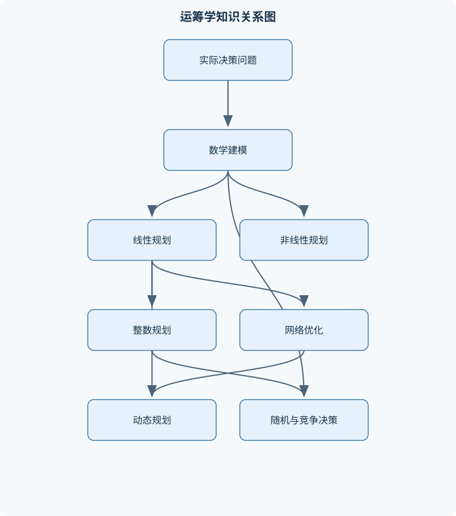
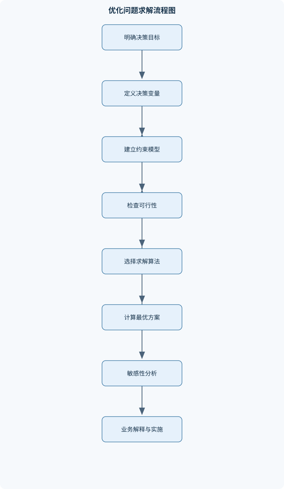

# 运筹学

## 一、课程整体知识框架

### 课程边界与先修知识

运筹学研究在资源、需求、容量、时间或行为约束下的决策优化问题，核心内容包括数学建模、线性规划、对偶分析、运输与指派、整数规划、目标规划、非线性规划、动态规划、图与网络优化、排队论和对策论。课程强调从实际问题抽象决策变量、目标函数和约束条件，分析模型的可行性与最优性，并使用解析算法、迭代算法或优化软件获得可解释的决策结果。先修知识包括高等数学中的函数、偏导数和极值，线性代数中的矩阵、秩、线性方程组和向量空间，概率论中的随机变量与期望，以及基础编程或数学建模能力。课程不等同于单纯的软件操作课；软件输出必须结合模型假设、最优性条件、敏感性分析和现实边界进行解释。





### 1. 研究对象、决策范式与课程主线

运筹学研究的是：在资源、需求、容量、时间、技术或行为规则受到约束时，如何选择可实施的行动方案，使某个目标达到最优或达到可接受的满意程度。这里的“最优”不一定只表示成本最低，也可以表示利润最大、运输时间最短、服务水平最高、风险最小、资源利用最均衡，或多个目标之间的综合折中。

一个完整的运筹学问题通常包含四类要素：

1. **决策变量**：决策者能够控制的数量或选择。例如产品产量、车辆运输量、设施是否启用、某项任务由谁承担、某条弧上的流量等。
2. **参数**：模型建立前已经给定或估计的数据。例如单位成本、资源总量、需求量、运输能力、到达率和服务率。
3. **目标函数**：衡量方案优劣的数学表达式。例如总利润、总成本、总等待时间或风险指标。
4. **约束条件**：规定方案必须满足的业务规则。例如资源消耗不能超过库存、每项任务只能分配给一名人员、网络中间节点必须流量守恒、设备数量必须为整数。

建模的基本流程是：先界定系统边界，再识别决策主体和可控行动；随后定义变量及其单位，收集参数，写出目标函数和约束；接着检查量纲、边界和可行性；最后选择解析算法、迭代算法或优化软件求解，并将数学结果还原为业务决策。软件输出的“最优”只说明在给定模型、数据、容差和算法条件下找到了一个满足相应判定标准的解，并不自动说明模型假设正确或方案能够执行。

### 2. 模型类型与统一符号

线性规划通常表示为

$$
\max\{c^Tx:Ax\le b,\ x\ge0\}
$$

或

$$
\min\{c^Tx:Ax\ge b,\ x\ge0\}.
$$

其中，$x=(x_1,\ldots,x_n)^T$ 是决策变量向量；$c$ 是目标系数向量，$c_j$ 表示变量 $x_j$ 每增加一个单位对目标值的贡献；$A=(a_{ij})$ 是约束系数矩阵，$a_{ij}$ 表示变量 $x_j$ 在第 $i$ 个约束中的单位消耗或贡献；$b$ 是资源、需求或容量向量。若$x_j$代表产品数量，则其单位可能是件，$c_j$可能是元/件，$a_{ij}$可能是小时/件，$b_i$则应是小时，只有这样约束和目标才具有一致量纲。

模型按变量性质可分为连续模型、整数模型和混合模型。连续变量允许取实数，适合表示吨数、时间、流量等可分割量；整数变量要求$x_j\in\mathbb Z$，适合人员、车辆、设备台数；二元变量$x_j\in\{0,1\}$表示是否选择、启用、建设或分配。模型按信息特征可分为确定性模型和随机性模型。线性规划、运输问题通常先以确定性参数建模；排队论则显式描述随机到达和随机服务；在实际应用中还可能需要随机规划、鲁棒优化或仿真分析。

可行解是满足全部约束和变量取值限制的方案；最优解是在可行解集合中使目标函数达到最佳的方案。不可行表示约束之间没有共同满足的方案，不等于算法失败；无界表示目标值可无限改善，通常意味着模型遗漏了资源、需求或变量上界约束。多重最优表示存在多个不同方案具有相同最优目标值，管理者可进一步按稳定性、均衡性或实施便利性选取方案。

### 3. 线性规划、单纯形法与对偶分析

线性规划要求目标函数和约束均为变量的一次线性表达式。将小于等于约束转化为等式时增加松弛变量，例如

$$
a^Tx\le b
\quad\Longrightarrow\quad
a^Tx+s=b,\quad s\ge0.
$$

其中$s$表示未使用的资源量，单位与$b$相同。将大于等于约束转化为等式时应减去剩余变量；若不能直接形成单位基列，则加入人工变量。大M法在目标函数中对人工变量施加极大惩罚；两阶段法先最小化人工变量之和，若第一阶段最优值大于零，则原问题不可行，若等于零，才进入原目标的第二阶段。人工变量是求解辅助变量，不能直接解释为实际生产量或运输量。

线性规划的可行域是由线性不等式交集形成的凸多面体。若存在有限最优值，则至少有一个极点最优解。基矩阵$B$由若干基列组成，令非基变量为零，基变量为

$$
x_B=B^{-1}b.
$$

当$x_B\ge0$时，该基解是基可行解。单纯形法从一个基可行解出发，在相邻极点之间移动。计算检验数后，若存在能够改善目标值的非基变量，则令其入基；对入基列中严格正的系数进行最小比值检验，确定出基变量；随后进行主元变换。若改善方向的列没有正系数，则沿该方向可无限增加而不破坏可行性，模型可能无界。退化时某个基变量为零，可能出现目标值不变的换基甚至循环，因此实际实现需要防循环规则或数值容差。

对偶模型为每个原问题约束配置一个对偶变量。原问题是利润最大化且约束为资源上限时，对偶变量通常表示资源的单位边际价值。弱对偶定理说明，任意原问题可行解的目标值不超过任意对偶问题可行解的目标值；强对偶定理说明，在两者均有有限最优解时，最优目标值相等。互补松弛条件为

$$
y_i(b_i-a_i^Tx)=0,
$$

以及

$$
x_j\bigl((A^Ty)_j-c_j\bigr)=0
$$

的相应形式。其含义是：原问题资源约束有严格剩余时，相关影子价格应为零；某个产品的对偶约束有严格余量时，该产品在原最优方案中通常不生产。影子价格只在当前最优基保持不变的局部敏感性区间内表示右端项增加一个单位对目标值的边际影响，不能外推到任意大的资源变化。

### 4. 运输、指派、转运与网络优化

运输问题中，$x_{ij}$表示供应点$i$向需求点$j$的运输量，$c_{ij}$为单位运输成本，$a_i$为供应量，$b_j$为需求量。平衡运输问题满足

$$
\sum_i a_i=\sum_j b_j.
$$

其模型为

$$
\min \sum_i\sum_j c_{ij}x_{ij}
$$

并满足

$$
\sum_jx_{ij}=a_i,\qquad
\sum_ix_{ij}=b_j,\qquad
x_{ij}\ge0.
$$

若总供应量大于总需求量，可增加虚拟需求点；若总需求量大于总供应量，可增加虚拟供应点。虚拟点的成本必须解释为库存剩余、缺货、外部采购或未满足需求的惩罚，而不能无理由设为零。最小元素法和Vogel差额法用于构造初始解，闭回路检验法或位势法用于判断和改进运输方案。平衡运输问题的约束矩阵秩为$m+n-1$，基本解通常需要$m+n-1$个基变量；退化时应补入零运输量基变量，否则闭回路可能无法正确建立。

指派问题是运输问题的特殊形式，每个供给点和需求点的量都为1。令$x_{ij}\in\{0,1\}$表示人员$i$是否承担任务$j$，则每行、每列的和均为1。匈牙利算法通过行约简、列约简、最少直线覆盖零元素和矩阵调整，逐步获得足够数量的独立零元素。行列减法不会改变任一完整指派方案之间的成本差异，因此不会改变最优指派。

转运问题允许货物经过中间节点。每个节点都要满足流量平衡，网络弧还必须满足容量约束。最短路径关注单位流量的路径长度，最大流关注从源点到汇点的可运输总量，最小费用流则在满足流量需求的同时最小化总费用。最大流不超过任意割的容量；当残量网络中不存在源到汇的增广路时，根据最大流—最小割定理，当前流量达到最大值。

### 5. 整数规划、目标规划和多目标决策

整数规划用于表达不可分割决策。线性松弛是删除整数约束后的连续模型。对最大化问题，线性松弛最优值是整数问题的上界；对最小化问题则是下界。四舍五入不保证满足容量、逻辑和联动约束，也不保证得到整数最优解。

分支定界法先求线性松弛。若松弛不可行则剪枝；若松弛解满足整数性，则用其更新当前最好整数解；若存在分数变量$x_j^*$，可分成$x_j\le\lfloor x_j^*\rfloor$和$x_j\ge\lceil x_j^*\rceil$两个子问题。对于最大化问题，节点上界不优于当前已知整数解时可以剪枝；最小化问题则比较节点下界与当前最好值。割平面法通过增加排除当前分数解但不排除任何整数可行解的线性不等式，逐步缩小松弛区域。设施选址中常用二元变量$y_i$表示是否启用设施，再用

$$
x_{ij}\le M y_i
$$

连接分配量和启用决策，但$M$应取有业务依据的有效上界，过大可能造成数值病态。

目标规划适用于利润、产量、人员利用率、交货时间等目标相互冲突的情况。对目标“尽量达到$T_k$”可写为

$$
f_k(x)+d_k^- - d_k^+=T_k,
$$

其中$d_k^-$是不足偏差，$d_k^+$是超出偏差。若目标是“不超过上限”，通常只惩罚$d_k^+$；若目标是“至少达到下限”，通常只惩罚$d_k^-$；若目标是尽量接近目标值，才可能同时惩罚两种偏差。刚性约束不能用偏差变量替代，否则安全、守恒或法律条件可能被违反。序贯目标规划按优先级逐层优化；加权目标规划则需要对不同偏差进行尺度统一，否则权系数可能只是单位选择的结果。

### 6. 非线性规划与最优性条件

非线性规划的目标函数或约束至少有一个是非线性的，可写为

$$
\min f(x)
$$

满足

$$
h_i(x)=0,\qquad g_j(x)\ge0.
$$

无约束局部极值的必要条件是$\nabla f(x^*)=0$；若Hessian矩阵$\nabla^2f(x^*)$正定，则该点是严格局部极小点。凸集上的凸函数具有重要性质：任何局部极小点都是全局极小点。若问题非凸，满足梯度为零或KKT条件的点可能是局部极值、鞍点，甚至不是全局最优解。

等式约束使用拉格朗日函数；含不等式约束时，在满足适当约束资格条件下建立KKT条件，包括驻点、原始可行性、对偶可行性和互补松弛。采用$g_j(x)\ge0$约定时，相关乘子通常满足$\mu_j\ge0$，并有

$$
\mu_jg_j(x)=0.
$$

非线性算法包括最速下降法、牛顿法、拟牛顿法、罚函数法、障碍函数法以及序贯线性规划和序贯二次规划。梯度法每次沿负梯度方向移动，适合大规模可微问题，但在狭长等高线区域可能收敛缓慢；牛顿法利用Hessian近似目标曲率，局部收敛较快，但需要Hessian可计算且可能出现非正定问题。算法得到的只是满足终止准则的近似点，仍须检查约束残差、梯度范数和目标变化量。

### 7. 动态规划

动态规划用于多阶段决策过程。阶段$k$表示时间、工序或决策层次，$s_k$表示该阶段状态，$u_k$表示决策，状态转移为

$$
s_{k+1}=T_k(s_k,u_k).
$$

无后效性要求：在给定当前状态后，未来最优决策不再依赖到达当前状态以前的具体路径。最优子结构要求整体最优策略的后续部分也是相应子问题的最优策略。若状态没有包含影响未来的全部信息，递推将可能错误。

以最小化为例，逆序递推可写为

$$
F_k(s_k)=\min_{u_k\in U_k(s_k)}
\{g_k(s_k,u_k)+F_{k+1}(T_k(s_k,u_k))\},
$$

并给定终端条件$F_{N+1}(s_{N+1})$。顺序递推从初始状态出发，保存到达各状态的最小累计成本。两者本质相同，但适用的边界条件和回溯方向不同。设备更新问题中，状态可定义为设备年龄，决策为继续使用或更换；库存问题中，状态通常是期初库存，决策为订货量。动态规划与最短路相联系：阶段状态可视为节点，决策转移可视为弧，阶段成本可视为弧权。

### 8. 排队论与对策论

排队系统由顾客到达过程、等待空间、服务机构、服务规则和离开过程组成。生灭过程用相邻状态之间的出生率和死亡率描述系统人数变化。单服务台指数到达、指数服务、无限容量、先到先服务的模型记为M/M/1。令$\lambda$为平均到达率，$\mu$为服务率，则

$$
\rho=\frac{\lambda}{\mu}.
$$

无限容量稳态要求$\rho<1$。若$\rho\ge1$，系统通常不存在有限稳态平均队长。M/M/1的平均系统人数为

$$
L=\frac{\rho}{1-\rho},
$$

平均排队人数为

$$
L_q=\frac{\rho^2}{1-\rho}.
$$

利用Little定律$L=\lambda W$、$L_q=\lambda W_q$可得到平均逗留时间和等待时间。M/M/c中有$c$个并行服务台，利用率为$\rho=\lambda/(c\mu)$，稳定条件仍需$\rho<1$。有限容量系统还要考虑到达者因系统已满而被拒绝。利用率接近1时，等待指标可能急剧增加，因此服务能力配置不能只追求服务台满负荷运行。

对策论研究多个相互影响的决策主体。一个有限博弈至少包含局中人、策略集合和支付函数。二人零和博弈中，一方收益增加等于另一方收益减少，可用单个收益矩阵表示。若某行的最小值与某列的最大值相等，则存在鞍点，纯策略极小极大值相等；若不存在鞍点，可使用混合策略，使对手在其支持的纯策略之间无差异。非零和双矩阵博弈中，两方支付不必互为相反数，纯策略纳什均衡要求任何一方单独改变策略都不能提高自身支付。支配策略、囚徒困境等概念用于解释竞争、合作和均衡结果，但均衡不一定等于社会整体最优。

### 9. 课程中统一采用的结果解释原则

任何求解结果都应同时报告以下内容：

- 决策变量取值及单位；
- 目标函数值及其经济或业务含义；
- 每条约束的左端值、右端值和剩余量；
- 变量是否满足非负、整数和二元要求；
- 最优性、可行性或界限证明；
- 对关键参数变化的敏感性；
- 模型假设与现实情境的差异；
- 方案执行所需的业务前提。

常见边界反例包括：把不可分割的车辆数量作为连续变量，把缺货约束误写成无惩罚的软约束，把非平衡运输表直接进行闭回路检验，把线性松弛结果四舍五入为整数解，把影子价格外推到最优基已经改变的区间，把负权网络交给Dijkstra算法，以及把排队模型的稳态公式用于$\rho\ge1$的系统。

## 二、章节和模块划分

### 核心知识覆盖清单

本清单用于检查正文是否覆盖本课程的主要知识模块：

- **运筹学导论与数学建模**：运筹学的决策优化范式、系统分析与问题边界、决策变量的定义方法、目标函数与约束条件、可行解与最优解、确定性与随机性模型、连续变量与离散变量、模型假设与现实校验。
- **线性规划与标准模型**：线性规划的基本结构、最大化与最小化模型转换、标准型与规范型、松弛变量和剩余变量、人工变量与大M法、两阶段法、可行域与极点、基可行解与退化、无可行、无界和多重最优。
- **单纯形法与线性规划分析**：单纯形法的几何基础、初始基可行解构造、单纯形表的建立、检验数计算、入基变量与出基变量、最小比值检验、主元变换、最优性判定、退化与循环、结果解释与软件求解校验。
- **线性规划对偶理论与敏感性分析**：原问题与对偶问题的构造、对偶变量的经济含义、弱对偶定理、强对偶定理、互补松弛条件、影子价格、资源约束的边际价值、目标系数敏感性、右端项敏感性、对偶单纯形法。
- **运输、指派与转运模型**：平衡运输问题、产销不平衡处理、运输问题的线性模型、最小元素法、Vogel差额法、闭回路检验法、运输表换基、退化运输解、指派问题与0-1变量、匈牙利算法、转运网络建模。
- **整数规划与组合优化**：纯整数规划与混合整数规划、整数约束的建模意义、线性松弛问题、分支定界法、节点上下界计算、剪枝规则、割平面法、0-1规划建模、逻辑约束线性化、指派与选址模型、整数解与连续解的差异。
- **目标规划与多目标决策**：刚性约束与软约束、偏差变量、正偏差与负偏差、期望目标约束、优先级结构、权系数结构、序贯目标规划、加权目标规划、满意解与有效解、目标冲突与结果解释。
- **非线性规划**：无约束极值条件、凸集与凸函数、局部最优与全局最优、一阶和二阶充分条件、等式约束的拉格朗日乘子、不等式约束与KKT条件、互补松弛条件、最速下降法、牛顿法与拟牛顿法、罚函数与障碍函数、序贯线性与二次规划。
- **动态规划**：多阶段决策过程、阶段、状态与决策、状态转移方程、最优子结构、无后效性、指标函数、逆序递推、顺序递推、滚动库存与设备更新、资源分配问题、动态规划与最短路的联系。
- **图与网络分析**：图、节点与弧、有向图与无向图、邻接矩阵与权矩阵、链、路和回路、树与生成树、最短路径问题、Dijkstra算法、Floyd算法、最大流问题、割集与最小割、最小费用流。
- **排队论与服务系统**：排队系统的组成、到达过程与服务过程、生灭过程、稳态概率、利用率与稳定条件、M/M/1模型、M/M/c模型、有限容量排队系统、等待时间与队长指标、Little定律、服务能力配置。
- **对策论与竞争决策**：局中人与策略集、支付函数、二人有限零和博弈、收益矩阵与损失矩阵、纯策略纳什均衡、鞍点与极小极大值、混合策略均衡、二人非零和双矩阵博弈、支配策略、囚徒困境、均衡结果的决策解释。


### 1. 模块一：运筹学导论与数学建模

本模块建立从现实问题到数学模型的转换方法。分析一个生产计划问题时，应先区分“生产多少”这一决策变量与“每件产品耗用多少资源”这一参数，再写出利润目标和资源约束。例如产品$j$的产量为$x_j$件，单位利润为$c_j$元/件，资源$i$的单位消耗为$a_{ij}$小时/件，资源总量为$b_i$小时，则目标为$\max\sum_jc_jx_j$，资源约束为$\sum_ja_{ij}x_j\le b_i$。若产品必须整件生产，应补充$x_j\in\mathbb Z$；若存在最低订货量，还需增加相应逻辑约束。

建模时应先确定系统边界。例如仓储模型若只研究仓内分拣，就不能把供应商生产能力默认为无限；若研究配送网络，则必须说明车辆容量、时间窗、道路方向和需求是否必须全部满足。确定性模型中的参数被视为已知；随机模型则需要说明随机变量、概率分布或样本来源。模型校验包括维度检查、极端情形检查、可行性检查和结果合理性检查。

### 2. 模块二：线性规划与标准模型

本模块包括一般形式、标准型、规范型、松弛变量、剩余变量和人工变量。最大化与最小化的转换不能只改变目标函数符号，还要同步处理不等式方向、变量符号和对偶关系。若某变量无非负限制，可令$x_j=x_j^+-x_j^-$，其中$x_j^+,x_j^-\ge0$；若约束右端为负，应先乘以$-1$并改变不等号方向。

可行域和极点是算法分析的几何基础。退化基可行解中至少一个基变量为零，可能导致多个基对应同一几何点。三种异常状态的判断具有明确含义：人工变量无法清除说明不可行；改善方向无离开变量说明无界；检验数没有改善方向且存在可行基说明达到最优。多重最优常可由某个非基变量检验数为零识别，说明沿某条边移动仍保持相同目标值。

### 3. 模块三：单纯形法与线性规划分析

单纯形法的输入是标准型线性规划和基可行解，输出是最优解、不可行性或无界性判断。每轮迭代保持两个不变量：当前基表仍表示同一线性规划，当前基变量解仍然可行。最大化问题中，检验数符号必须与表的定义保持一致；入基变量由能够改善目标值的检验数确定，出基变量只在入基列严格为正的行中进行最小比值检验。

#### 单纯形法伪代码

```text
算法：单纯形法
输入：标准型 max c^T x，约束 Ax = b，x ≥ 0；初始基 B
输出：最优解、无界性或不可行性判断

1. 计算基变量 x_B = B^{-1}b，若存在 x_B < 0，则当前基不可行，转入两阶段法或对偶单纯形法。
2. 计算非基变量的检验数。
3. 若所有检验数均不允许改善目标值，输出当前基解并终止。
4. 选择一个可改善的非基变量入基。
5. 查看入基列；只对严格正的系数计算比值
   θ_i = (x_B)_i / ā_i。
6. 若没有严格正的系数，输出“目标无界”并终止。
7. 选择最小非负比值对应的基变量出基，进行主元变换。
8. 返回步骤1。
```

在数值计算中，还需设置可行性容差和最优性容差，避免把接近零的浮点数误判为负数或正数。软件求解后应重新代入原始约束，而不能只查看求解器状态。

### 4. 模块四：对偶理论与敏感性分析

给定一个资源受限的生产模型，可以把每种资源的单位边际价值设为$y_i$。如果生产一种产品需要资源向量$a_j$并带来单位收益$c_j$，那么资源定价必须满足

$$
a_j^Ty\ge c_j.
$$

否则，按资源价格购买生产产品能够获得无风险套利。对所有产品求和可得原问题目标值不超过资源总价值$b^Ty$，这就是弱对偶性的直接推导。原问题和对偶问题均达到有限最优时，强对偶性保证两者目标值相等。

敏感性分析包括目标系数变化和右端项变化。右端项$b_i$在允许区间内增加一个单位，目标值近似变化为对应影子价格$y_i$；当最优基改变后，旧影子价格不再适用。目标系数变化可能改变产品是否进入生产组合，但当前基在一定范围内仍保持最优。分析结论必须同时给出适用区间，不能只报告一个影子价格数字。

### 5. 模块五：运输、指派与转运模型

#### 例题一：平衡运输问题

**题干**：三个供应点的供给量分别为14、27、19，四个需求点的需求量分别为22、13、12、13，单位成本矩阵为

$$
C=
\begin{bmatrix}
6&7&5&3\\
8&4&2&7\\
5&9&10&6
\end{bmatrix}.
$$

**分析**：总供给量为$14+27+19=60$，总需求量为$22+13+12+13=60$，因此是平衡运输问题。变量$x_{ij}$表示从供应点$i$到需求点$j$的运输量，目标为最小化总运输成本。

**逐步解答**：使用最小元素法，首先选择成本2的单元$(2,3)$，分配$\min(27,12)=12$；再选择成本3的单元$(1,4)$，分配$\min(14,13)=13$；剩余供应点1为1，需求点1为22，选择成本5的单元$(1,1)$分配1；再处理供应点3到需求点1，分配19；最后供应点2剩余15，需求点2剩余13，分配13，剩余2分配到需求点1。所得方案可能不是最优，需要用闭回路检验继续改善。

**结果验证**：逐行检查运输量分别为14、27、19，逐列检查需求量分别为22、13、12、13；所有运输量非负。计算总成本后，再对每个非基单元构造闭回路并计算单位调整成本，若不存在负的改善量，则方案最优。

**变式**：若总供给量为65而需求量仍为60，应增加需求量为5的虚拟需求点；虚拟运输量表示剩余库存，其成本应根据库存持有或弃置费用设定。若总需求大于供给，虚拟供应点对应缺货或外部采购成本。

### 6. 模块六：整数规划与组合优化

#### 例题二：设施启用与分配

**题干**：有两个候选仓库和三个需求点。仓库$i$的固定启用成本为$f_i$，连续分配量为$x_{ij}$，启用变量为$y_i\in\{0,1\}$。每个需求点必须满足需求$d_j$，仓库容量为$U_i$。

**分析**：只使用$x_{ij}$无法表达“只要有少量运输就必须承担固定成本”，因此引入$y_i$，并建立

$$
\sum_jx_{ij}\le U_iy_i.
$$

当$y_i=0$时，所有$x_{ij}=0$；当$y_i=1$时，仓库才允许分配货物。

**逐步解答**：先删除$y_i$的整数限制求线性松弛，得到一个下界；若松弛解中的某个$y_i$为0.4，则不能四舍五入后直接使用，而应分支为$y_i=0$和$y_i=1$两个节点。分别求两个节点的线性松弛，若节点下界不优于当前整数可行解，进行剪枝；若节点解已整数，则更新当前最好方案。

**结果验证**：检查每个需求点是否满足$\sum_ix_{ij}=d_j$，每个仓库是否满足容量，检查$x_{ij}\le U_iy_i$是否成立，并将启用固定成本与运输成本同时计入目标。还应比较线性松弛目标值与整数最优值，二者差异反映松弛间隙。

**变式**：若某仓库至少服务一个需求点，可增加$\sum_jz_{ij}\ge y_i$并用$x_{ij}\le Mz_{ij}$连接分配与服务关系；若两个仓库不能同时启用，可加$y_1+y_2\le1$。

### 7. 模块七：目标规划与多目标决策

#### 例题三：交货与产量的冲突

**题干**：企业希望日产量达到100件，同时希望加班时间不超过20小时。由于资源有限，两项目标可能无法同时达到。

**分析**：日产量目标若允许不足，应设置$d_1^-$；加班上限若允许超出，应设置$d_2^+$。模型可写为

$$
\text{产量}+d_1^- -d_1^+=100,
$$

$$
\text{加班}+d_2^- -d_2^+=20.
$$

若产量只关心不足，则目标中惩罚$d_1^-$而不惩罚$d_1^+$；若加班只关心超出，则惩罚$d_2^+$。

**逐步解答**：先将安全、设备容量等条件设为刚性约束；第一优先级最小化$d_2^+$，保证不突破加班上限；在保持第一优先级最优的条件下，再最小化$d_1^-$。若改用加权目标，则需把产量不足和加班超出转换为同一评价尺度。

**结果验证**：检查偏差方程是否成立，确认互相排斥的正负偏差没有被同时人为惩罚，并比较不同优先级下的产量和加班结果。

**变式**：若产量必须至少达到100件，则日产量约束应作为刚性约束；若只能“尽量接近100件”，才适合采用双向偏差。

### 8. 模块八：非线性规划

#### 例题四：圆形约束下的最小距离

**题干**：求点$x=(x_1,x_2)$到给定点$(a,b)$的平方距离最小值，约束为$x_1^2+x_2^2\le R^2$。

**分析**：目标函数

$$
f(x)=(x_1-a)^2+(x_2-b)^2
$$

是凸函数，圆盘是凸集，因此任何局部极小点都是全局极小点。若$(a,b)$位于圆盘内部，最优点就是$(a,b)$；若位于圆盘外部，最优点位于圆周上，并且沿原点到$(a,b)$的方向。

**逐步解答**：先检查$a^2+b^2\le R^2$。若成立，约束不活跃，梯度为零得到$(a,b)$。若不成立，令约束$R^2-x_1^2-x_2^2\ge0$活跃，建立KKT条件：

$$
\nabla f(x)-\mu\nabla(x_1^2+x_2^2-R^2)=0,
$$

并满足$\mu\ge0$和$x_1^2+x_2^2=R^2$。联立可得最优点位于圆周，代入原目标检查可行性。

**结果验证**：检查梯度驻点、约束残差和乘子非负性；由于问题凸且满足适当约束条件，KKT候选点即为全局最优点。

**变式**：若目标函数含有负的二次项，问题可能变为非凸，此时KKT点不一定是全局最优，需要比较边界候选点或使用全局搜索。

### 9. 模块九：动态规划

#### 例题五：设备更新

**题干**：设备每年可继续使用或更换。状态$s_k$为第$k$年开始时设备年龄，继续使用有运行成本$g_k(s_k)$，更换有购买成本$P$并获得旧设备残值$R(s_k)$。

**分析**：阶段是年份，状态是设备年龄，决策为继续使用或更换。未来成本只取决于当前年份和当前设备年龄，而不取决于设备此前如何达到该年龄，因此满足无后效性。

**逐步解答**：令$F_k(s)$表示从第$k$年开始、设备年龄为$s$时的最小后续成本，终端条件为$F_{N+1}(s)=0$。继续使用的成本为$g_k(s)+F_{k+1}(s+1)$；更换的成本为$P-R(s)+g_k(0)+F_{k+1}(1)$。因此

$$
F_k(s)=\min\{g_k(s)+F_{k+1}(s+1),\,
P-R(s)+g_k(0)+F_{k+1}(1)\}.
$$

从最后一年向前计算每个状态，记录达到最小值的决策，最后从初始状态回溯得到更新计划。

**结果验证**：逐期检查年龄状态是否正确转移，更新时是否计入残值，比较动态规划总成本与任意可行策略成本。若某策略看似当年成本最低但导致后续成本更高，说明逐年局部决策不等于全局最优。

**变式**：若设备维修记录会影响未来故障率，状态必须扩展为“设备年龄和维修状态”；若状态空间过大，可能出现维数灾难。

### 10. 模块十：图与网络分析

图由节点和弧组成；有向图的弧有方向，无向图的边可双向使用。邻接矩阵表示节点之间是否相连，权矩阵表示距离、时间、费用或风险。链强调连接关系，路通常要求节点不重复，回路首尾相同。树是连通且无回路的图，生成树包含全部节点并具有最少的连接边。

Dijkstra算法要求所有弧权非负。它维护暂定距离，每次选择未确定节点中距离最小者并松弛其出弧。邻接矩阵实现复杂度为$O(|V|^2)$，优先队列实现通常为$O((|V|+|E|)\log|V|)$。存在负权弧时，已确定节点可能被后续路径改短，算法结论失效。Floyd算法通过逐步允许中间节点集合扩大，计算任意两点间最短路，适合节点数较小且需要全源距离的情形。

最大流中，$u_{ij}$是容量，$x_{ij}$是流量，必须满足$0\le x_{ij}\le u_{ij}$和中间节点流量守恒。Ford-Fulkerson不断寻找增广路，并按瓶颈容量增加流量；反向残量弧表示可以撤销此前流量，并非真实新增业务通道。最小费用流在残量网络中同时考虑容量和费用，反向弧费用取相反数，以便重新调整已有方案。

### 11. 模块十一：排队论与服务能力配置

排队分析的步骤是：识别到达过程和服务过程，确定服务台数量和容量；检查独立性、指数分布、先到先服务等假设；计算$\lambda$、$\mu$、$c$和$\rho$；检查稳态条件；再计算平均队长、等待时间和逗留时间。M/M/1模型适合单服务台的理想化系统，不能直接用于服务时间高度固定、批量到达或顾客会离开的系统。若实测数据不支持指数分布，应考虑更一般的排队模型或仿真。

服务能力配置应综合服务台成本与等待成本。当$\rho$接近1时，增加一个服务台可能显著降低等待，但也会增加人工和设备成本。有限容量系统还要评价拒绝率、损失顾客数和有效到达率，不能只使用无限容量公式。

### 12. 模块十二：对策论与竞争决策

二人零和矩阵博弈先检查纯策略鞍点：计算每行最小值的最大值和每列最大值的最小值；两者相等则存在纯策略均衡。若不等，设混合策略概率，使对手在其支持策略中获得相同期望支付。概率表示长期随机化比例，不表示一次行动中可以同时选择多个策略。

非零和双矩阵博弈必须分别写出两个局中人的支付矩阵。寻找纯策略纳什均衡时，逐列标记行玩家最佳反应，再逐行标记列玩家最佳反应，交叉位置即为纯策略均衡。囚徒困境说明个体理性选择可能导致低于合作结果的均衡；因此均衡分析还应说明信息结构、重复互动、承诺机制和支付是否可信。

### 13. 综合算法与实验项目

#### 综合流程一：从业务问题到优化方案

**输入**：需求、资源、成本、容量、时间和业务规则。  
**过程**：

1. 明确决策范围和时间尺度；
2. 区分变量、参数和结果指标；
3. 为每个变量写明单位和取值边界；
4. 建立目标函数和刚性约束；
5. 对软目标加入偏差变量或惩罚；
6. 先检查可行性，再选择线性、整数、非线性或网络模型；
7. 使用算法求解并重新代入原模型；
8. 进行敏感性分析和极端情形测试；
9. 输出可执行方案、风险和适用边界。

**评价标准**：模型无量纲错误，所有刚性约束满足，目标值计算正确，算法终止理由充分，软件结果与独立复核一致，参数变化下的结论有边界说明。

#### 综合流程二：网络最大流与最小割分析

**输入**：有向容量网络、源点$s$和汇点$t$。  
**过程**：初始化零流；建立残量网络；寻找增广路；计算路径上最小剩余容量；更新正向和反向残量；直到源点无法到达汇点。  
**输出**：最大流值、各弧流量和最小割。  
**验证**：检查每条弧的容量约束和中间节点守恒；在最终残量网络中找从$s$可达的节点集合$S$，其余节点为$T$，计算割容量并验证最大流值等于割容量。  
**排错**：若流量超过容量，检查反向更新；若节点守恒失败，检查路径更新是否同时改变正、反向弧；若未达到理论割容量，检查是否漏找增广路。

#### 实验项目一：生产计划线性规划实验

**输入数据**：产品利润、每种资源的单位消耗、资源总量、产品非负限制；可设置一个产品必须整数的变式。  
**步骤**：手工写出模型；求解连续线性规划；记录目标值、产量和松弛变量；改变一个资源右端项；再求解整数变式。  
**评价标准**：约束残差不超过设定容差，产量单位正确，影子价格只在允许区间内解释，整数解满足全部逻辑约束，连续解与整数解差异被明确说明。  
**排错方法**：若不可行，逐条检查约束方向和右端项符号；若无界，检查是否遗漏产能或需求上限；若整数结果异常，检查是否把连续变量错误设为整数或漏写非负限制。

#### 实验项目二：排队系统服务台配置实验

**输入数据**：平均到达率$\lambda$、单服务台服务率$\mu$、服务台数量$c$、单位服务台成本和单位等待成本。  
**步骤**：分别计算$M/M/1$与$M/M/c$的利用率和等待指标；筛除$\rho\ge1$的无限容量方案；比较增加服务台后等待成本的减少量与新增服务成本；必要时用离散事件模拟检验理论近似。  
**评价标准**：稳定条件判断正确，$L$、$L_q$、$W$和$W_q$之间满足Little定律，服务台配置同时满足预算和服务水平要求，模拟结果与理论值的差异有统计解释。  
**排错方法**：确认$\lambda$和$\mu$使用相同时间单位；不要把总服务率误当成单台服务率；检查有限容量时是否使用了无限容量公式；当利用率接近1时，增加样本量并检查稳态预热阶段。

### 14. 常见笔试问题及解答思路

#### 问题一：为什么线性规划有限最优解可在极点取得？

线性目标函数沿任意线段呈线性变化。若某最优点不是极点，可表示为两个可行点的凸组合；由于目标值是两点目标值的同样组合，至少有一个端点不差于该点。继续分解即可到达极点。因此，只要可行域非空且目标有有限最优值，就至少有一个极点最优解。

#### 问题二：如何判断单纯形法无界？

选定改善目标值的入基列后，只对该列严格正的系数进行比值检验。若没有正系数，增加入基变量不会使任何基变量变负，因此可无限增加该变量，目标值无限改善，模型无界。

#### 问题三：影子价格为什么不能任意外推？

影子价格由当前最优基和对偶解决定。右端项变化较小时，最优基不变，目标值对右端项呈线性变化；变化超过允许区间后，某些变量可能入基或出基，最优基改变，旧影子价格也随之失效。

#### 问题四：为什么线性松弛解不能直接四舍五入？

四舍五入可能违反容量、需求和逻辑约束；即使仍可行，也不保证目标值最优。整数规划需要通过分支定界、割平面或专门的整数算法证明整数最优性。

#### 问题五：Dijkstra算法的适用条件是什么？

所有弧权必须非负。算法依赖“当前暂定距离最小的节点已经不可能被改短”的贪心性质；负权弧会破坏这一性质。若存在负权，应使用适合负权的逐次松弛方法，并检查负权回路。

#### 问题六：最大流为什么等于最小割？

任意流穿过从源到汇的割时，净流量不能超过割容量，因此最大流不超过最小割容量。增广路算法终止时，源点可达集与不可达集构成一个割；该割上所有正向弧均已饱和，当前流量等于割容量，于是达到相等。

#### 问题七：动态规划为什么必须定义完整状态？

若状态遗漏了影响未来成本或可行性的历史信息，则两个看似相同的状态可能具有不同的后续选择，递推会错误地合并它们。例如库存状态若不记录未交订单，未来可行性就无法由库存量单独决定。

#### 问题八：$\rho\ge1$时为什么不能使用M/M/1稳态公式？

无限容量系统中到达速度不小于服务速度，系统人数没有稳定的长期概率分布。公式中的$1-\rho$为非正数，所得平均队长没有排队意义。有限容量系统可以有稳态，但必须使用有限容量模型的概率和损失指标。

### 15. 常见面试问题、参考答案与追问要点

#### 面试问题一：如何把业务问题转化为优化模型？

参考答案：先明确可控决策，再定义参数和单位，写出目标函数与刚性约束，最后判断变量的连续、整数或二元属性，并通过极端情形和历史方案验证模型。  
追问要点：若业务规则互相冲突，应区分不可违反的刚性约束与允许偏离的软目标；若数据不确定，应说明情景分析、鲁棒性或仿真方案。

#### 面试问题二：求解器给出最优状态后还要检查什么？

参考答案：检查原始约束残差、变量边界、整数性、目标值计算、单位一致性、数值容差和方案可实施性。  
追问要点：还应查看对偶值、敏感性区间、分支定界间隙和异常大系数，防止模型遗漏约束或出现数值病态。

#### 面试问题三：如何处理整数规划求解时间过长？

参考答案：改善变量界和约束界，缩小大$M$，增加有效割，选择合理分支变量和节点策略，并先分析线性松弛间隙。  
追问要点：不能为了速度直接删除业务约束；若必须提前停止，应报告当前整数解、界限和最优性间隙，而不是声称已证明最优。

#### 面试问题四：什么时候选择动态规划而不是线性规划？

参考答案：当问题具有明显的阶段结构、状态转移和无后效性时，动态规划可利用最优子结构；若状态维数很高，可能出现维数灾难，此时线性规划、整数规划或近似方法可能更合适。  
追问要点：必须说明状态是否完整，以及状态数和每个状态的可行决策数，否则不能仅凭“分阶段”就使用动态规划。

#### 面试问题五：如何评价一个运输方案？

参考答案：先检查供需平衡和非负性，再计算总成本、各节点利用率、缺货或剩余量，随后进行运输成本、需求和容量变化的敏感性分析。  
追问要点：还应考虑交付时间、可靠性、碳排放和道路风险；单纯总成本最小不一定是综合方案最优。

#### 面试问题六：如何解释影子价格？

参考答案：影子价格表示在当前最优基不变的局部范围内，某资源增加一个单位对最优目标值的边际影响。  
追问要点：资源存在剩余时影子价格通常为零；若增加资源超过允许范围，必须重新求解，不能继续使用原价格。

#### 面试问题七：如何配置排队服务台？

参考答案：估计到达率和服务率，检查不同服务台数量下的稳定性与等待指标，再将服务台成本和等待损失纳入比较。  
追问要点：应检查高峰与平均到达率的差异、有限容量和顾客放弃行为，不能只使用日均数据。

#### 面试问题八：竞争环境下最优策略是否等于最高收益策略？

参考答案：不一定。对策论中的收益取决于其他参与者的策略，单独看某策略的绝对收益不足以判断均衡；需要分析最佳反应、支配策略和纳什均衡。  
追问要点：还要说明均衡是否有效率、是否稳定，以及重复博弈、信息不完全和承诺机制是否改变结果。

### 16. 至少十二个具体易错点

1. 把参数当成决策变量，导致模型允许决策者改变需求或资源总量。
2. 忽略变量非负性，使生产量、运输量或概率出现负值。
3. 把车辆、人员和设备台数设为连续变量。
4. 把安全、守恒和法定容量写成可随意违反的软约束。
5. 最大化和最小化时混用单纯形检验数符号。
6. 最小比值检验包含了入基列中的非正系数。
7. 大M取值过大，引起数值病态或人工变量残留。
8. 运输总供给不等于总需求时未设置虚拟节点。
9. 运输退化解中未补足零基变量。
10. 线性松弛结果直接四舍五入。
11. 影子价格超出敏感性区间后仍被当作边际价值。
12. 目标规划同时惩罚不应同时出现的正、负偏差。
13. KKT乘子符号与不等式方向不匹配。
14. 将非凸问题中KKT点直接称为全局最优。
15. 用Dijkstra算法处理负权弧。
16. 将最大流残量网络中的反向弧误认为真实运输线路。
17. 最小费用流只寻找低费用路径而忽略容量和节点守恒。
18. 使用M/M/1公式时未检查$\rho<1$。
19. 把两个局中人的支付矩阵行列方向写反。
20. 把求解器“找到可行解”误认为“已证明最优”。

### 17. 岗位关联与产出验收

- **运筹优化工程师**：建立生产、库存、运输或排程模型，产出模型文件、参数表、求解结果和敏感性报告。验收标准是约束完整、单位一致、最优性或界限清楚、方案可执行。
- **供应链计划分析师**：利用线性规划、运输模型、整数规划和库存动态规划制定补货与生产计划。验收重点是需求满足率、库存水平、缺货量、成本和计划稳定性。
- **物流网络规划师**：使用最短路径、最大流、最小费用流和设施选址模型设计网络。验收重点是容量满足、运输成本、时效、节点利用率和异常情景下的鲁棒性。
- **生产计划与排程工程师**：处理产能、换型、交期和设备更新问题，使用整数规划、目标规划或动态规划。验收重点是交付达成率、设备负荷、换型次数和计划可实施性。
- **数据科学家或管理科学分析师**：将业务数据转化为参数，比较不同模型和情景，输出指标解释与决策建议。验收重点是数据可追溯、假设透明、结果可复现和不确定性说明。
- **交通规划与调度分析师**：使用网络流、最短路、排队模型评估道路、车辆和服务设施配置。验收重点是通行能力、旅行时间、拥堵等待、服务水平和高峰情景表现。
- **金融风险与资源配置分析师**：在资源约束和风险指标下进行组合或资金配置，使用线性、非线性和多目标模型。验收重点是风险约束满足、敏感性分析、极端情景和策略解释。
- **决策支持顾问**：将优化结果转化为管理层能够理解的方案，说明成本、收益、约束、风险和替代方案。验收标准不是只提供一个数字，而是能够回答“为什么这样决策、改变条件后会怎样、方案如何落地”。

## 三、核心概念的详细解释

### 1. 数学建模与模型边界

运筹学模型把实际决策问题表示为“变量、目标、约束和数据”的组合。变量表示决策者能够控制的行动，参数表示给定或估计的数据，目标函数比较方案优劣，约束表达必须满足的业务规则。建模时应先明确系统边界、决策主体、时间范围和服务对象，再为每个变量标注单位。例如，$x_j$ 表示产品 $j$ 的产量，单位为件；$c_j$ 表示单位利润，单位为元/件；$a_{ij}$ 表示单位产品消耗的资源量，单位可为小时/件；$b_i$ 是资源总量，单位为小时。于是 $c_jx_j$ 的单位为元，$a_{ij}x_j$ 的单位为小时，目标和约束分别量纲一致。

模型的可行域是所有满足约束的变量取值集合。可行解是集合中的一个点，最优解是其中使目标函数达到最大或最小的点。若可行域为空，模型不可行；若目标可以沿可行方向无限改善，模型无界；若多个点达到相同的最优值，则存在多重最优。不可行和无界是模型性质，不必然意味着求解器故障，常见原因包括互相冲突的规则、漏写容量上限或方向错误的约束。模型还必须区分连续、整数和二元变量：把车辆数写成连续变量可能产生不可执行的半辆车；把可分割流量强制为整数，则可能不必要地扩大模型难度。

确定性模型把输入参数视为已知常数；随机性模型显式表示到达、需求、服务时间等不确定性。确定性最优方案未必适合需求波动的现实系统，需结合情景分析、敏感性分析或随机模型检查。模型复杂度不能替代现实校验：单位、数据范围、遗漏约束和执行条件都会影响结论。

### 2. 线性规划与单纯形法

线性规划的目标函数和约束都是变量的一次表达式。标准形式可写为 $\max c^Tx$，满足 $Ax\le b$、$x\ge0$；等式和大于等于形式也可通过变量变换统一处理。小于等于约束增加松弛变量，例如 $a^Tx\le b$ 改写为 $a^Tx+s=b,\ s\ge0$，其中 $s$ 是剩余资源量。大于等于约束减去剩余变量；若等式约束或大于等于约束不能直接提供单位基列，则引入人工变量。人工变量只是构造初始基的计算工具，不能解释成真实决策。

单纯形法在相邻基可行解之间迭代。若基矩阵为 $B$，非基变量取零，基变量为 $x_B=B^{-1}b$；只有 $x_B\ge0$ 时该基解才可行。最大化问题每轮依据约化成本选择可改善目标的非基变量入基，再对入基列中严格为正的系数计算右端值与该系数之比，最小非负比值对应的基变量出基。主元变换更新基。若存在改善方向但入基列没有正系数，则沿该方向可无限增加而不破坏可行性，模型无界。退化时某个基变量为零，换基后目标值可能不变；不恰当的换基规则可能循环，可采用防循环规则。约定检验数的符号有不同写法，判优规则必须与所用定义一致。

线性规划可行域是凸多面体，线性目标在有限最优值存在时至少有一个极点最优解。单纯形法因此可以通过基的相邻变化寻找极点。退化或多重最优时，算法返回的解未必唯一；软件报告一个最优解不表示其他同值方案不存在。

### 3. 对偶、运输与指派

在线性规划中，每个原问题约束对应一个对偶变量。对偶变量衡量相应约束右端值在局部范围内变化时，最优目标值的边际变化，通常称影子价格。对于原问题 $\max\{c^Tx:Ax\le b,x\ge0\}$，其对偶为 $\min\{b^Ty:A^Ty\ge c,y\ge0\}$。任意原可行解 $x$ 和对偶可行解 $y$ 满足 $c^Tx\le b^Ty$，这是弱对偶性；两边均有有限最优解时，强对偶性保证最优值相等。互补松弛进一步说明：原约束有严格松弛时对应的对偶变量为零；对偶约束有严格余量时对应原变量为零。影子价格只在当前最优基保持不变的敏感性区间内具有边际解释，不能外推到任意大的资源变化。

运输问题以 $x_{ij}$ 表示供应点 $i$ 到需求点 $j$ 的运输量，$c_{ij}$ 为单位成本，$a_i$ 为供应量，$b_j$ 为需求量。平衡模型满足 $\sum_jx_{ij}=a_i$、$\sum_ix_{ij}=b_j$、$x_{ij}\ge0$，且总供应等于总需求。总量不等时可增设虚拟供应点或需求点使模型平衡；虚拟成本必须表达未满足需求、闲置供应或其他业务含义，不能随意设定。平衡运输约束矩阵秩为 $m+n-1$，非退化基通常有 $m+n-1$ 个基变量；数量不足时需以零运输量补足基，以便形成闭回路检验。

初始方案可用最小元素法或 Vogel 差额法构造，再用位势或闭回路检查改进性。闭回路上正负号交替，沿负号单元可运输量的最小值确定调整量；调整保持每行、每列供需平衡。指派问题是每人恰配一项任务、每项任务恰配一人的特殊运输问题，常用 0-1 变量表示是否指派。匈牙利算法通过行列约简和独立零元素寻找最优指派；成本矩阵增减行常数或列常数不会改变完整指派之间的成本排序。若矩阵非方形，需补虚拟行或列并明确其含义。

### 4. 整数规划与目标规划

整数规划要求部分或全部决策变量取整数；混合整数规划允许其他变量连续。线性松弛去掉整数限制，最大化问题的松弛最优值是整数最优值的上界，最小化问题则是下界。分支定界法先解松弛问题，对分数变量分支，例如 $x_j\le\lfloor x_j^*\rfloor$ 与 $x_j\ge\lceil x_j^*\rceil$；利用界限、不可行性或已有整数解剪枝。最坏情形下节点数可能指数增长。直接四舍五入不保证满足约束，也不保证最优。固定启用决策可用二元变量 $y_i$ 建模；若产量 $x_i$ 只能在设施启用时为正，可写 $x_i\le M_i y_i$，其中 $M_i$ 必须是有效上界，过大的 $M_i$ 会损害数值稳定性。

目标规划用于处理多个期望目标。对目标值 $t_k$，可写成实际值与偏差的关系，例如 $f_k(x)+d_k^- -d_k^+=t_k$，其中 $d_k^-$ 是不足偏差，$d_k^+$ 是超出偏差，二者非负。只惩罚符合管理含义的偏差：最低产量目标通常惩罚不足，成本上限通常惩罚超出，要求接近期望值时才可能同时惩罚两侧。优先级规划按严格优先顺序先优化高优先级目标，再在不损害其结果的条件下优化下一层；加权规划则按权重折衷。权重须与量纲、重要程度一致，权重大小本身不自动表达严格优先级。有效解指不存在另一个可行解能在不使任何目标变差的同时改善至少一个目标；满意解还依赖决策者设定的可接受标准。

### 5. 非线性规划与动态规划

非线性规划的目标或约束至少有一个是非线性的。无约束可微极值点需满足 $\nabla f(x)=0$；在二阶条件下，极小点的 Hessian 矩阵应在相应方向半正定，正定给出局部严格极小的充分条件。局部最优未必全局最优。若目标函数凸、可行域凸，则任一局部极小点都是全局极小点。

对问题 $\min f(x)$，满足 $h_i(x)=0$、$g_j(x)\ge0$，可定义拉格朗日函数
$L=f(x)+\sum_i\lambda_i h_i(x)-\sum_j\mu_jg_j(x)$。KKT 条件包括驻点 $\nabla_xL=0$、原始可行性、$\mu_j\ge0$ 和互补条件 $\mu_jg_j(x)=0$。KKT 的必要性需可微性及适当约束资格；凸问题满足相应条件时，KKT 通常也是全局最优的充分条件。非凸问题中 KKT 点可能是局部极值或其他驻点。最速下降沿负梯度更新，牛顿法利用 Hessian 曲率；线搜索决定步长。罚函数和障碍函数把约束影响转为目标项或内部可行限制，但参数选择会影响精度和数值条件。

动态规划把问题分成阶段，状态 $s_k$ 必须包含影响后续决策的全部信息，$u_k$ 是阶段决策。以最小化成本为例，逆序递推为
$$
F_k(s_k)=\min_{u_k\in U_k(s_k)}
\{g_k(s_k,u_k)+F_{k+1}(T_k(s_k,u_k))\}.
$$
其中 $g_k$ 是阶段成本，$T_k$ 是状态转移，$F_k$ 是从当前状态到终点的最优后续成本。终端条件给出最后阶段的成本。顺序递推和逆序递推方向不同，但都须保证每个已计算状态值对应子问题最优值。若状态遗漏设备年龄、库存或未完成任务等影响未来的信息，无后效性不成立，递推会错误。状态数乘以每个状态的可选决策数决定常见计算规模，状态过多会产生维数灾难。

### 6. 图与网络优化

图由节点和弧组成；有向图区分弧方向，无向图不区分方向。邻接矩阵表示节点之间是否连接，权矩阵记录距离、时间或成本，未连接位置用无穷表示。树是连通且无回路的图，生成树覆盖全部节点而不含回路。链描述相邻节点序列，路径通常强调节点不重复，回路则起点与终点相同。

Dijkstra 算法从源点开始，反复确定暂定距离最小的未确定节点并松弛其出弧。其正确性依赖所有弧权非负；负权边可能使已确定节点后来出现更短路，最长路也不能仅靠反转比较方向解决。Floyd 算法逐步允许中间节点集合扩大，更新任意两点最短距离，适合全点对最短路；负权边可处理，但若存在负权回路，有限最短距离的解释失效。

网络流中弧流量 $x_{ij}$ 满足 $0\le x_{ij}\le u_{ij}$，中间节点满足流入等于流出。残量网络中的反向弧表示撤销既有流量的可能，不是新增的实际业务方向。最大流不超过任意源汇割容量；无增广路时，源点在残量网络中的可达节点集合构成割，当前流等于该割容量，故由最大流—最小割定理达到最优。最小费用流还要在供需、容量和流量守恒下最小化 $\sum c_{ij}x_{ij}$；残量反向弧费用为原费用的相反数，算法必须允许调整先前决策。

### 7. 排队论与对策论

排队系统由到达过程、服务机制、服务台数、容量和排队规则组成。M/M/1 假设到达为率 $\lambda$ 的泊松过程、服务时间服从率 $\mu$ 的指数分布、单服务台且通常先到先服务。稳态条件为 $\rho=\lambda/\mu<1$。生灭过程的稳态平衡给出 $p_n=(1-\rho)\rho^n$，从而系统平均人数 $L=\rho/(1-\rho)$，排队平均人数 $L_q=\rho^2/(1-\rho)$；平均系统逗留时间 $W=1/(\mu-\lambda)$，排队等待时间 $W_q=\rho/(\mu-\lambda)$。这些公式要求无限容量、稳态和相应分布假设。利用 Little 定律 $L=\lambda W$，人数乘以时间与到达率的量纲相符。M/M/$c$ 有 $c$ 个相同服务台，稳定条件为 $\lambda<c\mu$；有限容量系统还须考虑到达被拒绝的概率，不能直接套用无限容量公式。利用率接近 1 时，等待指标通常急剧增大。

对策论以局中人、策略集和支付函数描述相互影响的决策。二人零和博弈中一方收益等于另一方损失，收益矩阵必须注明行、列分别属于谁。鞍点存在时，行方最大化最小收益与列方最小化最大损失相等，纯策略即可达到均衡；不存在鞍点时可用混合策略。混合策略概率使对手在其支持策略之间无差异，概率是随机化比例而非每次确定行动。非零和双矩阵博弈中，纳什均衡要求任何一方单独改变策略都不能提高自身收益；它不保证总收益最大。支配策略可剔除，但删除时须保留对均衡分析有效的策略结构。

## 四、重要定义、公式、定理和推导

### 专业审校补充：关键定义与适用边界

排队论中，Little定律是连接系统规模、流量与时间的普适关系：$$L=\lambda W,\qquad L_q=\lambda W_q.$$其中，$L$为系统内平均顾客数，$L_q$为队列内平均顾客数，$\lambda$为长期平均有效到达率，单位通常为“人/小时”，$W$为顾客从进入系统到离开的平均逗留时间，$W_q$为平均排队等待时间，单位通常为“小时”。该定律不要求到达过程或服务时间必须服从泊松分布和指数分布，但要求系统处于长期稳定或所考察时间段内平均值定义良好，并且计数口径一致。由于$W=W_q+1/\mu$只适用于单服务台、指数服务且有效到达率等于外部到达率的特定模型，不能把Little定律误写成$L=\lambda/\mu$。有限容量系统、顾客放弃或被拒绝时，应使用有效进入系统的流量，而不是未经修正的外部到达率。该关系可用于校验排队模型结果：若计算出的$L$、$\lambda$、$W$不满足量纲一致的等式，通常说明平均值、流量口径或时间单位混淆。


### 1. 线性规划的对偶与互补松弛

对原问题
$$
\max\ c^Tx,\qquad Ax\le b,\quad x\ge0,
$$
给每个资源约束引入非负乘子 $y_i$。由 $Ax\le b$ 及 $y\ge0$ 得 $y^TAx\le y^Tb$。若同时要求 $A^Ty\ge c$，则对 $x\ge0$ 有 $c^Tx\le y^TAx\le b^Ty$，于是得到对偶问题 $\min b^Ty$。这一步同时说明弱对偶性：任意原可行方案的收益不超过任意对偶可行方案的成本界。强对偶性在双方具有有限最优解时给出最优目标值相等。

互补松弛条件为
$$
y_i\bigl(b_i-(Ax)_i\bigr)=0,\qquad
x_j\bigl((A^Ty)_j-c_j\bigr)=0.
$$
因此，资源有剩余时 $y_i=0$；若某产品的对偶约束严格有余量，则该产品最优产量为零。反过来，某资源约束紧不必然意味着影子价格为正，退化情形可能出现紧约束而对应乘子为零。影子价格是右端项微小变化下的边际目标变化，须同时满足原最优基不变等条件。

### 2. 单纯形判优与两阶段法

将标准型写为 $Ax=b,\ x\ge0$。选定基矩阵 $B$ 后，基变量为 $x_B=B^{-1}b$；令非基变量为零可得到基解。若 $x_B\ge0$，这是基可行解。对非基变量 $x_j$，约化成本可写为 $\bar c_j=c_j-c_B^TB^{-1}A_j$。最大化问题若所有非基变量均有 $\bar c_j\le0$，则不存在改善方向，当前解最优。若有 $\bar c_j>0$，令该变量增加，并根据 $x_B-\theta B^{-1}A_j\ge0$ 限制步长；只有 $B^{-1}A_j$ 的正分量才限制 $\theta$。无正分量时该变量可无限增加且改善目标，故无界。

当无法直接得到初始可行基时，第一阶段最小化人工变量之和。若其最优值大于零，至少一个人工变量无法消除，原问题不可行；若最优值为零，则删除人工变量并以原目标进入第二阶段。大 M 法把人工变量以极大惩罚放入目标，理论上 M 应足够大，数值计算中取值过大可能导致病态，因而两阶段法通常更容易解释可行性判断。

### 3. 分支定界的界限推导

考虑最大化整数规划，令线性松弛最优值为 $z^{LP}$，整数可行解的目标值为 $z^I$。整数可行域包含于线性松弛可行域，因此 $z^I\le z^{LP}$，松弛值是上界。求得整数可行解后，其目标值是当前下界。若某节点的上界不超过当前下界，该节点不可能改进已知整数解，可剪枝。最小化问题方向相反：松弛值是下界，整数可行值是上界。

若松弛解中 $x_j^*=2.4$ 而 $x_j$ 必须为整数，则所有整数可行解必满足 $x_j\le2$ 或 $x_j\ge3$，据此形成两个互斥子问题，且不漏掉整数可行解。分支定界终止于所有节点均被求解或剪枝；若仍有未处理节点，只能报告当前可行解和界限，不能宣称已证明全局最优。

### 4. 动态规划递推及其正确性

设阶段 $k$ 的状态为 $s_k$，允许决策为 $U_k(s_k)$，转移为 $s_{k+1}=T_k(s_k,u_k)$，阶段成本为 $g_k(s_k,u_k)$。终端状态成本 $F_{N+1}(s)=0$ 时，逆序递推为
$$
F_k(s)=\min_{u\in U_k(s)}
\{g_k(s,u)+F_{k+1}(T_k(s,u))\}.
$$
其正确性来自最优子结构：若从某状态选择决策后，后续策略不是转移状态上的最优策略，则可替换为更低成本的后续策略，使原策略更优，与原策略最优矛盾。无后效性要求未来成本和可行动作由当前状态及未来决策决定，而不依赖未记录的历史。若维修成本取决于设备此前累计运行年限，而状态只记录“当前设备”，状态定义不足，递推可能错误。

顺序递推从初始状态向前保存到达各状态的最优累计值；逆序递推从终端向前计算最优后续值。两者方向不同，不是不同的最优性原理。设备更新、库存控制和资源分配均可用该框架，但状态设计决定模型是否正确，也决定计算规模。

### 5. 排队公式的推导与适用范围

M/M/1 稳态下，状态 $n$ 的概率满足生灭平衡关系 $\lambda p_n=\mu p_{n+1}$，所以 $p_n=p_0(\lambda/\mu)^n=p_0\rho^n$。概率和为 1 要求 $\rho<1$，并给出 $p_0=1-\rho$。几何分布的均值为 $L=\rho/(1-\rho)$。系统中正在服务的平均人数为 $\rho$，故排队平均人数 $L_q=L-\rho=\rho^2/(1-\rho)$。由 Little 定律，系统逗留时间 $W=L/\lambda=1/(\mu-\lambda)$，等待时间 $W_q=L_q/\lambda=\rho/(\mu-\lambda)$。例如 $\lambda=8$ 人/小时、$\mu=10$ 人/小时，则 $\rho=0.8$，$L=4$ 人、$L_q=3.2$ 人，$W=0.5$ 小时、$W_q=0.4$ 小时。若 $\lambda\ge\mu$，无限容量 M/M/1 不存在有限稳态均值，不能继续套用这些稳态公式。实际服务若有预约、优先级、批量到达或非指数服务时间，需改用相应模型或仿真。

### 6. 网络最优性结论

最大流的任意可行值不超过任意源汇割容量：对割中节点流量守恒求和，跨出割的流量减去跨入割的流量等于源点净流量；跨入流量非负，跨出流量不超过割上弧容量，因此流值不超过割容量。若残量网络中源点无法到达汇点，取源点可达集合为割的一侧，则从该侧到另一侧的弧均已饱和，反向跨割流量为零，流值等于该割容量，从而同时为最大流和最小割。

Dijkstra 算法的定值步骤依赖非负弧权：当前暂定距离最小的节点若存在更短替代路，该替代路的前缀节点必已先被处理；非负权使后续弧不能把路径长度降低到当前值以下。因此该节点距离已最短。负权边破坏这个推理条件。Floyd 更新式 $D_{ij}^{(k)}=\min(D_{ij}^{(k-1)},D_{ik}^{(k-1)}+D_{kj}^{(k-1)})$ 比较“不经过前 $k$ 个中间点”与“经过第 $k$ 个点”两类路径，故逐步覆盖所有中间节点集合。

### 7. 代表性算法与流程

#### 单纯形法

**输入：** 线性规划标准型及一个基可行解。**输出：** 最优解、无界判断；可行性需先由两阶段法等方式建立。每轮计算约化成本；最大化时选择正约化成本的非基变量入基，对入基方向计算正分量对应的最小比值，确定出基变量，进行主元变换。若无正约化成本则终止并输出最优解；若有改善变量但无正方向分量，则判定无界。每轮保持原约束等价且基解可行。退化时采用防循环规则。单次表变换主要运算规模约为约束数与变量数的乘积量级，迭代总次数不保证多项式界。

#### 运输表闭回路检验

**输入：** 平衡的成本表、供应量和需求量。先用最小元素法或 Vogel 差额法生成运输方案，保证行列供需满足；为基补足 $m+n-1$ 个单元。对非基单元计算改进指标，依据当前最小化的成本判断是否存在可改进单元。若有，沿其闭回路标记正负交替，将负号位置运输量最小值作为调整量，正号单元加、负号单元减。如此保持供需平衡和非负性。无改善指标时停止。若出现退化，应补零基变量且避免形成闭回路。规模主要由表格单元数和迭代次数决定。

#### Dijkstra 最短路径

**输入：** 非负权有向图和源点。初始化源点距离为 0，其余为无穷；反复选取未确定节点中距离最小者，确定其最短距离，并用其出弧更新邻点暂定距离，记录前驱。目标节点确定或所有可达节点确定时终止。已确定节点的距离保持最优是算法不变量。邻接矩阵实现为 $O(|V|^2)$；使用优先队列通常为 $O((|V|+|E|)\log|V|)$。负权弧不满足适用条件。

```python
from heapq import heappush, heappop
from math import inf

def dijkstra(graph, source):
    # graph[u] contains (neighbor, nonnegative_weight) pairs.
    dist = {u: inf for u in graph}
    prev = {u: None for u in graph}
    dist[source] = 0
    heap = [(0, source)]

    while heap:
        current, u = heappop(heap)
        if current != dist[u]:
            continue
        for v, weight in graph[u]:
            if weight < 0:
                raise ValueError("Dijkstra requires nonnegative weights")
            candidate = current + weight
            if candidate < dist[v]:
                dist[v] = candidate
                prev[v] = u
                heappush(heap, (candidate, v))
    return dist, prev

graph = {
    "A": [("B", 4), ("C", 2)],
    "B": [("C", 1), ("D", 5)],
    "C": [("B", 1), ("D", 8)],
    "D": []
}
dist, prev = dijkstra(graph, "A")
assert dist["D"] == 8
```

该实现假定图中每个可到达节点都作为字典键出现；无向边须在两个方向分别录入。示例中最短路为 $A\to C\to B\to D$，长度为 $2+1+5=8$。验证时可沿前驱回溯，并逐条核对弧存在、总权重与距离一致。

### 8. 例题与逐步解答

#### 例题一：资源配置线性规划

**题干：** 两种产品的单位利润分别为 3 元和 2 元。第一种资源每件分别消耗 1、1 单位，总量 4；第二种资源消耗 2、1 单位，总量 5。求利润最大产量。

**分析与解答：** 令 $x_1,x_2$ 为产量，单位为件。模型为 $\max 3x_1+2x_2$，约束 $x_1+x_2\le4$、$2x_1+x_2\le5$、$x_1,x_2\ge0$。可行域顶点为 $(0,0)$、$(0,4)$、$(2.5,0)$，以及两条资源边界交点。联立 $x_1+x_2=4$ 与 $2x_1+x_2=5$，得 $(x_1,x_2)=(1,3)$。目标值依次为 0、8、7.5、9，因此最优方案为生产第一种 1 件、第二种 3 件，利润 9 元。

**验证与变式：** 两种资源均用满，且其他顶点目标值更低。若第二种资源总量改为 6，交点与可行域均变化，不能沿用原解；应重新求交点并比较所有极点。

#### 例题二：运输模型与平衡性

**题干：** 两个供应点供应量为 5、4，两个需求点需求量为 3、6。单位成本矩阵为第一行 $(2,3)$、第二行 $(4,1)$，求最小成本运输方案。

**分析与解答：** 令 $x_{ij}$ 为运输量。总供应和总需求均为 9，模型平衡。将第二供应点优先供给第二需求点，单位成本为 1，取 $x_{22}=4$；第一供应点余下供给第二需求点 2，另向第一需求点供 3，即 $x_{12}=2,x_{11}=3$。成本为 $3(2)+2(3)+4(1)=16$。检验另一种关键分配：若第二供应点向第一需求点供 3，则其余 1 供第二需求点，第一供应点向第二需求点供 5，成本为 $3(2)+5(3)+3(4)+1(1)=34$。成本差异也可由交换单位量比较：把第二供应点一单位从需求点 1 改供需求点 2，节省 $4-1=3$；第一供应点反向替补需求点 1 的成本增加 $4-2=2$，净节省 1，故尽量让第二供应点供需求点 2，所得方案最优。

**验证与变式：** 行和为 5、4，列和为 3、6。若需求总量增至 10，必须增加虚拟供应点并解释缺口成本，或将未满足需求作为惩罚变量；不能让平衡算法忽略缺口。

#### 例题三：0-1 设施选择

**题干：** 两个项目成本分别为 4、3，价值分别为 7、5，预算为 5。每个项目只能选或不选，求最大价值。

**分析与解答：** 令 $y_i\in\{0,1\}$，最大化 $7y_1+5y_2$，满足 $4y_1+3y_2\le5$。可行选择为不选、只选项目 1、只选项目 2；两项同时选择超预算。对应价值为 0、7、5，故只选项目 1，最优值 7。线性松弛允许分数选择，不能把其结果直接当成项目方案。

**验证与变式：** 方案成本为 4，不超过预算。若项目 2 价值增至 8，仍需比较单选方案；若预算增加至 7，则两项均可选，价值为 12。

#### 例题四：M/M/1 等待分析

**题干：** 顾客平均到达率为每小时 6 人，服务率为每小时 10 人，按 M/M/1 无限容量系统估计稳态指标。

**分析与解答：** $\rho=6/10=0.6<1$，稳态存在。系统平均人数 $L=0.6/0.4=1.5$ 人，排队平均人数 $L_q=0.36/0.4=0.9$ 人；系统逗留时间 $W=1/(10-6)=0.25$ 小时，排队等待时间 $W_q=0.6/4=0.15$ 小时。

**验证与变式：** $L=\lambda W=6\times0.25=1.5$，$L_q=\lambda W_q=0.9$。若到达率升至 10 人/小时，利用率为 1，稳态公式不再适用；应增加服务能力或采用有限时段仿真等分析。

#### 例题五：零和博弈鞍点

**题干：** 行方收益矩阵为
$$
\begin{pmatrix}
2&1\\
0&3
\end{pmatrix}.
$$
判断是否有纯策略鞍点。

**分析与解答：** 行方逐行取最小收益，得到 1、0，最大化其最小收益得 1；列方逐列取最大收益，得到 2、3，最小化对行方的最大收益得 2。两值不相等，没有鞍点。令行方以概率 $p$ 选第一行，列方两列对行方的期望收益分别为 $2p$ 与 $3-2p$。令其相等，$2p=3-2p$，得 $p=3/4$，博弈值为 $3/2$。列方令行方两行收益相等：若其以概率 $q$ 选第一列，则第一行期望为 $1+q$，第二行为 $3-3q$，令其相等得 $q=1/2$，值同为 $3/2$。

**验证与变式：** 两方概率均在 $[0,1]$，且互为最佳应对。若矩阵某一行的每个收益都不低于另一行且至少一项更高，较差行被支配，可先剔除再分析。

### 9. 实验与项目流程

#### 实验一：运输方案建模与校验

**输入数据：** 供应量 $a_i$、需求量 $b_j$、成本 $c_{ij}$；本实验可采用三供应点、四需求点，供应量 $(14,27,19)$、需求量 $(22,13,12,13)$，成本矩阵
$$
\begin{pmatrix}
6&7&5&3\\
8&4&2&7\\
5&9&10&6
\end{pmatrix}.
$$
总供应和需求均为 60。**步骤：** 建立非负变量 $x_{ij}$；写出供给等式和需求等式；用初始方案法获得可行解，再用运输表检验改进；将结果代回约束并独立计算总成本。**评价标准：** 所有行列和精确满足供需、变量非负、报告总成本可由成本乘运输量复算；若声称最优，须提供无改善检验或求解器最优状态及容差。**排错方法：** 先查总量平衡，再查行列索引是否颠倒、成本单位是否一致、运输量是否误写为成本；若基单元少于 $m+n-1$，检查退化补基。

#### 实验二：排队服务能力评估

**输入数据：** 按时间段记录到达人数、服务完成数、服务台数和顾客等待时间；对理论 M/M/1 比较，另需估计到达率与服务率，并说明计量时段及单位。**步骤：** 计算 $\hat\lambda=$ 到达数/观测时间，$\hat\mu=$ 服务完成数/单服务台工作时间；先检查 $\hat\lambda<\hat\mu$，再计算模型指标；将理论等待与实测分布及高峰时段分开比较。**评价标准：** 率的单位统一，稳定条件通过，Little 定律在一致口径下近似成立；结果须报告假设、观测范围和偏差，不以单一平均值掩盖高峰等待。**排错方法：** 若利用率超过 1，检查服务率是否误用了多服务台总量、单位是否混淆；若模型与观测明显不符，检查到达是否成批、服务是否有优先级、是否存在预约或有限容量。

### 10. 易错点

1. 混淆决策变量、输入参数和由模型推导的结果变量。
2. 只写目标函数而漏掉非负、整数或逻辑约束。
3. 约束两侧单位不一致，导致数学形式虽可计算、业务含义却错误。
4. 将所有业务规则都作为软目标，误使安全、容量或守恒条件可以违反。
5. 把单纯形检验数符号规则套用于不同定义的检验数。
6. 最小比值检验把零或负枢轴系数也纳入比较；只有正系数限制步长。
7. 有改善检验数但没有正方向分量时，错误地强选出基变量，而非判断无界。
8. 运输总供应与总需求不等时直接应用平衡表方法，却不说明缺口或闲置含义。
9. 运输基变量不足 $m+n-1$ 时不补零基，造成回路检验错误。
10. 把影子价格当成对任意资源变化都有效的固定单价。
11. 将线性松弛解四舍五入为整数方案，忽略由此违反的容量和逻辑约束。
12. 取过大的大 M，造成数值不稳定；M 应由变量的有效上界推导。
13. 目标规划同时惩罚互斥的正负偏差，改变原目标语义。
14. KKT 乘子符号未随不等式方向调整，或把非凸问题的 KKT 点直接称为全局最优。
15. 用 Dijkstra 处理负权弧，或误以为反转比较即可求一般最长路。
16. 把残量网络反向弧解释为现实中新增运输线路。
17. 用无限容量 M/M/1 公式分析 $\rho\ge1$ 的系统。
18. 博弈收益矩阵未说明支付归属，导致把一方收益误作另一方收益。
19. 将优化软件的“最优”状态等同于数据、假设和实施方案均正确。
20. 将局部敏感性结论外推到最优基变化后的参数范围。

### 11. 常见笔试问题与解答思路

1. **如何判断线性规划无界？** 检查是否存在改善目标的非基方向，并且沿该方向所有基变量仍可保持非负；单纯形表中对应入基列没有正的离开比值时判为无界。
2. **两阶段法第一阶段最优值大于零意味着什么？** 人工变量不能全部消除，原问题无可行解；人工变量不是可接受的原业务决策。
3. **弱对偶性如何证明？** 由 $Ax\le b$、$y\ge0$ 得 $y^TAx\le y^Tb$；由 $A^Ty\ge c$、$x\ge0$ 得 $c^Tx\le y^TAx$，合并即得原目标不超过对偶目标。
4. **影子价格何时可解释为资源边际价值？** 在当前最优基保持、参数在允许变化区间内时；超出区间须重新求解，且退化可能使影子价格不唯一或为零。
5. **线性松弛为何可用于分支定界剪枝？** 松弛扩大可行域，最大化松弛值为上界、最小化为下界；若界限不可能超过已知整数解即可剪枝。
6. **Dijkstra 为什么要求非负弧权？** 定值节点可能被后续路径改善的可能性必须排除；负弧使后来到达的路径总长下降，破坏贪心证明。
7. **如何从残量网络得到最小割？** 无增广路后，从源点沿残量弧可达节点构成一侧；跨出弧饱和、跨入弧无正流，割容量等于当前流值。
8. **M/M/1 稳态条件及其意义是什么？** $\lambda/\mu<1$；到达负荷必须低于服务能力，才有归一化的稳态概率分布及有限平均人数。
9. **目标规划中的正负偏差如何选择？** 根据目标方向决定：最低要求惩罚不足，上限约束惩罚超出，接近期望值才可能两侧均惩罚。
10. **KKT 条件何时能证明全局最优？** 对凸优化问题，在可微性及适当约束条件下满足 KKT 可作为全局最优判据；非凸问题通常只能得到候选点或局部结论。

### 12. 常见面试问题与参考回答

1. **如何判断一个实际问题适合线性规划？**  
参考回答：检查决策变量、目标和约束是否能用比例性、可加性、可分性和确定系数合理近似，并检查连续决策是否符合业务。若有固定启用成本或离散选择，应考虑整数变量。  
深入追问要点：指出线性近似可能失效的规模效应、阈值成本和不确定参数，并说明如何验证。

2. **求解器给出最优结果后，你会检查什么？**  
参考回答：先核对模型状态、最优性间隙和容差，再把解代回原始约束，核查单位、边界、整数性和业务规则；随后做参数敏感性及情景测试。  
深入追问要点：说明如何识别数值容差导致的微小违反，以及如何区分数值问题与真实不可行。

3. **为什么不能把连续最优解直接四舍五入？**  
参考回答：逐变量取整可能违反耦合约束，也可能失去最优性；应建立整数模型或用可行性修复方法并重新验证目标和约束。  
深入追问要点：给出容量约束中两个分数变量取整后总量超限的构造，并比较修复与精确整数求解的取舍。

4. **影子价格如何支持资源决策？**  
参考回答：它估计当前解附近增加一个单位资源的目标边际改善，可与资源采购的边际价格比较；只能在敏感性允许范围内使用。  
深入追问要点：讨论多个资源同时变化、基变化和退化对影子价格解释的影响。

5. **如何建立一个可信的运输模型？**  
参考回答：定义供应、需求、成本和运输量，核实总量是否平衡，明确未满足需求或闲置供给的业务含义，检查行列和与成本复算。  
深入追问要点：解释虚拟节点成本如何影响方案，并说明若存在线路容量应增加什么约束。

6. **排队指标显示等待过长时，怎样比较增设服务台？**  
参考回答：先估计不同时段的到达率和服务率，检查模型假设，再比较增加服务台后的等待改善与人员成本；对高峰需求单独评估，必要时仿真。  
深入追问要点：说明 M/M/$c$ 中稳定条件、服务台并非完全独立时模型可能出现的偏差。

7. **如何判断动态规划状态是否充分？**  
参考回答：检查给定当前状态后，未来可行动作、转移和成本是否不再依赖更早历史；若依赖，就把相关历史信息加入状态。  
深入追问要点：用设备年龄、累计库存或剩余预算举例，说明增加状态维度对计算规模的影响。

8. **如何处理多个目标互相冲突？**  
参考回答：先区分刚性约束与软目标，再由决策者确定优先级或可接受权衡；报告有效解及目标牺牲，不把任意权重包装成客观唯一答案。  
深入追问要点：比较序贯优先级和加权和方法，并指出权重尺度、非凸有效前沿可能造成的问题。

### 13. 岗位任务与知识应用

- **供应链计划分析师：** 将预测需求、库存、采购和产能转化为多期资源配置模型，使用线性规划、整数规划、运输和动态规划；产出采购与补货计划、缺货风险及情景比较。验收标准包括供需约束满足、成本可复算、关键参数变化后方案可解释。
- **物流网络规划师：** 分析仓库、线路、节点容量和运输成本，使用网络流、最短路、最大流和选址整数规划；产出节点布局、路径或流量计划。验收关注连通性、容量和流量守恒、费用核算及高峰情景可行性。
- **生产计划与排程工程师：** 协调产品组合、设备能力、工时、换线和交付期，使用线性或混合整数规划及目标规划；产出批量、开工和资源分配方案。验收标准包括设备与工时不超限、交期规则满足、整数方案可执行，并有扰动下的调整机制。
- **运筹优化工程师：** 将业务决策抽象为可维护的数学模型，选择精确算法、启发式方法或求解器，使用对偶分析、分支定界、网络算法和敏感性分析；产出模型、求解流程、可解释报告和验证测试。验收不仅看目标值，还看可行性、求解稳定性、运行效率及结果复核。
- **运营研究员或决策支持分析师：** 比较多种运营方案和目标权衡，结合排队论、博弈论、多目标决策与仿真；产出政策建议、风险边界和情景结果。验收标准是假设透明、结论有边界、对关键变化稳健，并能说明方案实施条件。

## 五、算法、流程和实现思路

### 方法与流程覆盖索引

下列方法或流程应在正文中说明输入、步骤、适用条件、结果检查和边界：

- 单纯形法：输入标准型线性规划和一个基可行解；输出最优解、无界性或不可行性判断。过程为计算检验数，若无改善方向则终止；选择入基变量，按正枢轴列计算右端项与列系数的非负最小比值确定出基变量，进行主元变换并重复。不变量是当前表始终表示同一线性规划且基变量解保持可行；有限维非退化情形通常有限步终止，退化时需采用防循环规则；每次表变换的主要计算量与约束数和变量数的乘积相关。
- 两阶段法：输入含等式约束、\ge约束或无法直接形成单位基的线性规划；输出原问题的可行基和最优解。第一阶段最小化人工变量之和，若最优值大于零则原问题不可行；若最优值为零则删除人工变量并进入第二阶段优化原目标。适用于需要严格判断可行性的模型，人工变量不能作为最终决策结果。
- 运输表上作业法：输入运输成本表、供应量和需求量；输出最小运输成本及运输方案。先用最小元素法或Vogel差额法构造初始基，利用位势或闭回路计算非基变量检验数，选择可改善单元入基，沿闭回路交替加减并以负号位置的最小运输量确定调整量，直到不存在改善检验数。每次迭代保持供需平衡和基结构；复杂度取决于迭代次数及运输表规模。
- 分支定界法：输入整数或混合整数规划；输出整数最优解及界限证明。先求线性松弛，若不可行则剪枝；若解满足整数性则用其更新 incumbent；若存在分数变量，则按该变量分成向下和向上两个子问题，分别求松弛界，并依据界限、不可行性或整数性剪枝。终止条件是所有节点被处理或剪枝；最坏情形为指数复杂度，节点选择和界限质量决定实际效率。
- 匈牙利算法：输入方形成本矩阵；输出最小成本指派。先对每行减去行最小值，再对每列减去列最小值；用最少直线覆盖全部零元素，若直线数少于阶数，则从未覆盖元素中取最小值，对未覆盖元素减去该值、双重覆盖元素加上该值并重复；当独立零元素达到阶数时得到指派。行列平移不改变每个完整指派的总成本；典型复杂度为 $O(n^3)$。
- KKT分析流程：输入带等式和不等式约束的非线性规划；输出候选最优点及其乘子。建立拉格朗日函数，写出驻点条件、原始可行性、对偶可行性和互补松弛条件，按活跃约束组合求候选点，再检查二阶条件或凸性。适用前提包括可微性和适当约束资格；非凸问题中KKT点可能只是局部极值、鞍点或非最优点。
- 梯度下降与线搜索：输入可微无约束目标函数、初始点和容差；输出满足终止准则的近似驻点。以负梯度为方向，通过固定步长或一维搜索确定步长，更新 $x^{k+1}=x^k+\alpha_kd^k$；当梯度范数、步长或目标值变化低于容差时终止。适用于大规模可微问题，但可能在病态曲率区域收敛缓慢，不能自动保证全局最优。
- 动态规划递推：输入阶段集合、状态集合、允许决策、状态转移和阶段成本；输出最优策略及总成本。确定边界条件，按逆序或顺序计算每个状态的最优指标，保存达到最优值的决策并回溯得到策略。核心不变量是每个已计算状态的指标等于该子问题的最优值；复杂度通常为状态数乘以每个状态的可行决策数，状态设计不当会导致维数灾难。
- Dijkstra最短路算法：输入带非负弧权的有向图和源点；输出源点到各节点的最短距离及前驱。初始化源点距离为零、其他为无穷，反复选择未确定且暂定距离最小的节点，将其标记并松弛出弧；当目标点确定或所有节点确定时终止。不变量是已确定节点的距离为最短距离；邻接矩阵实现复杂度为 $O(|V|^2)$，优先队列实现通常为 $O((|V|+|E|)\log|V|)$；不适用于负权弧。
- Ford-Fulkerson最大流流程：输入容量网络、源点和汇点；输出最大流和必要时的最小割。初始化零流，构造残量网络，寻找源汇之间的增广路，沿路按瓶颈容量增加流量并更新正反向残量边，直到不存在增广路。终止条件是残量网络中源点无法到达汇点；整数容量下增广过程可终止，但任意路径选择时复杂度可能较差，采用最短增广路策略可获得更稳定的复杂度表现。





### 1. 从实际问题到可验证优化模型的统一流程

运筹学求解不是先选择软件按钮，而是先完成“业务对象—数学变量—约束结构—算法—结果验证”的转换。第一步界定系统边界，明确决策周期、决策主体、可控行动和不可控参数。例如，仓库到门店的运输量是决策变量，单位运费、供应量和需求量是参数；历史需求预测值虽然进入模型，但并不是决策者可以直接控制的变量。

第二步定义变量并写明单位。若$x_{ij}$表示从供应点$i$到需求点$j$的运输量，则单位可以是吨；若$c_{ij}$为单位运输成本，则单位为元/吨，乘积$c_{ij}x_{ij}$才是元。第三步建立目标函数和约束，检查每条约束的量纲、方向和业务含义。第四步先检查可行性，再求最优性：若需求总量超过供应总量而又写成“必须满足全部需求”，模型可能不可行；若生产变量没有资源、需求或容量限制，目标函数可能无界。第五步进行结果校验，包括代回约束、重新计算目标值、检查整数性、检查网络流量守恒，以及分析关键参数变化后的稳定性。

模型结果应至少报告四项内容：决策变量取值、目标函数值、约束使用情况、适用边界。例如，某资源约束的松弛量为零，表示该资源是紧约束；但这并不自动说明增加资源一定值得，还要结合影子价格、采购成本和敏感性区间判断。

### 2. 线性规划：标准化、单纯形迭代与结果判断

一般线性规划可写为

$$
\max c^Tx
$$

满足

$$
Ax\le b,\qquad x\ge0.
$$

其中$x_j$是第$j$项决策，$c_j$是其单位目标贡献，$a_{ij}$是变量$x_j$在第$i$条约束中的单位消耗，$b_i$是第$i$项资源上限。最小化问题可通过目标系数取相反数或使用相应的最小化表形式处理，但检验数的符号规则必须保持一致。

将$a_i^Tx\le b_i$转化为等式时加入松弛变量$s_i$：

$$
a_i^Tx+s_i=b_i,\qquad s_i\ge0.
$$

将$a_i^Tx\ge b_i$转化为等式时减去剩余变量：

$$
a_i^Tx-s_i=b_i,\qquad s_i\ge0.
$$

如果等式约束或大于等于约束无法形成单位基列，需要引入人工变量。两阶段法第一阶段最小化所有人工变量之和。若第一阶段最优值大于零，说明原问题没有可行解；若最优值等于零，才删除人工变量并恢复原目标函数。大M法在原目标中对人工变量施加极大惩罚，理论上可行，但过大的$M$可能造成数值尺度失衡，因此两阶段法通常更便于解释。

设基矩阵为$B$，非基变量置零，则基变量为

$$
x_B=B^{-1}b.
$$

只有$x_B\ge0$时，当前基解才是基可行解。单纯形法在相邻基可行解之间移动。最大化问题中，若某个非基变量的约化成本能够改善目标，则选择其入基；对入基列中严格为正的系数$a_{ij}>0$计算

$$
\theta_i=\frac{b_i}{a_{ij}},
$$

取最小非负比值对应的基变量出基。若入基列没有严格正的系数，说明该变量可以无限增加而不破坏可行性，模型无界。若所有非基变量都不能改善目标，则当前解达到最优。若某个非基变量的约化成本为零而其当前值为零，可能存在多重最优解。

退化是指某个基变量取零。此时换基后目标值可能不变，若换基规则不当还可能循环。实际实现中应采用确定性的防循环规则，并设置迭代上限。单纯形法的几何基础是：线性目标在凸多面体上若存在有限最优值，至少有一个极点最优；基可行解对应可行域的极点或退化极点。

### 3. 对偶分析与敏感性分析流程

对于原问题

$$
\max\{c^Tx:Ax\le b,\ x\ge0\},
$$

其对偶问题为

$$
\min\{b^Ty:A^Ty\ge c,\ y\ge0\}.
$$

原问题第$i$条资源约束对应对偶变量$y_i$。任意原可行解$x$和对偶可行解$y$满足

$$
c^Tx\le b^Ty.
$$

推导如下：

$$
c^Tx\le (A^Ty)^Tx=y^TAx\le y^Tb=b^Ty.
$$

第一步使用对偶可行性$A^Ty\ge c$和$x\ge0$；第二步使用原约束$Ax\le b$和$y\ge0$。当原、对偶均有有限最优解时，强对偶性给出最优目标值相等。

互补松弛条件为

$$
y_i(b_i-a_i^Tx)=0,
$$

以及

$$
x_j((A^Ty)_j-c_j)=0.
$$

因此，若原问题第$i$条资源约束有严格剩余，则$y_i=0$；若某个产品变量$x_j>0$，则对应对偶约束必须取等号。影子价格$y_i$表示在当前最优基不改变的局部区间内，$b_i$增加一个单位时最优目标值的边际变化。它不是任意大范围的平均收益，也不一定等于市场采购价格。若增加资源后最优基改变，原影子价格可能失效。

对偶单纯形法适合“当前基不满足原可行性、但满足对偶最优性”的情形。它选择负的右端项作为离基对象，通过检验数选择入基变量，使右端项逐渐恢复非负。该方法常用于右端项发生改变后的重新优化。

### 4. 运输、指派与转运问题的作业流程

运输模型的基本形式为

$$
\min\sum_{i=1}^{m}\sum_{j=1}^{n}c_{ij}x_{ij}
$$

满足

$$
\sum_{j=1}^{n}x_{ij}=a_i,\qquad
\sum_{i=1}^{m}x_{ij}=b_j,\qquad
x_{ij}\ge0.
$$

其中$a_i$是供应点$i$的供应量，$b_j$是需求点$j$的需求量。平衡运输问题要求$\sum_i a_i=\sum_j b_j$。若供应总量大于需求总量，应增加虚拟需求点；若需求总量大于供应总量，应增加虚拟供应点。虚拟线路成本不能机械设为零，应根据业务含义表示闲置、缺货或外部采购的代价。

初始解可以用最小元素法：每次在剩余成本最小的单元安排尽可能多的运输量。Vogel差额法则先计算每行、每列最小和次小成本之差，优先处理差额最大的行或列，通常能得到更好的初始解。运输问题的基本变量通常应有$m+n-1$个。若实际正运输量少于该数量，需要加入零基变量，但不能使这些零基变量形成闭回路。

改进时可用位势法或闭回路法。对非基单元构造闭回路，沿回路交替标记“+”“−”，计算单位调整对目标的影响。若某非基单元进入后能够降低总成本，则沿回路增加“+”位置、减少“−”位置，调整量为所有“−”位置现有运输量的最小值。调整后仍保持所有行供给和列需求平衡。没有可改善的非基单元时达到运输最优。

指派问题是运输问题的特殊情形，每个供应点和需求点的供需量均为$1$，变量通常限定为$x_{ij}\in\{0,1\}$。匈牙利算法先进行行约简和列约简，再用最少直线覆盖零元素。若覆盖线少于矩阵阶数，就从未覆盖元素中取最小值，未覆盖元素减去该值、双重覆盖元素加上该值，重复直到存在足够多的独立零元素。行列加减同一常数不会改变每个完整指派的总成本，因此算法保持最优解结构，方阵问题的典型复杂度为$O(n^3)$。

转运问题允许中间节点既接收又发出流量。中间节点满足流入量等于流出量，或者通过网络流模型直接写节点守恒约束。把运输表强行套用到存在中转节点的业务，会遗漏中间节点容量和路径费用。

### 5. 整数规划、目标规划与多目标流程

整数规划要求部分或全部变量取整数。连续松弛问题去掉整数限制后，最大化问题的最优值是原整数问题的上界，最小化问题的最优值是下界。线性松弛解若为分数，不能简单四舍五入，因为四舍五入可能违反容量、需求或逻辑约束。

分支定界法首先求根节点的线性松弛。若松弛不可行，节点剪枝；若松弛解已满足整数性，则用其更新当前最好整数解；若存在分数变量$x_k^*$，可分成

$$
x_k\le\lfloor x_k^*\rfloor
\quad\text{和}\quad
x_k\ge\lceil x_k^*\rceil.
$$

对最大化问题，若某节点上界不超过当前整数解的目标值，则该节点不能产生更优整数方案，可以剪枝。若节点下界或上界的计算方向写反，分支定界结论会错误。最坏情形节点数呈指数增长，因此变量选择、松弛质量和有效割平面对效率影响很大。

固定启用成本可用二元变量建模。例如$y_i=1$表示设施$i$启用，$x_i$为其服务量，则可写

$$
x_i\le Uy_i,
$$

其中$U$必须是合理的容量上界。$U$过大可能造成松弛很弱，$U$过小则可能错误排除可行方案。

目标规划把不能全部同时满足的目标转为带偏差变量的软约束。例如期望产量为$T$：

$$
f(x)+d^- -d^+=T,\qquad d^-,d^+\ge0.
$$

若目标是“至少达到$T$”，通常只惩罚不足偏差$d^-$；若目标是“不超过$T$”，只惩罚超出偏差$d^+$；若目标是“尽量接近$T$”，才同时考虑两侧偏差。序贯目标规划按优先级逐层优化，高优先级目标一旦确定，低优先级不能牺牲其已达到的最优水平；加权目标规划则使用权重求和，但权重必须具有可解释的尺度。目标规划的结果是满意解，不必然是某一个单独目标的最优解。

### 6. 非线性规划：KKT、迭代算法与约束处理

非线性规划可写为

$$
\min f(x)
$$

满足

$$
h_i(x)=0,\qquad g_j(x)\ge0.
$$

无约束一阶必要条件是$\nabla f(x^*)=0$。若Hessian矩阵$\nabla^2f(x^*)$正定，则该点是严格局部极小点；若目标函数为凸函数，且可行域为凸集，则任何局部极小点都是全局极小点。非凸问题中，满足一阶条件的点可能是局部极大点、鞍点或局部极小点，不能直接宣称全局最优。

采用$g_j(x)\ge0$约定时，拉格朗日函数可写为

$$
L(x,\lambda,\mu)=f(x)-\sum_i\lambda_i h_i(x)-\sum_j\mu_jg_j(x),
$$

其中等式乘子$\lambda_i$无符号限制，不等式乘子$\mu_j\ge0$。KKT条件包括：

1. 驻点条件：$\nabla_xL=0$；
2. 原始可行性：$h_i(x)=0,\ g_j(x)\ge0$；
3. 对偶可行性：$\mu_j\ge0$；
4. 互补松弛：$\mu_jg_j(x)=0$。

只有满足适当约束资格时，局部最优解才必然满足KKT条件。求解时应先猜测活跃约束，即满足$g_j(x)=0$的约束，再联立驻点、可行性和互补条件求候选点，最后检查二阶条件或凸性。

梯度下降使用

$$
x^{k+1}=x^k+\alpha_kd^k,\qquad d^k=-\nabla f(x^k).
$$

步长$\alpha_k$可以固定，也可以通过线搜索确定。梯度范数、步长变化或目标值变化低于容差时终止。牛顿法利用Hessian近似曲率，局部收敛速度通常较快，但每步需要求解线性方程组，且Hessian可能奇异或非正定。罚函数把约束违反程度加入目标，障碍函数则通过靠近边界的惩罚维持严格可行；两者的参数选择会影响数值稳定性，不能替代对最终约束的检查。

### 7. 动态规划与网络优化的实现框架

动态规划将问题分为阶段、状态和决策。设$s_k$为第$k$阶段状态，$u_k$为决策，状态转移为

$$
s_{k+1}=T_k(s_k,u_k),
$$

阶段成本为$c_k(s_k,u_k)$。逆序递推可写为

$$
F_k(s_k)=\min_{u_k\in U_k(s_k)}
\{c_k(s_k,u_k)+F_{k+1}(T_k(s_k,u_k))\}.
$$

边界条件是最后阶段的终端成本。顺序递推则从初始状态出发累积到达各状态的最小成本。两者本质相同，区别在于指标函数表示“从当前状态到终点”还是“从起点到当前状态”。递推正确的前提是最优子结构和无后效性：给定当前状态后，未来最优决策不再依赖过去的具体路径。如果状态没有记录库存、设备年龄或剩余资源等影响未来的信息，递推结果会错误。动态规划与最短路的联系在于：阶段状态可视为节点，决策转移可视为弧，阶段成本可视为弧权。

Dijkstra算法适用于所有弧权非负的图。初始化源点距离为$0$，其他节点为无穷；每次选取未确定且暂定距离最小的节点$P$，固定其距离，再松弛其出弧。若弧$(P,v)$权重为$w_{Pv}$，则更新

$$
d(v)\leftarrow\min\{d(v),d(P)+w_{Pv}\}.
$$

非负权保证已固定节点不可能通过未来路径获得更短距离。邻接矩阵实现复杂度为$O(|V|^2)$，优先队列实现通常为$O((|V|+|E|)\log|V|)$。存在负权弧时该贪心结论失效，应使用能处理负权的逐次松弛方法或其他适合算法。Floyd算法通过允许前$k$个节点作为中间节点递推所有点对最短路，适合节点数较小、需要完整距离矩阵的场景，典型复杂度为$O(|V|^3)$。

最大流问题要求每条弧满足$0\le x_{ij}\le u_{ij}$，中间节点满足流入等于流出。Ford-Fulkerson流程是：从零流开始构造残量网络；寻找源点到汇点的增广路；取路径上剩余容量最小值作为瓶颈；沿路径增加流量并同步增加反向残量；直到不存在增广路。反向残量边不是新增业务线路，而是撤销或调整既有流量的计算机制。终止时从源点在残量网络中可达的节点构成集合$S$，其与补集之间的弧构成一个割；最大流量等于该割容量。

最小费用流在容量和守恒之外最小化

$$
\sum_{(i,j)}c_{ij}x_{ij}.
$$

残量网络中的反向弧费用为原弧费用的相反数，表示撤销一单位既有流量可以减少或增加多少成本。每轮寻找最小费用增广路，按瓶颈容量增加流量，直到满足目标流量或不存在可行增广路。存在负费用反向弧时，最短路子程序必须处理负权或采用势函数重新赋权，不能直接无条件使用Dijkstra。

### 8. 排队论、对策论与实现验证

排队系统由到达过程、服务机制、服务台数量、系统容量、排队规则和服务对象组成。M/M/1模型假设到达服从泊松过程、服务时间服从指数分布、只有一个服务台、先到先服务且容量无限。到达率为$\lambda$，服务率为$\mu$，利用率为

$$
\rho=\frac{\lambda}{\mu}.
$$

稳态要求$\rho<1$。在此条件下，稳态系统人数概率为

$$
P_n=(1-\rho)\rho^n,\qquad n=0,1,\ldots
$$

平均系统人数、平均排队人数分别为

$$
L=\frac{\rho}{1-\rho},\qquad
L_q=\frac{\rho^2}{1-\rho}.
$$

由Little定律$L=\lambda W$、$L_q=\lambda W_q$，得到

$$
W=\frac{1}{\mu-\lambda},\qquad
W_q=\frac{\lambda}{\mu(\mu-\lambda)}.
$$

这些公式只适用于相应模型假设。有限容量系统中，部分到达者可能因系统已满而离开，此时有效到达率不再等于外部到达率；M/M/c模型中利用率为$\rho=\lambda/(c\mu)$，还需考虑多服务台的等待概率，不能把单台公式直接代入。

矩阵博弈首先明确局中人、策略集和支付函数。二人零和博弈中，一个局中人的收益矩阵为$A=(a_{ij})$，另一个人的收益为$-A$。若存在鞍点，则行的最小值中的最大值等于列的最大值中的最小值，双方可采用纯策略。若不存在鞍点，则设行方混合概率为$p_i$，列方混合概率为$q_j$，使对手在其支持策略之间无差异，从方程中求得概率和博弈值。混合概率表示长期随机化比例，不表示一次行动中同时采取多个互斥策略。非零和博弈中应分别使用支付矩阵$A$和$B$寻找纳什均衡，不能把一个局中人的收益矩阵误当作另一个人的收益。

### 9. 代表性例题与逐步验证

#### 例题一：两产品线性规划

某工厂生产产品$X,Y$。每件$X$利润为$3$，每件$Y$利润为$2$；机器工时约束为$x+2y\le8$，人工工时约束为$3x+2y\le12$，且$x,y\ge0$。求最大利润。

目标函数为

$$
\max z=3x+2y.
$$

两条约束交点满足

$$
x+2y=8,\qquad3x+2y=12.
$$

相减得$2x=4$，所以$x=2$，代入得$y=3$。候选极点为$(0,0)$、$(4,0)$、$(0,4)$和$(2,3)$。目标值分别为$0$、$12$、$8$和$12$，因此存在两个最优极点，说明多重最优。任意连接$(4,0)$和$(2,3)$的线段上的可行点都具有目标值$12$。验证时应代回两条约束；例如$(2,3)$恰好用完机器和人工，$(4,0)$只用$4$单位机器、用完人工。

变式：若$Y$利润改为$1$，则$(4,0)$利润为$12$，$(2,3)$利润为$9$，最优方案改变，说明目标系数变化可能导致最优基改变。

#### 例题二：运输问题的建模与平衡处理

有两个供应点，供应量分别为$20$和$30$；两个需求点，需求量分别为$25$和$15$；供应总量为$50，需求总量为$40$。单位成本矩阵为

$$
C=
\begin{pmatrix}
2&5\\
3&1
\end{pmatrix}.
$$

增加虚拟需求点$D_3$，需求量为$10$。若剩余产品可库存，虚拟列成本可设为库存处理成本；若剩余产品必须报废，则应使用报废成本。设虚拟列成本为$0$仅表示无额外处理成本，不能解释为真实运输免费。

变量为$x_{ij}$，目标是最小化所有线路费用。使用最小元素法，先在成本为$0$的虚拟列安排容量，再在成本为$1$的单元安排，随后处理成本为$2$、$3$的单元，直到满足供需。每次分配后减少对应行供应和列需求，行或列归零后划去。最后检查每行分配总量是否等于供应量、每列分配总量是否等于需求量。变式是虚拟列成本改为$4$，此时模型会优先使用真实需求线路，虚拟列只承担无法销售的剩余产品。

#### 例题三：固定成本设备选址整数规划

两个候选设施的固定启用成本分别为$100$和$80$，容量分别为$60$和$50$，客户需求为$90$。设$y_i\in\{0,1\}$表示设施是否启用，$x_i$表示设施服务量，单位服务成本分别为$2$和$3$。模型为

$$
\min 100y_1+80y_2+2x_1+3x_2
$$

满足

$$
x_1+x_2=90,\qquad
x_1\le60y_1,\qquad
x_2\le50y_2,\qquad
x_i\ge0.
$$

由于单独启用设施1容量不足，单独启用设施2也不足，因此可行方案必须有$y_1=y_2=1$。此时服务成本优先由设施1承担，取$x_1=60,x_2=30$，总成本为$100+80+120+90=390$。线性松弛允许$y_i$为分数，例如$y_1=1,y_2=0.6$，这只是下界候选，不是可直接执行的启用方案。验证包括设施容量、总需求和二元变量取值。变式是需求降为$50$，此时只启用设施1或设施2均可行，应比较固定成本与单位服务成本后的总成本。

#### 例题四：动态规划设备更新

设备年龄为$s_k$，每期可选择“继续使用”或“更新”。继续使用成本为当前年龄对应的运行成本，更新成本为购买成本减去旧设备残值。设最后阶段终端成本为零，则逆序递推为

$$
F_k(s_k)=\min_{u_k\in\{\text{继续},\text{更新}\}}
\{c_k(s_k,u_k)+F_{k+1}(s_{k+1})\}.
$$

例如在第$2$期年龄为$2$时，继续使用成本为$8$并进入年龄$3$，更新成本为$20$并进入年龄$1$；若下一期的指标分别为$F_3(3)=12$、$F_3(1)=5$，则继续使用总成本为$8+12=20$，更新总成本为$20+5=25$，故第$2$期选择继续。每个状态都保存较小值及其对应决策，最后从初始状态回溯。若未来成本还取决于设备维修历史，而状态只记录年龄，则无后效性不成立，递推可能失真。

#### 例题五：最短路、最大流与排队稳定性

在非负权网络中，源点到节点$A$距离为$4$，到节点$B$距离为$7$；若$A$到$B$弧权为$2$，则松弛后$B$的暂定距离更新为$\min(7,4+2)=6$。若$B$已被确定后才发现负权弧可绕路返回，则Dijkstra的固定结论不再成立。验证最短路必须记录前驱并逐段相加，不能只报告终点距离。

在容量网络中，某增广路容量依次为$8,5,7$，瓶颈为$5$，本轮最大只能增加$5$单位流。更新正向残量减$5$、反向残量加$5$。当残量网络中源点无法到达汇点时停止，并由源点可达集构造最小割。变式是增加一条反向残量边，它表示可以撤销先前流量，不是允许业务重新开辟一条不存在的运输线路。

若排队系统到达率$\lambda=6$人/小时、服务率$\mu=8$人/小时，则M/M/1利用率为$\rho=0.75<1$，平均系统人数为$L=0.75/0.25=3$人，平均逗留时间为$W=L/\lambda=0.5$小时。若到达率升至$8$，则$\rho=1$，无限容量模型没有有限稳态均值，不能继续套用上述公式。

### 10. 代码实现示例：用枚举验证小规模整数规划

下面代码不依赖外部文件或网络，枚举一个小规模设施选择问题，用于核对模型逻辑。实际大规模问题应使用分支定界、割平面或混合整数求解器。

```python
# python
from itertools import product

# 两个设施的固定成本、容量和单位服务成本
fixed = [100, 80]
capacity = [60, 50]
unit_cost = [2, 3]
demand = 90

best = None

# y_i 取 0 或 1
for y1, y2 in product([0, 1], repeat=2):
    enabled_capacity = capacity[0] * y1 + capacity[1] * y2
    if enabled_capacity < demand:
        continue

    # 枚举设施1服务量，设施2服务量由需求守恒确定
    for x1 in range(0, capacity[0] * y1 + 1):
        x2 = demand - x1
        if x2 < 0 or x2 > capacity[1] * y2:
            continue

        cost = (
            fixed[0] * y1 + fixed[1] * y2
            + unit_cost[0] * x1 + unit_cost[1] * x2
        )

        if best is None or cost < best["cost"]:
            best = {"y": (y1, y2), "x": (x1, x2), "cost": cost}

if best is None:
    print("不可行")
else:
    print("最优启用方案:", best["y"])
    print("服务量:", best["x"])
    print("总成本:", best["cost"])
```

代码的不变量是：每个枚举方案都满足二元变量限制、容量限制和需求守恒，`best`始终保存已检查方案中的最小成本。输出应为启用两个设施、服务量$(60,30)$、总成本$390$。排错时先检查需求守恒$x_1+x_2=90$，再检查$x_i\le\text{capacity}_iy_i$，最后手工重算固定成本和服务成本。若把容量约束写成$x_i\le\text{capacity}_i+y_i$，设施未启用时仍可能产生服务量，说明逻辑线性化错误。

### 11. 实验与项目流程

#### 实验一：运输方案与敏感性验证

输入数据包括供应量、需求量、成本矩阵以及虚拟节点处理成本。步骤是：先检查供需总量；再用最小元素法和Vogel差额法分别构造初始解；随后用闭回路或位势法改进；最后比较总成本、迭代次数和运输结构。评价标准包括所有供需约束满足、运输量非负、总成本可复算、退化时基变量数量正确。排错时逐行检查运输表，确认每次闭回路加减交替，调整量不超过任一“−”位置的运输量，并检查虚拟节点的业务解释。

#### 实验二：排队系统服务台配置

输入不同情景的到达率$\lambda$、单台服务率$\mu$、服务台数量$c$和服务台成本。步骤是：先检查$\rho=\lambda/(c\mu)$；对稳定情景计算平均队长、等待时间和利用率；再比较增加服务台后等待改善与新增服务成本。评价标准包括稳定条件满足、Little定律两种方式计算结果一致、服务台增加后性能指标方向合理。排错时检查单位是否统一为“人/小时”，避免把平均服务时间误当作服务率；还要区分外部到达率与有限容量系统中的有效到达率。实验结论不能只选择利用率最高的方案，因为利用率过高可能对应很长等待时间。

## 六、概念之间的关系与对比

### 1. 可行性、最优性与满意性的区别

可行性回答“方案能不能执行”，最优性回答“在模型目标下是否最好”，满意性回答“多个目标冲突时是否达到可接受水平”。整数规划中的四舍五入方案可能目标值较好，但若违反容量就不可行；目标规划的满意解可能不是任何单一目标的最优解。软件报告“最优”通常只是在给定模型和容差下的最优，不代表数据预测无误、约束没有遗漏，也不代表方案具有抗扰动能力。

不可行、无界和多重最优也应区分：不可行是没有任何满足全部约束的点；无界是目标沿可行方向无限改善；多重最优是存在多个不同可行解达到同一最佳目标值。排错时应分别检查约束冲突、漏写上界和目标系数或约束是否导致平行的最优边界。

### 2. 连续优化、整数优化与组合优化

线性规划允许连续变量，适合可分割的产量、流量和时间；整数规划要求数量为整数，适合车辆、人员和设备；二元规划进一步表示选择、启用和分配。连续松弛可为整数规划提供界，但不是整数问题的最终答案。指派问题既可写成二元整数规划，也可利用匈牙利算法求解；其特殊结构使得某些线性松弛解本身具有整数性，而一般整数规划没有这种保证。

网络流模型与一般线性规划都具有线性目标和约束，但网络流利用节点—弧结构，通常可以使用更专门、更高效的算法。把具有网络结构的问题完全当作一般模型求解并非错误，但可能失去结构优势；反过来，若存在固定启用成本、逻辑条件或整数要求，也不能只使用普通最短路或最大流算法。

### 3. 单纯形法、动态规划与网络算法的适用边界

单纯形法沿基可行解移动，适合线性规划，核心不变量是当前基表示同一模型且在正常迭代中保持原可行性。动态规划保存子问题的最优指标，适合具有阶段结构、最优子结构和无后效性的问题。Dijkstra是带非负权网络上的贪心算法，利用“当前最短暂定距离一旦确定便不会改善”的性质。动态规划可以处理更一般的阶段转移，但若状态空间过大，会产生维数灾难；Dijkstra不需要枚举所有历史路径，但不能处理负权弧。

Floyd算法适合求所有节点对之间的距离，代价通常为$O(|V|^3)$；Dijkstra适合单源非负权最短路，优先队列实现对稀疏图更有效。最大流关注可输送的最大数量，最小费用流关注满足流量要求时的费用；最短路关注一单位或一条路径的累计权重，三者不能仅因都使用网络就互相替代。

### 4. 对偶价格、资源成本与现实价值

影子价格是模型内部的边际价值，只在当前最优结构和敏感性区间内有效。若某资源有剩余，互补松弛通常给出其影子价格为零；但现实中该资源可能具有固定采购成本、战略价值或未来期权价值，不能仅凭影子价格决定是否出售。若影子价格高于外购价格，增加资源在局部范围内可能提高目标；若资源增加会引发新约束、价格变化或需求变化，线性边际解释就不再成立。

对偶变量还可用于解释管理含义：它把“多一个单位资源能带来多少目标改善”转成可比较指标；对偶约束则表示某项活动的单位收益不能超过其消耗资源的总隐含价值。这个解释建立在模型单位、最优基和局部变化均可靠的前提上。

### 5. 硬约束、软约束与目标规划

安全、法律、守恒、设备物理容量和人员数量通常是硬约束，不能因为目标权重低就允许违反。交付偏差、资源均衡、服务水平等有时可作为软目标，但必须设置偏差变量并明确惩罚哪一侧。把所有条件都改成软约束会产生“数学上有解、业务上不能执行”的结果；把所有条件都设成硬约束又可能导致需求波动下不可行。

序贯目标规划强调优先级，不同层级目标不能随意交换；加权目标规划强调权重，要求不同目标已经进行了可比的尺度处理。若一个目标单位为元、另一个目标单位为小时，直接使用$1:1$权重没有自然意义，除非权重明确表示管理者愿意用多少元换取一小时改善。

### 6. 凸非线性与非凸非线性的区别

凸优化中，凸目标、凸可行域和适当约束资格使KKT条件具有较强判定力；局部极小就是全局极小。非凸问题可能存在多个局部极小点，梯度下降、牛顿法或不同初始点可能得到不同结果。一个KKT点只说明局部一阶条件成立，不等于全局最优。现实中的固定费用、容量开关、规模效应和收益递减常导致混合整数或非凸结构，不能将凸模型的结论直接外推。

梯度下降每步计算方向简单，适合大规模问题但可能收敛慢；牛顿法使用二阶曲率，局部快速但计算和数值要求较高；拟牛顿法在两者之间折中。罚函数便于处理约束，但最终必须重新检查原始约束，因为有限罚参数下可能仍有轻微违反。

### 7. 确定性模型、随机模型与排队模型

线性规划通常把需求、资源和成本视为已知；排队论则把到达和服务过程作为随机过程。确定性模型给出计划基准，随机模型评价波动下的等待、拥堵和稳定性。平均需求下可行不代表高峰需求下可行；平均利用率低也不保证等待时间短，因为到达和服务的波动会影响队列。

排队系统的稳定性是先决条件。M/M/1中$\rho<1$时才有有限稳态均值；当$\rho$接近$1$，等待指标会迅速增加。增加服务台可降低等待，但会增加固定和运营成本，因此服务能力配置通常是成本与服务水平的权衡，而不是简单追求最大利用率。

### 8. 流程排错清单与易错点

1. 把参数误写成变量，导致模型可以“操纵”需求或单位成本。
2. 忽略变量非负、整数或二元限制，得到不可执行方案。
3. 把$\le$、$\ge$方向写反，使资源约束变成资源最低要求。
4. 松弛变量、剩余变量和人工变量混淆；人工变量不能解释为真实生产量。
5. 单纯形法检验数的符号约定与入基规则不一致。
6. 最小比值检验把零或负系数也纳入，错误选择出基变量。
7. 没有正的离开比值时强行换基，未识别无界性。
8. 运输问题供需不平衡时未增加虚拟节点。
9. 运输退化时未补足零基变量，闭回路检验失效。
10. 线性松弛解直接四舍五入，导致整数或容量约束违反。
11. 大M过小不能排除人工变量，过大又造成数值病态。
12. 目标规划同时惩罚互相排斥的正、负偏差，改变目标含义。
13. KKT乘子符号没有随$g(x)\ge0$或$g(x)\le0$的约定调整。
14. 在非凸问题中把KKT点直接称为全局最优。
15. Dijkstra用于含负权弧的网络。
16. 把最大流残量网络中的反向弧误认为真实新增运输线路。
17. 最小费用流只看费用而忽略容量、守恒和目标流量。
18. M/M/1模型在$\rho\ge1$时仍套用稳态公式。
19. 把外部到达率和有限容量系统有效到达率混为一谈。
20. 博弈矩阵未说明行方、列方和支付对象，导致均衡判断方向错误。
21. 影子价格超出敏感性区间仍被当作长期边际收益。
22. 软件报告最优后不代回约束、不核对单位、不检查整数容差。

### 9. 常见笔试问题及解答思路

#### 问题一：为什么线性规划有限最优解可以在极点找到？

可行域是由线性不等式交集形成的凸多面体。若某个非极点最优点可表示为两个不同可行点的凸组合，则线性目标值也是两点目标值的同一凸组合，至少有一个端点不低于该点。因此沿可行域边界移动，最终可找到极点最优解。该结论要求模型线性且最优值有限。

#### 问题二：如何判断运输问题是否需要虚拟节点？

比较$\sum_i a_i$和$\sum_j b_j$。前者大于后者时增加虚拟需求点，差额为剩余供应；后者大于前者时增加虚拟供应点，差额为缺口。虚拟成本必须代表库存、报废、外购或缺货惩罚，不能无解释地设为零。

#### 问题三：弱对偶性如何推导？

由原可行性$Ax\le b$、对偶可行性$A^Ty\ge c$及$x,y\ge0$，有$c^Tx\le x^TA^Ty=y^TAx\le y^Tb=b^Ty$。因此最大化原问题的任意目标值不超过最小化对偶问题的任意目标值。

#### 问题四：为什么四舍五入不是整数规划算法？

四舍五入只处理变量单独的整数性，没有同时检查容量、逻辑和守恒约束；即使得到可行整数解，也没有证明其最优。整数规划需要分支定界、割平面、动态规划或结构化组合算法提供可行性和最优性保证。

#### 问题五：Dijkstra为什么不能处理负权弧？

算法一旦固定当前最小暂定距离，就假定未来经过其他节点不会得到更短路径。负权弧可能使一条已固定路径通过后续节点进一步下降，因此贪心不变量失效。

#### 问题六：KKT条件什么时候足以判定全局最优？

在适当约束资格下，KKT通常是必要条件；若问题是凸优化，即目标为凸函数、可行域为凸集并使用正确的约束方向，则满足KKT的点可作为全局最优判定。非凸问题中KKT点还可能是鞍点或局部解。

#### 问题七：M/M/1中$\rho\ge1$意味着什么？

当$\rho=\lambda/\mu\ge1$时，长期平均到达速度不小于服务速度，无限容量系统无法形成有限稳态队列。不能使用$L=\rho/(1-\rho)$等公式，因为分母非正且稳态假设已经不成立。

#### 问题八：最大流与最小割为什么相等？

任何流都不能超过任意割的容量，因为从源侧流出的净流量必须穿过割上的弧。增广算法停止时，残量网络中源点可达集与不可达集构成割，割上所有正向弧均已饱和，故当前流量等于该割容量，达到上界。

### 10. 常见面试问题与回答要点

#### 问题一：拿到一个业务优化问题，你先做什么？

参考答案：先界定决策周期和系统边界，区分决策变量、参数、结果指标，统一单位，再写目标和硬约束。深入追问时应说明如何处理数据缺失、需求波动、不可行诊断和方案落地，而不是直接回答“调用求解器”。

#### 问题二：如何向非技术人员解释影子价格？

参考答案：它表示在当前计划结构不变的局部范围内，多一单位资源对目标值的边际影响。深入追问时应强调它不是任意范围的价格，也不自动等于采购报价，必须同时报告敏感性区间和约束改变后的可能影响。

#### 问题三：什么时候使用整数规划而不是线性规划？

参考答案：当决策涉及不可分割数量、启用与否、任务分配或逻辑条件时使用整数或二元变量。深入追问可说明先看连续松弛的界，再评估规模、求解时间和是否需要启发式方案。

#### 问题四：如果求解器报告不可行，你如何排查？

参考答案：检查单位和约束方向；逐组暂时放松约束定位冲突；核对需求、容量和守恒关系；检查整数限制及上下界；构造最小可行测试数据。深入追问时还应区分模型真的不可行与数值容差、数据尺度造成的求解困难。

#### 问题五：如何选择最短路算法？

参考答案：单源、非负权网络可用Dijkstra；需要所有点对距离且节点规模适中可用Floyd；存在负权时使用能处理负权的算法；若目标是最大吞吐量或最低运输费用，则不应误用最短路。深入追问应说明图规模、稀疏性和路径权含义。

#### 问题六：排队系统中为什么不能只追求服务台高利用率？

参考答案：利用率接近$1$时，等待时间会非线性增加。服务台少虽然表面上设备利用率高，但顾客等待、放弃和服务水平损失可能更大。深入追问时应比较服务台成本、等待成本、峰值场景和有限容量损失。

#### 问题七：如何验证优化模型没有“数学上正确、业务上错误”？

参考答案：对关键方案做单位检查、约束代回、独立目标重算、边界情景测试和业务人员复核；检查每个变量是否可执行，尤其是整数、批量、时间窗和安全限制。深入追问时应说明会保留输入、模型、输出和验证日志，使结果可复现。

#### 问题八：优化结果与管理经验冲突时怎么办？

参考答案：不应立即修改结果迎合经验，而应检查数据、目标权重、漏写约束和模型边界，再进行情景分析。若模型结果在不同合理参数下稳定，应解释其经济原因；若高度敏感，应报告不确定性和替代方案。深入追问时可说明如何用人工基准方案、历史方案和极端情景进行交叉验证。

### 11. 岗位任务、知识使用与验收标准

运筹优化工程师通常负责把业务规则转成线性、整数、网络或非线性模型，选择单纯形、分支定界、网络算法或求解器，产出可复现模型、决策方案和敏感性报告。验收不仅看目标值，还包括约束满足、求解稳定、运行时间、数据更新后可维护以及结果可解释。

供应链计划分析师主要处理采购、库存、产能和需求分配，使用线性规划、运输模型、整数规划和动态规划，产出补货量、生产量和缺货风险。验收标准是供需平衡、库存上下限满足、计划可执行，并能说明需求变化或供应中断时的调整方式。

物流网络规划师处理仓库选址、运输路径、节点容量和流量配置，使用最短路、最大流、最小费用流和设施选址模型，产出网络布局、线路和运输量。验收重点是弧容量、节点守恒、连通性、费用复算和高峰场景下的可行性。

生产计划与排程工程师处理产品组合、设备工时、换线、批量和交付期，使用混合整数规划、目标规划和敏感性分析，产出生产顺序、批量和资源计划。验收标准包括整数性、设备能力、交期、换线规则和异常情况下的重排能力。

数据科学家或运营研究员需要在数据不确定、目标冲突和随机服务系统中选择优化、排队、仿真或多目标方法，产出情景分析、风险边界和决策建议。验收不能只看模型指标，还要检查训练或估计数据与实际业务的对应关系、参数扰动下的稳健性以及管理者能否理解实施条件。

## 七、典型例题和应用场景

### 专业审校补充：综合例题

题干：某服务台接收顾客的到达过程可近似为泊松过程，平均到达率为每小时18人；每名顾客的服务时间服从参数为每小时24人的指数分布。系统只有一个服务台，先到先服务，容量无限。求利用率、平均队列人数、平均系统人数、平均等待时间和平均逗留时间，并判断系统是否适合长期运行。分析：这是M/M/1模型，令到达率$\lambda=18$人/小时，服务率$\mu=24$人/小时。M/M/1稳态存在的必要条件是$\rho=\lambda/\mu<1$。计算得$\rho=18/24=0.75$，因此服务台平均忙碌75%的时间，系统可以达到稳态。解答：平均队列人数为$$L_q=\frac{\rho^2}{1-\rho}=\frac{0.75^2}{0.25}=2.25\text{人}.$$平均系统人数为$$L=\frac{\rho}{1-\rho}=\frac{0.75}{0.25}=3\text{人}.$$由Little定律，平均排队等待时间为$$W_q=\frac{L_q}{\lambda}=\frac{2.25}{18}=0.125\text{小时}=7.5\text{分钟}.$$平均逗留时间为$$W=\frac{L}{\lambda}=\frac{3}{18}=0.1667\text{小时}\approx10\text{分钟}.$$也可由$W=W_q+1/\mu$验证：$0.125+1/24=0.1667$小时。结果验证：$L=\lambda W=18\times0.1667\approx3$，且$L_q=\lambda W_q=18\times0.125=2.25$，说明三组指标相互一致。变式：若增加一个完全并行的服务台，改为M/M/2，单台服务率仍为24人/小时，则系统总服务能力为48人/小时，利用率参数为$\rho=18/(2\times24)=0.375$。此时不能继续套用M/M/1的$L_q=\rho^2/(1-\rho)$，必须使用M/M/c的稳态概率公式；这体现了服务台数量变化后，模型结构和指标公式也随之改变。


### 典型题型与应用覆盖索引

建议通过下列题型或应用检查概念是否能够迁移：

- 线性规划建模与单纯形法：以原材料、设备工时和产品组合为背景，定义产品产量变量，建立利润最大化模型，转化为标准型，列出初始单纯形表，逐次计算检验数、最小比值和主元变换，最后判断唯一最优、多重最优、无界或不可行，并解释松弛变量的资源剩余含义。
- 对偶与影子价格：给定一个生产计划线性规划，写出其对偶问题，分别求解原问题和对偶问题，验证两者最优目标值相等；根据互补松弛条件判断哪些资源约束紧 binding、哪些资源存在剩余，并讨论资源右端项发生小幅变化时影子价格的适用范围。
- 运输问题：使用三个供应地和四个需求地的成本表，先用Vogel差额法求初始运输方案，再用闭回路调整检验最优性；处理供应总量与需求总量不相等的情形，补设虚拟供应地或需求地，并说明虚拟成本的业务含义。
- 整数规划：建立带固定启用成本的设备选址模型，引入0-1变量表示设施是否开启，利用容量约束连接连续产量变量；先求线性松弛，再展示分支定界中的节点上界、当前整数下界、分支变量选择和剪枝过程。
- 指派问题：给定人员与任务的成本矩阵，使用匈牙利算法完成行列约简、独立零元素选择、最少直线覆盖和矩阵调整，最后计算总成本并解释为何每名人员和每项任务都恰好被分配一次。
- 目标规划：同时考虑产量、人工利用率和交货偏差，分别建立期望目标约束，加入正负偏差变量，设置优先级并进行序贯求解；比较不同优先级或权系数下的满意解，说明目标之间的牺牲关系。
- 非线性规划：求解带圆形或线性不等式约束的二次目标函数，先用梯度和Hessian判断无约束极值，再列出KKT条件，区分活跃约束与非活跃约束，验证候选点的可行性、互补性和二阶充分条件。
- 动态规划设备更新：给定设备各期运行成本、购买成本、残值和使用年限，定义阶段与设备年龄状态，写出逆序递推式，逐期计算最优成本并回溯更新策略；比较动态规划结果与逐年局部最优策略，说明无后效性如何成立。
- 最短路径与最大流：给定物流网络，使用Dijkstra算法计算源点到各节点最短路径，再在另一组容量网络上用增广路求最大流，识别最终残量网络中的可达集并构造最小割，验证最大流等于最小割容量。
- 最小费用流：给定供应节点、需求节点、容量和单位运费，先构造零流残量网络，逐轮寻找最小费用增广路，计算每轮瓶颈流量和增量费用，达到目标流量后核算总费用，并解释反向弧对重新调整既有运输方案的作用。
- 排队系统：给定服务台数量、到达率和服务率，分别分析M/M/1与M/M/c系统，检查稳定条件，计算利用率、平均排队人数、平均系统人数、等待时间和逗留时间；比较增加服务台的成本与等待绩效改善。
- 矩阵博弈：给定二人零和收益矩阵，先检查各行最小值与各列最大值以判断是否存在鞍点；若不存在，则令对手在支持策略之间无差异，建立概率方程求混合策略和博弈值，并解释概率不是参与者的确定行动而是长期随机化比例。


### 1. 生产组合线性规划：从业务描述到最优解

#### 题干

某工厂生产产品 $A$ 和产品 $B$。每件产品 $A$ 消耗机器工时 $2$ 小时、人工工时 $1$ 小时，利润为 $30$ 元；每件产品 $B$ 消耗机器工时 $1$ 小时、人工工时 $2$ 小时，利润为 $20$ 元。每天可用机器工时为 $8$ 小时，人工工时为 $8$ 小时。问每天应生产多少件产品，才能使利润最大？

#### 建模分析

令 $x_1$ 表示产品 $A$ 的产量，单位为件；$x_2$ 表示产品 $B$ 的产量，单位为件。由于产量不能为负，且本例暂不考虑整数限制，因此 $x_1,x_2\ge0$。

目标函数为

$$
\max Z=30x_1+20x_2.
$$

机器工时约束为

$$
2x_1+x_2\le8.
$$

人工工时约束为

$$
x_1+2x_2\le8.
$$

完整模型为

$$
\max Z=30x_1+20x_2
$$

$$
\text{s.t.}\quad
2x_1+x_2\le8,
\quad
x_1+2x_2\le8,
\quad
x_1,x_2\ge0.
$$

#### 逐步解答

可行域的主要顶点为：

1. 原点 $(0,0)$，利润为 $0$；
2. 机器工时约束与横轴交点 $(4,0)$，利润为 $120$；
3. 人工工时约束与纵轴交点 $(0,4)$，利润为 $80$；
4. 两条资源约束交点。

联立

$$
2x_1+x_2=8,\qquad x_1+2x_2=8,
$$

相减可得 $x_1=x_2$，代回得到

$$
3x_1=8,
\qquad
x_1=x_2=\frac83.
$$

此时

$$
Z=30\cdot\frac83+20\cdot\frac83
=\frac{400}{3}\approx133.33.
$$

因此连续线性规划的最优解为

$$
x_1=x_2=\frac83,
\qquad
Z^*=\frac{400}{3}.
$$

若产品必须按整件生产，则该连续解不能直接实施。检查相邻整数点，$(3,2)$ 和 $(2,3)$ 均满足资源约束，利润分别为 $130$ 和 $120$；$(3,3)$ 消耗机器工时 $9$ 小时，不可行。因此整数生产方案为生产 $3$ 件产品 $A$、$2$ 件产品 $B$，最大整数利润为 $130$ 元。

#### 结果验证与边界

连续模型的最优点可能不是整数。直接四舍五入并不可靠，因为四舍五入后可能违反约束；即使满足约束，也不一定是整数最优解。若产品存在最低产量、固定开机成本或设备启用决策，还需引入整数变量或二元变量，不能继续使用单纯的连续线性规划。

---

### 2. 对偶与影子价格：资源是否值得增加

#### 题干

考虑上例的生产模型。机器工时和人工工时都是紧约束。设相应影子价格分别为 $y_1$ 和 $y_2$，求其经济含义及数值。

#### 分析与求解

原问题为最大化问题，两个资源约束均为小于等于形式，因此对偶问题为

$$
\min W=8y_1+8y_2
$$

满足

$$
2y_1+y_2\ge30,
$$

$$
y_1+2y_2\ge20,
$$

$$
y_1,y_2\ge0.
$$

由于原问题最优解中 $x_1>0$、$x_2>0$，根据互补松弛条件，对应的两个对偶约束必须取等号：

$$
2y_1+y_2=30,
\qquad
y_1+2y_2=20.
$$

解得

$$
y_1=\frac{40}{3}\approx13.33,
\qquad
y_2=\frac{10}{3}\approx3.33.
$$

验证对偶目标值：

$$
W=8\cdot\frac{40}{3}+8\cdot\frac{10}{3}
=\frac{400}{3},
$$

与原问题最优利润相等，符合强对偶定理。

#### 解释

在当前最优基保持不变的局部范围内，机器工时每增加 $1$ 小时，最优利润约增加 $13.33$ 元；人工工时每增加 $1$ 小时，最优利润约增加 $3.33$ 元。该解释不是无限适用的边际规律。如果增加工时导致最优生产组合改变，原影子价格就可能失效。若外购机器工时的单位价格低于 $13.33$ 元且采购不会改变其他约束，增加机器工时具有经济吸引力；若价格高于该边际价值，则不应仅依据影子价格采购。

---

### 3. 运输问题：平衡、不平衡与运输表检验

#### 题干

有三个供应点和四个需求点，供应量分别为 $14,27,19$ 吨，需求量分别为 $22,13,12,13$ 吨。单位运输成本矩阵为

$$
C=
\begin{pmatrix}
6&7&5&3\\
8&4&2&7\\
5&9&10&6
\end{pmatrix}.
$$

求总运输成本最小的运输方案。

#### 建模

令 $x_{ij}$ 表示供应点 $i$ 运往需求点 $j$ 的吨数，单位为吨；$c_{ij}$ 为单位运输成本，单位为元/吨。供应总量为

$$
14+27+19=60,
$$

需求总量为

$$
22+13+12+13=60.
$$

因此问题是平衡运输问题。

模型为

$$
\min Z=\sum_{i=1}^{3}\sum_{j=1}^{4}c_{ij}x_{ij},
$$

满足

$$
\sum_{j=1}^{4}x_{ij}=a_i,\qquad i=1,2,3,
$$

$$
\sum_{i=1}^{3}x_{ij}=b_j,\qquad j=1,2,3,4,
$$

$$
x_{ij}\ge0.
$$

#### 初始方案和改进

采用最小元素法：

1. 最小单位成本为 $2$，位于 $(2,3)$，分配 $\min(27,12)=12$；
2. 剩余第2供应点为 $15$，下一低成本为 $3$，向 $(1,4)$ 分配 $13$；
3. 第1供应点剩余 $1$，向成本为 $5$ 的 $(1,1)$ 分配 $1$；
4. 第3供应点向第1需求点补足 $19$；
5. 第2供应点剩余 $15$，向第2需求点分配 $13$，向第1需求点分配 $2$。

初始运输方案为

$$
\begin{array}{c|cccc|c}
&1&2&3&4&供应\\ \hline
1&1&0&0&13&14\\
2&2&13&12&0&27\\
3&19&0&0&0&19\\ \hline
需求&22&13&12&13&
\end{array}
$$

总成本为

$$
1\cdot6+13\cdot3+2\cdot8+13\cdot4+12\cdot2+19\cdot5
=232.
$$

该方案包含 $6$ 个正运输量，而 $m+n-1=3+4-1=6$，满足非退化基本方案的数量要求。随后应利用位势法或闭回路检验非基变量的改进量。若某个空单元的检验数表明降低总成本，则沿闭回路交替执行“加、减、加、减”，调整量取减号位置中最小运输量。反复调整，直到所有非基变量均不能改善目标。若供应量与需求量不相等，应增加虚拟供应点或虚拟需求点；虚拟运输成本必须结合业务含义设定，例如未满足需求的惩罚成本或剩余供应的处置成本，而不能无解释地设为零。

---

### 4. 设备选址整数规划：固定成本与逻辑约束

#### 题干

企业可在两个候选地点建设仓库，仓库 $1$ 的固定建设成本为 $80$，容量为 $100$；仓库 $2$ 的固定建设成本为 $50$，容量为 $60$。有两个需求点，需求分别为 $70$ 和 $50。若仓库 $i$ 向需求点 $j$ 配送，单位运输成本分别为

$$
\begin{pmatrix}
2&3\\
4&1
\end{pmatrix}.
$$

问应建设哪些仓库并如何配送？

#### 建模分析

令 $y_i\in\{0,1\}$ 表示仓库 $i$ 是否建设；令 $x_{ij}\ge0$ 表示仓库 $i$ 向需求点 $j$ 的配送量。目标函数为固定建设成本与运输成本之和：

$$
\min Z=80y_1+50y_2+2x_{11}+3x_{12}+4x_{21}+x_{22}.
$$

需求约束为

$$
x_{11}+x_{21}=70,
\qquad
x_{12}+x_{22}=50.
$$

容量与启用变量之间用连接约束表示：

$$
x_{11}+x_{12}\le100y_1,
$$

$$
x_{21}+x_{22}\le60y_2.
$$

#### 逐步判断

总需求为 $120$，只有仓库 $1$ 时容量为 $100$，不可满足全部需求；只有仓库 $2$ 时容量为 $60$，也不可行。因此两个仓库都必须建设，即

$$
y_1=y_2=1.
$$

此时固定成本为 $130$。仓库 $2$ 运往需求点 $2$ 的单位成本最低，为 $1$，可优先分配其容量。令仓库 $2$ 向需求点 $2$ 配送 $50$，剩余仓库 $2$ 容量为 $10$，向需求点 $1$ 配送 $10$；仓库 $1$ 向需求点 $1$ 配送 $60$。

运输成本为

$$
50\cdot1+10\cdot4+60\cdot2=210.
$$

总成本为

$$
Z=130+210=340.
$$

该问题不能先求连续解再简单四舍五入，因为四舍五入可能导致仓库容量或需求约束被破坏。分支定界法先求线性松弛，用松弛最优值作为最小化问题的下界；若节点下界已经不小于当前已知整数可行解，则该节点可剪枝。所有节点均被处理或剪枝后，才能给出整数最优性的证明。

---

### 5. 目标规划：多个目标之间的可解释折中

#### 题干

某生产部门希望月产量达到 $100$ 件，同时人工工时不超过 $400$ 小时，并尽量使人工利用率接近 $360$ 小时。实际生产中这些目标可能冲突，如何建模？

#### 建模

令 $x$ 为产量，$h$ 为人工工时。对产量目标引入不足偏差 $d_1^-$ 和超出偏差 $d_1^+$：

$$
x+d_1^- -d_1^+=100.
$$

人工工时必须与产量决策建立资源关系，例如单产品模型取

$$
h=a x,
$$

多产品模型取 $h=\sum_j a_jx_j$；否则 h 可以脱离产量任意变化，目标规划结果没有业务含义。

对人工上限目标，如果只关心超出部分，则写为

$$
h+d_2^- -d_2^+=400,
$$

并只惩罚 $d_2^+$。若希望人工工时接近 $360$，则写为

$$
h+d_3^- -d_3^+=360,
$$

并同时惩罚 $d_3^-$ 和 $d_3^+$。所有偏差变量非负，且同一个目标的正负偏差通常不应同时为正，因为同时增加两者会在不改变实际值的情况下增加目标函数。

若“产量达到100件”优先级最高，“不得超出人工上限”次之，“接近360小时”再次之，可采用序贯目标规划：

1. 最小化 $d_1^-$；
2. 在第一层最优值保持不变的条件下，最小化 $d_2^+$；
3. 在前两层结果保持不变的条件下，最小化 $d_3^-+d_3^+$。

若各目标的重要性可以用同一尺度比较，也可以使用加权目标函数。但产量件数与工时小时数不能直接用未经处理的系数相加，必须通过权重或归一化处理量纲和管理偏好。目标规划得到的是满意解或有效折中解，不一定是任何单一目标下的最优解。

---

### 6. 非线性规划与 KKT 条件：边界约束的识别

#### 题干

求解

$$
\min f(x_1,x_2)=x_1^2+x_2^2
$$

满足

$$
x_1+x_2\ge1.
$$

#### 分析

目标函数是严格凸函数，可行域是凸集，因此若存在局部极小点，该点也是全局极小点。最小化平方距离的几何意义是寻找距离原点最近的可行点。由于原点不满足约束，最优点必在边界

$$
x_1+x_2=1
$$

上。

令约束写成

$$
g(x)=x_1+x_2-1\ge0.
$$

拉格朗日函数为

$$
L=x_1^2+x_2^2-\mu(x_1+x_2-1),
\qquad \mu\ge0.
$$

驻点条件为

$$
2x_1-\mu=0,\qquad 2x_2-\mu=0.
$$

因此 $x_1=x_2$。结合边界方程得到

$$
x_1=x_2=\frac12.
$$

目标值为

$$
f^*=\frac14+\frac14=\frac12.
$$

验证：点满足原始可行性；约束为活跃约束；$\mu=1\ge0$，满足对偶可行性和互补松弛。由于问题是凸优化，该 KKT 点即为全局最优解。若目标函数改为非凸函数，KKT 条件只能提供候选点，不能单独保证全局最优。

---

### 7. 动态规划：设备更新和库存决策

#### 题干

设备在每个阶段有“继续使用”和“更新”两种决策。设备年龄为 $s$，继续使用的阶段成本为 $c(s)$，更新成本为购买成本减去旧设备残值。如何确定多阶段总成本最小的更新策略？

#### 状态和递推

阶段 $k$ 表示第 $k$ 个决策期，状态 $s_k$ 表示期初设备年龄，决策 $u_k$ 表示继续使用或更新。若继续使用，下一状态为 $s_k+1$；若更新，下一状态为 $0$。设阶段成本为 $C_k(s_k,u_k)$，则逆序递推为

$$
F_k(s_k)=\min_{u_k\in U(s_k)}
\left\{
C_k(s_k,u_k)+F_{k+1}(T(s_k,u_k))
\right\}.
$$

边界条件为终止期之后的后续成本 $F_{K+1}(s)=0$，或根据期末残值设置终端收益。计算完成后，从初始状态出发，按照每个状态保存的最优决策回溯出完整策略。

动态规划的正确性依赖两个条件：第一，最优子结构，即总体最优策略的后半段必须是相应子问题的最优策略；第二，无后效性，即给定当前状态后，未来成本只取决于当前状态和未来决策，而不再依赖更早的历史。如果维修累计次数、设备损耗记录等信息会影响未来成本，就必须将这些信息纳入状态，否则递推结果可能错误。

---

### 8. 图与网络优化：最短路径、最大流和最小费用流

#### 最短路径

对于所有弧权非负的网络，从源点出发使用 Dijkstra 算法。算法每次选择暂定距离最小且尚未确定的节点，并松弛其出弧。已确定节点的距离不会再被改善，这是算法不变量。若存在负权弧，该不变量不成立，应改用能够处理负权的算法或利用网络的特殊结构。最短路径问题求的是路径总权重最小，不等同于边数最少，也不等同于最长路径问题。

#### 最大流

设弧 $(i,j)$ 的容量为 $u_{ij}$，流量为 $x_{ij}$。满足

$$
0\le x_{ij}\le u_{ij},
$$

并且除源点和汇点外，各节点满足流量守恒。增广算法在残量网络中寻找源汇路径，按路径上的最小剩余容量增加流量，同时更新反向残量边。反向边不是新增的实际运输线路，而是撤销或调整既有流量的数学机制。若残量网络中不存在源到汇的增广路，则当前流为最大流。由可达节点集与不可达节点集构成的割，其容量等于最大流值时，完成最大流—最小割验证。

#### 最小费用流

最小费用流在容量和守恒条件之外，最小化

$$
\sum_{(i,j)}c_{ij}x_{ij}.
$$

每次在残量网络中选择单位费用最小的可增广路径，更新正向和反向残量弧，直到满足目标流量。由于反向弧费用为原费用的相反数，后续增广可能撤销早期选择，因此不能只根据原网络中的静态最短路一次性确定全部运输方案。

---

### 9. 排队论：服务能力配置

#### M/M/1 模型

设顾客平均到达率为 $\lambda$，单服务台平均服务率为 $\mu$，服务时间和到达过程均满足相应的指数假设，采用先到先服务且系统容量无限。利用率为

$$
\rho=\frac{\lambda}{\mu}.
$$

稳态存在的必要条件是 $\rho<1$。稳态下：

$$
L=\frac{\rho}{1-\rho},
\qquad
L_q=\frac{\rho^2}{1-\rho},
$$

其中 $L$ 是系统平均人数，$L_q$ 是队列平均人数。由 Little 定律

$$
L=\lambda W,\qquad L_q=\lambda W_q,
$$

可得

$$
W=\frac{1}{\mu-\lambda},
\qquad
W_q=\frac{\lambda}{\mu(\mu-\lambda)}.
$$

当 $\rho$ 接近 $1$ 时，等待时间会快速增大；当 $\rho\ge1$ 时，无限容量模型没有有限稳态平均队长。若系统容量有限，则即使 $\rho\ge1$ 也可能存在稳态，但会出现顾客因系统已满而被拒绝或损失，需要使用有限容量模型。

#### M/M/c 模型

有 $c$ 个并行服务台时，利用率为

$$
\rho=\frac{\lambda}{c\mu}.
$$

稳定条件通常为 $\rho<1$。增加服务台会降低等待，但同时增加人员或设备成本。配置服务能力时，应比较服务台成本、顾客等待成本、拒绝损失以及高峰时段的服务水平，不能只追求高利用率。高利用率并不总是好事，接近满负荷可能使系统对到达波动极其敏感。

---

### 10. 对策论：矩阵博弈与竞争决策

二人零和博弈中，行局中人的收益矩阵为 $A=(a_{ij})$，列局中人的收益为相反数。先计算每一行的最小收益和每一列的最大收益。若

$$
\max_i\min_j a_{ij}
=
\min_j\max_i a_{ij},
$$

则存在鞍点，双方可采用纯策略。若两者不相等，则没有纯策略均衡，需要考虑混合策略。

例如收益矩阵为

$$
A=
\begin{pmatrix}
4&1\\
2&3
\end{pmatrix}.
$$

行最小值为 $1,2$，最大值为 $2$；列最大值为 $4,3$，最小值为 $3$。由于 $2\ne3$，不存在鞍点。

设行方以概率 $p$ 选择第一行。列方选择第一列时，行方期望收益为

$$
4p+2(1-p)=2+2p;
$$

选择第二列时，期望收益为

$$
p+3(1-p)=3-2p.
$$

令两者相等，使列方无法通过单独选择某列获利：

$$
2+2p=3-2p,
\qquad p=\frac14.
$$

博弈值为

$$
v=2+2\cdot\frac14=2.5.
$$

混合策略中的概率表示长期随机化比例，不表示一次行动中同时采用两个互斥策略。若一个策略在所有对手行动下都不优于另一个策略，则可删除该支配策略以简化矩阵；但删除策略前必须明确比较的是同一局中人的收益。

### 11. Dijkstra 算法的完整实现示例

下面代码只使用 Python 标准数据结构，输入为非负权有向图，输出源点到各节点的最短距离和路径。图以邻接表表示，弧权单位可以是分钟、公里或费用，但同一问题中必须保持一致。

```python
def dijkstra(graph, source):
    """
    graph: 字典，graph[u] 是 (v, weight) 列表
           weight 必须为非负数
    source: 源节点
    返回：
        distance: 源点到各节点的最短距离
        previous: 最短路树中的前驱节点
    """
    nodes = set(graph)
    for u in graph:
        for v, weight in graph[u]:
            if weight < 0:
                raise ValueError("Dijkstra算法不接受负权弧")
            nodes.add(v)

    inf = float("inf")
    distance = {node: inf for node in nodes}
    previous = {node: None for node in nodes}
    visited = set()
    distance[source] = 0

    while len(visited) < len(nodes):
        candidates = [
            node for node in nodes
            if node not in visited
        ]
        if not candidates:
            break

        current = min(candidates, key=lambda node: distance[node])
        if distance[current] == inf:
            break  # 剩余节点与源点不连通

        visited.add(current)

        for neighbor, weight in graph.get(current, []):
            if neighbor in visited:
                continue
            new_distance = distance[current] + weight
            if new_distance < distance[neighbor]:
                distance[neighbor] = new_distance
                previous[neighbor] = current

    return distance, previous


def reconstruct_path(previous, source, target):
    path = []
    current = target
    while current is not None:
        path.append(current)
        if current == source:
            return list(reversed(path))
        current = previous[current]
    return []  # 不连通


network = {
    "A": [("B", 4), ("C", 2)],
    "B": [("C", 1), ("D", 5)],
    "C": [("B", 1), ("D", 8), ("E", 10)],
    "D": [("E", 2)],
    "E": []
}

dist, prev = dijkstra(network, "A")
print(dist)
print(reconstruct_path(prev, "A", "E"))
```

在邻接表和线性搜索最小暂定距离的实现中，主要计算量约为 $O(|V|^2+|E|)$；使用优先队列可将常见实现改进为 $O((|V|+|E|)\log|V|)$。代码的排错重点包括：检查所有权重是否非负、节点是否存在于图中、不可达节点是否保留为无穷距离，以及路径回溯是否遇到 `None`。

## 八、实验、实践和项目相关知识

### 专业审校补充：实践任务

任务：用离散事件方法验证M/M/1排队公式，并观察系统接近不稳定状态时的估计误差。输入材料包括三组参数：$(\lambda,\mu)=(6,10)$、$(9,10)$和$(9.8,10)$，每组均生成不少于10000名顾客的到达时间与服务时间；到达间隔服从均值为$1/\lambda$小时的指数分布，服务时间服从均值为$1/\mu$小时的指数分布。步骤如下：先按到达时刻排序，维护服务台可用时刻；第$i$名顾客的开始服务时刻为其到达时刻与服务台可用时刻的较大值，等待时间为开始服务时刻减到达时刻，离开时刻为开始服务时刻加服务时间；随后更新服务台可用时刻。丢弃预热阶段前1000名顾客，分别计算平均等待时间、平均逗留时间、平均队列人数和平均系统人数，并用$L_q=\lambda W_q$、$L=\lambda W$复核。输出每组参数的理论值、模拟均值、相对误差、利用率和收敛曲线；至少使用5个不同随机种子重复实验。评价标准：算法正确处理顾客先后顺序，等待时间不能为负；模拟指标应随样本量增加趋于理论值；对$\rho=0.98$附近的情形，应能解释其收敛慢和波动大，而不是简单判定程序错误。排错方法：若平均系统人数小于平均队列人数，检查是否漏加正在服务的顾客；若Little定律不成立，检查使用的是外部到达率还是实际进入率、小时与分钟是否混用；若等待时间大量为负，检查开始服务时刻是否取了到达时刻和服务台可用时刻的最大值；若三组结果几乎完全相同，检查随机数是否在循环中被重复初始化。


### 1. 实验一：生产—运输综合优化实验

#### 实验目标

建立一个包含生产能力、运输成本和需求约束的线性规划或运输模型，比较手工方法与优化软件输出，理解模型结构、最优性、影子价格和敏感性边界之间的关系。

#### 输入数据

设置两个生产点、三个需求点。每个生产点给出产能和生产成本，每个需求点给出需求量，任意生产点到需求点的运输成本组成矩阵。数据单位应统一，例如产能和需求均用吨，生产成本和运输成本均用元/吨。至少设计一个平衡情景和一个总供给小于总需求的不平衡情景。

#### 实验步骤

1. 定义 $x_{ij}$ 为生产点 $i$ 向需求点 $j$ 的供应量。
2. 写出生产能力约束、需求满足约束和非负约束。
3. 计算供给总量与需求总量，判断是否需要虚拟节点。
4. 用最小元素法或 Vogel 差额法形成初始运输方案。
5. 用闭回路检验或位势法判断是否存在降低成本的调整。
6. 使用线性规划求解器获得最优方案。
7. 将软件结果代回所有约束，重新计算总成本。
8. 改变一个供应点的产能或一个需求点的需求量，观察最优方案和影子价格是否发生变化。
9. 对总供给不足的情景设置“缺货惩罚成本”，比较不同惩罚成本下的缺货位置和运输结构。

#### 评价标准

实验结果应至少包含运输矩阵、总成本、各供应点产能使用量、各需求点满足量、松弛量和不可行性说明。若采用虚拟节点，应解释其成本的业务含义。评价重点包括：

- 变量、参数、单位定义是否清楚；
- 供需守恒和容量约束是否全部满足；
- 初始解改进过程是否计算正确；
- 软件目标值与手工核算是否一致；
- 影子价格是否限定在适当敏感性范围；
- 缺货惩罚成本变化后的管理解释是否合理。

#### 常见排错

若模型不可行，先检查需求等式是否与供给容量相容，再检查是否误把“至多满足”写成“必须满足”。若总成本异常偏低，检查运输成本矩阵的行列顺序、单位和是否漏乘运输量。若运输表中基变量少于 $m+n-1$，应判断是否退化，并补充零基变量后再做闭回路检验。若软件返回整数运输量，不应误认为模型具有整数约束；运输量在连续模型中取小数是允许的。

---

### 2. 实验二：排队系统服务能力配置

#### 实验目标

比较不同服务台数量对利用率、平均队长、平均等待时间和服务成本的影响，理解 M/M/1 与 M/M/c 模型的稳定条件及其适用边界。

#### 输入数据

设顾客平均到达率为 $\lambda$，单服务台平均服务率为 $\mu$，测试 $c=1,2,3$ 三种服务台配置。可进一步设置高峰情景，使 $\lambda$ 增大；也可设置有限系统容量，观察顾客被拒绝或流失的影响。

#### 实验步骤

1. 检查到达过程、服务时间分布、服务规则和服务台是否满足模型假设。
2. 对每个 $c$ 计算利用率
   $$
   \rho=\frac{\lambda}{c\mu}.
   $$
3. 若使用 M/M/1，计算 $L,L_q,W,W_q$；若使用 M/M/c，采用相应稳态概率公式计算等待指标。
4. 将等待成本、服务台固定成本和顾客流失成本合并，构造总运营成本。
5. 比较不同服务台数量下的成本和服务水平。
6. 通过离散事件模拟生成随机到达和服务时间，与理论均值比较。
7. 对 $\lambda$、$\mu$ 和系统容量进行扰动，记录模型结论是否稳定。

#### 评价标准

实验报告应说明理论模型的假设，列出每种服务台配置的 $\rho$、平均队列人数、平均等待时间和总成本。模拟结果不要求每次精确等于理论值，但在样本量足够、预热期处理合理时，应与理论值处于可解释的误差范围。若 $\rho$ 接近 $1$，应特别说明理论指标对参数误差敏感，不能只根据平均值作长期容量承诺。

#### 排错方法

若计算出的平均等待时间为负数，通常是公式、单位或符号输入错误。若 $\rho\ge1$ 仍套用无限容量稳态公式，应改为说明模型不具有限稳态，或建立有限容量模型。若模拟初期队列明显偏长，应设置预热期并区分初始空系统偏差。若到达率用“每小时人数”、服务率却用“每分钟人数”，必须先统一时间单位。

---

### 3. 综合项目：城市配送网络优化

#### 项目问题

设计一个小型配送网络，包含供应仓库、中转节点和需求门店，研究如何在容量、运输成本和服务时限约束下安排配送。项目可以分为三个层次：

1. 用最短路径确定单车或单批货物的最低运输时间；
2. 用最大流分析高峰期网络的最大配送能力；
3. 用最小费用流确定满足门店需求的最低成本流量；
4. 若需要决定是否启用中转仓，再加入二元选址变量形成混合整数规划。

#### 数据设计与模型边界

节点应包括至少一个供应点、一个需求点和两个中间节点。每条弧给出容量、单位费用和时间。容量单位可以是吨/日，费用单位可以是元/吨，时间单位可以是小时。必须明确是否允许反向运输、是否允许库存跨期转移、需求是必须满足还是允许缺货并支付惩罚成本。

最大流模型使用弧容量和中间节点守恒；最小费用流模型增加单位费用目标；若加入时限，应避免把“最短时间”和“最低费用”混为同一个目标，可以采用目标规划、加权目标或分层优化。

#### 实施步骤

1. 绘制节点—弧数据表，但不依赖图形才能复核模型。
2. 建立邻接矩阵、权矩阵和容量矩阵，检查矩阵行列含义一致。
3. 用 Dijkstra 算法计算非负时间权重下的最短路。
4. 用增广路方法求最大流，并根据最终残量网络构造最小割。
5. 在残量网络中加入反向弧，执行最小费用增广。
6. 将结果代回每条弧的容量约束和每个中间节点的流量守恒式。
7. 设计需求增加、某条主干弧失效、运输费用上涨等情景。
8. 比较基准方案和扰动方案的成本、流量、瓶颈弧及服务水平。

#### 验收标准

项目应能回答以下问题：

- 每条弧的流量是否未超过容量；
- 中间节点是否满足流入等于流出；
- 最大流值是否等于所识别割集的容量；
- 最小费用流是否达到规定流量；
- 最短路径是否受负权限制；
- 主干线路失效后，模型是产生替代路径、降低服务量，还是变为不可行；
- 费用或容量变化后，方案是否仍具有可实施性。

结果报告不能只给出一个最优目标值，还应列出节点流量、弧流量、瓶颈位置、替代方案和模型适用边界。

---

### 4. 综合项目：生产排程与设备更新

#### 项目问题

某生产系统需要在多个时期安排产品生产，同时决定设备是否继续使用或更新。产品需求随期变化，设备能力随年龄下降，更新具有固定成本和残值。项目要求同时处理产能约束、库存平衡、整数生产批量和设备更新决策。

#### 建模结构

令 $x_{jt}$ 表示第 $t$ 期产品 $j$ 的产量，$I_{jt}$ 表示期末库存，$y_t\in\{0,1\}$ 表示第 $t$ 期是否更新设备。库存平衡可写为

$$
I_{j,t-1}+x_{jt}=d_{jt}+I_{jt},
$$

其中 $d_{jt}$ 是第 $t$ 期需求量。若设备当期能力为 $K_t$，则生产能力约束可写为

$$
\sum_j a_jx_{jt}\le K_ty_t^{\text{usable}},
$$

其中 $a_j$ 为单位产品消耗的设备工时。若更新决策会改变能力，应进一步用二元变量连接更新前后的能力。

设备更新部分可用动态规划表示：状态包括设备年龄和必要的库存信息，决策为继续使用或更新；生产计划部分可用混合整数规划表示。若库存和设备状态共同影响未来，动态规划状态必须同时包含这两类信息，否则会违反无后效性。

#### 实施步骤

1. 明确生产、库存、设备年龄和更新变量的单位与时间索引。
2. 建立需求满足、库存平衡、产能、批量整数性和更新逻辑约束。
3. 先在固定设备策略下求生产—库存优化，观察资源瓶颈。
4. 再加入设备更新变量，比较固定更新周期与优化更新策略。
5. 对需求增加、设备能力下降、库存持有成本变化进行情景分析。
6. 检查每期库存、产量、设备状态和更新成本的可复算性。
7. 记录求解时间、节点数、最优性间隙或动态规划状态数，但不能把运行速度替代为模型正确性。

#### 评价与排错

验收标准包括：每期需求满足规则清楚；库存不出现负值，除非模型明确允许缺货；设备更新变量满足逻辑含义；整数生产批量能够实际执行；总成本可由生产、库存、缺货和更新成本逐项加总得到。若模型出现“提前无限生产”，通常是库存容量或持有成本约束遗漏；若设备更新后能力没有变化，通常是更新变量与产能约束连接错误；若动态规划结果依赖历史路径而状态中未记录该历史，应重新设计状态。

---

### 5. 项目报告与结果复核流程

#### 报告应包含的实质内容

应用运筹学项目应依次说明问题背景、系统边界、决策变量、参数单位、目标函数、刚性约束和软目标；随后解释求解方法、算法停止条件、最优性或近似性判定、结果验证和现实限制。代码或软件输出只能作为计算证据，不能代替模型说明。

#### 最低复核清单

1. 每个变量是否确实是可控制决策；
2. 每个参数是否有明确单位和时间范围；
3. 目标函数是否与管理目标一致；
4. 关键业务规则是否被写成刚性约束；
5. 变量的非负、整数或二元限制是否正确；
6. 求解结果是否逐条满足约束；
7. 目标值是否可以通过原始数据重新计算；
8. 是否检查不可行、无界、多重最优或局部最优情形；
9. 是否进行至少一种参数扰动或情景分析；
10. 是否说明模型不适用的条件；
11. 是否区分理论最优、整数可行和现实可执行；
12. 是否给出替代方案及其代价，而不是只提交单一方案。

#### 结论的合格形式

合格结论应说明“在给定数据、假设和约束下，方案为何最优或较优；哪些资源是瓶颈；关键参数变化会产生什么影响；实施时还需要满足哪些条件”。例如，不能只写“模型得到最低成本方案”，而应进一步说明最低成本是多少、由哪些运输量构成、哪条容量约束紧约束、若需求增加是否仍可行，以及结果是否依赖指数到达、线性成本或确定性需求等理想化假设。

## 九、常见错误和易混淆内容

### 重点易错项核对清单

复习和回答问题时应逐项检查以下边界：

- 把决策变量、参数和结果变量混为一谈；变量表示可控制决策，参数是输入数据，结果变量通常由模型计算得到。
- 把所有现实条件都写成软约束，导致关键业务规则可以被违反；容量、守恒、法律或安全条件通常应作为刚性约束。
- 忽略变量非负性、整数性或二元性，可能得到数学上可行但业务上无意义的解。
- 单纯形法中入基和出基规则依赖检验数符号约定，不能把最大化问题的符号规则直接套用于最小化问题。
- 最小比值检验只对入基列中严格正的系数进行；若没有正系数，不能强行选择出基变量，应判断无界性。
- 运输问题的供应总量和需求总量不相等时不能直接套用平衡表上作业法，必须增加虚拟节点并解释其成本。
- 运输基本变量少于 $m+n-1$ 时可能是退化解；不补零基变量会导致闭回路不完整或误判最优性。
- 影子价格不是在任意大范围内都有效；当最优基改变时，原敏感性区间内的边际解释可能失效。
- 线性松弛解四舍五入通常不保证满足整数约束，也不保证得到整数最优解；四舍五入可能违反容量或逻辑约束。
- 大M法中的M必须足够大以排除人工变量，但过大可能造成数值病态；两阶段法通常更便于解释可行性。
- 目标规划中不能同时惩罚互相排斥的正负偏差，否则会改变原目标含义；应根据目标是追求至少达到、至多不超过还是尽量接近来选择偏差。
- KKT条件的符号取决于不等式写法；将约束写成 $g(x)\ge0$ 和 $g(x)\le0$ 后，乘子的非负方向不同。
- 非凸非线性规划中满足KKT条件不等于全局最优；需要结合凸性、二阶条件或全局搜索方法判断。
- Dijkstra算法不能处理负权弧，且最短路径与最长路径不是简单地把比较方向反过来；最长路通常需要额外的无环或组合结构。
- 最大流中的反向残量边不是原网络中真实运输方向的新增业务边，而是表示可以撤销先前流量的调整机会。
- 最小费用流必须同时满足节点流量守恒、弧容量和目标流量；只寻找低费用路径而忽略容量可能产生不可行方案。


### 1. 建模对象、变量与参数混淆

决策变量必须表示决策者能够直接控制的行动，参数则是进入模型前已经给定或估计的数据，结果变量是由决策变量和参数计算得到的量。例如，产品产量、运输量、是否启用仓库可以作为决策变量；单位成本、供应量、需求量和设备能力是参数；总成本、资源利用率和缺货量通常是结果变量。若把“总利润”既作为目标函数又作为独立变量而没有定义二者关系，模型就失去了可验证性。

变量的单位必须与系数相容。若$x_j$的单位为件，单位利润$c_j$的单位为元/件，则$c_jx_j$的单位为元；若$a_{ij}$的单位为小时/件，资源上限$b_i$的单位为小时，则$a_{ij}x_j\le b_i$才有量纲一致性。把“元/吨”的运输成本误当成“元”，或者把月需求和日供应量直接相减，都会使模型即使形式正确也缺乏业务意义。

### 2. 刚性约束、软约束与目标规划的混淆

容量、守恒、整数性、法律限制和安全条件通常是刚性约束，不能因为目标函数希望改善就允许违反。例如，运输量不能超过道路容量，网络中间节点必须满足流入等于流出，设施数量不能取非整数。交货量、服务水平、产量计划等有时可以偏离，这类要求可用目标规划的正负偏差变量表示。

若目标为“至少达到$T$”，应写成

$$
f(x)+d^- - d^+=T,
$$

并通常惩罚不足偏差$d^-$；若目标为“至多不超过$T$”，则通常惩罚超出偏差$d^+$；若目标是“尽量接近$T$”，才可能同时考虑两类偏差。由于$d^-$与$d^+$不能在同一可行解中同时为正，若二者同时被惩罚，最优解通常不会同时取正，但应明确其业务含义，不能机械套用公式。

### 3. 约束方向与变量符号错误

小于等于约束

$$
a^Tx\le b
$$

转化为标准等式时应增加松弛变量：

$$
a^Tx+s=b,\qquad s\ge0.
$$

大于等于约束则应减去剩余变量：

$$
a^Tx-s=b,\qquad s\ge0.
$$

若题目要求$x_j\le0$，不能直接套用$x_j\ge0$的标准模型，应令$x_j=-z_j$，其中$z_j\ge0$。自由变量可表示为两个非负变量之差。约束方向改变后，对偶变量的符号限制也会改变，因此不能只改约束符号而不重新构造对偶。

### 4. 可行解、最优解、无解与无界的混淆

可行解只表示满足约束，不表示目标最好；最优解是在全部可行解中目标值最优的解。不可行意味着没有任何方案同时满足所有约束，例如总需求超过总供应且模型要求全部需求必须满足。无界意味着目标可以沿某一可行方向无限改善，常见原因是漏写资源上限、需求上限或变量上界。

在线性规划中，若最大化问题存在可改善的入基变量，但该列没有严格正的系数，则最小比值检验无法选出基变量，此时应判断无界，不能随意令某个变量出基。反之，找不到改善方向时才可作最优性判断。软件返回“不可行”不等于算法失败，也可能说明刚性约束之间存在真实冲突。

### 5. 单纯形法符号约定与主元操作错误

检验数的定义有多种约定。例如，有的表把“非基变量增加一单位引起的目标改善量”作为检验数，有的表使用其相反数。因此最大化问题的判优方向不能脱离表的定义单独记忆。入基变量和出基变量的选择必须与同一套检验数规则配套。

最小比值检验只对入基列中严格正的系数计算：

$$
\theta_i=\frac{b_i}{a_{ij}},\qquad a_{ij}>0.
$$

不能把零系数或负系数纳入比值比较。主元变换后，应检查新的基变量是否非负、目标值是否按预期变化以及表是否仍代表原模型。退化时基变量可能为零，换基后目标值不变并不一定表示计算错误，可能只是沿着退化极点移动；若反复换基而不改善，需考虑循环和防循环规则。

### 6. 大$M$法、两阶段法与人工变量的混淆

人工变量只是为了构造初始基，不是现实决策。大$M$法通过对人工变量施加极大惩罚，使其在最终解中消失；但$M$过小可能无法排除人工变量，$M$过大又可能造成数值病态。两阶段法先最小化人工变量之和，第一阶段最优值大于零时，原问题不可行；若等于零，人工变量可以从最终模型中删除，再求原目标。

“第一阶段得到人工变量为零”只说明找到了原问题可行基，不说明原目标已经最优。还必须执行第二阶段。把人工变量保留并解释为生产量、运输量或库存量，是典型的模型含义错误。

### 7. 对偶、影子价格与约束松弛的误解

在原问题

$$
\max\{c^Tx:Ax\le b,\ x\ge0\}
$$

中，对偶变量通常非负，并且表示右端资源在局部范围内增加一个单位对最优目标值的边际影响。若原约束存在严格松弛，根据互补松弛条件，相应对偶变量为零；但“对偶变量为零”不等于该资源毫无价值，只表示在当前最优基和局部变化范围内增加该资源不会改善目标。

影子价格只在允许的敏感性区间内有效。若资源增加过多导致最优基改变，原影子价格就不能继续外推。类似地，目标系数变化可能改变生产组合，右端项变化可能改变紧约束结构。对偶最优值与原问题最优值相等是强对偶性的结论，但前提是两者存在有限最优解，不能用于掩盖不可行或无界模型。

### 8. 运输、指派与转运模型的易错点

运输模型必须明确供应约束和需求约束的方向。平衡运输问题要求

$$
\sum_i a_i=\sum_j b_j.
$$

若供应总量大于需求总量，应增加虚拟需求点；若需求总量大于供应总量，应增加虚拟供应点。虚拟运输成本不是随意填写的数字，应说明其业务含义，例如未使用产能、缺货、外部采购或延期交付的惩罚。

$m$个供应点、$n$个需求点的运输模型，其约束矩阵秩通常为$m+n-1$。若基本变量少于$m+n-1$，属于退化运输解，需要在零运输量单元中补充零基变量，否则闭回路检验可能无法完成。指派问题要求每个任务恰好分配给一名人员、每名人员恰好承担一个任务；不等规模时需要增加虚拟行或列。匈牙利算法中的行列减法不改变每个完整指派方案的相对成本，但不能只选局部最小元素就断言得到最优指派。

### 9. 整数规划与线性松弛的易错点

线性松弛解允许变量取实数，因此只能为整数规划提供界。最大化问题的松弛最优值是整数最优值的上界，最小化问题的松弛最优值是整数最优值的下界。直接四舍五入可能违反容量、需求或逻辑约束，也可能得到远离整数最优的方案。

固定启用成本常用二元变量$y_i$连接连续变量$x_i$：

$$
0\le x_i\le My_i,\qquad y_i\in\{0,1\}.
$$

其中$M$应根据真实容量取得尽可能紧的上界，而不是任意取很大的数。$y_i=0$时强制$x_i=0$，$y_i=1$时允许使用设施。分支定界中，节点不可行、节点界不可能优于当前整数解、或节点松弛解已经整数，均可剪枝。分支定界的最坏复杂度通常是指数级，不能把“求得一个整数解”误认为已经证明最优。

### 10. 非线性规划、KKT条件与局部最优的易错点

非线性规划中，满足梯度为零只适用于无约束内点候选点。若最优点位于边界，必须考虑活跃约束。采用约束$g_j(x)\ge0$时，常见KKT条件包括：

$$
\nabla f(x)-\sum_i\lambda_i\nabla h_i(x)-\sum_j\mu_j\nabla g_j(x)=0,
$$

$$
h_i(x)=0,\qquad g_j(x)\ge0,\qquad \mu_j\ge0,
$$

$$
\mu_jg_j(x)=0.
$$

若把不等式写成$g_j(x)\le0$，乘子符号约定会相应改变。KKT条件是候选最优点条件，在非凸问题中还可能得到局部极大点、鞍点或非全局最优点。只有在凸目标、凸可行域以及适当约束资格等条件下，KKT条件才通常具有充分性。牛顿法可能因Hessian矩阵非正定、初始点不佳或步长过大而失败；梯度下降在病态问题中可能收敛缓慢。

### 11. 动态规划的状态设计错误

动态规划依赖最优子结构和无后效性。无后效性不是“过去完全不重要”，而是给定当前状态后，未来最优决策不再需要知道更早的具体路径。若库存问题中未来成本还取决于累计缺货量，而状态只记录当前库存，递推就会丢失必要信息。

阶段、状态、决策和状态转移必须分别定义。例如设备更新问题中，阶段可以是年份，状态是设备年龄，决策是继续使用或更新，转移方程描述年龄如何变化。逆序递推从终点向前计算，顺序递推从初始状态向后扩展；二者本质上都是对状态子问题求最优值，但边界条件不同。状态过少会导致错误，状态过多则可能产生维数灾难。

### 12. 图与网络算法的边界

Dijkstra算法要求所有弧权非负。它通过确定当前暂定距离最小的节点来保证该节点距离已经最优；若存在负权弧，已确定节点可能被后来路径改短，贪心结论失效。Dijkstra也不是“把比较方向反过来就能求最长路”的算法，带正权一般图中的最长简单路问题可能是计算困难的；在有向无环图中，最长路可按拓扑顺序动态规划。

Floyd算法适合一次计算所有节点对之间的最短距离，能够处理负权弧，但不能存在可达负权回路，否则最短距离没有有限定义。最大流中的反向残量弧不是现实网络中新建的运输线路，而是表示可以撤销此前流量的调整机会。最大流必须满足容量约束和中间节点流量守恒；只寻找局部低成本路径而不检查容量，不能得到可行流。

### 13. 最小费用流与排队论的易错点

最小费用流不仅要使费用低，还要满足节点供给、需求、弧容量和流量守恒。残量网络中的反向弧费用取原弧费用的相反数，作用是允许撤回或重新调整既有流量。存在负费用弧时，最短路程序必须处理负权结构，不能未经检查直接使用Dijkstra。

排队模型中的$\lambda$是平均到达率，$\mu$是单个服务台平均服务率。M/M/1模型要求泊松到达、指数服务、单服务台、通常采用先到先服务，并且无限容量稳态通常要求

$$
\rho=\frac{\lambda}{\mu}<1.
$$

当$\rho\ge1$时，无限容量模型没有有限稳态平均队长和等待时间。M/M/c模型中利用率为

$$
\rho=\frac{\lambda}{c\mu},
$$

不能误把$\lambda/\mu$当成多服务台系统的利用率。Little定律

$$
L=\lambda W
$$

要求使用相互对应的长期平均指标；例如系统平均人数$L$必须对应系统平均逗留时间$W$，排队人数$L_q$则对应排队等待时间$W_q$。利用率接近$1$时等待指标可能急剧上升，服务台配置不能只看设备空闲率。

### 14. 对策论、软件输出与实验报告的易错点

矩阵博弈必须先明确行策略、列策略以及支付属于哪个局中人。二人零和博弈中，一方收益增加等于另一方损失减少；非零和博弈不能直接使用零和博弈的鞍点结论。若收益矩阵存在某行被另一行逐项支配，可以删除被支配策略；但支配关系必须是对所有对手策略都不差，并且至少一处更好。

软件显示“最优”通常只表示在给定模型、数据、整数容差和求解设置下达到相应判定，不保证数据准确、单位正确或方案可实施。实验和项目报告应复核约束、目标值、变量整数性、最优性间隙、敏感性和边界情景。报告中不能用运行截图代替模型推导，也不能把代码能运行等同于结果正确。

## 十、笔试重点、题型和解题方法

### 专业审校补充：笔试题型

1. 排队模型计算题：给定M/M/1或M/M/c的到达率、服务率和服务台数量，要求先判断稳态条件，再计算利用率、稳态概率、$L_q$、$L$、$W_q$和$W$。解题关键是区分单服务台公式与多服务台公式，并统一时间单位；常见失分点是把$\lambda/\mu$误当成M/M/c的利用率、在$\rho\ge1$时继续套用稳态公式、混淆排队等待时间与系统逗留时间。2. 动态规划状态设计题：给出分阶段库存、设备或资源分配问题，要求定义阶段、状态、决策、状态转移和终端条件，写出逆序递推并回溯最优策略。解题关键是证明当前状态包含未来决策所需的全部历史信息；常见失分点是状态遗漏累计库存、设备年龄或剩余资源，导致同一状态下实际可行动作不同；此外，递推式中的阶段成本、转移成本和终端成本重复计算也会造成错误。3. 二人零和博弈分析题：给出收益矩阵，要求判断是否存在鞍点；若不存在，求双方混合策略概率和博弈值。解题关键是先计算每行最小值的最大值与每列最大值的最小值，若二者相等则存在纯策略鞍点；否则应令对手在自身支持策略中无差异并列方程。常见失分点是把行玩家和列玩家的收益方向弄反、将混合概率当作一次必然行动、只求出一方概率而未验证另一方无差异条件，或得到概率不在$[0,1]$内仍宣称存在混合均衡。


### 1. 线性规划建模题

**典型问题：** 根据生产、运输或资源分配背景建立模型。

**解题步骤：**

1. 写出变量及单位；
2. 写出目标函数并说明最大化或最小化；
3. 逐条写资源、需求、容量、逻辑约束；
4. 补充非负、整数或二元条件；
5. 检查每条约束的量纲和方向。

例如，产品$j$产量为$x_j$，单位利润为$c_j$，资源$i$单位消耗为$a_{ij}$，资源上限为$b_i$，则生产组合模型可写为

$$
\max \sum_jc_jx_j
$$

满足

$$
\sum_ja_{ij}x_j\le b_i,\qquad x_j\ge0.
$$

若产品必须整件生产，应增加$x_j\in\mathbb Z$；若存在启用固定成本，不能只增加整数性，还应引入二元启用变量和连接约束。

### 2. 标准化与人工变量题

**典型问题：** 将含有$\ge$、等式和非正变量的模型转换为标准型，并说明人工变量。

**解题方法：** 先处理变量符号，再处理约束方向。$\le$约束增加松弛变量，$\ge$约束减去剩余变量；不能形成单位基时引入人工变量。最后检查初始基列是否构成单位矩阵。说明人工变量不能解释成业务决策，并指出两阶段法第一阶段若人工变量总和最优值大于零，则原模型不可行。

### 3. 单纯形表迭代题

**典型问题：** 给定单纯形表，选择入基变量、出基变量并进行主元变换。

**解题方法：**

1. 先确认检验数定义和最大化或最小化方向；
2. 选出能够改善目标的非基变量；
3. 只对入基列严格正的元素做最小比值检验；
4. 选定主元并进行行变换；
5. 检查基变量非负和目标值变化；
6. 当不存在改善检验数时停止；
7. 若无正的离开比值，判断无界。

若出现零基变量，应说明退化；若非基变量检验数为零，需进一步判断是否存在多重最优。

### 4. 线性规划几何性质题

**典型问题：** 解释可行域、极点、基可行解、退化和多重最优。

**解题方法：** 说明线性约束形成凸多面体，基可行解对应可行域的极点或退化极点。线性目标在存在有限最优值时至少有一个极点最优，因此单纯形法可在相邻极点间移动。若目标等值线与可行域某条边重合，则可能存在多重最优；若可行域为空则不可行；若目标沿可行方向无限改善则无界。

### 5. 对偶与互补松弛题

**典型问题：** 由原问题写对偶，求影子价格，利用互补松弛推导另一方解。

**解题步骤：**

1. 判断原问题是最大化还是最小化；
2. 根据约束方向确定对偶变量符号；
3. 原变量对应对偶约束，对偶变量对应原约束；
4. 用互补松弛关系删去必为零的变量或松弛量；
5. 解剩余方程；
6. 检查原、对偶可行性及目标值相等。

要明确影子价格是局部边际价值，不是任意范围的平均价值。若原约束有松弛，其对偶变量为零；若对偶约束有严格余量，其对应原变量为零。

### 6. 运输表上作业法题

**典型问题：** 用最小元素法或Vogel法求初始方案，再用闭回路检验改进。

**解题方法：**

1. 检查总供应量和总需求量；
2. 不平衡时增加虚拟行或列并解释其成本；
3. 用初始方法分配运输量；
4. 检查基本变量数量是否达到$m+n-1$；
5. 退化时补零基变量；
6. 用位势法或闭回路计算非基变量检验数；
7. 选择可改善单元入基，沿闭回路正负交替；
8. 以负号位置最小运输量确定调整量；
9. 重新计算总成本并检查供需平衡。

不能只选择每行或每列最小成本单元，因为局部最小不保证全局最优。

### 7. 指派与匈牙利算法题

**典型问题：** 给出人员—任务成本矩阵，求最小总成本指派。

**解题方法：** 先逐行减去行最小值，再逐列减去列最小值；用尽可能少的直线覆盖全部零元素。若覆盖线数量小于矩阵阶数，从未覆盖元素中取最小值，未覆盖元素减去该值，双重覆盖元素加上该值，其他元素不变。重复直到能够选出足够的独立零元素。最后回到原成本矩阵计算总成本，不能用约简矩阵中的零直接作为最终费用。

### 8. 整数规划与分支定界题

**典型问题：** 给定整数规划，展示线性松弛、分支和剪枝。

**解题步骤：**

1. 去掉整数约束求线性松弛；
2. 对最大化记录松弛上界，对最小化记录松弛下界；
3. 若松弛不可行则剪枝；
4. 若松弛解整数，则用它更新当前整数解；
5. 若存在分数变量，建立$x_j\le\lfloor\bar x_j\rfloor$和$x_j\ge\lceil\bar x_j\rceil$两个子问题；
6. 若节点界不能优于当前整数解，则剪枝；
7. 所有节点处理完后，当前整数解才得到最优性证明。

不能把线性松弛解四舍五入作为分支定界的替代，也不能只找到整数可行解就声称最优。

### 9. 目标规划题

**典型问题：** 同时考虑产量、交货、人工利用率等相互冲突的目标。

**解题方法：** 对每个目标建立目标等式并加入$d_k^+$和$d_k^-$，再根据“至少”“至多”或“尽量接近”选择惩罚方向。若有优先级，按序贯目标规划逐级优化：先优化最高优先级，在不损害前一级最优结果的条件下优化下一层。若使用权重法，权重必须反映目标重要性和量纲，必要时先标准化。结果应说明哪个目标被牺牲以及牺牲幅度，不能只报告一个加权目标值。

### 10. KKT与非线性规划题

**典型问题：** 求带等式或不等式约束的非线性规划候选最优点。

**解题步骤：**

1. 写明目标和约束方向；
2. 构造拉格朗日函数；
3. 写驻点、原始可行性、对偶可行性和互补松弛条件；
4. 枚举活跃约束组合；
5. 求候选点和乘子；
6. 检查二阶条件或利用凸性判断；
7. 说明KKT点在非凸问题中不一定是全局最优。

若约束写成$g_j(x)\ge0$，常用$\mu_j\ge0$并满足$\mu_jg_j(x)=0$；改写成$g_j(x)\le0$后，乘子符号必须同步调整。不能把无约束条件$\nabla f=0$直接用于边界最优点。

### 11. 动态规划递推题

**典型问题：** 求设备更新、库存控制、资源分配或多阶段最短路的最优策略。

**解题方法：** 先定义阶段$k$、状态$s_k$、决策$u_k$、状态转移$s_{k+1}=T_k(s_k,u_k)$和阶段成本。逆序形式通常为

$$
F_k(s_k)=\min_{u_k\in U_k(s_k)}
\{g_k(s_k,u_k)+F_{k+1}(T_k(s_k,u_k))\},
$$

并给出终端条件；顺序形式则从初始状态逐步更新。每个已计算状态的指标必须等于该子问题的最优值。最后要保存达到最优值的决策并回溯，否则只能得到最优成本而得不到策略。

### 12. 图与网络综合题

**典型问题：** 求最短路、最大流或最小费用流。

**解题方法：**

- 最短路：先判断弧权是否非负。非负时可用Dijkstra；若有负权，不能使用Dijkstra，应采用适合负权结构的逐次松弛方法或其他算法；全点对问题可用Floyd，但要检查负权回路。
- 最大流：初始化零流，建立残量网络，寻找增广路，按瓶颈容量增流并更新正反向残量边，直到源点无法到达汇点。终止时从源点在残量网络可达的节点构造割，验证流量等于割容量。
- 最小费用流：同时检查供给、需求、守恒、容量和费用；每次在残量网络寻找最小费用增广路，反向弧用于撤销和调整已有流量。

### 13. 排队论计算题

**典型问题：** 给定到达率和服务率，求利用率、平均队长、等待时间和服务台配置。

对M/M/1模型，若$\rho=\lambda/\mu<1$，稳态概率为

$$
P_n=(1-\rho)\rho^n,\qquad n=0,1,2,\ldots
$$

平均系统人数、平均排队人数分别为

$$
L=\frac{\rho}{1-\rho},\qquad
L_q=\frac{\rho^2}{1-\rho}.
$$

由Little定律得到

$$
W=\frac{L}{\lambda},\qquad
W_q=\frac{L_q}{\lambda}.
$$

若$\rho\ge1$，无限容量模型没有有限稳态平均指标，不能继续代入公式。M/M/c需要根据服务台数$c$检查$\rho=\lambda/(c\mu)<1$，并使用相应的生灭过程稳态概率。比较服务台方案时，应同时考虑等待成本、服务能力成本、利用率和高峰情景。

### 14. 对策论计算题

**典型问题：** 判断纯策略均衡或求二人零和混合策略。

先计算每一行的最小收益和每一列的最大收益。若行最小值的最大值等于列最大值的最小值，则存在鞍点，纯策略极小极大值相等。若不存在鞍点，可设对手在其支持的纯策略之间无差异，通过概率方程求混合策略。混合策略中的概率表示长期随机化比例，不表示一次行动必须同时采取多个策略。若矩阵存在严格支配策略，应先删除被支配策略，再求均衡。

### 15. 笔试综合题的结果验证

任何计算题最后都应至少做三项验证：一是代回检查全部约束；二是重新计算目标值、总运输成本或总流量；三是说明最优性、界限或停止依据。线性规划需检查非负性和资源松弛；运输题需检查供需平衡和基本变量结构；整数规划需检查整数性与分支定界界限；网络题需检查容量和守恒；排队题需检查稳定条件；非线性题需检查KKT和二阶或凸性条件。

### 16. 面试问题一：如何把业务问题转化为优化模型？

**参考答案：** 先界定决策周期、系统边界和可控行动，再定义带单位的决策变量；随后区分参数与结果变量，建立目标函数和刚性约束，补充非负、整数或二元限制；最后检查可行性、量纲、边界和数据质量，再选择线性规划、整数规划、网络算法、动态规划或非线性方法。

**深入追问要点：** 如果需求不确定，应说明情景分析、随机规划或鲁棒方法；如果模型不可行，应定位冲突约束而不是直接删除约束；如果模型过大，应考虑分解、聚合或启发式，但要报告解的质量界限。

### 17. 面试问题二：线性松弛为什么有用？为什么不能直接四舍五入？

**参考答案：** 线性松弛去掉整数限制后通常更容易求解，并为整数规划提供界；最大化时松弛值是上界，最小化时是下界。四舍五入可能违反容量、覆盖或逻辑约束，也不保证目标最优，因此应通过分支定界、割平面或专门的整数算法处理。

**深入追问要点：** 解释整数间隙；说明如何选择分支变量；说明松弛界较弱时可用紧化约束、有效不等式或更合理的$M$改善求解。

### 18. 面试问题三：影子价格能否直接决定是否增加资源？

**参考答案：** 不能直接决定。影子价格表示当前最优基保持不变的小范围内，右端资源增加一个单位对目标值的边际影响。只有在影子价格高于新增资源的边际成本，并且变化仍处于敏感性区间内时，增加资源才具有初步经济依据；还需检查整数性、供应商容量、需求上限和重新优化后的基变化。

**深入追问要点：** 资源约束有松弛时影子价格通常为零；若资源大幅增加，必须重新求解；整数规划中的影子价格解释通常比连续线性规划更谨慎。

### 19. 面试问题四：如何判断一个优化结果是否可信？

**参考答案：** 不能只看求解器状态。应检查变量单位和数据范围，逐条验证约束，重新计算目标值，检查整数性、网络守恒和业务逻辑；同时查看最优性间隙、敏感性、替代最优解以及关键参数扰动下的结果。

**深入追问要点：** 若结果明显不符合经验，应优先检查约束遗漏、目标方向、单位换算和索引错误；若模型不可行，应使用约束松弛诊断或分阶段排查；若结果对小幅数据变化极度敏感，应报告稳健性边界。

### 20. 面试问题五：如何解释Dijkstra算法的适用边界？

**参考答案：** Dijkstra通过每次确定暂定距离最小的节点来保持最短路不变量，因此要求所有弧权非负。存在负权弧时，已确定节点可能被后续路径改短，贪心结论失效。它求的是最短路，不是一般有向图中的最长路。

**深入追问要点：** 全点对最短路可考虑Floyd；有负权但无负权回路时可采用逐次松弛类算法；若要计算最长路，应说明有向无环图等特殊结构或复杂度限制。

### 21. 面试问题六：最大流中的反向边有什么含义？

**参考答案：** 反向残量边不是现实网络中新增的运输通道，而是表示可以撤销先前沿正向边发送的流量。若某条弧当前流量为$x_{ij}$，则其反向残量至少为$x_{ij}$，允许算法重新调整早先的路径选择。

**深入追问要点：** 解释增广路、瓶颈容量和残量网络；终止时源点可达集与其补集构成割；由最大流—最小割定理验证当前流已达到最大值。

### 22. 面试问题七：排队系统中为什么利用率接近1会导致等待激增？

**参考答案：** 当到达率接近系统总服务能力时，系统缺少消化波动的空闲容量。即使平均服务能力略高于平均到达率，随机到达和服务时间仍会造成队列积累，因此等待指标通常以非线性方式上升。M/M/1中，平均系统人数为$\rho/(1-\rho)$，当$\rho$接近1时分母趋近于零。

**深入追问要点：** 不能只追求高利用率；应比较服务台成本、等待成本和服务水平；有限容量模型还要考虑阻塞、拒绝或丢失顾客。

### 23. 面试问题八：非凸非线性规划中找到KKT点后能否宣布最优？

**参考答案：** 不能。KKT点只是满足一阶必要条件的候选点，在非凸问题中可能是局部最优、局部极大、鞍点或非全局最优。需要结合二阶条件、凸性、多个初始点、全局界或全局优化方法判断。

**深入追问要点：** 若目标为凸函数、可行域为凸集且满足适当约束资格，KKT条件通常可用于全局最优判定；若使用梯度法，应报告初始点、步长策略、终止准则和收敛情况。

### 24. 面试问题九：动态规划中状态应如何设计？

**参考答案：** 状态必须包含所有影响未来可行域和未来成本的信息，同时尽量避免记录不影响未来的历史细节。设计后应验证无后效性：给定当前状态，未来最优决策不应依赖更早的具体路径。状态过少会产生错误，状态过多会造成状态数量爆炸。

**深入追问要点：** 设备更新中状态可能是设备年龄和累计必要信息；库存问题中需要记录库存、欠交量或其他影响未来的变量；应说明状态转移、边界条件和回溯策略。

### 25. 岗位关联与能力验收

#### 运筹优化工程师

实际任务包括把生产、运输、排班或网络配置问题抽象为线性、整数、网络或非线性模型，设计求解流程并维护模型。需要掌握变量和约束建模、单纯形与对偶、分支定界、网络流、KKT和敏感性分析。产出包括可复算模型、求解程序、结果报告和异常诊断。验收标准是约束满足、目标值可复算、求解状态可信、关键参数扰动可解释，并明确模型不适用边界。

#### 供应链计划分析师

实际任务包括根据需求、库存、产能和供应周期制定采购、生产和补货计划。主要使用线性规划、整数规划、运输模型、动态规划和敏感性分析。产出包括多期计划、库存变化、缺货风险、资源瓶颈和替代方案。验收标准是供需平衡、库存逻辑正确、交付规则满足，且计划对需求波动具有可解释的调整机制。

#### 物流网络规划师

实际任务包括仓库选址、运输路径、节点容量和货物流量配置。主要使用最短路径、最大流、最小费用流、运输模型和设施选址整数规划。产出包括节点布局、弧流量、运输成本、容量利用率和拥堵情景。验收标准是网络连通、弧容量不超限、中间节点守恒、总费用可核算，并能说明需求变化或节点关闭后的替代路径。

#### 生产计划与排程工程师

实际任务包括产品组合、设备能力、工时、批量、换线和交期协调。需要使用线性规划、混合整数规划、目标规划和动态规划。产出包括生产批量、设备分配、开工顺序和交付计划。验收标准是设备工时不超限、批量和启停逻辑正确、交期目标达到或偏差明确，并能说明不同优先级下的牺牲关系。

#### 数据科学家和商业分析师

实际任务包括将业务数据转化为成本、需求、到达率、服务率和风险参数，并评估优化方案。除优化算法外，还需要理解概率分布、排队指标、情景分析和模型验证。产出包括参数估计、方案比较、敏感性图表和决策建议。验收标准是数据口径一致、训练或估计过程可复核、参数扰动有边界，且不能把相关性分析或预测值直接当成最优决策。

#### 交通规划与调度分析师

实际任务包括路网最短路径、容量配置、车辆调度和拥堵管理。主要使用图论、最短路、最大流、最小费用流、整数规划和排队论。产出包括路径方案、流量分配、时段容量和服务水平评价。验收标准是路径符合网络方向和通行条件，流量不超过容量，调度满足车辆或班次整数性，并对高峰到达率和道路失效进行情景检验。

#### 金融风险与资源配置分析师

实际任务包括资金、资产或风险限额下的组合配置。需要使用线性或非线性规划、多目标决策、对偶分析和敏感性分析。产出包括配置比例、风险约束、收益指标、压力情景和调整规则。验收标准是预算、风险和流动性约束满足，目标函数和风险度量定义清晰，结果对关键参数变化不过度失真，并明确模型不代表无条件的收益保证。

#### 决策支持顾问

实际任务是把模型结果翻译成管理者可以执行的方案，比较成本、收益、风险和实施条件。需要综合使用建模、对偶、目标规划、排队论、博弈论和情景分析。产出不应只有一个最优数字，还应包括主要假设、瓶颈约束、替代方案、风险边界和落地步骤。验收标准是结论可解释、数据和约束可追溯、不同部门能够理解目标权衡，并能回答“为什么这样决策、条件改变后如何调整以及方案如何执行”。

## 十一、面试重点、追问方向和回答要点

### 专业审校补充：面试追问

1. 问题：为什么整数规划的线性松弛解不能直接四舍五入？参考回答：线性松弛只删除了整数限制，得到的可行域通常大于原整数可行域。四舍五入可能违反容量、预算、需求满足或逻辑连接约束，也可能得到目标值较差的整数解；即使四舍五入后可行，也没有全局最优保证。规范做法是把松弛解作为界限或启发式起点，再通过分支定界、割平面或其他整数算法验证质量。深入追问：何时松弛解可以直接作为整数解？回答要点：当松弛最优解本身满足所有整数要求，例如模型具有相应的整数性结构，或求解结果恰好为整数；不能仅凭变量数量少或系数为整数作判断。2. 问题：M/M/1模型中为什么利用率接近1时等待时间会急剧增加？参考回答：该模型稳态条件为$\rho=\lambda/\mu<1$，且$L_q=\rho^2/(1-\rho)$、$W_q=L_q/\lambda$。当$\rho$接近1时，分母$1-\rho$接近零，队列规模和等待时间对到达率、服务率的小幅变化都很敏感；当$\rho\ge1$时，理想无限容量模型不存在有限稳态平均队列。深入追问：是否应把服务台利用率降得越低越好？回答要点：不应只优化单一利用率。增加服务能力会降低等待成本，但会提高人员或设备成本；应将服务成本、等待成本、顾客流失和服务水平约束共同纳入决策，并检查泊松到达、指数服务和独立同分布等模型假设是否合理。


### 1. 如何说明运筹学解决问题的基本流程

#### 常见问题

“请说明一个实际运筹学问题从业务需求到优化结果的完整流程。”

#### 参考回答

首先明确决策主体、决策周期和系统边界，判断哪些行动可以控制、哪些数据属于外部参数。其次定义决策变量，并为变量标注单位和取值范围；再根据管理目标建立目标函数，根据资源、需求、容量、守恒、时间和逻辑规则建立约束条件。之后检查量纲、可行性和边界，判断问题属于线性规划、整数规划、网络优化、动态规划、排队模型、非线性规划或多目标模型。最后选择适当算法或求解器，验证解的可行性、最优性或近似质量，并进行敏感性分析、情景分析和业务复核。

“最优解”只是在给定数据、模型假设和约束下的最优解。若需求预测错误、成本结构变化或关键业务规则遗漏，软件报告的最优状态不能直接等同于现实中的最佳决策。

#### 深入追问与回答要点

- **为什么不能先打开软件再建模？**  
  因为软件只能求解已经形式化的问题，不能判断变量定义是否正确、约束是否遗漏、单位是否一致。模型错误会产生“精确的错误答案”。
- **怎样判断约束是刚性的还是软性的？**  
  容量、流量守恒、安全、法律和整数性通常是刚性约束；服务水平、交货偏差、产量目标等可以根据管理制度转化为目标规划中的软约束。
- **如何验证模型没有明显错误？**  
  将求解结果代回每条约束，重新计算目标值和资源消耗；检查变量单位、非负性、整数性、网络守恒、库存平衡和极端情景下的行为。

### 2. 线性规划与单纯形法的核心考法

#### 典型笔试问题一：判断线性规划模型是否正确

给定一个生产模型，要求判断目标函数、资源约束和变量条件是否完整。解题时应依次检查：

1. 每个变量是否是可控制决策；
2. 目标系数与变量单位相乘后是否得到统一的目标单位；
3. 约束左侧各项是否具有相同量纲；
4. 是否写出了非负性、整数性或二元性；
5. 资源是“不能超过”还是“至少达到”，不等号方向是否正确；
6. 是否遗漏了产量上限、市场需求或设备启用逻辑。

例如，$x_j$为件，单位利润$c_j$为元/件，则$c_jx_j$为元；单位工时$a_{ij}$为小时/件，资源总量$b_i$为小时，则$\sum_j a_{ij}x_j\le b_i$才具有一致量纲。

#### 典型笔试问题二：说明松弛变量、剩余变量和人工变量的区别

对于

$$
a^Tx\le b,
$$

加入松弛变量$s\ge0$，得到

$$
a^Tx+s=b.
$$

$s$表示未使用的资源，单位与$b$相同。对于

$$
a^Tx\ge b,
$$

应减去剩余变量：

$$
a^Tx-s=b.
$$

如果转换后无法直接形成初始单位基，需要加入人工变量。人工变量只是算法构造初始基的辅助变量，必须在两阶段法第二阶段被排除，不能解释为实际生产量、运输量或库存量。

#### 典型笔试问题三：单纯形法中如何判断无界

在最大化问题中，若某个非基变量具有改善目标的检验数，则考察其入基列。最小比值检验只对严格正的列系数计算：

$$
\theta_i=\frac{b_i}{a_{ij}},\qquad a_{ij}>0.
$$

如果该列没有严格正的系数，则入基变量可以无限增加，同时不使当前基变量变负，目标值可以无限改善，因此模型无界。不能因为没有出基变量就随意选择一个变量；应检查是否遗漏了资源、需求或上界约束。

#### 典型笔试问题四：区分不可行、无界和多重最优

- **不可行**：不存在满足全部约束的解，例如供应总量小于必须满足的需求总量。
- **无界**：存在可行方向使目标无限改善，通常表示约束不足。
- **多重最优**：存在多个不同可行解具有相同最优目标值。
- **退化**：某个基变量等于零，不一定意味着没有最优解，也不一定意味着结果错误。

解题时应分别从可行域和目标函数两个方面分析，不能把“求解器没有返回普通最优解”统称为算法失败。

### 3. 对偶理论、影子价格与敏感性分析

#### 常见问题

“对偶变量有什么经济含义？为什么影子价格不能无限外推？”

对于原问题

$$
\max\{c^Tx:Ax\le b,\ x\ge0\},
$$

对偶问题为

$$
\min\{b^Ty:A^Ty\ge c,\ y\ge0\}.
$$

对偶变量$y_i$对应原问题第$i$个资源约束。在当前最优基保持不变的范围内，$y_i$可解释为资源右端项$b_i$增加一个单位时，最优目标值的边际变化。例如，$y_i=5$表示资源增加一个单位，局部最优目标值理论上增加约$5$个目标单位。该解释受敏感性区间限制；资源增加过多可能改变最优基，原影子价格随即失效。

#### 深入追问

- **弱对偶和强对偶分别说明什么？**  
  任意原问题可行解的目标值不超过任意对偶可行解的目标值，这是弱对偶；当两者都有有限最优解时，最优目标值相等，这是强对偶。
- **互补松弛如何帮助求解？**  
  若原资源约束有严格剩余，则相应对偶变量为零；若原变量为正，则对应对偶约束通常取等号。已知一方最优解时，可用这些关系推断另一方的结构。
- **影子价格为零是否表示资源毫无价值？**  
  只表示在当前模型和当前最优基下，该资源不是边际瓶颈。若同时改变需求、成本或其他资源，结论可能改变。

### 4. 运输、指派和转运问题

#### 常见问题

“运输问题与一般线性规划有什么特殊结构？”

运输问题的变量$x_{ij}$表示从供应点$i$到需求点$j$的运输量，目标通常为

$$
\min\sum_i\sum_j c_{ij}x_{ij},
$$

供应约束为

$$
\sum_jx_{ij}=a_i,
$$

需求约束为

$$
\sum_ix_{ij}=b_j,
$$

并满足$x_{ij}\ge0$。平衡运输问题要求总供应量等于总需求量；不平衡时，应增加虚拟供应点或需求点，并明确虚拟运输量代表未满足需求、剩余供应或外部采购。

基本可行解通常需要$m+n-1$个基变量。若实际正运输量不足，应补充零基变量，否则闭回路检验可能无法正确进行。运输表上作业法包括构造初始解、计算位势或检验数、选择改善单元、沿闭回路交替加减并重复迭代。

指派问题是运输问题的特殊形式，每个供应点和需求点的供需量均为1，变量通常为二元变量。匈牙利算法通过行列约简和独立零元素选择求解最小成本指派，行列减法不会改变每个完整指派的总成本。

#### 深入追问

- **为什么不能直接对不平衡运输表使用平衡算法？**  
  因为供需方程会互相冲突或留下未解释的流量。虚拟节点能够把缺口或剩余显式纳入模型。
- **虚拟节点成本如何设置？**  
  应根据业务含义设置。虚拟需求点可能表示剩余库存，虚拟供应点可能表示外部采购或缺货，成本不能机械设为零而不解释。
- **转运节点与普通需求节点的区别是什么？**  
  转运节点通常满足流入等于流出，可以同时出现进入和离开的流量；纯需求节点则是最终消费点，通常不再向外发送流量。

### 5. 整数规划、分支定界与逻辑建模

#### 典型笔试问题五：为什么不能把线性规划解直接四舍五入

线性松弛允许变量取实数，而整数规划要求$x_j\in\mathbb Z$或$x_j\in\{0,1\}$。四舍五入可能违反容量、预算、需求和逻辑约束，也可能远离整数最优解。例如两个变量共同受容量限制时，一个变量向上取整可能导致总资源超限。整数规划必须在整数可行域中重新优化，或使用启发式修复并重新验证。

#### 常见面试问题

“请解释分支定界法如何证明整数最优。”

先去掉整数限制，求线性松弛。对于最大化问题，松弛最优值是原整数问题的上界；对于最小化问题，是下界。若松弛解已经整数，则得到一个整数可行解，并可用其更新当前最好解。若出现分数变量，例如$x_k=2.6$，则建立$x_k\le2$和$x_k\ge3$两个子问题。每个节点继续求松弛，并依据不可行、界限不可能改善当前最好解、或松弛解已整数等规则剪枝。所有节点处理完后，当前最好整数解与界限共同构成最优性证明。

#### 深入追问

- **什么是混合整数规划？**  
  同时包含连续变量和整数变量。例如运输量可以连续，仓库是否启用用二元变量表示。
- **固定启用成本如何建模？**  
  用二元变量$y_i$表示设施是否启用，用约束$x_i\le My_i$连接连续流量与启用状态，并在目标中加入固定成本。$M$应使用有业务依据的合理上界，过大可能导致数值问题。
- **分支定界为什么可能很慢？**  
  最坏情况下节点数呈指数增长；线性松弛界限越松、整数变量越多、对称结构越强，搜索可能越困难。

### 6. 目标规划与多目标决策

#### 常见问题

“目标规划和普通线性规划有什么区别？”

普通线性规划通常把一个目标作为唯一优化标准，要求所有刚性约束必须满足。目标规划允许把某些期望目标表示为带偏差变量的等式，例如

$$
f_k(x)+d_k^- -d_k^+=T_k,
$$

其中$d_k^-$表示不足，$d_k^+$表示超出。目标函数只惩罚有实际意义的偏差。“至少达到”通常惩罚不足偏差，“至多不超过”通常惩罚超出偏差，“尽量接近”才同时考虑两侧偏差。

优先级目标规划按优先级逐层优化；加权目标规划将不同偏差乘以权重后合并。权重必须具有清楚的相对含义，不能把成本、小时和服务人数直接相加而不进行尺度处理。

#### 深入追问

- **满意解和最优解有什么不同？**  
  满意解是在多个目标冲突下达到管理者可接受水平的方案，不一定使单一指标达到绝对最优。
- **优先级和权重能否随意混用？**  
  不能。优先级表示高层目标不可被低层目标牺牲；权重表示同一层次目标之间的折中。二者表达的管理制度不同。
- **如何解释目标之间的牺牲？**  
  报告中应列出每个目标的实际值、正负偏差、优先级或权重，并说明改善一个目标导致其他目标恶化的数量。

### 7. 非线性规划与KKT条件

#### 典型笔试问题六：写出KKT条件并说明适用边界

考虑

$$
\min f(x)
$$

满足

$$
h_i(x)=0,\qquad g_j(x)\ge0.
$$

拉格朗日函数可写为

$$
L(x,\lambda,\mu)=f(x)+\sum_i\lambda_i h_i(x)-\sum_j\mu_jg_j(x).
$$

在可微性和适当约束资格成立时，候选点应满足：

1. 驻点条件：$\nabla_xL=0$；
2. 原始可行性：$h_i(x)=0,\ g_j(x)\ge0$；
3. 对偶可行性：$\mu_j\ge0$；
4. 互补松弛：$\mu_jg_j(x)=0$。

对凸优化问题，若目标函数凸、可行域凸并满足适当条件，KKT条件通常也是全局最优的充分条件。对非凸问题，KKT点可能是局部极小点、局部极大点、鞍点或非全局最优点，必须进一步检查二阶条件或全局结构。

#### 面试追问

- **活跃约束是什么？**  
  在候选点处恰好取等号的不等式约束。非活跃约束通常对应乘子为零，但具体符号依赖不等式写法。
- **最速下降法为什么可能收敛慢？**  
  在狭长谷底或病态曲率区域，负梯度方向可能反复横穿谷底；步长选择也会影响收敛。
- **牛顿法和拟牛顿法的区别？**  
  牛顿法利用真实Hessian矩阵，局部收敛速度快但计算和存储成本较高；拟牛顿法迭代估计Hessian或其逆矩阵，更适合较大规模问题，但每次方向并非真实牛顿方向。
- **罚函数和障碍函数有什么差异？**  
  罚函数允许暂时违反约束并对违反程度加惩罚；障碍函数在接近边界时使目标趋于无穷，通常要求迭代点保持在可行域内部。

### 8. 动态规划的状态设计和递推

#### 常见问题

“动态规划的最关键部分是什么？”

关键不是写出递推式，而是正确设计阶段、状态和决策。状态必须包含所有影响未来决策和未来成本的信息，使问题满足最优子结构和无后效性。若$s_k$为第$k$阶段状态，$u_k$为决策，转移关系为

$$
s_{k+1}=T_k(s_k,u_k),
$$

阶段成本为$g_k(s_k,u_k)$，逆序递推可写为

$$
F_k(s_k)=\min_{u_k}
\left\{
g_k(s_k,u_k)+F_{k+1}(T_k(s_k,u_k))
\right\}.
$$

边界条件通常在最后阶段给定。顺序法从初始状态向后扩展，逆序法从终止状态向前递推，二者的本质都是利用已求得子问题最优值。

#### 深入追问

- **设备更新问题的状态是什么？**  
  通常包括当前设备年龄、剩余寿命及影响未来成本的必要信息。若维护记录、库存或能力也会影响未来，就必须纳入状态。
- **状态过少会怎样？**  
  不同历史路径被错误地合并，递推结果可能不再代表真实子问题最优值。
- **状态过多会怎样？**  
  状态空间快速膨胀，产生维数灾难。应只保留影响未来的充分信息。

### 9. 图与网络算法

#### 典型笔试问题七：Dijkstra算法的适用条件

Dijkstra算法输入带非负弧权的图和源点，维护源点到各节点的暂定距离。每轮选择未确定节点中距离最小者，将其永久确定，再松弛其出弧。其不变量是已确定节点的距离已经是最短距离。邻接矩阵实现复杂度通常为$O(|V|^2)$，优先队列实现通常为$O((|V|+|E|)\log|V|)$。

若存在负权弧，已经确定的节点可能通过后续负权路径得到更短距离，贪心结论失效。Dijkstra也不是求最长路径的算法；带环图上的最长路甚至可能无界，只有在特定无环结构下才可采用相应动态规划。

#### 典型笔试问题八：最大流和最小割

最大流满足容量约束和中间节点流量守恒。残量网络中的正向边表示还可以增加流量，反向边表示可以撤销已有流量。不断寻找源点到汇点的增广路，按路径瓶颈增加流量，直到残量网络中不存在增广路。

任意流量不超过任意割容量；当不存在增广路时，从源点在残量网络中可达的节点构成一侧割集，该割的容量等于当前流量，因此得到最大流—最小割结论。反向残量边不是现实网络中新增的运输业务，而是算法对既有方案进行调整的机制。

### 10. 排队论与服务能力配置

#### 常见问题

“为什么利用率接近1时等待时间会急剧上升？”

以M/M/1系统为例，平均到达率为$\lambda$，单服务台平均服务率为$\mu$，利用率为

$$
\rho=\frac{\lambda}{\mu}.
$$

无限容量稳态通常要求$\rho<1$。在指数到达、指数服务、单服务台、稳定状态等假设下：

$$
L=\frac{\rho}{1-\rho},
\qquad
L_q=\frac{\rho^2}{1-\rho},
$$

其中$L$为系统平均人数，$L_q$为平均排队人数。由Little定律$L=\lambda W$、$L_q=\lambda W_q$，得到

$$
W=\frac{1}{\mu-\lambda},
\qquad
W_q=\frac{\rho}{\mu-\lambda}.
$$

当$\rho$接近1时，分母$\mu-\lambda$接近零，等待指标快速增大。M/M/c系统还需考虑服务台数量$c$，利用率为$\rho=\lambda/(c\mu)$，但增加服务台也会增加人员或设备成本，不能只追求低利用率。

#### 深入追问

- **M/M/1中的两个M表示什么？**  
  到达过程为泊松过程、服务时间服从指数分布；数字1表示一个服务台。
- **有限容量系统与无限容量系统有何不同？**  
  有限容量下到达者可能被拒绝或离开，系统存在损失概率；不能直接套用无限容量模型的稳态指标。
- **什么时候排队模型不够用？**  
  到达率和服务率随时间显著变化、服务顺序复杂、顾客行为会放弃排队或服务时间不服从近似分布时，应考虑非稳态分析、仿真或更复杂排队模型。

### 11. 对策论与竞争决策

#### 常见问题

“如何判断二人零和博弈是否存在纯策略均衡？”

给定收益矩阵，先计算每一行的最小收益和每一列的最大收益。若行最小值的最大值等于列最大值的最小值，则存在鞍点，双方的极小极大值相等，纯策略均衡成立。若不存在鞍点，可允许混合策略。混合策略中的概率表示长期随机化比例，而不是某一次行动必须同时选择多个策略。

在非零和博弈中，两个局中人的收益分别由矩阵$A$和$B$给出，不能把一个人的收益矩阵误认为另一个人的损失矩阵。纳什均衡要求任何一方在其他方策略保持不变时都没有单方面偏离的收益改善。支配策略可用于删去永远不优于另一策略的选择；囚徒困境说明个体理性结果可能劣于合作结果。

#### 深入追问

- **混合策略为什么要使对手无差异？**  
  若对手在其支持策略中偏好某一项，就会改变选择概率；均衡时，支持中的策略应带来相同期望收益。
- **纳什均衡是否一定有效率？**  
  不一定。均衡强调单方面偏离动机，不保证总收益最大或社会成本最小。
- **企业竞争模型能否直接使用零和博弈？**  
  只有当一方收益增加等于另一方收益减少时才是零和结构。市场份额竞争、价格竞争往往存在共同收益或共同损失，应使用非零和模型。

## 十二、与岗位技能和实际工作的关联

### 1. 运筹优化工程师

#### 实际任务

运筹优化工程师需要把采购、生产、库存、运输、排程、设施布局或资源配置问题转化为可求解模型。常见任务包括建立线性规划、混合整数规划、网络流模型和多目标模型，设计约束生成方式，选择单纯形法、内点法、分支定界、割平面、动态规划或启发式流程，并对求解结果进行诊断。

#### 使用的课程知识

- 使用数学建模方法区分变量、参数、结果变量和业务规则；
- 使用线性规划与对偶分析识别瓶颈资源和边际价值；
- 使用整数规划表达启用、选址、排序、批量和逻辑关系；
- 使用网络流处理路径、容量、运输和转运；
- 使用敏感性分析判断参数变化后的稳定性；
- 使用排队论或仿真评估服务能力是否满足等待要求。

#### 主要产出与验收标准

产出通常包括模型文件、数据接口、求解脚本、结果表、约束检查报告和情景分析报告。验收不仅看目标值，还包括：

1. 所有输出方案满足业务约束；
2. 变量单位、数据口径和时间范围清晰；
3. 目标值能够由输入数据重新核算；
4. 整数与二元变量满足取值要求；
5. 求解器状态、最优性间隙或终止条件明确；
6. 对关键参数进行扰动后，结果变化可解释；
7. 无法满足需求时能够指出不可行原因；
8. 结果能够被业务人员执行，而不是只停留在数学表格中。

### 2. 供应链计划分析师

#### 实际任务

供应链计划分析师需要协调需求预测、库存、采购、生产能力和运输资源。典型问题是多期生产—库存计划、供应商分配、缺货与安全库存权衡、仓库补货以及供需不平衡下的应急采购。

#### 使用的课程知识

多期生产计划可以使用线性规划或混合整数规划。库存平衡通常写为

$$
I_t=I_{t-1}+P_t-D_t+Q_t,
$$

其中$I_t$为期末库存，$P_t$为生产量，$D_t$为需求量，$Q_t$为采购或外部补充量。若允许缺货，应另设缺货变量并明确其成本；若不允许缺货，则需求满足应作为刚性约束。设备更新或产品生命周期问题可用动态规划；仓库到门店的运输分配可用运输或最小费用流。

#### 产出与验收标准

产出包括采购量、生产量、库存轨迹、缺货量、运输方案和成本构成。验收时要检查库存不能无故为负、期初库存与期末库存衔接正确、供应和需求单位一致、采购或生产批量符合整数要求。需求预测变化时，应报告缺货风险、加班或外采成本以及方案的替代路径，不能只报告单一确定性预测下的最优计划。

### 3. 物流网络规划师与仓储配送优化专员

#### 实际任务

这类岗位负责仓库选址、配送网络设计、车辆或货物流量分配、线路容量配置、节点关闭和异常情况下的绕行方案。业务对象通常包含供应节点、转运节点、需求节点和运输弧。

#### 使用的课程知识

最短路径用于单源到单点或单源到多点的距离和成本计算；Dijkstra适用于非负弧权，Floyd适合一次性计算多节点对之间的最短距离。最大流用于分析网络吞吐能力，最小割用于识别限制整体流量的瓶颈。最小费用流同时考虑节点供需、弧容量和单位运输成本。若仓库是否启用、线路是否开通属于离散决策，则需要引入二元变量和固定成本。

#### 产出与验收标准

产出包括仓库布局、线路选择、节点流量、运输成本、网络瓶颈和故障情景方案。验收标准包括：

- 所有弧流量不超过容量；
- 中间节点满足流量守恒；
- 供应量、需求量和目标运输量一致；
- 路径确实存在且方向正确；
- 关闭某一节点或弧后能够重新计算可行方案；
- 最大流与识别出的最小割一致；
- 最小费用流的总成本能够逐条运输弧复算。

### 4. 生产计划与排程工程师

#### 实际任务

生产计划与排程工程师负责产品组合、设备分配、工时安排、批量决策、换线、交期和设备更新。与普通资源分配不同，排程还需要处理时间顺序、前后关系、启停状态和整数批量。

#### 使用的课程知识

连续产量和工时分配可使用线性规划；设备启用、批量、换线和工序先后通常需要混合整数规划；交期偏差可用目标规划表示；设备年龄与更新策略可用动态规划；设备维修或生产服务的等待问题可以结合排队论分析。

目标规划中的偏差变量应按管理含义设置。例如，对交期要求“不得晚于计划日期”，应惩罚延迟偏差，而不能同时无差别惩罚提前和延迟。若产量必须为整批，连续模型结果必须进一步用整数模型验证，不能直接四舍五入。

#### 产出与验收标准

产出包括生产批量、设备分配、开工时间、换线安排、交期偏差和设备更新计划。验收重点是：

1. 每台设备的工时和时间窗不超限；
2. 工序先后关系不被违反；
3. 批量、启停和换线变量满足逻辑；
4. 交期偏差和优先级与管理规则一致；
5. 计划发生设备故障或订单变化时有可行调整方案；
6. 目标成本与加班、库存、延迟、换线等成本逐项对应。

### 5. 数据科学家和商业分析师

#### 实际任务

数据科学家不仅负责预测，还要将预测结果转化为决策输入，并评估优化方案在不确定条件下的表现。商业分析师则需要比较不同资源配置和运营策略的成本、收益、服务水平与风险。

#### 使用的课程知识

需求、到达率和服务率属于模型参数，不能与决策变量混淆。预测结果进入线性规划、整数规划或排队模型后，还需要开展敏感性分析和情景分析。排队论可用于估计服务台数量和等待绩效；目标规划可处理成本、服务水平和资源利用率之间的冲突；对偶价格可以帮助判断增加预算、产能或库存是否具有边际价值；博弈论可用于分析竞争者策略和相互影响。

#### 产出与验收标准

产出包括预测参数、优化方案、情景结果、指标分解和管理建议。验收标准是数据口径统一、参数估计过程可复核、预测误差不会被忽略、优化结果满足约束，并能说明“如果需求高于预测、服务率下降或成本变化，方案如何调整”。不能把预测准确就等同于决策一定最优，也不能只报告平均指标而忽略极端情景。

### 6. 交通规划与调度分析师

#### 实际任务

交通规划与调度分析师处理路网连通性、路径选择、流量分配、车辆调度、道路容量和服务站配置。问题可能同时包含最短路径、最大流、最小费用流、整数车辆数和排队等待。

#### 使用的课程知识

图模型中，节点代表路口、站点或服务设施，弧代表有向道路或运输联系，权值可以是时间、费用或距离。最短路径不能只看距离，还要明确权值单位和方向。道路容量分析使用最大流或容量约束；多源多汇运输可使用最小费用流；车辆、班次和线路是否启用需要整数或二元变量。若到达具有随机性，服务站能力还要用排队论检查稳定条件和等待时间。

#### 产出与验收标准

产出包括路径方案、时段流量、车辆安排、站点容量、拥堵风险和异常绕行方案。验收包括路径方向正确、道路容量不超限、车辆数为整数、源汇供需一致、服务率足以支撑到达率，并对高峰期、道路关闭和需求突增进行测试。

### 7. 金融风险与资源配置分析师

#### 实际任务

该岗位在资金、预算、风险限额、流动性和收益目标下配置资产或项目资源。实际问题通常不是单纯追求收益最大，还要考虑风险、集中度、最低配置、流动性和情景损失。

#### 使用的课程知识

线性规划可处理预算、比例和限额；非线性规划可处理平方风险、协方差或其他非线性风险指标；目标规划可协调收益、风险和流动性；对偶变量可分析预算或风险限额的边际价值；敏感性分析可识别结果对收益率、成本和风险参数的依赖。非凸模型中，KKT点不一定是全局最优，必须报告算法性质和初始点影响。

#### 产出与验收标准

产出包括配置比例、资金占用、风险指标、压力测试结果和再平衡规则。验收标准包括预算和风险约束满足，资产或项目配置符合整数及最低比例要求，风险指标定义透明，极端情景下不会产生明显不可执行方案。优化结果不能被表述为收益保证，必须明确模型假设、估计误差和风险边界。

### 8. 运营研究员和管理科学分析师

#### 实际任务

运营研究员通常研究服务系统、资源配置、流程效率和政策方案，工作内容包括建立模型、分析方案、设计实验、解释结果和提出实施建议。管理科学分析师需要将复杂的数学结果翻译成管理层能够理解的决策依据。

#### 使用的课程知识

排队论用于分析到达、服务台、等待和容量；对策论用于竞争、策略互动和合作冲突；动态规划用于多阶段投资、设备更新和库存决策；目标规划用于多部门、多指标协调；线性规划与对偶分析用于资源分配和瓶颈识别。面对模型不适用的情况，应通过仿真、情景分析或分阶段试运行补充验证。

#### 产出与验收标准

合格产出应包括问题定义、变量和参数说明、模型公式、求解流程、结果表、敏感性分析、限制条件和执行建议。验收不能只看是否得到一个数值，而应回答：

- 为什么该方案优于其他可行方案；
- 哪些约束真正限制了结果；
- 需求、成本或服务率变化后是否仍然可行；
- 哪些结果依赖理想化假设；
- 实施过程中由谁执行、需要哪些数据和资源；
- 如果最优方案无法执行，次优或稳健替代方案是什么。

### 9. 决策支持顾问的综合能力要求

#### 实际工作中的完整交付链

决策支持顾问常常需要面对目标不一致、数据不完整和部门利益冲突。工作流程应包括：

1. 与业务部门确认决策对象、目标和不可违反的规则；
2. 建立基准方案，明确不优化时的成本和服务水平；
3. 形成数学模型并验证单位、边界和可行性；
4. 选择适当算法或求解器，记录终止条件与求解质量；
5. 进行敏感性、压力和替代方案分析；
6. 将变量、约束、目标和影子价格翻译成管理语言；
7. 与执行部门确认方案在人员、设备、时间和系统方面可落地；
8. 建立结果监控指标和触发调整的条件。

#### 最终验收标准

综合项目的验收应同时包括数学正确性和业务可实施性。数学正确性要求解满足所有约束、目标值可复算、整数性和守恒关系正确、算法结论与模型结构一致；业务可实施性要求数据时效明确、资源真实存在、方案能够被执行、异常情况有备用策略。若模型使用确定性需求，应说明需求波动的影响；若使用排队稳态公式，应检查稳定条件；若使用Dijkstra算法，应确认不存在负权弧；若使用KKT条件，应说明凸性和约束资格；若使用整数规划，应报告整数最优性或相应的最优性间隙。这样才能把运筹学从“求出一个答案”转化为可解释、可验证、可执行的决策支持工具。
