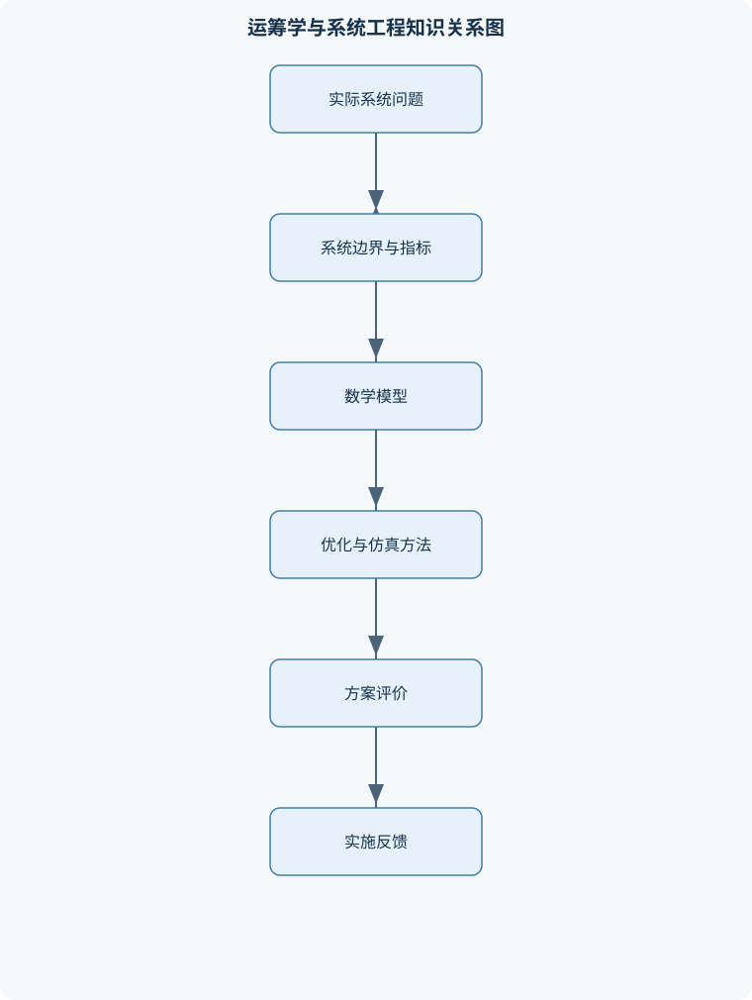
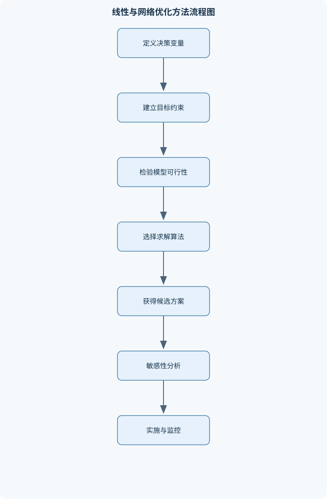

# 运筹学与系统工程

## 一、课程整体知识框架

### 课程边界与先修知识

本课程研究如何把生产、运输、配置、库存、服务、竞争和不确定性等系统问题抽象为可计算模型，并利用优化、网络分析、概率模型、仿真与决策方法形成可执行方案。内容边界包括系统分析与建模、线性规划及其对偶、运输与网络优化、整数规划、目标规划、非线性规划、动态规划、库存论、排队论、决策分析和对策论；系统工程部分强调需求定义、指标体系、约束识别、方案比较、敏感性分析、实施反馈和模型验证。先修知识包括高等数学中的函数与导数、线性代数中的向量和矩阵、初等概率统计、基本编程或电子表格计算。课程中的理想模型通常假设参数确定、数据准确、目标可量化；现实系统还需处理随机性、时变性、信息不完备、行为反应、模型误差和计算规模等限制。





### 1. 研究对象与基本问题

运筹学与系统工程共同关注复杂系统中的资源配置、运行控制、方案选择和绩效改进。运筹学强调把现实问题转化为数学模型，再利用优化、网络分析、概率模型、仿真和决策方法寻找可执行方案；系统工程强调从需求出发，识别系统边界、利益相关者、功能结构、约束关系和实施反馈，确保模型结果能够回到真实系统中接受验证。

课程研究的对象通常具有以下特征：资源有限而需求多样；多个目标之间存在冲突；决策会影响后续状态；系统中存在运输、排队、库存、生产或竞争关系；部分参数具有随机性或随时间变化；决策结果还可能诱发人的行为反应。因此，所谓“最优”必须限定在给定目标、数据、约束、时间尺度和模型假设下。一个数学上最优的方案，如果违反操作规则、超出设备能力、无法获得数据或不能被执行，就不能直接视为系统工程意义上的优选方案。

### 2. 从现实问题到可计算模型

系统工程建模一般按以下逻辑展开。

1. **界定系统边界。** 明确研究对象包括哪些设施、人员、订单、设备、时间段和信息；同时说明哪些因素作为外部输入处理。例如，研究仓库补货时，仓库库存、订货量和缺货量属于系统内部变量，供应商交货时间可能是参数或随机变量。边界过窄会遗漏重要约束，边界过宽则会使模型难以求解和验证。
2. **识别利益相关者和决策层次。** 生产部门可能关注产量和设备利用率，财务部门关注成本和现金占用，客户关注交付时间和服务水平，管理者则需要在多个目标之间权衡。战略层决策通常涉及设施选址和网络结构，战术层决策涉及产能、库存和运输计划，作业层决策涉及排班、派工和实时调度。
3. **区分变量、参数和状态。** 决策变量是模型能够选择的量，如生产量 $x_i$、运输量 $x_{ij}$、是否启用设施的变量 $y_i$；参数是给定但可能存在误差的量，如单位成本 $c_i$、资源消耗系数 $a_{ij}$、容量 $b_i$；状态变量描述系统随阶段演化的状况，如第 $t$ 期库存 $I_t$。将状态误写成决策变量，或把可控制决策误当作固定参数，会破坏模型的因果结构。
4. **明确目标函数。** 目标可以是最大化利润、产出、服务水平，也可以是最小化成本、等待时间、运输距离或风险。目标函数必须说明单位和时间范围。例如，若 $c_i$ 的单位为元/件，$x_i$ 的单位为件，则 $c_i x_i$ 的单位为元；若不同目标尚未统一量纲，不能直接把它们相加。
5. **建立约束条件。** 约束表达资源、需求、能力、逻辑和制度要求。例如资源约束可写为
   $$
   \sum_{j}a_{ij}x_j\le b_i,
   $$
   其中 $a_{ij}$ 为第 $j$ 项活动消耗第 $i$ 类资源的数量，$b_i$ 为该资源可用量。还必须补充 $x_j\ge0$、整数性、上下界和逻辑联动约束。
6. **验证与反馈。** 验证包括量纲检查、边界情形检查、历史数据回放、极端场景测试和结果可解释性检查。模型输出还要经过实施反馈：若实际等待时间、缺货率或产量与预测明显不一致，应检查数据、参数、约束和行为假设，而不是只调整求解器设置。

### 3. 理想模型与现实限制

确定性模型假设参数已知且固定，例如单位成本、需求量和资源容量均为确定值；随机模型则把需求、到达、服务时间或交货期表示为随机变量。确定性模型便于分析结构和推导结论，但可能低估风险；随机模型更接近现实，却需要概率分布、样本数据和统计检验。

课程中的优化模型通常还假设目标可以量化、约束关系稳定、参与者按照模型规则行动。然而现实系统可能存在信息不完备、参数时变、需求突发、设备故障、人员学习效应、顾客放弃排队和竞争者策略反应等问题。因而模型结果常常应表达为“在给定假设下的方案和敏感性范围”，而不是脱离前提的永久结论。

### 4. 统一符号与方法联系

设 $I$ 为资源或供给节点集合，$J$ 为需求节点集合，$N$ 为网络节点集合，$A$ 为有向弧集合，$T$ 为规划期或阶段集合。线性规划的一般形式为

$$
\max\{\text{或 }\min\}\quad z=c^{\mathsf T}x
$$

满足

$$
Ax\le b,\qquad x\ge0.
$$

其中 $x$ 为决策向量，$c$ 为目标系数向量，$A$ 为技术系数矩阵，$b$ 为资源容量或需求等右端项向量。若某个变量表示车辆数、机器数或人员数，通常应增加整数约束；若表示是否建设、是否选择或是否启用，则使用 $y_i\in\{0,1\}$。

线性规划、运输模型、最短路、库存模型和排队模型并不是互相孤立的内容。运输模型是带有特殊网络结构的线性规划；最短路和最大流是网络优化问题；库存模型关注跨期状态平衡；排队模型关注随机到达和服务过程；动态规划则利用阶段和状态分解多阶段问题。整数规划可把选址、指派、固定费用和逻辑关系加入线性模型，多目标规划则在单一目标不足以表达管理要求时描述目标冲突。

## 二、章节和模块划分

### 核心知识覆盖清单

本清单用于检查正文是否覆盖本课程的主要知识模块：

- **系统工程与运筹学建模基础**：运筹学的研究对象与决策优化、系统边界与利益相关者、问题识别与决策层次、决策变量、参数与状态变量、目标函数与约束条件、可行解、最优解与满意解、确定性模型与随机模型、模型验证、敏感性与反馈闭环。
- **线性规划模型与单纯形法**：线性规划标准形式、资源配置与生产计划建模、可行域与凸集、基本可行解与基、松弛变量和剩余变量、单纯形表与换基规则、最优性、无界性与无可行解、大规模线性规划的求解器建模。
- **线性规划对偶与敏感性分析**：原问题与对偶问题的构造、弱对偶定理、强对偶定理、互补松弛条件、影子价格的经济含义、资源右端项敏感性、目标系数敏感性、退化与多重最优解。
- **运输、指派与网络优化**：产销平衡运输模型、不平衡运输问题、初始基本可行运输方案、位势法与闭回路改进、指派问题与匈牙利算法、最大流与最小割、最短路与关键路径、最小费用流与节点平衡。
- **整数规划与组合优化**：纯整数与混合整数规划、0-1变量的逻辑表达、固定费用与装箱约束、指派与选址模型、线性松弛与界、分支定界法、割平面基本思想、整数解与连续解的差异。
- **多目标与目标规划**：多目标决策的冲突性、正偏差变量与负偏差变量、目标约束建模、优先级目标规划、加权目标规划、理想点与有效解、权重和优先级的解释、满意解与方案权衡。
- **非线性规划与系统仿真**：非线性目标与非线性约束、凸函数与凸可行域、一阶和二阶最优性条件、拉格朗日函数与乘子、KKT条件的适用前提、梯度下降与牛顿类方法、离散事件仿真流程、仿真输出的置信区间与校准。
- **动态规划与多阶段决策**：阶段、状态与决策定义、状态转移方程、贝尔曼最优性原理、递推方程与边界条件、后向递推与前向递推、资源分配动态规划、最短路的动态规划解释、维数灾难与状态压缩。
- **库存与生产控制**：库存状态与库存平衡、订货成本、持有成本与缺货成本、经济订货批量模型、连续检查与定期检查策略、再订货点与安全库存、确定性需求与随机需求、提前期不确定性、服务水平与库存策略边界。
- **排队系统与服务能力设计**：到达过程与服务过程、排队规则与服务台结构、稳态、瞬态与稳定条件、M/M/1模型、Little定律、多服务台排队模型、等待成本与服务能力权衡、排队模型的现实偏差。
- **决策分析与对策论**：确定型、风险型与不确定型决策、决策树与期望收益、效用函数与风险态度、完全信息与样本信息价值、零和矩阵对策、纯策略与混合策略、鞍点与极小极大准则、纳什均衡与策略稳定性。


### 1. 系统工程与运筹学建模基础

本模块建立全课程的建模语言。一个完整模型至少包括决策变量、参数、目标函数、约束条件、变量取值域和适用假设。可行解是满足全部约束的解，最优解是在可行解集合中使目标函数达到最好值的解；满意解则是达到管理者可接受标准的方案，不一定在单一数学目标下最优。

建模时应先判断问题属于确定性、随机性、静态、动态、单目标、多目标、合作性还是竞争性问题。例如，产品组合通常是静态确定性资源配置问题；库存控制属于动态或随机决策问题；服务台设计具有排队和容量权衡特征；竞争定价则可能需要对策论。

模型验证不能只检查求解器是否返回“最优”。应依次检查：数据单位是否一致；约束方向是否正确；需求、供给和容量是否完整；极端情况下模型是否产生合理结果；模型结果是否能由业务人员解释；关键参数变化是否导致符合常识的方向变化。

### 2. 线性规划模型与单纯形法

线性规划要求目标函数和约束均为变量的一次函数。生产计划可写为

$$
\max z=\sum_j p_jx_j
$$

满足

$$
\sum_j a_{ij}x_j\le b_i,\quad i\in I,\qquad x_j\ge0.
$$

其中 $p_j$ 的单位通常为元/件，$x_j$ 为产品数量，$a_{ij}$ 为单位产品消耗的资源量，$b_i$ 为资源容量。若原约束为“至少达到需求”，可写成 $\ge$；若为“恰好满足”，则写成等式。

将 $\le$ 约束转化为等式时加入松弛变量，例如

$$
\sum_j a_{ij}x_j+s_i=b_i,\qquad s_i\ge0.
$$

松弛量 $s_i$ 表示尚未使用的资源。对于 $\ge$ 约束，需要减去剩余变量；若初始基不能直接形成可行解，可能需要人工变量和大 $M$ 法或两阶段法。

线性规划的可行域是若干线性半空间的交集，因此是凸集。若可行域非空，且目标在其上有有限最优值，则至少存在一个最优基本可行解。单纯形法正是沿基本可行解之间换基移动。每次迭代选择能够改善目标的非基变量入基，再用最小比值规则确定出基变量，以保持解的可行性。若改进变量所在列没有正的有效比值，则目标可能无界；若初始问题无可行基，则说明模型无可行解或需要进一步处理人工变量。

生产计划示例中，若最大化 $3x+4y$，约束为 $x+2y\le14$、$3x-y\ge0$、$x-y\le2$、$x,y\ge0$，边界交点包括 $(0,0)$、$(2,2)$、$(6,4)$ 等。比较各顶点目标值，$(6,4)$ 的目标值为 $34$。但这个结论只针对连续变量；若 $x$、$y$ 表示不可分割的设备或人员，必须改用整数规划。

### 3. 线性规划对偶与敏感性分析

每个资源配置型线性规划都可构造一个对偶问题。对于原问题

$$
\max\ c^{\mathsf T}x,\qquad Ax\le b,\quad x\ge0,
$$

其对偶可写为

$$
\min\ b^{\mathsf T}u,\qquad A^{\mathsf T}u\ge c,\quad u\ge0.
$$

原问题的每个资源约束对应一个对偶变量 $u_i$，原问题的每个决策变量对应一个对偶约束。对偶变量可解释为资源的影子价格，但这种解释仅在允许的敏感性范围内成立，不能理解为资源价格永久不变。

弱对偶性可由直接代数推导得到。若 $x$ 为原问题可行解、$u$ 为对偶可行解，则由 $Ax\le b$ 和 $u\ge0$ 得

$$
u^{\mathsf T}Ax\le u^{\mathsf T}b.
$$

又因 $A^{\mathsf T}u\ge c$ 且 $x\ge0$，有

$$
c^{\mathsf T}x\le x^{\mathsf T}A^{\mathsf T}u=u^{\mathsf T}Ax.
$$

所以

$$
c^{\mathsf T}x\le b^{\mathsf T}u.
$$

若原问题和对偶问题均有有限最优解，强对偶性说明两者最优值相等。互补松弛条件进一步要求：原问题的资源约束若有剩余，则对应影子价格必须为零；某个原变量为正，则对应对偶约束必须取等号。

敏感性分析研究右端项 $b$、目标系数 $c$ 和技术系数 $A$ 改变时最优方案如何变化。资源增加一个单位所带来的目标改进，不能脱离当前基的允许变化范围使用；若变化超过该范围，最优基可能改变，原影子价格也不再适用。退化时某些基本变量为零，可能出现多个基对应同一解；多重最优时，目标等值线可能与可行域的一条边重合，因此存在多个同样好的方案。

### 4. 运输、指派与网络优化

运输模型设供给节点 $i\in I$ 的供给量为 $a_i$，需求节点 $j\in J$ 的需求量为 $b_j$，单位运输成本为 $c_{ij}$，运输量为 $x_{ij}$。平衡运输模型为

$$
\min\sum_{i\in I}\sum_{j\in J}c_{ij}x_{ij}
$$

满足

$$
\sum_jx_{ij}=a_i,\qquad \sum_ix_{ij}=b_j,\qquad x_{ij}\ge0.
$$

必须先检查 $\sum_i a_i=\sum_j b_j$。若供给大于需求，可增加虚拟需求点；若需求大于供给，可增加虚拟供给点。虚拟线路成本不是纯粹的数学补丁，而应表示剩余、外购、延期、缺货或未使用产能的业务代价。

运输问题可先用西北角法、最小元素法或伏格尔法构造初始基本可行方案，再用位势法计算非基变量的改进方向。若某条非基线路具有降低总成本的潜力，则构造包含该线路的闭回路，沿回路交替加减运输量，直到某个基本变量降为零。每次调整必须保持所有供给和需求等式成立。

指派问题要求每个任务由一个人员或设备承担、每个人员或设备至多承担一个任务。匈牙利算法通过行减最小值、列减最小值、覆盖零元和调整未覆盖元素，逐步形成独立零元。方阵规模为 $n$ 时，经典实现复杂度为 $O(n^3)$；非方阵需要补虚拟行或列，并解释未分配的含义。

网络流变量 $f_{ij}$ 表示弧 $(i,j)$ 上的流量，容量为 $u_{ij}$，节点净供给量为 $g_i$。节点守恒为

$$
\sum_{j:(i,j)\in A}f_{ij}
-\sum_{j:(j,i)\in A}f_{ji}=g_i.
$$

最大流问题要求最大化从源点到汇点的流量。最大流最小割定理表明，最大可行流值等于所有源汇割容量中的最小值，但前提是容量非负、流量满足容量限制和节点守恒。最短路问题要求最小化路径总权重；Dijkstra 算法要求所有弧权非负，存在负权弧时应改用 Bellman-Ford 等方法，并检查负权回路，因为负权回路会使最短路没有有限下界。

### 5. 整数规划与组合优化

整数规划在目标和约束仍为线性的基础上，要求部分或全部变量取整数。纯整数规划要求所有决策变量整数，混合整数规划只要求部分变量整数。二元变量 $y_i\in\{0,1\}$ 可表达选择、启用、分配或事件是否发生。

固定费用选址可用约束

$$
x_{ij}\le M y_i
$$

表示只有当设施 $i$ 被启用时，才允许向需求点 $j$ 配送。这里 $M$ 应取合理上界；若取值过大，会造成松弛界很差和数值不稳定，若过小则可能错误排除可行方案。

线性松弛把整数约束暂时放宽为连续约束，可得到整数最大化问题的上界或整数最小化问题的下界，但松弛解通常不可执行。不能简单四舍五入，因为四舍五入可能违反容量和逻辑约束，也不一定得到整数最优解。

分支定界法先求线性松弛；若松弛不可行、已得到整数解，或其界不可能优于当前最好整数解，则剪枝。若变量 $x_i$ 的松弛值为 $v$ 且非整数，则分成 $x_i\le\lfloor v\rfloor$ 与 $x_i\ge\lceil v\rceil$ 两个子问题。算法在有限分支树被处理完或剪枝后终止，最坏复杂度可能呈指数级。割平面则通过增加对所有整数解有效、但排除当前分数解的线性不等式，逐步收紧松弛可行域。

### 6. 多目标与目标规划

生产、服务和公共资源配置通常同时存在多个目标，例如利润尽量高、加班尽量少、就业人数至少达到下限、交付延迟尽量少。这些目标可能冲突，不能在未说明偏好的情况下声称存在唯一最优方案。

目标规划为每个目标引入正偏差和负偏差。若目标函数为 $h_k(x)$，目标值为 $q_k$，则写为

$$
h_k(x)+d_k^- -d_k^+=q_k,\qquad d_k^-,d_k^+\ge0.
$$

其中 $d_k^-$ 表示不足，$d_k^+$ 表示超额。对于“利润至少达到目标”，通常惩罚 $d_k^-$；对于“加班不超过上限”，通常惩罚 $d_k^+$；对于“产量尽量接近目标”，两种偏差都可能需要惩罚。

优先级目标规划按词典序先满足高优先级目标，再在不损害高优先级结果的条件下优化低优先级目标。加权目标规划则最小化加权偏差和，但权重必须考虑单位和尺度。若一个目标以元计、另一个目标以小时计，直接使用数值权重会产生误导。理想点是各目标分别单独优化所得的理想值；有效解是不存在另一个方案能在不损害任何目标的前提下改善至少一个目标的方案。

### 7. 非线性规划与系统仿真

非线性规划允许目标函数或约束出现乘积、幂、指数、对数等非线性关系。设目标为 $f(x)$，不等式约束为 $g_i(x)\le0$，等式约束为 $h_j(x)=0$。无约束极值的必要条件通常是 $\nabla f(x)=0$；二阶条件还需考察海森矩阵 $H$ 的正定性或负定性。

凸优化具有重要的全局性：若求最小值时 $f$ 为凸函数、可行域为凸集，则任一局部最优解都是全局最优解。非凸问题可能有多个局部最优点、鞍点或不连续区域，梯度下降只能保证在适当条件下到达某类驻点，不能自动保证全局最优。

含约束问题可构造拉格朗日函数

$$
\mathcal L(x,\lambda,\mu)
=f(x)+\sum_i\lambda_i g_i(x)+\sum_j\mu_jh_j(x),
$$

其中 $\lambda_i$ 和 $\mu_j$ 为约束乘子。KKT 条件需要适当的可微性和约束资格条件；不能在任意非凸、不可微或约束退化问题中无条件使用。

离散事件仿真适合描述排队、维修、库存补货和生产流程。流程包括初始化时钟和状态、建立事件表、推进到最早事件、更新队列与资源、生成后续事件、记录指标、经过预热期后重复运行，并用置信区间表达随机输出的不确定性。仿真只能评价给定方案，不能自动保证最优，通常要结合方案枚举、实验设计或优化方法。

### 8. 动态规划与多阶段决策

动态规划适用于决策分阶段进行且当前状态能够概括过去对未来影响的问题。阶段为 $t\in T$，状态为 $s_t$，决策为 $a_t$，状态转移可写为

$$
s_{t+1}=F_t(s_t,a_t).
$$

若目标是最大化收益，价值函数的后向递推为

$$
V_t(s)=\max_{a\in A_t(s)}
\{r_t(s,a)+V_{t+1}(F_t(s,a))\},
$$

终端条件由 $V_{T+1}(s)$ 或终端收益给出。贝尔曼最优性原理认为，从当前状态出发的最优策略，其后续部分必须从下一状态开始继续保持最优，否则替换为更优后续策略即可改进整体方案。

资源分配、设备更新、库存控制和最短路都可用动态规划解释。最短路的状态可以是当前节点，决策是选择下一条弧，价值函数是到终点的最小剩余距离。动态规划的主要限制是维数灾难：若阶段数为 $T$、状态数为 $S$、每个状态平均有 $A$ 个决策，直接递推约需 $O(TSA)$ 的计算；当状态由库存、设备状况、订单积压和时间共同组成时，状态空间会迅速扩大。状态压缩只有在不丢失未来决策所需信息时才成立。

### 9. 库存与生产控制

库存平衡的基本式为

$$
I_t=I_{t-1}+Q_t-D_t,
$$

其中 $I_t$ 为第 $t$ 期期末库存，$Q_t$ 为订货或生产量，$D_t$ 为需求量，单位可以是件或吨。若存在缺货、在途库存或报废，还需增加缺货量、到货量和损耗量等变量。

经济订货批量模型假设需求确定且连续发生、每次订货成本固定为 $S$、单位年持有成本为 $H$、补货瞬时完成且不允许缺货。年需求为 $D$、订货批量为 $Q$ 时，相关年成本为

$$
C(Q)=\frac{D}{Q}S+\frac{Q}{2}H.
$$

对 $Q$ 求导：

$$
C'(Q)=-\frac{DS}{Q^2}+\frac{H}{2}.
$$

令导数为零，得到

$$
Q^*=\sqrt{\frac{2DS}{H}}.
$$

二阶导数 $2DS/Q^3>0$，因此该点为最小值。若需求随机、提前期不确定、存在批量折扣、有限生产能力或物品易腐，经典公式只能作为基准，不能直接给出完整库存策略。

连续检查策略通常在库存位置降至再订货点 $r$ 时补货；定期检查策略按固定周期检查并补足到目标水平。安全库存用于应对需求或提前期波动，服务水平表示满足需求或不发生缺货的概率指标，但不同服务水平定义不能混用。

### 10. 排队系统与服务能力设计

排队系统由到达过程、服务过程、服务台结构、排队规则和系统容量组成。$\lambda$ 表示平均到达率，$\mu$ 表示单个服务台平均服务率，$\rho$ 表示利用率。对于单服务台系统，

$$
\rho=\frac{\lambda}{\mu}.
$$

M/M/1 模型假设到达为泊松过程、服务时间服从指数分布、只有一个服务台、通常采用先到先服务且系统容量无限。稳定运行要求 $\rho<1$。在此条件下，

$$
L=\frac{\rho}{1-\rho},\qquad
W=\frac{1}{\mu-\lambda},
$$

其中 $L$ 是系统内平均顾客数，$W$ 是顾客在系统内平均逗留时间。由 Little 定律

$$
L=\lambda W
$$

可相互验证两个结果。该定律要求使用长期有效到达率，并且系统处于适当的稳态。

当 $\lambda$ 接近 $\mu$ 时，等待时间会急剧增加；但现实中顾客可能放弃排队、服务时间并非指数分布、队列容量有限、不同顾客具有不同优先级，因此 M/M/1 结果不能机械套用。服务能力设计需要比较增加服务台、提高服务率、预约分流和改变服务规则的成本与等待收益。

### 11. 决策分析与对策论

确定型决策中，行动结果已知；风险型决策中，自然状态概率已知或可合理估计；不确定型决策中，状态概率未知。设行动为 $a_i$，自然状态为 $S_j$，收益为 $R(a_i,S_j)$，状态概率为 $P(S_j)$，则行动 $a_i$ 的期望收益为

$$
E(a_i)=\sum_jP(S_j)R(a_i,S_j).
$$

期望收益只反映概率加权平均值，不能表达决策者对风险的态度。效用函数可描述风险厌恶、风险中性或风险偏好。完全信息价值表示在知道自然状态后可分别选择最佳行动时，相对于当前决策的期望收益改善；样本信息价值还必须扣除获取信息的成本。

决策树将决策节点、机会节点、状态概率和收益按时间顺序展开，通常从末端向前计算。风险分析还应报告最坏损失、收益波动和关键概率变化，而不能只报告单一期望值。

零和矩阵对策中，一方收益等于另一方损失。纯策略下，若矩阵存在鞍点，则最大化方的最小收益等于最小化方的最大损失。不存在鞍点时，需要考虑混合策略，即各纯策略按概率随机选择。纳什均衡表示在其他参与者策略给定时，任何一方都不能通过单独改变策略提高自身收益。零和模型的方法不能直接用于一般和博弈、合作博弈或存在可转移收益的谈判问题。

### 12. 综合算法与流程示例

#### 12.1 系统工程建模流程

**输入：**业务问题、历史数据、目标、资源限制和实施规则。  
**过程：**

1. 明确系统边界、时间尺度和决策者；
2. 定义变量、参数、状态和单位；
3. 写出目标函数、约束和变量取值域；
4. 检查供需平衡、量纲、非负性和逻辑关系；
5. 构造基准案例、极端案例和历史回放案例；
6. 求解并进行敏感性分析；
7. 将方案转化为执行规则，收集实际反馈。

**终止条件：**模型逻辑、数据口径、结果可行性和业务解释均通过一致性检查。该流程适用于优化、仿真和决策分析，但不替代具体算法。

#### 12.2 分支定界伪代码

```text
算法：整数规划分支定界
输入：整数规划模型、当前最好整数解 incumbent、节点队列
输出：最优整数解及其目标值

1. 将原问题加入节点队列，incumbent 设为空
2. 当节点队列非空时：
      取出一个待处理节点
      求解该节点的线性松弛
      若松弛不可行，则剪枝并继续
      若松弛目标界不优于 incumbent，则剪枝并继续
      若松弛解满足全部整数约束：
          若目标优于 incumbent，则更新 incumbent
          继续
      选择一个取分数值的整数变量 x_i=v
      生成两个子节点：
          x_i ≤ floor(v)
          x_i ≥ ceil(v)
      将未被明显剪枝的子节点加入队列
3. 队列为空时返回 incumbent
```

对最大化问题，线性松弛值是上界；对最小化问题，线性松弛值是下界。剪枝的正确性依赖界的方向不能弄反。该算法最坏复杂度可能为指数级，但合理的变量选择、预处理和有效割能够显著减少节点数量。

#### 12.3 库存控制计算例题

**题干：**年需求量为 $D=12000$ 件，每次订货成本为 $S=80$ 元，单位年持有成本为 $H=4$ 元。忽略提前期和缺货，求经济订货批量、年订货次数和平均循环库存。

**分析：**满足确定性需求、固定订货成本、线性持有成本和瞬时补货的经典模型假设，因此使用 EOQ 公式。

**解答：**

$$
Q^*=\sqrt{\frac{2DS}{H}}
=\sqrt{\frac{2\times12000\times80}{4}}
=\sqrt{480000}\approx692.8\text{ 件}.
$$

实际订货批量可根据包装或运输约束取约 $693$ 件。年订货次数为

$$
\frac{D}{Q^*}\approx\frac{12000}{692.8}\approx17.3\text{ 次/年}.
$$

平均循环库存为

$$
\frac{Q^*}{2}\approx346.4\text{ 件}.
$$

**结果验证：**在最优点，年订货成本与年持有成本相等，均约为 $1385.6$ 元，相关总成本约为 $2771.2$ 元。若需求具有显著波动或提前期不确定，结果只代表循环库存，不包括安全库存。

**变式：**若要求达到服务水平，则必须估计需求和提前期分布，增加安全库存；若存在数量折扣，则应比较不同价格区间的总成本，不能只使用单一 EOQ。

#### 12.4 排队能力设计例题

**题干：**某服务台平均到达率为 $\lambda=8$ 人/小时，单台平均服务率为 $\mu=10$ 人/小时，假设系统符合 M/M/1 条件，求利用率、平均系统人数和平均逗留时间。

**解答：**

$$
\rho=\frac{\lambda}{\mu}=\frac{8}{10}=0.8<1.
$$

因此系统满足稳态条件。平均系统人数为

$$
L=\frac{\rho}{1-\rho}
=\frac{0.8}{0.2}=4\text{ 人}.
$$

平均逗留时间为

$$
W=\frac{1}{\mu-\lambda}
=\frac{1}{2}\text{ 小时}=30\text{ 分钟}.
$$

由 Little 定律验证：

$$
\lambda W=8\times0.5=4=L.
$$

**边界说明：**若到达率增至 $10$ 人/小时，则 $\rho=1$，稳态平均等待时间不再有限；若超过 $10$ 人/小时，队列会持续积累。实际系统还应检查顾客放弃、有限队列和服务时间分布等因素。

#### 12.5 生产计划整数性例题

**题干：**最大化 $x+10y$，满足 $x+7y\le17.5$、$0\le x\le3.5$、$y\ge0$，并要求 $x,y$ 为整数。

**分析：**先放宽整数约束求连续松弛，再检查整数可行解。连续松弛中取 $y=2$、$x=3.5$ 时目标为 $23.5$；某些连续最优表示的资源利用方式不能直接执行。

**逐步解答：**由于 $y$ 的单位收益较高，考察 $y=0,1,2$ 等整数值。当 $y=2$ 时，资源约束给出 $x\le3.5$，整数性要求 $x\le3$，目标为 $3+20=23$。当 $y=1$ 时，$x\le3.5$，取 $x=3$，目标为 $13$；当 $y=0$ 时目标不超过 $3$。因此整数最优解为 $(x,y)=(3,2)$，目标值为 $23$。

**结果验证：**资源使用量为 $3+7\times2=17\le17.5$，满足上界和非负性。连续松弛值 $23.5$ 是整数最大化问题的上界，整数解 $23$ 不超过该上界。

**变式：**若将资源右端项改为 $17$，解可能发生变化；若取消整数约束，连续解不再代表可执行的整数计划。

#### 12.6 风险型决策例题

**题干：**方案甲在高、中、低需求状态下收益分别为 $100,60,-20$；方案乙收益分别为 $80,55,10$。三种状态概率分别为 $0.2,0.5,0.3$。比较期望收益。

**计算：**

$$
E(\text{甲})=0.2\times100+0.5\times60+0.3\times(-20)
=20+30-6=44.
$$

$$
E(\text{乙})=0.2\times80+0.5\times55+0.3\times10
=16+27.5+3=46.5.
$$

因此按期望收益选择方案乙。可是方案甲的高需求收益更高，方案乙的最低收益更好。若决策者明显厌恶亏损，使用效用函数后，方案乙的优势可能扩大；若决策者愿意承担风险，则可能重新评价方案甲。

**验证与变式：**若高需求概率提高，需重新计算期望值；若状态概率并不可靠，不能只给出一个确定结论，还应进行概率敏感性分析，并报告最坏收益和收益范围。

### 13. 实验与项目工作流

#### 13.1 生产—库存联合计划实验

**输入数据：**连续若干期需求 $D_t$、正常产能、加班上限、单位生产成本、加班成本、库存成本和期初库存。  
**步骤：**

1. 定义正常生产量、加班量和期末库存；
2. 对每期建立
   $$
   I_t=I_{t-1}+Q_t-D_t;
   $$
3. 加入产能、加班、库存非负和期末库存要求；
4. 以总生产成本、加班成本和持有成本最小为目标；
5. 求解后核对每期库存平衡和能力约束；
6. 改变需求峰值、加班上限和期末库存要求，比较方案变化。

**评价标准：**所有约束满足；库存、产量和加班量单位一致；总成本可由逐项成本加总复核；结果能够解释是提前备货、加班还是容量限制导致。

**排错方法：**若模型无解，先检查总产能是否小于总需求；若期末库存异常，检查库存平衡式的期初期末索引；若模型大量提前生产，检查持有成本单位是否误写成每期成本或每年成本；若出现负库存，检查是否遗漏非负约束或错误允许缺货。

#### 13.2 排队仿真与服务能力项目

**输入数据：**到达时间或到达率、服务时间样本、服务台数量、排队规则、营业时间和预热期长度。  
**步骤：**

1. 初始化仿真时钟、队列、服务台状态和事件表；
2. 取最早到达或服务完成事件，推进时钟；
3. 根据事件更新队列和服务台；
4. 记录等待时间、系统逗留时间、队长和服务台利用率；
5. 设置预热期，避免初始空系统造成偏差；
6. 对每种服务能力方案进行多次独立重复运行；
7. 计算均值、标准差和置信区间。

**评价标准：**方案比较应基于相同输入场景、相同统计口径和足够的重复运行；输出至少包括平均等待时间、服务水平、利用率和顾客放弃率；不能把单次仿真的结果当成确定事实。

**排错方法：**若队列长度随时间无限增长，检查到达率是否超过服务能力；若平均等待时间为负，检查事件时间戳和等待时间计算顺序；若重复运行结果完全相同，检查随机数种子是否被错误固定；若初期指标异常，检查预热期是否真正排除；若仿真和实测差异很大，应重新校准到达和服务分布，而不是只调整输出表格。

## 三、核心概念的详细解释

### 3.1 系统工程与运筹学建模基础

#### 3.1.1 研究对象、系统边界与决策层次

运筹学研究在资源有限、目标相互制约和系统关系复杂的条件下，如何选择行动方案，使可量化绩效达到最大或成本达到最小。系统工程则进一步关注问题从需求提出、指标定义、方案设计、模型计算到实施反馈的完整生命周期。两者的结合不是单纯“把问题写成公式”，而是要保证模型所描述的对象、数据和约束与真实系统一致。

系统边界决定哪些因素被纳入模型。研究配送网络时，仓库、车辆、客户需求、运输线路和车辆容量可以属于系统内部；燃油价格、天气和突发交通状况可以作为外部参数或随机因素。边界过窄会漏掉关键约束，边界过宽则会扩大数据需求和计算规模。边界还必须配合时间尺度：战略选址通常以年为周期，生产排程可能以小时或班次为周期，库存控制则常以日或周为周期。

利益相关者包括决策者、资源提供者、执行人员、服务对象和受影响群体。不同利益相关者的目标可能冲突，例如生产部门希望提高设备利用率，销售部门希望快速交付，财务部门希望减少库存资金占用。模型中的目标函数不能未经说明地代表所有人的利益；如果存在多个目标，应使用多目标优化、目标规划或明确的权衡规则。

决策层次通常分为战略、战术和作业层。战略层决定设施位置、网络结构和长期产能；战术层决定生产计划、库存政策和运输安排；作业层决定具体订单如何排产、车辆如何派送以及服务台如何调度。不同层次的模型在时间跨度、变量粒度和数据精度上不同，不能把战略模型的粗粒度结果直接当成作业指令。

#### 3.1.2 变量、参数、状态与目标

决策变量表示模型能够主动选择的行动数量，如产品产量 $x_i$、从供给点 $i$ 向需求点 $j$ 的运输量 $x_{ij}$、是否启用设施的变量 $y_i$。参数表示给定条件，如单位成本 $c_i$、单位资源消耗量 $a_{ij}$、供给量 $a_i$ 和需求量 $b_j$。状态变量表示系统在阶段或时点上的状况，例如第 $t$ 期库存 $I_t$、设备是否空闲、队列中顾客数和剩余资源量。

状态变量与决策变量并不等价。库存 $I_t$ 虽然会受到生产和订货决策影响，但通常由库存平衡方程确定；真正的决策可能是生产量 $Q_t$ 或订货量。将库存直接任意设定而不写平衡约束，会使模型产生无法实现的方案。

目标函数应具有明确的方向、单位和时间范围。若 $p_i$ 为产品 $i$ 的单位收益，$c_i$ 为单位成本，$x_i$ 为产量，则利润最大化可写为
$$
\max z=\sum_i(p_i-c_i)x_i.
$$
其中 $p_i$ 和 $c_i$ 的单位应相同，例如元/件，$x_i$ 的单位为件，故目标值单位为元。若同时加入运输成本、库存成本和罚款，必须先确认它们是否属于同一时间范围；不能把“元/件”和“元/年”未经换算直接相加。

#### 3.1.3 确定性模型、随机模型与模型验证

确定性模型假设参数固定且已知，适用于需求稳定、数据误差较小或需要先分析结构的场景。随机模型把需求、到达、服务时间、交货期或价格表示为随机变量，适用于不确定性对方案影响显著的场景。随机模型并不自动更准确，因为它需要可靠的分布假设和足够的数据。

模型验证至少包括四类检查：一是量纲检查，确认每个等式和不等式两侧单位一致；二是边界检查，例如需求为零、容量为零、所有成本相等时模型是否给出合理结果；三是历史回放，用已知数据检验模型能否复现历史现象；四是极端场景测试，如供给远小于需求、服务率接近到达率或运输弧全部受限时，检查结果是否反映系统逻辑。

敏感性分析研究参数变化对方案和目标值的影响。它可以揭示哪些参数最重要，也可识别模型结论的适用范围。影子价格、库存策略和排队结果都不能脱离参数范围解释。实施后还需形成反馈闭环，将实际产量、缺货率、等待时间和运输成本与模型预测比较，必要时修正数据、约束或行为假设。

### 3.2 线性规划及其对偶

#### 3.2.1 线性规划模型与可行域

线性规划的一般形式为
$$
\max\ \text{或}\ \min\ z=c^{\mathsf T}x,
$$
满足
$$
Ax\le b,\qquad x\ge0.
$$
其中 $x$ 是决策向量，$c$ 是目标系数向量，$A$ 是资源消耗或技术系数矩阵，$b$ 是资源容量或需求右端项向量。线性意味着目标和约束中的变量只以一次幂出现，变量之间不相乘，系数不随变量取值变化。

生产计划中，若产品 $j$ 消耗资源 $i$ 的数量为 $a_{ij}$，资源 $i$ 的可用量为 $b_i$，则资源约束为
$$
\sum_j a_{ij}x_j\le b_i.
$$
若某类需求必须满足，应使用 $\ge$ 或等式，而不能一律写成 $\le$。松弛变量把“未使用资源”显式化：约束 $\sum_j a_{ij}x_j\le b_i$ 可改写为
$$
\sum_j a_{ij}x_j+s_i=b_i,\qquad s_i\ge0.
$$
对于至少满足型约束，需要使用剩余变量并注意初始基的构造。

线性规划的可行域是半空间的交集，因此是凸集。若两个可行解为 $x^{(1)}$ 和 $x^{(2)}$，则对任意 $0\le\theta\le1$，
$$
x=\theta x^{(1)}+(1-\theta)x^{(2)}
$$
仍然可行。在线性目标下，若可行域非空且最优值有限，则至少存在一个最优基本可行解。该结论解释了单纯形法为何可以只在顶点或基本可行解之间搜索。

线性规划可能出现三种特殊情形：无可行解、目标无界和多重最优。无可行解表示约束之间互相冲突，例如总供给不足却要求完全满足过大的需求；无界表示目标可无限改善，通常意味着漏写容量、非负性或上界约束；多重最优表示目标等值线与可行域的一条边重合，存在多个同样好的方案。

#### 3.2.2 单纯形法的逻辑

单纯形法从一个基本可行解出发，把非基变量设为零，通过换基移动到相邻基本可行解。每次迭代计算非基变量对目标值的边际改善方向；选择能够改善目标的变量入基，再用最小比值规则确定哪个基变量出基，以保证新解仍然可行。

若某个入基变量对应的约束列没有正的限制系数，说明该变量可以无限增加而不破坏可行性；在最大化问题中，这通常意味着目标无界。若无法找到初始可行基，则需要人工变量或两阶段法寻找可行解。

退化发生在某个基本变量取值为零时，换基后目标值可能不变，甚至可能循环。实际求解器会使用防循环规则、预处理和稀疏矩阵技术。单纯形法的理论最坏复杂度可能呈指数级，但在许多实际问题中表现良好；大规模线性规划还常使用内点法或专用网络算法。

#### 3.2.3 对偶、影子价格与互补松弛

对于原问题
$$
\max\ c^{\mathsf T}x,\qquad Ax\le b,\quad x\ge0,
$$
其对偶问题可写为
$$
\min\ b^{\mathsf T}y,\qquad A^{\mathsf T}y\ge c,\quad y\ge0.
$$
对偶变量 $y_i$ 可解释为资源 $i$ 的边际价值，但这种解释只在允许的敏感性范围内成立。

弱对偶定理的推导如下。若 $x$ 是原问题可行解，$y$ 是对偶可行解，则因为 $y\ge0$ 且 $Ax\le b$，
$$
y^{\mathsf T}Ax\le y^{\mathsf T}b.
$$
又因为 $A^{\mathsf T}y\ge c$ 且 $x\ge0$，
$$
c^{\mathsf T}x\le x^{\mathsf T}A^{\mathsf T}y
=y^{\mathsf T}Ax.
$$
因此
$$
c^{\mathsf T}x\le b^{\mathsf T}y.
$$
这说明任意原问题可行解的目标值不超过任意对偶可行解的目标值。若两者存在有限最优解，强对偶定理给出最优值相等。

互补松弛条件为
$$
y_i\left(b_i-(Ax)_i\right)=0,
$$
以及
$$
x_j\left((A^{\mathsf T}y)_j-c_j\right)=0.
$$
第一式表示资源约束若有剩余，则对应影子价格必须为零；若影子价格为正，则该资源通常被完全利用。第二式表示某个活动若取正值，则其对偶约束必须恰好达到等式。该条件可用于由原问题解判断对偶最优性，也可解释为什么某些产品在最优方案中产量为零。

### 3.3 运输、指派与网络优化

#### 3.3.1 运输模型与平衡条件

运输问题中，$x_{ij}$ 表示供给点 $i$ 运往需求点 $j$ 的数量，$c_{ij}$ 为单位运输成本，$a_i$ 为供给量，$b_j$ 为需求量。典型模型为
$$
\min\sum_i\sum_j c_{ij}x_{ij},
$$
满足
$$
\sum_jx_{ij}=a_i,\qquad
\sum_ix_{ij}=b_j,\qquad x_{ij}\ge0.
$$
产销平衡要求
$$
\sum_i a_i=\sum_j b_j.
$$
若供给大于需求，可增加虚拟需求点；若需求大于供给，可增加虚拟供给点。虚拟线路成本不能机械设为零，必须说明其业务含义，例如未销售、外部采购、延期交付或缺货罚款。若虚拟成本过低，模型可能人为偏好虚拟线路。

西北角法、最小元素法和伏格尔法可构造初始基本可行运输方案。位势法为行和列分别设置位势 $u_i,v_j$，对已占用的基本变量满足
$$
u_i+v_j=c_{ij}.
$$
对未占用变量计算检验数
$$
\Delta_{ij}=c_{ij}-u_i-v_j.
$$
在最小化问题中，若所有 $\Delta_{ij}\ge0$，当前方案最优；若存在负检验数，则沿闭回路按正负号调整运输量，直到没有改进方向。

#### 3.3.2 指派、流量与路径

指派问题要求每个任务恰好分配给一个人员或设备，每个人员或设备最多承担一个任务。若 $z_{ij}=1$ 表示任务 $j$ 指派给人员 $i$，则
$$
\sum_jz_{ij}\le1,\qquad
\sum_iz_{ij}=1,\qquad z_{ij}\in\{0,1\}.
$$
方阵指派问题可使用匈牙利算法：先逐行、逐列减去最小元素，寻找覆盖所有行列的独立零元；若不足，则用最小未覆盖元素调整矩阵并重复。其核心是保持等价的相对成本差异，而不是直接删去某些方案。非方阵需要补虚拟行或列，并解释虚拟任务代表的空闲、未分配或缺员。

网络流变量 $f_{ij}$ 表示弧 $(i,j)$ 上的流量，容量为 $u_{ij}$。节点守恒写为
$$
\sum_{j:(i,j)\in A}f_{ij}
-\sum_{j:(j,i)\in A}f_{ji}=g_i,
$$
其中 $g_i>0$ 表示节点净供给，$g_i<0$ 表示净需求。最大流问题要求满足
$$
0\le f_{ij}\le u_{ij},
$$
并使源点到汇点的流量最大。最大流最小割定理说明最大流值等于所有源汇割容量中的最小值，前提是容量非负且流量满足守恒。

最短路要求从指定源点到各节点的路径成本最小。若所有弧权非负，可用 Dijkstra 算法；若存在负权弧，应使用 Bellman-Ford 等能处理负权的算法，并检测负权回路。负权回路会使路径成本可以无限下降，此时最短路不存在。关键路径法把项目活动表示为网络，计算最早开始、最迟开始和总时差；总时差为零的活动构成关键路径，但项目工期还依赖活动持续时间估计和资源约束。

### 3.4 整数规划与组合优化

整数规划要求部分或全部决策变量取整数。纯整数规划中所有决策变量均为整数；混合整数规划允许一部分变量连续。0-1变量 $y_i\in\{0,1\}$可表示启用设施、是否开工、是否选择项目等逻辑决策。

固定费用模型常写为
$$
\min\sum_iF_i y_i+\sum_i c_i x_i,
$$
并用
$$
0\le x_i\le M_i y_i
$$
表示只有启用设施后才能产生流量。$M_i$ 应取合理的业务上界，而不是无限大的数；过大的 $M_i$ 会造成数值不稳定和松弛界过弱。

线性松弛把整数条件暂时改为连续条件，例如将 $y_i\in\{0,1\}$改为 $0\le y_i\le1$。对于最大化问题，松弛最优值是整数问题的上界；对于最小化问题，松弛最优值是下界。连续松弛解通常不能直接四舍五入，因为四舍五入可能破坏容量、需求或逻辑约束，也可能距离整数最优解很远。

分支定界法先求线性松弛，若松弛不可行、已得到整数解，或其界不可能优于当前最好整数解，则剪枝；否则选择分数变量 $x_i=v$，构造
$$
x_i\le\lfloor v\rfloor,\qquad x_i\ge\lceil v\rceil
$$
两个子问题。最坏复杂度通常呈指数级，实际效率取决于松弛质量、变量选择、割平面、预处理和问题结构。割平面的基本思想是在不删除任何整数可行解的前提下，增加能够排除当前分数解的线性不等式。

### 3.5 多目标、非线性规划与仿真

多目标问题中，成本、利润、服务水平、就业和风险通常不能同时达到各自最优。若一个方案不能在不损害其他目标的情况下改善任何目标，则称为有效解或非支配解。目标规划为每个目标引入偏差变量：
$$
h_k(x)+d_k^- -d_k^+=q_k,
\qquad d_k^-,d_k^+\ge0.
$$
若目标是至少达到 $q_k$，通常惩罚不足偏差 $d_k^-$；若目标是不超过 $q_k$，通常惩罚超额偏差 $d_k^+$；若目标要求精确达到，则两者都可惩罚。加权目标规划必须处理量纲和尺度，否则“权重”可能只是单位选择的结果。优先级目标规划按词典序逐级优化，高优先级目标未处理完之前不能用低优先级目标交换。

非线性规划允许目标或约束含有非线性函数：
$$
\min f(x),\qquad g_i(x)\le0,\quad h_j(x)=0.
$$
若目标函数为凸函数、可行域为凸集且求最小值，则任意局部最优解都是全局最优解；非凸问题中局部最优不一定是全局最优。无约束一阶必要条件为 $\nabla f(x^*)=0$，二阶条件通常要求海森矩阵在相关方向上半正定或正定。带约束问题可通过拉格朗日函数和 KKT 条件分析，但需要满足可微性和适当的约束资格条件。

仿真通过模拟系统随时间的状态变化来评价方案，尤其适用于排队、库存、设备故障和人员行为难以准确写成解析模型的场景。离散事件仿真以到达、服务完成、故障和补货等事件推进时钟。仿真输出是统计估计，不是自动得到的最优解，必须设置预热期、重复运行并报告置信区间。仿真模型还应使用历史数据校准，并检查输入分布与实际数据是否一致。

### 3.6 动态规划、库存、排队与决策对策

动态规划将问题分为阶段、状态和决策。状态转移可写为
$$
s_{t+1}=T_t(s_t,a_t,\xi_t),
$$
其中 $s_t$ 为当前状态，$a_t$ 为决策，$\xi_t$ 可表示随机扰动。贝尔曼最优性原理指出，最优策略从下一状态开始的后续部分也必须是该状态下的最优策略。确定性后向递推可写为
$$
V_t(s)=\operatorname*{opt}_{a\in A_t(s)}
\{r_t(s,a)+V_{t+1}(T_t(s,a))\},
$$
并以终端价值作为边界条件。状态数和决策数随阶段增长时会出现维数灾难，因此可使用状态压缩、近似动态规划或分解方法，但近似会牺牲最优性保证。

库存平衡式为
$$
I_t=I_{t-1}+Q_t-D_t.
$$
其中 $I_t$ 为期末库存，$Q_t$ 为生产或到货量，$D_t$ 为需求。经典经济订货批量模型假设需求率 $D$ 确定、每次订货成本为 $S$、单位年持有成本为 $H$、补货及时且不允许缺货。年订货成本和持有成本为
$$
C(Q)=\frac{D}{Q}S+\frac{Q}{2}H.
$$
求导得
$$
C'(Q)=-\frac{DS}{Q^2}+\frac{H}{2}=0,
$$
从而
$$
Q^*=\sqrt{\frac{2DS}{H}}.
$$
该结果不包含安全库存、需求波动、批量折扣、有限补货能力和易腐损耗，因此不能直接用于所有库存场景。

排队系统由到达过程、服务过程、服务台数量、队列容量和排队规则组成。M/M/1 模型假设泊松到达、指数服务、单服务台、先到先服务且无限队列。利用率为
$$
\rho=\frac{\lambda}{\mu},
$$
稳定条件为 $\rho<1$。稳定时
$$
L=\frac{\rho}{1-\rho},\qquad
W=\frac{1}{\mu-\lambda}.
$$
Little 定律为
$$
L=\lambda W,
$$
其中 $L$ 是系统内平均顾客数，$\lambda$ 是长期有效到达率，$W$ 是平均逗留时间。该定律要求三个量采用一致的长期平均口径；当顾客大量放弃、系统尚未稳定或只统计部分顾客时，必须重新界定有效到达率。

决策分析区分确定型、风险型和不确定型决策。风险型决策中，若自然状态为 $S_j$，行动为 $a_i$，状态概率为 $P(S_j)$，则期望收益为
$$
E(a_i)=\sum_jP(S_j)R(a_i,S_j).
$$
期望收益只反映概率加权平均，不表示风险偏好。效用函数可表达决策者对风险的厌恶或偏好。完全信息价值衡量提前知道真实状态所能增加的期望收益，样本信息价值则要扣除获取信息的成本。

对策论研究多个参与者的策略相互影响。零和矩阵对策中，一方收益等于另一方损失；纯策略若存在鞍点，可用极小极大和极大极小值确定稳定结果。若不存在鞍点，则需要混合策略，即按概率随机选择纯策略。纳什均衡是任何一方在其他参与者策略不变时都不愿单独改变策略的组合。零和模型的方法不能直接套用于一般和博弈，因为一般和博弈中各方收益之和不必为零，合作、协调和可转移收益会改变均衡分析。

## 四、重要定义、公式、定理和推导

### 专业审校补充：关键定义与适用边界

离散事件仿真中的“稳态输出”不能直接用单次运行平均值代表。设第r次独立重复运行在去除预热期后得到观测值Y₍r₎，共有R次重复，则样本均值为Ȳ=ΣᵣY₍r₎/R，样本标准差为s=[Σᵣ(Y₍r₎−Ȳ)²/(R−1)]¹ᐟ²。若重复运行可近似独立且R足够大，均值的近似95%置信区间为Ȳ±t₀.₉₇₅,ᵣ₋₁s/√R，其中t为t分布分位数。预热期用于削弱初始空系统或初始满库存造成的偏差；重复次数用于估计随机误差。模型验证还必须区分验证与确认：验证检查程序是否正确实现了模型逻辑，确认检查模型是否足以代表现实系统。若存在顾客放弃、有限队列容量或非平稳到达，M/M/1理论值不能直接作为真实系统的必然结论，只能作为基准比较。停止条件应预先规定，例如置信区间半宽低于目标精度，而不是看到某次结果“稳定”就停止。


### 4.1 线性规划的基本定理与敏感性结论

**基本可行解定理：**若线性规划可行且目标函数在可行域上有有限最优值，则至少有一个最优基本可行解。其几何原因是线性目标在凸多面体上不会只在内部孤立取得严格优于所有顶点的值；若存在最优点，可沿经过该点的可行方向移动，最终到达某个顶点而不降低目标值。

**弱对偶定理：**原问题为最大化、对偶问题为最小化时，任意原问题可行解的目标值不超过任意对偶可行解的目标值。该结论提供了最优值的上下界，也构成分支定界、松弛和停止判据的理论基础。

**强对偶定理：**若原问题和对偶问题均存在有限最优解，则两者最优目标值相等。强对偶并不意味着原问题和对偶问题的最优解唯一；退化和多重最优时可能存在多个最优解。

**影子价格边界：**若资源右端项 $b_i$ 在一定范围内变化而最优基不变，最优目标值对 $b_i$ 的局部变化率等于对应对偶变量 $y_i$。一旦变化超过允许范围，最优基可能改变，原影子价格不再能直接外推。因此不能把影子价格理解为任意规模增加资源都适用的永久单价。

### 4.2 运输与网络结论

运输问题的基本可行解通常有 $m+n-1$ 个基本位置，其中 $m$ 为供给点数、$n$ 为需求点数。若基本位置少于该数，称为退化，需要补入零运输量的基本位置以维持位势计算；补入位置必须避免形成闭回路，否则会破坏树状结构。

最大流最小割定理要求网络弧容量非负、流量不超过容量并满足中间节点守恒。若容量为负或节点存在未建模的流量损失，不能直接套用该定理。最短路的最优子结构来自反证：若最优路径中的某段不是对应端点间的最短路径，将该段替换为更短路径即可得到更短的整体路径，矛盾。但该性质不等于任何算法都适用；Dijkstra 必须要求所有弧权非负。

最小费用流在容量、供给、需求和费用均为整数时，网络矩阵具有全幺模结构，在线性模型存在可行解时通常可获得整数最优流。这是运输和网络流问题常比一般整数规划易于求解的重要原因，但加入任意非网络逻辑约束后，整数性保证可能消失。

### 4.3 整数规划与逻辑约束公式

“若选择设施 $i$，才允许运输或生产”可写为
$$
0\le x_i\le M_i y_i,\qquad y_i\in\{0,1\}.
$$
“选择两个项目中的至少一个”可写为
$$
y_1+y_2\ge1.
$$
“两个项目不能同时选择”可写为
$$
y_1+y_2\le1.
$$
“项目 $A$ 被选中后必须选择项目 $B$”可写为
$$
y_A\le y_B.
$$
这些公式只在 $y$ 为0-1变量且 $M_i$ 是有效上界时成立。若使用过大的 $M_i$，虽然逻辑上仍可能正确，但求解效率和数值稳定性会恶化。

连续松弛给出界：最大化问题的松弛值不小于整数最优值，最小化问题的松弛值不大于整数最优值。若当前节点的松弛界已经不优于已知整数解，则该节点可以剪枝。这个判据依赖目标方向，最大化和最小化不能混用。

### 4.4 目标规划和凸优化条件

目标约束
$$
h_k(x)+d_k^- -d_k^+=q_k
$$
把实际目标值与目标值之间的偏差显式表示出来。若 $h_k(x)$ 为利润且要求至少达到 $q_k$，实际利润低于目标时 $d_k^->0$；若利润超过目标，通常不惩罚 $d_k^+$。若 $h_k(x)$ 为加班量且要求不超过 $q_k$，则只惩罚 $d_k^+$。

对于无约束可微最小化问题，局部最优点必须满足 $\nabla f(x^*)=0$。若 $f$ 二阶可微，且海森矩阵 $H(x^*)$ 正定，则该点是严格局部最小点；若仅半正定，结论可能不足以保证严格最小。凸优化的全局性来自凸性：对凸函数，任意局部最小点都是全局最小点；若目标非凸或可行域非凸，梯度算法找到的驻点可能是局部最小点、最大点或鞍点。

带不等式约束的拉格朗日函数可写为
$$
\mathcal L(x,\lambda,\mu)
=f(x)+\sum_i\lambda_i g_i(x)+\sum_j\mu_jh_j(x),
$$
其中 $\lambda_i\ge0$。KKT 条件包括原始可行性、对偶可行性、驻点条件和互补松弛条件。KKT 是必要条件而非无条件充分条件；在凸问题并满足适当正则条件时，KKT 条件通常也是全局最优的充分条件。

### 4.5 动态规划、库存和排队公式的适用边界

动态规划递推的关键是不遗漏状态信息。若未来收益不仅取决于当前库存，还取决于未交付订单、设备状态或剩余工时，那么这些变量必须纳入状态 $s_t$。状态定义过少会使所谓“最优子结构”失效；状态定义过多则造成维数灾难。

经济订货批量的二阶导数为
$$
C''(Q)=\frac{2DS}{Q^3}>0,\qquad Q>0,
$$
所以在经典假设下 $Q^*$ 是总相关成本的唯一极小点。年订货次数为 $D/Q^*$，平均循环库存为 $Q^*/2$。若存在安全库存，应将其与循环库存区分；若需求随机或提前期不确定，订货点还需结合需求分布、提前期和目标服务水平确定。

M/M/1 模型中，系统平均排队人数为
$$
L_q=\frac{\rho^2}{1-\rho},
$$
平均排队等待时间为
$$
W_q=\frac{\rho}{\mu-\lambda}.
$$
并且
$$
L=L_q+\rho,\qquad W=W_q+\frac1\mu.
$$
当 $\lambda$ 接近 $\mu$ 时，$\rho$ 接近1，等待时间和队列长度会急剧增加；当 $\rho\ge1$ 且到达持续存在时，通常不存在有限稳态平均队长。现实中若顾客会放弃、队列有容量上限或服务时间并非指数分布，M/M/1 结果只能作为近似基准，不能直接视为实际指标。

### 4.6 决策分析与对策论公式

风险型决策的期望收益为
$$
E(a_i)=\sum_jP(S_j)R(a_i,S_j),
\qquad \sum_jP(S_j)=1,\quad P(S_j)\ge0.
$$
若把收益转换为效用 $U(R)$，则应比较
$$
EU(a_i)=\sum_jP(S_j)U(R(a_i,S_j)).
$$
当 $U$ 为凹函数时，通常表示风险厌恶；但效用函数必须反映具体决策者的偏好，不能仅凭期望收益推断风险态度。

零和矩阵对策的鞍点条件是
$$
\max_i\min_j a_{ij}
=
\min_j\max_i a_{ij}.
$$
左侧是行方先按最坏情况选择的极大极小值，右侧是列方的极小极大值。若两者相等，则存在纯策略鞍点；若不等，则通常需要混合策略。混合策略概率必须非负且总和为1，并使对手在其被赋予正概率的纯策略之间无差异，否则仍可通过改变概率改善收益。纳什均衡强调单方偏离无利可图，并不保证社会总收益最大，也不保证方案公平。

## 五、算法、流程和实现思路

### 方法与流程覆盖索引

下列方法或流程应在正文中说明输入、步骤、适用条件、结果检查和边界：

- 系统工程建模流程：输入为业务问题、数据、目标和约束；先界定系统边界与时间尺度，再识别决策者和利益相关者，定义变量与参数，建立目标和约束，检查量纲与可行性，进行基准案例和极端案例验证，最后输出方案、敏感性结果和实施反馈；终止条件是模型逻辑、数据口径和结果解释均通过一致性检查。
- 单纯形法：输入为标准形式线性规划；将不等式转为等式并构造初始基，计算检验数，若存在改善目标的非基变量则选择入基变量，再按最小比值规则选择出基变量，执行主元变换并重复；当所有检验数满足最优性条件时终止，若无有限比值则判定目标无界。典型表法每次迭代需处理约束矩阵，朴素实现单次计算约为O(mn)，其中m为约束数、n为变量数；大规模求解通常依靠稀疏矩阵和专用算法。
- 运输问题改进法：输入为成本矩阵、供给量和需求量；先平衡供需，利用西北角法、最小元素法或伏格尔法得到基本可行解，再用位势法计算非基变量检验数，若存在改进方向则构造闭回路并沿正负号调整运输量，直到所有检验数满足最优性；每次调整保持供需平衡，终止时得到最小运输成本。
- 匈牙利算法：输入为方形指派成本矩阵；对每行和每列减去最小元素，寻找独立零元，若零元不足以覆盖所有行列则用最小未覆盖值调整矩阵，重复覆盖和调整，直到选出每行每列各一个独立零元；输出最优一一指派。方阵规模为n时，经典实现复杂度为O(n³)，非方阵需补虚拟行或列并解释虚拟任务。
- 最短路算法选择流程：输入为带权网络和源点；若所有弧权非负，使用Dijkstra算法反复确定当前临时距离最小的节点并松弛其出弧，直到所有可达节点确定；若允许负权弧，使用Bellman-Ford反复松弛全部弧并检测负权回路。Dijkstra采用优先队列时复杂度通常为O((|N|+|A|)log|N|)，不能直接处理负权弧。
- 最小费用流流程：输入为节点供给、需求、弧容量和单位费用；建立满足节点守恒和容量上下界的初始流，寻找残量网络中的负费用增广路或采用网络单纯形等方法增广，更新残量容量和总费用，直至不存在可改进的负费用循环或增广结构；输出可行最小费用流。适用于线性费用和明确容量的网络，整数供给、容量及费用下通常可获得整数流。
- 分支定界法：输入为整数或混合整数规划；先求线性松弛得到节点上界或下界，若松弛不可行、已得到整数解或界不优于当前最好整数解则剪枝，否则选择分数变量分支为x_i≤⌊v⌋和x_i≥⌈v⌉，递归求解子问题；当所有节点被处理或剪枝时终止。最坏时间复杂度呈指数级，实际效率依赖界、割和分支规则。
- 目标规划流程：输入为多个带目标值和优先级的目标；将每个目标改写为带正负偏差变量的等式，根据目标是达到至少、至多还是精确等要求只惩罚相应偏差，按词典序优先级或权重构造偏差最小化目标，求解后报告各目标实际值和偏差；必须进行权重尺度检查，避免单位差异造成虚假优先级。
- 梯度下降与约束优化流程：输入为可微目标、初始点和停止精度；计算梯度，沿负梯度方向更新x_{k+1}=x_k−α_k∇f(x_k)，必要时执行线搜索或投影到可行域，检查目标变化、梯度范数和约束违反量；达到容差或最大迭代次数时停止。适用于连续可微问题，非凸情形只能保证达到某类驻点而非全局最优。
- 动态规划流程：输入为阶段集合、状态集合、转移关系、阶段收益和终端条件；定义价值函数V_t(s)，从终端阶段开始计算V_t(s)=max或min{阶段收益+V_{t+1}(后继状态)}，保存最优决策并从初始状态回溯；若每阶段状态数为S、决策数为A、阶段数为T，直接递推复杂度约为O(TSA)，状态空间过大时会产生维数灾难。





### 5.1 从系统问题到可执行模型的建模流程

#### 5.1.1 输入、输出与基本步骤

系统工程建模的输入包括业务问题、历史数据、资源信息、目标要求、运行规则和利益相关者约束；输出不仅是一个目标函数值，还应包括决策方案、资源使用情况、约束余量、敏感性结果、风险说明和实施反馈指标。

完整流程如下：

1. **定义问题与系统边界。** 明确研究对象、空间范围、时间尺度和不纳入模型的因素。战略选址可按年度分析，生产排程可能按班次或小时分析，库存控制则常按日或周分析。
2. **识别决策层次和利益相关者。** 区分长期结构决策、计划决策和现场作业决策，记录生产、销售、财务、客户和监管等方面的要求。
3. **区分决策变量、参数和状态变量。** 例如，生产量 $Q_t$ 是决策变量，需求 $D_t$ 是参数或随机变量，期末库存 $I_t$ 是由库存平衡方程确定的状态变量。
4. **定义目标与约束。** 目标可为成本最小、利润最大、等待时间最短或风险最小；约束应覆盖资源、能力、需求、逻辑、时间和整数性。
5. **检查量纲与边界。** 若单位成本为元/件、产量为件，则乘积单位为元；若库存成本为元/件·期，则库存量必须按期计入。还需检查需求为零、容量为零、资源极度紧张等边界情形。
6. **选择模型和算法。** 连续线性关系可采用线性规划；存在选址、开关和批量约束时采用整数规划；阶段间存在状态转移时采用动态规划；随机到达和服务过程可用排队模型或仿真。
7. **求解、验证与反馈。** 检查原始约束、变量取值范围、整数性、目标值复算和业务可执行性。实施后比较实际指标与模型预测，必要时更新参数、约束或模型结构。

模型的终止条件不是“求解器返回最优”这么简单，而是数学求解、数据口径、业务逻辑和结果解释均通过一致性检查。若模型无解，应区分数据冲突、约束过严和变量定义错误；若模型无界，应检查是否遗漏容量上限、需求上限或非负约束。

### 5.2 线性规划与单纯形法

#### 5.2.1 标准模型与换基逻辑

线性规划的一般形式为

$$
\max\ z=c^{\mathsf T}x
$$

满足

$$
Ax\le b,\qquad x\ge0.
$$

其中，$x$ 是决策变量向量，$c$ 是单位收益或单位成本向量，$A$ 是资源消耗系数矩阵，$b$ 是资源容量向量。若某约束为

$$
a_1x_1+a_2x_2\le b,
$$

则引入松弛变量 $s\ge0$，得到

$$
a_1x_1+a_2x_2+s=b.
$$

松弛变量表示资源未使用量，单位与右端项相同。对于“至少满足”型约束，需要使用剩余变量并可能引入人工变量，不能机械地全部加入松弛变量。

单纯形法在基本可行解之间移动。一个基本解由若干基变量和非基变量构成；非基变量暂取零，基变量由等式约束解出。若目标函数仍可改善，则选择改善目标值的非基变量入基，再用最小比值规则选择出基变量。主元变换后得到新的基本可行解。

其关键不变量是：每次换基后仍满足所有等式约束和非负性要求。若某个可入基变量对应列中的所有系数都不能形成有限比值，则目标沿该方向可无限改善，模型表现为无界。若初始基不存在，需通过两阶段法或大 $M$ 法寻找可行基；若人工变量无法在第一阶段被消除，则原问题无可行解。

线性规划若可行且有限最优值存在，则至少存在一个最优基本可行解。该结论解释了单纯形法为何可以在有限个顶点或基本可行解中搜索，但不意味着每种换基规则都具有相同效率；退化时目标值可能不变，若规则不当还可能循环，因此实际实现会采用防循环策略和稀疏矩阵技术。

#### 5.2.2 对偶、影子价格与敏感性

对偶模型把原问题的资源约束转换为资源估价问题。例如，原问题为最大化利润并受资源限制时，对偶通常是最小化资源的估算成本。弱对偶性说明：任一原问题可行解的目标值不超过任一对偶可行解的目标值。若两者均存在有限最优解，则强对偶性给出最优值相等。

互补松弛条件把原问题和对偶问题联系起来。原问题某资源约束有剩余量时，该资源对应的对偶变量在最优解中通常为零；若某种产品变量为正，则对应的对偶约束通常取等号。影子价格表示在当前基和允许的局部变化范围内，资源右端项增加一个单位对最优目标值的边际影响。

影子价格不是永久不变的市场价格。若资源增加导致最优基改变，原影子价格可能失效；若资源增加超出可行性范围，也不能继续使用原边际解释。目标系数敏感性同样是局部结论，必须结合允许变化区间理解。

### 5.3 运输、网络与指派算法

#### 5.3.1 运输问题改进流程

运输模型中，$x_{ij}$ 表示供给点 $i$ 到需求点 $j$ 的运输量，$a_i$ 为供给量，$b_j$ 为需求量，$c_{ij}$ 为单位运输成本。平衡运输问题满足

$$
\sum_i a_i=\sum_j b_j.
$$

若供给大于需求，应增加虚拟需求点；若需求大于供给，应增加虚拟供给点。虚拟线路成本不能随意设定：若表示未满足需求，应将成本解释为缺货罚成本；若表示剩余供给，应解释为闲置、退库或处理成本。

算法流程是：

1. 输入成本矩阵、供给量和需求量；
2. 检查并平衡供需；
3. 用西北角法、最小元素法或伏格尔法生成初始基本可行解；
4. 用位势法求行位势 $u_i$ 和列位势 $v_j$，使基本变量满足
   $$
   u_i+v_j=c_{ij};
   $$
5. 对非基变量计算检验数，判断是否存在降成本方向；
6. 若存在改进方向，构造包含该非基变量的闭回路，按“加、减、加、减”调整运输量；
7. 当所有非基变量均不再改善目标时终止。

每次闭回路调整都保持各行供给约束和各列需求约束。若初始解退化，应补充零分配的基位置以维持基变量数量，但补零位置必须避免形成不合法闭环。

#### 5.3.2 最短路、最大流和最小费用流

最短路问题要求从源点到各节点的累计权重最小。若所有弧权非负，Dijkstra 算法反复确定当前距离最小的未确定节点，并松弛其出弧；使用优先队列时，典型复杂度为

$$
O((|N|+|A|)\log |N|).
$$

它不能直接处理负权弧。若允许负权弧，应使用 Bellman-Ford，并检查是否存在从源点可达的负权回路；一旦存在这种回路，最短路可能不存在有限值。

最大流模型以源点到汇点的流量最大为目标，弧流量满足

$$
0\le f_{ij}\le u_{ij},
$$

中间节点满足流入等于流出。最大流最小割定理说明最大流值等于最小割容量，但该结论要求容量非负、流量满足守恒且网络定义明确。

最小费用流在节点守恒和容量约束下最小化

$$
\sum_{(i,j)\in A}c_{ij}f_{ij}.
$$

算法可在残量网络中寻找负费用增广路或负费用循环，并持续增广。输入包括节点供给 $g_i$、弧容量 $u_{ij}$、单位费用 $c_{ij}$；输出是各弧流量和总费用。若容量、供给和需求为整数，网络矩阵的结构通常可保证存在整数最优流，但这不等于所有一般线性规划都具有整数解。

#### 5.3.3 指派问题与匈牙利算法

指派问题要求每个任务分配给一个人员或设备，同时每个人员至多承担一个任务。成本矩阵为方阵时，匈牙利算法先逐行、逐列减去最小元素，保持所有指派方案的相对成本差异；随后寻找覆盖所有行列的独立零元。若零元不足，则用最小未覆盖元素调整矩阵并重复。

算法输出每行、每列各一个独立零元，对应最优一一指派。方阵规模为 $n$ 时，经典实现复杂度为 $O(n^3)$。非方阵需加入虚拟行或列，虚拟成本必须具有业务解释，不能把虚拟任务产生的结果直接当作真实执行方案。

### 5.4 整数规划与分支定界

#### 5.4.1 整数性和逻辑关系

纯整数规划要求所有决策变量取整数；混合整数规划允许部分变量连续。0-1变量 $y_i$ 常表示是否启用设施、是否选择项目或是否发生某事件。典型联动约束为

$$
x_i\le M y_i,
$$

其中 $M$ 是经过业务上界推导的足够大常数。$M$ 过大可能造成数值不稳定和松弛界过弱，不能无依据地取极大值。

固定费用选址模型可写为

$$
\min \sum_i F_i y_i+\sum_{i,j}c_{ij}x_{ij},
$$

并加入

$$
\sum_jx_{ij}\le C_i y_i.
$$

当 $y_i=0$ 时，相关运输量被迫为零；当 $y_i=1$ 时，运输量不超过设施容量 $C_i$。

#### 5.4.2 分支定界过程

分支定界的输入是整数或混合整数规划，输出是满足整数约束的最优解或在给定容差内的最优解。流程如下：

1. 去掉整数约束，求线性松弛；
2. 以最大化问题为例，记录松弛解作为上界；
3. 若松弛不可行，剪枝；
4. 若松弛解已整数，比较当前目标值并更新最好整数解；
5. 若松弛解含分数变量 $x_i=v$，分支为
   $$
   x_i\le\lfloor v\rfloor,\qquad x_i\ge\lceil v\rceil;
   $$
6. 继续处理子问题；
7. 若某节点上界不优于当前最好整数解，则剪枝；
8. 所有节点处理或剪枝后终止。

连续松弛值与整数最优值之间的差异称为整数间隙的来源之一。连续解不能直接四舍五入，因为四舍五入可能破坏容量约束、需求约束或逻辑关系，也可能远离整数最优解。分支定界最坏情况下呈指数复杂度，但预处理、割平面、启发式整数解和良好分支规则可显著改善实际性能。

### 5.5 目标规划、多目标与非线性优化

#### 5.5.1 目标规划流程

多个目标不能简单相加，除非目标已统一量纲并明确权重。对第 $k$ 个目标引入不足偏差 $d_k^-$ 和超额偏差 $d_k^+$，目标约束写为

$$
h_k(x)+d_k^- -d_k^+=q_k,
\qquad d_k^-,d_k^+\ge0.
$$

若要求利润至少达到目标，则通常惩罚 $d_k^-$；若要求加班不超过上限，则惩罚超过上限的偏差；若要求产量精确等于目标，则可同时惩罚两类偏差。优先级目标规划按词典序逐层优化，高优先级目标的损失不能由低优先级目标补偿。加权目标规划则最小化

$$
\min\sum_k w_k(d_k^-+d_k^+)
$$

或只惩罚指定方向的偏差。权重必须考虑单位、尺度和管理含义，否则数值较大的目标会在形式上占据优势。

#### 5.5.2 梯度法与约束优化

连续可微无约束问题中，梯度下降更新为

$$
x_{k+1}=x_k-\alpha_k\nabla f(x_k),
$$

其中 $\alpha_k>0$ 为步长。步长过大可能震荡或发散，过小则收敛缓慢。线搜索可根据目标下降情况调整步长；有约束时可采用投影，使更新后的点回到可行域。

若目标函数为凸函数、可行域为凸集并求最小值，则局部最优即全局最优。非凸问题中，梯度法通常只能得到驻点或局部最优解。二阶方法使用海森矩阵 $H$ 近似曲率，收敛速度可能更快，但需要计算或近似矩阵，且在海森矩阵非正定时需进行修正。KKT 条件需要满足适当的可微性和约束资格条件，不能在任意不可微或约束退化问题中直接当作充分条件。

### 5.6 动态规划、库存和排队的实现思路

#### 5.6.1 动态规划

动态规划的输入是阶段集合 $T$、状态集合、可行决策、状态转移方程、阶段收益和终端条件。设 $V_t(s)$ 为第 $t$ 阶段从状态 $s$ 开始的最优价值，则后向递推可写为

$$
V_t(s)=\max_{a\in A_t(s)}
\{r_t(s,a)+V_{t+1}(F_t(s,a))\}.
$$

最小化问题将 $\max$ 改为 $\min$。边界条件由终端价值 $V_{T+1}(s)$ 给出。算法保存每个状态下的最优决策，最后从初始状态回溯得到完整方案。

其不变量是：已计算的后续阶段价值确实是对应状态的最优值。若每阶段状态数为 $S$、决策数为 $A$、阶段数为 $T$，直接递推的典型复杂度约为 $O(TSA)$。状态维度过高会导致维数灾难，可通过状态压缩、支配状态删除、近似价值函数或滚动时域缓解。

#### 5.6.2 库存控制与排队计算

库存平衡式为

$$
I_t=I_{t-1}+Q_t-D_t.
$$

经典经济订货批量模型假设需求率 $D$ 确定、连续补货、每次订货成本为 $S$、单位年持有成本为 $H$，且不允许缺货。年订货和持有成本为

$$
C(Q)=\frac{D}{Q}S+\frac{Q}{2}H.
$$

对 $Q$ 求导并令其为零：

$$
-\frac{DS}{Q^2}+\frac{H}{2}=0,
$$

得到

$$
Q^*=\sqrt{\frac{2DS}{H}}.
$$

该公式的单位必须一致：$D$ 为件/年，$S$ 为元/次，$H$ 为元/件·年，因此 $Q^*$ 的单位为件。随机需求、批量折扣、有限补货能力和易腐品场景不能直接套用该结果。

排队模型中，M/M/1 要求泊松到达、指数服务、单服务台、先到先服务且 $\rho=\lambda/\mu<1$。平均系统人数和逗留时间为

$$
L=\frac{\rho}{1-\rho},
\qquad
W=\frac1{\mu-\lambda}.
$$

Little 定律为

$$
L=\lambda W.
$$

当 $\lambda$ 接近 $\mu$ 时，等待时间急剧增大。若存在顾客放弃、有限队列、多服务台或非指数服务时间，应改用相应模型或离散事件仿真。

### 5.7 仿真和决策分析流程

离散事件仿真的输入包括到达过程、服务过程、资源规则、初始状态和终止条件。过程是：初始化时钟和事件表，取最早事件推进时钟，更新队列及资源状态，生成后续事件，记录等待时间、吞吐率和利用率；经过预热期后进行多次独立重复，计算均值和置信区间。

仿真输出是对系统运行的统计估计，不自动产生最优方案。若要寻找优选方案，应将仿真与方案枚举、实验设计、搜索算法或优化模型结合。单次运行不能支持确定性结论，必须说明随机种子、重复次数、预热处理和统计口径。

风险型决策先列出自然状态 $S_j$、状态概率 $P(S_j)$、行动 $a_i$ 和收益 $R(a_i,S_j)$，再计算

$$
E(a_i)=\sum_jP(S_j)R(a_i,S_j).
$$

若决策者具有风险厌恶，应比较期望效用而非只比较期望收益。对策问题则要明确参与者、策略、收益和信息结构；零和矩阵可用极小极大与极大极小比较，存在鞍点时采用纯策略，不存在时才考虑混合策略。一般和博弈不能直接套用零和结论。

## 六、概念之间的关系与对比

### 6.1 优化、仿真、决策和系统工程的分工

| 方法 | 主要回答的问题 | 典型输入 | 主要输出 | 适用边界 |
|---|---|---|---|---|
| 线性规划 | 在连续线性关系下怎样配置资源 | 成本、收益、容量、技术系数 | 连续最优方案、资源余量 | 关系近似线性，变量可连续 |
| 整数规划 | 哪些设施、项目或批量应选择 | 0-1变量、固定费用、逻辑约束 | 可执行的离散方案 | 计算规模较大时可能困难 |
| 动态规划 | 多阶段决策如何兼顾当前与未来 | 状态、决策、转移、阶段收益 | 状态相关的最优策略 | 状态维度不能过度膨胀 |
| 仿真 | 给定运行规则下系统会怎样表现 | 随机过程、事件规则、资源状态 | 等待、吞吐、利用率及区间 | 不直接给出最优策略 |
| 决策分析 | 不确定状态下选哪个行动 | 状态概率、收益、效用 | 期望收益或效用排序 | 结论依赖概率和偏好 |
| 对策论 | 竞争者相互反应时如何选择策略 | 策略集合、收益矩阵、信息结构 | 均衡或稳健策略 | 需明确参与者和收益关系 |

优化模型强调“选择最好的方案”，仿真强调“评估给定方案的运行表现”。例如，排班模型可以用整数规划决定每个班次安排多少人，再用仿真评估顾客随机到达时的等待时间。若仿真发现排班方案对突发需求不稳健，应回到优化模型增加服务水平约束或场景。

### 6.2 线性规划、整数规划与非线性规划的对比

线性规划的目标和约束均为变量的一次函数，可行域是凸多面体。若存在有限最优值，至少有一个最优基本可行解。整数规划在此基础上增加离散性，连续可行域被限制为离散点集，可能失去凸性。线性松弛可提供界，但其解不一定可执行。

非线性规划允许目标或约束含有乘积、平方、指数或其他非线性函数。若目标为凸函数、可行域为凸集并求最小值，则局部最优具有全局意义；一般非凸问题则可能存在多个局部最优、鞍点和不可行区域。不能因为模型包含公式就断言需要非线性算法，关键在于函数结构和变量关系是否真正非线性。

### 6.3 连续模型与离散模型

连续变量适合表示产量、流量、时间长度和库存量等可分割数量；整数变量适合表示车辆数、设备数、人员数和订单批次；0-1变量适合表示启用、选择、分配和是否建设。把本应连续的流量强行取整会造成不必要的规模膨胀，把不可分割对象当作连续变量则会产生半辆车、半台设备等不可执行结果。

连续模型通常计算较快，敏感性分析也更直接；离散模型更贴近业务逻辑，但最坏计算复杂度通常更高。四舍五入不是一般的整数化方法，因为它既可能破坏约束，也不能保证接近整数最优解。

### 6.4 确定性模型与随机模型

确定性模型使用固定参数，适合结构分析、基准计划和数据波动较小的场景。随机模型明确描述需求、到达、服务时间或提前期的不确定性，适合风险、服务水平和资源缓冲分析。确定性模型的最优方案可能在平均情形下成本低，却在高需求场景中频繁缺货；随机模型可以通过安全库存、机会约束、场景分析或仿真体现这种风险。

随机模型的复杂性来自两个方面：一是需要估计分布或场景概率，二是输出本身具有统计误差。若概率估计不可靠，形式复杂的随机模型未必比简单的确定性模型更可信。因此应同时报告参数敏感性和结果区间。

### 6.5 目标规划与加权多目标方法

优先级目标规划采用词典序：高优先级目标必须先尽量满足，低优先级目标只能在不损害高优先级结果的范围内改善。它适合“安全必须优先于成本”“最低就业量必须优先于利润”等管理规则明确的场景。

加权目标规划允许不同目标相互补偿，但权重决定补偿关系。若利润目标用元表示、等待目标用分钟表示，直接赋予相同权重没有自然意义。应进行标准化，例如使用相对偏差、单位化偏差或明确的管理价值换算。两种方法都可能产生满意解而非单一绝对最优解，方案比较必须报告各目标实际值和偏差变量。

### 6.6 网络优化与一般线性规划

运输、最大流、最短路和最小费用流都可写成线性规划，但网络模型的约束矩阵具有特殊结构，因此往往可以使用更高效的专用算法。运输问题强调供需平衡和线路成本；最大流强调容量与流量最大；最短路强调单源或单对节点的路径权重；最小费用流同时处理流量守恒、容量和费用。

网络模型的专用结构还可能带来整数性优势：当供给、容量和需求为整数时，某些网络流模型可得到整数最优流，而一般线性规划不能自动保证整数解。因此不能把网络流中的整数性结论无条件推广到任意线性规划。

### 6.7 库存控制与生产计划

库存控制关注在不确定需求和提前期下何时补货、补多少；生产计划关注多期产量、加班、库存和缺货之间的联合安排。经济订货批量模型只平衡订货成本与持有成本，不能自行反映随机需求、安全库存、产能上限或缺货罚成本。生产—库存联合计划则必须逐期满足

$$
I_t=I_{t-1}+Q_t-D_t,
$$

并考虑正常产能、加班上限和期末库存要求。

两者可以衔接：生产计划提供中长期产量和库存轨迹，库存控制把计划转化为补货点、订货批量和安全库存政策。若只优化生产成本而忽略库存，可能造成提前生产和资金占用；若只优化库存而忽略产能，可能得到无法执行的补货方案。

### 6.8 排队模型与库存模型

库存和排队都研究“缓冲”的经济价值，但缓冲对象不同。库存用物品缓冲供给与需求之间的时间差，排队用等待时间和队列长度缓冲到达与服务能力之间的波动。库存中的持有成本对应排队中的等待成本，缺货损失对应顾客等待过久、放弃或服务水平下降。

两者都存在容量与服务能力权衡：增加库存通常降低缺货概率但增加持有成本；增加服务台或提高服务率通常降低等待但增加人员和设备成本。库存模型常用库存平衡方程，排队模型常用到达率、服务率和稳态关系；不能用 EOQ 直接计算服务台数量，也不能用 M/M/1 直接替代库存补货策略。

### 6.9 对偶价格、敏感性分析与鲁棒性

对偶价格说明资源在局部范围内的边际价值，敏感性分析说明参数变化可能如何改变目标值和最优结构，鲁棒性则关注方案在参数偏差和场景变化下是否仍可接受。三者层次不同：

- 影子价格回答“某资源小幅增加的边际价值是多少”；
- 敏感性分析回答“参数变化到什么程度时结论会改变”；
- 鲁棒性分析回答“方案在不确定环境下是否仍不易失效”。

例如，某资源影子价格较高，说明在当前模型和允许范围内增加资源可能有价值，但不代表无限扩容都值得，也不代表实际采购价格低于影子价格就一定应采购。若需求波动会使方案频繁变更，则还需进行场景分析、仿真或鲁棒优化。

### 6.10 可行解、最优解、满意解与均衡解

可行解只要求满足约束；最优解在指定目标下优于所有其他可行解；满意解达到预设阈值或管理者可接受的多目标折中；均衡解则强调参与者在相互反应下不存在单方有利偏离。四者不可混用。

一个利润最大方案可能违反服务水平约束，因此不是原业务问题的可行解；一个满足所有目标阈值但成本不是最低的方案可能是满意解；竞争环境中的纳什均衡可能不是整体收益最大方案。报告结果时必须说明采用的评价标准、约束集合、信息假设和参与者行为假设。

### 6.11 理想模型与现实实施的关系

理想模型追求结构清晰、参数确定和计算可解，现实系统则存在数据缺失、参数漂移、设备故障、人员行为和政策变化。模型越复杂，不一定越可靠；如果新增变量缺乏可观测数据，复杂模型可能只是把不确定性隐藏起来。

因此，方案验收至少包括四个层面：数学可行性、数据可追溯性、业务可执行性和实施可监控性。数学上应复核约束和目标值；数据上应统一时间、单位和口径；业务上应确认人员、设备、车辆和流程能够执行；实施上应定义库存率、缺货率、等待时间、利用率、成本和偏差等反馈指标。只有形成“需求—建模—求解—实施—监测—修正”的闭环，优化结果才具有系统工程意义。

## 七、典型例题和应用场景

### 专业审校补充：综合例题

题干：某运输网络有源点s、中间点a和b、汇点t。弧容量分别为s→a为5、s→b为4、a→b为2、a→t为3、b→t为5，要求求最大流并给出最小割验证。分析：每条弧的流量必须不超过容量；除s和t外，各节点流入量等于流出量。由进入汇点的弧可知，总流量不超过3+5=8，因此8是一个上界。逐步构造可行流：令f(s,a)=3，f(a,t)=3；再令f(s,a)=2，f(a,b)=2；最后令f(s,b)=3，f(b,t)=5。此时s流出量为3+2+3=8，a流入5、流出3+2=5，b流入2+3=5、流出5，t流入3+5=8。各弧均满足容量约束，因此得到值为8的可行流。验证：取割S={s,a,b}、T={t}，从S指向T的弧只有a→t和b→t，其容量和为3+5=8。可行流值等于该割容量，依据最大流最小割定理，最大流就是8，且不可能再增广。变式：若把a→t容量由3提高到5，其他容量不变，则源点出弧总容量仍为5+4=9，汇点入弧容量变为5+5=10，所以最大流至多为9。可取f(s,a)=5、f(a,t)=5、f(s,b)=4、f(b,t)=4，得到值9，故变式最优值为9。这个变式说明增加某条弧容量只有在该弧确实位于当前瓶颈割中时，才可能提高网络最大流。


### 典型题型与应用覆盖索引

建议通过下列题型或应用检查概念是否能够迁移：

- 线性规划生产计划：设两种产品单位利润分别为3和4，约束为x+2y≤14、3x−y≥0、x−y≤2、x≥0、y≥0。要求画出可行域，求顶点并比较目标3x+4y，验证最优解为x=6、y=4、目标值34，同时说明目标等值线平移和资源约束的作用。
- 整数规划选址或产品组合：最大化x+10y，约束x+7y≤17.5、0≤x≤3.5、y≥0且x、y为整数。先求连续松弛解，再用枚举或分支定界检查整数候选点，比较连续最优值25与整数最优解x=3、y=2及目标值23，解释连续松弛不能直接作为可执行整数方案。
- 运输规划：给出多个工厂供给量、多个仓库需求量及单位运输成本，判断产销是否平衡，必要时增设虚拟节点，利用最小元素法构造初始方案，再用位势法和闭回路逐步改进，核算每条线路流量与总成本。
- 最小费用流：建立含5个节点、弧容量、单位费用和节点供给的运输网络，列出每个节点的流量守恒式与每条弧的容量约束，比较两条可行增广路径的单位费用，逐步计算最小费用和各弧流量，并检查总供给等于总需求。
- 生产与库存联合计划：给定6期需求、正常产能、加班上限、单位生产成本和单位库存成本，以生产量、加班量和库存量为变量，写出逐期库存平衡式及容量约束，求总成本最小方案，并分析期末库存非零是否由提前备货或容量限制导致。
- 目标规划排产：某工厂同时要求利润达到目标、加班不超过上限、最低就业量得到保障。为每个目标引入正负偏差变量，按利润、就业、加班的优先级建立词典序目标，求解后逐项解释偏差，说明目标未完全实现不等于模型失败。
- 库存控制：给定年需求D、每次订货成本S和单位年持有成本H，计算Q*=√(2DS/H)，再计算年订货次数D/Q*、平均循环库存Q*/2和相关成本；随后改变提前期和需求波动，说明经典经济订货批量不包含安全库存与缺货风险。
- 排队能力设计：给定到达率λ和单台服务率μ，分别计算M/M/1系统的利用率ρ、平均队长L、平均逗留时间W；当λ接近μ时展示等待时间急剧增加，并比较增加服务台、提高服务率和预约分流三种方案。
- 动态规划资源分配：把有限资源分为若干阶段分配给不同项目，给出每阶段收益函数和资源转移规则，建立后向递推表，逐阶段计算最优价值并回溯最优分配，检查资源总量和每阶段边界条件。
- 风险决策与对策：给出高、中、低需求三种状态及概率，计算各方案期望收益、最坏损失和效用值；再把两家竞争者的收益写成矩阵，判断是否存在鞍点，若不存在则建立混合策略概率并求纳什均衡。


### 7.1 生产计划线性规划：可行域、最优解与资源价值

**题干。** 某工厂生产产品 $X$ 和 $Y$。每件 $X$ 的利润为 3 元，每件 $Y$ 的利润为 4 元。设备资源和人工资源约束分别为

$$
x+2y\le14,
$$

$$
3x-y\ge0,
$$

$$
x-y\le2,
$$

$$
x\ge0,\quad y\ge0.
$$

求利润最大方案。

**分析。** $x,y$ 是生产件数，目标函数为

$$
\max z=3x+4y.
$$

第二个约束可改写为 $y\le3x$，第三个约束可改写为 $x\le y+2$。线性规划的最优解若存在，至少有一个最优基本可行解，因此只需检查可行域顶点。

主要边界交点如下：

1. 与坐标轴及约束边界相交产生的候选点包括 $(0,0)$；
2. $y=0$ 与 $x-y=2$ 相交，得 $(2,0)$；
3. $y=3x$ 与 $x-y=2$ 相交，得 $x=-1$，不满足非负性，舍去；
4. $x+2y=14$ 与 $y=3x$ 相交，得 $x=2,\ y=6$；
5. $x+2y=14$ 与 $x-y=2$ 相交，得 $x=6,\ y=4$。

计算目标值：

$$
z(0,0)=0,\quad z(2,0)=6,
$$

$$
z(2,6)=3\times2+4\times6=30,
$$

$$
z(6,4)=3\times6+4\times4=34.
$$

因此最优方案为

$$
x^*=6,\qquad y^*=4,\qquad z^*=34.
$$

**结果验证。** 设备约束使用量为 $6+2\times4=14$，正好用完；人工约束为 $3\times6-4=14\ge0$；差异约束为 $6-4=2$，满足上限。所有变量非负，因此该方案可执行。

**变式。** 若产品 $Y$ 的利润从 4 元降为 2 元，目标改为 $3x+2y$，最优点可能转向设备约束与人工约束的交点。该变化说明目标系数改变可能导致最优顶点改变；不能继续沿用原方案而不重新求解。若设备容量从 14 增加到 15，还需判断新增容量是否仍有正的影子价格，不能把原影子价格无限外推。

### 7.2 运输问题：平衡、虚拟节点与闭回路改进

**题干。** 两个工厂向三个仓库供货。工厂供给量分别为 30 和 20，仓库需求量分别为 10、15 和 25。单位运输成本矩阵为

$$
C=
\begin{pmatrix}
4&6&8\\
5&3&7
\end{pmatrix}.
$$

求运输计划的建模方法，并说明如何检查初始方案和改进方向。

**分析。** 总供给为 $30+20=50$，总需求为 $10+15+25=50$，属于产销平衡运输问题。令 $x_{ij}$ 表示工厂 $i$ 运往仓库 $j$ 的数量，则模型为

$$
\min \ z=4x_{11}+6x_{12}+8x_{13}+5x_{21}+3x_{22}+7x_{23},
$$

满足

$$
x_{11}+x_{12}+x_{13}=30,
$$

$$
x_{21}+x_{22}+x_{23}=20,
$$

$$
x_{11}+x_{21}=10,
$$

$$
x_{12}+x_{22}=15,
$$

$$
x_{13}+x_{23}=25,
$$

$$
x_{ij}\ge0.
$$

单位为吨时，供给、需求和运输量均为吨，目标值单位为元；运输成本必须是元/吨。

**逐步构造。** 使用最小元素法，优先选择成本 3 的线路 $(2,2)$，分配 $\min(20,15)=15$；工厂 2 剩余 5。再选择成本 4 的线路 $(1,1)$，分配 10；工厂 1 剩余 20。选择成本 5 的线路 $(2,1)$ 时仓库 1 已满足，不能再分配。选择成本 7 的线路 $(2,3)$，分配 5；工厂 2 用完，仓库 3 剩余 20。最后在线路 $(1,3)$ 分配 20。

得到：

$$
x_{12}=15,\quad x_{11}=10,\quad x_{23}=5,\quad x_{13}=20.
$$

初始运输成本为

$$
15\times6+10\times4+5\times7+20\times8=295.
$$

**改进方法。** 对每个已分配单元设置位势 $u_i,v_j$，使基本变量满足

$$
u_i+v_j=c_{ij}.
$$

对非基本变量计算检验数

$$
\Delta_{ij}=c_{ij}-(u_i+v_j).
$$

对于最小化问题，若某个 $\Delta_{ij}<0$，说明引入该线路可能降低总成本；沿其闭回路交替标记“加、减、加、减”，以负号位置最小运输量为调整量，更新各单元流量。重复该过程，直到所有非基本变量检验数非负。

**边界与变式。** 若总供给为 55 而总需求为 50，应增加虚拟需求点，虚拟运输量表示剩余供给；虚拟成本不能随意设置为零。若剩余产品有报废成本，虚拟成本应体现报废或储存代价。若总供给小于总需求，应增加虚拟供给点，其成本应表示缺货、外购或延期交付的代价。

### 7.3 整数规划与分支定界：连续最优不等于可执行最优

**题干。** 某企业选择两种项目，收益分别为 1 和 10。资源约束为

$$
x+7y\le17.5,\qquad 0\le x\le3.5,
$$

其中 $x,y$ 必须为非负整数。求最大收益。

**分析。** 整数规划模型为

$$
\max z=x+10y.
$$

先求线性松弛，即暂时允许 $x,y$ 为连续变量。为了提高收益，通常优先增加 $y$。令 $x=0$，由资源约束得到 $y=2.5$，连续解的目标值为 25，但 $y=2.5$ 不可执行。

**分支定界步骤。**

1. 在线性松弛解 $y=2.5$ 处分支：
   $$
   y\le2,\qquad y\ge3.
   $$
2. 对 $y\ge3$ 的分支，资源约束要求 $x+7y\ge21>17.5$，不可行，剪枝。
3. 对 $y\le2$ 的分支，因 $y$ 的单位收益较高，检查 $y=2$。此时
   $$
   x+14\le17.5,
   $$
   故 $x\le3.5$，整数约束给出 $x\le3$。
4. 取 $x=3,y=2$，目标值为
   $$
   z=3+10\times2=23.
   $$
5. 检查 $y=1$ 时，$x\le10.5$，但还受 $x\le3.5$ 约束，故最多取 $x=3$，目标值为 13；$y=0$ 时最多为 3。

因此整数最优解为

$$
x^*=3,\qquad y^*=2,\qquad z^*=23.
$$

**结果验证。** 资源使用量为 $3+7\times2=17\le17.5$，变量均为整数，且满足上下界。连续松弛值 25 是整数问题最优值的上界，但不能直接作为方案。

**变式。** 若 $x$ 表示设备数量、$y$ 表示是否建设项目，则必须使用整数变量或 $0$—$1$变量；若变量是吨、升等可连续分割的物料，则不应为了形式统一而强行取整。固定启用费用可用 $y_i\in\{0,1\}$ 和联动约束 $x_i\le My_i$ 表示，但 $M$ 过大可能削弱松弛界，过小则排除真实方案。

### 7.4 生产—库存联合计划：状态转移和成本核算

**题干。** 某工厂有两期生产计划，期初库存为 2 件，需求分别为 6 件和 5 件。每期正常生产量不超过 5 件，单位生产成本为 8 元，单位期末库存持有成本为 1 元。求满足需求且期末库存为零的最低成本计划。

**建模。** 令 $Q_t$ 为第 $t$ 期生产量，$I_t$ 为第 $t$ 期期末库存，需求为 $D_1=6,D_2=5$。库存平衡为

$$
I_t=I_{t-1}+Q_t-D_t.
$$

边界条件为 $I_0=2,\ I_2=0$，并且

$$
0\le Q_t\le5,\qquad I_t\ge0.
$$

第一期必须满足

$$
I_1=2+Q_1-6=Q_1-4\ge0,
$$

所以 $Q_1\ge4$。第二期由于 $I_2=0$，有

$$
0=I_1+Q_2-5.
$$

总生产量由总需求减期初库存决定：

$$
Q_1+Q_2=6+5-2=9.
$$

因为每期生产成本相同，且提前生产会增加库存持有成本，应尽量延后生产，同时满足产能约束。取

$$
Q_1=4,\qquad I_1=0,\qquad Q_2=5,\qquad I_2=0.
$$

生产成本为

$$
(4+5)\times8=72,
$$

库存成本为 0，总成本为 72 元。

**验证。** 第一期库存为 $2+4-6=0$；第二期库存为 $0+5-5=0$。两期产能均未超过 5，需求全部满足。

**变式。** 若第二期产能上限改为 3，则必须第一期提前生产至少 2 件，取 $Q_1=6$，但这超过原正常产能 5，模型无解；若允许第一期加班，则应增加加班变量及加班成本。若库存允许为负，则负库存应明确表示缺货，并加入缺货成本，不能把负库存当成免费资源。

### 7.5 EOQ、再订货点与排队能力设计

#### 7.5.1 经济订货批量

**题干。** 年需求量 $D=12000$ 件，每次订货成本 $S=50$ 元，单位年持有成本 $H=2$ 元/件·年。求经济订货批量、年订货次数和相关成本。

**计算。**

$$
Q^*=\sqrt{\frac{2DS}{H}}
=\sqrt{\frac{2\times12000\times50}{2}}
=\sqrt{600000}\approx774.6.
$$

因此可取约 775 件。年订货次数为

$$
N=\frac{D}{Q^*}\approx\frac{12000}{774.6}\approx15.5.
$$

平均循环库存为

$$
\frac{Q^*}{2}\approx387.3\text{ 件}.
$$

年订货成本为

$$
\frac{D}{Q^*}S\approx15.5\times50=774.6\text{ 元},
$$

年持有成本为

$$
\frac{Q^*}{2}H\approx387.3\times2=774.6\text{ 元}.
$$

两类成本相等，是一阶最优条件的结果。经典 EOQ 假设需求确定、连续补货、单位价格不随批量变化、无缺货、订货提前期确定且补货瞬时完成。若存在批量折扣、随机需求、有限生产率或易腐损耗，应修正模型。

#### 7.5.2 M/M/1 排队计算

**题干。** 某服务台平均到达率为 $\lambda=8$ 人/小时，平均服务率为 $\mu=10$ 人/小时，服从 M/M/1 模型。求利用率、系统平均人数和平均逗留时间。

利用率为

$$
\rho=\frac{\lambda}{\mu}=\frac8{10}=0.8<1.
$$

因此存在稳态。平均系统人数为

$$
L=\frac{\rho}{1-\rho}
=\frac{0.8}{0.2}=4\text{ 人}.
$$

平均系统逗留时间为

$$
W=\frac1{\mu-\lambda}
=\frac1{10-8}=0.5\text{ 小时}.
$$

由 Little 定律验证：

$$
L=\lambda W=8\times0.5=4.
$$

当到达率提高到 9.5 人/小时，$\rho=0.95$，则

$$
L=\frac{0.95}{0.05}=19,\qquad
W=\frac1{10-9.5}=2\text{ 小时}.
$$

这说明服务能力接近饱和时，等待时间会非线性增加。若顾客会放弃、队列容量有限或服务时间不是指数分布，应使用更合适的排队模型或离散事件仿真。

### 7.6 风险决策与竞争对策

**题干。** 高、中、低需求状态概率分别为 $0.2,0.5,0.3$。方案甲收益分别为 $100,60,-20$，方案乙收益分别为 $80,55,10$。比较两方案。

期望收益为

$$
E(\text{甲})=0.2\times100+0.5\times60+0.3\times(-20)=44,
$$

$$
E(\text{乙})=0.2\times80+0.5\times55+0.3\times10=46.5.
$$

按期望收益选择方案乙。但方案甲的收益波动更大，且低需求时出现亏损；若决策者风险厌恶，还应计算效用值、最坏收益或下行损失。若状态概率不可靠，应改变概率进行敏感性分析。

在竞争对策中，若收益矩阵为 $A=(a_{ij})$，行方的极大极小值为

$$
\max_i\min_j a_{ij},
$$

列方的极小极大值为

$$
\min_j\max_i a_{ij}.
$$

若两者相等，则存在鞍点和纯策略解；若不相等，应考虑混合策略。不能把单方决策问题直接当作一般和对策，也不能把纳什均衡解释为整体收益最大。

### 7.7 笔试与面试中的综合考法

#### 7.7.1 常见笔试问题及解题思路

1. **为什么线性规划最优解可在顶点取得？**  
   说明可行域是凸多面体，线性目标沿等值线移动；若有限最优值存在，可将最优面上的点移动到一个极点而不降低目标值。

2. **弱对偶和强对偶有什么区别？**  
   弱对偶

## 八、实验、实践和项目相关知识

### 专业审校补充：实践任务

任务：建立一个单服务台离散事件仿真，研究利用率接近1时等待时间的变化，并与M/M/1理论进行比较。输入材料包括到达率λ=0.8名顾客/分钟、服务率μ=1名顾客/分钟、至少5个独立随机种子、每次运行总时长和预热时长；到达间隔与服务时间均按指数分布生成，可用逆变换法X=−ln(U)/率，其中U为(0,1)均匀随机数。步骤如下：先定义事件表、队列、服务台状态和顾客到达时间；每次取最早事件，若为到达事件则生成下一次到达并按排队规则处理，若服务台空闲则立即开始服务，否则进入队列；若为离开事件则记录逗留时间并服务下一位顾客。删除预热期内观测，分别计算平均队长L、平均逗留时间W、有效到达率λ̂及95%置信区间；用Little定律检查L≈λ̂W，并与理论值ρ=λ/μ=0.8、L=ρ/(1−ρ)=4、W=1/(μ−λ)=5分钟比较。输出应包括事件逻辑说明、每次重复的统计量、汇总均值、置信区间、Little定律误差和模型局限。评价标准：事件推进无时间倒退；服务台状态和队列长度始终非负；每位完成服务的顾客只统计一次；理论比较时明确稳态和指数分布假设；置信区间按重复运行而非把所有相关观测误当独立样本计算。排错方法：若队列长度出现负值，检查离开事件是否在无顾客时执行；若W与L/λ̂明显不符，检查到达率是否使用有效到达率、是否混入预热数据；若结果强烈依赖随机种子，增加重复次数或延长运行时间；若仿真均值持续偏离理论值，逐项核对事件时间生成、服务开始时刻、预热处理和单位换算。


### 8.1 运筹学实验的基本结构与模型验证

运筹学实验不是单纯调用求解器得到一个目标值，而是把实际系统问题转化为变量、参数、目标函数和约束，并检查模型输出是否具有业务含义。一个完整实验通常包括问题定义、数据整理、模型建立、求解、结果验证、敏感性分析和实施反馈七个环节。

**问题定义**首先要确定系统边界、研究对象和时间尺度。例如，生产计划实验可以把若干产品、若干生产期、设备能力、原材料供应和库存纳入系统；供应商交货时间、市场需求和产品价格则可以作为外部参数或随机输入。若研究范围只包含生产部门，却要求模型保证客户交付，则必须把交付期或需求满足约束纳入系统边界，否则模型的“最优”只对局部目标成立。

**变量定义**必须区分决策变量、参数和状态变量。设第 $t$ 期产品 $i$ 的正常生产量为 $x_{it}$，加班生产量为 $o_{it}$，期末库存为 $I_{it}$。其中 $x_{it}$ 和 $o_{it}$ 是可控决策，$I_{it}$ 是由本期决策和需求共同决定的状态变量；单位生产成本、加班成本、需求量和设备容量属于参数。若产品只能整批生产，应增加整数变量；若设备是否启用会产生固定费用，则需要引入 $y_t\in\{0,1\}$，并用约束 $x_t\le My_t$ 表示“启用设备后才能生产”，其中 $M$ 是经过业务上界估计的足够大常数，而不是任意取值的无限数。

**目标函数和约束**必须进行量纲检查。以多期生产—库存模型为例，库存平衡式为

$$
I_{it}=I_{i,t-1}+x_{it}+o_{it}-D_{it},
$$

其中 $D_{it}$ 是第 $t$ 期需求。若不允许缺货，则需满足 $I_{it}\ge0$；若允许延期交付，可增加缺货或积压变量。正常产能和加班上限可以写为

$$
\sum_i a_{ri}x_{it}\le C_{rt},\qquad
0\le o_{it}\le \overline O_{it},
$$

其中 $a_{ri}$ 表示生产单位产品 $i$ 对资源 $r$ 的消耗量，$C_{rt}$ 是第 $t$ 期资源容量，$\overline O_{it}$ 是加班上限。总成本目标可包括生产成本、加班成本、库存持有成本和缺货成本，但只有在各项成本的货币单位和时间口径一致时才能直接相加。

**模型验证**至少应包括四类检查。第一是结构检查：逐条确认每个约束是否对应实际规则，变量是否有非负性、上下界和整数性要求。第二是边界检查：令需求为零、容量足够大、所有成本相同或某一条线路关闭，观察结果是否符合直觉。第三是数值检查：由输出方案重新计算资源消耗、库存余额、运输总量和目标值。第四是情景检查：改变需求、成本、容量、提前期或服务率，判断方案是否出现合理变化。求解器返回“最优”只表示在输入模型和容差下达到优化意义上的结果，不表示数据正确或方案一定可执行。

### 8.2 线性规划、运输模型与整数规划实验

#### 8.2.1 生产计划实验

设两种产品的产量分别为 $x$ 和 $y$，单位利润分别为 $3$ 和 $4$。生产受到三类限制：

$$
x+2y\le14,
$$

$$
3x-y\ge0,
$$

$$
x-y\le2,
$$

$$
x\ge0,\quad y\ge0.
$$

目标是最大化利润

$$
\max z=3x+4y.
$$

实验中应先把不等式改写成便于分析的边界直线，再求可行域顶点。由约束边界交点可得到候选点，例如 $(0,0)$、$(2,2)$、$(6,4)$ 等。将各顶点代入目标函数后，$(6,4)$ 的目标值为

$$
z=3\times6+4\times4=34.
$$

因此该线性规划的最优解为 $x=6,y=4$，目标值为 $34$。这个例子体现了线性规划最优解可以在可行域顶点取得，但不能把所有约束边界交点都视为可行点，必须逐条代入原约束检查。

若将产量要求改为整数，连续最优解不一定仍然可行或最优。例如某整数规划为

$$
\max z=x+10y
$$

满足

$$
x+7y\le17.5,\qquad 0\le x\le3.5,\qquad y\ge0,
$$

且 $x,y$ 为整数。连续松弛可能得到目标值 $25$，但整数约束下需检查整数候选点。取 $x=3,y=2$ 时，资源消耗为 $3+14=17$，目标值为 $23$；它满足约束并可能成为整数最优解。直接对连续解四舍五入不能替代整数规划，因为四舍五入可能破坏资源约束，也可能错过其他整数点。

#### 8.2.2 运输与网络优化实验

运输实验的输入包括供给节点集合 $I$、需求节点集合 $J$、供给量 $a_i$、需求量 $b_j$ 和单位运输成本 $c_{ij}$。决策变量 $x_{ij}$ 表示从供给点 $i$ 运往需求点 $j$ 的数量。平衡运输模型为

$$
\min\sum_{i\in I}\sum_{j\in J}c_{ij}x_{ij},
$$

满足

$$
\sum_{j\in J}x_{ij}=a_i,\qquad
\sum_{i\in I}x_{ij}=b_j,\qquad
x_{ij}\ge0.
$$

实验第一步必须检查 $\sum_i a_i=\sum_j b_j$。若供给大于需求，应增加虚拟需求点；若需求大于供给，应增加虚拟供给点。虚拟线路成本不能随意设置：若虚拟需求代表剩余库存，成本可以表示库存剩余或处置损失；若虚拟供给代表未满足需求，成本应表示缺货或延迟交付损失。

运输改进法的输入是平衡后的成本矩阵和供需量，输出是满足所有行列平衡的最小成本运输方案。过程为：先用西北角法、最小元素法或伏格尔法构造初始基本可行解；再为基变量求位势，使 $u_i+v_j=c_{ij}$；计算非基变量的检验数，若存在可改善目标的变量，则通过该变量和基变量构造闭回路，并按正负交替方向调整运输量；重复直到所有检验数满足最优性条件。每次闭回路调整必须保持每个供给点和需求点的平衡，终止时重新计算总运输成本并验证所有线路流量非负。

网络实验还可研究最大流、最短路和最小费用流。最大流问题的输入是节点、弧、容量、源点和汇点，输出是满足容量限制和中间节点流量守恒的最大流。最大流最小割定理可用于检查结果：最大流值应等于某个源汇割的容量。最短路实验中，若所有弧权非负，可采用 Dijkstra 算法；其输入为带权网络和源点，过程是反复选取当前临时距离最小的未确定节点并松弛其出弧，输出各节点最短距离和前驱节点。采用优先队列时，复杂度通常为 $O((|N|+|A|)\log|N|)$。若存在负权弧，应改用 Bellman-Ford，并检查负权回路；存在可达负权回路时，最短路可能没有有限值，不能继续使用普通路径比较。

#### 8.2.3 0-1选址与分支定界实验

设施选址实验可用 $y_i\in\{0,1\}$ 表示设施 $i$ 是否启用，用 $x_{ij}\ge0$ 表示需求点 $j$ 从设施 $i$ 获得的服务量。固定启用成本为 $F_i$，运输或服务成本为 $c_{ij}$，设施容量为 $U_i$，则常见模型为

$$
\min \sum_iF_iy_i+\sum_i\sum_jc_{ij}x_{ij},
$$

满足

$$
\sum_i x_{ij}=b_j,\qquad
\sum_jx_{ij}\le U_iy_i,\qquad
x_{ij}\ge0,\quad y_i\in\{0,1\}.
$$

约束 $\sum_jx_{ij}\le U_iy_i$ 是逻辑联动约束：当 $y_i=0$ 时，设施不能承担服务；当 $y_i=1$ 时，服务量不超过容量。

分支定界算法的输入是整数或混合整数规划，输出是整数可行解及其最优性证明或最优性间隙。算法先求线性松弛，得到一个界和候选解；若松弛不可行、已经得到整数解，或该节点的界不可能优于当前最好整数解，则剪枝；否则选择分数变量 $x_k$，分成 $x_k\le\lfloor v\rfloor$ 和 $x_k\ge\lceil v\rceil$ 两个子问题并继续求解。算法不变量是：当前最好整数解提供可行目标界，未剪枝节点的松弛界仍覆盖可能的更优整数解。所有节点处理完毕或都被剪枝时终止。其最坏复杂度呈指数级，实际效率取决于线性松弛质量、变量选择、割平面和剪枝效果。

### 8.3 库存、排队与仿真实验

#### 8.3.1 库存控制实验

库存实验应分别研究“补多少”和“何时补”。经济订货批量模型在连续补货、确定性需求、每次固定订货成本和线性持有成本等假设下，设年需求量为 $D$，每次订货成本为 $S$，单位年持有成本为 $H$，订货批量为 $Q$，则相关年成本为

$$
C(Q)=\frac{D}{Q}S+\frac{Q}{2}H.
$$

对 $Q$ 求导并令其为零：

$$
-\frac{DS}{Q^2}+\frac{H}{2}=0,
$$

得到

$$
Q^*=\sqrt{\frac{2DS}{H}}.
$$

实验还应计算年订货次数 $D/Q^*$、平均循环库存 $Q^*/2$ 和相关成本。该结果不包含随机需求、安全库存、批量折扣、有限补货能力和易腐损耗，因此不能直接作为所有库存系统的补货规则。

若采用连续检查策略，再订货点通常表示为提前期需求加安全库存。设提前期为 $L$，平均需求率为 $\bar d$，则确定性情形下再订货点可近似为 $\bar dL$；若需求或提前期随机，应根据提前期需求分布和目标服务水平确定安全库存。实验必须进行单位检查：日需求不能直接与年持有成本混用，除非已完成时间尺度换算。

#### 8.3.2 排队与服务能力实验

M/M/1 实验的输入是到达率 $\lambda$、单服务台服务率 $\mu$、排队规则和初始状态，输出包括利用率、系统平均人数和平均逗留时间。利用率为

$$
\rho=\frac{\lambda}{\mu}.
$$

稳定条件是 $\rho<1$。在泊松到达、指数服务、单服务台、先到先服务且存在稳态的条件下，

$$
L=\frac{\rho}{1-\rho},\qquad
W=\frac1{\mu-\lambda}.
$$

由 Little 定律还应满足 $L=\lambda W$。例如，当 $\lambda$ 从每小时 $8$ 人增加到每小时 $9.5$ 人，而服务率固定为每小时 $10$ 人时，利用率由 $0.8$ 上升到 $0.95$，等待指标会出现非线性恶化。该现象说明不能只追求服务台的高利用率，接近满载运行可能造成很长等待。

排队实验的算法流程是：输入到达分布、服务分布、服务台数量、队列容量和规则；建立事件表，选择最早到达或服务完成事件推进时钟；更新队列、服务台和下一事件；记录等待时间、逗留时间、系统人数和服务台利用率；经过预热期后进行多次独立重复运行；最后计算均值和置信区间。终止条件可以是完成规定仿真时长、服务顾客数或重复次数。仿真输出是随机统计量，不应以单次运行结果作为确定结论。若存在顾客放弃、优先级、预约到达、有限队列或非指数服务时间，应改变模型或采用离散事件仿真，而不能机械套用 M/M/1 公式。

### 8.4 动态规划、决策分析与对策实验

#### 8.4.1 多阶段生产和资源分配

动态规划实验必须明确阶段、状态、决策、状态转移和终端条件。以有限资源分配为例，阶段 $t$ 表示正在决定第 $t$ 个项目的资源投入，状态 $s$ 表示尚未分配的资源量，决策 $a$ 表示本阶段投入量，收益为 $r_t(s,a)$，下一状态为

$$
s'=s-a.
$$

定义 $V_t(s)$ 为从阶段 $t$ 开始、状态为 $s$ 时的最大后续收益，则后向递推为

$$
V_t(s)=\max_{a\in A_t(s)}
\{r_t(s,a)+V_{t+1}(s')\}.
$$

边界条件由最后阶段或终端剩余资源规定。算法输入为阶段集合、状态集合、决策集合、收益函数、转移规则和终端条件；从终端阶段开始计算价值函数，保存使目标最优的决策，再从初始状态回溯得到完整方案。递推不变量是：每个已计算状态的价值都代表从该状态开始的最优后续收益。所有阶段和可达状态计算完毕后终止。若每阶段最多有 $S$ 个状态、$A$ 个决策、共 $T$ 个阶段，直接递推复杂度约为 $O(TSA)$；状态维度增加时可能发生维数灾难，需要状态压缩、分解或近似方法。

#### 8.4.2 风险型决策实验

风险决策实验给定行动集合、自然状态、状态概率和收益矩阵。方案 $a_i$ 在状态 $S_j$ 下的收益为 $R(a_i,S_j)$，若状态概率为 $P(S_j)$，则期望收益为

$$
E(a_i)=\sum_jP(S_j)R(a_i,S_j).
$$

实验步骤是：检查所有状态概率非负且总和为 $1$；逐方案计算各状态收益、期望收益和最坏收益；改变概率或关键收益，观察推荐方案是否改变；若风险偏好重要，再引入效用函数计算期望效用。期望收益最高不一定意味着风险最小，特别是在方案不可逆、存在重大损失或概率估计不稳定时，应同时报告收益范围、最坏情形和概率敏感性。

#### 8.4.3 竞争策略与收益矩阵

若两个参与者的收益相互影响，可用收益矩阵表示策略组合。零和对策中，行参与者希望最大化收益，列参与者希望最小化该收益。先计算每一行的最小值，再取其中最大者，得到最大最小值；再计算每一列的最大值，取其中最小者，得到最小最大值。若二者相等，则存在鞍点，相关纯策略构成稳定解。若不相等，则不存在纯策略鞍点，可进一步设行参与者以概率 $p$ 选择某策略、列参与者以概率 $q$ 选择某策略，通过令对方各纯策略的期望收益相等求混合策略。混合概率必须非负且总和为 $1$。该方法只适用于相应的零和结构，不能直接用于合作博弈或一般和博弈。

### 8.5 综合项目：生产—库存—服务系统设计

一个综合项目可以研究“多期生产、库存与服务能力联合规划”。项目输入包括若干期需求预测、正常产能、加班上限、生产成本、库存成本、缺货成本、客户到达率、服务率和服务台扩充成本。项目输出应包括生产计划、加班安排、期末库存、服务台数量、等待指标、总成本和方案敏感性。

第一步建立确定性基准模型。生产与库存部分使用

$$
I_t=I_{t-1}+x_t+o_t-D_t,
$$

并加入 $0\le x_t\le C_t$、$0\le o_t\le\overline O_t$ 和库存、缺货边界。若服务能力由整数台服务台决定，可用 $m\in\mathbb Z_+$ 表示服务台数量，并要求 $m\mu>\lambda$ 以满足稳定性；若采用 M/M/1 近似，则在 $m=1$ 时使用相应排队公式。第二步求解成本最小方案，并逐期核对库存平衡、产能、服务稳定性和整数性。第三步改变需求、提前期、服务率和缺货成本，观察方案是否在瓶颈变化时转变。第四步使用离散事件仿真检验确定性模型的平均等待时间、队列波动和缺货风险。

综合项目的验收不能只看总成本。必须同时检查：所有需求约束是否满足；每期库存余额是否正确；生产量和加班量是否超过容量；服务台数量是否为整数；排队系统是否满足稳定条件；目标值能否由明细重新汇总；敏感性分析是否揭示关键参数；仿真结果是否报告重复运行和置信区间。若模型给出低成本但导致服务水平明显下降，应通过目标规划、约束阈值或成本—服务方案比较进行修正。

### 8.6 实验报告、结果解释与常见考法

实验报告应明确写出问题背景、系统边界、集合与索引、变量、参数、目标函数、约束、算法或求解方式、结果表、验证过程和局限性。结果表不能只列“最优值”，还应列出资源利用率、库存、运输量、等待时间、缺货量、影子价格或最优性间隙等可解释指标。

常见考法之一是给出业务描述，要求判断哪些量是决策变量、参数或状态变量，并建立目标和约束。答题时应特别检查非负性、整数性、容量上限、需求满足和逻辑联动。常见考法之二是给出运输表或网络图，要求判断是否平衡、构造初始方案、计算闭回路改进或应用最短路算法。此时必须先确认算法前提，例如 Dijkstra 不能直接处理负权弧。

常见考法之三是要求解释影子价格、敏感性范围和连续松弛。影子价格只表示在允许的局部变化范围内，资源右端项增加一个单位对最优目标值的边际影响；超出该范围后，最优基可能改变，影子价格不能继续视为不变。连续松弛值通常可作为整数规划的界，但连续解本身未必可执行。

常见考法之四是计算 EOQ、再订货点、M/M/1 指标、Little 定律或动态规划递推。计算时必须写出单位、稳定条件和假设。例如使用

$$
W=\frac1{\mu-\lambda}
$$

前，应说明到达为泊松过程、服务时间为指数分布、单服务台且 $\lambda<\mu$。使用 EOQ 时，应说明确定性需求、固定订货成本和线性持有成本等条件。

最常见的实践错误包括：只报告求解器结果而不复核约束；把连续解四舍五入为整数解；未平衡运输问题；混淆平均等待和最大等待；把一次仿真当作确定结论；把期望收益当作无风险收益；把目标规划权重当作天然可比；忽略虚拟节点、缺货成本和期末库存的业务解释。合格的运筹学实践必须同时回答三个问题：模型在数学上是否正确，数据和假设是否适用，所得方案在真实系统中是否能够执行并被持续监控。

## 九、常见错误和易混淆内容

### 重点易错项核对清单

复习和回答问题时应逐项检查以下边界：

- 把变量、参数和状态混为一谈，导致模型无法表达可控决策与外部条件的区别。
- 遗漏非负性、整数性、容量上限或逻辑联动约束，使数学最优解不具备业务可执行性。
- 把线性规划的连续解直接四舍五入为整数解；四舍五入可能破坏约束，也可能远离整数最优解。
- 运输问题未检查总供给与总需求是否平衡，或虚拟节点成本设置不当，导致模型产生错误的业务含义。
- 将影子价格解释为永久不变的单位收益；影子价格只在允许的敏感性范围内具有局部边际含义。
- 认为所有局部最优解都是全局最优解；该结论需要凸目标和凸可行域等条件。
- 在Dijkstra算法中直接使用负权弧，或忽略负权回路导致的最短路不存在问题。
- 把目标规划中的权重当作任意可比较的自然量；不同目标单位和量纲必须先标准化或明确优先级。
- 将仿真一次运行结果当作确定结论，忽略随机种子、预热期、重复试验和置信区间。
- 把经济订货批量模型用于明显存在批量折扣、随机需求、有限补货能力或易腐品的场景而不作修正。
- 在排队模型中只看平均等待时间，忽略稳定条件、队列容量、顾客放弃和服务规则变化。
- 用期望收益替代风险偏好，忽略收益波动、极端损失和决策者的效用函数。
- 将零和对策的方法直接用于合作博弈或一般和博弈，忽略参与者收益结构和可转移支付条件。
- 只报告求解器给出的最优目标值，不检查原始约束、单位、整数性、边界情形和模型输入数据。
- 把算法复杂度的理论最坏界当作所有实例的实际运行时间，忽略稀疏性、松弛界、预处理和数据规模。


### 9.1 建模边界、变量和约束的混淆

#### 9.1.1 把决策变量、参数和状态变量混为一谈

决策变量是模型能够选择的行动，例如生产量 $x_i$、运输量 $x_{ij}$、是否启用设施的变量 $y_i$；参数是给定条件，例如单位成本 $c_i$、需求量 $b_j$、资源容量 $a_i$；状态变量描述系统在某一阶段的状况，例如期末库存 $I_t$、剩余资源量或队列人数。

库存模型中，$Q_t$ 通常是订货或生产决策，$D_t$ 是需求参数或随机变量，$I_t$ 是由

$$
I_t=I_{t-1}+Q_t-D_t
$$

决定的状态。如果把 $I_t$ 直接当作任意可选变量而不写平衡式，模型可能产生无法通过实际生产和订货实现的库存轨迹。排队模型中，服务台数量可以是设计决策，顾客到达率 $\lambda$ 通常是外部参数，系统内顾客数则是随事件变化的状态。

#### 9.1.2 遗漏非负性、容量和逻辑约束

只写目标函数和主要资源约束，不代表模型完整。生产量、运输量和库存量通常需要满足非负约束；车辆数、设备数、人员数等可能需要整数约束；设施启用与运输量之间还需要逻辑联动。例如，若 $y_i\in\{0,1\}$ 表示设施 $i$ 是否启用，运输量为 $x_{ij}$，则可用

$$
\sum_jx_{ij}\le M_i y_i
$$

表示设施未启用时不能向外发货。这里 $M_i$ 应是合理的容量上界，而不是随意取极大的数。$M_i$ 过大可能造成数值不稳定，过小则会错误排除可行方案。

#### 9.1.3 忽略单位和时间尺度

若 $c_i$ 的单位为元/件，$x_i$ 的单位为件，则 $c_ix_i$ 的单位为元。若库存持有成本是元/件·月，而需求和生产按周记录，就必须换算时间尺度，不能直接与元/件的订货成本相加。排队模型中的 $\lambda$ 和 $\mu$ 必须使用同一时间单位，例如都用“人/小时”；若 $\lambda$ 用人/天而 $\mu$ 用人/小时，直接计算 $\rho=\lambda/\mu$ 会导致错误。

### 9.2 线性规划、对偶和整数规划中的错误

#### 9.2.1 把连续最优解四舍五入为整数方案

线性规划允许变量取连续值，而整数规划要求部分或全部变量取整数。连续解四舍五入可能破坏约束。例如，若 $x+y\le5$，连续解为 $(2.6,2.6)$，分别四舍五入后得到 $(3,3)$，总量为6，已不可行；向下取整虽然可行，也不保证目标最优。

正确做法是建立整数规划，或将线性松弛解作为分支定界的上界或下界。对于纯整数规划，线性松弛目标值通常是最大化问题的上界、最小化问题的下界，但它本身不一定是可执行方案。

#### 9.2.2 误解影子价格的含义

影子价格表示右端资源在当前基和允许变化范围内增加一个单位时，最优目标值的边际变化。例如某资源影子价格为 5 元/单位，并不表示无论增加多少资源，目标值都能每单位增加5元。资源增加到一定程度后，最优基可能改变，影子价格也会改变；若资源已经不再构成瓶颈，边际价值可能降为零。

影子价格还依赖模型目标和约束。如果资源的采购价格低于影子价格，通常说明在局部范围内增加资源有经济吸引力，但仍需检查供应商容量、固定采购费用、质量限制和长期合同等现实条件。

#### 9.2.3 混淆松弛变量、剩余变量和人工变量

对于“资源使用量不超过容量”的约束

$$
a^\mathsf{T}x\le b,
$$

加入松弛变量 $s\ge0$，得到 $a^\mathsf{T}x+s=b$。对于“至少达到”的约束

$$
a^\mathsf{T}x\ge b,
$$

通常先减去剩余变量，再根据初始基需要引入人工变量。不能把所有不等式都机械地加同一种变量，也不能把人工变量当作原业务变量解释。人工变量只是求解可行初始基的辅助变量，第一阶段若无法将其全部消除，说明原模型无可行解。

#### 9.2.4 忽视退化、多重最优和无界性

若某个基本变量取零，称为退化基本可行解。退化可能导致换基后目标值不变，甚至出现循环风险。若目标等值线与可行域的一条边重合，可能存在多个最优解；此时报告一个最优方案并不意味着方案唯一。

若目标可以沿某方向无限改善，通常说明模型无界，常见原因是遗漏产能上限、需求上限或变量非负约束。若没有任何可行点，则是无可行解，常见原因是供给不足却强制满足全部需求、最低就业量超过人员上限，或多条逻辑约束相互冲突。无界和无可行解是不同诊断结果，不能混为一谈。

### 9.3 运输、网络和路径问题中的错误

#### 9.3.1 未检查运输问题的供需平衡

运输问题要求

$$
\sum_i a_i=\sum_j b_j
$$

时才能直接使用平衡模型。若总供给大于总需求，应增加虚拟需求点；若总需求大于总供给，应增加虚拟供给点。虚拟线路成本不能随意设置。若虚拟需求点表示剩余货物不运输，成本可能代表库存、弃置或闲置损失；若虚拟供给点表示外部采购，成本应反映临时采购或缺货代价。

#### 9.3.2 位势法闭回路的正负号使用错误

运输问题改进时，对一个非基变量建立闭回路，沿回路交替标记“+、−、+、−”。若该变量进入基，正号位置增加数量，负号位置减少数量；调整量不能超过所有负号位置当前运输量的最小值，否则会产生负运输量。每次调整后应重新核算各供给点和需求点的平衡。

#### 9.3.3 错用最短路算法

Dijkstra 算法要求所有弧权非负。若存在负权弧，已经确定的节点距离可能被后续路径改小，Dijkstra 的贪心结论失效。此时可使用 Bellman-Ford 等能处理负权弧的算法；若存在可达负权回路，最短路可能不存在有限值。即使所有成本非负，也要区分单源最短路、全源最短路和带中间节点限制的问题。

#### 9.3.4 混淆最大流、最小割和最小费用流

最大流只最大化从源点到汇点的流量，重点是容量与节点守恒；最小割用于确定限制网络流量的容量瓶颈。最小费用流则在满足供需和容量约束的前提下最小化总费用。一个网络可能最大流最优，却不是同等流量下的最小费用方案，不能只看流量大小判断费用最优。

### 9.4 多目标、非线性和仿真中的错误

#### 9.4.1 目标规划中惩罚了错误方向的偏差

若目标是“利润至少达到 $q$”，只应惩罚不足偏差 $d^-$；若目标是“加班不超过 $q$”，只应惩罚超额偏差 $d^+$。目标约束可写为

$$
h(x)+d^- -d^+=q,\qquad d^-,d^+\ge0.
$$

达到型目标若同时惩罚正负偏差，可能把超过目标的好结果也当成损失；不超过型目标若错误惩罚不足偏差，则会改变管理含义。

#### 9.4.2 把权重当作天然可比较的数量

目标规划中的利润、等待时间和缺货量通常量纲不同。直接用 $w_1d_1+w_2d_2$ 相加，权重实际上同时承担单位换算和偏好表达两种作用。应先进行标准化，或采用明确的优先级结构。权重并非越大越合理，必须说明它代表的管理偏好和尺度。

#### 9.4.3 认为非线性模型的局部最优必然是全局最优

当目标函数为凸函数、求最小值且可行域为凸集时，局部最优才可保证为全局最优。一般非凸模型可能存在多个局部最优、鞍点和不连续可行区域。梯度下降满足的通常是驻点条件，不等价于全局最优。若目标或约束不可微，还需使用适合的非光滑方法或离散优化方法。

#### 9.4.4 把一次仿真结果当作确定结论

随机仿真必须考虑预热期、重复运行、随机数独立性和置信区间。初始系统为空可能使早期等待时间偏低；单次运行的结果可能只是随机波动。仿真输出应报告均值、离散程度和置信区间，并保持不同方案的输入场景、统计口径和运行长度一致。仿真本身通常只能评价给定方案，不会自动产生全局最优方案。

### 9.5 库存、排队和决策分析中的错误

#### 9.5.1 把经济订货批量模型用于所有库存场景

经典经济订货批量

$$
Q^*=\sqrt{\frac{2DS}{H}}
$$

要求需求率稳定、补货连续或及时、订货成本固定、单位持有成本线性且不考虑缺货风险。$D$ 是单位时间需求量，$S$ 是每次订货成本，$H$ 是单位库存单位时间持有成本，三者时间单位必须一致。若存在数量折扣、随机需求、有限产能、易腐品或显著缺货损失，应修正模型或改用更合适的库存策略。

#### 9.5.2 忽略提前期和安全库存

再订货点不仅取决于平均需求，还取决于提前期。确定性需求下，若提前期为 $L$ 期、每期需求为 $d$，基本再订货点可近似为 $dL$；随机需求下，还需加入安全库存，以应对需求和提前期波动。经济订货批量决定“补多少”，再订货点决定“何时补”，二者不能相互替代。

#### 9.5.3 忽略排队模型的稳定条件

M/M/1 模型要求

$$
\rho=\frac{\lambda}{\mu}<1.
$$

若 $\lambda\ge\mu$ 且到达持续存在，通常不存在有限的稳态平均队长。平均系统人数和系统逗留时间分别为

$$
L=\frac{\rho}{1-\rho},\qquad W=\frac1{\mu-\lambda}.
$$

当 $\lambda$ 接近 $\mu$ 时，等待时间会急剧上升。不能在不满足稳定条件时机械代入公式，也不能忽略队列容量、顾客放弃、预约分流和服务规则。

#### 9.5.4 用期望收益替代风险偏好

期望收益

$$
E(a_i)=\sum_jP(S_j)R(a_i,S_j)
$$

只表示概率加权平均，不表示风险大小。两个方案期望收益相同，可能一个收益稳定、另一个存在极端亏损。风险决策还应比较最坏收益、收益方差、下行损失或期望效用。若概率本身不可靠，应进行概率敏感性分析。

#### 9.5.5 把纳什均衡误解为整体最优

纳什均衡表示任何一个参与者单独改变策略都不能提高自身收益，不代表所有参与者的总收益最大，也不代表结果公平。零和矩阵对策的极小极大方法不能直接用于一般和博弈；若参与者可以合作、转移支付或共享信息，需要重新定义博弈结构。

## 十、笔试重点、题型和解题方法

### 专业审校补充：笔试题型

题型一：给出一个含负权弧但无负权回路的网络，要求判断Dijkstra是否适用，并用Bellman-Ford求源点到各节点的最短距离。解题关键是先检查权值条件，再按“对全部弧重复松弛|N|−1轮”的过程计算，最后再检查一轮是否仍能改进；若仍可改进，则存在从源点可达的负权回路，相关最短路不存在有限值。常见失分点是看到网络规模小就直接套Dijkstra，或只写最终距离而不说明松弛顺序和负权回路检查。题型二：给出一个带不等式约束的非线性规划问题，要求写拉格朗日函数并列出KKT条件，判断候选点是否为最优解。解题关键是分别检查原始可行性、乘子非负性、驻点条件和互补松弛；只有在目标函数与可行域满足凸性、并满足适当约束资格时，KKT才可作为全局最优性的充分条件。常见失分点是把梯度为零当成有约束问题的完整条件，漏写乘子符号或把不等式方向改变后仍沿用原符号。题型三：给出两个投资方案、若干自然状态及概率，并附带是否购买信息服务的成本，要求计算期望收益、完全信息价值或样本信息的期望价值。解题关键是先分别计算不购买信息时的最大期望收益，再按信息结果逐状态选择最优方案，最后用“获得信息后的期望收益−无信息时的最优期望收益”计算信息价值，并减去信息成本判断是否值得购买。常见失分点是把各状态的最大收益平均后当作期望收益、忘记概率和必须为1、重复扣除信息成本，或把信息价值解释为保证利润而忽略信息仍可能带来错误判断。


### 10.1 建模题：从文字条件到数学模型

#### 10.1.1 通用解题顺序

建模题应按“集合—变量—参数—目标—约束—边界—单位—解释”的顺序作答。

1. 写明集合，例如产品集合、供给节点集合 $I$、需求节点集合 $J$、阶段集合 $T$。
2. 定义决策变量，例如 $x_i$、$x_{ij}$、$y_i$ 和 $Q_t$。
3. 区分参数和变量，说明成本、收益、供给量、需求量和容量的单位。
4. 写目标函数并标明最大化或最小化。
5. 依次写资源、需求、平衡、容量、逻辑和整数性约束。
6. 检查是否存在遗漏的非负性、上下界和期末条件。
7. 用一个极端情形验证模型，例如需求为零、设施未启用或容量不足。

例如生产—库存模型的总成本可以写为

$$
\min\sum_{t\in T}
(c_t^pQ_t+c_t^hI_t+c_t^oO_t+c_t^uU_t),
$$

其中 $Q_t$ 为正常生产量，$O_t$ 为加班量，$I_t$ 为期末库存，$U_t$ 为缺货量。库存平衡需根据是否允许缺货而写成相应形式，不能同时把缺货量既当作库存又当作需求满足量。

### 10.2 线性规划图解题和单纯形题

#### 10.2.1 二变量图解法

二变量线性规划的步骤是：

1. 将每个不等式改写成边界直线；
2. 根据不等式方向确定半平面；
3. 结合 $x\ge0,y\ge0$ 找出可行域；
4. 求所有相邻边界交点；
5. 将顶点代入目标函数；
6. 比较目标值并验证原约束。

解题时不能只求两条资源约束的交点，因为坐标轴、非负约束和逻辑约束也可能形成最优顶点。若可行域无界，还需判断目标方向是否导致无界，而不能默认存在有限最优解。

#### 10.2.2 单纯形法常见问法

考试可能要求解释入基、出基、检验数和最小比值规则。回答时应说明：

- 入基变量是能够改善当前目标值的非基变量；
- 出基变量通过最小比值规则确定，以保持换基后的非负性；
- 主元变换保持线性方程组等价；
- 所有检验数满足最优性条件时停止；
- 若入基列没有正的有限比值，说明目标可能无界；
- 若初始基不可得，应采用两阶段法或大 $M$ 法。

不要只写“反复迭代直到最优”，必须说明每次迭代维持的可行性条件。

### 10.3 对偶、互补松弛和敏感性题

#### 10.3.1 对偶模型的构造

若原问题为

$$
\max\ c^\mathsf{T}x,\qquad Ax\le b,\quad x\ge0,
$$

其对偶通常为

$$
\min\ b^\mathsf{T}u,\qquad A^\mathsf{T}u\ge c,\quad u\ge0.
$$

构造时应逐项检查：原问题每个约束对应一个对偶变量，原问题每个变量对应一个对偶约束；原问题的列向量系数转置到对偶约束中；最大化与最小化方向相反。若原约束方向、变量符号或等式条件不同，对偶符号也会相应变化，不能只套一个固定模板。

#### 10.3.2 互补松弛的判断

原问题约束的松弛量与对应对偶变量的乘积为零；原变量与对应对偶约束的松弛量乘积也为零。经济解释是：若某资源有剩余，其影子价格通常为零；若某产品产量为正，对应的对偶约束通常取等号。

解题时可先由原问题判断哪些资源约束紧 binding，再推测相应影子价格；但退化情形下，影子价格和最优基可能不唯一，仍应结合完整条件判断。

### 10.4 运输、指派和网络题

#### 10.4.1 运输问题的计算步骤

1. 检查总供给与总需求；
2. 不平衡时增设虚拟节点并解释成本；
3. 用西北角法、最小元素法或伏格尔法构造初始基本可行解；
4. 计算位势和非基变量检验数；
5. 选择改进变量；
6. 构造闭回路并按正负号调整；
7. 复核供给、需求和总成本；
8. 所有检验数满足最优性条件后停止。

初始方案通常应有 $m+n-1$ 个基变量；若基变量数不足，需通过零分配补足基，避免把退化误判为无解。

#### 10.4.2 网络算法选择

| 问题特征 | 适用方法 | 关键限制 |
|---|---|---|
| 单源、弧权非负 | Dijkstra | 不能直接含负权弧 |
| 允许负权弧 | Bellman-Ford | 需检测负权回路 |
| 源点到汇点容量最大 | 最大流 | 必须满足容量和流量守恒 |
| 在供需和容量下费用最小 | 最小费用流 | 费用和流量关系通常为线性 |
| 每人或每项任务一一匹配 | 匈牙利算法 | 方阵不足时需补虚拟行列 |
| 活动有先后关系 | 关键路径分析 | 需明确工期和先后约束 |

### 10.5 整数规划和分支定界题

#### 10.5.1 分支定界的答题框架

分支定界首先求线性松弛。对最大化问题，松弛最优值是节点上界；对最小化问题，是节点下界。若松弛无解，则剪枝；若松弛解已满足整数性，则可作为候选整数解；若其界不优于当前最好整数解，也可剪枝。否则选择一个分数变量，例如松弛解中 $x_i=v$，分成

$$
x_i\le\lfloor v\rfloor,\qquad x_i\ge\lceil v\rceil.
$$

搜索结束时，当前最好整数可行解与全局界一致，才能证明最优。只找到一个整数可行解只能说明“有一个可行方案”，不能自动说明最优。

#### 10.5.2 0-1逻辑约束题

若“选择 $A$ 才能选择 $B$”，可写为 $y_B\le y_A$；若二者不能同时选择，可写为 $y_A+y_B\le1$；若必须至少选择一个，可写为 $y_A+y_B\ge1$。固定费用模型中，启用设施后才产生固定成本，可在目标中加入 $F_iy_i$，并用容量约束将 $y_i$ 与流量联动。

### 10.6 库存和排队计算题

#### 10.6.1 EOQ计算

给定年需求 $D$、每次订货成本 $S$ 和单位年持有成本 $H$，总相关成本为

$$
C(Q)=\frac{D}{Q}S+\frac{Q}{2}H.
$$

第一项是年订货成本，第二项是平均循环库存带来的持有成本。对 $Q$ 求导：

$$
C'(Q)=-\frac{DS}{Q^2}+\frac H2.
$$

令 $C'(Q)=0$，得到

$$
Q^*=\sqrt{\frac{2DS}{H}}.
$$

再验证二阶导数

$$
C''(Q)=\frac{2DS}{Q^3}>0,
$$

故在经典假设下为最小值。变式题若给出安全库存、提前期或服务水平，不能只计算 $Q^*$，还需单独计算再订货点和安全库存。

#### 10.6.2 M/M/1计算

先检查 $\rho=\lambda/\mu<1$。然后计算

$$
L=\frac{\rho}{1-\rho},\qquad
W=\frac1{\mu-\lambda}.
$$

若题目问排队中的平均人数和等待时间，则使用

$$
L_q=\frac{\rho^2}{1-\rho},\qquad
W_q=\frac{\rho}{\mu-\lambda}.
$$

还可用 Little 定律 $L=\lambda W$ 检查计算是否一致。若计算结果出现负值，通常是单位不一致、公式使用错误或稳定条件不满足。

### 10.7 动态规划、非线性优化和仿真题

#### 10.7.1 动态规划递推

动态规划题必须明确阶段、状态、决策、转移和边界条件。若 $V_t(s)$ 表示从阶段 $t$、状态 $s$ 开始的最优价值，常见递推形式为

$$
V_t(s)=\max_{a\in A_t(s)}
\left\{r_t(s,a)+V_{t+1}(T_t(s,a))\right\}.
$$

解题先从终端阶段开始计算，再向前递推，最后从初始状态回溯最优决策。若把阶段和状态定义混淆，递推式就无法表达“当前决策如何影响后续”。

#### 10.7.2 非线性和仿真题的边界

非线性题应先判断是否具有凸性。若是凸优化的最小化问题，可说明局部最优即全局最优；若非凸，则必须说明算法可能只得到局部解。仿真题则应写出事件、状态更新、输出指标、预热期和重复运行方法。只给出一组仿真数字而不说明随机性处理，结论不完整。

### 10.8 常见笔试问题及解答思路

#### 10.8.1 为什么线性规划的最优解可在顶点取得？

可行域由线性不等式构成，是凸多面体；目标函数的等值面是平行超平面。将等值面沿改善方向移动，首次接触有限可行域时可在一个极点或极点组成的最优面上取得最优值。因此存在最优基本可行解，但最优解不一定唯一。

#### 10.8.2 弱对偶和强对偶有什么区别？

弱对偶说明原问题任一可行解的目标值不超过对偶问题任一可行解的目标值；强对偶说明在两者均有有限最优解时，最优值相等。弱对偶可用于构造上下界，强对偶则说明原问题和对偶问题的最优价值一致。

#### 10.8.3 为什么运输问题需要虚拟节点？

因为运输模型的供给等式和需求等式必须同时平衡。虚拟节点用于吸收剩余供给或补足需求，但其成本必须解释为库存、弃置、外部采购或缺货损失，不能把虚拟运输当成没有经济意义的数学技巧。

#### 10.8.4 什么时候不能使用Dijkstra算法？

存在负权弧时不能直接使用。若存在负权回路，路径成本还可能无限下降，有限最短路不存在。非负权条件是Dijkstra贪心确定性成立的重要前提。

#### 10.8.5 连续松弛为什么不能直接作为整数方案？

连续松弛允许变量取分数，所得解可能违反整数性，也可能无法满足四舍五入后的约束。它的主要用途是提供界、帮助分支定界和评估整数性损失，而不是直接作为执行计划。

#### 10.8.6 影子价格何时有经济意义？

在当前最优基保持不变的右端项变化范围内，影子价格表示资源增加一个单位对最优目标值的边际影响。超出该范围后，最优基可能改变，原影子价格不能继续外推。

#### 10.8.7 为什么服务率接近到达率时等待会急剧增加？

M/M/1中

$$
W=\frac1{\mu-\lambda}.
$$

当 $\lambda$ 接近 $\mu$ 时，分母接近零，平均逗留时间迅速增加。这是容量利用率接近饱和的结果，不是简单的线性增长。现实系统中的顾客放弃、有限队列和预约机制可能改变具体数值，但通常仍存在拥堵恶化现象。

#### 10.8.8 期望收益最高是否一定应选择？

不一定。期望收益不反映风险偏好、极端损失和概率估计误差。若决策者风险厌恶，应比较期望效用；若存在严重下行风险，还应报告最坏收益、条件风险或情景敏感性。

### 10.9 常见面试问题、参考答案和追问要点

#### 10.9.1 如何把一个模糊业务问题转化为优化模型？

**参考答案：**先明确决策者、系统边界、时间尺度和评价指标，再区分决策变量、参数和状态变量，随后建立目标函数、资源约束、逻辑约束和边界条件。建模后进行量纲、历史回放、极端场景和实施可行性检查，最后通过敏感性分析说明结论的适用范围。

**追问要点：**若不同部门目标冲突，应说明多目标或目标规划；若数据不足，应区分可估参数和不可辨识部分，不能用任意数字填补关键约束。

#### 10.9.2 求解器给出最优解后如何验收？

**参考答案：**重新计算目标值，逐条检查原始约束、变量上下界、整数性、供需平衡和逻辑联动；再检查单位、时间口径和输入数据版本。最后将方案转换为业务流程，确认人员、设备、车辆和库存均能执行，并设置实际反馈指标。

**追问要点：**若模型无解，应检查约束冲突和数据错误；若结果极端，应进行参数敏感性和替代方案比较，而不是直接归因于算法。

#### 10.9.3 如何处理需求不确定性？

**参考答案：**首先分析需求历史数据和预测误差，再选择情景分析、随机规划、库存安全量、仿真或鲁棒方法。若数据不足，可先用确定性基准模型，再改变需求区间观察方案是否稳定。输出不应只有一个方案，还应包含缺货风险、成本范围和关键参数。

**追问要点：**随机模型依赖分布假设；若分布不可靠，应使用样本重采样、多个情景或分布敏感性分析。

#### 10.9.4 如何判断应增加服务台还是提高单台服务率？

**参考答案：**先测量到达率、服务时间分布、利用率、等待时间和顾客放弃率，再分别模拟增加服务台、提高服务率、预约分流和错峰服务的成本与效果。比较时不能只看平均等待时间，还要看人员成本、服务质量、峰值稳定性和实施难度。

**追问要点：**若到达率具有明显时变性，稳态 M/M/1 只能作为基准，应使用分时段模型或离散事件仿真。

#### 10.9.5 什么时候使用整数规划而不是线性规划？

**参考答案：**当决策具有不可分割性、启用与否、固定费用、指派关系或逻辑条件时使用整数规划。例如车辆数、设施启用、人员排班和项目选择不能用任意小数表示。若变量本质上连续，不应为了“看起来整齐”而强行取整。

**追问要点：**整数规划最坏复杂度可能呈指数级，应通过线性松弛、预处理、有效界、割平面和合理分支规则提高效率。

#### 10.9.6 如何解释两个方案目标值接近但一个更值得实施？

**参考答案：**不能只看目标值，还要比较约束余量、对参数变化的敏感性、执行复杂度、风险、资源占用和可逆性。目标值略差但对需求波动更稳定、库存更低或更易调整的方案，可能是更好的满意解。

**追问要点：**应明确“最优”与“满意”的评价标准，并用场景分析展示方案在不同条件下的变化。

#### 10.9.7 仿真结果和实际系统不一致时怎么办？

**参考答案：**先核对事件逻辑、时间单位、随机分布、资源规则和初始条件，再检查是否存在预热偏差、重复运行不足或数据采样偏差。应将仿真输出与实测到达率、服务时间、队列长度和利用率逐项校准。不能只修改结果或随意调大置信区间。

**追问要点：**若实测系统有顾客放弃、优先级队列或人工干预，应将这些行为显式加入模型。

#### 10.9.8 如何向非技术管理者解释影子价格？

**参考答案：**影子价格是当前模型条件下，某项资源小幅增加对最优目标值的边际贡献。例如增加一单位设备工时，理论上可使利润增加若干金额，但这个结论只在允许的变化范围内成立。它不是市场采购价格，也不是无限扩容的收益承诺。

**追问要点：**还应说明影子价格依赖目标、约束、数据和当前最优基；若资源增加导致瓶颈转移，边际价值会改变。

### 10.10 岗位关联与成果验收

#### 10.10.1 运筹分析师和优化算法工程师

实际任务包括生产计划、网络设计、车辆路径、排班、选址和资源配置模型的建立与求解。使用线性规划、整数规划、网络优化、分支定界、敏感性分析和仿真等知识。主要产出包括模型定义文档、数据字典、求解程序、方案对比表、约束检查报告和敏感性分析报告。

验收标准包括：模型变量和业务对象一一对应；输入数据口径清楚；求解结果满足全部约束；目标值可由明细复算；整数性和逻辑条件正确；在典型和极端场景下结果符合业务规律；程序能够记录不可行、无界和超时等状态。

#### 10.10.2 供应链计划、库存与生产控制岗位

实际任务包括需求—供应平衡、补货策略、库存目标、生产排程、加班安排和缺货风险控制。使用库存平衡方程、经济订货批量、再订货点、安全库存、线性规划和多期生产计划模型。产出包括补货参数表、库存策略、生产计划、缺货和库存占用预测以及异常处理规则。

验收标准包括：每期库存平衡成立；需求满足、缺货和期末库存定义清楚；订货批量与再订货点不混淆；安全库存计算使用正确的需求和提前期口径；方案在需求波动和提前期变化下仍能说明风险。

#### 10.10.3 物流网络规划与工业工程岗位

实际任务包括工厂—仓库—客户网络设计、运输分配、最小费用流、设施选址、产能配置和作业流程改进。使用运输模型、最大流、最短路、最小费用流、指派模型和整数规划。产出包括线路流量、节点供需平衡表、运输成本、容量利用率、网络瓶颈和替代方案。

验收标准包括：总供给与总需求核对无误；每条弧的流量不超过容量；节点守恒成立；虚拟节点和缺货成本具有业务解释；运输成本与单位、距离和时间口径一致；推荐方案能够转化为运输或作业指令。

#### 10.10.4 服务运营与容量规划岗位

实际任务包括服务台数量、班次安排、预约分流、等待时间控制和峰值容量设计。使用排队模型、Little 定律、离散事件仿真和成本—服务水平权衡。产出包括利用率、平均等待时间、系统逗留时间、队列长度、顾客放弃率、服务水平和不同容量方案的比较。

验收标准包括：到达率和服务率单位一致；稳定条件得到检查；高峰和非高峰分开分析；仿真含预热期和独立重复运行；结果给出置信区间或不确定性说明；方案同时满足成本和服务指标。

#### 10.10.5 系统工程师与决策分析岗位

实际任务包括需求定义、指标体系、方案论证、风险分析、跨部门权衡和实施反馈。使用系统边界分析、多目标规划、目标规划、决策树、期望效用、敏感性分析和对策论。产出包括需求—指标矩阵、方案权衡报告、风险清单、决策树、效用分析和实施监控指标。

验收标准包括：利益相关者目标和约束可追溯；指标有定义、单位和测量方法；风险概率与损失口径清楚；权重或优先级有解释；方案不仅比较平均收益，还报告最坏情形和敏感性；实施后能够用实际数据反馈并更新模型。

## 十一、面试重点、追问方向和回答要点

### 专业审校补充：面试追问

问题一：如何判断一个运筹模型虽然求解器返回最优，但结果仍不可信？参考回答：应把检查分为结构、数据、数值和业务四层。结构层核对变量、目标、约束、单位、边界和逻辑关系；数据层核对口径、时间范围、缺失值和异常值；数值层重新计算资源消耗、平衡方程、目标值和约束违约量，并检查最优性间隙或求解容差；业务层用历史回放、极端情景和专家规则判断结果是否可执行。还应进行敏感性分析，区分参数变化导致的合理波动与模型结构错误。深入追问：若历史回放效果很好，是否足以证明模型正确？回答要点：不能。历史数据可能只覆盖有限情景，且模型可能过拟合历史规则；还需检查未参与建模的时期、扰动情景、实施约束和反馈行为。问题二：什么时候应使用优化模型，什么时候应使用仿真，什么时候需要两者结合？参考回答：当决策变量、目标和约束能够明确表达，且需要寻找最优方案时，优先建立优化模型；当系统包含随机到达、复杂服务规则、拥堵、顾客行为或难以解析的动态过程时，仿真更适合评价给定方案的表现。两者结合时，可先用优化模型生成候选排产、库存或资源配置方案，再用仿真检验随机环境下的服务水平、等待时间和风险；也可把仿真指标反馈给优化模型作为约束或情景参数。深入追问：仿真评价多个方案时如何保证比较公平？回答要点：采用相同的随机情景或共同随机数、相同预热和运行长度，明确性能指标与置信区间，并比较差值而非只比较单次运行均值；若差值的置信区间包含零，不能武断宣称某方案更优。


### 11.1 如何把实际问题转化为运筹学模型

#### 常见问法

“如果接到一个生产、物流或服务系统优化任务，你会如何建模？”

#### 参考回答

首先明确决策对象、系统边界、时间尺度和利益相关者。需要区分战略问题、战术计划和作业调度：设施选址通常是战略层，生产与库存计划属于战术层，订单排程和车辆派送属于作业层。随后区分决策变量、参数和状态变量。例如，生产量 $Q_t$ 是决策变量，需求 $D_t$ 是已知参数或随机变量，期末库存 $I_t$ 是由库存平衡决定的状态变量。

其次定义目标函数和约束。若目标是利润最大化，可写为

$$
\max z=\sum_i p_i x_i-\sum_i c_i x_i-\text{库存成本}-\text{运输成本},
$$

其中 $x_i$ 是产量，$p_i$ 和 $c_i$ 分别是单位收益和单位成本。约束应覆盖资源容量、需求满足、生产能力、运输能力、库存平衡、整数性和逻辑关系。例如多期库存必须满足

$$
I_t=I_{t-1}+Q_t-D_t.
$$

最后进行量纲检查、边界检查、历史回放、敏感性分析和实施反馈。模型求解器返回“最优”并不等于业务方案可执行，还要复核人员、设备、车辆、时间窗口和数据口径。

#### 深入追问与回答要点

- **为什么不能一开始就选择算法？**  
  因为算法取决于模型结构。连续线性关系适合线性规划；选址、开关和批量决策需要整数规划；阶段状态转移明显时可用动态规划；随机到达和服务过程则可能需要排队模型或仿真。
- **模型无解如何排查？**  
  先检查数据单位和索引，再检查需求是否超过总能力、期初期末库存是否矛盾、最低产量与最大产能是否冲突，最后逐步放松约束定位冲突来源。
- **模型过于复杂怎么办？**  
  保留影响决策的关键变量和约束，先建立可解释的基准模型，再逐步加入随机性、固定费用、服务水平或行为反应，避免用缺乏数据支撑的复杂结构制造“伪精确”。

### 11.2 线性规划、单纯形法与对偶问题

#### 常见问法

“请解释线性规划的基本结构，以及单纯形法为什么能够求解它。”

#### 参考回答

线性规划的一般形式为

$$
\max z=c^{\mathsf T}x
$$

满足

$$
Ax\le b,\qquad x\ge0.
$$

其中 $x$ 是决策变量，$c$ 是目标系数，$A$ 是资源消耗系数矩阵，$b$ 是资源容量或需求右端项。线性规划的可行域是凸多面体。若可行域非空且目标函数存在有限最优值，则至少有一个最优基本可行解，因此可在顶点或基本可行解之间搜索。

单纯形法先将不等式转为等式。例如

$$
a^{\mathsf T}x\le b
$$

加入松弛变量 $s\ge0$，得到

$$
a^{\mathsf T}x+s=b.
$$

在一个基本可行解中，非基变量取零，基变量由方程确定。若某个非基变量能够改善目标值，则令其入基，并用最小比值规则确定出基变量，以保证新的解仍然非负。若所有检验数均满足最优性条件，则当前解最优；若改善方向上的系数不能形成有限比值，则目标无界；若无法找到可行基，则可能是模型无可行解。

#### 深入追问与回答要点

- **影子价格是什么？**  
  对偶变量表示资源约束右端项增加一个单位时，最优目标值的局部边际变化。例如资源影子价格为 5 元/单位，表示在允许的敏感性范围内增加一单位资源，最优目标值约增加5元。它不是永久有效的价格，超过允许范围后最优基可能改变。
- **弱对偶和强对偶有什么区别？**  
  对最大化原问题和最小化对偶问题，任意原问题可行解的目标值不超过任意对偶可行解的目标值，这是弱对偶。若两者都有有限最优解，则最优值相等，这是强对偶。
- **互补松弛如何使用？**  
  原问题约束的松弛量与相应对偶变量不能同时为正；原变量与对应对偶约束的松弛量也不能同时为正。它可用于判断资源是否真正紧缺，并由一个问题的解验证另一个问题的最优性。
- **退化和多重最优如何解释？**  
  退化是某些基本变量取零，换基后目标值可能不变；多重最优通常表示目标等值线与可行域的一条边重合。此时应报告替代方案，而不是只输出一个解。

### 11.3 运输、网络和指派问题

#### 常见问法

“运输问题、最短路、最大流和最小费用流有什么区别？”

#### 参考回答

运输问题通常有供给节点集合 $I$ 和需求节点集合 $J$。变量 $x_{ij}$ 表示从供给点 $i$ 向需求点 $j$ 的运输量，目标为

$$
\min \sum_{i\in I}\sum_{j\in J}c_{ij}x_{ij},
$$

并满足供给约束

$$
\sum_jx_{ij}=a_i
$$

和需求约束

$$
\sum_ix_{ij}=b_j.
$$

若总供给不等于总需求，应增加虚拟供给点或需求点，并明确虚拟运输成本代表未满足需求、剩余产能或处置费用。

最短路只寻找一个起点到终点的最小累计权重路径。所有弧权非负时可用 Dijkstra 算法；存在负权弧时不能直接使用该算法，还需考虑 Bellman-Ford 等方法，并检查负权回路。最大流关注从源点到汇点能够传输的最大数量，要求满足弧容量和节点守恒；最小割容量等于最大流值。最小费用流则同时考虑流量、容量、节点供给和单位费用，目标是在满足流量需求的前提下使总费用最小。

指派问题是特殊的整数规划，每个任务和人员通常只能被选一次。匈牙利算法通过行列约简、零元素覆盖和矩阵调整寻找最优一一匹配；非方阵需要补虚拟行或列，并解释未指派的业务含义。

#### 深入追问与回答要点

- **运输模型为什么常出现整数运输量？**  
  运输问题的约束矩阵具有特殊结构，在供给、需求和成本为整数时，通常存在整数最优解。但这一结论不能推广到任意线性规划。
- **Dijkstra 为什么不能处理负权弧？**  
  它一旦确定当前最小距离节点，就假设以后不存在更短路径。负权弧可能在后续把该距离进一步降低，因此该贪心结论失效。
- **如何检查网络模型？**  
  检查总供给与总需求、每条弧的容量和成本、节点守恒式方向、源汇定义以及是否存在无法到达的节点。结果还要逐弧核算流量和总费用。
- **什么时候使用网络模型而不是一般整数规划？**  
  当变量主要表示弧上流量，约束是节点平衡和容量，且费用线性时，网络模型通常结构更清晰、计算效率更高。若加入复杂固定费用、车辆启用和时间窗，则可能需要混合整数规划。

### 11.4 整数规划、逻辑约束与分支定界

#### 常见问法

“为什么不能把线性规划解四舍五入后当作整数规划解？”

#### 参考回答

线性规划允许变量取连续值，整数规划要求指定变量满足 $x_i\in\mathbb Z$，0-1变量满足 $y_i\in\{0,1\}$。连续解四舍五入可能破坏约束，也不能保证整数最优。例如约束为 $x+y\le5$，连续解 $(2.6,2.6)$ 四舍五入为 $(3,3)$ 后总量变为6，已不可行；向下取整虽可能可行，也可能损失大量目标值。

分支定界法先去掉整数限制求解线性松弛。对于最大化问题，松弛最优值是整数问题的上界；若得到整数解，则形成当前最好整数下界。若某节点不可行、松弛解已为整数，或其上界不优于当前最好整数解，就可以剪枝。否则选择分数变量 $x_i=v$，分成

$$
x_i\le\lfloor v\rfloor
\quad\text{和}\quad
x_i\ge\lceil v\rceil
$$

两个子问题，继续求解直到所有节点被处理或剪枝。

#### 深入追问与回答要点

- **固定费用如何建模？**  
  用 $y_i$ 表示设施或设备是否启用，用联动约束限制连续变量。例如

  $$
  \sum_jx_{ij}\le M_i y_i.
  $$

  $y_i=0$ 时不能发货，$y_i=1$ 时允许发货。$M_i$ 应取合理上界。
- **线性松弛的作用是什么？**  
  用于提供界、衡量整数性造成的目标损失和指导分支。松弛解不是自动可执行方案。
- **为什么整数规划可能计算困难？**  
  组合决策使候选方案数量随变量数快速增长，分支定界最坏情况下呈指数级。实际效率取决于松弛界、变量选择、割平面、预处理和模型结构。
- **连续变量是否都要强制取整？**  
  不应强行取整。液体、重量、时间和金额等变量可能天然连续；只有业务上确实不可分割的数量才需要整数约束。

### 11.5 多目标、目标规划与非线性优化

#### 常见问法

“利润、服务水平和加班限制相互冲突时，如何建模？”

#### 参考回答

多目标问题不能简单把不同单位的指标直接相加。目标规划可以为第 $k$ 个目标引入正偏差 $d_k^+$ 和负偏差 $d_k^-$，将目标写成

$$
h_k(x)+d_k^- -d_k^+=q_k,
$$

其中 $q_k$ 是目标值。若要求利润至少达到目标，主要惩罚不足偏差 $d_k^-$；若要求加班不超过上限，主要惩罚超额偏差 $d_k^+$；若要求精确达到目标，则两种偏差都可能需要惩罚。目标可按词典序优先级处理，也可采用标准化后的加权和。

非线性规划的目标或约束含有乘积、幂、指数、平方等非线性关系。若目标是凸函数且求最小值、可行域为凸集，则局部最优就是全局最优；非凸问题中，梯度方法可能只得到局部最优或驻点。带约束问题可利用拉格朗日函数和 KKT 条件，但需要满足适当的可微性、约束资格等前提。

#### 深入追问与回答要点

- **权重为什么不能随意设置？**  
  不同目标的单位和数量级不同。未经标准化时，数值较大的目标可能人为支配结果。权重应反映管理偏好，并通过敏感性分析检查结论是否稳定。
- **目标没有完全实现是否说明模型失败？**  
  不一定。若目标相互冲突或资源不足，目标规划的作用正是明确哪些目标被牺牲以及牺牲程度。关键是报告实际值、偏差和优先级解释。
- **梯度下降什么时候不可靠？**  
  目标不可微、步长设置不当、问题非凸或存在复杂约束时，可能收敛缓慢、停在局部点或违反约束。应使用线搜索、投影、约束优化方法或多初始点比较。
- **KKT 条件是否总能保证全局最优？**  
  一般只能提供必要条件；在凸优化并满足适用条件时，KKT 条件还可成为充分条件。非凸情形不能据此断言全局最优。

### 11.6 动态规划、库存与生产控制

#### 常见问法

“库存问题和动态规划的共同思想是什么？”

#### 参考回答

库存问题的核心是平衡当前补货成本、持有成本和缺货风险。基本库存平衡为

$$
I_t=I_{t-1}+Q_t-D_t,
$$

其中 $I_t$ 为期末库存，$Q_t$ 为生产或订货量，$D_t$ 为需求。经典经济订货批量模型在确定性需求、连续补货、固定订货成本和线性持有成本等假设下，令订货成本与持有成本之和最小，得到

$$
Q^*=\sqrt{\frac{2DS}{H}},
$$

其中 $D$ 是年需求量，$S$ 是每次订货成本，$H$ 是单位年持有成本。该公式不包含随机需求、安全库存、提前期波动、批量折扣和有限生产能力，因此不能直接用于所有库存场景。

动态规划把问题分成阶段、状态和决策。令 $V_t(s)$ 表示第 $t$ 阶段从状态 $s$ 出发的最优价值，则后向递推可写为

$$
V_t(s)=\min_{a\in A(s)}
\{c_t(s,a)+V_{t+1}(T_t(s,a))\},
$$

其中 $a$ 是当前决策，$T_t$ 是状态转移函数。贝尔曼最优性原理要求从下一状态开始的后续策略也必须最优。库存、资源分配和最短路都可用这种思想解释。

#### 深入追问与回答要点

- **再订货点与订货批量有什么区别？**  
  订货批量回答“补多少”，再订货点回答“何时补”。随机需求和提前期存在时，再订货点通常需要基于提前期需求和安全库存设定。
- **安全库存解决什么问题？**  
  用于吸收需求或提前期波动，降低缺货概率；它会增加持有成本，不是越多越好。
- **维数灾难是什么？**  
  动态规划的状态数随维度增加可能呈组合式增长。可采用状态压缩、分解、近似动态规划或滚动时域方法，但必须评估近似误差。
- **期末库存为什么可能非零？**  
  可能是期末库存要求、未来需求预先备货、生产能力限制或缺货成本共同作用的结果。不能仅凭非零库存判断模型错误。

### 11.7 排队、仿真与不确定性分析

#### 常见问法

“M/M/1 模型有哪些结论和适用边界？”

#### 参考回答

M/M/1 模型假设到达过程为泊松过程、服务时间服从指数分布、只有一个服务台、通常采用先到先服务，并要求稳定条件

$$
\rho=\frac{\lambda}{\mu}<1,
$$

其中 $\lambda$ 是平均到达率，$\mu$ 是单服务台平均服务率。模型给出

$$
L=\frac{\rho}{1-\rho},\qquad
W=\frac1{\mu-\lambda},
$$

并可由 Little 定律

$$
L=\lambda W
$$

相互校验。这里 $L$ 是系统内平均顾客数，$W$ 是平均逗留时间。若 $\lambda$ 接近 $\mu$，等待时间会急剧增加；若 $\rho\ge1$，在持续到达条件下通常不存在有限稳态平均队长。

现实系统可能存在多个服务台、预约到达、有限队列、顾客放弃、服务优先级和非指数服务时间，此时应采用多服务台模型、有限容量模型或离散事件仿真。仿真需要定义事件表、推进时钟、更新队列和资源状态，并通过预热期、多次重复运行和置信区间估计随机输出。

#### 深入追问与回答要点

- **增加服务台和提高服务率有何区别？**  
  增加服务台改变服务台结构，提高服务率可能需要设备升级、流程改造或人员培训。两者都降低等待，但成本、稳定性和可扩展性不同。
- **为什么不能只运行一次仿真？**  
  随机样本和随机种子会影响结果。一次运行可能只是偶然路径，必须使用独立重复运行并报告均值、离散程度和置信区间。
- **仿真是否自动给出最优方案？**  
  仿真主要评价给定方案，不自动搜索全局最优。需要结合方案枚举、实验设计、优化算法或仿真优化。
- **如果实测等待时间与模型不同怎么办？**  
  检查到达和服务分布、服务规则、顾客放弃、预热期和数据采集口径，重新校准模型，而不是直接修改结果使其符合预期。

### 11.8 决策分析与对策论

#### 常见问法

“期望收益最高的方案一定是最好的方案吗？”

#### 参考回答

不一定。风险型决策的期望收益为

$$
E(a_i)=\sum_jP(S_j)R(a_i,S_j),
$$

它只反映概率加权平均，不反映收益波动、极端损失和决策者风险偏好。若使用效用函数，应比较

$$
EU(a_i)=\sum_jP(S_j)U(R(a_i,S_j)).
$$

例如两个方案期望收益相同，一个收益稳定，另一个可能获得高收益但也可能产生重大亏损，风险厌恶型决策者可能选择稳定方案。分析时还应报告最坏收益、收益范围、概率敏感性和样本信息价值。

对策论中，若双方收益相互影响，不能把问题当作单方优化。零和矩阵对策的纯策略鞍点满足

$$
\max_i\min_j a_{ij}
=
\min_j\max_i a_{ij}.
$$

若不存在鞍点，可考虑混合策略；纳什均衡表示任何一方单独改变策略都不能获得更高收益，但不保证整体收益最大或结果公平。

#### 深入追问与回答要点

- **完全信息价值和样本信息价值有什么区别？**  
  完全信息价值假设未来状态可以被完全准确地提前知道；样本信息价值只反映通过调查、试验或市场信号获得部分信息的价值。两者都必须扣除信息获取成本。
- **期望收益什么时候不够用？**  
  当存在重大下行损失、概率估计不可靠、决策不可逆或决策者明显厌恶风险时，应加入效用、风险度量、最坏情形或情景分析。
- **纯策略和混合策略如何区分？**  
  纯策略确定选择一个行动；混合策略按概率随机选择多个行动。混合策略概率必须非负且总和为1。
- **纳什均衡是否代表系统最优？**  
  不代表。它是个体策略稳定性概念，可能出现个体理性导致整体低效的情况。

## 十二、与岗位技能和实际工作的关联

### 12.1 运筹分析师

#### 实际任务

运筹分析师通常负责把产能、运输、库存、人员安排或服务能力问题转化为优化模型，比较不同方案并解释资源瓶颈。典型任务包括生产计划、配送网络设计、仓库分配、人员排班和成本敏感性分析。

#### 使用知识与方法

主要使用系统边界分析、线性规划、整数规划、运输模型、最小费用流、目标规划、敏感性分析和离散事件仿真。若问题包含设施启用、车辆选择或订单分配，使用 0-1 变量和混合整数规划；若问题具有明确节点守恒和容量结构，优先使用网络优化。

#### 主要产出与验收标准

产出包括模型说明、数据字典、决策变量定义、约束清单、求解结果、方案对比和敏感性报告。验收时应检查目标值能否由原始数据复算，所有约束是否满足，单位和时间尺度是否一致，整数变量是否确实取整数，以及方案在人员、设备、车辆和时间窗方面是否可执行。

### 12.2 供应链计划工程师与库存、需求规划师

#### 实际任务

工作包括需求预测结果转化、补货计划、库存目标设定、供应商交期管理、缺货风险识别和生产—库存协同。需要处理需求波动、提前期不确定、批量限制、最低订货量和服务水平要求。

#### 使用知识与方法

使用库存平衡方程、经济订货批量、连续检查和定期检查策略、再订货点、安全库存、生产计划线性规划和情景分析。经典 EOQ 只适合固定订货成本、确定性需求和近似线性持有成本场景；若需求随机，应根据提前期需求分布和目标服务水平估计安全库存，不能直接把 $Q^*$ 当作完整补货策略。

#### 主要产出与验收标准

产出包括 SKU 分层、补货参数、库存水位、缺货风险清单、需求—供应平衡表和滚动计划。验收要检查库存平衡是否逐期成立，需求单位和库存成本时间单位是否一致，安全库存是否有波动数据支撑，期末库存是否符合业务要求，并通过缺货率、库存周转、服务水平和资金占用进行综合评价。

### 12.3 生产计划与物料控制工程师、工业工程师

#### 实际任务

包括产能核算、生产批次安排、物料齐套、加班决策、设备负荷平衡、在制品控制和瓶颈识别。实际方案常受换线时间、最小批量、工艺顺序、设备共享和人员班次限制。

#### 使用知识与方法

基础问题可用线性规划描述产量和资源分配；存在批量、换线、设备启用和工艺逻辑时使用整数规划；多期资源安排可用动态规划或滚动优化；设备故障和加工时间波动则需要仿真。目标可同时包含成本、交期、加班和库存，应使用目标规划或分层优先级表达管理要求。

#### 主要产出与验收标准

产出包括主生产计划、物料需求计划、设备负荷表、瓶颈分析和异常情景方案。验收标准包括每期库存平衡、物料可用性、设备容量、班次限制和交期要求全部满足；若使用目标规划，还要逐项报告利润、加班、就业或交付目标的实际值和偏差。

### 12.4 物流网络规划师

#### 实际任务

包括工厂、仓库和客户之间的节点布局、运输线路设计、车辆或仓容配置、供需分配以及网络扩容评估。规划周期通常较长，需同时考虑固定设施成本、运输成本、服务半径和容量。

#### 使用知识与方法

使用运输模型、最小费用流、最大流最小割、最短路、指派问题和设施选址整数规划。运输模型适合供给和需求分配；最短路适合路径代价计算；最大流适合分析网络吞吐上限；固定开设成本和容量启用逻辑则需要 0-1 变量。

#### 主要产出与验收标准

产出包括节点选址方案、运输分配矩阵、路径清单、容量利用率和成本—服务权衡报告。验收时必须检查总供给是否满足总需求、所有弧流量是否不超过容量、节点守恒是否成立、虚拟节点是否具有合理业务解释，并测试需求增长、线路关闭和节点失效等情景。

### 12.5 项目计划与进度控制工程师

#### 实际任务

包括任务分解、工期估计、资源安排、关键路径识别、进度偏差分析和项目延期风险评估。项目任务之间具有先后关系，资源不足时还要比较不同施工或实施顺序。

#### 使用知识与方法

使用网络分析、最短路思想、关键路径方法、动态规划、资源约束排程和仿真。关键路径分析依赖任务持续时间和前后关系；若工期具有随机性，则应使用情景分析或随机仿真，而不能把单一工期估计当作必然事实。

#### 主要产出与验收标准

产出包括网络计划、任务开始和结束时间、关键任务清单、资源冲突表和延期情景报告。验收标准包括所有前置关系满足、资源使用不超过容量、关键路径计算可复核，并说明工期变化、资源增加和任务延误对总工期的边际影响。

### 12.6 服务运营与容量规划师

#### 实际任务

包括客服中心、窗口、维修站、医疗服务流程或线上服务的服务台数量设计、班次安排、预约分流和等待体验改善。核心问题是服务能力成本与等待、放弃和服务水平之间的权衡。

#### 使用知识与方法

使用 M/M/1、多服务台排队模型、Little 定律和离散事件仿真。首先检查稳定条件，例如单服务台模型要求 $\rho=\lambda/\mu<1$；再计算平均队长、等待时间和利用率。若存在高峰波动、有限队列、优先级、顾客放弃或非指数服务时间，应使用仿真或更符合业务结构的模型。

#### 主要产出与验收标准

产出包括服务台配置、班次计划、平均等待时间、系统逗留时间、利用率和服务水平。验收时应明确高峰与非高峰口径，使用相同场景比较方案，进行预热期处理和多次重复仿真，并报告置信区间。不能只追求高利用率，因为利用率接近满载可能导致等待时间急剧增加。

### 12.7 数据分析师

#### 实际任务

包括数据清洗、指标构造、异常识别、参数估计、方案效果评估和模型输入维护。运筹模型对数据口径、单位、缺失值和时间聚合方式非常敏感。

#### 使用知识与方法

需要理解参数与变量的区别、概率分布、均值与波动、敏感性分析、仿真输出和模型验证。对于到达率、服务时间、需求和提前期，应检查数据是否存在季节性、截尾、异常值和结构变化；不能把历史平均值无条件当作未来确定参数。

#### 主要产出与验收标准

产出包括数据字典、清洗规则、参数表、分布拟合结果、验证数据集和指标监控表。验收标准包括字段定义可追溯、单位统一、缺失和异常处理有记录、训练或估计数据与验证数据合理分离，模型输出能够用独立数据或历史回放进行检验。

### 12.8 优化算法工程师

#### 实际任务

包括模型实现、算法选择、求解性能改进、整数规划加速、网络算法实现和结果接口设计。面对大规模模型时，还需处理稀疏矩阵、预处理、分解、启发式方法和求解器参数。

#### 使用知识与方法

需要掌握单纯形法、对偶理论、分支定界、割平面、匈牙利算法、最短路、最小费用流、梯度类方法和动态规划。分析复杂度时应区分理论最坏复杂度与具体实例表现。例如分支定界最坏情况下呈指数级，但良好的松弛界和剪枝规则可能显著减少实际节点数；Dijkstra 在非负弧权条件下适用，不能因实现方便而忽略算法前提。

#### 主要产出与验收标准

产出包括可复现模型代码、算法说明、输入输出接口、运行日志、求解质量和性能报告。验收标准包括小规模实例能与人工计算或穷举结果一致，大规模实例有明确终止条件，结果满足原始约束，整数性和边界条件正确，并报告运行时间、最优性间隙或近似误差。

### 12.9 系统工程师

#### 实际任务

包括需求分析、系统边界定义、功能分解、指标体系建立、方案论证、接口协调、风险分析和实施反馈。系统工程师不只关注数学最优值，还要保证方案能嵌入组织流程、设备接口和管理制度。

#### 使用知识与方法

使用利益相关者分析、需求—指标映射、约束识别、线性与整数规划、多目标决策、敏感性分析、仿真验证和反馈闭环。对于多个部门之间的冲突，需要明确优先级、权重或满意阈值；对于随机事件和模型误差，需要提供情景边界而不是单一确定答案。

#### 主要产出与验收标准

产出包括需求规格、指标体系、方案比较矩阵、风险登记表、模型验证报告和实施监测方案。验收标准包括每个关键需求都能映射到指标或约束，指标具有单位、测量方法和责任主体，方案在极端情景下仍有应对措施，实施后的实际数据能够反馈模型并触发修正。

### 12.10 风险决策分析师

#### 实际任务

包括投资或产能方案比较、需求不确定性分析、风险收益权衡、信息价值评估和竞争策略分析。工作重点不是只计算一个期望值，而是说明概率、损失、偏好和不可逆性如何影响决策。

#### 使用知识与方法

使用决策树、期望收益、期望效用、最坏情形、敏感性分析、完全信息价值、样本信息价值和对策论。若存在竞争者策略反应，应建立收益矩阵，判断纯策略鞍点；若不存在鞍点，再分析混合策略或纳什均衡。

#### 主要产出与验收标准

产出包括决策树、情景收益表、效用分析、风险边界、竞争策略矩阵和推荐方案。验收标准包括状态概率之和为1，收益和成本单位一致，概率来源和不确定范围明确，风险偏好得到解释，并同时报告期望结果、最坏结果和概率变化下的方案稳定性。
