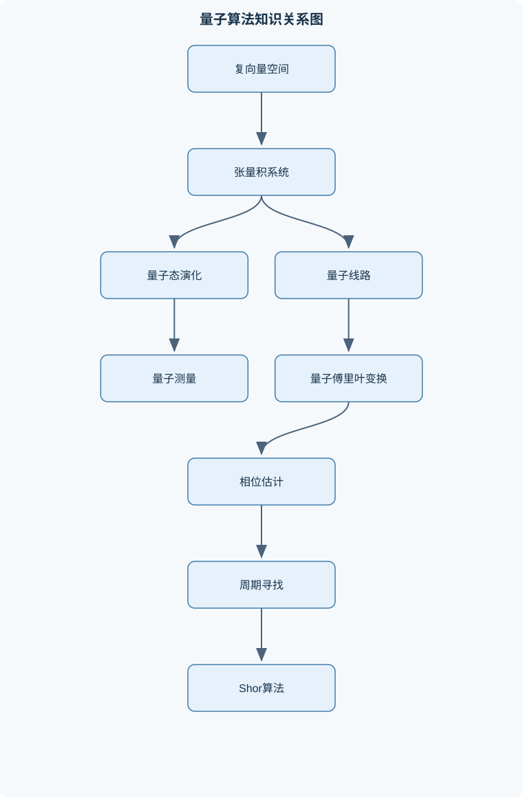
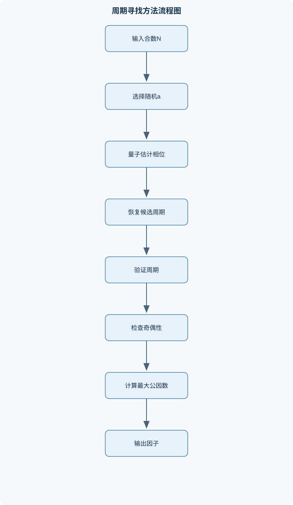

# 量子算法

## 一、课程整体知识框架

### 课程边界与先修知识

本课程研究量子计算的数学模型、量子线路、测量与量子算法，重点讨论量子算法相对于经典算法的资源优势、适用条件和复杂度边界。内容覆盖经典计算模型与复杂度基础、量子态与复向量空间、张量积、多量子比特系统、量子门与通用线路、量子测量与概率、量子傅里叶变换、相位估计、阿贝尔群上的隐藏子群问题、周期寻找、Shor整数分解算法以及量子搜索算法。课程不以量子硬件工程、量子纠错编码的完整理论、量子通信协议或变分量子算法的工程实现为主要范围，但会说明噪声、测量误差和门分解对理想算法的限制。先修知识包括线性代数中的复向量、内积、正交归一基、特征值与特征向量、幺正矩阵，概率论中的条件概率与全概率公式，离散数学中的群、模运算、图和布尔函数，算法设计中的渐近复杂度，以及图灵机、P类和NP类的基本概念。





### 课程对象与核心问题

量子算法研究如何在量子计算模型中表示输入、实施计算、取得测量结果，并与经典算法进行资源比较。这里的“量子优势”不是指量子计算机可以同时读出指数多个答案，而是指在特定输入结构、访问模型和精度要求下，量子态的线性演化与测量干涉能够使目标信息以较少查询或较低渐近资源成本显现。一次测量仍只产生一个经典结果；量子算法必须设计振幅的相长干涉与相消干涉，使有用结果具有较高概率。

课程主线从计算模型和复杂度概念出发，建立量子态、门、测量和线路的数学描述，再学习傅里叶变换、相位估计、阿贝尔隐藏子群、周期寻找与Shor算法，以及Grover搜索。最后把理想线路的查询次数、门数、深度、量子比特数、测量次数和经典后处理放到同一资源框架中评价。各算法的结论均有条件：算法可能依赖结构化Oracle、特定输入分布、精确或近似门、可高效制备的初态，或足够可靠的测量。只比较核心量子子程序而不计Oracle、状态制备和后处理，不能充分说明端到端优势。

### 数学对象与记号

经典输入通常是长度为 $n$ 的二进制字符串，输入规模以比特长度计。量子比特的纯态属于二维复向量空间，写为
$$
|\psi\rangle=\alpha|0\rangle+\beta|1\rangle,\qquad |\alpha|^2+|\beta|^2=1,
$$
其中 $\alpha,\beta\in\mathbb C$ 是概率幅，模平方才是测量概率。全局相位 $e^{i\theta}|\psi\rangle$ 不改变任何测量统计；相对相位则可能通过后续干涉改变结果分布。内积采用 $\langle\psi|\phi\rangle$ 记法，正交态满足内积为零，正交归一基中的每个向量范数为一且彼此正交。

$n$ 个量子比特的状态空间是 $n$ 个二维空间的张量积，维数为 $2^n$，计算基由 $|x\rangle$（$x\in\{0,1\}^n$）构成。维数指数增长并不意味着任意 $2^n$ 个复数都能由短线路制备，也不意味着一次测量可读出全部振幅。一般线路只施加有限门序列；对任意态作经典存储和直接模拟通常需要随 $2^n$ 增长的资源，但有特殊结构的线路可能有更高效的经典模拟方法。

量子门以矩阵表示。封闭系统中的演化由幺正矩阵 $U$ 描述，满足 $U^\dagger U=UU^\dagger=I$，其中 $U^\dagger$ 为共轭转置。幺正性保持内积：
$$
\langle U\psi|U\phi\rangle
=\langle\psi|U^\dagger U|\phi\rangle
=\langle\psi|\phi\rangle.
$$
因此范数和总概率守恒。幺正演化也必然线性：$U(a|\psi\rangle+b|\phi\rangle)=aU|\psi\rangle+bU|\phi\rangle$。这不表示所有现实过程都能由孤立系统的幺正门描述；测量、环境耦合和噪声要通过更一般的量子过程模型处理。

### 复杂度与资源比较

经典计算的基准模型包括确定性图灵机和非确定性图灵机。确定性机器在每一步只有一个后继配置；非确定性机器可有多个分支，接受性按是否存在接受分支定义，而不是实际并行运行所有分支。$P$ 是可由确定性图灵机在输入长度的多项式时间内判定的问题类；$NP$ 是可由多项式时间验证器在给定多项式长度证书后判定的问题类。通常认为 $P\subseteq NP$，但是否 $P=NP$ 未知。NP 完全问题属于 NP，并且每个 NP 问题都可通过多项式时间 Karp 归约映射到该问题；这一定义描述问题之间的归约关系，不代表已知 NP 完全问题具有多项式时间算法。

SAT 把布尔变量赋值问题表示为逻辑公式是否可满足；3-SAT 限制每个子句至多含三个文字。布尔电路是由逻辑门组成的有向无环计算图，其门数可作为电路规模的一种度量。把经典函数放入量子线路时，必须处理不可逆性：例如 $f(x)$ 多对一时，映射 $|x\rangle\mapsto|f(x)\rangle$ 会把不同输入压到同一输出，不能作为幺正变换。常用可逆嵌入为
$$
U_f|x,y\rangle=|x,y\oplus f(x)\rangle,
$$
其中目标寄存器保存异或结果，输入 $x$ 被保留，因而映射可逆。其成本取决于实现 $f$ 的电路、辅助比特和反计算开销。

量子算法的资源至少应区分查询复杂度、门复杂度、线路深度、量子比特数、测量重复次数与经典后处理时间。查询复杂度只统计对Oracle的调用，不自动包含构造Oracle的成本。若Oracle本身无法高效实现，较少查询未必意味着更快的端到端计算。渐近记号 $O$ 表示上界、$\Omega$ 表示下界、$\Theta$ 表示紧确界；应用时必须说明规模参数，例如输入比特长度 $n$、搜索空间大小 $M$ 或目标解数 $K$。

### 状态、测量与信息限制

若 $|\psi\rangle=\sum_j\alpha_j|j\rangle$，在计算基测量得到 $j$ 的概率为 $|\alpha_j|^2$。投影测量用一组满足 $\sum_jP_j=I$ 的投影算子描述，结果 $j$ 的概率为 $\langle\psi|P_j|\psi\rangle$；若该概率非零，测量后的条件态为
$$
\frac{P_j|\psi\rangle}{\sqrt{\langle\psi|P_j|\psi\rangle}}.
$$
分母保证条件态归一化。测量通常会改变状态，而不是被动读取一个预先隐藏的经典值。对厄米可观测量 $A$，态 $|\psi\rangle$ 下的期望值为 $\langle\psi|A|\psi\rangle$；实验估计该值需重复制备和测量，单次结果不等于期望值。

量子态的线性和张量积结构使多体态可纠缠。可分态能写为各子系统态的张量积；例如
$$
|\Phi^+\rangle=\frac{|00\rangle+|11\rangle}{\sqrt2}
$$
不能写成单比特态的张量积。测量其中一个量子比特会改变对整体状态的条件描述，并与另一个量子比特的测量结果相关，但这不构成超光速通信。

不可克隆定理来自幺正变换保持内积。若同一个幺正操作能把任意未知态复制到空白寄存器，且
$U|\psi\rangle|0\rangle=|\psi\rangle|\psi\rangle$、
$U|\phi\rangle|0\rangle=|\phi\rangle|\phi\rangle$，令 $s=\langle\psi|\phi\rangle$，输入与输出内积相等给出 $s=s^2$。对复数内积，这只允许 $s=0$ 或 $s=1$；因此不同非正交态不能被普遍完美复制。定理不禁止复制已知态、互相正交的态，或将经典信息编码在可区分态后复制。

### 算法优势的条件与边界

量子叠加提供的是振幅演化空间，不是可以直接批量读取的经典答案表。有效算法需要把问题结构映射为相位、周期或目标振幅等可干涉的信息，再通过测量把信息转化为经典输出。量子傅里叶变换可把周期性结构映射为频域集中概率；相位估计可从受控幺正操作的特征相位中提取有限精度近似；Grover算法通过振幅放大提高标记态测量概率。这些方法分别依赖可实现的受控操作、可用的输入态或Oracle，以及足够的采样精度。

理想数学模型假设门精确、演化按预定线路进行、测量符合规则。现实设备存在退相干、门误差、读出误差和有限连接等约束，近似门分解也会引入误差。量子线路的门数或深度不能脱离误差目标和硬件条件直接解释为实际运行时间。课程因而同时讨论算法正确性、失败概率和实现成本；它不把指数维状态空间等同于普遍指数加速，也不把量子计算视为所有 NP 完全问题的已知高效解法。

## 二、章节和模块划分

### 核心知识覆盖清单

本清单用于检查正文是否覆盖本课程的主要知识模块：

- **经典计算模型与复杂度基础**：图灵机的状态、带和转移、确定性与非确定性计算、多项式时间复杂度、P类与NP类定义、验证器和多项式证书、Karp多项式归约、NP完全性的判定逻辑、SAT与3-SAT编码、经典线路与布尔函数、量子算法的经典基线。
- **量子态与复向量空间**：单量子比特态向量、归一化与全局相位、内积和正交归一基、布洛赫球表示、态矢的线性组合、纯态与概率幅、张量积空间、多量子比特计算基、纠缠态与可分态、测量前后状态描述。
- **量子门与量子线路模型**：幺正变换及其物理条件、Pauli门与Hadamard门、相位门与旋转门、受控门和多控制门、CNOT门的作用、量子线路的输入输出、线路等价变换、辅助量子比特、计算基置换与可逆计算、通用量子门集。
- **量子测量与概率规则**：计算基测量、投影测量算子、测量结果概率、测量后的条件态、期望值与可观测量、一般测量的算子表示、连续测量与重复实验、不可克隆定理、非正交态不可完美区分、测量对纠缠态的影响。
- **量子计算的物理可实现变换**：态变换的线性条件、幺正性与概率守恒、可逆经典函数的量子实现、Oracle的定义与查询模型、受控Oracle构造、任意幺正矩阵的分解思想、两能级变换、门复杂度与空间复杂度、精确实现与近似实现、理想线路和现实噪声的区别。
- **量子傅里叶变换**：离散傅里叶变换、量子傅里叶变换的定义、计算基输入的变换、均匀叠加与相位结构、受控相位门分解、量子傅里叶变换线路、逆量子傅里叶变换、周期态的频域集中、近似量子傅里叶变换、线路规模与精度误差。
- **相位估计与量子谱信息**：幺正算子的特征态、特征值的相位表示、相位估计线路结构、控制幺正操作、逆量子傅里叶变换读出、有限精度相位估计、测量结果的概率分布、连续分数展开、成功概率与重复运行、相位估计的应用边界。
- **阿贝尔群上的量子算法**：有限阿贝尔群表示、群元素的量子编码、群运算Oracle、角色与特征态、群上的傅里叶变换、隐藏子群问题、周期函数的量子采样、测量得到的对偶群信息、经典后处理求解线性约束、阿贝尔群算法的统一框架。
- **周期寻找与Shor算法**：整数分解问题、模幂函数的周期、量子叠加生成函数值、周期信息的傅里叶提取、相位估计视角、连续分数展开恢复周期、最大公因数后处理、成功条件与失败重试、从周期到因子分解的数论推导、算法复杂度与经典比较。
- **量子搜索与振幅放大**：无结构搜索模型、标记态与Oracle、均匀叠加初态、扩散算子、振幅放大几何图像、Grover迭代次数、多个解时的成功概率、未知解数量的处理、查询复杂度下界直觉、搜索算法的适用边界。
- **量子算法复杂度与现实限制**：量子查询复杂度、线路深度与门数量、量子比特空间开销、精确算法与有界误差算法、测量样本复杂度、经典后处理成本、噪声对相位信息的影响、门近似误差累积、量子优势的条件、算法资源估算流程。


### 经典计算模型与复杂度基础

图灵机由有限状态控制器、读写带和读写头组成。转移规则依据当前状态与读到的符号，决定写入符号、头移动方向和下一状态。以“判断二进制串中 0 与 1 数量是否相等”为例，可反复标记一个未处理的 0 和一个未处理的 1；若某类符号先耗尽而另一类仍有未标记符号，则拒绝，否则接受。循环不变量是已配对的两类符号数量相等，终止条件是没有未标记符号。这个过程能说明图灵机状态转换与正确性证明，但其时间复杂度取决于扫描和回退策略，不能只凭“每轮配对一次”断言为线性时间。

多项式时间指存在常数 $c$，运行时间至多为 $O(n^c)$，其中 $n$ 是输入编码长度。验证器视角下，$L\in NP$ 意味着存在多项式长度证书 $w$，使得输入 $x$ 属于语言 $L$ 当且仅当验证器在多项式时间内接受 $(x,w)$。Karp 归约是保持是非答案的多项式时间映射；若 $A$ 可归约到 $B$，且 $B$ 有多项式算法，则 $A$ 也有多项式算法。判定 NP 完全性需要分别证明目标问题在 NP 中，以及某个已知 NP 完全问题可归约到它；只给出“问题看起来难”不构成证明。

布尔函数和经典线路为量子算法提供可比较的经典基线。SAT 公式可转成子句约束，例如文字取值为 $0/1$ 时，子句 $x_1\lor\neg x_2\lor x_3$ 可写成 $(x_1)+(1-x_2)+x_3\ge1$。变量必须限制为整数 $x_i\in\{0,1\}$；若只要求 $0\le x_i\le1$，得到的是线性松弛，可能出现非整数解，不等价于 SAT。量子算法比较应针对同一输入编码与输出要求，并区分最坏情形、平均情形和承诺问题。

### 量子态与复向量空间

单量子比特计算基为 $|0\rangle=(1,0)^T$ 和 $|1\rangle=(0,1)^T$。态 $|\psi\rangle=\alpha|0\rangle+\beta|1\rangle$ 的归一化条件为 $|\alpha|^2+|\beta|^2=1$；相位可以是复数，但不能把振幅本身当成概率。布洛赫球把纯单比特态（忽略全局相位）表示为
$$
|\psi\rangle=\cos\frac{\theta}{2}|0\rangle+e^{i\varphi}\sin\frac{\theta}{2}|1\rangle,
$$
其中 $\theta\in[0,\pi]$、$\varphi\in[0,2\pi)$ 为无量纲角参数。北极和南极对应计算基态；球面上的不同方位描述相对相位。布洛赫球只直接描述单量子比特纯态，不能用一个球面点完整表示一般多量子比特纠缠态。

张量积规定复合系统的维数相乘：两个量子比特的空间维数为 $2\times2=4$，一般 $n$ 比特为 $2^n$。寄存器顺序决定基态的书写与受控门作用位置，改变顺序会改变矩阵表示。纠缠态不能分解成各寄存器态的张量积；对双比特纯态，若系数矩阵秩大于一，则该态不可分。态矢描述测量前的纯态；若对测量结果忽略而形成统计混合，应使用密度算子描述，不能把纯态叠加与经典概率混合混为一谈。

### 量子门与量子线路模型

Pauli 门 $X,Y,Z$、Hadamard 门 $H$、相位门以及旋转门构成基本单比特操作。$H|0\rangle=(|0\rangle+|1\rangle)/\sqrt2$，说明门能把计算基态变成叠加态；$Z$ 翻转 $|1\rangle$ 的相位而不改变计算基测量概率，但后续 Hadamard 可将相位差转化为概率差。CNOT 在基态上执行 $|c,t\rangle\mapsto|c,t\oplus c\rangle$，控制位不变，目标位在控制位为 1 时翻转。由 $H$ 先制备叠加，再施加 CNOT，可得到纠缠态 $(|00\rangle+|11\rangle)/\sqrt2$。

线路按时间顺序组合幺正门；等价变换必须保持对所有输入态的输出相同，而不只是对某个测试输入相同。辅助量子比特用于保存中间计算或把非可逆函数嵌入可逆线路；若辅助位携带输入相关的“垃圾信息”，可能与主输出纠缠，须反计算清除或在算法设计中证明其无害。通用门集的含义是可用有限门集精确或任意精度近似实现目标幺正变换，不表示每个目标矩阵都能由固定有限个门精确实现。两能级变换分解思想将高维幺正矩阵逐步化为作用在二维子空间的变换，再分解为可用门；具体门数依赖目标精度、门集与分解方法。

### 量子测量与概率规则

计算基测量是投影测量的特例。若测量结果对应投影 $P_j$，概率为 $\langle\psi|P_j|\psi\rangle$，测后条件态由投影后归一化得到。重复实验是从同一制备过程抽取统计样本；若某结果概率为 $p$，独立重复 $m$ 次，其频率才可用于估计 $p$，且有限样本存在统计波动。一般测量可用一组正算子测量元描述，测量元之和为单位算子；投影测量是其中结构更受限的一类。

期望值给出多次测量结果的统计平均，不保证单次测量等于该值。对纠缠态测量一个寄存器时，应先按结果投影整体态，再求另一个寄存器的条件状态；不能把局部结果当作彼此独立的经典变量。除不可克隆定理外，非正交纯态不能无误且确定地完美区分：若一个测量能以概率 1 区分两态，其对应结果子空间应正交，这与非零内积矛盾。允许某些失败结果或先验概率不等的方案时，问题条件不同，不能把“不完美区分”误写成任何信息都无法获得。

### 量子计算的物理可实现变换

封闭系统的态变换必须线性且幺正，因而保持内积与概率。经典可逆函数可直接实现为基态置换；不可逆函数通常需保留输入并把函数值异或到辅助寄存器。Oracle 是查询模型中的函数访问接口，评价查询复杂度时将一次 $U_f$ 计作一次调用，但线路复杂度分析还需计入 $U_f$ 的门实现。受控 Oracle 必须在控制寄存器取值满足条件时施加操作；若只知道黑箱接口而不知道其内部电路，受控版本是否可构造不能自动假定。

任意幺正的分解把高维变换化为两能级旋转、受控操作和单比特门。精确实现要求目标恰属可用门集生成的集合；否则通常采用近似实现，并给定误差度量与容许误差。门复杂度统计门数量，线路深度统计可并行执行时的最长依赖链，空间复杂度统计工作量子比特数；三者不可互相替代。现实噪声会使实际演化偏离目标幺正，测量误差会改变输出频率；课程只将这些作为算法资源与正确性边界，不展开完整量子纠错理论。

### 量子傅里叶变换

对 $N=2^n$，量子傅里叶变换定义为
$$
\operatorname{QFT}_N|x\rangle=\frac1{\sqrt N}\sum_{y=0}^{N-1}e^{2\pi ixy/N}|y\rangle.
$$
这里 $x,y$ 是无量纲整数索引，指数中的相位以弧度计。线性延拓给出叠加态的变换。QFT 不是把经典数组的所有频谱值一次性打印出来；它把振幅转到频域，最终可测量样本只提供分布信息。其逆变换将相位结构反向合成，常用于相位估计读出。

受控相位门根据输入位在目标振幅上施加不同相位；配合 Hadamard 门可构成 QFT 线路，并通过交换比特次序纠正输出位序。精确线路使用 $O(n^2)$ 个基本受控相位操作；省略很小角度的旋转可得到近似 QFT，门数减少但引入误差。若周期态在模 $N$ 的位置上等间隔出现，QFT 后概率会集中于与周期相关的频率附近；当周期不整除 $N$ 时，峰值通常不是单点完美集中，而呈有限宽度分布。因此从测量值恢复周期需要后续数论处理，不能将任一频率样本直接认作周期。

### 相位估计与量子谱信息

若幺正算子满足 $U|u\rangle=e^{2\pi i\phi}|u\rangle$，则 $|u\rangle$ 是特征态，$\phi\in[0,1)$ 是无量纲特征相位。相位估计用控制寄存器的均匀叠加、受控幂 $U^{2^j}$ 和逆 QFT，把相位累积转成二进制读出。目标寄存器必须处于相应特征态；若初态是多个特征态的叠加，输出是按各特征分量权重形成的相位分布，而非单一确定相位。

当 $\phi$ 可精确表示为 $t$ 位二进制小数时，理想线路可确定读出该值；一般情况下有限位测量给出近似，概率分布由 Dirichlet 核型干涉项决定，概率质量集中在与 $2^t\phi$ 最近的整数附近，但有旁瓣和失败概率。增大控制位数通常提高分辨率，同时增加受控幂的实现成本。连续分数展开适合将接近 $s/r$ 的结果恢复为有理数，需误差足够小、分子分母约分条件合适，并对候选 $r$ 做模幂验证；单个相位样本未必足以确定目标周期。

### 阿贝尔群上的量子算法

有限阿贝尔群可表示为若干循环群的直积，群元素须编码到量子寄存器，且群运算、逆元和傅里叶变换应能高效实现。角色是从群到单位复数的同态，可视为群傅里叶变换的频率标签。隐藏子群问题给定函数 $f$，满足 $f(x)=f(y)$ 当且仅当 $x-y\in H$，目标是恢复子群 $H$。量子查询后测量函数寄存器，会使输入寄存器成为一个陪集上的叠加；在群傅里叶变换后，测得的对偶群元素属于 $H$ 的湮灭子群。

重复采样得到若干线性约束，再由经典代数求解隐藏子群生成信息。样本只能提供约束，不保证一次采样就确定 $H$；成功需要足够独立的信息、正确的群编码和有效的经典后处理。阿贝尔结构是关键适用条件，不能把该框架直接推广到任意非阿贝尔隐藏子群问题并宣称同样复杂度结论。

### 周期寻找与 Shor 算法

对整数 $N>1$，先取与 $N$ 互质的 $a$，考虑模幂函数 $f(x)=a^x\bmod N$。其最小正周期 $r$ 满足 $a^r\equiv1\pmod N$。量子部分制备指数寄存器叠加并计算函数值，再通过 QFT 或相位估计提取周期相关频率。连续分数展开根据近似关系 $s/r$ 生成候选分母，多个样本可能需要合并候选；每个候选都须用模幂验证，不能把近似分数直接当周期。

若 $r$ 为偶数，则
$$
a^r-1=(a^{r/2}-1)(a^{r/2}+1).
$$
当 $a^{r/2}\not\equiv-1\pmod N$ 且 $a^{r/2}\not\equiv1\pmod N$ 时，通常计算
$\gcd(a^{r/2}-1,N)$ 和 $\gcd(a^{r/2}+1,N)$，以取得非平凡因子。若 $r$ 为奇数，或 $a^{r/2}\equiv-1\pmod N$，本轮不能按该推导得到非平凡因子，需重新选取 $a$ 或重做周期估计。该过程的量子部分并不独立于输入表示：模乘、受控模乘和精度都计入资源估算；输出因子还须经典验证其整除关系。

### 量子搜索与振幅放大

无结构搜索有 $M$ 个候选项，其中 $K$ 个被Oracle标记。均匀叠加态在目标子空间和非目标子空间的均匀方向张成二维空间。Oracle 对目标振幅变号，扩散算子关于均匀态反射；两次反射合成为平面旋转。令
$\sin\theta=\sqrt{K/M}$，初态在目标方向上的振幅为 $\sin\theta$，每次 Grover 迭代使角度增加 $2\theta$，经过 $j$ 次后成功概率为
$$
\sin^2((2j+1)\theta).
$$
当 $K\ll M$ 且已知或可估计时，选取 $j$ 接近 $\pi/(4\theta)$，迭代量级为 $O(\sqrt{M/K})$。这是查询复杂度，不自动包括Oracle的门成本。迭代过多会越过目标方向，成功概率下降；当 $K$ 未知时需要额外估计或采用不同策略。若候选结构可被经典算法利用，Grover 的平方级查询改进未必优于结构化经典搜索。

### 量子算法复杂度与现实限制

算法资源分析先确定输入如何编码、Oracle 如何实现、输出需要多高精度，再分别统计量子比特数、门数量、线路深度、查询次数、测量次数与经典后处理。有限精度相位估计要求控制相位误差；Shor 的周期恢复需要足够精细的频率信息；Grover 的成功率取决于迭代次数和解数。门近似误差沿线路传播，噪声还会破坏相干相位，使理想概率分布变平或偏移。

查询复杂度刻画抽象接口的调用次数，线路复杂度刻画门实现，测量样本复杂度刻画统计估计成本，经典后处理则可能包括连续分数展开、最大公因数和线性方程求解。比较算法时应为每项资源标注输入规模、误差参数及成功概率。理想模型中的渐近加速不是现实设备上的直接时间保证；若状态制备、Oracle、纠错开销或测量重复成本主导总成本，核心量子子程序的优势可能无法转化为端到端优势。

## 三、核心概念的详细解释

### 3.1 经典计算模型与量子计算的基线

图灵机由有限状态集合、纸带、读写头和转移规则组成。一个配置可表示为“当前状态、纸带内容、读写头位置”的三元组。确定性图灵机在给定配置下至多有一个后继配置；非确定性图灵机允许多个后继分支，并以“是否存在一条接受分支”定义接受。非确定性并不意味着现实机器同时免费执行全部分支。

设输入长度为 $n$。若确定性算法的运行步数至多为某个多项式 $p(n)$，则称其属于多项式时间。复杂度类 $P$ 包含这类可判定问题；$NP$ 包含存在长度不超过多项式、且可由确定性多项式时间验证器验证的证书的问题。对判定问题 $L$，验证器 $V(x,w)$ 满足：

$$
x\in L\Longleftrightarrow \exists w,\ |w|\le p(|x|),\ V(x,w)=1.
$$

$P\subseteq NP$，但是否 $P=NP$ 尚未由该定义本身决定。若问题 $A$ 的任意实例都能在多项式时间内转换为问题 $B$ 的实例，记作 $A\leq_p B$。若 $B\in NP$ 且每个 $NP$ 问题都可归约到 $B$，则 $B$ 是 $NP$ 完全问题。归约说明问题的相对难度，不等同于给出求解算法。

SAT要求判断布尔公式是否存在满足赋值。3-SAT可将公式写为多个三文字子句的合取。例如：

$$
(x_1\lor x_2\lor x_3)\land(\lnot x_1\lor x_4\lor\lnot x_5).
$$

若把真记为 $1$、假记为 $0$，则第一子句满足条件为 $x_1+x_2+x_3\geq 1$，第二子句满足条件为 $(1-x_1)+x_4+(1-x_5)\geq 1$，但还必须要求变量取整数值。去掉整数条件后得到的是线性规划，而不是原来的布尔可满足性问题。这个边界说明连续优化问题和整数可满足问题不能仅凭公式外观混同。

量子算法的经典基线至少包括输入读取、状态制备、Oracle或函数评价、测量、经典后处理和重复实验。量子叠加包含许多基态并不意味着一次运行能输出所有基态的函数值；测量一次只返回一个经典字符串。量子优势来自干涉造成的概率重分布，而不是“并行读取指数多项答案”。

### 3.2 量子态、概率幅与张量积

单量子比特的纯态写为：

$$
|\psi\rangle=\alpha|0\rangle+\beta|1\rangle,\qquad
|\alpha|^2+|\beta|^2=1,
$$

其中 $\alpha,\beta\in\mathbb C$ 是无量纲概率幅，$|\alpha|^2$ 和 $|\beta|^2$ 是在计算基测量得到 $0$、$1$ 的概率。概率幅可以为负数或复数，概率不能为负，且必须取模平方。

例如：

$$
|\psi\rangle=\frac{|0\rangle+i|1\rangle}{\sqrt2}
$$

测得 $0$ 和 $1$ 的概率分别为 $1/2$。若先施加Hadamard门，则

$$
H|\psi\rangle
=\frac{1}{2}\big[(1+i)|0\rangle+(1-i)|1\rangle\big],
$$

两项模平方仍分别为 $1/2$，但相对相位已经影响后续干涉。整体乘以 $e^{i\theta}$ 不改变任何测量概率，称为全局相位；$|0\rangle$ 与 $|1\rangle$ 两项之间的相位差则是相对相位，通常可被后续门转化为可观测概率差异。

两个系统的联合空间使用张量积。若

$$
|a\rangle=\sum_i a_i|i\rangle,\qquad
|b\rangle=\sum_j b_j|j\rangle,
$$

则

$$
|a\rangle\otimes|b\rangle
=\sum_{i,j}a_i b_j|i\rangle\otimes|j\rangle.
$$

每个量子比特的空间维数为 $2$，所以 $n$ 个量子比特的空间维数为 $2^n$。计算基为 $|x\rangle$，其中 $x\in\{0,1\}^n$。这种指数维数是数学状态空间的维数，不等于量子线路可用指数个独立参数，也不等于测量能一次读出指数多信息。

若两比特态可以写成 $|a\rangle\otimes|b\rangle$，称为可分态；不能如此分解的态称为纠缠态。例如：

$$
|\Phi^+\rangle=\frac{|00\rangle+|11\rangle}{\sqrt2}
$$

是纠缠态。若第一个比特测得 $0$，第二个比特立即处于 $|0\rangle$；若测得 $1$，第二个比特处于 $|1\rangle$。这不是经典随机变量的简单复制，因为联合态不能表示为两个独立单比特态的张量积。

### 3.3 幺正门、受控门与可逆计算

封闭量子系统的门由幺正矩阵 $U$ 表示：

$$
U^\dagger U=UU^\dagger=I.
$$

幺正性保持内积：

$$
\langle U\psi|U\phi\rangle
=\langle\psi|U^\dagger U|\phi\rangle
=\langle\psi|\phi\rangle.
$$

令 $\phi=\psi$，便得到范数保持，即总概率仍为 $1$。线性由矩阵乘法给出：

$$
U(a|\psi\rangle+b|\phi\rangle)
=aU|\psi\rangle+bU|\phi\rangle.
$$

因此，一个任意压缩两个正交输入到同一输出的变换不能是封闭系统中的幺正门，因为它会破坏内积。经典不可逆函数也必须嵌入更大空间。例如函数 $f(x)$ 的标准量子Oracle为：

$$
U_f|x,y\rangle=|x,y\oplus f(x)\rangle.
$$

输入寄存器 $x$ 被保留，目标寄存器通过异或更新。映射可逆，因为再次应用相同的异或操作即可恢复 $y$。若直接写成 $|x\rangle\mapsto |f(x)\rangle$，当不同 $x$ 给出同一 $f(x)$ 时映射不是一一对应，不能作为一般量子门。

Pauli门为：

$$
X=\begin{pmatrix}0&1\\1&0\end{pmatrix},\quad
Z=\begin{pmatrix}1&0\\0&-1\end{pmatrix},\quad
Y=\begin{pmatrix}0&-i\\i&0\end{pmatrix}.
$$

$X$ 翻转计算基，$Z$ 对 $|1\rangle$ 加负号。Hadamard门为：

$$
H=\frac1{\sqrt2}
\begin{pmatrix}1&1\\1&-1\end{pmatrix},
$$

它把 $|0\rangle$ 变为 $(|0\rangle+|1\rangle)/\sqrt2$，把 $|1\rangle$ 变为 $(|0\rangle-|1\rangle)/\sqrt2$。CNOT在控制位为 $1$ 时翻转目标位：

$$
|x,y\rangle\mapsto |x,y\oplus x\rangle.
$$

因此：

$$
|00\rangle\mapsto|00\rangle,\quad
|01\rangle\mapsto|01\rangle,\quad
|10\rangle\mapsto|11\rangle,\quad
|11\rangle\mapsto|10\rangle.
$$

先对第一比特施加 $H$，再施加CNOT，有：

$$
|00\rangle
\overset{H\otimes I}{\longmapsto}
\frac{|00\rangle+|10\rangle}{\sqrt2}
\overset{\mathrm{CNOT}}{\longmapsto}
\frac{|00\rangle+|11\rangle}{\sqrt2}.
$$

这说明局部门可以通过受控门产生纠缠。单比特旋转门和受控非门组合可近似实现任意多比特幺正变换，但“任意幺正矩阵存在”不等于其分解具有可接受的门数量；一般分解的资源可能随量子比特数指数增长。

### 3.4 测量、投影与信息限制

投影测量由一组投影算子 $\{P_i\}$ 描述：

$$
P_iP_j=0\ (i\neq j),\qquad P_i^2=P_i,\qquad
\sum_iP_i=I.
$$

对于归一化态 $|\psi\rangle$，测得结果 $i$ 的概率为：

$$
p_i=\langle\psi|P_i|\psi\rangle.
$$

由于 $\sum_iP_i=I$，

$$
\sum_i p_i
=\langle\psi|I|\psi\rangle
=1.
$$

测量结果为 $i$ 后，条件态为：

$$
|\psi_i\rangle
=\frac{P_i|\psi\rangle}{\sqrt{\langle\psi|P_i|\psi\rangle}},
\qquad p_i>0.
$$

计算基测量的投影算子为 $P_x=|x\rangle\langle x|$。若

$$
|\psi\rangle=\sum_x\alpha_x|x\rangle,
$$

则得到 $x$ 的概率为 $|\alpha_x|^2$，测量后状态为 $|x\rangle$。

可观测量是厄米算子 $A=A^\dagger$。其期望值为：

$$
\langle A\rangle_\psi=\langle\psi|A|\psi\rangle.
$$

期望值是重复实验的平均量，不是单次测量必然得到的数值。若测量结果对应本征值 $\lambda_i$，则期望值也可写成 $\sum_i\lambda_i p_i$。

不可克隆定理可由内积保持性直接证明。假设存在幺正门 $U$，能对任意未知态复制：

$$
U(|\psi\rangle|0\rangle)=|\psi\rangle|\psi\rangle.
$$

对另一态 $|\phi\rangle$ 同样成立。输入内积为 $\langle\psi|\phi\rangle$，输出内积为：

$$
\langle\psi|\phi\rangle^2.
$$

幺正性要求二者相等，因此令 $s=\langle\psi|\phi\rangle$，有 $s=s^2$。这只可能在 $s=0$ 或 $s=1$ 时成立，分别对应正交态或相同态。故任意未知的非正交态不能被完美复制。正交的已知经典信息仍可复制，例如对计算基态执行受控异或。

### 3.5 量子傅里叶变换与周期结构

$n$ 比特量子傅里叶变换记为 $\mathrm{QFT}_n$，令 $N=2^n$，其定义为：

$$
\mathrm{QFT}_n|x\rangle
=\frac1{\sqrt N}\sum_{y=0}^{N-1}
e^{2\pi ixy/N}|y\rangle.
$$

它是离散傅里叶变换的量子态版本，输入和输出均为量子态，不是直接输出一组经典复数数组。其逆变换将指数中的正号改为负号。

若状态是理想周期叠加：

$$
|\psi\rangle
=\frac1{\sqrt L}\sum_{j=0}^{L-1}|x_0+jr\rangle,
$$

则输出到 $|y\rangle$ 的振幅为：

$$
\frac1{\sqrt{LN}}\sum_{j=0}^{L-1}
e^{2\pi i(x_0+jr)y/N}
=
\frac{e^{2\pi i x_0y/N}}{\sqrt{LN}}
\sum_{j=0}^{L-1}
\left(e^{2\pi i ry/N}\right)^j.
$$

当 $ry$ 接近 $0$ 模 $N$ 时，几何级数中的各项相位接近一致，振幅相长干涉；其他位置相位相互抵消。因此周期在频域表现为概率峰，而不是均匀随机结果。若周期不能整除 $N$，峰会有宽度，有限寄存器和边界截断会造成估计误差。

标准QFT线路先对每个量子比特施加Hadamard门，再施加角度逐渐减小的受控相位门，最后交换比特顺序。精确门数为 $O(n^2)$；删除很小角度的受控相位门可得到近似QFT，门数降低，但必须通过误差界说明省略门对最终测量分布的影响。

### 3.6 相位估计与阿贝尔群隐藏结构

若幺正算子 $U$ 有特征态 $|u\rangle$：

$$
U|u\rangle=e^{2\pi i\phi}|u\rangle,\qquad \phi\in[0,1),
$$

相位估计希望输出 $\phi$ 的有限位近似。控制寄存器先制备均匀叠加，再施加受控 $U^{2^j}$。由于：

$$
U^{2^j}|u\rangle=e^{2\pi i2^j\phi}|u\rangle,
$$

控制寄存器的相位编码了 $\phi$ 的二进制信息。逆QFT把相位结构集中到某些计算基结果，测量后得到整数 $m$，通常用 $m/2^t$ 近似 $\phi$，其中 $t$ 是控制比特数。若 $\phi$ 恰好是 $t$ 位二进制小数，可理想地输出精确值；一般情况下只能输出近似值，误差与 $2^{-t}$、测量概率和受控幂实现误差有关。

有限阿贝尔群 $G$ 上的隐藏子群问题给定函数 $f$，满足：

$$
f(x)=f(y)\Longleftrightarrow x-y\in H,
$$

其中 $H$ 是未知子群。量子过程先制备群元素叠加，查询 $f$，再测量函数寄存器。输入寄存器会塌缩到某个陪集的均匀叠加。对其施加群傅里叶变换后，测量结果属于隐藏子群 $H$ 的湮灭子群：

$$
H^\perp=\{\chi:\chi(h)=1,\ \forall h\in H\}.
$$

重复采样得到多个线性约束，再由经典线性代数恢复 $H$ 的生成信息。该框架要求群元素编码、群运算、Oracle和群傅里叶变换均能以可接受资源实现；抽象的群结构本身不会自动带来量子加速。

### 3.7 周期寻找与Shor算法的数论条件

给定合数 $N$，随机选取 $a$，先计算 $\gcd(a,N)$。若不为 $1$，已经得到非平凡因子；若为 $1$，定义：

$$
f(x)=a^x\bmod N.
$$

由于 $a$ 在模 $N$ 的可逆剩余类群中，存在最小正整数 $r$ 使：

$$
a^r\equiv1\pmod N.
$$

量子子程序估计该周期，经典后处理利用连续分数展开从近似值恢复候选 $s/r$。若估计值满足足够精确的有理逼近条件，且 $\gcd(s,r)=1$，可恢复分母 $r$；仍必须验证 $a^r\bmod N=1$。

若 $r$ 为偶数，则：

$$
a^r-1=(a^{r/2}-1)(a^{r/2}+1).
$$

因为 $a^r\equiv1\pmod N$，所以 $N$ 整除上述乘积。若同时满足：

$$
a^{r/2}\not\equiv -1\pmod N,
$$

则

$$
\gcd(a^{r/2}-1,N),\qquad
\gcd(a^{r/2}+1,N)
$$

通常给出非平凡因子。若 $r$ 为奇数，或者 $a^{r/2}\equiv-1\pmod N$，本轮后处理失败，需要重新选取 $a$ 或重新运行量子子程序。量子部分不直接输出因子，而是输出足以支持周期恢复的频率信息。

### 3.8 Grover搜索与振幅放大

设候选空间大小为 $M$，其中有 $K$ 个标记解。Oracle $O$ 对标记态改变相位：

$$
O|x\rangle=(-1)^{f(x)}|x\rangle,
$$

其中 $f(x)=1$ 表示解。均匀初态为：

$$
|s\rangle=\frac1{\sqrt M}\sum_x|x\rangle.
$$

将所有标记态归一化方向记为 $|G\rangle$，非标记态归一化方向记为 $|B\rangle$，则：

$$
|s\rangle=\sin\theta\,|G\rangle+\cos\theta\,|B\rangle,
\qquad
\sin^2\theta=\frac KM.
$$

扩散算子为：

$$
D=2|s\rangle\langle s|-I.
$$

一次Grover迭代 $G=DO$ 在由 $|G\rangle,|B\rangle$ 张成的二维空间中旋转角度 $2\theta$。迭代 $j$ 次后，目标方向振幅为：

$$
\sin((2j+1)\theta),
$$

成功概率为：

$$
P_j=\sin^2((2j+1)\theta).
$$

当 $K\ll M$ 时，最优迭代量级约为：

$$
j\approx \frac{\pi}{4}\sqrt{\frac MK}.
$$

这是Oracle查询复杂度，不自动包含Oracle内部门数、扩散算子门数和测量重复次数。迭代过多会越过最大点，成功概率下降。若 $K$ 未知，需要先估计解数或采用随机化迭代策略。

### 3.9 量子资源与现实边界

应分别记录量子比特数、总门数、线路深度、Oracle查询数、测量次数、经典后处理时间和目标误差。直接模拟 $n$ 个量子比特的一般态通常需要存储 $2^n$ 个复振幅，但特殊线路、稳定子态或具有低纠缠结构的线路可能存在更高效的经典模拟方法。

理想幺正线路不包含退相干、门误差、读出误差和泄漏。相位估计、QFT和Shor尤其依赖相干相位；相位噪声会使频率峰变宽或偏移。门分解误差也会随线路深度累积，但简单地把每个门误差相加通常只是保守上界，实际影响取决于误差类型和相关性。因而，量子算法的渐近查询优势只有在状态制备、Oracle实现、误差控制、测量重复和经典后处理均不过度主导时，才可能转化为端到端优势。

### 3.10 代表性算法流程与伪代码

#### 量子Oracle构造流程

**输入**：可计算函数 $f:\{0,1\}^n\to\{0,1\}^m$。  
**输出**：可逆变换 $U_f|x,y\rangle=|x,y\oplus f(x)\rangle$。

1. 保留输入寄存器 $x$，目标寄存器初始化为 $|0^m\rangle$。
2. 将经典电路中的非可逆操作替换为可逆门，并增加辅助比特。
3. 把计算结果异或到目标寄存器。
4. 反向执行中间计算，清除辅助寄存器中的垃圾信息。
5. 验证不同计算基输入映射到不同输出基态。
6. 统计辅助比特、门数和深度。

不变量是基态映射保持一一对应；有限门序列完成后终止。若不反计算，垃圾信息可能与主寄存器纠缠，影响后续干涉。

#### Shor周期寻找的经典后处理伪代码

```text
伪代码
输入：合数 N，随机候选 a
输出：N 的非平凡因子，或失败

1. g ← gcd(a, N)
2. 若 1 < g < N，则返回 g 和 N/g
3. 由量子周期子程序得到候选周期 r
4. 若 r 为奇数，则返回失败
5. z ← a^(r/2) mod N
6. 若 z = N - 1，则返回失败
7. p ← gcd(z - 1, N)
8. q ← gcd(z + 1, N)
9. 若 1 < p < N，则返回 p 和 N/p
10. 若 1 < q < N，则返回 q 和 N/q
11. 否则返回失败
```

幂运算中的指数和模数均为整数；实际实现使用重复平方，避免直接构造巨大整数。终止条件是得到因子或完成一轮失败判定。

## 四、重要定义、公式、定理和推导

### 专业审校补充：关键定义与适用边界

量子算法分析不能只限于纯态矢量；当系统与环境纠缠、发生噪声或只观测部分量子比特时，应使用密度算子 $\rho$。它满足 $\rho=\rho^\dagger$、$\rho\succeq0$ 且 $\mathrm{Tr}(\rho)=1$。纯态的密度算子为 $\rho=|\psi\rangle\langle\psi|$，混合态可写成 $\rho=\sum_i p_i|\psi_i\rangle\langle\psi_i|$，其中 $p_i\ge0$ 且 $\sum_i p_i=1$。对投影测量 $\{P_m\}$，结果概率为 $p(m)=\mathrm{Tr}(P_m\rho)$；若只保留结果 $m$，条件态为 $\rho_m=P_m\rho P_m/p(m)$。复合系统 $AB$ 中只观察 $A$ 时，约化态为 $\rho_A=\mathrm{Tr}_B(\rho_{AB})$，不是简单删除 $B$ 的振幅。量子信道应表示为完全正且保迹的映射；在理想无噪声算法中可退化为 $\rho\mapsto U\rho U^\dagger$。因此，纯态线路的概率计算不能直接代表噪声系统的全部行为，纠缠也可能表现为局部约化态的混合性。


### 4.1 归一化、内积保持与概率守恒

若 $|\psi\rangle$ 归一化，则 $\langle\psi|\psi\rangle=1$。对幺正变换 $U$：

$$
\langle U\psi|U\psi\rangle
=\langle\psi|U^\dagger U|\psi\rangle
=\langle\psi|\psi\rangle=1.
$$

因此幺正门不会改变总概率。若一个线性变换不满足 $U^\dagger U=I$，它不能直接作为封闭系统的单一步量子门；它可能是测量分支中的非归一化算子，但必须与其他测量算子共同满足完备关系。

### 4.2 投影测量概率和条件态推导

设 $P_i$ 是投影算子。结果 $i$ 的未归一化分量为 $P_i|\psi\rangle$，其范数平方为：

$$
\|P_i|\psi\rangle\|^2
=\langle\psi|P_i^\dagger P_i|\psi\rangle
=\langle\psi|P_i|\psi\rangle.
$$

因此：

$$
p_i=\langle\psi|P_i|\psi\rangle.
$$

若 $p_i>0$，归一化后为：

$$
|\psi_i\rangle
=\frac{P_i|\psi\rangle}{\sqrt{p_i}}.
$$

计算基测量中 $P_x=|x\rangle\langle x|$，所以：

$$
P_x|\psi\rangle
=\alpha_x|x\rangle,\qquad
p_x=|\alpha_x|^2.
$$

这给出了“概率等于概率幅模平方”的来源，而不是额外规定的记忆公式。

### 4.3 不可克隆定理的完整推导

假设复制门对任意 $|\psi\rangle$ 和 $|\phi\rangle$ 都成立：

$$
U|\psi\rangle|0\rangle=|\psi\rangle|\psi\rangle,
\quad
U|\phi\rangle|0\rangle=|\phi\rangle|\phi\rangle.
$$

输入态内积为：

$$
(\langle\psi|\langle0|)(|\phi\rangle|0\rangle)
=\langle\psi|\phi\rangle=s.
$$

输出态内积为：

$$
(\langle\psi|\langle\psi|)
(|\phi\rangle|\phi\rangle)
=s^2.
$$

因 $U$ 幺正，内积保持，故 $s=s^2$。复数方程的解为 $s=0$ 或 $s=1$。所以只有正交态或相同态能够在该假设下被复制。该结论不禁止制备已知固定态，也不禁止复制正交计算基中的经典比特。

### 4.4 QFT对周期叠加的推导

设周期态为：

$$
|\psi\rangle=\frac1{\sqrt L}
\sum_{j=0}^{L-1}|x_0+jr\rangle.
$$

施加QFT后：

$$
\mathrm{QFT}|\psi\rangle
=
\frac1{\sqrt{LN}}
\sum_{y=0}^{N-1}
e^{2\pi i x_0y/N}
\left[
\sum_{j=0}^{L-1}
e^{2\pi i jry/N}
\right]|y\rangle.
$$

括号内是公比为 $q=e^{2\pi i ry/N}$ 的几何级数。若 $q=1$，其值为 $L$，振幅最大；若 $q$ 远离 $1$，各项相位分散，和的绝对值减小。由 $q=1$ 得：

$$
\frac{ry}{N}\in\mathbb Z.
$$

因此峰值出现在满足 $y$ 约为 $kN/r$ 的位置。若 $r\mid N$，峰位置可以精确落在整数频率；若 $r\nmid N$，只能在邻近整数处形成集中峰，需用概率分析和有理逼近恢复 $r$。

### 4.5 相位估计的有限精度

设控制寄存器有 $t$ 个量子比特，特征相位为 $\phi$。受控幂操作后，控制寄存器形成与 $2^t\phi$ 相关的相位编码。逆QFT后测得整数 $m$ 的概率具有Dirichlet核形式：

$$
P(m)=\frac1{2^{2t}}
\left|
\sum_{k=0}^{2^t-1}
e^{2\pi i k(\phi-m/2^t)}
\right|^2.
$$

当 $m/2^t$ 接近 $\phi$ 时，各项相位接近一致，概率较大；偏离越远，抵消越明显。若 $2^t\phi$ 是整数，概率集中在唯一结果；否则概率分散在邻近整数。增加 $t$ 可提高分辨率，但也需要更多受控幂操作和更深线路。

### 4.6 连续分数展开恢复周期的条件

设相位估计得到 $y/ Q$，其中 $Q=2^t$，真实值接近某个既约分数 $s/r$。经典有理逼近的典型条件是：

$$
\left|\frac{y}{Q}-\frac{s}{r}\right|
<\frac1{2r^2},
\qquad \gcd(s,r)=1.
$$

在该条件下，$s/r$ 是该近似值的唯一足够近的既约分数之一，可由连续分数展开得到候选分母 $r$。但这个数学条件只保证有理逼近意义上的候选，不保证候选一定是函数周期。因此必须继续检查：

$$
a^r\bmod N=1.
$$

若检查失败，可能是测量误差、分母是 $r$ 的因子、相位对应的分子与周期不互质，或量子线路误差造成的偏差，需要重新采样。

### 4.7 Shor后处理的因子推导

若 $r$ 为偶数且 $a^r\equiv1\pmod N$，令 $z=a^{r/2}$，则：

$$
z^2\equiv1\pmod N,
$$

所以：

$$
N\mid(z-1)(z+1).
$$

若 $z\not\equiv\pm1\pmod N$，则 $z-1$ 和 $z+1$ 分别与 $N$ 共享非平凡因子，计算：

$$
p=\gcd(z-1,N),\qquad q=\gcd(z+1,N)
$$

即可得到因子。若 $z\equiv1\pmod N$，则 $p=N$、$q$ 可能为 $1$；若 $z\equiv-1\pmod N$，则对应因子也可能平凡。这解释了为什么算法需要失败重试，而不是每次周期估计都必然完成分解。

### 4.8 Grover二维旋转的推导

令目标子空间归一化方向为 $|G\rangle$，非目标方向为 $|B\rangle$，初态写成：

$$
|s\rangle=\sin\theta|G\rangle+\cos\theta|B\rangle,
\qquad \sin\theta=\sqrt{K/M}.
$$

Oracle使目标方向变号：

$$
O|s\rangle=-\sin\theta|G\rangle+\cos\theta|B\rangle.
$$

扩散算子关于 $|s\rangle$ 做反射。两个反射的复合是旋转，因此：

$$
G^j|s\rangle
=
\sin((2j+1)\theta)|G\rangle
+\cos((2j+1)\theta)|B\rangle.
$$

成功概率为目标分量的模平方：

$$
P_j=\sin^2((2j+1)\theta).
$$

当 $K/M$ 很小时，$\theta\approx\sqrt{K/M}$。令 $(2j+1)\theta$ 接近 $\pi/2$，得到：

$$
j\approx\frac{\pi}{4\theta}
\approx\frac{\pi}{4}\sqrt{\frac MK}.
$$

若 $K=M$，则 $\theta=\pi/2$，无需Grover迭代，直接测量均匀态即可得到解；这说明公式的近似使用边界是 $K\ll M$。

### 4.9 例题一：单比特测量与相对相位

**题干**：对

$$
|\psi\rangle=\frac{|0\rangle+i|1\rangle}{\sqrt2}
$$

进行计算基测量，求概率和测量后状态。再说明乘以 $i$ 后是否改变结果。

**分析**：计算基投影为 $P_0=|0\rangle\langle0|$、$P_1=|1\rangle\langle1|$。

**解答**：

$$
p(0)=\left|\frac1{\sqrt2}\right|^2=\frac12,\qquad
p(1)=\left|\frac i{\sqrt2}\right|^2=\frac12.
$$

测得 $0$ 后状态为 $|0\rangle$，测得 $1$ 后状态为 $|1\rangle$。乘以全局相位 $i$ 后得到：

$$
i|\psi\rangle=\frac{i|0\rangle-|1\rangle}{\sqrt2},
$$

两项模平方仍为 $1/2$，因此本次测量统计不变。

**结果验证与变式**：若把相对相位从 $i$ 改为 $1$，计算基概率仍不变，但经过Hadamard门后的概率可能不同，说明相对相位虽不能直接由当前基测量看出，却会影响后续干涉。

### 4.10 例题二：CNOT与纠缠

**题干**：计算CNOT作用于四个计算基态以及

$$
\frac{|00\rangle+|11\rangle}{\sqrt2}
$$

的结果。

**解答**：控制位是第一位，目标位是第二位：

$$
|00\rangle\to|00\rangle,\quad |01\rangle\to|01\rangle,
$$

$$
|10\rangle\to|11\rangle,\quad |11\rangle\to|10\rangle.
$$

对叠加态使用线性：

$$
\mathrm{CNOT}
\frac{|00\rangle+|11\rangle}{\sqrt2}
=
\frac{|00\rangle+|10\rangle}{\sqrt2}
$$

需注意这里若输入写成 $\frac{|00\rangle+|11\rangle}{\sqrt2}$，CNOT会将 $|11\rangle$ 变为 $|10\rangle$，结果可分解为：

$$
\frac{|00\rangle+|10\rangle}{\sqrt2}
=
\frac{|0\rangle+|1\rangle}{\sqrt2}\otimes|0\rangle.
$$

**变式**：从 $|00\rangle$ 经 $H\otimes I$ 后再接CNOT，结果为 $(|00\rangle+|11\rangle)/\sqrt2$，此时不可分。两个相近线路的差异来自CNOT作用前是否已经在控制位与目标位之间建立相关结构。

### 4.11 例题三：四项周期态的QFT

**题干**：在 $N=16$ 的寄存器中，对

$$
|\psi\rangle=\frac{|0\rangle+|4\rangle+|8\rangle+|12\rangle}{2}
$$

施加 $\mathrm{QFT}_{4}$，求非零频率位置。

**解答**：这里周期 $r=4$，代入QFT振幅的几何级数。峰值要求：

$$
\frac{ry}{N}=\frac{4y}{16}=\frac y4\in\mathbb Z.
$$

因此：

$$
y\in\{0,4,8,12\}.
$$

在这些位置，四个相位完全一致，振幅为 $1/2$；其他位置因相消为零。因此测量四个频率的概率各为 $1/4$。

**验证与变式**：若周期改为 $r=2$，峰值位置变为 $y\in\{0,8\}$。若周期不整除 $16$，峰值一般不再严格为零和非零两类，而会分布在若干邻近频率上。

### 4.12 例题四：相位估计的有限精度

**题干**：已知

$$
U|u\rangle=e^{2\pi i(5/16)}|u\rangle,
$$

使用 $t=3$ 个控制比特进行相位估计，理想情况下输出什么？

**解答**：真实相位为 $\phi=5/16$。控制寄存器可表示的三位二进制分辨率为 $1/8$，因此：

$$
2^3\phi=8\cdot\frac5{16}=\frac52.
$$

它不是整数，说明三位精度不能精确表示该相位。逆QFT后，测量结果会主要集中在 $m=2$ 和 $m=3$ 附近，对应：

$$
\frac28=\frac14,\qquad \frac38.
$$

真实相位 $5/16=0.3125$ 位于二者之间。增加一个控制比特后，分辨率变为 $1/16$，此时可以精确表示 $5/16$，理想测量将集中在 $m=5$。

**结果验证**：控制比特数决定分辨率，不是目标寄存器的维数决定输出位数。若受控 $U^{2^j}$ 实现不准确，即使控制寄存器足够长，输出也会出现偏差。

### 4.13 例题五：$N=15$ 的Shor后处理

**题干**：取 $N=15$、$a=2$，求周期并完成后处理。

**解答**：

$$
2^1\bmod15=2,\quad
2^2\bmod15=4,\quad
2^3\bmod15=8,
$$

$$
2^4\bmod15=16\bmod15=1.
$$

因此周期 $r=4$，为偶数。计算：

$$
z=2^{r/2}=2^2=4.
$$

于是：

$$
\gcd(4-1,15)=\gcd(3,15)=3,
$$

$$
\gcd(4+1,15)=\gcd(5,15)=5.
$$

得到非平凡因子 $3$ 和 $5$，且 $3\times5=15$，验证通过。

**失败变式**：若某轮得到奇数周期，不能计算 $a^{r/2}$ 的整数指数后处理；若得到 $a^{r/2}\equiv-1\pmod N$，两个最大公因数可能为平凡值，此时必须重新选取 $a$ 或重新估计周期。

### 4.14 例题六：四项搜索空间中的Grover迭代

**题干**：候选空间为 $\{0,1,2,3\}$，唯一标记解为 $2$。说明一次Grover迭代后的成功概率以及迭代过多的后果。

**解答**：$M=4,K=1$，所以：

$$
\sin\theta=\sqrt{1/4}=1/2,\qquad \theta=\pi/6.
$$

一次迭代后的目标概率为：

$$
P_1=\sin^2(3\theta)
=\sin^2(\pi/2)=1.
$$

因此理想情况下执行一次迭代后测量必得 $2$。若再执行一次，概率为：

$$
P_2=\sin^2(5\pi/6)=1/4.
$$

成功率反而下降，说明Grover迭代不是越多越好。

**变式**：若有两个解，$K=2$，初始测量成功概率已为 $1/2$，最佳迭代次数可能为零或很少；算法参数必须依据解数，而不能固定使用单解公式。

### 4.15 实验一：量子线路状态与测量验证

**输入数据**：初态 $|00\rangle$；线路为先对第一比特施加 $H$，再施加CNOT；重复测量不少于一个预先设定的样本规模。

**步骤**：

1. 写出初态向量 $(1,0,0,0)^T$。
2. 计算 $H\otimes I$ 后的状态。
3. 应用CNOT矩阵，得到 $(|00\rangle+|11\rangle)/\sqrt2$。
4. 按计算基测量并记录四种结果的计数。
5. 估计 $P(00)$ 和 $P(11)$，检查其他结果是否接近零。
6. 改变测量基，例如在两个比特上分别施加 $H$ 后再测量，比较相关性变化。

**评价标准**：理论上 $P(00)=P(11)=1/2$，$P(01)=P(10)=0$。有限样本下允许统计波动，但两种主要结果的频率应接近，且相关性显著高于独立均匀分布。

**排错方法**：若出现 $01$ 或 $10$ 的大量结果，检查CNOT控制位和目标位是否颠倒；若四种结果近似均匀，检查Hadamard是否施加在正确寄存器；若概率总和不为 $1$，检查是否把振幅直接当成概率或遗漏模平方。

### 4.16 实验二：小规模周期寻找与后处理

**输入数据**：$N=15$，选择若干满足 $\gcd(a,15)=1$ 的 $a$，例如 $a=2,4,7,8$；目标是从周期候选恢复因子。

**步骤**：

1. 对每个 $a$ 计算序列 $a^x\bmod15$，直到首次回到 $1$。
2. 记录最小正周期 $r$。
3. 检查 $r$ 是否为偶数。
4. 计算 $z=a^{r/2}\bmod15$。
5. 计算 $\gcd(z-1,15)$ 和 $\gcd(z+1,15)$。
6. 将所得因子相乘，验证是否回到 $15$。
7. 模拟相位估计误差，将 $s/r$ 替换为邻近有理数，测试连续分数展开是否仍能恢复候选周期。

**评价标准**：周期必须通过 $a^r\bmod15=1$ 验证；输出因子必须满足 $1<p<15$ 且 $15\bmod p=0$；失败轮次应被标记为失败，不得强行输出因子。

**排错方法**：若周期不是最小正周期，检查是否在首次出现 $1$ 前错误停止；若最大公因数为 $1$ 或 $15$，检查 $r$ 是否为奇数或 $a^{r/2}\equiv-1\pmod{15}$；若连续分数给出错误分母，检查相位近似精度是否满足 $1/(2r^2)$ 量级的要求。

## 五、算法、流程和实现思路

### 方法与流程覆盖索引

下列方法或流程应在正文中说明输入、步骤、适用条件、结果检查和边界：

- 图灵机计数算法：输入为二进制字符串，输出为首位标记；过程是反复标记一个0和一个1并扫描剩余带，若两类符号同时耗尽则写入1，否则写入0；不变量是已标记的两类符号数量相等；当所有未标记符号处理完毕时终止；适用于形式化经典计算模型，具体实现时间取决于扫描策略。
- 量子线路状态演化分析：输入为初态、门序列和测量基，输出为末态振幅及各测量结果概率；按线路顺序计算张量积空间中的矩阵作用，最后对目标测量投影并归一化；不变量是每一步态向量范数为1；门序列有限时终止；直接矩阵模拟需要指数级内存，n量子比特一般为O(2ⁿ)空间。
- 量子Oracle构造：输入为经典函数 f，输出为保持可逆性的U_f；将输入寄存器保留不变，把目标寄存器变为 y⊕f(x)，再用可逆逻辑门分解；不变量是不同基态映射保持一一对应；门分解完成后终止；适用于可高效计算且能可逆嵌入的函数，复杂度取决于经典电路规模和辅助比特数。
- 量子傅里叶变换：输入为n量子比特寄存器，输出为QFTₙ作用后的量子态；先施加Hadamard门，再按位加入受控相位门，最后交换比特顺序；不变量是每个门均为幺正变换；完成有限门序列后终止；精确线路门数为O(n²)，省略小角度门可得到近似线路并引入可控误差。
- 相位估计算法：输入为特征态|u⟩、受控U和精度t，输出为特征相位φ的t位近似；对控制寄存器制备均匀叠加，施加受控U^(2ʲ)，对控制寄存器执行逆QFT并测量；不变量是目标寄存器保持在|u⟩且控制寄存器编码累积相位；逆QFT和测量完成后终止；理想受控幂可实现时，线路规模通常为多项式，但精度和成功概率存在权衡。
- 阿贝尔隐藏子群算法：输入为有限阿贝尔群G上的函数f，满足f(x)=f(y)当且仅当x−y属于隐藏子群H，输出H的生成信息；制备群元素叠加，查询Oracle，测量函数寄存器后对输入寄存器做群傅里叶变换并测量对偶群元素，重复采样后解线性约束；不变量是测量样本属于H的湮灭子群；获得足够独立约束后终止；适用于群运算、编码和傅里叶变换均可高效实现的情形。
- Shor周期寻找算法：输入为合数N，输出为N的非平凡因子或失败重试；随机选取与N互质的a，量子子程序估计f(x)=aˣ mod N的周期r，再用连续分数展开得到候选r，并检查aʳ mod N和两个最大公因数；不变量是所有候选周期必须通过模幂验证；得到有效周期或判定本轮失败后终止；量子部分对log N规模运行，经典后处理包括模幂和最大公因数计算。
- Grover搜索算法：输入为具有K个标记解的Oracle和候选空间大小M，输出一个标记元素；制备均匀叠加，重复Oracle相位翻转与扩散变换，最后测量；不变量是状态始终位于目标态均匀方向与非目标态均匀方向张成的二维子空间；达到接近最优迭代次数后终止；已知K时约需O(√(M/K))次Oracle查询，迭代过多会降低成功概率。
- 量子算法资源分析流程：输入为算法线路、Oracle实现和目标精度，输出量子比特数、门数量、深度、查询次数及失败概率；先确定输入编码，再拆分主线路、Oracle和测量后处理，分别统计资源并传播误差；不变量是每项资源均对应明确的输入规模和精度参数；所有模块估算完成后终止；适用于比较理想算法与现实实现，不应把矩阵维数直接等同于运行时间。





### 5.1 量子算法的统一执行流程

一个量子算法不能只写成“制备叠加态并测量”。完整流程应明确输入编码、初态、量子门、Oracle、测量方式、经典后处理和成功判据。设输入为长度为 $n$ 的二进制字符串，算法通常按以下步骤组织：

1. **确定输入模型**：说明输入是直接写入计算基的经典字符串，还是通过量子态、Oracle或群元素编码提供。若使用Oracle，必须说明一次查询允许获得什么信息。
2. **制备初态**：通常从 $|0\rangle^{\otimes n}$ 开始，通过Hadamard门、辅助寄存器初始化或其他可实现线路制备所需状态。
3. **执行可逆演化**：使用幺正门序列实现函数评价、相位编码、干涉或振幅放大。每个门均保持态向量范数不变。
4. **测量并更新状态描述**：测量结果 $i$ 的概率为 $\langle\psi|P_i|\psi\rangle$；若得到结果 $i$，状态更新为
   $$
   |\psi_i\rangle=\frac{P_i|\psi\rangle}{\sqrt{\langle\psi|P_i|\psi\rangle}},
   $$
   前提是测量概率非零。
5. **经典后处理**：例如连续分数展开、最大公因数、线性约束求解或重复样本统计。
6. **验证输出**：输出必须通过独立条件检查，例如 $a^r\bmod N=1$、因子整除 $N$，或搜索输出确实被Oracle标记。

资源分析至少要区分量子比特数、门数量、线路深度、Oracle查询次数、测量重复次数和经典后处理时间。状态空间维数为 $2^n$ 不等同于算法需要 $2^n$ 个门；同样，查询复杂度为 $O(\sqrt M)$ 也不等同于总运行时间必为该数量级。

### 5.2 量子线路状态演化分析

**输入**为初态、按顺序排列的门序列和测量基；**输出**为末态振幅及各测量结果概率。过程是将初态写成计算基展开，按线路顺序施加张量积门和受控门，最后计算投影概率。

例如初态为 $|00\rangle$，先对第一比特施加 $H$，再以第一比特为控制位、第二比特为目标位施加CNOT：

$$
|00\rangle
\xrightarrow{H\otimes I}
\frac{|00\rangle+|10\rangle}{\sqrt2}
\xrightarrow{\mathrm{CNOT}}
\frac{|00\rangle+|11\rangle}{\sqrt2}.
$$

因此测量结果 $00$、$11$ 的概率分别为 $1/2$，$01$、$10$ 的概率为零。末态不可写成两个单比特态的张量积，因而是纠缠态。

该流程的不变量是每一步状态满足 $\langle\psi|\psi\rangle=1$；有限门序列执行完毕后终止。直接用经典数组模拟一般需要 $O(2^n)$ 个复数存储空间；若线路具有稳定性、低纠缠或其他特殊结构，可能存在更高效的经典模拟方法，因此指数维数只是一般上界，不是所有线路的必然运行时间。

### 5.3 可逆Oracle的构造

经典函数 $f:\{0,1\}^n\to\{0,1\}^m$ 未必可逆，因为不同输入可能有相同输出。量子线路必须使用可逆映射，通常构造

$$
U_f|x,y\rangle=|x,y\oplus f(x)\rangle.
$$

当 $y=0^m$ 时，函数值被写入辅助寄存器；当目标寄存器取 $|-\rangle=(|0\rangle-|1\rangle)/\sqrt2$ 时，

$$
U_f|x\rangle|-\rangle=(-1)^{f(x)}|x\rangle|-\rangle,
$$

函数值被转化为输入态的相位，这称为相位Oracle。

**输入**是可逆嵌入所需的经典电路、输入寄存器和目标寄存器；**输出**是门分解后的 $U_f$；**过程**是将普通逻辑门转换为可逆门，必要时加入辅助比特，并保证不同计算基输入映射到不同输出；**不变量**是基态映射保持一一对应；**终止条件**是所有逻辑操作均已分解为允许的量子门。若辅助寄存器留下“垃圾信息”，可通过反计算执行逆线路清除，但不能在未验证独立性的情况下直接删除辅助态。

Oracle成本必须纳入比较。例如Grover算法的查询复杂度可能为 $O(\sqrt M)$，但若每次查询需要指数规模经典电路，整体优势并不成立。

### 5.4 量子傅里叶变换与周期提取

$n$量子比特量子傅里叶变换定义为

$$
QFT_n|x\rangle
=2^{-n/2}\sum_{y=0}^{2^n-1}
e^{2\pi ixy/2^n}|y\rangle.
$$

它是离散傅里叶变换在量子态上的幺正实现。对一般态
$$
|\psi\rangle=\sum_x\alpha_x|x\rangle
$$
作用后，输出振幅是输入振幅的离散傅里叶变换，而不是直接输出一个经典数组。

周期态是QFT发挥作用的关键。设
$$
|\psi\rangle=\frac1{\sqrt L}\sum_{j=0}^{L-1}|x_0+jr\rangle
$$
在可表示范围内由间隔 $r$ 的基态组成，则输出概率在接近满足
$$
\frac{yr}{Q}\approx s
$$
的位置集中，其中 $Q=2^n$，$s$ 为整数。若 $r$ 整除 $Q$，峰值可位于精确频率；否则峰值会分散到邻近整数，必须通过统计和数论后处理恢复周期。

标准QFT线路先对各量子比特施加Hadamard门，再施加受控相位门，最后交换比特顺序。精确线路的门数量为 $O(n^2)$；删除小角度受控相位门可降低门数，但会引入可估计的近似误差。逆QFT是 $QFT_n^\dagger$，门顺序反向且相位取共轭。

### 5.5 相位估计流程

设幺正算子满足
$$
U|u\rangle=e^{2\pi i\phi}|u\rangle,\qquad \phi\in[0,1).
$$
相位估计的目标是用 $t$ 个控制比特输出 $\phi$ 的 $t$ 位近似值。

**输入**为特征态 $|u\rangle$、可实现的受控 $U^{2^j}$ 和精度参数 $t$；**输出**为整数 $m$，使 $m/2^t$ 接近 $\phi$。步骤如下：

1. 控制寄存器初始化为 $|0\rangle^{\otimes t}$，目标寄存器为 $|u\rangle$。
2. 对控制寄存器施加 $H^{\otimes t}$，得到均匀叠加。
3. 对第 $j$ 个控制比特施加受控 $U^{2^j}$。特征态条件保证目标寄存器仍为 $|u\rangle$，控制寄存器累积相位 $e^{2\pi i2^j\phi}$。
4. 对控制寄存器施加逆QFT。
5. 测量控制寄存器，得到 $m$，用 $m/2^t$ 估计 $\phi$。

若 $\phi$ 恰好是 $t$ 位二进制小数，理想情况下可精确输出；一般情况下输出概率集中在最接近 $2^t\phi$ 的整数附近。增加 $t$ 可提高分辨率，但也会增加受控幂操作、线路深度和噪声暴露。若初态是多个特征态的叠加，测量结果对应不同特征相位的概率混合，而不是自动得到某一个预定相位。

### 5.6 阿贝尔隐藏子群算法

设有限阿贝尔群 $G$ 上的函数满足
$$
f(x)=f(y)\Longleftrightarrow x-y\in H,
$$
其中 $H$ 是待求的隐藏子群。算法目标是输出 $H$ 的生成信息。

**输入**为群元素的量子编码、群运算和函数Oracle；**输出**为足以确定 $H$ 的生成元或线性约束。步骤为：

1. 制备
   $$
   |G\rangle=\frac1{\sqrt{|G|}}\sum_{x\in G}|x\rangle.
   $$
2. 查询Oracle，得到
   $$
   \frac1{\sqrt{|G|}}\sum_x|x\rangle|f(x)\rangle.
   $$
3. 测量函数寄存器。输入寄存器塌缩到某个陪集 $x_0+H$ 的均匀叠加。
4. 对输入寄存器施加群傅里叶变换。
5. 测量对偶群元素 $\chi$。所得样本属于湮灭子群
   $$
   H^\perp=\{\chi:\chi(h)=1,\ \forall h\in H\}.
   $$
6. 重复采样，利用经典线性代数求解约束，恢复 $H$。

**不变量**是每次测量得到的对偶元素均满足隐藏子群约束；获得足够独立约束后终止。该框架要求群运算、编码、Oracle和傅里叶变换都能以可接受资源实现。周期寻找、离散对数等问题可看作该框架在特定群上的实例。

### 5.7 Shor周期寻找和整数分解

给定合数 $N$，随机选择满足 $\gcd(a,N)=1$ 的 $a$，定义
$$
f(x)=a^x\bmod N.
$$
该函数存在最小正周期 $r$，满足
$$
a^r\equiv1\pmod N.
$$

量子子程序制备指数寄存器的叠加，计算模幂函数，随后用QFT或相位估计提取与 $s/r$ 接近的数。经典后处理使用连续分数展开寻找候选分母 $r$，然后检查 $a^r\bmod N=1$。若满足：

1. $r$ 为偶数；
2. $a^{r/2}\not\equiv-1\pmod N$；

则由
$$
a^r-1=(a^{r/2}-1)(a^{r/2}+1)
$$
以及 $a^r\equiv1\pmod N$，可得
$$
p=\gcd(a^{r/2}-1,N),\qquad
q=\gcd(a^{r/2}+1,N),
$$
其中至少一个通常是非平凡因子。

**输入**为合数 $N$；**输出**为非平凡因子或本轮失败；**不变量**是任何候选周期必须通过模幂验证；**终止条件**是得到合法因子，或本轮因周期奇、候选错误而重试。量子部分对 $\log N$ 个量子比特规模运行，但总成本还包括模幂Oracle、门分解、测量重复和连续分数展开。

### 5.8 Grover搜索和振幅放大

设候选空间大小为 $M$，其中有 $K$ 个满足条件的标记元素。相位Oracle满足
$$
O_f|x\rangle=(-1)^{f(x)}|x\rangle.
$$
从均匀叠加
$$
|s\rangle=\frac1{\sqrt M}\sum_{x=0}^{M-1}|x\rangle
$$
开始，扩散算子为
$$
D=2|s\rangle\langle s|-I.
$$
一次Grover迭代为 $G=DO_f$。

将所有标记态的归一化叠加记为 $|w\rangle$，所有未标记态的归一化叠加记为 $|r\rangle$。初态可写为
$$
|s\rangle=\sin\theta|w\rangle+\cos\theta|r\rangle,
\qquad
\sin^2\theta=\frac KM.
$$
每次迭代在二维平面中旋转约 $2\theta$，经过 $j$ 次后目标概率为
$$
P_j=\sin^2((2j+1)\theta).
$$
当 $K$ 已知时，取
$$
j\approx\frac{\pi}{4\theta}-\frac12
$$
即可达到较高成功概率，数量级为 $O(\sqrt{M/K})$。迭代过多会越过目标方向，成功概率下降。若 $K$ 未知，不能直接套用单解公式，需要采用逐步调整迭代次数、估计解数或其他有界误差策略。

下面给出一个不依赖联网和外部文件的经典状态向量模拟伪代码，用于验证小规模Grover迭代。它模拟的是理想量子态，不是实际量子硬件。

```python
import math

def grover_state(m, marked, iterations):
    """返回M=2^m个基态的振幅列表。marked是标记整数集合。"""
    M = 2 ** m
    amp = [1 / math.sqrt(M) for _ in range(M)]

    for _ in range(iterations):
        # Oracle：标记态相位翻转
        for x in marked:
            amp[x] = -amp[x]

        # 扩散：关于平均振幅反射
        average = sum(amp) / M
        for x in range(M):
            amp[x] = 2 * average - amp[x]

    probabilities = [value * value for value in amp]
    return amp, probabilities

amps, probabilities = grover_state(2, {2}, 1)
print(probabilities)
```

对于 $M=4,K=1$，一次迭代后标记态概率为 $1$；如果继续迭代，状态会离开目标方向，说明“更多迭代”不一定更好。

### 5.9 代表性例题

#### 例题一：相对相位与测量概率

**题干**：计算
$$
|\psi\rangle=\frac{|0\rangle+i|1\rangle}{\sqrt2}
$$
在计算基下的测量概率，并说明乘以 $-1$ 是否改变结果。

**分析与解答**：两个振幅分别为 $1/\sqrt2$ 和 $i/\sqrt2$，所以
$$
P(0)=\left|\frac1{\sqrt2}\right|^2=\frac12,\qquad
P(1)=\left|\frac i{\sqrt2}\right|^2=\frac12.
$$
乘以全局相位 $-1$ 后，态为
$$
-\frac{|0\rangle+i|1\rangle}{\sqrt2},
$$
两项振幅均乘以 $-1$，模平方不变，所有测量统计不变。

**结果验证**：概率和为 $1$。  
**变式**：若将 $i$ 改为 $-1$，计算基概率仍为 $1/2,1/2$，但再施加Hadamard门后的概率一般不同，说明相对相位可通过干涉显现。

#### 例题二：CNOT作用

**题干**：求CNOT作用于四个计算基态及纠缠态
$$
|\Phi^+\rangle=\frac{|00\rangle+|11\rangle}{\sqrt2}
$$
的结果。

**解答**：控制位不变，目标位按控制位异或：
$$
|00\rangle\to|00\rangle,\quad |01\rangle\to|01\rangle,
$$
$$
|10\rangle\to|11\rangle,\quad |11\rangle\to|10\rangle.
$$
因此
$$
\mathrm{CNOT}|\Phi^+\rangle
=\frac{|00\rangle+|10\rangle}{\sqrt2}
=|+\rangle|0\rangle.
$$

**验证**：输出可分，说明某些门可解除纠缠。  
**变式**：若控制位和目标位交换，作用规则改变，必须重新写出基态映射，不能只看门名称。

#### 例题三：QFT与周期态

**题干**：在模 $16$ 的四比特空间中，对
$$
|\psi\rangle=\frac{|0\rangle+|4\rangle+|8\rangle+|12\rangle}{2}
$$
施加 $QFT_4$，求非零输出位置。

**解答**：输出基态 $|y\rangle$ 的振幅为
$$
\frac14\left(1+e^{2\pi i4y/16}+e^{2\pi i8y/16}
+e^{2\pi i12y/16}\right).
$$
令 $\omega=e^{2\pi iy/4}$，括号为
$$
1+\omega+\omega^2+\omega^3.
$$
当 $y$ 是 $4$ 的倍数时，$\omega=1$，和为 $4$；否则四次单位根之和为 $0$。因此输出只在 $y=0,4,8,12$ 处有非零振幅，且各概率为 $1/4$。

**变式**：若周期不整除 $16$，峰值通常不再完全为零或一，而是集中在邻近频率，需要重复采样和有理逼近。

#### 例题四：相位估计

**题干**：若
$$
U|u\rangle=e^{2\pi i(5/16)}|u\rangle,
$$
使用三位控制寄存器进行相位估计，理想结果是什么？

**解答**：$5/16$ 的二进制表示为 $0.101_2$，三位精度下控制寄存器应测得整数
$$
m=2^3\cdot\frac5{16}=2.5.
$$
由于结果必须是整数，概率会集中在 $m=2$ 和 $m=3$ 附近，而不是得到精确的三位二进制值。对应估计分别为 $2/8=1/4$ 和 $3/8$，真实相位 $5/16=0.3125$ 位于二者之间。

**验证**：不能把 $5/16$ 错写成三位二进制精确值；若使用四位控制比特，则 $m=5$，可精确表示。  
**变式**：目标寄存器不是特征态时，结果是多个特征相位分布的混合。

#### 例题五：Shor后处理

**题干**：取 $N=15,a=2$，求周期并执行最大公因数后处理。

**解答**：
$$
2^1\bmod15=2,\quad
2^2\bmod15=4,\quad
2^3\bmod15=8,\quad
2^4\bmod15=1.
$$
所以 $r=4$。它为偶数，且
$$
2^{r/2}=2^2=4\not\equiv-1\pmod{15}.
$$
于是
$$
\gcd(4-1,15)=\gcd(3,15)=3,
$$
$$
\gcd(4+1,15)=\gcd(5,15)=5.
$$
得到非平凡因子 $3,5$，且 $3\times5=15$。

**变式**：若周期为奇数，不能使用 $r/2$ 的整数指数；若 $a^{r/2}\equiv-1\pmod N$，两个最大公因数可能为平凡因子，需重新选取 $a$。

### 5.10 实验与项目流程

#### 实验一：Bell态线路验证

**输入数据**：初态 $|00\rangle$，门序列 $H\otimes I$ 后接CNOT，重复测量得到样本计数。

**步骤**：

1. 计算理论末态 $(|00\rangle+|11\rangle)/\sqrt2$。
2. 预期 $P(00)=P(11)=1/2$，另两项为零。
3. 记录测量频数并计算经验概率。
4. 进一步在两个比特上施加Hadamard后测量，比较基变换前后的相关性。

**评价标准**：主要结果应为 $00$ 和 $11$，经验概率随样本量增加接近 $1/2$；不应将偶然出现的少量其他结果直接判定为理论错误。

**排错方法**：大量出现 $01,10$ 时检查CNOT控制位、目标位和寄存器顺序；四种结果近似均匀时检查Hadamard是否施加在正确比特；概率和不为一时检查是否把振幅而非模平方作为概率。

#### 实验二：小规模周期与因子恢复

**输入数据**：$N=15$，选择 $a=2,4,7,8$ 中的若干个，计算模幂序列并恢复因子。

**步骤**：

1. 从 $x=0$ 开始计算 $a^x\bmod15$。
2. 找到首次回到 $1$ 的最小正整数 $r$。
3. 检查 $r$ 是否为偶数。
4. 计算 $z=a^{r/2}\bmod15$。
5. 计算 $\gcd(z-1,15)$ 和 $\gcd(z+1,15)$。
6. 验证因子严格位于 $1$ 和 $15$ 之间，并且相乘为 $15$。
7. 模拟相位估计误差，测试连续分数展开生成的候选周期是否通过模幂验证。

**评价标准**：不能只依据连续分数展开的分母输出周期，必须经过 $a^r\bmod N=1$ 验证；失败轮次必须记录为失败。

**排错方法**：若周期不是最小正周期，检查是否在第一次出现 $1$ 前错误停止；若最大公因数为 $1$ 或 $15$，检查周期奇偶性和 $a^{r/2}\equiv-1\pmod N$ 的条件；若候选分母不稳定，检查相位精度和重复采样数量。

### 5.11 具体易错点

1. 把概率幅 $\alpha$ 当成概率；正确概率是 $|\alpha|^2$。
2. 把归一化写成振幅之和为 $1$；正确条件是模平方和为 $1$。
3. 把全局相位和相对相位混同。
4. 忽略张量积中的寄存器顺序。
5. 把任意线性矩阵都当作量子门；封闭系统门必须幺正。
6. 认为叠加态可以一次测量读出所有分量。
7. 忘记测量会投影并改变状态。
8. 认为不可克隆意味着任何量子信息都不能复制；正交态和已知态可在相应条件下复制。
9. 把QFT当作经典FFT，忽略输出仍是量子态。
10. 相位估计中没有确认目标寄存器是特征态。
11. 把连续分数展开得到的分母直接当作Shor周期。
12. 忽略Shor中周期必须为偶数以及非平凡性条件。
13. 把Grover迭代次数增加视为成功概率必然增加。
14. 只比较Oracle查询次数而忽略Oracle门成本。
15. 把指数状态空间维数等同于指数可控经典参数。
16. 忽略门近似、退相干、测量误差和有限样本造成的偏差。

## 六、概念之间的关系与对比

### 6.1 经典计算模型、量子线路与Oracle模型

| 对象 | 基本计算单位 | 信息演化 | 输出方式 | 主要资源 |
|---|---|---|---|---|
| 确定性图灵机 | 状态、带符号、读写头 | 单一后继配置 | 停机状态或带内容 | 时间、空间 |
| 经典布尔线路 | 布尔门 | 可不可逆均可 | 经典比特 | 门数、深度、辅助线 |
| 量子线路 | 量子比特、幺正门 | 线性幺正演化 | 测量概率分布 | 量子比特、门数、深度、查询 |
| Oracle模型 | 抽象函数接口 | 查询后获得相位或函数值 | 通过干涉提取结构 | 查询次数及Oracle实现成本 |

经典确定性计算每一步状态通常是确定的；量子线路可以处理振幅叠加，但最终仍需通过测量获得经典结果。非确定性图灵机的“多个分支”是复杂度定义中的存在性概念，不能直接等同于量子叠加。量子叠加还受到线性、幺正性和测量规则约束。

### 6.2 概念关系：叠加、纠缠、干涉与测量

叠加描述态可写成多个计算基向量的线性组合；纠缠描述联合态不能分解为各子系统态的张量积；干涉描述不同路径的复振幅相加后发生增强或抵消；测量把量子态映射为经典概率结果。四者不能互换：

- 具有叠加不一定有纠缠，例如 $(|0\rangle+|1\rangle)/\sqrt2$ 是单比特态。
- 有纠缠通常意味着存在不能由局部态独立描述的相关性。
- 仅有叠加不自动产生算法加速，必须通过门设计形成有用干涉。
- 测量不是被动读取，测量会改变后续可用状态。

### 6.3 QFT、相位估计、周期寻找和隐藏子群的关系

QFT是变换工具；相位估计是利用受控幂和逆QFT读取幺正特征相位的算法流程；周期寻找是把周期编码到相位或频率后再用QFT提取；阿贝尔隐藏子群算法则把周期结构推广到群陪集和对偶群约束。

可以按以下链条理解：

$$
\text{周期结构}
\longrightarrow
\text{相位/频率编码}
\longrightarrow
\text{QFT或逆QFT}
\longrightarrow
\text{概率集中}
\longrightarrow
\text{经典数论或线性代数后处理}.
$$

这条链条的每一步都需要条件。若周期函数不能高效计算，若相位估计精度不足，或若后处理不能从采样结果恢复结构，QFT本身不会自动产生优势。

### 6.4 Grover搜索与Shor算法的对比

| 方面 | Grover搜索 | Shor周期寻找 |
|---|---|---|
| 目标 | 无结构空间中的标记元素 | 模幂函数的周期 |
| 主要量子工具 | Oracle、扩散算子、二维旋转 | QFT、相位估计、周期采样 |
| 查询或子程序规模 | $O(\sqrt{M/K})$ 次Oracle查询 | 对 $\log N$ 规模寄存器进行周期估计 |
| 加速类型 | 对无结构搜索的平方级改进 | 利用数论结构实现显著复杂度改进 |
| 经典后处理 | 通常为验证候选 | 连续分数展开、模幂、最大公因数 |
| 失败原因 | 迭代过少或过多、解数未知 | 周期奇数、平凡因子、相位估计误差 |
| 适用边界 | 无法利用额外结构时更有意义 | 必须有可高效实现的模幂与精确后处理 |

Grover并不把任意NP问题变成多项式时间算法。若枚举空间大小为 $2^n$，Grover仍需约 $2^{n/2}$ 次查询。Shor也不是对所有困难问题的通用加速，而是针对具有群结构和周期结构的问题。

### 6.5 精确算法、有界误差算法与概率输出

精确算法要求在理想模型中每次运行都得到正确结果，或错误概率为零；有界误差算法允许错误概率小于某个固定阈值，例如单次成功概率高于 $2/3$。量子算法通常通过重复运行和经典多数表决降低错误概率。

若单次运行正确概率为 $p>1/2$，独立重复 $T$ 次并取多数结果，错误概率可随 $T$ 增加而下降。但重复并非免费：它增加测量次数、量子线路总运行次数以及噪声暴露。对于相位估计，重复采样还可能用于估计完整概率分布，而不是简单多数投票。

### 6.6 查询复杂度、线路复杂度和经典后处理

查询复杂度只计算Oracle调用次数，适合比较黑箱模型中的信息获取效率；线路复杂度计算所有基本门，反映实际可执行操作数量；线路深度决定相干演化持续时间；空间复杂度计算量子比特和辅助寄存器；测量样本复杂度反映统计精度成本；经典后处理则包括整数运算、线性方程求解和候选验证。

因此，若算法有 $Q(n)$ 次查询，每次Oracle需要 $C_f(n)$ 个门，量子主线路需要 $C_q(n)$ 个门，经典后处理需要 $C_c(n)$ 时间，则总成本不能只写成 $Q(n)$，而应至少写成
$$
O\bigl(Q(n)C_f(n)+C_q(n)+C_c(n)\bigr),
$$
还要标明成功概率和精度参数。该表达式是资源分解框架，不是所有硬件上实际运行时间的精确模型。

### 6.7 理想模型与现实限制

理想线路假设门完全幺正、测量准确、量子比特不与环境耦合、辅助比特可按设计使用。现实设备中存在：

- **退相干**：相对相位随时间衰减，直接影响QFT和相位估计。
- **门误差**：实际门与目标幺正矩阵存在偏差，长线路会累积误差。
- **读出误差**：测得的经典比特可能与实际测量结果不同。
- **状态制备误差**：初态不是理想的 $|0\rangle^{\otimes n}$ 或均匀叠加。
- **有限连通性**：理论上的任意受控门可能需要额外交换门。
- **Oracle开销**：抽象查询不代表低成本物理线路。
- **采样成本**：概率峰值需要足够多次运行才能可靠识别。

因此，理论成功概率不等于实际设备上的最终正确率。算法验收应同时检查理论复杂度、门分解、误差预算、测量统计和经典后处理。

### 6.8 典型笔试问题及解答思路

1. **为什么量子演化必须保持范数？**  
   从 $U^\dagger U=I$ 出发计算 $\langle U\psi|U\psi\rangle=\langle\psi|\psi\rangle$，说明总概率守恒；再指出一般线性但非幺正矩阵可能改变概率，因此不能直接作为封闭系统量子门。

2. **证明不可克隆定理。**  
   假设存在 $U|a\rangle|0\rangle=|a\rangle|a\rangle$，$U|b\rangle|0\rangle=|b\rangle|b\rangle$。由内积保持性得到
   $$
   \langle a|b\rangle=\langle a|b\rangle^2.
   $$
   因此内积只能为 $0$ 或 $1$，任意非正交、非相同未知态不能被统一复制。

3. **推导Grover的迭代次数。**  
   令 $\sin^2\theta=K/M$，一次迭代使目标方向旋转约 $2\theta$，要求 $(2j+1)\theta$ 接近 $\pi/2$，得到 $j=O(\sqrt{M/K})$。

4. **解释QFT为什么能提取周期。**  
   将周期态代入QFT，输出振幅成为等比数列；当频率与周期匹配时各项同相叠加，其他频率相消，因此概率集中在满足频率约束的位置。

5. **说明相位估计中逆QFT的作用。**  
   受控 $U^{2^j}$ 把相位 $\phi$ 编码为控制寄存器的相位梯度；逆QFT把该相位梯度转换为计算基整数，使测量可以读出 $\phi$ 的有限精度近似。

6. **为什么Shor中要使用连续分数展开？**  
   量子测量通常得到接近 $s/r$ 的有理数，而不是直接得到 $r$；在 $s$ 与 $r$ 互质且误差足够小时，连续分数展开可恢复分母候选，随后必须模幂验证。

7. **为什么不可逆经典函数可嵌入量子线路？**  
   将其扩展为 $U_f|x,y\rangle=|x,y\oplus f(x)\rangle$，保留输入并在目标寄存器异或函数值，使整体映射一一对应且可逆。

8. **为什么量子状态空间维数指数增长不等于量子算法自动指数加速？**  
   一次测量只能得到一个经典结果，短线路也不能任意控制全部 $2^n$ 个振幅；必须有可制备的初态、可实现的Oracle和能产生可读干涉的结构。

### 6.9 典型面试问题、参考答案与追问要点

1. **问：量子并行是否意味着一次得到所有函数值？**  
   **答**：不是。叠加态可使函数作用于多个基态，但测量只输出一个结果。优势来自干涉让目标性质的概率增强。  
   **追问要点**：说明Oracle成本、测量坍缩和相位Oracle。

2. **问：Grover比经典搜索快多少？**  
   **答**：无结构搜索中，经典需要 $O(M)$ 次查询，Grover需要 $O(\sqrt{M/K})$ 次，但这是查询复杂度；总门数取决于Oracle，且迭代过多会降低成功概率。  
   **追问要点**：未知解数、多个解和查询下界。

3. **问：QFT和经典FFT有什么区别？**  
   **答**：经典FFT计算并输出数值数组；QFT是量子态上的幺正变换，结果仍需测量，优势依赖相位结构和后续算法。  
   **追问要点**：QFT门数、近似QFT和比特顺序。

4. **问：相位估计为什么要求特征态？**  
   **答**：若目标态是特征态，$U^{2^j}$只累积确定相位并保持目标态不变；若是特征态叠加，测量结果对应不同特征相位的概率混合。  
   **追问要点**：特征值分解、有限精度和重复采样。

5. **问：Shor算法的关键经典部分是什么？**  
   **答**：连续分数展开恢复候选周期，模幂验证候选，最大公因数提取因子。量子部分没有直接输出因子。  
   **追问要点**：周期奇数、平凡因子和重新随机选择 $a$。

6. **问：如何评估一个量子算法是否有实际优势？**  
   **答**：先确定输入编码和误差目标，再统计量子比特数、门数、深度、Oracle成本、测量次数和经典后处理，最后与最佳经典基线比较。  
   **追问要点**：端到端成本、噪声和状态制备。

7. **问：怎样处理Grover中未知的标记解数量？**  
   **答**：不能固定使用单解迭代次数，可采用逐步增加随机迭代次数、估计解数或振幅估计类方法，并用验证Oracle检查输出。  
   **追问要点**：过迭代导致的旋转越过目标态。

8. **问：如何减少QFT线路规模？**  
   **答**：删除足够小角度的受控相位门，得到近似QFT，从而降低门数；但必须把近似误差传播到最终测量概率，并确认算法容许该误差。  
   **追问要点**：深度、噪声、精度和比特交换。

### 6.10 岗位关联与产出验收

- **量子算法研究员**：分析周期、相位估计或振幅放大问题，产出算法证明、复杂度界和失败条件。验收标准包括假设明确、推导完整、成功概率和边界情况正确。
- **量子软件开发工程师**：将门序列、Oracle和测量流程实现为可执行线路或模拟器。验收标准包括寄存器顺序一致、理论小规模结果可复现、概率归一化且测试覆盖失败分支。
- **量子编译与线路优化工程师**：将受控门、多控制门和QFT分解为目标门集，优化门数和深度。验收标准包括线路功能等价、辅助比特数量可控、近似误差满足预算。
- **量子计算性能评估工程师**：统计查询次数、门数、深度、量子比特、样本数和经典后处理。验收标准是每项资源均标注输入规模、精度和成功概率，不能把查询次数冒充总运行成本。
- **量子硬件算法协同工程师**：评估退相干、读出误差、门误差和连通性对算法的影响。验收标准包括误差来源分类、线路深度限制、测量校准需求以及理想结果与实验结果的可解释差异。
- **计算复杂度与算法研究人员**：比较量子算法与经典基线，分析查询下界、P、NP及相关问题的适用边界。验收标准是明确区分已证明结论、模型假设和不能由量子加速自动推出的复杂度结论。

## 七、典型例题和应用场景

### 专业审校补充：综合例题

题干：考虑两量子比特态 $|\Phi^-\rangle=(|00\rangle-|11\rangle)/\sqrt2$。先求第一比特单独测量时的概率和测量后的第二比特条件态，再求第二比特的约化密度矩阵，并说明为什么局部测量结果完全随机但两比特仍有确定关联。分析：令 $\rho=|\Phi^-\rangle\langle\Phi^-|$。第一比特计算基测量的投影算子为 $P_0=|0\rangle\langle0|\otimes I$、$P_1=|1\rangle\langle1|\otimes I$。步骤一，$P_0|\Phi^-\rangle=|00\rangle/\sqrt2$，故 $p(0)=\langle\Phi^-|P_0|\Phi^-\rangle=1/2$；归一化后状态为 $|00\rangle$，第二比特条件态为 $|0\rangle$。步骤二，$P_1|\Phi^-\rangle=-|11\rangle/\sqrt2$，故 $p(1)=1/2$；归一化后的整体态为 $-|11\rangle$，其中负号是整体相位，第二比特条件态为 $|1\rangle$。步骤三，对第二比特做偏迹：$\rho_B=\mathrm{Tr}_A(\rho)=\frac12|0\rangle\langle0|+\frac12|1\rangle\langle1|=I/2$，所以单独测量第二比特也得到两个结果各 $1/2$。结果验证：两种测量结果的概率和为 $1$；第一比特测得 $0$ 时第二比特必为 $0$，测得 $1$ 时第二比特必为 $1$，因此联合结果只可能是 $00$ 或 $11$，相关性并未因局部随机性消失。变式：若态改为 $|\Psi^-\rangle=(|01\rangle-|10\rangle)/\sqrt2$，第一比特测得 $0$ 时第二比特必为 $1$，测得 $1$ 时第二比特必为 $0$；约化密度矩阵仍为 $I/2$，说明相同的局部统计可以对应不同的非局部关联。


### 典型题型与应用覆盖索引

建议通过下列题型或应用检查概念是否能够迁移：

- 用振幅和测量概率分析态 |ψ⟩=(|0⟩+i|1⟩)/√2，计算计算基测量结果、测量后状态，并说明全局相位与相对相位的区别。
- 计算CNOT门作用于四个计算基态和纠缠态(|00⟩+|11⟩)/√2的结果，验证控制位不变、目标位按异或翻转。
- 给定两量子比特线路 H⊗I 后接CNOT，完整写出中间态、末态、测量概率，并判断末态是否可分。
- 对周期函数形成的态 (|0⟩+|4⟩+|8⟩+|12⟩)/2 施加QFT₄，计算非零频率位置并解释周期与频域峰值的关系。
- 给定U|u⟩=e^(2πi·5/16)|u⟩，用三位控制寄存器说明相位估计输出、逆QFT的作用以及有限精度误差。
- 对函数f(x)=x mod 2在小规模群上构造Oracle，展示测量函数寄存器后输入寄存器的条件态，并通过群傅里叶采样恢复隐藏子群。
- 对N=15选择满足互质条件的a，计算模幂序列、周期r以及两个最大公因数，完整展示Shor后处理何时成功、何时因r为奇数而失败。
- 对包含一个标记元素的四项搜索空间执行Grover算法，逐步计算Oracle、扩散算子和最终测量概率，并说明迭代一次与迭代过多的区别。
- 将一个小型布尔电路转换为可逆量子线路，说明辅助寄存器的初态、垃圾信息以及反计算对清除辅助信息的作用。
- 比较经典遍历搜索与Grover搜索在M个候选项上的查询次数，区分查询复杂度、总门复杂度和测量重复次数。


### 7.1 量子线路状态演化：从叠加到纠缠

**题干**：初态为 $|00\rangle$，先对第一量子比特施加Hadamard门 $H$，再施加以第一比特为控制位、第二比特为目标位的CNOT门。求中间态、末态及计算基测量概率，并判断末态是否可分。

**分析**：Hadamard门满足
$$
H|0\rangle=\frac{|0\rangle+|1\rangle}{\sqrt2}.
$$
因此第一步只改变第一比特，第二比特仍为 $|0\rangle$。CNOT在控制位为 $1$ 时翻转目标位。

**逐步解答**：
$$
|00\rangle\xrightarrow{H\otimes I}
\frac{|00\rangle+|10\rangle}{\sqrt2}.
$$

继续施加CNOT：
$$
\frac{|00\rangle+|10\rangle}{\sqrt2}
\longrightarrow
\frac{|00\rangle+|11\rangle}{\sqrt2}.
$$

末态为Bell态。测量计算基时，
$$
P(00)=\left|\frac1{\sqrt2}\right|^2=\frac12,\qquad
P(11)=\frac12,
$$
而
$$
P(01)=P(10)=0.
$$

若末态可分，则应存在单比特态
$$
(\alpha|0\rangle+\beta|1\rangle)\otimes
(\gamma|0\rangle+\delta|1\rangle)
$$
使其等于 $(|00\rangle+|11\rangle)/\sqrt2$。展开后，$|01\rangle$和$|10\rangle$的系数必须同时为零，即 $\alpha\delta=0$、$\beta\gamma=0$；但同时要求 $\alpha\gamma$和$\beta\delta$都非零，产生矛盾。因此该态不可分，是纠缠态。

**结果验证**：四个测量概率之和为
$$
\frac12+\frac12=1.
$$
控制位在CNOT作用前后没有改变，目标位只在控制位为 $1$ 的分支中翻转。

**变式**：若将CNOT的控制位和目标位交换，初态仍然为 $|00\rangle$，但在本题线路中由于叠加首先出现在第一比特，最终态仍为 $(|00\rangle+|11\rangle)/\sqrt2$。若初态改为 $|01\rangle$，则门顺序和控制方向会显著影响结果，必须先明确寄存器顺序，不能只看门名称。

### 7.2 振幅、概率和相对相位

**题干**：给定单量子比特态
$$
|\psi\rangle=\frac{|0\rangle+i|1\rangle}{\sqrt2},
$$
求计算基测量结果、测量后的状态，并说明整体相位与相对相位的区别。

**解答**：$|0\rangle$的概率幅为 $1/\sqrt2$，$|1\rangle$的概率幅为 $i/\sqrt2$，因此
$$
P(0)=\left|\frac1{\sqrt2}\right|^2=\frac12,\qquad
P(1)=\left|\frac{i}{\sqrt2}\right|^2=\frac12.
$$

若测得 $0$，测量后状态为 $|0\rangle$；若测得 $1$，测量后状态为 $|1\rangle$。测量后的状态不是原叠加态，因为投影测量保留了与测量结果对应的分量并重新归一化。

若将态整体乘以 $e^{i\theta}$，得到
$$
e^{i\theta}|\psi\rangle,
$$
所有测量概率不变，这个因子是全局相位。相反，$|0\rangle$和$|1\rangle$之间的因子 $i$ 是相对相位。相对相位经过Hadamard门等干涉操作可以转化为概率差异，因此具有物理和算法意义。

**边界反例**：不能把 $\alpha+\beta=1$ 当作归一化条件。归一化要求的是
$$
|\alpha|^2+|\beta|^2=1.
$$
例如 $\alpha=1/\sqrt2$、$\beta=i/\sqrt2$ 的振幅和不是实数 $1$，但态完全归一化。

### 7.3 周期叠加态与量子傅里叶变换

**题干**：考虑四量子比特态
$$
|\psi\rangle=\frac{|0\rangle+|4\rangle+|8\rangle+|12\rangle}{2},
$$
其中计算基标签为 $0$ 至 $15$。对其施加 $QFT_4$，说明测量结果集中在哪些频率位置。

**分析**：态中每隔 $4$ 个整数出现一个非零项，因此周期为 $r=4$。四量子比特QFT的维数为 $Q=2^4=16$，作用为
$$
QFT_4|x\rangle=\frac1{4}\sum_{y=0}^{15}
e^{2\pi ixy/16}|y\rangle.
$$

对固定的 $y$，输出振幅为
$$
A_y=\frac1{8}\sum_{k=0}^{3}e^{2\pi i(4k)y/16}
=\frac1{8}\sum_{k=0}^{3}e^{2\pi iky/4}.
$$

当 $y$为 $4$ 的倍数时，指数项均为 $1$，所以
$$
A_y=\frac4{8}=\frac12.
$$
当 $y$不是 $4$ 的倍数时，四个单位复数均匀分布在圆周上，和为 $0$。因此只有
$$
y\in\{0,4,8,12\}
$$
具有非零概率，每个概率为 $1/4$。

**结果验证**：四个非零概率总和为 $1$。频率峰值的位置满足 $y/Q=k/r$，即 $y=Qk/r=4k$。这说明周期结构在傅里叶域中产生集中分布。

**适用边界**：若周期不能整除 $Q$，峰值通常不会恰好落在单个整数频率上，而会分散在邻近位置。此时需要通过多次测量和有理逼近恢复周期，不能直接把某一次测量结果当作周期。

### 7.4 相位估计的有限精度

**题干**：设幺正算子满足
$$
U|u\rangle=e^{2\pi i(5/16)}|u\rangle.
$$
使用三个控制量子比特进行相位估计，说明理想输出、主要线路步骤和精度限制。

**解答**：特征相位为
$$
\phi=\frac5{16}=0.010_2.
$$
三个控制比特能够表示 $0$ 至 $7$ 的整数，因此输出相位分辨率为 $1/2^3=1/8$。由于
$$
\phi=\frac{5}{16}
$$
不是三位二进制小数，有限精度控制寄存器不能无误表示它，测量结果会集中在最接近的离散值附近，而不是只出现一个确定结果。

算法步骤为：

1. 控制寄存器从 $|000\rangle$ 开始，对每个控制比特施加Hadamard门，得到八项均匀叠加。
2. 第 $j$ 个控制比特控制 $U^{2^j}$，目标寄存器保持在 $|u\rangle$，相位被编码为 $2^j\phi$。
3. 对控制寄存器施加逆QFT。
4. 测量控制寄存器，将测量整数 $m$ 转换为估计值 $\widetilde\phi=m/8$。

理想情况下，测量概率由相位与离散网格的距离决定。相位越接近某个网格点，该结果概率越大；若相位恰好是三位二进制小数，则可以集中到唯一结果。提高控制比特数 $t$可使网格间距降为 $2^{-t}$，但需要更多受控幂操作和更深线路。

**结果验证**：输出后不能只报告二进制串，还应将其转换为分数并检查误差，例如要求
$$
|\widetilde\phi-\phi|\leq\varepsilon.
$$
若目标是恢复有理数 $s/r$，还必须结合连续分数展开和分母验证。

### 7.5 Shor周期寻找与因子提取

**题干**：对 $N=15$选择 $a=2$，求模幂函数的周期，并执行Shor算法的经典后处理。

**逐步解答**：
$$
2^1\bmod15=2,\quad
2^2\bmod15=4,\quad
2^3\bmod15=8,
$$
$$
2^4\bmod15=16\bmod15=1.
$$
因此最小正周期为 $r=4$。

由于 $r$为偶数，计算
$$
a^{r/2}=2^2=4.
$$
分别求最大公因数：
$$
\gcd(4-1,15)=\gcd(3,15)=3,
$$
$$
\gcd(4+1,15)=\gcd(5,15)=5.
$$
于是得到两个非平凡因子 $3$ 和 $5$，并验证
$$
3\times5=15.
$$

**成功条件**：周期必须为偶数，并且
$$
a^{r/2}\not\equiv -1\pmod N.
$$
本例中 $4\not\equiv14\pmod{15}$，所以成功。

**失败变式**：若某次随机选择得到奇数周期，不能继续使用 $a^{r/2}$，因为 $r/2$不是整数；若
$$
a^{r/2}\equiv-1\pmod N,
$$
则两个最大公因数通常只给出平凡因子 $1$和$N$。此时应重新选择与 $N$互质的 $a$并重试。量子子程序输出的是周期相关信息，不是直接输出因子。

### 7.6 Grover搜索：单解与多解

**题干**：候选空间有 $M=4$ 个元素，其中一个元素被Oracle标记。执行Grover算法并说明迭代次数。

**分析**：均匀叠加态为
$$
|s\rangle=\frac12\sum_{x=0}^{3}|x\rangle.
$$
目标态记为 $|w\rangle$。Oracle将目标态振幅乘以 $-1$，即
$$
O|w\rangle=-|w\rangle,
$$
对非目标态保持不变。扩散算子为
$$
D=2|s\rangle\langle s|-I.
$$

对于一个解，令
$$
\sin\theta=\frac1{\sqrt M}=\frac12,
$$
所以 $\theta=\pi/6$。每轮Grover迭代在由目标态和非目标均匀态张成的二维平面内旋转角度 $2\theta=\pi/3$。一次迭代后目标振幅对应角度
$$
\theta+2\theta=3\theta=\frac\pi2,
$$
因此理想情况下目标态概率为 $1$。

**结果验证**：直接计算可得，Oracle先把目标振幅由 $1/2$变为 $-1/2$；扩散操作关于全体平均振幅反射，使目标振幅变为 $1$，其他振幅变为 $0$。再迭代一次会越过目标方向，成功概率反而下降。

**多解变式**：若有 $K$个标记元素，则
$$
\sin\theta=\sqrt{\frac KM},
$$
最佳迭代量级约为
$$
\frac{\pi}{4}\sqrt{\frac MK}.
$$
该式描述的是查询量级，不包括Oracle内部的门分解、状态制备、测量重复和经典验证。若 $K$未知，固定迭代次数可能导致过迭代，应采用解数估计、随机化迭代次数或输出验证流程。

### 7.7 量子算法的典型应用场景与边界

#### 周期和群结构问题

周期寻找、离散对数相关问题以及有限阿贝尔群上的隐藏子群问题，都依赖可利用的代数结构。量子傅里叶变换把周期信息转化为对偶群中的约束，测量得到的样本还需要经典线性代数、连续分数展开或最大公因数运算。若函数没有周期结构，不能仅因使用QFT就自动获得加速。

#### 无结构搜索

Grover算法适用于只能通过Oracle判断候选是否满足条件的场景。它将经典最坏情形的 $O(M)$ 次查询改进到 $O(\sqrt M)$ 次查询，但不是指数加速。若问题本身具有排序、哈希、图结构或其他可被经典算法利用的特征，经典基线可能已经优于直接使用Grover。

#### 量子谱信息提取

相位估计适用于能够高效实现受控 $U^{2^j}$，并且输入态具有较大概率落在目标特征态上的情形。若只能制备与目标特征态几乎正交的状态，算法虽形式正确，成功概率仍可能很低。现实线路还受到受控幂操作成本、相位精度、噪声和测量统计的限制。

## 八、实验、实践和项目相关知识

### 专业审校补充：实践任务

任务：实现一个小规模Simon算法的理想状态向量模拟，并验证“隐藏异或掩码”如何由线性约束恢复。输入材料为两比特输入寄存器、两比特函数寄存器、初态 $|00\rangle|00\rangle$，以及函数 $f_s(x)=x\oplus(x\mathbin{\&}s)$ 的可逆Oracle，其中取隐藏掩码 $s=11_2$；这里 $x\mathbin{\&}s$ 表示按位与，输出寄存器的异或作用必须由可逆门实现或直接按基态置换模拟。步骤：1. 制备输入寄存器的均匀叠加，函数寄存器置零；2. 应用Oracle，使 $|x,y\rangle\mapsto|x,y\oplus f_s(x)\rangle$；3. 对函数寄存器测量并保留任一非零分支，记录输入寄存器的条件态；4. 对输入寄存器施加两比特QFT或等价的Hadamard变换；5. 测量输入寄存器，重复若干次，收集样本 $y$；6. 对每个样本检查约束 $y\cdot s=0\pmod2$，通过高斯消元恢复非零解 $s$；7. 用所有候选输入直接计算 $f_s(x)$，验证恢复的掩码确实满足 $f(x)=f(x\oplus s)$。输出包括每步理论态或概率分布、测量样本表、线性方程组、恢复的 $s$ 和验证结果。评价标准：Oracle映射可逆；样本均满足正交约束；至少得到足以确定唯一非零掩码的独立约束；恢复结果通过所有输入的函数一致性检查。排错方法：若样本不满足约束，检查点积是否按模2计算；若得到零向量之外没有唯一解，检查样本是否线性独立或重复采样；若函数寄存器测量后输入态不呈现按掩码配对的结构，检查Oracle是否错误地改写了输入寄存器；若QFT输出位置整体反转，检查比特序约定，而不是立即判定算法失败。


### 8.1 实验一：两量子比特纠缠线路验证

#### 实验目标

验证线路
$$
|00\rangle\xrightarrow{H\otimes I}
\frac{|00\rangle+|10\rangle}{\sqrt2}
\xrightarrow{\mathrm{CNOT}}
\frac{|00\rangle+|11\rangle}{\sqrt2}
$$
的理论预测，并区分振幅、概率和测量统计误差。

#### 输入数据与步骤

输入为初态 $|00\rangle$、门序列 $H$和CNOT，以及预先设定的测量重复次数。每次运行重新制备初态，不能把上一次测量后的状态直接当作下一次实验的初态。

1. 将双比特态按顺序写成向量
   $$
   |00\rangle=(1,0,0,0)^T.
   $$
2. 计算 $H\otimes I$ 的作用，得到
   $$
   \frac{|00\rangle+|10\rangle}{\sqrt2}.
   $$
3. 应用CNOT，得到Bell态。
4. 在计算基测量，记录 $00,01,10,11$ 的计数。
5. 计算经验频率
   $$
   \widehat P(z)=\frac{c_z}{T},
   $$
   其中 $c_z$是结果 $z$出现的次数，$T$是总运行次数。
6. 增加测量前的局部Hadamard门，比较不同测量基下的相关性。

#### 评价标准

理想计算基测量满足
$$
P(00)=P(11)=\frac12,\qquad P(01)=P(10)=0.
$$
实验频率不必严格等于理论概率，但应随着 $T$增加而趋近理论值。验收时应同时检查：

- 四类频率之和为 $1$；
- $00$与$11$的频率显著高于$01$与$10$；
- 控制位与目标位的关联符合CNOT定义；
- 理论计算中每个中间态均保持归一化。

#### 排错方法

若四种结果都近似均匀，优先检查是否遗漏CNOT或CNOT控制方向写反。若出现大量 $01$和$10$，检查寄存器顺序是否采用了相反约定。若把振幅 $1/\sqrt2$直接记录为概率，则会得到错误的结果；概率必须取模平方。若不同重复实验之间结果完全相同，检查是否错误地复用了测量后状态而没有重新初始化。

### 8.2 实验二：小规模QFT周期峰值

#### 实验目标

验证周期态的频域集中现象，并比较精确QFT和近似QFT的输出差异。

#### 输入数据

使用四量子比特寄存器，制备
$$
|\psi\rangle=\frac{|0\rangle+|4\rangle+|8\rangle+|12\rangle}{2}.
$$
该态的周期为 $4$，总维数为 $Q=16$。

#### 步骤

1. 从 $|0000\rangle$开始制备四项等幅叠加。若直接通过状态向量模拟，应明确该步骤是理想态注入还是由门序列制备。
2. 施加精确QFT线路：每个量子比特施加Hadamard门，并按线路顺序加入受控相位门，最后处理比特交换。
3. 重复测量并统计频率。
4. 预期非零峰值位置为 $0,4,8,12$。
5. 删除小于给定角度阈值的受控相位门，再次运行。
6. 比较精确线路与近似线路的总变差距离或峰值概率差异。

#### 评价标准

精确QFT下，四个峰值各约占总概率的 $1/4$，其他位置接近零。近似QFT允许出现小幅概率泄漏，但必须记录门数量减少量和输出误差，不能只报告“线路更短”。若使用距离指标，可定义
$$
D_{\mathrm{TV}}(P,Q)=\frac12\sum_y|P(y)-Q(y)|.
$$
阈值应在实验开始前确定，并与目标应用容许误差一致。

#### 排错方法

若峰值落在 $1,5,9,13$等位置，检查QFT指数的正负号、逆QFT方向或比特顺序。若峰值位置正确但概率不归一，检查状态制备中的归一化因子。若近似QFT输出几乎均匀，说明删除的相位门过多，或线路深度与设备噪声共同破坏了相位信息。

### 8.3 实验三：Shor经典后处理验证

#### 输入数据

选择小合数 $N=15$，分别测试 $a=2,4,7,8$ 等满足 $\gcd(a,N)=1$的整数。量子部分可用预先给定的周期候选替代，实验重点是验证周期到因子的经典推导。

#### 实验步骤

1. 对每个 $a$计算
   $$
   a^1\bmod N,a^2\bmod N,\ldots
   $$
   直到第一次得到 $1$。
2. 将该位置作为候选最小周期 $r$。
3. 检查 $r$是否为偶数。
4. 若为偶数，计算
   $$
   z=a^{r/2}\bmod N.
   $$
5. 计算 $\gcd(z-1,N)$和$\gcd(z+1,N)$。
6. 对每个输出执行三项验证：因子不为 $1$或 $N$、因子整除 $N$、因子乘积等于 $N$。
7. 人为输入错误候选周期，观察模幂验证如何拒绝错误结果。

#### 评价标准与排错

有效周期必须满足
$$
a^r\bmod N=1,
$$
且应是满足条件的最小正整数。若输出平凡因子，检查是否出现奇数周期或
$$
a^{r/2}\equiv-1\pmod N.
$$
若连续分数展开给出多个候选分母，应逐一进行模幂验证，不能仅凭分母数值大小选择。实验报告必须区分“量子估计得到的候选信息”和“经典后处理确认的周期”。

### 8.4 可复现实验代码：Grover小规模模拟

下面代码只使用本地数值计算，模拟四项空间中一个标记元素的Grover步骤。它输出Oracle、扩散操作后各基态振幅及概率，用于核对手算结果。

```python
import numpy as np

def grover_one_iteration(marked: int, size: int = 4):
    """模拟一个标记元素的Grover迭代。
    
    输入：
        marked: 被标记的整数，范围为 0 到 size-1
        size: 候选空间大小，要求为正整数
    输出：
        oracle_state: Oracle作用后的振幅
        final_state: 扩散算子作用后的振幅
        probabilities: 最终测量概率
    """
    if size <= 0:
        raise ValueError("size必须为正整数")
    if not (0 <= marked < size):
        raise ValueError("marked必须位于候选空间内")

    # 均匀叠加态
    state = np.ones(size, dtype=complex) / np.sqrt(size)

    # Oracle：只翻转标记态的相位
    oracle_state = state.copy()
    oracle_state[marked] *= -1

    # 扩散算子 D = 2|s><s| - I
    mean_amplitude = np.mean(oracle_state)
    final_state = 2 * mean_amplitude - oracle_state

    probabilities = np.abs(final_state) ** 2
    return oracle_state, final_state, probabilities


oracle, final, prob = grover_one_iteration(marked=2, size=4)

print("Oracle后的振幅：", oracle)
print("扩散后的振幅：", final)
print("最终测量概率：", prob)
print("概率总和：", prob.sum())
```

对于 `marked=2`、`size=4`，理想输出应接近：

- Oracle后的振幅为
  $$
  \left(\frac12,\frac12,-\frac12,\frac12\right);
  $$
- 扩散后第 $2$项振幅为 $1$，其他振幅为 $0$；
- 最终概率约为
  $$
  (0,0,1,0).
  $$

代码中的不变量是每一步状态向量的范数为 $1$，因此概率总和应接近 $1$。该实现适合验证小规模振幅演化，不代表大规模量子设备上的实际运行时间；数组长度为 $M$时，经典模拟至少需要显式存储 $M$个振幅。

### 8.5 综合项目：从Oracle到资源报告

#### 项目任务

构造一个小型布尔函数Oracle，分别用经典遍历和Grover搜索寻找满足条件的输入，并比较查询次数、门操作数、测量重复次数和经典验证成本。

#### 输入与步骤

1. 选择输入规模，例如 $n=3$，候选空间大小为 $M=2^n=8$。
2. 定义一个可验证的布尔函数 $f(x)$，明确哪些输入满足 $f(x)=1$。
3. 将经典函数嵌入
   $$
   U_f|x,y\rangle=|x,y\oplus f(x)\rangle.
   $$
4. 使用目标寄存器 $|-\rangle$将函数值转为相位。
5. 制备输入寄存器的均匀叠加，执行Oracle和扩散操作。
6. 按预估解数决定迭代次数，测量输入寄存器。
7. 用经典函数重新验证测量结果是否为解。
8. 记录资源表：

| 资源 | 记录内容 |
|---|---|
| 量子比特数 | 输入寄存器、目标寄存器、辅助寄存器数量 |
| Oracle查询次数 | 每次调用 $U_f$计一次 |
| 总门数 | 将Oracle分解后的基础门数量加上扩散门 |
| 线路深度 | 最长串行门层数 |
| 测量次数 | 为达到目标成功率所需的重复运行次数 |
| 经典后处理 | 结果验证和统计所需时间 |

#### 评价标准

项目必须同时给出经典基线和量子方案，不能只报告Grover查询次数。验收内容包括：

- Oracle对所有计算基输入的映射可逆；
- 输出测量结果经过经典函数验证；
- 明确解数 $K$或说明如何估计 $K$；
- 说明迭代过多导致成功率下降的原因；
- 区分查询复杂度 $O(\sqrt{M/K})$与总门复杂度；
- 给出理想模拟结果与含测量统计误差结果的差异。

#### 排错方法

若Oracle不能由可逆门实现，通常是直接把不可逆映射 $|x\rangle\mapsto|f(x)\rangle$当作量子门，应改用保留输入寄存器的形式。若目标态概率没有提高，检查相位Oracle是否只对标记态翻转，以及扩散算子是否关于均匀态反射。若测量得到的候选不是解，检查比特序、Oracle输入编码和经典验证函数是否一致。

### 8.6 实践中的常见错误与验收清单

#### 理论推导错误

1. 把概率幅当成概率，忘记取模平方。
2. 将归一化条件误写为振幅代数和等于 $1$。
3. 忽略全局相位与相对相位的区别。
4. 忽略张量积空间中的寄存器顺序。
5. 把任意线性变换都当作量子门，未检查幺正性。
6. 认为叠加态可以一次测量读出所有分量。
7. 把纠缠态误认为两个边缘概率相同的独立态。
8. 把QFT等同于经典FFT，忽略QFT输出仍需测量。
9. 在相位估计中没有说明目标态是否为特征态。
10. 在Shor后处理中没有验证候选周期。
11. 忽略周期必须为偶数以及 $a^{r/2}\not\equiv-1\pmod N$的条件。
12. 将Grover的查询优势直接等同于总运行时间优势。
13. Grover迭代次数过多，导致旋转越过目标方向。
14. 忽略Oracle、辅助比特和反计算的实现成本。
15. 只比较理想概率，不报告噪声、门近似和测量误差。

#### 面试与项目答辩中的参考问题

**问题一：量子叠加为什么不等于同时获得所有答案？**  
参考答案：叠加是概率幅的线性组合，一次计算结束后测量只能得到一个经典结果。算法必须利用干涉抑制错误答案、增强目标答案。追问时应说明Oracle调用、测量重复和成功概率仍需计入总成本。

**问题二：为什么不可逆经典函数不能直接作为量子门？**  
参考答案：量子门必须幺正，因而是一一对应的可逆映射。不可逆函数可通过增加目标寄存器嵌入为 $|x,y\rangle\mapsto|x,y\oplus f(x)\rangle$。追问可涉及辅助寄存器中的垃圾信息及反计算。

**问题三：Shor算法中量子部分究竟解决了什么问题？**  
参考答案：量子傅里叶变换和相位估计提取模幂函数的周期信息；因子提取依赖连续分数展开、模幂和最大公因数等经典后处理。追问应说明失败分支和随机重试。

**问题四：Grover为什么只有平方级加速？**  
参考答案：无结构搜索中，振幅放大是在二维子空间内逐步旋转，每次Oracle查询只改变固定角度；达到目标态需要约 $O(\sqrt{M/K})$次查询。该结果不适用于已经拥有额外结构的搜索问题。

**问题五：如何验收一个QFT实现？**  
参考答案：先验证计算基输入的理论输出，再验证周期态的峰值位置和概率归一化，最后统计门数、深度、比特交换及近似误差。不能只检查线路能够运行。

**问题六：相位估计的精度由什么决定？**  
参考答案：控制寄存器比特数决定离散分辨率，受控幂操作的最大指数决定可积累的相位信息，重复运行决定统计置信度；噪声和门近似会进一步扩大误差。追问应区分系统误差和抽样误差。

**问题七：为什么不能只比较量子查询次数？**  
参考答案：Oracle可能本身需要大量门，状态制备、测量重复和经典后处理也可能主导成本。完整比较应报告量子比特数、门数、深度、查询次数、样本数和经典时间。

**问题八：理想算法在真实设备上失败时如何排查？**  
参考答案：先用精确经典模拟确认门序列和寄存器顺序，再逐项加入门噪声、退相干、读出误差和近似QFT误差，比较概率分布变化。验收标准是能够定位误差来源，而不是笼统归因于“量子噪声”。

### 8.7 岗位任务与成果验收

量子算法研究岗位通常需要从问题结构出发选择QFT、相位估计、隐藏子群或振幅放大方法，产出包括算法证明、成功概率、复杂度界和失败条件。验收要求是输入模型、Oracle假设和边界情况明确。

量子软件开发岗位需要实现状态演化、Oracle、测量和经典后处理，产出是可复现实验代码、单元测试和理论结果对照表。验收要求包括概率归一化、寄存器顺序一致、失败分支可追踪。

量子编译与线路优化岗位需要将多控制门、受控相位门和QFT分解到给定门集，产出门数、深度和辅助比特的优化报告。验收时必须同时证明线路功能等价，并量化近似门引入的误差。

量子计算性能评估岗位需要建立资源估算表，区分查询复杂度、门复杂度、测量样本复杂度和经典后处理成本。验收标准是每项资源都对应明确的输入长度、精度参数和成功概率，不能以状态空间维数直接替代运行时间。

## 九、常见错误和易混淆内容

### 重点易错项核对清单

复习和回答问题时应逐项检查以下边界：

- 把量子叠加的项数误认为可以同时读取的经典答案；测量一次只能得到一个结果，算法优势来自干涉和结构化概率分布。
- 混淆概率幅与概率；振幅可为复数，实际概率必须取模平方。
- 把归一化条件写成振幅之和为1；正确条件是所有概率幅模平方之和为1。
- 忽略张量积的寄存器顺序，导致CNOT、受控相位门和QFT比特顺序计算错误。
- 认为任意线性变换都能作为量子门；封闭系统演化必须保持内积，因而必须是幺正的。
- 把测量理解为仅仅读取而不改变状态；投影测量通常会将状态更新为对应的条件态。
- 将不可克隆定理误解为量子态不能复制任何信息；正交态、已知态或经典信息仍可在相应条件下复制。
- 忽略Oracle实现成本，只比较调用次数；若Oracle本身需要指数规模线路，查询优势不能直接转化为总计算优势。
- 在Shor算法中只要估计到一个分数就直接当作周期；必须使用连续分数展开、模幂验证和最大公因数检查。
- 忘记Shor后处理的条件，例如周期必须为偶数且a^(r/2)不应同余于−1，否则本轮可能只能得到平凡因子。
- Grover迭代次数过多会绕过目标态，成功概率并不会单调增加。
- 把QFT等同于经典快速傅里叶变换；QFT作用于量子态并通过测量提取结构，经典FFT直接输出数值数组。
- 把量子算法的指数维状态空间等同于指数级可控参数；一般量子线路只能使用多项式数量的门和输入信息。
- 忽略有限精度、门近似、退相干和测量误差；理想算法的成功概率不等于现实设备上的最终成功率。
- 混淆NP问题的验证容易与求解容易；量子算法并不自动意味着所有NP完全问题都能在多项式时间内解决。


### 9.1 经典复杂度与量子优势的边界

#### 9.1.1 把非确定性计算误解为免费并行计算

非确定性图灵机的“多个后继分支”是复杂度定义中的抽象对象，$NP$ 的接受条件是“存在一条可接受分支”，并不表示现实机器能够无成本地同时运行全部分支。验证器定义为：存在长度受输入规模多项式约束的证书 $w$，使得确定性算法 $V(x,w)$ 在多项式时间内输出接受结果。

因此，$P\subseteq NP$ 的含义是：能在多项式时间内直接求解的问题，也能在给定证书后快速验证。它不等于 $P=NP$，也不等于量子计算已经能够在多项式时间内解决所有 $NP$ 完全问题。量子叠加同样不能被理解为同时获得全部分支的经典答案；测量一次只返回一个结果，算法优势来自干涉后的概率分布。

#### 9.1.2 把量子态空间维数等同于可操纵的信息量

$n$ 个量子比特的状态向量有 $2^n$ 个复振幅，但短量子线路通常只能通过有限数量的门改变这些振幅。指数维数说明一般经典模拟可能需要 $O(2^n)$ 空间，并不说明量子算法可以任意设置或一次读取全部 $2^n$ 个振幅。若线路具有特殊结构，例如低纠缠、稳定性或某些对称性，仍可能存在高效经典模拟方法。

评估量子算法时必须区分状态空间维数、量子比特数、门数量、线路深度和测量样本数。把 $2^n$ 直接写成算法运行时间，是把表示空间与实际资源混为一谈。

#### 9.1.3 只比较量子查询次数而忽略Oracle成本

Grover算法的 $O(\sqrt M)$ 是Oracle查询次数的渐近上界。若一次Oracle调用本身需要指数规模的门，或者输入状态难以制备，则查询优势不能直接转化为总运行时间优势。完整资源报告至少应包括：

- 查询次数；
- Oracle的门数量和深度；
- 状态制备成本；
- 测量重复次数；
- 经典后处理时间；
- 量子比特数及辅助寄存器开销。

只有在访问模型、Oracle实现和误差目标都明确时，量子与经典算法的比较才具有可比性。

### 9.2 量子态、振幅和张量积

#### 9.2.1 把概率幅直接当成概率

若
$$
|\psi\rangle=\alpha|0\rangle+\beta|1\rangle,
$$
则测量概率是 $|\alpha|^2$ 和 $|\beta|^2$，而不是 $\alpha$ 和 $\beta$ 本身。概率幅可以是负数或复数；概率必须是非负实数，并满足
$$
|\alpha|^2+|\beta|^2=1.
$$

例如态 $(|0\rangle+i|1\rangle)/\sqrt2$ 的两个振幅分别为 $1/\sqrt2$ 和 $i/\sqrt2$，测量概率均为 $1/2$。若把 $i/\sqrt2$ 当成概率，所得结果不属于概率的实数范围。

#### 9.2.2 把归一化写成振幅之和为1

归一化条件是振幅模平方之和为1，而不是振幅的代数和为1。对于
$$
|\psi\rangle=\sum_x\alpha_x|x\rangle,
$$
必须满足
$$
\sum_x|\alpha_x|^2=1.
$$
振幅之和可能为零，例如 $(|0\rangle-|1\rangle)/\sqrt2$ 的振幅和为零，但该态仍是合法归一化量子态。

#### 9.2.3 混淆全局相位与相对相位

$e^{i\theta}|\psi\rangle$ 与 $|\psi\rangle$ 的所有测量统计相同，因此整体乘上的相位是全局相位。相对相位则位于不同基态分量之间，例如
$$
\frac{|0\rangle+|1\rangle}{\sqrt2}
\quad\text{与}\quad
\frac{|0\rangle-|1\rangle}{\sqrt2}
$$
在计算基测量中都得到 $0$、$1$ 各半的分布，但再施加Hadamard门后，前者变为 $|0\rangle$，后者变为 $|1\rangle$。所以“相位不可观测”是不准确的；不可直接观测的是全局相位，相对相位可通过干涉转化为概率差异。

#### 9.2.4 忽略张量积的寄存器顺序

规定 $|x_1x_2\rangle$ 的第一位和第二位分别对应哪个量子比特后，必须在所有门、矩阵和测量中保持一致。CNOT的控制位和目标位不能仅由图形位置猜测。QFT线路中的比特交换也常导致输出位序反转；若忽略交换，可能把正确的二进制结果读成逆序。

张量积还满足维数相乘：单比特空间维数为 $2$，两个量子比特空间维数为 $2\times2=4$，$n$ 个量子比特空间维数为 $2^n$。维数相乘不是概率相乘的替代说法，而是联合向量空间的维数规则。

#### 9.2.5 把纠缠态误认为普通叠加态

所有量子态都可以写成计算基态的线性组合，但不是所有态都能写成
$$
|\psi_A\rangle\otimes|\psi_B\rangle.
$$
若一个双比特态不能分解为两个单比特态的张量积，则它是纠缠态。例如
$$
\frac{|00\rangle+|11\rangle}{\sqrt2}
$$
不可分。纠缠不是“有两个基态分量”的同义词；单比特叠加态可以有多个分量，却不存在两个子系统之间的纠缠。

### 9.3 量子门、测量和物理可实现性

#### 9.3.1 认为任意线性变换都能作为量子门

封闭系统中的量子门必须是幺正的，满足
$$
U^\dagger U=I.
$$
这保证范数、内积和总概率保持不变。任意线性矩阵不一定满足此条件，因此不能任意把一个“看起来能改变振幅”的矩阵当成量子门。若一个过程不是封闭系统演化，例如测量或与环境相互作用，则需使用投影测量或更一般的量子过程描述，而不是强行写成单个幺正矩阵。

#### 9.3.2 忘记测量会改变状态

投影测量 $\{P_i\}$ 中测得结果 $i$ 的概率为
$$
p_i=\langle\psi|P_i|\psi\rangle.
$$
当 $p_i>0$ 时，测量后的条件态为
$$
|\psi_i\rangle=\frac{P_i|\psi\rangle}{\sqrt{p_i}}.
$$
因此测量不是单纯读取而不改变系统。对纠缠态测量一个寄存器，另一个寄存器的条件态也可能随结果改变。重复测量同一份已坍缩到计算基的状态，通常会得到相同结果；但不能把一次测量结果当成对原叠加态全部振幅的读取。

#### 9.3.3 混淆不可克隆定理的适用范围

不可克隆定理禁止对任意未知、可能非正交的量子态实现通用复制变换。若假设存在幺正变换满足
$$
U(|\psi\rangle|0\rangle)=|\psi\rangle|\psi\rangle,
$$
且同样复制 $|\phi\rangle$，由内积保持性有
$$
\langle\psi|\phi\rangle
=
\langle\psi|\phi\rangle^2.
$$
因此内积只能为 $0$ 或 $1$，即态相同或正交。正交的已知经典编码可以复制；不可复制的是任意未知态的通用副本，不是“量子信息完全不能复制”。

#### 9.3.4 认为非正交态可以被完美区分

若两个纯态内积不为零，则不存在一次测量能够以概率一同时正确识别二者。正交态可以通过投影到相应正交子空间完美区分；非正交态只能在允许一定错误概率，或允许部分“不确定”结果的测量模型下进行区分。该限制是测量规则和内积结构的直接结果，不是测量设备性能不足造成的。

#### 9.3.5 忽略不可逆经典函数的辅助寄存器

经典函数 $f(x)$ 可能把多个不同输入映射到同一输出，直接写成 $|x\rangle\mapsto|f(x)\rangle$ 通常不是一一映射，因而不能作为幺正变换。标准可逆嵌入是
$$
U_f|x,y\rangle=|x,y\oplus f(x)\rangle.
$$
输入寄存器保留，使整体映射可逆。辅助寄存器中的“垃圾信息”若不清除，可能与主寄存器纠缠，影响后续干涉；需要通过反计算或逆线路将可逆计算产生的中间信息清除。

### 9.4 QFT、相位估计与周期问题

#### 9.4.1 把QFT等同于经典FFT

经典离散傅里叶变换输入一组数并输出一组数，FFT是降低经典计算量的算法。QFT则是作用于量子态的幺正变换：
$$
QFT_n|x\rangle
=
2^{-n/2}\sum_{y=0}^{2^n-1}
e^{2\pi ixy/2^n}|y\rangle.
$$
QFT的输出仍是量子态，通常必须通过后续测量和经典后处理取得信息。QFT本身不会自动把所有频谱值逐项打印出来。

#### 9.4.2 认为周期态经过QFT后只有一个频率结果

若周期 $r$ 与寄存器模数整除关系良好，周期叠加态会在与周期相关的频率附近集中，而不是必然只产生一个确定结果。有限寄存器长度、$r$ 不整除 $2^n$、测量随机性和近似QFT都会使峰值具有宽度。Shor算法需要多次运行并使用连续分数展开恢复候选周期，不能看到一个频率样本就直接断言周期已确定。

#### 9.4.3 忘记相位估计的特征态条件

相位估计假设
$$
U|u\rangle=e^{2\pi i\phi}|u\rangle.
$$
控制寄存器施加受控 $U^{2^j}$ 后，目标特征态保持不变，控制寄存器累积与 $\phi$ 成正比的相位。若输入不是单一特征态，而是多个特征态的叠加，输出对应各特征相位的概率混合；这时不能把一次测量结果解释为某个预先确定的唯一相位。

#### 9.4.4 认为连续分数展开总能恢复周期

设相位估计得到 $y/2^t$，希望其接近某个 $s/r$，且通常需要 $s$ 与 $r$ 互质。仅有近似分数并不足够，常用有理逼近条件要求误差达到与 $1/r^2$ 相关的精度量级；即使满足近似条件，也必须检查候选分母是否满足
$$
a^r\equiv1\pmod N.
$$
若 $s$ 与 $r$ 不互质，连续分数可能只恢复 $r$ 的因子，需要多次采样或合并信息。

### 9.5 Shor算法、Grover算法和现实限制

#### 9.5.1 忘记Shor后处理的成功条件

对与 $N$ 互质的 $a$，设 $r$ 是 $a^r\equiv1\pmod N$ 的最小正周期。由
$$
a^r-1=(a^{r/2}-1)(a^{r/2}+1)
$$
可知当 $r$ 为偶数时，若
$$
a^{r/2}\not\equiv -1\pmod N,
$$
则
$$
\gcd(a^{r/2}-1,N),\qquad
\gcd(a^{r/2}+1,N)
$$
可能给出非平凡因子。若 $r$ 为奇数、$a^{r/2}$ 不具整数指数，或模结果为 $-1$，本轮可能失败，需要重新选择 $a$ 或重复量子周期寻找。

#### 9.5.2 把Grover迭代次数当成越多越好

设候选空间大小为 $M$，标记解数为 $K$。令
$$
\sin^2\theta=\frac KM.
$$
每次Grover迭代在“目标态均匀方向”和“非目标态均匀方向”张成的二维空间内旋转固定角度，成功概率近似为
$$
\sin^2((2j+1)\theta).
$$
当 $j$ 接近 $\pi/(4\theta)$ 时概率较高，继续迭代会越过目标方向而降低概率。因此迭代次数不是单调越多越好；当 $K$ 未知时还需估计解数或使用随机化策略。

#### 9.5.3 忽略噪声、门近似和测量误差

理想线路中每个门是精确幺正变换，现实实现可能有门误差、退相干、串扰、读出错误和有限连通性。相位估计、QFT和Shor尤其依赖长程相干相位；相位扰动会使频谱峰值变宽或偏移。近似QFT删除小角度门可以降低门数，但必须给出误差预算，不能把近似线路当作精确线路而不说明条件。

## 十、笔试重点、题型和解题方法

### 专业审校补充：笔试题型

题型一：给定一个两比特密度矩阵，要求计算某一比特的约化态、局部测量概率并判断整体态是否纯。解题关键是按选定子系统对另一寄存器做偏迹，使用 $p(m)=\mathrm{Tr}(P_m\rho)$，并用 $\mathrm{Tr}(\rho^2)=1$ 判断纯态。常见失分点是把偏迹误写成删除矩阵行列、忘记保留交叉项，或把局部混合误判为整体混合。题型二：给定相位估计的输入态为多个特征态的叠加，要求写出测量分布而不是只给一个相位。若 $|\psi\rangle=\sum_k c_k|u_k\rangle$ 且 $U|u_k\rangle=e^{2\pi i\phi_k}|u_k\rangle$，测量结果分布是各特征分量对应分布按 $|c_k|^2$ 加权；不同特征值的结果概率来自经典混合，不应保留测量后已区分分支之间的相干交叉项。常见失分点是默认输入必为特征态、漏写特征态重叠系数，或把有限精度输出当成精确相位。题型三：比较某量子算法与经典算法的资源复杂度，要求同时列出查询次数、门数量、线路深度、量子比特数和测量重复。解题关键是先声明访问模型，再区分Oracle成本与Oracle调用次数，最后说明成功概率放大和经典后处理。常见失分点是把Grover的 $O(\sqrt M)$ 查询复杂度写成总时间、把状态空间维数 $2^n$ 当作可直接读取的信息量，或忽略受控幂、辅助寄存器和结果验证的成本。


### 10.1 量子基础计算题

#### 题型一：计算态的测量概率和测量后状态

**题目**：给定
$$
|\psi\rangle=\frac{|0\rangle+i|1\rangle}{\sqrt2},
$$
在计算基测量，求结果概率和条件态。

**解题方法**：

1. 识别各计算基的概率幅；
2. 对每个振幅取模平方；
3. 验证概率和为 $1$；
4. 根据测量结果保留对应投影分量并归一化。

**答案**：
$$
P(0)=P(1)=\frac12.
$$
测得 $0$ 后状态为 $|0\rangle$，测得 $1$ 后状态为 $|1\rangle$。不能把 $i/\sqrt2$ 当作概率，也不能认为测量后仍保持原叠加态。

**变式**：若先施加Hadamard门，应先矩阵乘法或使用
$$
H|0\rangle=\frac{|0\rangle+|1\rangle}{\sqrt2},\qquad
H|1\rangle=\frac{|0\rangle-|1\rangle}{\sqrt2},
$$
再计算新振幅的模平方。

#### 题型二：分析两比特线路和纠缠

**题目**：初态 $|00\rangle$，先施加 $H\otimes I$，再施加CNOT，求末态并判断是否可分。

**解题方法**：

$$
|00\rangle
\longrightarrow
\frac{|00\rangle+|10\rangle}{\sqrt2}
\longrightarrow
\frac{|00\rangle+|11\rangle}{\sqrt2}.
$$

末态测量 $00$、$11$ 的概率各为 $1/2$。判断可分性时不能只看是否有多个项，应尝试写成两个单比特态的张量积；若展开条件矛盾，则为纠缠态。

**常见扣分点**：混淆CNOT控制位与目标位；遗漏张量积中的第二个比特；只写末态而不计算测量概率。

### 10.2 量子门与Oracle题

#### 题型三：证明可逆经典函数的量子实现

**题目**：说明为什么一般经典函数不能直接实现为 $|x\rangle\mapsto|f(x)\rangle$，并给出可逆Oracle。

**解题方法**：

若存在 $x\neq x'$ 但 $f(x)=f(x')$，则两个不同输入被映射到同一输出，不保持内积，也不是一一映射，因此不能是幺正变换。可逆嵌入为
$$
U_f|x,y\rangle=|x,y\oplus f(x)\rangle.
$$
不同的 $(x,y)$ 仍对应不同的输出，整体映射为置换，因而可逆。

**结果验证**：再次应用 $U_f$：
$$
U_f^2|x,y\rangle
=
|x,(y\oplus f(x))\oplus f(x)\rangle
=
|x,y\rangle.
$$
所以该Oracle在经典布尔异或编码下是自逆的。

#### 题型四：判断一个矩阵能否作为量子门

**题目**：给定矩阵 $A$，判断它是否为合法封闭系统量子门。

**解题方法**：

计算 $A^\dagger A$。若
$$
A^\dagger A=I,
$$
则 $A$ 是等距的；对于有限维方阵，这等价于幺正性。也可检查列向量是否构成正交归一组。若矩阵改变所有向量范数，或列向量不正交，则不能作为封闭系统的量子门。

**边界**：非幺正过程并不一定“物理上绝对不可能”，测量和开放系统过程可以非幺正，但不能用一个封闭系统的确定性量子门表示。

### 10.3 QFT与相位估计题

#### 题型五：计算小规模QFT

**题目**：对周期叠加态
$$
|\psi\rangle=\frac{|0\rangle+|4\rangle+|8\rangle+|12\rangle}{2}
$$
施加 $QFT_4$，判断输出中哪些频率位置具有非零振幅。

**解题方法**：

这里 $QFT_4$ 表示四量子比特变换，模数为 $16$。对输出位置 $y$，振幅正比于
$$
\sum_{k=0}^{3}e^{2\pi i(4k)y/16}
=
\sum_{k=0}^{3}e^{2\pi i ky/4}.
$$
当 $y$ 是 $4$ 的倍数时，四项相位完全相同，和为 $4$；其他 $y$ 位置相位抵消。因此非零频率位置为
$$
y=0,4,8,12.
$$
归一化后各位置概率相同，均为 $1/4$。

**变式**：若周期不整除寄存器模数，完全抵消不再成立，峰值会分布在若干邻近频率，需要通过采样和有理逼近恢复周期。

#### 题型六：相位估计的输出解释

**题目**：已知
$$
U|u\rangle=e^{2\pi i(5/16)}|u\rangle,
$$
用三位控制寄存器进行相位估计，解释理想输出和有限精度问题。

**解题方法**：

相位为 $\phi=5/16=0.0101_2$，三位寄存器只能表示精度为 $1/8$ 的二进制分数。最接近的三位结果是
$$
0.011_2=\frac38
\quad\text{或}\quad
0.010_2=\frac14,
$$
具体测量概率由逆QFT后的有限长度Dirichlet型分布决定，而不是简单确定地截断。增加控制位数会缩小相位估计误差，但也需要实现更高次的受控 $U^{2^j}$。

**得分要点**：说明特征态条件、控制幂操作、逆QFT的作用以及有限精度导致的概率分布。

### 10.4 隐藏子群与Shor后处理题

#### 题型七：由模幂序列恢复周期并求因子

**题目**：取 $N=15$、$a=2$，计算模幂序列、周期和Shor后处理。

**逐步解答**：
$$
2^0\bmod15=1,\quad
2^1\bmod15=2,\quad
2^2\bmod15=4,\quad
2^3\bmod15=8,
$$
$$
2^4\bmod15=16\bmod15=1.
$$
因此最小正周期为 $r=4$。它是偶数，且
$$
2^{r/2}=2^2=4.
$$
于是
$$
\gcd(4-1,15)=\gcd(3,15)=3,
$$
$$
\gcd(4+1,15)=\gcd(5,15)=5.
$$
得到非平凡因子 $3$ 和 $5$，并验证 $3\times5=15$。

**结果验证**：检查 $2^4\equiv1\pmod{15}$，且 $2^2\not\equiv-1\pmod{15}$。若候选周期不是最小周期，仍需通过模幂和最大公因数检查，不能仅凭近似分数接受。

#### 题型八：说明Shor量子子程序与经典后处理的分工

**答题结构**：

1. 量子部分制备指数寄存器叠加态；
2. 计算 $a^x\bmod N$ 并形成周期结构；
3. 对指数寄存器执行QFT或逆QFT；
4. 测量得到接近 $s/r$ 的频率样本；
5. 经典部分用连续分数展开得到候选分母；
6. 用模幂验证候选周期；
7. 在偶周期且非平凡条件满足时计算两个最大公因数。

**易错点**：量子测量不直接输出因子；连续分数展开不保证每次得到正确周期；经典后处理不是可有可无的附属步骤。

### 10.5 Grover与复杂度比较题

#### 题型九：推导Grover迭代量级

**题目**：候选空间大小为 $M$，标记解数为 $K$，说明Grover算法为何需要 $O(\sqrt{M/K})$ 次查询。

**解题方法**：

令 $|G\rangle$ 是所有目标态的均匀叠加，$|B\rangle$ 是所有非目标态的均匀叠加。均匀初态可写为
$$
|\psi_0\rangle=\sin\theta|G\rangle+\cos\theta|B\rangle,
\qquad
\sin^2\theta=\frac KM.
$$
Oracle对目标方向变号，扩散算子完成关于均匀态的反射；两次反射合成二维平面内的旋转。经过 $j$ 次迭代：
$$
|\psi_j\rangle
=
\sin((2j+1)\theta)|G\rangle+
\cos((2j+1)\theta)|B\rangle.
$$
要使目标概率接近 $1$，需令 $(2j+1)\theta$ 接近 $\pi/2$。当 $K\ll M$ 时，$\theta\approx\sqrt{K/M}$，所以
$$
j=O\left(\sqrt{\frac MK}\right).
$$

**边界**：这是查询复杂度；若Oracle实现昂贵，门复杂度可能由Oracle主导。$K$ 未知时不能直接代入固定迭代次数。

### 10.6 综合资源分析题

#### 题型十：给定算法线路，列出资源估算流程

**答题步骤**：

1. 明确输入长度 $n$、候选空间大小 $M$、精度 $\epsilon$ 和目标成功概率；
2. 统计数据寄存器、控制寄存器和辅助寄存器数量；
3. 分别统计单比特门、双比特门、多控制门分解后的门数；
4. 计算线路深度，不能只统计门总数；
5. 统计Oracle调用次数；
6. 估计测量重复次数和经典后处理成本；
7. 分析近似QFT、门噪声和读出误差；
8. 与经典基线在同一输入模型和误差要求下比较。

若只写“量子态有 $2^n$ 个振幅，所以算法是指数快”，结论不成立。状态空间维数不是门复杂度，也不是可直接读取的经典输出规模。

### 10.7 面试问题及回答要点

#### 面试问题一：量子叠加为什么不等于并行读取？

**参考答案**：叠加态允许不同基态振幅共同演化，但测量一次只返回一个经典结果。算法必须通过Oracle、相位编码和干涉，使正确答案对应的振幅增强、错误答案对应的振幅抵消。若没有结构化干涉，叠加本身不提供可用的指数级输出。

**深入追问要点**：说明Grover的幅度放大；区分状态空间维数、查询次数和经典可读输出。

#### 面试问题二：为什么量子门必须幺正？

**参考答案**：幺正性保持内积：
$$
\langle U\psi|U\phi\rangle
=
\langle\psi|U^\dagger U|\phi\rangle
=
\langle\psi|\phi\rangle.
$$
因此范数和总概率保持不变，且演化可逆。任意线性变换不一定满足这一条件。

**深入追问要点**：测量为何不是幺正门；开放系统如何使用更一般的量子过程描述。

#### 面试问题三：如何判断一个双比特态是否纠缠？

**参考答案**：尝试寻找单比特态 $|\alpha\rangle$、$|\beta\rangle$，使目标态等于 $|\alpha\rangle\otimes|\beta\rangle$。对系数矩阵而言，纯双比特态可分当且仅当系数矩阵秩为 $1$。若不能分解，则为纠缠态。

**深入追问要点**：纠缠与叠加的区别；测量一个寄存器对另一个寄存器条件态的影响。

#### 面试问题四：Oracle为什么需要辅助寄存器？

**参考答案**：一般 $f(x)$ 不一一对应，直接映射 $|x\rangle$ 到 $|f(x)\rangle$ 不可逆。使用
$$
U_f|x,y\rangle=|x,y\oplus f(x)\rangle
$$
保留 $x$，使整体映射成为可逆置换。辅助寄存器还可以通过 $|-\rangle$ 将函数值编码为相位。

**深入追问要点**：垃圾信息、反计算、Oracle门分解成本。

#### 面试问题五：QFT在Shor算法中到底提取了什么？

**参考答案**：模幂函数的周期会使指数寄存器形成相隔固定步长的叠加。QFT把这种位置周期转化为频域峰值，测量得到接近 $s/r$ 的样本，经典连续分数展开再恢复候选周期。QFT不直接输出因子。

**深入追问要点**：寄存器长度、有限精度、比特反转和近似QFT。

#### 面试问题六：相位估计为何需要受控的 $U^{2^j}$？

**参考答案**：若 $U|u\rangle=e^{2\pi i\phi}|u\rangle$，则
$$
U^{2^j}|u\rangle=e^{2\pi i2^j\phi}|u\rangle.
$$
不同的幂把相位的不同二进制位编码到控制寄存器中，逆QFT再将累积相位转成可测的二进制近似值。

**深入追问要点**：若输入是特征态叠加会发生什么；受控幂的实现成本和精度权衡。

#### 面试问题七：Grover对所有问题都有平方级加速吗？

**参考答案**：没有。Grover针对无结构搜索模型，要求能够高效实现标记Oracle。若问题具有可利用的经典结构，经典算法可能更快；若Oracle或状态制备成本很高，查询加速也未必转化为端到端优势。其主要保证是查询复杂度从 $O(M)$ 降为 $O(\sqrt M)$，而不是所有资源都自动平方级改善。

**深入追问要点**：多个解、未知解数、过度迭代和查询下界。

#### 面试问题八：Shor算法为什么不是“量子计算直接分解整数”？

**参考答案**：量子部分解决的是模幂函数周期寻找。获得周期后，还要由经典连续分数展开、模幂验证和最大公因数计算提取因子。若周期为奇数或满足 $a^{r/2}\equiv-1\pmod N$，本轮可能失败，需要重新选择 $a$。

**深入追问要点**：输入长度是 $\log N$，不能把 $N$ 的数值大小直接当成输入规模；分析模幂Oracle的实现成本。

### 10.8 岗位关联中的实际任务与验收标准

#### 量子算法研究与复杂度分析

实际任务包括证明周期寻找、相位估计或振幅放大的正确性，分析成功概率、精度和失败重试条件，并与经典基线比较。产出应包括算法伪代码、数学推导、资源上界和适用边界。验收标准是变量定义完整、假设明确、所有候选输出可验证，不能只给理想渐近式而遗漏Oracle和后处理。

#### 量子软件开发

实际任务包括实现寄存器初始化、门序列、Oracle、测量和经典后处理。产出应包括可复现实验线路、理论概率与样本统计对照、异常输入测试。验收标准包括寄存器顺序统一、概率和接近 $1$、小规模线路与手算结果一致，并能区分量子测量误差和程序逻辑错误。

#### 量子编译与线路优化

实际任务包括将多控制门、受控相位门和QFT分解到指定门集，优化门数量、深度和辅助量子比特。产出应包括优化前后资源表、等价性验证和近似误差预算。验收标准是功能等价或误差满足预设上界，且不能把删除小角度门后的线路继续标记为精确QFT。

#### 量子计算性能评估

实际任务包括统计量子比特数、门数、线路深度、Oracle查询次数、测量样本数和经典后处理时间，建立端到端资源模型。产出应明确输入规模、精度参数、成功概率和噪声假设。验收标准是查询复杂度与总门复杂度分列，状态空间维数不被直接当作运行时间，经典基线使用相同输入访问模型。

#### 量子硬件—算法协同分析

实际任务包括评估线路深度、双比特门误差、连通性限制、退相干和读出误差对QFT、相位估计及Grover概率分布的影响。产出应包括理想概率、误差模型、测量结果偏差和可执行线路约束。验收标准是明确区分算法本身失败、门噪声导致的失败和读出误差导致的统计偏差，并给出可重复的验证条件。

## 十一、面试重点、追问方向和回答要点

### 专业审校补充：面试追问

问题一：相位估计的输入不是单一特征态，而是 $|\psi\rangle=\sum_k c_k|u_k\rangle$ 时，算法输出什么？参考回答：线性演化使每个特征态分量分别获得相位信息。逆QFT和测量后，接近各个 $\phi_k$ 的结果概率近似按 $|c_k|^2$ 加权；测量会选出相应的谱分量，因此不能声称一次运行得到全部特征值。若目标是估计某一特征值，必须保证输入态在该特征态上的重叠足够大，或设计重复采样和后处理。深入追问：若两个相位距离小于有限精度分辨率怎么办？回答要点是增加控制寄存器位数、提高受控幂精度或采用统计后处理，但线路深度、噪声和相位估计误差也会增加。问题二：为什么“指数维状态空间”不自动意味着指数级算法优势？参考回答：$n$量子比特确实具有维数为 $2^n$ 的希尔伯特空间，但通用线路由有限数量的局部门产生，测量一次只返回一个经典字符串，不能读取全部振幅。优势必须来自可利用的结构和干涉，例如周期信息集中到可测频率，或Grover旋转提高标记态概率。深入追问：如何判断一个宣称的量子加速是否可信？回答要点是明确输入和Oracle模型，比较同一问题下的经典基线，分别统计查询、门数、深度、量子比特、测量重复和经典后处理，并检查Oracle、状态制备及结果验证是否本身需要不可忽略甚至指数规模成本。


### 11.1 量子算法面试的总体回答框架

回答量子算法问题时，应先说明问题的输入模型、输出目标和资源度量，再给出量子态、Oracle、门序列、测量及经典后处理。不能只说“利用叠加实现并行计算”或“量子计算具有指数优势”。一个完整回答至少要区分：

1. **计算问题**：输入是二进制字符串、群元素、可查询函数，还是整数 $N$。
2. **访问模型**：函数是直接给出、通过可逆Oracle访问，还是只能查询标记状态。
3. **量子资源**：量子比特数、门数量、线路深度、Oracle查询次数和测量重复次数。
4. **经典资源**：状态制备、连续分数展开、最大公因数、线性约束求解和结果验证。
5. **正确性条件**：成功概率、误差容限、周期是否通过验证、搜索结果是否被Oracle标记。
6. **现实限制**：噪声、读出误差、门分解误差、辅助比特和线路连通性。

例如，回答“Shor算法为什么快”时，应说明：量子部分通过相位估计或QFT提取模幂函数的周期；经典部分用连续分数展开恢复候选周期，再用最大公因数提取因子；加速依赖模幂Oracle可高效实现、相位精度足够以及量子线路能够保持相干，不能概括为“量子能同时尝试所有因子”。

### 11.2 经典复杂度与量子优势的常见考法

#### 11.2.1 笔试题：说明 $P$、$NP$ 和量子算法的关系

**问题**：什么是 $P$ 和 $NP$？量子算法是否说明 $P=NP$？

**回答思路**：$P$ 是确定性图灵机在输入长度 $n$ 的多项式时间内可判定的问题类。$NP$ 是存在多项式长度证书 $w$，且验证器 $V(x,w)$ 能在多项式时间内验证的问题类，即

$$
x\in L\Longleftrightarrow \exists w,\ |w|\leq p(|x|),\ V(x,w)=1.
$$

通常有 $P\subseteq NP$，但 $P=NP$ 是否成立并不能由定义推出。量子算法在特定问题上可以提供加速，例如整数分解和无结构搜索，但这不意味着所有 $NP$ 完全问题都获得多项式时间算法。Shor算法解决的是具有代数周期结构的问题，Grover算法提供的是无结构搜索的平方级改进。

**追问要点**：非确定性图灵机的多个分支是复杂度定义，不等于现实机器免费并行执行；“能快速验证”也不等于“能快速求解”；量子叠加更不等于一次测量能读出所有候选答案。

#### 11.2.2 笔试题：为什么不能把量子态空间维数直接当成量子优势？

$n$ 个量子比特的状态空间维数为 $2^n$，但一般量子线路不能任意独立控制全部 $2^n$ 个复振幅。一个门序列只能通过有限的局部操作改变状态；一次测量也只输出一个经典结果。量子算法的优势来自特定结构下的干涉，使有用结果概率增大，而不是来自“储存了指数多个可直接读取的答案”。

直接模拟一般 $n$ 量子比特态需要存储 $O(2^n)$ 个复振幅，但特殊线路可能因低纠缠、对称性或稳定性而被经典高效模拟。因此，状态空间维数、模拟空间、门复杂度和可获取经典信息量必须分别讨论。

#### 11.2.3 笔试题：为什么Oracle成本不能忽略？

Grover算法的 $O(\sqrt M)$ 通常指Oracle查询次数，其中 $M$ 是候选总数。若Oracle一次调用需要指数规模的门，或者标记函数本身无法高效实现，那么查询复杂度的改进不能转化为端到端的总时间改进。应进一步统计Oracle的门数、深度、辅助量子比特、输入状态制备、测量重复及经典后处理。

### 11.3 量子态、门和测量的常见面试问题

#### 11.3.1 问题：概率幅和概率有什么区别？

**参考答案**：态

$$
|\psi\rangle=\sum_x\alpha_x|x\rangle
$$

中的 $\alpha_x$ 是复数概率幅，计算基测得 $x$ 的概率为 $|\alpha_x|^2$，并满足

$$
\sum_x|\alpha_x|^2=1.
$$

振幅可以为负或为复数，概率必须是非负实数。相位本身通常不能直接由一次计算基测量读出，但可通过后续门转化为干涉结果。

**深入追问**：全局相位 $e^{i\theta}|\psi\rangle$ 不改变测量统计；相对相位会改变干涉。例如 $(|0\rangle+|1\rangle)/\sqrt2$ 和 $(|0\rangle-|1\rangle)/\sqrt2$ 在计算基测量中概率相同，但施加Hadamard门后分别确定性得到 $|0\rangle$ 和 $|1\rangle$。

#### 11.3.2 问题：为什么量子门必须是幺正的？

**参考答案**：封闭系统的演化需保持范数和内积。若 $U^\dagger U=I$，则

$$
\langle U\psi|U\psi\rangle
=\langle\psi|U^\dagger U|\psi\rangle
=\langle\psi|\psi\rangle.
$$

因此总概率守恒，且不同态之间的内积不变。任意线性变换都不一定满足这一条件，不能任意作为量子门。测量和噪声不是单个封闭系统上的普通幺正门，而需用投影测量或更一般的量子过程描述。

**深入追问**：实际线路常用有限门集近似目标幺正矩阵；近似误差必须纳入算法误差预算，不能把数学上可分解等同于现实中零成本实现。

#### 11.3.3 问题：如何解释纠缠而不把它等同于叠加？

**参考答案**：叠加是向量可写成多个基态的线性组合；纠缠则是联合态不能写成各子系统态的张量积。态

$$
\frac{|00\rangle+|11\rangle}{\sqrt2}
$$

是叠加态，也是纠缠态。相反，

$$
\frac{|0\rangle+|1\rangle}{\sqrt2}\otimes|0\rangle
$$

是叠加态但可分。判断纠缠必须检查是否存在单比特态的张量积分解，不能只看展开项数量。

**深入追问**：对纠缠态测量一个寄存器会改变另一个寄存器的条件态；这种相关性不能被理解为测量结果已经携带可任意读取的两份经典信息。

#### 11.3.4 问题：不可克隆定理说明了什么？

若存在统一幺正变换 $U$，能把任意未知态复制到空白寄存器，则对任意 $|\psi\rangle,|\phi\rangle$ 有

$$
U(|\psi\rangle|0\rangle)=|\psi\rangle|\psi\rangle,\qquad
U(|\phi\rangle|0\rangle)=|\phi\rangle|\phi\rangle.
$$

由内积保持性，

$$
\langle\psi|\phi\rangle
=\langle\psi|\phi\rangle^2.
$$

因此内积只能为 $0$ 或 $1$：两态必须正交或相同。任意未知非正交态不能被完美复制。该结论不表示已知态、正交经典信息或通过测量得到的经典结果完全不能复制。

### 11.4 QFT、相位估计与阿贝尔群算法

#### 11.4.1 问题：QFT究竟提取了什么信息？

$n$ 量子比特QFT定义为

$$
QFT_n|x\rangle
=2^{-n/2}\sum_{y=0}^{2^n-1}
e^{2\pi ixy/2^n}|y\rangle.
$$

它不是把量子态直接转换为可读取的经典傅里叶数组，而是将相位结构变换为新的振幅分布。若输入为周期叠加态，例如

$$
|\psi\rangle=\frac{1}{\sqrt L}\sum_{j=0}^{L-1}|x_0+jr\rangle,
$$

则QFT后在与周期 $r$ 相容的频率附近出现较大振幅。有限寄存器长度、周期是否整除 $2^n$ 和测量误差都会影响峰值位置。

精确QFT可由Hadamard门和受控相位门组成，门数量为 $O(n^2)$；删除足够小角度的受控相位门可得到近似QFT，但需证明误差不破坏最终任务。

#### 11.4.2 问题：相位估计的线路和限制是什么？

若

$$
U|u\rangle=e^{2\pi i\phi}|u\rangle,\qquad \phi\in[0,1),
$$

相位估计在控制寄存器制备均匀叠加，对目标寄存器施加受控 $U^{2^j}$，再执行逆QFT并测量控制寄存器。目标寄存器若初始为特征态，则每次受控幂只累积相位并保持 $|u\rangle$。输出是 $\phi$ 的有限二进制近似。

若 $\phi$ 不能用控制寄存器位数精确表示，测量概率会集中在最接近的整数附近，但并非只产生唯一结果。相位估计的精度、成功概率、受控幂的实现成本和重复运行次数需要同时考虑。若输入是多个特征态的叠加，输出分布对应各特征相位，而不是一个无条件确定的相位。

#### 11.4.3 问题：阿贝尔隐藏子群问题如何统一周期寻找？

设有限阿贝尔群 $G$ 上的函数满足

$$
f(x)=f(y)\Longleftrightarrow x-y\in H,
$$

其中 $H$ 是隐藏子群。算法制备群元素的均匀叠加，调用Oracle得到函数值，测量函数寄存器后，输入寄存器坍缩到某个陪集的均匀叠加。对输入寄存器施加群傅里叶变换并测量，所得对偶群元素属于 $H$ 的湮灭子群，即对所有 $h\in H$ 满足相应角色取值为 $1$。

重复采样后得到线性约束，再由经典算法恢复 $H$ 的生成信息。周期寻找是该框架在循环群上的特例；Shor算法则将模幂函数的周期恢复用于整数分解。

### 11.5 Shor算法的推导、边界与追问

#### 11.5.1 问题：为什么周期可以给出因子？

选取满足 $\gcd(a,N)=1$ 的随机整数 $a$，令 $r$ 为最小正整数，使

$$
a^r\equiv1\pmod N.
$$

若 $r$ 为偶数，则

$$
a^r-1=(a^{r/2}-1)(a^{r/2}+1)
$$

且 $N\mid(a^r-1)$。因此

$$
N\mid(a^{r/2}-1)(a^{r/2}+1).
$$

若同时满足

$$
a^{r/2}\not\equiv -1\pmod N,
$$

则

$$
\gcd(a^{r/2}-1,N),\qquad
\gcd(a^{r/2}+1,N)
$$

有机会给出非平凡因子。若 $r$ 为奇数，或者 $a^{r/2}\equiv-1\pmod N$，本轮可能失败，需要重新选择 $a$ 或重新运行量子子程序。

#### 11.5.2 追问：测得一个分数后能否直接当作周期？

不能。相位估计或QFT测得的是接近某个 $s/r$ 的频率，其中 $s$ 通常需要与 $r$ 互质。应使用连续分数展开得到候选分母，再执行：

1. 检查候选 $r$ 是否为正整数；
2. 验证 $a^r\bmod N=1$；
3. 检查是否为最小周期或其可接受倍数；
4. 检查 $r$ 是否为偶数；
5. 计算两个最大公因数；
6. 验证所得因子非平凡且相乘为 $N$。

相位精度不足、$s$ 与 $r$ 不互质、周期不是寄存器长度的整除关系，都会造成恢复失败。

#### 11.5.3 变式：$N=15$ 的后处理

取 $a=2$，有

$$
2^1=2,\quad2^2=4,\quad2^3=8,\quad2^4=16\equiv1\pmod{15},
$$

因此 $r=4$。于是

$$
2^{r/2}=2^2=4,
$$

并有

$$
\gcd(4-1,15)=\gcd(3,15)=3,
$$

$$
\gcd(4+1,15)=\gcd(5,15)=5.
$$

两个因子均非平凡，且 $3\times5=15$。若选择某个 $a$ 得到奇周期，则不能强行使用 $r/2$，本轮必须判定失败。

### 11.6 Grover搜索与振幅放大

#### 11.6.1 问题：Grover迭代为什么是二维旋转？

设候选空间大小为 $M$，标记解数为 $K$。将所有标记态归一化为 $|G\rangle$，所有非标记态归一化为 $|B\rangle$，均匀叠加初态可写为

$$
|\psi_0\rangle
=\sin\theta|G\rangle+\cos\theta|B\rangle,
\qquad
\sin^2\theta=\frac KM.
$$

Oracle对标记态变号，扩散算子关于均值反射。两次反射的合成仍位于由 $|G\rangle,|B\rangle$ 张成的二维子空间中，相当于旋转。第 $j$ 次迭代后，目标态振幅为

$$
\sin((2j+1)\theta),
$$

成功概率为

$$
P_j=\sin^2((2j+1)\theta).
$$

当 $K$ 已知且远小于 $M$ 时，最佳迭代量级为

$$
j=O\left(\sqrt{\frac{M}{K}}\right),
$$

更具体地接近 $\pi\sqrt{M/K}/4$。迭代过多会越过目标方向，成功概率下降。

#### 11.6.2 追问：解数未知时怎么办？

若 $K$ 未知，不能直接使用单解公式。可采用逐步增加候选迭代次数、随机选择迭代次数、先估计解数或采用振幅估计类方法。每次测量后都应通过经典验证或Oracle检查输出是否为解。若 $K$ 接近 $M$，直接测量均匀叠加可能已经有较高成功率，Grover迭代未必有益。

### 11.7 量子算法现实限制的常见追问

#### 11.7.1 问题：理想算法为什么不能直接等同于现实设备性能？

理想线路假设门精确、量子比特完全隔离、测量无误差且相干时间足够长。现实中存在：

- 单比特门和双比特门误差；
- 退相干导致相位信息衰减；
- 读出误差使测量统计偏移；
- 有限连通性增加交换门；
- 近似QFT或门分解造成系统误差；
- 辅助量子比特和反计算增加线路深度；
- 成功概率不足时需要重复运行。

因此应分别估算理想算法复杂度、编译后门复杂度、噪声下的成功率和测量样本数。若输出是期望值或概率而非单次判定结果，还要考虑统计误差，重复次数通常随目标置信区间和方差变化。

### 11.8 量子算法面试中的具体易错点

1. 把概率幅 $\alpha$ 当作概率；正确概率是 $|\alpha|^2$。
2. 把归一化写成振幅之和为 $1$；正确条件是模平方之和为 $1$。
3. 把全局相位和相对相位混淆；只有相对相位能通过干涉影响结果。
4. 忽略张量积中的寄存器顺序，导致CNOT或QFT结果错位。
5. 把任意线性矩阵都当作量子门；封闭系统门必须幺正。
6. 把测量理解为只读取而不改变状态；投影测量通常会更新条件态。
7. 认为纠缠等于任意叠加；纠缠的关键是不可分解。
8. 认为不可克隆定理禁止复制所有信息；正交态和经典信息可在相应条件下复制。
9. 把QFT当成经典FFT；QFT输出的是量子态，仍需测量。
10. 在相位估计中忘记目标寄存器需要是特征态，或忽略特征态叠加带来的混合输出。
11. 在Shor算法中把任意测量分数直接当作周期，未使用连续分数展开和模幂验证。
12. 忘记Shor后处理要求周期为偶数且 $a^{r/2}\not\equiv-1\pmod N$。
13. 把Grover迭代次数固定为 $\pi\sqrt M/4$，忽略解数 $K$。
14. 认为Grover成功概率随迭代次数单调增加；实际会发生过旋转。
15. 只比较量子查询次数，不计算Oracle、状态制备和经典后处理。
16. 把指数状态空间误认为指数级可控经典参数。
17. 把量子算法加速误说成所有NP完全问题都可高效求解。
18. 忽略近似门、噪声和读出误差，直接把理想成功概率当成设备输出概率。

## 十二、与岗位技能和实际工作的关联

### 12.1 量子算法研究员

实际任务包括研究周期寻找、相位估计、隐藏子群和振幅放大等算法，证明正确性、成功概率和复杂度边界，并判断问题是否满足算法所需的结构条件。

需要使用的知识包括复向量空间、张量积、幺正门、投影测量、QFT、特征值与特征态、群表示、连续分数展开、最大公因数和渐近复杂度。产出通常是算法说明、数学推导、伪代码、失败条件和资源估算表。

验收标准包括：输入模型清晰；Oracle定义可逆；每个测量结果都有概率解释；周期、相位或目标振幅的恢复过程可验证；成功概率和重试机制明确；不能把查询复杂度冒充总复杂度。

### 12.2 量子软件开发工程师

实际任务包括把量子线路、Oracle、QFT、相位估计和Grover迭代实现为可模拟或可执行的线路，并建立小规模测试案例。实现时必须明确量子比特编号、寄存器顺序、控制位和目标位。

产出包括线路代码、状态向量或测量采样程序、单元测试、理论结果对照和失败日志。小规模测试应验证：

- 所有门作用后态向量范数接近 $1$；
- 测量概率非负且总和接近 $1$；
- CNOT对计算基态的映射正确；
- Bell态只产生理论允许的相关结果；
- QFT和逆QFT近似互为逆；
- Shor候选周期通过模幂验证；
- Grover输出经过Oracle验证确为标记解。

排错时优先检查端序、寄存器排列、控制位方向、振幅与概率的转换，以及测量次数是否足以支持统计结论。

### 12.3 量子计算算法工程师

该岗位关注将理论算法转化为可执行流程。实际任务包括设计可逆Oracle、管理辅助寄存器、安排反计算、拆分多控制门和估算线路深度。

例如经典函数 $f(x)$ 通常不能直接作为量子门，因为它可能不可逆。应构造

$$
U_f|x,y\rangle=|x,y\oplus f(x)\rangle.
$$

若中间计算产生垃圾寄存器，需要通过反向计算清除，使辅助寄存器回到已知状态，否则垃圾信息可能与主寄存器纠缠，破坏后续干涉。

产出包括可逆电路、辅助比特分配表、门分解方案、门数与深度报告。验收标准是：线路整体幺正；输入信息未被错误覆盖；辅助寄存器在预期位置复原；Oracle功能在所有小规模输入上与经典函数一致；近似实现的误差有明确上界或实验验证。

### 12.4 量子编译与线路优化工程师

实际任务包括把QFT中的受控相位门、多控制Oracle和抽象受控幂分解到目标门集，减少双比特门数量、线路深度和交换门。

需要重点分析：

- 目标硬件支持哪些单比特和双比特门；
- 量子比特之间是否直接连通；
- 门分解是否引入辅助比特；
- 小角度相位门能否安全删除；
- 近似误差是否会破坏相位估计或周期恢复；
- 反计算是否能与前向计算抵消。

产出包括优化前后线路、门数和深度对比、误差预算及功能等价测试。验收不能只看门数减少，还必须检查测量分布、周期恢复成功率或搜索成功率没有超过允许误差范围。

### 12.5 量子信息理论研究员

实际任务包括分析测量、不可克隆、非正交态区分、纠缠和量子信道对算法信息流的限制。需要使用内积保持性、投影算子、厄米可观测量和概率公理。

产出可以是定理证明、测量方案、可区分性上界或对算法中间态的信息分析。验收标准包括符号定义完整、测量算子满足完备性、概率和归一化正确、结论的适用条件明确。不能把“无法完美区分”说成“完全无法获得任何区分信息”，也不能把“不可克隆”扩大解释为所有量子信息都不可复制。

### 12.6 量子密码分析研究员

实际任务可能涉及周期寻找、隐藏子群和相位估计对代数结构的提取能力，以及对基于整数分解或离散对数困难性的密码机制进行复杂度分析。

需要区分数学问题本身、量子Oracle、输入编码和现实资源。对Shor类分析，不能只指出“理论上可分解”，还要说明模乘线路、受控模幂、量子比特规模、相干深度、测量重复和经典后处理。

产出包括威胁模型、算法资源估算、适用条件和安全边界。验收标准是明确区分渐近可行性与现实可部署性，不把算法存在性直接等同于短期工程风险，也不忽略密钥长度、误差容限和硬件资源。

### 12.7 量子计算教育与课程开发人员

实际任务包括将抽象算法转化为可验证的例题、线路演示、实验任务和错误诊断材料。适合从小规模状态演化开始，再过渡到QFT、相位估计、Shor和Grover。

产出应包含：

- 题干与输入条件；
- 每一步矩阵或态矢推导；
- 测量概率和结果验证；
- 失败情况与边界反例；
- 可运行的小规模实验；
- 评分或验收指标。

教学材料不能只写“叠加带来并行性”，而应展示干涉如何改变概率；不能只给出Shor的结论，而应完整展示周期、连续分数展开、最大公因数及失败重试；不能只给Grover的迭代公式，而应说明解数未知和过迭代问题。

### 12.8 量子计算性能评估工程师

实际任务是建立端到端资源估算流程。输入包括算法线路、Oracle实现、目标精度和成功概率，输出包括量子比特数、门数、线路深度、查询次数、测量次数和经典后处理时间。

建议按以下顺序执行：

1. 明确输入长度 $n$、候选空间 $M$、精度参数和成功概率；
2. 分离状态制备、Oracle、主量子线路、测量和经典后处理；
3. 统计每个模块的门数、深度和辅助比特；
4. 估算近似门和噪声造成的误差；
5. 计算达到目标置信度所需的重复次数；
6. 与具有明确输入模型的经典基线比较；
7. 通过小规模实验验证资源模型。

验收标准是每个复杂度项都有变量、单位和适用边界。例如，$O(\sqrt M)$ 必须注明是Grover Oracle查询复杂度；$O(n^2)$ 必须说明对应精确QFT的基础门数量级；经典后处理和测量样本不能被隐藏在“量子运行时间”中。

### 12.9 量子硬件—算法协同工程师

实际任务包括分析算法线路在噪声设备上的可执行性，重点考察QFT、受控模幂、长深度相位估计和Grover迭代对相干时间与双比特门误差的要求。

产出应区分：

- 理想无噪声概率；
- 门误差造成的概率偏移；
- 退相干造成的相位信息损失；
- 读出误差造成的测量混淆；
- 编译与连通性导致的额外交换门；
- 重复运行和统计置信区间。

验收标准是能够定位失败来源。例如，Shor中候选周期错误可能来自相位估计精度不足，也可能来自QFT门误差、模幂Oracle错误或连续分数展开条件不满足；Grover成功率下降可能来自过迭代，也可能来自Oracle相位翻转错误，不能将所有失败都归因于“噪声”。

### 12.10 计算复杂度与算法研究人员

实际任务包括比较经典搜索、量子搜索、周期寻找和分解算法的资源界，分析查询模型、归约关系和问题结构。

需要严格区分：

- $O$、$\Omega$、$\Theta$ 的渐近含义；
- 查询复杂度与线路复杂度；
- 量子比特空间与经典模拟空间；
- 精确算法与有界误差算法；
- 单次运行成功概率与重复运行后的总体成功率；
- 结构化问题加速与无结构问题平方级加速。

产出包括复杂度证明、下界直觉、经典基线、适用条件和边界反例。验收标准是结论不超出模型假设：不能由Grover推出指数加速，不能由Shor推出所有组合优化问题都可高效求解，也不能由量子态空间的指数维数推出任意指数信息读取能力。
