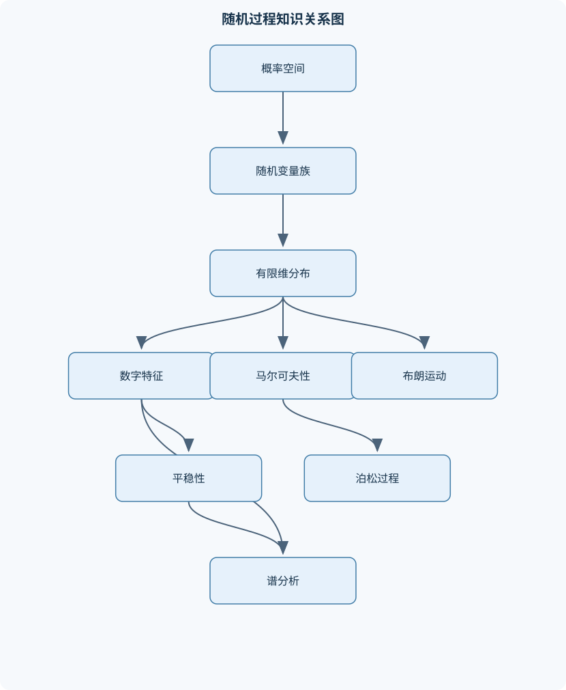
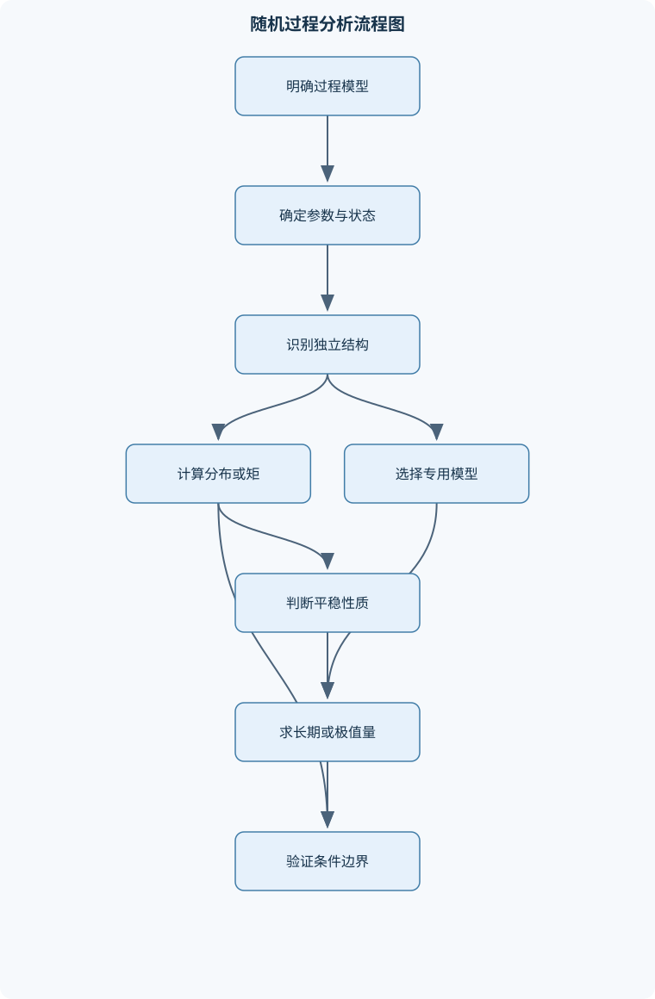

# 随机过程

## 一、课程整体知识框架

### 课程边界与先修知识

本课程研究随时间演化的随机现象，重点覆盖离散时间与连续时间随机过程的概率结构、数字特征、依赖关系、长期行为和典型模型。内容边界包括随机过程基本概念、有限维分布、均值与协方差、平稳性、各态历经性、马尔可夫链、泊松过程、非齐次泊松过程、布朗运动、功率谱密度及基础应用。先修知识包括高等数学中的极限、积分与级数，线性代数中的矩阵运算与特征值，概率论中的随机变量、分布函数、密度函数、条件概率、条件期望、独立性、数学期望、方差、协方差和常用分布。若学习连续时间马尔可夫过程、随机微分方程或鞅论，还需要测度概率论和实分析基础；这些内容不作为本课程核心要求。





### 1. 研究对象与基本问题

随机过程是由一族随机变量构成的数学模型，用于描述随时间或其他参数变化的随机现象，记为 $\{X(t),t\in T\}$。这里 $T$ 是参数集，常取离散时刻集合或连续时间区间；$X(t)$ 是参数取值为 $t$ 时的随机状态；状态空间 $S$ 是过程可能取值的集合。固定 $t$，$X(t)$ 是随机变量；固定样本点 $\omega$，$X(t,\omega)$ 随 $t$ 变化，形成一条样本函数或样本轨道。不能把随机过程本身误当成一条确定曲线。

课程关心的不只是某一时刻的概率分布，还包括不同时刻之间如何依赖、过程随时间平移是否保持统计结构、单条长期观测能否代表总体统计规律，以及过程在状态转移、事件计数、连续随机运动和频率组成等方面的典型模型。离散时间与连续时间描述参数的取值方式；离散状态与连续状态描述 $X(t)$ 的取值方式，两种分类彼此独立。例如，离散时刻上的实值测量可构成离散时间、连续状态过程；连续时间内的顾客人数可构成连续时间、离散状态过程。

### 2. 从有限维分布到二阶结构

随机过程的概率规律可由有限维分布族描述。对任意正整数 $n$、时刻 $t_1,\ldots,t_n\in T$ 和阈值 $x_1,\ldots,x_n$，联合分布函数为
$$
F_{t_1,\ldots,t_n}(x_1,\ldots,x_n)
=P(X(t_1)\le x_1,\ldots,X(t_n)\le x_n).
$$
令除一个坐标外的阈值趋于正无穷，可从联合分布得到任一时刻的边缘分布。单时刻分布只说明各时刻分别如何变化，不能单独确定过程的时间依赖结构；两个过程可以有相同的边缘分布，却有不同的联合分布和样本轨道特征。

当相应矩存在时，可用数字特征概括一阶和二阶结构。均值函数为 $m_X(t)=E[X(t)]$，要求相应期望存在；方差函数为 $C_X(t,t)$。协方差函数
$$
C_X(s,t)=E[(X(s)-m_X(s))(X(t)-m_X(t))]
$$
描述两个时刻偏离各自均值的共同变化；自相关函数 $R_X(s,t)=E[X(s)X(t)]$ 描述未中心化的二阶关系。二阶矩有限时，$R_X(s,t)=C_X(s,t)+m_X(s)m_X(t)$。实值过程的协方差矩阵必为半正定，因为任意实数 $a_1,\ldots,a_n$ 所构成的二次型等于随机变量 $\sum_i a_i[X(t_i)-m_X(t_i)]$ 的方差，因而不小于零。

不相关与独立不能混为一谈：不相关只约束二阶矩，通常不决定联合分布；对联合高斯随机变量，不相关才可推出独立。对过程作线性变换时，均值按线性规则变换，协方差则由变换系数对原协方差作双重求和。高斯过程由任意有限个时刻取值组成的联合高斯分布确定；在其二阶矩存在时，均值函数和协方差函数因而足以确定全部有限维分布。对一般过程，这两个数字特征并不完整决定概率规律。

### 3. 平稳性、长期平均与谱分析

严平稳要求任意有限维向量在共同时间平移后分布不变。宽平稳要求二阶矩存在、均值为常数 $\mu$，且协方差只依赖时间差 $\tau=t-s$。宽平稳的实值过程，其自相关函数满足 $R_X(\tau)=R_X(-\tau)$，并由柯西—施瓦茨不等式得到 $|R_X(\tau)|\le R_X(0)$。严平稳若另有有限二阶矩，则推出宽平稳；反向一般不成立，但对高斯过程，宽平稳可推出严平稳。仅有恒定均值不够判定宽平稳，必须检查协方差结构。

平稳性描述总体概率规律对时间平移的不变性，各态历经性则讨论一条样本轨道的长期时间平均是否等于总体统计量。连续时间的时间均值可写为 $\lim_{T\to\infty}T^{-1}\int_0^T X(t)\,dt$；离散时间则用样本和除以样本长度。均值各态历经性和相关函数各态历经性是不同性质，不能仅凭平稳性推出。若轨道包含随机常数分量，长期平均可能依赖该随机分量；若存在不衰减的周期相关项，时间平均也可能保留初始相位的影响。随机相位周期过程 $X(t)=A\cos(\omega_0t+\Theta)$ 在相位 $\Theta$ 于完整周期上均匀分布且与振幅 $A$ 独立等条件下，均值为零，相关函数为 $E[A^2]\cos(\omega_0\tau)/2$，所以可为宽平稳；这并不自动意味着它均值各态历经。

平稳过程的二阶结构可在时域用自相关函数描述，也可在频域用功率谱密度描述。在傅里叶变换存在，或可在广义函数意义下解释时，维纳—辛钦关系给出
$$
S_X(\omega)=\int_{-\infty}^{\infty}R_X(\tau)e^{-i\omega\tau}\,d\tau.
$$
这里 $\tau$ 的单位是时间，角频率 $\omega$ 的单位是弧度每单位时间，谱密度的量纲由过程取值平方与时间组合而成。功率谱密度非负；实值平稳过程的谱密度为实偶函数。若自相关不绝对可积，不能不加说明地使用普通傅里叶积分，可能需要按广义函数解释谱线。理想白噪声也属于数学理想化模型，有限带宽和有限采样下的观测不等同于其理想谱。

### 4. 状态转移、事件计数与连续随机运动

马尔可夫链用条件分布表达“给定当前状态后，未来与更早历史条件独立”的性质。齐次离散时间链的转移概率 $p_{ij}=P(X_{n+1}=j\mid X_n=i)$ 构成转移矩阵 $P$，其每行非负且和为 $1$。$n$ 步转移矩阵为 $P^n$，Chapman—Kolmogorov 方程 $P^{n+m}=P^nP^m$ 将中间时刻的状态求和消去。可达关系、互达类和闭类刻画状态空间的结构；常返表示从某状态出发最终返回的概率为 $1$，暂态则表示该返回概率小于 $1$。常返状态还要区分平均回转时间有限的正常返和平均回转时间无限的零常返。周期由可能返回步数的最大公因数确定。

平稳分布是满足 $\pi P=\pi$、$\pi_j\ge0$ 且 $\sum_j\pi_j=1$ 的概率向量，表示转移后分布不变。有限不可约链必有唯一平稳分布；若还非周期，则逐步转移概率收敛到该分布。周期链仍可能有平稳分布，但逐步转移概率不一定收敛。吸收链可按暂态和吸收态分块，其基本矩阵 $(I-Q)^{-1}$ 汇总访问暂态状态的期望次数；乘以暂态到吸收态的转移块可得吸收概率，乘以全一向量可得期望吸收步数。该逆矩阵方法要求吸收最终发生的条件成立。

计数过程 $N(t)$ 表示区间起点至时刻 $t$ 的事件数。齐次泊松过程具有独立增量和平稳增量，且长度为 $u$ 的区间增量服从参数为 $\lambda u$ 的泊松分布，其中 $\lambda$ 的单位是每单位时间，$\lambda u$ 无量纲。其到达间隔独立且服从速率为 $\lambda$ 的指数分布，第 $n$ 次到达时间服从形状参数 $n$、速率参数 $\lambda$ 的伽马分布。给定固定区间内总到达数为 $n$ 时，到达位置相当于 $n$ 个区间均匀分布点的次序统计量；这与未给定总数时的指数间隔描述条件不同。独立泊松过程可合成为速率之和的泊松过程；给定合成过程的总数，各来源的计数服从按速率比例分配的多项分布，两个来源时为二项分布。

非齐次泊松过程以时间变化的强度 $\lambda(t)\ge0$ 描述到达速率，其均值测度为 $m(t)=\int_0^t\lambda(u)\,du$，区间增量参数是 $\int_s^t\lambda(u)\,du$，不能简化为某个端点强度乘区间长度，除非强度确为常数。时间变换 $u=m(t)$ 可把非齐次过程转换到单位速率时间尺度。复合泊松过程在每次事件上附加随机标记或随机幅值，累计量是随机个数随机变量之和；它适用于描述带有随机损失额、服务需求或事件类型的计数模型，但模型结论依赖事件独立性、标记分布及强度假设。

标准布朗运动 $B(t)$ 满足 $B(0)=0$、独立增量、$B(t)-B(s)\sim N(0,t-s)$（$0\le s<t$），且样本轨道几乎处处连续。因而 $E[B(t)]=0$、$\operatorname{Var}(B(t))=t$，其时间单位与方差尺度相一致，标准差是 $\sqrt t$ 而不是 $t$。由较早时刻的共同增量部分可得 $\operatorname{Cov}(B(s),B(t))=\min(s,t)$。布朗运动具有平稳增量及标度性质：对 $a>0$，过程 $\{B(at)/\sqrt a\}$ 与标准布朗运动同分布，而非同一条样本轨道逐点相等。反射原理在连续路径标准布朗运动、$x>0$ 等条件下给出最大值分布；它不能直接套用于有跳跃的过程。布朗路径虽连续，却几乎处处不可微；真实测量则有采样间隔、带宽限制和测量误差，不能把理想路径的细尺度性质直接视为观测事实。

## 二、章节和模块划分

### 核心知识覆盖清单

本清单用于检查正文是否覆盖本课程的主要知识模块：

- **随机过程基本概念与有限维分布**：随机过程的二元函数定义、参数集与状态空间、离散时间和连续时间过程、离散状态和连续状态过程、样本函数与样本轨道、有限维分布函数族、随机过程的分布确定性、随机过程的典型构造。
- **随机过程的数字特征**：均值函数与方差函数、协方差函数与相关函数、互协方差函数、二阶矩存在条件、协方差矩阵的半正定性、高斯过程的数字特征、独立性与不相关性的区别、线性变换下的数字特征。
- **平稳过程与各态历经性**：严平稳过程定义、宽平稳过程定义、平稳过程相关函数性质、平稳过程的均值与方差、平稳过程的时间平移不变性、均值各态历经性、相关函数各态历经性、随机相位周期过程、平稳性与各态历经性的区别。
- **离散时间马尔可夫链**：马尔可夫性质、转移概率与转移矩阵、多步转移概率、Chapman-Kolmogorov方程、状态之间的互达关系、互达类与闭类、常返态与暂态、正常返态与零常返态、周期性与非周期性。
- **马尔可夫链的长期行为**：平稳分布定义、平衡方程πP=π、有限不可约链的平稳分布、正常返与平均回转时间、极限转移概率、遍历马尔可夫链、吸收链与吸收概率、首达时间与首达概率、基本矩阵与吸收时间。
- **泊松过程与计数过程**：计数过程定义、齐次泊松过程定义、独立增量与平稳增量、泊松分布的增量规律、到达间隔时间分布、第n次到达时间分布、条件到达时刻分布、泊松过程的合成、泊松过程的分解。
- **非齐次泊松过程与复合模型**：强度函数λ(t)、均值函数m(t)、非齐次泊松过程增量分布、小时间间隔概率展开、时间变换方法、复合泊松过程、标记泊松过程、随机和的分布、排队与保险风险中的计数模型。
- **布朗运动与高斯过程**：布朗运动定义、独立增量与正态增量、样本轨道连续性、布朗运动的均值和方差、协方差函数min(s,t)、高斯过程的有限维分布、独立增量与马尔可夫性、布朗运动的平稳增量、自相似性与时间反演。
- **布朗运动的路径性质**：布朗运动的最大值分布、反射原理、首次到达时间、最大值与终值联合事件、独立增量条件下的条件分布、布朗运动的极值概率、布朗桥的基本思想、连续路径与不可微性、理想模型与实际测量限制。
- **功率谱密度与随机过程分析**：自相关函数的傅里叶变换、维纳—辛钦关系、功率谱密度定义、谱密度的非负性、实平稳过程的偶对称性、白噪声理想模型、互相关函数与互谱密度、线性系统对随机过程的作用、频域分析的适用条件。


### 1. 随机过程基本概念与有限维分布

本模块从二元函数观点建立随机过程概念：过程可看作 $(t,\omega)\mapsto X(t,\omega)$，时间参数和样本点共同决定取值。通过区分参数集、状态空间、样本函数和固定时刻随机变量，说明“过程的时间变化”是由概率空间上的随机结果产生的。参数集可以是整数、非负整数或连续区间；状态空间可以是有限集合、可数集合或实数域。离散或连续应分别针对时间参数和状态取值说明，不能用“连续过程”含混地同时指两者。

有限维分布族包括所有有限个时刻的联合分布。它既包含单时刻分布，也包含跨时刻依赖关系；在一致性条件成立时，这一族确定过程的概率结构。典型构造包括随机参数函数，例如先抽取随机变量 $A,B$，再定义 $X(t)=At+(1-|A|)B$；也包括独立增量构造、马尔可夫转移构造和高斯过程构造。分析随机参数函数时，先固定随机参数写出可能轨道，再按随机参数的联合分布计算有限维概率，不能把某一条轨道当作整个过程。

### 2. 随机过程的数字特征

本模块要求辨明均值、方差、自协方差、自相关和互协方差的含义及存在条件。均值函数需要一阶期望存在；协方差与相关函数通常要求相关时刻的二阶矩有限。互协方差 $C_{XY}(s,t)$ 衡量两个过程在不同参数处相对各自均值的共同变化。中心化前后关系为 $R_{XY}(s,t)=C_{XY}(s,t)+m_X(s)m_Y(t)$，其中 $R_{XY}(s,t)=E[X(s)Y(t)]$。

协方差矩阵半正定是检查推导结果的重要条件：对任意时刻组和系数向量，其二次型不得为负。线性变换的均值和协方差可由期望的线性性及协方差双线性直接推出。高斯过程是特殊情形，均值与协方差确定所有有限维分布；一般过程则可能具有相同的一、二阶矩而联合分布不同。独立必然导致协方差为零（在矩存在时），但不相关通常不能推出独立。

### 3. 平稳过程与各态历经性

严平稳的判定对象是所有有限维联合分布，而非只比较单时刻分布。宽平稳的判定对象是均值和二阶结构：均值必须恒定，协方差必须只依赖时间差。宽平稳过程的相关函数偶对称且绝对值不超过零时滞相关值；若协方差存在，则 $R_X(\tau)=C_X(\tau)+\mu^2$。若均值恒定而协方差仍分别依赖 $s,t$，过程并非宽平稳。

各态历经性把统计平均与单条轨道的时间平均联系起来。均值各态历经性讨论时间均值是否收敛到总体均值；相关函数各态历经性讨论时间平均乘积是否收敛到总体相关函数。随机相位周期过程说明二者的区别：随机相位均匀化可使过程平稳，但单条轨道的长期均值仍可能依赖其相位或振幅。平稳性是分布结构的平移不变性，各态历经性是长期观测代表总体参数的性质，二者不可互相替代。应用时必须说明极限是几乎处处、均方还是其他意义，并满足相应矩与相关衰减条件。

### 4. 离散时间马尔可夫链

马尔可夫性质写为：给定当前状态后，下一步状态的条件分布不再依赖更早状态。齐次性进一步要求转移概率不随步数改变。转移矩阵 $P$ 的元素非负且逐行和为 $1$；多步转移概率由矩阵幂 $P^n$ 给出。Chapman—Kolmogorov 方程通过对中间状态求和，得到 $p_{ij}^{(n+m)}=\sum_k p_{ik}^{(n)}p_{kj}^{(m)}$。

状态分类先依据路径判断可达性，再由互相可达划分互达类；类中任一状态转移到类外状态的概率都为零时，该类为闭类。返回步数集合的最大公因数给出周期。常返与暂态由最终返回概率区分；在可数状态空间中，常返还分为平均回转时间有限的正常返和无限的零常返。有限链中的闭互达类为正常返类，类外状态为暂态；无限状态链不能仅凭有限状态结论分类。

### 5. 马尔可夫链的长期行为

平稳分布 $\pi$ 满足 $\pi P=\pi$，是分布在一步转移下保持不变的条件。有限不可约链存在唯一平稳分布，但逐步转移概率收敛还需要非周期性。正常返状态的平稳概率与平均回转时间满足 $\pi_i=1/E_i[T_i^+]$，适用前提是状态属于正常返闭类且平稳分布按该类归一化。

吸收链的状态可排列为暂态和吸收态，矩阵写成
$$
P=\begin{pmatrix}Q&R\\0&I\end{pmatrix}.
$$
若吸收以概率 $1$ 发生，则 $N=(I-Q)^{-1}$ 存在。$N_{ij}$ 是从暂态状态 $i$ 出发、吸收前访问暂态状态 $j$ 的期望次数；$NR$ 给出最终吸收于各吸收态的概率，$N\mathbf 1$ 给出吸收前期望步数。首达时间是首次到达指定集合的时间，其分布可通过删去目标集合后的暂态转移矩阵计算；若存在不吸收的闭类，必须先处理最终不命中目标的概率，不能直接假定首达时间有限。

### 6. 泊松过程与计数过程

计数过程按时间累计非负整数事件数，通常满足 $N(0)=0$、非减且跳跃幅度为 $1$。齐次泊松过程由独立增量、平稳增量和泊松增量分布刻画。长度为 $t-s$ 的区间内有
$$
N(t)-N(s)\sim\operatorname{Poisson}(\lambda(t-s)).
$$
因此固定区间计数的均值和方差均为 $\lambda(t-s)$。到达间隔服从指数分布，生存函数为 $e^{-\lambda u}$；第 $n$ 次到达时间为 $n$ 个独立指数间隔之和，故服从伽马分布。给定区间总数时，到达时刻的条件分布变为均匀点的次序统计量，这体现条件信息对分布的改变。

合成与分解建立来源和总计数的关系。若多个独立齐次泊松流的速率为 $\lambda_1,\ldots,\lambda_r$，合成流速率为其和；给定区间总数，各来源计数按概率 $\lambda_j/\sum_k\lambda_k$ 作多项分配。独立性是结论条件，存在共同冲击或来源间依赖时不能直接使用该分解。

### 7. 非齐次泊松过程与复合模型

非齐次泊松过程的强度函数 $\lambda(t)$ 描述局部单位时间内的到达速率，要求非负且可积。均值函数为 $m(t)=\int_0^t\lambda(u)\,du$，任意区间计数服从参数 $\int_s^t\lambda(u)\,du$ 的泊松分布。首次到达时间 $T_1$ 满足 $P(T_1>t)=e^{-m(t)}$。给定区间内总到达数时，到达时刻不再均匀；其条件密度与 $\lambda(u)$ 成比例，比例常数为该区间强度积分的倒数。时间变换 $u=m(t)$ 可转为单位速率泊松时间尺度，但若 $m(t)$ 有平坦区段或不严格递增，需按广义逆及相应条件处理。

复合泊松模型令每次到达附带独立标记 $Y_j$，累计量为 $S(t)=\sum_{j=1}^{N(t)}Y_j$。若标记独立同分布且与计数过程独立，则 $E[S(t)]=m(t)E[Y]$；齐次情形方差为 $\lambda t E[Y^2]$。标记可表示损失额、需求量或事件类别。模型应用于排队和风险分析时，必须检查到达独立性、标记分布、强度变化及服务或赔付机制是否符合实际；泊松计数本身不自动决定等待时间或损失总额的全部规律。

### 8. 布朗运动与高斯过程

高斯过程要求任意有限个时刻的取值构成联合高斯向量。标准布朗运动是均值为零、协方差为 $\min(s,t)$ 的高斯过程，并具有独立增量与连续样本轨道。由 $B(t)=B(s)+[B(t)-B(s)]$ 且括号内增量与过去独立，可推出协方差公式；独立增量和高斯性又说明布朗运动具有马尔可夫性。相邻终值通常相关，独立的是不重叠时间区间上的增量。

布朗运动的平稳增量表示增量分布只依赖区间长度；标度性质表示缩放时间并按平方根缩放振幅后，过程分布不变。时间反演性质可在相应有限维分布或路径变换意义下讨论，不能误写成任意时刻逐点相等。参数化布朗运动可写成 $\sigma B(t)$，此时方差为 $\sigma^2t$；$\sigma$ 的单位取决于状态量与时间单位，必须和应用中的测量尺度相符。

### 9. 布朗运动的路径性质

反射原理通过在首次达到水平 $x>0$ 后反射剩余路径，将越过水平的轨道与终值落在对应区间的轨道配对。因此
$$
P\left(\max_{0\le s\le t}B(s)\ge x\right)
=2P(B(t)\ge x),
\qquad
P\left(\max_{0\le s\le t}B(s)\le x\right)
=2\Phi\left(\frac{x}{\sqrt t}\right)-1.
$$
这里 $t>0$、$x>0$，且过程必须为标准布朗运动；阈值非正时第二式不能照搬。首次到达时间的概率可由最大值事件转换得到。涉及最大值与终值联合事件时，应先通过反射确定反射后的终值区间，再按正态分布计算，不能把最大值和终值误认为独立。

布朗轨道几乎处处连续但几乎处处不可微，这与普通光滑运动轨迹不同。布朗桥是给定终点条件下的布朗运动，体现高斯条件分布思想；标准布朗运动在固定时刻的桥过程可写作 $B(t)-\frac{t}{T}B(T)$，其端点为零。现实观测只在有限时间分辨率、带宽和噪声水平下取得，连续且不可微是理想极限模型的路径性质，不能直接从有限采样曲线验证。

### 10. 功率谱密度与随机过程分析

对宽平稳过程，自相关函数只依赖时差。满足适当可积条件时，自相关与功率谱密度互为傅里叶变换；谱密度非负，且实值过程的谱密度为偶函数。零时滞相关 $R_X(0)=E[X^2(t)]$ 对应总平均功率，具体反变换常数取决于采用角频率还是普通频率的傅里叶约定，计算时须保持约定一致。

白噪声的自相关集中在零时滞，理想谱在频率上为常数；其广义函数表达不代表存在有限方差、普通函数意义下的连续时间随机变量过程。互相关和互谱描述两个过程之间的频域依赖；线性时不变系统对宽平稳输入的输出谱，在系统稳定且相关变换条件成立时由输入谱乘以系统频率响应模平方得到。有限数据的周期图是谱估计量，不等于理论功率谱密度；实际分析还需考虑采样、窗函数、频率分辨率和估计方差。

## 三、核心概念的详细解释

### 1. 随机过程、样本轨道与有限维分布

随机过程是定义在同一概率空间上的随机变量族，记为 $\{X(t),t\in T\}$。参数集 $T$ 表示时间或其他演化参数，状态空间 $S$ 表示随机状态的所有可能取值。固定 $t$ 时，$X(t)$ 是随机变量；固定样本点 $\omega$ 时，$X(t,\omega)$ 是关于 $t$ 的确定函数，称为样本函数或样本轨道。随机过程的随机性来自样本点的选择，而不是说每条样本轨道本身仍然是随机变量。

按参数集可分为离散时间过程和连续时间过程；按状态空间可分为离散状态过程和连续状态过程。这两种分类互相独立。例如，离散时刻记录的温度是离散时间、连续状态过程；连续时间内的排队人数是连续时间、离散状态过程。

过程的完整概率结构由有限维分布族描述。任取 $t_1,\ldots,t_n\in T$，联合分布函数为

$$
F_{t_1,\ldots,t_n}(x_1,\ldots,x_n)
=P\{X(t_1)\le x_1,\ldots,X(t_n)\le x_n\}.
$$

令除第 $k$ 个坐标外的阈值趋于正无穷，可得到 $X(t_k)$ 的边缘分布。单时刻分布不能确定过程，因为过程之间的时间依赖关系可能不同。例如，若 $Y$ 是一个随机变量，令 $X(t)=Y$，则所有时刻完全相同；若令 $X(t)$ 在每个离散时刻独立取与 $Y$ 相同的分布，则单时刻分布相同，但联合结构完全不同。

随机过程的构造通常包括三类：用随机参数生成轨道，例如 $X(t)=At+B$；用独立随机变量序列生成离散过程，例如 $X_n=\sum_{k=1}^nY_k$；通过计数、转移或极限构造连续时间模型，例如泊松过程和布朗运动。

### 2. 数字特征与依赖关系

在期望存在时，均值函数为

$$
m_X(t)=E[X(t)].
$$

若 $E[X^2(t)]<\infty$，则方差函数为

$$
v_X(t)=\operatorname{Var}(X(t))
=E[(X(t)-m_X(t))^2].
$$

协方差函数为

$$
C_X(s,t)=\operatorname{Cov}(X(s),X(t))
=E[(X(s)-m_X(s))(X(t)-m_X(t))],
$$

自相关函数为

$$
R_X(s,t)=E[X(s)X(t)].
$$

二阶矩存在时，

$$
R_X(s,t)=C_X(s,t)+m_X(s)m_X(t).
$$

对任意时刻 $t_1,\ldots,t_n$ 和实数 $a_1,\ldots,a_n$，有

$$
\sum_{i=1}^{n}\sum_{j=1}^{n}a_i a_j C_X(t_i,t_j)
=
\operatorname{Var}\left(\sum_{i=1}^{n}a_iX(t_i)\right)\ge 0.
$$

因此协方差矩阵必为半正定。这个条件是判断一个给定函数能否作为协方差函数的重要必要条件，但仅满足半正定还需结合对称性和其他条件才能构造合法过程。

独立性意味着联合分布可分解；不相关只表示协方差为零。一般情况下，不相关不能推出独立。例如，令 $U$ 在 $[-1,1]$ 上均匀分布，$V=U^2$，则 $U$ 与 $V$ 通常不独立，但由对称性可得 $E[UV]=E[U^3]=0$。对于联合高斯变量，不相关可以推出独立，这是高斯模型的特殊性质。

若 $Y(t)=a(t)X(t)+b(t)$，其中 $a(t),b(t)$ 为确定函数，则

$$
m_Y(t)=a(t)m_X(t)+b(t),
$$

$$
C_Y(s,t)=a(s)a(t)C_X(s,t).
$$

若为多个过程的线性组合，协方差还必须加入互协方差项。二阶数字特征只描述均值和协方差，不能在一般情况下确定非高斯过程的全部分布；高斯过程则由所有有限维高斯分布决定，而这些分布由均值函数和协方差函数确定。

### 3. 平稳性、各态历经性与随机周期过程

严平稳要求任意 $n$、任意时刻 $t_1,\ldots,t_n$ 和任意平移 $h$ 满足

$$
(X(t_1),\ldots,X(t_n))
\overset{d}{=}
(X(t_1+h),\ldots,X(t_n+h)).
$$

其中 $\overset{d}{=}$ 表示分布相同。严平稳关注所有有限维分布，不要求二阶矩存在。

宽平稳要求二阶矩存在，且

$$
m_X(t)=\mu,
\qquad
C_X(s,t)=C_X(t-s).
$$

若写 $\tau=t-s$，通常记自相关函数为 $R_X(\tau)$。实值宽平稳过程满足

$$
R_X(\tau)=R_X(-\tau),
\qquad
|R_X(\tau)|\le R_X(0).
$$

第一式来自乘法交换和时间差改变符号；第二式来自柯西—施瓦茨不等式。严平稳且二阶矩存在时必为宽平稳，但宽平稳一般不能推出严平稳；对高斯过程，宽平稳可以推出严平稳。

各态历经性不是平稳性的同义词。连续时间样本轨道的时间平均为

$$
\langle X\rangle_T=\frac1T\int_0^T X(t)\,dt,
$$

若当 $T\to\infty$ 时它在均方或概率意义下收敛到总体均值 $\mu$，称过程具有均值各态历经性。离散时间时改为

$$
\langle X\rangle_n=\frac1n\sum_{k=1}^nX(k).
$$

考虑随机常数过程 $X(t)=Y$。它是严格平稳的，但时间平均始终为 $Y$，只有当 $Y$ 几乎处处等于 $E[Y]$ 时才具有均值各态历经性。可见平稳性只说明时间平移不改变总体统计结构，不能保证一条轨道能够代表总体。

若 $X(t)=A\cos(\omega_0t+\Theta)$，其中 $\Theta$ 在 $[0,2\pi)$ 上均匀分布，且与 $A$ 独立，则

$$
E[X(t)]=0,
$$

并且

$$
R_X(\tau)=\frac{E[A^2]}2\cos(\omega_0\tau).
$$

随机相位使时间平移等价于相位平移，因此过程通常宽平稳。对于固定相位的确定性余弦信号，不能直接把它当作随机过程意义下的平稳过程。该随机相位过程的时间平均一般依赖于 $A$，其均值各态历经性还需进一步检查。

### 4. 马尔可夫链及其长期行为

离散时间马尔可夫链 $\{X_n,n\ge0\}$ 满足

$$
P(X_{n+1}=j\mid X_n=i,X_{n-1},\ldots,X_0)
=
P(X_{n+1}=j\mid X_n=i)
=p_{ij}.
$$

齐次链中 $p_{ij}$ 与 $n$ 无关。矩阵 $P=(p_{ij})$ 的每个元素非负，每行和为 $1$。$n$ 步转移概率为

$$
p_{ij}^{(n)}=P(X_{m+n}=j\mid X_m=i),
$$

在齐次链中只依赖 $n$，且

$$
P^n=(p_{ij}^{(n)}).
$$

将中间时刻状态 $k$ 分类求和得到 Chapman—Kolmogorov 方程：

$$
p_{ij}^{(n+m)}
=\sum_kp_{ik}^{(n)}p_{kj}^{(m)},
$$

矩阵形式为 $P^{n+m}=P^nP^m$。

若状态 $i$ 可在有限步到达 $j$，记为 $i\to j$；若彼此可达，则属于同一互达类。若某类中的状态不能到达类外状态，该类为闭类。状态的周期定义为

$$
d(i)=\gcd\{n\ge1:p_{ii}^{(n)}>0\}.
$$

若 $d(i)=1$，称非周期。有限链中，闭类内状态为常返，非闭类状态为暂态。常返状态还分为正常返和零常返：若平均回转时间有限，则为正常返，否则为零常返。

平稳分布 $\pi$ 满足

$$
\pi_j\ge0,\qquad \sum_j\pi_j=1,\qquad \pi P=\pi.
$$

有限不可约链必存在唯一平稳分布，并且所有状态正常返。若再非周期，则

$$

\lim_{n\to\infty}p_{ij}^{(n)}=\pi_j.
$$

若链有周期，逐步极限可能不存在，但长期平均可能收敛到平稳分布。对吸收链，将暂态和吸收态排列后写成

$$
P=
\begin{pmatrix}
Q&R\\
0&I
\end{pmatrix}.
$$

基本矩阵为

$$
N=(I-Q)^{-1}=I+Q+Q^2+\cdots,
$$

吸收概率矩阵为 $B=NR$，暂态初始状态下的期望吸收步数为

$$
t=N\mathbf 1,
$$

其中 $\mathbf1$ 是全 $1$ 列向量。该公式要求从相关暂态出发最终吸收的概率为 $1$，否则 $I-Q$ 可能不可逆。

### 5. 泊松过程、非齐次过程与复合模型

计数过程 $N(t)$ 满足 $N(0)=0$，取非负整数值，且随时间不减。齐次泊松过程具有独立增量、平稳增量，并满足

$$
N(t)-N(s)\sim\operatorname{Poisson}(\lambda(t-s)),
\qquad 0\le s<t.
$$

因此

$$
P(N(t)=k)=e^{-\lambda t}\frac{(\lambda t)^k}{k!}.
$$

$\lambda$ 是单位时间内的平均到达率，单位为“事件/时间”；$\lambda t$ 必须是无量纲的计数参数。相邻到达间隔独立同分布，服从参数为 $\lambda$ 的指数分布：

$$
P(W>x)=e^{-\lambda x},\qquad x\ge0.
$$

第 $n$ 次到达时间 $T_n=W_1+\cdots+W_n$，服从伽马分布，其密度为

$$
f_{T_n}(t)=\frac{\lambda^nt^{n-1}e^{-\lambda t}}{(n-1)!},
\qquad t>0.
$$

给定 $N(t)=n$ 时，前 $n$ 个到达时刻等价于 $n$ 个独立 $\operatorname{Uniform}(0,t)$ 随机变量的次序统计量。该结论是条件分布，不能与无条件的指数间隔分布混用。

若 $N_1,N_2$ 是速率分别为 $\lambda_1,\lambda_2$ 的独立泊松过程，则 $N_1+N_2$ 是速率 $\lambda_1+\lambda_2$ 的泊松过程。给定总到达数为 $n$，来源于第一个过程的到达数服从

$$
\operatorname{Binomial}\left(n,\frac{\lambda_1}{\lambda_1+\lambda_2}\right).
$$

非齐次泊松过程的强度函数为 $\lambda(t)\ge0$，均值函数为

$$
m(t)=\int_0^t\lambda(u)\,du.
$$

区间增量满足

$$
N(t)-N(s)\sim
\operatorname{Poisson}\left(\int_s^t\lambda(u)\,du\right).
$$

小区间 $\Delta t$ 内，

$$
P(\Delta N=1)=\lambda(t)\Delta t+o(\Delta t),
$$

$$
P(\Delta N\ge2)=o(\Delta t).
$$

若 $m(t)$ 严格递增，可用 $u=m(t)$ 将非齐次过程变换为单位速率泊松过程；强度为零的区段需使用广义逆并单独处理。

复合泊松过程为

$$
S(t)=\sum_{j=1}^{N(t)}Y_j,
$$

约定空和为 $0$。若标记 $Y_j$ 独立同分布且与 $N(t)$ 独立，则

$$
E[S(t)]=m(t)E[Y],
$$

齐次情形下

$$
\operatorname{Var}(S(t))=\lambda tE[Y^2].
$$

### 6. 布朗运动、路径性质与谱分析

标准布朗运动 $B(t)$ 满足：$B(0)=0$；增量独立；当 $0\le s<t$ 时，

$$
B(t)-B(s)\sim N(0,t-s);
$$

并且样本轨道几乎处处连续。由

$$
B(t)=B(s)+[B(t)-B(s)]
$$

以及后项与 $B(s)$ 独立，可得

$$
\operatorname{Cov}(B(s),B(t))=s=\min(s,t).
$$

因此 $B(t)\sim N(0,t)$，标准差为 $\sqrt t$，不是 $t$。若过程为 $\sigma B(t)$，则方差为 $\sigma^2t$。

布朗运动具有平稳增量、自相似性和马尔可夫性。对 $a>0$，

$$
\left\{\frac{B(at)}{\sqrt a},t\ge0\right\}
\overset{d}{=}
\{B(t),t\ge0\}.
$$

这是过程分布意义下的等同，不是同一轨道逐点相等。布朗轨道连续但几乎处处不可微，因而不能按普通速度函数处理。

令

$$
M_t=\max_{0\le s\le t}B(s).
$$

对 $x>0$，反射原理给出

$$
P(M_t\ge x)=2P(B(t)\ge x)
=2\left[1-\Phi\left(\frac{x}{\sqrt t}\right)\right],
$$

从而

$$
P(M_t\le x)=2\Phi\left(\frac{x}{\sqrt t}\right)-1.
$$

反射原理依赖于连续路径、标准布朗运动和正阈值条件。最大值与终值并不独立，涉及联合事件时必须按照首次越过阈值后反射终值区间，不能直接相乘。

对于宽平稳过程，若自相关函数满足适当的可积条件，功率谱密度定义为

$$
S_X(\omega)=\int_{-\infty}^{\infty}
R_X(\tau)e^{-i\omega\tau}\,d\tau.
$$

$\omega$ 是角频率，单位为弧度/时间。实值过程的 $R_X(\tau)$ 为偶函数，$S_X(\omega)$ 为实的偶函数且非负。维纳—辛钦关系说明自相关与功率谱互为傅里叶变换。采用角频率约定时，

$$
R_X(0)=\frac1{2\pi}
\int_{-\infty}^{\infty}S_X(\omega)\,d\omega.
$$

白噪声的平坦谱通常只能在广义函数意义下理解；有限带宽、有限采样率的实际信号不可能拥有无限频带和无限总功率。

## 四、重要定义、公式、定理和推导

### 专业审校补充：关键定义与适用边界

马尔可夫链存在平稳分布，不等于从任意初始状态出发的转移概率必然收敛。设有限链不可约且平稳分布为 π。若链还非周期，则对任意状态 i、j 有 pᵢⱼ⁽ⁿ⁾→πⱼ；若链具有周期 d>1，pᵢⱼ⁽ⁿ⁾通常随 n 在不同剩余类之间振荡，不能逐项收敛，但时间平均满足 (1/n)Σₖ₌₀ⁿ⁻¹pᵢⱼ⁽ᵏ⁾→πⱼ。这里 n 是离散步数，无量纲；πⱼ 是状态 j 的长期占比。周期性来自返回步长集合的最大公因数，而不是来自平稳分布方程。对可约有限链，长期行为还取决于初始分布和最终进入的闭类；多个闭类时，平稳分布可以是各闭类平稳分布的凸组合。因而分析长期行为必须分别说明平稳分布、逐步极限和时间平均极限，不能用其中一个概念替代另外两个。


### 1. 代表性计算流程

#### 流程一：平稳性判定

输入过程表达式 $X(t)$ 及其随机参数，输出严平稳或宽平稳结论。

1. 先判断是否具备二阶矩；若没有，不能使用宽平稳定义。
2. 严平稳需比较任意有限维分布，不可只比较均值和方差。
3. 宽平稳先计算 $m_X(t)$，检查是否为常数。
4. 再计算 $C_X(s,t)$ 或 $R_X(s,t)$，检查是否只依赖 $t-s$。
5. 若过程是高斯过程，宽平稳可进一步推出严平稳。
6. 对随机相位正弦过程，必须检查相位是否在完整周期上均匀分布。

终止条件是完成有限维分布判定或完成均值、协方差的时间差判定。若只得到均值恒定，结论最多是“一阶平稳”，不能宣称宽平稳。

#### 流程二：泊松过程条件计算

输入速率、时间区间和事件条件，输出目标概率。

1. 无条件计数使用泊松分布。
2. “至少一次到达”使用
   $$
   P(N(t)-N(s)\ge1)=1-e^{-\lambda(t-s)}.
   $$
3. 到达间隔使用指数分布。
4. 第 $n$ 次到达时间使用伽马分布。
5. 给定总人数时，到达位置使用均匀分布次序统计量。
6. 速率变化时先计算
   $$
   \Lambda(s,t)=\int_s^t\lambda(u)\,du,
   $$
   再使用 $\operatorname{Poisson}(\Lambda(s,t))$。

该流程适用于独立增量且局部事件符合泊松结构的过程；若到达具有成团、排斥或反馈效应，不能直接套用。

#### 流程三：吸收马尔可夫链计算

输入按暂态、吸收态排列的转移矩阵，输出吸收概率和吸收时间。

1. 写成
   $$
   P=\begin{pmatrix}Q&R\\0&I\end{pmatrix}.
   $$
2. 计算 $N=(I-Q)^{-1}$。
3. 计算吸收概率 $B=NR$。
4. 计算期望吸收步数 $t=N\mathbf1$。
5. 检查每行吸收概率是否和为 $1$，并验证 $t$ 的非负性。

若暂态数为 $m$，直接高斯消元的计算复杂度通常为 $O(m^3)$。数值计算中不宜显式求逆，可改为求解线性方程组 $(I-Q)X=R$ 和 $(I-Q)t=\mathbf1$。

#### 伪代码：有限马尔可夫链平稳分布

```text
输入：有限状态转移矩阵 P，状态数 n
输出：平稳分布 pi，或“无概率型解”

构造 A = P^T - I
将 A 的一行替换为全 1 行
构造 b = (0, ..., 0, 1)^T
求解 A pi^T = b

如果某个 pi_i < 0 或 |sum(pi_i)-1| 大于容差：
    输出“没有满足条件的概率型解”
否则：
    验证 ||pi P - pi|| 是否小于容差
    输出 pi
```

该算法的输入必须是行随机矩阵，即每个元素非负且每行和为 $1$。由于方程 $\pi P=\pi$ 具有线性相关性，必须用归一化方程替换其中一行；若链不可约，有限状态情形下解唯一。

### 2. 典型例题及逐步解答

#### 例题一：随机参数过程的有限维分布

设 $A,B$ 独立，且分别以概率 $1/3$ 取 $-1,0,1$，定义

$$
X(t)=At+(1-|A|)B,\qquad t\ge0.
$$

求所有样本轨道，并计算 $P(X(1)=1)$、$P(X(2)=1)$ 和 $P(X(1)=1,X(2)=1)$。

**分析与解答：**

当 $A=1$ 时，$X(t)=t$；当 $A=-1$ 时，$X(t)=-t$；当 $A=0$ 时，$X(t)=B$，分别为常数 $-1,0,1$。因此所有可能轨道为

$$
t,\quad -t,\quad -1,\quad 0,\quad 1.
$$

事件 $X(1)=1$ 包括 $A=1$ 或 $(A=0,B=1)$，故

$$
P(X(1)=1)=\frac13+\frac19=\frac49.
$$

在 $t=2$ 时，只有 $A=0,B=1$ 能使 $X(2)=1$，所以

$$
P(X(2)=1)=\frac19.
$$

两个时刻同时为 $1$ 也只有 $A=0,B=1$，因此

$$
P(X(1)=1,X(2)=1)=\frac19.
$$

这说明单时刻概率不能由样本轨道的某一个取值替代，联合事件必须同时满足两个时刻的条件。

#### 例题二：马尔可夫链的平稳分布

设两状态链的转移矩阵为

$$
P=
\begin{pmatrix}
0.7&0.3\\
0.2&0.8
\end{pmatrix}.
$$

求平稳分布。

**解答：** 令 $\pi=(\pi_0,\pi_1)$，则

$$
\pi_0+\pi_1=1,
$$

$$
\pi_0=0.7\pi_0+0.2\pi_1.
$$

整理得 $0.3\pi_0=0.2\pi_1$，即 $\pi_1=1.5\pi_0$。代入归一化条件：

$$
2.5\pi_0=1,
\qquad
\pi_0=0.4,\quad \pi_1=0.6.
$$

验证：

$$
(0.4,0.6)P=(0.4,0.6).
$$

矩阵的两个状态互相可达，且存在自循环，因此链不可约、非周期，长期转移概率均收敛到 $(0.4,0.6)$。

#### 例题三：齐次泊松过程的条件概率

顾客以速率 $\lambda=3$ 人/小时到达。求两小时内恰有 $2$ 人到达的概率，以及至少有一人到达的概率。

**解答：** 两小时内泊松参数为 $\lambda t=6$。因此

$$
P(N(2)=2)=e^{-6}\frac{6^2}{2!}=18e^{-6}.
$$

至少一人到达的概率为补事件：

$$
P(N(2)\ge1)=1-P(N(2)=0)=1-e^{-6}.
$$

参数 $6$ 的单位是无量纲；若把 $\lambda$ 写成“每小时”，时间必须用小时代入。

**变式：** 若已知两小时内恰有 $2$ 人到达，求第一位顾客在前半小时到达的概率。每个到达时刻条件于总人数后服从 $\operatorname{Uniform}(0,2)$ 的次序统计结构，因此最早到达时刻 $U_{(1)}$ 满足

$$
P(U_{(1)}\le0.5)
=1-\left(1-\frac{0.5}{2}\right)^2
=1-\left(\frac34\right)^2
=\frac7{16}.
$$

#### 例题四：非齐次泊松过程

设 $0\le t\le2$ 时强度为 $\lambda(t)=1+t$。求区间 $[0,2]$ 内恰有 $k$ 次到达的概率。

**解答：** 先计算均值测度：

$$
\Lambda(0,2)=\int_0^2(1+t)\,dt
=\left[t+\frac{t^2}{2}\right]_0^2=4.
$$

因此

$$
N(2)-N(0)\sim\operatorname{Poisson}(4),
$$

于是

$$
P(N(2)=k)=e^{-4}\frac{4^k}{k!},\qquad k=0,1,\ldots.
$$

不能使用 $\lambda(2-0)=2\times2=4$ 来证明一般结论，因为本题恰好得到相同数值只是积分结果；若 $\lambda(t)$ 为非线性函数，必须计算积分。

#### 例题五：布朗运动的线性组合

求 $Y=B(2)-B(1)$ 与 $Z=B(3)-B(2)$ 的协方差和联合分布。

**解答：** 两个增量分别位于不相交区间 $[1,2]$ 和 $[2,3]$，因此独立。又有

$$
Y\sim N(0,1),\qquad Z\sim N(0,1).
$$

所以

$$
\operatorname{Cov}(Y,Z)=0,
$$

且联合向量服从

$$
(Y,Z)\sim N\left(
\begin{pmatrix}0\\0\end{pmatrix},
\begin{pmatrix}1&0\\0&1\end{pmatrix}
\right).
$$

**变式：** $B(1)$ 与 $B(3)$ 不独立，因为

$$
\operatorname{Cov}(B(1),B(3))=\min(1,3)=1.
$$

独立的是不重叠增量，不是任意不同时刻的终值。

### 3. 实验与项目流程

#### 实验一：有限马尔可夫链长期行为验证

**输入数据：** 取

$$
P=
\begin{pmatrix}
0.5&0.5&0\\
0.2&0.5&0.3\\
0&0.4&0.6
\end{pmatrix},
\qquad
\mu_0=(1,0,0).
$$

**步骤：**

1. 检查 $P$ 的元素非负且每行和为 $1$。
2. 计算 $P^n$ 或递推 $\mu_{n+1}=\mu_nP$。
3. 解 $\pi P=\pi$ 和 $\sum_i\pi_i=1$。
4. 比较 $\mu_n$ 与 $\pi$ 的距离，例如
   $$
   \|\mu_n-\pi\|_1=\sum_i|\mu_{n,i}-\pi_i|.
   $$
   该距离足够小后，视为数值上接近平稳状态。
5. 检查状态转移图是否不可约、非周期，并解释收敛条件。

**评价标准：** 转移矩阵合法；平稳分布各分量非负且和为 $1$；残差 $\|\pi P-\pi\|_1$ 小于预先设定的数值容差；模拟频率与理论平稳分布在误差范围内一致。

**排错方法：** 若平稳分布出现负数，通常是方程排列或转移矩阵方向错误；若递推结果每行和不为 $1$，应检查概率归一化；若理论分布存在但轨道频率不收敛，需检查链是否周期或模拟步数不足。

#### 实验二：泊松过程与非齐次过程比较

**输入数据：** 齐次强度 $\lambda=2$，以及非齐次强度 $\lambda(t)=1+t$，观察区间均为 $[0,3]$。

**步骤：**

1. 齐次过程理论均值为 $2\times3=6$。
2. 非齐次过程理论均值为
   $$
   \int_0^3(1+t)\,dt=7.5.
   $$
3. 分别生成或记录多条独立轨道，统计每条轨道的总到达次数。
4. 比较样本均值与理论均值。
5. 将时间区间分成若干子区间，比较子区间计数是否符合相应泊松参数。
6. 对非齐次过程使用时间变换
   $$
   u=m(t)=t+\frac{t^2}{2}
   $$
   检查变换后单位强度尺度下的计数规律。

**评价标准：** 总计数样本均值随轨道数增加接近理论均值；样本方差与理论泊松参数大致相近；非重叠区间计数的样本相关性应接近零；非齐次过程各区间均值应与强度积分一致。

**排错方法：** 若均值偏差明显，检查时间单位和强度单位；若非齐次计数仍使用 $\lambda\Delta t$，应改为积分强度；若不同区间计数呈现明显相关，应检查模拟是否重复使用随机数或引入了不应存在的反馈机制。有限样本下样本均值、方差和相关系数不会精确等于理论值，不能仅凭一次模拟否定模型。

### 4. 重要定理的适用边界

协方差半正定定理要求相关二阶矩存在；没有有限二阶矩时，协方差可能根本没有定义。严平稳推出宽平稳要求二阶矩存在，不能对重尾且方差发散的过程直接使用。有限不可约链存在唯一平稳分布，但若存在周期性，$P^n$ 不一定逐项收敛。泊松过程的指数间隔结论要求齐次过程；非齐次过程的间隔通常不再同分布。布朗运动反射原理只适用于连续路径的标准布朗运动，带跳跃过程不能直接套用。功率谱密度的傅里叶公式要求宽平稳及相应变换条件；相关函数不绝对可积时，谱可能包含离散谱线或只能在广义函数意义下解释。

## 五、算法、流程和实现思路

### 方法与流程覆盖索引

下列方法或流程应在正文中说明输入、步骤、适用条件、结果检查和边界：

- 马尔可夫链状态分类流程：输入状态集合和转移矩阵P；输出互达类、闭类、周期、常返性和长期类别。先由P的正元素建立一步可达关系，再计算Pⁿ中正元素判断可达性；依据互相可达划分互达类；若类外无可达状态则判为闭类；计算同一状态返回步数集合的最大公因数得到周期；对有限链，闭类内状态为常返，非闭类状态为暂态；在闭类内根据平均回转时间是否有限区分正常返和零常返。终止条件是所有状态均已分类。有限状态矩阵运算的直接复杂度约为O(|S|³)，图搜索部分约为O(|S|+|E|)。
- 平稳分布求解流程：输入有限状态转移矩阵P；输出平稳分布π。列出线性方程πP=π，将其改写为(Pᵀ-I)πᵀ=0，再用Σᵢπᵢ=1替换一个线性相关方程；解出非负向量并验证各分量非负、总和为1及πP=π。若解不存在，说明没有概率型平稳分布；若链有限且不可约，则解唯一。高斯消元复杂度通常为O(|S|³)。
- 吸收马尔可夫链分析流程：输入按暂态和吸收态排列的转移矩阵；输出吸收概率和期望吸收步数。将矩阵写成P=[[Q,R],[0,I]]；计算基本矩阵N=(I-Q)⁻¹；吸收概率矩阵为B=NR；从暂态出发的期望吸收步数向量为t=N1，其中1为全1列向量。要求吸收概率为1时相应逆矩阵存在；矩阵求逆或线性方程求解复杂度通常为O(m³)，m为暂态数。
- 泊松过程条件概率计算流程：输入速率λ、时间区间和事件条件；输出目标概率。先识别是无条件计数、给定计数、到达间隔还是第n次到达时间；无条件计数使用Poisson分布；给定N(t)=n时使用均匀分布次序统计量；到达间隔使用指数分布；第n次到达时间使用伽马分布；最后检查时间单位和参数单位一致。该流程适用于独立增量、平稳增量的齐次泊松过程，不适用于有依赖到达或速率随时间变化的过程。
- 非齐次泊松过程计算流程：输入强度函数λ(t)和区间端点s、t；输出计数概率或到达概率。先计算均值测度Λ(s,t)=∫ₛᵗλ(u)du；再使用N(t)-N(s)服从Poisson(Λ(s,t))；若涉及到达时刻，使用时间变换u=m(t)或直接由生存函数推导；最后验证λ(t)非负且积分有限。数值积分时可使用解析积分、分段积分或稳定的数值求积；适用条件是过程具有独立增量且局部事件概率符合泊松结构。
- 布朗运动概率分析流程：输入涉及B(t)、增量、最大值或首次到达的事件；输出事件概率。先将线性组合化为正态变量，使用均值、方差和协方差；涉及增量时检查区间是否不交；涉及最大值时优先判断能否使用反射原理；涉及条件事件时利用独立增量或高斯条件分布；最后将标准化变量转换为Φ函数。该流程适用于标准或已知方差参数的布朗运动，不适用于具有跳跃或非高斯增量的过程。
- 平稳性判定流程：输入过程表达式X(t)及其随机参数；输出严平稳或宽平稳结论。严平稳判定需比较任意有限维分布在时间平移前后的不变性；宽平稳判定先计算m_X(t)，检查是否为常数，再计算R_X(s,t)或C_X(s,t)，检查是否只依赖τ=t-s；若过程为高斯过程，宽平稳可进一步推出严平稳。对于随机相位正弦过程，重点检查相位是否在完整周期上均匀分布。该流程不能以均值恒定作为平稳性的充分条件。
- 各态历经性分析流程：输入平稳过程及其相关函数；输出均值或相关函数各态历经性判断。先明确要判断的是均值各态历经性还是相关函数各态历经性；计算统计均值和时间均值；再分析相关函数在大时间差下的衰减、周期项和随机常数项；使用均方误差或协方差积分条件进行验证。若存在不衰减的周期项，时间平均可能依赖初始相位；若存在随机常数分量，单条轨道长期平均可能收敛到随机变量而非总体均值。该流程要求二阶矩和相应极限条件成立。
- 功率谱分析流程：输入宽平稳过程的自相关函数R_X(τ)；输出功率谱密度S_X(ω)。先确认过程为宽平稳并且自相关函数满足傅里叶变换条件；利用偶函数性质将双边积分化为余弦变换；检查结果是否为非负实偶函数；反变换验证R_X(0)与总功率一致。对于不绝对可积的相关函数，需要在广义函数框架下处理离散谱线。该流程不应将有限样本的周期图直接等同于理论功率谱密度。





### 1. 随机过程建模与有限维分布计算流程

#### 1.1 输入、输出与基本步骤

**输入**包括参数集 $T$、状态空间 $S$、过程表达式或联合分布信息，以及需要计算的时刻和事件。**输出**可以是单时刻分布、有限维联合分布、均值函数、协方差函数，或对过程性质的判定。

处理随机过程题目时，应按以下顺序进行：

1. 明确固定的是时刻 $t$ 还是样本点 $\omega$。固定 $t$ 得到随机变量 $X(t)$，固定 $\omega$ 得到样本轨道 $X(t,\omega)$。
2. 判断参数是离散还是连续，状态是离散还是连续。
3. 若题目给出过程表达式，先按随机参数的取值分类；若给出联合分布，则从有限维分布取边缘。
4. 对事件逐项转化。例如，$X(t)=x$ 应转化为随机参数满足的条件，而不是把 $X(t)$ 当作确定函数直接求解。
5. 若要判定平稳性，不能只计算单时刻分布，必须检查有限维分布或至少检查均值与协方差。
6. 若涉及二阶特征，先确认 $E[X^2(t)]<\infty$；否则方差和协方差可能没有定义。

#### 1.2 例题：随机参数过程

设 $A,B$ 相互独立，且分别以概率 $1/3$ 取 $-1,0,1$，过程为

$$
X(t)=At+(1-|A|)B,\qquad t\ge 0.
$$

**分析：** 当 $A=1$ 时，$X(t)=t$；当 $A=-1$ 时，$X(t)=-t$；当 $A=0$ 时，$X(t)=B$，是常值轨道。因此共有 $3\times3=9$ 个参数组合，但有些组合产生相同的轨道。

**计算 $P(X(1)=1)$：**

- $A=1$ 时，必有 $X(1)=1$，概率为 $1/3$；
- $A=0$ 时，需要 $B=1$，概率为 $(1/3)(1/3)=1/9$；
- $A=-1$ 时不可能。

所以

$$
P(X(1)=1)=\frac13+\frac19=\frac49.
$$

**计算 $P(X(2)=1)$：** 只有 $A=0,B=1$ 能满足条件，因此

$$
P(X(2)=1)=\frac19.
$$

**计算联合概率：**

$$
\{X(1)=1,X(2)=1\}=\{A=0,B=1\},
$$

因为 $A=1$ 时 $X(2)=2$。故

$$
P(X(1)=1,X(2)=1)=\frac19.
$$

**验证：** 联合事件包含于 $\{X(1)=1\}$，且 $1/9\le4/9$，结果满足概率基本不等式。

#### 1.3 例题：混合分布过程

设 $A$ 为伯努利变量，$P(A=0)=P(A=1)=1/2$，$Y\sim N(1,1)$，且 $A,Y$ 独立，令

$$
X(t)=AYt+1-A.
$$

当 $A=0$ 时，$X(t)=1$；当 $A=1$ 时，$X(t)=tY$。因此过程的分布是点质量与正态分布的混合，而不是普通正态过程。

例如，

$$
P(X(1)<1)
=\frac12P(1<1)+\frac12P(Y<1)
=\frac12\Phi(0)=\frac14.
$$

又因为 $X(2)=2Y$ 或 $1$，所以

$$
P(X(2)<2)
=\frac12P(1<2)+\frac12P(2Y<2)
=\frac12+\frac12\Phi(0)=\frac34.
$$

这里必须区分条件分布和无条件分布。先按 $A$ 分类，再使用全概率公式，是处理混合过程的稳定方法。

### 2. 平稳性与各态历经性判定流程

#### 2.1 平稳性判定

输入过程 $X(t)$，输出“严平稳”“宽平稳”或“不满足相应平稳性”。

- 严平稳：比较任意 $n$、任意 $t_1,\ldots,t_n$ 和任意平移 $h$ 下的联合分布：
  $$
  (X(t_1),\ldots,X(t_n))
  \overset d=
  (X(t_1+h),\ldots,X(t_n+h)).
  $$
- 宽平稳：先检查
  $$
  m_X(t)=\mu,
  $$
  再检查
  $$
  C_X(s,t)=C_X(t-s).
  $$
- 若过程是高斯过程，宽平稳通常可进一步推出严平稳，因为高斯有限维分布由均值向量和协方差矩阵完全确定。
- 只有均值恒定不能推出宽平稳。

#### 2.2 例题：随机相位周期过程

设

$$
X(t)=A\cos(\omega_0t+\Theta),
$$

其中 $\Theta$ 在 $[0,2\pi)$ 上均匀分布，且与 $A$ 独立，$E[A^2]<\infty$。

利用均匀相位的积分，

$$
E[\cos(\omega_0t+\Theta)]=0,
$$

故

$$
m_X(t)=0.
$$

再利用积化和差公式，

$$
\cos u\cos v
=\frac12[\cos(u-v)+\cos(u+v)].
$$

含 $2\Theta$ 的项积分为零，于是

$$
R_X(s,t)=\frac{E[A^2]}2\cos(\omega_0(t-s)).
$$

该函数只依赖时间差，因此过程宽平稳。若 $A$ 为常数，则时间平均为零；但若考察相关函数的时间平均，周期结构可能保留初始相位影响，不能由平稳性自动推出各态历经性。

#### 2.3 各态历经性流程

首先明确目标是均值各态历经性还是相关函数各态历经性。均值时间平均为

$$
\overline X_T=\frac1T\int_0^T X(t)\,dt.
$$

若

$$
\overline X_T\longrightarrow \mu
$$

在均方意义或适当概率意义下成立，则称过程具有均值各态历经性。分析时需要考察相关函数在大滞后下是否衰减。存在随机常数分量时，时间平均可能收敛到随机变量而非总体均值；存在不衰减周期项时，时间平均或相关时间平均可能依赖初始相位。

### 3. 马尔可夫链状态分类与长期行为

#### 3.1 状态分类算法

**输入：** 有限状态集合 $S$ 和转移矩阵 $P$。  
**输出：** 可达关系、互达类、闭类、周期、暂态或常返性质，以及平稳分布或吸收结果。

**过程：**

1. 检查 $p_{ij}\ge0$ 且每行和为 $1$。
2. 计算 $P^n$ 的正元素，判断状态 $i$ 是否可达状态 $j$。
3. 若 $i$ 可达 $j$ 且 $j$ 可达 $i$，则二者互达，按互达关系划分互达类。
4. 若某互达类中的状态不能转移到类外，则该类为闭类。
5. 对状态 $i$，计算
   $$
   d(i)=\gcd\{n\ge1:p_{ii}^{(n)}>0\}.
   $$
   $d(i)=1$ 时为非周期状态。
6. 有限链中，闭类内状态为常返，非闭类状态为暂态；正常返要求平均回转时间有限。
7. 解
   $$
   \pi P=\pi,\qquad \sum_i\pi_i=1.
   $$
   若链有限且不可约，平稳分布唯一；若还非周期，则
   $$
   p_{ij}^{(n)}\to\pi_j.
   $$

矩阵乘法直接计算复杂度通常为 $O(|S|^3)$；用图搜索分析可达关系时，复杂度约为 $O(|S|+|E|)$。

#### 3.2 平稳分布伪代码

```python
import numpy as np

def stationary_distribution(P):
    """输入有限状态转移矩阵P，输出平稳分布pi。"""
    P = np.asarray(P, dtype=float)
    n = P.shape[0]

    if P.shape != (n, n):
        raise ValueError("P必须是方阵")
    if np.any(P < 0) or not np.allclose(P.sum(axis=1), 1):
        raise ValueError("P必须非负且每行和为1")

    A = P.T - np.eye(n)
    A[-1, :] = 1.0
    b = np.zeros(n)
    b[-1] = 1.0

    pi = np.linalg.solve(A, b)

    if np.any(pi < -1e-10) or not np.isclose(pi.sum(), 1):
        raise ValueError("未得到合法概率向量")
    pi = np.maximum(pi, 0)
    return pi
```

算法的不变量是线性方程组始终保留 $\pi P=\pi$ 与归一化条件。终止条件是线性方程组求解完成，并通过非负性、总和为 $1$ 和残差 $\|\pi P-\pi\|$ 验证。该实现适用于有限状态链，不适用于直接求解无限状态链的完整平稳分布。

#### 3.3 例题：吸收链

设

$$
P=
\begin{pmatrix}
1&0&0\\
0.4&0.6&0\\
0.2&0.3&0.5
\end{pmatrix},
$$

状态 $0$ 为吸收态，状态 $1,2$ 为暂态。按暂态、吸收态排列，

$$
Q=
\begin{pmatrix}
0.6&0\\
0.3&0.5
\end{pmatrix},
\qquad
R=
\begin{pmatrix}
0.4\\
0.2
\end{pmatrix}.
$$

基本矩阵为

$$
N=(I-Q)^{-1}
=
\begin{pmatrix}
0.4&0\\
-0.3&0.5
\end{pmatrix}^{-1}
=
\begin{pmatrix}
2.5&0\\
1.5&2
\end{pmatrix}.
$$

吸收概率矩阵

$$
B=NR=
\begin{pmatrix}
1\\
1
\end{pmatrix},
$$

说明从两个暂态出发最终都以概率 $1$ 到达状态 $0$。期望吸收步数为

$$
t=N\mathbf 1
=
\begin{pmatrix}
2.5\\
3.5
\end{pmatrix}.
$$

验证方法是代入递推方程 $t=\mathbf1+Qt$，可重新得到相同结果。

### 4. 泊松过程计算流程

#### 4.1 齐次与非齐次模型

齐次泊松过程要求：

- $N(0)=0$；
- 不相交区间上的增量独立；
- 增量分布只依赖区间长度；
- $N(t)-N(s)\sim\operatorname{Poisson}(\lambda(t-s))$。

因此

$$
P(N(t)=k)=e^{-\lambda t}\frac{(\lambda t)^k}{k!}.
$$

到达间隔服从参数为 $\lambda$ 的指数分布，第 $n$ 次到达时间服从伽马分布。给定 $N(t)=n$ 时，到达时刻等价于 $n$ 个独立 $\operatorname{Uniform}(0,t)$ 随机变量的次序统计量；该结论不能用于未给定总到达数的情况。

非齐次泊松过程使用强度 $\lambda(t)\ge0$，区间均值测度为

$$
\Lambda(s,t)=\int_s^t\lambda(u)\,du.
$$

于是

$$
N(t)-N(s)\sim\operatorname{Poisson}(\Lambda(s,t)).
$$

强度的单位是“每单位时间”，积分后的 $\Lambda(s,t)$ 是无量纲的泊松参数。

#### 4.2 例题：计数、间隔与条件到达

设 $\lambda=2$，求长度为 $3$ 的区间内至少一次到达的概率：

$$
P(N(3)\ge1)=1-P(N(3)=0)=1-e^{-6}.
$$

求第一次到达超过 $1$ 个时间单位的概率。设间隔为 $T_1$，则

$$
P(T_1>1)=e^{-2}.
$$

若给定 $N(3)=4$，求恰有两个到达时刻落在 $[0,1]$ 的概率。由条件均匀性，每个到达时刻落入该子区间的概率为 $1/3$，故计数服从二项分布：

$$
P(K=2\mid N(3)=4)
=\binom42\left(\frac13\right)^2\left(\frac23\right)^2.
$$

三种结果分别使用泊松分布、指数分布和条件二项分布，不能混用。

#### 4.3 合成、分解和复合泊松过程

若 $N_1,N_2$ 是速率分别为 $\lambda_1,\lambda_2$ 的独立泊松过程，则

$$
N_1(t)+N_2(t)
$$

仍为泊松过程，速率为 $\lambda_1+\lambda_2$。给定总到达数 $N_1(t)+N_2(t)=n$，来源于第一个过程的数量服从

$$
\operatorname{Binomial}
\left(n,\frac{\lambda_1}{\lambda_1+\lambda_2}\right).
$$

复合泊松过程为

$$
S(t)=\sum_{j=1}^{N(t)}Y_j.
$$

若 $Y_j$ 独立同分布且与 $N(t)$ 独立，则齐次情形下

$$
E[S(t)]=\lambda tE[Y],
\qquad
\operatorname{Var}(S(t))=\lambda tE[Y^2].
$$

其适用范围包括保险赔付、需求总量和排队顾客服务量，但必须另行建模标记 $Y_j$ 的分布，计数过程本身不能决定累计损失。

### 5. 布朗运动概率分析流程

#### 5.1 输入、过程与终止条件

**输入：** 涉及 $B(t)$、增量、最大值、首次到达或条件分布的事件。  
**过程：**

1. 将表达式写成布朗运动值或增量的线性组合。
2. 使用
   $$
   E[B(t)]=0,\qquad
   \operatorname{Cov}(B(s),B(t))=\min(s,t).
   $$
3. 不重叠区间上的增量独立；重叠区间或终值通常相关。
4. 最大值事件优先考虑反射原理。
5. 线性组合标准化为正态变量，再使用 $\Phi$。
6. 检查 $t>0$、阈值符号、路径连续性和是否为标准布朗运动。

#### 5.2 例题：线性组合

求

$$
Y=B(2)-B(1).
$$

由于它是区间 $(1,2]$ 上的增量，

$$
Y\sim N(0,1).
$$

若求 $Z=B(1)+B(2)$，则不能把两项当作独立变量。其方差为

$$
\operatorname{Var}(Z)
=1+2+2\operatorname{Cov}(B(1),B(2))
=1+2+2=5.
$$

因此 $Z\sim N(0,5)$。这里使用了 $\operatorname{Cov}(B(1),B(2))=1$。

#### 5.3 例题：最大值与反射原理

令

$$
M_t=\max_{0\le s\le t}B(s),
\qquad x>0.
$$

反射原理给出

$$
P(M_t\ge x)=2P(B(t)\ge x)
=2\left[1-\Phi\left(\frac{x}{\sqrt t}\right)\right].
$$

所以

$$
P(M_t\le x)
=2\Phi\left(\frac{x}{\sqrt t}\right)-1.
$$

该公式依赖标准布朗运动的连续路径和对称独立增量。若过程带跳跃，越过阈值可能不经过阈值，反射配对不再直接成立。

### 6. 功率谱密度分析流程

**输入：** 宽平稳过程的自相关函数 $R_X(\tau)$。  
**输出：** 功率谱密度 $S_X(\omega)$。

1. 检查均值是否恒定、相关函数是否只依赖滞后 $\tau$。
2. 判断 $R_X$ 是否绝对可积；若不满足，可能需要广义函数或离散谱线解释。
3. 计算
   $$
   S_X(\omega)=\int_{-\infty}^{\infty}
   R_X(\tau)e^{-i\omega\tau}\,d\tau.
   $$
4. 对实过程利用偶性改写为余弦变换。
5. 验证 $S_X(\omega)\ge0$，且实过程的谱密度为偶函数。
6. 检查总功率与 $R_X(0)$ 的一致性，注意傅里叶变换约定中的 $2\pi$ 因子。

#### 6.1 例题：指数相关函数

若

$$
R_X(\tau)=\sigma^2e^{-a|\tau|},
\qquad a>0,
$$

则

$$
S_X(\omega)
=\sigma^2\int_{-\infty}^{\infty}
e^{-a|\tau|}e^{-i\omega\tau}\,d\tau.
$$

由于函数为偶函数，

$$
S_X(\omega)
=2\sigma^2\int_0^\infty e^{-a\tau}\cos(\omega\tau)\,d\tau
=\frac{2a\sigma^2}{a^2+\omega^2}.
$$

结果非负、实值且偶对称。令 $\omega$ 变化，谱在低频附近较大，说明该过程的相关性主要集中在较慢变化的频率成分。

### 7. 实验与项目流程

#### 7.1 实验一：马尔可夫链平稳分布验证

**输入数据：** 有限转移矩阵 $P$、初始分布 $\mu_0$、迭代步数 $n$。  
**步骤：**

1. 验证矩阵元素非负且每行和为 $1$。
2. 用高斯消元求解 $\pi P=\pi$ 和 $\sum_i\pi_i=1$。
3. 递推 $\mu_{n+1}=\mu_nP$。
4. 计算 $\|\mu_n-\pi\|_1$。
5. 检查不可约性和非周期性，并解释是否应有逐步收敛。

**评价标准：** $\pi$ 非负、和为 $1$；残差 $\|\pi P-\pi\|_1$ 小；迭代分布与理论分布逐步接近。  
**排错方法：** 若分布和不为 $1$，检查行向量与列向量方向；若出现负概率，检查方程替换和矩阵转置；若分布振荡，检查周期性，而不是立即认定计算错误。

#### 7.2 实验二：齐次与非齐次泊松过程比较

**输入数据：** 齐次强度 $\lambda=2$，非齐次强度 $\lambda(t)=1+t$，区间 $[0,3]$。  
**理论均值：**

$$
E[N_{\mathrm{hom}}(3)]=6,
$$

$$
E[N_{\mathrm{inh}}(3)]
=\int_0^3(1+t)\,dt=7.5.
$$

**步骤：**

1. 生成或记录多条独立轨道。
2. 统计每条轨道的总计数和分段计数。
3. 比较样本均值、样本方差与理论泊松参数。
4. 检查非重叠区间计数的样本相关性。
5. 对非齐次过程使用时间变换
   $$
   u=t+\frac{t^2}{2}
   $$
   比较变换前后的计数结构。

**评价标准：** 样本均值和方差随样本量增加接近理论值；非重叠区间相关性接近零；非齐次各段均值接近强度积分。  
**排错方法：** 检查时间单位、强度积分、随机数是否重复使用，以及是否错误地用 $\lambda\Delta t$ 代替非齐次积分。

## 六、概念之间的关系与对比

### 1. 基本概念对比

| 概念 | 核心条件 | 能说明什么 | 不能说明什么 |
|---|---|---|---|
| 单时刻分布 | 只给出 $X(t)$ 的分布 | 某一时刻的概率 | 时间依赖结构 |
| 有限维分布 | 给出多个时刻的联合分布 | 过程的完整概率结构 | 若只给部分联合分布，仍可能信息不足 |
| 独立 | 联合分布可分解 | 完整概率上的无依赖 | 不要求数值相关系数为某种特殊形式 |
| 不相关 | 协方差为零 | 二阶线性关系消失 | 一般不推出独立 |
| 严平稳 | 所有有限维分布平移不变 | 全分布结构不随时间改变 | 不自动保证二阶矩存在 |
| 宽平稳 | 均值恒定、协方差只依赖滞后 | 二阶统计结构平移不变 | 一般不推出严平稳 |
| 各态历经 | 时间平均收敛到总体平均 | 单条轨道可代表总体统计量 | 不由平稳性自动推出 |

联合高斯条件是重要例外：对联合高斯变量，不相关可推出独立；对一般变量，必须保留“独立强于不相关”的区别。

### 2. 平稳性、各态历经性与随机相位过程

平稳性是关于不同时间位置的总体分布比较；各态历经性是关于同一条轨道在长时间上的平均。一个过程可以平稳但不各态历经。例如，令 $X(t)=Y$，其中 $Y$ 是非退化随机变量，则过程严格平稳，但任意轨道的时间平均等于 $Y$，通常不等于总体均值 $E[Y]$。

确定性周期信号通常不是随机过程意义下的平稳过程，因为时间平移会改变函数值。加入均匀随机相位后，平移相当于改变相位，而均匀分布在模 $2\pi$ 意义下保持不变，因此可能得到平稳过程。若相关函数中的周期项不衰减，长期平均可能仍受相位影响，所以随机相位平稳不等于各态历经。

### 3. 马尔可夫链与其他过程的关系

马尔可夫性质要求给定现在后，未来与过去条件独立：

$$
P(X_{n+1}=j\mid X_n=i,X_{n-1},\ldots)
=P(X_{n+1}=j\mid X_n=i).
$$

它关注的是条件依赖结构，不等于平稳性。马尔可夫链可以从非平稳初始分布开始；经过长期演化后，在不可约、非周期等条件下才可能趋于平稳分布。

泊松过程既是计数过程，也是连续时间马尔可夫过程，因为给定当前计数后，未来增量与过去独立。布朗运动也具有马尔可夫性，但状态空间连续，且其路径连续；泊松过程路径为阶梯函数并有跳跃。二者都具有独立增量，但增量分布不同：泊松过程增量为离散的泊松分布，布朗运动增量为连续的正态分布。

### 4. 泊松过程、非齐次泊松过程与复合模型

齐次泊松过程的强度为常数，具有平稳增量；非齐次泊松过程的强度随时间变化，只有独立增量而通常没有平稳增量。二者都满足区间计数服从泊松分布，但参数分别为

$$
\lambda(t-s)
$$

和

$$
\int_s^t\lambda(u)\,du.
$$

复合泊松过程在计数层面继承泊松结构，在累计量层面还受标记 $Y_j$ 的分布影响。计数的泊松性不意味着累计量也是泊松分布；当标记为一般实值变量时，累计量是随机和，可能连续、离散或混合。

### 5. 布朗运动、高斯过程与谱分析

布朗运动是高斯过程的特殊情形。高斯过程由均值函数和协方差函数决定，而一般随机过程仅凭这两个数字特征不能确定有限维分布。布朗运动的协方差

$$
C_B(s,t)=\min(s,t)
$$

不只描述相关性，还与独立增量、马尔可夫性和连续路径结构相互配合。其增量平稳，但过程本身不是平稳过程，因为 $\operatorname{Var}(B(t))=t$ 随时间增加。

功率谱密度主要用于宽平稳过程的二阶频域分析。布朗运动本身不是宽平稳过程，因此不能直接把普通平稳过程的功率谱公式用于整个 $B(t)$；对布朗运动的增量或经过适当差分、滤波后的过程，才可能在相应条件下进行平稳谱分析。白噪声是理想化的平稳模型，具有平坦谱，但连续时间理想白噪声通常只能在广义函数意义下理解，不能简单看成每个时刻都有普通有限方差的随机变量。

### 6. 常见易错点

1. 把 $X(t)$ 当成确定函数，而不是固定时刻的随机变量。
2. 把单时刻分布相同误判为严平稳。
3. 只检查均值恒定，不检查协方差。
4. 把严平稳推出宽平稳时忘记有限二阶矩条件。
5. 把不相关误认为独立。
6. 把平稳性误认为各态历经性。
7. 把确定性周期过程和随机相位周期过程混淆。
8. 只看一步边判断马尔可夫链的互达关系。
9. 把暂态、常返、正常返和零常返混为一谈。
10. 认为有限状态链的平稳分布总是唯一。
11. 忽略周期性导致的 $P^n$ 不收敛。
12. 把泊松计数、指数间隔和伽马到达时间都叫作泊松分布。
13. 给定总到达数后仍使用独立指数间隔。
14. 在非齐次泊松过程中错误使用 $\lambda(t-s)$。
15. 把 $B(s)$ 和 $B(t)$ 当作独立变量。
16. 把布朗运动方差写成 $t^2$，或把标准差写成 $t$。
17. 把布朗运动标度性质理解成同一轨道逐点相等。
18. 在反射原理中忽略阈值 $x>0$ 和连续路径条件。
19. 把布朗运动本身直接当作宽平稳过程。
20. 把有限样本周期图等同于理论功率谱密度。

### 7. 典型笔试问题与解答思路

#### 问题一：证明协方差矩阵半正定

取任意实数 $a_i$，将二次型写成

$$
\sum_{i,j}a_ia_jC_X(t_i,t_j)
=
\operatorname{Var}\left(\sum_i a_iX(t_i)\right)\ge0.
$$

关键是说明二阶矩存在。

#### 问题二：说明严平稳为何在二阶矩存在时推出宽平稳

严平稳给出所有一维分布相同，因此均值和方差与时间无关；二维分布平移不变，因此协方差只依赖 $t-s$。

#### 问题三：判断一个过程是否各态历经

先判断平稳性，再区分均值或相关函数各态历经性；计算时间平均的均方误差，检查相关函数是否衰减。不能仅凭平稳性作结论。

#### 问题四：由转移矩阵求两步概率

使用 Chapman–Kolmogorov 方程：

$$
p_{ij}^{(2)}=\sum_kp_{ik}p_{kj},
$$

矩阵形式为 $P^2$。必须注意矩阵的行、列分别表示出发与到达状态的约定。

#### 问题五：区分周期链和平稳分布

平稳分布满足 $\pi P=\pi$，但周期链的 $p_{ij}^{(n)}$ 可能不收敛。应分别讨论平稳分布存在性与转移概率的逐步极限。

#### 问题六：推导泊松过程到达间隔分布

令 $T_1$ 为首次到达时间，则

$$
P(T_1>t)=P(N(t)=0)=e^{-\lambda t},
$$

所以 $T_1$ 服从参数 $\lambda$ 的指数分布。

#### 问题七：求给定总人数时的到达位置分布

条件于 $N(t)=n$，到达时刻是 $n$ 个独立均匀随机变量的次序统计量。题目若问第 $k$ 个到达时刻，应使用均匀次序统计量分布，而不是伽马分布。

#### 问题八：计算布朗运动最大值概率

先识别事件 $M_t\ge x$，在 $x>0$ 下使用反射原理：

$$
P(M_t\ge x)=2P(B(t)\ge x).
$$

最后标准化 $B(t)/\sqrt t$，用 $\Phi$ 表示。

### 8. 典型面试问题与回答要点

#### 问题一：独立和不相关有什么区别？

参考答案：独立是联合分布层面的条件，独立必然不相关，但不相关通常不能推出独立。联合高斯情形是重要例外。  
深入追问：可举 $U$ 与 $U^2$ 的例子，说明协方差为零不代表没有非线性依赖。

#### 问题二：为什么平稳不等于各态历经？

参考答案：平稳比较总体分布的时间平移不变性，各态历经比较单条轨道长期平均与总体平均。常值随机过程平稳，但时间平均等于随机常数。  
深入追问：应说明随机常数分量会造成相关函数不衰减。

#### 问题三：马尔可夫性与独立增量有什么关系？

参考答案：独立增量常能推出马尔可夫性，因为未来增量与过去独立；但马尔可夫性不一定意味着增量独立。  
深入追问：布朗运动和泊松过程同时具有两种性质，而一般扩散或状态转移模型未必具有独立增量。

#### 问题四：齐次泊松过程如何扩展到非齐次情形？

参考答案：将常数速率替换为非负强度 $\lambda(t)$，区间参数改为强度积分 $\int_s^t\lambda(u)\,du$。  
深入追问：时间变换 $u=m(t)$ 可把非齐次过程转到单位速率尺度，但要求处理 $m$ 的单调性。

#### 问题五：布朗运动的终值为什么不独立？

参考答案：$\operatorname{Cov}(B(s),B(t))=\min(s,t)$，当 $s<t$ 时协方差为 $s$，通常不为零；独立的是不重叠增量。  
深入追问：可将 $B(t)=B(s)+[B(t)-B(s)]$ 分解说明。

#### 问题六：反射原理的直观含义是什么？

参考答案：对首次达到阈值 $x$ 的路径，将之后部分关于水平线 $x$ 反射，从而把越过阈值的路径与终值落入对应区间的路径一一配对。  
深入追问：说明连续路径是关键，跳跃过程不能直接套用。

#### 问题七：功率谱密度如何解释？

参考答案：它描述平稳过程平均功率在角频率上的分布，自相关函数与功率谱通过傅里叶变换联系。  
深入追问：指出理论谱密度不同于有限样本周期图，还要考虑窗函数、采样和估计误差。

#### 问题八：如何验证模拟结果与理论模型一致？

参考答案：比较均值、方差、相关函数或分布的理论值与样本估计，检查误差是否随样本量下降，并验证模型前提。  
深入追问：不能因为一次模拟与理论值有偏差就否定模型，应区分随机误差、有限样本误差和程序逻辑错误。

### 9. 岗位任务中的知识关联

- **量化分析与风险建模：** 使用布朗运动、复合泊松过程和马尔可夫链描述价格、损失和状态转移；产出风险分布、极端概率和压力测试结果；验收标准包括模型假设清晰、参数单位一致、回测误差可解释。
- **通信与信号处理：** 使用宽平稳过程、自相关函数、功率谱密度和线性系统频响分析噪声与信号；产出谱估计、滤波效果和信噪比指标；验收时需检查谱的非负性、频率单位和采样混叠。
- **排队与运筹优化：** 使用泊松到达、马尔可夫链和复合计数模型分析顾客流、服务量和系统拥堵；产出等待时间、队列长度和服务能力评估；验收需区分到达过程、服务过程和系统状态过程。
- **时间序列与数据科学：** 使用平稳性、各态历经性、自相关和谱分析判断数据能否建立稳定模型；产出相关结构、参数估计和预测误差；验收应说明有限样本、趋势、季节项和测量噪声的影响。
- **可靠性与保险风险：** 使用首次到达时间、泊松计数、复合泊松损失和吸收链分析失效或赔付；产出失效概率、累计损失和吸收时间；验收标准包括尾部事件计算准确、强度函数非负及独立性假设有明确边界。

## 七、典型例题和应用场景

### 专业审校补充：综合例题

题干：设离散时间马尔可夫链状态为 0、1、A、B，A、B 为吸收态，转移概率为：从 0 以 1/2 留在 0、以 1/2 到 1；从 1 以 1/4 到 0、以 1/2 到 A、以 1/4 到 B；A、B 各自以概率 1 留在原状态。求从 0 出发最终吸收于 A 的概率，以及到达 A 或 B 的期望步数。
分析：令 h_i 表示从 i 出发最终到达 A 的概率，令 t_i 表示从 i 出发到任一吸收态的期望步数。吸收态边界条件为 h_A=1、h_B=0、t_A=t_B=0。对暂态使用首次一步分析。
解答：有 h_0=1/2 h_0+1/2 h_1，h_1=1/4 h_0+1/2。第一式给出 h_0=h_1，代入第二式得 3h_0/4=1/2，所以 h_0=2/3；因此从 0 出发最终到达 A 的概率为 2/3，到达 B 的概率为 1/3。再列期望方程：t_0=1+1/2 t_0+1/2 t_1，t_1=1+1/4 t_0。第一式化为 t_0-t_1=2，代入第二式得 3t_0/4=3，所以 t_0=4，继而 t_1=2。结果验证：吸收概率满足 h_0=2/3、h_1=2/3，直接代回两式成立；期望步数为非负，且代回后有 4=1+2+1、2=1+1，满足递推方程。变式：若从 1 到 A 的概率改为 1/4、到 B 的概率改为 1/2，仍保留到 0 的概率 1/4，则 h_1=1/4h_0+1/4，结合 h_0=h_1 可得 h_0=h_1=1/3；期望步数方程变为 t_1=1+1/4t_0，故期望吸收步数仍为 4 和 2，因为改变的是吸收去向而不是离开暂态区的总概率。


### 典型题型与应用覆盖索引

建议通过下列题型或应用检查概念是否能够迁移：

- 随机参数过程样本函数：给定X(t)=At+(1−|A|)B，其中A、B取有限个离散值且相互独立。逐一固定A、B列出所有可能样本轨道，再根据事件X(t)=x转化为A、B的联合事件，计算单时刻概率和联合概率。
- 混合随机变量过程：给定X(t)=AXt+1−A，其中A为伯努利变量，X为正态变量且相互独立。分别在A=0和A=1条件下求分布，再用全概率公式计算P(X(1)<1)、P(X(2)<2)及联合事件，训练条件分布与混合分布方法。
- 随机相位周期过程：给定X(t)=Acos(ω₀t+Θ)，其中Θ在一个周期上均匀分布。完整计算均值、方差、自相关函数和时间均值，比较统计平均与时间平均，说明平稳性和均值各态历经性的不同。
- 有限马尔可夫链分类：给出含吸收状态和周期状态的转移矩阵。先画状态转移图，再求互达类、闭类、周期、常返性和暂态性，最后求平稳分布和长期转移概率。
- 有限赌博模型：状态表示甲方资金，胜负和平局分别产生不同转移。建立转移矩阵，判断边界状态是否吸收，计算甲方最终获胜概率、游戏持续时间的期望，并解释平局对转移结构的影响。
- 泊松过程顾客到达：已知单位时间内顾客到达服从速率λ的泊松过程。计算固定区间内恰有k人到达的概率、至少一次到达的概率、给定总人数时某一顾客落入子区间的条件概率，并区分无条件与条件分布。
- 泊松过程合成与分解：两个独立泊松过程速率分别为λ₁、λ₂。证明叠加过程速率为λ₁+λ₂，并在给定总到达数的条件下求某一来源顾客数的二项分布。
- 非齐次泊松过程：给定λ(t)=a+bt且a、b使λ(t)非负。计算区间计数分布、首次到达时间分布和给定区间总数时到达位置的条件分布，展示均值测度积分在计算中的作用。
- 布朗运动正态计算：给定B(t₁)、B(t₂)或多个不重叠增量，计算线性组合的均值、方差和分布。要求明确使用Cov(B(s),B(t))=min(s,t)，不能把相关的终值误当作独立变量。
- 布朗运动最大值：计算P(max₀≤s≤tB(s)≤x)、P(max₀≤s≤tB(s)≥x)及P(max₀≤s≤tB(s)≥x,B(t)≤y)，前两者用反射原理，联合事件按反射后的终值区间分解。
- 宽平稳过程判断：给定由独立随机变量构成的过程，例如X(t)=Acos(ωt)+Bsin(ωt)，通过计算均值和相关函数判断是否宽平稳，并说明随机系数分布对结论的影响。
- 功率谱密度计算：给定R_X(τ)=σ²e^{-a|τ|}，a>0，计算S_X(ω)，验证其非负、实偶，并通过S_X积分恢复R_X(0)=σ²。


### 1. 随机参数过程与有限维分布

设 $A,B$ 相互独立，且

$$
P(A=-1)=P(A=0)=P(A=1)=\frac13,\qquad
P(B=-1)=P(B=0)=P(B=1)=\frac13,
$$

定义

$$
X(t)=At+(1-|A|)B,\qquad t\ge 0.
$$

#### 例题1：样本轨道与联合事件

**题干：** 写出过程可能的样本函数，并计算

$$
P(X(1)=1),\qquad P(X(2)=1),\qquad
P(X(1)=1,X(2)=1).
$$

**分析：** 固定 $A,B$ 后，$X(t)$ 是确定函数。当 $A=1$ 时，$X(t)=t$；当 $A=-1$ 时，$X(t)=-t$；当 $A=0$ 时，$X(t)=B$，得到三条常值轨道 $-1,0,1$。因此所有可能的轨道可归纳为

$$
X(t)=t,\quad X(t)=-t,\quad X(t)=-1,\quad X(t)=0,\quad X(t)=1.
$$

不同的 $(A,B)$ 组合可能产生相同轨道。

**逐步解答：**

当 $t=1$ 时：

- $A=1$ 必有 $X(1)=1$，概率为 $1/3$；
- $A=0$ 时，只有 $B=1$ 才有 $X(1)=1$，概率为 $1/9$；
- $A=-1$ 时不可能。

所以

$$
P(X(1)=1)=\frac13+\frac19=\frac49.
$$

当 $t=2$ 时，$A=1$ 给出 $X(2)=2$，$A=-1$ 给出 $X(2)=-2$，只有 $A=0,B=1$ 满足条件。因此

$$
P(X(2)=1)=\frac13\cdot\frac13=\frac19.
$$

联合事件要求同一组 $(A,B)$ 同时满足两个条件。只有 $A=0,B=1$ 能满足，所以

$$
P(X(1)=1,X(2)=1)=\frac19.
$$

**结果验证：** 联合事件包含于单时刻事件，故其概率不超过 $P(X(1)=1)=4/9$；同时联合概率等于 $P(X(2)=1)=1/9$，符合事件包含关系。

**变式：** 若改为计算 $P(X(1)=1\mid X(2)=1)$，由于 $\{X(2)=1\}\subset\{X(1)=1\}$，结果为 $1$。这说明单时刻分布不能替代联合分布，多个时刻必须使用同一组随机参数。

### 2. 混合分布过程

#### 例题2：条件分布与全概率公式

设 $A$ 为伯努利变量，$P(A=0)=P(A=1)=1/2$，$Y\sim N(1,1)$，且 $A,Y$ 独立，定义

$$
X(t)=AYt+1-A.
$$

**分析：** 当 $A=0$ 时，$X(t)=1$；当 $A=1$ 时，$X(t)=tY$。因此 $X(t)$ 是点质量与连续分布的混合，并非所有时刻都服从普通正态分布。

**逐步解答：**

在 $t=1$ 时，

$$
X(1)=
\begin{cases}
1,&A=0,\\
Y,&A=1.
\end{cases}
$$

所以

$$
P(X(1)<1)
=\frac12P(1<1)+\frac12P(Y<1)
=\frac12\Phi(0)=\frac14.
$$

在 $t=2$ 时，

$$
X(2)=
\begin{cases}
1,&A=0,\\
2Y,&A=1.
\end{cases}
$$

故

$$
P(X(2)<2)
=\frac12P(1<2)+\frac12P(2Y<2)
=\frac12+\frac12P(Y<1)
=\frac34.
$$

联合事件为

$$
\{X(1)<1,X(2)<2\}.
$$

当 $A=0$ 时，$X(1)=1$，严格不等式 $X(1)<1$ 不成立；当 $A=1$ 时，需要 $Y<1$ 且 $2Y<2$，两个条件等价。因此

$$
P(X(1)<1,X(2)<2)
=\frac12P(Y<1)
=\frac14.
$$

**变式：** 如果将 $X(1)\le1$ 改为非严格不等式，则 $A=0$ 的情形被纳入。由于正态变量在单点处概率为零，

$$
P(X(1)\le1)=\frac12+\frac12\Phi(0)=\frac34.
$$

这里点质量与连续部分必须分别处理。

### 3. 平稳性与各态历经性

#### 例题3：随机相位周期过程

设

$$
X(t)=A\cos(\omega_0t+\Theta),
$$

其中 $A$ 为常数，$\Theta\sim\operatorname{Uniform}(0,2\pi)$，$\Theta$ 与其他随机量独立。

**分析：** 随机相位使时间平移等价于相位平移，而均匀分布在模 $2\pi$ 意义下保持不变。若没有随机相位，确定性余弦信号一般不是随机意义下的严平稳过程。

**均值：**

$$
E[X(t)]
=A\frac1{2\pi}\int_0^{2\pi}\cos(\omega_0t+\theta)\,d\theta=0.
$$

**自相关函数：**

$$
\begin{aligned}
R_X(s,t)
&=A^2E[\cos(\omega_0s+\Theta)\cos(\omega_0t+\Theta)]\\
&=\frac{A^2}{2}\cos(\omega_0(t-s)).
\end{aligned}
$$

因此相关函数只依赖 $\tau=t-s$，过程是宽平稳的。由于该过程为随机相位周期过程，其时间平均为

$$
\lim_{T\to\infty}\frac1T\int_0^T X(t)\,dt=0,
$$

只要 $\omega_0\ne0$。所以均值的总体平均与时间平均相同。但这并不自动说明相关函数各态历经；相关函数中存在不衰减的周期项，相关统计量的时间平均还需单独分析。

**边界：** 若 $\Theta$ 不服从完整周期上的均匀分布，均值可能依赖 $t$，过程通常不再平稳。平稳性也不能仅由 $E[X(t)]$ 为常数判定。

### 4. 马尔可夫链分类与长期行为

#### 例题4：有限状态链

设状态空间为 $\{0,1,2\}$，转移矩阵为

$$
P=
\begin{pmatrix}
1&0&0\\
1/2&0&1/2\\
0&1&0
\end{pmatrix}.
$$

**分析：**

- 状态 $0$ 一旦进入便留在 $0$，所以 $\{0\}$ 是闭类和吸收类；
- 状态 $1$ 可到达 $0$ 或 $2$；
- 状态 $2$ 只能到达 $1$，随后可能到达 $0$；
- $\{1,2\}$ 不是闭类，因为 $1$ 可跳到 $0$；
- $1,2$ 为暂态，$0$ 为正常返吸收态。

**平稳分布：** 令 $\pi=(\pi_0,\pi_1,\pi_2)$，解

$$
\pi P=\pi,\qquad \pi_0+\pi_1+\pi_2=1.
$$

由第一列方程得

$$
\pi_0=\pi_0+\frac12\pi_1,
$$

从而 $\pi_1=0$。第二列方程给出 $\pi_1=\pi_2$，所以 $\pi_2=0$，最终

$$
\pi=(1,0,0).
$$

**验证：**

$$
(1,0,0)P=(1,0,0).
$$

若初始状态为 $1$ 或 $2$，链最终以概率 $1$ 进入状态 $0$。但若转移矩阵含有两个互不相通的闭类，平稳分布可能不唯一；“有限状态”本身不能保证唯一性。

### 5. 泊松过程的条件概率

#### 例题5：计数、间隔与条件到达位置

设 $N(t)$ 是速率 $\lambda=2$ 的齐次泊松过程，时间单位为小时。

**问题：**

1. 计算 $P(N(3)=4)$；
2. 计算区间 $(1,3]$ 内至少到达一次的概率；
3. 已知 $N(3)=2$，求两个到达时刻均落在 $(0,1]$ 的概率。

**逐步解答：**

1. 由于 $N(3)\sim\operatorname{Poisson}(6)$，

$$
P(N(3)=4)=e^{-6}\frac{6^4}{4!}.
$$

2. $N(3)-N(1)\sim\operatorname{Poisson}(2\times2)=\operatorname{Poisson}(4)$，所以

$$
P(N(3)-N(1)\ge1)=1-P(N(3)-N(1)=0)=1-e^{-4}.
$$

3. 给定 $N(3)=2$，两个无序到达时刻等价于两个独立 $\operatorname{Uniform}(0,3)$ 随机变量的次序统计量。两个时刻均落在 $(0,1]$ 的概率为

$$
\left(\frac13\right)^2=\frac19.
$$

**结果验证：** 第3问是条件于总人数后的均匀性结论，不能改用两个独立指数间隔直接计算；指数间隔适用于未给定总计数的齐次泊松过程。

### 6. 非齐次泊松过程与复合模型

#### 例题6：强度积分与随机损失

设非齐次泊松过程强度为

$$
\lambda(t)=1+t,\qquad 0\le t\le3.
$$

则区间 $(0,3]$ 的均值测度为

$$
\Lambda(0,3)=\int_0^3(1+t)\,dt=3+\frac92=\frac{15}{2}.
$$

因此

$$
N(3)\sim\operatorname{Poisson}\left(\frac{15}{2}\right).
$$

若每次事件带来独立损失 $Y_j$，累计损失为

$$
S(3)=\sum_{j=1}^{N(3)}Y_j,
$$

且 $Y_j$ 与 $N(3)$ 独立，则

$$
E[S(3)]=E[N(3)]E[Y_1]
=\frac{15}{2}E[Y_1].
$$

若 $E[Y_1^2]<\infty$，则

$$
\operatorname{Var}(S(3))
=\frac{15}{2}E[Y_1^2].
$$

这里 $\lambda(t)$ 的单位是“每单位时间的事件数”，积分后的 $\Lambda$ 无量纲，才可作为泊松分布参数。若 $\lambda(t)$ 在某段为负，则不能作为强度函数。

### 7. 布朗运动概率计算

#### 例题7：终值与增量

设 $B(t)$ 为标准布朗运动，求

$$
P(B(2)-B(1)>1).
$$

由于增量在长度 $1$ 的区间上服从 $N(0,1)$，

$$
B(2)-B(1)\sim N(0,1).
$$

因此

$$
P(B(2)-B(1)>1)=1-\Phi(1).
$$

若改问 $P(B(1)>0,B(2)-B(1)>1)$，两个事件分别由区间 $[0,1]$ 和 $(1,2]$ 上的增量决定，彼此独立，结果为

$$
P(B(1)>0)P(B(2)-B(1)>1)
=\frac12[1-\Phi(1)].
$$

但 $B(1)$ 与 $B(2)$ 通常不独立，因为

$$
\operatorname{Cov}(B(1),B(2))=\min(1,2)=1.
$$

#### 例题8：最大值与反射原理

设

$$
M_t=\max_{0\le s\le t}B(s),
\qquad t>0,\ x>0.
$$

反射原理给出

$$
P(M_t\ge x)=2P(B(t)\ge x)
=2\left[1-\Phi\left(\frac{x}{\sqrt t}\right)\right].
$$

因此

$$
P(M_t\le x)=2\Phi\left(\frac{x}{\sqrt t}\right)-1.
$$

该式依赖于标准布朗运动的连续路径和 $x>0$。若过程含跳跃，路径可能跳过阈值，反射配对不再直接成立。

### 8. 功率谱密度计算

#### 例题9：指数相关函数

设宽平稳实值过程的自相关函数为

$$
R_X(\tau)=\sigma^2e^{-a|\tau|},\qquad a>0.
$$

采用角频率约定，

$$
S_X(\omega)=\int_{-\infty}^{\infty}R_X(\tau)e^{-i\omega\tau}\,d\tau.
$$

由于 $R_X$ 为偶函数，

$$
\begin{aligned}
S_X(\omega)
&=2\sigma^2\int_0^\infty e^{-a\tau}\cos(\omega\tau)\,d\tau\\
&=\frac{2a\sigma^2}{a^2+\omega^2}.
\end{aligned}
$$

结果是实数、偶函数且非负，符合功率谱密度的必要性质。由反变换或总功率关系可验证

$$
R_X(0)=\sigma^2.
$$

若相关函数不绝对可积，例如含不衰减周期项，则谱可能含有离散谱线，不能只把它当作普通可积函数处理。

### 9. 代表性算法与流程

#### 9.1 平稳性与各态历经性判定流程

**输入：** 过程表达式 $X(t)$、随机参数分布、所需矩条件。  
**输出：** 严平稳、宽平稳、均值各态历经性或无法判定的结论。

1. 先检查 $E|X(t)|$ 和 $E[X^2(t)]$ 是否存在。
2. 判定严平稳时，比较任意有限维向量在平移 $h$ 后的联合分布。
3. 判定宽平稳时，先计算 $m_X(t)$，再计算 $C_X(s,t)$ 或 $R_X(s,t)$。
4. 检查结果是否只依赖 $\tau=t-s$。
5. 判断各态历经性时，计算时间均值与总体均值之差的均方误差，或分析相关函数在大滞后下是否衰减。
6. 若含随机常数项或不衰减周期项，应警惕时间平均依赖样本轨道。

若直接计算有限维分布，离散状态过程通常需要枚举状态组合；若采用矩方法，主要计算复杂度取决于所需时刻数 $n$，协方差矩阵计算通常为 $O(n^2)$。

#### 9.2 马尔可夫链状态分类和平稳分布流程

**输入：**

## 八、实验、实践和项目相关知识

### 专业审校补充：实践任务

任务：用模拟检验周期性对马尔可夫链长期行为的影响。输入材料包括两个有限状态转移矩阵：P₁=[[0,1],[1,0]]，以及 P₂=[[0.2,0.8],[0.3,0.7]]；初始状态统一取 0，模拟步数取 n=1000，独立轨道数取 M=5000。步骤如下：先检查每个矩阵元素非负且每行和为 1；再分别求解 πP=π、π₀+π₁=1；随后对每条轨道逐步生成状态，记录第 n 步状态频率和前 n 步时间占比；最后计算两类估计量与理论 π 的最大绝对误差，并随 M 或 n 增大重复实验。输出应包括两矩阵的平稳分布、第 n 步状态频率、时间平均频率、误差表和周期性解释。评价标准：能识别 P₁ 的周期为 2，说明其逐步分布在两个状态间振荡，但时间平均趋近 (1/2,1/2)；能识别 P₂ 非周期且不可约，说明第 n 步分布和时间平均都趋近其唯一平稳分布；矩阵验证误差应接近数值计算与抽样误差范围。排错方法：若概率频率不和为 1，检查状态计数是否漏记；若 P₂ 的长期结果明显不稳定，检查是否误把每条轨道的初始状态重复计入时间平均；若把 P₁ 的第 n 步频率直接当作平稳分布，需分别绘制奇数步和偶数步结果；若模拟误差不随 M 减小，检查随机转移抽样的累计概率区间是否覆盖完整的 [0,1]。


### 8.1 随机过程实验的统一建模流程

随机过程实验的核心不是单纯生成随机数，而是把实际问题转换为“参数集、状态空间、概率结构、观测量和验证指标”明确的过程模型。开始实验前，应先回答五个问题：时间是离散还是连续的；状态是离散还是连续的；过程的初始状态或初始分布是什么；不同时间段之间是否独立；需要验证的是边缘分布、相关结构、长期行为还是极值概率。

例如，模拟顾客到达时，过程可记为 $N(t)$，状态空间为非负整数，观测量可以是区间计数 $N(t)-N(s)$、到达间隔和累计到达数。若假定齐次泊松过程，则需要满足独立增量、平稳增量，并且
$$
N(t)-N(s)\sim \operatorname{Poisson}(\lambda(t-s)).
$$
其中 $\lambda$ 的单位是“每单位时间的到达次数”，所以 $\lambda(t-s)$ 必须是无量纲的泊松参数。若高峰时段和低峰时段的到达率不同，则应改用非齐次泊松过程，令 $\lambda(t)\ge 0$，此时
$$
N(t)-N(s)\sim \operatorname{Poisson}\left(\int_s^t\lambda(u)\,du\right).
$$
不能因为平均到达数可以计算，就直接把非齐次过程当作常数速率过程。

对每个实验，应区分理论量和样本估计量。例如，理论均值为 $m_X(t)=E[X(t)]$，有限条轨道得到的样本均值为
$$
\widehat m_X(t)=\frac{1}{M}\sum_{r=1}^{M}X^{(r)}(t),
$$
其中 $M$ 是独立重复试验次数，$X^{(r)}(t)$ 是第 $r$ 条模拟轨道在时刻 $t$ 的取值。若研究各态历经性，还要计算单条轨道的时间均值。例如离散观测时，
$$
\overline X_n=\frac{1}{n}\sum_{k=1}^{n}X(k).
$$
总体平均与时间平均分别对应“多条轨道同一时刻的平均”和“一条轨道长期观测的平均”，两者不能混为一谈。

实验报告至少应说明：模型假设、参数和单位、随机数生成方法、重复次数、理论结果、模拟结果、误差解释以及模型适用边界。有限样本下，模拟均值不可能精确等于理论均值；应通过增加重复次数或观测长度观察估计量是否趋于理论值，而不能把一次运行的数值误差直接判断为理论错误。

### 8.2 马尔可夫链实验：状态分类、长期分布与吸收分析

有限状态马尔可夫链适合实验中具有“当前状态决定下一步转移规律”的系统，例如设备运行状态、信用等级、队列人数或游戏资金。给定状态集合 $S=\{1,\ldots,m\}$ 和转移矩阵 $P=(p_{ij})$，首先应检查
$$
p_{ij}\ge 0,\qquad \sum_{j=1}^{m}p_{ij}=1.
$$
若某行和不为 $1$，矩阵不能作为离散时间马尔可夫链的转移矩阵使用。

#### 8.2.1 状态分类实验流程

输入为状态集合和转移矩阵，输出为互达类、闭类、周期性、常返性和暂态性。实验流程如下：

1. 根据 $p_{ij}>0$ 建立一步转移图；
2. 计算或搜索多步可达关系：若存在某个 $n\ge 1$ 使 $(P^n)_{ij}>0$，则称状态 $i$ 可达状态 $j$；
3. 若 $i$ 和 $j$ 相互可达，则将它们划入同一互达类；
4. 若某互达类中的状态不能转移到类外，则该类为闭类；
5. 对状态 $i$，计算所有满足 $(P^n)_{ii}>0$ 的返回步数 $n$ 的最大公因数，得到周期；
6. 有限链中，闭类内状态为常返，非闭类中的状态为暂态。

判断长期行为时，不能只观察一步转移图。例如，若 $p_{13}=0$，但存在 $1\to2\to3$ 的路径，则状态 $1$ 仍可能可达状态 $3$。直接把没有一步边的状态判为不可达，会导致互达类错误。

该流程的输入、输出和终止条件应明确：输入为有限矩阵 $P$；输出为每个状态的类别；当所有状态均被分配到某个互达类并完成闭性、周期性和常返性判断时终止。采用图搜索判断可达性时，复杂度约为 $O(|S|+|E|)$；若直接计算矩阵幂，矩阵乘法的计算量通常约为 $O(m^3)$，但应注意数值误差可能使理论上的零元素出现极小非零值。

#### 8.2.2 平稳分布和模拟验证

平稳分布 $\pi=(\pi_1,\ldots,\pi_m)$ 满足
$$
\pi P=\pi,\qquad \sum_{i=1}^{m}\pi_i=1,\qquad \pi_i\ge 0.
$$
求解时可将方程改写为
$$
(P^{\mathsf T}-I)\pi^{\mathsf T}=0,
$$
再用归一化方程替换一个线性相关方程。求得向量后必须验证非负性、分量和以及 $\pi P=\pi$，不能只报告线性方程的形式解。

若链有限、不可约且非周期，则对任意初始状态 $i$，
$$
\lim_{n\to\infty}p_{ij}^{(n)}=\pi_j.
$$
实验中可以运行一条长轨道，统计每个状态被访问的比例，再与 $\pi_j$ 比较。需要区分两种误差：初始阶段尚未进入长期状态造成的“烧入误差”，以及有限样本访问次数造成的统计误差。周期链可能存在平稳分布，但逐步转移概率不收敛；此时不能用单条轨道的短期比例否定平稳分布，也不能把周期链直接套用极限转移概率公式。

若存在吸收态，应使用吸收链结构
$$
P=
\begin{pmatrix}
Q&R\\
0&I
\end{pmatrix}.
$$
当从暂态出发最终吸收的概率为 $1$ 时，基本矩阵为
$$
N=(I-Q)^{-1}.
$$
吸收概率矩阵和期望吸收步数分别为
$$
B=NR,\qquad t=N\mathbf 1,
$$
其中 $\mathbf 1$ 是元素全为 $1$ 的列向量。实验中应同时用矩阵计算和重复模拟验证结果；若两者差异很大，应检查状态编号、吸收态排列、转移矩阵行列方向以及是否遗漏了未吸收路径。求解 $m$ 个暂态的线性系统，直接算法复杂度通常为 $O(m^3)$。

### 8.3 泊松过程和非齐次泊松过程的仿真实验

泊松过程实验最容易出现的错误，是把计数、到达间隔和到达时刻混为同一种分布。齐次泊松过程速率为 $\lambda>0$ 时，区间长度为 $t$ 的计数满足
$$
N(t)\sim\operatorname{Poisson}(\lambda t),
$$
而相邻到达间隔 $W_1,W_2,\ldots$ 独立同分布，且
$$
W_k\sim\operatorname{Exponential}(\lambda).
$$
第 $n$ 次到达时刻
$$
T_n=W_1+\cdots+W_n
$$
服从形状参数为 $n$、速率参数为 $\lambda$ 的伽马分布。实验设计时，可以先生成指数间隔并累加得到到达时刻，再统计固定区间内的到达数；也可以直接按泊松分布生成区间计数，但两种方法验证的是不同的结构。

给定 $N(t)=n$ 时，前 $n$ 个到达时刻的无序位置等价于 $n$ 个独立的 $\operatorname{Uniform}(0,t)$ 随机变量的次序统计量。若要验证这一结论，必须先筛选出总到达数恰为 $n$ 的重复试验，再分析条件到达位置；不能把所有未筛选的到达时刻直接当作均匀分布。

非齐次泊松过程的实验应从强度函数 $\lambda(t)$ 开始。令
$$
m(t)=\int_0^t\lambda(u)\,du.
$$
区间 $(s,t]$ 内的计数满足
$$
N(t)-N(s)\sim\operatorname{Poisson}(m(t)-m(s)).
$$
若 $m(t)$ 严格递增，可用时间变换 $u=m(t)$ 将过程转换到单位速率泊松过程的时间尺度。实际计算中，先求强度积分，再调用泊松分布；不能把参数写成 $\lambda(t-s)$，因为这只适用于常数强度。

非齐次泊松过程实验流程如下：

- **输入：**非负强度函数 $\lambda(t)$、观察区间、重复次数和目标事件；
- **过程：**计算均值测度 $\Lambda(s,t)=\int_s^t\lambda(u)\,du$，生成计数或通过时间变换生成到达时刻；
- **输出：**区间计数频率、首次到达时间分布或条件到达位置；
- **验证：**比较样本均值与 $\Lambda(s,t)$，比较样本计数频率与泊松概率；
- **终止条件：**达到预设重复次数且理论—模拟误差在给定容许范围内；
- **适用条件：**独立增量、局部泊松结构、$\lambda(t)\ge0$ 且相关积分有限。

如果观测数据出现成簇到达、事件相互抑制或到达率受过去事件影响，泊松模型的独立增量假设可能失效。此时实验报告必须指出偏差来源，不能通过增大模拟次数掩盖模型不适用问题。

### 8.4 布朗运动实验：增量、极值与离散化误差

标准布朗运动 $B(t)$ 满足 $B(0)=0$，并且对 $0\le s<t$，
$$
B(t)-B(s)\sim N(0,t-s),
$$
不相交时间区间上的增量相互独立。离散化模拟时，取步长 $\Delta t>0$，令
$$
B_{k+1}=B_k+\sqrt{\Delta t}\,Z_k,\qquad Z_k\sim N(0,1),
$$
其中 $Z_k$ 相互独立。于是每一步增量的均值为 $0$、方差为 $\Delta t$。若把增量写成 $\Delta t Z_k$，方差会变成 $(\Delta t)^2$，不再符合布朗运动的尺度规律。

在验证终值分布时，应检查
$$
B(t)\sim N(0,t),
$$
因此标准差是 $\sqrt t$ 而不是 $t$。验证多个时刻的联合结构时，应使用
$$
\operatorname{Cov}(B(s),B(t))=\min(s,t).
$$
例如 $0<s<t$ 时，$B(s)$ 与 $B(t)$ 不独立，因为
$$
B(t)=B(s)+[B(t)-B(s)]
$$
包含共同部分 $B(s)$。但 $B(s)$ 与 $B(t)-B(s)$ 独立。计算线性组合的方差时，必须使用协方差项，不能把相关终值当成独立正态变量。

若研究最大值
$$
M_t=\max_{0\le u\le t}B(u),
$$
对 $x>0$，反射原理给出
$$
P(M_t\ge x)=2\left[1-\Phi\left(\frac{x}{\sqrt t}\right)\right].
$$
离散模拟得到的最大值只在网格点上取最大值，因此通常小于连续时间最大值。减小 $\Delta t$ 可以减弱这种离散化误差，但不能使单次模拟完全等于理论连续时间结果。若过程具有跳跃，或轨道不连续，则不能直接使用布朗运动反射原理。

布朗运动实验流程要求明确输入为时间终点、网格步长、轨道数和阈值；输出为终值样本、增量样本、最大值样本或首次越界频率；不变量是每个增量的理论方差等于对应时间长度，终止条件是达到指定网格终点。若每条轨道含 $K$ 个时间步、共模拟 $M$ 条轨道，存储全部轨道的基本计算量约为 $O(MK)$；只需统计终值或最大值时，可以采用逐轨道更新，减少存储需求。

### 8.5 平稳性、各态历经性和功率谱实验

平稳性实验不能只看样本均值是否大致恒定。对于过程 $X(t)$，宽平稳至少需要验证均值为常数，并且协方差满足
$$
C_X(s,t)=C_X(t-s).
$$
有限数据中通常将观测分成多个时间段，比较各段均值、方差和样本自相关函数。若不同时间段均值近似相同，但相关函数随具体起点变化，仍不能判为宽平稳。

随机相位周期过程是区分平稳性和各态历经性的典型实验。设
$$
X(t)=A\cos(\omega_0t+\Theta),
$$
其中 $\Theta$ 在 $[0,2\pi)$ 上均匀分布，并与 $A$ 独立。其均值为 $0$，自相关函数为
$$
R_X(\tau)=\frac{E[A^2]}{2}\cos(\omega_0\tau).
$$
该过程通常是宽平稳的，但相关函数中的周期项不衰减。单条轨道的时间平均可能依赖初始相位，因而不能仅凭平稳性断定均值各态历经。实验应同时计算多条轨道的总体均值和单条轨道时间均值，比较二者是否在轨道数或观测时长增加时趋于同一数值。

功率谱实验应先确认过程宽平稳，再由自相关函数计算
$$
S_X(\omega)=\int_{-\infty}^{\infty}R_X(\tau)e^{-i\omega\tau}\,d\tau.
$$
例如
$$
R_X(\tau)=\sigma^2e^{-a|\tau|},\qquad a>0,
$$
则
$$
S_X(\omega)
=\frac{2a\sigma^2}{a^2+\omega^2}.
$$
该谱是实值、偶函数且非负。由反变换或总功率关系可检查 $R_X(0)=\sigma^2$。实验中从有限样本计算的周期图只是理论功率谱密度的估计量，会受到采样长度、采样频率、窗函数、频率分辨率和估计方差影响。理论上含有不衰减周期项的过程可能产生离散谱线，不能强行用普通连续谱函数表示。

### 8.6 综合项目：从模型假设到结果验收

一个完整随机过程项目可以设置为“带有高峰时段的服务系统分析”。项目输入包括观测时间区间、顾客到达记录、服务状态和服务完成记录；输出包括到达强度估计、队列状态转移、拥堵概率、长期状态比例以及模型误差分析。

第一步确定计数模型。若数据表明不同时间段到达率明显不同，可设 $\lambda(t)$ 为分段函数，计算
$$
\Lambda(s,t)=\int_s^t\lambda(u)\,du
$$
并以 $\operatorname{Poisson}(\Lambda(s,t))$ 描述区间计数。第二步将队列长度或服务状态离散化，建立转移矩阵；检查每行是否归一化，并根据转移图判断是否存在吸收状态、闭类和周期性。第三步分别计算理论均值、样本均值和时间均值，判断单条运行日志能否代表总体行为。第四步使用样本自相关函数或功率谱检查是否存在日周期、周周期或剩余相关结构。

项目的验收不能只看预测误差。至少应检查：

1. 参数单位和时间尺度一致；
2. 计数概率、转移概率和状态频率均处于合法范围；
3. 模拟均值、方差和相关结构与理论结果相符；
4. 训练区间和验证区间按时间顺序划分，避免未来信息泄漏；
5. 对高峰、低谷、异常拥堵等边界情形单独检验；
6. 明确独立增量、平稳性、指数服务时间或有限状态等假设；
7. 说明实际观测的采样间隔、缺失记录和测量误差。

若模型不能解释成簇到达、服务时间的长尾或明显周期性，应修改模型，而不是简单增加模拟次数。理想随机过程的性质只在相应假设和时间尺度下成立；实验结论应同时报告理论模型的结果、数据支持程度和现实限制。

## 九、常见错误和易混淆内容

### 重点易错项核对清单

复习和回答问题时应逐项检查以下边界：

- 把随机过程X(t)误认为一条确定函数；X(t)在固定t是随机变量，固定样本点后才是样本函数。
- 把单时刻分布相同误认为过程严平稳；严平稳还要求任意有限维联合分布在时间平移下不变。
- 把均值恒定误认为宽平稳；还必须检查协方差或自相关函数只依赖时间差。
- 把不相关性当作独立性；一般随机变量不相关不意味着独立，只有在联合高斯等特殊条件下才可推出独立。
- 把严平稳必然等同于宽平稳而忽略二阶矩条件；没有有限二阶矩时宽平稳的数字特征可能不存在。
- 把平稳性当作各态历经性的充分条件；平稳过程的单条轨道时间平均不一定等于总体平均。
- 把周期过程本身与随机相位周期过程混淆；确定性周期信号通常不因时间平移保持同一概率结构，随机相位的分布设计才可能产生平稳性。
- 在马尔可夫链中只看一步转移边，不计算可达路径，导致互达类和闭类判断错误。
- 将暂态、常返、正常返和零常返混为同一概念；常返是返回概率为1，正常返还要求平均回转时间有限。
- 认为所有有限状态链都有唯一平稳分布；有限链至少存在平稳分布，但唯一性通常需要不可约性。
- 把周期链的转移概率极限直接写成平稳分布；周期性可能导致pᵢⱼ⁽ⁿ⁾不收敛，需区分Cesàro平均与逐步极限。
- 将泊松过程的事件数和到达间隔都误认为泊松分布；事件数为泊松分布，到达间隔为指数分布。
- 在给定N(t)=n时仍把到达时刻当作独立指数变量；给定总人数后应使用均匀分布的次序统计量。
- 将非齐次泊松过程的区间参数写成λ(t−s)；正确参数是∫ₛᵗλ(u)du。
- 把布朗运动B(s)和B(t)当作独立变量；它们通常相关，只有不重叠增量才独立。
- 把B(t)的方差写成t²或把标准差写成t；标准布朗运动B(t)的方差为t，标准差为√t。


### 1. 随机过程、随机变量与样本轨道的混淆

随机过程 $\{X(t),t\in T\}$ 是由同一概率空间上的一族随机变量构成的对象。固定时刻 $t$，$X(t)$ 是随机变量；固定样本点 $\omega$，$X(t,\omega)$ 才是一条关于 $t$ 的确定样本轨道。将 $X(t)$ 直接当作一条确定曲线，会导致错误地把随机参数当成已知常数。

例如过程
$$
X(t)=At+(1-|A|)B
$$
中，固定 $A,B$ 后得到确定函数；但在未观测 $A,B$ 前，$X(t)$ 仍是随机变量。计算
$$
P(X(1)=1,X(2)=1)
$$
时，两个时刻必须使用同一组随机参数 $A,B$，不能分别计算两个边缘概率后相乘，除非已经证明 $X(1)$ 与 $X(2)$ 独立。

### 2. 单时刻分布相同不等于过程同分布

若两个过程满足对每个 $t$ 都有
$$
X(t)\overset{d}=Y(t),
$$
只能说明它们的单时刻边缘分布相同，不能说明有限维分布相同。过程的时间依赖关系由
$$
P(X(t_1)\le x_1,\ldots,X(t_n)\le x_n)
$$
决定。

一个典型对比是：令 $X_n=Z$，其中所有时刻共用同一个随机变量 $Z$；令 $Y_n$ 为相互独立且都与 $Z$ 同分布的随机变量。二者的每个单时刻分布相同，但 $X_n$ 的各时刻完全相关，而 $Y_n$ 的不同时间取值相互独立，样本轨道和长期行为完全不同。

### 3. 严平稳、宽平稳与恒定均值的区别

严平稳要求任意有限维分布在共同时间平移后不变：
$$
(X(t_1),\ldots,X(t_n))
\overset{d}=
(X(t_1+h),\ldots,X(t_n+h)).
$$

宽平稳则要求二阶矩存在、均值为常数，且协方差只依赖时间差：
$$
m_X(t)=\mu,\qquad C_X(s,t)=C_X(t-s).
$$

仅有 $m_X(t)=\mu$ 不能推出宽平稳。例如，令 $X(t)=A\cos(\omega t)$，其中 $E[A]=0$，虽然均值可能恒为零，但
$$
E[X(s)X(t)]=E[A^2]\cos(\omega s)\cos(\omega t)
$$
一般同时依赖 $s$ 和 $t$，而不只依赖 $t-s$。

严平稳推出宽平稳必须补充有限二阶矩条件；若方差不存在，协方差和宽平稳概念可能没有定义。反过来，宽平稳一般不能推出严平稳；但对于高斯过程，均值和协方差决定所有有限维高斯分布，因此宽平稳可以推出严平稳。

### 4. 独立、不相关和联合高斯条件

独立性是联合分布层面的条件。若 $X$ 与 $Y$ 独立且二阶矩存在，则
$$
E[XY]=E[X]E[Y],
$$
所以它们不相关。反向一般不成立。

例如令 $U$ 在 $[-1,1]$ 上均匀分布，$V=U^2$。由于对称性，
$$
\operatorname{Cov}(U,V)
=E[U^3]-E[U]E[U^2]=0,
$$
但 $V$ 完全由 $U$ 决定，二者显然不独立。

联合高斯是重要特殊情形：若随机向量联合高斯，则协方差为零可以推出独立。答题时必须明确“联合高斯”这一前提，不能把该结论推广到任意随机变量。

### 5. 自相关函数与协方差函数的混淆

自相关函数定义为
$$
R_X(s,t)=E[X(s)X(t)],
$$
协方差函数定义为
$$
C_X(s,t)=E[(X(s)-m_X(s))(X(t)-m_X(t))].
$$

二阶矩存在时，
$$
R_X(s,t)=C_X(s,t)+m_X(s)m_X(t).
$$

因此，当均值不为零时，不能把 $R_X$ 直接当作协方差。宽平稳过程中，若均值为 $\mu$，则
$$
R_X(\tau)=C_X(\tau)+\mu^2.
$$
这一区别在各态历经性和功率谱计算中尤其重要：不衰减的均值项可能在频域表现为零频率处的离散谱线。

### 6. 协方差矩阵半正定条件的误用

对任意时刻 $t_1,\ldots,t_n$ 和实数 $a_1,\ldots,a_n$，协方差矩阵满足
$$
\sum_{i=1}^n\sum_{j=1}^n
a_i a_j C_X(t_i,t_j)\ge 0.
$$
这是因为左侧等于
$$
\operatorname{Var}\left(\sum_{i=1}^n a_iX(t_i)\right).
$$

半正定是合法协方差函数的必要条件，但不能仅凭某一次计算得到的矩阵正定，就断言整个函数一定是某个过程的协方差函数。还需检查对称性、定义域以及对所有有限时刻集合和所有系数均成立。若题目给出的“协方差函数”导致某个二次型为负，则它不可能是真实随机过程的协方差函数。

### 7. 平稳性与各态历经性的混淆

平稳性是总体分布对时间平移不变；各态历经性是单条轨道的长期时间平均能否代表总体平均。二者不是同一概念。

令 $X(t)=A$，其中 $A$ 是非退化随机变量。该过程严格平稳，因为任意时刻取值都等于同一个 $A$；但时间平均为
$$
\lim_{T\to\infty}\frac1T\int_0^T X(t)\,dt=A,
$$
这是随机变量，不一定等于 $E[A]$。因此它通常不是均值各态历经的。

判断各态历经性时，要先说明判断对象是均值还是相关函数，再分析时间平均与总体量之差的均方极限。若相关函数存在不衰减的周期项或随机常数项，时间平均往往保留初始相位或随机参数的影响。

### 8. 确定性周期过程与随机相位周期过程的区别

确定性过程
$$
X(t)=A\cos(\omega_0t)
$$
若 $A$ 是确定常数，通常不满足随机过程意义下的平稳性判定，因为时间平移会改变函数值。

若
$$
X(t)=A\cos(\omega_0t+\Theta),
$$
其中 $\Theta$ 在 $[0,2\pi)$ 上均匀分布，并与 $A$ 独立，则
$$
E[X(t)]=0,
$$
且
$$
R_X(\tau)=\frac{E[A^2]}2\cos(\omega_0\tau).
$$
此时过程可成为宽平稳过程。随机相位不是装饰条件，而是消除绝对时间位置影响的关键。

### 9. 马尔可夫链状态分类不能只看一步转移

状态 $i$ 可达状态 $j$，是指存在某个 $n\ge 0$ 使
$$
p_{ij}^{(n)}>0,
$$
而不是只要求 $p_{ij}>0$。因此，状态分类必须考虑转移图中的路径。

若 $i$ 可达 $j$ 且 $j$ 可达 $i$，则二者互达，属于同一互达类。若一个互达类中的状态不能转移到类外状态，则该类是闭类。有限链中，闭类内状态为常返，非闭类状态为暂态。判断周期时，应计算
$$
d(i)=\gcd\{n\ge1:p_{ii}^{(n)}>0\}.
$$
只查看是否存在一步自环，不能代替完整的周期判断。

### 10. 暂态、常返、正常返和零常返的区别

状态 $i$ 常返，指从 $i$ 出发最终返回 $i$ 的概率为 $1$；暂态则指返回概率小于 $1$。常返还要按平均回转时间区分：

- 正常返：平均回转时间有限；
- 零常返：返回概率为 $1$，但平均回转时间无限。

有限状态链不会出现零常返状态；有限闭类中的状态都是正常返。无限状态空间中不能直接使用“常返就有平稳概率”的简化说法，因为零常返状态可能没有可归一化的平稳分布。

### 11. 平稳分布、极限分布与周期性的区别

平稳分布满足
$$
\pi P=\pi,\qquad \sum_i\pi_i=1,\qquad \pi_i\ge0.
$$
它表示若初始分布为 $\pi$，则每一步的分布仍为 $\pi$，不一定表示任意初始状态下 $P^n$ 都收敛。

有限不可约链有唯一平稳分布；若再满足非周期性，则
$$
p_{ij}^{(n)}\to \pi_j.
$$
若链不可约但有周期性，$P^n$ 可能振荡而不收敛。例如两状态交替转移链的概率在两个状态之间周期性变化，但平稳分布仍然存在。此时可讨论 Cesàro 平均，而不能把平稳分布直接当作逐步极限。

### 12. 泊松计数、指数间隔和伽马到达时间不能混淆

齐次泊松过程中，区间长度为 $t$ 的事件数满足
$$
N(t)\sim\operatorname{Poisson}(\lambda t),
$$
其中 $\lambda$ 的单位是“每单位时间”，$\lambda t$ 必须是无量纲的泊松参数。

相邻到达间隔 $W$ 服从指数分布：
$$
P(W>x)=e^{-\lambda x},\qquad x\ge0.
$$
第 $n$ 次到达时间
$$
T_n=W_1+\cdots+W_n
$$
服从伽马分布，而不是泊松分布。使用哪一种分布，取决于题目问的是“某区间发生几次”“等待下一次到达多久”还是“第几次到达何时发生”。

### 13. 给定总到达数时不能继续使用独立指数分布

若已知 $N(t)=n$，则前 $n$ 个到达时刻不再是无条件意义下的独立指数间隔。给定条件下，它们等价于 $n$ 个独立 $\operatorname{Uniform}(0,t)$ 随机变量的次序统计量。

例如，给定 $N(t)=n$，落在子区间 $[0,s]$ 内的事件数服从
$$
\operatorname{Binomial}\left(n,\frac{s}{t}\right),
\qquad 0\le s\le t.
$$
若未给定 $N(t)$，则应使用泊松增量分布，不能把二项分布直接套用。

### 14. 非齐次泊松过程不能把参数写成 $\lambda(t-s)$

非齐次泊松过程的强度为 $\lambda(u)\ge0$，区间 $(s,t]$ 内的计数满足
$$
N(t)-N(s)\sim
\operatorname{Poisson}\left(\int_s^t\lambda(u)\,du\right).
$$
只有 $\lambda(u)\equiv\lambda$ 为常数时，积分才化为 $\lambda(t-s)$。

强度的单位仍是“每单位时间”，积分后的
$$
\Lambda(s,t)=\int_s^t\lambda(u)\,du
$$
是无量纲的平均事件数。若 $\lambda(t)$ 在某些区间为负，则不能作为泊松强度；若积分发散，则相应有限区间计数模型也需要重新检查。

### 15. 布朗运动中独立的是增量而不是终值

标准布朗运动满足
$$
\operatorname{Cov}(B(s),B(t))=\min(s,t).
$$
当 $0<s<t$ 时，$B(s)$ 与 $B(t)$ 的协方差为 $s$，通常不独立。正确的分解是
$$
B(t)=B(s)+[B(t)-B(s)],
$$
其中 $B(t)-B(s)$ 与过去信息独立。

不重叠区间上的增量才独立，例如
$$
B(t_2)-B(t_1)
$$
与
$$
B(t_4)-B(t_3)
$$
在 $t_1<t_2\le t_3<t_4$ 时独立。标准布朗运动的
$$
B(t)\sim N(0,t),
$$
方差是 $t$，标准差是 $\sqrt t$，不能把方差写成 $t^2$。

### 16. 反射原理的适用条件和联合事件处理

令
$$
M_t=\max_{0\le s\le t}B(s).
$$
当 $x>0$ 时，
$$
P(M_t\ge x)=2P(B(t)\ge x),
$$
从而
$$
P(M_t\le x)=2\Phi\left(\frac{x}{\sqrt t}\right)-1.
$$

该结果依赖标准布朗运动的连续路径。使用时必须检查阈值为正、时间 $t>0$，且过程没有跳跃。对于
$$
P(M_t\ge x,\ B(t)\le y),
$$
不能把 $M_t$ 和 $B(t)$ 当作独立变量，而应通过反射后的终值区间计算。

### 17. 布朗运动标度性质不是逐点恒等式

对 $a>0$，
$$
\left\{\frac{B(at)}{\sqrt a},t\ge0\right\}
\overset{d}=
\{B(t),t\ge0\}.
$$
这里是过程分布相同，不表示对同一条样本轨道逐点满足
$$
B(at)=\sqrt a\,B(t).
$$
若题目要求计算分布，可以使用标度性质；若要求比较同一路径上的数值，则不能把分布等同性当作样本值恒等式。

### 18. 功率谱密度与有限样本周期图的区别

宽平稳过程的功率谱密度在适当条件下定义为
$$
S_X(\omega)=\int_{-\infty}^{\infty}
R_X(\tau)e^{-i\omega\tau}\,d\tau.
$$
实值过程的谱密度应为非负、实值、偶函数。若 $R_X$ 不绝对可积，谱可能含有离散谱线，此时需要广义函数意义下理解。

有限样本得到的周期图是理论谱密度的估计量，不是理论谱本身。采样间隔、观测时长、窗函数和噪声都会影响估计结果。理想白噪声的平坦谱是数学模型，连续时间下通常需用广义函数理解，不能把它简单视为每个时刻都可独立取值且具有普通有限方差的过程。

## 十、笔试重点、题型和解题方法

### 专业审校补充：笔试题型

1. 题目方向：给定有限马尔可夫链转移矩阵，求某状态最终进入指定闭类的概率。解题关键是设 h_i 为目标事件概率，对吸收态或闭类边界赋值，再按首次一步分析列出 h_i=Σⱼpᵢⱼh_j，解线性方程并检查各概率在 [0,1] 内。常见失分点是把一步到达概率误当作最终到达概率，遗漏自循环或其他暂态路径，或没有给出边界条件。
2. 题目方向：判断链的长期分布并区分逐步极限与 Cesàro 平均极限。解题关键是先找互达类、闭类和周期；有限不可约非周期链才可写 pᵢⱼ⁽ⁿ⁾→πⱼ，周期链应说明逐步分布可能振荡但时间平均收敛。常见失分点是只解出 πP=π 就宣称 Pⁿ 收敛，或只看一步转移图而漏掉多步可达关系。
3. 题目方向：由非齐次泊松过程强度函数计算首次到达概率或条件到达分布。解题关键是先求 Λ(s,t)=∫ₛᵗλ(u)du，再用无到达概率 exp[-Λ]；若求首次到达时间 T，需区分事件 T≤t 与密度，连续强度下生存函数为 P(T>t)=exp[-∫₀ᵗλ(u)du]，密度为 λ(t)exp[-∫₀ᵗλ(u)du]。常见失分点是直接使用指数分布、把 λ(t) 当作常数速率，或忘记检查 λ(t)≥0及时间单位一致。


### 1. 题型一：判断过程的平稳性

**题目：** 设
$$
X(t)=A\cos(\omega_0t)+B\sin(\omega_0t),
$$
其中 $A,B$ 独立同分布，满足
$$
E[A]=E[B]=0,\qquad
\operatorname{Var}(A)=\operatorname{Var}(B)=\sigma^2.
$$
判断 $X(t)$ 是否宽平稳。

**解题步骤：**

先算均值：
$$
E[X(t)]=0.
$$

再算协方差：
$$
\begin{aligned}
R_X(s,t)
&=E[X(s)X(t)]\\
&=E[A^2]\cos(\omega_0s)\cos(\omega_0t)
+E[B^2]\sin(\omega_0s)\sin(\omega_0t),
\end{aligned}
$$
交叉项因独立且均值为零而消失。代入方差相等条件：
$$
R_X(s,t)=\sigma^2\cos\bigl(\omega_0(t-s)\bigr).
$$
它只依赖时间差，因此过程宽平稳。若 $A,B$ 还联合高斯，则该过程也是严平稳；若仅知道二阶矩，不能直接推出严平稳。

### 2. 题型二：判断均值各态历经性

**题目：** 设 $X(t)=A\cos(\omega_0t+\Theta)$，其中 $\Theta$ 在 $[0,2\pi)$ 上均匀分布，$A$ 为常数。判断其均值各态历经性。

**解题步骤：**

总体均值为
$$
E[X(t)]
=A E[\cos(\omega_0t+\Theta)]=0.
$$

对固定样本点，即固定 $\Theta$，时间平均为
$$
\lim_{T\to\infty}\frac1T\int_0^T
A\cos(\omega_0t+\Theta)\,dt=0,
$$
因为正弦函数的有界原函数除以 $T$ 后趋于零。因此时间平均等于总体均值，过程具有均值各态历经性。

但这不意味着相关函数各态历经性自动成立。若题目要求相关函数各态历经性，还要分析乘积时间平均与理论相关函数之间的极限，不能由均值各态历经性直接推出。

### 3. 题型三：马尔可夫链的状态分类

**题目：** 给定有限转移矩阵 $P$，要求判断互达类、闭类、周期性和长期性质。

**解题步骤：**

1. 由 $p_{ij}>0$ 建立一步有向边。
2. 计算可达关系：若存在 $n$ 使 $(P^n)_{ij}>0$，则 $i$ 可达 $j$。
3. 由互相可达关系划分互达类。
4. 检查类内状态是否能到达类外状态，不能到达则为闭类。
5. 对每个状态计算
   $$
   d(i)=\gcd\{n\ge1:p_{ii}^{(n)}>0\}.
   $$
6. 有限闭类内状态为正常返；非闭类状态为暂态。
7. 若链有限、不可约、非周期，则
   $$
   p_{ij}^{(n)}\to\pi_j.
   $$

常见失分点是只看一步边判断互达，或把存在平稳分布误写成 $P^n$ 必然收敛。

### 4. 题型四：求平稳分布

**题目：** 对给定有限转移矩阵求平稳分布。

**解题步骤：**

令
$$
\pi=(\pi_1,\ldots,\pi_m),
$$
列出
$$
\pi P=\pi
$$
以及归一化条件
$$
\sum_{i=1}^m\pi_i=1.
$$

由于线性方程中通常存在一个冗余方程，应删除一个平衡方程，再加入归一化方程。解出后检查：

- 每个 $\pi_i\ge0$；
- $\sum_i\pi_i=1$；
- 直接计算 $\pi P$ 是否等于 $\pi$。

若链有限不可约，平稳分布唯一；若链可约，可能有多个平稳分布，也可能由多个闭类的平稳分布进行凸组合得到。

### 5. 题型五：泊松过程的条件概率

**题目：** 顾客按速率 $\lambda$ 的齐次泊松过程到达。求在时间 $t$ 内恰有 $k$ 位顾客到达的概率，以及至少一位顾客到达的概率。

**解题步骤：**

由
$$
N(t)\sim\operatorname{Poisson}(\lambda t),
$$
得到
$$
P(N(t)=k)
=e^{-\lambda t}\frac{(\lambda t)^k}{k!}.
$$

至少一次到达的概率为补事件：
$$
P(N(t)\ge1)=1-P(N(t)=0)=1-e^{-\lambda t}.
$$

若题目进一步给定 $N(t)=n$，询问前 $s$ 时间内有几次到达，则不能继续使用泊松参数 $\lambda s$，而应使用
$$
N(s)\mid N(t)=n
\sim\operatorname{Binomial}\left(n,\frac{s}{t}\right).
$$

### 6. 题型六：非齐次泊松过程

**题目：** 设强度函数
$$
\lambda(u)=a+bu,
$$
在研究区间内满足 $\lambda(u)\ge0$。求 $(s,t]$ 内恰有 $k$ 次到达的概率。

**解题步骤：**

先计算区间平均测度：
$$
\Lambda(s,t)
=\int_s^t(a+bu)\,du
=a(t-s)+\frac b2(t^2-s^2).
$$

然后使用
$$
N(t)-N(s)\sim\operatorname{Poisson}(\Lambda(s,t)),
$$
所以
$$
P(N(t)-N(s)=k)
=e^{-\Lambda(s,t)}
\frac{\Lambda(s,t)^k}{k!}.
$$

若求首次到达时间 $T_1$ 的生存函数，则
$$
P(T_1>t)=P(N(t)=0)
=e^{-m(t)},
$$
其中
$$
m(t)=\int_0^t\lambda(u)\,du.
$$
因此不能把首次到达时间直接写成参数为某个常数的指数分布，除非强度确实恒定。

### 7. 题型七：布朗运动线性组合

**题目：** 求
$$
Y=2B(1)-B(2)
$$
的分布。

**解题步骤：**

布朗运动的任意有限维向量联合高斯，因此 $Y$ 为正态变量。均值为零。方差为
$$
\begin{aligned}
\operatorname{Var}(Y)
&=4\operatorname{Var}(B(1))
+\operatorname{Var}(B(2))
-4\operatorname{Cov}(B(1),B(2))\\
&=4(1)+2-4\min(1,2)\\
&=2.
\end{aligned}
$$
所以
$$
Y\sim N(0,2).
$$

不能把 $B(1)$ 与 $B(2)$ 当作独立变量，否则会得到错误方差 $4+2=6$。也可以改写为
$$
Y=B(1)-[B(2)-B(1)],
$$
两项是独立增量，方差为 $1+1=2$，得到同样结果。

### 8. 题型八：布朗运动最大值

**题目：** 求
$$
P\left(\max_{0\le s\le t}B(s)\le x\right),
\qquad x>0.
$$

**解题步骤：**

令
$$
M_t=\max_{0\le s\le t}B(s).
$$
由反射原理，
$$
P(M_t\ge x)=2P(B(t)\ge x).
$$
因为
$$
B(t)\sim N(0,t),
$$
所以
$$
P(B(t)\ge x)
=1-\Phi\left(\frac{x}{\sqrt t}\right).
$$
于是
$$
P(M_t\le x)
=1-2\left[1-\Phi\left(\frac{x}{\sqrt t}\right)\right]
=2\Phi\left(\frac{x}{\sqrt t}\right)-1.
$$

结果验证：当 $x\to\infty$ 时，概率趋于 $1$；当 $x\downarrow0$ 时，概率趋于 $0$。若 $x\le0$，不能直接套用该公式。

### 9. 题型九：功率谱密度计算

**题目：** 已知
$$
R_X(\tau)=\sigma^2e^{-a|\tau|},\qquad a>0,
$$
求功率谱密度。

**解题步骤：**

由于相关函数为偶函数，
$$
S_X(\omega)
=2\sigma^2\int_0^\infty e^{-a\tau}\cos(\omega\tau)\,d\tau.
$$
利用
$$
\int_0^\infty e^{-a\tau}\cos(\omega\tau)\,d\tau
=\frac{a}{a^2+\omega^2},
\qquad a>0,
$$
得
$$
S_X(\omega)
=\frac{2a\sigma^2}{a^2+\omega^2}.
$$

结果为非负、实值、偶函数，符合实平稳过程谱密度的基本性质。还应检查总功率与零时滞相关之间的一致性；具体积分常数取决于所采用的傅里叶变换约定。

### 10. 常见笔试题的统一验算方法

#### 10.1 概率范围与极限检查

概率必须位于 $[0,1]$。例如布朗运动最大值公式
$$
2\Phi(x/\sqrt t)-1
$$
在 $x>0$ 时才保证位于合理范围。对计数概率，应检查所有 $k\ge0$ 的概率之和为 $1$。

#### 10.2 单位检查

若 $\lambda$ 的单位是“次/小时”，时间必须用小时；$\lambda t$ 才是无量纲参数。若将分钟直接代入以小时为单位的速率，会造成系统性错误。布朗运动中，若状态单位为 $u$、时间单位为小时，则方差参数应具有 $u^2/\text{小时}$ 的尺度。

#### 10.3 边界检查

对马尔可夫链，应检查矩阵每行和是否为 $1$；对非齐次泊松过程，应检查 $\lambda(t)\ge0$；对谱密度，应检查非负性；对协方差矩阵，应检查半正定性。边界检查往往能迅速发现代数推导中的符号错误。

### 11. 面试问题与参考回答

#### 11.1 为什么平稳性不能推出各态历经性？

**参考答案：** 平稳性关注总体分布是否在时间平移下保持不变，各态历经性关注单条样本轨道的长期平均是否等于总体平均。常值随机过程 $X(t)=A$ 是平稳的，但其时间平均为 $A$，一般不等于 $E[A]$。

**深入追问要点：** 应指出随机常数分量造成相关函数不衰减；若要建立均值各态历经性，通常需要相关结构在大时间差下衰减，并满足相应二阶可积条件。

#### 11.2 马尔可夫性和独立增量有什么关系？

**参考答案：** 独立增量通常可以推出马尔可夫性，因为给定当前状态后，未来由未来增量决定，而未来增量与过去独立。但马尔可夫性不要求不同时间段增量相互独立。

**深入追问要点：** 泊松过程和布朗运动同时具有马尔可夫性与独立增量；一般马尔可夫链通常只有状态转移的条件独立结构，并不具有“增量”意义上的独立性。

#### 11.3 为什么给定泊松过程总人数后出现二项分布？

**参考答案：** 给定区间 $[0,t]$ 内恰有 $n$ 次到达时，到达位置在该区间内具有均匀分布的次序统计量结构。每个到达时刻落入 $[0,s]$ 的条件概率为 $s/t$，因此前一子区间内的到达数服从
$$
\operatorname{Binomial}(n,s/t).
$$

**深入追问要点：** 该二项分布是条件分布；未给定总人数时，子区间计数仍是泊松分布。

#### 11.4 非齐次泊松过程如何转换为齐次泊松过程？

**参考答案：** 定义累计强度
$$
m(t)=\int_0^t\lambda(u)\,du.
$$
在累计强度时间尺度 $v=m(t)$ 下，过程可转化为单位速率泊松过程。

**深入追问要点：** 若 $m(t)$ 严格递增，可使用普通反函数；若存在平坦区段，需要使用广义逆，并注意强度为零的区间不会产生到达。

#### 11.5 布朗运动为何连续但不可微？

**参考答案：** 布朗运动的增量在长度 $h$ 的时间区间上标准差为 $\sqrt h$，差商的典型规模为
$$
\frac{\sqrt h}{h}=\frac1{\sqrt h},
$$
当 $h\to0$ 时发散。因此路径几乎处处不可微，尽管其样本轨道几乎处处连续。

**深入追问要点：** 这是理想模型的路径性质；有限采样和测量带宽会使实际曲线表现为有限分辨率下的近似路径，不能直接据此判断真实系统具有数学意义上的不可微性。

#### 11.6 反射原理为什么不能直接用于跳跃过程？

**参考答案：** 反射原理依赖路径连续性。连续路径首次达到水平 $x$ 时确实经过 $x$；跳跃过程可能从阈值下方直接跳到阈值上方，无法用同样的首次穿越后反射方法建立一一对应。

**深入追问要点：** 对跳跃过程应根据跳跃测度、首达事件和终值分布重新建模，不能仅替换终值分布后套用布朗运动公式。

#### 11.7 功率谱密度和自相关函数有什么关系？

**参考答案：** 对满足相应条件的宽平稳过程，自相关函数和功率谱密度互为傅里叶变换。自相关描述时间域依赖，谱密度描述平均功率在频率上的分布。

**深入追问要点：** 实值过程的谱密度应为非负偶函数；不绝对可积的相关函数可能对应离散谱线；有限样本周期图只是估计量，受窗函数和采样影响。

#### 11.8 如何验证一个随机过程模型是否适合数据？

**参考答案：** 先明确模型假设，再比较样本均值、方差、相关函数、计数分布或谱估计与理论结果。还应检查残差中的趋势、季节性、异方差和依赖结构。

**深入追问要点：** 模型不应只凭一次均值比较判断；应区分参数估计误差、有限样本波动、模型失配和程序错误，并通过留出数据或独立时间段验证预测和风险指标。

### 12. 随机过程知识在实际岗位中的应用

#### 12.1 量化分析与金融风险建模

实际任务包括用布朗运动或扩散模型描述连续价格波动，用复合泊松过程描述跳跃损失，用马尔可夫链描述信用等级迁移。所用知识包括正态增量、协方差结构、首次到达概率、计数过程和吸收概率。

主要产出是风险分布、极端损失概率、压力测试结果和风险限额建议。验收标准包括模型假设明确、时间与金额单位一致、极端事件计算稳定，并能解释参数变化对风险结果的影响。若数据存在明显跳跃或厚尾，不能仅使用标准布朗运动。

#### 12.2 通信系统与信号处理

实际任务包括分析噪声的自相关和功率谱，设计线性滤波器，评价输入信号经过系统后的输出功率。核心知识包括宽平稳过程、互相关函数、维纳—辛钦关系以及线性系统的频域响应。

产出可以是噪声谱估计、滤波后信噪比、频带功率和系统性能报告。验收时要检查频率单位、采样频率、混叠风险、谱密度非负性和有限样本估计误差。不能把周期图直接当成无误差的理论谱密度。

#### 12.3 排队系统与运筹优化

实际任务包括建立顾客到达模型、计算给定时间内到达人数、分析队列状态转移和估计拥堵概率。泊松过程用于刻画到达，马尔可夫链用于刻画系统人数或服务状态；若顾客需求量随机，还需使用复合泊松模型。

产出包括到达率估计、队列长度分布、服务能力配置和等待风险。验收标准包括区分到达过程与系统状态过程，明确服务时间假设，并检查高峰时段强度是否随时间变化。若到达之间存在明显相关性，不能机械套用独立增量泊松模型。

#### 12.4 时间序列分析与数据科学

实际任务包括判断数据是否具有趋势、季节性和平稳相关结构，估计自相关函数和频谱，利用长期观测推断总体特征。课程中的平稳性、各态历经性和谱分析为模型选择提供理论基础。

产出包括平稳性诊断、相关结构报告、谱峰识别和预测模型输入。验收标准应说明有限样本效应、缺失数据、异常值和观测间隔的影响。样本均值稳定不等于理论均值各态历经，必须结合相关衰减和重复区段验证。

#### 12.5 可靠性工程与寿命分析

实际任务包括研究设备首次失效时间、累计故障次数和维修状态转移。首次到达时间思想可用于失效阈值分析，泊松或非齐次泊松过程可用于故障计数，吸收马尔可夫链可用于从正常状态进入失效状态的概率和平均时间。

产出包括失效概率、平均无故障时间、吸收概率和维修策略评价。验收标准包括明确“失效事件”是否独立、强度是否随时间变化、状态转移是否允许回到正常状态，并对模型在长期外推中的不确定性进行说明。

#### 12.6 保险精算与风险管理

实际任务包括模拟事故次数、单次赔付额及累计损失。事故次数可用泊松或非齐次泊松过程，赔付额作为标记变量，累计赔付量可写为
$$
S(t)=\sum_{j=1}^{N(t)}Y_j.
$$

在标记与计数独立、赔付额同分布且二阶矩存在时，
$$
E[S(t)]=m(t)E[Y],
$$
齐次情形下
$$
\operatorname{Var}(S(t))=\lambda tE[Y^2].
$$

产出包括累计损失分布、准备金需求和破产风险估计。验收标准包括区分事故次数与赔付金额，检查大额损失的尾部分布，不能因为计数过程是泊松过程就假定累计损失也服从泊松分布。

## 十一、面试重点、追问方向和回答要点

### 专业审校补充：面试追问

问题一：为什么有限不可约链有唯一平稳分布，但仍可能没有逐步极限？参考回答：有限不可约性保证所有状态属于同一正常返类，因此存在唯一概率型平稳分布；但若周期大于 1，链只能在特定步数模周期的状态集合之间循环，pᵢⱼ⁽ⁿ⁾会振荡而不收敛。加入非周期条件后，才有 pᵢⱼ⁽ⁿ⁾→πⱼ。深入追问：周期链如何恢复长期结论？回答要点是考察时间平均 (1/n)Σₖ₌₀ⁿ⁻¹1{X_k=j}，其极限仍为 πⱼ；或对转移机制加入正概率自环以破坏周期性，但这会改变具体转移矩阵。
问题二：非齐次泊松过程为什么不能直接使用指数到达间隔？参考回答：指数间隔要求平稳增量和常数速率 λ；非齐次过程的无到达概率由累计强度 Λ(0,t)=∫₀ᵗλ(u)du 决定，因此首次到达时间的生存函数是 exp[-Λ(0,t)]，一般不具有指数形式。可通过时间变换 u=Λ(0,t) 将过程变为单位速率泊松过程。深入追问：时间变换的适用条件是什么？回答要点是 λ(t)必须非负、累计强度在研究区间内可定义，且原过程确实是具有独立增量和相应局部泊松结构的非齐次泊松过程；有成团、排斥或反馈的到达机制不能仅凭强度函数套用该结论。


### 1. 如何准确解释随机过程、随机变量与样本轨道的区别？

**参考答案：**随机过程 $\{X(t),t\in T\}$ 是定义在同一概率空间上的一族随机变量。固定时刻 $t$，$X(t)$ 是一个随机变量；固定样本点 $\omega$，$X(t,\omega)$ 是关于参数 $t$ 的确定函数，称为样本函数或样本轨道。参数集 $T$ 可以是离散时间集合，也可以是连续时间区间；状态空间可以是离散集合，也可以是连续集合。

因此，“随机过程是一条随机曲线”只能作为非严格直观描述。严格地说，随机过程是样本轨道的概率集合，单条轨道在固定 $\omega$ 后是确定对象。

**深入追问要点：**

1. 需要说明过程的完整概率结构不是由单时刻分布决定，而是由所有有限维分布决定：
   $$
   P(X(t_1)\le x_1,\ldots,X(t_n)\le x_n).
   $$
2. 可举两个过程说明边缘分布相同但依赖结构不同。令 $X_n=Y$，所有时刻共用同一个随机变量；令 $Z_n$ 相互独立且与 $Y$ 同分布，则 $X_n$ 和 $Z_n$ 的单时刻分布相同，但联合分布、相关性和样本轨道完全不同。
3. 若题目要求构造过程，应明确随机参数、状态空间、参数集以及不同时间点之间的联合关系，而不能只给出每个时刻的分布。

### 2. 均值、方差、协方差和自相关分别描述什么？如何判断一个协方差函数是否合法？

**参考答案：**均值函数描述每个时刻的平均状态：
$$
m_X(t)=E[X(t)].
$$
当二阶矩存在时，方差函数为
$$
v_X(t)=\operatorname{Var}(X(t)),
$$
协方差函数为
$$
C_X(s,t)=\operatorname{Cov}(X(s),X(t)),
$$
自相关函数为
$$
R_X(s,t)=E[X(s)X(t)].
$$
二阶矩存在时，
$$
R_X(s,t)=C_X(s,t)+m_X(s)m_X(t).
$$

协方差函数不能任意指定。对任意时刻 $t_1,\ldots,t_n$ 和实数 $a_1,\ldots,a_n$，必须满足
$$
\sum_{i=1}^{n}\sum_{j=1}^{n}a_i a_j C_X(t_i,t_j)\ge 0.
$$
因为该式等于
$$
\operatorname{Var}\left(\sum_{i=1}^{n}a_iX(t_i)\right),
$$
所以协方差矩阵必须对称且半正定。

**深入追问要点：**

- 该结论要求相关二阶矩存在；若过程具有重尾分布而方差发散，协方差可能没有定义。
- 自相关函数不等于协方差函数，尤其当均值不为零时不能直接混用。
- 对实值过程，$R_X(\tau)=R_X(-\tau)$ 以及 $|R_X(\tau)|\le R_X(0)$ 来自乘积交换和柯西—施瓦茨不等式。
- 不相关只表示协方差为零，不能一般推出独立；联合高斯是可以由不相关推出独立的重要特殊情形。

### 3. 严平稳与宽平稳有什么区别？为什么恒定均值不能说明过程平稳？

**参考答案：**严平稳要求任意有限维分布在共同时间平移后保持不变，即对任意 $n$、时刻 $t_1,\ldots,t_n$ 和平移量 $h$，
$$
(X(t_1),\ldots,X(t_n))
\overset{d}=
(X(t_1+h),\ldots,X(t_n+h)).
$$

宽平稳要求二阶矩存在、均值为常数 $\mu$，且协方差只依赖时间差：
$$
m_X(t)=\mu,\qquad C_X(s,t)=C_X(t-s).
$$

恒定均值只是宽平稳的一个条件。例如，如果
$$
X(t)=A\cos(\omega t),
$$
且 $E[A]=0$，则均值可能恒为零，但
$$
E[X(s)X(t)]
=E[A^2]\cos(\omega s)\cos(\omega t),
$$
通常同时依赖 $s$ 和 $t$，不只是依赖 $t-s$，所以不能据此判定宽平稳。

**深入追问要点：**

1. 严平稳在存在有限二阶矩时推出宽平稳；没有二阶矩时，宽平稳的数字特征可能不存在。
2. 一般情况下宽平稳不能推出严平稳；但对高斯过程，均值函数和协方差函数决定全部有限维分布，所以宽平稳可推出严平稳。
3. 随机相位周期过程是典型例子：
   $$
   X(t)=A\cos(\omega_0t+\Theta).
   $$
   当 $\Theta$ 在完整周期上均匀分布且与 $A$ 独立时，时间平移只改变相位，而相位分布不变，因此可得到平稳的二阶结构。
4. 不能把确定性周期信号自动视为平稳随机过程；关键在于随机相位或其他随机参数的分布是否具有平移不变性。

### 4. 平稳性为什么不等于各态历经性？

**参考答案：**平稳性讨论的是总体概率结构是否随时间平移改变，各态历经性讨论的是一条长期观测轨道能否代表总体统计量。连续时间均值通常写为
$$
\langle X\rangle
=\lim_{T\to\infty}\frac1T\int_0^T X(t)\,dt.
$$
均值各态历经性要求该时间平均以适当意义收敛到总体均值 $E[X(t)]$。

令 $X(t)=Y$，其中 $Y$ 是一个非退化随机变量。该过程在所有时刻取同一随机值，因此是严平稳的；但每条轨道的时间平均等于 $Y$，它仍然是随机变量，并不等于确定的总体均值 $E[Y]$。所以平稳性不能保证各态历经性。

**深入追问要点：**

- 相关函数在大时间差下是否衰减，是判断各态历经性的核心线索之一。
- 若过程含有随机常数分量，相关结构通常不衰减，时间平均会保留该随机分量。
- 周期项也可能使长期平均依赖初始相位，破坏均值各态历经性。
- 回答时必须说明所讨论的是均值各态历经性还是相关函数各态历经性，二者不是同一概念。
- 实际数据只有有限观测长度，样本时间平均接近总体平均并不能单独证明理论上的各态历经性。

### 5. 如何分类马尔可夫链状态，并判断其长期行为？

**参考答案：**离散时间马尔可夫链满足
$$
P(X_{n+1}=j\mid X_n=i,X_{n-1},\ldots)
=
P(X_{n+1}=j\mid X_n=i).
$$
齐次链用转移矩阵 $P=(p_{ij})$ 描述，其中
$$
p_{ij}=P(X_{n+1}=j\mid X_n=i).
$$

状态 $i$ 可达状态 $j$，是指存在某个 $n\ge 0$ 使
$$
p_{ij}^{(n)}>0.
$$
若 $i$ 可达 $j$ 且 $j$ 可达 $i$，则二者互达，互达关系把状态划分为互达类。没有概率流出到类外的互达类称为闭类。

有限链中，闭类内状态为常返状态，非闭类中的状态为暂态。常返状态若平均回转时间有限，则为正常返；若返回概率为 $1$ 但平均回转时间无限，则为零常返。状态周期定义为所有可能返回步数的最大公因数，周期为 $1$ 的状态称非周期。

**深入追问要点：**

1. 不能只看一步转移矩阵中的正元素判断互达性，必须考虑多步路径或计算 $P^n$。
2. Chapman—Kolmogorov 方程为
   $$
   p_{ij}^{(n+m)}
   =\sum_k p_{ik}^{(n)}p_{kj}^{(m)},
   $$
   矩阵形式为 $P^{n+m}=P^nP^m$。
3. 有限不可约链必为正常返并存在唯一平稳分布；若还非周期，则
   $$
   p_{ij}^{(n)}\to\pi_j.
   $$
4. 周期链可能存在平稳分布，但 $P^n$ 不一定逐项收敛到平稳分布，不能忽略周期性。
5. 平稳分布通过
   $$
   \pi P=\pi,\qquad \sum_i\pi_i=1,\qquad \pi_i\ge 0
   $$
   求得。有限链至少存在平稳分布，但唯一性通常需要不可约性。

### 6. 吸收马尔可夫链如何计算最终吸收概率和平均吸收时间？

**参考答案：**将暂态和吸收态重新排列后，转移矩阵可写成
$$
P=
\begin{pmatrix}
Q&R\\
0&I
\end{pmatrix}.
$$
其中 $Q$ 是暂态到暂态的转移矩阵，$R$ 是暂态到吸收态的转移矩阵。基本矩阵为
$$
N=(I-Q)^{-1},
$$
它的元素可解释为从某个暂态出发，在各暂态上访问次数的期望。最终吸收概率矩阵为
$$
B=NR.
$$
从各暂态出发的期望吸收步数为
$$
t=N\mathbf 1,
$$
其中 $\mathbf 1$ 是全 $1$ 列向量。

**深入追问要点：**

- $(I-Q)^{-1}$ 存在的前提是从相关暂态出发最终吸收的概率为 $1$，等价地说，暂态部分不会永久滞留。
- 不能把平稳分布直接当作吸收概率；吸收概率是首达事件的结果，平稳分布描述长期不变的状态比例。
- 实际计算中可优先求解线性方程组，而不是显式计算矩阵逆，以改善数值稳定性。
- 若模型包含多个吸收态，应分别报告到达各吸收态的概率，不能只给出“最终会吸收”的总概率。

### 7. 齐次泊松过程与非齐次泊松过程的核心区别是什么？

**参考答案：**齐次泊松过程 $N(t)$ 以常数 $\lambda>0$ 为强度，满足：

1. $N(0)=0$；
2. 具有独立增量；
3. 区间长度相同的增量同分布；
4. 对 $0\le s<t$，
   $$
   N(t)-N(s)\sim\operatorname{Poisson}(\lambda(t-s)).
   $$

因此
$$
P(N(t)=k)=e^{-\lambda t}\frac{(\lambda t)^k}{k!}.
$$
到达间隔独立同分布，服从参数为 $\lambda$ 的指数分布；第 $n$ 次到达时间服从形状参数 $n$、速率参数 $\lambda$ 的伽马分布。

非齐次泊松过程用非负强度函数 $\lambda(t)$ 描述，区间参数不是 $\lambda(t-s)$，而是
$$
\Lambda(s,t)=\int_s^t\lambda(u)\,du.
$$
于是
$$
N(t)-N(s)\sim\operatorname{Poisson}(\Lambda(s,t)).
$$

**深入追问要点：**

- $\lambda$ 的单位是“每单位时间”，而 $\lambda(t-s)$ 或 $\Lambda(s,t)$ 必须是无量纲的泊松参数。
- 给定 $N(t)=n$ 时，齐次泊松过程的到达时刻等价于 $n$ 个独立均匀分布样本的次序统计量；这不是无条件到达时刻的分布。
- 非齐次过程可通过
  $$
  u=m(t)=\int_0^t\lambda(v)\,dv
  $$
  进行时间变换。在 $m$ 严格递增时可使用反函数；若存在平坦区段，则需要使用广义逆并检查到达是否可能发生在零强度区间。
- 两个独立泊松过程叠加后仍为泊松过程，强度为 $\lambda_1+\lambda_2$；给定总到达数时，来源类别数服从相应的二项分布。

### 8. 复合泊松过程在实际问题中表示什么？

**参考答案：**设 $N(t)$ 是计数过程，每次事件携带独立标记 $Y_j$，累计量为
$$
S(t)=\sum_{j=1}^{N(t)}Y_j.
$$
$N(t)$ 可以表示事故次数、顾客到达次数或故障次数，$Y_j$ 可以表示损失金额、需求量或单次服务工作量。

当标记独立同分布、与 $N(t)$ 独立且二阶矩存在时，
$$
E[S(t)]=m(t)E[Y].
$$
齐次泊松过程下，
$$
\operatorname{Var}(S(t))=\lambda tE[Y^2].
$$

**深入追问要点：**

1. 计数 $N(t)$ 服从泊松分布，不意味着累计金额 $S(t)$ 也服从泊松分布；后者是随机项数的随机和。
2. 如果标记的分布随时间变化，或者标记与到达强度有关，上述简单公式需要修改。
3. 在保险风险中，必须区分事故频率模型和赔付额模型；仅拟合事故次数不能推出总损失尾部。
4. 在排队问题中，泊松到达只规定到达过程，等待时间还取决于服务时间分布、服务规则、服务器数量和系统容量。

### 9. 为什么布朗运动的不同终值通常不独立？

**参考答案：**标准布朗运动满足
$$
B(t)-B(s)\sim N(0,t-s),\qquad 0\le s<t,
$$
且具有独立增量。若 $0<s<t$，则
$$
B(t)=B(s)+[B(t)-B(s)].
$$
因此
$$
\operatorname{Cov}(B(s),B(t))
=\operatorname{Var}(B(s))
=s
=\min(s,t),
$$
通常不为零。布朗运动的终值 $B(s)$ 和 $B(t)$ 不是独立变量；独立的是不重叠区间上的增量，例如 $B(t_2)-B(t_1)$ 与 $B(t_4)-B(t_3)$，只要两个时间区间不相交。

**深入追问要点：**

- $B(t)\sim N(0,t)$，标准差是 $\sqrt t$，不是 $t$。
- 对线性组合，应使用协方差矩阵计算方差，不能把相关终值当成独立变量。
- 标度性质
  $$
  \{B(at)/\sqrt a:t\ge0\}
  $$
  与标准布朗运动同分布，表示过程分布相同，不表示同一条样本轨道逐点相等。
- 布朗运动具有连续样本轨道、独立增量、平稳增量和马尔可夫性，但连续轨道几乎处处不可微。

### 10. 反射原理和首次到达时间如何使用？

**参考答案：**令
$$
M_t=\max_{0\le s\le t}B(s).
$$
对于标准布朗运动、$t>0$ 和 $x>0$，反射原理给出
$$
P(M_t\ge x)=2P(B(t)\ge x)
=2\left[1-\Phi\left(\frac{x}{\sqrt t}\right)\right].
$$
因此
$$
P(M_t\le x)=2\Phi\left(\frac{x}{\sqrt t}\right)-1.
$$

反射原理的步骤是：先取在时间区间内首次达到水平 $x$ 的轨道；将首次达到之后的部分关于水平线 $x$ 反射；反射后轨道与原轨道建立一一对应，从而把最大值事件转化为终值事件。

**深入追问要点：**

- 连续路径是反射原理成立的关键。带跳跃的过程可能跳过阈值，不能直接使用相同公式。
- 阈值必须满足 $x>0$；当 $x\le0$ 时，公式中的事件结构发生变化。
- 最大值与终值不能视为独立。涉及
  $$
  P(M_t\ge x,B(t)\le y)
  $$
  时，必须通过反射后终值区间进行分解。
- 首次到达时间可由最大值事件表示，例如
  $$
  \{\tau_x\le t\}=\{M_t\ge x\},
  $$
  其中 $\tau_x=\inf\{s\ge0:B(s)=x\}$。

### 11. 功率谱密度的定义、性质和适用边界是什么？

**参考答案：**对宽平稳过程，自相关函数只依赖时间差 $\tau$。在傅里叶变换存在，或采用广义函数解释时，功率谱密度为
$$
S_X(\omega)
=\int_{-\infty}^{\infty}R_X(\tau)e^{-i\omega\tau}\,d\tau.
$$
它描述平均功率在角频率 $\omega$ 上的分布，$\omega$ 的单位是弧度每单位时间。

对于实值过程，$R_X(\tau)$ 为偶函数，因此 $S_X(\omega)$ 通常为实偶函数；谱密度必须非负。总功率与零时滞相关值对应：
$$
R_X(0)=E[X^2(t)],
$$
但具体积分常数取决于傅里叶变换约定。

**深入追问要点：**

1. 功率谱密度不是任意相关函数的普通傅里叶变换，必须先确认宽平稳性以及可积性或广义函数条件。
2. 若相关函数含不衰减周期项，谱中可能出现离散谱线，不能只用普通连续函数解释。
3. 理想白噪声的谱在频率上为常数，但连续时间白噪声通常是广义随机过程，不应当作具有普通逐点有限方差的连续函数。
4. 线性时不变系统输入为宽平稳过程、系统满足稳定及相关变换条件时，
   $$
   S_Y(\omega)=|H(\omega)|^2S_X(\omega).
   $$
5. 有限样本周期图是谱估计量，不等于理论功率谱密度；采样频率、窗函数、频率分辨率和估计方差都会影响结果。

### 12. 如何在面试中说明模型的理想化边界？

**参考答案：**随机过程模型不是现实本身，而是对特定时间尺度、状态变量和观测条件的近似。标准布朗运动假定连续路径和高斯独立增量，适合描述某些聚合波动的极限行为，但不能直接解释明显跳跃、厚尾或交易暂停。泊松过程假定独立增量和局部事件概率近似线性，若事件之间有拥挤、反馈或周期性，就需要非齐次、更新过程或带依赖结构的模型。

**深入追问要点：**

- 明确观察时间尺度：分钟级数据和月度汇总可能对应不同模型。
- 明确观测限制：实际数据具有采样间隔、测量误差、缺失值和有限样本。
- 明确参数不确定性：估计出的强度、方差和转移概率本身也有误差。
- 明确验收方式：不仅比较均值，还应比较方差、相关结构、尾部概率、状态转移和预测误差。
- 不应把数学模型中“几乎处处连续”“理论白噪声”“独立增量”等性质直接表述为现实系统绝对具备的性质。

## 十二、与岗位技能和实际工作的关联

### 1. 量化分析与金融风险建模

#### 1.1 典型实际任务

量化分析工作常需要描述价格变化、利率状态、信用等级迁移和极端损失。连续波动可以用参数化布朗运动或其他扩散模型近似，离散信用等级可以用马尔可夫链描述，突发损失或跳跃事件可以用泊松过程、复合泊松过程或带标记的计数模型描述。

例如，信用等级可设为“高质量、一般、风险、违约”等离散状态，转移矩阵表示一个时间步内从当前等级转移到下一等级的概率。若“违约”是吸收状态，则可以计算最终违约概率和期望违约时间。

#### 1.2 使用的课程知识

- 使用马尔可夫链的转移矩阵和 Chapman—Kolmogorov 方程计算多期迁移概率。
- 使用平稳分布分析长期状态比例，但必须确认链的不可约性、周期性和是否存在吸收状态。
- 使用布朗运动的正态增量、协方差和首次到达思想描述连续波动或阈值风险。
- 使用复合泊松模型区分事件次数和单次损失金额。
- 使用相关函数、谱分析或时间序列平稳性概念判断数据是否适合稳定参数模型。

#### 1.3 产出与验收标准

典型产出包括风险分布、违约概率、极端损失概率、压力测试报告和风险限额建议。验收时应检查：

1. 金额、时间和利率单位一致；
2. 转移矩阵每行元素非负且行和为 $1$；
3. 概率结果位于 $[0,1]$；
4. 模型假设能够解释数据中的跳跃、厚尾和相关性；
5. 对参数变化进行敏感性分析；
6. 回测误差和异常情形有明确解释。

不能因为价格序列的边际分布近似正态，就直接假设整个过程是标准布朗运动；还必须检查增量独立性、方差与时间间隔的关系以及极端事件表现。

### 2. 算法工程与随机优化

#### 2.1 典型实际任务

算法系统中常见随机到达、随机反馈、随机搜索和状态切换。例如，推荐系统中的用户反馈可能随时间变化，在线算法的损失函数可能包含随机噪声，强化学习中的环境状态可用马尔可夫过程近似，随机优化中的迭代误差可通过均值、方差和相关结构分析。

#### 2.2 使用的课程知识

- 用马尔可夫性质判断当前状态是否包含预测未来所需的充分信息。
- 用转移矩阵和长期分布分析系统是否稳定、是否存在吸收状态。
- 用均值函数、协方差函数区分随机误差的偏差、波动和时间依赖。
- 用各态历经性判断一条长期日志能否代表总体性能。
- 用泊松或非齐次泊松过程描述请求、事件和告警到达。
- 用谱分析发现周期性负载、频率峰值和系统振荡。

#### 2.3 产出与验收标准

产出包括状态转移模型、仿真结果、稳定性指标、告警到达预测和随机优化实验报告。验收标准包括：

- 输入状态定义明确，不能把不可观测的隐藏因素直接当作已知状态；
- 训练数据和测试数据按时间顺序划分，避免未来信息泄漏；
- 模型输出的概率归一化；
- 长期模拟结果与理论平稳分布或理论均值相符；
- 在不同随机种子下结果具有稳定性；
- 对非平稳负载采用时间变化强度，而不是强行使用常数强度。

### 3. 通信系统与信号处理

#### 3.1 典型实际任务

通信系统需要分析噪声、干扰、信号功率和滤波效果。采集到的电压、电流或接收信号通常被视为随机过程。若系统在统计意义上稳定，可以使用宽平稳模型；若过程包含明显趋势、周期或工况切换，则需分段分析或引入状态模型。

#### 3.2 使用的课程知识

- 用均值和协方差描述不同时间样本之间的依赖。
- 用自相关函数识别记忆长度和周期结构。
- 用功率谱密度分析功率集中在哪些频段。
- 用互相关函数估计两个信号之间的延迟或同步关系。
- 对线性时不变系统使用
  $$
  S_Y(\omega)=|H(\omega)|^2S_X(\omega)
  $$
  分析输入噪声经过系统后的输出谱。
- 区分理论谱密度与有限数据周期图，避免把估计误差当成真实频率结构。

#### 3.3 产出与验收标准

产出可以是噪声谱估计、频带功率、滤波器效果、信噪比变化和系统频响报告。验收时应检查：

1. 采样频率满足目标频带要求；
2. 频率单位明确区分普通频率与角频率；
3. 频谱估计考虑窗函数和有限长度影响；
4. 估计谱基本非负；
5. 过滤器前后的功率变化与频率响应一致；
6. 对混叠、传感器带宽和测量噪声进行说明。

理想白噪声具有平坦谱，但实际设备噪声总有带宽限制，不能把“白噪声”直接解释为所有频率上无限功率。

### 4. 时间序列分析与数据科学

#### 4.1 典型实际任务

时间序列分析通常需要回答三个问题：数据是否具有稳定统计结构；不同时间点之间的依赖如何变化；历史观测能否支持预测。随机过程课程中的平稳性、各态历经性、协方差和谱分析为这些问题提供理论基础。

#### 4.2 使用的课程知识

- 检查均值是否随时间变化，识别趋势和结构突变。
- 检查协方差是否主要依赖滞后，而不是依赖具体时刻。
- 使用样本自相关函数判断短期记忆、周期性和衰减速度。
- 使用频谱寻找季节项或周期振荡。
- 区分平稳性和各态历经性：长期样本均值稳定不一定意味着理论过程具有各态历经性。
- 对高斯过程，可用均值和协方差较完整地描述有限维分布；对非高斯数据，则不能只依赖二阶统计量。

#### 4.3 产出与验收标准

产出包括平稳性诊断、相关结构报告、频谱分析、预测特征和残差检验。验收标准包括：

- 说明时间间隔是否均匀；
- 处理缺失、异常和重复记录；
- 区分趋势、季节性与随机相关；
- 对有限样本估计的不确定性作说明；
- 检查预测残差是否仍保留显著相关结构；
- 在留出时间段上验证模型，而不是只报告训练样本拟合效果。

若样本均值随观测长度变化而逐渐稳定，不能单凭这一现象断定各态历经性，还需分析相关函数衰减和不同时间段的一致性。

### 5. 排队系统与运筹优化

#### 5.1 典型实际任务

排队问题涉及顾客到达、服务过程、系统容量和队列状态。顾客到达可以用齐次泊松过程近似，工作日高峰和低谷则可能需要非齐次强度 $\lambda(t)$。系统中的顾客数、服务器状态和阻塞状态可建立马尔可夫链或连续时间状态模型。

#### 5.2 使用的课程知识

- 用
  $$
  N(t)-N(s)\sim\operatorname{Poisson}\left(\int_s^t\lambda(u)\,du\right)
  $$
  计算时间段内到达人数。
- 用指数分布描述齐次泊松过程的到达间隔，但不能把该结论直接用于一般非齐次过程。
- 用状态转移矩阵分析队列长度、服务状态和系统阻塞。
- 用平稳分布评价长期队列状态比例。
- 若顾客请求附带随机工作量，可使用复合泊松过程描述累计工作量。

#### 5.3 产出与验收标准

产出包括到达率估计、平均队列长度、拥堵概率、服务能力配置和高峰资源建议。验收时应检查：

1. 到达过程和服务过程是否被混淆；
2. 强度参数的单位是否为每单位时间；
3. 高峰时段是否需要使用 $\lambda(t)$；
4. 服务时间是否满足指数分布假设；
5. 队列是否有容量上限或丢弃规则；
6. 模型是否能解释实际到达之间的相关性。

如果顾客到达受促销活动、天气或前一位顾客影响，独立增量假设可能不成立，应考虑协变量强度、更新过程或带依赖的点过程。

### 6. 可靠性工程与寿命分析

#### 6.1 典型实际任务

可靠性工程关注首次失效时间、累计故障数、维修状态和系统可靠度。单个设备的失效可以用首次到达时间描述；大量相似设备的故障计数可用泊松或非齐次泊松模型近似；正常、降级、维修和失效状态可用马尔可夫链表示。

#### 6.2 使用的课程知识

- 通过首次到达时间
  $$
  \tau_x=\inf\{t\ge0:X(t)\ge x\}
  $$
  描述性能指标首次越过失效阈值。
- 用布朗运动最大值和反射原理计算理想连续波动越过阈值的概率。
- 用非齐次泊松过程描述设备随老化导致的故障强度变化。
- 用吸收马尔可夫链计算最终失效概率和平均吸收时间。
- 用各态历经性判断长期运行数据能否代表总体设备群体。

#### 6.3 产出与验收标准

产出包括可靠度曲线、平均无故障时间、故障计数预测、维修策略和失效概率。验收标准包括：

- 明确失效事件的定义；
- 区分单设备寿命和设备群体故障计数；
- 检查失效强度是否随年龄变化；
- 说明维修后状态是否恢复到“如新”还是“如旧”；
- 验证吸收状态与可恢复状态的设置；
- 对少量故障数据造成的参数不确定性进行评估。

布朗运动首次到达模型适合连续波动的理想近似；若设备故障由离散冲击触发，应优先考虑跳跃或计数模型。

### 7. 保险精算与风险管理

#### 7.1 典型实际任务

保险风险模型需要分别描述事故次数和单次赔付金额。事故次数可用泊松或非齐次泊松过程，单次赔付额记为 $Y_j$，累计赔付为
$$
S(t)=\sum_{j=1}^{N(t)}Y_j.
$$
这就是复合泊松结构。

#### 7.2 使用的课程知识

当 $Y_j$ 独立同分布、与 $N(t)$ 独立且二阶矩存在时，
$$
E[S(t)]=m(t)E[Y].
$$
齐次情形下，
$$
\operatorname{Var}(S(t))=\lambda tE[Y^2].
$$
若关注不同风险类别，可将标记分为多个类型；若不同来源事故分别服从独立泊松过程，则可以使用泊松合成与分解结果。

#### 7.3 产出与验收标准

产出包括累计损失分布、准备金需求、保费测算、尾部风险和破产概率。验收标准包括：

1. 事故次数和赔付金额使用不同的统计模型；
2. 赔付金额的尾部不能被简单的轻尾模型掩盖；
3. 强度函数必须非负，且时间单位统一；
4. 检查事故之间、赔付额之间以及事故次数与赔付额之间的独立性假设；
5. 对极端损失使用压力测试和情景分析；
6. 区分理论期望、有限样本估计和风险资本要求。

计数过程服从泊松分布并不意味着累计损失服从泊松分布，因为随机和的每一项可能是连续金额、重尾金额或带有类别标记的随机变量。
