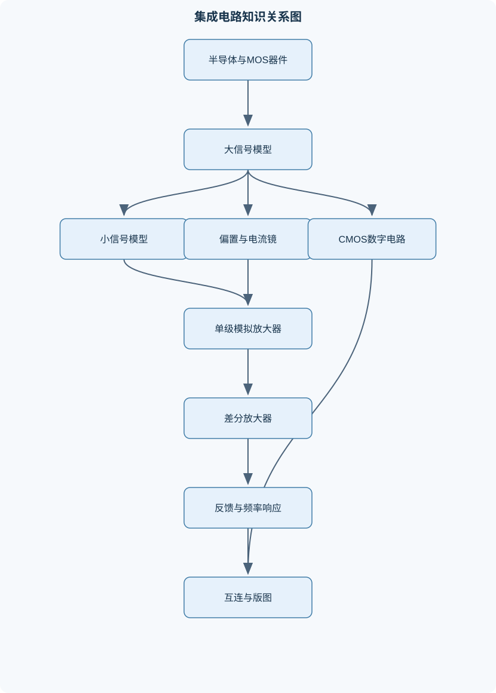
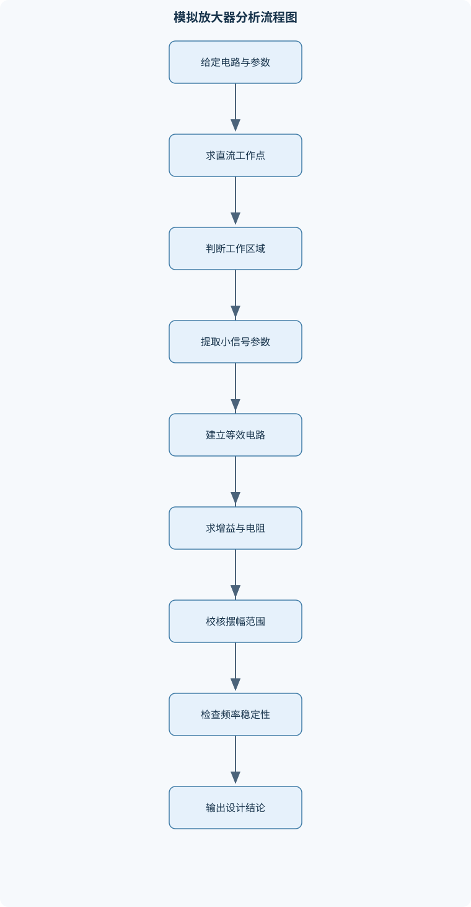

# 集成电路原理与设计

## 一、课程整体知识框架

### 课程边界与先修知识

本课程研究以MOS晶体管为核心器件的集成电路原理、建模、分析、设计与版图寄生影响，覆盖器件直流特性、小信号模型、单级模拟放大器、电流源与电流镜、差分放大器、频率响应与稳定性、CMOS组合逻辑、互连延迟及版图相关效应。课程重点是从工艺参数和电路拓扑出发，判断晶体管工作区，建立大信号或小信号模型，求解静态工作点、增益、输出电阻、摆幅、噪声容限、功耗和速度等指标。先修知识包括高等数学、大学物理、电路理论、模拟电子技术、半导体物理基础，以及复数、微分方程和基本数值计算。理想模型用于手算和结构理解，实际设计还必须考虑体效应、沟道长度调制、迁移率退化、寄生电容、失配、工艺角、温度和版图寄生参数。





### 1. 研究对象、统一符号与分析层次

《集成电路原理与设计》以互补金属氧化物半导体（CMOS）工艺中的 NMOS 和 PMOS 为核心器件，研究从半导体物理、晶体管模型到模拟与数字集成电路、互连版图及后仿真的完整链路。电路分析必须区分三个层次：

1. **大信号直流层次**：用于确定静态工作点、判断截止区、三极管区和饱和区，并计算支路电流、节点电压、输出摆幅及功耗。
2. **小信号层次**：在已确定的直流工作点附近线性化器件，用于求跨导、输出电阻、电压增益、极点、零点和噪声敏感性。
3. **版图与寄生层次**：把有效沟道尺寸、扩散区、接触孔、金属互连及寄生电容电阻纳入模型，检验原理图设计在实际版图后的性能。

NMOS 的基本电压定义为 $V_{GS}=V_G-V_S$、$V_{DS}=V_D-V_S$、$V_{SB}=V_S-V_B$；PMOS 为避免符号混乱，常使用正值量 $V_{SG}=V_S-V_G$ 和 $V_{SD}=V_S-V_D$，并以 $|V_T|$ 表示阈值电压绝对值。$V_T$ 的单位为 V，$W$、$L$ 为有效沟道宽度和长度，通常以 $\mu\text{m}$ 表示；$\mu_n$、$\mu_p$ 的单位为 $\text{m}^2/(\text{V}\cdot\text{s})$，$C_{ox}$ 的单位为 F/m²，$K_n'=\mu_nC_{ox}$、$K_p'=\mu_pC_{ox}$ 的单位为 A/V²。电流 $I_D$ 的符号必须在同一推导中保持一致；对 PMOS 可统一采用电流绝对值。

### 2. 半导体、MOS 电容与阈值电压

MOS 器件由金属栅、氧化层和半导体构成。栅压变化依次引起积累、耗尽和反型。以 NMOS 为例，当栅源电压达到足以形成电子反型层的条件时，源漏之间出现可控导电沟道。长沟道、强反型近似下，NMOS 导通的基本条件为

$$
V_{GS}>V_T.
$$

当源体电压不为零时，源体结反偏会使耗尽层加宽，阈值电压升高：

$$
V_T=V_{T0}+\gamma
\left[
\sqrt{2|\Phi_F|+V_{SB}}-\sqrt{2|\Phi_F|}
\right].
$$

其中，$V_{T0}$ 是 $V_{SB}=0$ 时的阈值电压，$\gamma$ 的单位通常为 $\text{V}^{1/2}$ 的倒数，$2|\Phi_F|$ 为表面势相关参数。该公式要求源体结保持反偏；若体端电压导致结正偏，简单体效应公式不再适用，并可能产生结注入和可靠性问题。

增强型器件在零栅压时截止，必须施加超过阈值的栅压才能形成反型沟道；耗尽型器件在零栅压下已有沟道，栅压可使其耗尽。现代数字 CMOS 主要使用增强型器件。NMOS 主要传输低电平，PMOS 主要传输高电平，这是由其载流子类型、体端连接和阈值方向共同决定的，而不是绝对的开关定律。

### 3. MOS 大信号模型与工作区判定

对 NMOS，定义过驱动电压 $V_{OV}=V_{GS}-V_T$。在长沟道、强反型、忽略沟道长度调制和迁移率退化的条件下：

- 截止区：$V_{GS}\leq V_T$，理想模型中 $I_D\approx0$；
- 三极管区：$V_{GS}>V_T$ 且 $0\leq V_{DS}<V_{OV}$；
- 饱和区：$V_{GS}>V_T$ 且 $V_{DS}\geq V_{OV}$。

三极管区电流为

$$
I_D=K_n'\frac WL
\left[
(V_{GS}-V_T)V_{DS}-\frac{V_{DS}^2}{2}
\right].
$$

饱和区平方律模型为

$$
I_D=\frac12K_n'\frac WL(V_{GS}-V_T)^2.
$$

考虑沟道长度调制后，可写为

$$
I_D\approx
\frac12K_n'\frac WL(V_{GS}-V_T)^2(1+\lambda V_{DS}),
$$

其中 $\lambda$ 的单位为 V⁻¹。该修正说明饱和区电流并非完全恒定，$V_{DS}$ 增大时电流仍上升。短沟道器件还会出现速度饱和、迁移率退化、阈值滚降和漏致势垒降低，此时平方律模型只能作定性或初步估算。

PMOS 可使用 $V_{SG}$、$V_{SD}$ 和 $|V_T|$ 写成同样结构的绝对值公式。直接把带符号的 NMOS 公式套用于 PMOS，容易同时错误处理电流方向和阈值符号。

多个相同栅压、相同源体偏置且工作条件近似一致的并联 MOS，可用宽度相加的器件近似：

$$
W_{\text{eq}}=\sum_iW_i.
$$

两个相同宽度、串联且电流连续的长沟道 MOS，在适当的线性区近似下，可等效为沟道长度为 $L_1+L_2$ 的器件。推导时必须分别写出两个线性区电流方程，通过中间节点电压消元；若栅压不同、器件进入饱和区或短沟道效应显著，该等效关系不能直接使用。

### 4. 小信号模型、跨导与寄生电容

小信号模型是对非线性电流方程在直流工作点处作一阶泰勒展开。例如饱和区平方律模型的跨导为

$$
g_m=\left.\frac{\partial I_D}{\partial V_{GS}}\right|_{V_{DS},V_{SB}}
=K_n'\frac WL(V_{GS}-V_T)
=\frac{2I_D}{V_{OV}}
=\sqrt{2K_n'\frac WL I_D}.
$$

$g_m$ 的单位为 S。该结果依赖强反型长沟道平方律模型；若考虑速度饱和或迁移率退化，$g_m$ 与电流的关系需要采用实际模型重新求导。

体效应跨导 $g_{mb}$ 描述源体电压变化对漏电流的影响，输出电导为

$$
g_{ds}=\left.\frac{\partial I_D}{\partial V_{DS}}\right|_{V_{GS},V_{SB}},
\qquad
r_o=\frac1{g_{ds}}.
$$

一阶沟道长度调制模型下，

$$
g_{ds}\approx\lambda I_D,\qquad
r_o\approx\frac1{\lambda I_D}.
$$

栅源电容 $C_{gs}$、栅漏电容 $C_{gd}$、栅衬底电容 $C_{gb}$ 取决于工作区；漏体结电容 $C_{db}$ 和源体结电容 $C_{sb}$ 与结面积、侧墙周长和反偏电压有关。重叠电容来自栅极与源漏扩散区的几何交叠。不能在所有工作区使用同一组固定电容，因为反型层在饱和区向漏端夹断，电容分配会改变。

### 5. 模拟基本单元

共源级将栅极输入转换为漏极电流，输出电压相位反转。忽略 $r_o$、体效应和负载反馈时，

$$
A_v\approx-g_mR_D.
$$

若源极有未旁路电阻 $R_S$，则局部负反馈降低增益：

$$
A_v\approx-\frac{g_mR_D}{1+g_mR_S}.
$$

实际计算应将 $r_o$、负载电阻和负载电容并入输出节点等效阻抗。源极跟随器的增益通常小于 1：

$$
A_v\approx\frac{g_mR}{1+g_mR},
$$

其中 $R$ 是源端看到的等效电阻；$g_{mb}$ 和 $r_o$ 会进一步降低增益。共栅级具有低输入电阻和较好的高频特性，适合电流缓冲、级联和宽带结构。

电流镜利用相同栅源电压建立输出电流。忽略沟道长度调制和失配时，

$$
\frac{I_O}{I_{\text{REF}}}
\approx
\frac{(W/L)_O}{(W/L)_{\text{REF}}}.
$$

实际误差来自 $V_{DS}$ 不同、$\lambda$、体效应、阈值失配、有限输出电阻和温度变化。共源共栅镜通过提高输出电阻改善电流稳定性，但需要更大的最小输出电压，即合规范围变差。威尔逊镜利用反馈降低输出电流对输出电压的敏感性，但器件数量、压降和启动条件更复杂。任何自偏置镜都必须检查启动路径，否则可能停留在零电流状态。

差分对把两个输入电压的差转换为电流差。定义

$$
V_{IC}=\frac{V_1+V_2}{2},\qquad V_{id}=V_1-V_2.
$$

对称、理想尾电流源的 NMOS 差分对在 $V_{id}=0$ 时两支路电流约为 $I_{SS}/2$。小差分输入下，双端差分跨导约为 $g_m$，单端输出跨导约为 $g_m/2$。当输入差分电压较大时，一支管电流趋近 $I_{SS}$，另一支趋近零，线性近似失效。

共模输入范围必须同时满足输入管、尾电流源、负载管以及级联管的饱和条件。求解步骤是分别写出每个器件的饱和不等式，得到所有下限和上限，再取下限最大值与上限最小值。只检查输入差分对会高估实际共模范围。

### 6. 运算放大器、频率响应与反馈

两级运算放大器通常由高跨导输入级和高增益输出级构成。总低频增益近似为各级增益乘积，但级间节点会产生多个极点。米勒补偿电容连接高增益节点后，因两端电压反向变化形成等效电容放大，使主极点下降，并常使单位增益带宽近似受

$$
\omega_u\approx\frac{g_{m1}}{C_C}
$$

控制。实际电路还要检查非主极点、补偿电容引入的零点、负载电容和输出级跨导。米勒结构可能引入右半平面零点，造成相位滞后；可通过串联电阻移动或消除该零点。

环路增益为

$$
T(s)=A(s)\beta(s),
$$

其中 $A(s)$ 为前向增益，$\beta(s)$ 为反馈因子。单位增益交越频率处的相位裕度为

$$
PM=180^\circ+\angle T(j\omega_u).
$$

增益裕度在相位达到 $-180^\circ$ 时测量。相位裕度不足时，阶跃响应会出现过冲、振铃甚至振荡。压摆率由内部最大充放电电流和补偿电容决定，属于大信号指标，不能用小信号带宽替代。输入失调、输入偏置电流和负载电容共同决定直流精度与动态稳定性。

### 7. CMOS 数字逻辑、互连与版图

CMOS 反相器由 PMOS 上拉网络和 NMOS 下拉网络组成。输入低时 PMOS 导通、NMOS 截止，输出接近 $V_{DD}$；输入高时情况相反，输出接近 $V_{SS}$。翻转点 $V_M$ 由两管在同一输出电压下的电流相等条件确定。静态噪声容限为

$$
NM_H=V_{OH}-V_{IH},\qquad
NM_L=V_{IL}-V_{OL}.
$$

其中 $V_{IL}$、$V_{IH}$ 通常由电压传输曲线斜率为 $-1$ 的位置确定。噪声容限不能简单取为电源电压的一半。理想稳定态 CMOS 的静态功耗接近零，但泄漏电流和输入转换期间的短路电流使实际静态功耗不为零。动态功耗近似为

$$
P_{\text{dyn}}\approx\alpha C_LV_{DD}^2f,
$$

其中 $\alpha$ 为翻转活动因子，$C_L$ 为负载电容，$f$ 为工作频率。

复杂 CMOS 门由互补的 P 网络和 N 网络构成：N 网络在输入条件满足下拉逻辑时导通，P 网络取其对偶结构。串联晶体管增加等效电阻，导致速度下降；并联晶体管增加驱动能力但会增大扩散电容。扇出、互连电容和晶体管尺寸共同决定传播延迟。逻辑努力用于比较不同拓扑的驱动难度，但不能替代具体工艺下的寄生提取。

版图中栅与扩散区交叠形成晶体管，扩散区、接触孔和金属层决定源漏及电源连接。有效沟道长度不一定等于版图标称长度，侧向扩散、刻蚀偏差、折叠结构和共享扩散区都会影响实际参数。互连电阻为

$$
R=R_{\square}\frac LW,
$$

其中 $R_{\square}$ 的单位为 $\Omega/\square$，$L$ 和 $W$ 必须使用相同单位。长互连应使用分段 $RC$ 模型；Elmore 延迟可估算为

$$
\tau\approx\sum_iR_iC_{\text{downstream},i}.
$$

集中 $RC$ 模型适合短互连和初步估算，不能准确描述长线分布效应。

### 8. 集成设计闭环

设计流程由指标分解开始：把总增益、带宽、噪声、摆幅、功耗、面积和速度分配到各级。随后选择拓扑，建立直流工作点，检查所有 MOS 的工作区，再求小信号增益、输出电阻和极点。模拟设计必须同时验证输入共模范围、输出摆幅、负载能力、工艺角、温度变化和器件失配；数字设计还必须验证逻辑电平、噪声容限、延迟、功耗和扇出。

原理图仿真通过后，进行版图设计、设计规则检查、连接一致性检查和寄生参数提取。版图后仿真应重新检查直流工作点、增益、带宽、相位裕度、延迟、功耗和摆幅。若指标不闭合，应定位是拓扑、尺寸、偏置、补偿还是版图寄生造成，而不能只调整单个晶体管尺寸。模拟与数字接口还必须检查电平兼容性、输入电容、输出驱动、转换速率和电源噪声耦合。

## 二、章节和模块划分

### 核心知识覆盖清单

本清单用于检查正文是否覆盖本课程的主要知识模块：

- **半导体与MOS器件基础**：PN结与MOS电容、反型层形成条件、阈值电压定义、体效应与衬底偏置、NMOS与PMOS极性约定、增强型与耗尽型器件、跨导与输出电导、沟道长度调制、迁移率与工艺参数、器件工作区判定。
- **MOS晶体管大信号模型**：截止区电流模型、三极管区电流模型、饱和区平方律模型、源漏电压的统一定义、体效应阈值修正、沟道长度调制修正、PMOS绝对值写法、有效沟道长度、串联MOS等效模型、并联MOS等效模型。
- **MOS小信号模型与寄生电容**：小信号线性化方法、跨导gm推导、体效应跨导gmb、输出电导gds、输出电阻ro、栅源电容Cgs、栅漏电容Cgd、栅衬底电容Cgb、结电容与重叠电容、工作区相关电容模型。
- **单级MOS放大器**：共源放大器、共漏源极跟随器、共栅放大器、电阻负载共源级、有源负载共源级、源极退化、小信号电压增益、输入电阻与输出电阻、输出摆幅限制、增益与静态功耗权衡。
- **偏置电路与电流镜**：MOS恒流源条件、基本电流镜、比例电流镜、威尔逊电流镜原理、共源共栅电流镜、镜像误差来源、输出电阻提高方法、最小输出电压、电流镜启动与合规范围、电流源的工艺和温度敏感性。
- **差分放大器**：差分对大信号特性、尾电流源、差分跨导、共模输入范围、差模增益、共模增益、共模抑制比、有源负载差分对、折叠式共源共栅结构、输出摆幅与输入失调。
- **运算放大器基本结构**：两级运算放大器、折叠式共源共栅放大器、第一级跨导、第二级电压增益、米勒补偿、单位增益带宽、相位裕度、压摆率、输入失调与偏置电流、稳定性与负载电容。
- **频率响应与反馈稳定性**：极点与零点、节点时间常数法、主极点近似、多极点增益模型、环路增益、反馈因子、增益裕度、相位裕度、米勒效应、补偿网络设计。
- **CMOS数字电路基础**：CMOS反相器结构、电压传输特性、翻转电压、上升与下降噪声容限、静态功耗、动态功耗、传播延迟、尺寸比设计、串联与并联晶体管网络、短路电流与泄漏电流。
- **组合逻辑与时序性能**：N网络与P网络互补构造、CMOS与非门、CMOS或非门、复杂门设计、逻辑努力思想、扇出与负载电容、最小尺寸与驱动尺寸、级联缓冲器、动态逻辑基本概念、逻辑电路功耗速度权衡。
- **互连、版图与寄生效应**：设计规则与层次结构、晶体管版图对应关系、源漏扩散区、接触孔与金属互连、方块电阻、互连电容、分段L模型、分段π模型、RC延迟估算、版图寄生对增益和速度的影响。
- **集成电路设计综合**：指标分解与拓扑选择、静态工作点设计、增益和带宽分配、摆幅和共模范围校核、功耗预算、工艺角分析、器件失配分析、版图后仿真思路、设计约束闭合、模拟与数字接口边界。


### 1. 课程模块组织

| 模块 | 核心内容 | 主要输出 |
|---|---|---|
| 半导体与 MOS 器件基础 | PN 结、MOS 电容、反型、阈值、体效应、NMOS/PMOS 极性 | 工作区判断与参数定义 |
| 大信号模型 | 截止、三极管、饱和、沟道长度调制、串并联等效 | 直流电流与节点电压 |
| 小信号模型 | $g_m$、$g_{mb}$、$g_{ds}$、$r_o$、各类寄生电容 | 增益、极点、输出电阻 |
| 模拟基本单元 | 共源、共栅、共漏、源极退化、电流镜、差分对 | 增益、摆幅、偏置和线性度 |
| 运算放大器与稳定性 | 两级结构、折叠共源共栅、米勒补偿、相位裕度、压摆率 | 开环增益、带宽、稳定性 |
| CMOS 数字逻辑 | 反相器、与非门、或非门、复杂门、噪声容限、动态功耗 | 电压传输特性、延迟和功耗 |
| 互连与版图 | 设计规则、扩散、接触孔、金属、分布 $RC$、寄生提取 | 版图后性能与连接核对 |
| 综合设计 | 指标分解、工艺角、失配、后仿真、设计约束闭合 | 可验收的完整设计结果 |

### 2. 代表性算法与流程

#### 2.1 MOS 工作区判定算法

**输入**：$V_G,V_D,V_S,V_B,V_T$、器件类型。  
**输出**：截止区、三极管区或饱和区，以及可用电流公式。

1. NMOS 计算 $V_{GS}=V_G-V_S$、$V_{DS}=V_D-V_S$、$V_{SB}=V_S-V_B$；PMOS 计算 $V_{SG}$、$V_{SD}$。
2. 根据 $V_{SB}$ 修正阈值。
3. 若 NMOS 满足 $V_{GS}\leq V_T$，判为截止；PMOS 若 $V_{SG}\leq|V_T|$，判为截止。
4. 对导通器件比较 $V_{DS}$ 与 $V_{GS}-V_T$，或比较 $V_{SD}$ 与 $V_{SG}-|V_T|$。
5. 代入相应区域电流模型，并检查电流方向及功率是否合理。

该流程每个器件的计算量为 $O(1)$，适用于长沟道准静态模型。仅判断 $V_{GS}>V_T$ 而不比较漏源电压，会把三极管区错误判为饱和区。

#### 2.2 直流工作点与小信号分析流程

**输入**：电源、器件尺寸、模型参数、偏置网络和负载。  
**输出**：各节点直流电压、支路电流、小信号参数、增益和极点。

1. 先假设每个器件工作区。
2. 写出每个器件电流方程和各节点 KCL。
3. 求解节点电压和支路电流。
4. 将解代回所有工作区不等式；不满足时切换模型重新求解。
5. 在稳定工作点处计算 $g_m,g_{mb},g_{ds},r_o$ 和寄生电容。
6. 将独立直流电压源置零、独立电流源置零，列写小信号 KCL。
7. 求 $A_v=v_o/v_i$、$R_{in}$、$R_{out}$ 及极点。

线性方程可用高斯消元；含非线性 MOS 方程时通常使用牛顿迭代，规模为 $n$ 的一次线性化求解约为 $O(n^3)$。小信号模型不能用于大输入切换和截止—导通转换。

#### 2.3 反馈稳定性分析流程

**输入**：开环传递函数 $A(s)$、反馈因子 $\beta$、负载条件。  
**输出**：单位增益频率、相位裕度、增益裕度和补偿修改方向。

1. 构造 $T(s)=A(s)\beta(s)$。
2. 列出所有重要极点、零点及其近似位置。
3. 求 $|T(j\omega)|=1$ 的交越频率。
4. 计算 $PM=180^\circ+\angle T(j\omega)$。
5. 在相位达到 $-180^\circ$ 时读取增益裕度。
6. 若相位裕度不足，降低非主极点影响、调整补偿电容或处理补偿零点。
7. 重新检查负载变化和工艺角。

该流程适用于线性小信号稳定性，不能替代大信号阶跃、压摆率和恢复时间验证。

#### 2.4 互连 RC 延迟流程

**输入**：互连长度、宽度、$R_{\square}$、单位长度电容和分段数 $N$。  
**输出**：总电阻、总电容、等效延迟和关键节点时间常数。

1. 计算 $R=R_{\square}L/W$ 和总电容 $C=c_L L$。
2. 将互连均匀划分为 $N$ 段。
3. 构造分段 $L$ 模型或 $\pi$ 模型。
4. 对每段累加 $R_i$ 与下游电容的乘积。
5. 比较集中模型与分布模型结果。

计算复杂度为 $O(N)$。该方法适用于线性 $RC$ 网络和单调充放电；若包含电感、非单调驱动或强电源耦合，应使用更完整的瞬态模型。

#### 2.5 可执行的工作区判定伪代码

```python
def mos_region(device, vg, vd, vs, vb, vt):
    """
    输入电压单位为 V；输出器件工作区字符串。
    这里采用长沟道、准静态、无复杂短沟道效应的判据。
    """
    if device == "NMOS":
        vgs = vg - vs
        vds = vd - vs
        if vgs <= vt:
            return "截止"
        if vds < vgs - vt:
            return "三极管区"
        return "饱和区"

    if device == "PMOS":
        vsg = vs - vg
        vsd = vs - vd
        if vsg <= abs(vt):
            return "截止"
        if vsd < vsg - abs(vt):
            return "三极管区"
        return "饱和区"

    raise ValueError("device must be NMOS or PMOS")
```

### 3. 代表性例题

#### 例题一：判断 NMOS 工作区并求电流

**题干**：某 NMOS 的 $V_T=0.5\text{ V}$，$V_{GS}=1.2\text{ V}$，$V_{DS}=0.3\text{ V}$。判断工作区。

**分析**：$V_{OV}=1.2-0.5=0.7\text{ V}$。比较 $V_{DS}$ 与 $V_{OV}$。

**解答**：由于 $0.3<0.7$，器件处于三极管区，应使用

$$
I_D=K_n'\frac WL(0.7\times0.3-\frac{0.3^2}{2}).
$$

括号内电压平方单位为 V²，乘以 $K_n'W/L$ 后得到 A。

**结果验证**：器件已经导通，且漏源电压低于饱和边界，判定一致。若把 $V_{DS}$ 改为 $0.8\text{ V}$，则进入饱和区，必须改用平方律模型。

#### 例题二：考虑体效应的源极电压

**题干**：NMOS 的 $V_{T0}=0.6\text{ V}$，$\gamma=0.4\text{ V}^{1/2}$，$2|\Phi_F|=0.64\text{ V}$，$V_{SB}=0.36\text{ V}$。求阈值电压。

**解答**：

$$
V_T=0.6+0.4[\sqrt{1.00}-\sqrt{0.64}]
=0.6+0.4(1-0.8)=0.68\text{ V}.
$$

若 $V_{GS}=0.65\text{ V}$，则 $V_{GS}<V_T$，器件截止，理想小信号导通电阻趋于无穷大。

**结果验证**：源极相对体端升高，阈值从 $0.6\text{ V}$ 增至 $0.68\text{ V}$，符合体效应方向。若源体结正偏，不能继续套用该公式。

#### 例题三：共源级增益

**题干**：共源级的 $g_m=2\text{ mS}$，$R_D=5\text{ k}\Omega$，忽略 $r_o$。求电压增益；若加入 $R_S=500\Omega$，重新计算。

**解答**：无源极退化时

$$
A_v=-g_mR_D=-(2\times10^{-3})(5\times10^3)=-10.
$$

有源极退化时

$$
A_v=-\frac{g_mR_D}{1+g_mR_S}
=-\frac{10}{1+1}=-5.
$$

**结果验证**：退化电阻引入负反馈，增益绝对值降低，但线性度和对器件参数的稳定性通常提高。若 $R_S$ 被旁路，交流增益会重新接近无退化结果，但旁路电容又会引入新的低频极点。

#### 例题四：比例电流镜

**题干**：参考管 $(W/L)_{\text{REF}}=10$，输出管 $(W/L)_O=40$，参考电流为 $20\ \mu\text{A}$。忽略 $\lambda$、体效应和失配，求输出电流。

**解答**：

$$
I_O=I_{\text{REF}}
\frac{(W/L)_O}{(W/L)_{\text{REF}}}
=20\ \mu\text{A}\times4=80\ \mu\text{A}.
$$

输出管还必须满足饱和条件：

$$
V_{DS,O}\geq V_{OV,O}.
$$

**结果验证**：若输出端电压低于该最小值，输出管进入三极管区，电流将受输出电压限制，不再等于 $80\ \mu\text{A}$。加入 $\lambda$ 后，参考管和输出管的 $V_{DS}$ 不同会产生镜像误差。

#### 例题五：差分对跨导与输出

**题干**：对称 NMOS 差分对尾电流 $I_{SS}=1\text{ mA}$，静态时两管各有 $0.5\text{ mA}$，每管 $g_m=4\text{ mS}$。求单端和双端差分跨导。

**解答**：小差分输入下，一支管电流增加、另一支减少。单端输出只观察一支管，故

$$
G_{m,\text{single}}\approx\frac{g_m}{2}=2\text{ mS}.
$$

双端输出为两支路电流差，变化量相加：

$$
G_{m,\text{double}}\approx g_m=4\text{ mS}.
$$

**结果验证**：若题目只给一个输出节点，应使用单端结果；若取两个漏端电压之差，应使用双端结果。大差分输入时其中一支管接近截止，上述线性结果失效。

### 4. 实验与项目

#### 4.1 MOS 直流—小信号特性实验

**输入数据**：器件的 $W/L$、$K_n'$、$V_{T0}$、$\lambda$、体端电压扫描范围及电源电压。  
**步骤**：

1. 扫描 $V_{GS}$，记录 $I_D$，绘制转移特性。
2. 在多个固定 $V_{GS}$ 下扫描 $V_{DS}$，绘制输出特性。
3. 根据 $V_{DS}=V_{GS}-V_T$ 标出饱和边界。
4. 从曲线斜率提取 $g_m$ 和 $g_{ds}$。
5. 改变 $V_{SB}$，验证体效应。
6. 比较理想平方律与实际模型的偏差。

**评价标准**：工作区边界方向正确；$I_D$、$g_m$、$r_o$ 单位一致；体效应导致阈值升高的趋势正确；偏差能归因于沟道长度调制、迁移率退化或短沟道效应。  
**排错方法**：若电流方向异常，先检查 PMOS 符号和源漏定义；若阈值变化方向异常，检查体端是否真正连接；若电流随 $V_{DS}$ 完全不变，检查是否误用了理想饱和模型。

#### 4.2 CMOS 反相器与版图后仿真项目

**输入数据**：$V_{DD}$、NMOS/PMOS 尺寸、阈值参数、负载电容、版图设计规则和互连参数。  
**步骤**：

1. 根据 P 网络和 N 网络绘制原理图。
2. 扫描输入电压，得到 $V_{out}$—$V_{in}$ 曲线。
3. 提取 $V_{OH}$、$V_{OL}$、$V_{IL}$、$V_{IH}$，计算 $NM_H$ 和 $NM_L$。
4. 对输入阶跃，测量上升延迟、下降延迟和短路电流。
5. 绘制版图，核对扩散、栅、接触孔、体端和金属连接。
6. 提取寄生电阻电容，重新进行后仿真。
7. 比较原理图与版图后结果。

**评价标准**：逻辑功能正确；高低电平满足噪声容限要求；上升、下降延迟符合目标；版图与原理图连接一致；后仿真性能变化能由寄生参数解释。  
**排错方法**：输出无法到达电源轨时检查 PMOS/NMOS 体端；逻辑反相错误时检查 P、N 网络是否互补；后仿真明显变慢时检查长金属、共享扩散区和大面积接触造成的寄生；连接不一致时逐个核对扩散区切分和金属层跨接。

### 5. 易错点、笔试题与面试题

#### 5.1 具体易错点

1. 只看 $V_{GS}>V_T$，不检查饱和边界。
2. 把 PMOS 直接套用 NMOS 的带符号公式。
3. 源极抬高后仍使用 $V_{T0}$，忽略体效应。
4. 将饱和区误认为电流完全不随 $V_{DS}$ 变化。
5. 混淆 $g_m$、$g_{mb}$ 和 $g_{ds}$。
6. 用小信号模型分析大输入摆幅。
7. 忽略 $r_o$ 却又讨论高增益和电流镜误差。
8. 混淆差分对单端和双端跨导。
9. 只检查输入管，不检查差分对尾管和负载管。
10. 把米勒电容只看成普通并联电容。
11. 用噪声容限等于 $V_{DD}/2$ 的错误近似。
12. 将静态功耗和动态功耗混为一谈。
13. 用标称 $W/L$ 替代有效 $W/L$。
14. 用单个集中 $RC$ 模型估算很长的互连。
15. 原理图通过后不进行体端、共享扩散区和寄生核对。
16. 在同一推导中混用电流正方向和绝对值电流。

#### 5.2 典型笔试问题与解答思路

1. **推导饱和区 $g_m$。**  
   从 $I_D=\frac12K'(W/L)V_{OV}^2$ 对 $V_{GS}$ 求偏导，得到 $g_m=K'(W/L)V_{OV}=2I_D/V_{OV}$，并说明强反型长沟道假设。

2. **说明沟道长度调制对共源增益的影响。**  
   由 $r_o\approx1/(\lambda I_D)$，得到 $A_v\approx-g_m(R_D\parallel r_o)$；$\lambda$ 增大或电流增大都会降低 $r_o$ 和增益。

3. **比较共源、共栅和共漏级。**  
   共源电压增益高且反相；共栅输入电阻低、带宽较好；共漏增益接近 1、输出电阻低，适合缓冲。

4. **推导源极退化对增益的影响。**  
   写小信号源极电压 $v_s=i_dR_S$，再由 $v_{gs}=v_i-v_s$ 列方程，得到负反馈因子 $1+g_mR_S$。

5. **解释共模输入范围的求法。**  
   分别列出输入管、尾管、负载管和级联管饱和不等式，所有下限取最大值，所有上限取最小值。

6. **说明米勒补偿为什么提高稳定性。**  
   补偿电容在高增益节点产生等效电容放大，使主极点下降；但需检查非主极点和右半平面零点。

7. **推导 CMOS 反相器噪声容限。**  
   由电压传输曲线斜率为 $-1$ 确定 $V_{IL}$ 和 $V_{IH}$，再由 $NM_L=V_{IL}-V_{OL}$、$NM_H=V_{OH}-V_{IH}$ 求得。

8. **估算分布互连延迟。**  
   先求 $R_{\square}L/W$ 和单位长度电容，再分段，使用 $\sum R_iC_{\text{downstream},i}$ 计算 Elmore 延迟。

#### 5.3 典型面试问题与回答要点

1. **为什么 PMOS 通常比 NMOS 做得更宽？**  
   空穴迁移率通常低于电子迁移率。为获得接近的上拉、下拉能力，PMOS 需要更大的 $W/L$。追问时应说明实际尺寸还受电容、面积和工艺模型影响。

2. **如何提高电流镜输出电阻？**  
   使用共源共栅、威尔逊结构或增益增强反馈。追问应说明输出电阻提高通常伴随输出合规电压降低、面积和功耗增加。

3. **如何判断一个模拟节点是否可能成为主极点？**  
   比较节点等效电阻与等效电容，时间常数较大的高阻大电容节点更可能形成低频极点。追问时应区分米勒放大后的等效电容。

4. **相位裕度不足会出现什么现象？**  
   闭环阶跃响应过冲、振铃，严重时振荡。追问时应说明负载电容、输出极点和补偿零点会随工艺与负载改变。

5. **为什么差分对能抑制共模干扰？**  
   对称结构使共模输入引起的两支路变化相近，在差分输出中相互抵消；实际失配和有限尾电阻会产生共模增益。追问应涉及 CMRR 和版图对称性。

6. **如何解释版图后增益下降？**  
   寄生电容增大使极点下降，串联互连电阻降低有效驱动，寄生反馈改变节点阻抗，器件有效尺寸和体端连接也可能改变工作点。验收时要用寄生提取结果逐项对应。

7. **动态功耗如何降低？**  
   降低 $V_{DD}$、负载电容、翻转活动因子或工作频率。追问时应说明降低电压会影响噪声容限、速度和模拟摆幅，不能孤立优化。

8. **设计一个两级运算放大器首先确定什么？**  
   首先分解增益、带宽、负载、功耗和摆幅指标，再确定输入级跨导、第二级增益、补偿电容和偏置电流。追问应说明最终必须进行工艺角、温度、失配和版图后验证。

### 6. 岗位关联与验收产出

#### 6.1 模拟集成电路设计工程师

实际任务包括放大器、电流镜、差分输入级、运算放大器和电源管理模块设计。使用直流模型、小信号模型、反馈稳定性、噪声容限和工艺角分析。产出包括原理图、仿真数据、尺寸表、指标预算和版图后报告。验收标准是工作点正确、增益带宽稳定、摆幅和功耗满足约束，并在工艺角和温度范围内闭合。

#### 6.2 数字与混合信号设计工程师

实际任务包括 CMOS 组合逻辑、缓冲器、接口电平转换和模拟—数字边界电路。使用反相器传输特性、逻辑努力、扇出、噪声容限、动态功耗和互连延迟。产出包括逻辑原理图、时序与功耗报告、接口约束和验证结果。验收标准是逻辑功能无误、延迟和噪声容限达标，并能承受规定负载与电源变化。

#### 6.3 版图与后仿真工程师

实际任务包括晶体管版图、匹配布局、体端连接、寄生提取和版图后性能分析。使用有效 $W/L$、共享扩散区、方块电阻、互连 $RC$ 和版图寄生影响知识。产出包括版图、连接核对结果、寄生网表和前后仿真对比。验收标准是设计规则和连接一致性检查通过，关键性能退化可解释，且无未处理的体端、浮置扩散和电源极性错误。

#### 6.4 器件建模、验证与可靠性工程师

实际任务包括模型参数提取、工作区边界验证、温度与工艺角分析、失配及失效原因定位。使用阈值、迁移率、沟道长度调制、结电容、泄漏和安全工作区知识。产出包括模型卡、参数扫描、异常波形分析和可靠性报告。验收标准是模型在规定电压、温度和尺寸范围内与测试或参考结果一致，异常能够通过物理机制解释，而不是仅用经验拟合掩盖。

## 三、核心概念的详细解释

### 3.1 从器件物理到电路模型的分析层次

MOS 集成电路分析应按“器件结构—大信号工作点—小信号参数—频率与寄生—版图后效应”逐层进行。器件的端电压先决定反型层是否形成，再决定沟道处于截止区、三极管区还是饱和区；只有工作区确定后，才能选用相应的电流公式。小信号模型不是另一套独立器件规律，而是大信号电流—电压关系在某一直流工作点附近的一阶泰勒展开。

NMOS 采用
$V_{GS}=V_G-V_S$、$V_{DS}=V_D-V_S$、$V_{SB}=V_S-V_B$。PMOS 为避免负号混乱，通常采用正值变量
$V_{SG}=V_S-V_G$、$V_{SD}=V_S-V_D$，并使用阈值绝对值 $|V_T|$。NMOS 的导通条件通常为 $V_{GS}>V_T$，PMOS 的导通条件通常为 $V_{SG}>|V_T|$。这些条件只说明形成了反型沟道，不能单独用来判断饱和区。

长沟道增强型 NMOS 在 $V_{GS}=0$ 时没有强反型沟道，称为截止。耗尽型器件在零栅压下已有沟道，但现代标准 CMOS 逻辑主要使用增强型 NMOS 和 PMOS。NMOS 与 PMOS 的体端通常分别接到最低电位和最高电位，以保持源体结、漏体结反偏；若源电位偏离体电位，阈值会因体效应改变。

### 3.2 阈值电压、体效应与工艺参数

NMOS 的阈值电压可近似写为

$$
V_T=V_{T0}+\gamma
\left[
\sqrt{2|\Phi_F|+V_{SB}}-\sqrt{2|\Phi_F|}
\right].
$$

其中，$V_{T0}$ 是 $V_{SB}=0$ 时的阈值电压，$\gamma$ 的单位通常为 $\text{V}^{1/2}$，$2|\Phi_F|$ 和 $V_{SB}$ 的单位为 V。该式要求源体结保持反偏，且 $V_{SB}\geq 0$。当源极电位高于体电位时，$V_{SB}$ 增大，耗尽层变宽，需要更高的栅压才能形成反型层，因此 $V_T$ 增大。

体效应在源极不接固定体电位的电路中尤其重要。例如源极跟随器的源极随输入升高，若体端仍接地，则 $V_{SB}$ 增大，阈值提高，导致输出电压不能简单地等于输入电压减去一个固定阈值。若源体结被正向偏置，上式不再适用，并可能产生结电流和可靠性问题。

迁移率 $\mu_n$、$\mu_p$ 分别表示电子和空穴在电场下的输运能力，单位为 $\text{m}^2/(\text{V}\cdot\text{s})$；$C_{ox}$ 是单位面积栅氧化层电容，单位为 F/m²。工艺跨导参数为

$$
K_n'=\mu_n C_{ox},\qquad K_p'=\mu_p C_{ox},
$$

单位为 A/V²。通常 $\mu_n>\mu_p$，因此在相同 $W/L$ 和过驱动电压下，NMOS 的驱动能力较强。实际短沟道器件中，迁移率会随垂直电场增强而下降，速度饱和也会使平方律模型偏离实测结果。

### 3.3 MOS 大信号模型与工作区

定义 NMOS 过驱动电压

$$
V_{OV}=V_{GS}-V_T.
$$

在长沟道、强反型、准静态条件下：

- 当 $V_{GS}\leq V_T$ 时，器件处于截止区，理想模型取 $I_D\approx0$；
- 当 $V_{GS}>V_T$ 且 $0\leq V_{DS}<V_{OV}$ 时，器件处于三极管区；
- 当 $V_{GS}>V_T$ 且 $V_{DS}\geq V_{OV}$ 时，器件处于饱和区。

三极管区电流为

$$
I_D=K_n'\frac{W}{L}
\left[
(V_{GS}-V_T)V_{DS}-\frac{V_{DS}^2}{2}
\right].
$$

该公式说明三极管区可近似看作受栅压控制的电阻，但它不是常值电阻，因为电流对 $V_{DS}$ 呈非线性。当 $V_{DS}$ 很小且远小于 $V_{OV}$ 时，

$$
I_D\approx K_n'\frac{W}{L}V_{OV}V_{DS},
$$

相应的小信号导通电阻近似为

$$
r_{\text{on}}\approx
\frac{1}{K_n'(W/L)V_{OV}}.
$$

饱和区平方律模型为

$$
I_D=\frac{1}{2}K_n'\frac{W}{L}V_{OV}^{2}.
$$

实际电路中通常加入沟道长度调制：

$$
I_D\approx
\frac{1}{2}K_n'\frac{W}{L}V_{OV}^{2}
(1+\lambda V_{DS}),
$$

其中 $\lambda$ 的单位为 V$^{-1}$。$\lambda$ 越大，饱和区电流对 $V_{DS}$ 越敏感，电流源的输出电阻越低。PMOS 可以将上述公式中的 $V_{GS}$、$V_{DS}$、$V_T$ 替换为 $V_{SG}$、$V_{SD}$、$|V_T|$，并使用电流绝对值；不能把 NMOS 的负电压直接代入而不说明电流方向。

### 3.4 小信号模型、跨导和输出电阻

设器件在某一直流工作点 $(V_{GSQ},V_{DSQ},V_{SBQ})$ 附近变化。将电流函数对各端电压作一阶展开，可得

$$
i_d=g_m v_{gs}+g_{mb}v_{bs}+g_{ds}v_{ds}.
$$

其中，$g_m$ 是跨导，单位为 S，定义为固定 $V_{DS}$ 和 $V_{SB}$ 时的

$$
g_m=\left.\frac{\partial I_D}{\partial V_{GS}}\right|_{V_{DS},V_{SB}}.
$$

对忽略沟道长度调制的饱和区平方律模型，

$$
g_m=K_n'\frac WL V_{OV}
=\frac{2I_D}{V_{OV}}
=\sqrt{2K_n'\frac WL I_D}.
$$

$g_m$ 越大，栅源小信号电压对漏极电流的控制越强，但提高 $g_m$ 往往需要更大的偏置电流或更大的器件尺寸。

体效应跨导 $g_{mb}$ 表示体端电压变化对漏极电流的影响。对于体效应公式，常见近似为

$$
g_{mb}\approx
g_m\frac{\gamma}
{2\sqrt{2|\Phi_F|+V_{SB}}}.
$$

它通常小于 $g_m$，但在源极随信号变化、体端固定的共漏级中不能忽略。输出电导定义为

$$
g_{ds}=
\left.\frac{\partial I_D}{\partial V_{DS}}\right|_{V_{GS},V_{SB}},
$$

在沟道长度调制的一阶模型下

$$
g_{ds}\approx\lambda I_D,\qquad
r_o=\frac1{g_{ds}}\approx\frac1{\lambda I_D}.
$$

若采用理想饱和模型并令 $\lambda=0$，则 $r_o$ 为无穷大；这只适合结构推导，不能用于准确估算模拟增益、镜像误差和共模增益。

### 3.5 寄生电容与频率响应

MOS 高频行为来自栅氧化层电容、源漏重叠电容和结电容。主要电容包括 $C_{gs}$、$C_{gd}$、$C_{gb}$、$C_{db}$ 和 $C_{sb}$，单位为 F。其数值与工作区有关。

在饱和区，沟道主要靠近源端，栅沟道电容常近似分配为

$$
C_{gs}\approx \frac{2}{3}WLC_{ox}+C_{gs,\text{ov}},
\qquad
C_{gd}\approx C_{gd,\text{ov}},
$$

而 $C_{gb}$ 通常较小。在线性区，沟道贯通源漏两端，常用近似是

$$
C_{gs}\approx C_{gd}\approx \frac12 WLC_{ox}
\;+\;\text{相应重叠电容}.
$$

截止区没有强反型沟道，栅与衬底之间的电容占主导，但结电容仍然存在。漏体结和源体结电容随反偏电压变化，通常包括面积结电容和侧墙结电容。折叠晶体管、共享扩散区和复杂接触结构会改变实际扩散面积与周长，不能只按原理图中的单个矩形估算。

小信号极点与节点等效电阻、电容有关。单节点近似下，

$$
\omega_p\approx\frac1{R_{\text{eq}}C_{\text{eq}}},
\qquad
f_p=\frac{\omega_p}{2\pi}.
$$

共源级中的 $C_{gd}$ 连接输入和输出节点，会产生米勒效应。若电压增益为 $A_v$，输入端等效电容近似含有

$$
C_{gd}(1-A_v).
$$

当 $A_v$ 为负且幅值较大时，输入等效电容显著增加，带宽下降。米勒电容还可能产生右半平面零点，稳定性分析必须同时考察极点和零点，不能只把它当作普通负载电容。

### 3.6 单级模拟放大器与偏置

共源级将栅极电压变化转换为漏极电流变化，再由负载电阻或有源负载转换为输出电压。若源极交流接地、忽略 $r_o$，电阻负载共源级的电压增益为

$$
A_v\approx -g_mR_D.
$$

若考虑输出电阻和负载电阻，

$$
A_v\approx -g_m
(R_D\parallel r_o\parallel R_L).
$$

源极串联未旁路电阻 $R_S$ 时，局部负反馈降低增益并改善线性度：

$$
A_v\approx
-\frac{g_mR_D}{1+g_mR_S},
$$

这是忽略 $r_o$、体效应和电容反馈的近似。若 $g_mR_S\gg1$，增益主要由电阻比决定，对晶体管参数变化较不敏感，但增益绝对值下降。

共漏级即源极跟随器，输出从源极取得。忽略体效应和 $r_o$ 时，若源端看到的等效电阻为 $R$，

$$
A_v\approx\frac{g_mR}{1+g_mR}<1.
$$

体效应会在分母中增加等效控制项，使增益进一步降低。共栅级输入从源极进入，具有较低输入电阻、较高输出电阻和不反相电压增益，常用于级联和宽带结构。

电流镜利用两个或多个晶体管的共同栅源电压复制参考电流。理想长沟道条件下，

$$
\frac{I_O}{I_{\text{REF}}}
\approx
\frac{(W/L)_O}{(W/L)_{\text{REF}}}.
$$

实际镜像误差来自沟道长度调制、$V_{DS}$ 不相等、体效应、阈值失配、迁移率变化和温度。输出端还必须满足合规电压，使输出管保持饱和；若输出电压过低，晶体管进入三极管区，电流不再近似恒定。共源共栅和威尔逊结构可以提高输出电阻，但会消耗更多电压裕量并限制输出摆幅。

### 3.7 差分放大器、运算放大器与反馈稳定性

差分对将两个输入电压的差转换成两支路电流差。定义

$$
V_{IC}=\frac{V_1+V_2}{2},\qquad
V_{id}=V_1-V_2.
$$

在对称条件、尾电流为 $I_{SS}$ 且 $V_{id}=0$ 时，两支路电流约为 $I_{SS}/2$。小差分输入下，单端输出的等效跨导约为 $g_m/2$，双端差分输出的等效跨导约为 $g_m$。若输出端有电阻负载或有源负载，则差模增益还要乘以输出等效电阻。

输入共模范围不是由输入管单独决定的。下限通常由尾电流源保持饱和所需的电压和输入管的最小栅源电压共同决定；上限还要满足输入管、负载管及级联管的饱和条件。因此应逐个写出所有器件的饱和不等式，再取下界最大值和上界最小值。有限尾电流源输出电阻会引入共模增益，使

$$
\text{CMRR}=
\left|
\frac{A_d}{A_{cm}}
\right|
$$

降低。失配会造成输入失调电压，使 $V_1=V_2$ 时输出仍不为零。

两级运算放大器通常由高跨导输入级和高增益第二级组成。若用补偿电容 $C_C$ 跨接高增益节点，米勒效应可降低主极点并提高低频增益，但会移动非主极点和零点。单位增益带宽、相位裕度、负载电容和压摆率必须一起分析。小信号稳定性不能代替大信号压摆率检查：小信号带宽描述微小正弦扰动，大信号阶跃速度还受最大充放电电流限制。

### 3.8 CMOS 逻辑、互连与版图相关效应

CMOS 反相器由上拉 PMOS 网络和下拉 NMOS 网络构成。输入低电平时，PMOS 导通、NMOS 截止，输出接近 $V_{DD}$；输入高电平时，NMOS 导通、PMOS 截止，输出接近 $V_{SS}$。稳定逻辑状态下，理想 CMOS 没有从 $V_{DD}$ 到 $V_{SS}$ 的直流通路，静态功耗接近零；实际泄漏、亚阈值电流、栅泄漏和结泄漏使静态功耗不为零。

反相器翻转点 $V_M$ 满足两管电流大小相等。翻转点附近两管通常均处于饱和或临界工作状态，但必须根据具体输入、输出电压核对工作区。噪声容限由电压传输特性斜率为 $-1$ 的两个位置确定：

$$
NM_H=V_{OH}-V_{IH},\qquad
NM_L=V_{IL}-V_{OL}.
$$

不能简单把噪声容限视为 $V_{DD}/2$。动态功耗主要来自负载电容充放电，近似为

$$
P_{\text{dyn}}\approx\alpha C_LV_{DD}^{2}f,
$$

其中 $\alpha$ 是每个时钟周期发生有效翻转的概率，$C_L$ 单位为 F，$f$ 单位为 Hz。短路功耗发生在输入转换期间两管同时部分导通，泄漏功耗则在静态或动态状态中都可能存在。

复杂 CMOS 门采用互补网络构造：NMOS 网络实现输出被拉低的条件，PMOS 网络实现其对偶条件。NMOS 串联对应逻辑“与”，NMOS 并联对应逻辑“或”；PMOS 网络必须是其互补对偶。扇出增大、互连变长或负载电容增大都会延长传播延迟。通过逐级增大的缓冲器可降低延迟，但级数过多会增加内部翻转功耗。

版图中，多晶硅与扩散区交叠形成栅；扩散区两侧可形成源和漏，实际源漏名称由电路偏置决定。版图尺寸必须转换为有效沟道 $W$、$L$，不能无条件使用标称尺寸。金属互连具有方块电阻 $R_{\square}$，总电阻为

$$
R=R_{\square}\frac{L}{W},
$$

其中 $L$、$W$ 必须使用相同长度单位。互连还具有对衬底、邻近金属及相邻层的分布电容。短互连可用集中 $RC$ 近似，长互连应采用分段 $L$ 模型或 $\pi$ 模型，以反映后端节点延迟和波形展宽。

## 四、重要定义、公式、定理和推导

### 专业审校补充：关键定义与适用边界

版图相关失配是模拟集成电路中必须单独建模的误差来源，不能用沟道长度调制或热噪声代替。对相邻且几何匹配的MOS器件，常用一阶统计模型表示阈值失配标准差σ(ΔVT)≈A_VT/√(WL)，相对电流失配还与尺寸、过驱动电压VOV和迁移率失配有关。式中W、L为有效沟道宽度和长度，单位通常为μm；A_VT是与工艺有关的失配系数，必须由工艺模型或测量给出，不能自行假定。该关系的前提是器件处于相近工作区、版图环境相似、随机失配占主导，且不包含系统性梯度、应力、温度梯度和寄生不对称。增大WL可降低随机失配，但会增加面积和寄生电容；共心布局、交叉指结构、哑单元和对称走线可减小系统性误差，却不能消除随机失配。电流镜、差分对和精密偏置电路应同时进行随机失配与最坏方向系统误差校核。


### 4.1 工作区判定与统一流程

对每个 NMOS，按以下顺序计算：

1. 求 $V_{GS}=V_G-V_S$、$V_{DS}=V_D-V_S$ 和 $V_{SB}=V_S-V_B$；
2. 根据体效应修正 $V_T$；
3. 若 $V_{GS}\leq V_T$，判为截止区；
4. 若 $V_{GS}>V_T$，比较 $V_{DS}$ 与 $V_{GS}-V_T$；
5. $V_{DS}<V_{GS}-V_T$ 为三极管区，$V_{DS}\geq V_{GS}-V_T$ 为饱和区。

对 PMOS，使用 $V_{SG}$、$V_{SD}$ 和 $|V_T|$，判断条件为：

$$
V_{SG}\leq |V_T| \Rightarrow \text{截止},
$$

$$
0\leq V_{SD}<V_{SG}-|V_T|
\Rightarrow \text{三极管区},
$$

$$
V_{SD}\geq V_{SG}-|V_T|
\Rightarrow \text{饱和区}.
$$

边界点 $V_{DS}=V_{OV}$ 或 $V_{SD}=V_{OV,p}$ 是三极管区与饱和区的连续边界。仅由 $V_{GS}>V_T$ 判断导通而不比较漏源电压，会把三极管区误判为饱和区。

### 4.2 跨导、输出电阻及模型推导

由饱和区平方律模型

$$
I_D=\frac12K_n'\frac WL(V_{GS}-V_T)^2
$$

对 $V_{GS}$ 求偏导：

$$
g_m=
\frac{\partial I_D}{\partial V_{GS}}
=K_n'\frac WL(V_{GS}-V_T).
$$

令 $V_{OV}=V_{GS}-V_T$，并由原电流式得到

$$
I_D=\frac12K_n'\frac WL V_{OV}^2,
$$

于是

$$
g_m=\frac{2I_D}{V_{OV}}
=\sqrt{2K_n'\frac WL I_D}.
$$

该推导忽略速度饱和、迁移率退化和体效应对电流表达式的直接影响，只适用于长沟道强反型饱和区。

在线性区对电流式求 $V_{DS}$ 偏导：

$$
g_{ds}
=
K_n'\frac WL
\left[
V_{GS}-V_T-V_{DS}
\right].
$$

因此

$$
r_{\text{on,small}}=\frac1{g_{ds}}.
$$

当 $V_{DS}\to V_{OV}$ 时，该长沟道线性区表达式给出 $g_{ds}\to0$，说明不能把饱和边界附近的器件继续当作普通电阻。对饱和区加入沟道长度调制：

$$
I_D=I_{D0}(1+\lambda V_{DS}),
$$

其中 $I_{D0}$ 是无沟道长度调制时的电流。求导得

$$
g_{ds}=\frac{\partial I_D}{\partial V_{DS}}
=\lambda I_{D0}
\approx\lambda I_D,
$$

因此

$$
r_o\approx\frac1{\lambda I_D}.
$$

当 $\lambda=0$ 时，模型中的 $r_o$ 为无穷大；当器件很短、速度饱和明显或接近击穿时，该一阶修正不足。

### 4.3 串联、并联 MOS 的等效关系

若两个相同宽度的 NMOS 串联，栅极偏置相同，且两管均处于适用的线性区，电流连续。设中间节点电压为 $V_X$，则

$$
I=K_n'\frac{W}{L_1}
\left[
V_{OV}(V_X-V_S)-\frac{(V_X-V_S)^2}{2}
\right],
$$

$$
I=K_n'\frac{W}{L_2}
\left[
V_{OV}(V_D-V_X)-\frac{(V_D-V_X)^2}{2}
\right].
$$

在小 $V_{DS}$ 近似下，每管电阻约为

$$
r_i\approx\frac{1}{K_n'(W/L_i)V_{OV}}
=\frac{L_i}{K_n'WV_{OV}}.
$$

串联电阻相加：

$$
r_{\text{eq}}
\approx
\frac{L_1+L_2}{K_n'WV_{OV}},
$$

这与宽度为 $W$、长度为 $L_1+L_2$ 的等效器件一致。该结论依赖相同栅压、相同体偏置、相同工艺参数以及线性区小 $V_{DS}$ 近似。不同栅压、不同阈值或强短沟道效应下不能直接套用。

若多个并联器件具有相同 $V_{GS}$、$V_{DS}$、$V_{SB}$ 和长度 $L$，各支路电流相加：

$$
I_{\text{total}}
=K_n'\frac{W_1+\cdots+W_m}{L}
F(V_{GS},V_{DS}),
$$

因此可等效为宽度 $W_{\text{eq}}=\sum W_i$ 的器件。若各管体端、源端电位不同，阈值不同，简单宽度相加会失效。

### 4.4 共源级、跟随器和差分级的推导

共源级小信号输出电流为 $g_mv_{gs}$。当源极交流接地时，输出端等效电阻为

$$
R_{\text{out}}=R_D\parallel r_o\parallel R_L.
$$

因此

$$
A_v=\frac{v_o}{v_i}
\approx-g_mR_{\text{out}}.
$$

负号表示反相。若源极电阻 $R_S$ 未旁路，源极电压随电流变化，形成负反馈。忽略 $r_o$ 和体效应时，

$$
v_{gs}=v_i-v_s,\qquad
v_s\approx g_mv_{gs}R_S.
$$

代入得

$$
v_{gs}=\frac{v_i}{1+g_mR_S},
$$

故

$$
A_v\approx-\frac{g_mR_D}{1+g_mR_S}.
$$

源极跟随器的输出满足 $v_o=v_s$。若源端等效电阻为 $R$，则

$$
g_m(v_i-v_o)=\frac{v_o}{R},
$$

解得

$$
A_v=\frac{v_o}{v_i}
=\frac{g_mR}{1+g_mR}.
$$

该值小于 1；加入 $g_{mb}$ 后，可将分母中的控制项近似改为 $1+(g_m+g_{mb})R$，所以体效应降低跟随增益。

对称 NMOS 差分对在小信号差分激励下，若尾节点近似交流地，则两支路电流变化为

$$
\Delta i_1=+\frac{g_m}{2}v_{id},
\qquad
\Delta i_2=-\frac{g_m}{2}v_{id}.
$$

单端取一支路输出时，跨导约为 $g_m/2$；双端取两支路差值时，电流差为 $g_mv_{id}$，跨导约为 $g_m$。若输出等效电阻为 $R_O$，单端差模增益近似为 $-(g_m/2)R_O$，双端差模增益幅值近似为 $g_mR_O$。大差分输入时，一支路电流会接近尾电流而另一支路趋近于零，小信号线性结果不再适用。

### 4.5 CMOS 反相器翻转点与噪声容限

在翻转点 $V_M$，NMOS 与 PMOS 的电流大小相等：

$$
I_{Dn}=I_{Dp}.
$$

若两管均采用饱和区平方律模型，并忽略沟道长度调制，则

$$
\frac12K_n'\frac{W_n}{L_n}
(V_M-V_{TN})^2
=
\frac12K_p'\frac{W_p}{L_p}
(V_{DD}-V_M-|V_{TP}|)^2.
$$

定义

$$
\beta_n=K_n'\frac{W_n}{L_n},
\qquad
\beta_p=K_p'\frac{W_p}{L_p},
$$

则取正平方根可得

$$
\sqrt{\beta_n}(V_M-V_{TN})
=
\sqrt{\beta_p}
(V_{DD}-V_M-|V_{TP}|).
$$

解得

$$
V_M=
\frac{
\sqrt{\beta_p}(V_{DD}-|V_{TP}|)
+\sqrt{\beta_n}V_{TN}
}{
\sqrt{\beta_n}+\sqrt{\beta_p}
}.
$$

该公式只是在两管均处于相应饱和或临界状态、体效应可忽略、沟道长度调制可忽略时成立。若阈值不对称、尺寸比改变或输出电压使某一管进入三极管区，必须进行分段求解。

由电压传输特性 $V_O(V_I)$ 的斜率为 $-1$ 的位置定义 $V_{IL}$ 和 $V_{IH}$。若输出高、低电平分别为 $V_{OH}$ 和 $V_{OL}$，则

$$
NM_L=V_{IL}-V_{OL},
\qquad
NM_H=V_{OH}-V_{IH}.
$$

理想情况下 $V_{OH}\approx V_{DD}$、$V_{OL}\approx V_{SS}$，但实际电路中的泄漏、有限导通电阻和负载会使输出电平偏离电源轨。

### 4.6 频率响应、米勒补偿和稳定性指标

线性反馈系统的环路增益为

$$
T(s)=A(s)\beta(s),
$$

其中 $A(s)$ 是前向增益，$\beta(s)$ 是反馈因子。单位增益交越频率 $\omega_u$ 满足

$$
|T(j\omega_u)|=1.
$$

相位裕度定义为

$$
PM=180^\circ+\angle T(j\omega_u).
$$

若单位增益处相位为 $-135^\circ$，则相位裕度为 $45^\circ$。增益裕度在相位达到 $-180^\circ$ 的频率 $\omega_{180}$ 处定义为

$$
GM=\frac1{|T(j\omega_{180})|},
$$

以分贝表示时为

$$
GM_{\text{dB}}=-20\log_{10}|T(j\omega_{180})|.
$$

两级放大器中，补偿电容 $C_C$ 跨接高增益节点和输出节点。若第二级跨导为 $g_{m2}$，常见主极点近似使单位增益带宽与第一级跨导和补偿电容相关：

$$
\omega_u\approx\frac{g_{m1}}{C_C}.
$$

具体系数取决于拓扑和反馈连接。米勒电容会将输入节点看到的电容放大，同时可能引入右半平面零点；若需要改善相位裕度，可改变补偿电容、级间跨导或加入零点抵消网络，但必须重新检查单位增益频率、非主极点和负载条件。

### 4.7 互连 RC 与版图后延迟

一段互连的总电阻为

$$
R=R_{\square}\frac{L}{W},
$$

其中 $R_{\square}$ 单位为 $\Omega/\square$，$L/W$ 是无量纲方块数。若单位长度电容为 $c'$，互连长度为 $L$，则总电容近似为

$$
C=c'L,
$$

单位分别为 F/m、m 和 F。集中模型的一阶延迟可估为

$$
\tau\approx RC.
$$

对于分段 RC 网络，Elmore 延迟近似为

$$
\tau_E\approx\sum_i R_iC_{\text{downstream},i},
$$

其中 $R_i$ 是从驱动端到第 $i$ 段的累计电阻，$C_{\text{downstream},i}$ 是该电阻之后所有节点所见的电容。分段越细，越能反映分布效应，但该近似适用于线性 RC 网络和近似单调的充放电过程；若互连电感不可忽略、边沿极快或存在显著反射，必须采用含电感的传输线模型。

版图后仿真应至少核对有效 $W/L$、源漏连接、体端连接、共享扩散区、接触孔、金属电阻、栅重叠电容以及扩散结电容。前仿真中满足的增益、极点、延迟或摆幅，可能因寄生电阻增加、节点电容增大和器件有效长度改变而退化。因而原理图设计的最终验收不能只看理想模型结果，而应在规定工艺角、温度、电源范围和版图寄生条件下重新检查工作点、增益、带宽、功耗、延迟与稳定性。

## 五、算法、流程和实现思路

### 方法与流程覆盖索引

下列方法或流程应在正文中说明输入、步骤、适用条件、结果检查和边界：

- MOS工作区判定流程：输入VG、VD、VS、VB、VT及器件类型；先计算NMOS的VGS、VDS、VSB或PMOS的VSG、VSD、VSB；若有效栅源电压不超过阈值则判为截止；否则比较VDS与VGS−VT或VSD与VSG−|VT|，小于边界为三极管区，大于或等于边界为饱和区；输出工作区、适用电流公式和饱和条件；终止条件是完成所有器件判定。复杂度为每个器件O(1)，适用于长沟道准静态模型。
- 直流工作点求解流程：输入电源、晶体管尺寸、模型参数、偏置网络和初始节点电压；根据节点电压暂判工作区；写出每个器件的电流方程和每个节点的KCL方程；联立求解节点电压和支路电流；将结果代回检查所有工作区不等式、器件电流方向和电源范围；若有条件不满足，则切换相应模型并重新求解；输出稳定工作点。对于线性方程可用高斯消元，复杂非线性方程通常采用牛顿迭代，单次迭代线性系统规模为n时复杂度约为O(n³)。
- 小信号增益分析流程：输入已验证的直流工作点和小信号参数；将独立直流电压源置零、独立电流源置零；把每个MOS替换为gm、gmb、gds及寄生电容组成的小信号模型；列写节点KCL；求输出节点对输入节点的比值；再分别求输入电阻、输出电阻和极点；输出增益及适用近似。适用于围绕稳定直流工作点的小扰动分析，不能用于大信号切换过程。
- 电流镜设计流程：输入目标输出电流、参考电流、电源范围和允许误差；选择基准管与输出管拓扑；在相同VGS条件下利用ID与W/L的关系确定尺寸比；计算输出端保持饱和所需的最小电压；加入λ、体效应和失配模型重新估算镜像误差；检查所有器件的功耗和安全工作区；输出尺寸、合规范围和误差预算。理想长沟道尺寸计算为O(1)，多节点镜像网络需结合直流方程求解。
- 差分放大器共模范围分析流程：输入电源、晶体管阈值、尺寸、尾电流和负载拓扑；分别写出输入差分对、尾电流源、负载管在饱和区的边界条件；从底部器件得到输入共模电压下限，从顶部器件得到上限；取所有下限中的最大值和所有上限中的最小值；输出VIC(min)、VIC(max)和ICMR；最后检查输出摆幅和尾电流源合规电压。适用于静态、对称、所有相关器件保持饱和的条件。
- 反馈稳定性分析流程：输入开环传递函数A(s)、反馈因子β和负载条件；计算环路增益T(s)=A(s)β；列出极点和零点；求|T(jω)|=1的交越频率；在交越频率处计算相位裕度PM=180°+∠T(jω)；寻找增益为0 dB处及相位为−180°处以确定增益裕度；输出稳定性指标和补偿修改方向。适用于线性小信号模型，不能替代大信号瞬态稳定性验证。
- CMOS反相器静态特性分析流程：输入电源、NMOS和PMOS尺寸、阈值及迁移率参数；分别在输入从低到高的区间内判断两管工作区；在每个区间写出电流相等和输出节点KCL；求得Vout随Vin的分段关系；由斜率为−1的位置确定VIL和VIH；计算VOH、VOL、NMH和NML；输出电压传输特性和静态工作区。分段求解的复杂度随区间数线性增长。
- 互连RC延迟分析流程：输入互连长度、宽度、方块电阻、单位长度电容和分段数；计算总电阻R=R□L/W和总电容C；将R和C按段均匀分配；分别构造分段L模型或π模型；按Elmore方法累加每段电阻与其下游电容乘积；输出等效延迟和各节点时间常数；终止条件是所有分段均已计入。复杂度为O(N)，N为分段数，适用于线性RC网络和单调充放电近似。
- 版图到电路核对流程：输入晶体管原理图和版图；识别每个扩散区、栅、多晶硅、接触孔、金属和体接触；根据栅与扩散区交叠确定晶体管W/L及源漏连接；提取寄生电阻、电容和共享扩散区；逐项核对网络连接、器件尺寸、体端连接和电源极性；输出可用于后仿真的寄生网表。该流程依赖具体工艺设计规则，不能用通用最小尺寸替代实际规则。





### 5.1 MOS 晶体管工作区判定算法

MOS 电路分析的第一步不是直接代入电流公式，而是根据端电压和阈值电压判断每个晶体管的工作区。工作区判定错误会使后续的电流、跨导、输出电阻、寄生电容和增益全部失效。

对 NMOS，先计算

$$
V_{GS}=V_G-V_S,\qquad
V_{DS}=V_D-V_S,\qquad
V_{SB}=V_S-V_B.
$$

若源体结反偏，应先根据

$$
V_T=V_{T0}+\gamma
\left[
\sqrt{2|\Phi_F|+V_{SB}}-\sqrt{2|\Phi_F|}
\right]
$$

修正阈值电压。然后定义过驱动电压

$$
V_{OV}=V_{GS}-V_T.
$$

判定规则为：

1. 若 $V_{OV}\leq 0$，晶体管处于截止区；
2. 若 $V_{OV}>0$ 且 $0\leq V_{DS}<V_{OV}$，晶体管处于三极管区；
3. 若 $V_{OV}>0$ 且 $V_{DS}\geq V_{OV}$，晶体管处于饱和区。

PMOS 使用正值形式更不容易混淆。计算

$$
V_{SG}=V_S-V_G,\qquad
V_{SD}=V_S-V_D,
$$

并以 $|V_T|$ 为阈值绝对值。若 $V_{SG}\leq |V_T|$，PMOS 截止；若 $V_{SG}>|V_T|$ 且 $V_{SD}<V_{SG}-|V_T|$，处于三极管区；若 $V_{SD}\geq V_{SG}-|V_T|$，处于饱和区。

长沟道 NMOS 的三极管区电流为

$$
I_D=K_n'\frac WL
\left[
(V_{GS}-V_T)V_{DS}-\frac{V_{DS}^2}{2}
\right],
$$

饱和区电流为

$$
I_D=\frac12K_n'\frac WL(V_{GS}-V_T)^2.
$$

其中 $K_n'$ 的单位为 A/V²，$W$ 和 $L$ 必须使用有效沟道宽度和有效沟道长度，通常以相同长度单位代入 $W/L$。如果考虑沟道长度调制，应将饱和区电流修正为

$$
I_D\approx
\frac12K_n'\frac WL(V_{GS}-V_T)^2(1+\lambda V_{DS}),
$$

其中 $\lambda$ 的单位为 V⁻¹。该一阶修正不适合直接描述强短沟道、速度饱和或漏极电压接近击穿的情况。

#### 工作区判定伪代码

```text
算法：MOS工作区判定

输入：
    器件类型 type
    端电压 VG、VD、VS、VB，单位为 V
    零体偏阈值 VT0，单位为 V
    体效应系数 gamma，单位为 V^(1/2)
    表面势参数 twoPhiF，单位为 V

输出：
    工作区 region
    有效阈值 VT
    适用的电流模型

过程：
    如果 type == NMOS：
        计算 VGS = VG - VS
        计算 VDS = VD - VS
        计算 VSB = VS - VB

        如果 VSB < 0：
            报告“源体结可能正偏，普通体效应公式不适用”
        否则：
            VT = VT0 + gamma * (sqrt(twoPhiF + VSB)
                 - sqrt(twoPhiF))

        如果 VGS <= VT：
            region = 截止区
            电流模型 = 亚阈值和结漏电以外的理想电流近似为零
        否则如果 VDS < VGS - VT：
            region = 三极管区
            电流模型 = 长沟道线性区模型
        否则：
            region = 饱和区
            电流模型 = 长沟道饱和区模型，可选择加入沟道长度调制

    如果 type == PMOS：
        采用 VSG、VSD 和 |VT| 的正值形式重复上述判断

    返回 region、VT 和电流模型
```

该算法对单个晶体管的计算复杂度为 $O(1)$。对于含有多个晶体管的电路，应逐个器件判定，并在写节点电流方程后再次检查判定条件。不能只根据 $V_{GS}>V_T$ 判断“导通”，因为导通只说明形成了沟道，并不能区分三极管区和饱和区。

### 5.2 直流工作点求解流程

直流工作点是小信号分析的基础。设电路有 $n$ 个未知节点电压，首先根据电源、偏置源和器件尺寸给出初始估计，然后对每个晶体管暂定一个工作区。对于每个节点列写基尔霍夫电流定律：

$$
\sum I_{\text{流入}}-\sum I_{\text{流出}}=0.
$$

若暂定工作区下电流方程是线性的，可以用高斯消元求解。若包含平方项、体效应平方根或多个非线性器件，则形成非线性方程组

$$
\mathbf f(\mathbf x)=\mathbf 0,
$$

其中 $\mathbf x$ 是节点电压和部分支路电流组成的未知量向量。牛顿迭代可写为

$$
\mathbf J(\mathbf x_k)\Delta\mathbf x_k
=-\mathbf f(\mathbf x_k),
\qquad
\mathbf x_{k+1}=\mathbf x_k+\Delta\mathbf x_k,
$$

其中 $\mathbf J$ 是雅可比矩阵。每次求解规模为 $n$ 的稠密线性系统，基本计算量约为 $O(n^3)$；实际电路矩阵通常具有稀疏结构，专用电路模拟器会利用稀疏矩阵算法降低开销。

工作点求解不能只看方程是否有数值解，还必须验证：

- 每个晶体管的工作区不等式是否成立；
- 电流方向是否与所采用的符号约定一致；
- 源体结和漏体结是否保持反偏；
- 节点电压是否落在电源范围内；
- 晶体管功耗是否满足可靠性限制；
- 电流镜和尾电流源是否满足合规电压。

如果计算结果显示某器件原先假定为饱和区，但最终满足的是 $V_{DS}<V_{GS}-V_T$，则必须切换到三极管区方程重新求解，而不能继续使用原饱和区结果。

### 5.3 小信号模型与增益计算流程

在已知直流工作点后，对器件电流函数作一阶泰勒展开。例如饱和区 NMOS 的小信号漏极电流变化可表示为

$$
i_d=g_mv_{gs}+g_{mb}v_{bs}+g_{ds}v_{ds}.
$$

其中

$$
g_m=\left.\frac{\partial I_D}{\partial V_{GS}}\right|_{V_{DS},V_{SB}}
$$

是跨导，单位为 S；在忽略沟道长度调制的平方律模型下，

$$
g_m=K_n'\frac WL(V_{GS}-V_T)
=\frac{2I_D}{V_{OV}}
=\sqrt{2K_n'\frac WL I_D}.
$$

体效应跨导 $g_{mb}$ 描述体端电压变化对电流的影响，输出电导为

$$
g_{ds}=\left.\frac{\partial I_D}{\partial V_{DS}}\right|_{V_{GS},V_{SB}},
\qquad
r_o=\frac1{g_{ds}}.
$$

若考虑沟道长度调制且工作点处于饱和区，

$$
g_{ds}\approx\lambda I_D,
\qquad
r_o\approx\frac1{\lambda I_D}.
$$

小信号分析流程如下：

1. 先固定直流电源，确定所有晶体管工作区；
2. 将独立直流电压源置零，即理想电压源短路；
3. 将独立直流电流源置零，即理想电流源开路；
4. 用 $g_m$、$g_{mb}$、$g_{ds}$ 及寄生电容替代 MOS；
5. 对每个节点列写小信号 KCL；
6. 求解 $v_o/v_i$、输入电阻、输出电阻和极点；
7. 检查所用近似是否满足，例如是否确实有 $g_mR\gg1$ 或某个电阻远大于另一电阻。

对忽略 $r_o$、体效应和负载反馈的共源级，

$$
A_v\approx-g_mR_D.
$$

若源极串联未旁路电阻 $R_S$，则

$$
A_v\approx-\frac{g_mR_D}{1+g_mR_S}.
$$

负号表示共源级反相。该式并非所有频率下都成立：当栅漏电容、结电容和负载电容不可忽略时，增益会随频率下降。源极跟随器的低频增益可近似为

$$
A_v\approx\frac{g_mR}{1+g_mR},
$$

其中 $R$ 是源端看到的等效小信号电阻。体效应和有限 $r_o$ 会使实际增益进一步偏离该结果。

### 5.4 电流镜和差分放大器的设计流程

基本电流镜利用两个栅极相连的 MOS，使它们具有近似相同的 $V_{GS}$。在忽略沟道长度调制、体效应和失配时，

$$
\frac{I_O}{I_{\mathrm{REF}}}
\approx
\frac{(W/L)_O}{(W/L)_{\mathrm{REF}}}.
$$

设计过程包括：

1. 输入目标输出电流 $I_O$、参考电流 $I_{\mathrm{REF}}$、电源范围和允许误差；
2. 根据所需比例选择输出管与参考管的 $W/L$；
3. 计算参考管所需的 $V_{GS}$；
4. 检查输出管保持饱和所需的最小输出电压；
5. 加入 $\lambda$、体效应和失配后重新估算误差；
6. 检查输出晶体管功耗和最大电压。

基本 NMOS 电流镜通常要求输出管满足

$$
V_{DS,O}\geq V_{OV,O},
$$

因此其最小输出电压约为 $V_{OV,O}$。共源共栅电流镜通过增加级联管提高输出电阻，但会牺牲输出摆幅，因为输出端需要满足多个晶体管的饱和条件。威尔逊电流镜利用局部反馈改善输出电阻和镜像精度，但其启动、电压余量和稳定性分析更复杂。

差分放大器的共模范围分析应逐个检查输入差分对、尾电流源、有源负载和级联管。以 NMOS 输入差分对为例，输入共模电压下限通常由尾管保持饱和以及输入管获得所需过驱动电压共同决定；上限则由输入管源极电位和上方负载管的饱和条件决定。最终范围为

$$
V_{IC,\min}
=
\max\{V_{IC,\min}^{(1)},V_{IC,\min}^{(2)},\ldots\},
$$

$$
V_{IC,\max}
=
\min\{V_{IC,\max}^{(1)},V_{IC,\max}^{(2)},\ldots\}.
$$

只要任意一个器件脱离设计工作区，输入共模范围就不能继续扩大。

在对称工作点和小差分输入下，尾电流为 $I_{SS}$ 时，两支路静态电流约为 $I_{SS}/2$。理想情况下，单端输出差分跨导约为 $g_m/2$，双端输出差分跨导约为 $g_m$。若单端输出负载为 $R_L$，则单端差模电压增益近似为

$$
A_{vd,\text{single}}\approx-\frac{g_m}{2}R_L,
$$

而双端输出的差模电压增益幅值约为 $g_mR_L$。如果把单端和双端定义混用，结果会相差约两倍。

### 5.5 反馈稳定性和互连延迟分析流程

对于线性化后的反馈放大器，先建立开环传递函数 $A(s)$，再确定反馈因子 $\beta$，环路增益为

$$
T(s)=A(s)\beta.
$$

稳定性分析步骤为：

1. 列出前向通路的极点、零点和直流增益；
2. 将负载电容、输出电阻和内部节点电容纳入模型；
3. 求解 $|T(j\omega)|=1$ 得到单位增益交越频率；
4. 计算交越频率处的相位裕度
   $$
   PM=180^\circ+\angle T(j\omega_u);
   $$
5. 查找相位为 $-180^\circ$ 时的增益，计算增益裕度；
6. 改变米勒电容、级间跨导或零点补偿网络后重新分析；
7. 在不同负载和工艺角下验证，而不能只检查单一典型条件。

米勒补偿电容 $C_C$ 跨接高增益节点和输出节点时，会因两端电压反向变化而在前级节点呈现放大的等效电容。它有助于把低频主极点压低，但也可能引入右半平面零点。增加 $C_C$ 通常降低单位增益带宽并改善极点分离，却可能降低速度；简单增大补偿电容不能保证所有负载下都稳定。

互连分析先计算

$$
R=R_{\square}\frac LW,
\qquad
C=c'L,
$$

其中 $R_{\square}$ 的单位为 $\Omega/\square$，$c'$ 为单位长度电容，单位为 F/m。若将互连分为 $N$ 段，每段电阻和电容分别为 $R_i$、$C_i$，则可以用 Elmore 近似

$$
\tau_E\approx
\sum_i R_iC_{\text{downstream},i}.
$$

该方法适用于线性 RC 网络和近似单调的充放电过程。对于边沿极快、互连很长且电感不可忽略的情况，单纯 RC 模型可能低估反射和振铃，必须改用含电感的模型。

### 5.6 五个综合例题及验证方法

#### 例题一：判断 NMOS 工作区

已知 $V_G=1.8\ \text{V}$、$V_S=0.2\ \text{V}$、$V_D=1.0\ \text{V}$、$V_T=0.6\ \text{V}$，忽略体效应。

先计算

$$
V_{GS}=1.8-0.2=1.6\ \text{V},
\qquad
V_{DS}=1.0-0.2=0.8\ \text{V}.
$$

过驱动电压为

$$
V_{OV}=1.6-0.6=1.0\ \text{V}.
$$

因为 $V_{OV}>0$ 且 $V_{DS}=0.8\ \text{V}<1.0\ \text{V}$，所以器件处于三极管区。若误用饱和区公式，得到的电流不会包含 $V_{DS}$ 的二次项，不能反映该工作点的实际导通特性。

#### 例题二：共源级输出摆幅

某共源级采用 $V_{DD}=3\ \text{V}$、$R_D=2\ \text{k}\Omega$，在某输出点测得 $V_O=1\ \text{V}$，且忽略沟道长度调制。

漏极电流为

$$
I_D=\frac{V_{DD}-V_O}{R_D}
=\frac{3-1}{2\ \text{k}\Omega}
=1\ \text{mA}.
$$

若 $K_n'(W/L)=2\ \text{mA/V}^2$，由

$$
I_D=\frac12K_n'\frac WL V_{OV}^2
$$

得到

$$
V_{OV}
=\sqrt{\frac{2I_D}{K_n'(W/L)}}
=\sqrt{\frac{2\times1}{2}}\ \text{V}
=1\ \text{V}.
$$

因此

$$
g_m=K_n'\frac WL V_{OV}
=2\ \text{mS}.
$$

饱和条件要求 $V_{DS}\geq V_{OV}$。源极接地时，$V_{DS}=1\ \text{V}$，恰好处于饱和边界。输出若继续下降，器件进入三极管区，原来的增益计算不再适用。

#### 例题三：源极退化对增益的影响

若 $g_m=5\ \text{mS}$、$R_D=10\ \text{k}\Omega$，无源极退化时

$$
A_v\approx-g_mR_D=-50.
$$

加入 $R_S=200\ \Omega$ 后，

$$
g_mR_S=5\times10^{-3}\times200=1,
$$

所以

$$
A_v\approx-\frac{50}{1+1}=-25.
$$

增益幅值约降低一半，但源极退化提高了局部负反馈，通常可改善线性度、降低器件参数变化对增益的敏感性。若 $R_S$ 被旁路电容旁路，则在低频和高频的增益还会不同，不能用一个频率无关的公式描述全部情况。

#### 例题四：比例电流镜

参考支路电流为 $20\ \mu\text{A}$，要求输出为 $60\ \mu\text{A}$。忽略沟道长度调制和失配，参考管的 $(W/L)$ 为 $10$，则输出管应满足

$$
\frac{(W/L)_O}{(W/L)_{\mathrm{REF}}}
=\frac{60}{20}=3.
$$

因此

$$
(W/L)_O=30.
$$

若输出管过驱动电压为 $0.25\ \text{V}$，则保持饱和至少需要

$$
V_{SD,O}\geq0.25\ \text{V}
$$

或对 NMOS 写作 $V_{DS,O}\geq0.25\ \text{V}$。如果实际输出电压低于该值，输出管进入三极管区，输出电流会明显受输出电压影响，镜像关系失效。若考虑 $\lambda$，输出端电流还会随输出电压变化，输出电阻不再为无穷大。

#### 例题五：RC 互连延迟

一条金属线的长度为 $100\ \mu\text{m}$，宽度为 $2\ \mu\text{m}$，方块电阻为 $0.1\ \Omega/\square$，单位长度电容为 $0.2\ \text{fF}/\mu\text{m}$。

方块数为

$$
\frac LW=\frac{100}{2}=50,
$$

所以

$$
R=0.1\times50=5\ \Omega.
$$

总电容为

$$
C=0.2\times100=20\ \text{fF}.
$$

集中模型时间常数为

$$
\tau=RC=5\times20\ \text{fF}=100\ \text{fs}.
$$

若驱动器输出电阻为 $1\ \text{k}\Omega$，则实际主要时间常数应近似使用 $(1\ \text{k}\Omega+5\ \Omega)C$，而不是只使用互连自身的 $RC$。这说明驱动器电阻、负载电容和互连电阻必须在同一等效网络中计算。

## 六、概念之间的关系与对比

### 6.1 大信号模型、小信号模型与频率模型

三种模型描述的是同一器件在不同分析层次下的行为。

| 模型 | 主要用途 | 输入量变化 | 核心结果 | 适用边界 |
|---|---|---|---|---|
| 大信号模型 | 工作点、摆幅、功耗、逻辑切换 | 可为大范围变化 | $I_D$、节点电压、工作区 | 需逐点判断工作区 |
| 小信号模型 | 增益、输入输出电阻、反馈 | 直流点附近的微小变化 | $g_m$、$g_{mb}$、$g_{ds}$、$A_v$ | 不能直接描述大摆幅切换 |
| 频率模型 | 极点、零点、带宽、稳定性 | 小信号随频率变化 | $A(s)$、相位裕度、单位增益带宽 | 需纳入寄生电容和负载 |

大信号模型先决定直流工作点；小信号参数是大信号电流函数在该点的导数；频率模型则进一步把电容和节点阻抗加入小信号网络。因此，如果直流工作点变化，小信号参数也会变化，不能在不同偏置点之间机械复用同一组 $g_m$ 和 $r_o$。

### 6.2 三极管区与饱和区

三极管区和饱和区的“饱和”一词容易产生误解。MOS 饱和区并不意味着漏极电流完全不随漏源电压变化。理想平方律模型中电流近似只由 $V_{GS}-V_T$ 决定；考虑沟道长度调制后，

$$
I_D\approx I_{D0}(1+\lambda V_{DS}),
$$

因此仍有有限输出电导 $g_{ds}$。三极管区则表现为受栅压控制的电阻，电流显著依赖 $V_{DS}$。在开关电路中，三极管区通常对应导通状态；在模拟放大器中，晶体管通常需要保持饱和区以获得较高输出电阻和电压增益。

### 6.3 $g_m$、$g_{mb}$、$g_{ds}$ 与 $r_o$

这三个小信号参数分别对应不同控制端：

- $g_m$ 表示栅源电压变化对漏极电流的控制能力；
- $g_{mb}$ 表示源体电压变化对漏极电流的控制能力；
- $g_{ds}$ 表示漏源电压变化引起的漏极电流变化；
- $r_o=1/g_{ds}$ 是漏极到源极方向的小信号输出电阻。

增大器件电流通常会提高 $g_m$，但在固定 $\lambda$ 下也会使 $r_o\approx1/(\lambda I_D)$ 降低。因而“增加电流一定提高增益”并不成立。共源级增益通常近似为

$$
|A_v|\approx g_m(R_D\parallel r_o\parallel R_L),
$$

提高 $g_m$ 与降低 $r_o$ 的作用需要同时评估。级联结构通过提高等效输出电阻改善增益，但会消耗电压余量并缩小输出摆幅。

### 6.4 电流源、负载电阻与有源负载

电阻负载的输出电阻近似由电阻值直接决定，线性度较好但占用面积大，且在低电源电压下难以同时获得较大阻值和足够摆幅。有源 MOS 负载利用晶体管的高输出电阻实现较高增益，并可在集成电路中节省面积，但其输出电阻、阈值和饱和条件随工艺、温度和偏置变化。

理想电流源的电流与输出电压无关，相当于无穷大输出电阻；实际电流源具有有限 $r_o$，因此输出电压变化会造成电流误差。基本电流镜结构简单、面积小，但输出电阻和匹配精度有限；共源共栅镜输出电阻更高，然而需要更大的最小输出电压；威尔逊镜通过反馈改善精度，但节点更多、启动和稳定性分析更复杂。

### 6.5 共源、共漏与共栅放大器

| 结构 | 输入端 | 输出端 | 电压增益特征 | 输入电阻 | 主要用途 |
|---|---|---|---|---|---|
| 共源级 | 栅极 | 漏极 | 反相，可能较高 | 很高，受栅电阻和寄生影响 | 电压增益 |
| 共漏级 | 栅极 | 源极 | 同相且通常小于 1 | 很高 | 缓冲、阻抗变换 |
| 共栅级 | 源极 | 漏极 | 通常同相，电压增益可较高 | 较低，约与 $1/g_m$ 同量级 | 宽带输入、级联 |

共源级具有较大的电压增益，但栅漏电容会通过米勒效应被放大，限制高频带宽。源极跟随器输出电阻较低，适合驱动负载，但受到体效应、阈值电压和输出摆幅限制。共栅级输入电阻低，栅极交流接地，通常米勒效应较弱，但输入偏置和信号摆幅要求更严格。

### 6.6 单端增益、双端增益与 CMRR

差分放大器的差模输入为

$$
V_{id}=V_1-V_2,
$$

共模输入为

$$
V_{IC}=\frac{V_1+V_2}{2}.
$$

理想差分电路只放大 $V_{id}$，抑制 $V_{IC}$。实际输出可写为

$$
v_o=A_dv_{id}+A_{cm}v_{ic}.
$$

共模抑制比为

$$
CMRR=\left|\frac{A_d}{A_{cm}}\right|,
$$

以分贝表示时为

$$
CMRR_{\text{dB}}
=20\log_{10}\left|\frac{A_d}{A_{cm}}\right|.
$$

单端输出只取一侧输出节点，因此小信号电流变化和电压增益与双端输出不同。对称差分对在小信号下两支路电流变化量大小相等、方向相反；取一侧输出时，差模跨导约为 $g_m/2$，取两侧输出之差时约为 $g_m$。尾电流源有限输出电阻、晶体管失配和负载不对称都会产生非零共模增益。

### 6.7 模拟放大器指标与 CMOS 数字指标

模拟电路通常关注增益、带宽、相位裕度、输入失调、噪声、输出摆幅和线性度；数字电路通常关注逻辑电平、噪声容限、传播延迟、功耗和扇出。二者都由晶体管工作区和寄生参数决定，但评价方式不同。

CMOS 反相器的静态逻辑状态理想情况下只有一个晶体管导通，电源到地没有持续直流通路，因此静态功耗接近零。输入翻转期间，NMOS 和 PMOS 可能同时导通，产生短路电流；负载电容充放电产生动态功耗，常用近似为

$$
P_{\text{dyn}}\approx\alpha C_LV_{DD}^2f,
$$

其中 $\alpha$ 是单位时间内发生有效充放电的活动因子，$C_L$ 单位为 F，$f$ 单位为 Hz。实际电路还存在亚阈值泄漏、栅泄漏和结泄漏，因此静态功耗并不严格为零。

噪声容限不能简单取电源电压的一半。必须从电压传输特性中确定 $V_{IL}$、$V_{IH}$、$V_{OL}$ 和 $V_{OH}$，再计算

$$
NM_L=V_{IL}-V_{OL},
\qquad
NM_H=V_{OH}-V_{IH}.
$$

改变 NMOS 与 PMOS 的尺寸比会移动翻转点，并改变上升、下降延迟和高低电平噪声容限。增大器件尺寸通常可提高驱动能力，却会增加栅电容和扩散电容，可能使前级延迟和动态功耗增加。

### 6.8 逻辑网络、尺寸设计与互连寄生

CMOS 组合逻辑由互补的 P 网络和 N 网络构成。N 网络在输入条件满足逻辑导通时把输出拉向低电位，P 网络则在互补条件下把输出拉向高电位。串联 NMOS 对应逻辑“与”条件，并联 NMOS 对应逻辑“或”条件；PMOS 网络必须构造其对偶网络，不能只把 NMOS 原样复制。

逻辑努力的核心思想是：复杂门因串联晶体管和内部节点寄生而比反相器更难驱动负载。通过多级缓冲器逐步增加驱动尺寸，可在总面积、功耗和延迟之间折中。若级数过少，末级负载过重；若级数过多，额外内部电容和级间延迟会抵消收益。

版图寄生会同时影响模拟和数字电路：

- 互连电阻增大，降低充放电速度并产生电压降；
- 栅漏、栅源和结电容增大，降低带宽、增大延迟；
- 共享扩散区可减少面积和部分结电容，但可能改变寄生耦合；
- 体端连接不良会引入体电位波动、噪声耦合和阈值变化；
- 有源器件的有效 $W/L$ 可能因侧向扩散、折叠和设计规则修正而不同于版图标称尺寸。

因此，原理图级指标、版图提取后的指标和最终验收指标不是三个互相独立的结果。合理流程应是：先用理想模型完成拓扑选择，再用非理想模型进行工艺角和温度分析，最后将版图寄生提取结果重新纳入直流、交流、瞬态和稳定性仿真。

## 七、典型例题和应用场景

### 专业审校补充：综合例题

题干：设计一个两输入CMOS与非门，使其在相同单位晶体管模型下，上拉能力约等于单位反相器。电源为1.2 V，NMOS单位尺寸取W/L=1，PMOS单位尺寸取W/L=2；忽略体效应、沟道长度调制和寄生电容，导通电阻近似与L/W成正比。求串联下拉网络中两个NMOS的尺寸，并比较输入电容与下降延迟。分析：与非门的下拉网络由两个NMOS串联，上拉网络由两个PMOS并联。为了使两个串联NMOS的总等效电阻接近单位NMOS，应将每只NMOS的宽度加倍。上拉时只需一只PMOS导通，因此每只PMOS可保持反相器中的单位尺寸。逐步解答：取每只NMOS为W/L=2，则单管电阻约为单位NMOS的1/2；两管串联后总电阻约为1，等于单位反相器下拉电阻。每只PMOS取W/L=2，任一输入为低时对应PMOS导通，其上拉电阻约等于单位反相器。若输入A、B都为高，两个NMOS串联导通，输出向低电平放电；若至少一个输入为低，至少一个NMOS截止，输出由相应PMOS拉高，因此逻辑功能为Y=¬(AB)。设单位栅电容与宽度成正比，单个输入端连接一只NMOS和一只PMOS，所以每个输入端的相对栅电容为2+2=4；单位反相器输入电容为1+2=3。若输出负载相同，输入端驱动该与非门时，输入电容比单位反相器增大到4/3，驱动延迟也会相应增加。结果验证：A=B=1时下拉网络完整导通；A=0或B=0时下拉网络断开且至少一只PMOS导通，真值关系正确。变式：若要求下降电阻仅为单位反相器的2/3，则两只串联NMOS的总电阻应为2/3。两只尺寸相同，每只电阻应为1/3，因此每只NMOS应取W/L=3；但输入电容增加为3+2=5，速度改善与输入负载增加之间需要结合前级驱动能力评估。


### 典型题型与应用覆盖索引

建议通过下列题型或应用检查概念是否能够迁移：

- 给定NMOS的W/L、K′n、VT、VGS和VDS，先判断截止、三极管区或饱和区，再计算ID、gm、gds和ro；要求同时展示单位换算，并说明忽略λ和考虑λ时结果的差异。
- 给定源极电压逐步升高的NMOS电路，利用体效应公式计算每个偏置点的VT，再由线性区电流公式求小信号导通电阻；当VGS≤VT时应明确说明器件截止且小信号导通电阻趋于无穷大。
- 给定共源级的VDD、RD、W/L和目标输出摆幅，分别对输出为低端和高端时求ID、VGS、gm及Av，并检查每个输出点是否满足饱和条件。
- 给定带源极退化电阻的共源放大器，先由ID确定源极电压和漏极电压，再求输入直流电压、跨导、闭环小信号跨导和电压增益；比较有无源极退化时的增益和线性度。
- 证明两个相同宽度但沟道长度分别为L1和L2的串联MOS器件可等效为宽度W、长度L1+L2的器件；完整解答应写出两个器件的线性区电流方程、连续电流条件、中间节点电压消元过程及适用边界。
- 设计比例电流镜，使输出电流为参考电流的指定倍数；根据ID与W/L成正比确定尺寸比，再计算输出端最小电压、有限λ导致的电流误差，并比较基本镜和共源共栅镜的输出电阻。
- 给定NMOS输入差分对和尾电流ISS，求差分跨导、单端与双端电压增益；随后改变输入管与有源负载的W/L比例，重新计算工作电流、gm和增益，并解释尺寸变化对输入范围和功耗的影响。
- 给定差分放大器的VDD、VSS、阈值电压和各管过驱动电压，逐一列出保持输入管、尾电流源和负载管饱和的条件，求VIC(min)、VIC(max)及ICMR；最后检查输出摆幅是否比输入共模范围更严格。
- 给定两级放大器的开环增益、两个极点和反馈因子，求单位增益频率、相位裕度和增益裕度；若相位裕度不足，比较增加米勒电容、降低第二级跨导和引入零点三种修改的影响。
- 给定CMOS反相器的VDD、NMOS/PMOS尺寸比和阈值电压，分段推导电压传输特性；求翻转点、VIL、VIH、VOH、VOL、NMH和NML，并区分理想对称反相器与阈值不对称反相器。
- 给定一段金属互连的长度、宽度、方块电阻和单位长度电容，计算总R和C，构造三段L模型与三段π模型，并使用Elmore方法求两种模型的延迟；比较分段方式对延迟估计的影响。
- 给定一个折叠式差分放大器的晶体管尺寸、尾电流和有限λ参数，计算输出电阻、增益、输入共模范围和最大输出摆幅；解答必须明确每个串联晶体管的饱和边界和输出节点的电阻并联关系。


### 7.1 MOS 晶体管工作区、静态电流与小信号参数

#### 例题一：判断工作区并计算 $I_D$、$g_m$、$g_{ds}$ 和 $r_o$

某 NMOS 的有效尺寸为 $W=10\,\mu\text{m}$、$L=1\,\mu\text{m}$，工艺参数为 $K_n'=200\,\mu\text{A}/\text{V}^2$，阈值电压为 $V_T=0.5\,\text{V}$，沟道长度调制系数为 $\lambda=0.02\,\text{V}^{-1}$。已知 $V_G=1.2\,\text{V}$、$V_S=0.2\,\text{V}$、$V_D=1.5\,\text{V}$，体端接地。

**分析：**先计算端电压，再根据饱和条件判断工作区。由于 $V_S=0.2\,\text{V}$、$V_B=0$，有 $V_{SB}=0.2\,\text{V}$。若题目没有给出 $\gamma$ 和 $\Phi_F$，不能自行引入体效应数值；本题采用给定的有效阈值 $V_T=0.5\,\text{V}$。

$$
V_{GS}=V_G-V_S=1.2-0.2=1.0\,\text{V}
$$

$$
V_{DS}=V_D-V_S=1.5-0.2=1.3\,\text{V}
$$

$$
V_{OV}=V_{GS}-V_T=1.0-0.5=0.5\,\text{V}
$$

因为 $V_{GS}>V_T$ 且 $V_{DS}=1.3\,\text{V}>V_{OV}=0.5\,\text{V}$，晶体管处于饱和区。

**逐步计算：**

先求未考虑沟道长度调制的电流：

$$
I_{D0}
=\frac12K_n'\frac WL V_{OV}^2
=\frac12(200\,\mu\text{A}/\text{V}^2)(10)(0.5)^2
=250\,\mu\text{A}
$$

考虑沟道长度调制后：

$$
I_D=I_{D0}(1+\lambda V_{DS})
=250\,\mu\text{A}(1+0.02\times1.3)
\approx256.5\,\mu\text{A}
$$

跨导的一阶近似为

$$
g_m\approx K_n'\frac WL V_{OV}
=(200\,\mu\text{A}/\text{V}^2)(10)(0.5)
=1\,\text{mS}
$$

输出电导近似为

$$
g_{ds}\approx\lambda I_D
=0.02\times256.5\,\mu\text{A}
\approx5.13\,\mu\text{S}
$$

因此

$$
r_o\approx\frac1{g_{ds}}
\approx195\,\text{k}\Omega
$$

**结果验证：**饱和区条件满足，且 $r_o$ 远大于常见的几千欧负载电阻，因此在该条件下忽略 $r_o$ 可以用于粗略增益估算，但不能用于高增益电路或精确电流镜误差分析。若错误地只检查 $V_{GS}>V_T$，而不检查 $V_{DS}\geq V_{OV}$，就可能把三极管区误判为饱和区。

**变式：**若 $V_D$ 降低到 $0.6\,\text{V}$，则 $V_{DS}=0.4\,\text{V}<V_{OV}$，晶体管进入三极管区，必须改用线性区电流公式，原来的 $g_m$、$g_{ds}$ 和 $r_o$ 不能继续直接使用。

### 7.2 体效应对源极电压变化的影响

#### 例题二：源极升高时的阈值修正与导通电阻

某 NMOS 的 $V_{T0}=0.5\,\text{V}$，$\gamma=0.4\,\text{V}^{1/2}$，$2|\Phi_F|=0.6\,\text{V}$，体端接地。栅端固定为 $V_G=1.5\,\text{V}$，漏端电压足够小，使器件工作在线性区。分别考虑 $V_S=0$ 和 $V_S=0.3\,\text{V}$ 两种情况，比较阈值电压和小信号导通电阻。

阈值电压由

$$
V_T=V_{T0}+\gamma
\left[
\sqrt{2|\Phi_F|+V_{SB}}-\sqrt{2|\Phi_F|}
\right]
$$

计算。

当 $V_S=0$ 时，$V_{SB}=0$，因此

$$
V_T=V_{T0}=0.5\,\text{V}
$$

当 $V_S=0.3\,\text{V}$ 时，$V_{SB}=0.3\,\text{V}$，于是

$$
V_T
=0.5+0.4\left(\sqrt{0.9}-\sqrt{0.6}\right)
\approx0.5+0.4(0.949-0.775)
\approx0.570\,\text{V}
$$

线性区小漏源电压下，

$$
I_D\approx K_n'\frac WL(V_{GS}-V_T)V_{DS}
$$

所以小信号导通电导近似为

$$
g_{ds}\approx K_n'\frac WL(V_{GS}-V_T)
$$

相应的导通电阻为

$$
r_{\text{on}}\approx\frac1{K_n'(W/L)(V_{GS}-V_T)}
$$

当 $V_S=0$ 时，$V_{GS}=1.5\,\text{V}$，有效过驱动电压为 $1.0\,\text{V}$；当 $V_S=0.3\,\text{V}$ 时，$V_{GS}=1.2\,\text{V}$，但阈值升至约 $0.570\,\text{V}$，有效过驱动电压为约 $0.630\,\text{V}$。因此第二种情况下的导通电阻约为第一种情况的

$$
\frac{1.0}{0.630}\approx1.59
$$

倍。

**结果验证：**源极升高同时带来两个影响：$V_{GS}$ 减小，以及由于 $V_{SB}$ 增大导致 $V_T$ 升高。因此源极跟随器、传输门和串联 NMOS 的导通能力会减弱。若源体结被正向偏置，则上述体效应公式不再适用。

### 7.3 电阻负载共源级的摆幅与增益

#### 例题三：根据输出摆幅求输入偏置和跨导

一个 NMOS 电阻负载共源级采用 $V_{DD}=3\,\text{V}$、$R_D=2\,\text{k}\Omega$，要求输出静态工作点分别取 $V_{OUT}=1\,\text{V}$ 和 $V_{OUT}=2.5\,\text{V}$。已知 $W/L=100$、$K_n'=200\,\mu\text{A}/\text{V}^2$、$V_T=0.5\,\text{V}$，忽略 $\lambda$。

对电阻负载，直流电流为

$$
I_D=\frac{V_{DD}-V_{OUT}}{R_D}
$$

当 $V_{OUT}=1\,\text{V}$ 时：

$$
I_D=\frac{3-1}{2\,\text{k}\Omega}=1\,\text{mA}
$$

当 $V_{OUT}=2.5\,\text{V}$ 时：

$$
I_D=\frac{3-2.5}{2\,\text{k}\Omega}=0.25\,\text{mA}
$$

由饱和区平方律模型：

$$
I_D=\frac12K_n'\frac WL(V_{GS}-V_T)^2
$$

可得

$$
V_{OV}=V_{GS}-V_T
=\sqrt{\frac{2I_D}{K_n'(W/L)}}
$$

在 $V_{OUT}=1\,\text{V}$ 时：

$$
V_{OV}
=\sqrt{\frac{2(1\,\text{mA})}
{(200\,\mu\text{A}/\text{V}^2)(100)}}
=\sqrt{0.1}
\approx0.316\,\text{V}
$$

因此

$$
V_{GS}=V_T+V_{OV}\approx0.816\,\text{V}
$$

跨导为

$$
g_m=\frac{2I_D}{V_{OV}}
\approx\frac{2\,\text{mA}}{0.316\,\text{V}}
\approx6.32\,\text{mS}
$$

在 $V_{OUT}=2.5\,\text{V}$ 时：

$$
V_{OV}
=\sqrt{\frac{2(0.25\,\text{mA})}
{(200\,\mu\text{A}/\text{V}^2)(100)}}
\approx0.158\,\text{V}
$$

$$
V_{GS}\approx0.658\,\text{V}
$$

$$
g_m=\frac{2(0.25\,\text{mA})}{0.158\,\text{V}}
\approx3.16\,\text{mS}
$$

忽略 $r_o$ 时，共源级增益近似为

$$
A_v\approx-g_mR_D
$$

故两个工作点的增益幅值分别约为

$$
|A_v|=6.32\,\text{mS}\times2\,\text{k}\Omega
\approx12.6
$$

和

$$
|A_v|=3.16\,\text{mS}\times2\,\text{k}\Omega
\approx6.3
$$

**饱和条件检查：**在 $V_{OUT}=1\,\text{V}$ 时，源极接地，$V_{DS}=1\,\text{V}>V_{OV}=0.316\,\text{V}$；在 $V_{OUT}=2.5\,\text{V}$ 时，$V_{DS}=2.5\,\text{V}>0.158\,\text{V}$。两个工作点均在饱和区。

**结论：**输出电压变化会改变漏极电流、过驱动电压和跨导，因此共源级增益并不是整个输出摆幅内的常数。提高静态电流通常能提高 $g_m$ 和速度，但会增加静态功耗并缩小某些方向的输出摆幅。

### 7.4 电流镜尺寸比、合规范围与误差

#### 例题四：设计比例电流镜

基本 NMOS 电流镜中，参考管和输出管栅极相连，源极均接地。参考电流为 $I_{\text{REF}}=100\,\mu\text{A}$，要求输出电流为 $I_O=400\,\mu\text{A}$。忽略沟道长度调制、体效应和失配，且两管采用相同的 $L$。

相同栅源电压下，平方律模型给出

$$
I_D\propto\frac WL
$$

因此

$$
\frac{I_O}{I_{\text{REF}}}
=
\frac{(W/L)_O}{(W/L)_{\text{REF}}}
=4
$$

若参考管取 $W_{\text{REF}}=10\,\mu\text{m}$、$L=1\,\mu\text{m}$，则输出管可取

$$
W_O=40\,\mu\text{m},\qquad L_O=1\,\mu\text{m}
$$

输出管必须保持饱和。若输出管阈值和栅压确定，所需最小输出电压近似为

$$
V_{OUT,\min}=V_{DS,\text{sat}}\approx V_{OV}
$$

参考管的过驱动电压由

$$
I_{\text{REF}}
=\frac12K_n'\left(\frac WL\right)_{\text{REF}}V_{OV}^2
$$

决定。因此，电流镜输出端电压低于 $V_{OV}$ 时，输出管进入三极管区，电流将明显低于目标值，这一电压就是基本电流镜的合规范围下限。

若考虑沟道长度调制，则

$$
I_O\approx
I_{\text{REF}}
\frac{(W/L)_O}{(W/L)_{\text{REF}}}
\frac{1+\lambda V_{DS,O}}
{1+\lambda V_{DS,\text{REF}}}
$$

即使尺寸比例完全正确，输出电流仍会随输出电压变化。共源共栅电流镜通过提高输出电阻减小这一变化，但需要更大的电压裕量，因而输出摆幅受到限制。

### 7.5 差分放大器的差模增益与共模范围

#### 例题五：对称差分对的跨导和输出增益

一个 NMOS 差分对由理想尾电流源提供 $I_{SS}=1\,\text{mA}$。静态平衡时两支路电流均为

$$
I_D=\frac{I_{SS}}2=0.5\,\text{mA}
$$

设每个输入管的过驱动电压为 $V_{OV}=0.2\,\text{V}$，则

$$
g_m=\frac{2I_D}{V_{OV}}
=\frac{1\,\text{mA}}{0.2\,\text{V}}
=5\,\text{mS}
$$

对于小差分输入，单端输出的差分跨导约为

$$
G_{m,\text{single}}\approx\frac{g_m}{2}=2.5\,\text{mS}
$$

若输出节点等效电阻为 $R_{\text{out}}=20\,\text{k}\Omega$，则单端电压增益近似为

$$
A_{d,\text{single}}
\approx-\frac{g_m}{2}R_{\text{out}}
=-2.5\,\text{mS}\times20\,\text{k}\Omega
=-50
$$

若取双端差分输出，则理想差分跨导约为 $g_m$，增益幅值约为单端结果的两倍。

共模范围不能只由输入管决定。必须同时检查：

1. 输入管保持饱和所需的最小漏源电压；
2. 尾电流源保持饱和所需的源端电压；
3. 有源负载或级联管保持饱和所需的顶部电压；
4. 输出节点在共模输入变化时仍处于允许摆幅内。

因此，共模输入电压范围应写成

$$
V_{IC,\min}
=\max\{\text{尾电流源约束、输入管下限约束}\}
$$

$$
V_{IC,\max}
=\min\{\text{输入管上限约束、负载管上限约束}\}
$$

只有当 $V_{IC,\min}<V_{IC,\max}$ 时，电路才存在有效共模输入范围。

### 7.6 CMOS 反相器的翻转点和噪声容限

#### 例题六：由电流相等条件求翻转点

CMOS 反相器采用 $V_{DD}=1.8\,\text{V}$。在翻转点附近，NMOS 和 PMOS 同时导通，且 $V_{IN}=V_{OUT}=V_M$。忽略沟道长度调制，若两管均处于饱和区，则有

$$
\frac12K_n'\left(\frac WL\right)_n(V_M-V_{TN})^2
=
\frac12K_p'\left(\frac WL\right)_p(V_{DD}-V_M-|V_{TP}|)^2
$$

设 $K_n'(W/L)_n=2K_p'(W/L)_p$，且 $V_{TN}=|V_{TP}|=0.4\,\text{V}$，则

$$
\sqrt{2}(V_M-0.4)
=1.8-V_M-0.4
$$

整理得

$$
V_M=\frac{1.8-0.4+\sqrt2(0.4)}
{1+\sqrt2}
\approx0.73\,\text{V}
$$

由于 NMOS 的有效驱动能力较强，翻转点低于 $V_{DD}/2=0.9\,\text{V}$。这说明尺寸比不仅影响速度，也影响逻辑高低电平转换的位置。

噪声容限需要根据完整的电压传输特性确定。若斜率为 $-1$ 的两个输入电压分别为 $V_{IL}$ 和 $V_{IH}$，则

$$
NM_L=V_{IL}-V_{OL}
$$

$$
NM_H=V_{OH}-V_{IH}
$$

不能根据翻转点直接推断两个噪声容限相等。阈值电压不对称、迁移率不同、负载变化和沟道长度调制都会使电压传输特性偏离理想对称形状。

### 7.7 两级放大器的米勒补偿与稳定性

#### 例题七：判断补偿方向

某两级运算放大器的开环增益可近似表示为

$$
A(s)=\frac{A_0}
{(1+s/\omega_{p1})(1+s/\omega_{p2})}
$$

其中 $\omega_{p2}\gg\omega_{p1}$。若反馈因子为 $\beta$，环路增益为

$$
T(s)=\beta A(s)
$$

假设单位增益频率接近第二极点，单位增益处总相位已经接近 $-180^\circ$，则相位裕度很小，闭环阶跃响应会出现明显过冲甚至振荡。

增加米勒补偿电容 $C_C$ 后，高增益节点看到的等效电容增大，主极点频率下降，非主极点相对于单位增益频率被推远，通常有利于提高相位裕度。然而，补偿电容还可能引入右半平面零点，造成额外相位滞后。若通过串联电阻或改变级间跨导将该零点移到左半平面，则可以改善稳定性。

稳定性分析步骤为：

1. 写出开环小信号传递函数 $A(s)$；
2. 乘以反馈因子得到 $T(s)=A(s)\beta$；
3. 求满足 $|T(j\omega)|=1$ 的单位增益频率；
4. 计算该频率处的相位裕度；
5. 检查相位为 $-180^\circ$ 时的增益裕度；
6. 在不同负载电容、工艺角和温度下重复验证。

仅增加 $C_C$ 而不检查单位增益带宽、压摆率和零点位置，并不能保证实际电路稳定。

### 7.8 互连 RC 延迟的分段估算

#### 例题八：用 Elmore 方法估算三段互连延迟

一条金属线总电阻为 $R=300\,\Omega$，总电容为 $C=600\,\text{fF}$，均匀分成三段，每段电阻为 $100\,\Omega$，每段节点电容为 $200\,\text{fF}$。采用分布式 RC 的 Elmore 近似，从输入端到末端的延迟为

$$
\tau_E
=R_1(C_1+C_2+C_3)
+R_2(C_2+C_3)
+R_3C_3
$$

代入数值：

$$
\tau_E
=100(600\,\text{fF})
+100(400\,\text{fF})
+100(200\,\text{fF})
$$

$$
\tau_E=120\,\text{ps}
$$

若把整个互连集中为一个 $RC$，则

$$
RC=300\,\Omega\times600\,\text{fF}=180\,\text{ps}
$$

两者数值不同，原因在于集中模型把全部电容放在同一位置，不能表示分布电阻对不同节点电容的逐级充电作用。实际延迟还与驱动器输出电阻、接收门输入电容、金属层选择和耦合电容有关，因此该结果只适合早期估算。

## 八、实验、实践和项目相关知识

### 专业审校补充：实践任务

任务：完成一个匹配要求明确的MOS差分对版图与版图后验证，比较普通并排布局和共心布局对失配及性能的影响。输入材料包括差分对原理图、尾电流源、负载或电流镜、器件有效W/L、供电范围、目标尾电流、输入共模范围、允许输入失调以及可用版图层和设计规则。步骤如下：首先在原理图级确认两输入管静态工作点、尾电流、共模范围和差模增益，并记录每只管的VGS、VDS、VSB及工作区；其次分别绘制并排布局和共心布局，保证两输入管方向一致、几何中心对称，加入必要的哑单元，采用对称栅线、源漏连接和体接触；再次完成设计规则检查与网络一致性检查，重点核对源漏是否接反、体端是否悬空、共享扩散区是否改变有效长度；然后提取寄生参数，分别进行原理图前仿真和版图后仿真，在多个电源、温度和工艺条件下扫描输入共模电压，测量失调、差模增益、共模增益、功耗和输出摆幅；最后改变两支输入管的阈值或迁移率参数，执行蒙特卡洛或等效失配扫描，比较两种布局的结果分布。输出应包括两种版图、检查结果、寄生网表、工作点表格、共模范围曲线、增益和失调对比，以及对性能变化原因的解释。评价标准：连接和规则检查通过；两输入支路拓扑对称；所有关键器件满足工作区要求；后仿真指标仍满足题设约束；能区分随机失配、系统性不对称和寄生电容影响。排错时，若失调异常大，先检查器件方向、有效尺寸、哑单元和体端；若增益下降，检查输出节点寄生电容及负载电阻；若共模范围缩小，逐一核对尾管、输入管和负载管的饱和边界；若前后仿真电流不一致，检查共享扩散区、源漏串联电阻和寄生提取连接。


### 8.1 实验一：MOS 器件直流特性与小信号参数提取

#### 实验目标

通过直流扫描和小信号测量，建立端电压、工作区、漏极电流、跨导和输出电阻之间的关系，验证长沟道模型的适用范围，并观察体效应和沟道长度调制造成的偏差。

#### 输入数据与实验条件

输入包括 NMOS 和 PMOS 的有效 $W/L$、阈值模型参数、$K_n'$ 或 $K_p'$、电源范围、温度范围以及源体连接方式。至少进行以下扫描：

- 固定 $V_{DS}$，扫描 $V_{GS}$，得到转移特性；
- 固定 $V_{GS}$，扫描 $V_{DS}$，得到输出特性；
- 改变 $V_{SB}$，观察阈值电压变化；
- 选择饱和区工作点，提取 $g_m$ 和 $r_o$；
- 选择三极管区工作点，提取小信号导通电阻。

#### 实验步骤

1. 建立单管原理图，明确源、漏、体的连接，避免把 PMOS 的源漏极性与 NMOS 直接类比。
2. 进行工作点扫描。每个扫描点记录 $V_G$、$V_D$、$V_S$、$V_B$、$I_D$。
3. 对每个点计算
   $$
   V_{GS},\quad V_{DS},\quad V_{SB}
   $$
   并依据工作区不等式分类。
4. 在饱和区利用相邻扫描点估算
   $$
   g_m\approx\frac{\Delta I_D}{\Delta V_{GS}}
   $$
   和
   $$
   g_{ds}\approx\frac{\Delta I_D}{\Delta V_{DS}}
   $$
5. 将测得的 $g_m$、$g_{ds}$ 与模型结果比较：
   $$
   g_m\approx\frac{2I_D}{V_{OV}},
   \qquad
   r_o\approx\frac1{\lambda I_D}
   $$
6. 改变源体电压，使用体效应公式重新计算阈值，并观察实验曲线是否整体向更高栅压方向移动。
7. 在三极管区用小漏源电压计算
   $$
   r_{\text{on}}\approx
   \frac1{K_n'(W/L)(V_{GS}-V_T)}
   $$
   再与扫描曲线斜率的倒数比较。

#### 评价标准

实验结果应满足以下要求：

- 工作区判定与端电压不等式一致；
- 转移特性在阈值附近表现出由截止到导通的连续变化；
- 饱和区的 $I_D$ 随 $V_{DS}$ 仍有一定斜率，而不是绝对水平；
- 增大 $V_{SB}$ 时，阈值电压总体升高；
- 从数值微分得到的 $g_m$、$g_{ds}$ 与模型数量级一致；
- 所有电流、电压、电阻和电导单位统一。

#### 排错方法

若电流方向异常，首先核对电流定义和 PMOS 符号约定；若器件在理论上应截止但仿真仍有电流，应区分亚阈值电流、结漏电流和理想模型的零电流近似；若体效应方向相反，应检查 $V_{SB}=V_S-V_B$ 是否误写为 $V_B-V_S$；若由 $r_o=1/(\lambda I_D)$ 得出的电阻与曲线差异很大，应检查工作点是否接近饱和边界，以及短沟道效应是否已经使一阶沟道长度调制模型失效。

### 8.2 实验二：共源放大器前仿真与版图后仿真

#### 实验目标

设计一个满足给定增益、输出摆幅、功耗和带宽要求的共源放大器，比较理想原理图、含非理想晶体管模型和版图寄生提取后三个层次的性能差异。

#### 输入数据与指标

输入包括电源电压 $V_{DD}$、负载电阻或有源负载、目标静态输出电压、输入信号幅值、允许功耗、目标电压增益和负载电容 $C_L$。设计指标至少包括：

- 静态输出点处于规定范围；
- 晶体管保持所需工作区；
- $|A_v|$ 达到目标值；
- 输出摆幅不发生明显削顶；
- 小信号带宽和相位裕度满足要求；
- 静态功耗不超过预算。

#### 设计步骤

1. 根据输出静态电压确定漏极电流：
   $$
   I_D=\frac{V_{DD}-V_{OUT,Q}}{R_D}
   $$
   若采用有源负载，则由电流镜和偏置电路共同确定 $I_D$。
2. 根据目标电流和器件过驱动电压求尺寸：
   $$
   \frac WL=
   \frac{2I_D}{K_n'V_{OV}^2}
   $$
3. 在直流工作点分析中检查
   $$
   V_{DS}\geq V_{GS}-V_T
   $$
   并检查负载管、电流源管是否同时满足饱和条件。
4. 用小信号模型估算增益：
   $$
   A_v\approx-g_m(R_D\parallel r_o\parallel R_L)
   $$
   若存在源极退化电阻 $R_S$，可先用
   $$
   A_v\approx
   -\frac{g_mR_D}{1+g_mR_S}
   $$
   进行一阶估算，再用完整小信号模型修正。
5. 扫描输入直流电压，确定输出摆幅和削顶边界。低端削顶通常与晶体管进入三极管区或截止有关，高端削顶通常与负载晶体管失去饱和有关。
6. 进行交流分析，识别由 $C_{gs}$、$C_{gd}$、结电容和负载电容产生的极点。若输出节点为主导极点，应检查
   $$
   \omega_p\approx\frac1{R_{\text{out}}C_{\text{out}}}
   $$
   的数量级是否合理。
7. 完成版图，分别核对有效沟道长度、扩散区共享、体端连接、接触孔和金属宽度。
8. 提取寄生网表，重新进行直流、交流和瞬态仿真，比较前仿真与后仿真的增益、带宽、输出摆幅、功耗和相位裕度。

#### 评价标准

验收不能只看单一增益数值，而应同时检查：

- 前仿真和后仿真工作点均可收敛；
- 版图后各晶体管工作区与设计意图一致；
- 关键节点没有浮置体端、浮置扩散区或错误电源连接；
- 后仿真增益下降能够由 $r_o$、互连电阻或寄生电容解释；
- 带宽、相位裕度和负载变化下的稳定性满足约束；
- 输入大信号时没有超出器件允许端电压和结偏置范围；
- 工艺角、温度和电源变化下，设计指标仍有明确裕量。

#### 排错方法

若原理图仿真正常而版图后增益显著下降，应优先检查输出节点总电容、栅漏寄生电容和金属互连电阻；若直流工作点改变，应核对晶体管有效尺寸、体端连接和共享扩散区是否改变了源漏识别；若带宽降低但低频增益基本不变，通常是寄生电容增加导致极点下移；若低频增益也明显降低，应检查输出电阻、沟道长度调制或版图导致的器件尺寸偏差。

### 8.3 实验三：CMOS 反相器延迟、功耗和噪声容限

#### 实验步骤

建立由一个 PMOS 和一个 NMOS 构成的 CMOS 反相器，分别扫描输入电压和施加方波输入。静态扫描用于获得 $V_{OUT}$—$V_{IN}$ 电压传输特性，瞬态仿真用于测量上升延迟、下降延迟和电源电流。

从电压传输特性中读取 $V_{OH}$、$V_{OL}$、$V_{IL}$ 和 $V_{IH}$，并计算：

$$
NM_H=V_{OH}-V_{IH}
$$

$$
NM_L=V_{IL}-V_{OL}
$$

瞬态功耗可由电源电流积分或平均值计算。理想动态功耗的数量级可用

$$
P_{\text{dyn}}\approx\alpha C_LV_{DD}^2f
$$

估算，再与包含短路电流和泄漏电流的仿真结果比较。改变 PMOS 宽度，观察由于 $\mu_p<\mu_n$ 而导致的上升、下降速度不对称，并寻找较为平衡的尺寸比。

#### 评价与排错

若 $V_{OH}$ 明显低于 $V_{DD}$，应检查 PMOS 是否完全导通、负载是否过大以及输出端是否存在泄漏通路；若 $V_{OL}$ 明显高于地，应检查 NMOS 导通能力和下拉网络；若噪声容限被错误地计算为 $V_{DD}/2$，必须重新从斜率为 $-1$ 的位置确定 $V_{IL}$ 和 $V_{IH}$。若动态功耗随频率不呈近似线性增加，应检查输入边沿、短路电流、负载模型和测量窗口是否一致。

### 8.4 综合项目：带版图寄生的两级运算放大器

#### 项目任务

设计一个两级 CMOS 运算放大器，包含差分输入级、电流镜有源负载、第二级共源放大器、偏置电路和米勒补偿网络。项目必须从指标分解开始，不能先随意确定晶体管尺寸再被动检查结果。

#### 项目输入与设计流程

输入指标包括电源电压、负载电容、目标直流增益、单位增益带宽、相位裕度、压摆率、输入共模范围、输出摆幅、输入失调允许值和静态功耗上限。

设计过程如下：

1. 将总增益分配到输入级和第二级，分别确定所需 $g_m$ 与输出电阻；
2. 根据尾电流和输入管过驱动电压确定差分对尺寸；
3. 根据电流镜比例确定偏置支路和有源负载尺寸；
4. 列出输入级、尾电流源、负载管和第二级晶体管的饱和条件，求共模范围；
5. 根据
   $$
   \omega_u\approx\frac{g_{m1}}{C_C}
   $$
   估算补偿电容；
6. 检查非主极点、补偿零点和负载电容对相位裕度的影响；
7. 用大信号阶跃测试压摆率，确认其受尾电流和补偿电容共同限制；
8. 进行工艺角、温度、电源和失配分析；
9. 完成匹配版图，采用共心结构、哑元器件和对称布线降低失配；
10. 提取寄生参数，重新验证直流、交流、瞬态、噪声和稳定性指标。

#### 产出与验收标准

项目产出应包括原理图、晶体管尺寸表、偏置电流表、工作区检查表、开环增益与相位曲线、瞬态响应、工艺角结果、失配结果、版图和寄生后仿真报告。验收时应特别区分：

- 低频增益不达标：优先检查输出电阻、沟道长度调制和级联结构；
- 单位增益带宽不达标：检查输入级跨导、补偿电容和负载；
- 相位裕度不足：检查非主极点、米勒零点和负载条件；
- 压摆率不达标：检查可用于给补偿电容充放电的最大电流；
- 共模范围不足：逐一检查尾电流源、输入管、负载管和级联管的饱和余量；
- 版图后失配增大：检查器件方向、共心排列、邻近环境、体接触和金属对称性。

### 8.5 常见实践错误与判定边界

#### 工作区与模型选择错误

只依据 $V_{GS}>V_T$ 判断导通是不完整的；还必须检查 $V_{DS}$ 与 $V_{OV}$ 的关系。饱和区平方律模型不能直接用于三极管区、强短沟道速度饱和区或大信号切换过程。

#### PMOS 符号混用

若使用 $V_{SG}$、$V_{SD}$ 和 $|V_T|$，就应全程采用正值形式；若使用带符号的 $V_{GS}$、$V_{DS}$ 和 $V_T$，则必须保持电流方向一致。混合两种约定会导致饱和条件、电流方向和功耗符号同时出错。

#### 忽略有效尺寸和版图寄生

模型中的 $W$、$L$ 应为有效沟道尺寸，而不是简单照抄版图标称值。折叠晶体管、侧向扩散、共享扩散区和接触孔都会影响有效尺寸、电阻和电容。长互连不能总用单个集中 $RC$ 代替，必要时应使用分段模型和 Elmore 估算。

#### 将小信号结果用于大信号

$g_m$、$r_o$、$A_v$ 和极点均是在某一直流工作点附近线性化得到的。输入大幅度变化、器件截止、进入三极管区或输出削顶时，小信号增益不再能够描述实际波形。

#### 只验证典型工艺角

典型角下满足指标不代表设计已经闭合。阈值电压、迁移率、沟道长度调制、寄生电容、温度和电源变化会同时影响静态电流、增益、延迟和稳定性。实际项目必须明确每个指标的最差条件，并在原理图和版图后分别验证。

## 九、常见错误和易混淆内容

### 重点易错项核对清单

复习和回答问题时应逐项检查以下边界：

- 只根据VGS是否大于VT判断导通，却没有继续比较VDS与VGS−VT，容易把三极管区误判为饱和区。
- PMOS直接套用NMOS带符号公式，导致电流方向、阈值符号和饱和条件混乱；应统一使用VSG、VSD和|VT|或明确电流符号。
- 把版图标称W/L直接代入模型，忽略有效沟道长度、侧向扩散和折叠结构，造成电流和电容估算偏差。
- 在源极不接地时仍把VT当作VT0，忽略VSB引起的体效应和源体结反偏条件。
- 将饱和区电流误认为完全不随VDS变化，忽略沟道长度调制对ro、增益和电流镜精度的影响。
- 把gm、gmb和gds混为一谈；gm由栅压控制，gmb由体端控制，gds反映漏源电压对电流的影响。
- 小信号模型只能描述直流工作点附近的微小变化，不能直接用于大输入摆幅、截止切换或强非线性瞬态。
- 求差分增益时未区分单端输出与双端输出，导致跨导相差约两倍。
- 计算共模输入范围时只检查输入差分对，漏掉尾电流源、负载管或级联管的饱和约束。
- 用无穷大输出电阻近似电流源，却又在增益和共模增益计算中忽略其有限输出电阻，前后模型不一致。
- 把米勒电容只看成增加电容，忽略其通过高增益节点产生的等效电容放大以及可能引入的右半平面零点。
- 用单个集中RC模型估算长互连延迟，忽略分布电阻和分布电容，可能低估后端节点延迟。
- 把CMOS静态功耗与动态功耗混淆；理想互补逻辑稳定态静态功耗接近零，但泄漏和短路电流使实际功耗不为零。
- 噪声容限不能由VDD简单减半得到，必须由电压传输特性的VIL、VIH、VOH和VOL确定。
- 只完成原理图仿真而不检查体端连接、共享扩散区和版图寄生，可能造成版图后性能显著下降。
- 在高频分析中同时使用互相矛盾的理想短路和寄生电容假设，导致极点、零点和相位裕度计算失真。


### 9.1 电压定义、极性与电流方向混淆

MOS 电路中最常见的错误不是代数计算，而是端电压定义不一致。NMOS 通常定义为

$$
V_{GS}=V_G-V_S,\qquad V_{DS}=V_D-V_S,\qquad V_{SB}=V_S-V_B.
$$

PMOS 为减少负号混乱，通常使用

$$
V_{SG}=V_S-V_G,\qquad V_{SD}=V_S-V_D,
$$

并用 $|V_T|$ 表示阈值电压的绝对值。若采用这套正值约定，PMOS 的导通条件为 $V_{SG}>|V_T|$，饱和条件为

$$
V_{SD}\geq V_{SG}-|V_T|.
$$

不能先用 $V_{SG}$，随后又把 NMOS 的 $V_{DS}\geq V_{GS}-V_T$ 原样套到 PMOS 上。电流方向也必须保持一致：NMOS 常取漏极流入电流为正；PMOS 可以取源端流出电流的绝对值为正。若在同一节点方程中混用两种方向，可能得到负的电源功耗或违反 KCL 的结果。

### 9.2 只判断导通而不判断工作区

条件 $V_{GS}>V_T$ 只能说明 NMOS 形成了反型沟道，不能说明晶体管处于饱和区。必须进一步计算

$$
V_{OV}=V_{GS}-V_T
$$

并比较 $V_{DS}$ 与 $V_{OV}$：

- $V_{DS}<V_{OV}$：三极管区；
- $V_{DS}\geq V_{OV}$：饱和区。

三极管区适用

$$
I_D=K_n'\frac WL
\left[(V_{GS}-V_T)V_{DS}-\frac{V_{DS}^2}{2}\right],
$$

饱和区才可使用

$$
I_D=\frac12K_n'\frac WL(V_{GS}-V_T)^2.
$$

例如，若 $V_{GS}=1.0\,\text{V}$、$V_T=0.5\,\text{V}$、$V_{DS}=0.2\,\text{V}$，则 $V_{OV}=0.5\,\text{V}$，器件处于三极管区，不能直接用平方律饱和模型计算电流和跨导。

### 9.3 把饱和区理解为电流完全不随漏压变化

理想长沟道模型中，饱和区电流不显含 $V_{DS}$，但实际器件存在沟道长度调制：

$$
I_D\approx
\frac12K_n'\frac WL(V_{GS}-V_T)^2(1+\lambda V_{DS}).
$$

因此

$$
g_{ds}\approx\lambda I_D,\qquad
r_o\approx\frac1{\lambda I_D}.
$$

$\lambda$ 的单位为 $\text{V}^{-1}$。$\lambda$ 越大，输出电阻越小，电流源的恒流性能越差，共源级增益也越低。若题目明确要求理想模型，可以令 $\lambda=0$；若同时要求输出电阻、电流镜精度或高增益，则不能无条件忽略 $\lambda$。

### 9.4 忽略体效应或错误使用阈值电压

当源端与体端不等电位时，不能继续把阈值电压当作 $V_{T0}$。NMOS 的体效应修正式为

$$
V_T=V_{T0}+\gamma
\left[
\sqrt{2|\Phi_F|+V_{SB}}-\sqrt{2|\Phi_F|}
\right].
$$

其中，$V_{SB}$ 和 $2|\Phi_F|$ 的单位均为 V，$\gamma$ 的单位通常为 $\text{V}^{1/2}$。源极电位升高而体端接地时，$V_{SB}$ 增大，阈值电压升高。源极跟随器的输出不能简单写为 $V_G-V_T$，因为输出升高会反过来增大 $V_{SB}$，形成体效应限制。

该公式要求源体结保持反偏。若 $V_{SB}<0$ 导致源体结正偏，普通体效应公式失效，并可能出现结电流和可靠性问题。

### 9.5 混淆 $g_m$、$g_{mb}$、$g_{ds}$ 和 $r_o$

小信号参数的控制端不同：

$$
g_m=\left.\frac{\partial I_D}{\partial V_{GS}}\right|_{V_{DS},V_{SB}},
$$

表示栅源电压变化对漏电流的控制能力，单位为 S；$g_{mb}$ 表示体端电压变化产生的等效控制作用；$g_{ds}$ 表示在固定 $V_{GS}$ 和 $V_{SB}$ 时，漏源电压变化引起的电流变化，单位为 S。输出电阻为

$$
r_o=\frac1{g_{ds}}.
$$

在长沟道饱和区、忽略沟道长度调制时，$g_{ds}$ 近似为零、$r_o$ 近似无穷大，但这只是理想化结果。不能用 $g_m$ 代替 $g_{ds}$，也不能把 $g_{mb}$ 直接加到 $g_m$ 上而不说明体端交流连接方式。

### 9.6 把版图标称尺寸直接当作有效尺寸

模型中的 $W$ 和 $L$ 应为有效沟道宽度和长度，而不是简单照抄版图外框尺寸。侧向扩散、刻蚀修正、折叠结构和工艺偏差会使有效沟道长度不同于标称长度。因为

$$
I_D\propto\frac WL,
$$

所以有效长度误差会直接影响电流、跨导和输出电阻。折叠晶体管还会改变源漏扩散面积和周长，从而改变 $C_{db}$、$C_{sb}$ 及扩散电阻。无法从题目给出的信息确定有效尺寸时，应明确说明采用标称尺寸近似，而不能伪造修正量。

### 9.7 串联、并联 MOS 的等效条件被滥用

并联 MOS 在栅源电压、体偏置和漏源电压相同，且器件参数近似一致时，电流相加，可近似等效为长度相同、宽度为各器件宽度之和的器件。

串联 MOS 等效为长度相加只在较严格的条件下成立，例如器件栅压相同、宽度相同、串联电流连续、处于适合该推导的工作区，并忽略体效应和沟道长度调制。若两个串联晶体管栅压不同，或中间节点使某个器件截止，不能简单写成 $L=L_1+L_2$。复杂逻辑门中的串联管通常会增加等效导通电阻和内部寄生，而不是理想地只改变一个长度参数。

### 9.8 小信号模型被用于大信号或切换过程

$g_m$、$r_o$、极点和电压增益都是围绕某一稳定直流工作点的一阶线性化结果。若输入变化足够大，使器件从饱和区进入三极管区、从导通进入截止区，线性模型便不再适用。CMOS 反相器翻转、运算放大器大阶跃响应和输出削顶都属于大信号过程，必须重新判断工作区，或使用瞬态模型分析。

### 9.9 差分增益中混淆单端与双端输出

对称差分对在小差分输入下，两支路电流变化量大小相等、方向相反。若只取一侧输出，单端差分跨导约为 $g_m/2$；若取两侧输出之差，双端差分跨导约为 $g_m$。因此，未说明输出取法而直接写增益，可能产生约两倍误差。

共模抑制比为

$$
CMRR=\left|\frac{A_d}{A_{cm}}\right|,
$$

其中 $A_d$ 是差模增益，$A_{cm}$ 是共模增益。尾电流源有限输出电阻、负载不匹配、晶体管失配和寄生耦合都会使 $A_{cm}$ 不为零。理想对称结构只能说明在理想条件下共模增益趋近于零，不能代表实际 CMRR 无穷大。

### 9.10 共模输入范围只检查输入管

差分放大器的共模输入范围必须同时满足输入差分对、尾电流源、有源负载和级联晶体管的工作区条件。求解时应分别写出：

1. 输入管保持导通和饱和的条件；
2. 尾电流源保持饱和所需的最小电压；
3. PMOS 或 NMOS 有源负载保持饱和所需的输出节点范围；
4. 级联管保持饱和所需的中间节点电压。

最终的下限是所有下限中的最大值，上限是所有上限中的最小值。只检查输入管，常会得到一个理论上较宽、但实际尾管或负载已经进入三极管区的错误共模范围。

### 9.11 电流镜只按尺寸比计算而忽略合规范围

理想基本电流镜中，若参考管和输出管具有相同 $V_{GS}$，并忽略沟道长度调制与失配，则

$$
\frac{I_O}{I_{\text{REF}}}
\approx
\frac{(W/L)_O}{(W/L)_{\text{REF}}}.
$$

但输出管必须保持饱和。NMOS 电流下拉镜的输出电压需满足近似条件

$$
V_O\geq V_{OV}.
$$

输出电压低于该值时，输出管进入三极管区，镜像电流明显下降。共源共栅镜能提高输出电阻和镜像精度，但需要更大的最小输出电压；不能只比较增益而忽略输出摆幅和电源余量。

### 9.12 米勒补偿只看作“增加一个电容”

跨接高增益节点和输出节点的米勒电容会产生等效电容放大，使主极点降低，并可能改变非主极点和零点位置。两级放大器中常有近似关系

$$
\omega_u\approx\frac{g_{m1}}{C_C},
$$

但该关系依赖拓扑、反馈因子和补偿连接。米勒通路还可能引入右半平面零点，导致相位滞后。增加 $C_C$ 可能提高稳定性，却会降低带宽和压摆率；因此不能只根据“电容越大越稳定”作结论，必须重新计算单位增益频率、非主极点和相位裕度。

### 9.13 混淆噪声容限、逻辑摆幅和电源电压

CMOS 反相器的噪声容限由电压传输特性决定：

$$
NM_L=V_{IL}-V_{OL},\qquad
NM_H=V_{OH}-V_{IH}.
$$

$V_{IL}$ 和 $V_{IH}$ 通常由电压传输特性斜率为 $-1$ 的位置确定，不能直接假设为 $V_{DD}/2$。翻转点 $V_M$ 只是满足 NMOS 和 PMOS 电流相等的输入电压，不一定等于 $V_{IL}$ 或 $V_{IH}$。器件尺寸比、阈值电压不对称和迁移率差异都会改变这些电压。

### 9.14 混淆静态功耗、动态功耗和短路功耗

理想互补 CMOS 在稳定高、低电平时只有一侧晶体管导通，静态电源到地没有持续通路，静态功耗近似为零。实际电路仍有亚阈值泄漏、栅泄漏和结泄漏。翻转时负载电容充放电产生动态功耗：

$$
P_{\text{dyn}}\approx\alpha C_LV_{DD}^2f.
$$

输入过渡期间 NMOS 和 PMOS 可能同时导通，形成短路电流。增大晶体管可缩短延迟，却增加栅电容、扩散电容和动态功耗，不能把“尺寸更大”视为所有指标都改善。

### 9.15 互连延迟只用集中 $RC$ 估算

一段互连的电阻为

$$
R=R_{\square}\frac LW,
$$

其中 $L$、$W$ 必须使用相同长度单位。短互连可以用集中 $RC$ 近似，但长互连应考虑分布参数。分段后，Elmore 延迟可写为

$$
\tau_E\approx\sum_iR_iC_{\text{downstream},i}.
$$

把全部电阻和电容简单相乘，可能低估后端节点延迟，因为前段电阻要为后续多个节点的电容充电。若边沿很快、互连电感和反射不可忽略，纯 RC 模型也不再充分。

### 9.16 原理图仿真通过不代表版图设计正确

版图必须核对扩散区、栅、多晶硅、接触孔、金属层、体接触和电源极性。体端悬浮、源漏误接、共享扩散区识别错误、金属电阻过大和寄生电容未纳入，都会导致版图后性能偏离前仿真。正确流程是先完成连接一致性检查，再提取寄生网表，最后重新验证直流工作点、交流增益、带宽、瞬态延迟、功耗和稳定性。

## 十、笔试重点、题型和解题方法

### 专业审校补充：笔试题型

题型一：给定一个两输入或非门、与非门的电源电压、阈值电压和晶体管尺寸，要求推导其上拉、下拉网络的导通条件，并按分段状态判断输出逻辑和最坏传播延迟。解题关键是先把P网络和N网络分别写成串并联导通关系，再分析单输入翻转时的充放电路径，不能只凭逻辑符号作答。若采用等效电阻模型，应明确输入状态、负载电容和导通管数量。常见失分点是把与非门的PMOS误画成串联、忽略最坏情况下串联NMOS、把输入电容和输出负载电容混淆，或没有说明模型只适用于一阶延迟估算。题型二：给定两级运算放大器的开环传递函数或级间跨导、输出电阻和补偿电容，要求计算主极点、非主极点、单位增益频率和相位裕度，并判断米勒补偿引入的零点位置。解题关键是先确定各节点等效电阻和电容，再写出极点近似；若存在前馈通路，应判断零点在左半平面还是右半平面。常见失分点是把开环增益带宽与闭环带宽混为一谈、忽略负载电容改变非主极点、只增加补偿电容却不检查压摆率，以及把相位裕度结论直接推广到大信号瞬态。题型三：给定差分对的版图尺寸、尾电流、失配系数或失调要求，要求估算阈值失配对输入失调的影响，并比较增大面积、提高过驱动电压和采用共心布局的作用。解题关键是区分随机失配与系统性梯度误差，使用σ(ΔVT)≈A_VT/√(WL)时说明A_VT来源和单位，并将阈值失配换算为输入端等效失调；电流镜或负载失配还需结合电流关系分析。常见失分点是把标准差当作必然最大误差、使用标称W/L而非有效尺寸、认为共心布局能消除随机失配，或没有检查增大尺寸带来的寄生电容和带宽下降。


### 10.1 笔试题一：判断 MOS 工作区并计算电流

**题型：**给定 $V_G$、$V_D$、$V_S$、$V_B$、$V_T$、$K_n'$ 和 $W/L$，判断 NMOS 工作区并求 $I_D$。

**解题方法：**

1. 计算 $V_{GS}$、$V_{DS}$ 和 $V_{SB}$；
2. 若需要，先用体效应公式修正 $V_T$；
3. 计算 $V_{OV}=V_{GS}-V_T$；
4. 先判断截止，再比较 $V_{DS}$ 与 $V_{OV}$；
5. 选择对应电流公式；
6. 将所得电流代回工作区不等式验证。

若要求 $g_m$ 和 $r_o$，应先确认工作区。饱和区可用

$$
g_m=\frac{2I_D}{V_{OV}},
\qquad
r_o\approx\frac1{\lambda I_D},
$$

但忽略 $\lambda$ 时不能继续给出有限的 $r_o$。

**常见失分点：**只写 $V_{GS}>V_T$；把 $W$、$L$ 的单位不同直接相除；使用饱和区公式后没有检查 $V_{DS}$；忽略题目明确给出的体偏置。

### 10.2 笔试题二：体效应与源极电压变化

**题型：**源极电压逐点变化，求阈值电压、线性区电流或小信号导通电阻。

**解题方法：**对每一个源极电压先计算

$$
V_{SB}=V_S-V_B,
$$

再计算 $V_T$。随后判断 $V_{GS}\leq V_T$ 是否成立。若截止，理想模型中 $I_D\approx0$，小信号导通电阻不能按线性区公式计算，通常视为趋于无穷大。若在线性区，则

$$
g_{ds}=K_n'\frac WL
\left[(V_{GS}-V_T)-V_{DS}\right],
\qquad
r_{\text{on}}\approx\frac1{g_{ds}}.
$$

这个结果仅适用于线性区且忽略沟道长度调制。若某一偏置点已经进入饱和区，就必须改用饱和区的小信号模型。

### 10.3 笔试题三：共源级静态点、增益和摆幅

**题型：**给定 $V_{DD}$、负载电阻 $R_D$、晶体管尺寸和输出摆幅，求输入电压、漏电流、跨导及增益。

**解题方法：**

1. 对指定输出电压 $V_O$，由负载线求
   $$
   I_D=\frac{V_{DD}-V_O}{R_D}.
   $$
2. 若晶体管要求处于饱和区，由平方律反求
   $$
   V_{OV}=\sqrt{\frac{2I_D}{K_n'(W/L)}}.
   $$
3. 计算输入直流电压
   $$
   V_G=V_S+V_T+V_{OV}.
   $$
4. 检查饱和条件 $V_O-V_S\geq V_{OV}$；
5. 求
   $$
   g_m=K_n'\frac WL V_{OV},
   \qquad
   A_v\approx-g_mR_D
   $$
   或在考虑输出电阻时使用 $A_v\approx-g_m(R_D\parallel r_o)$。

输出电压降低时，$I_D$ 增大，通常 $g_m$ 也增大，因而电压增益随静态输出点变化。若输出摆幅覆盖了饱和边界，不能用一个固定的线性增益描述整个摆幅。

### 10.4 笔试题四：串联或并联 MOS 的等效

**题型：**证明串联相同栅压 MOS 的等效长度，或求并联器件的等效宽度。

**解题方法：**并联情况直接利用各支路电流相加。在相同 $V_{GS}$、$V_{DS}$、体偏置和长度下，

$$
I_{\text{total}}
=\sum_i\frac12K_n'\frac{W_i}{L}V_{OV}^2
=\frac12K_n'\frac{\sum_iW_i}{L}V_{OV}^2,
$$

故等效宽度为 $\sum_iW_i$。

串联情况不能只写结论。应分别对两个器件写三极管区电流方程，令串联电流相等，再消去中间节点电压。只有在栅压、宽度、体偏置和模型假设满足条件时，才可得到近似的等效长度 $L_1+L_2$。不同栅压、严重体效应、强短沟道效应或任一管截止时，该结论失效。

### 10.5 笔试题五：电流镜尺寸、误差和合规范围

**题型：**设计 $I_O=kI_{\text{REF}}$ 的比例电流镜，并求输出端最小电压和沟道长度调制误差。

**解题方法：**

1. 先在理想模型下确定
   $$
   \frac{(W/L)_O}{(W/L)_{\text{REF}}}=k.
   $$
2. 根据输出管类型写饱和条件。NMOS 下拉镜通常要求
   $$
   V_O\geq V_{OV,O}.
   $$
3. 若考虑沟道长度调制，参考管与输出管的 $V_{DS}$ 不同，会产生近似电流误差：
   $$
   \frac{I_O}{I_{\text{REF}}}
   \approx
   k\frac{1+\lambda V_{DS,O}}
   {1+\lambda V_{DS,\text{REF}}}.
   $$
4. 再检查失配、体效应、输出电阻和功耗。

共源共栅镜的输出电阻较大、镜像精度较好，但所需输出余量较大；基本镜适合低电压和简单偏置，二者不能只按增益高低比较。

### 10.6 笔试题六：差分对增益和共模范围

**题型：**给定尾电流 $I_{SS}$、输入管参数和负载，求静态电流、单端或双端差分增益，并求输入共模范围。

**解题方法：**

无差分输入且结构对称时，每支路电流约为

$$
I_D\approx\frac{I_{SS}}2.
$$

由该电流和器件尺寸求 $V_{OV}$、$g_m$。若为单端输出，输入差分跨导约为 $g_m/2$；若为双端输出，约为 $g_m$。再乘以输出节点等效电阻得到电压增益。

共模范围必须逐个写出器件饱和条件。先由尾电流源得到输入共模电压下限，再由输入管和顶部负载得到上限，最终取所有边界中最严格者。不能把输入管的饱和条件当作整个放大器的共模范围。

### 10.7 笔试题七：两级放大器频率响应和米勒补偿

**题型：**给定开环传递函数或极点、零点，求单位增益频率、相位裕度和增益裕度；或分析增加补偿电容的影响。

**解题方法：**

先写环路增益

$$
T(s)=A(s)\beta(s).
$$

求解 $|T(j\omega)|=1$ 得到单位增益交越频率 $\omega_u$。在该频率计算相位：

$$
PM=180^\circ+\angle T(j\omega_u).
$$

再找相位为 $-180^\circ$ 的频率，计算该处增益以求增益裕度。米勒电容通常降低主极点并可能将非主极点推高，但也可能引入右半平面零点。增加电容后必须重新检查带宽、相位裕度、压摆率和负载依赖性，不能只说“稳定性提高”。

### 10.8 笔试题八：CMOS 反相器静态特性

**题型：**给定 $V_{DD}$、NMOS/PMOS 尺寸、阈值和迁移率参数，求翻转点、$V_{IL}$、$V_{IH}$、噪声容限及功耗。

**解题方法：**

1. 将 $V_{in}$ 从低到高分段；
2. 每个区间判断 NMOS 和 PMOS 的工作区；
3. 用输出节点 KCL，即 NMOS 电流与 PMOS 电流相等；
4. 解出 $V_{out}(V_{in})$；
5. 由传输特性斜率为 $-1$ 的位置确定 $V_{IL}$、$V_{IH}$；
6. 计算
   $$
   NM_L=V_{IL}-V_{OL},\qquad
   NM_H=V_{OH}-V_{IH}.
   $$

翻转点 $V_M$ 只由某一工作区组合下两管电流相等确定，不能直接当作 $V_{IL}$ 或 $V_{IH}$。稳定高、低电平的静态功耗与输入翻转期间的动态和短路功耗也必须分开说明。

### 10.9 笔试题九：互连 $RC$ 与 Elmore 延迟

**题型：**给定金属长度、宽度、方块电阻、单位长度电容和分段数，求总电阻、电容及延迟。

**解题方法：**

先计算

$$
R=R_{\square}\frac LW,\qquad C=c'L.
$$

若分成 $N$ 段，则每段电阻和电容可按均匀分布近似。对每段电阻，计算其下游所有电容之和，再累加

$$
\tau_E\approx\sum_iR_iC_{\text{downstream},i}.
$$

必须检查长度和宽度使用同一单位，$R_{\square}$ 的单位为 $\Omega/\square$，$c'$ 的单位为 F/m。集中 $RC$ 适合短互连的一阶估算；长互连、强耦合或高速边沿下，分段模型更可靠。

### 10.10 笔试题十：版图寄生对性能的影响

**题型：**根据版图结构判断有效尺寸、寄生电阻和寄生电容对电路指标的影响。

**解题方法：**先核对每个栅与扩散区交叠形成的晶体管，再检查源漏、体端和金属连接。随后分别分析：

- 有效 $L$ 变化对 $I_D$、$g_m$ 和 $r_o$ 的影响；
- 扩散面积和周长对 $C_{db}$、$C_{sb}$ 的影响；
- 栅漏重叠电容对米勒效应和高频增益的影响；
- 金属电阻对压降、延迟和输出摆幅的影响；
- 共享扩散区对面积和结电容的影响。

验算结果应与前仿真比较，并解释性能变化的物理原因，而不是只报告“后仿真变差”。

### 10.11 常见面试问题及参考回答

#### 问题一：为什么 NMOS 饱和区仍有输出电阻？

**参考回答：**理想平方律模型将沟道夹断后的电流视为与 $V_{DS}$ 无关，因此 $r_o$ 无穷大。实际中漏极电压升高会使夹断点向源端移动，有效沟道长度减小，电流随 $V_{DS}$ 增加，这就是沟道长度调制。用一阶模型表示为 $g_{ds}\approx\lambda I_D$，所以 $r_o\approx1/(\lambda I_D)$。

**深入追问要点：**短沟道速度饱和、漏致势垒降低和输出电阻与沟道长度的关系；说明一阶 $\lambda$ 模型的适用边界。

#### 问题二：源极跟随器的增益为什么小于一？

**参考回答：**源极电压升高会降低 $V_{GS}$，形成负反馈。若源端等效电阻为 $R$，忽略体效应和 $r_o$ 时，

$$
A_v\approx\frac{g_mR}{1+g_mR}<1.
$$

体效应增加了额外的小信号控制通路，通常会进一步降低增益。

**深入追问要点：**源极摆幅、输入共模范围、体端固定时的阈值变化以及负载电阻对增益的影响。

#### 问题三：如何提高电流镜输出电阻？

**参考回答：**可以增大沟道长度以减小 $\lambda$，或采用共源共栅、威尔逊等反馈结构。共源共栅通过保持关键晶体管的 $V_{DS}$ 较稳定来减小输出电压对电流的影响，但会牺牲输出摆幅和低电源适应能力。

**深入追问要点：**输出电阻提高与最小输出电压之间的权衡、低压电流镜拓扑和失配来源。

#### 问题四：单端和双端差分增益有什么区别？

**参考回答：**对称差分输入下，两支路电流变化量方向相反。单端只取一侧，差分跨导约为 $g_m/2$；双端取两侧输出之差，两个变化量相减，差分跨导约为 $g_m$。实际值还受尾源输出电阻、负载不对称和失配影响。

**深入追问要点：**共模增益来源、CMRR、尾电流源阻抗以及有源负载对输出转换的作用。

#### 问题五：米勒补偿为什么能改善稳定性？

**参考回答：**补偿电容跨接高增益节点和输出节点，通过米勒效应在高阻节点产生较大的等效电容，使主极点降低，并将其他极点相对推高，从而提高单位增益处的相位裕度。但补偿通路可能引入零点，尤其是右半平面零点，因此必须同时检查零点位置、非主极点和负载条件。

**深入追问要点：**零点抵消、串联电阻补偿、带宽与压摆率的权衡。

#### 问题六：CMOS 反相器为什么静态功耗较低？

**参考回答：**稳定低电平时 NMOS 导通、PMOS 截止；稳定高电平时 PMOS 导通、NMOS 截止，理想情况下不存在从电源到地的持续直流通路。因此静态功耗接近零。但泄漏电流使实际静态功耗不为零，翻转时还存在动态充放电和短路功耗。

**深入追问要点：**亚阈值泄漏、栅泄漏、体偏置、活动因子和电源电压平方关系。

#### 问题七：为什么不能只用一个集中 $RC$ 模型估算长互连？

**参考回答：**长互连的电阻和电容沿线分布，前段电阻会共同驱动多个后端电容。集中模型无法表示不同位置节点的时间常数，可能低估后端延迟。可将互连分为多个 L 型或 $\pi$ 型 RC 段，并用 Elmore 方法估算。

**深入追问要点：**分段数选择、耦合电容、互连电感及 RC 模型失效条件。

#### 问题八：版图后仿真性能下降时应如何定位？

**参考回答：**先确认提取网表与版图连接一致，再比较前后仿真的直流工作点。若静态点变化，检查有效 $W/L$、体端连接、串联电阻和电源压降；若增益下降，检查输出电阻和高阻节点寄生；若带宽或延迟下降，重点检查栅、结和互连电容；若稳定性变差，重新分析极点、零点和负载条件。

**深入追问要点：**区分器件寄生与互连寄生、工艺角和温度影响、如何通过逐步去除寄生定位主导因素。

#### 问题九：如何设计一个满足指标的两级运算放大器？

**参考回答：**先将总增益、带宽、摆幅、相位裕度、压摆率和功耗分配到输入级、第二级和偏置电路。由输入级跨导和补偿电容估算单位增益带宽，再由第二级输出电阻确定低频增益。随后逐一检查所有晶体管的饱和条件、输入共模范围和输出摆幅，最后进行工艺角、温度、失配和版图后仿真。

**深入追问要点：**输入失调、负载电容变化、压摆率由何种电流限制，以及补偿电容对带宽和稳定性的影响。

#### 问题十：如何判断一个 MOS 版图是否与原理图一致？

**参考回答：**识别每个扩散区与栅的交叠，确定晶体管数量和有效尺寸；追踪接触孔和金属层，核对源、漏、栅和体端网络；检查电源极性、共享扩散区和体接触；再进行连接一致性检查和寄生提取。验收不仅要求网络一致，还要确认尺寸误差、浮置节点、设计规则违规和关键寄生是否在允许范围内。

**深入追问要点：**匹配器件的共心布局、哑元、对称布线、体接触间距以及寄生不对称对差分电路的影响。

### 10.12 岗位关联与综合题作答要求

#### 模拟集成电路设计岗位

实际任务包括差分输入级、共源级、电流镜、运算放大器和偏置电路设计。笔试或面试回答应能从指标出发选择拓扑，完成直流工作点、小信号增益、输出摆幅、共模范围和稳定性分析。主要产出包括原理图、晶体管尺寸表、仿真波形、工艺角报告和版图后对比表。验收标准是工作区正确、增益和带宽达标、相位裕度满足约束、功耗和摆幅闭合，且异常结果能够用器件物理解释。

#### 数字集成电路设计岗位

实际任务包括反相器、与非门、或非门、复杂组合逻辑、缓冲器和接口电路设计。需要使用 CMOS 互补网络、噪声容限、尺寸比、扇出、逻辑努力、动态功耗和互连延迟知识。产出包括逻辑功能验证、时序报告、功耗报告和不同负载下的性能曲线。验收标准是逻辑电平正确、$V_{OH}$、$V_{OL}$、$V_{IH}$、$V_{IL}$ 满足约束，传播延迟和功耗在规定范围内。

#### 版图与后仿真岗位

实际任务包括晶体管版图、匹配布局、体端连接、寄生提取和后仿真分析。回答问题时应说明有效尺寸、共享扩散区、方块电阻、结电容和互连 RC 如何影响电路性能。产出包括版图、连接一致性结果、寄生网表和前后仿真对比。验收标准是设计规则和网络一致性检查通过，关键节点无浮置，器件尺寸和体端连接正确，后仿真性能变化可追溯。

#### 器件建模与电路验证岗位

实际任务包括阈值电压、迁移率、沟道长度调制、结电容和短沟道效应的模型验证，以及工艺角、温度和失配分析。需要区分理想平方律模型与实际模型的边界，不能用一个经验参数掩盖工作区错误。产出包括参数扫描、模型适用范围、异常波形分析和验证报告。验收标准是模型在规定电压、温度、尺寸范围内具有一致的物理解释，异常能够定位到阈值、迁移率、寄生、失配或可靠性机制。

#### 混合信号和高速接口岗位

实际任务包括模拟前端、比较器、采样保持、电平转换和驱动接口。需要综合使用 MOS 工作区、小信号模型、差分放大器、CMOS 噪声容限、互连延迟和版图寄生知识。产出包括接口电平预算、时序和摆幅报告、输入失调及噪声分析、版图后仿真结果。验收标准是模拟节点不因数字切换产生不可接受的扰动，逻辑接口满足高低电平判定，速度、功耗、稳定性和电源范围同时闭合。

## 十一、面试重点、追问方向和回答要点

### 专业审校补充：面试追问

问题二：为什么差分对版图常采用共心结构和哑单元？参考回答：差分输入管需要匹配其阈值、电流因子、应力环境和寄生参数。共心结构使两器件在版图中的几何平均位置接近，可减小线性工艺梯度造成的系统性失配；交叉指和对称走线可使源漏、栅和体端的寄生更接近。哑单元位于边缘，用于减小边缘效应、刻蚀差异和邻近环境不一致。它们不能消除随机失配，也不能替代网络一致性检查和后仿真。深入追问：为什么版图对称但后仿真失调仍可能增大？回答要点：原因可能包括有效沟道长度差异、共享扩散区改变寄生电阻、体接触位置不对称、金属耦合电容不同、温度梯度和模型中的随机失配；应分别检查提取网表、器件参数和蒙特卡洛结果，而不能只看几何外观。


### 11.1 面试回答的统一分析框架

集成电路面试不应只背诵公式。较完整的回答应依次说明：端电压定义、器件工作区、所采用的模型、关键方程、近似条件、指标结果以及现实电路中的修正因素。以 NMOS 为例，先计算 $V_{GS}=V_G-V_S$、$V_{DS}=V_D-V_S$ 和 $V_{SB}=V_S-V_B$；再根据阈值电压和过驱动电压判断截止区、三极管区或饱和区。只有工作区确定后，才能选择相应的电流公式和小信号模型。

长沟道 NMOS 的饱和条件为

$$
V_{GS}>V_T,\qquad V_{DS}\geq V_{GS}-V_T.
$$

若考虑体效应，阈值电压应改写为

$$
V_T=V_{T0}+\gamma
\left[
\sqrt{2|\Phi_F|+V_{SB}}-\sqrt{2|\Phi_F|}
\right].
$$

若考虑沟道长度调制，饱和区电流可近似写为

$$
I_D\approx
\frac12K_n'\frac WL(V_{GS}-V_T)^2(1+\lambda V_{DS}).
$$

这里 $W$ 和 $L$ 是有效沟道宽度与长度，$K_n'$ 的单位为 A/V²，$\lambda$ 的单位为 V⁻¹。回答中必须指出：平方律模型适合长沟道、强反型、准静态条件；短沟道速度饱和、迁移率退化、漏致势垒降低和寄生参数显著时，不能把它当作精确模型。

### 11.2 常见笔试问题与解答思路

#### 问题一：如何判断 MOS 晶体管的工作区？

对 NMOS，先计算 $V_{GS}$、$V_{DS}$ 和 $V_T$。若 $V_{GS}\leq V_T$，为截止区；若 $V_{GS}>V_T$，再比较 $V_{DS}$ 与 $V_{OV}=V_{GS}-V_T$。当 $V_{DS}<V_{OV}$ 时为三极管区，当 $V_{DS}\geq V_{OV}$ 时为饱和区。PMOS 可使用 $V_{SG}$、$V_{SD}$ 和 $|V_T|$ 进行同样判断。

追问通常是“为什么只判断 $V_{GS}>V_T$ 不够”。回答应指出，$V_{GS}>V_T$ 只能说明反型沟道形成，不能说明漏端附近的沟道是否夹断。若漏源电压不足，器件仍处于三极管区，必须使用

$$
I_D=K_n'\frac WL
\left[
(V_{GS}-V_T)V_{DS}-\frac{V_{DS}^2}{2}
\right]
$$

而不能使用饱和区平方律公式。

#### 问题二：推导 MOS 饱和区的跨导 $g_m$。

从忽略沟道长度调制的饱和区电流开始：

$$
I_D=\frac12K_n'\frac WL(V_{GS}-V_T)^2.
$$

在固定 $V_{DS}$ 和 $V_{SB}$ 下对 $V_{GS}$ 求偏导：

$$
g_m=\frac{\partial I_D}{\partial V_{GS}}
=K_n'\frac WL(V_{GS}-V_T).
$$

令 $V_{OV}=V_{GS}-V_T$，还可以得到

$$
g_m=\frac{2I_D}{V_{OV}}
=\sqrt{2K_n'\frac WL I_D}.
$$

这说明提高电流或增大尺寸比通常可以提高跨导，但会增加功耗、寄生电容和面积。该推导不适用于器件截止、三极管区或明显速度饱和的情况。

#### 问题三：体效应如何影响源极跟随器？

源极跟随器的 NMOS 源极电压随输入变化。若体端接地而源极升高，则 $V_{SB}=V_S-V_B$ 增大，阈值电压随之升高。因此输出电压不能简单表示为 $V_G-V_T$，因为 $V_T$ 本身随输出变化。

小信号下，体端变化会产生体效应跨导 $g_{mb}$。源极跟随器的增益近似为

$$
A_v\approx
\frac{g_mR}{1+(g_m+g_{mb})R},
$$

其中 $R$ 是源端看到的等效电阻；若忽略体效应，才可简化为 $g_mR/(1+g_mR)$。体效应会降低增益并缩小输入共模范围。若源体结发生正向偏置，普通体效应公式不再适用，还可能引入结电流。

#### 问题四：为什么共源级增益通常写成 $-g_mR_D$？

输入电压的小变化引起漏极电流变化：

$$
\Delta i_d=g_m\Delta v_{gs}.
$$

若源极为交流地，且漏极负载为 $R_D$，则电流增大造成漏极电压下降：

$$
\Delta v_o=-\Delta i_dR_D.
$$

因此

$$
A_v=\frac{\Delta v_o}{\Delta v_i}\approx-g_mR_D.
$$

若考虑晶体管输出电阻和负载电阻，应使用

$$
A_v\approx-g_m(R_D\parallel r_o\parallel R_L).
$$

若源极存在未旁路电阻 $R_S$，局部负反馈使增益近似为

$$
A_v\approx
-\frac{g_mR_D}{1+g_mR_S}.
$$

追问重点是增益与线性度、输出摆幅和功耗之间的权衡。$R_S$ 可提高线性度、稳定工作点并降低失真，但会降低增益和输出摆幅。

#### 问题五：基本电流镜为什么存在镜像误差？

理想电流镜要求参考管和输出管具有相同的 $V_{GS}$、相同的有效尺寸比，并且都处于相同工作区。实际误差主要来自以下因素：

1. 输出管和参考管的 $V_{DS}$ 不同，沟道长度调制使两管电流不同；
2. 器件阈值和迁移率存在失配；
3. 体端电位不同会引起体效应；
4. 参考支路和输出支路的寄生电阻造成电压误差；
5. 温度和工艺角改变 $V_T$、$\mu$ 和漏电流。

若尺寸比为 $m$，理想情况下有 $I_O\approx mI_{\mathrm{REF}}$。输出端还必须满足合规范围，即输出管保持饱和所需的最小输出电压。共源共栅电流镜通过增加级联晶体管提高输出电阻，减小 $V_{DS}$ 变化造成的电流误差，但代价是最小输出电压升高、摆幅减小。

#### 问题六：差分放大器的单端增益和双端增益有什么区别？

对称 NMOS 差分对在零差分输入附近，两个支路电流变化大小相等、方向相反。若尾电流为 $I_{SS}$，每支路静态电流约为 $I_{SS}/2$。小信号下，单端输出的一侧电流变化约为

$$
\Delta i_o\approx\frac{g_m}{2}v_{id},
$$

因此单端跨导约为 $g_m/2$。若取两侧输出之差，两侧变化相加，双端差分跨导约为 $g_m$。

回答共模范围时，不能只检查输入管。必须分别检查输入差分对、尾电流源、有源负载以及级联管的饱和条件，最后取所有下界中的最大值和所有上界中的最小值。失配、尾电流源有限输出电阻和负载不对称会使共模增益不为零，从而限制

$$
CMRR=\left|\frac{A_d}{A_{cm}}\right|.
$$

#### 问题七：米勒补偿怎样改善两级运算放大器的稳定性？

两级放大器通常具有多个极点。跨接高增益节点与输出节点的补偿电容会通过米勒效应在前级节点产生等效放大的电容，使该节点极点降低，形成主极点，从而使其他极点相对推高。常见近似下，单位增益带宽与输入级跨导和补偿电容相关：

$$
\omega_u\approx\frac{g_{m1}}{C_C}.
$$

稳定性要通过环路增益

$$
T(s)=A(s)\beta(s)
$$

判断。在 $|T(j\omega)|=1$ 的交越频率处，相位裕度为

$$
PM=180^\circ+\angle T(j\omega).
$$

米勒电容并非只带来好处，它可能产生右半平面零点，使相位进一步滞后；负载电容变化也会移动非主极点。因此增加 $C_C$ 后必须重新检查单位增益频率、压摆率、零点位置和相位裕度，不能只观察低频增益。

#### 问题八：CMOS 反相器的噪声容限和功耗如何确定？

反相器电压传输特性由 NMOS 与 PMOS 的电流相等条件决定。翻转点 $V_M$ 通常满足两管在相应工作区内的电流相等。通过传输曲线斜率为 $-1$ 的位置确定 $V_{IL}$ 和 $V_{IH}$，再计算

$$
NM_L=V_{IL}-V_{OL},\qquad
NM_H=V_{OH}-V_{IH}.
$$

噪声容限不能简单设为 $V_{DD}/2$，因为阈值电压、迁移率、尺寸比和负载都会改变传输曲线。

理想稳定态下，CMOS 反相器只有一个晶体管导通，静态功耗接近零；翻转过程中两管短暂同时导通，且负载电容充放电，动态功耗近似为

$$
P_{\mathrm{dyn}}\approx\alpha C_LV_{DD}^2f.
$$

实际电路还存在亚阈值泄漏、栅泄漏和结泄漏，因此静态功耗不严格为零。增大晶体管尺寸可以提高驱动能力，却会增大输入和扩散电容，可能降低前级速度。

### 11.3 常见面试问题、参考答案与深入追问

#### 面试问题一：你会如何从一组晶体管端电压开始分析一个 MOS 电路？

参考回答：先统一电压和电流符号，再逐管计算 $V_{GS}$、$V_{DS}$、$V_{SB}$ 或 PMOS 的 $V_{SG}$、$V_{SD}$。根据体效应修正阈值，判断工作区，写出相应大信号方程，通过 KCL 求静态工作点。工作点验证通过后，再提取 $g_m$、$g_{mb}$、$g_{ds}$、$r_o$ 和寄生电容，建立小信号模型。

深入追问要说明：如果求出的节点电压不满足原先假设的工作区，就必须切换模型重新求解；不能把违反饱和条件的结果继续用于增益分析。

#### 面试问题二：为什么模拟电路常用较长沟道器件？

参考回答：增大沟道长度通常可以减弱沟道长度调制，使 $\lambda$ 减小、$r_o$ 增大，从而提高共源级增益、电流源输出电阻和电流镜精度。较长沟道也有助于减小短沟道效应，使平方律近似更可靠。

深入追问应指出代价：较长沟道会增加面积和部分寄生电容，降低速度；对于高速数字逻辑或高频模拟电路，不能只追求高输出电阻。

#### 面试问题三：如何解释源极退化提高线性度却降低增益？

参考回答：源极电阻将输出电流变化反馈到源极，使有效栅源电压变化减小。小信号增益近似为

$$
A_v\approx-\frac{g_mR_D}{1+g_mR_S}.
$$

分母中的反馈项降低增益，但也抑制器件跨导非线性和参数变化对电流的影响，因此线性度、偏置稳定性和输入范围可能改善。

深入追问包括：若 $R_S$ 被旁路，交流退化减弱、增益上升，但旁路电容会引入新的极点；若源极电阻承受较大直流压降，输出摆幅和功耗预算也会受到影响。

#### 面试问题四：如何提高电流镜的输出电阻？

参考回答：可以增加沟道长度、采用共源共栅结构或威尔逊电流镜。增加沟道长度主要减小沟道长度调制；共源共栅结构通过稳定内部晶体管的 $V_{DS}$ 抑制电流变化；威尔逊结构利用反馈进一步提高输出电阻。

深入追问必须说明边界：这些方法会增加晶体管数量、内部节点和所需压降。共源共栅镜的最小输出电压较高，不适合低电源、宽摆幅场景；高速设计还要考虑新增节点的寄生电容。

#### 面试问题五：如何分析差分放大器的输入共模范围？

参考回答：从底部到顶部逐个写出饱和条件。首先检查尾电流源是否保持饱和，再检查输入差分对的栅源电压和漏源电压，最后检查有源负载或级联管的饱和余量。输入共模下限取所有下界中的最大值，上限取所有上界中的最小值。

深入追问应提到：输出摆幅可能比输入共模范围更严格；如果尾电流源或负载管进入三极管区，差分增益、CMRR 和静态电流都会改变。

#### 面试问题六：相位裕度不足时有哪些修改方向？

参考回答：可以降低单位增益交越频率、提高主极点与非主极点的分离度、调整补偿电容、改变级间跨导或采用零点抵消网络。修改后必须重新计算环路增益，检查 $0$ dB 交越频率、相位裕度、增益裕度和负载变化下的最差情况。

深入追问应区分小信号稳定性与大信号瞬态稳定性。相位裕度只反映线性化模型附近的环路特性，不能替代大信号阶跃、压摆率和恢复时间测试。

#### 面试问题七：版图寄生为什么会使前仿真和后仿真差异明显？

参考回答：版图会引入金属电阻、扩散电阻、栅重叠电容、源漏结电容、互连耦合电容和共享扩散效应。高阻节点上的寄生电容会降低极点频率，串联金属电阻会增加延迟和压降，寄生耦合还可能把数字切换噪声注入模拟节点。

深入追问可用互连估算说明问题：

$$
R=R_{\square}\frac LW,\qquad
\tau_E\approx\sum_i R_iC_{\mathrm{downstream},i}.
$$

长互连不能总以单一集中电阻电容代替；必要时应采用分段 $L$ 模型或 $\pi$ 模型。版图后仿真还必须核对体端、电源极性和共享扩散区是否与原理图一致。

#### 面试问题八：如何在速度、功耗、面积和噪声容限之间做 CMOS 尺寸设计？

参考回答：先确定负载电容、目标传播延迟和逻辑电平，再通过 NMOS 与 PMOS 的驱动能力比调整翻转点和上升下降时间。增加尺寸可降低等效导通电阻，但会增加栅电容、扩散电容、面积和动态功耗。多级缓冲器通过逐级增加驱动尺寸降低大负载延迟，但级数过多也会引入额外寄生。

深入追问要说明，逻辑努力只是尺寸设计的近似思想，最终仍需在具体工艺模型、扇出、互连寄生、工艺角和温度范围内进行瞬态仿真。

#### 面试问题九：如何解释 MOS 电容在不同工作区的变化？

参考回答：$C_{gs}$、$C_{gd}$、$C_{gb}$ 不仅由几何尺寸决定，还取决于沟道是否形成以及沟道电荷如何分配。截止区、三极管区和饱和区的栅电容分配不同；饱和区漏端沟道夹断，$C_{gd}$ 通常主要由重叠电容和边缘电容构成。源漏结电容还随反偏电压变化。

深入追问应指出，若同时假设某节点为交流理想短路又保留该节点的寄生电容，模型会自相矛盾。频率分析必须明确哪些节点接地、哪些节点保留寄生，并在高频下检查米勒效应。

#### 面试问题十：发现仿真结果异常时如何排错？

参考回答：先检查电源、地、体端和端口定义，再核对器件类型、有效 $W/L$、模型参数和单位。随后查看直流工作点，逐管确认工作区和电流方向，再检查小信号参数、负载、寄生网络及仿真步长。最后采用参数扫描定位异常对阈值、温度、工艺角、负载或版图寄生的敏感性。

深入追问通常要求区分“模型错误”和“电路确实不稳定”：若直流工作点不成立，应先修正偏置或拓扑；若直流正常但交流相位裕度不足，则检查极点、零点和反馈路径；若只有后仿真异常，则重点检查寄生网表、浮置节点和版图连接。

### 11.4 面试中应明确的模型边界

理想模型适合解释拓扑作用和完成手算，但不能替代实际工艺模型。以下情况必须主动说明边界：

- $V_{GS}>V_T$ 只表示导通，不代表饱和；
- $V_T$ 不是永远等于 $V_{T0}$，源体偏置会产生体效应；
- 饱和区电流并非完全不随 $V_{DS}$ 变化；
- 小信号参数只对直流工作点附近的小扰动有效；
- CMOS 静态功耗接近零是理想近似，泄漏和短路电流不能忽略；
- 集中 $RC$ 模型不一定适合长互连；
- 原理图级指标满足，不代表版图后、工艺角和温度范围内仍满足；
- 相位裕度不能替代大信号瞬态和压摆率验证。

## 十二、与岗位技能和实际工作的关联

### 12.1 模拟集成电路设计工程师

#### 实际任务

模拟设计工程师通常负责运算放大器、差分放大器、电流镜、基准偏置、放大级和电源管理模块。工作从指标分解开始：把总增益分配到各级，把带宽、负载电容、压摆率、输出摆幅、输入共模范围和静态功耗转化为晶体管电流、过驱动电压、$g_m$、$r_o$ 和补偿电容约束。

例如，两级放大器中可先用

$$
A_v\approx A_{v1}A_{v2}
$$

估算各级增益，再用

$$
\omega_u\approx\frac{g_{m1}}{C_C}
$$

估算补偿电容。随后必须检查输入级和第二级的非主极点、米勒零点、负载变化及相位裕度。差分输入级还要逐一检查尾电流源、输入管、有源负载和级联管的饱和条件。

#### 使用的课程知识

核心知识包括 MOS 工作区判断、体效应、沟道长度调制、$g_m$、$g_{mb}$、$g_{ds}$、$r_o$、源极退化、电流镜误差、差分跨导、共模抑制比、频率响应、米勒补偿和压摆率。若输出摆幅接近电源轨，还必须比较每个串联晶体管的最小饱和压降，不能只看输出节点电压。

#### 产出与验收标准

主要产出包括原理图、晶体管尺寸表、偏置电流表、工作区检查表、增益带宽曲线、相位裕度报告、瞬态响应、工艺角结果、失配分析和版图后仿真报告。验收标准包括：

- 所有规定工作点下晶体管工作区满足设计假设；
- 直流增益、单位增益带宽、相位裕度和压摆率达标；
- 输入共模范围和输出摆幅满足系统接口要求；
- 静态功耗不超过预算；
- 在电源、温度、工艺角和失配条件下指标闭合；
- 版图寄生引起的性能退化有明确解释和补偿措施。

### 12.2 电源管理芯片设计工程师

#### 实际任务

电源管理电路包含电流源、误差放大器、功率管、反馈分压网络和补偿网络。设计人员需要保证负载变化时输出稳定，同时控制静态电流、压差、响应速度和稳定性。电流镜用于偏置和限流，差分放大器用于误差检测，补偿网络决定环路极点和零点。

#### 使用的课程知识

需要综合使用电流镜合规范围、功率 MOS 的工作区、误差放大器增益、反馈因子、环路增益、相位裕度和负载电容影响。若功率管尺寸较大，栅电容会显著增加，驱动级必须具备足够的充放电能力；若输出电容和等效串联电阻变化，环路零点也会改变。

#### 产出与验收标准

产出包括环路框图、偏置网络、补偿方案、负载瞬态波形、启动仿真、限流特性和工艺角报告。验收时应确认启动过程不存在错误稳态或浮置偏置节点，负载突变后输出能够恢复，最差负载和电容条件下仍有足够相位裕度，功率器件不超过安全工作范围。

### 12.3 数字集成电路设计工程师

#### 实际任务

数字设计工程师负责 CMOS 反相器、与非门、或非门、复杂组合逻辑、缓冲器和接口驱动。工作内容包括晶体管网络构造、尺寸比设计、扇出分析、传播延迟评估和动态功耗估算。

#### 使用的课程知识

N 网络使用 NMOS 将输出拉低，P 网络使用 PMOS 将输出拉高，二者应构成互补网络。串联 NMOS 表示多个输入同时满足的逻辑条件，并联 NMOS 表示任一输入满足的条件；PMOS 网络必须构造对偶网络。尺寸设计需同时考虑 $\mu_n$ 与 $\mu_p$ 不同、上升下降驱动不对称、输入电容和扩散电容。

传播延迟受晶体管等效电阻、负载电容和互连 RC 影响。对长互连，可用

$$
R=R_{\square}\frac LW
$$

估算电阻，并用分段 Elmore 方法估算延迟。动态功耗可用

$$
P_{\mathrm{dyn}}\approx\alpha C_LV_{DD}^2f
$$

进行初步预算，但最终还需纳入短路电流和泄漏电流。

#### 产出与验收标准

产出包括逻辑原理图、真值功能验证、晶体管尺寸表、传播延迟、上升下降时间、噪声容限和功耗报告。验收标准是逻辑功能正确，$V_{OH}$、$V_{OL}$、$V_{IH}$、$V_{IL}$ 满足接口规范，$NM_H$ 和 $NM_L$ 达标，在规定扇出、工艺角、温度和电源变化下仍满足延迟和功耗限制。

### 12.4 混合信号集成电路设计工程师

#### 实际任务

混合信号设计涉及模拟前端、比较器、采样保持、电平转换器、时钟驱动和模拟—数字接口。设计中既要保证模拟增益、带宽、噪声和失调，又要保证数字电平、逻辑判定和切换速度。

#### 使用的课程知识

差分放大器用于抑制共模干扰，CMOS 逻辑用于电平恢复和数字驱动，互连寄生决定模拟节点的极点和数字边沿。模拟节点附近的数字切换可能通过衬底、体端、金属耦合电容和电源网络引入干扰，因此必须理解体端连接、隔离结构和版图对称性。

#### 产出与验收标准

产出包括接口电平预算、差分增益和 CMRR、输入失调、噪声、建立时间、逻辑电平和版图后仿真结果。验收时应同时检查模拟输出是否在数字切换期间产生不可接受的扰动，数字输入是否满足 $V_{IL}$ 和 $V_{IH}$，以及负载变化和寄生参数变化下是否仍能正确判定。

### 12.5 版图设计工程师与模拟版图验证工程师

#### 实际任务

版图工程师把原理图中的晶体管、扩散区、多晶硅、接触孔和金属互连转换为符合工艺设计规则的几何结构。模拟版图还要处理匹配、对称、共心排列、哑元器件、体接触和敏感节点隔离。验证工程师负责连接一致性、寄生提取和前后仿真差异分析。

#### 使用的课程知识

必须理解版图标称尺寸与有效 $W/L$ 的差别，知道侧向扩散、折叠结构和共享扩散区如何改变有效沟道和结电容。互连电阻满足

$$
R=R_{\square}\frac LW,
$$

其中 $L$ 和 $W$ 必须使用相同单位。长互连应考虑分布电阻和分布电容，必要时采用分段 $L$ 模型或 $\pi$ 模型。高阻节点的寄生电容会降低带宽，串联金属电阻会增加延迟和压降，源漏结电容会影响高频响应。

#### 产出与验收标准

产出包括版图数据库、设计规则检查结果、连接一致性检查结果、寄生网表、前后仿真对比和问题修订记录。验收标准包括：

- 晶体管类型、源漏连接和体端连接正确；
- 有效 $W/L$ 与原理图设计一致；
- 无浮置扩散区、错误电源极性和缺失体接触；
- 匹配器件的方向、环境和互连尽可能对称；
- 关键增益、带宽、延迟、功耗和稳定性在寄生提取后仍满足指标；
- 所有性能退化都能追溯到具体寄生电阻、电容或版图结构。

### 12.6 电路仿真、建模与验证工程师

#### 实际任务

仿真与建模工程师负责建立直流、交流、瞬态、噪声、工艺角、温度和失配分析流程，并验证模型在不同尺寸和偏置范围内的适用性。对于异常结果，不能只修改参数使曲线接近目标，而要先判断异常是否来自工作区、端口定义、单位、模型或版图寄生错误。

#### 使用的课程知识

需要区分大信号模型和小信号模型：直流工作点用于确定电流和工作区，小信号模型用于增益、极点和输出电阻，瞬态仿真则用于观察大信号切换、压摆率和恢复过程。验证 MOS 模型时，应检查阈值、体效应、迁移率、沟道长度调制、结电容、栅电容和温度依赖。

#### 产出与验收标准

产出包括参数扫描脚本、工作区统计、交流和瞬态曲线、工艺角矩阵、失配结果、模型适用范围和异常分析报告。验收标准是仿真条件、单位和初始状态明确；结果在规定范围内具有物理一致性；异常波形能够定位到具体器件、节点或模型因素；线性小信号结果与大信号瞬态结果之间不存在被忽略的工作区冲突。

### 12.7 高速接口、收发器与电子系统硬件岗位

#### 实际任务

高速接口设计关注驱动能力、接收灵敏度、边沿速度、互连延迟、噪声容限和电源完整性。系统硬件工程师则需要把芯片的输入输出电平、负载、接口时序和板级互连约束转化为可验证的电路条件。

#### 使用的课程知识

高速信号的边沿越快，互连寄生电容和电阻造成的影响越明显。驱动器尺寸决定等效导通电阻和输入电容，接收器的 $V_{IL}$、$V_{IH}$、$V_{OH}$、$V_{OL}$ 决定噪声容限。若互连长度较长，应使用分段 RC 网络而不是单一电容近似；若信号边沿和互连特征尺度使电感效应不可忽略，则需要进一步采用传输线观点。

#### 产出与验收标准

产出包括接口电平约束、驱动和负载模型、时序预算、互连延迟估算、功耗分析和系统级验证报告。验收标准包括接收端在规定噪声和电源变化下不误判逻辑，驱动端不超过电流和可靠性限制，互连延迟满足时序要求，版图后寄生不会使边沿、建立时间或噪声容限失效。

### 12.8 芯片可靠性与失效分析工程师

#### 实际任务

可靠性工程师分析过压、结正偏、栅氧化层应力、局部发热、闩锁风险、器件失配和长期参数漂移。失效分析需要从波形、版图和工艺条件反推出故障机制，而不是只记录“输出异常”。

#### 使用的课程知识

必须检查源体结和漏体结是否保持合理偏置，确认体端连接是否可靠；检查大电流器件的功耗和电流密度；分析阈值变化、迁移率退化、漏电增加以及寄生电阻电容对电路指标的影响。若体效应公式的反偏条件不满足，就不能继续使用普通阈值修正公式。

#### 产出与验收标准

产出包括失效波形、工作区重建、版图热点定位、工艺与温度应力分析、根因报告和改进建议。验收标准是失效原因能够由器件、电路和版图证据共同支持，修订后的设计在规定电源、温度、负载和工艺条件下不再重复出现同类失效。
