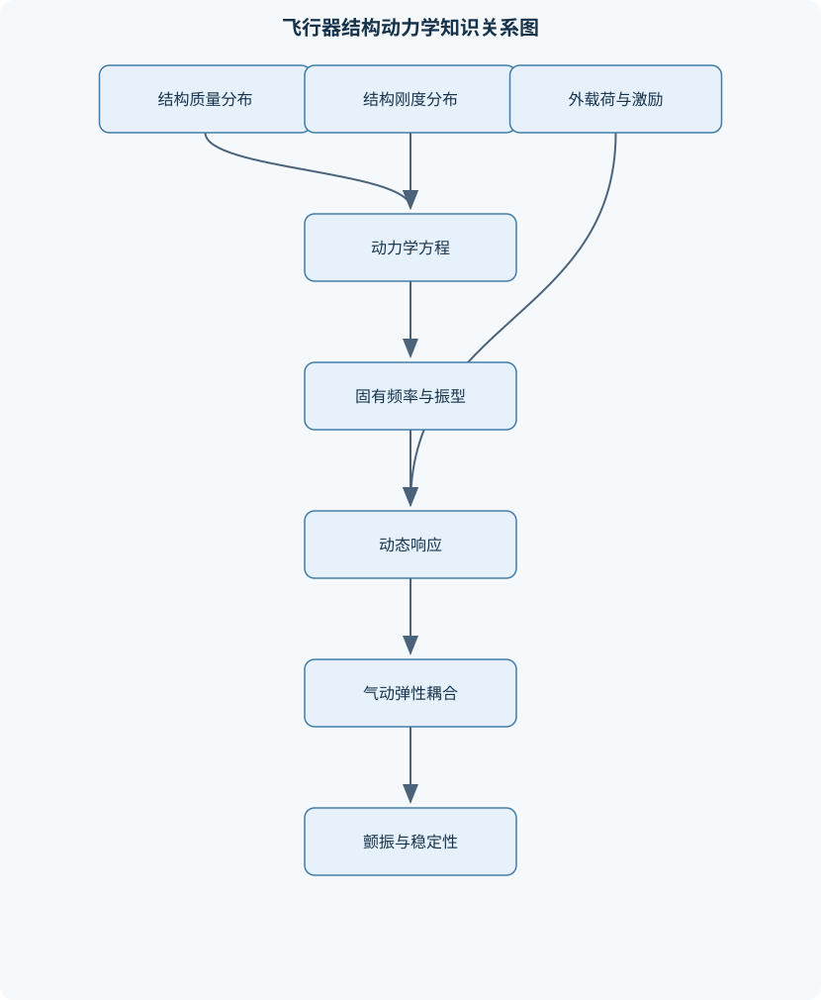
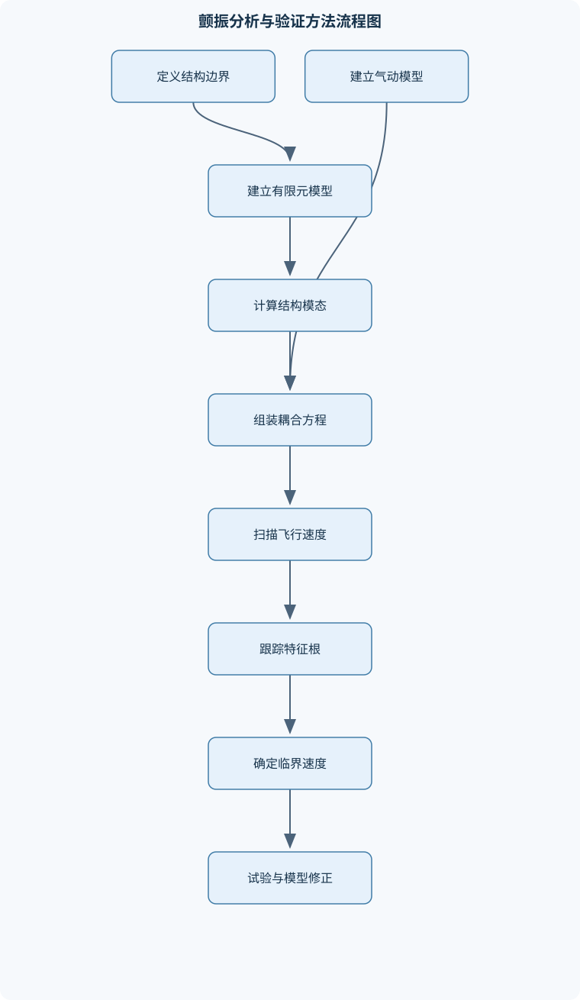

# 飞行器结构动力学

## 一、课程整体知识框架

### 课程边界与先修知识

本课程研究飞行器结构在外载荷、惯性载荷、气动力、发动机激励、着陆冲击和控制输入作用下的运动、振动、稳定性与动态载荷传递。内容覆盖结构动力学建模、连续体与离散系统、梁板壳振动、模态分析、频响与瞬态响应、飞行器气动弹性、颤振与地面振动试验，以及有限元动力学分析。课程边界通常止于线性或弱非线性结构动力学和工程级气动弹性分析；复杂材料失效、断裂动力学、全流场非定常气动、强非线性大变形和高保真流固耦合可作为拓展内容。先修知识包括高等数学、常微分方程、线性代数、理论力学、材料力学、弹性力学、流体力学基础、振动力学基础和有限元基础。应能进行向量与矩阵运算，理解牛顿定律、虚功原理、能量法、梁板壳基本假设及气动力系数、动压、升力和阻力等概念。理想模型通常假设小位移、小转角、线弹性、定常质量矩阵和线性阻尼；实际飞行器还会受到连接间隙、摩擦、材料非线性、几何非线性、结构损伤、燃油晃荡和非定常气动的影响。





### 1. 研究对象、任务与课程边界

飞行器结构动力学研究结构在外载荷、惯性载荷、气动力、发动机或旋翼激励、着陆冲击以及控制输入作用下的运动、振动、动态稳定性和载荷传递。与静力学只求解平衡状态不同，结构动力学必须同时描述质量、刚度、阻尼和时间变化。单自由度系统的基本动力平衡方程为

$$
m\ddot u+c\dot u+ku=F(t)
$$

其中，$u(t)$为位移，单位为m；$\dot u$为速度，单位为m/s；$\ddot u$为加速度，单位为m/s$^2$；$m$为质量，单位为kg；$c$为黏性阻尼系数，单位为N·s/m；$k$为刚度，单位为N/m；$F(t)$为外力，单位为N。式中各项必须按照同一正方向列写：$m\ddot u$表示惯性效应，$c\dot u$表示阻尼力，$ku$表示弹性恢复力。

多自由度结构通常写成

$$
M\ddot q+C\dot q+Kq=F(t)
$$

其中，$q$为广义坐标列向量，$M$、$C$、$K$分别为质量矩阵、阻尼矩阵和刚度矩阵，$F(t)$为外载荷列向量。矩阵的量纲取决于自由度的定义：平移自由度对应位移，转动自由度对应转角，不能把不同量纲的自由度直接混合而不进行一致化处理。

课程通常采用小位移、小转角、线弹性、定常质量矩阵和线性阻尼等理想假设。它们使结构方程可以线性化并使用模态叠加、频响分析和线性特征值方法。实际飞行器还可能存在连接间隙、摩擦、材料屈服、几何大变形、结构损伤、燃油晃荡、附加设备质量和非定常气动。若出现碰撞、间隙切换、明显塑性变形或大幅度扭转，线性小振动模型只能作为局部近似，不能直接作为最终判定模型。

### 2. 基础符号、坐标系与建模层次

$t$表示时间，单位为s；$x$、$y$、$z$表示惯性坐标系中的位置坐标，单位为m。飞行器分析中还需区分惯性坐标系、机体坐标系和局部结构坐标系。惯性坐标系用于描述飞行器质心运动和姿态变化；机体坐标系随飞行器运动，便于表达气动力、发动机推力和刚体六自由度方程；局部结构坐标系用于定义梁、板、壳单元的位移和转角。

连续结构可用偏微分方程描述，离散结构则用有限个自由度描述。集中参数模型把质量、刚度和阻尼集中在节点或质点上，适合初步估算和低阶动力学；分布参数模型保留质量和刚度沿空间的连续分布，适合梁、板、壳的解析振动研究；有限元模型在二者之间，通过单元插值把连续体离散为矩阵方程。

自由体图是建立动力学方程的起点。建模时必须明确结构边界、连接约束、载荷作用位置、自由度方向和参考坐标。固支约束通常限制位移和转角；铰支约束允许某些转动但限制平移；弹性连接应以连接刚度表示，不能简单地当作绝对固支。边界条件错误会同时改变固有频率、振型和动态载荷，往往比材料参数的小幅误差影响更大。

### 3. 频率、阻尼与响应的统一描述

单自由度无阻尼自由振动满足

$$
m\ddot u+ku=0
$$

设$u=e^{st}$，得到特征方程

$$
ms^2+k=0
$$

因此

$$
s=\pm i\omega_n,\qquad \omega_n=\sqrt{\frac{k}{m}}
$$

其中，$\omega_n$为无阻尼固有圆频率，单位为rad/s。若用频率$f$表示，单位为Hz，则

$$
\omega_n=2\pi f_n
$$

响应为

$$
u(t)=A\cos(\omega_nt)+B\sin(\omega_nt)
$$

$A$和$B$由初始位移、初始速度决定。仅给出一个余弦项意味着隐含了特定初始条件，不能用于一般初始状态。

黏性阻尼系统的阻尼比定义为

$$
\zeta=\frac{c}{2\sqrt{mk}}
$$

该定义只适用于线性黏性阻尼。欠阻尼条件为$0<\zeta<1$，阻尼固有圆频率为

$$
\omega_d=\omega_n\sqrt{1-\zeta^2}
$$

当$\zeta\geq 1$时，系统不再以衰减振荡形式响应。库仑摩擦阻尼与速度方向有关，滞回阻尼与应变能耗散有关，二者不能简单代入$c=2\zeta\sqrt{mk}$。

对简谐外力$F(t)=F_0\sin\omega t$，线性单自由度系统的稳态位移幅值为

$$
X=\frac{F_0/k}
{\sqrt{(1-r^2)^2+(2\zeta r)^2}},
\qquad r=\frac{\omega}{\omega_n}
$$

其中$r$为频率比。$X/(F_0/k)$是动态放大系数；当$r$接近1且阻尼较小时，响应显著放大。该公式只描述线性、时不变、单自由度、稳态简谐响应，不能直接用于强瞬态冲击、宽带随机振动或存在间隙的结构。

### 4. 模态、频响和瞬态分析之间的关系

无阻尼多自由度系统满足

$$
M\ddot x+Kx=0
$$

令$x=\phi e^{i\omega t}$，得到

$$
(K-\omega^2M)\phi=0
$$

非零振型存在的条件为

$$
\det(K-\omega^2M)=0
$$

令$\lambda=\omega^2$，即可求得固有频率和振型。若$M$、$K$为对称矩阵且系统不存在未处理的约束问题，不同模态满足

$$
\phi_r^{\mathrm T}M\phi_s=0,\qquad
\phi_r^{\mathrm T}K\phi_s=0
\quad(r\ne s)
$$

通过模态变换$x=\Phi\eta$，可把物理坐标转换为模态坐标。质量归一化后，若阻尼为比例阻尼，第$r$阶模态可近似写为

$$
\ddot\eta_r+2\zeta_r\omega_r\dot\eta_r+
\omega_r^2\eta_r
=\phi_r^{\mathrm T}F(t)
$$

模态截断并非模态阶数越少越好。应根据目标频段、有效质量参与系数、载荷位置和响应位置判断保留模态数；对于局部应力或高频加速度，还需考虑高阶模态和残余柔度。

频响分析针对稳态谐波载荷，在每个激励频率下求解动态刚度方程。瞬态分析针对阵风、着陆冲击、发动机启停等时间变化载荷，需要在时间域推进位移、速度和加速度。随机振动则以功率谱密度描述统计载荷，在线性系统中有

$$
S_x(\omega)=|H(\omega)|^2S_F(\omega)
$$

其中，$H(\omega)$为频率响应函数，$S_F(\omega)$和$S_x(\omega)$分别为载荷和响应功率谱密度。谱密度必须统一采用单边或双边定义，并统一Hz与rad/s的频率单位。

### 5. 结构动力学与气动弹性的联系

飞行器结构动力学不仅研究结构自身，还研究结构变形对气动力的反馈。自由来流密度为$\rho_\infty$，速度为$V$，动压为

$$
q_\infty=\frac{1}{2}\rho_\infty V^2
$$

升力和阻力可表示为

$$
L_a=q_\infty S C_L,\qquad
D_a=q_\infty S C_D
$$

其中，$S$为参考面积，$C_L$、$C_D$分别为升力和阻力系数。气动力通过结构变形、模态形状或气动网格投影为广义气动力。

一种线性化气动弹性方程为

$$
M\ddot x+
(C-q_\infty C_q)\dot x+
(K-q_\infty A_q)x=F
$$

其中，$A_q$表示气动刚度相关矩阵，$C_q$表示气动阻尼相关矩阵。速度升高会使动压增加，从而可能降低总刚度或总阻尼。静气动弹性发散通常是有效刚度趋近于零的静态失稳；颤振则通常是弯曲、扭转模态耦合后，某一共轭特征根实部达到零的动态失稳。二者不能仅凭变形大小区分。

课程边界通常止于线性或弱非线性结构动力学和工程级气动弹性。复杂材料失效、断裂动力学、强非线性大变形、全流场非定常气动和高保真流固耦合属于拓展领域，需采用更完整的材料、流体和数值模型。

## 二、章节和模块划分

### 核心知识覆盖清单

本清单用于检查正文是否覆盖本课程的主要知识模块：

- **飞行器结构动力学基础与建模**：结构动力学与静力学的区别、飞行器结构的质量与刚度分布、惯性坐标系与机体坐标系、自由度与广义坐标、集中参数与分布参数模型、自由体图和动态平衡方程、线性化条件与小振动假设、边界条件和连接约束。
- **单自由度结构振动**：无阻尼自由振动、黏性阻尼自由振动、库仑摩擦阻尼模型、简谐外力强迫振动、基础激励与相对位移、共振与动态放大系数、阻尼比和对数衰减率、隔振与传递率、初始条件对响应的影响。
- **多自由度系统动力学**：质量矩阵与刚度矩阵、阻尼矩阵的物理含义、矩阵形式运动方程、特征值与特征向量、固有频率与振型、模态正交性、模态质量与模态刚度、比例阻尼与非比例阻尼、模态截断和残余柔度。
- **连续体与飞行器梁结构振动**：轴向杆纵向振动、扭转杆振动、Euler-Bernoulli梁模型、Timoshenko梁模型、悬臂梁与简支梁边界条件、梁的弯曲固有频率、剪切变形和转动惯量影响、机翼和机身等效梁建模、连续体模态展开。
- **板壳与薄壁结构动力学**：薄板弯曲基本假设、Kirchhoff-Love板模型、Mindlin板模型、矩形板固有振动、圆板和曲面板振动、薄壁闭口截面扭转、加筋壁板等效刚度、局部板件与整体模态耦合、复合材料层合板动力学概念。
- **飞行器动态载荷与响应分析**：飞行器刚体六自由度运动、结构弹性自由度与刚弹耦合、阵风和突风载荷、发动机与旋翼周期激励、起落架着陆冲击、时域瞬态响应、频域稳态响应、功率谱密度与随机振动、动态载荷系数与疲劳相关响应。
- **有限元结构动力学**：动力学有限元离散、单元质量矩阵、一致质量与集中质量、单元刚度矩阵组装、约束处理与刚体模态、子空间特征值求解、直接积分法、模态叠加法、网格收敛与模型验证。
- **气动弹性基础**：气动弹性三角关系、静气动弹性变形、气动力与结构变形耦合、气动刚度与气动阻尼、升力线和面元气动近似、非定常气动力概念、机翼弯扭耦合、发散速度、控制面反效与反操纵。
- **颤振与飞行器稳定性**：颤振物理机制、二自由度弯扭颤振模型、速度对气动刚度的影响、速度对气动阻尼的影响、颤振临界速度、机翼扭转发散与颤振区别、典型截面模型、特征根轨迹法、准定常与非定常颤振分析、质量平衡和结构改型。
- **试验、识别与工程综合分析**：地面振动试验目标、激振器与冲击锤试验、加速度计和应变计布置、频响函数测量、模态参数识别、试验模态与计算模态相关性、运行模态分析、模型修正与不确定性、动态环境试验、分析结果的工程判据。


### 1. 飞行器结构动力学基础与建模

本模块建立结构动力学方程的物理基础。首先区分静力平衡与动力平衡：静力学使用$\sum F=0$、$\sum M=0$，而动力学必须包含质量乘加速度项。飞行器质量和刚度分布通常不均匀，机翼、机身、发动机、起落架和设备舱的局部质量会改变惯性载荷与模态形状。

重点包括自由度、广义坐标、集中参数模型和分布参数模型。刚体六自由度包括质心沿三个方向的平移及绕三个轴的转动；弹性自由度则描述弯曲、扭转、伸缩和局部板壳变形。刚体运动与弹性运动同时存在时，应建立刚弹耦合模型。连接约束必须明确是固支、铰接、滑动、弹性支承还是带阻尼连接；错误地把柔性连接设成固支，通常会高估固有频率并低估局部响应。

### 2. 单自由度结构振动

无阻尼自由振动用于解释固有频率和初始条件作用；黏性阻尼自由振动用于描述能量耗散；库仑摩擦模型用于具有接触、滑移或预紧连接的近似分析。简谐外力下，需要区分静位移$F_0/k$、动态位移幅值$X$、速度幅值$\omega X$和加速度幅值$\omega^2X$。

基础激励与直接外力不同。若支承位移为$y(t)$，质点绝对位移为$u(t)$，则相对位移$z=u-y$满足

$$
m\ddot z+c\dot z+kz=-m\ddot y
$$

因此基础加速度会通过惯性项驱动结构。隔振设计关注传递率，而不是单纯追求刚度最大。低频时隔振器不能有效隔离运动；当频率高于一定范围并且阻尼适当时，传递率才可能降低。阻尼过小会导致共振峰过高，阻尼过大又可能增加高频基础运动传递。

### 3. 多自由度系统动力学

多自由度模型的质量矩阵描述惯性耦合，刚度矩阵描述弹性约束和恢复力，阻尼矩阵描述能量耗散及阻尼耦合。质量矩阵可采用一致质量或集中质量。集中质量便于计算且低阶特性常较合理，但可能丢失转动惯量和高阶惯性效应；一致质量由单元形函数积分得到，通常更适合高阶模态分析。

比例阻尼可写成$C=\alpha M+\beta K$，此时模态方程能够近似解耦。非比例阻尼会使模态间仍存在耦合，必须使用复模态、状态空间法或直接积分法。刚体模态不应被错误删除：自由飞行器模型存在理论上的零频刚体运动，约束不足会导致刚度矩阵奇异；若分析的是弹性模态，则必须按照研究目标正确处理自由度。

### 4. 连续体与飞行器梁结构振动

轴向杆的振动由轴向刚度$EA$和单位长度质量$\rho A$控制；扭转杆由剪切模量$G$和扭转常数$J$控制。细长梁的Euler–Bernoulli模型忽略剪切变形和截面转动惯量，其横向振动方程为

$$
\rho A\frac{\partial^2w}{\partial t^2}
+EI\frac{\partial^4w}{\partial x^4}=0
$$

其中，$E$为弹性模量，单位为Pa；$I$为截面二次矩，单位为m$^4$；$A$为截面积，单位为m$^2$；$\rho A$为单位长度质量，单位为kg/m；$w$为横向位移。

均匀悬臂梁的特征条件为

$$
\cosh(\beta L)\cos(\beta L)=-1
$$

固有圆频率为

$$
\omega=\beta^2\sqrt{\frac{EI}{\rho A}}
$$

悬臂边界在根部满足位移和转角为零，端部满足弯矩和剪力为零。简支梁与悬臂梁的边界条件不同，不能套用同一特征根。短粗梁、高频振动或厚截面梁必须考虑Timoshenko梁的剪切变形和转动惯量。

Rayleigh商可估计连续系统固有频率：

$$
\omega^2\approx
\frac{\int_0^L EI(w'')^2\,dx}
{\int_0^L\rho A w^2\,dx}
$$

试函数必须满足本质边界条件。若试函数不能表达真实振型的主要曲率分布，估计误差会增大；该方法适合低阶频率估算，不替代完整特征值分析。

### 5. 板壳与薄壁结构动力学

薄板弯曲理论将板中面变形与厚度方向位移联系起来。Kirchhoff–Love板模型忽略横向剪切变形，适合薄板和低阶弯曲振动；Mindlin板模型保留横向剪切和转动惯量，适合厚板、短波长或较高频率。矩形板的固有频率取决于边界、长宽比、厚度、密度和弯曲刚度，四边简支、固支和自由边界的频率不能混用。

圆板、曲面板和薄壁闭口截面还涉及曲率与扭转。机翼蒙皮、机身壁板和舱段通常由加筋板组成，纵梁、桁条和框会改变整体弯曲刚度，也会产生局部板件模态。局部壁板模态与整体机翼模态接近时，会发生明显耦合。复合材料层合板具有方向相关的拉伸、弯曲和扭转刚度，铺层顺序不仅影响强度，也影响模态频率和弯扭耦合。

### 6. 飞行器动态载荷与响应分析

飞行器动态载荷包括阵风和突风、发动机阶次激励、旋翼周期激励、着陆冲击、操纵面输入和控制系统引起的载荷。阵风可在工程模型中转化为时间历程或随机谱；发动机激励常与转速、阶次和安装刚度相关；着陆冲击具有短持续时间和宽频带特征，不能用单一稳态频响代替。

动态载荷分析通常输出翼尖位移、机翼根部弯矩、连接点载荷、设备安装点加速度和局部应变。动态载荷系数反映动态响应与相应静态响应的比值，但其定义必须说明参考载荷和测量位置。疲劳相关响应需要关注应力时间历程、循环计数、谱带宽和局部应力集中，不能只看最大位移。

### 7. 有限元结构动力学

有限元动力学首先由单元材料、几何和形函数形成单元刚度矩阵与质量矩阵，再按节点自由度组装总体$K$和$M$。处理约束后，可进行模态、频响或时程分析。单元质量可采用一致质量或集中质量；设备、燃油和传感器等附加质量必须纳入质量属性校核。

模态求解通常采用子空间法或Lanczos类稀疏特征值算法。时域响应可用直接积分法，也可先进行模态变换再用模态叠加。Newmark平均加速度法取$\beta=1/4$、$\gamma=1/2$，对线性系统具有二阶精度和无条件稳定性，但时间步过大仍会产生明显相位和幅值误差。有限元验证至少包括总质量、质心、转动惯量、静刚度、网格收敛和模态有效质量检查。

### 8. 气动弹性基础

气动弹性三角关系由气动力、弹性变形和惯性效应组成。结构变形会改变迎角、压力分布和气动力；气动力又反过来改变结构响应。升力线方法适合细长机翼的工程估算，面元方法可描述更一般的平面气动载荷，但二者都受线性化、低攻角和流动状态假设限制。

静气动弹性关注稳态变形、载荷重分布和操纵面反效；机翼弯曲可能改变扭转角，扭转又改变升力分布。控制面反操纵是指控制面偏转产生的气动力矩被结构弹性变形部分抵消甚至反向。发散速度是有效气动刚度达到失稳条件的速度，属于静态问题；颤振速度则由耦合模态的动态阻尼和频率条件决定。

### 9. 颤振与飞行器稳定性

典型截面模型常以弯曲位移和扭转角作为两个自由度。随着$V$或$q_\infty$增大，气动刚度和气动阻尼项改变。对每个速度求解耦合特征值，跟踪特征根实部和虚部：实部为负表示线性衰减，实部达到零表示临界状态，实部为正表示线性不稳定。

准定常模型计算简便，但不能充分描述非定常尾迹、俯仰滞后和气动相位差；非定常模型更适用于颤振边界预测，但对气动参数和结构模型更敏感。增加扭转刚度、调整质量平衡、改变气动中心位置或增加结构阻尼都可能改变颤振速度，不能简单断言“增加刚度必然提高颤振速度”。

### 10. 试验、识别与工程综合分析

地面振动试验用于获取结构固有频率、阻尼、振型和频响函数，并检验有限元模型。激振器适合可控扫频和宽带激励，冲击锤适合快速获取多测点频响。加速度计应考虑质量附加效应，力传感器应布置在载荷输入路径，根部约束和激振器连接必须与计算模型一致。

试验模态分析从频响函数峰值识别频率和阻尼，再由多个测点形成振型。计算模态与试验模态比较时，应同时检查频率误差、振型相关性和有效质量。模型修正通常优先检查边界、连接刚度、附加质量和局部几何，再检查材料参数。运行模态分析不直接施加已知激励，适合使用环境响应识别模态，但对输入不可控和模态分离条件更敏感。

### 11. 代表性算法与流程

#### 11.1 多自由度模态分析

**输入：**对称质量矩阵$M$、刚度矩阵$K$、约束信息和目标频率范围。  
**输出：**固有频率、振型、模态质量、有效质量参与系数。

1. 按边界条件处理受约束自由度，并检查是否存在未处理的刚体模态。
2. 求解广义特征值问题$K\phi_r=\omega_r^2M\phi_r$。
3. 按$\omega_r$从小到大排序。
4. 进行质量归一化，使$\phi_r^{\mathrm T}M\phi_r=1$。
5. 检查不同振型的质量正交性。
6. 根据目标频段和有效质量决定保留模态。
7. 对保留模态进行静态校核、网格收敛检查和必要的试验比较。

稠密矩阵直接求解的计算量通常近似为$O(n^3)$；大型稀疏模型宜采用子空间或Lanczos方法。该流程适用于线性小振动系统，不适用于材料屈服、接触切换等强非线性问题。

#### 11.2 Newmark时程积分

**输入：**$M$、$C$、$K$、$F(t)$、初始位移和速度、时间步长$\Delta t$以及$\beta$、$\gamma$。  
**输出：**各时刻的位移、速度和加速度。

在每个时间步内，根据Newmark关系预测当前状态，形成有效刚度矩阵，求解位移增量，再更新速度和加速度。线性系统每步通常求解一次线性方程组；非线性系统还需在该时间步内迭代，使残差达到规定容差。推进到终止时间后，应检查时间步收敛、能量平衡和载荷插值。

```python
import numpy as np

def newmark_average_acceleration(M, C, K, force, dt, u0, v0):
    """线性系统的Newmark平均加速度法。
    force: 形状为(N, n)的离散外力数组
    返回位移、速度和加速度历程。
    """
    beta, gamma = 0.25, 0.5
    n_steps, n = force.shape
    u = np.zeros((n_steps, n))
    v = np.zeros((n_steps, n))
    a = np.zeros((n_steps, n))

    u[0] = u0
    v[0] = v0
    a[0] = np.linalg.solve(
        M, force[0] - C @ v[0] - K @ u[0]
    )

    effective_K = K + gamma / (beta * dt) * C + M / (beta * dt**2)

    for i in range(n_steps - 1):
        predicted_v = (
            v[i] + (1 - gamma) * dt * a[i]
        )
        predicted_u = (
            u[i] + dt * v[i]
            + (0.5 - beta) * dt**2 * a[i]
        )
        rhs = (
            force[i + 1]
            - C @ (gamma / (beta * dt) * (u[i + 1] if False else predicted_u))
        )
        # 采用增量形式，避免把未知量错误代入右端项
        effective_rhs = (
            force[i + 1]
            + M @ (
                u[i] / (beta * dt**2)
                + v[i] / (beta * dt)
                + (1 / (2 * beta) - 1) * a[i]
            )
            + C @ (
                gamma / (beta * dt) * u[i]
                + (gamma / beta - 1) * v[i]
                + dt * (gamma / (2 * beta) - 1) * a[i]
            )
        )
        u[i + 1] = np.linalg.solve(effective_K, effective_rhs)
        a[i + 1] = (
            (u[i + 1] - u[i] - dt * v[i])
            / (beta * dt**2)
            - (1 / (2 * beta) - 1) * a[i]
        )
        v[i + 1] = v[i] + dt * (
            (1 - gamma) * a[i] + gamma * a[i + 1]
        )

    return u, v, a
```

实际编程时应删除无效的中间变量，并对矩阵对称性、单位一致性和初始平衡进行检查。该方法的无条件稳定性不等于无条件准确，时间步仍应充分解析最高关注频率。

#### 11.3 频响函数分析

对每个激励圆频率$\omega$形成动态刚度矩阵

$$
Z(\omega)=K-\omega^2M+i\omega C
$$

然后求解

$$
Z(\omega)x(\omega)=F(\omega)
$$

记录目标自由度的幅值和相位，识别共振峰、反共振和局部模态耦合。频率网格过稀会漏掉窄共振峰；阻尼模型不合理会使峰值和带宽失真。该流程适用于线性稳态谐波问题，不适合描述单次着陆冲击或明显非线性碰撞。

### 12. 代表性例题

#### 例题一：单自由度共振响应

**题干：**某发动机支架等效质量$m=10$ kg，刚度$k=40000$ N/m，阻尼比$\zeta=0.05$，承受幅值$F_0=100$ N、频率$f=9$ Hz的简谐力。求固有频率、频率比和稳态位移幅值。

**分析：**先求$\omega_n$，再将Hz转换为rad/s，不能直接用$f/\omega_n$作为频率比。

**解答：**

$$
\omega_n=\sqrt{\frac{40000}{10}}=63.25\ \text{rad/s}
$$

$$
f_n=\frac{\omega_n}{2\pi}\approx10.07\ \text{Hz}
$$

$$
\omega=2\pi f=56.55\ \text{rad/s},\qquad
r=\frac{56.55}{63.25}\approx0.894
$$

静位移为$F_0/k=0.0025$ m，动态放大系数为

$$
D=\frac{1}{\sqrt{(1-r^2)^2+(2\zeta r)^2}}
\approx3.96
$$

所以

$$
X=D\frac{F_0}{k}\approx0.0099\ \text{m}
$$

**结果验证：**$r$接近1，且阻尼较小，动态放大系数大于1，结果符合共振附近响应特征。  
**变式：**若阻尼比增加到0.2，分母增大，峰值响应下降，但远离共振的高频传递可能增加。

#### 例题二：两自由度模态方程

**题干：**给定

$$
M=\begin{bmatrix}2&0\\0&1\end{bmatrix},\qquad
K=\begin{bmatrix}6&-2\\-2&2\end{bmatrix}
$$

求固有频率。

**分析：**求解$\det(K-\omega^2M)=0$。

**解答：**令$\lambda=\omega^2$，则

$$
\det\begin{bmatrix}
6-2\lambda&-2\\
-2&2-\lambda
\end{bmatrix}=0
$$

展开得

$$
(6-2\lambda)(2-\lambda)-4=0
$$

即

$$
2\lambda^2-10\lambda+8=0
$$

因此$\lambda_1=1$、$\lambda_2=4$，所以

$$
\omega_1=1\ \text{rad/s},\qquad
\omega_2=2\ \text{rad/s}
$$

**结果验证：**两个固有圆频率为正，说明在给定约束下系统刚度为正定；若出现零值，应检查是否存在刚体模态。  
**变式：**改变非对角刚度会改变两个自由度的耦合程度，不能只通过对角刚度判断振型。

#### 例题三：悬臂等效机翼梁

**题干：**均匀悬臂梁长度$L$、弯曲刚度$EI$和单位长度质量$\rho A$已知，要求估计第一阶固有频率。

**分析：**精确计算使用$\cosh(\beta L)\cos(\beta L)=-1$的第一根；Rayleigh法使用满足根部固支条件的试函数，例如$w=x^2(3L-x)$，比较两者误差。

**解答：**求得第一根后代入

$$
\omega_1=\beta_1^2\sqrt{\frac{EI}{\rho A}}
$$

若采用Rayleigh法，则计算

$$
\omega_R^2=
\frac{\int_0^L EI(w'')^2dx}
{\int_0^L\rho Aw^2dx}
$$

再取$\omega_R=\sqrt{\omega_R^2}$。  
**结果验证：**试函数满足$w(0)=0$和$w'(0)=0$，因此满足悬臂根部本质边界条件。  
**变式：**当梁较短或目标是高阶模态时，Euler–Bernoulli模型会低估剪切变形影响，应改用Timoshenko梁。

#### 例题四：阵风瞬态响应

**题干：**将阵风等效为持续时间$T_g$的矩形载荷，作用于机翼等效梁，要求计算翼尖位移和根部弯矩。

**分析：**矩形载荷含有多个频率成分，不能只用一个稳态频率点。先将载荷投影到模态坐标，再逐阶求解模态响应。

**解答步骤：**

1. 获取$\phi_r$、$\omega_r$和阻尼比$\zeta_r$。
2. 计算模态广义载荷$Q_r(t)=\phi_r^{\mathrm T}F(t)$。
3. 对每一阶求解$\eta_r(t)$。
4. 按$x(t)=\sum_r\phi_r\eta_r(t)$恢复节点位移。
5. 使用梁曲率和截面刚度计算根部弯矩。

**结果验证：**逐步增加保留模态数，若翼尖位移和根部弯矩在目标误差内稳定，则模态截断可接受。  
**变式：**缩短阵风持续时间会增加高频成分，通常需要保留更多高阶模态。

#### 例题五：二自由度弯扭颤振

**题干：**某典型截面以弯曲位移和扭转角为自由度，结构矩阵$M$、$C$、$K$已知，气动矩阵随动压$q_\infty$变化。如何确定颤振速度？

**分析：**颤振不是单纯求某一静态位移，而是跟踪耦合系统特征根。

**解答步骤：**

1. 对给定速度$V$计算$q_\infty=\rho_\infty V^2/2$。
2. 组装总动力学矩阵。
3. 将二阶方程转化为状态空间特征值问题。
4. 求取全部特征根并记录实部和虚部。
5. 逐步增加$V$，识别某一模态实部从负值变为零的速度。
6. 用较小速度步长重新计算，并对临界点插值。

**结果验证：**在临界速度以下，相关模态应有正阻尼；临界附近振荡频率应连续变化。  
**变式：**增加扭转刚度可能改变耦合频率，但颤振速度还受质量平衡、气动中心和气动阻尼影响，必须重新求解特征根。

### 13. 实验与工程项目

#### 13.1 地面振动试验与有限元相关分析

**输入数据：**结构试验件、边界和连接信息、激振器或冲击锤、力传感器、加速度计、应变计、采样频率和有限元模型。

**步骤：**

1. 明确目标模态、边界状态和测点范围。
2. 进行传感器校准，记录传感器质量和安装方式。
3. 采集输入力、响应加速度和必要的应变信号。
4. 计算频响函数，识别峰值频率、阻尼和振型。
5. 与有限元频率、振型和有效质量进行比较。
6. 优先修正边界、连接刚度、附加质量和局部几何。
7. 重新计算并记录修正前后的误差和不确定度。

**评价标准：**频率误差应在项目规定范围内，主要模态振型应具有足够相关性，质量和静刚度应通过独立校核，修正不能只使某个频率吻合而破坏其他模态。

**排错方法：**若所有试验频率都偏低，先检查附加质量和边界柔度；若仅局部模态偏低，检查局部连接和板件刚度；若频率接近但振型不同，检查测点方向、坐标变换和模态配对。

#### 13.2 随机阵风谱响应项目

**输入数据：**阵风载荷功率谱密度$S_F(\omega)$、结构频响函数$H(\omega)$、频率网格、阻尼模型和目标输出位置。

**步骤：**

1. 统一频率单位和单边、双边谱定义。
2. 计算$S_x(\omega)=|H(\omega)|^2S_F(\omega)$。
3. 在规定频段积分得到均方根响应：
   
   $$
   x_{\mathrm{rms}}=
   \sqrt{\int_{\omega_1}^{\omega_2}S_x(\omega)\,d\omega}
   $$
4. 分别计算翼尖加速度和根部弯矩的均方根值。
5. 改变频率步长、阻尼和积分上限进行敏感性分析。
6. 根据峰值因子估计极值范围，但不把统计估计当作确定性峰值。

**评价标准：**谱单位必须一致，积分结果应随频率网格加密趋于稳定，输出响应应主要由结构共振频段解释，改变非目标频段截断不应造成无法解释的剧烈变化。

**排错方法：**结果相差$2\pi$通常与Hz和rad/s换算有关；结果相差约2倍可能与单边、双边谱混用有关；响应峰位置错误则优先检查频响函数、阻尼和边界条件。

### 14. 典型易错点、考法与岗位关联

#### 14.1 易错点

1. 用静力平衡方程代替动力平衡方程，遗漏惯性力。
2. 把$\omega$与$f$混用，忘记$\omega=2\pi f$。
3. 把阻尼比$\zeta$直接当作阻尼系数$c$。
4. 忽略初始速度，错误地把自由振动写成单一余弦项。
5. 只比较固有频率，不检查振型和有效质量。
6. 混淆集中质量矩阵与一致质量矩阵。
7. 在短粗梁或高频问题中错误使用Euler–Bernoulli模型。
8. 把动压$q_\infty$与广义气动力矩阵$Q$混用。
9. 把发散称为颤振。
10. 认为提高结构刚度必然提高颤振速度。
11. 用稳态频响分析强瞬态冲击。
12. 未统一单边谱、双边谱和频率单位。
13. 把无条件稳定误认为任意时间步都准确。
14. 未处理刚体模态导致矩阵奇异。
15. 模型修正时只修改弹性模量，不检查连接和边界。
16. 忽略传感器附加质量和激振器约束。
17. 用线性模型处理大变形、碰撞和材料屈服而不说明边界。

#### 14.2 常见笔试问题及解答思路

1. **推导单自由度固有频率。**从$m\ddot u+ku=0$设指数解，得到$s=\pm i\sqrt{k/m}$。
2. **解释共振条件。**动态放大系数分母在$r$接近1时变小，阻尼决定峰值高度。
3. **说明阻尼比的物理意义。**比较实际阻尼与临界阻尼，必须区分无量纲$\zeta$和有量纲$c$。
4. **推导多自由度特征方程。**将$x=\phi e^{i\omega t}$代入矩阵方程。
5. **说明模态正交性条件。**要求$M$、$K$对称，并排除不适当的非保守或非比例耦合。
6. **比较Euler–Bernoulli梁和Timoshenko梁。**前者忽略剪切和转动惯量，后者适用于厚梁和较高频率。
7. **解释发散和颤振区别。**发散是有效静刚度失稳，颤振是动态阻尼或耦合特征根失稳。
8. **说明Newmark无条件稳定的限制。**稳定只说明误差不会无限增长，不保证幅值、相位和模型正确。
9. **解释随机振动谱传播。**在线性系统中由频响函数平方传播输入谱，积分得到均方根响应。
10. **说明试验频率与有限元不一致的排查顺序。**先查边界、连接和附加质量，再查局部刚度和材料参数。

#### 14.3 常见面试问题与回答要点

1. **如何建立机翼动力学模型？**先确定研究频段和载荷，再选择等效梁、板壳或有限元模型；输出应包括模态、频响和动态载荷，验收依据是质量、静刚度、模态和试验相关性。
2. **如何判断模态截断是否充分？**检查目标频段、有效质量、响应收敛和残余柔度，不能只按模态阶数决定。
3. **有限元第一阶频率偏低如何排查？**检查边界柔度、连接刚度、附加质量和网格；材料弹性模量不是唯一原因。
4. **如何分析发动机转频共振？**把转速转换为激励频率，叠加阶次，读取频响峰值，并评估阻尼、改频和隔振方案。
5. **如何区分颤振与结构共振？**共振是给定激励下的响应放大；颤振是不依赖持续外部周期力的气动自激动态失稳。
6. **试验测点如何布置？**覆盖目标模态的节点和腹部，根部、连接区及大响应区应加密，同时避免只布置在模态节点。
7. **什么时候采用直接积分而不是模态叠加？**非比例阻尼、强局部响应、载荷作用于未保留模态或模型存在明显局部非线性时，直接积分更稳妥。
8. **如何验证随机振动计算？**核对谱单位、输入输出频段、频响峰值、积分收敛和试验均方根响应。
9. **结构改型如何提高颤振速度？**综合调整弯扭刚度、质量平衡、气动中心和阻尼，并通过特征根轨迹而非单一参数判断。
10. **动态分析结果如何交付？**应给出模型假设、边界、载荷、频段、阻尼、网格收敛、响应包络、敏感性和验收判据，而不是只提供一张频率表。

#### 14.4 岗位关联

结构动力学工程师通常负责建立梁、板壳或有限元模型，计算模态、频响、瞬态载荷和连接载荷，产出分析报告、响应包络和模型校核记录。有限元分析工程师重点处理单元、质量属性、约束、网格收敛和求解器设置，验收内容包括质量平衡、刚度校核和特征值收敛。

气动弹性与颤振分析工程师负责建立结构—气动耦合模型，计算发散边界和颤振临界速度，产出特征根轨迹、临界模态和改型建议。地面振动试验与试验模态工程师负责激励、传感器布置、频响测量和模态识别，验收重点是数据质量、频率和振型相关性。动态载荷与强度工程师把阵风、着陆和发动机振动转换为结构载荷及应力谱，需保证载荷路径、响应包络和疲劳输入具有可追溯性。隔振减振工程师则根据传递率、共振峰和设备允许加速度选择刚度、阻尼和安装方案。

## 三、核心概念的详细解释

### 1. 结构动力学建模的基本对象

飞行器结构动力学研究结构的质量、刚度和阻尼如何共同决定运动与振动响应。静力学只要求外力与内力在某一时刻平衡，而动力学还必须满足动量变化关系，因此结构的加速度、速度和历史载荷都会影响当前响应。单自由度模型的动力平衡方程为

$$
m\ddot u+c\dot u+ku=F(t)
$$

其中，$u(t)$为位移，单位为m；$\dot u(t)$为速度，单位为m/s；$\ddot u(t)$为加速度，单位为m/s$^2$；$m$为质量，单位为kg；$c$为线性黏性阻尼系数，单位为N·s/m；$k$为线性刚度，单位为N/m；$F(t)$为外力，单位为N。该方程成立的前提是位移和转角足够小、材料处于线弹性范围、质量与刚度不随时间显著变化，且阻尼可以用速度相关的线性项近似。

多自由度系统采用列向量$q(t)$表示广义坐标，矩阵方程为

$$
M\ddot q+C\dot q+Kq=F(t)
$$

$M$、$C$和$K$分别为质量矩阵、阻尼矩阵和刚度矩阵，$F(t)$为外载荷列向量。若某个自由度是转角，则相应广义力是力矩；因此矩阵各行各列的量纲必须与自由度定义相容。把平移量和转角直接作为同一量纲处理，会导致质量矩阵、刚度矩阵和模态参与系数的物理意义错误。

### 2. 坐标系、自由度与边界条件

惯性坐标系用于描述飞行器质心的平动和姿态变化，通常不随飞行器转动；机体坐标系固定于飞行器，便于表达发动机推力、气动力和重力在机体上的分量；局部结构坐标系用于定义梁、板、壳单元的节点位移、转角和截面参数。坐标变换必须同时变换位置、速度、加速度以及力和力矩，不能只旋转载荷而不旋转结构自由度。

自由度是能够独立描述系统状态的最小坐标集合。刚体飞行器通常具有三个平移自由度和三个转动自由度；弹性结构还需增加梁的轴向位移、弯曲位移、扭转角或板壳节点位移等自由度。广义坐标不一定是物理节点位移，也可以是模态坐标、关节角或等效变形参数，但必须能够重构结构的实际运动。

边界条件决定哪些自由度可以运动。固支边界通常限制平移和转角；简支边界限制法向位移但允许转动；铰支连接限制某些平移而允许相对转动；弹性支承应通过弹簧、阻尼或连接单元表示。将柔性连接误设为绝对固支，会人为提高固有频率并改变振型；将固支误设为自由边界，则可能出现不应存在的刚体模态。

### 3. 集中参数、连续体与有限元模型

集中参数模型把质量、刚度和阻尼集中到有限个节点，适合估算低阶整体模态、研究设备安装和初步隔振。其优点是参数少、计算快，缺点是难以描述局部板件振动和高阶模态。

分布参数模型保留质量和刚度沿结构的连续分布。均匀Euler-Bernoulli梁的横向振动方程为

$$
\rho A\frac{\partial^2w}{\partial t^2}
+EI\frac{\partial^4w}{\partial x^4}=0
$$

其中，$w(x,t)$为横向位移，$\rho$为密度，单位为kg/m$^3$；$A$为截面积，单位为m$^2$；$E$为弹性模量，单位为Pa；$I$为截面二次矩，单位为m$^4$；$EI$为弯曲刚度；$x$为沿梁轴线的位置，单位为m。该模型忽略剪切变形和截面转动惯量，适用于细长梁的低阶弯曲振动。短粗梁、厚壁梁和高频响应必须考虑Timoshenko梁模型中的剪切变形与转动惯量。

有限元模型把连续结构划分为单元，用形函数近似单元内部位移，再通过节点自由度组装总体矩阵。它能够同时描述机翼梁、蒙皮、加筋壁板、框梁和设备连接，但结果依赖单元类型、网格尺寸、连接刚度、材料参数和边界处理。网格加密只能减少离散误差，不能修正错误的边界条件或错误的质量分布。

### 4. 单自由度振动的物理含义

无阻尼自由振动由质量和刚度交换能量形成。质量越大，惯性越强，固有频率越低；刚度越大，恢复力越强，固有频率越高。无阻尼固有圆频率为

$$
\omega_n=\sqrt{\frac{k}{m}}
$$

单位为rad/s。对应频率为

$$
f_n=\frac{\omega_n}{2\pi}
$$

单位为Hz。圆频率和频率不能混用，$\omega=2\pi f$是二者的换算关系。

黏性阻尼耗散机械能，阻尼比定义为

$$
\zeta=\frac{c}{2\sqrt{mk}}
$$

它是无量纲量。该定义只适用于线性黏性阻尼。库仑摩擦阻尼的阻力大小近似为常量但方向与速度相反，滞回阻尼与应变循环有关，二者都不能简单使用同一个$c$或$\zeta$表示。

当$0<\zeta<1$时，系统为欠阻尼，仍会振荡，其阻尼固有圆频率为

$$
\omega_d=\omega_n\sqrt{1-\zeta^2}
$$

当$\zeta=1$时为临界阻尼，系统在不振荡条件下最快返回平衡位置；当$\zeta>1$时为过阻尼，响应不振荡但返回速度较慢。实际航空结构通常具有较小阻尼，不能把阻尼对共振峰的影响忽略。

### 5. 多自由度模态与模态坐标

无阻尼自由振动方程为

$$
M\ddot x+Kx=0
$$

设响应为$x=\phi e^{i\omega t}$，代入后得到

$$
(K-\omega^2M)\phi=0
$$

要存在非零振型$\phi$，必须满足

$$
\det(K-\omega^2M)=0
$$

令$\lambda=\omega^2$，可将问题写成广义特征值问题

$$
K\phi=\lambda M\phi
$$

特征值给出固有频率，特征向量给出振型。固有频率接近并不意味着两个模态具有相同物理性质，必须同时检查振型、有效质量和变形能分布。

当$M$和$K$为对称矩阵且不同模态的固有频率不重合时，模态满足质量正交性和刚度正交性：

$$
\phi_r^{\mathrm T}M\phi_s=0,\qquad
\phi_r^{\mathrm T}K\phi_s=0,\quad r\ne s
$$

令模态矩阵为$\Phi=[\phi_1,\phi_2,\ldots,\phi_s]$，用模态坐标$\eta$表示物理位移：

$$
x=\Phi\eta
$$

若振型按质量归一化，即$\phi_r^{\mathrm T}M\phi_r=1$，则无阻尼系统中的模态质量为1，模态刚度为$\omega_r^2$。在比例阻尼条件下，各模态可近似解耦；对于非比例阻尼，模态方程仍可能耦合，必须采用复模态、状态空间方法或直接积分。

### 6. 梁、板、壳与薄壁结构

梁模型主要描述细长构件的轴向、弯曲和扭转振动。悬臂梁根部通常满足位移和转角为零，自由端满足弯矩和剪力为零。均匀Euler-Bernoulli悬臂梁的特征条件为

$$
\cosh(\beta L)\cos(\beta L)=-1
$$

其中，$L$为梁长，$\beta$为波数，单位为m$^{-1}$。固有圆频率为

$$
\omega=\beta^2\sqrt{\frac{EI}{\rho A}}
$$

该关系说明提高弯曲刚度$EI$或降低单位长度质量$\rho A$通常会提高固有频率，但实际结构中加筋、设备和燃油也会改变质量分布与边界约束。

薄板弯曲模型通常采用Kirchhoff–Love假设，即板厚远小于面内尺寸，法线变形后仍保持直且垂直于中面，并忽略横向剪切变形。对于较厚板、高频模态或夹层板，应采用Mindlin板模型，将横向剪切和转动惯量纳入。加筋壁板同时具有整体弯曲模态和局部蒙皮模态，二者可能发生模态耦合；只用等效梁模型可能无法预测局部共振和局部应变峰值。

薄壁闭口截面的扭转刚度受截面形状、壁厚和材料剪切模量控制。机翼、机身和尾翼结构经常表现出弯曲—扭转耦合，气动载荷作用点与弹性轴之间的偏心会产生扭矩，使结构变形反过来改变气动力。

### 7. 动态载荷、频响与随机振动

阵风、发动机转频、旋翼阶次、着陆冲击和控制输入都可能激发结构模态。周期性激励适合用频域频响分析；着陆冲击和有限持续时间阵风适合用时域瞬态分析；宽带湍流和随机振动则使用功率谱密度描述。

线性单自由度系统受到$F_0\sin(\omega t)$作用时，稳态位移幅值为$X$，动态放大系数为

$$
\frac{X}{F_0/k}
=
\frac{1}{\sqrt{(1-r^2)^2+(2\zeta r)^2}},
\qquad r=\frac{\omega}{\omega_n}
$$

这里$F_0/k$是静位移，$r$为频率比。接近$r=1$时会出现共振峰，阻尼越大，峰值通常越低，但共振频率和相位也会变化。该公式仅适用于线性时不变单自由度系统，不能直接代表多模态结构在宽频载荷下的全部响应。

若输入为基座位移$y(t)$，结构绝对位移为$u(t)$，相对位移为$z=u-y$，则方程可写为

$$
m\ddot z+c\dot z+kz=-m\ddot y
$$

这说明基础激励本质上等效为与基座加速度有关的惯性载荷。隔振设计不是单纯追求刚度越小越好：低频时柔性支承可能增大静态位移，高频时合理降低传递率；支承阻尼过小会产生尖锐共振峰，过大则可能削弱高频隔振效果。

对于平稳线性随机过程，输出位移功率谱密度为

$$
S_x(\omega)=|H(\omega)|^2S_F(\omega)
$$

其中，$H(\omega)$为频率响应函数，$S_F(\omega)$为输入载荷功率谱密度，$S_x(\omega)$为输出响应功率谱密度。均方根响应需在规定频段内积分。使用该方法必须统一Hz与rad/s、单边谱与双边谱的定义；强冲击、明显非线性或非平稳过程不能用单一稳态谱公式替代。

### 8. 气动弹性、发散与颤振

气动弹性问题由结构弹性、惯性和气动力相互作用构成。飞行速度$V$升高时，动压

$$
q_\infty=\frac{1}{2}\rho_\infty V^2
$$

增大，其中$\rho_\infty$为自由来流密度，单位为kg/m$^3$。升力和阻力可写为

$$
L_a=q_\infty S C_L,\qquad
D_a=q_\infty S C_D
$$

$S$为参考面积，单位为m$^2$；$C_L$和$C_D$为无量纲气动系数。结构变形会改变迎角、气动载荷作用点和载荷分布，气动力又会改变结构变形，因此气动力不能总被视为与结构变形无关的外力。

线性化气动弹性方程可表示为

$$
M\ddot x+(C-q_\infty C_q)\dot x+(K-q_\infty K_q)x=F
$$

其中，$K_q$表示与气动力相关的等效刚度项，$C_q$表示气动阻尼相关项。该式中的符号约定依赖气动力导数定义，但物理含义不变：气动力可能降低总刚度，也可能降低总阻尼。

发散是静态失稳，通常表现为有效刚度接近零，结构静变形在某一速度后急剧增大。颤振是动态失稳，通常由弯曲和扭转模态耦合引起，并表现为某一耦合模态的总阻尼降低到零甚至变为负值。增加扭转刚度可能改变颤振边界，但颤振速度还受质量平衡、气动中心位置、结构阻尼、弯扭频率比和非定常气动影响，不能认为“刚度增加必然提高颤振速度”。

### 9. 有限元动力学与试验模态

有限元动力学的基本方程仍为

$$
M\ddot x+C\dot x+Kx=F(t)
$$

一致质量矩阵由单元形函数和连续质量分布积分得到，能够较好保留高阶模态特性；集中质量矩阵把质量集中到节点，计算简单，但高阶频率可能产生较大误差。附加设备、传感器、燃油和连接件的质量必须纳入模型，否则总体质量和模态参与系数会失真。

地面振动试验的目标是获得结构实际的频率、阻尼、振型和频响函数，并检验有限元模型。试验中需要明确边界条件，布置激振器、参考传感器和响应传感器，测量输入力与结构响应。试验频率与计算频率不一致时，应优先检查连接刚度、约束、附加质量、传感器质量和局部网格，再考虑修正材料弹性模量。只修改材料参数可能掩盖真正的边界或质量建模错误。

## 四、重要定义、公式、定理和推导

### 专业审校补充：关键定义与适用边界

随机振动不能用单一谐波幅值或峰值频率代替。对线性时不变结构，若输入为平稳随机过程，输入功率谱密度为 $S_{FF}(\omega)$，从输入力到响应量 $y$ 的频响函数为 $H_{yF}(\omega)$，则输出功率谱密度为 $$S_{yy}(\omega)=|H_{yF}(\omega)|^2S_{FF}(\omega)$$，均方根值为 $$y_{\mathrm{rms}}=\left[\int_{0}^{\infty}S_{yy}(f)\,\mathrm df\right]^{1/2}$$。这里 $f$ 的单位为 Hz，$S_{yy}$ 的单位取决于响应量；若使用圆频率 $\omega$，积分变量必须改为 $\mathrm d\omega$，并统一谱密度定义。多输入情形应使用互谱矩阵：$S_{yy}=H S_{FF}H^{*}$，其中 $H^{*}$ 为共轭转置。该关系要求结构线性、统计过程近似平稳且频响函数适用于所研究状态；着陆冲击、间隙碰撞和明显时变工况应优先采用时域分析。谱积分得到的是均方根，不是必然峰值，峰值还取决于持续时间、带宽和峰值因子。


### 1. 单自由度自由振动推导

#### 1.1 无阻尼情形

无阻尼自由振动满足

$$
m\ddot u+ku=0
$$

设试探解为$u=e^{st}$，则

$$
ms^2e^{st}+ke^{st}=0
$$

由于$e^{st}\ne0$，得到特征方程

$$
ms^2+k=0
$$

因此

$$
s=\pm i\sqrt{\frac{k}{m}}=\pm i\omega_n
$$

实数形式的通解为

$$
u(t)=A\cos(\omega_nt)+B\sin(\omega_nt)
$$

若初始条件为$u(0)=u_0$、$\dot u(0)=v_0$，则

$$
A=u_0,\qquad B=\frac{v_0}{\omega_n}
$$

所以

$$
u(t)=u_0\cos(\omega_nt)+\frac{v_0}{\omega_n}\sin(\omega_nt)
$$

这说明初始位移和初始速度共同决定响应。若$v_0\ne0$，不能只写成单一余弦项。

#### 1.2 黏性阻尼情形

有阻尼自由振动的特征方程为

$$
ms^2+cs+k=0
$$

定义

$$
\omega_n=\sqrt{\frac{k}{m}},\qquad
\zeta=\frac{c}{2\sqrt{mk}}
$$

则特征根为

$$
s=-\zeta\omega_n\pm\omega_n\sqrt{\zeta^2-1}
$$

当$0<\zeta<1$时，

$$
s=-\zeta\omega_n\pm i\omega_d,
\qquad
\omega_d=\omega_n\sqrt{1-\zeta^2}
$$

响应可以写成

$$
u(t)=e^{-\zeta\omega_nt}
\left(A\cos\omega_dt+B\sin\omega_dt\right)
$$

指数项表示振幅衰减，$\omega_d$表示实际振荡圆频率。这里的阻尼模型假定阻尼力与速度成正比；若结构存在摩擦、材料滞回或流体阻尼，衰减曲线可能不是指数形式。

### 2. 简谐强迫响应和相位

设外力为

$$
F(t)=F_0\sin(\omega t)
$$

在线性稳态下，设位移为

$$
u(t)=X\sin(\omega t-\theta)
$$

代入动力学方程并比较正弦、余弦项，可得

$$
X=
\frac{F_0/k}
{\sqrt{(1-r^2)^2+(2\zeta r)^2}},
\qquad
r=\frac{\omega}{\omega_n}
$$

相位角满足

$$
\tan\theta=\frac{2\zeta r}{1-r^2}
$$

相位角应根据所在象限确定，不能只使用反正切函数的数值而忽略分子、分母符号。当$r\ll1$时，响应近似与外力同相；当$r$接近1时，相位快速变化；当$r\gg1$时，位移响应近似与外力反相。

若关注加速度幅值，则

$$
a_{\max}=\omega^2X
$$

因此位移共振峰和加速度峰不一定出现在完全相同的频率位置。航空设备隔振通常同时检查设备位移、支座力和设备加速度，不能只看位移传递率。

### 3. 多自由度模态正交性推导

设两个不同模态满足

$$
K\phi_r=\omega_r^2M\phi_r,\qquad
K\phi_s=\omega_s^2M\phi_s
$$

左乘第一个方程的转置$\phi_s^{\mathrm T}$，得到

$$
\phi_s^{\mathrm T}K\phi_r
=\omega_r^2\phi_s^{\mathrm T}M\phi_r
$$

对第二个方程左乘$\phi_r^{\mathrm T}$，得到

$$
\phi_r^{\mathrm T}K\phi_s
=\omega_s^2\phi_r^{\mathrm T}M\phi_s
$$

当$M$和$K$对称时，两式左端相等，且$\phi_s^{\mathrm T}M\phi_r=\phi_r^{\mathrm T}M\phi_s$，因此

$$
(\omega_r^2-\omega_s^2)
\phi_r^{\mathrm T}M\phi_s=0
$$

若$\omega_r\ne\omega_s$，则

$$
\phi_r^{\mathrm T}M\phi_s=0
$$

再代回任一特征方程即可得到

$$
\phi_r^{\mathrm T}K\phi_s=0
$$

该推导要求矩阵对称且系统采用保守线性结构模型。存在非比例阻尼、非对称气动力或陀螺项时，传统实模态正交性可能不再成立。

### 4. Rayleigh商与梁频率估计

对于无阻尼连续梁，取满足本质边界条件的试函数$w(x)$，最大动能和最大势能分别与

$$
\int_0^L\rho A w^2\,dx
$$

和

$$
\int_0^L EI(w'')^2\,dx
$$

有关。因此固有圆频率平方可用Rayleigh商估计：

$$
\omega^2\approx
\frac{\displaystyle\int_0^L EI(w'')^2\,dx}
{\displaystyle\int_0^L\rho A w^2\,dx}
$$

试函数必须满足本质边界条件，例如悬臂梁根部的$w(0)=0$和$w'(0)=0$，但不必严格满足自然边界条件。若试函数与真实一阶振型相近，所得一阶频率通常具有较好的估计效果；试函数过于简单时，误差主要来自曲率分布不合理。对于高阶模态，单一低阶试函数通常不够。

### 5. 模态叠加与截断

在质量归一化和比例阻尼条件下，令

$$
x=\Phi\eta
$$

并左乘$\Phi^{\mathrm T}$，可得到各模态方程

$$
\ddot\eta_r+
2\zeta_r\omega_r\dot\eta_r+
\omega_r^2\eta_r
=
\phi_r^{\mathrm T}F(t)
$$

右端

$$
Q_r(t)=\phi_r^{\mathrm T}F(t)
$$

称为第$r$阶模态广义载荷。它取决于外载荷空间分布与振型的相似程度。某一模态频率很低并不意味着它一定主导响应；若载荷与该模态的空间分布近似正交，其模态参与系数仍可能很小。

保留前$s$阶模态时，

$$
x(t)\approx\sum_{r=1}^{s}\phi_r\eta_r(t)
$$

模态截断必须根据目标频段、载荷位置、响应测点和有效质量判断。对于静态或低频载荷，被截断的高阶模态可能通过残余柔度产生不可忽略的局部变形；仅增加低阶模态数量并不一定能准确恢复局部静态响应。

### 6. 直接积分与Newmark方法

对

$$
M\ddot x+C\dot x+Kx=F(t)
$$

在时间步$t_n$到$t_{n+1}=t_n+\Delta t$上，Newmark方法写为

$$
x_{n+1}=x_n+\Delta t\dot x_n+
\Delta t^2\left[
\left(\frac12-\beta\right)\ddot x_n+
\beta\ddot x_{n+1}
\right]
$$

$$
\dot x_{n+1}=\dot x_n+
\Delta t\left[
(1-\gamma)\ddot x_n+
\gamma\ddot x_{n+1}
\right]
$$

取$\beta=1/4$、$\gamma=1/2$为平均加速度方法。将速度和加速度表示为未知位移后，可形成有效刚度矩阵并求解$x_{n+1}$。在线性系统中，该方法具有二阶精度和无条件稳定性，但“无条件稳定”不等于任意$\Delta t$都准确。时间步过大时，响应相位、峰值和高频能量仍会产生明显误差。

伪代码如下：

```text
输入：M, C, K, F(t), x0, v0, Δt, 终止时间T
设置：β = 1/4, γ = 1/2
由 M a0 = F(0) - C v0 - K x0 求初始加速度a0
形成有效刚度 Keff = K + γ/(βΔt) C + 1/(βΔt²) M

对 n = 0, 1, ..., N-1：
    计算时刻 t(n+1) 的外载荷 F(n+1)
    根据 x(n)、v(n)、a(n) 构造有效载荷 Feff
    求解 Keff Δx = Feff
    更新 x(n+1) = x(n) + Δx
    根据Newmark速度公式更新 v(n+1)
    根据Newmark位移公式更新 a(n+1)
    检查残差 R = M a(n+1) + C v(n+1) + K x(n+1) - F(n+1)
    若残差或能量平衡不满足容差，则减小时间步或检查载荷与约束
输出：位移、速度、加速度及支反力历史
```

该算法适用于线性或可线性化的时程分析。若材料、接触或连接具有非线性，每个时间步内还需迭代更新切线刚度并检查残差收敛。

### 7. 频响函数与随机响应

对简谐响应设

$$
x(t)=\hat x e^{i\omega t},\qquad
F(t)=\hat F e^{i\omega t}
$$

代入动力学方程，得到

$$
\left(K-\omega^2M+i\omega C\right)\hat x=\hat F
$$

定义动态刚度矩阵

$$
Z(\omega)=K-\omega^2M+i\omega C
$$

则

$$
\hat x=Z^{-1}(\omega)\hat F
$$

频响函数由输入到输出的幅值和相位组成。共振附近动态刚度接近奇异，响应幅值增大；反共振则可能由多个模态相消形成。频响分析必须规定输入自由度、输出自由度、激励类型和阻尼模型，否则“结构频响”不是唯一量。

多输入随机载荷应使用谱密度矩阵：

$$
S_x(\omega)=H(\omega)S_F(\omega)H^{*}(\omega)
$$

其中，$H^{*}$为共轭转置，$S_F$为输入载荷谱密度矩阵。标量公式$|H|^2S_F$只是单输入单输出的特殊情况。由输出谱求均方根响应时，需要在明确的频率区间内积分，并保持谱密度单位一致。

### 8. 气动弹性特征根判据

将气动弹性系统写成一阶状态空间形式，设状态向量包含位移和速度：

$$
z=
\begin{bmatrix}
x\\
\dot x
\end{bmatrix}
$$

则可写为

$$
\dot z=A(V)z
$$

其中，矩阵$A(V)$依赖飞行速度$V$。求解

$$
\det\left(A(V)-sI\right)=0
$$

得到特征根$s=\sigma+i\omega$。$\sigma$为衰减或增长率，$\omega$为振荡圆频率。当$\sigma<0$时模态稳定，当$\sigma=0$时达到临界状态，当$\sigma>0$时响应随时间增长。颤振临界速度通常由某一耦合模态的实部首次达到零确定。

该判据建立在线性化、小扰动和给定气动模型基础上。若出现大幅度失速、间隙碰撞、结构屈服或显著非定常流动，特征根结果只能用于局部稳定性判断，不能替代非线性时域分析或试验验证。

### 9. 代表性计算例题

#### 例题一：单自由度发动机支架共振响应

**题干。** 某支架等效质量$m=20$ kg，刚度$k=8000$ N/m，阻尼比$\zeta=0.05$，受到幅值$F_0=100$ N、频率$f=3$ Hz的简谐力。求固有频率、频率比和稳态位移幅值。

**分析。** 先由$m$和$k$求$\omega_n$，再将激励频率换算为圆频率并计算$r$，最后使用动态放大系数。

**解答。**

$$
\omega_n=\sqrt{\frac{8000}{20}}=20\ \text{rad/s}
$$

$$
f_n=\frac{20}{2\pi}\approx3.18\ \text{Hz}
$$

激励圆频率为

$$
\omega=2\pi f=6\pi\approx18.85\ \text{rad/s}
$$

因此

$$
r=\frac{18.85}{20}=0.9425
$$

静位移为

$$
\frac{F_0}{k}=\frac{100}{8000}=0.0125\ \text{m}
$$

动态放大系数为

$$
D=\frac{1}{\sqrt{(1-r^2)^2+(2\zeta r)^2}}
\approx3.07
$$

故位移幅值为

$$
X=D\frac{F_0}{k}\approx0.0384\ \text{m}
$$

**结果验证。** 激励频率接近固有频率，且阻尼较小，放大系数大于1是合理的。若把$f=3$ Hz直接代入$r=f/\omega_n$，会造成量纲错误。

**变式。** 若阻尼比增加到$0.15$，共振峰将明显降低；但不能仅依据位移峰判断设备安全，还应计算加速度幅值$\omega^2X$和支承传递力。

#### 例题二：两自由度模态方程

**题干。** 两个质量均为$1$ kg，两个刚度均为$1000$ N/m，结构矩阵为

$$
M=
\begin{bmatrix}
1&0\\0&1
\end{bmatrix},
\qquad
K=
\begin{bmatrix}
2000&-1000\\
-1000&1000
\end{bmatrix}
$$

求固有圆频率并解释振型。

**解答。** 由于$M$为单位矩阵，直接求$K$的特征值：

$$
\det(K-\lambda I)
=
(2000-\lambda)(1000-\lambda)-1000^2=0
$$

整理得

$$
\lambda^2-3000\lambda+1000000=0
$$

所以

$$
\lambda_{1,2}=
\frac{3000\mp\sqrt{5000000}}{2}
$$

近似为

$$
\lambda_1=381.97,\qquad
\lambda_2=2618.03
$$

因此

$$
\omega_1=\sqrt{381.97}\approx19.54\ \text{rad/s}
$$

$$
\omega_2=\sqrt{2618.03}\approx51.17\ \text{rad/s}
$$

第一阶振型两个分量同号，表示两个质量主要同向运动；第二阶振型两个分量反号，表示两质量相向运动。前者通常是整体运动，后者具有较强的相对变形。

**结果验证。** 两个特征值均为正，说明在所给约束下系统无刚体模态且稳定。若刚度矩阵出现零特征值，应检查是否存在自由刚体运动或边界约束遗漏。

#### 例题三：悬臂梁一阶频率估计

**题干。** 均匀悬臂梁长度$L=1$ m，$E=70$ GPa，$I=2.0\times10^{-8}$ m$^4$，$\rho=2700$ kg/m$^3$，$A=4.0\times10^{-4}$ m$^2$。用Euler-Bernoulli梁公式估计一阶固有频率。

**解答。** 悬臂梁第一根特征值满足$\beta_1L\approx1.875$，因此

$$
\beta_1=\frac{1.875}{1}=1.875\ \text{m}^{-1}
$$

计算弯曲刚度和单位长度质量：

$$
EI=70\times10^9\times2.0\times10^{-8}=1400\ \text{N·m}^2
$$

$$
\rho A=2700\times4.0\times10^{-4}=1.08\ \text{kg/m}
$$

由

$$
\omega_1=\beta_1^2\sqrt{\frac{EI}{\rho A}}
$$

得

$$
\omega_1\approx1.875^2
\sqrt{\frac{1400}{1.08}}
\approx127.5\ \text{rad/s}
$$

所以

$$
f_1=\frac{127.5}{2\pi}\approx20.3\ \text{Hz}
$$

**结果验证。** 增加$I$会提高频率，增加$\rho A$会降低频率。若该梁实际较厚或目标是高阶模态，应采用Timoshenko梁并与有限元结果比较。

#### 例题四：有限元模态截断判断

**题干。** 某机翼有限元模型前四阶频率为$8$、$22$、$45$和$80$ Hz。目标发动机激励频率范围为$0$至$50$ Hz，翼尖响应主要由前两阶参与。是否可以只保留前两阶模态？

**分析。** 不能只看目标频率范围，还要检查载荷空间分布、输出位置和局部高阶响应。第四阶虽高于50 Hz，但第三阶位于目标频段内，且高阶模态可能影响局部应变和静态柔度。

**结论。** 对翼尖整体位移，前两阶可能给出初步估算；对根部弯矩、蒙皮应变或局部设备响应，至少应保留前三阶，并检查第四阶及残余柔度贡献。最终应通过增加模态数比较输出幅值，若目标量变化超过预设容差，则不能截断。

**变式。** 若载荷直接作用于局部壁板，而响应测点也在该壁板附近，即使激励频率低于第三阶，高阶局部模态仍可能显著参与。

#### 例题五：颤振临界速度判定

**题干。** 某二自由度弯扭模型在不同速度下计算得到一对耦合特征根。速度为120、140、160 m/s时，相关模态实部分别为$-0.8$、$-0.2$和$0.15$。估计临界速度。

**解答。** 临界状态满足实部$\sigma=0$。在140 m/s时$\sigma=-0.2$，在160 m/s时$\sigma=0.15$，可作线性插值：

$$
V_f=140+
\frac{0-(-0.2)}{0.15-(-0.2)}(160-140)
$$

$$
V_f\approx151.4\ \text{m/s}
$$

**结果验证。** 临界速度必须位于140至160 m/s之间，且临界模态的频率和振型应连续变化。若不同速度下错误地交换了模态编号，插值结果可能没有物理意义。

**变式。** 若采用非定常气动模型后临界速度明显变化，应检查气动导数、结构阻尼、质量平衡和模态跟踪，而不能简单认为某一个刚度参数导致全部差异。

### 10. 代表性分析与试验流程

#### 10.1 有限元动力学分析流程

输入包括节点、单元、材料、截面、连接、设备质量和边界条件。首先检查质量属性、质心位置和转动惯量；其次形成并组装$M$、$C$、$K$；随后施加约束，检查是否存在不应出现的刚体模态或过约束；再进行静力校核、模态分析和目标频段频响分析。

评价标准包括：质量与设计值一致；约束反力平衡；低阶频率随网格加密趋于收敛；振型变形符合结构物理；有效质量能够覆盖目标方向的主要比例；频响峰值位置与试验或独立计算具有可解释的一致性。排错时应按“边界与连接—质量分布—单元类型—材料参数—阻尼模型”的顺序检查，而不应一开始就随意修改弹性模量。

#### 10.2 地面振动试验与模型修正流程

输入包括试验边界、激振器或力锤、传感器类型、测点位置、采样频率和目标频段。步骤为：确定结构支承方式；布置参考加速度计和响应传感器；测量输入力、加速度和应变；计算频响函数；识别频率、阻尼和振型；与有限元模态进行频率和振型相关比较；根据误差来源修正模型后重新计算。

评价标准包括频响函数具有足够信噪比、相干性在目标频段内满足要求、峰值频率可重复、振型空间分布合理、试验与计算边界具有可比性。排错时应检查激振器是否改变边界、传感器是否附加显著质量、测点是否遗漏节点线或局部模态，以及数据是否混用了Hz与rad/s。少量测点只能识别被观测到的模态，不能据此推断整个结构的全部局部振动特征。

## 五、算法、流程和实现思路

### 方法与流程覆盖索引

下列方法或流程应在正文中说明输入、步骤、适用条件、结果检查和边界：

- 单自由度响应分析流程：输入质量m、刚度k、阻尼c、外载荷F(t)和初始条件；先计算ωₙ与ζ，再判断自由振动、简谐稳态或瞬态问题；对简谐载荷计算频率比r和动态放大系数；对一般载荷选择解析卷积、状态空间积分或数值积分；输出位移、速度、加速度和载荷传递率；终止条件为达到规定时间或稳态幅值收敛。适用条件是线性时不变单自由度模型，解析计算复杂度为每个频率点O(1)，时间积分复杂度为O(N)。
- 多自由度模态分析流程：输入对称质量矩阵M和刚度矩阵K以及约束信息；删除或约束刚体自由度；求解广义特征值问题 Kφ=ω²Mφ；按频率排序并进行质量归一化；检查 φᵣᵀMφₛ 的正交性；用累计有效质量和目标频段判断保留模态数；输出固有频率、振型和参与系数。适用于线性小振动系统；稠密矩阵直接特征值求解约为O(n³)，大型稀疏系统宜采用子空间或Lanczos方法。
- 有限元动力学建模流程：输入节点、单元类型、材料、截面、连接和边界条件；为每个单元形成刚度矩阵与质量矩阵；按节点自由度组装总体K和M；处理约束并检查刚体模态；进行静力校核和质量属性校核；计算模态或频响；通过网格加密、能量分布和试验数据进行收敛验证。适用条件是材料和几何模型定义明确；组装复杂度通常与单元数和每个节点平均连接数近似线性相关，特征值求解通常是主要计算开销。
- 模态叠加响应流程：输入已验证的模态频率、振型、阻尼和外载荷；计算广义载荷 Qᵣ(t)=φᵣᵀF(t)；在每阶模态上求解独立单自由度响应；按 x=Σφᵣηᵣ叠加恢复物理自由度；检查截断误差和高频残余柔度；输出时域或频域响应。适用于线性系统和已知模态基，保留s阶模态时每个时间步的主要运算量约为O(ns)。
- Newmark时程积分流程：输入M、C、K、F(t)、初始位移和速度、时间步长Δt以及β、γ；由前一时刻位移、速度、加速度预测当前状态；将当前加速度表示为位移增量；形成有效刚度矩阵并求解位移增量；更新速度和加速度；检查载荷插值、能量平衡和时间步收敛；推进至终止时间。线性问题每步需解一次线性方程组，若有效刚度不变可重复利用分解结果；非线性问题需在每步迭代并检查残差。
- 频响函数分析流程：输入M、C、K和频率范围；对每个ω形成动态刚度矩阵 Z(ω)=K−ω²M+iωC；施加单位或实际谐波载荷并求解 Zx=F；记录目标自由度的位移、速度或加速度幅值与相位；识别峰值和反共振；改变阻尼、边界或网格进行敏感性分析。适用于线性稳态谐波问题，若有N个频点且每点直接分解矩阵，复杂度约为O(Nn³)。
- 随机振动响应流程：输入载荷功率谱密度、结构频响函数、频率网格和阻尼模型；将载荷谱单位和单边或双边定义统一；计算输出谱密度；对目标频段积分得到均方根响应；根据峰值因子估计极值范围；检查线性和平稳随机假设。适用于统计稳态随机过程，不适用于强瞬态冲击或显著非线性系统。
- 颤振特征根分析流程：输入结构M、C、K、气动模型和飞行速度序列；在每个速度下组装气动刚度、气动阻尼或非定常气动力状态矩阵；求解耦合系统特征根；跟踪各模态的频率、阻尼和模态形状；寻找某一模态阻尼由正变为零的速度；改变速度步长并进行临界点插值；用时域仿真或试验验证。适用于线性化气动弹性模型，临界速度对气动模型、结构边界和阻尼假设高度敏感。
- 地面振动试验与模型修正流程：确定试验边界和目标模态；布置激振器、参考传感器和响应传感器；进行锤击或扫频激励；采集力、加速度和应变信号；计算频响函数并识别峰值、阻尼和振型；与有限元结果进行频率、振型和质量归一化相关比较；优先修正连接刚度、质量分布和边界条件；重新分析并报告不确定度。适用于试验模型与计算模型具有可比边界，不能用少量测点推断未观测局部模态。





### 1. 结构动力学问题的统一建模流程

飞行器结构动力学分析的首要任务不是直接选择求解器，而是把物理问题转化为边界明确、量纲一致、载荷路径清楚的数学模型。基本输入包括结构几何、材料参数、质量与惯量、连接方式、边界条件、外载荷历史以及目标响应。输出通常包括位移、速度、加速度、内力、应力、模态参数、频响函数、动态载荷或稳定性边界。

建模流程可按以下顺序进行：

1. **确定参考系和自由度。** 区分惯性坐标系、机体坐标系和局部结构坐标系；明确平移自由度、转动自由度、弹性变形自由度和可能的广义坐标。
2. **绘制自由体图并确定载荷路径。** 将气动力、发动机激励、惯性载荷、重力、起落架反力和设备反力分别列出，避免把静态载荷与动态载荷混为一项。
3. **判断建模层次。** 低阶整体响应可采用集中参数模型或等效梁模型；局部壁板、框梁和连接区域需要板壳或有限元模型。
4. **建立动力学方程。** 线性模型通常写为
   $$
   M\ddot q+C\dot q+Kq=F(t)
   $$
   其中，$q$为广义坐标，$M$、$C$和$K$分别为质量、阻尼和刚度矩阵，$F(t)$为外载荷列向量。
5. **进行静力和质量属性校核。** 检查总质量、质心、转动惯量、静力变形和约束反力。若这些基本量错误，后续模态和频响结果不具有可信性。
6. **根据载荷性质选择分析方法。** 周期激励用频响分析，冲击或阵风过程用时域积分，宽带随机载荷用功率谱密度方法，气动弹性问题用耦合特征值或时域方法。
7. **进行网格、时间步长、模态截断和参数敏感性检查。** 数值稳定不等于物理正确，必须区分离散误差、模型误差和测量误差。

模型的适用边界是小位移、小转角、线弹性、定常质量和线性阻尼。若存在明显间隙碰撞、摩擦切换、材料屈服、几何大变形、燃油晃荡或强非定常气动，应将线性模型作为局部近似，并增加非线性或时变模型验证。

### 2. 多自由度模态分析算法

#### 2.1 输入、输出和基本过程

无阻尼自由振动方程为

$$
M\ddot x+Kx=0
$$

设响应形式为$x=\phi e^{i\omega t}$，可得

$$
(K-\omega^2M)\phi=0
$$

非零振型存在的条件为

$$
\det(K-\omega^2M)=0
$$

令$\lambda=\omega^2$，即得到广义特征值问题

$$
K\phi=\lambda M\phi
$$

输入为对称质量矩阵$M$、刚度矩阵$K$和约束条件；输出为固有圆频率$\omega_r$、频率$f_r=\omega_r/(2\pi)$以及振型$\phi_r$。

算法步骤如下：

1. 删除或约束已知位移自由度。
2. 检查$M$是否正定或半正定，检查$K$是否存在不应出现的零刚度方向。
3. 求解广义特征值问题。
4. 按$\omega_r$从低到高排序。
5. 对振型进行质量归一化，使
   $$
   \phi_r^{\mathrm T}M\phi_r=1
   $$
6. 检查不同模态之间的正交性：
   $$
   \phi_r^{\mathrm T}M\phi_s=0,\qquad
   \phi_r^{\mathrm T}K\phi_s=0,\quad r\ne s
   $$
7. 依据目标频段、有效质量和参与系数确定保留模态数。

不变量是矩阵量纲一致、约束自由度不重新参与运动、模态排序保持一致。终止条件是获得目标阶数或目标频段内全部模态，并通过正交性和收敛检查。稠密矩阵直接求解的计算复杂度通常约为$O(n^3)$；大型稀疏模型应采用子空间迭代或Lanczos类方法，重点求解低阶特征值。

### 3. 模态叠加与动态响应实现

若阻尼为比例阻尼，可令

$$
x=\Phi\eta
$$

其中，$\Phi$为模态矩阵，$\eta$为模态坐标列向量。质量归一化后，系统可近似分解为若干单自由度方程：

$$
\ddot\eta_r+2\zeta_r\omega_r\dot\eta_r+\omega_r^2\eta_r
=\phi_r^{\mathrm T}F(t)
$$

其中，$\zeta_r$为第$r$阶模态阻尼比，$\omega_r$为该阶固有圆频率。模态广义载荷为

$$
Q_r(t)=\phi_r^{\mathrm T}F(t)
$$

实施步骤为：

1. 输入已验证的$M$、$C$、$K$、载荷$F(t)$和模态集合。
2. 计算每阶模态的广义载荷$Q_r(t)$。
3. 在每一阶模态上求解单自由度响应。
4. 通过
   $$
   x(t)=\sum_{r=1}^{s}\phi_r\eta_r(t)
   $$
   恢复物理自由度。
5. 计算位移、速度、加速度和结构内力。
6. 增加模态阶数，比较目标响应的变化，判断截断误差。

保留$s$阶模态时，每个时间步的主要叠加运算量约为$O(ns)$，其中$n$为物理自由度数。该方法适用于线性系统和已知模态基。若阻尼为明显非比例阻尼、载荷作用于高阶局部区域，或存在强非线性，简单实模态叠加可能不再足够，需要直接积分、复模态方法或非线性求解。

模态截断不能只依据频率远低于激励频率判断。高阶模态虽然位移幅值小，可能通过局部曲率、应变或加速度对响应产生显著影响。对于静态或低频载荷，还需加入残余柔度或静力修正，以弥补被截断模态对低频柔性响应的贡献。

### 4. 频响函数和随机振动流程

对于简谐载荷，令$F(t)=F_0e^{i\omega t}$，稳态响应写为$x(t)=Xe^{i\omega t}$，则

$$
Z(\omega)X=F_0
$$

其中动态刚度矩阵为

$$
Z(\omega)=K-\omega^2M+i\omega C
$$

$Z(\omega)$的单位随自由度定义而变化；平移自由度对应力与位移的关系，转动自由度对应力矩与转角的关系。频响分析流程是：

1. 输入$M$、$C$、$K$和频率范围。
2. 对每个$\omega$形成动态刚度矩阵。
3. 施加单位载荷或实际载荷并求解响应。
4. 提取目标位置的位移、速度或加速度幅值和相位。
5. 识别共振峰、反共振点和载荷传递路径。
6. 改变阻尼、连接刚度或质量分布，进行敏感性分析。

对于单自由度系统，简谐力下的位移动态放大系数为

$$
\frac{X}{F_0/k}
=
\frac{1}{\sqrt{(1-r^2)^2+(2\zeta r)^2}},
\qquad r=\frac{\omega}{\omega_n}
$$

该式仅适用于线性时不变单自由度系统。$r$接近1时可能出现共振，但峰值位置并不严格等于$\omega_n$，且峰值大小受阻尼控制。

随机振动分析把载荷视为平稳随机过程。单输入线性系统中，输出功率谱密度为

$$
S_x(\omega)=|H(\omega)|^2S_F(\omega)
$$

其中，$H(\omega)$为频率响应函数，$S_F(\omega)$为载荷功率谱密度，$S_x(\omega)$为响应功率谱密度。均方根响应为

$$
x_{\mathrm{rms}}
=
\sqrt{\int_{\omega_1}^{\omega_2}S_x(\omega)\,d\omega}
$$

若谱密度以Hz为自变量，则积分变量和谱密度单位必须同时采用Hz定义；若以rad/s为自变量，则必须使用对应的谱密度。多输入问题应采用谱密度矩阵：

$$
S_y(\omega)=H(\omega)S_F(\omega)H^{*}(\omega)
$$

其中，$H^{*}$为共轭转置。随机谱方法适用于统计稳态、近似线性系统，不适合直接描述单次强冲击、显著瞬态或强非线性碰撞。

### 5. Newmark时程积分流程

对于一般瞬态载荷，采用

$$
M\ddot x+C\dot x+Kx=F(t)
$$

在离散时间点$t_n=n\Delta t$上逐步求解。Newmark方法使用参数$\beta$和$\gamma$建立位移、速度、加速度之间的递推关系。平均加速度参数取$\beta=1/4$、$\gamma=1/2$时，在线性系统中具有二阶精度和无条件稳定性，但时间步过大仍会产生相位和幅值误差。

输入为$M$、$C$、$K$、载荷历史、初始位移$x_0$、初始速度$\dot x_0$、时间步长$\Delta t$和积分参数。每一步过程为：

1. 由前一步$x_n$、$\dot x_n$、$\ddot x_n$预测当前状态。
2. 将当前加速度表示为未知位移或位移增量的函数。
3. 形成有效刚度矩阵。
4. 求解位移增量。
5. 更新速度和加速度。
6. 检查残差、能量平衡以及时间步长收敛。
7. 推进到规定终止时间。

在线性问题中，若$\Delta t$、$M$、$C$和$K$不变，有效刚度矩阵也不变，其分解结果可以重复使用。非线性问题中，接触、材料或几何刚度随状态变化，每一时间步通常需要迭代，并以残差范数、位移增量或能量误差作为收敛判据。

下面的伪代码展示线性系统的实现逻辑，代码只进行矩阵运算，不包含联网或文件操作：

```python
import numpy as np

def newmark_average_acceleration(M, C, K, force, dt, x0, v0):
    """
    M, C, K: n×n矩阵
    force:   长度为N的载荷数组，每个元素为n维列向量
    dt:      时间步长，单位为s
    x0, v0:  初始位移和速度
    返回:    位移、速度、加速度历史
    """
    beta = 0.25
    gamma = 0.50
    n = len(x0)
    steps = len(force)

    x = np.zeros((steps, n))
    v = np.zeros((steps, n))
    a = np.zeros((steps, n))

    x[0] = x0
    v[0] = v0
    a[0] = np.linalg.solve(M, force[0] - C @ v0 - K @ x0)

    effective_K = (
        K
        + gamma / (beta * dt) * C
        + 1.0 / (beta * dt**2) * M
    )

    for i in range(steps - 1):
        x_pred = x[i] + dt * v[i] + dt**2 * (0.5 - beta) * a[i]
        v_pred = v[i] + dt * (1.0 - gamma) * a[i]

        effective_force = (
            force[i + 1]
            + M @ (x_pred / (beta * dt**2))
            + C @ (gamma * x_pred / (beta * dt))
        )

        x[i + 1] = np.linalg.solve(effective_K, effective_force)
        a[i + 1] = (
            x[i + 1] - x_pred
        ) / (beta * dt**2)
        v[i + 1] = v_pred + gamma * dt * a[i + 1]

    return x, v, a
```

该实现适用于线性、定常矩阵系统。实际使用时还应检查载荷插值方式、初始加速度是否满足动力平衡、时间步长是否能解析最高关注频率，以及结果是否对时间步长不敏感。

### 6. 气动弹性与颤振特征根流程

线性化气动弹性方程可写为

$$
M\ddot x+
\left(C-q_\infty C_q\right)\dot x+
\left(K-q_\infty K_q\right)x
=F
$$

其中，$q_\infty=\rho_\infty V^2/2$为动压，单位为Pa；$\rho_\infty$为自由来流密度，单位为kg/m$^3$；$V$为飞行速度，单位为m/s；$C_q$和$K_q$分别表示气动阻尼和气动刚度相关矩阵。不同气动理论对这些矩阵的具体表达不同，准定常模型不能自动替代非定常气动模型。

颤振分析流程如下：

1. 输入结构$M$、$C$、$K$以及气动力模型。
2. 设定一系列飞行速度或动压。
3. 在每个速度下组装耦合系统矩阵。
4. 转换为状态空间形式并求解特征根。
5. 跟踪各特征根的频率和实部。
6. 找到某一振动模态阻尼由正变为零的速度。
7. 细化速度步长，并用插值或时域仿真验证临界点。
8. 改变扭转刚度、弯扭质量分布、气动中心或结构阻尼，比较改型效果。

若特征根为$s=\sigma\pm i\omega$，则$\sigma<0$表示线性稳定，$\sigma=0$表示临界状态，$\sigma>0$表示振幅增长趋势。此判断建立在线性化模型和固定飞行状态基础上。实际颤振边界还可能受非定常气动力、结构阻尼、控制律、自由度截断和边界条件影响。

### 7. 地面振动试验与模型修正

地面振动试验的输入包括结构支承边界、激振设备、测点、传感器、采样参数和目标频段。试验流程为：

1. 明确试验是自由边界、悬挂边界还是安装边界。
2. 布置参考传感器、响应传感器、力传感器和必要的应变计。
3. 采用力锤、激振器或扫频方式施加输入。
4. 记录输入力与响应加速度。
5. 计算频响函数并检查相干性、信噪比和重复性。
6. 识别固有频率、阻尼比和振型。
7.

## 六、概念之间的关系与对比

### 1. 结构静力学、结构动力学与刚体运动的区别

结构静力学研究载荷作用下的平衡状态，典型方程为

$$
Kq=F
$$

其中，$K$为刚度矩阵，$q$为位移或转角组成的广义坐标列向量，$F$为外载荷列向量。该方程隐含载荷变化足够慢，结构惯性和阻尼效应可以忽略。对于机翼根部弯矩、机身框段静变形或起落架静态承载能力，静力学模型可以给出位移、内力和反力。

结构动力学则必须考虑质量、阻尼和时间变化，基本方程为

$$
M\ddot q+C\dot q+Kq=F(t)
$$

$M$为质量矩阵，$C$为阻尼矩阵，$K$为刚度矩阵，$F(t)$为随时间变化的载荷。即使外载荷瞬时大小与静载荷相同，只要载荷变化速度较快，惯性项$M\ddot q$就可能显著，响应也可能超过静态变形。例如，起落架着陆冲击、阵风突加和发动机扫速通过共振区，都不能直接用$Kq=F$代替动力学方程。

刚体六自由度运动与结构弹性振动也应区分。刚体运动描述飞行器质心的平移和绕质心的转动，理想刚体不发生结构变形；弹性运动描述机翼、机身、尾翼和安装支架的相对变形。实际飞行器通常需要建立刚体自由度与弹性自由度的刚弹耦合模型。控制输入改变姿态和气动力，气动力又激发结构模态；结构变形还可能改变舵面效率和气动力分布。因此，控制律仅在刚体模型中稳定，并不等于加入结构弹性后仍然稳定。

常见考法是给出某一载荷历程，要求判断应采用静力、瞬态还是频域分析。判断依据不是“载荷是否很大”，而是载荷变化时间尺度与结构固有周期的相对关系：载荷变化远慢于结构振动周期时，静力近似可能成立；变化时间与固有周期相近时，必须考虑动态放大；宽带随机载荷则需要频域功率谱方法。工程分析中还要说明线性小振动假设的边界。若结构出现间隙碰撞、摩擦切换、大变形或材料屈服，线性方程只能描述局部工作状态。

### 2. 质量、刚度、阻尼与固有模态的关系

对于单自由度系统，无阻尼固有圆频率为

$$
\omega_n=\sqrt{\frac{k}{m}}
$$

其中，$k$的单位为N/m，$m$的单位为kg，$\omega_n$的单位为rad/s。频率$f_n$以Hz表示时满足

$$
f_n=\frac{\omega_n}{2\pi}
$$

该关系说明，刚度增加通常会提高固有频率，质量增加通常会降低固有频率。但在飞行器结构中，这种趋势只能作为局部判断。增加机翼局部加强筋不仅增加弯曲刚度，也会增加质量；增加设备或燃油质量还可能改变质心、转动惯量和弯扭耦合，因此不能只根据某一个参数的变化作结论。

多自由度无阻尼系统的模态问题为

$$
(K-\omega^2M)\phi=0
$$

其中，$\omega$为某阶固有圆频率，$\phi$为对应振型。非零振型存在的条件是

$$
\det(K-\omega^2M)=0
$$

特征值$\lambda=\omega^2$决定频率，特征向量$\phi$描述结构各自由度的相对运动。固有频率接近的两个模态，不一定具有相同的物理意义；一个可能主要表现为机翼弯曲，另一个可能主要表现为扭转或局部壁板振动。因而有限元模态校核不能只比较频率，还必须检查振型、有效质量和模态参与方向。

当$M$和$K$为对称矩阵时，不同模态满足质量正交性和刚度正交性：

$$
\phi_r^{\mathrm T}M\phi_s=0,\qquad
\phi_r^{\mathrm T}K\phi_s=0,\qquad r\ne s
$$

通过模态变换$q=\Phi\eta$，物理坐标$q$可转换为模态坐标$\eta$。若阻尼为比例阻尼，耦合方程可以近似分解为若干个相互独立的单自由度方程。第$r$阶模态的广义载荷为

$$
Q_r(t)=\phi_r^{\mathrm T}F(t)
$$

这说明外载荷是否能够显著激发某一模态，不仅取决于载荷大小，还取决于载荷空间分布与振型之间的投影关系。翼尖竖向阵风可能强烈激发一阶弯曲模态，却对某些反对称扭转模态参与较小。

阻尼主要影响响应峰值、衰减速度和能量耗散，对理想无阻尼固有频率的影响较小。单自由度黏性阻尼比为

$$
\zeta=\frac{c}{2\sqrt{mk}}
$$

其中$c$为黏性阻尼系数，单位为N·s/m。该定义不能直接用于库仑摩擦阻尼、滞回阻尼或明显非线性阻尼。工程上提高阻尼通常可以降低共振峰，但并不保证所有频段的基础隔振性能都改善，因此应结合传递率曲线分析。

### 3. 集中参数模型、连续体模型与有限元模型

集中参数模型将质量、刚度和阻尼归并到有限个质点和弹簧阻尼元件中。例如，可用一个质量块、一个支架刚度和一个等效阻尼表示发动机安装系统。这类模型参数少、计算快，适合估算共振频率、研究阻尼影响和进行概念设计，但难以描述机翼沿展向的连续变形以及局部壁板模态。

连续体模型保留质量和刚度的空间分布。以均匀Euler-Bernoulli梁为例，横向弯曲振动方程为

$$
\rho A\frac{\partial^2w}{\partial t^2}
+EI\frac{\partial^4w}{\partial x^4}=0
$$

其中，$w(x,t)$为梁的横向位移，$\rho$为材料密度，$A$为截面积，$E$为弹性模量，$I$为截面二次矩，$x$为梁轴向坐标。该模型忽略剪切变形和截面转动惯量，适用于细长梁的低阶弯曲振动。对于短粗梁、厚壁梁或高频振动，应采用Timoshenko梁模型，因为剪切刚度$GA$和转动惯量会影响固有频率及振型。

对于均匀悬臂梁，边界条件为根部位移和转角为零，端部弯矩和剪力为零。其特征条件为

$$
\cosh(\beta L)\cos(\beta L)=-1
$$

固有圆频率为

$$
\omega=\beta^2\sqrt{\frac{EI}{\rho A}}
$$

其中，$L$为梁长，$\beta$由边界条件确定。该公式适合分析等效机翼梁的低阶整体弯曲模态，但不能直接描述翼盒蒙皮、长桁和框之间的局部耦合。

有限元模型通过单元插值把连续体离散为节点自由度，最终得到

$$
M\ddot x+C\dot x+Kx=F(t)
$$

其中$x$为节点位移列向量。有限元的优势是可以处理复杂几何、加筋壁板、连接件、集中设备质量和多种边界条件；代价是模型自由度多，结果对网格、单元类型、连接刚度和质量建模敏感。一致质量矩阵保留单元质量的空间分布，集中质量矩阵则把质量集中到节点。二者对低阶模态可能差异较小，但在高阶模态和局部振动分析中可能产生明显不同。

考试或工程校核中，模型层次的选择应与问题目标一致。若只需估算机翼一阶弯曲频率，等效梁可能足够；若需判断翼面局部板件是否与发动机激励发生共振，则必须保留板壳局部自由度。模型越复杂不一定越正确，关键是目标频段、载荷路径和边界条件是否得到合理表达。

### 4. 频域响应、时域响应与随机振动的适用范围

当载荷为简谐力

$$
F(t)=F_0\sin(\omega t)
$$

且系统为线性时不变单自由度系统时，可以直接求稳态频域响应。位移幅值为

$$
X=\frac{F_0/k}
{\sqrt{(1-r^2)^2+(2\zeta r)^2}},
\qquad r=\frac{\omega}{\omega_n}
$$

其中$r$为激励频率与固有频率之比。$X/(F_0/k)$称为动态放大系数。当$r$接近1且阻尼较小时，响应可能显著放大。发动机转频、旋翼叶片通过频率和齿轮啮合频率都可以先转换为激励频率，再与结构模态进行比较。

频响函数适合稳态扫频、发动机阶次分析和设备安装点响应计算。有限元频响分析中，每个频率点需要求解

$$
Z(\omega)x=F,\qquad
Z(\omega)=K-\omega^2M+i\omega C
$$

$Z(\omega)$为动态刚度矩阵，$i$为虚数单位。结果包含幅值和相位，并可以识别共振峰和反共振。频域方法不适合直接描述短时着陆冲击、有限持续时间阵风或明显非平稳过程。

时域分析直接求解位移、速度和加速度随时间的变化，适用于阵风、冲击、控制输入和通过共振等问题。Newmark平均加速度法取$\beta=1/4$、$\gamma=1/2$时，对线性系统具有二阶精度和无条件稳定性，但时间步过大仍会产生相位和幅值误差。实际计算应进行时间步收敛比较，不能把“无条件稳定”理解为“任意时间步都准确”。

随机振动用功率谱密度描述统计特征。在线性、平稳假设下，单输入单输出系统满足

$$
S_x(\omega)=|H(\omega)|^2S_F(\omega)
$$

其中，$S_F(\omega)$为载荷功率谱密度，$H(\omega)$为频率响应函数，$S_x(\omega)$为响应功率谱密度。对响应谱在目标频段积分，可得到均方值；均方根响应为均方值的平方根。随机阵风和发动机宽带振动分析必须统一Hz与rad/s、单边谱与双边谱的定义。随机谱方法给出统计响应，不能替代强瞬态冲击的确定性时程分析。

### 5. 静气动弹性、发散、颤振与普通结构共振

结构振动问题中的共振，通常指外部激励频率接近结构固有频率，导致稳态响应放大。它可以发生在发动机激励、旋翼阶次、阵风谐波或控制输入作用下，即使气动力与结构变形之间不存在显著反馈，也可能出现共振。

气动弹性问题则包含气动力、弹性变形和惯性效应之间的耦合。自由来流动压为

$$
q_\infty=\frac{1}{2}\rho_\infty V^2
$$

其中，$\rho_\infty$为自由来流密度，$V$为飞行速度。在线性化模型中，气动力可能表现为附加刚度和附加阻尼：

$$
M\ddot x+(C-q_\infty C_q)\dot x
+(K-q_\infty K_q)x=F
$$

$C_q$表示与速度相关的气动阻尼项，$K_q$表示气动刚度相关项。随着速度增加，动压增大，气动反馈可能降低总刚度，也可能降低总阻尼。

发散主要是静态失稳。其典型特征是有效刚度逐渐降低并趋近于零，结构在没有持续振荡的情况下产生越来越大的静态变形。颤振则是动态失稳，通常涉及弯曲和扭转模态耦合，当某一耦合模态的总阻尼降低到零时，振动幅值会持续增长。特征根分析中，若系统特征根为$s=\sigma\pm i\omega$，则$\sigma<0$表示扰动衰减，$\sigma=0$表示临界稳定，$\sigma>0$表示扰动增长。颤振临界速度通常对应共轭特征根实部由负变为零的速度。

二自由度典型截面模型常以弯曲位移和扭转角作为自由度。改变扭转刚度、质量平衡、质心位置、气动中心或结构阻尼，都可能改变临界速度。只增加弯曲刚度并不能保证颤振速度提高，因为扭转模态可能成为新的主导模态。考试中常要求比较“发散与颤振”“共振与颤振”，区分依据应是失稳机制：共振是外部频率匹配导致的受迫响应放大；发散是静态刚度失稳；颤振是气动耦合引起的动态阻尼失稳。

### 6. 模态分析、响应分析与试验验证的关系

模态分析回答“结构自身倾向于以什么频率、什么变形形状振动”；响应分析回答“给定载荷后结构实际振动多大”；地面振动试验则用于检验模型是否能够代表真实结构。三者不能相互替代。

有限元模态分析前，应先检查总质量、质心、转动惯量、边界约束和刚体模态数量。约束不足会产生零频或近零频刚体模态，约束过多则会人为提高频率。模态计算后，应检查目标频段内模态是否充分、振型是否合理以及有效质量参与系数是否覆盖主要载荷方向。

进行模态叠加时，保留$s$阶模态并写成

$$
x(t)\approx\sum_{r=1}^{s}\phi_r\eta_r(t)
$$

其中，$\eta_r(t)$为第$r$阶模态坐标。若忽略高阶模态，而载荷或测量响应具有高频成分，可能低估局部加速度和接口载荷。因此需要结合目标频段、有效质量、响应收敛和残余柔度判断截断阶数，不能只按“保留前若干阶”机械处理。

地面振动试验通常通过力锤或激振器施加输入，利用力传感器和加速度计测量频响函数。试验与有限元结果不一致时，应优先检查边界柔度、夹具和悬挂、激振器连接、传感器附加质量、设备质量、连接刚度和局部厚度，再考虑材料弹性模量修正。若试验频率整体偏低，常见原因是实际边界更柔或附加质量未建模；若只有局部模态偏差较大，则可能是局部连接、网格或板壳建模问题。

工程岗位和笔试中的完整回答应形成闭环：先定义工况和目标响应，再建立质量—刚度—阻尼模型；随后进行模态、频响或时域计算；检查网格、时间步长、模态截断和参数敏感性；最后用试验数据或独立理论模型进行验证。频率吻合并不代表模型全部正确，还应比较振型、相位、响应峰值、载荷路径和质量属性。只有在假设、边界、单位和验证方法均明确时，结构动力学结果才具有工程可用性。

## 七、典型例题和应用场景

### 专业审校补充：综合例题

题干：某机翼翼尖在横向随机基座激励下，可用单自由度模型表示。结构固有频率为 $f_n=20\ \mathrm{Hz}$，阻尼比为 $\zeta=0.05$。已测得从基座加速度到翼尖绝对加速度的加速度传递率幅值平方为：在 $10、20、30、40\ \mathrm{Hz}$ 处分别为 $0.80、25.0、1.20、0.30$。基座加速度为单边功率谱密度，四个频带宽度均为 $10\ \mathrm{Hz}$，对应谱密度均为 $0.04\ \mathrm{(m/s^2)^2/Hz}$。估算翼尖加速度均方根值，并说明结果局限。分析：令 $H_a(f)$ 为基座加速度到翼尖绝对加速度的传递函数，则输出谱密度为 $S_{aa}(f)=|H_a(f)|^2S_{gg}(f)$。采用矩形积分近似，不能把传递率幅值平方误写成传递率幅值。逐步解答：四个频点的输出谱密度分别为 $0.80\times0.04=0.032$、$25.0\times0.04=1.000$、$1.20\times0.04=0.048$ 和 $0.30\times0.04=0.012\ \mathrm{(m/s^2)^2/Hz}$。积分面积为 $$\int S_{aa}(f)\,\mathrm df\approx10(0.032+1.000+0.048+0.012)=10.92\ \mathrm{(m/s^2)^2}.$$ 因而 $$a_{\mathrm{rms}}=\sqrt{10.92}\approx3.30\ \mathrm{m/s^2}.$$ 结果验证：输出均方根平方应等于谱曲线下面积，且共振附近的 $20\ \mathrm{Hz}$ 频带贡献为 $10.0\ \mathrm{(m/s^2)^2}$，约占总方差的 $91.6\%$，说明响应主要由共振频带控制。变式：若阻尼增大使 $20\ \mathrm{Hz}$ 处传递率平方降为 $10$，其他频点不变，则方差变为 $10(0.032+0.4+0.048+0.012)=4.92\ \mathrm{(m/s^2)^2}$，均方根约为 $2.22\ \mathrm{m/s^2}$。该变式只适用于传递函数确实已由试验或模型更新得到；不能仅凭“阻尼加倍”无条件假定峰值恰好减半。


### 典型题型与应用覆盖索引

建议通过下列题型或应用检查概念是否能够迁移：

- 单自由度发动机支架振动：给定支架质量、刚度、阻尼比和简谐激励，完整计算固有频率、阻尼固有频率、稳态位移幅值、相位、加速度幅值和传递率，并比较共振附近不同阻尼的效果。
- 两自由度机翼弯扭简化模型：建立质量矩阵和刚度矩阵，求解广义特征值问题，质量归一化振型，计算单位升力矩作用下的模态参与系数，并解释弯曲模态与扭转模态的耦合。
- 悬臂等效机翼梁：由材料参数、截面面积、截面二次矩和长度建立Euler-Bernoulli模型，使用解析特征方程计算前两阶固有频率，再用Rayleigh法估算一阶频率并分析误差来源。
- 矩形机翼壁板振动：给定板长、宽、厚度、密度和弹性常数，按简支边界计算若干阶板弯曲频率，比较薄板理论与考虑剪切变形模型的适用范围。
- 有限元模态校核：给定小型机翼有限元的M和K矩阵，处理根部约束，求取前几阶模态，计算有效质量参与系数，并根据网格加密结果判断频率是否收敛。
- 阵风引起的瞬态响应：将阵风等效为有限持续时间的外载荷，利用模态叠加和Newmark方法计算翼尖位移、根部弯矩与加速度，比较不同时间步长和模态截断阶数的结果。
- 发动机转频共振分析：给定转速范围、激励阶次和结构频响函数，识别扫速过程中的共振转速，计算通过共振区时的峰值响应，并讨论阻尼和结构改频的减振作用。
- 二自由度典型截面颤振：建立弯曲位移和扭转角模型，加入随动压变化的气动项，逐步提高飞行速度并计算特征根，确定临界速度和临界模态，比较增加扭转刚度或调整质量平衡后的变化。
- 地面振动试验数据识别：给定力锤、加速度传感器和频响函数数据，识别固有频率、阻尼比和振型，计算试验与有限元振型相关系数，并提出模型修正顺序。
- 随机阵风谱响应：给定离散阵风功率谱密度和结构频响函数，计算翼尖加速度均方根值和根部弯矩均方根值，说明频率单位、谱密度定义和积分频段对结果的影响。


### 1. 例题一：单自由度发动机支架的简谐响应

#### 题干

发动机及其安装设备的等效质量为$m=50\ \mathrm{kg}$，支架沿某一方向的等效刚度为$k=2.0\times10^5\ \mathrm{N/m}$，阻尼比为$\zeta=0.05$。发动机对支架施加简谐力

$$
F(t)=F_0\sin\omega t
$$

其中$F_0=100\ \mathrm{N}$，激励频率$f=8\ \mathrm{Hz}$。求无阻尼固有频率、频率比、稳态位移幅值和加速度幅值。

#### 分析与逐步解答

无阻尼固有圆频率为

$$
\omega_n=\sqrt{\frac{k}{m}}
=\sqrt{\frac{2.0\times10^5}{50}}
=\sqrt{4000}
\approx63.25\ \mathrm{rad/s}
$$

对应固有频率为

$$
f_n=\frac{\omega_n}{2\pi}
\approx10.07\ \mathrm{Hz}
$$

激励圆频率为

$$
\omega=2\pi f=2\pi\times8\approx50.27\ \mathrm{rad/s}
$$

因此频率比为

$$
r=\frac{\omega}{\omega_n}
\approx\frac{50.27}{63.25}
\approx0.795
$$

静力位移为

$$
u_{\mathrm{st}}=\frac{F_0}{k}
=\frac{100}{2.0\times10^5}
=5.0\times10^{-4}\ \mathrm{m}
$$

线性单自由度系统的稳态动态放大系数为

$$
D(r)=\frac{1}{\sqrt{(1-r^2)^2+(2\zeta r)^2}}
$$

代入$r=0.795$和$\zeta=0.05$，得

$$
D\approx
\frac{1}{\sqrt{(1-0.795^2)^2+(2\times0.05\times0.795)^2}}
\approx2.61
$$

所以位移幅值为

$$
X=D u_{\mathrm{st}}
\approx2.61\times5.0\times10^{-4}
=1.31\times10^{-3}\ \mathrm{m}
$$

稳态加速度幅值为

$$
A=\omega^2X
\approx(50.27)^2\times1.31\times10^{-3}
\approx3.31\ \mathrm{m/s^2}
$$

#### 结果验证与变式

当$r$远小于1时，动态放大系数应接近1，本题中$r=0.795$，已经接近共振区，因此$D>1$是合理的。若把激励频率改为$20\ \mathrm{Hz}$，则$r>1$，位移响应会进入高频衰减区，但加速度响应不一定同步减小，因为加速度还要乘以$\omega^2$。若阻尼比由$0.05$增大到$0.15$，共振峰会明显降低，但不能据此断定所有频率下的位移都减小；在隔振区，过大的阻尼可能增加力传递。

### 2. 例题二：两自由度机翼弯曲简化模型

#### 题干

某两自由度机翼模型的质量矩阵和刚度矩阵为

$$
M=
\begin{bmatrix}
2&0\\
0&1
\end{bmatrix}\ \mathrm{kg},
\qquad
K=
\begin{bmatrix}
600&-200\\
-200&200
\end{bmatrix}\ \mathrm{N/m}
$$

求系统固有圆频率，并说明低阶振型的物理含义。

#### 分析与逐步解答

无阻尼自由振动满足

$$
M\ddot x+Kx=0
$$

令$x=\phi e^{i\omega t}$，得到

$$
(K-\omega^2M)\phi=0
$$

非零振型要求

$$
\det(K-\omega^2M)=0
$$

于是

$$
\det
\begin{bmatrix}
600-2\omega^2&-200\\
-200&200-\omega^2
\end{bmatrix}=0
$$

展开得

$$
(600-2\omega^2)(200-\omega^2)-40000=0
$$

令$\lambda=\omega^2$，整理为

$$
2\lambda^2-1000\lambda+80000=0
$$

解得

$$
\lambda_1\approx91.38,\qquad
\lambda_2\approx408.62
$$

因此

$$
\omega_1=\sqrt{91.38}\approx9.56\ \mathrm{rad/s}
$$

$$
\omega_2=\sqrt{408.62}\approx20.21\ \mathrm{rad/s}
$$

对应频率分别为$1.52\ \mathrm{Hz}$和$3.22\ \mathrm{Hz}$。

对第一阶模态，将$\lambda_1$代入第一行方程：

$$
(600-2\lambda_1)\phi_1-200\phi_2=0
$$

得到

$$
\frac{\phi_2}{\phi_1}
=\frac{600-2\lambda_1}{200}
\approx2.09
$$

第一阶振型两个自由度同向运动，表现为整体弯曲；第二阶振型两个自由度反向运动，表现为局部变形或相邻截面相对运动。

#### 结果验证与变式

$M$和$K$均为对称正定矩阵，因此固有频率应为实数且为正。若把耦合刚度$-200$错误地删去，两个自由度会被误认为相互独立，所得频率和振型都会改变。若在第二个自由度上增加设备质量，低阶频率通常下降，但下降幅度取决于该质量在各阶振型中的参与程度，不能只依据总质量变化判断。

### 3. 例题三：悬臂等效机翼梁的一阶频率

#### 题干

将机翼简化为均匀悬臂Euler-Bernoulli梁。已知长度$L=2\ \mathrm{m}$，弹性模量$E=70\ \mathrm{GPa}$，截面二次矩$I=2.0\times10^{-6}\ \mathrm{m^4}$，截面积$A=0.01\ \mathrm{m^2}$，材料密度$\rho=2700\ \mathrm{kg/m^3}$。估算一阶弯曲固有频率。

#### 分析与逐步解答

均匀悬臂梁的一阶特征根满足

$$
\beta_1L\approx1.875
$$

所以

$$
\beta_1=\frac{1.875}{L}=0.9375\ \mathrm{m^{-1}}
$$

Euler-Bernoulli梁的固有圆频率为

$$
\omega_1=\beta_1^2\sqrt{\frac{EI}{\rho A}}
$$

计算弯曲刚度：

$$
EI=70\times10^9\times2.0\times10^{-6}
=1.4\times10^5\ \mathrm{N\,m^2}
$$

单位长度质量为

$$
\rho A=2700\times0.01=27\ \mathrm{kg/m}
$$

因此

$$
\sqrt{\frac{EI}{\rho A}}
=\sqrt{\frac{1.4\times10^5}{27}}
\approx72.03\ \mathrm{m^2/s}
$$

从而

$$
\omega_1\approx0.9375^2\times72.03
\approx63.3\ \mathrm{rad/s}
$$

$$
f_1=\frac{\omega_1}{2\pi}
\approx10.1\ \mathrm{Hz}
$$

#### 结果验证与变式

该模型要求梁足够细长，并忽略剪切变形和截面转动惯量。若梁较短较厚，Timoshenko梁模型通常会给出不同结果，尤其是高阶频率差异更明显。若在翼尖增加集中设备质量，应在边界条件和质量模型中加入该附加质量；只改变均匀密度而不改变质量位置，不能准确反映翼尖设备对低阶模态的影响。

### 4. 例题四：阵风有限持续时间引起的瞬态响应

#### 题干

某机翼等效为单自由度系统，$m=100\ \mathrm{kg}$，$k=4.0\times10^4\ \mathrm{N/m}$，阻尼比$\zeta=0.05$。阵风等效载荷为矩形脉冲：$F(t)=2000\ \mathrm{N}$，持续时间$T=0.20\ \mathrm{s}$，其余时间为零。初始位移和速度均为零。说明计算翼尖位移的步骤，并判断能否直接使用稳态频响公式。

#### 分析与逐步解答

首先计算

$$
\omega_n=\sqrt{\frac{k}{m}}
=\sqrt{400}
=20\ \mathrm{rad/s}
$$

阻尼圆频率为

$$
\omega_d=\omega_n\sqrt{1-\zeta^2}
\approx19.975\ \mathrm{rad/s}
$$

脉冲载荷不是无限持续的简谐载荷，因此不能直接把$F_0$代入稳态频响公式作为全过程响应。应将问题分成两个阶段：

1. $0\le t\le T$时，系统受到恒定载荷$F_0$；
2. $t>T$时，外载荷为零，系统从$t=T$时刻的位移和速度开始自由衰减。

在第一阶段，静态位移为

$$
u_{\mathrm{st}}=\frac{F_0}{k}=0.05\ \mathrm{m}
$$

欠阻尼恒载响应可由阶跃响应公式计算：

$$
u(t)=u_{\mathrm{st}}
\left[
1-e^{-\zeta\omega_nt}
\left(
\cos\omega_dt+
\frac{\zeta\omega_n}{\omega_d}\sin\omega_dt
\right)
\right]
$$

代入$t=T$可得到卸载瞬间位移$u(T)$；对上式求导可得到速度$\dot u(T)$。在第二阶段令$\tau=t-T$，响应为

$$
u(t)=e^{-\zeta\omega_n\tau}
\left[
u(T)\cos\omega_d\tau+
\frac{\dot u(T)+\zeta\omega_nu(T)}{\omega_d}
\sin\omega_d\tau
\right]
$$

该表达式可继续求导得到速度和加速度。

#### 结果验证与变式

当$T$远大于结构周期时，系统接近静态位移后再卸载；当$T$很短时，结构更接近受到冲量，响应主要取决于载荷冲量$F_0T$。若阵风不是矩形脉冲而是实测时间历程，应采用数值积分或模态叠加。若目标是根部弯矩，应将位移响应通过结构刚度关系或有限元内力恢复得到，不能直接把翼尖位移当作弯矩。

### 5. 例题五：随机阵风的频域响应

#### 题干

某线性结构在目标频段内的位移频响函数为$H(\omega)$，阵风等效载荷功率谱密度为$S_F(\omega)$。说明如何计算翼尖位移均方根值，并指出单位换算中的关键问题。

#### 分析与逐步解答

在线性、时不变且统计平稳的条件下，输出位移功率谱密度为

$$
S_x(\omega)=|H(\omega)|^2S_F(\omega)
$$

位移均方根值由谱密度积分得到：

$$
x_{\mathrm{rms}}
=
\sqrt{\int_{\omega_1}^{\omega_2}S_x(\omega)\,\mathrm d\omega}
$$

如果谱密度以Hz为自变量，则应写成

$$
x_{\mathrm{rms}}
=
\sqrt{\int_{f_1}^{f_2}S_x(f)\,\mathrm df}
$$

不能把以Hz定义的谱密度直接对$\omega$积分。若使用多输入载荷，应采用谱密度矩阵：

$$
S_x(\omega)
=
H(\omega)S_F(\omega)H^{*}(\omega)
$$

其中$H^{*}$表示共轭转置。积分前还应明确使用单边谱还是双边谱，否则均方根值可能出现比例错误。

#### 结果验证与变式

若载荷谱主要集中在结构共振频率附近，输出均方根响应可能显著增大。增加阻尼通常能降低共振附近的谱峰，但对低频准静态响应的改善有限。随机谱方法只适合统计稳态随机载荷；单次着陆冲击、突发碰撞和强非线性间隙运动应采用时域方法。

### 6. 例题六：典型截面颤振临界速度的判定

#### 题干

某机翼典型截面包含弯曲位移和扭转角两个自由度。随着飞行速度提高，耦合系统的特征根由$s=\sigma\pm i\omega$表示。计算得到：在$V=80\ \mathrm{m/s}$时，某模态$\sigma=-0.20\ \mathrm{s^{-1}}$；在$V=90\ \mathrm{m/s}$时，$\sigma=0.10\ \mathrm{s^{-1}}$。估算线性插值意义下的临界速度。

#### 分析与逐步解答

颤振临界状态对应某一耦合模态的实部由负变为零。在线性插值近似下，

$$
V_{\mathrm{cr}}
=
80+
\frac{0-(-0.20)}{0.10-(-0.20)}
(90-80)
$$

所以

$$
V_{\mathrm{cr}}
\approx86.7\ \mathrm{m/s}
$$

这只是两个速度点之间的局部估计。实际分析还应减小速度步长，跟踪弯曲和扭转模态的频率、阻尼和振型变化，并检查是否存在另一模态先失稳。

#### 结果验证与变式

发散是总刚度趋近于零的静态失稳；颤振通常是弯曲—扭转耦合导致总阻尼变为零或为负的动态失稳。仅观察变形大小不能区分二者。增加扭转刚度可能提高临界速度，但质量平衡、气动中心位置、结构阻尼和气动模型同样重要，因此不能用“刚度越大，颤振速度必然越高”作为无条件结论。

### 7. 应用场景比较

| 应用场景 | 主要载荷 | 推荐分析方法 | 主要输出 | 关键限制 |
|---|---|---|---|---|
| 发动机或旋翼周期激励 | 转频及其阶次谐波 | 频响分析、扫速分析 | 共振转速、加速度、传递力 | 激励阶次和阻尼必须可靠 |
| 阵风和突风 | 短时或随机气动力 | 瞬态积分、随机谱分析 | 翼尖位移、根部弯矩、载荷包络 | 不能把瞬态问题简单替换为稳态问题 |
| 起落架着陆 | 冲击、接地反力 | 时域积分、冲击响应 | 峰值加速度、支柱载荷、结构内力 | 接触和缓冲器可能具有非线性 |
| 设备隔振 | 基座激励或设备力 | 传递率、频响分析 | 设备加速度、隔振效率 | 低频隔振与高频传力存在权衡 |
| 地面振动试验 | 激振器或力锤输入 | 试验模态分析 | 固有频率、阻尼、振型 | 试验边界和传感器会改变模型 |
| 气动弹性 | 动压、非定常气动力 | 特征根、时域耦合分析 | 发散速度、颤振速度、临界模态 | 气动模型和结构阻尼高度敏感 |
| 复合材料机翼 | 弯曲—扭转耦合 | 层合板、梁壳有限元、模态分析 | 模态频率、耦合振型、动态载荷 | 材料方向性使各向同性假设失效 |

## 八、实验、实践和项目相关知识

### 专业审校补充：实践任务

开展“旋转部件陀螺效应对模态和频响影响”的数值案例。输入材料包括一个具有转动惯量的旋翼或飞轮简化模型、转轴转速范围、质量矩阵 $M$、刚度矩阵 $K$、阻尼矩阵 $C$、陀螺矩阵 $G$ 及一组横向谐波载荷。在线性小振动和恒定转速假设下，建立 $$M\ddot q+(C+\Omega G)\dot q+Kq=F(t)$$，其中 $\Omega$ 为转速，$G$ 为通常具有反对称结构的陀螺矩阵。步骤为：先检查矩阵维数、单位和正定性；在 $\Omega=0$ 时求解普通模态并记录频率；逐步增加转速，将方程改写为状态空间形式，求取复特征根并跟踪前几阶模态；对每个转速计算目标节点的频响峰值；最后分别改变转动惯量、阻尼和转轴方向，比较前向涡动与后向涡动分支。输出应包括频率—转速图、特征根实部—转速图、目标节点幅频曲线、模态分支识别表，以及对临界转速和稳定性的解释。评价标准：零转速结果应与普通模态计算一致；转速变化引起的频率分裂应具有连续性；特征根实部的符号应与稳定性判断一致；单位和载荷方向必须统一；改变转轴方向后，结果变化应符合陀螺项符号改变的物理规律。排错时先检查 $G$ 是否被误设为对称矩阵、角速度是否把 rpm 直接代入而未换算为 rad/s、状态空间特征值是否按实部而非模态序号跟踪，以及是否将结构阻尼重复计入 $C$。该案例适用于含旋翼、涡轮或高速转动部件的飞行器结构；若转速快速变化、轴承存在间隙或转子显著非线性，应扩展为时变或非线性模型。


### 1. 实验一：单自由度振动与阻尼识别

#### 实验目标

通过质量—弹簧—阻尼器或等效柔性支架，测量自由衰减和简谐受迫响应，验证固有频率、阻尼比、动态放大系数和传递率的理论关系。

#### 输入数据与设备

输入数据包括质量$m$、静态位移或刚度$k$、采样频率、初始位移、激励频率范围和激励幅值。设备可包括加速度计、位移传感器、力传感器、信号采集系统和可调频激振器。采样频率应明显高于目标最高频率，以避免混叠；传感器量程应覆盖预期峰值。

#### 实验步骤

1. 检查支架、弹簧、传感器和激振器连接，记录空载和附加设备质量。
2. 施加已知初始位移后释放，记录自由衰减位移或加速度。
3. 从相邻同向峰值$u_i$和$u_{i+1}$计算对数衰减率：
   $$
   \delta=\ln\frac{u_i}{u_{i+1}}
   $$
   对欠阻尼线性系统，可用
   $$
   \zeta=\frac{\delta}{\sqrt{(2\pi)^2+\delta^2}}
   $$
   估算阻尼比。
4. 通过自由衰减周期估计阻尼固有频率$\omega_d$，再计算
   $$
   \omega_n=\frac{\omega_d}{\sqrt{1-\zeta^2}}
   $$
5. 进行扫频试验，测量输入力与响应，计算频响函数。
6. 将实验峰值与理论动态放大系数比较。

#### 评价标准

评价重点包括自由衰减波形是否近似指数衰减、识别频率是否具有重复性、频响峰值是否出现在合理频段、阻尼识别结果是否对峰值选择不敏感。若阻尼较大、衰减很快或波形包含多个模态，单自由度对数衰减公式的适用性会下降。

#### 排错方法

若实验固有频率明显低于理论值，先检查附加质量、弹簧有效长度和支撑柔度；若频响峰值过宽，检查阻尼器摩擦、传感器噪声和激振器控制；若输入力和响应相位异常，检查传感器极性、时间同步和采样通道延迟。不能在未排除边界和附加质量问题前直接修改材料参数。

### 2. 实验二：地面振动试验与试验模态分析

#### 实验目标

识别机翼、机身段或等效结构的低阶固有频率、阻尼和振型，并与有限元计算结果进行相关比较，定位模型误差来源。

#### 输入数据与测点设计

输入包括结构几何、质量属性、支承方式、有限元模态结果、目标频段和测点坐标。传感器应覆盖根部、翼尖、主要连接点、预计振型节点和局部壁板区域。对于弯曲模态，应布置能够测量法向加速度的传感器；对于扭转模态，应在截面两侧布置成对测点，通过相对运动识别扭转。

#### 实验步骤

1. 明确试验边界是自由悬挂、弹性支承还是实际安装状态。
2. 记录传感器质量、激振器质量和连接夹具质量，并在计算模型中建立相应附加质量。
3. 采用力锤或激振器施加输入，采集输入力、参考响应和各测点响应。
4. 计算频响函数，检查相干性、噪声底和重复测量结果。
5. 识别频率峰值、阻尼和振型相位关系。
6. 对试验和计算振型进行坐标匹配，必要时采用模态保证准则：
   $$
   \mathrm{MAC}(\phi_a,\phi_b)
   =
   \frac{|\phi_a^{\mathrm T}\phi_b|^2}
   {(\phi_a^{\mathrm T}\phi_a)(\phi_b^{\mathrm T}\phi_b)}
   $$
   其中$\phi_a$和$\phi_b$分别为两组在相同测点上的振型向量。
7. 按边界刚度、连接刚度、质量分布、单元类型和材料参数的顺序修正模型。

#### 评价标准

试验与计算应同时比较频率、振型和质量参与情况。频率接近但振型不一致，不能认为模型已经验证；振型相似但频率整体偏低，可能是边界柔度或附加质量过大。模型修正后应重新检查静力变形、总质量、质心和模态收敛，而不能只追求某一个频率点吻合。

#### 排错方法

若所有试验频率都低于计算结果，优先检查支承柔度、连接间隙和传感器附加质量；若只有局部模态偏差明显，检查局部板厚、加筋连接和网格；若试验振型出现异常相位，检查通道极性、坐标方向和测点编号；若频响函数相干性低，检查激励能量、环境噪声和传感器安装。

### 3. 项目一：小型机翼有限元动力学分析

#### 项目任务

建立包含梁、蒙皮、加筋件和设备质量的小型机翼有限元模型，完成质量属性校核、静力校核、模态分析、频响分析和网格收敛分析，最终输出低阶模态、有效质量和发动机激励下的响应。

#### 输入数据

输入包括机翼几何、材料弹性模量$E$、泊松比、密度$\rho$、梁截面参数、蒙皮厚度、设备质量和位置、根部约束、发动机激励频率范围及力幅值。若采用复合材料，还需输入铺层方向和各向异性刚度，而不能直接套用各向同性材料参数。

#### 项目步骤

1. 根据结构传力路径选择梁、壳、实体或集中质量单元。
2. 建立局部坐标系，统一节点自由度方向和转角定义。
3. 形成并组装总体$M$、$K$，根据试验或工程假设建立阻尼矩阵$C$。
4. 施加根部约束，检查是否存在多余刚体模态或过约束。
5. 校核总质量、质心、转动惯量和根部静力反力。
6. 计算前若干阶固有频率和振型。
7. 进行网格加密，比较目标模态频率变化：
   $$
   \varepsilon_r=
   \frac{|f_r^{(j+1)}-f_r^{(j)}|}
   {f_r^{(j)}}\times100\%
   $$
8. 对发动机阶次激励进行频响分析，输出翼尖加速度、根部弯矩和设备安装点传递力。
9. 进行模态截断敏感性分析，确认高阶模态和残余柔度不会显著影响目标频段结果。

#### 评价标准

模型必须满足质量和约束反力平衡，目标模态频率随网格加密趋于稳定，振型符合结构物理，目标方向有效质量足以覆盖主要惯性响应。频响分析应报告频率、幅值、相位、阻尼假设和载荷施加位置，不能只给出单个峰值。

#### 排错方法

若出现零频或近零频模态，检查约束是否遗漏；若高阶频率异常偏高，检查集中质量矩阵、单元类型和网格尺寸；若局部板件频率过低，检查板厚、材料方向和连接刚度；若频响峰值位置与模态频率不符，检查激励自由度、载荷方向和模态参与系数。

### 4. 项目二：典型截面气动弹性与颤振分析

#### 项目任务

建立含弯曲位移和扭转角的典型截面模型，研究飞行速度、结构阻尼、扭转刚度、质量平衡和气动中心位置对发散与颤振边界的影响。

#### 输入数据

输入包括结构质量矩阵$M$、刚度矩阵$K$、阻尼矩阵$C$、弯曲和扭转自由度、气动力导数或非定常气动模型、空气密度$\rho_\infty$以及速度范围$V$。动压为

$$
q_\infty=\frac{1}{2}\rho_\infty V^2
$$

气动广义力必须通过气动力分布向结构自由度投影，不能把动压直接当作广义力矩阵使用。

#### 项目步骤

1. 计算无气动作用下的结构模态和振型。
2. 根据速度计算动压，并组装气动刚度、气动阻尼或状态空间气动矩阵。
3. 求解耦合系统特征根，记录每一模态的频率和实部。
4. 绘制速度—阻尼和速度—频率关系，跟踪弯曲、扭转模态的耦合。
5. 识别实部首次达到零的临界速度。
6. 分别提高扭转刚度、增加结构阻尼、改变质量平衡和移动气动中心，比较临界速度变化。
7. 对临界速度附近进行时域仿真，验证响应是衰减、保持有界还是增长。
8. 将结果与静态变形趋势区分，判断是否为发散或颤振。

#### 评价标准

验收内容包括结构无气动模态是否合理、特征根随速度变化是否连续、临界速度对速度步长是否收敛、弯曲—扭转耦合是否具有物理解释，以及改型参数变化是否与载荷路径一致。临界速度不是单一材料参数决定的结果，必须同时报告阻尼模型、气动模型、边界条件和自由度截断。

#### 排错方法

若特征根实部随速度出现不连续跳变，检查模态跟踪和特征根排序；若所有速度下系统都显示不稳定，检查气动阻尼符号、坐标方向和状态空间约定；若提高扭转刚度后颤振速度反而降低，应检查质量平衡和气动中心耦合，而不能立即判定计算错误；若准定常模型与试验差异较大，应考虑非定常气动力和结构阻尼识别误差。

### 5. 综合实践：动态载荷到结构响应的工程链路

在实际工程中，外部环境数据通常不会直接以结构节点力的形式给出。阵风速度、发动机转速、旋翼阶次、着陆接地速度或控制输入必须经过载荷转换，才能形成有限元节点载荷、模态广义力或基座加速度。

完整链路包括：确定飞行状态和载荷工况；建立气动力或机械激励模型；将分布载荷映射到结构网格或模态坐标；选择瞬态、频域或随机振动方法；计算位移、速度、加速度、内力和应力；提取峰值、均方根值或疲劳相关谱；检查载荷路径与边界反力；最后进行试验或独立模型验证。

载荷转换中最容易出现的错误是把标量动压、局部气动力、节点力和广义力混为一谈。对于模态坐标，广义载荷通常为

$$
Q_r(t)=\phi_r^{\mathrm T}F(t)
$$

其中$F(t)$是物理坐标下的节点载荷列向量，$\phi_r$是第$r$阶振型。若振型未归一化，广义坐标和模态质量的数值含义会不同，但物理响应仍需保持一致。工程验收不能只检查计算程序是否运行完成，还应检查单位、边界、质量属性、载荷平衡、网格或模态收敛，以及结果是否对关键参数具有合理趋势。

## 九、常见错误和易混淆内容

### 重点易错项核对清单

复习和回答问题时应逐项检查以下边界：

- 把静力平衡方程ΣF=0、ΣM=0直接用于振动问题，遗漏惯性力和阻尼力。
- 将圆频率ω与频率f混用，忘记ω=2πf，导致固有频率和动态放大系数错误。
- 把阻尼比ζ当作有量纲阻尼系数c使用；二者只有在给定m和k后通过 c=2ζ√(mk) 联系。
- 自由振动中忽略初始位移或初始速度，错误地把响应写成单一余弦函数。
- 只看固有频率而不检查振型、有效质量和边界条件；频率接近并不代表模态物理意义相同。
- 将集中质量矩阵、一致质量矩阵和附加设备质量混为一谈，造成高阶频率偏差。
- Euler-Bernoulli梁适用于细长梁的条件被误用于厚梁、短梁或高频问题。
- 把静气动弹性发散误称为颤振；发散主要是静态刚度失稳，颤振涉及动态耦合和阻尼失稳。
- 只增加结构刚度就认为颤振速度必然提高；质量分布、扭转刚度、气动中心和阻尼也会改变颤振边界。
- 把动压q∞与气动力Q、广义气动力矩阵混用；动压是标量，广义气动力还需经过气动形状和结构模态投影。
- 用稳态频响方法分析强瞬态冲击，或用单一频率结果代表宽带随机振动。
- 未统一单边谱和双边谱、Hz和rad/s，导致随机振动均方根结果出现比例错误。
- 把数值积分的无条件稳定误认为任意时间步长都能保持准确；过大时间步仍会产生相位和幅值误差。
- 有限元刚体模态未约束或错误删除，导致零频模态、奇异矩阵和错误的有效质量。
- 模型修正时优先修改材料弹性模量而不检查连接、边界和附加质量，容易掩盖真正误差来源。
- 传感器附加质量、激振器约束和测点布置未纳入试验模型，导致试验频率与计算频率无法直接比较。


### 1. 把静力平衡误当作动力平衡

静力问题满足外力与内力平衡，常写为 $\sum F=0$、$\sum M=0$。结构振动中必须考虑质量和加速度，动力平衡方程为

$$
M\ddot q+C\dot q+Kq=F(t)
$$

单自由度情况下为

$$
m\ddot u+c\dot u+ku=F(t)
$$

其中，$m\ddot u$为惯性项，$c\dot u$为黏性阻尼项，$ku$为弹性恢复项。若把阵风、发动机激励或着陆冲击直接代入静力方程，只能得到静态位移，不能得到动态放大、相位差、冲击峰值或共振响应。

在动态载荷分析中，惯性力也不能简单地理解为一个始终向下的附加载荷。根据选定的正方向，惯性效应通过$m\ddot u$进入动力平衡方程；在达朗贝尔形式中，惯性力可写成$-m\ddot u$，但必须与其他力采用同一符号约定。

### 2. 混淆频率$f$与圆频率$\omega$

频率$f$的单位为Hz，表示每秒振动周期数；圆频率$\omega$的单位为rad/s，满足

$$
\omega=2\pi f
$$

固有频率计算得到$\omega_n=\sqrt{k/m}$时，若需要用Hz表示，必须进一步计算

$$
f_n=\frac{\omega_n}{2\pi}
$$

频率比应写成$r=\omega/\omega_n$，或者等价地写成$r=f/f_n$，但不能把一个用Hz、另一个用rad/s。常见后果是共振位置偏移$2\pi$倍，或在频响函数、功率谱密度积分中产生数量级错误。

### 3. 把阻尼系数$c$和阻尼比$\zeta$当成同一个量

线性黏性阻尼系数$c$的单位为N·s/m，阻尼比$\zeta$无量纲，二者关系为

$$
\zeta=\frac{c}{2\sqrt{mk}},
\qquad
c=2\zeta\sqrt{mk}
$$

因此，给定阻尼比后，只有同时知道$m$和$k$，才能求得$c$。阻尼比可以用于比较不同质量和刚度系统的相对阻尼水平，但不能直接代入力平衡方程中代替$c$。

该关系只适用于线性黏性阻尼。库仑摩擦阻尼的阻力大小近似为常值、方向与速度相反；滞回阻尼通常用复刚度或损耗因子描述；碰撞、间隙和材料非线性阻尼也不能简单套用$\zeta$的定义。

### 4. 忽略初始条件或错误写自由振动响应

无阻尼单自由度自由振动的通解为

$$
u(t)=A\cos(\omega_nt)+B\sin(\omega_nt)
$$

若初始位移为$u(0)=u_0$，初始速度为$\dot u(0)=v_0$，则

$$
A=u_0,\qquad B=\frac{v_0}{\omega_n}
$$

因此

$$
u(t)=u_0\cos(\omega_nt)
+\frac{v_0}{\omega_n}\sin(\omega_nt)
$$

只写成$u(t)=u_0\cos(\omega_nt)$，隐含了$v_0=0$。若结构由冲击、快速释放或突加载荷产生响应，初始速度通常不能忽略。

### 5. 把稳态响应当成完整响应

简谐外力作用下，线性系统响应通常由两部分组成：

1. 由初始条件决定的自由响应；
2. 与外力同频的稳态受迫响应。

阻尼存在时，自由响应逐渐衰减，经过足够时间后才可近似只保留稳态响应。若研究启动过程、阵风脉冲、着陆冲击或扫频通过共振区，不能只使用稳态幅值公式。动态放大系数

$$
D(r)=\frac{1}{\sqrt{(1-r^2)^2+(2\zeta r)^2}}
$$

只适用于线性、单自由度、定常参数和简谐稳态激励。

### 6. 把位移、速度和加速度幅值混为一谈

对于谐波位移

$$
u(t)=X\sin(\omega t-\theta)
$$

速度幅值为$\omega X$，加速度幅值为$\omega^2X$。因此，在高频区域，即使位移很小，加速度也可能很大。设备振动验收常关注加速度，结构强度和间隙问题可能更关注位移，疲劳分析则还需考虑应力幅值和循环频率。不能只依据某一个响应量判断结构是否安全。

### 7. 错误理解质量矩阵和刚度矩阵

一致质量矩阵由单元形函数对连续质量分布进行积分得到，能够较好描述单元内部惯性；集中质量矩阵把质量分配到节点，计算方便，但高阶模态精度可能较差。两者不是“一个正确、一个错误”，而是适用场景不同。

有限元组装时，单元矩阵必须按照全局自由度编号进行装配。若节点平移和转动自由度顺序不一致，或局部坐标到全局坐标的变换遗漏，会导致刚度耦合项符号错误、刚体模态异常或频率严重偏离。

### 8. 只检查固有频率，不检查振型和有效质量

两个模型可能具有相近的固有频率，但对应的振型一个是整体弯曲，另一个可能是局部壁板振动。频率接近不能证明模态物理意义一致。还应检查：

- 振型是否满足边界条件；
- 变形是否符合结构的载荷路径；
- 模态质量是否合理；
- 目标方向的有效质量参与系数是否足够；
- 模态是否发生交换或局部化。

对于动态载荷，某阶频率很低并不代表该阶模态一定主导响应。若外载荷与该模态的广义载荷

$$
Q_r(t)=\phi_r^{\mathrm T}F(t)
$$

接近零，即使频率接近激励频率，响应也可能很小。

### 9. 误用Euler-Bernoulli梁模型

Euler-Bernoulli梁忽略剪切变形和截面转动惯量，适合细长梁的低阶弯曲振动。其横向振动方程为

$$
\rho A\frac{\partial^2w}{\partial t^2}
+EI\frac{\partial^4w}{\partial x^4}=0
$$

对于短粗梁、厚壁梁、高阶模态或夹层结构，剪切变形不可忽略，应采用Timoshenko梁模型。若强行使用Euler-Bernoulli模型，通常会高估高阶固有频率。梁模型也不能自动描述局部蒙皮、框梁连接、开口区域和复杂扭转耦合。

### 10. 混淆边界条件、连接刚度与自由度约束

固支、简支、铰接、弹性支承和自由边界的允许运动不同。将弹性安装点设置为绝对固支，会提高刚度并抬高固有频率；把固定端释放，则会引入不真实的低频或刚体模态。

过约束可能造成刚度矩阵奇异性消失但物理反力错误；欠约束则会出现不应存在的零频模态。工程模型必须区分“数学上可求解”和“物理上正确”。约束反力、总质量、质心位置和静态变形是检查边界处理的重要手段。

### 11. 把静气动弹性发散和颤振混为一谈

发散是静态失稳，通常表现为气动力随变形增加，使有效刚度逐渐降低。当总刚度接近奇异或某一静态恢复力消失时，结构变形可能迅速增大。颤振是动态失稳，通常涉及弯曲和扭转模态耦合以及气动阻尼变号。

在线性特征根分析中，若某一共轭特征根

$$
s=\sigma\pm i\omega
$$

的实部$\sigma$从负值变为零并继续为正，表示阻尼由稳定转为不稳定，这通常是颤振判据之一。不能仅凭“变形很大”区分两者；必须检查动态特征根、频率、阻尼和气动刚度变化。

### 12. 认为提高刚度必然提高颤振速度

提高弯曲刚度或扭转刚度可能改变模态频率和弯扭耦合，从而提高或降低颤振临界速度。质量平衡、转动惯量、气动中心位置、弹性轴位置、结构阻尼和控制面惯性也会改变颤振边界。结构改型必须重新求解耦合特征值，不能依据单一刚度参数作结论。

### 13. 混淆动压$q_\infty$与气动力或广义气动力

动压为

$$
q_\infty=\frac{1}{2}\rho_\infty V^2
$$

单位为Pa，是由流速和密度确定的标量。升力和阻力可写为

$$
L_a=\frac12\rho_\infty V^2SC_L,\qquad
D_a=\frac12\rho_\infty V^2SC_D
$$

其中$S$为参考面积，$C_L$、$C_D$为无量纲气动系数。广义气动力还需要将分布气动力投影到结构自由度或模态坐标，不能直接把$q_\infty$当成广义力矩阵$Q$。

### 14. 用稳态频响分析强瞬态冲击

频响分析求解的是线性系统在单频或稳态谐波载荷下的响应。着陆冲击、爆炸冲击、有限持续时间阵风和控制舵面快速偏转具有明显的时间历史，必须使用时域积分、冲击响应谱或适当的模态叠加方法。若冲击持续时间与结构固有周期相当，峰值响应与载荷上升时间密切相关，静态等效力通常不可靠。

### 15. 随机振动中混用谱密度定义

随机振动分析必须明确功率谱密度是单边谱还是双边谱，频率变量是Hz还是rad/s。在线性系统中，标量输入的输出谱密度为

$$
S_x(\omega)=|H(\omega)|^2S_F(\omega)
$$

均方响应为

$$
x_{\mathrm{rms}}^2=\int S_x(f)\,\mathrm df
$$

或在角频率定义下使用相应的谱密度和积分变量。若改变变量而未同步转换谱密度，结果会出现$2\pi$比例错误。多输入系统必须使用谱密度矩阵和共轭转置，不能逐个标量相乘后简单相加而忽略输入间相关性。

### 16. 将“无条件稳定”误认为“任意时间步长都准确”

Newmark平均加速度法在特定参数取值下，对线性系统具有无条件稳定性，但这只表示数值解不因时间步长过大而发散，不表示幅值和相位误差可以忽略。若时间步长无法解析目标最高频率，响应峰值、相位和能量传递仍会错误。应通过减小$\Delta t$进行时间步收敛检查，并关注冲击载荷的上升时间。

### 17. 错误处理刚体模态

自由飞行器或自由边界试验模型存在刚体模态，其理论频率为零或接近零。分析中若误将刚体模态删除，会改变质量参与和刚柔耦合；若本应约束的模型残留刚体自由度，则可能造成刚度矩阵奇异。处理刚体模态前必须明确分析对象是自由体、安装体还是悬挂试验体。

### 18. 模型修正时只修改材料弹性模量

试验频率与有限元频率不一致，可能由边界条件、连接刚度、附加设备质量、传感器质量、网格、材料参数、预应力和阻尼模型引起。若不检查连接和质量，直接修改$E$，可能使某一阶频率吻合，却破坏其他阶模态和静态刚度。合理的修正顺序通常是先检查边界与连接，再检查质量分布和截面参数，最后才依据独立试验或材料数据调整材料参数。

## 十、笔试重点、题型和解题方法

### 专业审校补充：笔试题型

1. 旋转结构陀螺动力学题：给定 $M$、$K$、阻尼和陀螺矩阵 $G$，要求写出恒速转子横向振动方程，构造状态空间矩阵，并根据特征根判断前向、后向涡动及稳定性。解题关键是保留速度相关项 $\Omega G\dot q$，区分结构刚度项与陀螺耦合项，并说明特征根实部小于零、等于零和大于零分别代表什么。常见失分点是把 $G$ 当作刚度矩阵、漏写转速单位换算、只比较固有频率而不检查实部，或把复特征根的虚部直接当成 Hz。2. 随机振动谱响应题：给定输入加速度功率谱密度和结构加速度频响函数，求输出谱密度、均方根响应或某频带贡献。解题关键是使用 $S_{yy}=|H|^2S_{xx}$，明确单边或双边谱、频率单位和积分区间，并用数值梯形或矩形积分计算方差。常见失分点是把幅值谱密度与功率谱密度混淆、忘记对传递率取平方、把均方根当成方差，或把谱积分结果直接解释为最大峰值。3. 子结构模态综合题：将机翼设备舱或机身段划分为内部自由度和接口自由度，要求说明固定接口模态、约束模态和接口自由度如何组成降阶模型，并验证降阶模型在目标频段内的频率和频响误差。解题关键是保持接口协调和力平衡，明确保留模态数量依据，并比较全模型与降阶模型的质量、刚度和频响。常见失分点是只保留低阶整体模态而没有接口约束模态、删除接口自由度导致载荷无法传递、未检查残余柔度，以及将降阶模型的适用频段外推到高频局部响应。


### 1. 单自由度自由振动与初始条件题

#### 常见题型

给定$m$、$k$、$c$及$u(0)$、$\dot u(0)$，求固有频率、阻尼固有频率和时域响应。

#### 解题方法

先判断阻尼状态，再计算

$$
\omega_n=\sqrt{\frac{k}{m}},\qquad
\zeta=\frac{c}{2\sqrt{mk}}
$$

当$0<\zeta<1$时，

$$
\omega_d=\omega_n\sqrt{1-\zeta^2}
$$

响应可写为

$$
u(t)=e^{-\zeta\omega_nt}
\left(A\cos\omega_dt+B\sin\omega_dt\right)
$$

代入初始位移和速度求$A$、$B$。验证时检查$t=0$是否得到给定初始条件，并检查包络是否按$e^{-\zeta\omega_nt}$衰减。

### 2. 简谐强迫振动和动态放大题

#### 常见题型

给定$F(t)=F_0\sin\omega t$，求稳态位移、相位、加速度或共振附近响应。

#### 解题方法

先将频率统一为圆频率，计算$r=\omega/\omega_n$，再使用

$$
\frac{X}{F_0/k}
=
\frac{1}{\sqrt{(1-r^2)^2+(2\zeta r)^2}}
$$

相位角满足

$$
\tan\theta=\frac{2\zeta r}{1-r^2}
$$

应根据$r$所在象限确定相位，而不能只使用反正切主值。低频时位移近似静态响应；接近共振时阻尼决定峰值；高频时位移响应通常下降，但加速度可能因$\omega^2$而上升。

### 3. 基础激励与隔振题

#### 常见题型

基座位移为$y(t)=Y\sin\omega t$，求质量块相对位移、绝对位移或传递率。

#### 解题方法

建立绝对位移$u$与基座位移$y$之间的方程：

$$
m\ddot u+c(\dot u-\dot y)+k(u-y)=0
$$

若采用相对位移$z=u-y$，则

$$
m\ddot z+c\dot z+kz=-m\ddot y
$$

必须先说明响应变量是绝对位移还是相对位移。隔振效果通常由力传递率或绝对运动传递率评价，不能只看弹簧变形。低频区域需要结构跟随基座运动，高频区域才可能实现隔振；过大阻尼虽能降低共振峰，却可能增加高频传递。

### 4. 多自由度广义特征值题

#### 常见题型

给定$M$、$K$，求固有频率、振型并验证正交性。

#### 解题步骤

写出

$$
\det(K-\omega^2M)=0
$$

令$\lambda=\omega^2$，先求$\lambda$，再取$\omega=\sqrt{\lambda}$。将每个$\lambda_r$代回

$$
(K-\lambda_rM)\phi_r=0
$$

求相应振型。振型的整体倍数任意，但比较模态时应统一归一化。若$M$、$K$为对称矩阵，应检查

$$
\phi_r^{\mathrm T}M\phi_s=0,\qquad r\ne s
$$

若结果不满足，优先检查矩阵、特征值排序和数值精度。

### 5. 模态叠加和广义载荷题

#### 常见题型

给定若干振型和物理载荷，求模态参与系数、广义力或某节点响应。

#### 解题步骤

若振型未质量归一化，模态质量为

$$
M_r=\phi_r^{\mathrm T}M\phi_r
$$

广义载荷为

$$
Q_r(t)=\phi_r^{\mathrm T}F(t)
$$

模态方程为

$$
M_r\ddot\eta_r+C_r\dot\eta_r+K_r\eta_r=Q_r(t)
$$

最后通过

$$
x=\Phi\eta=\sum_r\phi_r\eta_r
$$

恢复物理位移。解题中不能把节点载荷的某一个分量直接当成模态载荷；必须完成振型投影。

### 6. Euler-Bernoulli悬臂梁固有频率题

#### 常见题型

给定均匀悬臂梁的$E$、$I$、$\rho$、$A$和$L$，求前几阶弯曲固有频率。

#### 解题方法

悬臂梁特征条件为

$$
\cosh(\beta L)\cos(\beta L)=-1
$$

求得无量纲根$\beta L$后，使用

$$
\omega_r=\beta_r^2\sqrt{\frac{EI}{\rho A}}
$$

再计算$f_r=\omega_r/(2\pi)$。检查单位时，$EI$的单位为N·m$^2$，$\rho A$的单位为kg/m，最终$\omega_r$应为rad/s。若梁较短、截面较厚或考察高阶模态，应说明Euler-Bernoulli假设可能不适用。

### 7. Rayleigh法估算固有频率题

#### 常见题型

给定梁的边界条件，选择试函数估计一阶固有频率。

#### 解题方法

Rayleigh商为

$$
\omega^2\approx
\frac{\int EI(w'')^2\,\mathrm dx}
{\int \rho A w^2\,\mathrm dx}
$$

试函数必须满足本质边界条件，例如固支端的位移和转角必须为零；自然边界条件不一定必须严格满足。试函数越接近真实一阶振型，估计越准确。对于保守线性系统，合理试函数通常给出一阶频率的上界或接近值，但不能把这一结论无条件推广到高阶模态、非均匀阻尼或含复杂约束的系统。

### 8. 有限元模态和网格收敛题

#### 常见题型

给定不同网格下的固有频率、振型和有效质量，判断模型是否收敛。

#### 解题方法

比较目标阶次频率随网格加密的变化率，检查局部高梯度区域是否得到足够细化，并比较振型相关性。不能只看某一阶频率是否接近，还应检查：

- 总质量、质心和转动惯量；
- 约束反力和静态变形；
- 刚体模态数量；
- 有效质量参与系数；
- 局部模态是否因网格变化而出现频率漂移。

若低阶整体模态已收敛而局部高阶模态未收敛，只能说明模型适合当前低频目标，不能宣称整个频段均已验证。

### 9. Newmark时程积分题

#### 常见题型

给定$M$、$C$、$K$、时间步长和载荷历史，求某一时刻的位移、速度和加速度。

#### 解题方法

先写出Newmark关系：

$$
x_{n+1}=x_n+\Delta t\,\dot x_n+
\Delta t^2\left[\left(\frac12-\beta\right)\ddot x_n+
\beta\ddot x_{n+1}\right]
$$

$$
\dot x_{n+1}=\dot x_n+\Delta t
\left[(1-\gamma)\ddot x_n+\gamma\ddot x_{n+1}\right]
$$

平均加速度法取$\beta=1/4$、$\gamma=1/2$。将加速度和速度表示为位移未知量后形成有效刚度方程，再更新状态。验证重点是初始加速度是否满足动力平衡、载荷插值是否正确以及减小时间步长后结果是否收敛。

### 10. 随机振动谱响应题

#### 常见题型

给定输入载荷功率谱密度和频响函数，求响应均方根值。

#### 解题方法

对标量线性系统，

$$
S_x(f)=|H(f)|^2S_F(f)
$$

响应均方值为

$$
x_{\mathrm{rms}}^2=\int_{f_1}^{f_2}S_x(f)\,\mathrm df
$$

最后取平方根。必须统一$H$的输出量，例如位移频响、速度频响和加速度频响不能混用。还应说明积分频段、谱密度是单边还是双边、频率单位是否为Hz。若载荷是明显瞬态冲击或结构具有强非线性，则该稳态随机振动方法不适用。

### 11. 发散与颤振判断题

#### 常见题型

给定不同速度下的结构特征根或气动刚度、气动阻尼，判断临界状态。

#### 解题方法

先区分静态和动态问题。若有效刚度矩阵接近奇异、静态变形无界趋势明显，考虑发散；若一对共轭特征根实部由负变为零，且对应弯曲、扭转模态发生耦合，考虑颤振。临界速度应通过速度步进、特征根跟踪和局部插值确定，不能只依据单一速度点的位移峰值判断。

### 12. 试验模态与有限元相关性题

#### 常见题型

给定试验和计算的频率、振型，要求判断误差来源和模型修正顺序。

#### 解题方法

先比较边界条件和测点定义，再比较频率误差与振型相关性。若频率整体偏高，可能存在过硬连接、遗漏质量或边界过强；若仅局部模态偏差大，可能是局部网格、板厚、连接或传感器附加质量问题。修正优先级通常为边界和连接、质量分布、截面与网格、材料参数、阻尼模型。模型修正必须同时满足频率、振型和静态属性，不应只追求某一个峰值吻合。

### 13. 常见面试问题及参考回答

#### 问题一：为什么结构动力学不能只用刚度计算？

参考回答：刚度决定静态变形，但动态响应还取决于质量、阻尼和载荷时间特性。同一静态刚度结构，在不同质量和阻尼下具有不同固有频率、共振峰和载荷传递特性。发动机阶次、阵风和着陆冲击都必须考虑时间因素。

深入追问要点：说明动力学方程中的$M\ddot q$和$C\dot q$；指出静力结果可以作为动力学模型的校核，却不能替代动态响应。

#### 问题二：如何判断保留多少阶模态？

参考回答：不能只按阶数选取，应结合目标频段、载荷频谱、有效质量参与系数、响应测点和残余柔度。若存在局部高频载荷或冲击，还需检查被截断模态对局部响应的影响。

深入追问要点：解释模态截断误差；说明低频整体响应与局部应力响应对模态数量的要求不同。

#### 问题三：有限元频率与试验不一致，先检查什么？

参考回答：先检查试验和计算的边界条件、连接刚度、附加质量、传感器和激振器影响，再检查质量分布、截面参数、网格和材料参数。不能直接修改弹性模量掩盖边界错误。

深入追问要点：说明应使用频率、振型相关性、静态柔度和质量属性进行联合修正。

#### 问题四：如何区分发散和颤振？

参考回答：发散是静态气动弹性失稳，主要表现为有效刚度降低或静态平衡消失；颤振是动态失稳，表现为耦合模态的气动阻尼变为负值，特征根实部达到或超过零。

深入追问要点：说明仅观察位移大小不能区分；需要检查静态刚度矩阵、特征根、弯扭模态和速度变化趋势。

#### 问题五：提高结构刚度是否一定能提高颤振速度？

参考回答：不一定。提高刚度会改变弯曲和扭转频率及其耦合关系，同时质量平衡、气动中心和结构阻尼也会变化。必须重新计算耦合特征根。

深入追问要点：说明扭转刚度提高可能改变弯扭频率间隔；质量或惯量改变可能使耦合更强。

#### 问题六：为什么高频下位移小而加速度仍可能很大？

参考回答：简谐响应中加速度幅值为$\omega^2X$。频率升高时，位移幅值可能下降，但$\omega^2$因子可能使加速度上升。因此设备振动评价不能只看位移。

深入追问要点：联系发动机转频、设备安装和传感器量程，说明应根据任务选择位移、速度或加速度指标。

#### 问题七：如何选择时域、频域和随机振动方法？

参考回答：周期稳态激励优先用频响分析；阵风脉冲、着陆冲击和控制输入瞬变用时域积分；平稳宽带随机载荷用功率谱密度传播。若载荷或结构强非线性，需谨慎使用线性频域方法。

深入追问要点：说明三种方法的输入形式、输出形式和适用假设，不能用单一频率结果代替宽带随机响应。

#### 问题八：地面振动试验的主要目的是什么？

参考回答：获取固有频率、阻尼、振型和频响函数，验证结构边界、连接和有限元模型，并为气动弹性和动态载荷分析提供试验依据。试验不是单纯寻找峰值，还要保证输入输出测量质量和模型可比性。

深入追问要点：说明相干性、信噪比、测点布置、激振器边界影响和模型修正顺序。

### 14. 岗位关联与成果验收

#### 结构动力学分析工程师

实际任务包括建立集中参数、梁模型或有限元动力学模型，计算模态、频响、瞬态响应和动态载荷。主要使用$M$、$C$、$K$矩阵、模态叠加、Newmark积分、频响函数和随机振动方法。主要产出是质量属性报告、模态报告、响应包络、载荷传递路径和模型验证记录。验收标准包括单位一致、边界明确、质量与质心校核通过、目标频段网格或模态收敛、结果趋势具有物理解释。

#### 气动弹性与颤振分析工程师

实际任务包括建立结构—气动耦合模型、计算发散边界和颤振临界速度、跟踪特征根并提出结构改型。主要使用气动刚度、气动阻尼、非定常气动力、弯扭耦合和特征根轨迹。产出包括速度—阻尼曲线、临界模态、临界速度及不确定性说明。验收时应明确飞行状态、气动模型、结构阻尼、自由度截断和边界条件，并用时域分析或试验结果进行交叉验证。

#### 地面振动与试验模态工程师

实际任务包括激振器或力锤试验、传感器布置、频响函数测量、模态参数识别和有限元相关性分析。主要使用频响函数、相干性、阻尼识别、振型相关性和模型修正方法。产出包括原始数据质量记录、频响曲线、模态参数表和试验—计算比较报告。验收重点是测量重复性、输入输出同步、目标频段信噪比、边界可追溯以及传感器和激振器影响得到说明。

#### 动态载荷与结构强度工程师

实际任务包括将阵风、发动机激励、着陆冲击和控制输入转换为节点载荷、模态广义力或应力谱。主要使用动态放大系数、时域响应、随机谱响应、载荷包络和疲劳相关响应。产出包括工况定义、载荷时间历程、峰值包络、均方根响应、根部弯矩和关键部位应力输入。验收标准是载荷路径闭合、约束反力平衡、极值和统计量定义清楚、单位及谱密度定义统一，并说明线性模型对间隙、碰撞、塑性和大变形的适用边界。

## 十一、面试重点、追问方向和回答要点

### 专业审校补充：面试追问

1. 问题：为什么含旋翼或高速转子的飞行器结构不能总是使用普通实模态分析？参考回答：转动部件会产生陀螺力矩，其线性化动力学方程含有与转速成正比的速度耦合项。此时系统矩阵通常不是可由对称 $M$、$K$ 单独描述的保守系统，模态可能表现为前向和后向涡动分支，频率随转速分裂，特征向量也可能为复数。因此应使用含陀螺项的状态空间或二次特征值分析，并检查特征根实部以判断稳定性。深入追问：若计算中出现所有模态同时快速失稳，先回答应检查陀螺矩阵符号、坐标系正方向、阻尼符号、状态空间构造和转速单位；不能先归因于结构本身失稳。2. 问题：有限元动力学中为什么需要区分固定接口模态和自由接口模态？参考回答：子结构综合的目标是在降低自由度的同时保留接口处的位移协调和内力传递。固定接口模态描述接口位移为零时的内部振动，适合表示内部柔性；约束模态或静力约束形状描述单位接口位移引起的内部变形，负责传递接口载荷。二者组合后才能在目标频段较好地恢复整体低阶模态和接口频响。深入追问：若降阶模型低频频率正确但接口附近的高频响应偏差很大，应回答可能是固定接口模态保留数量不足、局部板壳模态被截断、接口质量或连接刚度未建模，或目标频段超出降阶模型适用范围；应通过增加接口相关模态、比较频响和检查残余柔度来定位，而不是只调整材料弹性模量。


### 1. 如何建立飞行器结构动力学模型

#### 参考答案

建模首先要明确分析对象、参考坐标系、自由度、边界条件、载荷路径和目标响应。对于线性小振动问题，结构动力学通常写成

$$
M\ddot q+C\dot q+Kq=F(t)
$$

其中，$q$为广义坐标列向量，$M$、$C$、$K$分别为质量、阻尼和刚度矩阵，$F(t)$为外载荷列向量。若研究低阶整体弯曲，可采用等效梁或集中参数模型；若研究壁板局部模态、连接区域或高阶响应，应采用板壳或有限元模型。

建模不能只关注刚度。质量分布决定惯性力和固有频率，连接刚度决定边界柔度，阻尼决定共振峰值和衰减速度，载荷施加位置决定模态参与程度。建模完成后，应先进行总质量、质心、转动惯量、静力变形和约束反力校核，再进行模态、频响或瞬态分析。

#### 深入追问及回答要点

- **为什么不能直接把静力分析结果当作动态分析结果？**  
  静力分析只满足外力与内力平衡，动态分析还包含惯性项和阻尼项。阵风、着陆冲击和发动机激励可能产生动态放大、相位差和瞬态峰值，即使静态位移很小，动态加速度和内力也可能很大。

- **边界条件为什么常常比材料参数更敏感？**  
  固支、铰支、弹性连接和自由边界会改变结构的有效刚度和约束自由度。连接刚度、安装螺栓、夹具柔度和激振器约束若未正确建模，计算频率可能整体偏高或偏低。此时直接修改弹性模量可能掩盖真正误差。

- **什么时候不能采用线性小振动模型？**  
  当存在大位移、大转角、材料屈服、间隙碰撞、摩擦切换、明显几何刚化或软化、燃油晃荡及强非定常气动时，线性模型只能用于局部近似或初步筛选，不能直接作为最终判定模型。

### 2. 如何解释单自由度系统的共振和阻尼作用

#### 参考答案

线性单自由度系统满足

$$
m\ddot u+c\dot u+ku=F_0\sin\omega t
$$

无阻尼固有圆频率为

$$
\omega_n=\sqrt{\frac{k}{m}}
$$

阻尼比为

$$
\zeta=\frac{c}{2\sqrt{mk}}
$$

对简谐稳态激励，位移幅值与静位移$F_0/k$之比为

$$
D(r)=\frac{X}{F_0/k}
=\frac{1}{\sqrt{(1-r^2)^2+(2\zeta r)^2}},
\qquad
r=\frac{\omega}{\omega_n}
$$

当$r$接近1时，系统进入共振区。增加黏性阻尼通常会降低共振峰，但不等于所有频率下的位移或力传递都降低。对于隔振系统，低频段和高频段的设计目标不同，过大的阻尼可能在某些隔振频段增加传递率。

#### 深入追问及回答要点

- **阻尼比和阻尼系数是否可以互换？**  
  不能。$c$有单位N·s/m，$\zeta$无量纲。只有在质量$m$和刚度$k$已知时，才能通过$c=2\zeta\sqrt{mk}$换算。

- **为什么加速度响应不能只看位移响应？**  
  对谐波位移$u=X\sin\omega t$，加速度幅值为$\omega^2X$。高频情况下，即使位移幅值不大，加速度仍可能很高。因此设备振动评价必须明确考察位移、速度、加速度还是传递力。

- **基础激励和外力激励有何区别？**  
  外力激励直接作用在结构质量或节点上；基础激励通过支承位移输入。基础激励通常需要使用相对位移和绝对位移的关系建模，不能简单把基座位移当成作用力代入$m\ddot u+c\dot u+ku=F(t)$。

### 3. 如何进行多自由度模态分析

#### 参考答案

无阻尼自由振动方程为

$$
M\ddot x+Kx=0
$$

令

$$
x=\phi e^{i\omega t}
$$

代入可得

$$
(K-\omega^2M)\phi=0
$$

非零振型存在的条件为

$$
\det(K-\omega^2M)=0
$$

也可写成广义特征值问题

$$
K\phi_r=\lambda_rM\phi_r,
\qquad
\lambda_r=\omega_r^2
$$

求解后需按固有频率排序，并检查振型的质量正交性。对于对称且边界处理正确的$M$和$K$，不同模态满足

$$
\phi_r^{\mathrm T}M\phi_s=0,\qquad
\phi_r^{\mathrm T}K\phi_s=0
\quad (r\ne s)
$$

模态分析不能只报告频率，还应报告振型、模态质量、有效质量、参与系数和目标方向的覆盖程度。

#### 深入追问及回答要点

- **出现零频或接近零频模态说明什么？**  
  可能是结构真实存在的刚体运动，也可能是约束遗漏、连接刚度缺失或模型出现机构自由度。若结构应为固定边界而出现多个零频模态，应优先检查约束和单元连接。

- **为什么频率接近不代表振型相同？**  
  不同结构模态可能具有相近频率，但一个可能是整体弯曲，另一个可能是局部壁板或扭转模态。工程上应比较振型空间分布、有效质量和模态相关性，不能只依据频率匹配。

- **模态截断如何判断是否合理？**  
  应同时考虑目标激励频段、有效质量累计值、载荷空间分布和响应测点。若关注局部高频响应，仅保留低阶整体模态可能遗漏局部模态；必要时增加残余柔度或高频修正。

### 4. Euler-Bernoulli梁和Timoshenko梁如何选择

#### 参考答案

Euler-Bernoulli梁假设截面保持平面并始终垂直于中性轴，忽略剪切变形和截面转动惯量。其横向振动方程为

$$
\rho A\frac{\partial^2w}{\partial t^2}
+EI\frac{\partial^4w}{\partial x^4}=0
$$

该模型适用于细长梁、低阶弯曲和剪切变形可以忽略的情形。Timoshenko梁进一步考虑剪切变形和截面转动惯量，更适合短粗梁、厚壁梁、复合截面梁及较高频率分析。

若使用Euler-Bernoulli模型分析短而厚的机翼盒段，通常会高估弯曲刚度和高阶固有频率。若使用Timoshenko模型，还需可靠给出剪切刚度、剪切修正系数和转动惯量；参数缺失时，复杂模型不一定比简单模型更准确。

#### 深入追问及回答要点

- **为什么高阶频率更需要考虑剪切变形？**  
  高频模态的曲率和截面转动变化更显著，剪切变形和转动惯量的影响相对增大。低阶细长梁可忽略这些因素，但不能把该结论推广到所有频段。

- **机翼能否直接等效为一根梁？**  
  等效梁适合研究整体弯曲、扭转和低阶模态。若需分析蒙皮局部屈曲附近的振动、加筋壁板局部模态、设备连接或开口区域，则必须保留板壳和连接细节。

- **复合材料梁与金属梁的主要差异是什么？**  
  复合材料可能存在弯曲—扭转耦合、拉伸—剪切耦合和方向相关刚度。不能只用单一的$EI$描述全部动力学行为，必须根据铺层和坐标方向建立等效刚度矩阵。

### 5. 如何解释有限元动力学中的质量矩阵和刚度矩阵

#### 参考答案

有限元离散后，结构动力学通常写为

$$
M\ddot x+C\dot x+Kx=F(t)
$$

刚度矩阵反映节点位移与内力的关系，质量矩阵反映节点加速度与惯性力的关系。质量矩阵可以采用一致质量矩阵或集中质量矩阵。一致质量矩阵根据形函数对连续质量分布进行积分，通常更能保留质量分布和高阶动力学特性；集中质量矩阵将质量分配到节点，计算简单，但可能改变高阶频率和振型。

有限元分析流程应包括单元刚度与质量形成、总体矩阵组装、约束处理、刚体模态检查、质量属性校核、模态求解、网格收敛和试验验证。对于直接积分，时间步长还必须能够解析目标最高频率；所谓无条件稳定，只说明在特定积分参数下不易数值发散，不代表大时间步仍然准确。

#### 深入追问及回答要点

- **为什么集中质量和一致质量会产生不同结果？**  
  两者对节点惯性分配不同。低阶整体模态有时差异较小，但高阶频率、局部振型和频响峰值可能出现明显差异。质量模型应与单元类型、分析目标和验证数据匹配。

- **网格加密后频率仍不收敛，应该检查什么？**  
  检查边界条件、连接刚度、单元类型、厚度和材料参数、附加设备质量以及质量矩阵形式。网格加密只能减少离散误差，不能修复物理模型错误。

- **为什么有限元模态没有直接给出阻尼？**  
  经典模态分析通常求解无阻尼或指定阻尼模型的特征问题。实际阻尼需要由试验识别、经验模型或材料与连接的物理模型给出，不能仅由$M$和$K$自动确定。

### 6. 如何分析阵风、发动机激励和着陆冲击

#### 参考答案

应先区分载荷类型和时间特征。阵风可采用等效外载荷时间历程或随机谱描述；发动机和旋翼激励通常与转速、阶次和谐波有关，适合进行扫速频响分析；着陆冲击具有短持续时间和宽频特征，应采用瞬态分析，并重点检查起落架、机身连接和局部峰值载荷。

时域分析使用

$$
M\ddot x+C\dot x+Kx=F(t)
$$

频域分析则在每个激励圆频率$\omega$下求解动态刚度方程

$$
\left(K-\omega^2M+i\omega C\right)X(\omega)=F(\omega)
$$

随机振动在线性条件下可由频响函数传播功率谱密度：

$$
S_x(\omega)=|H(\omega)|^2S_F(\omega)
$$

但该式要求过程具有统计稳态特征，并且结构可近似为线性系统。强冲击、明显碰撞和非线性接触不能用单一稳态频响代替。

#### 深入追问及回答要点

- **发动机转速变化时为什么会出现扫速共振？**  
  激励频率随转速变化，当某一阶激励频率接近结构固有频率时，频响会出现峰值。应同时考虑阻尼、通过共振区的扫速率和激励阶次，而不能只用固定转速的稳态结果。

- **随机振动计算为什么要统一Hz和rad/s？**  
  频率积分和谱密度单位依赖频率变量。若频率轴用Hz而公式按rad/s积分，必须引入相应的$2\pi$变换，否则均方根响应会出现比例错误。

- **着陆冲击为什么不能只用静态起落架载荷？**  
  着陆过程中存在接地速度、缓冲器压缩、轮胎变形和结构柔性，载荷随时间快速变化。动态峰值与持续时间共同决定结构响应，静态载荷不能反映冲击谱和局部加速度。

### 7. 如何区分气动发散和颤振

#### 参考答案

气动发散是静态失稳，主要表现为气动力随结构变形增长，使有效刚度逐渐降低。当有效刚度趋近于零时，结构可能发生静态失稳。颤振是动态失稳，通常涉及弯曲和扭转模态耦合，气动阻尼随速度增加而降低，某一对特征根的实部达到零或变为正值。

线性化气动弹性方程可写为

$$
M\ddot x+
\left(C-q_\infty C_q\right)\dot x+
\left(K-q_\infty K_q\right)x=F
$$

其中，动压为

$$
q_\infty=\frac{1}{2}\rho_\infty V^2
$$

提高飞行速度会同时改变气动刚度和气动阻尼。颤振分析需要在不同速度下求解耦合系统特征根，跟踪频率、阻尼和模态形状，找出阻尼由正变为零的临界速度。

#### 深入追问及回答要点

- **为什么增加扭转刚度不一定必然提高颤振速度？**  
  颤振由质量分布、弯扭频率间隔、气动中心位置、结构阻尼和模态耦合共同决定。增加扭转刚度可能改变模态耦合关系，甚至使两种模态更接近而产生不利影响。

- **控制面反效与颤振有什么关系？**  
  控制面偏转产生的气动力可能引起机翼扭转，结构变形又会改变控制面有效迎角和操纵力矩。当结构柔性导致操纵输入效果减弱、反向甚至诱发动态不稳定时，需要进行刚弹耦合分析，不能只用刚体气动导数判断。

- **如何提高颤振结论的可信度？**  
  进行气动模型敏感性分析、阻尼参数敏感性分析、自由度截断检查和网格收敛分析，并尽可能用地面振动试验、风洞试验或时域响应进行交叉验证。

### 8. 如何处理试验模态与有限元模态不一致

#### 参考答案

首先不能直接把频率误差归因于材料弹性模量。应按以下顺序排查：试验边界与计算边界是否一致；夹具、悬挂和激振器是否引入附加刚度；传感器是否增加局部质量；设备、线缆和紧固件是否被正确计入；有限元连接和接触刚度是否合理；材料、厚度和密度是否正确；最后才考虑整体材料参数修正。

试验模态分析应输出频率、阻尼、振型、频响函数和相干性指标。振型比较不能只看峰值位置，还应比较空间变形方向和模态相关性。若测点不足，可能遗漏局部模态或无法区分相近模态。

#### 深入追问及回答要点

- **试验频率整体低于计算频率通常说明什么？**  
  可能是试验边界更柔、连接存在间隙、附加质量未计入、实际厚度偏小或材料刚度低于设定值。应先检查边界和质量，而不是直接统一降低弹性模量。

- **试验频率整体高于计算频率可能是什么原因？**  
  可能是计算中存在过柔连接、材料参数偏低、有效厚度偏小，或试验夹具引入了额外刚度。需要结合不同模态的误差方向判断。

- **如何安排模型修正顺序？**  
  优先修正物理意义最明确且对结果敏感的参数，如连接刚度、边界柔度、附加质量和部件质量分布；其次修正单元、厚度和材料参数；避免用多个高度相关参数同时自由调整。

### 9. 面试中如何说明一个完整的工程分析闭环

#### 参考答案

完整闭环包括需求定义、工况与边界确认、模型建立、载荷输入、求解、后处理、校核、验证和报告。需求定义应明确响应量、目标频段、最大允许位移或加速度、强度和疲劳关联指标。模型阶段需校核质量、质心、惯量、连接和约束；载荷阶段需说明来源、单位、空间分布和时间形式；求解阶段选择模态、频响、瞬态、随机振动或气动弹性方法；后处理阶段提取关键部位和关键工况；最后通过试验或独立方法验证。

#### 深入追问及回答要点

- **什么叫结果可追溯？**  
  每个结果都能追溯到工况、输入文件、模型版本、材料参数、边界条件、求解设置和后处理方法。报告中应记录单位、坐标方向、时间步长、频率网格、阻尼假设和模态截断标准。

- **如何判断结果是否物理合理？**  
  检查量纲、数量级、载荷平衡、约束反力、能量变化、模态变形趋势以及参数变化趋势。例如增加质量通常降低某些固有频率，增加刚度通常提高相关模态频率，但复杂弯扭耦合系统不能机械套用单一趋势。

- **如果计算结果与试验不一致，如何沟通？**  
  不能只报告“误差较大”。应区分边界误差、质量误差、连接误差、测量误差、阻尼误差和模型简化误差，给出证据、敏感性结果和下一步修正优先级。

## 十二、与岗位技能和实际工作的关联

### 1. 飞行器结构动力学工程师

#### 实际任务

主要任务包括建立机翼、机身、尾翼、发动机安装结构和起落架的动力学模型，计算整体模态、局部模态、频响、瞬态响应和动态载荷。工程师需要把气动力、阵风、发动机激励、控制输入和着陆冲击转换为结构模型可接受的载荷形式。

#### 使用的课程知识

核心知识包括自由度定义、质量与刚度分布、边界条件、梁板壳模型、模态分析、模态叠加、频响函数、Newmark积分和随机振动。对于机翼和尾翼，还需要理解弯曲—扭转耦合、气动刚度、气动阻尼以及刚体—弹性耦合。

#### 主要产出与验收标准

产出通常包括有限元模型、模态参数表、关键节点频响曲线、动态载荷包络、时域响应和分析报告。验收重点是总质量与质心正确、边界条件可追溯、目标频段内模态充分、载荷路径闭合、网格和时间步长收敛，并能解释关键结果的物理原因。

### 2. 航空航天有限元分析工程师

#### 实际任务

负责有限元网格划分、单元选择、材料与截面定义、连接建模、总体质量属性校核以及模态和动力响应计算。对于大型结构，还需要处理模型缩减、子结构、组件接口和大型稀疏特征值问题。

#### 使用的课程知识

需要熟悉一致质量矩阵与集中质量矩阵、刚体模态、约束处理、模态截断、残余柔度、直接积分和频响分析。对梁、板、壳和实体单元的适用范围要有清楚认识，不能用网格数量代替模型质量。

#### 主要产出与验收标准

主要产出包括网格模型、质量属性校核表、模态结果、网格收敛曲线和计算—试验相关性报告。验收标准包括质量和惯量误差在项目规定范围内，关键频率对网格加密趋于稳定，刚体模态数量符合边界条件，振型没有异常局部变形，频响峰值和反共振具有合理物理解释。

### 3. 气动弹性与颤振分析工程师

#### 实际任务

负责建立结构—气动耦合模型，研究静气动弹性变形、发散、控制面反效、颤振和操纵面气动弹性问题。工作内容通常包括结构模态提取、气动力模型建立、速度扫描、特征根跟踪、临界速度识别和结构改型评估。

#### 使用的课程知识

必须理解动压

$$
q_\infty=\frac{1}{2}\rho_\infty V^2
$$

以及气动刚度、气动阻尼和非定常气动力的作用。需要区分静态刚度失稳与动态阻尼失稳，能够解释弯曲模态和扭转模态耦合、质量平衡、扭转刚度、气动中心和控制律对颤振边界的影响。

#### 主要产出与验收标准

产出包括速度—特征根曲线、阻尼—速度曲线、临界速度、临界模态、敏感性分析和改型建议。验收时必须明确结构阻尼、气动理论、飞行状态、自由度截断和边界条件；临界速度应对速度步长和模型参数具有可解释的稳定性，必要时通过时域仿真或试验进行验证。

### 4. 结构强度与动态载荷工程师

#### 实际任务

负责将阵风、突风、着陆、发动机激励、旋翼阶次和操纵输入转换为结构载荷，向静强度、疲劳、损伤容限或寿命分析提供输入。工作中既要关注峰值载荷，也要关注载荷持续时间、频率成分和重复次数。

#### 使用的课程知识

需要掌握动态放大系数、模态参与、时域响应、频域响应、功率谱密度、均方根响应和载荷传递率。对随机振动，必须统一单边谱与双边谱、Hz与rad/s，并明确统计稳态和线性假设。

#### 主要产出与验收标准

产出包括载荷时间历程、节点力、接口载荷、根部弯矩、加速度包络、应力谱和疲劳输入。验收标准包括载荷平衡、空间映射正确、工况定义完整、峰值和均方根计算方法清楚、载荷谱频段完整，并能说明未包含的非线性冲击或接触效应。

### 5. 结构振动、减振与隔振工程师

#### 实际任务

负责发动机、机载设备、航电设备和传感器的振动环境评估，设计安装支架、隔振器、阻尼层和局部加强方案。常见工作包括扫速共振识别、设备输入加速度评估、安装点传递率计算和减振方案比较。

#### 使用的课程知识

主要使用单自由度和多自由度隔振理论、频响函数、共振峰、传递率、阻尼比、设备安装刚度和基础激励模型。不能只追求提高刚度，因为提高刚度可能把固有频率推入新的激励频段；也不能只追求增加阻尼，因为阻尼在不同频段对传递率的作用不同。

#### 主要产出与验收标准

产出包括安装系统固有频率、传递率曲线、设备响应加速度、共振转速、阻尼方案和改型前后对比。验收重点是目标激励频段内避免危险共振，设备响应不超过允许值，安装载荷和静态位移满足要求，并通过扫频试验或实测数据验证。

### 6. 地面振动试验与试验模态工程师

#### 实际任务

负责制定地面振动试验方案，选择力锤、激振器或扫频激励方式，布置加速度计、应变计和力传感器，采集输入与响应信号，并识别结构固有频率、阻尼和振型。

#### 使用的课程知识

需要掌握频响函数、相干性、信噪比、模态参数识别、振型相关性和试验边界等概念。试验前必须判断传感器附加质量、激振器安装和夹具柔度是否会改变被测结构；试验后应检查峰值重复性、输入输出同步和数据单位。

#### 主要产出与验收标准

产出包括试验方案、测点布置图、原始数据质量记录、频响函数、模态参数表、试验—计算相关性结果和模型修正建议。验收标准包括目标频段内数据具有足够信噪比，频响函数相干性合理，模态识别具有重复性，测点能够区分目标振型，试验边界与计算边界可比较。

### 7. 飞行器结构健康监测工程师

#### 实际任务

通过加速度计、应变计、光纤或其他传感器监测飞行器结构的动态特征变化，识别连接松动、局部损伤、刚度退化或异常振动。实际监测通常需要从运行状态数据中区分环境变化与结构变化。

#### 使用的课程知识

需要理解固有频率、振型、频响函数、随机振动、运行模态分析和不确定性。结构损伤可能表现为局部刚度降低、模态频率变化、阻尼变化或振型局部改变，但这些指标也会受到温度、载荷、燃油状态和边界变化影响，不能仅凭单一频率变化作出结论。

#### 主要产出与验收标准

产出包括基线模态数据库、运行状态特征、异常检测指标、误报分析和结构状态评估报告。验收重点是传感器数据稳定、特征对环境变化具有鲁棒性、报警阈值有明确依据，并通过已知状态或对照试验验证识别方法。

### 8. 发动机与旋翼振动工程师

#### 实际任务

负责识别转子不平衡、齿轮啮合、叶片通过频率、旋翼阶次和发动机附件激励对机体结构的影响，分析扫速过程中的共振和接口载荷。

#### 使用的课程知识

需要使用谐波激励、频响函数、模态参与、传递率、阻尼和瞬态通过共振分析。激励频率通常与转速成比例，某阶激励可表示为$f_{\mathrm{exc}}=n f_{\mathrm{rot}}$，其中$n$为阶次，$f_{\mathrm{rot}}$为转动频率。分析时必须同时考虑激励幅值、扫速率和结构阻尼。

#### 主要产出与验收标准

产出包括阶次谱、共振转速、接口载荷、关键部位加速度和改型建议。验收标准是激励阶次定义准确，转速—频率换算一致，危险共振区域得到识别，计算峰值与试验扫速结果具有合理对应关系。

### 9. 复合材料结构分析工程师

#### 实际任务

负责复合材料机翼、尾翼、舵面和薄壁结构的动力学建模，评估铺层、纤维方向、局部加筋和连接方式对弯曲、扭转及耦合模态的影响。

#### 使用的课程知识

需要掌握层合板刚度、各向异性、弯曲—扭转耦合、板壳振动和模态分析。复合材料结构的等效刚度不仅由厚度决定，还与铺层顺序、材料方向和边界条件有关。不能把复合材料简单替换为等密度、等弹性模量的各向同性材料后，直接认为动力学特性已经得到准确保留。

#### 主要产出与验收标准

产出包括铺层动力学模型、固有频率、振型、弯扭耦合指标、频响和改型方案。验收标准包括材料方向定义正确、铺层和厚度可追溯、质量属性一致、局部和整体模态均得到检查，并通过试验或高保真模型验证关键耦合特征。

### 10. 飞行控制与刚弹耦合分析工程师

#### 实际任务

分析飞行控制输入、舵面偏转和结构弹性变形之间的耦合，评估控制律对结构模态、操纵品质和气动弹性稳定性的影响。控制输入可能激发结构模态，结构变形又会改变气动力和控制效果。

#### 使用的课程知识

需要综合刚体六自由度运动、弹性自由度、模态坐标、气动导数、非定常气动力和特征根分析。刚体模态与弹性模态必须在统一坐标和单位体系下耦合，不能只在刚体模型中验证控制器，再假设结构柔性不会改变稳定性。

#### 主要产出与验收标准

产出包括刚弹耦合状态空间模型、控制输入响应、闭环特征根、模态参与和稳定性边界。验收重点是坐标变换和符号约定一致，控制器与结构模型接口正确，目标模态未被不合理截断，闭环系统在规定飞行状态和参数不确定性范围内保持稳定。

### 11. 研发与适航验证工程师

#### 实际任务

负责把分析模型、试验数据、设计要求和验证证据组织成可审查的工程链路，协调结构、气动、控制、强度和试验团队，确认动态载荷、模态、颤振和振动环境分析满足项目要求。

#### 使用的课程知识

需要综合模型验证、参数不确定性、试验模态、地面振动试验、气动弹性、动态载荷和结果判据。分析结论必须说明模型假设、适用边界、输入来源、计算设置、收敛性和验证方式，不能只提供一组未经解释的峰值或临界速度。

#### 主要产出与验收标准

产出包括分析计划、模型说明、工况矩阵、计算结果、试验对比、偏差解释、修正记录和最终验证报告。验收重点是数据可追溯、边界条件明确、模型与试验具有可比性、关键结果经过独立检查，并明确区分理想线性模型结论与现实结构中连接、摩擦、损伤、非定常气动和制造偏差带来的限制。
