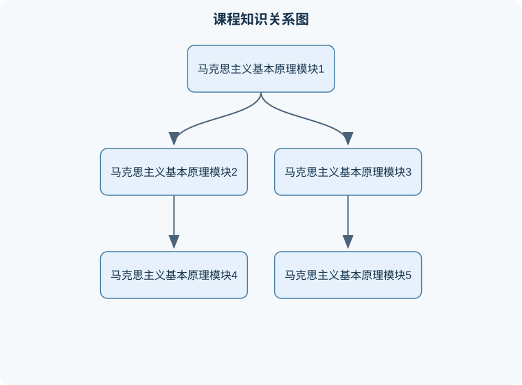

# 马克思主义基本原理

## 一、课程整体知识框架

### 课程边界与先修知识

本课程系统讲授马克思主义的基本立场、基本观点和基本方法，内容边界包括马克思主义哲学、马克思主义政治经济学和科学社会主义三个组成部分，并说明三者在世界观、认识论、社会历史观、资本主义经济运行分析和社会主义发展理论上的内在联系。重点分析物质与意识、实践与认识、联系与发展、矛盾运动、社会存在与社会意识、生产力与生产关系、经济基础与上层建筑、人民群众与个人作用等基本原理；商品、价值、货币、资本、剩余价值、资本积累、资本循环与周转、社会再生产、平均利润、垄断资本主义和经济全球化等政治经济学范畴；社会主义由空想到科学、无产阶级革命、无产阶级政党、社会主义建设以及共产主义社会的基本特征。先修知识包括中学历史、政治和基本经济常识，不要求高等数学；涉及政治经济学数量关系时，需掌握比例、百分数和简单代数运算。课程不把具体国家政策、现实事件或特定时期的制度安排直接等同于一般原理，所有现实分析均须说明历史条件、制度背景和适用边界。





### 1. 课程性质与基本理论结构

马克思主义基本原理是关于自然、社会和人类思维发展一般规律的科学理论体系，核心内容通常由马克思主义哲学、马克思主义政治经济学和科学社会主义三个相互联系的部分构成。三者不是彼此孤立的知识单元：马克思主义哲学提供认识世界和改造世界的根本方法；政治经济学以资本主义生产方式为主要对象，揭示商品、货币、资本和剩余价值等经济范畴背后的社会关系；科学社会主义在唯物史观和剩余价值理论基础上，说明资本主义社会的历史地位、内在矛盾以及社会主义和共产主义发展的历史条件。

课程的逻辑主线可以概括为“世界是什么—世界怎样发展—人怎样认识和改造世界—资本主义怎样运行—社会形态怎样变迁—社会主义怎样发展”。学习某一概念时，不能只记忆定义，还要说明它的对象、条件、因果关系、现实表现和适用边界。例如，“生产力决定生产关系”并不意味着生产关系完全被动，而是指生产力构成社会发展的最终决定力量；当生产关系适合生产力发展时，它会促进生产力，当生产关系成为束缚时，就需要通过社会变革加以调整。

### 2. 马克思主义的基本立场、观点和方法

马克思主义的基本立场是人民立场，即从最广大人民的根本利益出发观察社会历史，并把人的解放和自由全面发展作为重要价值目标。基本观点包括辩证唯物主义和历史唯物主义、劳动价值论和剩余价值理论、社会形态理论以及社会主义和共产主义理论。基本方法包括实事求是、矛盾分析、历史分析、阶级分析、社会结构分析和实践检验。

“实践”是马克思主义认识论的核心范畴。实践是人类能动地改造客观世界的社会性活动，具有客观实在性、社会历史性和能动创造性。认识来源于实践，又反作用于实践。认识是否正确，不能只依据主观感受或逻辑自洽判断，而要看它能否在一定条件下正确反映客观对象，并在实践中产生预期效果。实践标准具有确定性和不确定性：实践能够检验认识是否符合客观实际，这是确定性；任何一次实践都受历史条件、认识工具和活动范围限制，因而检验过程具有历史性和相对性。

### 3. 理论分析的统一方法

分析马克思主义基本原理时，应遵循以下顺序：

1. **界定对象**：说明分析的是自然现象、经济关系、政治制度、思想观念还是社会历史过程。
2. **确定矛盾和条件**：找出主要矛盾、矛盾主要方面以及决定结论成立的具体条件。
3. **分析运动过程**：说明事物由何种原因产生，经过哪些中介，向何种方向发展。
4. **区分一般与特殊**：一般规律提供基本解释，特殊情形需要结合具体历史条件分析。
5. **回到实践检验**：判断理论能否解释事实、指导行动，并根据实践结果修正认识。

这一方法反对两种片面性。一是机械套用原理，把复杂现实直接归结为某一个概念；二是只描述现象而不分析本质、条件和发展趋势。例如，看到市场价格上涨，不能立即断言商品价值增加；价格受价值、供求、货币条件、市场预期等因素共同影响，短期价格可能偏离价值，长期则受价值规律制约。

## 二、章节和模块划分

### 核心知识覆盖清单

本清单根据本课程的章节划分整理，用于检查正文是否覆盖各个核心模块：

- **模块一：马克思主义基本原理的形成与理论特征**。
- **模块二：世界的物质性与唯物辩证法**。
- **模块三：认识论与实践论**。
- **模块四：历史唯物主义与社会发展规律**。
- **模块五：商品、价值与货币**。
- **模块六：资本与剩余价值**。
- **模块七：资本主义经济、政治与全球化**。
- **模块八：社会主义和共产主义的理论与实践**。
- **课程核心概念与分析实践**。
- **1. 代表性问题分析流程**。
- **2. 概念分析伪代码**。
- **3. 例题一：商品二因素**。
- **4. 例题二：劳动生产率与价值量**。
- **5. 例题三：剩余价值率**。
- **6. 例题四：生产力与生产关系**。
- **7. 例题五：社会现象综合题**。
- **8. 实验与项目一：社会现象理论分析报告**。
- **9. 实验与项目二：商品价值与劳动生产率调查**。
- **10. 具体易错点**。
- **11. 常见笔试问题及解答思路**。
- **12. 常见面试问题及回答要点**。
- **13. 岗位关联**。


### 模块一：马克思主义基本原理的形成与理论特征

马克思主义产生于十九世纪中叶，具有深刻的社会历史条件。资本主义生产方式的发展促进了生产力增长，同时也造成了生产资料私人占有与生产社会化之间的矛盾；工业无产阶级形成并开展有组织的斗争，为科学理论的产生提供了阶级基础。德国古典哲学、英国古典政治经济学和英法空想社会主义等理论成果，为马克思主义的形成提供了思想材料，但马克思主义并非这些思想的简单拼接，而是在批判继承中实现了理论变革。

马克思主义的理论特征表现为科学性、革命性、实践性、人民性和发展性。科学性要求从客观事实和社会规律出发；革命性要求揭示并批判不合理的社会关系；实践性要求理论接受社会实践检验；人民性要求维护人民群众的根本利益；发展性要求理论随着实践、时代和科学的发展而不断丰富。

**边界说明**：马克思主义关于资本主义历史趋势的判断，不等同于对资本主义某一时期、某一国家或某一政策作简单的“立即崩溃”判断。历史趋势通过矛盾运动表现出来，具体过程可能长期、曲折并具有多种形式。

### 模块二：世界的物质性与唯物辩证法

物质是不依赖于人的意识、并能为人的意识所反映的客观实在。物质概念不是指某一种具体物质，而是对一切客观存在的最高抽象。运动是物质的根本属性和存在方式，时间和空间是物质运动的基本形式。物质和运动不可分：脱离物质谈运动会把运动变成空洞观念，脱离运动谈物质则会把物质理解为僵死实体。

意识是人脑的机能，是客观世界在人脑中的主观映象，具有社会性、能动性和创造性。意识的内容来源于客观世界，但意识活动并非机械照相，而是通过选择、加工、概括和判断形成观念。物质决定意识，意识又能通过实践反作用于物质。意识反作用的实现必须经过人的实践活动，并以正确认识、客观条件和适当行动为前提。

唯物辩证法的三大规律可作如下理解：

- **对立统一规律**说明矛盾是事物发展的根本动力。矛盾双方既相互依存又相互排斥，矛盾的普遍性要求承认矛盾无处不在，特殊性要求具体问题具体分析。
- **量变质变规律**说明事物发展具有渐进性和飞跃性。设某一属性变化量为 $\Delta q$，当变化仍处于一定范围内，事物的基本性质可能保持稳定；当量变突破临界条件，可能引起质变。这里的“量”不是固定数值，临界条件取决于对象性质和具体关系。
- **否定之否定规律**说明发展是自我否定、自我超越和螺旋式上升的过程。否定不是简单消灭，也不是全盘保留，而是克服旧事物中消极因素、保留合理因素并形成新的结构。

**反例**：把“矛盾普遍性”理解为所有矛盾在任何时候都同等重要，是错误的。现实分析必须区分主要矛盾与次要矛盾、矛盾主要方面与次要方面。

### 模块三：认识论与实践论

认识是主体对客体的能动反映。感性认识通过感觉、知觉和表象获得关于对象外部联系和直接特征的认识；理性认识通过概念、判断和推理把握对象的本质和规律。感性认识和理性认识相互依赖：没有感性材料，理性认识会成为无源之水；没有理性加工，感性材料不能形成系统知识。

认识过程通常表现为“实践—认识—再实践—再认识”的循环。其推导关系如下：

1. 人在实践中接触客观对象，形成感性材料；
2. 通过比较、分析、综合和抽象，从现象中概括本质联系；
3. 将形成的认识用于指导实践；
4. 根据实践结果检验、修正和发展原有认识。

真理是对客观事物及其规律的正确反映。真理具有客观性、绝对性和相对性。客观性指真理内容不以人的意志为转移；绝对性指正确认识中包含对客观规律的正确把握；相对性指认识受历史条件、实践范围和认识能力限制。真理与谬误在一定条件下可以相互转化：正确认识超出适用条件可能变成教条，错误认识经过实践检验和修正也可能成为进一步认识的起点。

### 模块四：历史唯物主义与社会发展规律

社会存在是社会生活的物质方面，主要包括自然地理环境、人口因素和物质生产方式。其中，生产方式是社会存在的核心。社会意识是社会生活的精神方面，包括政治法律思想、道德、艺术、宗教、哲学等形式。社会存在决定社会意识，但社会意识具有相对独立性，能够通过人的实践活动反作用于社会存在。

生产力包括劳动者、劳动资料和劳动对象等基本要素。生产关系是人们在生产过程中形成的经济关系，主要包括生产资料所有制关系、生产中人与人的关系以及产品分配关系。生产力与生产关系的矛盾运动构成社会发展的基本动力之一。当生产关系适合生产力发展时，会促进生产力；当生产关系严重不适合生产力时，会阻碍生产力发展，并推动社会关系调整。

经济基础是由一定社会发展阶段的生产关系总和构成的，上层建筑则是建立在经济基础之上的政治法律制度和社会意识形态。经济基础决定上层建筑，上层建筑又反作用于经济基础。二者之间不是单向机械决定关系，而是通过制度、组织、思想和实践活动发生复杂互动。

人民群众是历史的创造者，因为人民群众是社会物质财富和精神财富的创造者，也是社会变革的决定性力量。个人在历史发展中能够发挥作用，但个人作用受社会条件、群众实践和历史规律制约。评价历史人物应把个人贡献放在具体时代条件和社会关系中考察，既不能否定个人作用，也不能把历史归结为少数人的意志。

### 模块五：商品、价值与货币

商品是用于交换的劳动产品，具有使用价值和价值二因素。使用价值是商品满足某种需要的有用性，是商品的自然属性；价值是凝结在商品中的无差别的人类劳动，是商品的社会属性。商品的二因素由生产商品的劳动二重性决定：具体劳动创造商品的使用价值，抽象劳动形成商品的价值。

商品价值量由生产该商品的社会必要劳动时间决定。设某商品的社会必要劳动时间为 $t$，这里 $t$ 的单位是小时，指在现有社会正常生产条件、平均劳动熟练程度和平均劳动强度下生产该商品所需要的劳动时间。若其他条件不变，劳动生产率提高，单位商品所包含的社会必要劳动时间减少，单位商品价值量下降；劳动生产率下降，单位商品价值量上升。劳动生产率表示单位时间生产的使用价值数量，不能直接等同于劳动强度。

货币是固定充当一般等价物的特殊商品，具有价值尺度、流通手段、贮藏手段、支付手段和世界货币等职能。货币执行价值尺度职能时，可以用价格表示商品价值，但价格不一定等于价值。价值规律要求商品交换以价值量为基础实行等价交换，其作用通过价格波动、供求变化和竞争实现，表现为调节资源配置、刺激技术进步和促使生产者分化。

### 模块六：资本与剩余价值

资本不是单纯的货币或生产资料，而是能够带来剩余价值的价值，其本质是资本家与雇佣劳动者之间的社会关系。资本循环依次经过购买、生产和销售阶段。资本家用货币购买生产资料和劳动力，劳动者在生产过程中创造新价值，商品销售后实现价值和剩余价值。

劳动力成为商品必须具备两个条件：劳动者具有人身自由，能够把劳动力作为商品出卖；劳动者不占有生产资料，只能通过出卖劳动力维持生活。劳动力商品的价值由维持劳动者及其家庭生活、培养劳动能力和延续劳动力所需的生活资料价值决定。劳动力商品的特殊性在于，它在使用过程中能够创造出超过自身价值的新价值。

设必要劳动时间为 $v$，剩余劳动时间为 $s$，则工作日可表示为

$$
T=v+s
$$

其中，$T$、$v$、$s$ 的单位均为小时。剩余价值率为

$$
m'=\frac{s}{v}\times 100\%
$$

它表示剩余劳动时间与必要劳动时间的比例，不是剩余价值总量。绝对剩余价值通过延长工作日或增加剩余劳动时间获得；相对剩余价值通过提高生活资料生产部门劳动生产率、降低劳动力价值，从而缩短必要劳动时间获得。

不变资本 $c$ 是购买生产资料的资本，其价值在生产过程中通过转移进入新产品，不发生价值增殖；可变资本 $v$ 是购买劳动力的资本，劳动力使用能够创造新价值，因此是剩余价值的源泉。资本有机构成、资本周转速度和技术进步会影响剩余价值生产，但不能把机器本身直接视为剩余价值的创造者。

### 模块七：资本主义经济、政治与全球化

资本主义基本矛盾表现为生产社会化与生产资料资本主义私人占有之间的矛盾。这一矛盾在经济危机中集中表现为生产相对过剩：不是社会绝对没有需要，而是有支付能力的需求不足以实现全部商品价值。危机可以暂时破坏和调整部分矛盾，但不能从根本上消除资本主义基本矛盾。

资本主义从自由竞争发展到垄断，是资本集中和生产集中的结果。垄断并没有消除竞争，而是使竞争具有更大规模、更高强度和更复杂的形式。金融资本是垄断的工业资本和垄断的银行资本融合形成的资本形态。国家垄断资本主义通过国家力量参与经济调节、社会再生产和危机治理，能够在一定程度上缓和矛盾，但不能改变资本主义制度的基本性质。

经济全球化使生产、贸易、金融、技术和劳动力市场联系更加紧密，促进了资源跨国配置和生产社会化，同时也可能加剧发展不平衡、金融风险传导、生态压力和劳动者权益问题。分析全球化应区分生产力发展的客观趋势与特定经济制度、国际权力结构造成的不平等后果，不能把全球化简单等同于“完全开放”或“必然普遍受益”。

### 模块八：社会主义和共产主义的理论与实践

社会主义是资本主义向共产主义过渡的社会形态，具有解放和发展生产力、逐步消除剥削和两极分化、促进人的全面发展的历史任务。社会主义发展不是单一路径的直线过程，而是在不同国家历史条件、经济基础、文化传统和国际环境中呈现多样形式。

共产主义社会以生产力高度发展、生产资料社会共同占有、社会成员共同参与社会治理和人的自由全面发展为重要特征。共产主义不是脱离现实条件的抽象理想，其实现需要生产力发展、社会关系变革、人的思想和能力发展等多方面条件。社会主义建设必须处理好生产力与生产关系、经济基础与上层建筑、效率与公平、发展与安全等关系。

**综合分析流程**适用于社会现象、经济政策和历史事件：

1. 描述事实，区分现象、数据和价值判断；
2. 确定所处社会形态及其生产方式；
3. 分析生产力、生产关系、经济基础和上层建筑；
4. 找出主要矛盾及其主要方面；
5. 考察利益主体、制度条件和历史过程；
6. 判断短期效果与长期趋势；
7. 用实践结果验证结论，避免把可能性直接写成现实性。

### 课程核心概念与分析实践

### 1. 代表性问题分析流程

**流程一：概念辨析流程**

输入为一个概念或判断，输出为定义、对象、条件、与相近概念的区别及适用边界。先判断其所属模块，再确认概念的对象和基本属性，随后列出成立条件，最后用一个正例和一个反例检验定义。例如分析“价格决定价值”这一判断，应指出价格是价值的货币表现，价值是价格运动的基础，但供求和竞争会使价格围绕价值上下波动，因此该判断把表现形式误认为本质关系。

**流程二：社会现象综合分析流程**

输入为一项社会政策、经济现象或历史事件，输出为因果链和理论结论。先描述事实，再分析生产力和生产关系，继而考察经济基础与上层建筑，最后分析人民群众、利益关系和发展趋势。流程的不变量是：不能脱离具体历史条件使用抽象原理；不能把暂时现象直接当作发展规律；不能只讲经济因素而忽视政治、文化和制度中介。

**流程三：理论论证流程**

输入为一个待论证命题，输出为完整论证。步骤为：明确命题含义；提出核心概念；说明因果机制；列出成立条件；提供现实例证；说明反例或边界；得出限定性结论。终止条件是命题已经回答“是什么、为什么、在什么条件下成立、何时不成立”。

### 2. 概念分析伪代码

```text
输入：社会现象 P，理论概念集合 C
输出：结构化分析报告 R

1. 描述 P 的时间、空间、主体和结果
2. 从 C 中选择与 P 直接相关的概念
3. 区分现象、表象、本质和趋势
4. 分析生产力、生产关系、经济基础、上层建筑
5. 确定主要矛盾及矛盾主要方面
6. 检查结论是否遗漏历史条件和中介环节
7. 用事实、反例或实践结果验证结论
8. 若定义混淆或条件不足，则返回第 2 步修正
9. 输出 R
```

该流程适用于课程论文、社会调查报告和综合论述题，不适用于替代具体统计模型或精确预测。它的价值在于保证理论分析结构完整，而不是自动生成唯一答案。

### 3. 例题一：商品二因素

**题干**：某商品既能满足人的需要，又需要生产者付出劳动。请说明其使用价值和价值的关系。

**分析**：商品的使用价值回答“有什么用”，价值回答“凝结了多少无差别的人类劳动”。二者统一于商品，同时又存在矛盾。

**解答**：使用价值是商品的自然属性，是价值的物质承担者；价值是商品的社会属性，体现商品生产者之间的社会关系。没有使用价值，商品就难以进入交换；只有使用价值而没有价值的自然物，也不一定是商品。商品对所有者通常是非使用价值，对非所有者则是使用价值，这种矛盾必须通过交换解决。

**结果验证**：无偿自然空气通常有使用价值，但不因一般使用而成为商品；加工后进入交换的瓶装水同时具有使用价值和价值。

**变式**：若某商品无人需要，即使生产者投入了劳动，也不能简单断言其全部劳动都形成社会承认的价值，因为价值实现还需要社会交换和需求条件。

### 4. 例题二：劳动生产率与价值量

**题干**：原来生产一件商品需要 4 小时，劳动生产率提高一倍，其他条件不变，单位商品价值量如何变化？

**分析**：劳动生产率提高一倍，表示单位时间生产的使用价值数量增加一倍，因此生产一件商品所需时间由 4 小时降为 2 小时。

**解答**：商品价值量由社会必要劳动时间决定，所以单位商品价值量相对原来减少一半。这里假定生产条件、劳动强度、劳动熟练程度和社会平均水平不发生其他变化。

**结果验证**：若原来 8 小时生产 2 件，提高一倍后 8 小时生产 4 件，单位商品耗费时间从 4 小时降为 2 小时。

**变式**：若只是个别企业提高劳动生产率，而社会平均生产条件未变，个别企业商品的个别价值降低，但社会价值未必立即下降；只有该技术普遍化并改变社会必要劳动时间，社会价值才会相应变化。

### 5. 例题三：剩余价值率

**题干**：某劳动者工作日为 8 小时，其中必要劳动时间为 5 小时。求剩余劳动时间和剩余价值率。

**分析**：根据 $T=v+s$，已知 $T=8$ 小时、$v=5$ 小时。

**解答**：

$$
s=T-v=8-5=3\text{小时}
$$

$$
m'=\frac{s}{v}\times100\%
=\frac{3}{5}\times100\%=60\%
$$

因此剩余劳动时间为 3 小时，剩余价值率为 60%。

**结果验证**：总劳动时间等于必要劳动时间与剩余劳动时间之和，即 $5+3=8$ 小时。

**变式**：若工作日延长到 10 小时而必要劳动时间仍为 5 小时，则 $s=5$ 小时，$m'=100\%$。若工作日仍为 8 小时但必要劳动时间降为 4 小时，则 $s=4$ 小时，$m'=100\%$，这分别体现绝对剩余价值和相对剩余价值的不同机制。

### 6. 例题四：生产力与生产关系

**题干**：某企业引入自动化设备后，产量提高，但原有岗位结构、培训制度和分配制度未调整，导致设备闲置、工人技能不足。如何解释这一现象？

**分析**：自动化设备属于生产力要素，但生产力发展需要与生产关系、管理制度和劳动者能力相适应。

**解答**：设备引入提高了潜在生产力，但如果劳动组织、技能结构和分配方式不能适应新技术，生产关系及其具体制度就可能成为生产力发展的约束。解决办法不是简单否定技术，而是通过培训、岗位重组、管理调整和合理分配，使生产关系与新的生产力水平相适应。

**结果验证**：若培训后设备利用率提高、生产流程顺畅、劳动者收益安排合理，说明制度调整促进了生产力；若设备仍闲置，则需进一步检查技术适配、市场需求和组织管理条件。

**变式**：不能把“生产关系适应生产力”理解为任何制度调整都会自动有效，还必须结合市场需求、资源条件和劳动者参与情况。

### 7. 例题五：社会现象综合题

**题干**：某地区数字平台扩大了就业机会，同时出现劳动强度增加、收入差异扩大和劳动保障不足。请运用马克思主义基本原理分析。

**分析**：该现象同时涉及生产力发展、劳动关系、分配关系和上层建筑调节。

**解答**：数字技术和平台组织提高了信息匹配效率，属于生产力发展的新表现；平台企业、劳动者和消费者之间形成新的生产组织与利益关系。就业扩张体现技术和市场的积极作用，劳动强度、收入差异和保障不足则说明生产关系及制度安排尚未充分适应新的生产力。应从劳动权益、平台责任、收入分配、社会保障和公共监管等方面调整制度，使技术进步成果更公平地惠及劳动者。

**结果验证**：评价政策不能只看平台交易量，还应考察劳动者收入稳定性、工作时间、保障覆盖率、职业安全和消费者权益。

**变式**：若某项监管导致平台退出、就业大量减少，则需要重新评估监管强度和实施方式，不能把维护权益与排斥技术发展简单对立起来。

### 8. 实验与项目一：社会现象理论分析报告

**输入数据**：一项公共政策或社会经济现象的公开统计材料、访谈记录和制度文本。

**步骤**：确定研究问题；区分事实与评价；整理主体及其利益关系；分析生产力、生产关系、经济基础和上层建筑；提出主要矛盾；比较政策实施前后的变化；形成结论并说明边界。

**评价标准**：概念使用准确，占 30%；因果链条完整，占 30%；证据与结论相匹配，占 25%；能说明限制条件，占 15%。

**排错方法**：若结论只重复材料而没有理论解释，应补充机制；若把相关关系当因果关系，应寻找中介因素；若只分析政策目标而不分析实际效果，应增加实施结果；若忽视不同群体差异，应分层比较。

### 9. 实验与项目二：商品价值与劳动生产率调查

**输入数据**：同类商品若干生产者的单位产量、劳动时间、设备条件、劳动熟练程度和市场价格。

**步骤**：记录每个生产者的单位劳动时间；区分个别劳动时间与社会平均劳动时间；比较劳动生产率差异；分析价格与价值量可能出现的偏离；讨论技术普及后社会必要劳动时间是否改变。

**评价标准**：变量单位明确，劳动时间以小时计，产量以件或千克计；能区分个别价值和社会价值；能说明供求对价格的影响；结论不得把价格直接等同于价值。

**排错方法**：若只比较价格而不比较劳动时间，应补充价值形成条件；若不同商品规格不同，应统一使用价值标准；若调查对象数量过少，应将结论限定为个案分析；若劳动强度和熟练程度差异明显，应避免直接横向比较。

### 10. 具体易错点

1. 把马克思主义等同于单一学科，忽视哲学、政治经济学和科学社会主义的内在联系。
2. 把物质理解为肉眼可见的实体，忽视物质范畴的哲学抽象性。
3. 把意识的能动性理解为意识可以脱离物质条件直接创造现实。
4. 把矛盾普遍性理解为所有矛盾作用相同。
5. 把量变质变理解为任何数量积累都会自动产生质变。
6. 把否定理解为简单消灭，而不是扬弃和自我超越。
7. 把实践标准理解为短期结果或多数人的主观意见。
8. 把真理的相对性误解为没有客观真理。
9. 把生产力决定生产关系理解为生产关系毫无反作用。
10. 把经济基础等同于经济总量，忽视其本质是生产关系总和。
11. 把使用价值和价值分别理解为“有用”和“价格”。
12. 把劳动生产率提高与劳动强度增加混为一谈。
13. 把货币等同于资本，忽视资本的本质是价值增殖关系。
14. 把机器设备看成剩余价值的直接来源，忽视活劳动创造新价值。
15. 把剩余价值率和剩余价值量混为一谈。
16. 把垄断理解为竞争消失，忽视垄断阶段仍存在多种竞争。
17. 把经济全球化理解为各国收益完全相同。
18. 把社会主义历史过程理解为没有曲折和差异的单线过程。

### 11. 常见笔试问题及解答思路

1. **为什么说实践是认识的基础？**  
   从认识来源、动力、目的和检验标准四方面作答，并说明实践与认识的循环关系。

2. **如何理解矛盾的普遍性和特殊性关系？**  
   先定义二者，再说明普遍性寓于特殊性之中，具体分析是把握矛盾的关键。

3. **商品二因素由什么决定？**  
   说明商品二因素由劳动二重性决定，具体劳动创造使用价值，抽象劳动形成价值。

4. **为什么说劳动力商品具有特殊性？**  
   说明劳动力价值的决定方式，并指出劳动力使用能够创造超过自身价值的新价值。

5. **剩余价值是怎样产生的？**  
   说明资本家购买劳动力后，在生产过程中延长剩余劳动时间，劳动者创造的新价值超过劳动力价值。

6. **如何理解生产力和生产关系的辩证关系？**  
   先讲生产力决定生产关系，再讲生产关系反作用，最后说明二者矛盾运动推动社会发展。

7. **为什么资本主义经济会发生危机？**  
   从生产社会化与私人占有矛盾出发，说明生产相对过剩、有效需求不足和危机调整机制。

8. **为什么社会主义发展具有多样性？**  
   从各国生产力水平、历史传统、国际环境和社会结构差异说明共同规律与具体道路的统一。

### 12. 常见面试问题及回答要点

1. **如何用马克思主义分析一个热点现象？**  
   先描述事实，再找主要矛盾和利益主体，分析生产力、生产关系及制度条件，最后提出有边界的结论。追问时应说明如何避免把个人观点冒充理论结论。

2. **你如何理解理论联系实际？**  
   理论不是口号，而是解释事实、揭示机制并指导实践的方法。追问可说明理论适用条件和实践检验方式。

3. **价格上涨是否意味着价值增加？**  
   不必然。价格是价值的货币表现，供求、货币条件和预期可造成偏离，需区分短期价格变化与社会必要劳动时间变化。

4. **技术进步会不会自动使所有劳动者受益？**  
   不会自动实现。技术属于生产力，收益分配和劳动保障取决于生产关系、制度安排和利益协调。追问可讨论效率与公平的统一。

5. **如何理解个人与人民群众在历史中的作用？**  
   人民群众是历史创造者，个人能够在具体条件下发挥重要作用，但个人作用不能脱离群众实践和社会结构。

6. **马克思主义是否只适用于十九世纪资本主义？**  
   基本方法和关于社会关系、资本增殖、生产力与生产关系的分析仍具有解释力，但具体结论必须结合新技术、新产业和新制度条件发展。

7. **如何处理理想与现实的矛盾？**  
   既要坚持发展方向，又要从现实生产力、制度基础和历史条件出发，通过阶段性实践逐步实现目标。追问可说明不能用最终目标替代现实政策分析。

8. **你怎样验证自己的理论判断？**  
   说明判断依据、比较对象、时间范围、可能反例和实践结果；承认认识的条件性，必要时修正原有结论。

### 13. 岗位关联

在政策分析、行业研究、企业战略、公共管理、新闻评论、社会调查和教育研究等岗位中，马克思主义基本原理主要用于识别利益关系、分析发展趋势、解释制度后果和形成结构化判断。实际任务包括撰写行业分析报告、评估政策影响、开展社会调查、分析劳动关系和提出治理建议。

岗位产出可以是问题界定报告、利益相关者分析、因果链说明、政策比较表、调查报告或专题论证。验收标准包括：事实与观点分开；概念定义准确；结论有证据支撑；明确时间、空间和适用条件；能够说明潜在反例；建议具有可操作性，且不把复杂社会问题简化为单一原因。

## 三、核心概念的详细解释

### 1. 马克思主义基本原理的对象、立场与方法

马克思主义基本原理是关于自然、社会和人类思维发展一般规律的理论体系，主要由马克思主义哲学、马克思主义政治经济学和科学社会主义构成。马克思主义哲学回答世界的本质、运动发展的规律以及人如何认识和改造世界的问题；政治经济学以资本主义生产方式为重点，分析商品、货币、资本、剩余价值和资本积累等经济关系；科学社会主义依据唯物史观和剩余价值理论，说明资本主义社会的历史地位、内在矛盾以及社会主义发展的历史条件。

马克思主义的根本立场是人民立场。人民立场不是对所有现实意见作简单平均，而是从最广大人民的根本利益出发分析社会关系，关注劳动者的生存、发展和解放。马克思主义的基本观点包括世界的物质统一性、社会存在决定社会意识、生产力与生产关系的矛盾运动、经济基础与上层建筑的相互作用、人民群众创造历史、资本主义生产方式的内在矛盾等。

马克思主义的基本方法包括实事求是、矛盾分析、历史分析、阶级分析、社会结构分析和实践检验。运用这些方法时，应先界定对象，再识别主要矛盾和相关条件，随后分析原因、中介、结果及其变化，最后用实践结果检验判断。不能把一个一般原理直接当作对所有个案的现成答案。

### 2. 物质、意识与实践

物质是不依赖人的意识而存在、并能为人的意识所反映的客观实在。物质概念不是指某一种具体物质形态，而是对一切客观存在的哲学概括。意识是人脑对客观世界的反映，同时具有能动性。意识的内容来源于客观世界，意识的形成依赖社会实践、语言和人脑的生理活动，但意识并不是客观对象的机械复制，而是经过选择、加工、概括和创造的观念形式。

物质决定意识，表现为意识的内容、形式和发展条件最终受客观实际制约；意识对物质具有能动反作用，正确意识能够通过实践促进事物发展，错误意识则可能造成行动偏差。意识能动作用的实现必须通过实践，不能把“思想的力量”理解为脱离现实条件的任意创造。

实践是人类能动地改造客观世界的社会性活动，基本形式包括生产实践、社会政治实践和科学文化实践。实践具有客观实在性、社会历史性、能动创造性和直接现实性。认识来源于实践，又反作用于实践；实践是认识的来源、动力、目的和检验认识真理性的标准。实践标准具有确定性，因为实践能够判断认识是否符合客观实际；同时具有相对性和历史性，因为任何实践都受到时代条件、认识工具、活动范围和主体能力的限制。

### 3. 联系、发展与矛盾

联系是事物之间以及事物内部各要素之间相互影响、相互制约和相互作用的关系。联系具有客观性、普遍性和多样性。分析联系时必须区分直接联系与间接联系、内部联系与外部联系、本质联系与非本质联系、必然联系与偶然联系。不能因为两个现象同时出现，就断定二者之间存在因果联系。

发展是事物由低级到高级、由简单到复杂、由旧质到新质的运动变化。发展不是单纯数量增加，也不是直线式前进，而是由矛盾运动推动的过程。事物发展的道路通常具有前进性和曲折性，既存在新事物战胜旧事物的总体趋势，也存在暂时倒退、反复和局部失败。

矛盾是反映事物内部或事物之间对立统一关系的哲学范畴。矛盾的同一性表示对立双方相互依存、相互贯通，并在一定条件下相互转化；斗争性表示对立双方相互排斥、相互分离。没有同一性的斗争会失去对立双方的共同基础，没有斗争性的同一则会把矛盾静止化。

主要矛盾决定事物发展的重点和基本方向，矛盾的主要方面决定事物的性质。主要矛盾与矛盾主要方面不是同一个概念：前者着眼于多个矛盾之间的主次关系，后者着眼于一个矛盾内部对立双方的主次关系。具体分析矛盾要求把普遍性与特殊性结合起来，不能用抽象的“一般”代替对具体条件的考察。

量变是事物数量、规模、程度或构成比例的渐进变化；质变是事物根本性质的变化。量变是质变的必要准备，质变是量变的必然结果和新的量变起点。质量互变规律不意味着所有数量变化都会立即导致性质变化，而是要考察度，即事物保持自身质的数量界限。超过度，才可能发生质变。

### 4. 否定之否定与辩证否定

辩证否定是事物自身的否定，是事物内部矛盾运动的结果。它不是简单抛弃，也不是对旧事物的全盘保留，而是“扬弃”：既克服旧事物中不合理的方面，又保留其中合理的因素。辩证发展通常表现为螺旋式上升或波浪式前进，不能把“否定之否定”理解成机械地重复原有状态。

例如，现代生产组织可能否定传统小生产的分散性，但并不意味着劳动技能、生产经验和个体创造性全部消失；更高级的生产形式往往在新的社会关系中保留并改造原有生产力因素。该原理的边界在于：具体历史过程不一定严格表现为两个形式上的“否定”，不能用固定三段式替代现实分析。

### 5. 社会存在、社会意识与社会形态

社会存在是社会生活的物质方面，主要包括自然地理环境、人口因素和物质生产方式，其中生产方式是社会存在的决定性因素。社会意识是社会生活的精神方面，包括政治法律思想、道德、艺术、宗教、哲学以及社会心理和风俗习惯等。

社会存在决定社会意识，表现为社会意识的内容、性质和变化归根到底由社会物质生活条件决定；社会意识具有相对独立性，表现在发展水平可能不完全同步、内部具有继承性、不同社会意识形式相互作用，并能反作用于社会存在。先进社会意识能够促进社会发展，落后社会意识则可能阻碍社会进步，但这种反作用必须通过人的社会实践实现。

社会形态是一定生产力发展阶段与相应生产关系、经济基础和上层建筑的统一体。社会形态更替具有客观规律，但具体道路具有差异性，不能把某一国家、某一时期的发展模式当作所有社会的唯一形式。生产力与生产关系、经济基础与上层建筑的矛盾运动，是社会发展的基本动力。

### 6. 生产力、生产关系与社会基本矛盾

生产力是人类改造自然、生产物质资料的现实力量，主要包括劳动者、劳动资料和劳动对象。劳动者是生产力中最活跃、最具能动性的因素；劳动资料中的生产工具是生产力发展水平的重要标志；科学技术通过改变劳动资料、劳动对象、劳动者素质和生产组织方式，转化为现实生产力。

生产关系是人们在物质生产过程中形成的客观经济关系，包括生产资料所有制关系、生产中人与人的关系以及产品分配关系。生产力决定生产关系的性质、形成和发展变化方向；生产关系反作用于生产力，当它适合生产力发展要求时能够促进生产力，当它不适合时就会束缚生产力。这里的“决定”不是单向机械决定，生产关系具有相对独立性，并通过制度安排、组织方式和利益结构影响生产力。

经济基础是由社会一定发展阶段的生产关系总和构成的社会经济结构；上层建筑是建立在经济基础之上的政治法律制度、政治组织、社会意识形态及其设施。经济基础决定上层建筑，上层建筑反作用于经济基础。政治法律制度和意识形态不只是经济关系的被动反映，它们可以通过国家机构、法律秩序、教育文化和公共治理维护或调整既有经济关系。

### 7. 人民群众与个人在历史中的作用

人民群众是推动社会历史发展的决定性力量，根本原因在于人民群众是社会物质财富和精神财富的创造者，是社会变革的主体。杰出人物能够在特定历史条件下发挥重要作用，例如提出思想、组织行动或推动制度变革，但个人作用不能脱离社会条件、群众实践和历史发展趋势。

群众观点要求尊重人民主体地位、维护人民利益、向人民学习并接受人民实践检验。群众路线不是简单迎合即时意见，而是把分散的群众意见经过调查研究、分析综合形成符合客观规律的政策和行动，再回到群众实践中检验和完善。

### 8. 商品、价值与劳动二重性

商品是用来交换、能够满足某种需要的劳动产品，具有使用价值和价值两个因素。使用价值是商品满足某种需要的有用性，是商品的自然属性；价值是凝结在商品中的无差别的人类劳动，是商品的社会属性。商品必须同时具有使用价值和价值，缺少任何一方都不能成为完整意义上的商品。

生产商品的劳动具有具体劳动和抽象劳动二重性。具体劳动是具有特定形式、目的和操作方式的劳动，创造商品的使用价值；抽象劳动是撇开具体形式的无差别的人类劳动，形成商品价值。劳动二重性是理解商品二因素的关键：不是两种劳动分别在不同时间进行，而是同一劳动过程的两个方面。

社会必要劳动时间是在现有社会正常生产条件下、以社会平均劳动熟练程度和平均劳动强度生产某种使用价值所需要的劳动时间。商品价值量由生产该商品的社会必要劳动时间决定。劳动生产率通常用单位时间生产的产品数量表示，或用生产单位产品所需劳动时间表示。劳动生产率提高，在单位时间内创造的价值总量不一定增加，但单位商品价值量会降低；劳动生产率降低，通常会提高单位商品价值量。这里应区分价值量与使用价值量。

### 9. 价值规律与货币

价值规律的基本内容是：商品的价值量由生产商品的社会必要劳动时间决定，商品交换以价值量为基础实行等价交换。价值规律通过价格围绕价值上下波动实现。价格是价值的货币表现，价格变化还受供求关系、货币价值、市场预期和政策环境影响，因此价格可能在短期内偏离价值，但长期波动受到价值规律制约。

货币是在长期商品交换过程中形成的固定充当一般等价物的商品。货币具有价值尺度、流通手段、贮藏手段、支付手段和世界货币等职能。货币作为价值尺度时，商品价值通过价格表现；作为流通手段时，商品交换表现为商品—货币—商品；作为支付手段时，交换可能与商品实际交付相分离，从而增加支付风险和信用风险。

### 10. 资本、劳动力商品与剩余价值

资本不是单纯的货币、机器或厂房，而是能够带来剩余价值的价值，是一种以物为媒介的社会关系。资本循环依次经过购买、生产和销售阶段，资本在不同阶段采取货币资本、生产资本和商品资本的职能形式。

劳动力成为商品必须具备两个条件：劳动者具有人身自由，能够把自己的劳动力当作商品出卖；劳动者同生产资料相分离，除了自己的劳动力外没有其他可供出卖的生产资料。劳动力商品的价值由维持劳动者自身生存、延续劳动力和抚养劳动者家属所需要的生活资料价值决定，并受历史和道德因素影响。劳动力商品的特殊性在于，其使用能够创造出超过自身价值的新价值。

剩余价值是劳动者创造的新价值中超过劳动力价值的部分。资本家支付的是劳动力价值，而在生产过程中使用劳动力，使劳动者创造的新价值超过劳动力价值。资本主义剥削的秘密不在商品交换违反等价交换，而在于劳动力这种特殊商品的使用价值能够创造价值和剩余价值。

### 11. 不变资本、可变资本、绝对剩余价值与相对剩余价值

按照资本在剩余价值生产中的作用，资本分为不变资本和可变资本。不变资本用于购买生产资料，其价值在生产过程中通过具体劳动转移到新产品中，价值量一般不发生变化；可变资本用于购买劳动力，劳动力在生产中创造新价值，并可能创造剩余价值。

绝对剩余价值是在必要劳动时间不变的条件下，通过延长工作日或提高劳动强度增加剩余劳动时间；相对剩余价值是在工作日长度不变的条件下，通过提高社会劳动生产率、降低劳动力价值、缩短必要劳动时间来增加剩余劳动时间。现实中二者可能结合，但概念上必须区分其实现机制。

### 12. 资本积累、资本有机构成与经济危机

资本积累是剩余价值转化为资本、扩大再生产的过程。资本积累扩大生产规模，也可能导致资本有机构成提高、劳动者相对过剩和贫富差距扩大。资本有机构成通常用不变资本与可变资本的价值比例表示，若以 $c$ 表示不变资本、$v$ 表示可变资本，则资本有机构成为 $c:v$。该比例只是价值构成，不能简单等同于技术构成，但二者通常存在联系。

资本主义经济危机的深层根源是生产社会化与资本主义私人占有之间的矛盾。生产具有社会化特征，而生产资料和产品分配受私人资本支配，可能造成生产无限扩张与劳动者有支付能力的需求相对不足之间的矛盾。危机表现为商品滞销、企业停产、失业增加、信用收缩和资本贬值。危机能够暂时调整供求和资本结构，却不能根本消除制度矛盾。

### 13. 垄断资本主义、国家垄断资本主义与经济全球化

自由竞争发展到一定阶段，生产和资本集中形成垄断。垄断资本主义的基本特征包括垄断组织在经济生活中占支配地位、金融资本和金融寡头形成、资本输出成为重要特征、国际垄断同盟从经济上瓜分世界以及垄断资本主义国家通过国际体系争夺世界市场。

国家垄断资本主义是国家政权与私人垄断资本相结合的资本主义形态。国家可以通过财政、货币、产业、社会保障和公共投资等手段调节经济，但这种调节通常服务于维护资本主义生产关系和总体统治秩序。国家垄断资本主义能够在一定时期缓和生产过剩、就业和社会冲突，却不能从根本上消除资本主义基本矛盾。

经济全球化是生产、贸易、金融、技术和信息活动跨越国界不断加强的过程。它扩大了国际分工和市场联系，也可能造成发展不平衡、产业依赖、金融风险传导和劳动权益压力。分析全球化不能简单归结为“完全有利”或“完全有害”，应结合国家发展阶段、产业结构、制度能力和国际分工位置判断。

### 14. 社会主义与共产主义

社会主义是以生产资料公有制和劳动人民利益为重要基础的社会发展阶段，其具体制度形式会因历史条件、生产力水平和社会结构不同而具有差异。社会主义建设需要发展生产力、完善生产关系、推进民主法治、促进社会公平，并处理效率与公平、发展与安全、改革与稳定等关系。

共产主义社会是马克思主义所设想的更高级社会形态，具有生产力高度发展、物质财富充分、人的自由全面发展和阶级差别逐步消亡等特征。共产主义不是脱离现实条件的道德愿望，其实现需要长期的社会实践和物质、制度、文化条件。社会主义和共产主义的理论目标不能直接替代现实发展阶段的具体任务。

## 四、重要定义、公式、定理和推导

### 专业审校补充：关键定义与适用边界

社会存在与社会意识的辩证关系，不能简化为“经济决定一切”。社会存在是社会生活的物质方面，主要包括物质资料生产方式、地理环境、人口因素以及由此形成的现实生活条件；社会意识是社会生活的精神方面，包括政治法律思想、道德、艺术、宗教、哲学以及社会心理等。社会存在决定社会意识，表现为社会意识的内容、性质和变化归根到底受社会物质生活条件制约；社会意识具有相对独立性，可能超前或滞后于社会存在，具有历史继承性，并通过理论、制度、舆论和人的实践活动反作用于社会存在。判断一种意识是否具有进步作用，不能只看其形式是否先进，而要考察它是否正确反映客观规律、是否符合人民实践需要以及能否通过组织和制度转化为现实力量。该原理不等于经济因素对一切社会现象都有单线、即时、同等强度的决定作用，政治、文化和制度因素具有中介作用和相对独立性。


### 1. 价值量与劳动生产率的推导

设某商品的社会必要劳动时间为 $t$，单位时间内新创造的价值量为 $k$，则单位商品价值量可表示为：

$$
w=kt
$$

其中，$w$ 是单位商品价值量，单位可理解为价值单位；$k$ 表示单位时间形成的价值量；$t$ 的单位通常为小时。该式假定劳动复杂程度、货币表现和其他生产条件不变。

若劳动生产率提高，生产单位商品所需时间由 $t_0$ 降为 $t_1$，且 $t_1<t_0$，则：

$$
w_1=kt_1<kt_0=w_0
$$

因此，单位商品价值量下降。若单位时间生产商品数量由 $q_0$ 增至 $q_1$，则在同一劳动时间内创造的价值总量通常不因劳动生产率提高而同比增加，但使用价值总量增加。这说明“创造财富的劳动”与“形成商品价值的抽象劳动”不能混同。

### 2. 剩余价值率的定义与推导

设可变资本为 $v$，剩余价值为 $m$，必要劳动时间为 $t_n$，剩余劳动时间为 $t_s$。在单位劳动时间创造价值量相同的假设下，有：

$$
\frac{m}{v}=\frac{t_s}{t_n}
$$

剩余价值率记为 $m'$，因此：

$$
m'=\frac{m}{v}\times 100\%=\frac{t_s}{t_n}\times100\%
$$

若工作日为 $8$ 小时，必要劳动时间为 $5$ 小时，则剩余劳动时间为 $3$ 小时：

$$
m'=\frac{3}{5}\times100\%=60\%
$$

若工作日延长到 $10$ 小时而必要劳动时间仍为 $5$ 小时，则：

$$
m'=\frac{5}{5}\times100\%=100\%
$$

前者主要体现绝对剩余价值生产。若工作日仍为 $8$ 小时，但劳动生产率提高使必要劳动时间降为 $4$ 小时，则剩余劳动时间为 $4$ 小时：

$$
m'=\frac{4}{4}\times100\%=100\%
$$

这主要体现相对剩余价值生产。该推导不能用于直接判断现实劳动者收入，因为工资水平、税费、福利、劳动强度和行业差异不在该简化模型中。

### 3. 预付资本总额、剩余价值与利润率

设不变资本为 $c$，可变资本为 $v$，剩余价值为 $m$，则预付资本总额为：

$$
K=c+v
$$

剩余价值率为：

$$
m'=\frac{m}{v}
$$

利润率为：

$$
p'=\frac{m}{c+v}
$$

由 $m=m'v$ 可得：

$$
p'=\frac{m'v}{c+v}
$$

该式表明，在剩余价值率不变时，若 $c$ 相对于 $v$ 增大，利润率可能下降。但现实利润率还受资本周转速度、价格波动、技术进步、竞争格局和风险等因素影响，不能只依据资本有机构成作绝对判断。

### 4. 资本周转与年剩余价值率

设一年内资本周转次数为 $n$，每次生产过程中获得的剩余价值为 $m$，则年剩余价值量为：

$$
M=nm
$$

若可变资本为 $v$，年剩余价值率为：

$$
M'=\frac{M}{v}\times100\%=\frac{nm}{v}\times100\%
$$

在单次剩余价值量和可变资本量不变时，加快资本周转能够增加一年内实现的剩余价值量。该结论要求生产条件、剩余价值率和每次预付资本规模等基本不变，不能把资本周转速度提高自动等同于企业利润必然增加。

### 5. 产业资本循环流程

产业资本循环可概括为：

$$
G-W\left(A, P_m\right)\cdots P\cdots W'-G'
$$

其中，$G$ 表示货币资本；$W$ 表示购买的商品；$A$ 表示劳动力商品；$P_m$ 表示生产资料；$P$ 表示生产过程；$W'$ 表示包含剩余价值的商品资本；$G'$ 表示实现增殖后的货币资本。省略号表示资本在不同阶段的停留和转化。

流程的关键不是货币在形式上的循环，而是劳动力进入生产过程后创造新价值，使商品价值超过原预付价值。若商品不能销售，生产中形成的价值和剩余价值就不能顺利实现，循环会在销售阶段受阻。

### 6. 问题分析与实现流程

#### 流程一：社会现象的矛盾分析

**输入**：待分析现象、时间范围、空间范围、相关主体和可观察事实。  
**输出**：主要矛盾判断、因果机制、条件边界和实践建议。

1. 区分事实描述与价值判断，明确“发生了什么”。
2. 列出生产力、生产关系、经济基础、上层建筑和利益主体等相关因素。
3. 判断多个矛盾中的主要矛盾，并说明判断依据。
4. 区分矛盾的主要方面与次要方面，分析二者在何种条件下可能转化。
5. 识别中介机制，避免把时间上的先后直接当作因果关系。
6. 比较不同历史阶段和不同主体，说明结论是否具有普遍性。
7. 用现实结果检验判断，并标出可能反例。

**不变量**：每一步都必须保留现象的时间、主体和条件信息，不能在概括过程中把具体条件删除。  
**终止条件**：能够给出“在何种条件下、通过何种机制、产生何种结果”的完整判断。  
**适用条件**：社会现象具有可调查事实和可界定的分析范围。  
**局限**：无法用一次分析消除所有价值冲突，也不能替代经验调查和政策评估。

```text
输入：现象E，事实集合F，主体集合S，时间范围T
输出：分析报告R

1. R.事实 := 按时间、主体、空间整理(F)
2. R.对象 := 判断E属于生产、政治、文化或社会生活领域
3. 因素 := 提取生产力、生产关系、利益结构、制度条件
4. 矛盾集 := 构造因素之间的相互制约关系
5. 主要矛盾 := 比较各矛盾对E发展方向的影响
6. 机制 := 为主要矛盾补充中介环节与作用条件
7. 边界 := 记录反例、适用范围和不确定信息
8. R.结论 := 形成条件化判断，并提出可检验结果
返回 R
```

### 7. 代表性例题

#### 例题一：商品价格上涨是否必然意味着价值增加？

**题干**：某商品短期内因需求增加而价格上涨，但生产该商品的社会必要劳动时间没有变化。问该商品价值是否必然增加？

**分析**：价格是价值的货币表现，但价格受供求影响。社会必要劳动时间未变化，说明单位商品价值量的决定基础未发生变化。

**解答**：不必然增加。需求增加可能使供求关系改变，价格围绕价值向上波动；只有生产该商品的社会必要劳动时间增加，才可能导致单位商品价值量提高。

**结果验证**：若需求恢复而生产条件不变，价格可能回落；若生产效率下降导致社会必要劳动时间增加，才需要重新判断价值量。

**变式**：若价格长期上涨且生产条件、劳动生产率和产品质量均发生变化，应分别分析价值量、货币价值和供求关系，不能只看价格曲线。

#### 例题二：计算剩余价值率

**题干**：某劳动者每日工作 $8$ 小时，其中必要劳动时间为 $5$ 小时。求剩余劳动时间和剩余价值率。

**逐步解答**：

1. 工作日为 $8$ 小时，必要劳动时间为 $5$ 小时。
2. 剩余劳动时间为：
   $$
   t_s=8-5=3\text{小时}
   $$
3. 剩余价值率为：
   $$
   m'=\frac{t_s}{t_n}\times100\%
   =\frac{3}{5}\times100\%=60\%
   $$

**结果**：剩余劳动时间为 $3$ 小时，剩余价值率为 $60\%$。

**结果验证**：必要劳动时间与剩余劳动时间之和为 $5+3=8$ 小时，与工作日一致。

**变式**：若工作日不变而必要劳动时间降为 $4$ 小时，则剩余价值率为 $\frac{4}{4}\times100\%=100\%$。

#### 例题三：区分不变资本和可变资本

**题干**：某工厂预付资金包括机器、原材料和工资。问三者在资本分类中分别属于什么？

**分析**：分类标准是资本在剩余价值生产中的作用，不是物质形态。

**解答**：机器和原材料属于不变资本，因为它们的价值通过具体劳动转移到产品中；工资对应可变资本，因为它购买劳动力，劳动力在生产中创造新价值和剩余价值。机器属于固定资本，原材料属于流动资本，但固定资本与流动资本的分类标准是价值周转方式，不能与不变资本、可变资本混同。

**验证**：同一机器既可以是不变资本，又可以是固定资本；工资通常是可变资本，也属于流动资本。

**变式**：燃料通常在一次生产过程中全部转移价值，属于流动的不变资本，而不是可变资本。

#### 例题四：生产力与生产关系的矛盾分析

**题干**：某企业引入智能化设备后，原有僵化的管理制度导致设备闲置、工人技能不能发挥。应如何分析？

**分析**：智能设备属于生产力因素，管理制度和劳动组织属于生产关系及其具体实现形式。问题不是技术本身无效，而是生产关系没有适应生产力的新变化。

**解答**：生产力发展要求劳动组织、技能培训、利益分配和管理制度相应调整。如果原有制度能够及时改革，就会促进设备利用和劳动生产率提高；若制度长期束缚技术应用，则会阻碍生产力发展。

**验证**：比较制度调整前后的设备开工率、单位产品劳动时间和劳动者技能利用情况，可以检验判断。

**变式**：制度调整并不意味着生产关系越灵活越好，仍需考虑安全、劳动权益和组织协调等条件。

#### 例题五：经济危机的原因

**题干**：某时期生产能力快速扩张，但居民有效需求不足，企业出现库存积压和减产。能否把危机原因归结为消费者“不愿消费”？

**分析**：消费者行为只是表面现象，应进一步分析收入分配、生产目的、投资预期、信用条件和生产社会化与私人占有的关系。

**解答**：不能简单归结为个人消费意愿。资本主义生产以资本增殖为重要目的，生产扩张可能超过劳动者有支付能力的需求；收入分配不均、投资过度、信用收缩和市场竞争又会加剧供求失衡。危机表现为相对过剩，即相对于有支付能力的需求而言商品过剩，并非社会绝对不需要这些商品。

**验证**：若商品仍有社会需要，但因收入不足、信用紧缩而无法实现，就说明“社会需要”和“有效需求”并不相同。

**变式**：公共支出或信贷扩张可能暂时缓和危机，但不能据此断定基本矛盾已经消失。

### 8. 实验与项目流程

#### 项目一：商品价格、价值与供求关系分析

**输入数据**：选取一种商品连续若干时期的价格、产量、社会平均劳动时间、需求量和供给量；数据应标明时间单位、统计范围和口径。  
**步骤**：

1. 建立时间序列，区分价格变化与生产条件变化。
2. 计算单位时间产量变化，判断劳动生产率变化方向。
3. 比较价格变化与社会必要劳动时间变化是否同步。
4. 分析需求、供给、货币条件和预期等中介因素。
5. 形成“价格—价值—供求”的因果说明。

**评价标准**：事实与推断分开；明确变量单位；至少区分短期波动和长期趋势；不得用价格单一指标替代价值判断；结论要说明适用边界。

**排错方法**：若把价格上涨直接判为价值上涨，应回查社会必要劳动时间；若不同时间段统计口径不一致，应重新统一样本；若因果方向不明，应补充供给和需求的时间顺序。

#### 项目二：劳动过程与资本分类案例分析

**输入数据**：某生产项目的机器价值、原材料消耗、工资支出、生产周期、产品销售额及劳动时间。  
**步骤**：

1. 按资本在生产中的作用区分不变资本与可变资本。
2. 按价值周转方式区分固定资本与流动资本。
3. 根据必要劳动时间和剩余劳动时间估算剩余价值率。
4. 检查产品是否销售，避免把生产阶段形成的价值直接等同于已实现收益。
5. 撰写资本循环和劳动关系分析报告。

**评价标准**：分类标准正确；公式中的金额和时间单位一致；说明数据假设；区分价值形成、价值实现和利润；能够指出劳动者技能、技术设备和制度安排的作用。

**排错方法**：把机器归为可变资本时，应回到“是否购买劳动力、是否创造新价值”的标准；把销售额直接视为剩余价值时，应扣除预付资本转移部分和实现条件；若周期不完整，应明确说明不能计算完整年周转指标。

### 9. 典型易错点

1. 把物质等同于可见的实体物，忽略物质概念的哲学抽象性。  
2. 把意识的能动性理解为意识可以脱离实践随意创造现实。  
3. 把联系等同于同时发生，忽略因果机制和中介环节。  
4. 混淆主要矛盾与矛盾的主要方面。  
5. 把量变质变理解为数量达到任意程度都会自动质变。  
6. 把辩证否定理解为全盘否定或简单重复。  
7. 把社会存在缩减为经济因素，忽略人口和自然环境的作用。  
8. 把生产力决定生产关系理解为生产关系完全被动。  
9. 把人民群众创造历史理解为个人和杰出人物没有作用。  
10. 把使用价值当作价值，把有用性当作凝结的人类劳动。  
11. 把具体劳动和抽象劳动理解为两种彼此分离的劳动。  
12. 把价格上涨直接等同于价值增加。  
13. 把劳动生产率提高理解为单位商品价值量提高。  
14. 把不变资本与固定资本、可变资本与流动资本混为一谈。  
15. 把劳动力价值等同于劳动者创造的新价值。  
16. 把剩余价值来源归结为流通领域低价买进高价卖出。  
17. 把相对剩余价值生产等同于单纯延长工作日。  
18. 把经济危机理解为商品绝对过剩，而忽略有效需求不足。  
19. 把国家调控等同于国家已经超越阶级关系。  
20. 把社会主义共同目标理解为所有国家必须采用完全相同的制度形式。

### 10. 典型笔试问题及解答思路

1. **为什么说实践是认识的基础？**  
   从实践是认识来源、动力、目的和检验标准四个方面作答，并说明实践标准具有确定性和相对性。

2. **矛盾的同一性和斗争性是什么关系？**  
   说明二者相互联结：同一性是斗争存在的基础，斗争性推动同一关系变化；不能只讲统一而不讲对立，也不能只讲冲突而否定共同条件。

3. **如何理解生产力与生产关系的辩证关系？**  
   先说明生产力决定生产关系，再说明生产关系反作用于生产力，最后结合具体制度条件说明适合与不适合具有历史性。

4. **商品二因素与劳动二重性是什么关系？**  
   使用价值由具体劳动创造，价值由抽象劳动形成；商品二因素由同一劳动的二重性决定。

5. **劳动力商品为什么是特殊商品？**  
   说明劳动力价值的决定因素，并重点解释劳动力使用能够创造超过自身价值的新价值。

6. **绝对剩余价值与相对剩余价值有何区别？**  
   前者主要通过延长工作日或提高劳动强度增加剩余劳动，后者主要通过提高劳动生产率、缩短必要劳动时间增加剩余劳动。

7. **资本主义经济危机的根源和表现是什么？**  
   根源是生产社会化与私人占有之间的矛盾，表现包括生产过剩、销售困难、失业、信用收缩和资本贬值；政策调节只能在一定条件下缓和危机。

8. **为什么说社会主义发展道路具有多样性？**  
   说明共同规律与具体条件的统一，分析生产力水平、历史传统、社会结构和国际环境的差异，避免把共同目标等同于单一模式。

### 11. 面试问题、参考答案与追问要点

1. **如何用马克思主义分析一个社会热点？**  
   参考答案：先核实事实，再确定对象和主体，分析主要矛盾、利益关系及制度条件，最后提出有时间和范围限制的结论。  
   追问要点：说明如何区分事实、解释和价值判断，如何处理反例。

2. **理论联系实际是否意味着每个理论都要立即转化为具体政策？**  
   参考答案：理论联系实际要求理论能够解释现实并指导实践，但具体政策还需要调查、论证、试点和评估。  
   追问要点：说明理论适用条件以及实践检验标准。

3. **技术进步是否必然使所有劳动者受益？**  
   参考答案：技术进步提高生产力，但收益分配、就业结构和劳动保障取决于生产关系和制度安排。  
   追问要点：分析效率、公平、技能转换和劳动权益之间的关系。

4. **价格上涨是否说明商品价值增加？**  
   参考答案：不必然。应区分社会必要劳动时间变化与供求、货币条件、预期造成的价格波动。  
   追问要点：举出价格短期偏离价值的机制，并说明长期约束。

5. **个人在历史发展中是否重要？**  
   参考答案：人民群众是历史创造者，个人可以在具体条件下发挥重要作用，但个人作用受社会结构、群众实践和历史趋势制约。  
   追问要点：避免把个人作用绝对化或完全否定。

6. **如何理解社会主义目标与现实阶段的关系？**  
   参考答案：理想目标提供发展方向，现实阶段决定具体任务和实现路径，不能用最终目标替代现实条件分析。  
   追问要点：说明如何把长期目标转化为阶段性实践。

7. **如何验证一个社会理论判断？**  
   参考答案：明确概念和变量，说明时间、空间和主体范围，提出可观察结果，与不同案例比较，并根据实践结果修正判断。  
   追问要点：说明如何防止选择性证据和事后解释。

8. **国家宏观调控能否消除资本主义基本矛盾？**  
   参考答案：国家调控可以调整需求、就业、金融和产业结构，在一定时期缓和矛盾，但若生产资料占有和资本增殖关系未根本改变，就不能据此断定基本矛盾消失。  
   追问要点：区分矛盾的暂时缓和、结构调整和根本解决。

### 12. 岗位关联与产出验收

在政策分析岗位中，实际任务包括识别政策影响对象、分析利益关系、评估生产力和生产关系变化，产出政策分析报告、影响评估表和风险清单。验收标准是事实来源清楚、利益主体完整、因果链条明确、建议具有可操作性，并说明潜在副作用。

在行业研究和企业战略岗位中，实际任务包括分析行业集中、技术进步、劳动关系、供求变化和资本循环，使用商品价值、劳动生产率、资本周转和矛盾分析方法，产出行业研究报告、竞争格局分析和战略建议。验收标准是区分价格与价值、短期波动与长期趋势，并对关键假设和数据口径作出说明。

在社会调查和公共管理岗位中，实际任务包括设计访谈提纲、识别主要矛盾、分析群众需求和制度执行效果，产出调查报告、问题清单和治理方案。验收标准是样本与结论匹配、事实与判断分开、反映不同群体利益、建议能够通过实践检验。

在新闻评论和教育研究岗位中，实际任务包括解释社会现象、组织论证、辨析概念和回应反例，使用历史分析、矛盾分析和实践观点，产出评论文章、课程案例或研究性文本。验收标准是概念准确、论据充分、因果关系不过度推断、结论具有条件边界，并能够说明理论分析对现实行动的具体意义。

## 五、算法、流程和实现思路

### 方法与流程覆盖索引

下列方法或流程应在正文中说明输入、步骤、适用条件、结果检查和边界：

- 1. 马克思主义基本原理的问题分析流程
- 2. 概念题和材料题的论证流程
- 3. 典型例题与逐步解答
- 4. 实验与项目工作流程


### 1. 马克思主义基本原理的问题分析流程

马克思主义基本原理不把社会问题处理成脱离历史条件的“标准答案”，而是通过对象界定、矛盾识别、过程分析和实践检验形成结论。该流程的输入是一个待分析的现实问题、文本材料或历史事件；输出是包括事实判断、机制解释、条件边界和实践建议在内的结构化分析结论。

#### 1.1 输入、输出与基本步骤

**输入**通常包括四类材料：一是现象事实，例如价格变化、就业变化、产业升级或社会冲突；二是主体信息，例如劳动者、资本所有者、政府、消费者等利益相关者；三是时间和空间条件；四是可供检验的结果指标。

**输出**至少应包括：问题的准确界定、主要矛盾及其主要方面、形成机制、可能发展趋势、结论成立的条件、反例或局限，以及能够接受实践检验的行动方案。

具体步骤如下：

1. **界定分析对象。** 判断问题属于生产力发展、生产关系调整、经济运行、政治制度、思想观念还是认识实践关系。比如“某商品价格上涨”首先是市场现象，不能直接当作价值变化或社会制度变化。
2. **区分事实与判断。** 事实是可由材料直接支持的陈述，判断是对事实的解释。例如“价格在三个月内上涨”属于事实；“上涨由供求失衡造成”属于需要论证的判断。
3. **识别利益主体和关系结构。** 分析谁从变化中受益、谁承担成本，以及主体之间是否存在合作、竞争、支配或依赖关系。
4. **确定主要矛盾。** 在多个矛盾中，找出对事物发展起决定性作用的矛盾；在一个矛盾内部，判断哪一方面处于支配地位。
5. **分析中介环节。** 不能从“原因”直接跳到“结果”，应说明技术、制度、分配、预期、组织方式等中介如何发挥作用。
6. **考察历史过程。** 比较变化前后，分析量变积累、质变条件和发展趋势，同时注意偶然因素与必然趋势的区别。
7. **提出可检验结论。** 结论应明确适用范围、时间条件和可能反例，并说明通过什么实践结果检验其正确性。

#### 1.2 结构化分析伪代码

```text
输入：现象材料 F，时间范围 T，空间范围 S，相关主体集合 A
输出：分析报告 R

步骤：
1. 从 F 中提取可观察事实，形成事实集合 E
2. 对每条判断标注：事实、解释、价值评价或行动建议
3. 确定对象类型 O，并列出主要利益主体 A
4. 建立主体之间的利益关系和作用关系
5. 列出可能矛盾集合 C
6. 依据影响范围、持续时间和决定程度，确定主要矛盾 c*
7. 分析 c* 的主要方面、次要方面及其转化条件
8. 追踪“原因—中介—结果”链条，检查是否存在跳步
9. 区分一般规律与 T、S 条件下的特殊表现
10. 提出结论及其适用边界
11. 设计可观察的实践检验指标
12. 若检验结果与结论不符，返回步骤 6，修正矛盾判断或条件设定
终止条件：事实、机制、边界和检验指标均得到明确说明
```

该流程的“不变量”是：不能把价值判断冒充事实，不能把相关关系直接当作因果关系，不能脱离具体条件套用一般原理。流程适用于社会现象、经济问题、历史材料和理论辨析题；不适用于代替统计模型、法律裁判或专业技术鉴定。

### 2. 概念题和材料题的论证流程

#### 2.1 概念辨析流程

概念题的输入是一个概念或概念关系，输出是“定义—特征—联系—边界—结论”的完整说明。

第一步，写出对象和内涵。例如，生产力是人类改造自然、获得物质生活资料的现实力量，不能简单等同于机器设备。第二步，说明构成要素及其相互关系。生产力通常包括劳动者、劳动资料和劳动对象，科学技术通过劳动者素质、劳动工具和生产组织等环节影响生产力。第三步，说明与相近概念的区别。生产关系是生产过程中形成的人与人之间的社会关系，不能与生产力混同。第四步，说明条件和边界。生产力的发展需要一定生产关系和制度条件，生产关系也可能促进或束缚生产力。第五步，用一个具体情形验证结论。

#### 2.2 材料题流程

材料题不能逐句复述材料，而应完成三次转换：

- 将材料中的现象转换为理论对象；
- 将理论对象转换为矛盾关系和发展机制；
- 将机制转换为有条件的结论和实践要求。

例如，材料讲述某产业通过自动化提高产量，但部分劳动者岗位减少。应先确认自动化属于生产力变化，再分析技术所有权、劳动组织和收益分配等生产关系因素，最后说明技术进步不会自动带来普遍受益，必须通过培训、就业转型和合理分配等制度安排实现发展成果共享。

### 3. 典型例题与逐步解答

#### 例题一：价格上涨是否等于价值增加

**题干：** 某种商品因短期供应减少，市场价格明显上涨。有人据此认为该商品价值增加。判断这一说法是否正确。

**分析：** 商品价值由生产该商品的社会必要劳动时间决定，价格是价值的货币表现，但价格受供求关系、货币条件、市场预期等影响，可以围绕价值上下波动。因此，短期价格上涨不必然意味着价值增加。

**解答步骤：**

1. 供应减少导致市场供求关系变化。
2. 在需求相对稳定时，供给减少会使商品价格上升。
3. 若生产该商品的社会必要劳动时间没有增加，商品价值本身未必改变。
4. 只有当生产条件普遍变化，使社会必要劳动时间发生变化时，才可能导致价值量变化。

**结果验证：** 若供应恢复后价格回落，而生产技术和平均劳动耗费未变，说明此前上涨主要是供求变化造成的，并非价值必然增加。

**变式：** 若该商品的普遍生产技术退化、单位产品所需社会必要劳动时间增加，则价值可能上升；但个别企业生产效率下降，不会单独决定商品价值。

#### 例题二：具体劳动与抽象劳动

**题干：** 制鞋工人生产一双鞋。说明其劳动的二重性及其作用。

**分析：** 生产商品的劳动既有具体劳动，也有抽象劳动。具体劳动是具有特定形式的劳动，如裁剪、缝制和装配，创造商品的使用价值；抽象劳动是撇开劳动具体形式的一般人类劳动，形成商品价值。

**解答步骤：**

1. 制鞋活动具有明确的技术形式和劳动对象，属于具体劳动。
2. 这种具体劳动把材料加工成具有穿着功能的鞋，创造使用价值。
3. 无论劳动表现为制鞋、纺织还是运输，只要都作为人类劳动耗费，就能在交换中抽象为无差别的人类劳动。
4. 抽象劳动的量由社会必要劳动时间决定，而不是由个别劳动者实际耗费的全部时间决定。

**结果验证：** 如果某工人因技术落后花费两小时，而社会平均只需一小时，其个别超额耗费不能全部转化为商品价值。

**变式：** 若技术进步使社会平均制鞋时间从一小时降为半小时，同样劳动时间生产的商品数量增加，但单位商品价值量下降。

#### 例题三：剩余价值的产生

**题干：** 工人每日工作八小时，劳动力日价值相当于四小时劳动创造的新价值。说明剩余价值如何产生。

**分析：** 设必要劳动时间为 $4$ 小时，剩余劳动时间为 $4$ 小时。这里的“小时”是劳动时间单位，不是货币单位；剩余价值不是在流通中凭空产生，而是在生产过程中由超过劳动力价值的劳动创造。

**解答步骤：**

1. 资本家购买的是劳动力，而不是已经完成的劳动。
2. 劳动力价值由维持劳动者及其家庭生活、训练和再生产所需的社会必要劳动时间决定。
3. 工人用四小时创造相当于自身劳动力价值的新价值。
4. 工人继续工作四小时，创造的新价值无偿归资本家占有。
5. 这四小时就是剩余劳动时间，其创造的价值表现为剩余价值。

剩余价值率可表示为

$$
m'=\frac{m}{v}=\frac{\text{剩余劳动时间}}{\text{必要劳动时间}},
$$

其中，$m'$ 是剩余价值率，$m$ 是剩余价值，$v$ 是可变资本。若必要劳动时间和剩余劳动时间均为四小时，则 $m'=4/4=100\%$。

**结果验证：** 若工作日缩短为六小时而必要劳动时间仍为四小时，剩余劳动时间为两小时，剩余价值率为 $2/4=50\%$。

**变式：** 在必要劳动时间不变时延长工作日，属于绝对剩余价值生产；通过提高劳动生产率缩短必要劳动时间，则可能形成相对剩余价值。

#### 例题四：生产力与生产关系

**题干：** 某企业引入智能设备，生产效率提高，但原有管理制度导致设备闲置、工人技能无法匹配。如何分析这一现象？

**分析：** 智能设备和劳动者技能属于生产力因素，管理制度、劳动组织和利益分配属于生产关系或与生产关系密切相关的制度安排。生产力决定生产关系的基本方向，但生产关系并非消极被动，它会反作用于生产力。

**解答步骤：**

1. 技术设备提高了潜在生产能力，说明生产力发展。
2. 原有管理制度不能组织劳动者有效使用设备，说明生产关系与生产力不相适应。
3. 不适应表现为设备闲置、流程僵化和技能浪费。
4. 通过培训、岗位重组、权责调整和收益分配改革，可以使生产关系适应生产力发展。
5. 这种调整不是否定生产关系，而是改变其中不适应的部分。

**结果验证：** 若制度调整后设备利用率、劳动生产率和劳动者收入均得到改善，说明原先判断抓住了主要矛盾；若效果不佳，还需检查设备质量、市场需求和资金条件。

**变式：** 若设备先进但市场需求不足，主要矛盾可能不是生产关系，而是生产能力与有效需求之间的矛盾。

#### 例题五：资本周转与年剩余价值

**题干：** 其他条件相同，甲资本一年周转一次，乙资本一年周转两次。说明加快资本周转为什么可能增加年剩余价值量。

**分析：** 资本周转速度是资本在一定时期内完成循环的次数。设一次周转获得剩余价值为 $m$，一年周转次数为 $n$，则年剩余价值量可表示为

$$
M=mn.
$$

其中，$M$ 是年剩余价值量，$m$ 是一次周转产生的剩余价值量，$n$ 是年周转次数。该式以每次周转条件相同、资本能够连续投入生产为前提。

**解答步骤：**

1. 甲一年周转一次，$n_{\text{甲}}=1$，所以 $M_{\text{甲}}=m$。
2. 乙一年周转两次，$n_{\text{乙}}=2$，所以 $M_{\text{乙}}=2m$。
3. 在一次周转剩余价值量相同的假设下，乙的年剩余价值量是甲的两倍。
4. 原因在于同一资本在一年内反复进入生产过程，带来更多次价值增殖。

**结果验证：** 若乙因周转加快导致每次周转剩余价值下降，或者销售受阻，则不能机械使用两倍结论。

**变式：** 固定资本磨损和更新周期不同，不能把所有资本都按同一周转方式计算；机器设备的价值通常分批转移到产品中。

### 4. 实验与项目工作流程

#### 4.1 项目一：商品价格与价值关系分析

**输入数据：** 选择一种商品，收集连续若干时期的价格、产量、单位劳动耗费、原材料成本、市场供求和技术变化资料。数据必须标明时间范围和统计口径。

**步骤：**

1. 制作时间序列表，区分价格变化与生产条件变化。
2. 判断社会必要劳动时间是否可能变化。
3. 标记供求、货币、预期和政策等短期影响因素。
4. 建立“生产条件—价值变化—供求变化—价格表现”的因果链。
5. 写出结论，并分别说明短期和长期边界。

**评价标准：** 是否区分价格与价值；是否识别多个影响因素；是否避免把同时变化当作因果；是否说明数据不足之处；是否提出可由后续观察检验的判断。

**排错方法：** 如果只依据价格得出价值结论，应补充生产技术和社会平均劳动耗费；如果把个别企业效率当成社会必要劳动时间，应加入行业平均条件；如果忽略货币购买力变化，应采用相对价格或实物指标辅助分析。

#### 4.2 项目二：技术进步与劳动关系案例研究

**输入数据：** 选择一个发生技术改造的行业或组织，收集技术投入、岗位变化、劳动强度、技能要求、收入分配和管理制度等材料。

**步骤：**

1. 将技术设备、劳动者技能和生产组织归入生产力分析范围。
2. 将所有权、劳动分工、管理制度和分配方式归入生产关系分析范围。
3. 判断技术进步带来的效率提升是否被制度条件充分实现。
4. 识别主要矛盾，例如技能供给不足、岗位转型滞后或收益分配不合理。
5. 提出培训、组织调整和利益协调方案。
6. 以劳动生产率、岗位稳定性、劳动者收入和设备利用率作为检验指标。

**评价标准：** 既说明技术进步的积极作用，也分析劳动者承受的转型成本；既不把技术决定论当作结论，也不因分配问题否定生产力发展；建议能够明确责任主体、实施条件和评估周期。

**排错方法：** 若把所有失业都归因于机器，应检查需求变化、产业转移和企业经营状况；若只讨论分配而不讨论生产能力，应补充技术和劳动组织分析；若建议没有检验指标，应把价值判断转化为可观察结果。

## 六、概念之间的关系与对比

### 1. 物质、意识与实践

| 概念 | 核心含义 | 作用关系 | 常见边界 |
|---|---|---|---|
| 物质 | 不依赖意识而存在的客观实在 | 决定意识 | 不是某一种具体物质形态 |
| 意识 | 人脑对客观世界的反映及其能动活动 | 反映物质并通过实践反作用于物质 | 不能脱离客观条件任意创造 |
| 实践 | 有目的地改造客观世界的社会活动 | 是认识来源、目的和检验标准 | 不是单纯思想活动或个人感受 |

物质决定意识，说明思想内容和发展条件最终来自客观世界；意识具有能动性，说明人能够通过计划、组织和实践改变现实。二者的统一环节是实践。脱离物质条件强调意识万能，属于主观主义；只看到物质制约而否定意识作用，则会陷入机械决定论。

### 2. 联系、发展与矛盾

联系强调事物之间相互作用，发展强调事物由低级向高级的运动趋势，矛盾揭示推动发展变化的内在动力。三者不能互相替代：看到联系不等于说明发展方向，说明发展方向也不能代替对具体矛盾的分析。

矛盾分析尤其要求区分：

- **主要矛盾与次要矛盾：** 前者决定事物发展的重点，后者也会影响过程，但作用相对次要。
- **矛盾主要方面与次要方面：** 前者决定一个矛盾的性质，后者可能在条件变化时转化为主要方面。
- **矛盾普遍性与特殊性：** 普遍性说明矛盾存在于一切事物及其发展过程中，特殊性说明不同事物、不同阶段的矛盾具有不同表现和解决方式。

例如，经济发展中可能同时存在技术落后、需求不足、分配不均和制度不适应等矛盾。不能仅凭某一现象就断言其必然是主要矛盾，必须结合具体阶段和影响程度判断。

### 3. 量变、质变与否定之否定

量变是数量、程度和结构比例的变化，质变是根本性质的变化。量变为质变准备条件，但并非所有量变都会立即导致质变；是否发生质变取决于变化是否达到一定程度、是否突破事物原有结构和条件。

质变完成后，事物进入新的发展阶段，新的量变又在新基础上展开。否定之否定不是简单重复，也不是循环回到原点，而是保留原有事物中合理因素并克服其局限，表现为螺旋式上升或波浪式前进。该规律不能被用来预测任何具体事件的日期和结果，只能说明发展的总体辩证性质。

### 4. 生产力与生产关系

生产力回答“生产能力达到什么程度”，生产关系回答“生产过程中人与人之间形成什么关系”。劳动者、劳动资料和劳动对象构成生产力的基本要素；生产资料所有制形式、人们在生产中的地位和相互关系、产品分配方式构成生产关系的重要内容。

二者关系表现为：

1. 生产力决定生产关系的产生、性质和变化方向；
2. 生产关系对生产力具有能动反作用；
3. 当生产关系适合生产力状况时，促进生产力发展；
4. 当生产关系严重不适应生产力时，束缚生产力，并要求通过调整或变革实现新的适应。

“决定”不等于单向机械决定。生产力的发展还受自然条件、制度安排、文化传统和国际环境影响；生产关系也不是只在被动等待变化，而是能够通过组织资源和激励劳动者促进生产力发展。

### 5. 经济基础与上层建筑

经济基础是由一定发展阶段的生产力所决定的生产关系的总和；上层建筑是在一定经济基础之上产生的政治法律制度、国家政权、社会意识形态以及与之相适应的组织设施。经济基础决定上层建筑的性质、变化方向和发展基础，上层建筑又通过国家、法律、制度和思想观念反作用于经济基础。

二者不能与生产力和生产关系混同：生产力属于生产能力范畴，生产关系属于经济关系范畴；经济基础是一定社会生产关系的总体，上层建筑则是建立在其上的制度和思想体系。上层建筑具有相对独立性，可能滞后于经济基础，也可能在一定时期超前并推动经济关系调整，但这种作用不能脱离经济基础和生产力条件。

### 6. 商品、使用价值与价值

| 对比项目 | 使用价值 | 价值 |
|---|---|---|
| 含义 | 商品能够满足某种需要的有用性 | 凝结在商品中的一般人类劳动 |
| 形成基础 | 具体劳动 | 抽象劳动 |
| 表现方式 | 商品的自然属性和功能 | 商品的社会属性 |
| 实现条件 | 被消费者使用 | 通过交换得到社会承认 |
| 变化依据 | 功能、质量和使用条件 | 社会必要劳动时间 |

商品是使用价值和价值的统一体。对商品所有者而言，自己持有的商品通常不是直接使用价值，而是希望通过交换实现价值；对非所有者而言，商品具有能够满足需要的使用价值。商品内在的使用价值与价值的矛盾，在交换过程中表现为商品与货币的外在对立。

### 7. 具体劳动与抽象劳动

具体劳动具有不同的技术形式，生产不同的使用价值；抽象劳动撇开具体形式，表现为一般人类劳动耗费，形成商品价值。二者不是两种彼此独立的劳动，而是同一劳动的两个方面。

具体劳动受技术、工具和劳动对象影响；抽象劳动的量受社会必要劳动时间影响。劳动生产率提高时，单位时间生产的使用价值数量增加，但在其他条件不变时，单位商品价值量下降。劳动强度提高表示同一时间内劳动耗费增加，不能简单等同于劳动生产率提高。

### 8. 劳动力商品与一般商品

劳动力是人的劳动能力，劳动力成为商品必须具备两个条件：劳动者具有人身自由，能够出卖自己的劳动力；劳动者没有生产资料，必须通过出卖劳动力维持生活。劳动力商品的价值由维持劳动者及其家庭生活、教育训练和再生产所需的社会必要劳动时间决定。

劳动力商品的特殊性在于，其使用价值能够创造新价值，并且能够创造超过自身价值的价值。一般商品在使用后通常消耗其使用价值；劳动力在生产过程中被使用，反而能够创造价值增量。剩余价值正是利用这种特殊使用价值产生的。

### 9. 不变资本与可变资本

不变资本是以生产资料形式存在的资本，其价值通过具体劳动转移到新产品中，量不会因生产过程而自行增加；可变资本用于购买劳动力，劳动力在生产过程中创造的新价值可能超过劳动力自身价值，因此带来价值增殖。

二者的区分依据不是物质形态，而是在剩余价值生产中的不同作用。机器设备、原料和辅助材料属于生产资料，但并不因此全部具有相同的资本属性；机器设备通常属于固定资本，原料和辅助材料通常属于流动资本。固定资本与流动资本依据价值周转方式划分，不等同于不变资本与可变资本的划分。

### 10. 资本循环、资本周转与剩余价值

资本循环强调资本依次经过购买、生产和销售三个阶段，并采取货币资本、生产资本和商品资本三种职能形式；资本周转强调资本循环的连续性和速度，关注一定时期内完成循环的次数以及固定资本价值转移和流动资本价值回收。

加快资本周转可能提高年剩余价值量和年剩余价值率，但必须满足生产和销售能够衔接、市场需求存在、劳动力和生产资料能够及时补充等条件。若周转加快伴随产品积压、劳动强度过高或设备损耗增加，实际效果可能低于理论计算。

### 11. 自由竞争资本主义与垄断资本主义

自由竞争资本主义以较多资本相互竞争为主要特征；垄断资本主义则表现为少数大型资本通过集中和集聚形成对生产和市场的控制。垄断不是消灭竞争，而是在竞争基础上产生新的竞争形式，表现为垄断组织之间、垄断资本与非垄断资本之间以及不同国家资本之间的竞争。

垄断价格可能暂时偏离价值，但不能脱离社会劳动和市场条件无限制地任意确定。垄断资本主义仍然受资本增殖逻辑支配，同时呈现私人垄断资本与国家政权结合的国家垄断资本主义形态。国家干预能够缓和部分经济矛盾、调节需求和金融风险，但不能仅凭宏观调控就断言资本主义基本矛盾已经消失。

### 12. 社会存在与社会意识

社会存在是社会生活的物质方面，主要包括物质生产方式、地理环境和人口因素，其中生产方式具有决定性意义；社会意识是社会生活的精神方面，包括政治法律思想、道德、艺术、宗教、哲学以及社会心理和风俗习惯。

社会存在决定社会意识的内容、形式和发展方向，但社会意识具有相对独立性。先进的社会意识能够通过组织、制度和教育促进社会发展，落后的社会意识则可能阻碍社会进步。社会意识的变化有时滞后于社会存在，有时在理论创新和社会实践推动下表现出相对超前性，但不能脱离现实物质条件任意生成。

### 13. 人民群众与个人在历史中的作用

人民群众是社会历史的主体，原因在于人民群众是社会物质财富和精神财富的重要创造者，是社会变革的决定性力量。个人，特别是具有重要影响的历史人物，也能在一定条件下发挥作用，但个人作用取决于社会需要、群众实践、历史条件和个人能力。

不能把人民群众的历史作用理解为个人完全无关紧要，也不能把历史归结为少数人物的意志。正确分析应当说明：个人选择如何受到社会结构制约，又如何通过实践、组织和制度安排影响历史进程。

### 14. 社会主义与共产主义的关系

社会主义和共产主义是科学社会主义理论中的不同发展阶段和相互联系的社会形态。社会主义建设需要一定生产力基础、制度条件和社会主体力量；共产主义社会以生产力高度发展、社会财富充分涌流、人的自由全面发展和阶级差别逐步消失为重要特征。

二者不是可以脱离历史条件直接跳跃到达的抽象目标，也不是互不相干的两个概念。社会主义实践为更高阶段发展创造条件，同时需要根据生产力水平、社会结构和国际环境采取阶段性任务。分析社会主义发展道路时，应坚持共同方向与具体国情相统一，既不能用一种模式否定多样实践，也不能用特殊道路否定一般规律。

## 七、典型例题和应用场景

### 专业审校补充：综合例题

题干：某地在传统产业升级过程中，形成了“重设备、轻人才”的经营观念。一些企业持续增加固定资产投资，却忽视工人培训、技术标准和安全管理，短期产能上升，随后因产品质量下降、事故增加和市场信誉受损而陷入困难。后来企业通过技术人员参与决策、完善培训制度和改进劳动组织，生产效率与产品质量逐步提高。请运用社会存在与社会意识的辩证关系原理分析。分析：材料中的设备、劳动组织、生产条件和企业运行结果属于社会存在或其现实基础；经营观念、管理理念、安全意识和技术标准意识属于社会意识。解答：第一，社会存在决定社会意识。企业所处的产业竞争、技术水平和生产条件，要求经营者形成与现代生产相适应的质量、安全和人才观念。原有观念把扩大设备数量等同于发展，反映了对生产条件和竞争规律认识不足。第二，社会意识具有相对独立性。错误观念不会在客观条件变化后自动消失，而会通过投资决策、劳动组织和管理制度持续影响生产结果；正确理念也不是抽象口号，只有进入培训、标准和决策程序，才能形成现实作用。第三，社会意识的反作用具有条件性。技术人员参与决策、培训制度和安全规范能够提高劳动者素质，改善生产关系和组织方式，从而促进生产力发展；若缺少资源投入和制度执行，观念转变仍可能停留在表态层面。结果验证：可比较单位产品合格率、劳动生产率、事故率、培训完成率和设备利用率，但不能只凭产量上升判断发展成功。变式：若企业设备先进但效率仍下降，应分析劳动组织、技能结构、市场需求和管理制度等中介因素，不能把技术装备数量直接等同于生产力水平。


### 典型题型与应用覆盖索引

建议通过下列题型或应用检查概念是否能够迁移：

- 1. 综合材料分析的基本流程
- 2. 典型例题一：物质与意识的辩证关系
- 3. 典型例题二：矛盾的普遍性与特殊性
- 4. 典型例题三：商品二因素与劳动二重性
- 5. 典型例题四：剩余价值的产生
- 6. 典型例题五：生产力与生产关系
- 7. 典型例题六：资本周转与剩余价值
- 8. 典型例题七：资本主义经济危机与国家调节
- 9. 典型易错点辨析
- 10. 常见笔试问题及解答思路


### 1. 综合材料分析的基本流程

马克思主义基本原理的材料题不能停留在复述材料或罗列术语，而应把现实事实转化为有条件、有因果链条的理论判断。一般流程如下：

1. **界定事实对象**：判断材料主要涉及生产力、生产关系、经济基础、上层建筑、商品经济、资本主义基本矛盾、阶级关系，还是认识与实践的关系。
2. **区分事实与观点**：材料中直接呈现的变化是事实，对变化原因、性质和趋势的说明属于理论判断，二者不能混同。
3. **确定主要矛盾**：从多个因素中找出对事物发展起决定作用的矛盾，并判断矛盾的主要方面。
4. **分析中介环节**：说明“原因如何导致结果”，不能从现象直接跳到结论。例如，技术进步首先影响生产力，再通过生产组织、就业结构和分配关系影响劳动者处境。
5. **联系历史条件**：说明结论适用的时间、空间、制度和发展阶段，避免把特殊情形绝对化。
6. **提出实践检验方式**：说明结论能否通过就业、收入、生产效率、社会公平、制度运行效果等实际结果得到检验。

在答题或实际分析中，可将结论组织为“现象—本质—机制—条件—边界”五个层次。这样的分析既能够体现马克思主义基本原理的理论性，也能够避免机械套用概念。

### 2. 典型例题一：物质与意识的辩证关系

#### 题干

某地区在产业转型中提出发展新产业，但由于基础设施不完善、劳动者技能结构不匹配、市场需求估计不足，部分项目未达到预期效果。后来该地区通过调查研究，调整产业规划，完善职业培训和公共服务，产业发展逐步改善。请运用物质与意识辩证关系原理分析这一材料。

#### 分析

材料包含两层关系：一是客观条件对主观计划的制约；二是正确认识和科学规划对实践的促进作用。不能把项目失败简单归结为“思想不够积极”，也不能认为客观条件决定一切、意识没有作用。

#### 逐步解答

第一，物质决定意识。产业基础、基础设施、劳动者技能、市场需求和资源条件属于客观实际，规划方案必须以这些条件为依据。若脱离现实基础，仅凭主观愿望确定产业方向，就会出现目标与条件不匹配的问题。

第二，意识具有能动作用。正确的规划能够反映产业发展的客观规律，帮助主体明确目标、组织资源和调整行动；错误判断则可能造成资源浪费和发展偏差。

第三，意识能动作用必须通过实践实现。该地区并不是仅靠重新提出口号解决问题，而是通过调查、培训、完善公共服务和调整项目，把认识转化为具体行动。

第四，实践是检验认识正确与否的标准。产业发展结果、项目运行状况、就业改善程度和资源使用效率，能够检验原有规划是否符合实际。

#### 结果验证

如果调整后的方案使项目运行效率提高、劳动者就业改善、公共资源配置更合理，说明新认识在一定条件下具有较强的正确性；但这并不意味着方案永远正确，因为市场、技术和人口结构仍会变化，需要继续接受实践检验。

#### 变式

若材料强调“只要目标正确就一定能够成功”，应指出其错误在于夸大意识作用，忽视客观条件和实践中介。若材料强调“客观条件不具备，所以任何规划都无意义”，则应指出其错误在于否定意识的能动作用和人的实践改造能力。

### 3. 典型例题二：矛盾的普遍性与特殊性

#### 题干

不同国家都面临经济发展、社会公平、资源环境和技术进步等问题，但各国解决问题的政策工具、制度安排和发展道路并不相同。请说明如何理解矛盾普遍性与特殊性的辩证关系。

#### 分析

经济发展和社会治理中的矛盾具有普遍性，但具体矛盾的表现、主要方面、发展阶段和解决条件具有特殊性。不能用“各国都有共同问题”推出“各国必须采取完全相同的方案”。

#### 逐步解答

第一，矛盾具有普遍性，任何事物的发展都包含矛盾，社会发展也不例外。生产与分配、效率与公平、发展与保护之间的张力，体现了社会发展的普遍矛盾关系。

第二，矛盾具有特殊性。不同国家的生产力水平、历史传统、人口结构、资源条件、制度基础和国际环境不同，同一矛盾可能具有不同表现。即使都存在就业问题，青年就业、结构性失业和地区性失业的成因也可能不同。

第三，普遍性寓于特殊性之中。不能脱离具体问题抽象谈论“矛盾”，必须通过对具体矛盾的分析把握一般规律。

第四，解决矛盾必须坚持具体问题具体分析。应先判断主要矛盾及其主要方面，再选择与现实条件相适应的政策和制度工具。

#### 结果验证

如果某方案在一个地区有效，并不能直接证明它在其他地区必然有效。应比较资源条件、治理能力、社会结构和实施成本，并通过政策执行效果、社会公平程度和长期发展质量检验方案。

#### 变式

若题目问“普遍性和特殊性谁更重要”，不能作绝对化回答。普遍性提供一般规律，特殊性决定具体运用方式，二者是共性与个性、一般与个别的辩证统一。

### 4. 典型例题三：商品二因素与劳动二重性

#### 题干

某企业采用新设备后，单位时间生产的商品数量增加，单件商品所包含的社会必要劳动时间减少，但产品的功能和质量得到提升。请分析劳动生产率提高对商品价值量和使用价值的影响。

#### 分析

商品具有使用价值和价值两个因素。生产商品的劳动具有具体劳动和抽象劳动二重性。具体劳动创造商品的使用价值，抽象劳动形成商品价值。劳动生产率提高，通常意味着单位时间内生产的使用价值数量增加，而单位商品价值量下降。

#### 逐步解答

第一，使用价值是商品能够满足某种需要的有用性。新设备提高了生产效率，若产品功能和质量得到保证，单位时间生产的使用价值数量增加。

第二，价值是凝结在商品中的无差别的人类劳动，价值量由生产该商品的社会必要劳动时间决定。设单位商品原来的社会必要劳动时间为 $t_0$，劳动生产率提高后为 $t_1$，且 $t_1<t_0$，则在其他条件不变时，单位商品价值量相应减少。

第三，不能把企业个别劳动时间直接等同于商品价值量。个别企业采用先进设备后，其个别劳动时间可能低于社会必要劳动时间；只要市场价格仍按社会必要劳动时间形成，该企业就可能获得超额收益。

第四，劳动生产率提高不必然降低社会财富总量。相反，在产品质量和种类改善的情况下，社会获得的使用价值可能增加；但价值量和使用价值不是同一概念。

#### 结果验证

应分别考察三个指标：单位时间产品数量、单位产品社会必要劳动时间以及产品功能质量。若数量增加、单位社会必要劳动时间减少而质量不降低，则可以判断劳动生产率提高导致单位商品价值量下降、使用价值总量增加。

#### 变式

若只是劳动强度提高而劳动生产率没有提高，则单位时间内投入的劳动量增加，但不一定意味着单位商品价值量下降。若产品质量下降，也不能只依据产量增加就断定使用价值增加。

### 5. 典型例题四：剩余价值的产生

#### 题干

劳动者以工资形式出卖劳动力，资本家将其投入生产过程。劳动者一天创造的新价值高于其劳动力价值。请解释剩余价值产生的条件和来源。

#### 分析

剩余价值不能产生于流通过程中的简单等价交换。资本家购买劳动力商品时，支付的是劳动力价值；劳动力进入生产过程后能够创造超过自身价值的新价值，这种特殊使用价值构成剩余价值产生的条件。

#### 逐步解答

第一，劳动力成为商品需要两个条件：劳动者具有人身自由，能够出卖自己的劳动力；劳动者缺乏生产资料，必须通过出卖劳动力获得生活资料。

第二，劳动力价值由维持劳动者自身生存、延续劳动力和抚养下一代所需的生活资料价值决定，还受到历史和社会因素影响。

第三，资本家支付工资购买劳动力的使用权。在生产过程中，劳动者的劳动时间可以超过再生产劳动力价值所需要的时间。

第四，假设劳动者一天工作 $8$ 小时，其中前 $4$ 小时创造的价值相当于工资，后 $4$ 小时创造的价值归资本家占有。前 $4$ 小时是必要劳动时间，后 $4$ 小时是剩余劳动时间，后者创造的价值表现为剩余价值。

第五，剩余价值率可表示为

$$
m'=\frac{m}{v}\times 100\%
$$

其中，$m$ 表示剩余价值量，$v$ 表示可变资本，即用于购买劳动力的资本。该公式反映资本对劳动力的剥削程度，不等于全部资本的利润率。

#### 结果验证

若延长工作日、提高劳动强度或通过技术进步缩短必要劳动时间，都可能增加剩余劳动时间，但具体效果必须考察劳动者健康、技术条件、工资水平和市场需求。若没有劳动力进入生产过程，货币本身不会自动产生剩余价值。

#### 变式

若题目问“剩余价值是否来自流通”，应回答：流通是剩余价值实现的必要环节，但不是剩余价值的源泉。若题目改变工资和工作日长度，应重新计算必要劳动时间与剩余劳动时间的比例，不能直接套用原结论。

### 6. 典型例题五：生产力与生产关系

#### 题干

某行业原有管理制度限制技术应用，设备闲置、劳动者创新积极性不足。改革生产组织方式和利益分配机制后，技术应用效率提高，产品质量改善。请分析生产力与生产关系的辩证关系。

#### 分析

技术、设备、劳动者技能和生产组织能力属于生产力因素；劳动者之间的协作关系、生产资料占有关系、管理方式和分配方式属于生产关系。材料表现为生产关系不适应生产力发展，调整后促进了生产力发展。

#### 逐步解答

第一，生产力是人类改造自然、获得物质生活资料的现实力量，劳动者是最活跃、最革命的因素，劳动资料和劳动对象构成生产过程的物质条件，科学技术通过多种中介转化为现实生产力。

第二，生产关系是在生产过程中形成的人与人之间的社会关系，主要包括生产资料所有制形式、生产中人与人的关系以及产品分配方式。

第三，生产力决定生产关系。生产力的发展水平和性质要求生产关系与之相适应，原有管理和分配制度如果压制技术使用与劳动者积极性，就会成为生产力发展的束缚。

第四，生产关系反作用于生产力。适合生产力发展要求的生产关系能够调动劳动者积极性、提高资源配置效率；不适合的生产关系则会造成设备闲置、创新受阻和资源浪费。

第五，这种关系不是一次性静止的。生产力继续发展后，原有制度可能再次需要调整，因此应在实践中不断检验和完善。

#### 结果验证

可从设备利用率、劳动生产率、产品质量、创新成果、劳动者参与度和资源消耗等方面检验改革效果。若只有短期产量增加而劳动者权益受损、设备损耗严重，也不能简单判定改革完全成功。

#### 变式

若题目将“制度改革必然提高生产力”作为结论，应补充条件：改革必须符合生产力发展要求，能够稳定实施，并与市场需求、劳动者能力和资源条件相匹配。

### 7. 典型例题六：资本周转与剩余价值

#### 题干

某企业通过缩短生产周期、改善物流和加快产品销售，使同一时期内资本循环次数增加。请说明加快资本周转为什么可能增加年剩余价值量。

#### 分析

资本周转是资本循环连续进行的过程。资本周转速度加快，意味着一定时期内预付资本能够完成更多次循环，劳动力价值和剩余价值也可能被更快地重新投入生产。

#### 逐步解答

设一年中资本周转次数为 $n$，每次周转创造的剩余价值量为 $m$，则年剩余价值量可表示为

$$
M=n m
$$

其中，$M$ 的单位是货币量，$n$ 为次数，$m$ 为每次周转实现的剩余价值量。若每次周转条件不变，$n$ 增加，则 $M$ 增加。

但这一结论有边界。加快销售不等于一定实现价值；如果产品积压、需求不足或信用风险上升，资本可能只是形式上流动，并未真正完成价值实现。加快生产也可能增加设备损耗和劳动者负担，必须结合实际成本分析。

#### 结果验证

应同时检查生产周期、销售周期、库存水平、资金回收率和产品需求。若周转次数增加而应收账款、库存和坏账风险同步上升，就不能只依据形式上的销售速度判断资本周转效果。

#### 变式

若题目改为“固定资本占比提高”，应分析固定资本价值逐步转移到产品中的特点，不能把所有资本都按同一周转方式处理。

### 8. 典型例题七：资本主义经济危机与国家调节

#### 题干

在生产能力不断提高的同时，部分劳动者收入增长缓慢，市场有效需求不足，企业库存增加并减少投资。政府采取就业支持、金融调节和公共投资措施后，经济暂时恢复。请分析其中的经济矛盾及调节边界。

#### 分析

资本主义生产具有社会化特征，但生产资料私人占有和资本增殖逻辑会造成生产与消费、个别企业有组织生产与整个社会无政府状态之间的矛盾。生产相对过剩并不表示社会需要已经满足，而是表示商品生产能力超过了有支付能力的需求。

#### 逐步解答

第一，企业以追求利润和扩大资本为动力，可能扩大生产能力，但劳动者收入受到工资关系和分配结构制约，消费能力未必同步增长。

第二，个别企业按照自身利益进行生产决策，整个社会的生产比例和市场需求之间可能出现失衡。

第三，库存增加、投资下降、失业扩大和信用收缩会相互强化，使经济危机由局部行业扩展到更大范围。

第四，国家调节能够通过财政、金融、就业和产业政策缓和需求不足、稳定金融体系和改善公共服务，但这些措施主要是对经济运行的调节，不等于资本主义生产关系的基本矛盾自动消失。

#### 结果验证

应同时考察产出、就业、收入分配、企业利润、债务规模和公共财政可持续性。若经济恢复主要依靠债务扩张，可能只是推迟矛盾；若就业改善、产业结构优化和收入分配改善同步发生，调节效果更具稳定性。

#### 变式

若题目问“国家调节是否意味着资本主义进入没有危机的阶段”，应回答：国家调节可以改变危机表现、延缓危机爆发或降低冲击，但不能据此否定资本主义基本矛盾。

### 9. 典型易错点辨析

1. **把物质理解为看得见、摸得着的具体物体。** 物质是哲学上的客观实在，不等同于某一种物质形态。
2. **认为意识可以脱离客观条件自由创造现实。** 意识必须以客观实际为基础，并通过实践发生作用。
3. **把联系等同于同时出现。** 同时变化不等于存在因果联系，必须分析中介和条件。
4. **把发展理解为数量不断增加。** 发展是有方向的前进性运动，数量变化只有积累到一定程度才可能引起质变。
5. **混淆主要矛盾与矛盾的主要方面。** 前者比较多个矛盾，后者分析一个矛盾内部的双方。
6. **把矛盾斗争性理解为只有对抗。** 斗争性包括相互排斥、差异和冲突，不同矛盾的斗争形式不同。
7. **把具体问题具体分析理解为否定一般规律。** 具体分析是在一般规律指导下考察特殊条件。
8. **认为价值由自然资源或机器本身创造。** 机器和原材料是生产条件，商品价值由抽象劳动形成。
9. **认为劳动生产率提高会使单位商品价值量增加。** 在其他条件不变时，劳动生产率提高会降低单位商品的社会必要劳动时间。
10. **把使用价值和价值看成同一概念。** 使用价值体现商品的有用性，价值体现凝结在商品中的抽象劳动。
11. **把个别劳动时间直接等同于社会必要劳动时间。** 商品价值量通常由社会正常生产条件下的平均劳动消耗决定。
12. **认为剩余价值来源于流通领域的低买高卖。** 流通有助于实现价值，但剩余价值的源泉是生产过程中劳动力的使用。
13. **把剩余价值率和利润率混同。** 剩余价值率以可变资本为分母，利润率通常以全部预付资本为分母。
14. **认为生产关系完全被动。** 生产力决定生产关系，但适合或不适合的生产关系会反作用于生产力。
15. **认为资本主义国家调控可以根除经济危机。** 国家调节能够缓和或延缓矛盾，但不能自动改变资本主义基本矛盾。
16. **把垄断理解为竞争消失。** 垄断是在竞争基础上形成的，垄断组织之间仍然存在竞争。
17. **把全球化理解为各国发展结果完全相同。** 全球化加强了联系，但不同国家在技术、资本、制度和分工中的地位并不相同。
18. **把人民群众和个人作用割裂开来。** 人民群众是历史主体，个人能够在具体历史条件下发挥作用，但个人作用不能脱离社会实践。

### 10. 常见笔试问题及解答思路

#### 问题一：为什么说实践是认识的基础？

应从四方面作答：实践是认识的来源、动力、目的和检验标准。实践提供认识对象和经验材料，推动认识工具与理论发展，认识最终要服务于改造世界，并通过实践结果检验其正确性。还要说明实践标准具有确定性与相对性。

#### 问题二：量变和质变是什么关系？

量变是数量、程度和结构比例的渐进变化，质变是根本性质的变化。量变是质变的必要准备，质变是量变积累的结果，并为新的量变开辟条件。答题时应说明度的边界，避免把任何数量变化都说成质变。

#### 问题三：为什么具体问题必须具体分析？

矛盾具有特殊性，不同事物的矛盾、同一事物不同阶段的矛盾以及矛盾双方的地位都可能不同。只有分析具体条件，才能确定主要矛盾、主要方面和解决方式。具体分析不是否认普遍规律，而是实现一般规律与特殊情况的统一。

#### 问题四：商品二因素与劳动二重性是什么关系？

商品具有使用价值和价值二因素，生产商品的劳动具有具体劳动和抽象劳动二重性。具体劳动创造使用价值，抽象劳动形成价值。劳动二重性决定商品二因素，是理解劳动价值论的关键。

#### 问题五：为什么劳动力商品具有特殊性？

劳动力价值由维持劳动者生存、发展和延续所需生活资料的价值决定，但劳动力使用能够创造超过自身价值的新价值。资本家购买劳动力后，在生产过程中占有剩余劳动所形成的剩余价值。

#### 问题六：如何理解生产力与生产关系的辩证关系？

生产力决定生产关系的产生、性质和变化方向；生产关系反作用于生产力，适合时促进发展，不适合时阻碍发展。二者的矛盾运动构成社会发展的重要动力。不能把“决定”理解为生产关系完全消极被动。

#### 问题七：资本主义经济危机的根本原因是什么？

根本原因在于生产社会化与生产资料资本主义私人占有之间的矛盾。具体表现为个别企业有组织生产与整个社会生产无政府状态之间的矛盾，以及生产无限扩张趋势与劳动群众有支付能力需求相对不足之间的矛盾。

#### 问题八：如何理解社会主义发展的多样性？

社会主义发展具有共同的价值方向和基本要求，但各国生产力水平、历史传统、制度基础、人口结构和国际环境不同，具体道路和制度形式必然存在差异。共同规律不能替代具体国情，特殊道路也不能否定一般规律。

## 八、实验、实践和项目相关知识

### 专业审校补充：实践任务

任务：完成一份“社会存在与社会意识相互作用”的案例分析。输入材料包括一个具体社会现象的公开统计表或机构报告摘要、两段不同立场的评论文字、相关制度或组织规则，以及一份能够反映结果变化的指标记录。步骤：第一，限定时间、空间和主体范围，明确研究对象；第二，把材料分为事实、社会存在、社会意识、价值评价和因果推断五类；第三，列出生产方式、技术条件、人口结构、组织制度等物质条件，说明它们如何影响观念形成；第四，分析主流观念、群体心理、制度理念或理论认识如何通过决策、教育、舆论和组织行动反作用于现实；第五，检查是否存在时间滞后、历史继承、观念超前或观念滞后现象；第六，提出一个可检验判断，并规定观察期限和指标。输出：1500字左右案例报告、关系图、证据—判断对照表和三条边界说明。评价标准：事实与解释分开，概念使用准确，至少呈现一个中介机制和一个替代解释，结论有适用条件，指标能够检验判断。排错方法：若把观念变化直接当作经济变化，补充物质条件；若把相关关系写成因果关系，寻找时间顺序和中介环节；若只写“文化很重要”，改写为具体的组织、制度或实践机制；若只引用单一评论，补充相反材料并说明其证据强弱。


### 1. 实践项目一：社会现象的矛盾分析报告

#### 项目目标

选择一个现实社会现象，例如青年就业结构变化、平台劳动、区域产业转型、公共服务供给或消费结构变化，运用矛盾分析、生产力与生产关系分析、实践观点形成一份结构化报告。项目重点不是表达立场，而是说明事实、关系、机制和条件。

#### 输入数据与材料

项目材料至少包括：

- 现象发生的时间范围和空间范围；
- 相关主体及其利益关系；
- 能够反映变化的统计资料、访谈记录或公开调查材料；
- 制度、技术、产业和人口等背景信息；
- 可以检验分析结论的指标。

数据应说明口径。例如“就业增加”必须明确是就业人数、就业率、劳动参与率还是新增岗位数量；“收入提高”必须说明名义收入还是扣除价格因素后的实际收入。

#### 实施步骤

1. 用一段话界定研究对象，不使用“社会问题严重”“影响很大”等没有指标支持的表述。
2. 将材料分为事实、原因解释、价值评价和政策建议四类。
3. 列出利益主体，分析各主体在资源、信息、制度和议价能力上的差异。
4. 建立“生产力变化—生产关系调整—利益分配变化—社会结果”的因果链。
5. 判断主要矛盾及其主要方面，说明判断依据。
6. 分析至少一个替代解释。例如就业变化可能同时受技术进步、需求下降、人口变化和政策调整影响。
7. 提出可操作建议，并说明实施条件、可能副作用和检验指标。
8. 撰写结论，明确结论只适用于何种时间、空间和制度条件。

#### 评价标准

报告总评价可分为五个方面：事实准确性、概念使用准确性、因果链完整性、条件边界明确性和建议可检验性。合格报告不能把相关关系直接写成因果关系，不能只引用单一案例，也不能把“提高效率”自动等同于“实现公平”。

#### 排错方法

如果结论与材料矛盾，先检查事实口径是否一致；如果原因过多，检查是否明确主要矛盾；如果建议无法执行，检查是否忽视资源、组织和制度条件；如果只有价值评价而没有事实依据，应补充调查材料和对照对象。

### 2. 实践项目二：商品、劳动与价值关系分析

#### 项目目标

通过对一种具体商品的生产过程和市场变化进行调查，区分使用价值、价值、交换价值、具体劳动、抽象劳动、个别劳动时间和社会必要劳动时间，说明技术进步与劳动生产率变化对商品价值量的影响。

#### 输入数据

可选择一种标准化程度较高的商品，记录：

- 单位时间产量；
- 单位产品直接劳动时间；
- 原材料和能源消耗；
- 工人技能和劳动强度变化；
- 同行业平均生产条件；
- 产品质量和功能变化；
- 一段时间内的市场价格与销售量。

价格单位应明确，例如元/件；劳动时间单位可用小时/件；产量单位可用件/小时。价格变化不能直接作为价值变化的证明，还要结合社会必要劳动时间和供求条件分析。

#### 实施步骤

1. 说明商品的使用价值，即它满足何种需要。
2. 记录生产过程中不同类型的具体劳动，例如设计、加工、运输和检验。
3. 分析这些具体劳动如何共同形成商品的有用性。
4. 用行业平均生产条件估计社会必要劳动时间，不能只采用先进企业的个别劳动时间。
5. 比较技术改进前后的单位劳动时间和单位产量。
6. 判断劳动生产率变化对单位商品价值量的影响。
7. 同时记录供求、货币条件、预期和竞争状况，解释价格为何可能偏离价值。
8. 检查产品质量是否发生变化，防止把低质量的数量增加误判为使用价值增加。

#### 评价标准

项目应做到概念区分清楚，数据口径统一，能够把价格变化与价值变化分开，能够说明个别劳动时间与社会必要劳动时间的区别，并对供求波动作出边界说明。若只凭价格涨跌得出“价值增加”结论，评价不能合格。

#### 排错方法

当价格上涨而单位劳动时间下降时，应检查是否存在供给减少、需求增加、成本上涨或市场预期变化；当产量增加但质量下降时，应重新评价使用价值；当个别企业效率提高时，不能直接推断全社会劳动生产率同步提高。

### 3. 实践项目三：资本循环与企业运行观察

#### 项目目标

观察一个企业或行业从货币投入、生产资料和劳动力购买、生产过程、商品销售到货币回收的过程，理解资本循环、资本周转、固定资本与流动资本的区别，并分析资本周转加快的条件和风险。

#### 输入材料

需要记录资金投入结构、生产周期、库存周期、销售周期、应收账款回收时间、设备使用年限和维修成本。货币金额、时间周期和数量单位必须分别标明，不能把资金周转次数与利润率直接等同。

#### 实施步骤

1. 画出文字版循环链条：货币资本购买生产资料和劳动力，生产资本转化为商品资本，商品销售后回到货币形态。
2. 区分生产资本各部分的价值转移方式。机器设备价值通常分期转移到产品，原材料价值通常一次性进入产品。
3. 记录资本从投入到回收的时间，分析生产时间和流通时间。
4. 计算一定时期内的周转次数。若一年总时间记为 $T$，一次周转时间为 $t$，则在周期可重复且时间口径一致时，周转次数可表示为
   $$
   n=\frac{T}{t}
   $$
   其中 $T$ 和 $t$ 必须采用相同时间单位。
5. 分析周转加快是否真正带来资金回收和剩余价值实现。
6. 检查库存、坏账、设备损耗和劳动强度等风险。
7. 形成“效率提高—资本周转—收益变化—社会后果”的综合判断。

#### 评价标准与排错

评价不能只看周转次数，还要看产品是否售出、货款是否回收、劳动者权益是否受到损害以及长期设备维护成本是否增加。若将生产环节缩短但销售周期延长，资本整体周转未必加快；若营业额增加但利润和现金流下降，也不能据此判断经营效果改善。

### 4. 理论联系实际的岗位应用

#### 政策分析岗位

实际任务包括评估产业政策、就业政策、公共服务政策和收入分配政策。需要使用生产力与生产关系、经济基础与上层建筑、矛盾分析和实践检验方法。主要产出包括政策影响评估、利益主体分析、风险清单和执行建议。

验收标准是政策对象明确、利益关系完整、短期与长期影响区分清楚，能够说明政策的受益者、成本承担者、实施条件和可能副作用，不能只写价值目标而缺少执行机制。

#### 行业研究岗位

实际任务包括分析技术进步、产业集中、劳动关系、市场供求和资本周转。需要使用商品价值、劳动生产率、垄断与竞争、资本循环和经济危机等知识。主要产出包括行业研究报告、竞争格局分析、产业链风险说明和趋势判断。

验收标准是区分价格与价值、个别企业与社会平均条件、短期波动与长期趋势，并明确数据口径和结论边界。

#### 公共管理与社会调查岗位

实际任务包括识别群众需求、分析公共服务不均衡、调查劳动关系和评估制度执行效果。需要使用人民群众创造历史、实践观点、矛盾特殊性和利益关系分析方法。主要产出包括调查报告、访谈编码、问题清单和治理方案。

验收标准包括样本与结论相匹配、不同群体意见得到呈现、事实与评价分开、建议能够转化为行动，并设置可观察的效果指标。

#### 新闻评论与教育研究岗位

实际任务包括解释社会现象、组织公共论证、辨析概念和回应反例。需要使用历史分析、矛盾分析、阶级和社会结构分析以及实践检验方法。主要产出包括评论文章、案例教材、专题讲稿和论证提纲。

验收标准是概念准确、论据充分、因果关系不过度推断，能够说明现象的历史条件、利益关系和发展趋势；对于有争议的问题，应区分事实判断、理论解释和价值评价。

### 5. 口头表达和面试应用

#### 问题一：如何用马克思主义分析一个热点问题？

参考答案应包括四步：先描述事实，再确定利益主体和主要矛盾，随后分析生产力、生产关系及制度条件，最后提出可实践检验的建议。深入追问时，应说明如何防止把个人意见冒充理论结论，以及如何处理材料不足的问题。

#### 问题二：理论联系实际是否意味着理论必须迎合现实？

不是。理论联系实际要求从客观事实出发，并用实践检验理论，而不是无条件接受现状。深入追问时，应说明现实本身可能包含矛盾，理论既要解释现实，也要揭示现实发展中的问题和可能方向。

#### 问题三：价格上涨是否说明商品价值增加？

不一定。价格是价值的货币表现，但还受供求、货币条件、市场预期和竞争状况影响。只有当生产该商品的社会必要劳动时间增加等条件成立时，才可能说明价值量发生变化。深入追问时，应区分短期价格波动与生产条件的长期变化。

#### 问题四：技术进步是否必然使所有劳动者受益？

不必然。技术进步属于生产力发展，但其收益如何分配取决于生产关系、就业结构、劳动保障和制度安排。深入追问时，应同时分析效率、就业、收入和劳动条件，而不能只看产量变化。

#### 问题五：如何理解人民群众与个人的关系？

人民群众是历史创造者，个人尤其是具有较大社会影响力的个人能够发挥重要作用，但个人作用受社会条件、群众实践、组织方式和历史任务制约。深入追问时，应避免把历史归结为少数人物，也不能否认个人在具体实践中的责任。

#### 问题六：国家调控能否消除资本主义经济危机？

国家调控可以调节需求、就业、金融和产业结构，缓和部分矛盾并改变危机表现，但不能仅凭调控就断定资本主义基本矛盾消失。深入追问时，应分析调控的财政约束、债务风险和分配结构影响。

#### 问题七：为什么社会主义发展具有多样性？

各国生产力水平、历史传统、人口结构、制度基础和国际环境不同，因此具体发展道路和制度形式具有差异。多样性不否定共同方向，共同规律也不取消具体国情。深入追问时，应说明如何避免照搬模式和否定一般规律两种错误。

#### 问题八：如何验证一个理论判断？

首先明确判断所依据的事实和假设，其次说明因果机制，再设置可观察指标，最后比较实践结果与预期是否一致。深入追问时，应说明一次实践不能无限证明结论，实践检验具有历史性，必要时应根据新事实修正判断。

## 九、常见错误和易混淆内容

### 重点易错项核对清单

复习和回答问题时应逐项检查以下边界：

- 1. 把马克思主义理解为静止不变的结论体系
- 2. 把物质决定意识理解成意识完全被动
- 3. 把联系的普遍性等同于任何事物之间都有直接因果关系
- 4. 混淆矛盾的普遍性、特殊性、主要矛盾和矛盾主要方面
- 5. 把量变和质变理解成数量增加与数量减少
- 6. 把辩证否定理解为简单否定或全盘保留
- 7. 把实践仅理解为个人操作或体力劳动
- 8. 混淆社会存在和社会意识
- 9. 混淆生产力和生产关系
- 10. 混淆经济基础和上层建筑
- 11. 混淆商品的使用价值、价值和交换价值
- 12. 混淆社会必要劳动时间和个别劳动时间
- 13. 把价值规律理解为价格永远等于价值
- 14. 把劳动力商品等同于普通商品
- 15. 混淆不变资本、可变资本、固定资本和流动资本
- 16. 把剩余价值等同于利润或把利润看成流通中产生


### 1. 把马克思主义理解为静止不变的结论体系

马克思主义具有科学性、革命性、实践性、人民性和发展性。科学性要求从客观事实和社会规律出发，革命性要求揭示并批判不合理的社会关系，实践性要求接受实践检验，人民性要求从最广大人民的根本利益出发，发展性则要求随着实践和科学发展不断丰富理论。

常见错误是把马克思主义理解为只能解释特定历史时期的固定结论，或者把后来的具体政策、个别论断等同于马克思主义全部内容。正确理解应区分基本原理、具体结论和现实运用：基本原理具有相对稳定性，具体结论受历史条件限制，现实运用必须结合具体国情、发展阶段和问题性质。马克思主义的生命力不在于机械重复已有表述，而在于运用基本立场、观点和方法分析新的实践问题。

### 2. 把物质决定意识理解成意识完全被动

物质决定意识，说明意识的内容、来源、形成条件和发展基础归根到底受客观实际制约。意识不是凭空产生的，也不能仅靠主观愿望改变客观规律。但是，意识具有能动性，能够通过认识、计划、组织和实践反作用于物质世界。

“意识具有能动作用”不等于“思想可以随意创造现实”。正确意识必须以客观实际为依据，并通过实践才能产生现实效果。例如，科学规划可以促进产业发展，但规划必须符合资源、技术、人才和市场条件；脱离条件的目标不能因为主观愿望强烈就自动实现。答题时应写出“物质决定意识”和“意识反作用于物质”两个方面，并说明意识作用的实现条件。

### 3. 把联系的普遍性等同于任何事物之间都有直接因果关系

联系具有客观性、普遍性和多样性，但并非所有联系都是直接联系、必然联系或因果联系。两个现象同时出现，不能直接证明一个现象导致另一个现象。例如，某行业投资增加与就业增长可能同时出现，但就业变化还可能受技术替代、劳动技能、需求规模和制度安排影响。

分析联系时，应区分本质联系与非本质联系、内部联系与外部联系、必然联系与偶然联系，并寻找中介环节。只有说明作用机制、时间顺序和条件限制，才能从一般相关上升到较有根据的因果判断。

### 4. 混淆矛盾的普遍性、特殊性、主要矛盾和矛盾主要方面

矛盾的普遍性说明矛盾存在于一切事物的发展过程中，矛盾的特殊性说明不同事物、同一事物不同阶段以及同一矛盾的不同方面具有不同特点。主要矛盾是多个矛盾中对事物发展起决定作用的矛盾；矛盾的主要方面则是一个矛盾内部居于支配地位的一方。

例如，在经济发展问题中，发展与资源环境之间的关系是一个矛盾；如果同时存在就业、分配、技术和环境等多个矛盾，则需要判断哪一个是特定阶段的主要矛盾。不能把“主要矛盾”写成“矛盾的主要方面”，也不能因为某一方面暂时占优势，就认为矛盾的另一方不存在。主要方面还可能在条件变化时发生转化。

### 5. 把量变和质变理解成数量增加与数量减少

量变是事物数量、规模、程度、速度或构成比例的渐进变化，质变是事物根本性质的变化。量变达到一定程度，为质变创造条件；质变完成后又会产生新的量变起点。量变不一定立即导致质变，必须达到一定范围、程度和条件；质变也不一定意味着所有方面同时发生变化，而是事物根本性质发生改变。

例如，企业规模扩大属于量变，但如果生产组织方式、产权关系或经营性质发生根本变化，则可能涉及质变。答题时不能把任何变化都称为质变，也不能机械地把“积累到一定程度必然质变”理解为没有条件、没有阶段的自动跳跃。

### 6. 把辩证否定理解为简单否定或全盘保留

辩证否定是事物自身的否定，是发展和联系的环节，实质是“扬弃”，即既克服旧事物中不合理、过时的因素，又保留其中合理、有效的因素。它不同于全盘否定，也不同于不加分析地继承。

对历史制度、思想文化或管理经验进行评价时，应分析其形成条件、实际功能和现实适用性。把旧事物全部抛弃属于形而上学的否定，把旧形式和旧内容原封不动地保留则是否定发展的要求。新事物战胜旧事物具有前进性，但由于旧事物具有惯性、既得利益和社会基础，发展过程也会有曲折性。

### 7. 把实践仅理解为个人操作或体力劳动

实践是人类能动地改造客观世界的社会性活动，具有客观实在性、社会历史性、能动创造性和直接现实性。生产实践、社会政治实践和科学文化实践都属于实践。实践不仅包括生产操作，也包括制度建设、社会组织、科学实验、教育活动和公共治理等。

认识来源于实践，但实践不是唯一的认识形式。理论认识、间接经验和逻辑推理也具有重要作用，只是它们最终都必须以现实实践为基础并接受实践检验。实践标准具有确定性和相对性：实践能够检验认识是否符合客观实际，但任何一次实践都受时代、范围、工具和主体能力限制，不能把暂时有效等同于永远正确。

### 8. 混淆社会存在和社会意识

社会存在是社会生活的物质方面，主要包括物质生产方式、地理环境和人口因素，其中生产方式具有决定性作用。社会意识是社会生活的精神方面，包括政治法律思想、道德、艺术、宗教、哲学、社会心理和风俗习惯。

社会存在决定社会意识，但社会意识具有相对独立性。先进的社会意识能够通过制度、组织、教育和文化实践促进社会发展，落后意识则可能阻碍社会进步。社会意识有时滞后于社会存在，有时能够在理论创新和社会实践推动下表现出相对超前性，但这种超前不能脱离现实物质条件。不能把“社会存在决定社会意识”简化为经济条件一变化，所有观念立即同步变化。

### 9. 混淆生产力和生产关系

生产力是人类改造自然、获得物质生活资料的现实力量，通常包括劳动者、劳动资料和劳动对象，科学技术通过劳动者素质、生产工具和组织方式等环节影响生产力。生产关系是人们在生产过程中形成的社会关系，主要包括生产资料所有制关系、生产中人与人的关系以及产品分配关系。

生产力决定生产关系，生产关系反作用于生产力。生产关系适合生产力发展状况时，会促进生产力；超越或落后于生产力发展要求时，可能成为束缚。这里的“决定”不是单向机械决定，生产关系具有相对独立性并能通过制度、组织和分配方式影响生产力。技术设备先进，并不意味着生产关系必然合理；制度安排也不能脱离生产力基础长期运行。

### 10. 混淆经济基础和上层建筑

经济基础是由一定发展阶段的生产力所决定的生产关系的总和。上层建筑是建立在一定经济基础之上的政治法律制度、国家政权、社会意识形态以及相应设施。经济基础决定上层建筑，上层建筑反作用于经济基础。

国家政权、法律制度和意识形态并不直接等同于经济基础。企业管理制度属于具体层面的组织关系，是否属于经济基础要看其是否体现一定社会生产关系。上层建筑的反作用可能促进或阻碍经济基础发展，但这种作用仍受经济基础和生产力条件制约。分析现实问题时，不能只研究制度文本而忽略经济关系，也不能把一切社会意识都直接归结为经济利益。

### 11. 混淆商品的使用价值、价值和交换价值

使用价值是商品能够满足某种需要的有用性，是商品的自然属性；价值是凝结在商品中的无差别的人类劳动，是商品的社会属性；交换价值是价值的表现形式，通常表现为一种商品同另一种商品相交换的量的关系。商品是使用价值和价值的统一体。

商品二因素由劳动二重性决定：具体劳动创造使用价值，抽象劳动形成价值。具体劳动的种类、目的和方式不同，抽象劳动则把不同具体劳动还原为无差别的人类劳动。使用价值是价值的物质承担者，但有用物品不一定是商品；只有用于交换并具有价值的劳动产品，才是商品。价格是价值的货币表现，价格围绕价值波动，不能把一次价格上涨直接等同于价值增加。

### 12. 混淆社会必要劳动时间和个别劳动时间

社会必要劳动时间是在现有社会正常生产条件下、以社会平均劳动熟练程度和平均劳动强度，生产某种使用价值所需要的劳动时间。商品价值量由社会必要劳动时间决定，而不是由某个生产者实际耗费的个别劳动时间直接决定。

如果某生产者技术落后、劳动效率较低，其个别劳动时间高于社会必要劳动时间，超出的部分通常不能得到等量补偿；如果生产者劳动生产率较高，个别劳动时间低于社会必要劳动时间，则可能获得相对较多收益。劳动生产率提高，在单位时间内生产的使用价值数量增加，但单位商品价值量下降；劳动强度提高通常意味着单位时间内支出的劳动量增加，不等同于劳动生产率提高。

### 13. 把价值规律理解为价格永远等于价值

价值规律的基本内容是商品的价值量由生产商品的社会必要劳动时间决定，商品交换以价值量为基础实行等价交换。价值规律通过价格围绕价值上下波动表现出来。供求关系、货币条件、市场预期和竞争等因素会使价格在一定时期内偏离价值，但这种波动并非无限制。

价值规律具有调节资源配置、刺激生产者改进技术和推动社会生产力发展的作用，同时可能造成生产者分化和市场波动。答题时不能写成“商品价格始终等于价值”，也不能写成“价格完全由供求决定”。价格变化是否反映价值变化，要结合社会必要劳动时间是否发生变化加以判断。

### 14. 把劳动力商品等同于普通商品

劳动力是人的劳动能力，包括体力和脑力。劳动力成为商品，需要劳动者具有人身自由，并且不占有或缺乏生产资料，只能通过出卖劳动力维持生活。劳动力商品的价值由维持劳动者生存、发展和延续所必需的生活资料价值决定，并受历史和社会道德因素影响。

劳动力商品的特殊性在于，其使用价值能够创造新价值，并且能够创造超过自身价值的剩余价值。资本家购买的是一定时间内的劳动力使用权，而不是劳动者本人。剩余价值不是在流通领域凭空产生的，而是在生产过程中，劳动者创造的新价值超过劳动力价值的部分。

### 15. 混淆不变资本、可变资本、固定资本和流动资本

不变资本是以生产资料形式存在的资本，其价值在生产过程中不发生增殖，只是转移到新产品中；可变资本是用于购买劳动力的资本，其价值在生产过程中发生增殖。固定资本和流动资本则是按照资本价值周转方式划分的。

机器设备、厂房等生产资料通常属于固定资本，其价值分期转移；原料、燃料和辅助材料通常属于流动资本，其价值一次转移；用于购买劳动力的资本也属于流动资本，因为劳动力价值在一个生产周期中通过工资形式支付并在生产过程中重新创造。固定资本不等于不变资本的全部，不变资本中也包含流动形式的原料和燃料。

### 16. 把剩余价值等同于利润或把利润看成流通中产生

剩余价值是雇佣劳动者创造的超过劳动力价值的价值，利润是剩余价值转化的表现形式。在现实竞争中，剩余价值可能通过平均利润、商业利润、利息和地租等形式分配，因此利润的表面形态容易掩盖剩余价值的来源。

流通领域可以实现价值、促进资本周转，但不能脱离生产过程创造新的剩余价值。商业资本通过商品买卖取得商业利润，商业劳动可以实现价值和转移价值，但不能据此认为所有买卖差价都是新价值。分析利润时，应追溯资本投入、劳动力使用、剩余劳动和市场分配等环节。

### 17. 混淆资本积累、资本集中和资本集中化

资本积累是剩余价值转化为资本，扩大再生产的过程；资本集中是若干独立资本通过兼并、联合等方式合并为较大资本；资本集中化或资本集聚则主要指个别资本依靠剩余价值资本化不断扩大规模。资本积累不一定立即表现为企业合并，资本集中也不必然直接增加社会资本总量。

资本积累会扩大生产规模和技术能力，同时可能加剧资本有机构成变化、就业结构调整和贫富分化。不能把“企业规模扩大”一律解释为资本积累，还要判断扩大来自利润再投资、兼并收购、借贷融资还是其他因素。

### 18. 把资本主义危机理解为单纯的消费不足

资本主义经济危机的深层根源在于生产社会化与资本主义私人占有之间的矛盾。生产具有社会化特征，生产决策、供应链和劳动协作高度联系；生产资料占有和剩余价值分配则受资本增殖逻辑支配。这种矛盾可能表现为生产相对过剩、有效需求不足、比例失调和金融风险积累。

消费不足可以是危机表现或重要中介，但不能作为唯一根源。危机不是社会产品绝对超过人类需要，而是产品相对于有支付能力的需求过剩。国家调控、金融政策和公共支出可以在一定时期缓和危机，却不能仅凭调控断言资本主义基本矛盾消失。

### 19. 混淆自由竞争、垄断和国家垄断资本主义

自由竞争资本主义以较多资本相互竞争为主要特征，垄断资本主义则表现为少数大型资本通过资本集中和生产集中控制重要行业和市场。垄断不是消灭竞争，而是在竞争基础上产生新的竞争形式，包括垄断组织之间、垄断资本与非垄断资本之间以及不同国家资本之间的竞争。

国家垄断资本主义表现为国家政权与私人垄断资本结合，国家承担宏观调控、公共投资、危机救助和社会管理等职能。国家调控能够改变危机表现和利益分配方式，但仍可能服务于资本主义生产关系的维持。不能把政府参与经济等同于社会主义，也不能把国家宏观管理简单解释为完全独立于资本关系的公共利益行为。

### 20. 混淆阶级、阶层、群体和个人

阶级是由人们在一定社会生产方式中所处的地位以及对生产资料的关系不同而形成的社会集团。阶层通常是同一阶级内部因收入、职业、权力、教育和社会地位等差异形成的层次，社会群体则是基于共同特征或共同活动形成的集合。

阶级分析要考察生产资料占有、劳动关系、收入来源和利益结构，不能只依据收入高低或职业名称判断。无产阶级的历史作用来自其在社会化生产中的地位、与生产资料的关系和解放要求，而不是来自某个个人的道德评价。阶级斗争的具体形式会随生产方式、制度环境和历史条件变化，不能用单一模式解释一切社会冲突。

## 十、笔试重点、题型和解题方法

### 专业审校补充：笔试题型

1. 概念辨析题：判断“社会存在决定社会意识，所以社会意识不能超越社会存在”是否正确。解题关键是先界定二者，再说明决定作用与相对独立性的统一：社会意识的根源和最终内容受社会存在制约，但具体形成和变化具有历史继承性，可能暂时超前或滞后，并通过实践反作用于社会存在。失分点是把“最终决定”写成“即时决定”，或把相对独立性写成意识可以脱离物质条件独立发展。2. 材料分析题：某组织引入新技术后效率提高，但因旧管理制度、技能结构和利益分配方式未调整，改革效果不稳定，要求分析生产力与生产关系的矛盾运动。解题关键是指出技术属于生产力，管理制度、劳动组织和分配关系属于生产关系；生产力发展会提出调整生产关系的要求，适合的生产关系促进生产力，不适合的关系则形成约束，并须结合具体历史条件判断。失分点是写成生产力单方面决定一切，或笼统断言制度“先进”“落后”而不说明评价标准。3. 论述题：说明为什么人民群众是历史创造者，同时个人能够发挥重要作用。解题关键是从物质资料生产、社会实践和社会变革说明人民群众的主体地位，再分析个人作用受社会条件、群众实践、组织关系和历史任务制约；既不能英雄史观，也不能否认杰出人物在具体阶段的组织、示范和决策作用。失分点是只背结论、不说明机制，把人民群众理解为数量集合，或把个人作用绝对化。


### 1. 概念辨析题

概念辨析题通常要求判断两个概念的联系与区别，或者解释某一命题是否正确。作答结构可采用“定义—关系—条件—边界—结论”五步法。

例如，回答“生产力和生产关系是否相互决定”时，不能简单写“二者相互决定”。应先定义生产力和生产关系，再说明生产力对生产关系具有最终决定作用，生产关系通过所有制、组织形式和分配制度反作用于生产力，最后指出二者处于矛盾运动中，不能把相互作用理解为决定作用完全对称。

又如，回答“价格上涨是否意味着价值增加”时，应说明价格是价值的货币表现，短期价格受供求、货币条件和预期影响，可能偏离价值；只有生产商品的社会必要劳动时间发生变化，才可能说明价值量发生变化。结论应是“价格上涨不必然意味着价值增加”。

### 2. 原理说明题

原理说明题要求解释一个基本原理的内容、依据和现实意义。常见主题包括物质与意识、实践与认识、矛盾运动、生产力与生产关系、经济基础与上层建筑、人民群众创造历史、价值规律和剩余价值生产。

答题时应避免只写定义。以“生产力与生产关系的辩证关系”为例，可按以下步骤展开：

1. 生产力是人类改造自然、获取物质资料的现实力量，生产关系是生产过程中形成的人与人之间的社会关系。
2. 生产力决定生产关系的性质、形式和发展变化，生产关系不能脱离生产力状况任意设定。
3. 生产关系具有相对独立性，适合生产力时促进发展，不适合时阻碍发展。
4. 生产力与生产关系的矛盾运动构成社会发展的重要动力。
5. 现实分析应考察具体生产力水平、技术条件、劳动组织、所有制形式和分配方式，不能只凭制度名称作判断。

### 3. 材料分析题

材料分析题的核心不是摘抄材料，而是把材料中的事实转化为理论判断。建议采用“材料事实—理论概念—作用机制—条件边界—现实结论”的结构。

#### 3.1 题型示例一：技术进步与劳动者处境

**题干：** 某行业引入自动化设备后，单位产品生产时间缩短，产量增加，但部分劳动者需要转岗，部分低技能岗位减少。请分析技术进步对生产力和劳动关系的影响。

**分析：** 自动化设备改进了劳动资料，提高劳动生产率，属于生产力发展；但技术使用会通过生产组织、岗位结构和分配方式影响劳动者处境，不能简单得出“技术进步必然使所有人立即受益”或“技术进步必然损害劳动者”。

**解答步骤：**

1. 技术和生产工具是生产力的重要因素，自动化降低单位产品所需劳动时间，通常提高单位时间内生产的使用价值数量。
2. 技术进步改变劳动过程和职业结构，低技能岗位可能减少，新型技术岗位可能增加。
3. 技术成果如何分配，取决于生产关系、企业组织方式、劳动保障和教育培训制度。
4. 若技术收益用于改善劳动条件、培训转岗和扩大公共服务，生产力发展可以与劳动者发展相协调；若收益主要被少数资本占有，也可能加剧收入差距和就业不稳定。
5. 结论必须结合技术应用范围、劳动者技能结构、市场需求和制度条件判断。

**结果验证：** 可以观察劳动生产率、岗位变化、劳动收入、培训覆盖率、劳动强度和安全水平等指标。若只看产量增加而忽略就业质量和分配结果，结论是不完整的。

**变式：** 如果题干强调“技术越先进，社会越公平”，应指出其夸大生产力的自动作用；如果题干强调“技术进步必然导致失业”，应指出其忽视新产业形成、岗位转换和制度调节的可能性。

#### 3.2 题型示例二：价格、价值和供求

**题干：** 某商品因短期供给减少而价格大幅上涨，随后随着产能恢复，价格回落。有人据此认为商品价值先增加后减少。请判断并说明理由。

**解答步骤：**

1. 商品价值由生产商品的社会必要劳动时间决定。
2. 供给减少会改变供求关系，使价格在一定时期内高于价值。
3. 价格回落可能是供给恢复、需求变化或市场预期改变的结果，并不必然意味着价值量发生同幅度变化。
4. 如果生产技术、劳动生产率或社会平均生产条件没有根本变化，就不能仅凭价格变化断言价值变化。
5. 价值规律通过价格围绕价值波动发挥作用，价格偏离是规律作用的表现形式之一。

**结果验证：** 应比较前后社会平均劳动生产条件、劳动生产率和社会必要劳动时间，而不是只比较市场价格。

**变式：** 如果新技术使社会平均生产时间明显缩短，商品价格同时下降，则应进一步分析价值量下降与价格变化之间的关系，但仍不能把二者简单等同。

#### 3.3 题型示例三：资本主义经济危机

**题干：** 某经济体出现产能过剩、企业库存上升、投资下降和失业增加。政府通过扩大公共支出和降低融资成本刺激经济。请分析危机成因和调控作用。

**解答要点：**

1. 经济危机的深层根源是生产社会化与资本主义私人占有之间的矛盾。
2. 危机表现为生产相对过剩，即产品超过有支付能力的需求，而不是社会绝对不需要这些产品。
3. 产能扩张、收入分配不均、需求不足、投资预期下降和金融风险可能构成中介环节。
4. 公共支出和融资政策可以扩大需求、稳定就业和缓和金融压力。
5. 若生产关系和分配结构未发生根本变化，调控只能在一定时期内缓解矛盾，不能据此认为危机根源已经消失。

### 4. 选择题和判断题

选择题应先抓住限定词，再判断概念层级和因果关系。特别要注意“根本”“最终”“直接”“主要”“可能”“必然”“完全”等词。

#### 4.1 常见判断方法

- 出现“最终决定”时，应考虑生产力对生产关系、社会存在对社会意识等关系。
- 出现“直接决定”时，应区别最终原因和中介原因。
- 出现“完全”“绝对”“永远”时，通常要检查是否违反辩证法的条件性。
- 出现“价格等于价值”“国家调控消灭危机”“技术进步自动实现公平”等表述，应检查是否把复杂关系绝对化。
- 看到“劳动力创造价值”时，不能误选为“劳动力价值等于劳动者创造的新价值”；劳动力商品的特殊使用价值是能够创造超过自身价值的新价值。
- 看到“机器创造剩余价值”时，应区分机器转移自身价值与劳动力创造新价值。

#### 4.2 计算型选择题的处理

政治经济学中的计算题通常围绕剩余价值率、资本有机构成、资本周转和劳动生产率。计算前必须确定概念和单位。

剩余价值率为

$$
m'=\frac{m}{v}\times 100\%
$$

其中，$m$ 表示剩余价值，$v$ 表示可变资本，二者使用同一货币单位。若工人工作日为 $8$ 小时，其中必要劳动时间为 $4$ 小时，则剩余劳动时间也是 $4$ 小时，在其他条件相同的情况下，剩余价值率为

$$
m'=\frac{4}{4}\times100\%=100\%
$$

若必要劳动时间不变而工作日延长至 $10$ 小时，则剩余劳动时间为 $6$ 小时，剩余价值率为

$$
m'=\frac{6}{4}\times100\%=150\%
$$

这一计算只适用于把工作日划分为必要劳动时间和剩余劳动时间、且劳动强度和劳动生产率等条件不变的简化模型。现实中工作日长度、劳动强度、劳动生产率、工资形式和劳动保护制度会同时影响结果。

资本周转速度通常可以表示为

$$
n=\frac{U}{u}
$$

其中，$n$ 是一定时期内资本周转次数，$U$ 是该时期长度，$u$ 是一次周转所需时间；$U$ 和 $u$ 必须使用相同时间单位。若一年按 $12$ 个月计算，资本一次周转需要 $3$ 个月，则年周转次数为

$$
n=\frac{12}{3}=4
$$

若每次周转实际使用的可变资本为 $v=100$ 万元，单次剩余价值率为 $m'=100\%$，且每次周转都能重新投入生产，则年剩余价值量可简化估算为

$$
M=m'\cdot v\cdot n
$$

代入可得

$$
M=100\%\times100\times4=400\text{ 万元}
$$

该公式适用于生产过程、销售过程和资本重新投入能够顺利衔接的简化条件，不适用于存在产品积压、资金中断、需求萎缩或可变资本投入变化的复杂情形。

### 5. 论述题

论述题要求在准确解释原理的基础上形成完整论证，不能只罗列术语。可以采用“提出观点—解释概念—展开关系—联系现实—说明边界”的结构。

#### 5.1 题目一：为什么说人民群众是历史创造者？

**解题思路：**

第一，人民群众是社会物质财富的创造者。生产劳动和社会协作构成社会存在的基础，劳动者推动生产工具、生产技术和生产组织不断发展。

第二，人民群众是社会精神财富的重要创造者。语言、文化、科学知识和社会思想都离不开人民群众的实践活动；杰出人物的思想成果也以社会实践和群众经验为基础。

第三，人民群众是社会变革的决定性力量。社会制度和社会关系的变革需要广泛的社会实践和组织力量，不能只依赖少数个人的意志。

第四，个人特别是具有重大影响的历史人物能够发挥重要作用，但其作用受社会条件、历史任务、群众实践和组织方式制约。

第五，现实运用中应坚持人民立场，既反对个人崇拜，也不能否认组织者、领导者和专业人才的作用。

#### 5.2 题目二：为什么说资本主义具有历史进步性和历史局限性？

**解题思路：**

资本主义在历史上促进了生产力发展、市场扩大、技术进步、社会分工和世界联系，突破了封建宗法关系对生产发展的限制。这说明一种社会形态在特定历史阶段可能具有推动生产力发展的作用。

但资本主义生产方式以生产资料资本主义私人占有和资本增殖为基础，生产社会化不断发展，却受到私人占有关系制约，因而产生生产相对过剩、经济危机、阶级对立和分配不平等。资本主义能够通过竞争、技术革新、国家调控和制度调整缓和矛盾，但这些措施不能从根本上消除其基本矛盾。

论述时应避免两种错误：一是只看到资本主义的历史进步性，忽视其剥削关系和内在矛盾；二是只看到其历史局限性，否认其在一定历史阶段推动生产力发展的作用。正确结论是从历史、具体和辩证的角度分析其地位。

#### 5.3 题目三：如何理解社会主义发展道路的多样性？

社会主义发展具有共同方向和一般要求，但不同国家的生产力水平、历史传统、社会结构、人口规模、资源条件和国际环境不同，具体制度形式、发展步骤和政策工具不可能完全相同。

答题时应先说明共同规律，例如发展生产力、完善人民当家作主的制度条件、促进社会公平和人的全面发展；再说明具体道路必须从本国实际出发，不能机械照搬外部模式；最后说明多样性不等于任意性，具体实践仍需接受生产力发展、社会效果和人民利益的检验。

### 6. 常见笔试问题及解答思路

#### 问题一：马克思主义的基本特征是什么？

答题应从科学性、革命性、实践性、人民性和发展性展开。科学性说明其以客观规律为依据，革命性说明其批判和变革现实社会关系，实践性说明理论来源于实践并接受实践检验，人民性说明其根本立场，发展性说明理论必须随实践发展而发展。不能只写“科学性和革命性”，否则缺少实践、人民和发展维度。

#### 问题二：如何理解实践是认识的基础？

答题应说明实践是认识的来源、动力、目的和检验标准。实践提供认识对象和经验材料，推动问题产生和认识工具发展；认识最终服务于改造世界；认识是否正确需要在实践中检验。还要补充实践标准的确定性和相对性，避免把一次实践结果理解为永恒真理。

#### 问题三：为什么具体问题具体分析是马克思主义活的灵魂？

具体问题具体分析要求从对象的特殊性、发展阶段、主要矛盾、矛盾主要方面和现实条件出发，不能用抽象原理代替对实际情况的考察。其理论基础是矛盾具有普遍性和特殊性，现实价值在于避免教条主义和经验主义。

#### 问题四：商品二因素与劳动二重性有什么关系？

商品具有使用价值和价值二因素，生产商品的劳动具有具体劳动和抽象劳动二重性。具体劳动创造使用价值，抽象劳动形成价值。劳动二重性揭示了商品二因素的根源，也说明不同形式的劳动如何在交换中被还原为无差别的人类劳动。

#### 问题五：为什么说劳动力商品具有特殊性？

劳动力商品的价值由维持劳动者生存、发展和延续所需生活资料的价值决定，其使用价值则是在生产过程中创造新价值，并且能够创造超过自身价值的剩余价值。剩余价值正是由劳动力使用过程中的剩余劳动产生的，不是购买劳动力时直接产生，也不是流通领域凭空产生。

#### 问题六：资本主义生产过程为什么是劳动过程和价值增殖过程的统一？

资本主义生产既生产使用价值，又形成和实现价值。劳动者通过具体劳动加工劳动对象，通过抽象劳动形成新价值；资本家延长工作日或提高劳动生产率，使劳动者创造的新价值超过劳动力价值，于是形成剩余价值。若只写生产使用价值，就没有说明资本主义生产的特殊目的；若只写价值增殖，又忽略了物质生产基础。

#### 问题七：为什么说经济危机具有周期性和制度根源？

资本主义经济在竞争和资本增殖推动下不断扩大生产，但劳动者收入和社会有效需求可能受到限制，生产的社会化与私人占有之间的矛盾会通过比例失调、库存积压、投资下降和失业等形式表现出来。国家调控能够影响危机的时间、程度和表现形式，但不能仅靠宏观政策消除制度根源。

#### 问题八：国家垄断资本主义具有什么作用和局限？

国家垄断资本主义把国家政权与私人垄断资本结合起来，国家通过财政、金融、产业、公共投资和社会保障等手段调节经济。它能够在一定时期内促进生产力发展、缓和经济危机和社会矛盾，但其基本经济关系仍以资本主义生产方式为基础，因此不能把国家干预直接等同于社会主义，也不能认为国家调控可以消除资本主义基本矛盾。

### 7. 面试问题及参考答案

#### 问题一：你如何用马克思主义分析一个社会热点？

**参考答案：** 先区分事实和观点，明确时间、空间和主体；再分析利益关系和主要矛盾，说明生产力、生产关系、经济基础、上层建筑或认识实践之间的联系；随后寻找中介环节，不能把相关关系直接当作因果关系；最后提出有条件的结论和可检验指标。

**深入追问要点：** 如果材料信息不完整，应说明假设和不确定性；如果存在多种原因，应区分主要原因、次要原因和偶然因素，避免单因论。

#### 问题二：如何理解“发展生产力”和“促进公平”的关系？

**参考答案：** 生产力发展为提高社会财富和改善生活提供物质基础，但发展成果如何分配取决于生产关系、制度安排和公共政策。公平不是脱离生产力基础的平均分配，效率也不能成为忽视劳动者权益和社会差距的理由。二者需要在具体制度和政策中实现协调。

**深入追问要点：** 分析技术进步、劳动就业、收入分配和公共服务之间的中介关系，不能简单说效率和公平天然一致或天然冲突。

#### 问题三：价格上涨是否说明商品价值增加？

**参考答案：** 不一定。价格是价值的货币表现，但受供求、货币条件、市场预期和竞争等影响，可以在一定时期内偏离价值。只有当社会必要劳动时间发生变化时，才需要进一步判断价值量是否变化。

**深入追问要点：** 区分个别劳动时间与社会必要劳动时间，说明技术进步提高劳动生产率通常会降低单位商品价值量。

#### 问题四：技术进步为什么可能同时带来发展机会和就业压力？

**参考答案：** 技术进步属于生产力发展，能够提高劳动生产率、扩大新产业并改善生产条件，但也可能替代部分旧岗位，改变职业结构。最终影响取决于市场需求、劳动者技能、产业结构、培训制度和收入分配方式。

**深入追问要点：** 不能把技术本身当作唯一原因，应考察技术应用的所有权、组织方式和劳动保障条件。

#### 问题五：个人在历史发展中究竟有多大作用？

**参考答案：** 人民群众是历史创造者，个人的活动必须置于社会结构和群众实践中理解。杰出人物能够在一定条件下提出思想、组织力量、推动制度变化，但其作用受历史条件、社会需要和群众支持制约。

**深入追问要点：** 既不能以个人作用否定人民群众，也不能以群众作用否定个人责任、组织能力和领导作用。

#### 问题六：为什么不能把国家干预经济直接看成社会主义？

**参考答案：** 国家干预是一种宏观调控方式，可能用于稳定市场、救助金融、保障就业和维护资本主义生产关系。判断社会制度不能只看政府是否参与经济，还要分析生产资料所有制、生产关系、国家性质和发展目标。

**深入追问要点：** 说明国家干预具有缓和矛盾的功能，但缓和不等于根本改变生产关系。

#### 问题七：马克思主义如何面对新的数字经济和平台经济？

**参考答案：** 可运用生产力与生产关系、劳动价值、资本增殖和劳动关系分析。数字技术改变生产工具、劳动组织和市场范围，但平台控制数据、规则和交易入口的方式，也会影响劳动者权益、收入分配和资本集中。具体判断需要结合平台所有权、劳动过程和分配机制。

**深入追问要点：** 不能简单把数据等同于价值，也不能因为劳动形式变化就否定劳动者在价值创造中的作用，应具体分析数据、技术、劳动和资本的关系。

#### 问题八：怎样判断一个理论观点是否经得起实践检验？

**参考答案：** 首先明确观点的对象、假设和适用范围；其次说明因果机制和可观察结果；再次选择与结论对应的评价指标；最后比较预期与实际结果，并根据新事实修正判断。逻辑自洽是必要条件，但不是实践正确性的充分条件。

**深入追问要点：** 说明实践检验具有历史性和相对性，一次局部成功不能证明观点在所有条件下都成立，反例也应被纳入分析。

### 8. 岗位关联、实际任务与验收标准

#### 8.1 政策分析与公共管理

实际任务包括分析政策影响对象、识别不同利益主体、判断政策对生产力和生产关系的影响，评估就业、收入、公共服务和社会公平结果。使用的知识包括矛盾分析、历史分析、人民立场、生产力与生产关系以及经济基础与上层建筑。

主要产出包括政策分析报告、利益相关者矩阵、政策影响评估表和风险清单。验收标准是事实、解释和价值判断分开；明确政策作用机制；说明受益者和成本承担者；列出时间、空间和制度边界；对可能副作用提出可检验的评估指标。

#### 8.2 行业研究与企业战略

实际任务包括分析行业供求、技术变化、资本集中、劳动生产率、市场竞争和产业链关系。使用的知识包括商品和价值理论、价值规律、资本循环与周转、垄断资本主义以及生产力和生产关系矛盾分析。

主要产出包括行业研究报告、竞争格局分析、产业链图表和战略建议。验收标准是区分价格与价值、区分短期波动与长期趋势、说明数据口径和时间范围，并能够解释技术变化如何通过组织、分配和市场结构影响企业结果。

#### 8.3 社会调查与新闻评论

实际任务包括设计访谈提纲、分析社会现象、区分事实和观点、识别主要矛盾并回应不同群体诉求。使用的知识包括实践观点、人民群众创造历史、阶级和阶层分析、矛盾分析以及社会存在和社会意识关系。

主要产出包括调查报告、专题评论、舆情分析和案例研究。验收标准是样本和结论相匹配，不以个别案例代替总体判断；不把相关关系直接写成因果关系；能够呈现不同利益主体；结论具有条件边界并提出可通过实践检验的建议。

#### 8.4 教育研究与课程设计

实际任务包括解释学生学习、社会观念和教育制度之间的关系，设计案例和讨论问题，评价理论学习是否能够转化为分析现实问题的能力。使用的知识包括认识与实践、社会存在与社会意识、人的全面发展和人民立场。

主要产出包括课程案例、概念辨析题、材料分析题和评价量表。验收标准是概念定义准确，题目有明确对象和条件，参考答案包含推理过程而非只给结论，能够区分一般规律与具体情形，并通过现实材料检验学生是否真正理解原理。

## 十一、面试重点、追问方向和回答要点

### 专业审校补充：面试追问

问题一：如果一种先进理念在现实中没有立即产生预期效果，是否说明该理念错误？参考回答：不能直接这样判断。应区分理念内容、实施条件、组织机制和评价期限。社会意识具有相对独立性，正确认识转化为现实力量需要资源、制度、组织和实践环节；同时也要通过结果检验理念是否真正符合客观规律。深入追问：如何判断失败来自理念错误还是执行条件不足？回答要点是比较目标与事实、检查中介机制、考察替代解释，并观察不同条件下是否重复出现相近结果。问题二：怎样理解经济基础与上层建筑的相互作用？参考回答：经济基础是由一定社会发展阶段的生产关系总和构成的现实基础，上层建筑包括建立在其上的政治法律制度及相应意识形态。经济基础决定上层建筑的产生、性质和变化方向；上层建筑通过国家政权、法律制度、思想观念和组织形式反作用于经济基础，适合时促进其发展，不适合时则形成阻碍。深入追问：为什么不能仅凭法律制度名称判断其作用？回答要点是考察制度实际运行、利益关系、执行能力和历史条件，区分形式规定与现实效果，避免把上层建筑的相对独立性理解为脱离经济基础。


### 1. 面试回答的总体结构

马克思主义基本原理类问题通常不要求只复述概念，而要求说明“概念是什么、为什么成立、通过什么机制发生作用、在什么条件下成立、如何联系现实”。较完整的回答可以采用“界定概念—说明关系—分析机制—结合材料—指出边界”的结构。

第一步是界定对象。面对“技术进步是否促进社会发展”这一问题，应先说明讨论的是生产力变化及其社会后果，而不是简单评价某项技术好坏。第二步是指出相关原理，例如生产力与生产关系的辩证关系、物质与意识的关系、矛盾分析法或实践观点。第三步是解释中介机制，说明技术如何通过生产组织、就业结构、分配关系和制度安排影响社会生活。第四步是联系具体条件，指出不同发展阶段、产业结构和制度环境可能导致不同结果。第五步是说明边界，避免把有条件的判断说成无条件的绝对结论。

### 2. 常见笔试问题及解答思路

#### 问题一：为什么说马克思主义具有科学性、革命性、实践性、人民性和发展性？

**解答思路：**科学性是指从客观事实和社会发展规律出发，不以主观愿望代替现实；革命性是指揭示并批判不合理的社会关系，推动社会进步；实践性是指理论来源于实践、服务于实践并接受实践检验；人民性是指从最广大人民的根本利益出发；发展性是指理论随着实践、科学技术和社会条件变化而不断丰富。

**容易遗漏的条件：**不能把革命性理解为否定一切，也不能把发展性理解为基本立场可以任意改变。基本原理具有相对稳定性，具体结论和现实运用则需要结合历史条件。

#### 问题二：如何理解物质与意识的辩证关系？

**解答思路：**物质决定意识，意识的内容、来源和形成条件受客观实际制约；意识具有能动性，正确意识能够通过实践促进事物发展，错误意识可能造成行动偏差。意识的反作用必须以客观条件为基础，并通过实践实现。

**结果验证：**如果一种规划能够提高资源配置效率、改善生产和生活结果，可以说明其在一定条件下较符合实际；但一次成功不能证明该认识在所有情形下都永远正确。

#### 问题三：如何区分联系、因果关系和相关关系？

**解答思路：**联系是事物之间相互影响、相互制约的关系，具有客观性、普遍性和多样性；因果关系要求说明一个现象如何通过中介导致另一个现象；相关关系只表示现象之间存在共同变化，不能自动证明因果关系。

**举例：**某行业投资增加与就业增长同时出现，不足以证明投资是就业增长的唯一原因，还需考察技术替代、市场需求、劳动者技能和政策环境。分析时应关注时间顺序、作用机制、其他变量和反例。

#### 问题四：主要矛盾与矛盾的主要方面有何区别？

**解答思路：**主要矛盾是多个矛盾中对事物发展起决定作用的矛盾，强调矛盾之间的主次关系；矛盾的主要方面是一个矛盾内部居于支配地位的一方，强调同一矛盾双方的主次关系。

**变式分析：**在产业转型中，就业、技术、资本、环境和分配可能同时构成矛盾。某一阶段最影响转型成败的矛盾可能是技术与人才结构不匹配，这是主要矛盾；而在“效率与公平”这一矛盾中，若某一时期效率方面占据支配地位，则属于矛盾的主要方面。二者不能混写。

#### 问题五：商品为什么具有使用价值和价值二因素？

**解答思路：**使用价值是商品能够满足某种需要的有用性，价值是凝结在商品中的一般人类劳动。商品二因素由生产商品的劳动二重性决定：具体劳动创造使用价值，抽象劳动形成价值。

**边界说明：**有用物品不一定是商品；如果某物品没有通过交换进入商品关系，不能仅因它有用就直接称为商品。商品价值量由生产该商品的社会必要劳动时间决定，而不是由个别生产者实际耗费的劳动时间单独决定。

#### 问题六：剩余价值是怎样产生的？

**解答思路：**资本家在市场上购买劳动力商品，支付劳动力价值；劳动力的使用价值在生产过程中表现为能够创造新价值。劳动者在必要劳动时间内创造相当于劳动力价值的新价值，在剩余劳动时间内创造超过劳动力价值的剩余价值。剩余价值不是流通过程中简单加价产生的，而是在生产过程中由活劳动创造的。

**边界说明：**机器、原料和厂房能够转移原有价值或提高劳动生产率，但不以自身活动创造新的价值。现实利润还会受到价格、供求、竞争、税收和金融条件影响，不能把利润率变化直接等同于剩余价值率变化。

#### 问题七：为什么说生产力与生产关系、经济基础与上层建筑是社会发展的基本矛盾关系？

**解答思路：**生产力是人类改造自然、获得物质资料的现实力量，生产关系是生产过程中形成的人与人之间的社会关系。生产力决定生产关系的产生、性质和变化方向，生产关系又反作用于生产力，适合时促进发展，不适合时形成束缚。经济基础是一定社会占统治地位的生产关系总和，上层建筑则包括政治法律制度和社会意识形态。经济基础决定上层建筑，上层建筑又反作用于经济基础。

**条件说明：**“决定”不是机械、单向和立即发生的因果关系。制度、法律、思想和组织等上层建筑具有相对独立性，能够通过国家治理、教育、政策和社会组织影响经济运行。

#### 问题八：为什么资本主义经济会发生周期性危机？

**解答思路：**资本主义生产具有社会化特征，但生产资料主要由私人资本占有，生产决策分散并以资本增殖为目的。生产者之间相互联系，却缺乏统一协调，容易造成生产扩张与社会有效需求不足之间的矛盾。危机表现为商品相对过剩、企业倒闭、失业增加、金融紧张和投资下降。

**边界说明：**危机不是每一次市场波动的同义词，也不能把所有经济问题都归结为危机。国家调控、信用扩张、产业升级和国际市场能够改变危机的时间、形式和程度，但不应据此简单断言资本主义基本矛盾已经消失。

### 3. 常见面试问题及参考回答

#### 问题一：如果让你用马克思主义分析一个社会热点，你会怎么做？

**参考回答：**我会先界定事实对象和时间范围，把事实、解释和价值评价区分开；然后识别相关利益主体，分析各主体之间的利益关系；再从生产力、生产关系、经济基础和上层建筑等角度寻找主要矛盾，说明原因通过哪些中介影响结果；最后提出有条件的结论，并设置可观察的实践指标验证判断。

**深入追问要点：**不能只罗列“矛盾分析法”等术语，应说明主要矛盾为何具有决定作用；不能把网络讨论或个案感受直接当作总体事实；如果实践结果与预期不符，应修正原有判断，而不是强行解释。

#### 问题二：你如何理解理论联系实际？

**参考回答：**理论联系实际不是把现实材料简单套入概念，而是用理论揭示现象背后的关系和机制，同时根据现实条件检验和发展理论。具体分析时要说明对象、条件、过程和结果，不能只写“理论指导实践”。

**深入追问要点：**应举出一个完整过程，例如先通过调查了解就业结构，再分析技术进步对生产组织和劳动关系的影响，最后用就业质量、劳动生产率和收入变化检验判断。

#### 问题三：价格上涨是否意味着商品价值增加？

**参考回答：**不必然。价格是价值的货币表现，但价格受供求关系、货币条件、市场预期、垄断程度和政策环境影响，短期内可以偏离价值。只有当生产该商品的社会必要劳动时间增加，或者生产条件发生使价值量变化的结构性变化时，才可能说明价值发生变化。

**深入追问要点：**应区分个别劳动时间与社会必要劳动时间，区分单位商品价值与总价值，并说明劳动生产率提高通常会降低单位商品价值，但可能增加单位时间内生产的使用价值数量。

#### 问题四：技术进步会不会自动使所有劳动者受益？

**参考回答：**技术进步通常属于生产力发展，能够提高劳动生产率、扩大产品供给和改善生产条件，但收益如何分配并不由技术本身自动决定。就业结构、劳动者技能、产权关系、收入分配和社会保障制度都会影响技术进步的结果。因而应在提高效率的同时，处理职业转换、劳动保护和收入分配问题。

**深入追问要点：**不能把技术进步简单说成必然导致失业，也不能否认技术替代对部分岗位的冲击；应分析短期与长期、局部与总体、效率与公平之间的差异。

#### 问题五：如何理解人民群众与个人在历史中的作用？

**参考回答：**人民群众是社会物质财富和精神财富的重要创造者，是社会变革的决定性力量。个人，尤其是在特定历史条件下具有较大影响力的个人，可以通过组织、决策、思想和实践发挥作用，但个人作用不能脱离群众实践、社会结构和历史条件。

**深入追问要点：**既不能把历史归结为少数人物的意志，也不能把个人责任完全消解在“历史必然性”中。分析个人作用时，应说明其行为如何受到条件制约，又如何通过实践影响社会进程。

#### 问题六：国家调控能否消除资本主义经济危机？

**参考回答：**国家调控可以通过财政、货币、产业和社会保障政策调节需求、就业和金融运行，缓和部分矛盾，改变危机的表现形式和影响范围。但是，如果生产社会化与资本主义私人占有之间的基本矛盾仍然存在，就不能仅凭国家调控断言危机的根源已经消失。

**深入追问要点：**应分析调控的边界，例如财政约束、债务风险、通货膨胀、资产价格波动和收入分配问题，避免把短期政策效果等同于基本矛盾的根本解决。

#### 问题七：为什么社会主义发展具有多样性？

**参考回答：**不同社会的生产力水平、历史传统、人口结构、资源条件、制度基础和国际环境不同，因此社会主义发展的具体制度形式、政策重点和实现路径具有差异。共同方向和基本原则提供一般要求，具体道路则需要从本国实际出发。

**深入追问要点：**既要反对照搬单一模式，也不能以多样性否定共同规律。评价一种发展道路，应考察生产力发展、人民生活、社会公平、制度运行和可持续性等实际结果。

#### 问题八：你如何验证自己的理论判断？

**参考回答：**我会明确判断所依据的事实、假设和适用范围，说明从原因到结果的中介机制，再设置可观察指标，并通过不同时间、不同地区或不同群体进行比较。若结果与预期不一致，我会检查事实口径、因果链条和条件设定，必要时修正结论。

**深入追问要点：**实践检验具有确定性和历史性，一次成功不能证明结论在所有条件下都成立；还要注意反例、样本偏差和结果滞后，不能以主观确信代替实践检验。

### 4. 十二个具体易错点

#### 4.1 把马克思主义理解为静止不变的教条

马克思主义具有发展性，基本原理要通过新的实践不断具体化。发展性不等于任意修改基本立场，现实运用必须区分基本原理、具体结论和政策措施。

#### 4.2 把物质决定意识理解为意识完全被动

物质决定意识说明意识不能脱离客观条件，意识能动性则说明正确认识能够通过实践改造现实。两方面必须同时说明。

#### 4.3 把“联系普遍性”写成“任何联系都是直接因果”

联系具有多样性，必须区分相关、因果、必然和偶然关系，说明中介环节和作用条件。

#### 4.4 混淆主要矛盾与矛盾主要方面

主要矛盾处理多个矛盾之间的主次关系，矛盾主要方面处理一个矛盾内部双方的主次关系。

#### 4.5 把量变理解为单纯数量增加

量变还包括程度、速度、结构和比例变化；质变是根本性质变化，二者转换需要一定范围和条件。

#### 4.6 把辩证否定理解为全盘否定

辩证否定是克服与保留的统一，是对旧事物的扬弃，不是简单抛弃，也不是不加分析地继承。

#### 4.7 把实践标准理解为“结果好就是认识正确”

结果还要考察是否由目标认识导致、是否排除了偶然因素，以及结论能否在相近条件下重复检验。

#### 4.8 把劳动生产率提高与单位商品价值提高混同

劳动生产率提高通常使单位商品所包含的社会必要劳动时间减少，从而降低单位商品价值；但单位时间内生产的使用价值数量可能增加。

#### 4.9 把价值和使用价值看成同一概念

使用价值体现物的有用性，价值体现生产商品的抽象劳动。商品必须同时具有二者，但二者并非同一属性。

#### 4.10 把资本等同于机器、货币或财富

资本不是单纯的物，而是能够带来价值增殖的价值，并体现一定社会生产关系。货币只有在特定运动中转化为资本，机器只有作为资本家占有的生产资料并参与资本运动时才具有资本属性。

#### 4.11 把利润、利息、地租直接等同于不同来源的价值

这些收入形式在表面上来自不同主体和环节，但需要追溯其与剩余价值分配的关系，不能只根据收入名称判断其本质。

#### 4.12 把国家调控等同于资本主义基本矛盾消失

国家调控能够缓和、转移或改变矛盾表现，但调控能力受到财政、金融、产业和阶级关系等条件制约。缓和不等于根本解决。

### 5. 面试表达中的评价标准

一份较好的回答至少应满足五项标准：第一，概念准确，不把相近概念混为一谈；第二，逻辑完整，能够说明原因、中介和结果；第三，条件明确，不把特殊结论绝对化；第四，联系现实，能够把理论转化为对具体问题的解释；第五，能够回应反例，说明结论的适用边界。

如果题目要求评价某一现象，不能只给“正确”或“错误”的判断，而应说明该现象在哪些方面符合原理、在哪些方面存在片面性。例如，技术进步属于生产力发展，这是基本判断；但技术收益如何分配、劳动者是否普遍受益，则取决于生产关系和制度条件。这样的回答才体现辩证分析，而不是单向度表态。

## 十二、与岗位技能和实际工作的关联

### 1. 政策分析与公共管理岗位

#### 1.1 实际任务

政策分析人员需要判断一项政策影响哪些群体，改变了什么利益关系，是否促进生产力发展，是否调整了生产关系或上层建筑，以及政策实施后产生了哪些预期和非预期后果。实际工作可能包括就业政策评估、产业政策分析、公共服务改革评估、社会保障方案比较和基层治理问题诊断。

#### 1.2 使用的理论方法

可使用人民立场分析政策目标和受益对象，用矛盾分析识别效率与公平、发展与保护、短期与长期之间的关系，用历史分析判断政策产生的阶段条件，用生产力与生产关系原理分析制度安排对技术、劳动和组织方式的影响。

#### 1.3 主要产出与验收标准

主要产出包括政策分析报告、利益相关者分析表、政策影响评估表、风险清单和政策备选方案。验收时应检查：

- 事实、解释、价值评价和政策建议是否清楚区分；
- 是否完整列出直接受影响者、间接受影响者和成本承担者；
- 是否说明政策发生作用的中介环节；
- 是否明确时间范围、地区范围和适用条件；
- 是否分析政策可能带来的副作用；
- 是否提出可以通过就业、收入、公共服务质量、资源配置效率等指标检验的结果。

### 2. 行业研究与企业战略岗位

#### 2.1 实际任务

行业研究和企业战略工作需要分析市场供求、劳动生产率、技术替代、资本集中、产业链关系、企业竞争和利润变化。例如，研究人员要判断某项技术会如何改变生产组织，某个行业的价格上涨是供求短缺、成本变化还是市场预期造成，企业扩张是否会形成规模优势或资本过度集中。

#### 2.2 使用的理论方法

商品和价值理论有助于区分使用价值、价值和价格；价值规律有助于分析市场竞争、优胜劣汰和资源配置；资本循环与资本周转理论有助于分析资金占用、生产周期、库存和回款速度；生产力与生产关系理论有助于判断管理制度、劳动组织和产权安排是否适应技术发展。

进行行业判断时，不能只看销售额和市场价格。还应分析单位商品价值、社会必要劳动时间、市场需求、技术条件、竞争格局和利润分配。价格快速上涨不一定表明价值同步增加，企业利润增加也不一定意味着劳动生产率提高，可能还受到垄断、税费、金融和供求变化影响。

#### 2.3 主要产出与验收标准

主要产出包括行业研究报告、竞争格局分析、产业链研究、企业战略建议和投资风险说明。验收标准包括：

- 明确数据的时间口径、行业口径和比较口径；
- 区分短期价格波动与长期价值变化；
- 说明技术进步对就业、生产率和分配的不同影响；
- 分析资本集中和竞争关系，而不是只描述企业规模；
- 对关键判断列出假设、风险和反例；
- 建议能够转化为具体行动、责任主体和评估指标。

### 3. 社会调查与公共事务岗位

#### 3.1 实际任务

社会调查人员需要了解不同群体的生活条件、利益诉求和制度体验，分析个体问题背后的社会结构和历史条件。常见任务包括劳动关系调查、社区治理评估、公共服务满意度调查、青年就业研究和社会组织运行分析。

#### 3.2 使用的理论方法

实践观点要求调查从现实问题出发，并通过实践检验调查结论；人民立场要求关注普通劳动者和广大群众的实际利益；群众史观要求认识到社会运行不仅由少数管理者推动，也由广大群众的日常劳动和社会实践共同构成；矛盾分析要求识别表面诉求背后的主要矛盾及其变化条件。

调查不能把个别访谈直接等同于总体情况，也不能只收集支持预设结论的材料。应说明调查对象、样本范围、访谈方式、时间区间和可能偏差，并把不同群体的意见放在具体社会关系中分析。

#### 3.3 主要产出与验收标准

主要产出包括调查报告、访谈纪要、群体需求分析、问题清单和治理建议。验收标准包括：

- 样本选择与研究问题匹配；
- 事实描述与理论解释分开；
- 能够呈现不同群体的利益差异；
- 不把相关关系直接写成因果关系；
- 对结论的适用范围作出说明；
- 建议具有明确责任主体、实施步骤和评价指标。

### 4. 新闻评论、内容研究与传播岗位

#### 4.1 实际任务

新闻评论和内容研究需要解释复杂社会现象，辨析概念，回应公众关切，避免用单一原因解释多因素问题。例如，面对就业变化，不能只归因于个人能力，也应考察产业结构、技术进步、教育体系、经济周期和劳动关系。

#### 4.2 使用的理论方法

历史分析能够帮助判断现象形成的时间过程；矛盾分析能够揭示发展与风险、效率与公平、个人选择与社会条件之间的关系；社会存在与社会意识原理能够分析舆论、价值观和制度环境之间的相互影响；实践观点能够要求评论结论接受现实效果检验。

#### 4.3 主要产出与验收标准

主要产出包括评论文章、专题策划、舆情分析和事实核查报告。验收标准包括：

- 标题和核心观点不能超出事实材料支持范围；
- 事实、推测和价值判断明确区分；
- 概念使用准确，不把“资本”“市场”“阶级”“制度”等词泛化为情绪化标签；
- 因果链条完整，能够说明中介环节；
- 对不同利益主体保持结构化分析；
- 结论具有时间和条件边界，不以个案代替总体规律。

### 5. 教育研究与课程设计岗位

#### 5.1 实际任务

教育研究人员和课程设计人员需要把抽象原理转化为概念辨析题、材料分析题、案例讨论和实践项目，检验学习者是否能够运用理论分析问题，而不是只记忆定义。

#### 5.2 使用的理论方法

课程设计应围绕“现象—概念—机制—条件—实践检验”组织内容。例如，设计“技术进步是否使所有劳动者受益”的案例时，既要呈现生产力发展的积极作用，也要引入就业结构、收入分配和社会保障等生产关系因素，使学习者理解同一现象的多面性。

#### 5.3 主要产出与验收标准

主要产出包括课程案例、论述题、评价量表、课堂讨论材料和项目报告。验收标准包括：

- 题目对象明确，材料事实足够支撑分析；
- 参考答案包含推理过程，不只给结论；
- 能够区分一般规律与特殊条件；
- 至少设置一种反例或变式；
- 评价学生是否能说明概念、机制、边界和实践验证；
- 不以术语数量代替理论理解。

### 6. 研发、技术管理与组织岗位

#### 6.1 实际任务

研发和技术管理岗位虽然主要处理技术问题，但技术应用总是在一定生产关系和组织结构中进行。实际任务包括判断技术路线、安排研发资源、评估技术替代影响、设计劳动组织、处理研发协作关系和评估创新成果转化。

#### 6.2 使用的理论方法

生产力理论有助于理解技术、劳动者和生产资料的协同作用；生产关系理论有助于分析产权、分工、激励和协作制度；矛盾分析有助于处理创新速度与安全质量、短期成本与长期收益、个人贡献与团队协作之间的关系；实践观点要求通过试验、用户反馈和运行结果检验技术判断。

#### 6.3 主要产出与验收标准

主要产出包括技术路线论证、研发计划、试验报告、风险评估和成果转化方案。验收标准包括：

- 明确技术目标与现实需求；
- 区分技术可行性、经济可行性和社会影响；
- 说明关键假设、验证步骤和失败条件；
- 对劳动组织、岗位变化和培训需求作出评估；
- 记录试验结果和偏差原因；
- 不因一次试验成功就推断技术在所有场景下都适用。

### 7. 综合岗位能力的形成

马克思主义基本原理转化为岗位能力，关键不在于记住多少术语，而在于形成结构化分析能力。具体表现为：能够从复杂现象中界定问题，识别主要矛盾；能够区分事实、因果解释和价值判断；能够从生产力、生产关系、经济基础和上层建筑等层次分析机制；能够把一般规律与具体条件结合；能够提出可以实施并接受实践检验的方案。

岗位工作的最终验收，不是报告是否使用了大量理论概念，而是是否能够准确解释现实、识别利益关系、预测可能后果、说明适用边界，并通过实际结果修正认识。只有精品? No. Need remove accidental? I wrote "只有精品? No." in analysis only not final. Fine.

在任何岗位中，马克思主义方法都不能替代专业知识、数据分析、法律规范或技术标准。它提供的是观察社会关系、分析发展过程和检验实践效果的理论框架。只有将这一框架与具体行业事实、岗位流程和专业工具结合，才能形成具有解释力、可操作性和责任边界的工作成果。
