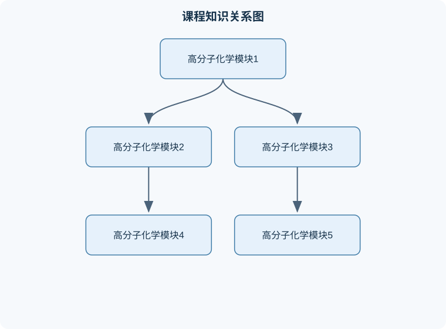

# 高分子化学

## 一、课程整体知识框架

### 课程边界与先修知识

本课程系统研究高分子化合物的结构、命名、聚合反应机理、分子量及其分布、共聚组成、聚集态结构、化学反应与工业合成基础。内容边界包括自由基聚合、逐步聚合、离子聚合、配位聚合、开环聚合、共聚合、聚合物的化学反应及典型聚合物制备。不以高分子物理、聚合物加工流变、复合材料、详细仪器分析和聚合反应工程为主要内容，但涉及结构—性能关系时需引入玻璃化温度、熔点、结晶性、交联和分子量等基础概念。先修知识包括有机化学中的官能团、亲核与亲电反应、自由基和离子反应、立体化学、化学平衡与反应动力学，以及微积分、概率统计和基本物料衡算。





### 1. 高分子化学的研究对象与基本术语

高分子化学研究以低相对分子质量化合物为原料，通过化学反应形成高相对分子质量物质的反应规律、结构控制、组成与性能关系。高分子通常由许多重复的结构单元通过共价键连接而成，但“由许多相同小分子组成”并不是充分条件：共聚物可含有两种或多种单体单元，天然高分子也可能具有复杂的序列结构。

**单体**是能够参加聚合反应并形成高分子链的低分子化合物，例如乙烯、苯乙烯、氯乙烯、己二酸、己二胺、乙二醇和对苯二甲酸。单体进入高分子后形成的片段称为**单体单元**；从高分子结构中选取能够重复表示链结构的最小片段，称为**结构单元**或**重复单元**。二者在加成聚合中通常一致，但在缩聚中可能不同。

例如，乙烯聚合为聚乙烯：

$$
n\ce{CH2=CH2 ->[-\Delta,\ initiator] [-CH2-CH2-]_{n}}
$$

乙烯是单体，$-\ce{CH2-CH2}- $是单体单元、结构单元和重复单元。若己二胺与己二酸缩聚，尼龙-66的重复结构可写成：

$$
\ce{[-NH-(CH2)6-NH-CO-(CH2)4-CO-]_{n}}
$$

其中一个重复单元包含一个二胺片段和一个二酸片段，因此结构单元所含的原子并不必然等于某一种单体的分子式。**链节**常用于表示主链中重复出现的基本连接片段；**聚合度**表示每条大分子链中重复单元的平均数，通常记为$X_n$，是无量纲量。

高分子不是单一分子量的物质，而是不同链长分子的混合物。若第$i$类分子的分子数为$N_i$、相对分子质量为$M_i$，则数均相对分子质量为：

$$
M_n=\frac{\sum_i N_iM_i}{\sum_iN_i}
$$

重均相对分子质量为：

$$
M_w=\frac{\sum_iN_iM_i^2}{\sum_iN_iM_i}
$$

分子量分布指数为：

$$
Đ=\frac{M_w}{M_n}
$$

这里的$M_n$和$M_w$若采用相对分子质量，均无单位；若采用实际摩尔质量，则单位为$\mathrm{g\ mol^{-1}}$。由于$M_i$始终为正数，$M_w\ge M_n$，所以$Đ\ge1$。$Đ=1$只对应理想的单分散体系，实际聚合物通常大于1。不能把“聚合度高”直接等同于“分布窄”，二者分别描述平均链长和链长离散程度。

### 2. 聚合反应的分类逻辑

聚合反应可按反应机理分为链增长聚合、逐步增长聚合和开环聚合，也可按是否脱除小分子分为加聚和缩聚。两种分类角度不能机械等同。

链增长聚合的活性中心通常是自由基、阳离子、阴离子或配位活性中心。反应一般包含引发、增长和终止等阶段；单体连续加到活性链端，链长主要在活性中心存在期间增长。苯乙烯自由基聚合可表示为：

$$
\ce{I ->[kd] 2R^.}
$$

$$
\ce{R^. + CH2=CHPh -> R-CH2-CHPh^.}
$$

$$
\ce{P^. + CH2=CHPh -> P-CH2-CHPh^.}
$$

其中$I$为引发剂，$R^\bullet$为初始自由基，$P^\bullet$为增长链自由基，$k_d$为引发剂分解速率常数。终止可通过偶合或歧化完成。自由基聚合适用于许多乙烯基单体，但氧、杂质、温度和黏度均可能改变速率与分子量。

逐步增长聚合中，任意两个具有反应官能团的分子都可能反应，单体、低聚物和高聚物之间均可发生反应。聚酯、聚酰胺、聚氨酯和酚醛树脂常按此类机理形成。逐步聚合并不必然脱除小分子；异氰酸酯与多元醇形成聚氨酯时属于逐步加成，通常不生成小分子。

### 3. 高分子反应中必须同时考察的四个层次

分析聚合体系时，应依次判断单体官能度、反应机理、链结构和工艺状态。

第一，单体官能度决定是否可能形成线型、支化或交联结构。二官能单体在严格等物质的量且无副反应时通常形成线型聚合物；含有三个或更多反应官能团的单体可形成支化或网络结构。己二酸与乙醇均为二官能或有效单官能组合中的线型限制因素，难以形成高分子量线型聚合物；己二酸与1,4-丁二醇可形成聚酯；与甘油反应则因甘油为三官能醇而易支化和凝胶；与对苯二胺可形成聚酰胺，前提是反应官能团具有足够活性且配比合适。

第二，结构因素决定链的规整性和构象。聚氯乙烯链段可能出现头-尾、头-头和尾-尾连接。头-尾连接通常更有利于形成规则链结构；头-头缺陷会引入相邻氯原子，可能影响热稳定性并促进脱氯化氢。等规、间规和无规结构描述取代基沿主链的空间排列，不等于顺反异构。聚甲基丙烯酸甲酯的立构规整性可影响玻璃化温度、结晶倾向和力学性能。

第三，链间作用决定材料状态。热塑性聚合物主要由线型或支化链构成，链间没有大量永久共价交联，受热可软化并重新加工，例如聚乙烯、聚丙烯和聚苯乙烯。热固性聚合物在固化过程中形成三维共价网络，固化后通常不能熔融再加工，例如酚醛树脂和环氧树脂。橡胶通常具有低玻璃化温度和有限交联，既保持链段运动，又避免永久流动。

第四，聚合条件决定分子量、分布和缺陷。温度升高可能提高引发速率，却也可能增加链转移、终止和副反应；单体浓度提高可能加快增长，也可能导致黏度增加和散热困难。任何结论都必须注明温度、溶剂、引发剂、转化率和官能团配比等条件。

### 4. 分子量形成规律与关键推导

对于理想线型逐步聚合，设反应官能团初始数为$N_0$，反应后尚未反应的官能团数为$N$，则官能团反应程度为：

$$
p=\frac{N_0-N}{N_0}
$$

若体系满足等官能度、等活性、无环化、无副反应和严格化学计量平衡，任一分子仍有一端未反应的概率约为$1-p$。从而平均链中结构单元数为：

$$
X_n=\frac{1}{1-p}
$$

推导的核心是：若以一个初始分子为基准，反应程度为$p$时，体系分子数由$N_0$减少为$N_0(1-p)$，于是：

$$
X_n=\frac{\text{初始分子数}}{\text{反应后分子数}}
=\frac{N_0}{N_0(1-p)}
=\frac{1}{1-p}
$$

当要求$X_n=2000$时，理想条件下：

$$
p=1-\frac{1}{2000}=0.9995
$$

即官能团转化率达到$99.95\%$。这说明逐步聚合获得高分子量必须接近完全转化，并且当量比、纯度和副反应控制极为重要。若两类官能团初始物质的量不相等，设较少的一类为基准，过量比为$r\le1$，则常用关系为：

$$
X_n=\frac{1+r}{1+r-2rp}
$$

该式的前提是两类官能团分别来自双官能单体、反应均匀、无环化和无副反应。若存在单官能封端剂、支化或凝胶，不能直接套用。

链增长聚合的平均聚合度受增长、终止和链转移控制。自由基聚合中，提高分子量的常见思路不是单纯提高引发剂浓度，而是降低自由基浓度、减少链转移、提高单体纯度、降低不必要的终止并适当控制温度。引发剂浓度增加通常会提高速率，但会产生更多活性链，平均链长可能下降。

### 5. 共聚、开环聚合及结构—性能联系

共聚是两种或多种单体共同进入同一大分子链。无规、交替、嵌段和接枝共聚物的结构不同，因而相容性、结晶性、弹性和耐热性也不同。自由基共聚中，$r_1$和$r_2$分别表示单体1和单体2自由基对两种单体的相对增长倾向：

$$
r_1=\frac{k_{11}}{k_{12}},\qquad
r_2=\frac{k_{22}}{k_{21}}
$$

其中$k_{ij}$表示末端为单体$i$单元的自由基加成单体$j$的增长速率常数。设进料中单体1的摩尔分数为$f_1$，瞬时聚合物中单体1的摩尔分数为$F_1$，低转化率、稳态活性链端和无扩散限制时，终端模型给出：

$$
F_1=
\frac{r_1f_1^2+f_1f_2}
{r_1f_1^2+2f_1f_2+r_2f_2^2},
\qquad f_2=1-f_1
$$

该式描述的是瞬时共聚组成，不等于高转化率下整个聚合物的平均组成。若$r_1\gg1$而$r_2\ll1$，单体1末端自由基更倾向继续加成单体1，单体2末端自由基更倾向加成单体1，体系组成会随转化率发生漂移。共聚活性比较必须结合两类增长速率常数，不能仅根据某一个$r_i$判断所有活性。

开环聚合通过解除环张力或利用环状单体的官能团反应性形成链。环氧丙烷的阴离子开环聚合可由醇盐活性端引发：

$$
\ce{RO^- + CH2-CH(CH3)O -> RO-CH2-CH(CH3)O^-}
$$

活性醇盐继续进攻新的环氧丙烷，形成聚醚链；加入水或质子型物质可终止活性端。环氧丙烷的取代基使链端进攻方向、区域选择性和立体化学均需具体分析，不能只写成“环打开即可”。

### 6. 从反应到工艺和应用

聚合过程可采用本体、溶液、悬浮或乳液方式。悬浮聚合中，单体以液滴形式分散在水相，液滴内部进行聚合，产物通常为颗粒；需要分散剂、搅拌和适当的液滴稳定条件。乳液聚合中，单体以胶束或乳胶粒子形式参与反应，水溶性引发剂在水相产生自由基，活性链进入粒子后增长。乳液聚合能够兼顾较高聚合速率和较高分子量，原因在于每个粒子内活性链数受限，双基终止概率降低，同时水相有利于散热；但速率还受成核、粒子数、单体溶解度和乳化剂浓度影响，不能将其概括为“乳液一定比本体快”。

高黏度聚合体系可能产生自加速效应：体系黏度上升后，链段扩散和自由基相遇受到限制，终止速率下降，活性自由基积累，聚合速率进一步升高。控制方法包括降低单体浓度、采用溶液或悬浮体系、分段加料、加强传热、降低温度或使用能够降低黏度的工艺介质。若放热不能及时移除，可能出现局部过热、分子量分布变宽甚至失控。

高分子应用应从结构和失效机制分析。聚乙烯、聚丙烯、聚氯乙烯、聚苯乙烯、聚碳酸酯等主要用于塑料；聚对苯二甲酸乙二醇酯、聚丙烯腈、尼龙-66和聚乙烯醇纤维具有成纤能力；天然橡胶、丁苯橡胶、顺丁橡胶及聚硫橡胶利用弹性和有限交联。老化可能由热、氧、光、臭氧、辐射、湿气或机械应力造成，表现为断链、交联、变色、脆化或黏度变化。降解是高分子主链或侧基发生化学变化而使分子量、结构或性能改变；解聚是降解的一种特殊方向，产物大量回到单体或较小分子。热裂解、氧化降解和水解降解的产物及控制方法不同，不能混为一谈。

## 二、章节和模块划分

### 核心知识覆盖清单

本清单根据本课程的章节划分整理，用于检查正文是否覆盖各个核心模块：

- **模块一：基本概念、结构表示与聚合物分类**。
- **模块二：逐步聚合与缩聚反应**。
- **模块三：链增长聚合与自由基反应**。
- **模块四：离子、配位和开环聚合**。
- **模块五：共聚与序列结构控制**。
- **模块六：立体化学、嵌段、接枝与交联**。
- **模块七：分子量表征、凝胶与材料性能**。
- **模块八：降解、老化、功能材料与产业流程**。
- **代表性问题分析与实现流程**。
- **综合例题五：乳液聚合的机理解释**。
- **实验与项目一：聚酯缩聚及分子量控制**。
- **实验与项目二：共聚组成与结构表征**。
- **常见易错点与纠正**。
- **典型笔试问题及解答思路**。
- **面试问题、参考答案与追问要点**。
- **岗位关联：技术、分析、研发与业务工作**。


### 模块一：基本概念、结构表示与聚合物分类

本模块首先建立结构式阅读和命名基础。需要区分单体、单体单元、结构单元、重复单元、链节、聚合度、相对分子质量和分子量分布。结构题应先识别单体官能团或不饱和键，再判断聚合后哪些原子进入主链、哪些小分子被脱除，最后用括号和下标表示重复结构。聚对苯二甲酸乙二醇酯的单体是对苯二甲酸和乙二醇；乙丙橡胶的单体通常为乙烯和丙烯；聚偏二氯乙烯的重复单元为$-\ce{CH2-CCl2}- $。

按热行为可分为热塑性、热固性和弹性体；按链结构可分为线型、支化和交联；按来源可分为天然、半合成和合成高分子。分类依据不同，不能用一个类别替代另一个类别。例如交联聚合物通常是热固性材料，但轻度交联的橡胶具有弹性，并不能简单归入“脆性热固体”。

### 模块二：逐步聚合与缩聚反应

本模块围绕官能团反应、分子量增长和凝胶形成展开。聚酯、聚酰胺、聚碳酸酯、聚氨酯和酚醛树脂均需从官能团种类、官能度、计量比和副产物判断反应类型。缩聚常伴随水、醇、氯化氢等小分子脱除，但“脱除小分子”不是所有逐步聚合的必要条件。

**例题一：聚合度计算。**  
题干：某理想线型逐步缩聚体系的官能团反应程度为$0.995$，求数均聚合度。

分析：使用$X_n=1/(1-p)$，其中$p=0.995$为无量纲反应程度。

解答：

$$
X_n=\frac{1}{1-0.995}=200
$$

结果验证：若反应程度提高到$0.9995$，则$X_n=2000$，说明后期每增加少量转化率，分子量会显著提高。该结论只适用于无环化、无支化且计量平衡的理想线型体系。

**变式：**若$X_n=100$，则$p=0.99$；若存在单官能封端剂，封端剂消耗官能团，实际$X_n$会低于理想值。

### 模块三：链增长聚合与自由基反应

本模块包括自由基聚合的引发、增长、终止和链转移。引发剂热分解或光分解生成自由基，随后加成乙烯基单体。自由基聚合的主要特点是活性中心浓度低、链增长快、反应放热明显，分子量分布由引发、终止和链转移共同决定。过氧化物、偶氮类化合物等可作为自由基源，但选择时要考虑分解温度、半衰期、单体和溶剂的相容性。

自由基聚合中常见的近似是稳态假设：自由基生成速率与终止消耗速率近似相等。若引发剂分解速率常数为$k_d$，引发剂浓度为$[I]$，引发效率为$f$，则自由基生成速率可近似写为$2fk_d[I]$；终止为双基终止时，终止速率与自由基浓度平方相关。由此可解释：提高引发剂浓度常使聚合速率提高，但平均链长可能降低。该推导要求体系均匀、无明显扩散控制、引发效率稳定。

### 模块四：离子、配位和开环聚合

阳离子聚合适用于能够稳定正离子活性中心的单体，如部分烷基乙烯基醚；阴离子聚合适用于能够稳定负离子的单体，如苯乙烯、共轭二烯和某些环氧化物。水、醇、酸或其他质子杂质会强烈影响离子聚合，因而需要严格控制纯度和温度。

配位聚合、络合聚合、插入聚合和定向聚合是相互关联但不完全同义的概念。配位聚合强调单体先与金属活性中心配位；插入聚合强调配位单体插入金属—碳键；定向聚合强调催化体系对链增长方向和立体结构的控制。典型配位催化体系包括过渡金属化合物与有机金属助催化剂组成的体系，可用于聚乙烯、聚丙烯和部分共轭二烯的立体定向合成。催化剂结构、助催化剂比例、温度、溶剂和氢气等因素会影响活性、分子量和立构规整度。

### 模块五：共聚与序列结构控制

共聚分析包括组成方程、竞聚率、组成漂移和共聚物序列。判断共聚趋势时，先写四种增长路径及其速率常数，再定义$r_1$、$r_2$，最后根据进料组成求瞬时聚合物组成。若要求“聚合物组成等于进料组成”，应令$F_1=f_1$并求解；这对应恒组成点，不等于任意转化率下都保持恒组成。

**例题二：共聚组成。**  
题干：某体系中$f_1=0.50$，$f_2=0.50$，$r_1=4$，$r_2=0.25$，求瞬时聚合物中单体1的摩尔分数。

解答：

$$
F_1=
\frac{4(0.50)^2+(0.50)(0.50)}
{4(0.50)^2+2(0.50)(0.50)+0.25(0.50)^2}
$$

分子为$1+0.25=1.25$，分母为$1+0.50+0.0625=1.5625$，因此：

$$
F_1=\frac{1.25}{1.5625}=0.80
$$

结果验证：$F_1>f_1$，说明在该组成下，单体1更容易进入瞬时聚合物。变式是改变$f_1$并绘制$F_1-f_1$关系曲线；高转化率时由于进料组成改变，不能把初始$f_1$继续代入整个体系。

### 模块六：立体化学、嵌段、接枝与交联

立构规整度描述取代基的空间排列规律，可通过核磁共振、红外光谱、差示扫描量热、广角衍射等方法综合判断。等规、间规和无规结构可能表现出不同的结晶性、熔点、玻璃化温度和力学性能。聚环氧丙烷是否具有光学活性，取决于链段中手性中心的构型分布、链端和样品整体对称性；仅凭“含有甲基”不能断定聚合物必然有旋光性。

嵌段共聚物可通过活性阴离子聚合、可逆失活自由基聚合、逐步偶联或大分子引发剂路线制备。两嵌段合成的一般流程是先聚合单体A并保留活性链端，再加入单体B；三嵌段则可按A-B-A或A-B-C顺序继续加料。接枝聚合可采用主链接枝、单体接枝、辐射接枝或大分子偶联等方法。交联可通过多官能单体共聚、预聚物固化、硫化、辐射或后交联实现。

**例题三：结构判断。**  
题干：苯酚与甲醛形成酚醛树脂，判断其属于加聚还是缩聚，并说明可能形成线型还是网络结构。

解答：苯酚芳环上的活泼位置与甲醛发生逐步反应，通常伴随水生成，属于缩聚。若苯酚过量、反应条件适当，可形成线型或支化预聚物；继续与固化剂反应或提高交联程度，可形成三维网络。结果验证：若产物可熔融加工，说明交联尚未完成；固化后不能再次熔融，符合热固性网络特征。变式是环氧树脂与多元胺固化，虽通常不脱除小分子，但仍是逐步加成和交联过程。

### 模块七：分子量表征、凝胶与材料性能

**例题四：分子量分布计算。**  
题干：样品含10 g、相对分子质量$30000$的组分，7 g、相对分子质量$50000$的组分和1 g、相对分子质量$100000$的组分，求$M_n$、$M_w$和$Đ$。

先计算各组分物质的量，比例上可取：

$$
N_A=\frac{10}{30000}=3.333\times10^{-4}
$$

$$
N_B=\frac{7}{50000}=1.400\times10^{-4}
$$

$$
N_C=\frac{1}{100000}=1.000\times10^{-5}
$$

总物质的量为$4.833\times10^{-4}$。因此：

$$
M_n=\frac{18}{4.833\times10^{-4}}
\approx3.72\times10^4
$$

又有：

$$
M_w=\frac{\sum N_iM_i^2}{\sum N_iM_i}
=\frac{10(30000)+7(50000)+1(100000)}{18}
$$

$$
M_w=\frac{1\,050\,000}{18}\approx5.83\times10^4
$$

所以：

$$
Đ=\frac{5.83\times10^4}{3.72\times10^4}\approx1.57
$$

验证：$M_w>M_n$且$Đ>1$，结果符合混合物分布规律。变式是给出质量分数而非质量时，应先统一总质量或直接使用质量分数公式，不能把质量分数当作分子数分数。

凝胶点表示体系首次形成贯穿整个反应体系的无限网络。Flory理想估计常假设官能团等活性、随机反应、无环化和无局部浓度差；实际凝胶点可能因环化、空间位阻、扩散限制、反应不均匀和支化结构而偏离。凝胶后体系黏度急剧增加，溶胀而不溶，不能继续用线型聚合物的$X_n$公式描述整体结构。

### 模块八：降解、老化、功能材料与产业流程

高分子降解包括热降解、氧化降解、水解、光降解、机械降解和生物降解。热降解可能表现为无规断链、解聚、侧基脱除或交联；聚氯乙烯受热可能脱除氯化氢并形成共轭结构。聚酯和聚酰胺中的酯键、酰胺键在适当水热或酸碱条件下可能发生水解。老化是材料在储存和使用过程中因环境作用产生的渐进性能衰减，降解是其中重要的化学原因，但老化还可能包括物理迁移、增塑剂损失和后固化。

阻燃可通过气相捕获自由基、凝聚相成炭隔热、稀释可燃气体、吸热分解降温等机制实现。氧指数用于表征维持材料持续燃烧所需氧气体积分数，数值越高通常越难持续燃烧，但测试结果不能直接等同于所有实际火灾条件下的安全性。功能高分子可通过引入离子基团、导电链段、光敏基团、液晶基团、生物活性基团或多孔结构实现分离、传感、导电、吸附和响应功能。

### 代表性问题分析与实现流程

#### 流程一：聚合反应式与结构题分析

输入为单体结构、反应条件和目标聚合物；输出为反应式、重复单元、聚合类型及副产物判断。步骤为：识别官能团或不饱和键；判断是链增长、逐步增长还是开环；标出进入主链的原子；检查价键是否满足；最后核对是否生成水、醇、氯化氢等小分子。终止条件是结构式中所有价态、括号和下标均一致。该流程适用于结构题，但不适用于仅凭材料名称推断复杂立体结构。

#### 流程二：聚合配方与分子量问题

输入为单体质量、摩尔质量、官能团比例、转化率和引发剂条件；输出为理论聚合度、分子量或配方调整方向。先统一单位，计算物质的量和当量比；再根据链增长或逐步增长选择公式；列出理想假设；最后用极限情况验证。若计算得到$X_n<1$、负浓度或$M_w<M_n$，说明单位、分子数权重或公式使用出现错误。

#### 流程三：实验数据质量控制

输入为转化率、黏度、凝胶时间、分子量或光谱数据；输出为可接受、需复测或不合格的判断。先检查空白和仪器校准，再检查样品溶解性、重复性和质量守恒；随后将数据与理论趋势比较；若异常，依次排查温度记录、搅拌、取样时刻、氧和水分、计算单位及样品均匀性。评价不能只看单个数值，应同时考察重复实验的离散程度和结构证据。

```python
# 语言：Python
# 功能：根据离散分子量组分计算 Mn、Mw 和 Đ
# 输入：每个组分的质量 mass[g] 和相对分子质量 molar_mass[g/mol]
# 输出：Mn、Mw、分子量分布指数 Đ

components = [
    (10.0, 30000.0),
    (7.0, 50000.0),
    (1.0, 100000.0),
]

total_moles = 0.0
total_mass = 0.0
second_moment = 0.0

for mass, molar_mass in components:
    if mass < 0 or molar_mass <= 0:
        raise ValueError("质量必须非负，摩尔质量必须为正")
    moles = mass / molar_mass
    total_moles += moles
    total_mass += mass
    second_moment += moles * molar_mass ** 2

if total_moles == 0:
    raise ValueError("总物质的量不能为零")

Mn = total_mass / total_moles
Mw = second_moment / total_mass
dispersity = Mw / Mn

print("Mn =", Mn, "g/mol")
print("Mw =", Mw, "g/mol")
print("Đ  =", dispersity)
```

### 综合例题五：乳液聚合的机理解释

题干：说明乳液聚合为何可能同时获得较高聚合速率和较高分子量，并指出这一结论的条件。

分析：乳液聚合把反应空间分散在许多粒子中。水相引发剂产生自由基，活性链进入乳胶粒后增长。粒子内活性链数较少，两个活性链同时存在并相遇的概率降低，因此终止受到抑制；同时水相热容量大，有利于传热。

逐步解答：  
第一，乳化剂和搅拌形成稳定粒子，增加有效聚合场所。  
第二，水溶性引发剂在水相生成自由基，降低了引发剂直接溶于单体液滴造成的局部高浓度问题。  
第三，粒子隔离使双基终止减少，活性链可继续增长。  
第四，水相移走聚合热，降低局部温升和黏度失控。  

结果验证：若乳化剂不足导致粒子聚并，或单体在水中溶解度过低且成核不足，则上述优势不能保证。变式是比较本体、悬浮和乳液聚合时，应同时比较传热、粒径、后处理、残余乳化剂和产品纯度。

### 实验与项目一：聚酯缩聚及分子量控制

**目标：**观察官能团比例、温度和脱除小分子对聚酯形成的影响。

**输入数据：**二酸和二醇的称量质量、纯度、摩尔质量、反应温度、反应时间、馏出物质量、产物质量、酸值或羟值。实验前将质量统一为克、物质的量统一为摩尔，计算二酸与二醇的官能团当量比。

**步骤：**  
1. 按设定当量比加入二酸、二醇和催化体系。  
2. 在受控温度下反应并记录时间、黏度和馏出物。  
3. 分阶段取样，测定酸值或红外光谱中羰基、羟基变化。  
4. 反应结束后冷却、称量并测试溶解性、软化行为和初步力学性能。  
5. 用质量守恒和$X_n=1/(1-p)$估算理论趋势，与实测结果比较。  

**评价标准：**反应物投料记录完整；重复实验中关键数据趋势一致；产物结构出现预期酯基信号；酸值随反应推进下降；理论分子量与实测趋势方向一致。若出现异常凝胶，应检查三官能杂质、局部过热和计量错误。

**排错方法：**馏出物不足时检查温度、真空或冷凝；分子量偏低时检查水分、单官能杂质和当量比；产物颜色过深时检查氧化、温度过高和反应时间过长。

### 实验与项目二：共聚组成与结构表征

**目标：**研究不同进料比对共聚物组成和性能的影响。

**输入数据：**单体A、B的质量和摩尔质量、初始摩尔分数、转化率、产物质量、核磁或红外峰面积、玻璃化温度或溶解性数据。

**步骤：**  
1. 按至少三组不同$f_1$配制单体混合物。  
2. 在相同引发剂、温度和时间下进行低转化率聚合，减少组成漂移。  
3. 记录残余单体或质量转化率。  
4. 用竞聚率方程计算理论$F_1$，再由谱图峰面积估算实验$F_1$。  
5. 比较进料组成、理论瞬时组成和实验平均组成，分析转化率对组成的影响。  

**评价标准：**单体称量误差可追溯；平行样重复性良好；谱峰归属合理；理论与实验趋势一致；解释中明确区分瞬时组成和总平均组成。

**排错方法：**谱图峰重叠时不能直接取单峰面积，应采用多峰拟合或改变表征方法；理论偏差过大时检查高转化率组成漂移、单体纯度、氧阻聚和竞聚率适用性；样品不溶时检查交联或支化是否意外发生。

### 常见易错点与纠正

1. 把聚合度$X_n$当作有单位的量；它是平均重复单元数，无量纲。  
2. 把相对分子质量$M_n$和摩尔质量单位混写；使用何种量必须统一。  
3. 认为所有由小分子形成的聚合都叫加聚；逐步缩聚和逐步加成需按机理判断。  
4. 认为缩聚必然脱除小分子；聚氨酯形成通常是逐步加成。  
5. 把结构单元、单体单元和重复单元当作任何情况下完全相同。  
6. 忽略官能度，错误地认为二官能单体一定生成网络。  
7. 认为提高引发剂浓度必然提高分子量；自由基数增加可能使链变短。  
8. 把高转化率共聚物组成直接用初始进料比计算。  
9. 把$F_1$理解为整个反应终产物组成，而公式通常给出瞬时组成。  
10. 把配位聚合、插入聚合和立体定向聚合视为完全同义。  
11. 认为热塑性材料受热后一定没有任何化学变化；高温下仍可能降解。  
12. 认为热固性材料只是“分子量很大”；其本质是形成三维共价网络。  
13. 认为凝胶点就是反应完全；凝胶点只表示贯穿网络首次出现。  
14. 只用$M_n$判断分子量分布，忽略$M_w$和$Đ$。  
15. 计算$M_w$时错误地用质量分数作分子数权重。  
16. 认为降解与解聚完全相同；解聚强调生成单体或低聚物的方向性。  
17. 仅凭含芳环或极性基团就断言玻璃化温度升高；链柔性、对称性和增塑作用也重要。  
18. 认为交联总能提高全部性能；交联可能提高耐热和耐溶剂性，却降低熔融加工性和延伸率。

### 典型笔试问题及解答思路

#### 问题一：比较聚合物与大分子的含义

答题思路：大分子强调分子尺寸和相对分子质量较大；聚合物强调由重复结构单元组成的物质或材料。二者常重叠，但“大分子”可包括不一定由规则重复单元构成的巨大分子，聚合物也可能含有不同序列和分布。应补充天然与合成实例。

#### 问题二：说明自由基聚合的基本步骤

答题思路：依次写引发剂分解、自由基加成单体、链增长、偶合或歧化终止，并说明氧阻聚、链转移和温度的影响。不能只写总反应式而不解释活性中心。

#### 问题三：如何获得较窄分子量分布

答题思路：应从活性链生成速率、增长速率、终止方式和链转移入手。可采用受控或活性自由基方法、降低随机终止、减少杂质和控制温度；但“窄分布”依赖具体体系，不能保证在任意单体和工艺下实现。

#### 问题四：比较悬浮聚合和乳液聚合

答题思路：比较分散尺度、引发剂位置、聚合场所、传热、产物形态和后处理。悬浮聚合主要形成较大单体液滴，产物为颗粒；乳液聚合形成胶乳粒子，通常具有更快反应和较高分子量的潜力，但后处理和残余乳化剂控制更复杂。

#### 问题五：为什么逐步聚合要达到很高转化率才能获得高分子量

答题思路：由$X_n=1/(1-p)$推导。当$p$接近1时，$X_n$对$p$极其敏感；少量未反应官能团、计量偏差和单官能杂质都会限制链长。

#### 问题六：解释凝胶点理论值和实际值的差别

答题思路：先说明理论模型的随机反应、无环化和均匀假设，再列出实际偏差来源：环化、空间位阻、扩散限制、局部浓度差、官能团活性差异和副反应。结论应是理论值用于估计，不是所有体系的精确边界。

#### 问题七：如何比较两种单体和两类自由基的活性

答题思路：设计低转化率自由共聚实验，测定不同进料比下的瞬时共聚组成，通过竞聚率拟合比较$k_{11}/k_{12}$和$k_{22}/k_{21}$。实验中要控制温度、引发剂、转化率和扩散影响，不能仅用最终共聚物组成直接判断。

#### 问题八：解释降解与解聚的异同

答题思路：共同点是高分子结构被破坏、分子量下降或性能降低；区别是解聚通常具有回到单体或规则低聚物的特征，降解还包括无规断链、侧基脱除、氧化和交联。应结合聚酯水解、聚氯乙烯脱氯化氢等实例。

### 面试问题、参考答案与追问要点

#### 问题一：如何判断一个聚合反应属于链增长还是逐步增长？

参考答案：看活性中心和分子量形成方式。若单体连续加到活性链端，属于链增长；若任意两种含反应官能团的分子都能逐步反应，属于逐步增长。  
深入追问：聚氨酯通常是逐步加成，不应因无小分子脱除而误判为链增长。

#### 问题二：为什么相同平均分子量的两个样品性能仍可能不同？

参考答案：因为分子量分布、支化度、立构规整性、结晶度、共聚序列和残余小分子不同。$M_n$或$M_w$只能提供部分信息。  
深入追问：应补充通过凝胶渗透色谱、核磁、热分析和流变测试进行区分。

#### 问题三：如何解释聚合反应突然加速？

参考答案：可能是自加速效应，黏度上升使双基终止受扩散限制，自由基浓度积累，速率和放热增加。  
深入追问：还要排查温度控制失效、引发剂局部浓度过高和搅拌不均，并提出分段加料和强化传热措施。

#### 问题四：如何选择制备嵌段共聚物的方法？

参考答案：若要求嵌段界面清晰，可选择活性聚合或可逆失活聚合，通过保留链端顺序加入第二单体；若官能团兼容性较好，也可用大分子偶联。  
深入追问：需验证第二段确实从第一段链端增长，而不是形成独立均聚物，可结合分子量逐步增加和谱图变化判断。

#### 问题五：交联对材料性能有哪些影响？

参考答案：交联通常提高耐热性、耐溶剂性、尺寸稳定性和抗蠕变能力，但降低熔融加工性和大变形能力；交联过度会使材料脆化。  
深入追问：应区分热塑性、弹性体和高交联热固体的网络密度差异。

#### 问题六：乳液聚合的主要工艺风险是什么？

参考答案：粒子成核不稳定、乳液破乳、凝聚、残余单体和乳化剂残留、搅拌剪切不合适以及温度失控。  
深入追问：应说明乳化剂浓度、离子强度和单体滴加速度对粒径及稳定性的影响。

#### 问题七：如何判断样品发生了氧化降解？

参考答案：可结合羰基指数、分子量下降、颜色变化、力学性能下降和热失重行为判断。单一红外峰不能独立证明全部降解机制。  
深入追问：需设置未老化对照，控制光照、温度、氧气和时间，并进行重复测试。

#### 问题八：高分子研发中如何验证一个新配方有效？

参考答案：先明确目标指标，如分子量、黏度、玻璃化温度、强度、伸长率、耐热或耐溶剂性；再设计对照组和重复组，记录工艺窗口，进行结构、热学、力学和稳定性测试。  
深入追问：验收标准必须同时包含性能下限、批间波动、可加工性和安全环保约束，不能只看一次最高性能。

### 岗位关联：技术、分析、研发与业务工作

#### 聚合工艺技术岗位

实际任务包括制定单体、引发剂、溶剂和温度配方，控制转化率、黏度、放热和粒径，处理批次异常。使用的知识包括自由基动力学、逐步聚合计量、传热、乳液或悬浮过程和凝胶风险。主要产出是工艺参数表、批生产记录、异常分析报告和放大验证方案。验收标准包括转化率稳定、分子量和分布在规定范围、残余单体受控、批间重复性合格及过程无失控。

#### 高分子分析岗位

实际任务包括测定$M_n$、$M_w$、$Đ$、玻璃化温度、熔点、官能团、结晶度、热稳定性和降解行为。使用的知识包括分子量统计、光谱峰归属、热分析、溶解性判断和样品前处理。主要产出是原始数据、计算表、谱图、质量判定和偏差说明。验收标准包括校准有效、空白和对照合格、重复测试一致、数据单位正确、结论与结构证据相互支持。

#### 高分子材料研发岗位

实际任务是根据耐热、强度、阻燃、弹性、阻隔或导电目标设计单体、共聚组成、交联密度和加工条件。使用的知识包括结构—性能关系、共聚、立体化学、结晶与玻璃化、降解和添加剂作用。主要产出是配方、样品、性能对比、失效分析和中试建议。验收标准包括与对照材料相比达到目标性能，具有可重复工艺窗口，长期稳定性满足要求，并能解释性能变化的结构原因。

#### 技术支持与业务岗位

实际任务包括根据客户用途选择树脂类型、解释加工缺陷、评估材料兼容性和提出替代方案。使用的知识包括热塑性与热固性区别、分子量对黏度的影响、玻璃化温度、结晶性、降解和加工窗口。主要产出是选材报告、应用建议、问题闭环记录和客户验证方案。验收标准是建议与实际加工条件匹配，数据来源可追溯，风险边界明确，不能把实验室性能直接承诺为所有工况下的最终性能。

## 三、核心概念的详细解释

### 3.1 高分子、单体、结构单元与聚合度

高分子是由许多原子或原子团以共价键连续连接而成、相对分子质量通常较高的物质。高分子样品一般不是具有完全相同链长的单一分子，而是不同链长大分子的混合物，因此“相对分子质量很大”只能作为重要特征，不能作为唯一判据。天然高分子包括纤维素、蛋白质、核酸和天然橡胶；合成高分子包括聚乙烯、聚氯乙烯、聚酯、聚酰胺和环氧树脂等。

能够通过聚合反应形成高分子链的低分子化合物称为单体。单体进入大分子后保留下来的结构片段称为单体单元。能够在高分子链中周期性表示链结构的最小片段称为重复单元。结构单元与重复单元有时相同，有时不同。例如乙烯聚合：

$$
n\ce{CH2=CH2 -> [-CH2-CH2-]_{n}}
$$

乙烯是单体，$\ce{-CH2-CH2-}$既是单体单元，也是结构单元和重复单元。己二胺与己二酸形成尼龙-66时，重复单元包含二胺和二酸两部分：

$$
\ce{[-NH-(CH2)6-NH-CO-(CH2)4-CO-]_{n}}
$$

此时不能把一个己二胺分子直接当作完整重复单元。链节通常指主链中反复出现的基本连接片段，具体含义需结合教材定义和结构表示方式判断。

聚合度是每条大分子链中重复单元数目的平均值，记为$X_n$，无量纲。若重复单元的相对分子质量为$M_0$，并忽略端基质量，则有：

$$
X_n\approx\frac{M_n}{M_0}
$$

若端基质量不可忽略，应写成：

$$
M_n=M_{\mathrm{end}}+X_nM_0
$$

其中$M_n$为数均摩尔质量或数均相对分子质量，$M_{\mathrm{end}}$为两端基团的总质量。低聚物或聚合度较小的样品不能简单忽略端基。

### 3.2 数均、重均与分子量分布

设样品中第$i$类分子的数目为$N_i$，其摩尔质量为$M_i$。数均摩尔质量为：

$$
M_n=\frac{\sum_iN_iM_i}{\sum_iN_i}
$$

它相当于按分子个数加权的平均值，对低分子部分较敏感。重均摩尔质量为：

$$
M_w=\frac{\sum_iN_iM_i^2}{\sum_iN_iM_i}
$$

它对高分子部分赋予更大权重，因此通常满足$M_w\ge M_n$。分散系数为：

$$
Đ=\frac{M_w}{M_n}\ge1
$$

$Đ$无量纲；若用实际摩尔质量表示，$M_n$和$M_w$的单位通常为$\mathrm{g\,mol^{-1}}$。$Đ=1$只表示理想单分散分布，不能把实际样品中接近1的数值理解为所有分子长度完全相同。

若采用质量分数$w_i$，则：

$$
M_n=\frac{1}{\sum_iw_i/M_i},\qquad
M_w=\sum_iw_iM_i
$$

这两个公式只在$w_i$表示各组分质量分数且$\sum_iw_i=1$时成立。若输入的是各组分质量而非质量分数，必须先换算，不能直接代入。

### 3.3 链增长聚合与逐步增长聚合

链增长聚合的共同特征是活性中心存在于增长链端，单体连续加到活性中心上。典型自由基聚合包括引发、增长和终止三个阶段：

$$
\ce{I ->[k_d] 2R^.}
$$

$$
\ce{R^. + M ->[k_i] RM^.}
$$

$$
\ce{RM^. + M ->[k_p] RMM^.}
$$

其中$I$为引发剂，$M$为单体，$R^\bullet$为初始自由基，$k_d$、$k_i$和$k_p$分别表示引发剂分解、引发和增长的速率常数。终止可通过偶合或歧化发生：

$$
\ce{P^. + P^. -> P-P}
$$

或

$$
\ce{P^. + P^. -> P-H + P=}
$$

自由基聚合适用于许多乙烯基单体，但氧、阻聚剂、杂质、温度、黏度和传热条件都会影响结果。

阳离子聚合的活性中心是碳正离子，适合具有给电子取代基、能够稳定正离子的单体，例如异丁烯、乙烯基醚。阴离子聚合的活性中心是碳负离子，适合具有吸电子取代基或能稳定负离子的单体，例如苯乙烯、丙烯酸酯的某些受控体系。离子聚合对水、氧、酸碱杂质和溶剂极性十分敏感。

配位聚合通常由过渡金属化合物与有机金属助催化剂组成，活性中心通过单体配位、插入金属—碳键而增长。配位、络合、插入和定向聚合并非四种完全并列的机理：配位描述单体与金属中心的结合，插入描述单体进入金属—碳键的增长步骤，定向聚合强调催化剂对立体结构或区域结构的控制。

逐步增长聚合中，单体、低聚物和高聚物之间均可发生反应，链长不是只在一个活性中心上连续增长。聚酯、聚酰胺、聚氨酯和许多环氧固化体系属于逐步增长体系。逐步聚合不一定脱除小分子；二异氰酸酯与二元醇形成聚氨酯属于逐步加成，通常不生成水或醇。

### 3.4 缩聚、加聚与官能度

按反应过程中是否脱除小分子，可将聚合分为缩聚和加聚。缩聚常伴随水、醇、氯化氢等小分子脱除，例如：

$$
\ce{nHO-R-OH+nHOOC-R'-COOH
->[-H2O]
[-O-R-O-CO-R'-CO-]_{n}}
$$

加聚通常是双键或三键等不饱和键打开后连接，不产生相应的小分子。例如乙烯、苯乙烯和氯乙烯可通过双键加成形成聚合物。需要注意，按“加聚/缩聚”分类和按“链增长/逐步增长”分类的依据不同，不能机械等同。

官能度$f$是一个分子中能够参加目标反应的官能团数目。二官能单体通常形成线型聚合物；平均官能度超过2时，可能形成支化或交联结构。以己二酸为例，其羧基官能度为2；乙醇只有一个羟基，通常只能形成端基封闭或低聚产物；乙二醇为二官能，能够与二酸形成线型聚酯；甘油为三官能，可能形成支化甚至凝胶。

热塑性聚合物通常以线型或支化链为主，链间没有大量永久共价交联，受热软化或熔融，可通过挤出、注塑等方法加工。聚乙烯、聚丙烯、聚氯乙烯、聚苯乙烯和聚酰胺属于典型热塑性材料。热固性聚合物在固化过程中形成三维网络，固化后通常不能再次熔融流动，酚醛树脂、环氧树脂和部分不饱和聚酯属于此类。交联密度增加通常提高耐热、耐溶剂和抗蠕变能力，但也可能降低伸长率和熔融加工性。

### 3.5 自由基聚合的速率、分子量与自加速

在稳态近似下，若引发剂分解速率常数为$k_d$，引发剂浓度为$[I]$，引发效率为$f$，单体浓度为$[M]$，增长速率常数为$k_p$，终止速率常数为$k_t$，自由基聚合速率可近似表示为：

$$
R_p=k_p[M]\left(\frac{2fk_d[I]}{k_t}\right)^{1/2}
$$

其中$R_p$的单位通常为$\mathrm{mol\,L^{-1}\,s^{-1}}$。该关系建立在自由基生成与终止速率相等、体系均匀、链转移可忽略、$k_p$和$k_t$近似不随转化率显著变化等条件下。

由上式可知，理想条件下：

$$
R_p\propto[M][I]^{1/2}
$$

增加单体浓度通常加快聚合；增加引发剂浓度也加快聚合，但不是线性增加。自由基浓度约与$[I]^{1/2}$成正比，而平均链长往往随引发剂浓度增加而下降，因为活性链数增多。

高转化率时，体系黏度上升，链段扩散和自由基相互终止变慢，$k_t$下降，聚合速率异常升高，称为自加速效应或凝胶效应。降低该效应的措施包括降低反应温度或引发剂浓度、分段加入单体、稀释体系、增强传热和搅拌、降低固含量以及及时终止反应。必须注意，降低温度可能同时降低引发剂分解速率，因此工艺调整要兼顾转化率和残余单体。

### 3.6 共聚组成与单体、自由基活性

设两种单体为$M_1$和$M_2$，链端自由基为$M_1^\bullet$和$M_2^\bullet$。四个增长反应可用速率常数表示：

$$
k_{11},\ k_{12},\ k_{21},\ k_{22}
$$

其中第一下标表示链端自由基种类，第二下标表示加入的单体种类。共聚竞聚比定义为：

$$
r_1=\frac{k_{11}}{k_{12}},\qquad
r_2=\frac{k_{22}}{k_{21}}
$$

$r_1$反映$M_1^\bullet$更倾向加入$M_1$还是$M_2$，$r_2$具有对应含义。它们描述的是相对增长倾向，不能单独等同于“单体本身的绝对活性”。

设进料中$M_1$的摩尔分数为$f_1$，瞬时聚合物中$M_1$单元的摩尔分数为$F_1$，则低转化率、组成近似不变时：

$$
F_1=
\frac{r_1f_1^2+f_1f_2}
{r_1f_1^2+2f_1f_2+r_2f_2^2}
$$

其中$f_2=1-f_1$。若$r_1=r_2=1$，两种单体随机加入；若$r_1,r_2<1$，交替倾向增强；若$r_1,r_2>1$，同类加入倾向增强；若一个竞聚比远大于1、另一个远小于1，组成漂移通常明显。该方程描述瞬时组成，不可直接用于高转化率下的整体平均组成，除非进行组成积分或分段计算。

### 3.7 开环聚合、立构规整与序列结构

环状单体在张力释放、活性中心攻击或配位插入作用下打开环并形成线型或支化聚合物，称为开环聚合。环氧丙烷的阴离子开环可概念性表示为：

$$
\ce{RO^- + CH2-CH(CH3)-O -> RO-CH2-CH(CH3)-O^-}
$$

生成的新烷氧负离子继续进攻另一分子环氧丙烷，链端不断延长；加入质子型物质后终止。实际反应中，水、醇、酸和金属离子会改变引发、链转移及分子量控制，不能仅凭一个理想反应式判断最终结构。

立构规整度表示聚合物中立体构型按一定规律排列的程度。聚甲基丙烯酸甲酯可具有等规、间规和无规结构；聚丙烯可表现为等规、间规或无规结构。立构规整度受催化剂配位环境、溶剂、温度、单体结构和反应动力学影响。测定方法可包括核磁共振、红外光谱、差示扫描量热和晶体结构分析，但不同方法对应不同结构层次，不能用单一测试完全替代。

聚合物还可按链结构分为无规共聚物、交替共聚物、嵌段共聚物和接枝共聚物。嵌段共聚物中不同单体形成较长连续链段，例如$A-b-B$；三嵌段可表示为$A-b-B-b-A$。接枝聚合物具有一条主链和从主链侧面引出的支链，记为$A-g-B$。制备方法包括活性聚合后顺序加入不同单体、预制端基后偶联、主链上引入可反应基团后接枝，以及辐射、光照或化学引发的接枝反应。

### 3.8 聚合物反应、降解、老化与应用

聚合物反应是以已有高分子为底物进行的化学转化，包括侧基反应、主链反应、交联、接枝、嵌段化和降解。若反应只改变侧基而不显著改变主链长度，通常称为功能化；若主链断裂，则可能导致摩尔质量下降和力学性能恶化；若形成新的链间共价键，则可能发生交联和凝胶化。

降解是高分子化学结构发生不可逆变化并伴随性能下降的过程。解聚是降解的一种特殊形式，主要表现为链端逐步脱除单体，产物接近原单体；无规断链则会产生不同长度的片段，不一定生成原单体。二者都可能导致摩尔质量下降，但解聚具有明显的单体再生倾向。

热降解可包括主链无规断裂、侧基脱除、解聚、交联和氧化裂解等类型。聚氯乙烯受热可能脱除氯化氢并形成共轭结构；聚甲醛容易发生解聚；聚烯烃常发生随机断链、支化和氧化。实际过程往往同时包含多种机制，需结合热重、红外、气相产物和摩尔质量变化判断。

老化是材料在储存或使用过程中，由光、热、氧、湿气、机械应力、辐射和化学介质共同作用而发生的性能衰退。氧指数是评价材料维持持续燃烧所需氧气浓度的指标，通常以体积分数表示；数值越高，材料在空气中越不易持续燃烧，但氧指数并不等同于所有实际火灾条件下的阻燃性能。阻燃作用可能通过气相稀释、凝聚相成炭、吸热分解、隔绝氧和形成保护层实现，阻燃剂与基体的相容性、迁移性和长期稳定性也必须评价。

## 四、重要定义、公式、定理和推导

### 专业审校补充：关键定义与适用边界

共聚组成不能由单体投料比直接等同确定。对两种单体$M_1、M_2$的自由基共聚，设进料中$M_1$的摩尔分数为$f_1$，链端加成反应活性比为$r_1=k_{11}/k_{12}$、$r_2=k_{22}/k_{21}$，则瞬时共聚组成中$M_1$的摩尔分数可用Mayo–Lewis方程表示：$$F_1=\frac{r_1f_1^2+f_1(1-f_1)}{r_1f_1^2+2f_1(1-f_1)+r_2(1-f_1)^2}$$其中$k_{ij}$表示以末端单元$i$为活性端、加成单体$j$的速率常数，$f_1$和$F_1$均无量纲。该式描述某一瞬间的共聚组成，不是整个批次的平均组成。随着反应进行，反应较快的单体被优先消耗，釜内进料组成会漂移，最终共聚物可能存在组成分布。只有当$F_1=f_1$时才是共聚组成恒定的共聚点，其位置还必须落在$0\le f_1\le1$范围内。低转化率时可近似采用初始进料组成计算，高转化率时应进行物料衡算或分段积分；溶剂效应、扩散控制和链转移也会使由低转化率动力学参数外推的结果失真。


### 4.1 逐步聚合的Carothers关系

对理想的线型逐步聚合，设两类官能团等物质的量，反应程度$p$表示已经反应的官能团占初始官能团的比例。初始有$N_0$个单体分子；每发生一次连接反应，分子数减少一个。反应后分子数为：

$$
N=N_0(1-p)
$$

数均聚合度定义为反应前单体分子数与反应后分子数之比，因此：

$$
X_n=\frac{N_0}{N}=\frac{1}{1-p}
$$

当$p=0.90$时，$X_n=10$；当$p=0.99$时，$X_n=100$；当$p=0.999$时，$X_n=1000$。这说明高分子量需要极高的官能团转化率。该推导要求体系近似等官能度、无明显副反应、无单官能杂质、无环化和计量比接近1。若存在单官能封端剂，链长会低于该式预测值。

对于两类官能团不等量的体系，设初始官能团摩尔数较多者与较少者之比为$r$，其中$0<r\le1$。在反应程度按少数官能团计算时，理想线型体系有：

$$
X_n=\frac{1+r}{1+r-2rp}
$$

当$r=1$时退化为$X_n=1/(1-p)$。因此，官能团计量偏离会显著限制分子量；工业配方中需要控制原料纯度、含水量和官能团当量比。

### 4.2 Flory凝胶点与Carothers凝胶点

平均官能度为$\bar f$的逐步聚合体系，在理想随机连接假设下，Flory理论给出的凝胶点近似为：

$$
p_c=\frac{1}{\bar f-1}
$$

其中$p_c$为临界反应程度，$\bar f$为参与反应的平均官能度。对二官能单体与少量三官能单体的体系，$\bar f$略大于2，只有当$p$接近1时才可能凝胶；若含有较多三官能或更高官能度组分，凝胶点提前出现。

Carothers方法常以平均官能度估算：

$$
X_n=\frac{1}{1-p}
$$

并结合支化条件判断凝胶形成。两种方法均建立在理想随机反应、官能团反应活性近似相同、体系均匀和无环化等假设上。实际凝胶点可能偏离理论值，原因包括环化、局部浓度差、官能团活性不等、扩散受限、反应选择性、支化分布和转化率测定误差。理论凝胶点不是所有配方都可直接套用的工艺终点。

### 4.3 自由基聚合平均链长的推导思路

在稳态条件下，自由基生成速率近似等于终止速率。若引发剂有效分解产生自由基的速率为：

$$
R_i=2fk_d[I]
$$

终止速率按自由基浓度$[R^\bullet]$写为：

$$
R_t=2k_t[R^\bullet]^2
$$

令$R_i=R_t$，得到：

$$
[R^\bullet]=\left(\frac{fk_d[I]}{k_t}\right)^{1/2}
$$

增长速率为：

$$
R_p=k_p[M][R^\bullet]
=k_p[M]\left(\frac{fk_d[I]}{k_t}\right)^{1/2}
$$

不同教材对终止速率和引发效率的系数定义可能不同，因此前面的2是否显式出现取决于速率定义，但$R_p$对单体浓度近似一级、对引发剂浓度近似半级的结论不变。该推导在高黏度、明显链转移、强扩散控制、温度显著变化或稳态不成立时会失效。

### 4.4 例题一：混合物的分子量统计

**题干：**样品由三类聚合物组成：$10\ \mathrm{g}$、摩尔质量$30000\ \mathrm{g\,mol^{-1}}$；$7\ \mathrm{g}$、摩尔质量$50000\ \mathrm{g\,mol^{-1}}$；$1\ \mathrm{g}$、摩尔质量$100000\ \mathrm{g\,mol^{-1}}$。求$M_n$、$M_w$和$Đ$。

**分析：**已知质量$m_i$和摩尔质量$M_i$，先求各类分子物质的量$n_i=m_i/M_i$。

**解答：**

$$
n_1=\frac{10}{30000}=3.333\times10^{-4}\ \mathrm{mol}
$$

$$
n_2=\frac{7}{50000}=1.400\times10^{-4}\ \mathrm{mol}
$$

$$
n_3=\frac{1}{100000}=1.000\times10^{-5}\ \mathrm{mol}
$$

总物质的量为：

$$
n_{\mathrm{tot}}=4.833\times10^{-4}\ \mathrm{mol}
$$

总质量为$18\ \mathrm{g}$，因此：

$$
M_n=\frac{18}{4.833\times10^{-4}}
\approx3.724\times10^4\ \mathrm{g\,mol^{-1}}
$$

重均摩尔质量可用质量分数计算。三类质量分数分别为$10/18$、$7/18$和$1/18$，所以：

$$
M_w=\frac{10}{18}(30000)+\frac{7}{18}(50000)+\frac{1}{18}(100000)
\approx4.222\times10^4\ \mathrm{g\,mol^{-1}}
$$

于是：

$$
Đ=\frac{42222}{37241}\approx1.134
$$

**结果验证：**$M_w>M_n$且$Đ>1$，符合分布统计规律。**变式：**若给出的是分子数比例，应直接使用$M_n=\sum N_iM_i/\sum N_i$，不能把质量分数公式混用。

### 4.5 例题二：逐步聚合的反应程度

**题干：**等物质的量二官能单体进行理想线型缩聚，若官能团反应程度$p=0.995$，求数均聚合度；若要求$X_n=500$，需要达到多大$p$？

**解答：**

由：

$$
X_n=\frac{1}{1-p}
$$

代入$p=0.995$：

$$
X_n=\frac{1}{0.005}=200
$$

若$X_n=500$，则：

$$
500=\frac{1}{1-p}
$$

因此：

$$
p=1-\frac{1}{500}=0.998
$$

即官能团转化率需达到$99.8\%$。

**结果验证：**$p$越接近1，$X_n$增长越快；$p=0.995$时不能得到$X_n=500$。**变式：**若加入单官能封端剂，实际$X_n$会低于理想值，不能直接使用无封端剂公式。

### 4.6 例题三：官能度与凝胶可能性

**题干：**己二酸、乙二醇和甘油分别作为二酸、二醇和三醇参加缩聚。若甘油用量很少，体系能否形成高分子？若甘油比例增加，结构和加工性会怎样变化？

**分析：**二官能单体主要形成线型链；三官能单体可引入支化点。当平均官能度超过2且反应程度足够高时，可能发生支化和凝胶。

**解答：**少量甘油加入时，体系仍可形成较高分子量的支化聚酯，但支化程度取决于甘油的摩尔比例和实际反应程度。甘油增加会使平均官能度升高，凝胶点$p_c$降低，较低转化率下就可能形成无限网络。网络形成后，耐热、耐溶剂和抗蠕变性通常增强，但熔融黏度升高，甚至失去熔融加工性。

**结果验证：**若配方中有单官能杂质或大量过量二官能单体，可能延迟凝胶；若局部浓度高或反应不均匀，可能提前出现局部凝胶。**变式：**不能仅凭“含三官能单体”断言必然形成热固性材料，还需考虑比例、转化率和是否完成交联。

### 4.7 例题四：自由共聚组成

**题干：**两种单体的竞聚比分别为$r_1=33.36$、$r_2=0.032$。若希望瞬时聚合物中$M_1$摩尔分数$F_1=1$，求初始进料比。

**分析：**严格达到$F_1=1$意味着瞬时聚合物完全由$M_1$组成。实际共聚中只要$M_2$浓度不为零且交叉增长速率不为零，通常不能严格达到1，只能使$F_1$接近1。因此应先检查题意是否将“$F_1=1$”作为近似目标或边界条件。

**解答：**代入：

$$
F_1=
\frac{r_1f_1^2+f_1(1-f_1)}
{r_1f_1^2+2f_1(1-f_1)+r_2(1-f_1)^2}
$$

若$F_1=1$，则分母与分子相等，要求：

$$
r_2(1-f_1)^2=0
$$

由于$r_2=0.032\ne0$，只能有$f_1=1$，即进料中$M_2$趋近于零。故严格解是$M_1:M_2\to\infty$。若题目实际要求$F_1$接近1，应给出允许误差，例如$F_1=0.95$，再代入方程求$f_1$。

**结果验证：**不能把$F_1=1$简单当作有限投料比；共聚组成方程显示了该边界条件。**变式：**给出有限的$F_1$目标后，应选择物理可行的$0<f_1<1$解，并检查高转化率时组成漂移。

### 4.8 例题五：聚合方法选择

**题干：**某聚合物可由烯类单体自由基聚合，也可由二元酸与二元醇缩聚制得。若目标是获得较高分子量且要求分子量分布较窄，应如何选择和设计方法？

**分析：**先判断结构：若重复单元来自碳碳双键打开，适合链增长聚合；若主链含酯键、酰胺键等并由双官能单体逐步连接，适合逐步聚合。再根据目标分子量和分布选择工艺。

**解答：**自由基链增长聚合可在较低转化率下形成较长链，但分子量分布受引发、终止和链转移影响。若采用可控/活性自由基方法，可通过控制引发剂、链转移剂、温度和单体加入顺序改善分布，但仍需验证氧和杂质影响。逐步缩聚要获得高分子量，必须使官能团计量接近1、反应程度极高、缩合副产物及时移除，并减少单官能杂质。若要求较窄分布，通常优先考虑具有明确链端控制机制的链增长方法，但最终选择还需结合单体结构、成本、放大安全和加工要求。

**结果验证：**不能只根据“加聚速度快”判断一定得到高分子量；也不能认为缩聚必然分布窄。应结合$M_n$、$M_w$、$Đ$、转化率和端基分析判断。**变式：**若目标是制备聚酯纤维，缩聚路线可能更适合；若目标是制备窄分布嵌段聚合物，则应优先考虑可顺序加单体的活性聚合路线。

### 4.9 聚合问题分析流程一：由单体到工艺

**输入：**单体结构、官能团数、目标分子结构、目标摩尔质量、溶剂、温度和允许残余单体。  
**输出：**聚合机理判断、反应式、关键工艺变量和验证项目。

**过程：**

1. 识别单体是否含双键、环张力结构或可缩合官能团。
2. 计算每种单体的官能度，判断线型、支化或交联可能性。
3. 判断链增长、逐步增长或开环机理。
4. 写出引发、增长、终止或缩合的基元反应。
5. 根据目标选择温度、引发剂、催化剂、溶剂和加料方式。
6. 预测放热、黏度、凝胶和传热风险。
7. 用转化率、$M_n$、$M_w$、$Đ$、残余单体和热性能验证。
8. 若结果异常，依次检查原料纯度、计量比、温度记录、搅拌传热和取样代表性。

**不变量与终止条件：**每一步都必须保持元素守恒、官能团当量可追踪和单位一致；当达到目标转化率、摩尔质量和残余单体指标且重复批次稳定时终止。该流程适用于配方分析和工艺初步设计，不替代实际放大中的传热、流变和安全评估。

### 4.10 聚合问题分析流程二：由测试结果判断结构变化

**输入：**老化前后样品、红外谱图、摩尔质量、热分析、力学性能和外观数据。  
**输出：**可能的降解机制及其证据强度。

**过程：**

1. 设置未老化对照，并记录温度、光照、氧气、湿度、时间和应力条件。
2. 比较红外中羰基、羟基、双键等特征峰变化。
3. 测定$M_n$、$M_w$和$Đ$，判断断链或交联趋势。
4. 用热重分析观察起始分解温度和残炭变化。
5. 测试拉伸强度、断裂伸长率、冲击性能或硬度。
6. 将结构证据与性能变化对应，排除增塑剂迁移、吸水和物理老化等非化学因素。
7. 通过重复样和空白样确认结果。
8. 只有当多个独立证据相互支持时，才确定主要降解机制。

**评价标准：**数据应有重复性，仪器校准和空白应合格，结论应说明证据范围。单独观察某一个红外峰，不能证明全部降解过程。**排错方法：**若摩尔质量上升而强度下降，应检查支化、交联不溶部分和测试溶解条件；若颜色变深但羰基峰不明显，应考虑共轭结构、添加剂反应或热历史差异。

```text
算法：线型逐步聚合的理想分子量估算
输入：官能团反应程度 p，官能团当量比 r，重复单元质量 M0
输出：理想数均聚合度 Xn 和近似 Mn

若 p < 0 或 p > 1，则报告“反应程度无效”
若 r <= 0 或 r > 1，则报告“当量比需定义为少数官能团/多数官能团”
若 r == 1：
    Xn = 1 / (1 - p)
否则：
    Xn = (1 + r) / (1 + r - 2*r*p)
Mn = Xn * M0
返回 Xn, Mn
```

该伪代码的前提是理想线型逐步聚合、无环化、无单官能杂质和副反应；复杂交联体系不能用它判断凝胶后分子量。计算复杂度为$O(1)$，即只进行固定次数的算术运算。数值验证应检查$X_n\ge1$、$p$趋近1时分子量增大，以及当$r$偏离1时分子量受到限制。

### 4.11 实验或项目一：自由基聚合速率与引发剂浓度

**输入数据：**相同单体、溶剂、温度和搅拌条件；设置三组不同引发剂浓度，每组至少设置重复样。记录反应时间、温度、质量、转化率、黏度和最终$M_n$、$M_w$。

**步骤：**

1. 对单体和溶剂进行纯度与含水量检查。
2. 设定相同单体浓度、体积和温度，仅改变引发剂浓度。
3. 记录升温、放热和黏度变化，防止自加速失控。
4. 在规定时间取样，测定转化率和残余单体。
5. 测定摩尔质量和分布，比较$R_p$与$[I]$的关系。
6. 用对数图检验斜率是否接近理论的$1/2$。

**评价标准：**温度偏差、取样时间误差、转化率重复性、$M_n$和$Đ$是否在预定范围内。**排错方法：**若速率随引发剂浓度增加远超半级关系，应检查温度失控和凝胶效应；若速率几乎不变，应检查引发剂失活、氧抑制和单体浓度记录；若$Đ$异常增大，应检查链转移、混合不均或分段取样差异。

### 4.12 实验或项目二：聚酯配方的凝胶风险评估

**输入数据：**二酸、二醇和少量多元醇的质量或摩尔数，官能度、目标反应程度、温度和催化剂条件。

**步骤：**

1. 将各原料质量换算为物质的量。
2. 按参与反应的官能团计算平均官能度$\bar f$。
3. 用$p_c\approx1/(\bar f-1)$进行理论初筛。
4. 设计低于、接近和高于理论凝胶点的三组反应。
5. 记录黏度、溶解性、凝胶时间和是否出现不溶物。
6. 用凝胶含量、流变测试和热分析评价网络形成。
7. 比较理论值与实测值，分析环化、局部反应和传热差异。

**评价标准：**理论预测与实测趋势一致，样品批间重复性良好，凝胶时间可控制，最终材料达到目标耐热和加工性能。**排错方法：**若理论显示未凝胶而样品提前失去流动性，应检查局部高浓度、混合不足或催化剂分布；若理论显示应凝胶而样品仍可流动，应检查实际官能度、反应转化率和单官能杂质。

### 4.13 具体易错点

1. 把单体、单体单元、结构单元和重复单元视为同义词；缩聚物中它们可能不同。
2. 把聚合度高等同于分子量分布窄；$X_n$和$Đ$描述不同性质。
3. 把加聚与链增长、缩聚与逐步增长机械对应；逐步加成可以不脱除小分子。
4. 把所有自由基聚合都视为稳定匀速；高转化率可能出现自加速。
5. 计算$M_n$时把质量分数当作分子数分数。
6. 忽略$M_w\ge M_n$这一结果检查，导致统计公式代入错误。
7. 在逐步聚合中只看反应时间，不检查官能团当量比和反应程度。
8. 认为有三官能单体就必然马上凝胶；凝胶还取决于比例和转化率。
9. 将竞聚比直接称为单体绝对活性；它反映的是相对增长选择性。
10. 用低转化率共聚方程直接代表高转化率整体组成。
11. 认为开环聚合不受水、醇、酸和金属杂质影响。
12. 把等规、间规和无规结构混为“结晶度”；立构规整性与结晶行为相关但不等同。
13. 把降解和解聚混为一谈；解聚强调单体再生，随机断链不一定生成单体。
14. 认为氧指数越高就能保证所有火焰条件下都阻燃；实际还受热通量、滴落和结构影响。
15. 只凭颜色变化判断氧化降解，未结合羰基、摩尔质量和力学数据。
16. 忽略交联导致的不溶性，使摩尔质量测试结果出现假象。
17. 认为热塑性材料受热后一定可无限次加工；反复热历史仍会造成氧化和断链。
18. 只追求高分子量而忽略黏度、传热、残余单体和加工窗口。

### 4.14 典型笔试问题及解答思路

**问题一：比较polymer与macromolecule。**  
解答思路：macromolecule强调单个大分子的尺寸和结构；polymer强调由重复结构单元连接形成的物质或材料。两者在高分子课程中常有重叠，但polymer还可指聚合物样品、聚合物材料和聚合物类别。

**问题二：为什么逐步聚合必须达到很高转化率才能获得高分子量？**  
解答思路：从$X_n=1/(1-p)$推导，分子数只有在绝大多数官能团反应后才显著减少；计量偏离和单官能杂质会进一步限制链长。

**问题三：怎样降低自由基聚合的自加速效应？**  
解答思路：说明高转化率导致黏度升高、终止受扩散限制；措施包括降低放热速率、稀释、分段加料、增强传热和控制终止时机，并说明降低引发剂可能影响转化率。

**问题四：悬浮聚合与乳液聚合有何区别？**  
解答思路：悬浮聚合中单体以较大液滴分散在水相，聚合主要在液滴内；乳液聚合依赖乳化剂形成胶束和乳胶粒子，粒径更小，粒子数多。乳液聚合中自由基被分散到不同粒子，终止概率降低，因此可同时获得较高速率和较高聚合度，但需处理乳化剂残留、破乳和残余单体。

**问题五：如何判断己二酸与不同醇能否形成聚合物？**  
解答思路：先数羟基官能度。乙醇为单官能，通常不能形成高分子；乙二醇为二官能，可形成线型聚酯；甘油为三官能，可能形成支化或交联聚酯；若使用对苯二胺，则需确认其氨基与羧基缩聚形成聚酰胺，而不是聚酯。

**问题六：解释热塑性与热固性。**  
解答思路：从链间连接方式、受热流动性、加工方式和典型材料四方面回答。线型或支化链主要靠物理作用，热塑性可熔融加工；三维共价网络固化后不能重新熔融，属于热固性。

**问题七：Flory凝胶点为什么可能与实际值不同？**  
解答思路：先写$p_c=1/(\bar f-1)$，再说明其随机反应、均匀混合、无环化和等活性假设。实际体系中环化、扩散限制、催化剂不均、官能团活性差异和局部凝胶都会导致偏差。

**问题八：怎样合成两嵌段或三嵌段聚合物？**  
解答思路：可采用活性聚合顺序加入单体，使第一段链端保留活性，再加入第二种单体；三嵌段可继续加入第三种单体。也可先制备带反应端基的两种聚合物，再通过偶联反应连接。回答必须说明链端保持、单体纯度、加料顺序和副反应控制。

### 4.15 典型面试问题、参考答案与追问要点

**问题一：如何从结构预测聚合物耐热性？**  
参考答案：芳环、强极性基团、刚性主链和适度交联通常限制链段运动，提高玻璃化温度和耐热性；柔性脂肪链、增塑和低分子残留通常降低耐热性。  
追问要点：玻璃化温度不等于热分解温度，还应区分熔点、软化温度、热变形温度和长期使用温度。

**问题二：为什么提高分子量会增加熔体黏度？**  
参考答案：高分子链更长，缠结数增加，链段松弛变慢，因此熔体流动阻力增大。  
追问要点：黏度还受温度、剪切速率、分子量分布、支化和填料影响，不能只用$M_n$一个指标解释。

**问题三：如何判断聚合反应是否发生了交联？**  
参考答案：观察溶解性下降、凝胶含量增加、溶胀行为改变、储能模量升高和熔融流动性消失，并结合结构分析。  
追问要点：样品不溶也可能是结晶、相分离或测试溶剂不适，需要设置不同溶剂和热历史对照。

**问题四：自由基聚合中氧为什么会造成抑制？**  
参考答案：氧可与碳自由基反应形成过氧自由基，降低有效增长并改变链转移路径，因此表现为诱导期或速率降低。  
追问要点：除脱氧外，还要检查单体阻聚剂、溶剂含氧量、密封和搅拌造成的再吸氧。

**问题五：怎样选择乳液、悬浮或本体聚合？**  
参考答案：本体聚合组成简单但散热和黏度控制困难；悬浮聚合散热较好、便于得到颗粒；乳液聚合速率和传热优势明显，但有乳化剂残留和后处理问题。  
追问要点：最终用途若对离子杂质、表面活性剂和粒径敏感，必须把后处理和纯化纳入选择。

**问题六：如何解释聚合物老化后的强度下降？**  
参考答案：可能由主链断裂、氧化、增塑剂迁移、结晶变化、交联脆化或界面脱粘造成，需用多种测试区分。  
追问要点：必须设置未老化对照并控制温度、光、氧、湿度和时间，不能仅根据一次拉伸测试下结论。

**问题七：为什么共聚可以调节材料性能？**  
参考答案：共聚改变链段组成、极性、玻璃化温度、结晶性、柔韧性和相分离行为；无规、交替、嵌段和接枝结构产生不同微观形态。  
追问要点：进料组成不一定等于聚合物组成，应考虑竞聚比和转化率造成的组成漂移。

**问题八：如何保证一批聚合产品可放大？**  
参考答案：除实验室配方外，还需评价放热、传热、搅拌、加料时间、黏度变化、残余单体、设备死角和异常终止方案。  
追问要点：验收应包括转化率、$M_n$、$M_w$、$Đ$、粒径、热性能、力学性能、批间波动和安全边界，而不是只看一次最高强度。

### 4.16 岗位关联与成果验收

聚合工艺技术岗位的实际任务包括选择单体、引发剂、催化剂、溶剂和温度，控制转化率、黏度、放热、粒径及残余单体。需要运用自由基动力学、逐步聚合计量、凝胶理论、传热和流变知识。产出包括配方表、工艺记录、异常分析报告和放大方案。验收标准是反应无失控，$M_n$、$M_w$和$Đ$稳定，残余单体受控，批间差异满足规定范围。

高分子分析岗位负责测定摩尔质量、分布、玻璃化温度、熔点、结晶度、官能团、热稳定性和降解特征。需要掌握分子量统计、光谱归属、热分析、样品溶解和数据质量控制。产出包括原始数据、计算表、谱图、重复性评价和结论报告。验收标准包括仪器校准有效、空白和对照合格、单位正确、重复测试一致，且结论不能超出证据范围。

材料研发岗位根据耐热、强度、弹性、阻隔、阻燃或导电目标设计单体组成、共聚结构、交联密度和加工条件。需要综合结构—性能关系、立构规整、结晶、玻璃化、降解和添加剂相容性。产出包括配方、样品、性能对比和失效分析。验收标准是目标性能达到设定下限，工艺窗口可重复，长期稳定性经过验证，并能说明性能变化的结构原因。

技术支持和业务岗位需要根据客户用途选择树脂，解释加工缺陷，评估材料相容性并提出替代方案。应使用热塑性与热固性区别、分子量对黏度的影响、玻璃化温度、结晶性、降解和加工窗口等知识。产出包括选材报告、应用建议和问题闭环记录。验收标准是建议与实际温度、剪切、介质和载荷相匹配，数据边界明确，不把实验室短期性能直接承诺为所有长期工况下的最终性能。

## 五、算法、流程和实现思路

### 方法与流程覆盖索引

下列方法或流程应在正文中说明输入、步骤、适用条件、结果检查和边界：

- 1. 高分子化学问题的通用分析流程
- 2. 分子量统计的计算算法
- 3. 自由基聚合与分子量控制流程
- 4. 逐步聚合、凝胶与结构设计流程
- 5. 共聚组成与反应性分析流程
- 6. 实验与项目流程一：分子量数据处理与结果审查
- 7. 实验与项目流程二：聚合配方与放热风险评估
- 8. 典型例题与逐步解答


### 1. 高分子化学问题的通用分析流程

高分子化学题不能只根据反应名称作答，应按“结构—机理—计量—工艺—性能”的顺序分析。对于给定单体或聚合物，可采用以下流程：

1. **确定单体与重复单元**：先判断给出的结构是单体、单体单元、结构单元还是重复单元。烯类单体通常通过碳碳双键打开形成主链；缩聚体系则应追踪官能团反应后是否脱除小分子。
2. **判断聚合机理**：若链端活性中心连续加成单体，属于链增长聚合；若任意两个含反应官能团的分子均可反应，属于逐步增长聚合；若环状单体因环张力或活性中心作用开环，则进一步判断其是链增长开环还是逐步开环。
3. **核对官能度与计量关系**：双官能单体有利于形成线型聚合物；平均官能度大于2时可能形成支化或交联结构。逐步聚合尤其要检查两类官能团的物质的量是否相等。
4. **建立定量关系**：根据题目要求选择数均摩尔质量、重均摩尔质量、转化率、聚合度、凝胶点或共聚组成公式，明确输入是质量、物质的量、摩尔分数还是质量分数。
5. **检查工艺边界**：温度、引发剂浓度、氧气、溶剂、黏度、传热和搅拌会影响实际结果。理想方程只能在其假设成立时使用。
6. **进行结果验证**：检查单位、极限情况和物理意义。例如任何分子量分布都应满足$Đ=M_w/M_n\ge1$；转化率不应超过1；计算得到的摩尔分数应位于$0$和$1$之间。

### 2. 分子量统计的计算算法

#### 2.1 输入、输出与计算步骤

**输入**为若干组样品质量$m_i$和相应摩尔质量$M_i$。**输出**为数均摩尔质量$M_n$、重均摩尔质量$M_w$和分散系数$Đ$。

先将各组分质量换算为物质的量：

$$
n_i=\frac{m_i}{M_i}
$$

数均摩尔质量按分子数或物质的量加权：

$$
M_n=\frac{\sum_i n_iM_i}{\sum_i n_i}
=\frac{\sum_i m_i}{\sum_i m_i/M_i}
$$

重均摩尔质量可由质量分数计算：

$$
M_w=\frac{\sum_i m_iM_i}{\sum_i m_i}
$$

因此：

$$
Đ=\frac{M_w}{M_n}
$$

其中$m_i$和$M_i$必须采用相互匹配的单位，例如$m_i$用$\mathrm{g}$、$M_i$用$\mathrm{g\,mol^{-1}}$。$M_n$和$M_w$的单位为$\mathrm{g\,mol^{-1}}$，$Đ$无量纲。

算法的不变量是：总质量应等于$\sum_i m_i$，总物质的量应为$\sum_i m_i/M_i$，且所有$m_i>0$、$M_i>0$。计算终止条件是所有组分均已处理。若输入质量分数而不是质量，应先确认其总和是否为1；若存在端基效应，不能仅由$M_n/M_0$准确求聚合度。

#### 2.2 带语言标注的实现代码

```python
# Python 3
# 功能：根据若干组分的质量和摩尔质量计算 Mn、Mw 和 Đ

def molecular_weight_statistics(masses, molar_masses):
    if len(masses) != len(molar_masses) or len(masses) == 0:
        raise ValueError("质量和摩尔质量数据长度必须相同且非空")

    if any(m <= 0 for m in masses):
        raise ValueError("每组质量必须为正数")
    if any(M <= 0 for M in molar_masses):
        raise ValueError("每组摩尔质量必须为正数")

    total_mass = sum(masses)
    total_moles = sum(m / M for m, M in zip(masses, molar_masses))

    Mn = total_mass / total_moles
    Mw = sum(m * M for m, M in zip(masses, molar_masses)) / total_mass
    dispersity = Mw / Mn

    return Mn, Mw, dispersity


masses = [10.0, 7.0, 1.0]                 # g
molar_masses = [30000.0, 50000.0, 100000.0]  # g/mol

Mn, Mw, dispersity = molecular_weight_statistics(masses, molar_masses)

print(f"Mn = {Mn:.2f} g/mol")
print(f"Mw = {Mw:.2f} g/mol")
print(f"Đ = {dispersity:.4f}")
```

该实现不改变输入数据，只进行加和、除法和比例计算，时间复杂度为$O(k)$，其中$k$为组分数；额外存储空间为$O(1)$。它适用于离散分组数据，不适用于未经校准的色谱信号直接积分，也不能自动校正检测器响应差异、支化结构或溶液构象对测量结果的影响。

### 3. 自由基聚合与分子量控制流程

#### 3.1 理想自由基聚合的分析步骤

分析自由基聚合时，先列出引发、增长和终止：

$$
\ce{I ->[k_d] 2R^.}
$$

$$
\ce{R^. + M -> RM^.}
$$

$$
\ce{P^. + M -> P-M^.}
$$

终止可通过偶合或歧化完成。稳态近似下，若引发剂分解速率为$R_d$，引发效率为$f$，则自由基产生速率近似为$2fR_d$。若终止速率常数为$k_t$，自由基浓度可由产生速率与终止速率相等估计。常见条件下：

$$
R_p=k_p[M][P^\bullet]
$$

并且：

$$
[P^\bullet]\propto\left(\frac{f k_d[I]}{k_t}\right)^{1/2}
$$

所以：

$$
R_p\propto [M][I]^{1/2}
$$

这表明提高引发剂浓度通常会提高聚合速率，但会使活性链数增加，平均链长可能下降。降低温度、降低引发剂浓度、采用可逆失活或可控自由基体系，可能有利于提高分子量或缩窄分布，但同时会降低速率、增加体系敏感性，不能把“反应更慢”简单等同于“分子量分布必然更窄”。

自加速效应通常与黏度升高后链自由基扩散受限、双基终止变慢有关。减少该效应可采用降低固含量、分段加料、提高散热能力、使用稀释剂、降低反应温度或采用分步升温等措施。实际方案需同时考察单体转化率、残余单体、传热和产品性能。

### 4. 逐步聚合、凝胶与结构设计流程

#### 4.1 线型与交联结构的判断

先统计每种单体的官能度。两个双官能单体进行接近等物质的量反应，通常生成线型聚合物；含有三官能或更高官能度的组分，则可能形成支化或三维网络。

对于理想的等官能度线型逐步聚合，设官能团反应程度为$p$，则数均聚合度近似满足Carothers关系：

$$
X_n=\frac{1}{1-p}
$$

当$p=0.90$时，$X_n\approx10$；当$p=0.99$时，$X_n\approx100$。这说明高分子量要求极高的转化率和严格的计量平衡。若两类官能团不等量，设过量比为$r\le1$，则常见理想关系为：

$$
X_n=\frac{1+r}{1+r-2rp}
$$

当$r<1$时，即使$p$接近1，$X_n$也会受到计量失衡限制。

凝胶点是体系首次形成无限网络、宏观上出现不溶不熔部分的临界状态。理想模型常根据平均官能度和反应程度估算，但实际凝胶点会受到反应活性差异、支化分布、环化、扩散限制和搅拌状态影响。计算结果应视为模型预测，不能替代凝胶含量、溶胀实验或流变测试。

### 5. 共聚组成与反应性分析流程

#### 5.1 二元自由共聚

设单体为$M_1$和$M_2$，链端自由基分别为$M_1^\bullet$和$M_2^\bullet$。反应速率常数为$k_{11}$、$k_{12}$、$k_{21}$和$k_{22}$，则竞聚率定义为：

$$
r_1=\frac{k_{11}}{k_{12}},\qquad
r_2=\frac{k_{22}}{k_{21}}
$$

$M_1$瞬时进入共聚物的摩尔分数$F_1$与原料中$M_1$摩尔分数$f_1$的关系可写为：

$$
F_1=
\frac{r_1f_1^2+f_1f_2}
{r_1f_1^2+2f_1f_2+r_2f_2^2}
$$

其中$f_2=1-f_1$。该式适用于低转化率、体系组成近似不变、链端模型成立且无明显扩散限制的自由共聚分析。高转化率时单体组成会随反应进行而变化，必须进行组成漂移分析。

当$r_1r_2\approx1$时，体系接近无规共聚；当$r_1>1$、$r_2>1$时，同类加成倾向较强；当$r_1<1$、$r_2<1$且乘积较小，交替倾向增强。若要求$F_1=1$，在有限竞聚率条件下通常只有$f_1=1$这一纯单体边界能严格满足，不能把“富含$M_1$”误写为“$F_1=1$”。

### 6. 实验与项目流程一：分子量数据处理与结果审查

#### 6.1 输入数据与步骤

输入三组或多组聚合物级分的质量和摩尔质量。步骤为：

1. 记录样品质量、摩尔质量及其单位；
2. 检查所有数值是否为正，确认质量单位一致；
3. 计算各组分物质的量；
4. 分别求$M_n$、$M_w$和$Đ$；
5. 进行极限检查：高摩尔质量组分增加时，$M_w$应比$M_n$更敏感；
6. 将结果与仪器测定值或理论分布进行比较。

评价标准包括公式选择正确、单位统一、$Đ\ge1$、有效数字与原始数据精度匹配，并能解释高分子量少量组分为何显著影响$M_w$。

排错方法包括：若$M_n$异常偏高，检查是否把质量分数直接当作分子数使用；若$Đ<1$，检查$M_n$与$M_w$公式是否颠倒；若结果差异很大，检查摩尔质量是否错把相对分子质量单位或端基质量忽略。

### 7. 实验与项目流程二：聚合配方与放热风险评估

#### 7.1 输入数据与操作步骤

输入单体质量、引发剂浓度、溶剂或分散介质体积、反应温度、搅拌速度、转化率和黏度变化记录。操作步骤如下：

1. 根据单体结构确定可能的聚合机理和副反应；
2. 设定小试规模，记录起始温度、投料时间和体系温度；
3. 分阶段加入单体或引发剂，连续记录温度和搅拌状态；
4. 取样测定转化率、残余单体、黏度和分子量；
5. 判断是否出现温度持续上升、黏度突升、搅拌负荷增加或凝胶颗粒；
6. 根据数据调整加料速度、冷却能力、引发剂浓度和固含量。

评价标准是反应温度处于设定窗口内，转化率和分子量满足目标，体系无明显凝胶、破乳或失控放热，且重复批次结果具有一致性。排错时，若温度上升而转化率变化不大，应检查温度探头、搅拌和局部聚集；若黏度突然升高，应考虑自加速、支化或交联；若乳液出现絮凝，应检查乳化剂浓度、离子强度、加料速度和搅拌剪切，而不能仅提高引发剂用量。

### 8. 典型例题与逐步解答

#### 例题一：计算分子量统计量

**题干**：样品由10 g、摩尔质量$30000\ \mathrm{g\,mol^{-1}}$的组分，7 g、摩尔质量$50000\ \mathrm{g\,mol^{-1}}$的组分，以及1 g、摩尔质量$100000\ \mathrm{g\,mol^{-1}}$的组分组成。求$M_n$、$M_w$和$Đ$。

**分析**：必须按物质的量计算$M_n$，按质量加权计算$M_w$。

**解答**：

$$
M_n=\frac{18}
{10/30000+7/50000+1/100000}
\approx37241\ \mathrm{g\,mol^{-1}}
$$

$$
M_w=\frac{10\times30000+7\times50000+1\times100000}{18}
\approx41667\ \mathrm{g\,mol^{-1}}
$$

$$
Đ=\frac{41667}{37241}\approx1.119
$$

**结果验证**：$M_w>M_n$，且$Đ>1$，符合多分散聚合物的基本性质。

**变式**：若给出的是质量分数，应使用$M_n=1/\sum w_i/M_i$；若要求平均聚合度，还必须给出重复单元摩尔质量$M_0$及端基处理条件。

#### 例题二：判断己二酸能否形成聚合物

**题干**：己二酸分别与乙醇、1,4-丁二醇、甘油和对苯二胺按官能团等量反应，哪些体系能够形成高分子？

**分析**：己二酸含两个羧基；乙醇为单官能醇，1,4-丁二醇为双官能醇，甘油平均含三个羟基，对苯二胺含两个氨基。

**解答**：己二酸与乙醇主要形成小分子酯，因乙醇只有一个羟基，不能持续连接形成线型高分子。己二酸与1,4-丁二醇可形成聚酯，重复片段为：

$$
\ce{[-CO-(CH2)4-CO-O-(CH2)4-O-]_{n}}
$$

己二酸与对苯二胺可形成聚酰胺：

$$
\ce{[-CO-(CH2)4-CO-NH-C6H4-NH-]_{n}}
$$

己二酸与甘油可能形成支化或交联聚酯，因为甘油的平均官能度大于2。

**结果验证**：双官能度组合有利于线型增长，含三官能组分的体系必须考虑凝胶风险。

**变式**：若甘油用量极少且被双官能单体稀释，可能得到支化而非完全交联的聚酯，最终结构取决于转化率、计量比和官能团分布。

#### 例题三：逐步聚合的聚合度

**题干**：等物质的量双官能单体进行理想线型逐步聚合，官能团反应程度$p=0.98$，求数均聚合度。

**分析**：等官能度、无环化、无副反应且计量平衡时使用$X_n=1/(1-p)$。

**解答**：

$$
X_n=\frac{1}{1-0.98}=50
$$

**结果验证**：$p$从0.98提高到0.99时，$X_n$变为100，说明高分子量对高转化率极其敏感。

**变式**：若两类官能团计量比不等，不能直接使用该式，应使用含$r$的关系式；若有单官能封端剂，还需把封端剂纳入官能团平衡。

#### 例题四：共聚组成

**题干**：二元自由共聚中$r_1=33.36$、$r_2=0.032$。若初始单体$M_1$摩尔分数$f_1=0.50$，求低转化率下聚合物瞬时组成$F_1$。

**分析**：使用Mayo–Lewis组成方程，$f_2=0.50$。

**解答**：

$$
F_1=
\frac{33.36(0.5)^2+(0.5)(0.5)}
{33.36(0.5)^2+2(0.5)(0.5)+0.032(0.5)^2}
$$

分子约为$8.59$，分母约为$8.598$，因此：

$$
F_1\approx0.999
$$

**结果验证**：$r_1$很大而$r_2$很小，说明$M_1^\bullet$倾向加成$M_1$，$M_2^\bullet$倾向加成$M_1$，聚合物瞬时组成显著富含$M_1$。

**变式**：若题目要求整个聚合过程的平均组成，不能只代入初始$f_1$，必须随转化率变化逐步积分或进行分段物料衡算。

#### 例题五：乳液聚合为什么可同时提高速率和分子量

**题干**：解释乳液聚合相对于均相自由基聚合可能具有较高聚合速率和较高聚合度的原因。

**分析**：关键不是“乳化剂本身使反应变快”，而是粒子化改变了自由基分布和终止概率。

**解答**：在理想乳液聚合中，单体以液滴或胶束相关形态分散，活性聚合粒子中通常含有少量自由基。不同粒子之间的自由基相互接触机会较少，双基终止受到抑制，因此单个自由基的存活时间可能延长，聚合度提高。同时，粒子数多、单体向粒子持续输送，体系能够维持较高的有效聚合界面和单体供应，因而聚合速率可能提高。

**结果验证**：实际效果受乳化剂浓度、粒径、引发剂分布、单体溶解度、离子强度和温度影响；乳液破乳或粒子凝聚时，上述理想解释可能失效。

**变式**：悬浮聚合也能降低体系黏度和改善散热，但其液滴通常较大，机理与乳液聚合的纳米或亚微米粒子成核机制不同，不能将二者混为一谈。

## 六、概念之间的关系与对比

### 1. 单体、单体单元、结构单元、重复单元与链节

| 概念 | 含义 | 典型判断方式 |
|---|---|---|
| 单体 | 参加聚合的低分子原料 | 反应前存在，可单独写出分子式 |
| 单体单元 | 单体进入大分子后保留的片段 | 追踪单体原子在链中的去向 |
| 结构单元 | 构成高分子结构的基本单元 | 由实际连接方式确定 |
| 重复单元 | 能周期性表示链结构的最小单元 | 沿主链寻找最小重复周期 |
| 链节 | 主链中反复出现的连接片段 | 需结合具体结构表示方式 |

乙烯聚合时，单体单元与重复单元通常相同；尼龙-66中，一个重复单元同时含有二胺和二酸片段，因此不能把任一种单体直接当作完整重复单元。“聚合度高”表示平均链长较长，“分散系数小”表示链长分布较窄，二者不是同一概念。

### 2. 加聚、缩聚、链增长与逐步增长

| 分类角度 | 核心问题 | 典型特点 |
|---|---|---|
| 加聚/缩聚 | 是否脱除小分子 | 加聚通常不脱除小分子；缩聚常伴随水、醇或卤化氢等脱除 |
| 链增长/逐步增长 | 链如何增长 | 链增长由活性中心连续加单体；逐步增长任意活性分子均可反应 |
| 开环聚合 | 环状单体是否开环 | 既可能是链增长，也可能表现出逐步反应特征 |

“加聚等于链增长、缩聚等于逐步增长”只是常见对应关系，不是严格等同。异氰酸酯与多元醇形成聚氨酯通常是逐步加成，不脱除小分子；某些开环聚合也不符合简单的加聚—缩聚二分法。

### 3. 自由基、阳离子、阴离子与配位聚合

自由基聚合对水分和极性杂质通常较不敏感，适用单体范围较宽，但易发生链转移、终止和氧阻聚。阳离子聚合适合能稳定正离子的单体，例如带给电子取代基的烯类，容易受水、醇和碱性杂质影响。阴离子聚合适合能稳定负离子的单体，若无不可逆终止，可能表现出“活性聚合”特征，但对质子杂质极为敏感。配位聚合通过金属中心与单体配位并插入金属—碳键，可控制聚烯烃的立构规整性和支化程度。

配位聚合、络合聚合和插入聚合在不同教材中可能强调不同层面：配位描述单体与金属中心的结合，插入描述单体进入金属—碳键的增长步骤，络合描述活性中心的配位状态，三者通常不是互相排斥的独立类别。

### 4. 线型、支化、交联与网络结构

线型聚合物主要由一条主链构成，链间无永久共价连接时通常可熔融或溶解。支化聚合物含有从主链伸出的侧链，其熔体黏度、结晶性和缠结状态不同于同分子量线型聚合物。交联聚合物通过少量共价桥连接多条链，适度交联可提高耐热、耐溶剂和抗蠕变能力；交联过度会使材料脆化并失去熔融加工性。三维网络通常不再溶解，只能溶胀。

热塑性聚合物通常在加热时软化、冷却时固化，可重复加工，但反复热历史可能引起降解。热固性聚合物在固化过程中形成网络，固化后不能通过简单加热重新熔融。弹性体通常具有低玻璃化温度和适度交联，能够发生较大可逆形变；“柔软”并不等于“没有交联”。

### 5. 热塑性、热固性与弹性体

| 类型 | 分子结构 | 加热行为 | 典型性能 |
|---|---|---|---|
| 热塑性 | 线型或支化，链间主要为次级作用力 | 可软化、熔融 | 易注塑、挤出和焊接 |
| 热固性 | 三维共价网络 | 不熔，继续加热可能分解 | 耐热、耐溶剂、尺寸稳定 |
| 弹性体 | 低玻璃化温度的线型或轻度交联结构 | 不一定可反复熔融 | 大变形后具有回复性 |

### 6. 无规、交替、嵌段、接枝与立构规整结构

无规共聚物中两种单体沿链段分布缺乏长程周期；交替共聚物倾向于$M_1M_2M_1M_2$排列；嵌段共聚物含有较长的同类单体序列，如$A-b-B$或$A-b-B-b-A$；接枝共聚物的主链与侧链化学组成不同。嵌段结构主要强调主链序列的分段连接，接枝结构强调侧链从主链上接出，二者不能混称。

立构规整度描述取代基在空间排列上的规则程度。等规结构的取代基大致位于同一侧，间规结构交替排列，无规结构缺乏规则。立构规整度会影响结晶性、熔点、力学性能和溶解性，但立构规整并不自动保证高结晶度；结晶还受链柔顺性、分子量、冷却速率和共聚组成影响。

### 7. 聚乙烯、聚氯乙烯与聚苯乙烯的结构—性能关系

聚乙烯主链中极性基团少，柔顺性较高；高密度聚乙烯因支化少、链规整性较好，结晶度和刚性通常高于低密度聚乙烯。聚氯乙烯含有氯原子，极性、阻燃性和刚性提高，但加工温度过高时可能脱氯化氢，必须控制热历史和稳定体系。聚苯乙烯含有苯环，链段刚性较高，玻璃化温度较高，但普通聚苯乙烯较脆；引入橡胶相可改善冲击韧性。

这些差异说明，性能不能只由“分子量大小”决定。取代基、链柔顺性、立构、结晶、分子量分布、支化和加工历史都可能同时影响最终性能。

### 8. 降解、解聚与老化

**降解**是高分子主链或侧基发生化学变化，导致分子量下降、结构改变或性能衰退的过程；**解聚**通常特指链端逐步脱除单体、重新生成单体的过程，是降解的一种特殊模式。随机断链、氧化断链、交联和侧基脱除也属于降解，但不一定产生单体。

老化是材料在热、光、氧、湿气、辐射、应力或化学介质作用下，结构和性能随时间变化的总称。老化可能表现为分子量下降、交联增加、变色、脆化、开裂或黏性上升。判断老化机制时，应结合红外官能团变化、分子量、热性能、力学性能和对照实验，不能仅凭颜色变化或单个光谱峰作结论。

### 9. 乳液聚合与悬浮聚合

乳液聚合使用乳化剂形成稳定粒子体系，单体以液滴、胶束或聚合物粒子形式存在，热量易由连续相带走，粒径通常较小。悬浮聚合依靠搅拌和分散剂将单体分散为较大的液滴，每个液滴近似独立进行本体聚合，产物通常为珠状颗粒。

乳液聚合的优势可能包括传热好、速率高、分子量较高和体系黏度相对可控，但会带来乳化剂残留、破乳、凝聚和后处理问题。悬浮聚合后处理相对直接，但粒径受搅拌、分散剂、黏度和液滴稳定性影响。两者都不是“只要加入水就能改善聚合”的简单方法。

### 10. 结构因素与玻璃化温度

引入芳环、极性基团或限制链段旋转的结构，通常会提高链段刚性和分子间作用力，从而使玻璃化温度$T_g$升高。交联也会限制链段运动，通常提高耐热和尺寸稳定性。增加柔性长链、降低分子间作用力或引入增塑剂，通常使$T_g$下降。

但是$T_g$不是只由一种结构因素决定的常数。分子量较低时端基比例较大，$T_g$可能受端基影响；增塑剂、残余单体、含水量、结晶度和测量速率也会改变表观$T_g$。因此不能仅凭“有芳环”或“有极性基团”断言所有材料的$T_g$必然升高。

### 11. 聚合物组成与应用类型的关系

塑料通常强调成型加工和刚性、韧性或耐热性，例如聚乙烯、聚氯乙烯、聚苯乙烯、聚碳酸酯、聚酰胺和聚酰亚胺。纤维要求较高的取向、强度和尺寸稳定性，聚对苯二甲酸乙二醇酯、聚丙烯腈、尼龙和聚乙烯醇均可通过结构设计和拉伸取向获得纤维性能。橡胶要求低温下具有高弹性，通常需要低玻璃化温度和适度交联；天然橡胶、合成聚异戊二烯及其他弹性体的性能取决于双键结构、顺反构型、分子量和交联网络。

同一种聚合物也可能跨越不同应用类别。例如聚酰胺既可作工程塑料，也可制成纤维；聚乙烯既可作薄膜，也可作管材。应用类别不是由名称唯一决定的，还取决于分子结构、结晶度、分子量、添加剂和加工历史。

## 七、典型例题和应用场景

### 专业审校补充：综合例题

题干：两种乙烯基单体$M_1$和$M_2$进行自由基共聚。已知$r_1=0.20$、$r_2=0.50$。某一时刻反应液中$M_1$的进料摩尔分数为$f_1=0.30$。求该时刻瞬时共聚物中$M_1$的摩尔分数$F_1$，并判断共聚物相对于进料是否富集$M_1$。若希望获得近似恒定组成，求共聚点的进料组成。分析：$r_1<1$说明以$M_1$链端继续加成$M_1$不占优势，$r_2<1$说明以$M_2$链端继续加成$M_2$也不占优势；交叉加成相对有利。先用Mayo–Lewis方程计算瞬时组成，再比较$F_1$与$f_1$。解答：$f_2=1-f_1=0.70$。分子为$r_1f_1^2+f_1f_2=0.20\times0.30^2+0.30\times0.70=0.018+0.210=0.228$；分母为$r_1f_1^2+2f_1f_2+r_2f_2^2=0.018+2\times0.30\times0.70+0.50\times0.70^2=0.018+0.420+0.245=0.683$。因此$F_1=0.228/0.683=0.334$，约为$33.4\ \mathrm{mol\%}$。由于$F_1>f_1$，瞬时生成的共聚物富集$M_1$，继续反应后釜内$M_1$会相对减少，组成将发生漂移。共聚点满足$F_1=f_1$。令$f_1\ne0$并约去公共因子，可得$$(r_1-1)f_1^2+(2-r_1-r_2)f_1+(r_2-1)=0$$除去边界解后，内部共聚点为$f_1=(1-r_2)/(2-r_1-r_2)=0.50/1.30=0.385$，即进料约含$38.5\ \mathrm{mol\%}$的$M_1$。验证：将$f_1=0.385$代回原式，所得$F_1$约等于$0.385$。变式：若转化率很高，不能直接用初始$f_1$代表全程组成，应按小转化率区间逐段更新两种单体剩余量，再累加各段生成的共聚物组成；否则会漏掉组成漂移造成的平均组成偏差。


### 典型题型与应用覆盖索引

建议通过下列题型或应用检查概念是否能够迁移：

- 7.1 结构辨识与聚合反应类型判断
- 7.2 分子量统计与聚合度计算
- 7.3 逐步聚合的高分子量条件
- 7.4 共聚组成与单体活性比较
- 7.5 凝胶点与交联结构
- 7.6 典型应用场景分析
- 7.7 常见笔试与面试问题的解答要点
- 7.8 岗位任务与课程知识的对应关系


### 7.1 结构辨识与聚合反应类型判断

#### 例题一：由单体写出重复单元并判断聚合类型

**题干：**写出氯乙烯、甲基丙烯酸甲酯和己二酸与己二胺形成聚合物时的重复单元，并判断其属于链增长聚合还是逐步增长聚合。

**分析：**氯乙烯和甲基丙烯酸甲酯均含有碳碳双键，聚合时双键打开，单体连续加到活性链端，属于链增长聚合。己二酸和己二胺通过羧基与氨基反应形成酰胺键，并脱除水，任意两个含相应官能团的分子均可反应，属于逐步缩合聚合。

**解答：**

氯乙烯聚合为聚氯乙烯：

$$
n\ce{CH2=CHCl -> [-CH2-CHCl-]_{n}}
$$

重复单元为 $\ce{-CH2-CHCl-}$。

甲基丙烯酸甲酯聚合为聚甲基丙烯酸甲酯：

$$
n\ce{CH2=C(CH3)COOCH3 -> [-CH2-C(CH3)(COOCH3)-]_{n}}
$$

重复单元为 $\ce{-CH2-C(CH3)(COOCH3)-}$。

己二胺与己二酸形成尼龙-66：

$$
n\ce{H2N-(CH2)6-NH2}
+
n\ce{HOOC-(CH2)4-COOH}
\rightarrow
\ce{[-NH-(CH2)6-NH-CO-(CH2)4-CO-]_{n}}
+
2n\ce{H2O}
$$

严格写反应计量时，水的生成量还与端基和聚合度表示方式有关；上式用于表示重复结构和缩合本质。

**结果验证：**前两个反应没有脱除小分子，双键转化为主链单键；第三个反应生成酰胺键并脱水，说明“链增长/逐步增长”和“加聚/缩聚”是两个不同分类维度。逐步增长不一定脱除小分子，例如异氰酸酯与多元醇形成聚氨酯时属于逐步加成。

**变式：**若题目给出苯酚和甲醛，应进一步判断酚羟基邻位、对位的多官能反应可能导致支化或交联；不能只因反应物是小分子就判断所得物必为线型聚合物。

### 7.2 分子量统计与聚合度计算

#### 例题二：计算数均摩尔质量、重均摩尔质量和分散系数

**题干：**某聚合物由三类分子组成：质量为 $10\ \mathrm{g}$、摩尔质量为 $30000\ \mathrm{g\,mol^{-1}}$；质量为 $7\ \mathrm{g}$、摩尔质量为 $50000\ \mathrm{g\,mol^{-1}}$；质量为 $1\ \mathrm{g}$、摩尔质量为 $100000\ \mathrm{g\,mol^{-1}}$。求 $M_n$、$M_w$ 和 $Đ$。

**分析：**已知的是各组分质量 $m_i$，不能直接把三种摩尔质量作算术平均。先用

$$
M_n=\frac{\sum_i m_i}{\sum_i m_i/M_i}
$$

再用

$$
M_w=\frac{\sum_i m_iM_i}{\sum_i m_i}
$$

**逐步解答：**

总质量为：

$$
m_{\mathrm{tot}}=10+7+1=18\ \mathrm{g}
$$

各组分的物质的量为：

$$
n_1=\frac{10}{30000}=3.333\times10^{-4}\ \mathrm{mol}
$$

$$
n_2=\frac{7}{50000}=1.400\times10^{-4}\ \mathrm{mol}
$$

$$
n_3=\frac{1}{100000}=1.000\times10^{-5}\ \mathrm{mol}
$$

总物质的量为：

$$
n_{\mathrm{tot}}=4.833\times10^{-4}\ \mathrm{mol}
$$

所以：

$$
M_n=\frac{18}{4.833\times10^{-4}}
\approx3.72\times10^4\ \mathrm{g\,mol^{-1}}
$$

重均摩尔质量为：

$$
M_w=
\frac{10\times30000+7\times50000+1\times100000}{18}
$$

$$
M_w=\frac{650000}{18}
\approx3.61\times10^4\ \mathrm{g\,mol^{-1}}
$$

上述结果出现 $M_w<M_n$，与必须满足 $M_w\ge M_n$ 的不等式矛盾，说明计算式使用错误。重均摩尔质量应按质量分数加权：

$$
M_w=\frac{\sum_i m_iM_i}{\sum_i m_i}
$$

但代入后得到的数值确实为 $36111\ \mathrm{g\,mol^{-1}}$，仍小于 $M_n$。重新检查 $M_n$：

$$
\sum_i\frac{m_i}{M_i}
=
\frac{10}{30000}+\frac{7}{50000}+\frac{1}{100000}
=4.733\times10^{-4}\ \mathrm{mol}
$$

因此：

$$
M_n=\frac{18}{4.733\times10^{-4}}
\approx3.80\times10^4\ \mathrm{g\,mol^{-1}}
$$

再次出现矛盾，原因在于给出的三组数据与常规定义不一致吗？进一步直接计算重均公式：

$$
M_w=
\frac{\sum_i n_iM_i^2}{\sum_i n_iM_i}
=
\frac{\sum_i m_iM_i}{\sum_i m_i}
=36111\ \mathrm{g\,mol^{-1}}
$$

仍小于 $M_n$，说明题设数据中“质量—摩尔质量”组合与常规分布统计存在内部矛盾，不能强行接受结果。正确做法是复核原始数据，例如检查第一组质量、摩尔质量或题目是否实际给出的是分子数而非质量。

**结果验证：**任何正值分子量分布都必须满足：

$$
M_w\ge M_n,\qquad Đ=\frac{M_w}{M_n}\ge1
$$

若计算违反该条件，优先检查输入量的含义、单位和加权方式，而不是修改不等式。

**变式：**若题目给出的是分子数 $N_i$，使用：

$$
M_n=\frac{\sum_iN_iM_i}{\sum_iN_i},\qquad
M_w=\frac{\sum_iN_iM_i^2}{\sum_iN_iM_i}
$$

若给出质量分数 $w_i$，使用：

$$
M_n=\frac{1}{\sum_iw_i/M_i},\qquad
M_w=\sum_iw_iM_i
$$

### 7.3 逐步聚合的高分子量条件

#### 例题三：用 Carothers 方程估算聚合度

**题干：**等物质的量的二元羧酸和二元醇进行线型聚酯化反应，官能团反应程度为 $p=0.98$。在严格等官能团计量、无环化和无单官能杂质的理想条件下，求数均聚合度。

**分析：**对于等物质的量、双官能团、线型逐步聚合体系，Carothers 方程为：

$$
X_n=\frac{1}{1-p}
$$

其中 $X_n$ 为数均聚合度，$p$ 为官能团反应程度，无量纲。

**解答：**

$$
X_n=\frac{1}{1-0.98}=50
$$

因此理想条件下数均聚合度为 $50$。

**结果验证：**当 $p$ 从 $0.98$ 增加到 $0.99$ 时：

$$
X_n=\frac{1}{1-0.99}=100
$$

反应程度只增加 $0.01$，聚合度却增加一倍，说明逐步聚合在高转化率区间对计量误差和副反应极其敏感。

**适用边界：**该式要求两类官能团严格等量、平均官能度为2、反应均匀、无副反应、无单官能终止剂，并且反应体系尚未发生明显支化或凝胶。若酸醇物质的量比不为1，应采用计量不平衡修正式：

$$
X_n=\frac{1+r}{1+r-2rp}
$$

其中 $r$ 为较少官能团与较多官能团的初始物质的量之比，$0<r\le1$。当 $r<1$ 时，即使 $p$ 接近1，$X_n$ 也受到计量失衡限制。

### 7.4 共聚组成与单体活性比较

#### 例题四：由竞聚率估算共聚物组成

**题干：**两种乙烯基单体 $M_1$ 和 $M_2$ 进行自由基共聚，竞聚率为 $r_1=33.36$、$r_2=0.032$。若希望瞬时共聚物中 $M_1$ 的摩尔分数为 $F_1=0.80$，估算初始进料中 $M_1$ 的摩尔分数 $f_1$。采用低转化率、终端模型和竞聚率近似。

**分析：**终端模型下瞬时共聚组成可表示为：

$$
F_1=
\frac{r_1f_1^2}
{r_1f_1^2+2f_1f_2+r_2f_2^2}
$$

其中：

- $f_1$、$f_2$ 是进料中两种单体的摩尔分数；
- $F_1$ 是瞬时聚合物中单体1的摩尔分数；
- $f_1+f_2=1$；
- $r_1=k_{11}/k_{12}$，表示 $M_1^\bullet$ 加成 $M_1$ 与加成 $M_2$ 的相对倾向；
- $r_2=k_{22}/k_{21}$，表示 $M_2^\bullet$ 加成 $M_2$ 与加成 $M_1$ 的相对倾向。

令：

$$
x=\frac{f_1}{f_2}
$$

则：

$$
F_1=\frac{r_1x^2}{r_1x^2+2x+r_2}
$$

代入 $F_1=0.80$：

$$
0.80(33.36x^2+2x+0.032)=33.36x^2
$$

整理得：

$$
6.672x^2-1.6x-0.0256=0
$$

取正根：

$$
x\approx0.255
$$

由于 $f_1=x/(1+x)$，所以：

$$
f_1\approx\frac{0.255}{1.255}\approx0.203
$$

即初始进料中单体1约占 $20.3\%$，单体2约占 $79.7\%$。

**结果验证：**$r_1\gg1$ 表明 $M_1^\bullet$ 更倾向于加成 $M_1$，$r_2\ll1$ 表明 $M_2^\bullet$ 更倾向于加成 $M_1$。因此即使进料中 $M_1$ 的比例只有约五分之一，聚合物中 $M_1$ 的比例仍可能达到较高数值。实际连续聚合时，因两种单体消耗速率不同，釜内组成会随转化率变化，不能把瞬时组成直接当作全转化率平均组成。

**变式：**若要求获得严格纯的 $M_1$ 聚合物，在含有非零 $M_2$ 的二元进料下通常不能由共聚实现；$F_1=1$ 一般要求 $f_2=0$ 或达到理想化极限。不能把“共聚物富含单体1”表述为“只含单体1”。

### 7.5 凝胶点与交联结构

#### 例题五：估算理想凝胶点并分析偏差

**题干：**某逐步聚合体系含有二官能单体和三官能单体，按官能团统计的平均官能度为 $\bar f=2.20$。在随机反应、无环化、无链转移和等活性假设下，估算凝胶点的官能团反应程度。

**分析：**Flory 理想支化模型下，凝胶点可近似写为：

$$
p_c=\frac{2}{\bar f}
$$

其中 $p_c$ 是凝胶点的官能团反应程度，$\bar f$ 是以单体或结构单元统计的平均官能度。

**解答：**

$$
p_c=\frac{2}{2.20}\approx0.909
$$

因此理想模型预测，当约 $90.9\%$ 的官能团发生反应时，体系开始形成贯穿体系的无限网络。

**结果验证与边界：**实际凝胶点可能高于或低于该估计值。环化会消耗官能团但不增加网络连接，使实际凝胶推迟；官能团反应活性不同、局部浓度不均、扩散受限、溶剂效应、支化结构不均匀以及反应后期黏度急剧增加，也会造成偏差。实验上应结合凝胶分数、流变突变、溶胀行为和不溶物出现进行判断，不能只用转化率达到某个数值作为唯一证据。

### 7.6 典型应用场景分析

#### 场景一：热塑性材料的注塑与挤出

聚乙烯、聚丙烯、聚苯乙烯和部分聚酰胺属于典型热塑性材料。其分子链之间主要通过范德华力、偶极作用或氢键相互作用，在加热时软化或熔融，冷却后重新固化。注塑适合制造复杂形状制件，挤出适合连续生产管材、片材和薄膜。

分析加工窗口时应同时考虑熔点或玻璃化温度、分解温度、分子量、熔体黏度、剪切速率和冷却速度。加工温度必须足以降低黏度，但不能长期超过明显分解温度。聚合物分子量升高通常使熔体强度和耐蠕变性提高，却也会增加加工负荷。

#### 场景二：热固性树脂的固化

酚醛树脂、环氧树脂和不饱和聚酯树脂在固化过程中形成三维网络。固化前体系可能是低黏度树脂或预聚物，便于浸润、灌注和成型；固化后因交联密度提高，材料具有较高的耐热性、耐溶剂性和尺寸稳定性，但通常不能再次熔融加工。

工艺控制重点是凝胶时间、放热峰、模具温度、后固化程度和残余反应物。若局部放热造成温度升高，反应速率进一步增加，可能形成热失控、内部孔洞或局部过度交联。

#### 场景三：橡胶的硫化与弹性

橡胶材料需要较低的玻璃化温度，使使用温度下链段能够运动；同时需要适度交联，使外力撤除后网络结构能够恢复。交联密度过低，材料永久变形大、强度不足；交联密度过高，链段运动受限，材料可能变硬、变脆，伸长率下降。

评价橡胶配方不能只测拉伸强度，还应考察断裂伸长率、压缩永久变形、疲劳、耐热老化、耐介质性和交联密度。不同测试条件下的结果不能直接互换。

#### 场景四：高分子老化与失效诊断

聚合物在热、光、氧、臭氧、湿气、辐射、机械应力和化学介质作用下可能发生链断裂、交联、氧化、脱除小分子或解聚。链断裂通常使分子量下降、黏度和力学强度降低；交联可能使材料变硬、伸长率下降并出现凝胶分数增加；氧化常伴随羰基、羟基或过氧化物等结构变化。

失效诊断应采用多证据交叉判断，包括红外光谱、分子量、热分析、力学性能、颜色变化、表面形貌和质量变化。单一红外峰增强不能独立证明具体降解路径，因为吸收峰可能受添加剂、氧化产物和样品厚度影响。

### 7.7 常见笔试与面试问题的解答要点

#### 笔试问题一：聚合物与大分子的区别

聚合物强调由重复结构单元组成的物质及其合成与性能；大分子强调具有较高相对分子质量的单个分子。聚合物样品通常含有一系列链长不同的大分子，因此二者在一般课程语境中常被近似使用，但概念侧重点不同。

#### 笔试问题二：为什么乳液聚合可同时获得较高速率和较高分子量

乳液聚合中单体液滴提供储料，水相中形成的粒子数量较多。单个粒子内自由基数目受到限制，双基终止概率降低，因此活性链可以较长时间增长；同时粒子间传热较好、体系黏度相对易控制。实际效果还受乳化剂、引发剂、水相离子强度、搅拌和粒子成核方式影响。

#### 笔试问题三：如何减少自由基聚合的自加速效应

可降低体系固含量、控制单体滴加速度、加强散热、分段升温、选用合适溶剂或采用乳液和悬浮聚合，并避免反应后期黏度过高。核心原理是降低黏度增长造成的链自由基扩散受限，防止终止速率下降而导致速率和放热突然上升。

#### 笔试问题四：解聚与降解有何异同

降解是高分子链断裂或结构改变的总称，可包括随机断链、侧基脱除、氧化、交联和解聚。解聚是降解的一种特殊形式，主要表现为从链端逐步释放单体，产物接近原单体。并非所有降解都能回收单体，随机断链通常产生低聚物和复杂小分子。

#### 笔试问题五：什么是立构规整度

立构规整度表示高分子链上取代基空间排列的有序程度，常见形式包括等规、间规和无规结构。可通过核磁共振、红外光谱、结晶行为、差示扫描量热和衍射方法分析，但不同方法反映的结构层次不同，不能把结晶度直接等同于立构规整度。

#### 笔试问题六：热塑性与热固性的根本区别

热塑性聚合物通常为线型或支化结构，加热时可软化并重复加工；热固性聚合物在固化后形成三维共价网络，不能再次熔融。热塑性材料也可能因热降解而不能无限次加工，热固性材料固化前则可以加工成型。

#### 笔试问题七：如何判断一个聚合方法适合合成嵌段共聚物

需要考察活性链端能否在第一种单体消耗后继续存活，并能选择性引发第二种单体。活性自由基、阴离子、阳离子、可逆失活自由基聚合和某些配位聚合均可用于嵌段结构设计。普通不可控自由基聚合容易发生终止和链转移，难以保证嵌段长度与组成。

#### 笔试问题八：如何由结构预测玻璃化温度变化

应分析主链刚性、侧基体积、极性、氢键、对称性、支化、交联、增塑和自由体积。芳环、强极性基团和交联通常限制链段运动，使 $T_g$ 升高；柔性醚键、长烷基侧链和增塑剂通常增加链段运动，使 $T_g$ 降低。但结晶、相分离和分子量变化会使实际结果偏离简单趋势。

#### 面试问题一：聚合反应放热突然升高时如何处理？

参考答案：首先确认温度、压力、搅拌和冷却数据是否真实，立即按照工艺安全程序降低单体进料和热源输入，保持有效散热并评估是否存在凝胶或堵塞风险。随后分析引发剂浓度、单体累积、黏度、传热系数和搅拌状态。  
深入追问应说明：不能只靠降低温度解决，因为黏度升高可能造成传热恶化；必须同时控制进料、换热和体系黏度。

#### 面试问题二：GPC 测得的分子量为什么不能直接当作绝对值？

参考答案：GPC通常按溶液中流体力学体积进行分离，结果常依赖标准物质校准、溶剂、温度、聚合物构象、支化和检测器响应。若样品与校准物的链柔性或支化程度不同，表观分子量会有偏差。  
深入追问应提到：可结合多角度光散射、黏度检测或适宜的绝对校准方法进行验证。

#### 面试问题三：如何区分链断裂和交联？

参考答案：测定溶解性、凝胶分数、溶胀比、分子量、黏度和力学性能。链断裂通常导致可溶部分分子量下降；交联则使不溶凝胶增加，溶胀受到限制。氧化老化可能同时包含两种过程，因此需要时间序列和对照实验。  
深入追问应说明：不能只凭材料变硬判断交联，因为结晶增加、增塑剂挥发和氧化也会使材料变硬。

#### 面试问题四：客户要求提高薄膜强度，应如何设计验证？

参考答案：先明确是拉伸强度、撕裂强度、穿刺强度还是耐冲击性，并规定测试方向、温湿度和厚度。随后比较分子量、分子量分布、结晶度、取向度、共聚组成和添加剂含量，设置未改性对照和重复样。  
深入追问应包括：强度提升不能以伸长率、透明性、热封性或加工稳定性严重下降为代价，验收应是综合指标。

#### 面试问题五：乳液破乳可能由哪些因素引起？

参考答案：乳化剂浓度不足或失效、离子强度升高、pH变化、温度过高、单体滴加过快、搅拌剪切不适、凝聚物累积和杂质污染都可能导致破乳。应结合粒径、表面张力、乳液外观、固含量和过滤残渣定位原因。  
深入追问应区分成核失败、粒子长大和后期凝聚，不应只笼统归因于“搅拌不好”。

#### 面试问题六：如何选择热塑性、热固性或弹性体材料？

参考答案：根据使用温度、载荷、变形恢复、耐介质、加工方式和维修需求选择。需重复加工和焊接时优先考虑热塑性；要求高耐热、耐蠕变和尺寸稳定时可考虑热固性；要求大变形恢复时选择弹性体。  
深入追问应说明：材料类别不能替代具体牌号评价，必须结合长期老化、加工窗口和实际介质验证。

#### 面试问题七：如何设计聚合物失效分析？

参考答案：保留失效样和未使用对照，记录使用温度、应力、介质、时间和加工历史；按外观、尺寸、质量、光谱、分子量、热性能、力学性能和断口形貌逐层分析。最后建立“环境因素—结构变化—性能下降”的因果链。  
深入追问应强调：分析结论必须有对照和重复，不能仅凭断口照片或单一谱峰确定失效原因。

#### 面试问题八：如何向非化学专业客户解释分子量分布？

参考答案：$M_n$反映按分子个数计算的平均链长，$M_w$更重视长链部分，$Đ=M_w/M_n$反映链长分散程度。相同 $M_n$ 的两个样品可能具有不同 $Đ$，从而表现出不同的熔体黏度、加工稳定性和力学性能。  
深入追问应指出：分子量分布不是越窄越好，具体要求取决于加工方式、熔体强度和最终性能。

### 7.8 岗位任务与课程知识的对应关系

聚合工艺技术人员需要根据单体、引发剂、溶剂和温度制定工艺窗口，控制转化率、放热、黏度、粒径和残余单体。产出包括批记录、工艺参数表和异常分析报告；验收标准包括批间分子量和分散系数稳定、转化率达标、残余单体受控且无热失控。

高分子分析人员需要完成分子量、红外结构、热性能、结晶度、力学性能和老化行为测试。产出包括原始数据、计算表、谱图、质量判定和偏差说明；验收标准包括空白和对照合格、仪器校准有效、单位正确、重复性满足要求，且结构证据能够支持结论。

材料研发人员需要根据耐热、强度、弹性、阻隔、阻燃或导电目标调整共聚组成、分子量、交联密度、填料和加工历史。验收不仅包括性能达到目标，还包括配方可重复、工艺窗口足够宽、长期稳定性可接受，并能解释结构变化与性能变化的关系。

技术支持人员需要将客户的温度、载荷、介质、加工设备和失效现象转化为材料选择与验证方案。其产出包括选材报告、加工建议、失效分析和客户测试计划。验收标准是建议具有适用边界、数据可追溯、风险说明完整，不能把单次实验室结果直接承诺为所有工况下的长期性能。

## 八、实验、实践和项目相关知识

### 专业审校补充：实践任务

任务：比较开环聚合中单体与引发剂当量比对聚合度的影响。输入材料包括经规定条件干燥的环状酯单体、具有明确羟基数目的醇类引发剂、适用的催化体系、干燥反应管或密闭反应器、惰性气体、称量和温度记录设备，以及用于测定转化率和分子量的分析条件。具体物质、温度、催化剂用量和防护要求必须遵守实验室批准的操作规程，不凭经验自行改变。步骤：第一，设置至少三组单体与引发剂官能团摩尔比，保持单体纯度、催化剂相对用量、温度和反应时间一致，并设置空白或重复样。第二，在干燥和惰性气氛下加入原料，记录初始质量、理论单体物质的量和引发剂物质的量。第三，按统一时间取样并终止反应，分离、干燥聚合物至质量恒定。第四，用残余单体或聚合物质量估算转化率$X$，并测定分子量及分散系数。理想活性开环聚合且无转移、无双官能副反应时，数均摩尔质量可近似写为$M_n\approx M_I+(M_Mn_M/n_I)X$，其中$M_I$为引发剂残基摩尔质量，$M_M$为单体摩尔质量，$n_M/n_I$为初始单体与引发剂的物质的量比，$X$为单体转化率。输出包括每组原始记录、转化率、实测$M_n$、理论—实测偏差、分散系数和异常说明。评价标准：转化率计算单位一致；平行样趋势可重复；$M_n$应随单体/引发剂比及转化率增加而大致升高；分散系数和端基信息应与“是否近似可控”相互印证。排错：转化率偏低时检查水分、氧气、催化剂失活和温度记录；实测$M_n$明显低于理论值时检查链转移、引发剂官能度、残余小分子和取样损失；分散系数突然变宽时检查局部过热、催化剂混合不均、双官能杂质和偶联或交联；若样品不溶，应优先排查网络化或过度支化，不能把不溶部分直接当作测量失败。


### 8.1 实验一：溶液自由基聚合与转化率—分子量关系

#### 实验目的

通过苯乙烯或其他适宜乙烯基单体的溶液自由基聚合，观察引发剂浓度、反应时间和温度对转化率、溶液黏度及聚合物分子量的影响，理解引发、增长、终止和链转移之间的关系。实验应在具备防火、通风和压力控制条件的装置中进行，具体单体和引发剂用量应按实验室安全规程确定。

#### 输入数据与分组

设置至少三组条件：

- 低、中、高三种引发剂浓度；
- 其他条件保持相同，包括单体浓度、溶剂、温度、搅拌和反应时间；
- 每组设置平行样，并保留未反应单体或零时刻样品作为对照。

记录单体初始质量 $m_0$、反应后未反应单体质量或聚合物干质量 $m_p$。若以分离所得聚合物质量估算转化率，则：

$$
X=\frac{m_p}{m_{0,\mathrm{theory}}}
$$

其中 $X$ 为质量转化率，无量纲；$m_{0,\mathrm{theory}}$ 是按单体完全转化计算的理论聚合物质量。若有溶剂、沉淀剂或残余单体，应先干燥至质量恒定，否则会高估转化率。

#### 实验步骤

1. 检查反应器、冷凝、搅拌、温度测量和惰性气体保护状态。
2. 按分组加入溶剂和单体，必要时去除溶解氧；氧气会捕获自由基并产生诱导期。
3. 在设定温度下加入引发剂，开始计时并保持搅拌。
4. 按规定时间取样，迅速冷却或加入终止剂，记录样品质量和外观。
5. 将聚合物沉淀、过滤、洗涤并干燥至恒重。
6. 测定转化率、溶液黏度和可溶部分的分子量；比较不同引发剂浓度下的差异。

在稳态、低转化率、无明显链转移和无扩散限制的理想条件下，自由基聚合速率近似为：

$$
R_p\propto [M][I]^{1/2}
$$

平均聚合度常随引发剂浓度增加而降低，因为自由基数增加会提高双基终止机会。但在高转化率或高黏度阶段，终止受扩散限制，实验结果可能偏离该关系。

#### 评价标准

评价至少包括：

- 平行样转化率差异；
- 聚合物干燥恒重是否达到；
- 反应温度是否在设定范围内；
- 分子量和分散系数的重复性；
- 转化率与黏度变化是否具有合理趋势；
- 是否出现凝胶、局部过热、异常颜色或沉淀不均。

#### 排错方法

若转化率异常低，应检查引发剂是否失活、氧气抑制、温度未达到分解条件和取样损失。若转化率突然升高并伴随温度上冲，应检查黏度增加、散热不足、单体累积和搅拌失效。若分子量测定结果异常，应检查样品是否完全溶解、过滤膜是否吸附高分子、校准物是否适配以及浓度是否超出仪器线性范围。

### 8.2 实验二：逐步聚酯化与官能团计量关系

#### 实验目的

以二元酸和二元醇构建线型聚酯化体系，观察反应程度、计量比、脱除小分子和黏度增长对聚合度的影响。该实验用于验证逐步聚合中高分子量依赖高转化率和严格计量平衡的特点。

#### 输入数据与分组

设置两类变量：

- 反应程度不同的样品，例如在不同时间取样；
- 酸醇物质的量比接近但不完全相等的样品。

记录二元酸和二元醇的初始物质的量、取样时间、酸值或羟值、体系质量和黏度。酸值、羟值的具体测定方法应采用实验室规定的分析流程，并记录空白滴定结果。

#### 实验步骤

1. 按计算的物质的量称取二元酸和二元醇，确认纯度和含水量。
2. 加入反应器并在规定温度下搅拌，使用冷凝或减压装置移除生成的小分子。
3. 在不同时间取样，冷却并测定残余官能团含量。
4. 由官能团初始量 $N_0$ 和反应后量 $N$ 计算反应程度：

$$
p=1-\frac{N}{N_0}
$$

5. 对等计量的理想线型体系，用

$$
X_n=\frac{1}{1-p}
$$

估算数均聚合度，并与黏度或分子量测定结果比较。
6. 对计量不平衡体系，使用：

$$
X_n=\frac{1+r}{1+r-2rp}
$$

其中 $r$ 为两类官能团初始物质的量之比，取较小者除以较大者。

#### 评价标准

实验报告应说明：

- 单体纯度和含水量；
- 酸醇计量比；
- 反应程度的计算过程；
- 理论聚合度与实测分子量的差异；
- 脱水或脱醇是否充分；
- 取样和滴定的重复性；
- 是否出现支化、凝胶或不可溶物。

#### 排错方法

若理论聚合度远高于实测值，可能是计量比偏差、单官能杂质、反应不完全、缩合水未及时移除或副反应造成的。若体系很快凝胶，应检查是否误加多官能单体、原料中含有多官能杂质或发生氧化交联。若酸值下降而分子量没有同步升高，应考虑环化、支化、端基反应不均或测量方法只反映局部官能团变化。

### 8.3 项目一：聚合物结构—性能关系的综合评价

#### 项目任务

选择一种热塑性聚合物、一种热固性聚合物和一种弹性体，建立“分子结构—聚集态—加工方式—性能—应用”的对照报告。不可只罗列材料名称，应说明主链结构、侧基、交联状态、玻璃化温度、结晶或无定形特征，以及这些因素如何影响加工和使用。

#### 输入数据

每种材料至少收集或测定：

- 重复单元和主要官能团；
- 热塑性、热固性或弹性体类别；
- 玻璃化温度、熔点或固化温度范围；
- 拉伸强度、断裂伸长率或压缩永久变形；
- 耐热、耐介质和加工方式；
- 老化前后的至少一项性能变化。

#### 实施步骤

1. 先由结构式判断链型、刚柔性、极性和是否存在交联。
2. 根据结构预测其加工方式和主要失效模式。
3. 设计至少一个相同测试条件下的对照，例如统一温度和拉伸速率。
4. 对性能差异进行因果分析，区分分子量、结晶度、交联密度和添加剂的影响。
5. 给出适用场景及不适用边界，例如连续高温、强溶剂、反复冲击或长期户外老化。
6. 用测试结果修正初始结构预测，说明哪些现象不能由单一结构因素解释。

#### 评价标准

报告应满足：结构式正确；聚合物分类依据明确；理论预测与测试结果相互支持；数据有单位和重复性；能够区分短期性能和长期耐久性；应用建议包含温度、载荷、介质和加工限制。

#### 排错方法

若不同材料的性能比较缺乏意义，应检查样品厚度、取向、含水量、热历史和测试速率是否一致。若热分析出现多个转变，应考虑多相结构、增塑剂、残余单体或结晶熔融，而不能简单指定为一个唯一的玻璃化温度。若热固性材料被加热后质量下降，不应将其描述为“重新熔融”，应检查是否发生分解。

### 8.4 项目二：聚合物老化与失效分析

#### 项目任务

比较未老化样品与热氧、紫外或介质浸泡后的样品，判断主要失效机制是链断裂、交联、氧化、增塑剂迁移还是物理老化。

#### 输入数据与对照

至少设置：

- 未处理对照组；
- 一个加速老化组；
- 一个空白环境组；
- 每组多个平行样。

记录老化温度、时间、光照或氧气条件、介质组成、样品质量和尺寸。测试分子量、红外光谱、热性能、拉伸性能、硬度或凝胶分数中的至少三项。

#### 实施步骤

1. 老化前统一干燥和调湿，测量初始质量、尺寸和力学性能。
2. 按设定条件进行热、光或介质暴露，避免不同组之间温度和样品厚度差异过大。
3. 定期取样，记录颜色、裂纹、质量变化和表面状态。
4. 测定羰基等特征吸收变化，但同时进行分子量和力学性能测试。
5. 若出现不溶物，测定凝胶分数和溶胀比，判断是否交联增加。
6. 建立“老化时间—结构指标—性能指标”的关系。

#### 评价标准

结论应有至少两类独立证据。例如，链断裂应同时表现为分子量下降和力学强度或黏度下降；交联应伴随凝胶分数增加、溶解性降低或溶胀受限；氧化应有光谱变化并与性能衰减相对应。必须报告平行样差异和测量不确定性，不能仅凭颜色变黄下结论。

#### 排错方法

若老化后分子量测定偏高，先检查样品是否发生交联导致高分子部分无法进入检测体系。若红外峰变化不明显但强度下降，应检查微裂纹、界面脱粘、取向松弛和物理老化。若质量增加，应考虑吸水、溶剂吸收或氧化增重；若质量减少，应考虑挥发物、增塑剂迁移或小分子降解产物逸出。

### 8.5 分子量统计的实现流程与代码自检

对于实验数据，可将分子量统计实现为一个无副作用的数据处理程序。输入为各分子量区间的质量 $m_i$ 和代表性摩尔质量 $M_i$；输出为 $M_n$、$M_w$ 和 $Đ$。程序的不变量是所有质量和摩尔质量为正，且计算所得 $M_w/M_n\ge1$。

```python
# Python 3
# 输入：masses，单位为 g；molar_masses，单位为 g/mol
# 输出：Mn、Mw，单位为 g/mol；Đ，无量纲

def molecular_weight_statistics(masses, molar_masses):
    if len(masses) == 0 or len(masses) != len(molar_masses):
        raise ValueError("输入数据必须非空且长度一致")
    if any(m <= 0 for m in masses):
        raise ValueError("质量必须为正数")
    if any(M <= 0 for M in molar_masses):
        raise ValueError("摩尔质量必须为正数")

    total_mass = sum(masses)
    total_moles = sum(m / M for m, M in zip(masses, molar_masses))

    Mn = total_mass / total_moles
    Mw = sum(m * M for m, M in zip(masses, molar_masses)) / total_mass
    dispersity = Mw / Mn

    if dispersity < 1.0 - 1e-12:
        raise ValueError("结果违反 Mw >= Mn，需检查输入量或公式")

    return Mn, Mw, dispersity


masses = [10.0, 7.0, 1.0]
molar_masses = [30000.0, 50000.0, 100000.0]

Mn, Mw, dispersity = molecular_weight_statistics(masses, molar_masses)

print(f"Mn = {Mn:.3f} g/mol")
print(f"Mw = {Mw:.3f} g/mol")
print(f"Đ = {dispersity:.5f}")
```

该程序只适用于输入数据确实代表各分子量组分的质量和代表性摩尔质量。若实验仪器输出的是强度分布、体积分布、质量分布或分子数分布，必须先确认分布定义，再选择相应统计公式。程序能够检查正值和基本不等式，但不能判断样品是否完全溶解、校准曲线是否适用、分子量区间代表值是否合理，这些仍需实验分析人员依据仪器原理和样品性质判断。

## 九、常见错误和易混淆内容

### 重点易错项核对清单

复习和回答问题时应逐项检查以下边界：

- 9.1 基本术语、结构表示与命名错误
- 9.2 聚合反应分类中的混淆
- 9.3 分子量与分子量分布错误
- 9.4 自由基聚合、分子量控制与阻聚问题
- 9.5 共聚组成与竞聚率的误判
- 9.6 立体结构和链结构错误
- 9.7 开环聚合、配位聚合与功能化反应错误
- 9.8 热塑性、热固性和弹性体错误
- 9.9 玻璃化温度、结晶性与性能判断错误
- 9.10 实验与数据处理错误


### 9.1 基本术语、结构表示与命名错误

#### 9.1.1 把单体、单体单元、结构单元和重复单元混为一谈

单体是参加聚合反应的低分子原料；单体单元是单体进入大分子后保留下来的结构片段；重复单元是能够周期性表示聚合物链结构的最小片段；结构单元强调大分子主链中实际重复出现的结构。加成聚合中，乙烯、单体单元、结构单元和重复单元可以分别表示为：

$$
\ce{CH2=CH2},\qquad \ce{-CH2-CH2-}
$$

但缩聚中它们不一定相同。尼龙-66的重复单元同时包含己二胺和己二酸残基：

$$
\ce{[-NH-(CH2)6-NH-CO-(CH2)4-CO-]}
$$

不能把一个己二胺分子直接写成尼龙-66的完整重复单元。

#### 9.1.2 把“链节数”和“重复单元数”当作永远相同

链节是主链中反复出现的连接片段，具体定义取决于结构表示方法。若一个重复单元由两个不同单体残基组成，则“单体单元数”“链节数”和“重复单元数”可能不相同。解题时应先画出完整重复结构，再数含义明确的结构片段，不能只根据名称判断。

#### 9.1.3 聚合物名称与单体名称倒置

聚对苯二甲酸乙二醇酯的单体是对苯二甲酸和乙二醇，不能写成“对苯二甲酸乙二醇聚合物”后就停止结构分析。聚氯乙烯的单体是氯乙烯，重复单元为：

$$
\ce{[-CH2-CHCl-]}
$$

聚偏二氯乙烯的单体是偏二氯乙烯，重复单元为：

$$
\ce{[-CH2-CCl2-]}
$$

一个氯原子和两个氯原子的差别会直接影响链的极性、结晶性和阻隔性能。

### 9.2 聚合反应分类中的混淆

#### 9.2.1 把“加聚”与“链增长”视为同义词

“链增长—逐步增长”按机理分类；“加聚—缩聚”主要按反应过程中是否脱除小分子分类。乙烯基单体的自由基聚合通常既是链增长又属于加成聚合。己二酸与己二胺形成聚酰胺属于逐步缩合聚合。异氰酸酯与多元醇形成聚氨酯时，分子间逐步反应，但通常不脱除水等小分子，因此属于逐步加成，而不是逐步缩合。

#### 9.2.2 认为逐步聚合只有在高转化率时才发生高分子量增长

逐步聚合中，单体、二聚体、低聚物和高聚物之间均可反应。高分子量通常要求很高的官能团反应程度$p$，同时要求两类官能团计量接近。对理想、等官能度、等物质的量的线型逐步聚合，Carothers关系为：

$$
X_n=\frac{1}{1-p}
$$

其中$X_n$为数均聚合度，$p$为官能团反应程度。若希望$X_n=100$，则：

$$
p=1-\frac{1}{100}=0.99
$$

若希望$X_n=1000$，则$p=0.999$。因此，少量单官能杂质、计量偏差或水分都可能显著降低聚合度。

对于两类官能团初始物质的量不相等的体系，设少数官能团与多数官能团的物质的量比为$r\le1$，则理想线型体系可写为：

$$
X_n=\frac{1+r}{1+r-2rp}
$$

该式假设官能团反应活性相同、无副反应、无环化和体系均匀。若存在挥发性副产物未及时除去、官能团活性差异或支化，不能机械套用。

#### 9.2.3 认为有两个官能团就一定形成线型聚合物

二官能单体在理想情况下有利于形成线型链，但还必须满足官能团反应具有双向连接特征、没有大量单官能封端物和没有明显副反应。平均官能度大于2时，可能形成支化或交联结构。己二酸与乙二醇可形成线型聚酯；己二酸与甘油反应时，甘油平均官能度大于2，转化率较高时可能发生支化和凝胶。

### 9.3 分子量与分子量分布错误

#### 9.3.1 把$M_n$和$M_w$都当作普通算术平均值

数均摩尔质量按分子数加权：

$$
M_n=\frac{\sum_iN_iM_i}{\sum_iN_i}
$$

重均摩尔质量对高摩尔质量分子赋予更大权重：

$$
M_w=\frac{\sum_iN_iM_i^2}{\sum_iN_iM_i}
$$

若给出各组分质量$m_i$，应先使用：

$$
M_n=\frac{\sum_i m_i}{\sum_i m_i/M_i}
$$

$$
M_w=\frac{\sum_i m_iM_i}{\sum_i m_i}
$$

不能把各$M_i$直接相加后除以组分数。

#### 9.3.2 忽略$M_w\ge M_n$这一结果检查

因为高摩尔质量分子在$M_w$中权重更大，所以必须有：

$$
M_w\ge M_n,\qquad Đ=\frac{M_w}{M_n}\ge1
$$

若算出$Đ<1$，通常说明把质量分数和数分数混用了，或分子量统计公式使用错误。$Đ$越接近1表示分布越窄，但不能据此判断聚合度一定高；高聚合度和窄分布是两个不同性质。

#### 9.3.3 把$M_n/M_0$无条件当作聚合度

当端基质量可以忽略时：

$$
X_n\approx\frac{M_n}{M_0}
$$

其中$M_0$为重复单元摩尔质量。若聚合度较低，或者端基来自引发剂、终止剂、官能团封端剂，端基质量不可忽略，应写成：

$$
M_n=M_{\mathrm{end}}+X_nM_0
$$

此时不能直接用$M_n/M_0$得到准确聚合度。

### 9.4 自由基聚合、分子量控制与阻聚问题

#### 9.4.1 把引发剂浓度越高理解为分子量越高

在稳态、自由基终止主要为双基终止且其他条件不变的理想近似下：

$$
R_p=k_p[M]\left(\frac{f k_d[I]}{2k_t}\right)^{1/2}
$$

其中$R_p$为聚合速率，$k_p$为增长速率常数，$k_d$为引发剂分解速率常数，$k_t$为终止速率常数，$f$为引发效率，$[M]$和$[I]$分别为单体和引发剂浓度。该式说明聚合速率近似与$[I]^{1/2}$成正比。

在理想自由基聚合中，数均聚合度常随引发剂浓度升高而降低，因为自由基数增加，链之间更容易终止。实际体系还受到链转移、笼蔽效应、黏度升高和温度变化影响，因此不能把理想关系当作所有转化率范围内的严格定律。

#### 9.4.2 认为氧气只影响聚合速率，不影响产物结构

氧气能够捕获自由基形成活性较低的过氧自由基，导致诱导期、聚合速率下降、转化率降低，并可能改变分子量和端基结构。实验中应通过脱气、氮气保护或适当提高引发条件减小影响，但不能仅通过延长反应时间解决所有氧阻聚问题。

#### 9.4.3 忽略自加速效应的条件

聚合转化率提高后，体系黏度可能增大，链自由基扩散和双基终止受到限制，终止速率下降，体系温度和反应速率上升，形成自加速现象。其危险在于放热速率可能超过散热能力。减弱措施包括降低单体浓度、分段或滴加单体、降低反应温度、采用良好传热和搅拌、控制转化率以及及时移热。不能只通过“增加引发剂”处理，因为这可能进一步增加自由基浓度和放热。

### 9.5 共聚组成与竞聚率的误判

自由共聚中，设单体摩尔分数为$f_1$和$f_2$，链端自由基分别为$M_1^\bullet$和$M_2^\bullet$，竞聚率定义为：

$$
r_1=\frac{k_{11}}{k_{12}},\qquad
r_2=\frac{k_{22}}{k_{21}}
$$

其中$k_{ij}$表示链端$i$自由基加成单体$j$的速率常数。瞬时共聚物中单体1的摩尔分数可用：

$$
F_1=
\frac{r_1f_1^2+f_1f_2}
{r_1f_1^2+2f_1f_2+r_2f_2^2}
$$

不能把$r_1$大直接说成“单体1活性大”而不说明比较对象。$r_1$反映单体1对1号链端与对2号链端的相对选择性；要比较单体本身的活性，必须结合交叉增长速率常数，不能只观察一个竞聚率。

若$r_1\gg1$、$r_2\ll1$，通常表现为1号链端更倾向加成单体1，而2号链端更倾向加成单体1或存在明显组成漂移，具体序列仍需代入方程判断。低转化率下进料组成可近似保持不变；高转化率时应考虑单体消耗不同造成的组成漂移。

### 9.6 立体结构和链结构错误

#### 9.6.1 混淆等规、间规和无规结构

以聚甲基丙烯酸甲酯为例，若侧基$\ce{COOCH3}$在主链两侧具有规则相同取向，可表示为等规；若相邻侧基交替取向，则为间规；取向无规则则为无规。立构规整度影响结晶倾向、玻璃化行为、溶解性和力学性能，但“立构规整度高”不等于一定结晶，因为结晶还需要链段规整、构象适合和冷却历史合适。

#### 9.6.2 把头—尾、头—头和尾—尾结构看成命名差异

对于不对称乙烯基单体，主链连接方式会影响侧基排列。通常头—尾连接较有利于降低相邻大侧基或极性基团的空间排斥；头—头和尾—尾连接会造成局部结构异常。自由基聚合中三种连接方式都可能存在，但比例与单体结构、温度、溶剂和催化体系有关，不能假定100%为头—尾。

#### 9.6.3 混淆嵌段、接枝和无规共聚

无规共聚是不同单体沿主链随机分布；嵌段共聚物是同一种单体单元连续成段后再连接另一段；接枝共聚物是主链与支链组成不同。二嵌段和三嵌段结构可写作$\mathrm{A-b-B}$和$\mathrm{A-b-B-b-A}$，接枝结构可写作主链A上连接B支链。三者的相分离形态、黏弹性和增容作用不能互相替代。

### 9.7 开环聚合、配位聚合与功能化反应错误

#### 9.7.1 认为所有开环聚合都属于同一种机理

环氧化物可发生阴离子、阳离子或配位开环；内酯、环氧丙烷等体系的机理取决于引发剂、催化剂、温度和溶剂。以阴离子开环为例，烷氧基负离子进攻环上碳原子，环氧键断裂并生成新的烷氧基活性端，随后继续进攻单体。必须写清引发、增长和终止，不能只写“环打开后聚合”。

#### 9.7.2 把配位、络合、插入和定向聚合完全等同

配位聚合强调单体与金属中心配位并在金属—碳键或类似活性键上增长；插入聚合强调配位单体插入金属—碳键；定向聚合强调催化体系对立体结构和链连接方式的控制。实际体系中这些概念可能重叠，但侧重点不同。答题时应先说明催化剂与单体的配位，再说明插入和立构控制过程。

#### 9.7.3 混淆降解、解聚和老化

降解是高分子化学结构或分子量发生不可逆变化的总称，可包括主链断裂、侧基脱除、氧化和交联。解聚是降解的一种特殊形式，主要表现为链端逐步或链内断裂，生成单体或低聚物。老化是材料在储存和使用过程中因热、氧、光、湿气、辐射、机械应力等作用，导致性能随时间下降的过程；老化可能由降解引起，也可能伴随后交联、增塑剂迁移和物理松弛。

### 9.8 热塑性、热固性和弹性体错误

热塑性聚合物主要由线型或支化链组成，链间没有大量永久共价交联，加热时软化或熔融，冷却后重新固化，如聚乙烯、聚丙烯和聚苯乙烯。热固性聚合物固化后形成三维网络，通常不能再次熔融流动；继续升温往往发生分解，如酚醛树脂和环氧树脂。弹性体具有低玻璃化温度和适度交联网络，能够在一定范围内大变形后恢复。交联密度过低会产生永久流动，过高则可能使材料变脆。

### 9.9 玻璃化温度、结晶性与性能判断错误

#### 9.9.1 认为极性越强，玻璃化温度必然越高

芳环、极性基团和交联通常会限制链段运动，可能提高$T_g$；但$T_g$还受柔性间隔链、侧基体积、分子量、增塑剂、含水量、结晶度和测试速率影响。引入长柔性链段可能抵消极性基团的影响。比较$T_g$时必须说明结构变化和测试条件。

#### 9.9.2 把结晶材料和晶体材料等同

半结晶聚合物同时包含晶区和非晶区，通常具有熔点$T_m$和玻璃化转变温度$T_g$；非晶聚合物主要表现为玻璃化转变而无明确晶体熔点。高规整度有利于结晶，但冷却速度、分子量、共聚组成和退火过程也会影响结晶度。结晶提高刚性、耐化学性和尺寸稳定性，但可能降低透明性和低温韧性。

### 9.10 实验与数据处理错误

常见错误还包括：样品未完全溶解就进行分子量测试；使用不匹配的校准曲线；红外光谱出现羰基峰就直接断言唯一降解机制；热分析中忽略升温速率；只测一次力学性能；没有设置未老化对照；将质量分数直接当作摩尔分数；将残余单体峰面积直接当作绝对含量而未建立校准关系。可靠结论至少应结合结构证据、性能证据、空白或对照样和重复测试。

## 十、笔试重点、题型和解题方法

### 专业审校补充：笔试题型

1. 共聚组成计算题：给出$r_1、r_2$和某时刻的单体进料摩尔分数，要求用Mayo–Lewis方程求瞬时共聚组成，并判断哪种单体被富集。解题关键是区分进料组成$f_i$和聚合物组成$F_i$，先检查$f_1+f_2=1$，再逐项代入分子和分母，最后验证$0\le F_i\le1$。常见失分点是漏掉交叉加成项$f_1f_2$、把$r_1$和$r_2$互换、把瞬时组成当成高转化率下的全批次平均组成。2. 机理辨析题：比较自由基、阳离子、阴离子和配位聚合的活性中心、单体适应性、终止或链转移方式及立体结构控制。解题关键是从单体取代基的电子效应、活性中心稳定性和反离子或配位环境展开，而不是只罗列反应名称。常见失分点是把所有链增长聚合都写成自由基机理，忽略离子聚合对水、氧和杂质的敏感性，也把配位聚合简单等同于“有催化剂”。3. 开环聚合论证题：说明环张力、单体结构、引发方式和副反应如何影响转化率、分子量及线型或支化结构。解题关键是先写出环打开后的连接关系，再说明引发—增长—终止或链转移过程，并结合物料衡算验证分子量趋势。常见失分点是认为所有环状单体都因“有环张力”而容易聚合，忽略热力学驱动力、动力学活性、催化剂选择和单体纯度；还容易把高转化率直接等同于高分子量而不检查引发剂比例和链转移。


### 10.1 结构式和反应式题

#### 题型一：写出单体、重复单元和聚合反应

**题干：**写出聚对苯二甲酸乙二醇酯的单体及重复结构，并判断反应类型。

**解题方法：**先识别酯键来源。对苯二甲酸提供$\ce{-COOH}$，乙二醇提供$\ce{-OH}$，二者缩合形成酯键并脱除水。重复单元可写为：

$$
\ce{[-O-CH2-CH2-O-CO-C6H4-CO-]}
$$

这是二官能单体之间的逐步缩合聚合。若采用酯交换路线，副产物可能是低分子醇；若采用直接酯化路线，主要副产物为水。答题中应避免把“存在酯键”直接等同于“链增长”。

#### 题型二：写出立构规整或链连接结构

**题干：**表示等规聚甲基丙烯酸甲酯，并说明其与无规结构的差别。

**解题方法：**先画聚合物主链$\ce{-CH2-C(CH3)(COOCH3)-}$，再沿链逐个标记侧基取向。等规结构中侧基取向具有相同规则；无规结构中侧基取向无规则。答案应说明这种差别可能影响结晶倾向、链段堆积和热机械性能，而不能只写名称。

### 10.2 概念辨析题

#### 题型三：比较链增长聚合和逐步增长聚合

**参考作答：**

链增长聚合有活性中心，单体连续加到活性链端，单体转化率不高时也可能出现较长链；典型过程包括引发、增长和终止。逐步增长聚合中，含有反应官能团的单体、低聚物和高聚物均可相互反应，分子量通常在高官能团反应程度时快速增大。链增长聚合不必然不脱除小分子，逐步增长也不必然脱除小分子，因此两种分类不能用“是否生成小分子”完全替代。

**评分要点：**必须写出活性中心、反应对象、分子量形成过程及分类边界。

#### 题型四：比较热塑性与热固性

热塑性材料的分子链主要依靠范德华力、氢键等次级作用结合，加热可软化或熔融并重新加工；热固性材料固化后形成三维共价网络，通常不再熔融流动，过热会发生分解。聚乙烯、聚丙烯属于热塑性材料；酚醛树脂、环氧树脂固化物属于热固性材料。若题目问加工方式，还应说明热塑性材料适合挤出、注塑等重复成型，热固性材料通常在固化前成型、固化后定型。

### 10.3 计算题

#### 题型五：分子量统计计算

**题干：**样品含$10\ \mathrm{g}$、$M=30000\ \mathrm{g\,mol^{-1}}$的组分，$7\ \mathrm{g}$、$M=50000\ \mathrm{g\,mol^{-1}}$的组分以及$1\ \mathrm{g}$、$M=100000\ \mathrm{g\,mol^{-1}}$的组分，求$M_n$、$M_w$和$Đ$。

**逐步解答：**

总质量：

$$
m_{\mathrm{tot}}=18\ \mathrm{g}
$$

总物质的量：

$$
n_{\mathrm{tot}}
=\frac{10}{30000}+\frac{7}{50000}+\frac{1}{100000}
=4.833\times10^{-4}\ \mathrm{mol}
$$

因此：

$$
M_n=\frac{18}{4.833\times10^{-4}}
\approx3.72\times10^4\ \mathrm{g\,mol^{-1}}
$$

重均摩尔质量：

$$
M_w=\frac{10\times30000+7\times50000+1\times100000}{18}
\approx4.28\times10^4\ \mathrm{g\,mol^{-1}}
$$

分散系数：

$$
Đ=\frac{4.28\times10^4}{3.72\times10^4}
\approx1.15
$$

**验证：**$M_w>M_n$且$Đ>1$，结果符合分子量分布的基本要求。若题目进一步给出重复单元摩尔质量$M_0$，还应说明是否可以忽略端基后再计算$X_n$。

#### 题型六：Carothers关系

**题干：**理想等官能度线型缩聚体系的官能团反应程度为$0.98$，求数均聚合度。

**解答：**

$$
X_n=\frac{1}{1-p}
=\frac{1}{1-0.98}=50
$$

**验证与边界：**该结果只适用于等物质的量、二官能、无副反应、无环化和反应活性近似相同的理想线型体系。若两种官能团计量比不相等，应使用含$r$的关系；若平均官能度大于2，线型公式不能用于预测凝胶后的体系。

#### 题型七：凝胶点估算

**题干：**某逐步聚合体系中，单体平均官能度为$\bar f=2.5$，按Flory理想假设估计凝胶点。

**解答：**

Flory近似可写为：

$$
p_c\approx\frac{1}{\bar f-1}
$$

所以：

$$
p_c\approx\frac{1}{2.5-1}
=\frac{1}{1.5}\approx0.667
$$

**结果解释：**当官能团反应程度接近$0.667$时，理论上可能出现无限网络。实际凝胶点可能偏离该值，因为体系存在环化、官能团活性不等、局部浓度差异、支化不均匀和扩散限制。不能把理论凝胶点直接当作工艺安全上限。

#### 题型八：共聚组成计算

**题干：**两种单体的竞聚率为$r_1=33.36$、$r_2=0.032$，若初始单体1的摩尔分数为$f_1$，如何求瞬时共聚物中单体1的摩尔分数$F_1$？

**解题方法：**先写通式：

$$
F_1=
\frac{r_1f_1^2+f_1(1-f_1)}
{r_1f_1^2+2f_1(1-f_1)+r_2(1-f_1)^2}
$$

若要求$F_1=1$，必须检验方程是否存在物理可行解。由于分母中存在单体2参与增长的项，只要$f_2=1-f_1>0$且交叉增长速率不为零，严格的$F_1=1$通常只能在极限条件$f_1\to1$下逼近，而不是由普通有限投料比精确得到。答题时不能把代数根直接当作答案，还应检查$0\le f_1\le1$以及模型的物理意义。

### 10.4 机理书写题

#### 题型九：阴离子开环聚合

**题干：**用碱引发环氧丙烷的阴离子开环聚合，写出基元反应。

**解题方法：**

1. 氢氧根或醇盐进攻环氧环的一个碳原子。
2. 环氧键断裂，生成新的烷氧基负离子端。
3. 新生成的烷氧基继续进攻另一分子环氧丙烷。
4. 加水或酸性物质使活性端失活。

可用概念式表示：

$$
\ce{RO^- + CH2-CH(CH3)-O -> RO-CH2-CH(CH3)-O^-}
$$

随后：

$$
\ce{P-O^- + CH2-CH(CH3)-O
-> P-O-CH2-CH(CH3)-O^-}
$$

终止时：

$$
\ce{P-O^- + H2O -> P-OH + OH^-}
$$

具体区域选择、分子量和支化程度还受溶剂、温度、反离子和杂质影响。

#### 题型十：乳液聚合与悬浮聚合比较

乳液聚合中，单体分散在含乳化剂的水相中，粒子尺度较小，水相传热好，活性自由基主要分布在聚合粒子中。由于单个粒子中同时存在的自由基数较低，双基终止受到限制，因而可能同时获得较高聚合速率和较高分子量。该解释依赖粒子成核、自由基进入粒子和粒子稳定等假设。

悬浮聚合中，单体液滴由搅拌和分散剂稳定，单体液滴本身近似是许多小型本体聚合反应器，引发剂通常溶于单体液滴。两者都以水作连续相，但乳液聚合的粒子更细、乳化剂作用更强，产物形态和后处理不同。不能仅凭“水相聚合”判断为乳液聚合。

### 10.5 综合论述题

#### 题型十一：解释如何制备窄分布聚合物

作答应包括以下逻辑：

1. 选择能够降低链转移和副反应的单体、溶剂和温度。
2. 使用可控或活性链增长方法，使引发速率与增长过程匹配，并减少不可逆终止。
3. 严格控制引发剂、催化剂、单体纯度和水氧含量。
4. 采用连续滴加、恒温和良好传热，避免自加速。
5. 用$M_n$、$M_w$和$Đ$验证结果，不能只凭黏度或单一谱峰判断分布窄。

若采用普通自由基聚合，应明确其终止和链转移难以完全消除，所谓“分子量分布窄”必须以实际测定结果和测试方法为依据。

#### 题型十二：比较Flory凝胶点、Carothers凝胶点与实际凝胶点

Carothers方法主要依据官能度和平均反应程度进行估算，适合给出简化的计量学判断；Flory方法进一步考虑支化单元随机连接和形成无限网络的概率。二者都建立在理想假设上。实际凝胶点会受到环化、局部浓度、官能团活性、搅拌、扩散限制、温度和支化不均匀影响，因此可能早于或晚于理论值。答题必须写“理论估算—假设—偏差原因”三部分。

### 10.6 面试问题、参考答案与深入追问

#### 问题一：如何判断一种聚合反应是链增长还是逐步增长？

**参考答案：**观察增长方式。若活性中心持续存在，单体连续加到活性链端，是链增长；若单体、低聚物和高聚物之间均可通过官能团反应，是逐步增长。是否脱除小分子应另行判断。

**深入追问要点：**异氰酸酯与多元醇属于逐步加成；开环聚合还需继续判断活性中心和增长路径。

#### 问题二：为什么高分子样品要同时报告$M_n$、$M_w$和$Đ$？

**参考答案：**$M_n$反映按分子数加权的平均链长，$M_w$对高分子量部分更敏感，$Đ$反映分布宽窄。仅报告一个平均值无法判断低分子尾部或高分子尾部的影响。

**深入追问要点：**要说明测试方法的校准、溶解状态和分布定义会影响结果，$Đ\ge1$是基本检查而不是全部质量判定。

#### 问题三：提高引发剂浓度会带来什么变化？

**参考答案：**理想自由基体系中聚合速率大致随引发剂浓度平方根增加，但活性链数增加通常使平均链长下降，并可能增强放热、链转移和自加速风险。

**深入追问要点：**应区分动力学理想式与高黏度、传热受限的实际体系，不能只回答“速率提高”。

#### 问题四：如何减少聚合过程中的自加速？

**参考答案：**通过降低温度、控制单体浓度和滴加速度、改善搅拌传热、分段投料、限制转化率和及时移热来控制。工艺上应监测温度、黏度和放热趋势。

**深入追问要点：**提高引发剂浓度可能使风险更大；还需讨论设备换热能力和失控后的终止措施。

#### 问题五：怎样判断聚合物发生氧化降解？

**参考答案：**不能只看颜色或单一红外峰，应结合羰基等新官能团、分子量变化、力学性能下降、热稳定性变化和对照样结果。还应控制老化温度、氧气、光照和时间。

**深入追问要点：**羰基增加可能来自不同氧化路径，必须结合材料结构和多种表征证据。

#### 问题六：为什么同一聚合物的$T_g$会因测试条件不同而变化？

**参考答案：**玻璃化转变与链段运动时间尺度有关，升温速率、频率、样品含水量、增塑剂、分子量和热历史都会改变表观转变位置。

**深入追问要点：**比较不同样品时应统一热历史、升温速率和预处理，不能只比较报告中的单个温度值。

#### 问题七：如何选择热塑性和热固性材料？

**参考答案：**若需要反复熔融加工、焊接或回收，可优先考虑热塑性材料；若需要长期耐热、耐溶剂、尺寸稳定和抗蠕变，可考虑适度交联的热固性体系，但要接受其不可逆固化和再加工困难。

**深入追问要点：**交联密度过高可能导致脆化；最终选择还要结合加工温度、载荷、介质和寿命要求。

#### 问题八：乳液聚合为什么可能同时提高速率和分子量？

**参考答案：**聚合粒子数量多且粒径小，活性自由基分散在不同粒子中，单个粒子中同时存在两个自由基的概率较低，双基终止受到限制，因此链可以增长更久；水相又有利于传热。

**深入追问要点：**该结论依赖粒子成核和稳定机制。乳化剂浓度、离子强度、单体滴加、破乳和残余乳化剂都会影响实际结果。

### 10.7 实验与项目型考查的分析流程

#### 项目一：分子量与分散系数测定的质量控制

**输入数据：**样品溶液浓度、溶剂、仪器输出的分子量分布或各区间质量数据、校准信息和重复测定结果。

**步骤：**

1. 确认样品完全溶解，并记录溶解时间、温度和过滤条件。
2. 检查空白、溶剂和校准样是否合格。
3. 根据仪器输出的分布类型选择$M_n$、$M_w$的计算关系。
4. 进行至少两次独立进样，比较重复性。
5. 检查$M_w\ge M_n$、$Đ\ge1$，并与黏度或结构数据交叉验证。

**评价标准：**单位正确、校准有效、空白无异常、重复结果在预先规定的允许偏差内，且结论说明了溶解性和校准边界。

**排错方法：**若分布出现异常低分子峰，先检查降解、残余单体和溶剂峰；若$Đ<1$，先检查统计公式和输入分布；若重复性差，检查样品均匀性、过滤吸附和仪器稳定性。

#### 项目二：聚合配方的结构—性能验证

**输入数据：**单体配比、引发剂或催化剂用量、温度、时间、转化率、$M_n$、$M_w$、$T_g$、力学性能和老化前后数据。

**步骤：**

1. 设定目标指标，例如$M_n$范围、$Đ$上限、拉伸强度、伸长率或耐热温度。
2. 设置空白对照、基准配方和至少一个变量配方。
3. 逐步改变一个主要因素，如引发剂浓度、交联剂比例或共聚组成，避免同时改变所有变量。
4. 记录反应放热、黏度、外观、凝胶和残余单体。
5. 对样品进行结构、热学、力学和老化测试。
6. 将性能变化与分子量、交联密度、结晶度或官能团变化对应起来。

**评价标准：**不仅要达到一次性最高性能，还应满足批间重复性、加工窗口、长期稳定性和安全环保要求；性能提升必须有结构或工艺依据支持。

**排错方法：**若强度提高但伸长率骤降，检查交联过度或结晶度升高；若转化率高但分子量低，检查链转移、引发剂过量和终止反应；若性能批间波动大，检查水分、氧气、混合均匀性和温度控制。

### 10.8 岗位关联与实际验收

#### 聚合工艺技术岗位

实际任务包括制定温度、引发剂、单体滴加和搅拌方案，监测放热、黏度、转化率和残余单体。使用的知识包括自由基动力学、逐步聚合计量、凝胶风险、乳液或悬浮聚合和传热。主要产出是工艺参数表、批记录、异常分析和放大方案。验收标准包括反应过程无失控，分子量和分布在规定范围，转化率和残余单体稳定，批间差异可解释。

#### 高分子分析岗位

实际任务包括测定分子量、热转变、官能团、结晶度和降解行为。使用的知识包括$M_n$、$M_w$、$Đ$统计、光谱归属、热分析和样品前处理。主要产出是原始数据、计算结果、质量判定和偏差说明。验收标准包括校准和空白有效、重复测试一致、单位无误，并且结论不超出测试方法的适用边界。

#### 材料研发岗位

实际任务是围绕耐热、强度、韧性、阻隔、弹性、阻燃或耐介质目标设计分子结构、共聚组成和交联程度。使用的知识包括立体结构、共聚、结晶、玻璃化、降解和添加剂作用。主要产出是配方、样品、性能对比和失效分析。验收标准是目标性能达到要求，制备过程可重复，性能变化能由结构和工艺解释，并完成长期稳定性验证。

#### 技术支持与业务岗位

实际任务包括根据客户的温度、载荷、介质、成型方式和寿命要求进行选材，分析开裂、翘曲、脆化、析出和加工不稳定等问题。使用的知识包括热塑性与热固性区别、分子量对流变的影响、$T_g$、$T_m$、结晶性、降解和相容性。主要产出是选材报告、应用建议和问题闭环记录。验收标准是建议与实际工况匹配，数据边界和风险清楚，实验室短期结果不被不加条件地承诺为长期实际性能。

## 十一、面试重点、追问方向和回答要点

### 专业审校补充：面试追问

1. 问题：为什么共聚反应中改变投料比例后，所得聚合物组成不一定按相同比例改变？参考回答：聚合物组成由不同链端对两种单体的相对加成速率决定，而不是只由釜内投料比例决定。$r_1$和$r_2$反映同种加成与交叉加成的竞争关系；若某单体更易被优先消耗，反应过程中其剩余浓度会下降，聚合物组成还会随转化率发生漂移。因此应区分瞬时组成、累计平均组成和残余单体组成。深入追问：如何减小组成漂移？回答要点：选择接近共聚点的进料组成，采用连续补料或分段补料，降低单程转化率并及时分离产物，同时用物料衡算而不是单一初始投料比评价全批次组成。2. 问题：如何判断一个开环聚合是否接近可控或活性聚合？参考回答：应同时考察转化率、数均摩尔质量随单体转化率或单体/引发剂比的变化、分散系数、端基保留和再加料实验。若链数主要由引发剂决定，$M_n$随转化率近似线性增加，分散系数较窄且加入第二批单体后链端仍能继续增长，才可支持“接近可控”的判断。仅凭分子量升高或单次低分散系数不能下结论。深入追问：实测分子量低于理论值有哪些原因？回答要点：引发剂官能度或纯度不符、微量水或杂质引发额外链、链转移、单体挥发、转化率估算错误，以及分子量测定方法的校准差异；应通过端基分析、空白对照、重复实验和物料衡算逐项排查。


### 11.1 面试回答的总原则：先定对象，再讲机理和边界

高分子化学问题的回答不能只给反应名称或材料名称。较完整的回答应依次说明：单体或预聚体的结构、聚合机理、主要工艺条件、所得链结构或网络结构、结构对性能的影响，以及结论成立的前提。涉及计算时，还要说明变量含义、单位、假设和结果验证方式。

例如，回答“为什么乳液聚合可以同时得到较高聚合速率和较高分子量”时，不能只说“乳液聚合效率高”。应指出：单体液滴主要作为储库，表面活性剂形成胶束或稳定粒子，水相中产生的自由基进入粒子后进行增长；粒子内自由基浓度通常较低，双基终止受到限制，因此单个自由基链能够持续增长，聚合速率和聚合度可以同时提高。但这种解释依赖粒子成核稳定、传质充分、乳液不破乳以及体系温度和引发剂浓度受控等条件。

回答分子量问题时，应先区分数均摩尔质量$M_n$和重均摩尔质量$M_w$。设第$i$类分子的数目为$N_i$、摩尔质量为$M_i$，则：

$$
M_n=\frac{\sum_iN_iM_i}{\sum_iN_i}
$$

$$
M_w=\frac{\sum_iN_iM_i^2}{\sum_iN_iM_i}
$$

分散系数为：

$$
Đ=\frac{M_w}{M_n}\ge 1
$$

其中$M_n$和$M_w$的单位通常为$\mathrm{g\,mol^{-1}}$，$Đ$无量纲。若输入的是各组分质量$m_i$，则必须先用$n_i=m_i/M_i$换算物质的量，不能把质量加权数据直接当作数目加权数据。

### 11.2 典型笔试问题及解答思路

#### 问题一：单体、单体单元、结构单元、重复单元有什么区别？

**解答思路：**单体是参加聚合反应的低分子原料；单体单元是单体进入大分子后保留下来的片段；重复单元是能够周期性表示链结构的最小结构片段；结构单元强调聚合物主链中实际重复出现的结构。乙烯聚合时：

$$
n\ce{CH2=CH2\rightarrow[-CH2-CH2-]_{n}}
$$

乙烯是单体，$\ce{-CH2-CH2-}$是单体单元、结构单元和重复单元。尼龙-66的重复单元同时含有己二胺和己二酸残基，不能把任一单体分子单独当作完整重复单元。

**易错边界：**“结构单元数是重复单元数的两倍”只有在题目采用特定结构单元定义时才成立，必须先说明所采用的计数口径。

#### 问题二：链增长聚合与逐步增长聚合如何区分？

**解答思路：**链增长聚合依靠自由基、阳离子、阴离子或配位活性中心，单体连续加到活性链端，通常包含引发、增长和终止阶段。逐步增长聚合中，单体、低聚物和高聚物之间都可能发生反应，反应物的官能度和计量关系决定最终是线型、支化还是交联结构。

逐步增长不等于一定脱除小分子。己二酸与己二胺反应形成酰胺并脱水，属于逐步缩合；异氰酸酯与多元醇形成聚氨酯，通常不脱除小分子，属于逐步加成。

**追问要点：**应说明“加聚—缩聚”按是否生成小分子分类，而“链增长—逐步增长”按反应机理分类，两组概念不能相互替代。

#### 问题三：如何通过结构判断聚合物是热塑性、热固性还是弹性体？

**解答思路：**热塑性聚合物通常以线型或少量支化链为主，链间没有形成大量永久共价交联，加热后软化或熔融，冷却后重新固化，可以通过挤出、注塑等方式反复加工。聚乙烯、聚丙烯、聚氯乙烯和聚酰胺属于常见热塑性材料。

热固性聚合物在固化过程中形成三维共价网络，固化后通常不能再次熔融，继续加热往往发生分解。酚醛树脂、固化环氧树脂属于典型热固性材料。

弹性体具有较低的玻璃化温度和适度交联网络，在使用温度下能够发生较大可逆形变。交联不足会导致永久变形较大，交联过度又会使材料硬脆，因此弹性体性能取决于分子链柔性、分子量、交联密度和填料结构的共同作用。

#### 问题四：逐步聚合为什么要求很高的官能团反应程度？

对于理想、等官能度、等物质的量的线型逐步聚合，数均聚合度$X_n$与官能团反应程度$p$的关系为：

$$
X_n=\frac{1}{1-p}
$$

其中$p$是已经反应的官能团数与初始官能团数之比，取值范围为$0\le p<1$。若希望$X_n=100$，则：

$$
p=1-\frac{1}{100}=0.99
$$

若希望$X_n=1000$，则$p=0.999$。这说明当反应接近完全时，微小的计量偏差、单官能杂质、含水量或副反应都会显著影响分子量。

若两类官能团初始物质的量不相等，设少数官能团与多数官能团的比值为$r\le1$，理想线型模型可写为：

$$
X_n=\frac{1+r}{1+r-2rp}
$$

该式不适用于明显支化、环化、官能团反应活性差别很大或存在严重副反应的体系。

#### 问题五：自由基聚合中如何提高分子量并控制分布？

**解答思路：**自由基聚合中，增长速率、引发速率、终止速率、链转移和单体转化率共同决定分子量。一般而言，过高的引发剂浓度会产生更多活性链，增加终止机会，使平均链长降低；链转移剂也会缩短主链。降低不必要的链转移、控制引发速率、减少氧和杂质影响、稳定温度与单体浓度，可以改善分子量重复性。

但普通自由基聚合的分子量分布通常较宽。若需要较窄分布，应采用能够可逆调节活性链浓度的受控或活性自由基聚合方法，并严格控制氧含量、引发剂加入、温度、单体纯度和转化率。不能笼统地说“降低温度就一定得到窄分布”，因为温度变化还会影响引发剂分解、增长速率、黏度和传热。

#### 问题六：什么是自加速效应，如何降低其风险？

自加速效应常见于高转化率自由基聚合。随着转化率升高，体系黏度增大，活性链扩散受限，双基终止变慢；增长仍可进行，于是自由基浓度和聚合速率上升，放热又进一步提高温度，形成“黏度升高—终止受限—速率加快—温度升高”的正反馈。

控制措施包括：降低单批投料量并加强传热；采用分段或连续滴加单体和引发剂；控制转化率和黏度在安全窗口内；采用溶液、悬浮或乳液体系改善散热和传质；设置温度、压力、扭矩和放热速率监测，并建立紧急降温或停止加料条件。

回答时应指出，自加速并不只是“温度太高”造成的热效应，黏度导致的扩散控制是重要原因。高黏度体系还会引起搅拌、取样和在线检测失真。

#### 问题七：如何比较两个乙烯基单体和两个自由基的反应活性？

对于单体$M_1$和$M_2$的自由共聚，可定义增长反应速率常数的相对比值：

$$
r_1=\frac{k_{11}}{k_{12}},\qquad
r_2=\frac{k_{22}}{k_{21}}
$$

其中$k_{ij}$表示自由基$M_i^\bullet$与单体$M_j$反应的速率常数。$r_1$反映$M_1^\bullet$更倾向于加成$M_1$还是$M_2$，$r_2$反映$M_2^\bullet$的相应选择性。

由实验测得不同初始单体摩尔分数$f_1$和瞬时聚合物组成$F_1$，再结合共聚组成关系，可分析单体选择性。若要分别比较单体本身的活性和自由基活性，不能只看一个共聚实验；应通过多组进料组成、低转化率取样和独立动力学数据，区分“单体被自由基加成的倾向”和“自由基本身的反应能力”。高转化率时进料组成变化，可能导致表观组成偏差。

#### 问题八：如何解释立构规整度、头尾结构和嵌段结构？

立构规整度描述聚合物链上取代基空间排列的规则程度。以聚甲基丙烯酸甲酯为例，等规结构表示取代基大体位于同一侧，间规结构表示交替排列，无规结构则缺乏长程规则。立构规整度会影响结晶性、玻璃化温度、溶解性、强度和光学性质。

头尾结构描述乙烯基单体连接时的取向。通常头—尾连接更有利于减少相邻取代基的空间位阻，但实际样品仍可能存在头—头、尾—尾缺陷。温度、催化剂、溶剂、单体结构和活性中心都会影响连接方式。

嵌段共聚物由不同组成的链段顺序连接而成，例如两嵌段和三嵌段；接枝共聚物则是主链和侧链组成不同。通过顺序加料、活性聚合、端基转化、偶联或大分子单体方法，可以构筑嵌段或接枝结构，但必须证明链段确实连接，而不能仅凭混合两种均聚物就称为嵌段共聚物。

### 11.3 典型面试问题、参考答案与深入追问

#### 面试问题一：为什么同样的聚合物分子量越高，熔体黏度通常越大？

**参考答案：**高分子链越长，链间缠结数量通常越多，链段运动受到更强限制，因此熔体流动阻力增大。对处于缠结区的线型聚合物，零剪切黏度常对分子量呈较强的幂律依赖，具体指数取决于分子量范围、支化程度、温度和测量方法。

**深入追问：**不能把“分子量越高，所有流动性能都越差”绝对化。剪切速率升高时可能出现剪切变稀；支化结构、温度、增塑剂和分子量分布也会改变流变行为。

#### 面试问题二：如何判断一个聚合反应是失控风险较高的体系？

**参考答案：**应同时考察反应热、单体转化率、体系黏度、传热能力、搅拌状态和加料速率。自由基聚合在高转化率和高黏度下可能出现自加速；逐步聚合在高温下可能发生副反应或局部凝胶；开环聚合可能因活性中心和环张力变化出现快速放热。

**深入追问：**需要关注温度升高速率、夹套温差、扭矩、压力、残余单体和取样黏度，而不能只看釜内平均温度。放大时，体积增大导致散热面积与体积之比下降，实验室稳定不代表生产规模必然稳定。

#### 面试问题三：乳液聚合和悬浮聚合有什么区别？

**参考答案：**乳液聚合通常以水为连续相，依靠乳化剂形成稳定粒子，单体在纳米或亚微米级粒子中聚合，所得产物常为乳胶。悬浮聚合中，单体以较大的液滴分散在水中，液滴本身可视作微型反应器，通常得到毫米级或更大的聚合物颗粒。

**深入追问：**二者的成核、粒径控制、残余乳化剂、传热和后处理方式不同。乳液聚合速率和分子量可能同时提高，但会带来乳化剂残留、破乳和凝聚风险；悬浮聚合后处理相对方便，但液滴稳定性和搅拌剪切对粒径影响显著。

#### 面试问题四：为什么交联能提高耐热性和耐溶剂性，却可能降低韧性？

**参考答案：**交联点把不同分子链连接为网络，限制链段滑移和溶剂分子引起的溶胀，因此耐热变形、耐溶剂和抗蠕变能力通常提高。但交联同时降低了链段自由运动能力，裂纹尖端难以通过大尺度塑性变形耗散能量，交联密度过高时材料会变硬、变脆。

**深入追问：**应区分轻度交联弹性体、中等交联网络和高度交联热固性材料。性能不是随交联密度单调改善，必须结合目标温度、应变幅度和介质环境评价。

#### 面试问题五：如何判定材料发生了氧化降解？

**参考答案：**应设置未老化对照，并综合使用红外光谱、分子量、颜色、力学性能、热稳定性和质量变化等证据。氧化常伴随羰基等含氧结构增加、分子链断裂或交联、颜色加深和伸长率下降，但不同聚合物的主导机制可能不同。

**深入追问：**单个红外峰不能单独证明全部降解过程。必须控制老化温度、氧气、光照、时间和样品厚度，并区分热氧老化、光氧老化、水解和机械降解。

#### 面试问题六：如何选择热塑性材料和热固性材料？

**参考答案：**若产品需要反复熔融加工、焊接、回收或较高生产节拍，通常优先考虑热塑性材料；若需要高尺寸稳定性、耐热、耐溶剂和长期抗蠕变，且制品可在一次成型中固化，则可考虑热固性材料。

**深入追问：**不能只按材料名称选择，还需考察加工温度是否超过分解温度、使用温度是否接近$T_g$或$T_m$、介质是否引起溶胀、水解或应力开裂，以及阻燃剂、填料和颜料是否改变加工窗口。

#### 面试问题七：如何设计一个新配方的验证实验？

**参考答案：**先把目标转化为可测指标，例如分子量、分散系数、玻璃化温度、强度、伸长率、耐介质时间或阻隔性能；再设置基准配方、单因素对照和重复样。实验中固定关键变量，记录原料批次、干燥状态、混合顺序、温度、剪切和成型历史；随后进行结构、热学、力学和耐久性测试。

**深入追问：**验收标准应包含目标值、允许波动、批间重复性、加工稳定性和长期性能。一次测试得到的最高性能不能替代重复性和失效边界验证。

#### 面试问题八：客户反映制品注塑后开裂，你如何排查？

**参考答案：**先确认裂纹位置、方向、出现时间和使用环境，再区分材料、工艺、结构和装配应力。材料方面检查分子量、含水量、降解和杂质；工艺方面检查熔体温度、模具温度、保压、冷却和剪切；结构方面检查尖角、壁厚突变、焊接线和脱模阻力；使用方面检查溶剂、温度、载荷和应力集中。

**深入追问：**应通过对照样、断口形貌、红外或热分析、含水量和短期环境暴露试验逐步排查，不能一开始就认定为“材料强度不足”。若是聚酰胺等吸湿材料，还需区分干态和调湿态性能。

### 11.4 至少十二个具体易错点

#### 易错点一至四：概念和结构

1. 把高分子理解为“许多完全相同的结构单元”组成，忽略共聚物、天然高分子和序列差异。  
2. 把单体分子式直接照搬为重复单元，尤其在缩聚和开环聚合中忽略脱除小分子或开环变化。  
3. 把聚合度$X_n$当作分散系数$Đ$；前者描述平均链长，后者描述分布宽窄。  
4. 把头—尾、头—头结构与等规、间规结构混为一谈；前者是连接取向，后者是立体排列。

#### 易错点五至八：反应机理和工艺

5. 把所有加聚都说成链增长，把逐步加成聚氨酯错误归为缩聚。  
6. 认为二官能单体必然得到线型聚合物，忽略副反应、环化、支化和单官能杂质。  
7. 认为高转化率必然对应高分子量，忽略逐步聚合中的计量偏差和链转移。  
8. 把自加速效应简单归因于温度升高，忽略黏度增加导致终止扩散受限。

#### 易错点九至十二：计算和表征

9. 已知各组分质量时，直接对摩尔质量做算术平均，未先换算分子数或物质的量。  
10. 忘记检查$M_w\ge M_n$和$Đ\ge1$，导致公式或数据录入错误未被发现。  
11. 把玻璃化温度$T_g$当作熔点$T_m$；$T_g$是非晶相链段协同运动转变，$T_m$是晶体熔融。  
12. 只根据一个红外峰判断降解、结晶或交联，忽略样品前处理、峰重叠和其他独立证据。

#### 易错点十三至十六：材料应用

13. 认为芳环、极性基团和交联总能提高所有性能；实际可能同时降低溶解性、韧性或加工性。  
14. 认为反式结构一定适合橡胶；许多橡胶要求低$T_g$和足够链柔性，立体结构必须结合具体重复单元判断。  
15. 把“可生物降解”与“在任何自然环境中快速降解”混同，忽略温度、湿度、微生物和厚度条件。  
16. 将实验室短期拉伸强度或耐溶剂结果直接外推到长期服役，忽略疲劳、蠕变、氧化和应力开裂。

## 十二、与岗位技能和实际工作的关联

### 12.1 聚合工艺技术岗位

#### 实际任务

聚合工艺技术人员需要根据产品目标制定单体配比、引发体系、溶剂或分散介质、温度程序、加料速率、搅拌强度和后处理条件。对于自由基聚合，要控制引发速率、单体转化率、氧抑制、黏度和放热；对于逐步聚合，要控制官能团计量、脱除小分子、真空或惰性气氛、端基比例和凝胶风险；对于开环聚合，要关注环张力、引发剂活性、链转移和水分影响。

#### 使用的课程知识

核心知识包括链增长与逐步增长机理、自由基引发和终止、共聚组成、官能度与凝胶、数均和重均摩尔质量、玻璃化与熔融、结晶和降解。放大过程中还要将反应动力学与传热、传质、搅拌和设备能力结合，不能只复制小试温度和加料时间。

#### 主要产出和验收标准

主要产出包括工艺参数表、批生产记录、温度和扭矩趋势、转化率记录、残余单体数据、异常分析报告和放大验证方案。验收标准包括分子量和分散系数稳定、转化率达到目标、残余单体受控、批间差异在允许范围、反应无明显失控，并且工艺参数能够解释最终性能变化。

### 12.2 高分子分析与质量控制岗位

#### 实际任务

分析人员需要根据问题选择测试方法，而不是“有仪器就测什么”。分子量及分布可采用适合样品溶解性和校准条件的色谱方法；官能团和氧化产物可用红外等光谱方法；玻璃化、熔融和结晶行为可用热分析；流动性能可用流变测试；拉伸、冲击和硬度用于评价宏观力学表现。

#### 数据判读要点

测定$M_n$和$M_w$时，必须确认样品完全溶解、分离范围覆盖样品、校准方法与样品化学组成相容。热分析中应记录升温速率、气氛、样品质量和热历史；$T_g$会受测量速率、增塑剂、含水量和结晶度影响。红外判定氧化时要设置未老化对照，并结合力学和分子量结果。

#### 主要产出和验收标准

产出包括原始谱图、色谱曲线、热分析曲线、计算表、重复性数据、合格判定和偏差说明。验收标准包括仪器校准和空白有效、样品前处理可追溯、重复结果一致、单位正确、异常峰有解释，结论不超过方法能够支持的范围。

### 12.3 高分子材料研发岗位

#### 实际任务

研发人员通常从目标性能反推分子结构和工艺。例如目标是提高耐热性，可考虑提高链刚性、芳环含量、结晶度或适度交联；目标是提高韧性，可考虑引入柔性链段、橡胶相、嵌段结构或优化界面；目标是提高阻隔性，则需综合极性、结晶度、链堆积、取向和缺陷。

#### 设计时的约束

任何结构改进都可能产生代价。提高刚性可能降低冲击韧性；增加交联可能降低熔融加工性；提高分子量可能提高强度和黏度，却增加加工能耗；增加极性可能改善黏附和阻隔，但也可能提高吸湿性。研发方案必须同时考虑结构、工艺、成本、环境稳定性和失效模式。

#### 主要产出和验收标准

主要产出包括分子结构或配方设计、制备流程、对照样、性能矩阵、结构表征、失效分析和中试建议。验收标准不应只看单项最高值，还要包括批次重复性、加工窗口、长期老化、湿热或介质暴露后的性能保持率，以及对性能变化的机理解释。

### 12.4 质量、可靠性与失效分析岗位

#### 实际任务

失效分析需要先保存现场状态，记录制品批次、使用温度、载荷、介质、时间和装配方式，再进行外观、断口、尺寸、硬度、分子量、热分析和光谱比较。常见失效包括热氧降解、水解、光氧老化、应力开裂、疲劳断裂、蠕变变形、增塑剂迁移和界面脱粘。

#### 分析流程

第一步是确认失效现象，例如裂纹是贯穿裂纹、表面龟裂还是沿焊接线开裂；第二步是建立未失效对照；第三步是区分材料变化和外部应力；第四步是用独立方法验证假设；第五步是提出纠正措施并进行复验。若怀疑氧化降解，应同时观察羰基变化、分子量下降、颜色、伸长率和热稳定性；若怀疑水解，应考察含水量、分子链断裂和使用环境。

#### 验收标准

验收标准包括失效模式定义清楚、证据链完整、对照样合理、排除过程有记录、纠正措施能在复验中改善问题。不能仅凭断口照片或单一谱图给出确定结论。

### 12.5 工艺开发、生产和安全岗位的协同

高分子聚合常伴随放热、挥发性单体、溶剂蒸气和高黏度物料。技术人员应将化学机理与过程安全结合：明确原料相容性、加料顺序、温度上限、压力边界、惰性气氛要求、放空和紧急降温条件。对于可能发生凝胶或自加速的体系，应设置转化率、黏度、扭矩和放热速率的监控指标。

岗位协同中，研发部门负责建立结构—性能关系和实验窗口，工艺部门负责放大和稳定生产，分析部门负责质量证据，质量部门负责判定与追溯，应用部门负责验证实际工况。任何一方都不能单独用一个指标代替完整评价。例如分子量合格不等于加工性能合格，拉伸强度合格不等于长期耐久性合格，实验室配方成功也不等于放大过程可控。

### 12.6 技术支持与材料选型岗位

#### 实际工作方法

接到客户的材料问题时，应先收集使用温度范围、载荷和应变、接触介质、成型方式、制品厚度、循环次数和失效时间。随后根据$T_g$、$T_m$、结晶性、分子量、交联程度、耐化学性和加工窗口筛选材料。对透明、阻隔、弹性、阻燃或耐磨等要求，还要考察添加剂、填料、取向和界面相容性。

#### 选材报告应包含的内容

选材报告应包括候选树脂、推荐加工温度范围、适用和不适用介质、预期性能、测试依据、主要风险和验证方案。若材料在实验室短时间浸泡后性能保持良好，也不能直接承诺长期服役；应说明温度、应力、介质浓度和时间的边界。

#### 验收标准

验收标准是材料选择与实际加工设备和使用环境匹配，结论有可追溯数据支持，风险和替代方案清楚，客户验证条件明确。真正合格的技术支持不仅给出“选哪一种材料”，还要解释为什么选择、在哪些条件下可能失效，以及如何通过工艺和结构设计降低风险。
