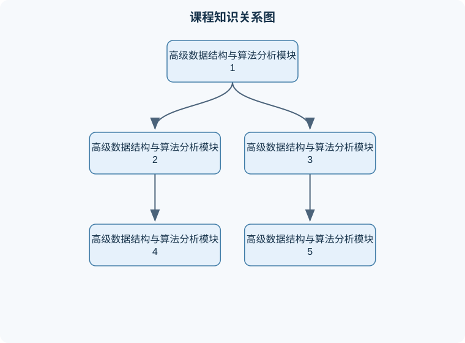

# 高级数据结构与算法分析

## 一、课程整体知识框架

### 课程边界与先修知识

课程聚焦高级数据结构、算法设计范式、复杂度分析与大规模计算。先修知识包括离散数学中的集合、关系、图、归纳法与概率基础，程序设计中的指针、递归、抽象数据类型和模块化实现，以及基础数据结构中的数组、链表、栈、队列、二叉树、堆、哈希表和图。课程覆盖平衡搜索树、外存与索引结构、可合并优先队列、图算法、分治、动态规划、贪心、回溯、随机化、近似、局部搜索、并行算法和外部排序；重点要求能够从问题定义出发选择数据结构或算法范式，证明正确性，推导时间与空间复杂度，并分析理想模型与实际机器限制之间的差异。





### 1. 课程对象、问题模型与分析方法

高级数据结构与算法分析研究两类相互关联的问题：一类是如何组织数据，使查询、更新、排序、合并和检索具有较低代价；另一类是如何设计有限步骤的计算过程，并证明其正确性、资源消耗和适用边界。数据结构决定可执行的操作及其代价，算法则规定这些操作的组合方式。相同问题采用不同结构时，时间复杂度、空间复杂度、实现难度和工程稳定性可能完全不同。

算法分析首先明确输入规模。通常用 $n$ 表示元素个数，用 $V$ 表示图的顶点数，用 $E$ 表示图的边数，用 $B$ 表示可用内存容量，单位可以是字节、记录数或元素数；用 $W$ 表示外部存储设备可进行的顺序读写次数或数据块传输量。复杂度中的 $O(\cdot)$ 给出渐近上界，$\Omega(\cdot)$ 给出渐近下界，$\Theta(\cdot)$ 表示上下界同阶。渐近分析忽略常数和低阶项，但不能忽略输入模型。例如，数组随机访问通常视为 $O(1)$，外部存储中的随机访问可能远高于顺序扫描，因此外部排序主要按磁盘读写轮数分析，而不是只计算比较次数。

正确的分析过程包括：定义输入和输出；列出操作的前置条件；给出算法不变量；证明终止性；计算最坏、最好或平均情形；说明内存、数据范围、是否允许修改输入等边界。若算法只在边权非负、树高受控或数据能够装入内存时成立，必须把这些条件写入结论，而不能将结论推广到所有输入。

### 2. 复杂度、递推式与摊还分析

分治算法通常把规模为 $n$ 的问题分成 $a$ 个规模约为 $n/b$ 的子问题，再用 $f(n)$ 的代价合并，形成

$$
T(n)=aT\left(\frac{n}{b}\right)+f(n),
$$

其中 $a\ge 1$ 表示子问题数，$b>1$ 表示规模缩小倍数，$f(n)$ 表示划分和合并的非递归代价。基本比较量是

$$
n^{\log_b a}.
$$

它表示递归树中叶节点总量的渐近阶。若 $f(n)$ 比该量低一个多项式阶，即存在 $\varepsilon>0$ 使

$$
f(n)=O\left(n^{\log_b a-\varepsilon}\right),
$$

则

$$
T(n)=\Theta\left(n^{\log_b a}\right).
$$

若

$$
f(n)=\Theta\left(n^{\log_b a}\log^k n\right),
$$

其中 $k\ge 0$ 为常数，则

$$
T(n)=\Theta\left(n^{\log_b a}\log^{k+1}n\right).
$$

若存在 $\varepsilon>0$，使

$$
f(n)=\Omega\left(n^{\log_b a+\varepsilon}\right),
$$

并满足正则条件

$$
a f(n/b)\le c f(n)
$$

且某个常数 $c<1$ 对足够大的 $n$ 成立，则

$$
T(n)=\Theta(f(n)).
$$

正则条件不能省略。仅知道 $f(n)$ 比递归树叶子项大，并不自动保证第三种情形，因为某些不规则函数会在不同规模上剧烈波动。递推式也必须符合实际分解方式。例如 $T(n)=2T(n/2)+n$ 是归并排序的模型，结果为 $\Theta(n\log n)$；而 $T(n)=T(n-1)+O(1)$ 是逐层减少一个元素的模型，不能套用分治主定理，展开后为 $\Theta(n)$。

摊还分析研究一系列操作的总成本，而不是孤立操作的最坏成本。以动态数组倍增为例，容量不足时扩展为原来的两倍并复制已有元素。若插入 $n$ 个元素，复制次数最多为

$$
1+2+4+\cdots+2^k<2n,
$$

其中 $2^k<n\le 2^{k+1}$。加上 $n$ 次普通写入，总成本小于 $3n$，因此连续 $n$ 次插入的摊还成本为 $O(1)$。但单次扩容仍可能为 $O(n)$，所以“摊还 $O(1)$”不等同于“每次操作最坏 $O(1)$”。

### 3. 模块一：树、堆与优先队列

树是具有层次关系的非线性结构。二叉搜索树要求任意节点左子树关键字小于节点关键字，右子树关键字大于节点关键字；若允许重复键，必须额外规定重复键放置方向或为节点维护计数。二叉搜索树的查找、插入和删除代价与树高 $h$ 有关，均为 $O(h)$。若输入已经有序，普通二叉搜索树会退化为链，$h=n$，操作退化为 $O(n)$；平衡树通过旋转或重建保证 $h=O(\log n)$，从而使操作达到对数复杂度。

堆是满足局部序关系的完全二叉树。最小堆中每个父节点关键字不大于子节点，因此根节点是全局最小值，但堆的中序遍历并不有序。数组下标从 $0$ 开始时，节点 $i$ 的左、右孩子分别为 $2i+1$ 和 $2i+2$，父节点为 $\lfloor(i-1)/2\rfloor$。插入元素后沿父链上浮，删除最小值后将末尾元素移到根并下沉，二者最坏均为 $O(\log n)$。从无序数组建堆若逐个插入为 $O(n\log n)$，采用自底向上的下沉过程则为 $O(n)$：高度为 $h$ 的节点至多移动 $h$ 层，而高度为 $h$ 的节点数量随 $h$ 指数减少，总代价可由级数

$$
\sum_{h=0}^{\lfloor\log n\rfloor}\frac{n}{2^{h+1}}h=O(n)
$$

得到。

### 4. 模块二：哈希、平衡树与区间结构

哈希表通过哈希函数将键映射到槽位。设槽位数为 $m$，元素数为 $n$，装载因子为

$$
\alpha=\frac{n}{m}.
$$

在简单均匀散列假设下，链地址法的平均冲突链长度与 $\alpha$ 同阶，查找、插入和删除的期望代价为 $O(1+\alpha)$；最坏情况下所有键冲突，操作为 $O(n)$。因此期望复杂度依赖哈希函数、键分布和扩容策略，不能写成无条件的常数复杂度。

平衡二叉搜索树适合有序遍历、前驱后继、范围查询等场景。红黑树通过节点颜色和路径约束保证从根到叶的最长路径不超过最短路径的常数倍，因此高度为 $O(\log n)$。哈希表虽然平均查找更快，但不天然支持按序输出；树结构虽然常数可能较大，却能稳定支持顺序和区间操作。

线段树把数组区间递归划分为左右子区间。对长度为 $n$ 的数组建树需要 $O(n)$ 空间和时间；单点更新沿根到叶修改，区间查询访问的节点数为 $O(\log n)$ 级别；若进行区间加法或区间赋值，则需使用懒标记，将尚未下传的更新保存在内部节点。懒标记必须满足合并规则，例如两个区间加法可以相加，而“赋值”会覆盖先前的加法，二者顺序不能颠倒。若只需要静态区间和，前缀和可用 $O(n)$ 预处理和 $O(1)$ 查询，线段树并非总是最优。

### 5. 模块三：图结构与最短路径

图由顶点集合和边集合组成，可表示道路网络、依赖关系、通信连接或任务流程。邻接矩阵空间为 $O(V^2)$，查询两点是否直接相连为 $O(1)$，适合边较密的图；邻接表空间为 $O(V+E)$，遍历一个顶点的所有出边总代价为其度数，适合稀疏图。

单源最短路径问题给定源点 $s$，要求计算从 $s$ 到各顶点的最短距离。Dijkstra 算法要求所有边权非负。令 $d[v]$ 表示当前从 $s$ 到顶点 $v$ 的已知最短距离，初始化 $d[s]=0$，其余为无穷大。每次从未确定顶点中取出 $d$ 最小者 $u$，再对每条出边 $(u,v)$ 进行松弛：

$$
d[v]\leftarrow\min\{d[v],d[u]+w(u,v)\},
$$

其中 $w(u,v)\ge0$ 是边的权重。非负条件保证：一旦 $u$ 是未确定顶点中距离最小者，任何经由其他未确定顶点再到达 $u$ 的路径都不可能更短，因此 $d[u]$ 可以永久确定。使用二叉堆和邻接表时，复杂度为 $O((V+E)\log V)$；使用数组寻找最小值时为 $O(V^2+E)$。若存在负边，Dijkstra 的贪心结论失效，应使用允许负边的算法，并额外检测负权回路。

### 6. 模块四：动态规划与贪心方法

动态规划适用于具有最优子结构和重叠子问题的问题。设计动态规划时必须明确状态、状态转移、初始条件和计算顺序。例如 0/1 背包中，$dp[i][c]$ 表示前 $i$ 件物品、容量不超过 $c$ 时的最大价值。第 $i$ 件物品重量为 $w_i$、价值为 $v_i$，则

$$
dp[i][c]=
\begin{cases}
dp[i-1][c], & c<w_i,\\
\max\{dp[i-1][c],dp[i-1][c-w_i]+v_i\}, & c\ge w_i.
\end{cases}
$$

二维实现时间为 $O(nC)$、空间为 $O(nC)$，其中 $C$ 是容量数值；若从大到小更新一维数组，空间可降为 $O(C)$。若错误地从小到大更新，会在同一轮重复使用当前物品，实际求解成完全背包。

贪心算法每一步选择当前看起来最优的决策。它必须证明交换论证、切割性质或其他充分条件，不能仅凭直觉。对分数背包按单位重量价值降序选择是正确的，因为任意最优解中若存在单位价值较低的已选物品和单位价值较高的未选物品，可以交换并不降低总价值；但对 0/1 背包，该交换过程不成立，贪心可能得到非最优解。

### 7. 模块五：排序、外部排序与选择

内存排序常按比较次数和辅助空间分析。归并排序稳定、最坏时间为 $O(n\log n)$，但需要 $O(n)$ 辅助空间；堆排序原地且最坏时间为 $O(n\log n)$，但通常不稳定；快速排序平均时间为 $O(n\log n)$，最坏可达 $O(n^2)$，随机化或三数取中只能降低退化概率或改善实际表现，不能改变未经条件说明的最坏界。

外部排序处理不能一次装入内存的数据。设每条记录占 $r$ 字节，内存可用于排序的容量为 $M$ 字节，则一次最多装入约 $\lfloor M/r\rfloor$ 条记录。首先分批读入、内部排序并写出初始有序段；随后进行多路归并。若使用 $k$ 路归并，每个输入段通常配置一个缓冲区，输出也配置缓冲区，$k$ 不能超过内存能够同时维护的缓冲数量。

初始段长度可以由置换选择提高。算法维护一个最小堆：读入记录后，若新记录不小于当前输出记录，则仍属于当前段；若新记录较小，则标记为下一段。当前堆耗尽后切换段。输入接近随机时，初始段平均可能接近内存的两倍；输入高度有序时，段可能更长；输入逆序时，收益可能很小。该方法不改变正确性，但会使实现复杂化，需要维护“冻结”记录状态。

多路归并的合并代价与各段长度有关。若四个有序段长度为 $2,4,5,15$，每次合并两段，合并代价为两段长度之和。采用最优合并顺序：先合并 $2$ 和 $4$，代价 $6$，得到长度 $6$；再合并 $5$ 和 $6$，代价 $11$，得到长度 $11$；最后合并 $11$ 和 $15$，代价 $26$。总比较或记录处理量为

$$
6+11+26=43.
$$

若先合并 $2$ 和 $15$，再合并其他段，总代价会更高。该过程等价于用最小堆反复取出两个最短段，类似霍夫曼树的最优带权路径思想。

### 8. 模块六：近似算法、装箱与条带装箱

条带装箱问题给定 $n$ 个不可旋转矩形，第 $i$ 个矩形宽度为 $w_i$、高度为 $h_i$，条带宽度为 $W$，要求矩形不重叠且每个矩形满足 $w_i\le W$，使最终高度最小。该问题属于组合优化问题，通常难以在一般情况下通过多项式时间精确求解，因此课程重点是可验证的近似算法和实验比较。

一个简单的启发式流程是按高度非增序处理矩形，并将每个矩形放入当前能够容纳它且顶部最低的水平层；若没有合适层，则开启新层。该方法易实现，排序时间为 $O(n\log n)$；若直接扫描所有层，每个矩形还可能产生 $O(n)$ 扫描代价，总体最坏为 $O(n^2)$。采用按剩余宽度组织的平衡树或堆，可以降低搜索代价，但多层状态更新会增加实现复杂度。

任何近似算法都必须与下界比较。总面积给出高度下界：

$$
H^*\ge \frac{\sum_{i=1}^{n}w_i h_i}{W},
$$

其中 $H^*$ 为最优高度。单个矩形也给出

$$
H^*\ge \max_i h_i.
$$

因此可用

$$
L=\max\left(\max_i h_i,\frac{\sum_i w_i h_i}{W}\right)
$$

作为简单下界。算法输出高度 $H_A$ 后，可计算经验比值 $H_A/L$；但这不是严格的近似比，因为 $L$ 可能严格小于最优值。只有当算法证明对所有输入满足 $H_A\le \rho H^*$ 时，$\rho$ 才是理论近似保证。实验中还应记录实际最优值、整数规划结果或小规模精确搜索结果，避免把下界误称为最优解。

### 9. 模块七：字符串、摊还结构与综合应用

字符串算法关注模式匹配、前缀关系和重复结构。朴素匹配在文本长度为 $n$、模式长度为 $m$ 时最坏为 $O(nm)$；利用模式自身前缀和后缀关系，可以在失配后跳过不可能的起点，将匹配过程降为 $O(n+m)$。此类方法的核心不是“比较次数少”这一结论本身，而是维护一个不变量：已经匹配的前缀信息可以用于确定下一次比较位置，且不会遗漏合法匹配。

综合应用通常同时使用多种结构。例如任务调度可用图表示依赖关系，用拓扑排序判断是否存在环，再用优先队列选择当前可执行且优先级最高的任务；在线区间统计可用线段树维护区间和，用哈希表保存对象标识到数组位置的映射；大规模日志排序则需要外部排序，不能直接将内存排序算法套用到全部数据。

### 10. 模块八：正确性证明、工程实现与岗位能力

算法正确性常用循环不变量、数学归纳、反证法和交换论证。循环不变量必须说明初始化成立、每轮执行后保持、终止时如何推出目标结论。复杂度证明必须明确计数对象，例如堆操作按树高计，外部排序按数据传输轮数计，图算法按 $V$ 和 $E$ 计。

工程实现还需处理整数溢出、空输入、重复键、不可达顶点、负权边、缓冲区边界和异常终止。用无穷大表示不可达距离时，不能直接计算“无穷大加边权”，否则可能溢出；应先判断前驱距离是否有效。条带装箱中必须检查 $w_i\le W$，否则输入本身不可行。外部排序中必须验证每个初始段内部有序、每次归并输出有序以及最终记录数与输入一致。

本课程知识可服务于算法研发、后端研发、数据工程、搜索与推荐、数据库内核、系统性能分析和业务优化等岗位。岗位任务可能包括设计索引、优化批处理、实现图搜索、降低查询延迟、处理超内存数据或评估近似方案。产出不仅是代码，还应包括复杂度说明、正确性依据、边界测试、性能报告和验收指标。验收标准应可测量，例如输出是否有序、最短路径是否满足边权和、区间查询是否与暴力结果一致、外部排序读写量是否低于基线、近似算法的质量和运行时间是否达到约定范围。

## 二、章节和模块划分

### 核心知识覆盖清单

本清单根据本课程的章节划分整理，用于检查正文是否覆盖各个核心模块：

- **1. 代表性算法一：Dijkstra 单源最短路径**。
- **2. 代表性算法二：线段树区间求和与单点更新**。
- **3. 代表性算法三：外部排序与最优归并**。
- **4. 代表性算法四：条带装箱的分层启发式**。
- **5. 例题一：递推式分析**。
- **6. 例题二：最短路径条件判断**。
- **7. 例题三：动态规划状态设计**。
- **8. 例题四：外部排序轮数**。
- **9. 例题五：条带装箱下界**。
- **10. 实验与项目一：不同数据分布下的条带装箱比较**。
- **11. 实验与项目二：外部排序正确性与 I/O 性能**。
- **12. 典型易错点**。
- **13. 典型笔试问题及解答思路**。
- **14. 典型面试问题、参考答案与深入追问**。


### 1. 代表性算法一：Dijkstra 单源最短路径

**输入**：带权有向图或无向图 $G=(V,E)$，源点 $s$，且每条边权 $w(u,v)\ge0$。  
**输出**：从 $s$ 到各顶点的最短距离，以及可选的前驱数组，用于恢复路径。  
**不变量**：每次从优先队列取出的有效最小距离顶点，其距离已经是最终最短距离。  
**终止条件**：优先队列为空，或已确定所有可达顶点。  
**复杂度**：邻接表加二叉堆为 $O((V+E)\log V)$，空间为 $O(V+E)$。

```python
from heapq import heappush, heappop

def dijkstra(graph, source):
    """
    graph[u] 是形如 [(v, weight), ...] 的列表。
    要求所有 weight >= 0。
    返回 dist 和 prev。
    """
    inf = float("inf")
    dist = {u: inf for u in graph}
    prev = {u: None for u in graph}
    dist[source] = 0
    heap = [(0, source)]

    while heap:
        current_dist, u = heappop(heap)
        if current_dist != dist[u]:
            continue  # 丢弃过期堆元素

        for v, weight in graph[u]:
            if weight < 0:
                raise ValueError("Dijkstra 不支持负边权")
            new_dist = current_dist + weight
            if new_dist < dist[v]:
                dist[v] = new_dist
                prev[v] = u
                heappush(heap, (new_dist, v))

    return dist, prev
```

这里允许同一顶点多次入堆，但只有距离等于当前最新值的元素才会被处理。这样避免了需要修改堆中旧元素的复杂操作。若使用浮点权重，不能简单用绝对相等判断旧值，应根据数值误差模型设计比较方式；若权重为整数，通常可直接比较。

### 2. 代表性算法二：线段树区间求和与单点更新

**输入**：长度为 $n$ 的数组 $a$，支持修改某一位置的值，以及查询半开区间 $[l,r)$ 的元素和。  
**输出**：每次查询的区间和。  
**不变量**：每个节点保存其对应区间内所有数组元素的和。  
**终止条件**：查询区间为空，或递归区间完全包含于查询范围。  
**复杂度**：建树 $O(n)$，单点更新和区间查询均为 $O(\log n)$，空间为 $O(n)$。

区间采用半开形式 $[l,r)$ 可以避免端点重复，并自然表示空区间 $l=r$。递归查询时，若当前节点区间与目标区间不相交，返回 $0$；若完全包含，直接返回节点值；否则递归左右子树并求和。若使用区间赋值或区间加法，需要扩展懒标记，并严格规定多个标记的组合次序。

### 3. 代表性算法三：外部排序与最优归并

**输入**：无法一次装入内存的记录流，内存容量为 $B$，每条记录大小为 $r$。  
**输出**：按关键字非降序排列的全部记录。  
**过程**：

1. 计算一次可处理的记录数 $q=\lfloor B/r\rfloor$，分批读取至内存。
2. 对每批记录进行内部排序，写出有序段。
3. 将所有有序段按可用缓冲区数进行多路归并。
4. 若段长度差异明显，优先合并较短的段，减少重复读写。
5. 完成后验证总记录数、顺序和关键字边界。

若有 $R$ 个初始段，每轮进行 $k$ 路归并，则归并轮数近似为 $\lceil\log_k R\rceil$，加上生成初始段的一轮。每轮通常需要读写全部数据，因此应优先减少轮数和不必要的随机访问。若 $10{,}000{,}000$ 条记录每条 $128$ 字节，总数据量为 $1{,}280{,}000{,}000$ 字节；内存为 $4$ MB，即约 $32{,}768$ 条记录，初始段数量约为

$$
R=\left\lceil\frac{10{,}000{,}000}{32{,}768}\right\rceil\approx306.
$$

若按每段约 $32{,}000$ 条估算，则约为 $313$ 段。具体轮数取决于缓冲分配和归并路数，不能只由记录总数决定。

### 4. 代表性算法四：条带装箱的分层启发式

**输入**：条带宽度 $W$，矩形集合 $(w_i,h_i)$，且 $0<w_i\le W$、$h_i>0$。  
**输出**：每个矩形的位置及总高度。  
**过程**：

1. 按高度非增序排列矩形。
2. 维护若干层，每层记录当前已占宽度和层高度。
3. 依次处理矩形，将其放入能够容纳它的最低层；若多个层均可放置，选择放置后剩余空间最小的层。
4. 若没有可行层，新建高度为 $h_i$ 的层。
5. 验证每个矩形都在条带边界内，任意两个矩形不重叠。

该方法是启发式，不保证得到最优布局。排序会改变结果；若按宽度、面积或高度宽度比排序，可能在不同分布上表现更好。实验时应固定随机种子、输入规模、矩形分布和计时环境，并至少报告总高度、面积下界比、运行时间、层数和失败输入数。

### 5. 例题一：递推式分析

**题干**：求

$$
T(n)=2T(n/2)+n\log n
$$

的渐近阶。

**分析**：这里 $a=2$，$b=2$，因此

$$
n^{\log_b a}=n.
$$

非递归项为 $f(n)=n\log n=\Theta(n\log^1n)$，与基准项相差一个对数因子。

**逐步解答**：根据第二种情形，

$$
T(n)=\Theta(n\log^2n).
$$

也可以展开递归树：第 $j$ 层有 $2^j$ 个子问题，每个子问题规模为 $n/2^j$，该层代价为

$$
2^j\cdot\frac{n}{2^j}\log\frac{n}{2^j}
=n(\log n-j).
$$

树高约为 $\log n$，对各层求和得到 $\Theta(n\log^2n)$。

**结果验证**：若误写成 $\Theta(n\log n)$，相当于遗漏了每层逐渐变化的 $\log$ 因子。  
**变式**：若递推式改为 $T(n)=2T(n/2)+n^2$，则非递归项多项式大于 $n$，在满足正则条件时结果为 $\Theta(n^2)$。

### 6. 例题二：最短路径条件判断

**题干**：图中存在一条权重为 $-2$ 的边，能否直接使用 Dijkstra？

**分析**：不能。Dijkstra 的确定性结论依赖所有边权非负。若当前顶点 $u$ 暂时最小，但另一条路径可先经过未确定顶点，再通过负边返回，则可能得到比 $d[u]$ 更小的路径。

**逐步解答**：设源点为 $s$，已有 $d[u]=1$，另一个未确定顶点 $x$ 的距离为 $3$，存在边 $(x,u)$ 权重 $-5$。经过 $x$ 到 $u$ 的路径长度为 $3-5=-2$，小于当前的 $1$。因此“取出即确定”的不变量被破坏。

**结果验证**：检查所有边权；若存在负边，应改用适合负权的算法，并检查负权回路。  
**变式**：若所有边权都非负但图不连通，Dijkstra 仍正确，只是不可达顶点距离保持为无穷大。

### 7. 例题三：动态规划状态设计

**题干**：容量 $C=5$，物品重量和值分别为 $(2,3),(3,4),(4,5)$，每件最多选择一次，求最大价值。

**分析**：定义 $dp[i][c]$ 为前 $i$ 件物品容量不超过 $c$ 的最大价值。

**逐步解答**：

- 只考虑第一件物品：容量小于 $2$ 时价值为 $0$，容量至少为 $2$ 时价值为 $3$。
- 加入第二件物品，容量 $5$ 时可选第二件，价值为 $4；也可选前两件，总重量为 $5$，价值为 $7$，因此 $dp[2][5]=7$。
- 加入第三件物品，容量 $5$ 时选择第三件价值为 $5；选择第一、二件价值为 $7$，所以最终答案为 $7$。

**结果验证**：穷举子集：空集价值 $0$，单件最大为 $5$，第一和第二件总重量 $5$、价值 $7$，其他组合超容量，故最优值确为 $7$。  
**变式**：若物品可重复选择，状态转移中的前一层应改为当前层，或一维数组按容量从小到大更新。

### 8. 例题四：外部排序轮数

**题干**：数据被分成 $16$ 个初始有序段，内存允许每次进行 $4$ 路归并。至少需要多少轮归并？

**分析**：每轮最多将段数缩小为原来的四分之一。

**逐步解答**：

- 第 1 轮：$16$ 段变为 $4$ 段；
- 第 2 轮：$4$ 段变为 $1$ 段。

因此需要 $2$ 轮归并。如果把生成初始段也算入整个外部排序过程，则总数据处理轮数为 $1+2=3$ 轮。

**结果验证**：$4^2=16$，说明两轮足以覆盖全部段；一轮只能把 $16$ 段变成 $4$ 段，不能完成排序。  
**变式**：若有 $20$ 段，需 $\lceil\log_4 20\rceil=3$ 轮归并；实际还需考虑不均匀分组和缓冲区数量。

### 9. 例题五：条带装箱下界

**题干**：条带宽度 $W=10$，三个矩形尺寸为 $(6,4),(4,3),(5,2)$，求高度下界。

**分析**：总面积为

$$
6\times4+4\times3+5\times2=50.
$$

面积下界为 $50/10=5$。最大矩形高度为 $4$，因此

$$
L=\max(5,4)=5.
$$

**逐步解答**：前两个矩形宽度恰好为 $10$，可放在同一层，高度为 $4$；第三个矩形可放在其下方，高度为 $2$，得到高度 $6$。因此一个可行解高度为 $6$，但仅凭面积下界不能证明最优值为 $5$ 或 $6$。

**结果验证**：布局高度 $6$ 不低于下界 $5$，且所有矩形边界合法。  
**变式**：若三个矩形宽度均为 $6$，则任意同层最多放一个，面积下界仍可能较弱，需要结合宽度冲突和高度分组构造更强下界。

### 10. 实验与项目一：不同数据分布下的条带装箱比较

**目标**：比较两种多项式时间启发式的质量和速度：高度非增序分层法，以及面积非增序结合最小剩余空间放置法。

**输入数据**：

1. 规模分别取 $10,100,1000,10000$；
2. 宽度取均匀分布、集中在大宽度、集中在小宽度三类；
3. 高度取均匀分布、长尾分布和少数高矩形分布；
4. 条带宽度固定为 $W$，并保证每个 $w_i\le W$。

**步骤**：

1. 为每组数据固定随机种子并生成至少多个独立实例。
2. 运行两种算法，记录总高度、面积下界、$H_A/L$、运行时间和峰值内存。
3. 对小规模实例使用穷举、整数规划或精确搜索得到最优值，计算真实近似比。
4. 对大规模实例只报告相对下界比，并明确这不是严格近似比。
5. 检查重叠、越界、矩形遗漏和输出高度计算错误。

**评价标准**：算法必须输出合法布局；质量指标包括总高度和相对下界比；性能指标包括平均时间、最坏时间和内存；实验结论必须按输入分布分别说明，不能只给总体平均值。

**排错方法**：若出现矩形重叠，检查层的当前宽度和矩形起点更新顺序；若输出高度低于面积下界，检查面积单位、整数除法和高度累加；若规模增加时耗时突然平方增长，检查是否对每个矩形线性扫描全部层。

### 11. 实验与项目二：外部排序正确性与 I/O 性能

**目标**：实现基于初始有序段和多路归并的外部排序，并比较普通分块排序与置换选择生成初始段的效果。

**输入数据**：生成包含重复键、升序片段、逆序片段和随机片段的记录文件；记录至少包含整数键和稳定序号，便于检查相同键的稳定性。

**步骤**：

1. 根据内存上限计算单批记录数。
2. 分批读取并生成初始段，分别记录段数量和平均段长度。
3. 使用最小堆进行多路归并，维护每个输入段的当前记录。
4. 输出结果并逐项检查非降序、记录总数和重复记录数。
5. 统计读写字节数、归并轮数、运行时间和峰值内存。

**评价标准**：结果必须完整、非降序且不超出内存限制；在稳定排序要求下，相同键的稳定序号应保持原顺序；性能比较应区分 CPU 时间和外部存储 I/O 时间。

**排错方法**：输出记录数变少通常是归并结束条件或段尾标记错误；顺序局部错误通常来自堆中比较键不完整；重复记录丢失可能由读取指针复用错误造成；内存超限则应检查是否同时保留了过多输入缓冲和完整输出缓存。

### 12. 典型易错点

1. 把 $O(1)$ 误解为实际耗时恒定，忽略缓存、分支和数据规模。
2. 把平均复杂度写成最坏复杂度，尤其是哈希表和随机化快速排序。
3. 使用主定理时不检查 $a,b$ 的条件和第三种情形的正则条件。
4. 认为堆是完全有序结构；堆只保证父子局部关系。
5. 忽略普通二叉搜索树在有序输入下退化为链。
6. 将 Dijkstra 用于存在负边的图。
7. 未判断不可达距离就进行无穷大加法，造成溢出。
8. 线段树区间端点混用闭区间 $[l,r]$ 与半开区间 $[l,r)$。
9. 懒标记中把区间赋值和区间加法错误地交换顺序。
10. 0/1 背包一维更新时从小到大遍历容量，导致物品被重复使用。
11. 只凭总面积下界评价条带装箱，不承认下界可能远小于最优值。
12. 外部排序只按比较次数分析，忽略磁盘读写轮数。
13. 将初始段数量直接等同于归并轮数，未考虑归并路数。
14. 只测试随机数据，未测试有序、逆序、重复键和极端宽度。
15. 用浮点数直接判断相等，导致几何重叠或距离比较误判。
16. 只验证输出数值，不验证路径、布局、记录完整性和边界合法性。

### 13. 典型笔试问题及解答思路

#### 问题一：为什么归并排序是 $O(n\log n)$？

将数组分为两个规模约为 $n/2$ 的部分，递归排序后线性合并，递推式为 $T(n)=2T(n/2)+\Theta(n)$。主定理中基准项为 $n$，故结果为 $\Theta(n\log n)$。稳定性来自合并时相等键优先取左侧元素。

#### 问题二：建堆为什么是 $O(n)$ 而不是 $O(n\log n)$？

逐个插入确实为 $O(n\log n)$，但自底向上建堆中大多数节点接近叶子，能下沉的高度很小。按高度求和可得 $\sum_h(n/2^{h+1})h=O(n)$。

#### 问题三：哈希表最坏为什么是 $O(n)$？

若所有键映射到同一槽位，链地址法中的冲突链长度为 $n$，查找必须逐个比较。均匀散列只能支持期望分析，不能消除最坏输入。

#### 问题四：Dijkstra 的核心正确性条件是什么？

所有边权非负。取出当前最小暂定距离的顶点后，任何绕经未确定顶点的路径都至少先增加非负代价，因此不可能再变短。

#### 问题五：线段树和前缀和如何选择？

静态区间和使用前缀和，预处理 $O(n)$、查询 $O(1)$；存在单点更新或复杂区间更新时使用线段树，查询和更新通常为 $O(\log n)$。

#### 问题六：动态规划为什么能避免重复计算？

递归子问题具有重叠性，多个状态会反复出现。将每个状态结果保存后，每个状态只计算一次，从而把指数级重复搜索降为“状态数乘以每个状态转移代价”。

#### 问题七：外部排序为什么需要多轮归并？

初始段只保证段内有序，段与段之间仍无序。一次归并只能把有限数量的段合成更长有序段；当初始段数量超过可用归并路数时，必须分轮处理。

#### 问题八：面积下界能否证明条带装箱最优值？

只能证明最优高度不小于总面积除以条带宽度。矩形不可切割、宽度冲突和高度差异可能造成额外空隙，因此面积下界通常不是精确最优值。

### 14. 典型面试问题、参考答案与深入追问

#### 问题一：如何定位一个查询变慢的问题？

参考答案：先确认输入规模和数据分布，再用指标区分 CPU、内存、锁等待和 I/O；检查复杂度、索引或数据结构是否匹配，并用基准测试验证修改效果。  
深入追问要点：说明如何构造对照组、如何避免缓存导致的假提升，以及如何验证最坏输入。

#### 问题二：哈希表和红黑树如何选择？

参考答案：只需精确键查找且接受期望复杂度时可选哈希表；需要有序遍历、前驱后继或范围查询时选择平衡树。  
深入追问要点：讨论冲突、扩容、内存局部性、最坏复杂度和迭代顺序。

#### 问题三：如何证明一个贪心算法正确？

参考答案：不能只展示若干样例，应证明每一步选择可被某个最优解替换而不变差，并证明剩余问题仍满足同类结构。  
深入追问要点：给出交换论证失败的反例，例如 0/1 背包不能按单位价值简单贪心。

#### 问题四：Dijkstra 遇到负边怎么办？

参考答案：不能直接使用。应根据图规模和负边性质选择允许负权的算法，并检查是否存在负权回路；若存在可达负权回路，最短路径可能没有有限值。  
深入追问要点：解释为什么负边破坏“取出即确定”的不变量。

#### 问题五：如何测试线段树实现？

参考答案：随机生成小数组，用线性扫描作为对照；随机交替执行更新和查询，逐次比较结果；增加空区间、全区间、单点和边界区间测试。  
深入追问要点：检查闭区间与半开区间、递归边界和懒标记下传顺序。

#### 问题六：外部排序的瓶颈通常在哪里？

参考答案：当数据无法装入内存时，瓶颈通常是外部存储读写和归并轮数，而非比较指令。应减少初始段数量、提高归并路数并使用顺序 I/O。  
深入追问要点：讨论缓冲区分配、段长度不均和稳定排序成本。

#### 问题七：如何评价一个近似算法？

参考答案：同时报告理论保证、可行性、与下界或精确最优值的差距、运行时间和内存；不同输入分布应分别评估。  
深入追问要点：区分严格近似比、经验比值和下界比，不能把实验最好结果当作理论保证。

#### 问题八：如何处理整数溢出和异常输入？

参考答案：在读取阶段检查范围，在乘法和累加前进行上界判断，使用足够宽的整数类型；对空输入、负值、重复键、不可达节点和超出边界的宽度分别定义行为。  
深入追问要点：说明异常应被拒绝、截断还是返回错误，以及如何在测试中覆盖这些分支。

## 三、核心概念的详细解释

### 1. 数据结构、抽象数据类型与算法分析

数据结构是数据在内存或外部存储中的组织方式，以及围绕这种组织方式定义的访问、插入、删除、更新和遍历操作。抽象数据类型只规定“能够做什么”和操作应满足的逻辑性质，不规定具体存储形式。例如，优先队列要求支持插入元素和删除最小元素，可以用二叉堆、平衡树或其他结构实现。算法则是在给定输入模型、数据结构和资源约束下，将输入转化为输出的有限步骤过程。

算法分析必须区分三类复杂度：

- 时间复杂度描述基本操作次数随输入规模增长的规律；
- 空间复杂度描述额外使用的内存；
- I/O复杂度描述外部存储与内存之间的数据块传输次数。

令 $n$ 表示元素个数，$V$ 表示图的顶点数，$E$ 表示图的边数，$B$ 表示内存能够容纳的元素数，$W$ 表示外部存储的块读写次数。数组按下标访问通常为 $O(1)$，链表按位置访问为 $O(n)$，但这只是抽象机模型下的渐近结论；在现代处理器上，连续数组通常具有更好的缓存局部性，而指针结构可能因缓存未命中产生较大常数代价。

$O(g(n))$表示渐近上界，$\Omega(g(n))$表示渐近下界，$\Theta(g(n))$表示二者同时成立。复杂度结论必须说明输入模型。例如哈希表查找通常是期望 $O(1)$，但在冲突极端集中、哈希函数不合适或攻击者能够控制输入时，最坏时间可能退化；平衡搜索树查找、插入和删除可以保证 $O(\log n)$，但常数和内存开销可能高于哈希表。

### 2. 递推式与分治思想

分治算法将原问题划分为若干规模较小的同类子问题，分别求解后再合并。其典型递推式为

$$
T(n)=aT\left(\frac{n}{b}\right)+f(n),
$$

其中 $a$ 是子问题数量，$b>1$ 是规模缩小因子，$f(n)$ 是划分和合并成本。若子问题规模不能精确相等，应使用 $\lceil n/b\rceil$ 或 $\lfloor n/b\rfloor$ 建模，并说明这不会改变渐近结论的条件。

令

$$
p=\log_b a.
$$

递归树第 $i$ 层有 $a^i$ 个子问题，每个子问题规模为 $n/b^i$，因此该层的非递归成本约为

$$
a^i f\left(\frac{n}{b^i}\right).
$$

当 $f(n)=\Theta(n^q)$时，第 $i$ 层成本为

$$
\Theta\left(a^i\left(\frac{n}{b^i}\right)^q\right)
=\Theta\left(n^q\left(\frac{a}{b^q}\right)^i\right).
$$

这说明比较 $q$ 与 $\log_b a$即可判断递归树中哪一部分占主导：

1. 若 $q<\log_b a$，叶节点总成本占主导，$T(n)=\Theta(n^{\log_b a})$；
2. 若 $q=\log_b a$，每层成本同阶，层数约为 $\log_b n$，因此
   $T(n)=\Theta(n^{\log_b a}\log n)$；
3. 若 $q>\log_b a$，根部及高层成本占主导，在满足正则条件时，$T(n)=\Theta(f(n))$。

例如归并排序满足

$$
T(n)=2T(n/2)+\Theta(n),
$$

因为 $\log_2 2=1$，合并成本与 $n^1$同阶，所以

$$
T(n)=\Theta(n\log n).
$$

快速排序若每次恰好划分为两个相等部分，也有 $\Theta(n\log n)$；若每次枢轴都为最小或最大元素，则递推式变为

$$
T(n)=T(n-1)+\Theta(n),
$$

展开得到

$$
T(n)=\Theta(1+2+\cdots+n)=\Theta(n^2).
$$

因此，不能仅因两个算法都属于“分治”就断言复杂度相同，划分质量是关键条件。

### 3. 摊还分析与动态数组

摊还分析研究一长串操作的总成本。它不同于平均分析：平均分析依赖输入分布，摊还分析通常对任意操作序列给出总成本上界。

动态数组初始容量为 $c$，当元素数量达到容量时扩容为原来的两倍。单次扩容需要复制已有元素，可能花费 $\Theta(n)$；但若连续插入 $n$ 个元素，扩容复制量构成几何级数：

$$
1+2+4+\cdots+2^k<2n.
$$

因此，$n$次插入的总成本为 $O(n)$，平均到每次操作为 $O(1)$摊还成本。这里的结论依赖“容量按常数倍增长”。若每次只增加固定常数个位置，则复制总量为

$$
1+2+\cdots+n=\Theta(n^2),
$$

单次插入的摊还成本将退化为 $\Theta(n)$。

### 4. 图、最短路径与正确性不变量

带权图可表示为 $G=(V,E)$，其中 $V$是顶点集合，$E$是边集合，边权 $w(u,v)$表示从顶点 $u$到顶点 $v$的代价。单源最短路径问题给定源点 $s$，要求计算从 $s$到其他顶点的最小路径代价。

Dijkstra算法适用于所有边权非负的有向图或无向图。维护暂定距离数组 $d[v]$：初始时 $d[s]=0$，其他顶点为正无穷。每次取出暂定距离最小且尚未确定的顶点 $u$，再尝试松弛每条出边：

$$
d[v]\leftarrow \min\{d[v],d[u]+w(u,v)\}.
$$

正确性依赖不变量：已经从优先队列中取出并确定的顶点，其 $d$ 值等于真实最短距离。若存在一条更短路径，它从已确定区域进入未确定区域时，边权非负，所以进入后不可能绕行产生比当前最小暂定距离更小的值。若出现负边，这一论证失效，Dijkstra不能直接使用。

使用二叉堆和邻接表时，时间复杂度为

$$
O((V+E)\log V),
$$

空间复杂度为 $O(V+E)$。若图为稠密图且使用邻接矩阵和线性扫描最小值，时间复杂度为 $O(V^2)$。不可达顶点的距离应保持为无穷标记，不能误写成零；若从源点可达负权回路，则最短路径可能不存在有限值。

### 5. 线段树、前缀和与区间操作

给定数组 $a[0],a[1],\ldots,a[n-1]$，若数组静态不变，可以构造前缀和

$$
P[0]=0,\qquad P[i+1]=P[i]+a[i].
$$

半开区间 $[l,r)$的区间和为

$$
\operatorname{sum}(l,r)=P[r]-P[l],
$$

其中 $0\le l\le r\le n$。预处理时间为 $O(n)$，单次查询为 $O(1)$，但修改一个元素通常需要更新后续大量前缀值，时间为 $O(n)$。

线段树把数组区间递归划分为左右子区间，每个节点保存对应区间的统计信息。对区间求和、区间最小值、最大值等可结合操作，单点修改和区间查询通常为 $O(\log n)$，建树为 $O(n)$。若需要区间整体加值，应使用懒标记：节点保存尚未下传到子节点的更新，只有在访问子区间时才传播。懒标记的正确性要求“节点统计值已经反映该更新”，且更新顺序不能被后续标记覆盖。

前缀和适合静态查询；线段树适合动态更新和查询；若只需要单点修改与前缀或区间和，树状数组往往实现更简单、常数更小，但对任意复杂区间操作的表达能力通常不如线段树。

### 6. 动态规划与状态设计

动态规划适用于具有最优子结构和重叠子问题的问题。最优子结构表示最优解可以由子问题的最优解组合得到；重叠子问题表示递归求解时同一状态会被多次计算。

以斐波那契数为例：

$$
F(0)=0,\qquad F(1)=1,\qquad F(n)=F(n-1)+F(n-2).
$$

直接递归会重复计算，时间接近指数级；记忆化或自底向上计算后，每个状态只计算一次，时间为 $O(n)$，空间可从 $O(n)$压缩到 $O(1)$，因为计算 $F(n)$只需保留前两个状态。

设计动态规划时应明确四项内容：

1. 状态：状态必须完整描述后续决策所需的信息；
2. 转移：说明当前状态如何由更小状态得到；
3. 初始条件：处理规模最小或边界状态；
4. 计算顺序：保证转移依赖的状态已经计算。

若状态遗漏了关键限制，得到的“最优值”可能对应一个不可行方案。例如 0/1背包必须记录当前处理到的物品和剩余容量，不能只记录容量而忘记物品是否已经使用。

### 7. 外部排序与归并组织

当数据规模超过内存容量时，排序的主要代价由磁盘或其他外部存储的读写决定。外部归并排序通常分两阶段：

1. **生成初始归并段**：每次读入内存可容纳的数据，内存内排序后写回外部存储，形成有序段；
2. **多路归并**：同时读取若干有序段的当前首元素，反复输出最小值，生成更长的有序段，直到所有段合并为一个。

若每个记录大小为 $128$字节，记录总数为 $10\,000\,000$，则总数据量为

$$
10\,000\,000\times128=1\,280\,000\,000\text{ 字节}.
$$

若内存为 $4$MB，即约 $4\,194\,304$字节，则一次可装入约

$$
\left\lfloor\frac{4\,194\,304}{128}\right\rfloor=32\,768
$$

条记录。初始段数量约为

$$
\left\lceil\frac{10\,000\,000}{32\,768}\right\rceil=306.
$$

实际程序还需为输入缓冲区、输出缓冲区和堆保留空间，因此可用记录数会少于理论值。若采用 $k$路归并，每轮大约将段数缩小为原来的 $k$分之一，归并轮数近似为 $\lceil\log_k R\rceil$，其中 $R$是初始段数。总I/O轮数还需加上初始段生成阶段。

初始段不一定等于内存容量对应的长度。替换选择使用最小堆维护当前可输出元素：若新读入元素不小于刚输出的元素，可继续放入当前段；若新元素更小，则暂时冻结，留待下一段。对于随机数据，初始段平均可能接近内存的两倍；对于降序数据，改善很小；对于接近有序的数据，段长度可能明显增加。

多路归并的段长度不同时，应选择合适的合并顺序。长度为 $2,4,5,15$的四个段若采用两两归并，先合并 $2$和$4$，得到长度 $6$，再合并 $5$和$6$得到 $11$，最后与 $15$合并，总成本为

$$
6+11+26=43.
$$

该过程等价于构造以段长度为叶权的最优合并树，始终合并当前最短的两个段，即哈夫曼式合并。若先合并 $2$和 $15$，会使大段被重复读写，总代价更高。

### 8. 条带装箱与近似算法

条带装箱问题给定条带宽度 $W$和 $n$个矩形，第 $i$个矩形宽度为 $w_i$、高度为 $h_i$，满足

$$
0<w_i\le W,\qquad h_i>0.
$$

矩形不可旋转、不可重叠，可以沿竖直方向放置；目标是最小化整体高度。问题的难点在于同时安排横向位置和纵向层次，通常属于组合优化问题，精确求解在大规模输入上代价很高，因此常用多项式时间近似算法。

一种简单方法是 **Next-Fit Decreasing Height，按高度降序的下一适应层算法**：

1. 按非递增高度排序；
2. 维护当前层剩余宽度；
3. 若矩形能放入当前层，则放在当前层右侧；
4. 否则关闭当前层并新建一层；
5. 总高度为各层高度之和。

它实现简单、时间主要由排序决定，为 $O(n\log n)$，但可能产生较多空隙。更灵活的方法是 **Best-Fit Decreasing Height**：同样按高度降序处理矩形，但将矩形放入能够容纳它且剩余宽度最小的已有层；若不存在则新建层。该方法通常比下一适应层利用空间更充分，但需要维护有序的剩余宽度结构。

条带装箱的面积下界为

$$
H^\ast\ge
\left\lceil\frac{\sum_{i=1}^{n}w_i h_i}{W}\right\rceil,
$$

其中 $H^\ast$为最优高度。证明是：高度为 $H^\ast$的条带面积为 $WH^\ast$，必须覆盖所有矩形总面积。该下界不一定紧，因为矩形不能切割，宽度不匹配会造成空隙。一个宽度为 $W$、高度为 $1$的大矩形与多个接近 $W/2$但无法完全配对的矩形，就可能使实际最优高度大于面积下界。

## 四、重要定义、公式、定理和推导

### 专业审校补充：关键定义与适用边界

B树是面向外存访问的多路平衡搜索树。设最小度数为 t≥2：除根外，每个内部结点至少含 t−1 个关键字和 t 个孩子，至多含 2t−1 个关键字和 2t 个孩子；根在非叶状态下至少含 1 个关键字和 2 个孩子。结点内关键字有序，所有叶结点处于同一层。插入时若目标孩子已满，必须先分裂：将中间关键字上移到父结点，其余关键字分成左右两个结点，从而保持占用上界。若根已满，先建立新根并分裂旧根，树高增加一层。含 n 个关键字时，高度为 O(log_t n)，一次查找、插入或删除需要 O(log_t n) 次结点访问；在外存模型中，更有意义的复杂度是磁盘页 I/O 次数，而不是内存中的比较次数。该结论假设一个结点可装入一个固定大小的页，页访问成本显著高于页内计算。B+树将实际记录通常集中在叶层，并以叶链支持范围扫描；因此不能把普通B树和B+树的记录布局、范围查询代价混为一谈。


### 1. 代表性算法：Dijkstra算法

**输入**：非负边权图 $G=(V,E)$和源点 $s$。  
**输出**：从 $s$到每个顶点的最短距离，以及可选的前驱数组。

```python
import heapq

def dijkstra(graph, source):
    # graph[u] 是 (v, weight) 列表
    inf = float("inf")
    dist = {vertex: inf for vertex in graph}
    prev = {vertex: None for vertex in graph}
    dist[source] = 0
    heap = [(0, source)]

    while heap:
        current_dist, u = heapq.heappop(heap)

        # 堆中可能存在旧的、已经失效的距离
        if current_dist != dist[u]:
            continue

        for v, weight in graph[u]:
            if weight < 0:
                raise ValueError("Dijkstra要求边权非负")
            new_dist = current_dist + weight
            if new_dist < dist[v]:
                dist[v] = new_dist
                prev[v] = u
                heapq.heappush(heap, (new_dist, v))

    return dist, prev
```

不变量是：每次从堆中取出有效最小距离时，该顶点的距离已经是最终最短距离。终止条件是优先队列为空，表示所有可达顶点都已处理。若存在不可达顶点，其距离仍为无穷。若图含负边，应改用允许负权的算法，并进一步检查负权回路。若权值和可能超过机器整数范围，必须使用更宽整数类型或在加法前检查溢出。

### 2. 代表性算法：懒标记线段树的区间加法与区间和

**输入**：长度为 $n$的数组、区间加法操作 $a[l:r]\leftarrow a[l:r]+x$、区间和查询。  
**输出**：每次查询对应的区间和。

每个节点保存区间和 `sum`与待下传增量 `lazy`。若节点覆盖长度为 $L$的区间，整体加上 $x$后，区间和增加 $Lx$。查询或递归更新前必须先下传懒标记，否则子节点仍保存旧值。

时间复杂度为：建树 $O(n)$，单次区间更新和查询 $O(\log n)$，空间复杂度 $O(n)$。其适用条件是区间统计量能够在合并时由子区间统计量计算，并且延迟更新能够被正确组合。若操作是赋值而非加法，懒标记必须记录“赋值标记是否存在”以及赋值内容，不能简单与加法标记混用。

### 3. 代表性算法：动态规划解0/1背包

有 $n$件物品，第 $i$件重量为 $w_i$、价值为 $v_i$，背包容量为 $C$，每件物品最多选择一次。定义

$$
dp[i][c]
$$

为只考虑前 $i$件物品、容量不超过 $c$时的最大价值。对第 $i$件物品有两种选择：

- 不选：$dp[i][c]=dp[i-1][c]$；
- 选择：仅当 $w_i\le c$，有
  $dp[i][c]=dp[i-1][c-w_i]+v_i$。

因此转移为

$$
dp[i][c]=
\begin{cases}
dp[i-1][c], & w_i>c,\\
\max\{dp[i-1][c],dp[i-1][c-w_i]+v_i\}, & w_i\le c.
\end{cases}
$$

初始条件为 $dp[0][c]=0$，最终答案为 $dp[n][C]$。时间复杂度为 $O(nC)$，空间复杂度为 $O(nC)$；若使用一维数组，可降为 $O(C)$，但容量循环必须从大到小，否则同一件物品可能在一次迭代中被重复使用。该算法是伪多项式时间，因为复杂度依赖数值容量 $C$，而不仅依赖容量输入所占的二进制位数。

### 4. 代表性流程：外部排序

**输入**：无法一次装入内存的大文件，内存容量为 $B$个记录。  
**输出**：按键值非递减排列的完整文件。

步骤如下：

1. 顺序读取至多 $B$个记录；
2. 在内存中排序；
3. 将有序记录顺序写出，形成一个初始段；
4. 重复步骤1至3直到文件读完；
5. 为每个初始段设置输入缓冲区；
6. 将各段当前首记录放入最小堆；
7. 反复取出最小记录写入输出缓冲区，并从对应段补充下一条记录；
8. 一个或多个段耗尽后继续处理，直到所有段合并完成；
9. 若段数超过可用归并路数，则分多轮归并。

不变量是：堆中每个元素代表一个未耗尽有序段的当前最小记录，因此堆顶始终是所有未输出记录中的最小值。终止条件是所有段均耗尽。主要复杂度以I/O轮数衡量；内存内堆操作为每条记录 $O(\log k)$，其中 $k$为归并路数，但实际性能通常更受顺序读写和缓冲策略影响。

### 5. 典型例题

#### 例题一：递推式比较

**题干**：求

$$
T(n)=3T(n/2)+n
$$

的渐近复杂度。

**分析**：$a=3$，$b=2$，$f(n)=n$，而

$$
n^{\log_2 3}>n.
$$

递归树叶节点成本占主导。

**解答**：

$$
T(n)=\Theta(n^{\log_2 3}).
$$

**结果验证**：每层总成本按比例 $3/2$增长，最后一层规模为常数，叶节点数约为 $3^{\log_2 n}=n^{\log_2 3}$。  
**变式**：若改为 $T(n)=2T(n/2)+n\log n$，递归树每层成本约为 $n(\log n-i)$，求和后为 $\Theta(n\log^2n)$。

#### 例题二：Dijkstra最短路

**题干**：边为 $A\to B:4$、$A\to C:1$、$C\to B:2$、$B\to D:1$、$C\to D:5$，求从 $A$出发的最短距离。

**逐步解答**：

1. 初始：$d(A)=0$，其余为无穷；
2. 取出 $A$，得到 $d(B)=4,d(C)=1$；
3. 取出 $C$，经 $C\to B$得到 $1+2=3$，更新 $d(B)=3$；经 $C\to D$得到 $6$；
4. 取出 $B$，经 $B\to D$得到 $3+1=4$，更新 $d(D)=4$；
5. 取出 $D$，算法结束。

**结果**：$d(A)=0,d(C)=1,d(B)=3,d(D)=4$。  
**验证**：路径 $A\to C\to B\to D$代价为 $1+2+1=4$，不存在更短的候选路径。  
**变式**：若增加边 $B\to C:-5$，Dijkstra的非负边权条件被破坏，不能继续使用原结论。

#### 例题三：前缀和与线段树选择

**题干**：数组长度为 $n$，需要进行 $10^6$次区间和查询，不进行任何修改。应选择何种结构？

**解答**：构造前缀和，预处理 $O(n)$，每次查询通过

$$
P[r]-P[l]
$$

在 $O(1)$时间内完成，总时间为 $O(n+10^6)$，额外空间为 $O(n)$。  
**验证**：半开区间 $[l,r)$恰好包含下标 $l$至 $r-1$，$P[r]$包含前 $r$个元素，减去 $P[l]$即可消除前缀。  
**变式**：若同时有 $10^6$次单点修改，应改用线段树或树状数组；前缀和每次修改可能需要更新 $\Theta(n)$个位置。

#### 例题四：0/1背包

**题干**：容量 $C=5$，物品为 $(w,v)=(2,3),(3,4),(4,5)$，求最大价值。

**逐步解答**：

- 只选第一件：重量2，价值3；
- 只选第二件：重量3，价值4；
- 只选第三件：重量4，价值5；
- 第一件和第二件合计重量5，价值7；
- 第一件和第三件重量6超限；
- 第二件和第三件重量7超限。

**结果**：最优值为 $7$，选择前两件。  
**验证**：枚举全部可行子集后，最大价值确为7。  
**变式**：若允许物品无限次使用，转移就不再是0/1背包，容量循环通常从小到大，问题性质已经改变。

#### 例题五：外部归并成本

**题干**：有长度为 $2,4,5,15$的有序段，求两两归并的最小总读写记录数。

**逐步解答**：

1. 合并最短的 $2$和 $4$，成本为 $6$，新段长度为 $6$；
2. 当前段为 $5,6,15$，合并 $5$和 $6$，成本为 $11$，新段长度为 $11$；
3. 合并 $11$和 $15$，成本为 $26$；
4. 总成本为
   $$
   6+11+26=43.
   $$

**验证**：每个段被读写的次数等于其在合并树中的带权路径长度；优先合并较短段可以避免长段重复参与早期合并。  
**变式**：若归并路数固定为多路而不是两路，还需考虑输入输出缓冲区数量和不等长段的虚拟补齐。

#### 例题六：条带装箱面积下界

**题干**：条带宽度 $W=10$，矩形为 $(w,h)=(6,2),(4,3),(5,2),(5,2)$，求面积下界。

**解答**：

总面积为

$$
6\times2+4\times3+5\times2+5\times2=34.
$$

因此

$$
H^\ast\ge \left\lceil\frac{34}{10}\right\rceil=4.
$$

但下界不一定可达到。前两个矩形可在宽度方向恰好放入一层，高度取较大值3；后两个宽度各为5，可并排放入高度2的一层，总高度可达到 $3+2=5$。  
**结果验证**：面积下界为4，构造得到高度5，说明面积下界只是下界，不是最优值证明。  
**变式**：若所有矩形宽度都为 $W$，则它们不能横向并排，最优高度等于所有高度之和；此时面积下界一般仍可能因取整而弱于精确值。

### 6. 实验与项目流程

#### 实验一：比较两种条带装箱近似算法

**输入数据**：生成矩形数量分别为 $10,100,1000,10000$的测试集；宽度从 $1$到 $W$均匀生成，同时设置窄矩形占多数、宽矩形占多数、宽高相关和随机分布等情形。高度可采用均匀分布、少数高矩形加大量低矩形、近似相同高度等分布。

**步骤**：

1. 实现按高度降序的下一适应层算法；
2. 实现按高度降序的最佳适应层算法；
3. 对每个数据集记录运行时间、输出高度、层数和空闲面积；
4. 计算面积下界
   $$
   L=\left\lceil\frac{\sum_i w_i h_i}{W}\right\rceil;
   $$
5. 用输出高度除以 $L$，作为相对于面积下界的经验比值；
6. 对相同数据集重复运行并取稳定结果，避免单次计时受系统干扰。

**评价标准**：算法必须满足矩形不重叠、每个矩形宽度不超过条带宽度、输出高度覆盖全部矩形；在满足可行性的前提下，优先比较高度，再比较时间和内存。经验比值不是理论近似比，不能将一次测试结果表述为对所有输入成立的保证。

**排错方法**：用小规模数据逐一检查坐标区间；验证任意两个矩形的横纵区间不同时重叠；检查层宽度累计是否超过 $W$；对单个宽度为 $W$的矩形、所有矩形宽度为1、空输入和只有一个矩形分别测试。

#### 实验二：外部排序性能分析

**输入数据**：生成多个大于内存容量的记录文件，分别测试随机键、已近似有序、逆序和大量重复键。设置不同内存缓冲区大小和不同归并路数。

**步骤**：

1. 分块读取并生成初始有序段；
2. 统计初始段数量和每段长度；
3. 使用二路、四路和更高路数归并；
4. 记录读写字节数、归并轮数、总耗时和峰值内存；
5. 用顺序扫描验证最终文件非递减；
6. 对重复键测试稳定性：若要求稳定排序，应为记录附加原始序号作为次关键字。

**评价标准**：排序结果必须完整、无丢失、无重复，键值满足非递减；内存使用不超过预设上限；在相同硬件和输入下比较I/O量与运行时间。若只比较CPU时间而忽略磁盘读写，不能真实评价外部排序。

**排错方法**：随机抽取记录核对输入输出计数；对每个初始段单独检查有序性；检查堆中段编号与缓冲区是否对应；重点排查最后一段不足缓冲区、空段、重复键和文件尾处理错误。若归并结果局部逆序，通常是堆顶更新、缓冲区补充或段结束标记处理错误。

### 7. 典型易错点与岗位关联

1. 把 $O(n)$误认为精确运行时间，忽略常数、缓存和I/O；
2. 把期望 $O(1)$的哈希查找说成无条件最坏 $O(1)$；
3. 在存在负边时直接使用Dijkstra；
4. 将不可达距离初始化为零，导致不可达顶点被误认为源点可达；
5. 线段树使用闭区间和半开区间时混淆边界；
6. 懒标记只更新子节点而未更新父节点区间统计值；
7. 0/1背包容量循环从小到大，意外重复使用物品；
8. 将伪多项式复杂度 $O(nC)$误称为关于输入位数的多项式；
9. 认为面积下界等于条带装箱最优值；
10. 外部排序只计算比较次数，不计算外存读写；
11. 多路归并时没有为每个输入段保留缓冲区；
12. 忽略整数加法、距离累加和面积计算的溢出；
13. 只用随机测试验证算法，未测试空输入、极端值和退化排列；
14. 将实验中的经验比值当成理论近似保证。

相关岗位中的实际任务通常不是单独实现某个算法，而是将问题建模、结构选择、正确性证明和性能验收结合起来。后端研发可能需要选择索引、缓存结构和图算法，产出可测试的服务模块，验收标准包括结果正确、边界输入行为明确、延迟和内存达到约束。数据平台研发可能负责外部排序、批处理和多路归并，产出稳定的离线处理流程，验收标准包括数据完整性、I/O效率、断点恢复和重复运行的一致性。算法研发或优化岗位可能处理装箱、调度和路径问题，产出近似算法、实验报告及误差分析，验收时不仅看运行时间，还要检查可行性、下界比较、最坏情形说明和测试覆盖范围。

## 五、算法、流程和实现思路

### 方法与流程覆盖索引

下列方法或流程应在正文中说明输入、步骤、适用条件、结果检查和边界：

- 1. 从问题定义到可验证实现
- 2. 分治算法与递推式求解流程
- 3. 动态规划：状态、转移与边界
- 4. 贪心算法与可交换性证明
- 5. 最短路径：Dijkstra 的实现流程
- 6. 线段树与区间操作
- 7. 外部排序与多路归并
- 8. 条带装箱的近似算法流程


### 1. 从问题定义到可验证实现

高级算法的实现不应从代码语句开始，而应依次完成问题建模、输入输出定义、约束识别、算法选择、正确性证明、复杂度分析和测试验证。一个完整的算法说明至少包含以下内容：

1. **输入**：明确数据类型、规模、取值范围、是否允许重复、图是否有向、区间端点采用闭区间还是半开区间。
2. **输出**：说明输出的对象和格式。例如最短距离问题可能只要求距离，也可能要求完整路径。
3. **前置条件**：例如 Dijkstra 算法要求所有边权非负；二分查找要求序列有序；外部排序要求能够使用外存。
4. **核心不变量**：说明算法执行到任意中间状态时始终成立的性质。
5. **终止条件**：说明循环或递归何时结束，以及结束时不变量如何推出结果正确。
6. **资源分析**：分别计算时间、额外空间和外部 I/O 成本。
7. **异常与边界**：处理空输入、单元素、重复值、不可达顶点、整数溢出、容量不足等情况。

复杂度中的 $n$ 表示元素数量，$V$ 表示图的顶点数，$E$ 表示图的边数。若使用优先队列，通常还需说明其实现形式；二叉堆支持一次插入或删除最小值的 $O(\log V)$ 操作，建立包含 $V$ 个元素的堆可在线性时间完成。所有渐近结论都依赖输入模型，不能脱离数据结构实现和硬件存储层次单独理解。

### 2. 分治算法与递推式求解流程

分治算法通常包含三个步骤：划分，将规模为 $n$ 的问题分成若干子问题；递归求解，分别得到子问题结果；合并，将子结果组合成原问题结果。设每次划分出 $a$ 个规模约为 $n/b$ 的子问题，划分与合并代价为 $f(n)$，则递推式为

$$
T(n)=aT\left(\frac{n}{b}\right)+f(n),
$$

其中 $a\ge 1$，$b>1$。令 $p=\log_b a$。递归树第 $i$ 层约有 $a^i$ 个子问题，每个子问题规模为 $n/b^i$，该层非递归代价为

$$
a^i f\left(\frac{n}{b^i}\right).
$$

若 $f(n)=O(n^{p-\varepsilon})$，其中 $\varepsilon>0$，叶节点成本占主导，得到 $T(n)=\Theta(n^p)$；若 $f(n)=\Theta(n^p\log^k n)$，各层成本同阶，得到 $T(n)=\Theta(n^p\log^{k+1}n)$；若 $f(n)=\Omega(n^{p+\varepsilon})$，并满足正则条件

$$
a f(n/b)\le c f(n),\qquad 0<c<1,
$$

则根部成本占主导，得到 $T(n)=\Theta(f(n))$。第三种结论不能只凭比较增长率得出，必须检查正则条件。

**例题一：求归并排序的复杂度。**

题干：将 $n$ 个元素分成两个大小近似为 $n/2$ 的子数组，递归排序后用线性时间合并，求时间复杂度。

分析：递归产生两个子问题，所以 $a=2$，$b=2$；合并成本为 $f(n)=\Theta(n)$。此时 $p=\log_2 2=1$，$f(n)$与 $n^p$同阶。

逐步解答：

$$
T(n)=2T(n/2)+\Theta(n)
$$

递归树每层总合并成本均为 $\Theta(n)$，树高为 $\Theta(\log n)$，因此

$$
T(n)=\Theta(n\log n).
$$

结果验证：若 $n=1$，不需要比较；若 $n$翻倍，层数增加一个常数层，而每层总处理元素数仍为 $n$量级。变式：若合并成本为 $\Theta(n^2)$，则满足第三种情形，复杂度为 $\Theta(n^2)$；若只有一个规模为 $n-1$的子问题并做常数工作，则不属于该分治模型，递推式为 $T(n)=T(n-1)+\Theta(1)=\Theta(n)$。

### 3. 动态规划：状态、转移与边界

动态规划适用于同时具备**最优子结构**和**重叠子问题**的问题。设计时应依次确定状态含义、初始状态、状态转移、计算顺序和答案位置。状态不能只写成“第 $i$ 步的最优值”，而应精确定义其覆盖的输入范围。

**例题二：0/1 背包。**

题干：有 $n$ 件物品，第 $i$ 件重量为 $w_i$、价值为 $v_i$，背包容量为 $C$，每件物品最多选一次，求最大价值。

定义 $dp[c]$ 为处理完当前物品后，容量不超过 $c$ 时的最大价值。处理物品 $(w_i,v_i)$ 时：

$$
dp[c]=\max\{dp[c],\,dp[c-w_i]+v_i\},\qquad c\ge w_i.
$$

若使用一维数组，容量必须从大到小遍历。原因是更新 $dp[c]$ 时，$dp[c-w_i]$ 必须来自处理当前物品之前的状态；若从小到大遍历，同一件物品可能在一次循环中被重复使用，错误地变成完全背包。

初始化为 $dp[c]=0$，表示不选任何物品。处理完全部物品后，$dp[C]$为答案。状态数为 $O(nC)$，时间复杂度为 $O(nC)$，额外空间为 $O(C)$。这里的 $C$是容量数值，不是输入编码长度，因此该算法是伪多项式算法；当容量数值很大时，$O(nC)$可能不可接受。

结果验证：若所有价值均为正且重量均不超过 $C$，答案至少不小于任一单件可装物品的价值；若某件物品重量大于 $C$，它不应参与转移。变式：允许每件物品无限次使用时，容量应从小到大遍历；若要求恰好装满，则不可达状态应初始化为负无穷，而不能全部初始化为零。

### 4. 贪心算法与可交换性证明

贪心算法每一步选择当前看来最优的选项。局部选择只有在能够证明其不会破坏全局最优性时才可靠。常用证明方法是交换论证：设存在一个最优解不包含贪心选择，将该最优解中的某一选择替换为贪心选择，证明可行性不变且目标值不下降，然后递归处理剩余问题。

**例题三：区间调度。**

题干：给定若干活动，每个活动有开始时间 $s_i$和结束时间 $f_i$，同一时刻只能参加一个活动，求最多能参加的活动数。

算法：按结束时间从小到大排序；维护上一个已选活动的结束时间 $last$；依次选择满足 $s_i\ge last$的活动，并令 $last=f_i$。

正确性：设某个最优方案的第一个活动不是结束最早的活动。用结束最早的活动替换它，因为结束时间更早或相等，后续活动仍然可安排，方案数量不减少。因此存在一个包含贪心选择的最优方案；对剩余活动重复该论证即可。

排序成本为 $O(n\log n)$，扫描成本为 $O(n)$，总时间为 $O(n\log n)$。结果验证：选择的活动两两不重叠，且任何未选活动都不能在当前已选活动之后增加更多活动。变式：若目标是最大总权重而非最大数量，单纯按结束时间贪心不再正确，应使用带前驱计算的动态规划。

### 5. 最短路径：Dijkstra 的实现流程

给定非负权图和源点 $s$，令 $d[v]$表示当前从 $s$到顶点 $v$的最短已知距离。初始时 $d[s]=0$，其余顶点为无穷大。每次从未确定顶点中取出 $d$最小者 $u$，再尝试松弛所有边 $(u,v,w)$：

$$
\text{若 }d[v]>d[u]+w,\quad
d[v]\leftarrow d[u]+w.
$$

其中 $w\ge0$为边权，距离单位与边权一致，例如均可表示为时间或长度。

核心不变量是：从优先队列取出的顶点，其当前距离已经是最终最短距离。证明依赖非负边权；若存在更短路径，它在首次离开已确定集合时必须经过一个未确定顶点，而该顶点的暂定距离不会大于该路径长度，因而不可能比被取出的 $u$更大。若存在负边，该论证失效。

```python
from heapq import heappush, heappop

def dijkstra(graph, source):
    """
    graph[u] 是 (v, weight) 列表。
    顶点可以是整数或其他可哈希对象；weight 必须非负。
    返回从 source 到各可达顶点的最短距离。
    """
    distance = {source: 0}
    heap = [(0, source)]

    while heap:
        current_dist, u = heappop(heap)
        if current_dist != distance.get(u):
            continue

        for v, weight in graph.get(u, []):
            if weight < 0:
                raise ValueError("Dijkstra 不支持负权边")
            new_dist = current_dist + weight
            if new_dist < distance.get(v, float("inf")):
                distance[v] = new_dist
                heappush(heap, (new_dist, v))

    return distance
```

使用二叉堆和邻接表时，时间复杂度为 $O((V+E)\log V)$，空间复杂度为 $O(V+E)$。若图含负权边，应改用适合该条件的算法，并检查是否存在从源点可达的负权回路；若存在负权回路，最短距离可能没有有限值。

**例题四：最短路径计算。**

题干：边为 $A\to B:4$、$A\to C:1$、$C\to B:2$、$B\to D:1$、$C\to D:5$，求从 $A$出发到各点的距离。

步骤：初始 $d(A)=0$，其余为无穷；取出 $A$后得到 $d(B)=4,d(C)=1$；取出 $C$后，$d(B)$由 $4$降为 $3$，$d(D)$更新为 $6$；取出 $B$后，$d(D)$由 $6$降为 $4$；最后取出 $D$。结果为 $d(A)=0,d(C)=1,d(B)=3,d(D)=4$。

验证：路径 $A\to C\to B\to D$长度为 $1+2+1=4$；直接经过 $A\to B$的路径长度为 $5$，经过 $A\to C\to D$长度为 $6$，因此结果一致。变式：若增加边 $D\to C:-10$，则不能继续使用 Dijkstra。

### 6. 线段树与区间操作

线段树把数组区间递归划分为左右子区间，每个节点保存其区间的聚合信息。以区间和为例，父节点的值等于左右子节点之和。对长度为 $n$的数组，建树时间为 $O(n)$，单点更新和区间查询均为 $O(\log n)$，空间通常为 $O(n)$。

区间和查询必须明确边界。采用半开区间 $[l,r)$时，空区间满足 $l=r$，递归分裂为

$$
[l,r)=[l,m)\cup[m,r),
\qquad m=\left\lfloor\frac{l+r}{2}\right\rfloor.
$$

对于区间加法更新，需要在节点中保存懒标记。若节点覆盖长度为 $L$，整体加上 $\Delta$，则区间和增加 $\Delta L$；当后续访问子节点时，必须先把父节点懒标记下传，再继续递归。赋值更新与加法更新不能混用同一种简单标记，因为赋值会覆盖旧值，而加法应累积。

**例题五：静态和动态区间查询的选择。**

题干：长度为 $n$的数组需要进行 $q$次区间和查询。第一种场景数组不变；第二种场景还包含单点修改。

分析：静态场景构造前缀和

$$
P[0]=0,\qquad P[i+1]=P[i]+a_i,
$$

则区间 $[l,r)$的和为

$$
P[r]-P[l].
$$

预处理为 $O(n)$，每次查询为 $O(1)$。动态场景中修改一个 $a_i$会影响大量前缀和，若直接维护前缀和，修改为 $O(n)$；线段树可以将修改和查询都控制在 $O(\log n)$。

结果验证：对任一区间，将线段树答案与逐项相加结果比较；重点测试 $[0,n)$、单点区间、空区间和边界更新。变式：若只需要单点修改与前缀和，可使用树状数组，结构更简单、常数通常更小；若需要区间最小值且存在更新，则线段树更通用。

### 7. 外部排序与多路归并

当数据量超过内存容量 $B$时，不能将全部记录一次装入内存排序。外部排序通常分为：

1. **生成初始有序段**：每次读入内存可容纳的数据，内部排序后写回外存。
2. **多路归并**：同时读取若干有序段的缓冲区，每次输出当前最小记录，缓冲区耗尽后继续读取。
3. **重复归并**：当有序段数量超过可用归并路数时，分多轮归并，直到只剩一个有序段。

若有 $R$个初始段、每轮采用 $k$路归并，理想轮数约为 $\lceil\log_k R\rceil$，总外部扫描轮数还应包括初始段生成阶段。若总记录数为 $N$，每轮都完整读写数据，则 I/O 成本约为 $O(N(1+\lceil\log_kR\rceil))$，实际还受缓冲区、段长度和设备带宽影响。

**例题六：归并顺序优化。**

题干：有四个有序段，长度分别为 $2,4,5,15$，每次只能合并两个段，求最小总归并代价。

使用最小堆取最短的两个段：先合并 $2+4=6$，代价为 $6$；再合并 $5+6=11$，代价为 $11$；最后合并 $11+15=26$，代价为 $26$。总成本为

$$
6+11+26=43.
$$

若先合并 $2$和 $15$，会产生长度 $17$的中间段，后续成本更高。该过程等价于对段长建立 Huffman 树，使加权外部路径长度最小。变式：若一次可进行 $k$路归并，应使用适合归并路数的优先队列策略；若设备支持顺序读写而随机读写昂贵，应优先优化缓冲和顺序访问，而不只比较 CPU 比较次数。

### 8. 条带装箱的近似算法流程

条带装箱问题给定 $n$个不可旋转矩形，第 $i$个矩形宽度为 $w_i$、高度为 $h_i$，条带宽度为 $W$，要求矩形不重叠并最小化总高度。假设 $0<w_i\le W$，若存在 $w_i>W$，则实例不可行。

该问题一般难以在大规模输入上直接求精确最优解，因此可采用多项式时间近似算法。一个可实现的流程是 **按高度非增排序的水平层放置法**：

1. 按 $h_i$从大到小排序；高度相同时按宽度从大到小排序。
2. 维护当前层的剩余宽度和层高。
3. 依次放置矩形：若当前层剩余宽度足够，则放入该层；否则关闭当前层并新建一层。
4. 所有矩形处理完后，各层高度之和即为构造解高度。

该方法容易实现，排序复杂度为 $O(n\log n)$，扫描放置为 $O(n)$，额外空间为 $O(n)$。下界可由总面积给出：

$$
H^\ast\ge \frac{\sum_{i=1}^{n}w_i h_i}{W},
$$

其中 $H^\ast$是最优高度。最大矩形高度也给出下界：

$$
H^\ast\ge \max_i h_i.
$$

但面积下界通常不是精确答案，因为矩形不可切割、宽度不能任意拼接，可能产生空隙。评价近似算法时应报告构造高度、两个下界、运行时间和不同数据分布下的结果，不能把一次实验中的最好比值称为理论近似比。

## 六、概念之间的关系与对比

### 1. 数据结构选择与操作需求

| 需求 | 合适结构 | 典型复杂度 | 主要限制 |
|---|---|---:|---|
| 按下标随机访问 | 动态数组 | 访问 $O(1)$ | 中间插入删除可能为 $O(n)$ |
| 频繁首尾插入删除 | 双端队列 | 端点操作通常 $O(1)$ | 中间访问不适合 |
| 精确键查找 | 哈希表 | 期望 $O(1)$ | 无序，最坏情况可能退化 |
| 有序遍历和范围查询 | 平衡搜索树 | 操作 $O(\log n)$ | 常数和节点开销较大 |
| 反复取最小元素 | 二叉堆 | 插入、删除最小值 $O(\log n)$ | 不支持高效任意范围查询 |
| 静态区间和 | 前缀和 | 查询 $O(1)$ | 更新代价高 |
| 动态区间聚合 | 线段树 | 查询、更新 $O(\log n)$ | 实现复杂，内存开销较大 |
| 外部大数据排序 | 初始段加多路归并 | 主要按 I/O 轮数分析 | 受内存和设备带宽限制 |

哈希表与平衡树并非简单的“谁更快”。哈希表适合精确键查找，但不自然支持按键排序、前驱后继和连续范围；平衡树能保持有序性并提供最坏 $O(\log n)$保证，但需要维护树结构。若输入可能由对手控制，哈希函数冲突导致的最坏情况尤其需要关注。

### 2. 贪心、动态规划与分治的边界

分治要求子问题相互独立或能够在合并阶段有效组合；动态规划允许子问题重叠，并通过保存状态避免重复计算；贪心则要求局部选择具有可证明的全局安全性。

0/1 背包是典型反例：按单位价值 $v_i/w_i$排序对分数背包有效，但对不可拆分物品不一定有效。例如容量为 $10$，物品为 $(w,v)=(6,12),(5,10),(4,7)$，按单位价值选择第一个物品后剩余容量为 $4$，总价值为 $19$；某些数据中先选看似单位价值较低的组合反而能获得更大总价值。因此不能将分数背包的贪心证明直接迁移到 0/1 背包。

动态规划的代价取决于状态空间，而不是只取决于原始输入长度。若状态由顶点和容量构成，状态数可能为 $O(VC)$；若容量是很大的二进制整数，伪多项式算法会失去实用性。分治通常减少问题规模，动态规划则减少状态重复，二者都需要明确子问题边界。

### 3. 最短路径算法的适用条件对比

| 算法思想 | 权重条件 | 主要适用问题 | 典型复杂度 |
|---|---|---|---:|
| Dijkstra | 所有边权非负 | 单源最短路 | 堆实现约 $O((V+E)\log V)$ |
| 允许负边的松弛方法 | 可含负边，但需处理负环 | 单源最短路 | 取决于具体算法 |
| 无权图 BFS | 边代价相同 | 无权最短路 | $O(V+E)$ |
| DAG 动态规划 | 图无环 | 有向无环图最短路 | $O(V+E)$ |

Dijkstra 的关键不是“每次选最小值”本身，而是非负边权保证了已取出顶点不会被未来路径改进。BFS 可视为单位边权情形下的层次扩展；若边权为 $0$或$1$，可使用双端队列维护不同代价层次。若图有负权边，必须重新检查算法不变量，不能仅修改比较符号继续使用。

### 4. 静态预处理与动态维护

前缀和将查询成本从 $O(n)$降到 $O(1)$，代价是修改后可能需要重新影响大量前缀；线段树将单次查询和修改都控制在 $O(\log n)$，代价是更高的实现复杂度和额外空间。选择结构时应先计算操作比例：

- 查询远多于修改且数据基本静态，前缀和通常更合适；
- 修改和查询交替出现，线段树或树状数组更合适；
- 只需前缀聚合且操作满足可逆或可累积性质，树状数组可能比线段树简单；
- 需要区间赋值、区间加法和复杂合并，线段树的懒标记更有扩展性。

常见错误是把所有区间问题都交给线段树。若数据完全静态，线段树可能增加内存和常数，而不会改善渐近查询复杂度。

### 5. 内存算法与外部算法

内存排序主要关注比较次数、缓存局部性和额外空间；外部排序主要关注数据块传输次数、归并轮数、缓冲区分配和顺序访问。对 $10^7$条记录进行排序时，即使比较算法复杂度为 $O(N\log N)$，若数据无法装入内存，直接采用内存排序仍不可行。外部排序首先把数据拆成内存可处理的有序段，再进行多路归并；归并路数受可用输入缓冲区数量约束，路数越大不一定越好，因为每路缓冲区可能变小并增加 I/O 频率。

替换选择可以在一定条件下生成平均长度超过内存容量的初始段，尤其适用于输入已有部分有序性的情形，但它不能保证所有分布都得到同样的段长。评价外部排序应同时记录总读写量、归并轮数、峰值内存和输出正确性。

### 6. 条带装箱中的下界、构造解与最优解

条带装箱的总面积下界

$$
L_{\mathrm{area}}=\frac{\sum_i w_i h_i}{W}
$$

和最大高度下界

$$
L_{\mathrm{height}}=\max_i h_i
$$

都只是必要条件，不是充分条件。可使用

$$
L=\max(L_{\mathrm{area}},L_{\mathrm{height}})
$$

作为评价下界。若算法产生高度 $H$，则实验中的相对比值可写为 $H/L$；由于 $L\le H^\ast$，该比值通常是对真实近似比的保守估计，而不是精确近似比。

两个算法的比较必须统一输入集、随机种子、停止条件和硬件环境，并同时报告可行性、构造高度、下界比值、运行时间和内存。测试规模可从 $10$逐步增加到 $10\,000$，分布至少包括：宽度和高度近似均匀、少量大矩形与大量小矩形、宽度集中在条带宽度附近、具有明显分组或近似有序性。排错时先检查矩形是否越界或重叠，再检查高度计算，最后才比较近似质量。

### 7. 典型易错点与问题解答

#### 易错点

1. 将 $O(g(n))$误认为精确运行时间，忽略常数和输入模型。
2. 未说明最坏、最好、平均还是期望复杂度。
3. 将递推式 $T(n)=T(n-1)+n$错误套用分治主定理。
4. 递归树比较时遗漏第三种情形的正则条件。
5. 一维 0/1 背包容量从小到大遍历，导致物品重复使用。
6. 将贪心策略有效误认为只要局部最优就必然全局最优。
7. Dijkstra 未检查负权边。
8. 把不可达距离初始化为过小的有限数，导致错误松弛。
9. 线段树混用闭区间和半开区间。
10. 懒标记下传前直接访问子节点，造成子节点信息过期。
11. 哈希表的期望 $O(1)$误写成无条件最坏 $O(1)$。
12. 用面积下界直接宣称条带装箱达到最优。
13. 外部排序只统计比较次数，不统计磁盘读写轮数。
14. 整数累加、距离计算或面积计算发生溢出。
15. 只用随机小样例测试，没有覆盖空输入、单点、重复值和极端宽度。

#### 典型笔试问题及解答思路

1. **为什么归并排序是 $\Theta(n\log n)$？**  
   两个子问题形成 $2T(n/2)$，每层合并总成本为 $\Theta(n)$，递归树高度为 $\Theta(\log n)$，所以总成本为 $\Theta(n\log n)$。

2. **何时不能使用 Dijkstra？**  
   存在负边时不能直接使用；因为已取出的顶点可能被经由负边的新路径改进。还需区分负边和负权回路，后者可能使最短路无有限值。

3. **为什么动态规划要保存状态？**  
   因为不同递归路径会产生相同子问题。保存状态使每个状态只计算一次，总成本约为状态数乘以单次转移成本。

4. **前缀和与线段树如何选择？**  
   静态查询选前缀和；有更新且查询和更新均需较快时选线段树；只做前缀聚合时可考虑树状数组。

5. **面积下界为什么不能证明装箱最优？**  
   面积只反映总占用量，不反映矩形不可切割、宽度冲突和空隙。满足面积下界不代表一定能把矩形紧密排列。

6. **外部排序为什么需要多轮归并？**  
   每轮只能同时归并有限数量的有序段；初始段数超过归并路数时，必须先合成中间段，再继续归并。

7. **0/1 背包为什么不能按单位价值贪心？**  
   不可拆分性使一个局部选择可能浪费容量；单位价值排序只对可分割物品具有交换论证。

8. **如何验证线段树？**  
   对小数组使用线性扫描作为基准，随机交替执行更新和查询，逐次比较；重点检查空区间、单点、全区间和边界下传。

#### 典型面试问题与回答要点

1. **如何定位算法变慢？**  
   先确认输入规模和分布，再区分 CPU、内存和 I/O；检查复杂度和数据结构是否匹配，用同一输入进行基准对照。追问时应说明不能只看平均运行时间，还要检查最坏输入和缓存效应。

2. **哈希表与平衡树如何选择？**  
   精确键查找且接受期望复杂度时可用哈希表；需要有序遍历、范围查询或前驱后继时选平衡树。还应讨论冲突、扩容、内存局部性和最坏保证。

3. **如何证明贪心算法正确？**  
   给出贪心选择性质和最优子结构，通常使用交换论证；不能只列举几个通过的样例。追问可要求构造一个 0/1 背包贪心失败实例。

4. **如何评价近似算法？**  
   报告理论保证、可行性、下界或精确解差距、运行时间、空间和不同数据分布结果。实验比值不能替代理论近似比。

5. **如何处理整数溢出？**  
   读取时检查范围，乘法和累加前估计上界，使用足够宽的整数类型；对超范围输入明确返回错误或拒绝处理。

6. **如何测试外部排序？**  
   检查输出有序、记录数量和重复次数是否与输入一致；分别测试空文件、单段、段数超过归并路数、重复键和近似有序输入，并记录 I/O 轮数。

7. **线段树懒标记最容易出错在哪里？**  
   区间边界、标记合并顺序和下传时机最关键。赋值标记会覆盖旧状态，加法标记通常需要累积，二者不能用同一规则处理。

8. **如何改进一个运行时间过长的算法？**  
   先用复杂度分析定位瓶颈，再决定是否更换数据结构、减少重复状态、采用预处理或改变 I/O 模型；每次修改都要以正确性测试和同条件基准测试验收。

### 8. 实验与项目流程

#### 实验一：线段树与朴素区间查询对照

**输入数据**：随机生成长度为 $n$的整数数组，取 $n\in\{10,100,1000\}$；生成随机单点更新和区间查询序列，并补充全区间、单点区间、首尾区间。

**步骤**：

1. 实现朴素扫描查询作为正确性基准。
2. 实现线段树单点更新和半开区间查询。
3. 对每次操作分别执行两种方法并比较结果。
4. 统计总时间，逐渐增加操作数和数组规模。
5. 增加负数、重复值和全部相等数据。

**评价标准**：所有查询结果一致；边界区间不越界；大规模操作的时间增长符合预期；代码明确区分闭区间和半开区间。

**排错方法**：若单点查询错误，检查叶节点位置映射；若全区间错误，检查合并函数；若更新后结果错误，检查递归返回时是否重新计算父节点；若区间长度为零，检查是否按约定返回单位元。

#### 实验二：条带装箱近似算法比较

**输入数据**：生成条带宽度 $W$固定的矩形集，规模取 $10$、$100$、$1000$和 $10\,000$；分别生成均匀分布、宽度集中、少量高矩形、近似有序和宽度接近 $W$的测试集。

**步骤**：

1. 实现按高度非增排序的层放置算法。
2. 实现另一种基于不同排序键的放置算法，例如按宽度非增排序。
3. 检查每个矩形的宽度是否不超过 $W$。
4. 输出每种算法的总高度、运行时间和峰值内存。
5. 计算总面积下界与最大高度下界，并报告 $H/L$。
6. 对小规模实例使用穷举或精确搜索获得最优值，用于验证近似质量。

**评价标准**：所有矩形均被放置且无重叠；输出高度为可行解；规模增大时运行时间增长符合算法复杂度；不同分布下都报告结果，不能只挑选有利样例。

**排错方法**：若发生越界，检查剩余宽度更新；若矩形重叠，检查层的起始坐标和关闭时机；若高度异常增大，检查排序后层高是否重复累计；若近似比异常，先核对下界计算，再检查是否把总面积除以错误的条带宽度。

### 9. 与技术岗位的联系

算法研发岗位通常需要将问题转化为可证明的算法，产出包括接口定义、正确性说明、复杂度分析、实现代码和测试报告，验收标准是结果正确、边界覆盖充分、资源消耗符合约束。

数据工程或基础设施岗位常处理外部排序、批量归并、缓存和 I/O 优化，需要理解内存容量、缓冲区、归并路数和数据块传输，产出通常是可重复的数据处理流程和性能报告，验收标准包括数据完整性、输出有序、故障可恢复和吞吐量稳定。

图算法或路径规划岗位需要处理邻接表、优先队列、最短路径和不可达状态，产出包括路径或距离服务、异常输入处理和压力测试，验收标准包括负权条件说明、极端图测试、路径可回溯以及时间和空间复杂度满足约束。

算法分析或优化岗位需要比较精确算法、贪心算法、动态规划和近似算法，产出包括理论下界、实验设计、误差分析和改进建议，验收标准是区分理论保证与经验结果，明确适用边界，并能解释性能变化的因果来源。

## 七、典型例题和应用场景

### 专业审校补充：综合例题

题干：构造最小度数 t=2 的B树，依次插入关键字 10、20、5、6、12、30、7、17、4，并写出每次发生分裂时的结构。分析：t=2时，每个结点最多含 2t−1=3 个关键字，非根结点至少含1个关键字；插入前若目标孩子已满，先分裂，不能先插入后再任意调整。解答：插入10、20、5后，根为[5,10,20]。插入6前根已满，建立新根并把10上移，得到根[10]，左右孩子分别为[5]、[20]；6进入左孩子，左孩子变为[5,6]。插入12进入右孩子，结构为根[10]，孩子[5,6]和[12,20]。插入30后右孩子变为[12,20,30]。插入7进入左孩子，变为[5,6,7]。插入17前，目标右孩子[12,20,30]已满，将20上移，右孩子分成[12]和[30]，根变为[10,20]，随后17进入中间孩子，得到[12,17]。插入4前，目标左孩子[5,6,7]已满，将6上移，根变为[6,10,20]，左侧分裂为[5]和[7]；4进入最左孩子，得到[4,5]。最终根为[6,10,20]，四个叶孩子依次为[4,5]、[7]、[12,17]、[30]。验证：所有叶结点同层；根含3个关键字未超上限；非根结点均含1至3个关键字；中序遍历得到4、5、6、7、10、12、17、20、30，正好是输入集合。变式：若继续插入8，目标为含[7]的叶结点，结果为[7,8]，不需要分裂；若继续插入9，则该叶变为[7,8,9]，仍未超限，下一次向该叶插入关键字前才需分裂。


### 典型题型与应用覆盖索引

建议通过下列题型或应用检查概念是否能够迁移：

- 1. 分治递推式：归并排序与不平衡划分
- 2. 动态数组倍增的摊还复杂度
- 3. Dijkstra 最短路径
- 4. 线段树与区间查询
- 5. 外部排序与最优归并
- 6. 条带装箱近似问题
- 7. 常见概念错误与结果核验
- 8. 常见笔试问题及解答思路
- 9. 常见面试问题、参考答案与追问要点
- 10. 岗位应用场景


### 1. 分治递推式：归并排序与不平衡划分

**题干**：某排序算法将规模为 $n$ 的序列划分为两个规模约为 $n/2$ 的子序列，递归排序后用 $\Theta(n)$ 时间合并。求其时间复杂度；若每次划分为一个规模为 $n-1$ 的子问题和一个常数规模子问题，复杂度如何变化？

**分析**：令 $T(n)$ 表示规模为 $n$ 时的运行时间。第一种情形满足

$$
T(n)=2T(n/2)+\Theta(n).
$$

其中子问题数量 $a=2$，规模缩小因子 $b=2$，非递归代价 $f(n)=\Theta(n)$。由于

$$
\log_ba=\log_2 2=1,
$$

且 $f(n)=\Theta(n^{\log_2 2})$，递归树每一层的合并成本均为 $\Theta(n)$，层数为 $\Theta(\log n)$，所以

$$
T(n)=\Theta(n\log n).
$$

第二种情形满足

$$
T(n)=T(n-1)+\Theta(n).
$$

展开得

$$
T(n)=T(1)+\Theta(2+3+\cdots+n)=\Theta(n^2).
$$

**结果验证**：第一种算法每层总处理元素数近似为 $n$，而第二种算法会重复扫描近似完整的剩余序列，累计工作量为等差数列。

**变式**：若递推式为 $T(n)=3T(n/2)+\Theta(n)$，则

$$
T(n)=\Theta(n^{\log_2 3}).
$$

该结论要求子问题规模按比例缩小，不能用于每次只减少一个元素的递归。

### 2. 动态数组倍增的摊还复杂度

**题干**：动态数组初始容量为 $1$。当数组已满时，将容量扩大为原来的两倍，并复制原有元素。连续插入 $n$ 个元素，求总复制次数和单次插入的摊还复杂度。

**逐步解答**：扩容时复制的元素数量依次为

$$
1,2,4,\ldots,2^k,
$$

其中 $2^k<n$ 且 $2^{k+1}\ge n$。因此总复制次数满足

$$
1+2+4+\cdots+2^k=2^{k+1}-1<2n.
$$

普通插入本身还需要 $n$ 次写入，因此总成本小于 $3n$，单次插入的摊还成本为

$$
\frac{O(n)}{n}=O(1).
$$

**边界说明**：单次扩容的最坏成本可能是 $\Theta(n)$，所以不能说每一次插入都为 $O(1)$；正确结论是连续操作序列的平均摊还成本为 $O(1)$。若每次只增加一个容量，复制总成本将达到 $\Theta(n^2)$。

### 3. Dijkstra 最短路径

**题干**：给定带权图，顶点为 $A,B,C,D$，边为

- $A\to B$，权重 $4$；
- $A\to C$，权重 $1$；
- $C\to B$，权重 $2$；
- $B\to D$，权重 $1$；
- $C\to D$，权重 $7$。

求从 $A$ 到各顶点的最短距离。

**算法条件**：所有边权必须非负。令 $d[v]$ 表示当前从源点 $A$ 到顶点 $v$ 的最短暂定距离。初始化

$$
d[A]=0,\qquad d[B]=d[C]=d[D]=+\infty.
$$

步骤如下：

1. 取出未确定顶点中 $d$ 最小的 $A$，松弛其出边，得到 $d[B]=4,d[C]=1$。
2. 取出 $C$，因为 $d[C]=1$ 最小。经 $C$ 到 $B$ 的距离为 $1+2=3$，更新 $d[B]=3$；经 $C$ 到 $D$ 的距离为 $8$，更新 $d[D]=8$。
3. 取出 $B$，更新 $d[D]=\min(8,3+1)=4$。
4. 取出 $D$，没有更短路径。

最终结果为

$$
d[A]=0,\quad d[C]=1,\quad d[B]=3,\quad d[D]=4.
$$

路径分别为 $A$、$A\to C$、$A\to C\to B$ 和 $A\to C\to B\to D$。

**正确性依据**：每次取出最小暂定距离的顶点时，任何经过未确定顶点的替代路径都还要增加非负边权，因此不可能得到更短距离。若存在负边，该不变量失效，不能直接使用 Dijkstra。

**复杂度**：邻接表配合二叉堆时，时间复杂度通常为 $O((V+E)\log V)$，空间复杂度为 $O(V+E)$。邻接矩阵和线性扫描优先队列的时间复杂度为 $O(V^2+E)$，适合顶点较少或图较稠密的情形。

### 4. 线段树与区间查询

**题干**：数组

$$
[2,1,5,3,4]
$$

需要支持单点更新和区间最小值查询。查询区间 $[1,4)$ 的最小值，再将位置 $2$ 的值改为 $6$，重新查询该区间。

**分析**：采用半开区间 $[l,r)$，因此 $[1,4)$ 包含下标 $1,2,3$，对应元素 $1,5,3$，最小值为 $1$。将下标 $2$ 更新为 $6$ 后，区间变为元素 $1,6,3$，最小值为 $1$。

线段树的每个节点保存一个区间的最小值。叶节点保存单个元素，内部节点保存左右子区间最小值：

$$
\operatorname{min}(l,r)=
\min\bigl(\operatorname{min}(l,m),\operatorname{min}(m,r)\bigr),
$$

其中 $m$ 是区间中点。查询时，完全包含的节点直接返回；部分相交时递归访问左右子节点；无交集时返回单位元 $+\infty$。单点更新只影响从叶到根的一条路径。

**复杂度**：建树为 $O(n)$，单点更新和区间查询均为 $O(\log n)$，额外空间为 $O(n)$。若数组静态且只查询区间和，前缀和预处理后查询可为 $O(1)$；线段树的优势在于支持动态更新和更复杂的区间信息。

### 5. 外部排序与最优归并

**题干**：有四个已排序数据段，长度分别为 $2,4,5,15$，内存不足以一次装入全部数据。如何安排两路归并，使总归并代价最小？

**分析**：两路归并两个长度为 $x,y$ 的数据段，需要读写或处理约 $x+y$ 条记录。采用最短段优先：

1. 合并长度 $2$ 和 $4$，代价为 $6$，生成长度 $6$；
2. 合并长度 $5$ 和 $6$，代价为 $11$，生成长度 $11$；
3. 合并长度 $11$ 和 $15$，代价为 $26$。

总成本为

$$
6+11+26=43.
$$

若先合并 $2$ 和 $15$，会使较长数据段过早参与多轮处理，总成本更大。该策略等价于构造以段长为权重的 Huffman 树，使加权外部路径长度最小。

**适用边界**：该结论假设归并代价近似与数据段长度成正比，并且主要成本是顺序 I/O。若不同设备具有不同读写成本、段之间存在压缩率差异或归并路数受限，则还需把缓冲区、随机访问和多路归并代价纳入模型。

### 6. 条带装箱近似问题

**题干**：条带宽度为 $W$，给定若干不可旋转矩形，每个矩形宽度不超过 $W$，要求在不重叠的条件下最小化总高度。设计一种多项式时间近似流程，并说明为什么面积不能直接给出最优高度。

**分析**：总面积为

$$
A=\sum_{i=1}^{n}w_i h_i,
$$

其中 $w_i$ 和 $h_i$ 分别为第 $i$ 个矩形的宽度和高度，单位分别为长度；$A$ 的单位为面积。任意排布的高度 $H$ 必须满足

$$
H\ge \frac{A}{W}.
$$

此外，若最高矩形高度为 $h_{\max}$，则还有

$$
H\ge h_{\max}.
$$

因此可以使用

$$
L=\max\left(\frac{A}{W},h_{\max}\right)
$$

作为下界。按高度非增排序后，将矩形依次放入当前层的剩余空间；放不下时关闭当前层并开启新层。这一方法运行时间主要来自排序，为 $O(n\log n)$，放置过程为 $O(n)$（若维护合适的层状态）。

**结果验证**：必须检查每个矩形均满足 $0\le x_i$、$x_i+w_i\le W$，且同一层中的横向区间不相交。输出高度与 $L$ 的比值可以用于比较不同实例上的解质量，但该比值是经验评价，不自动等同于严格近似比。

**反例边界**：面积下界可能很松。例如多个宽度接近 $W$的矩形不能上下交错，只能依次堆叠；即使总面积除以 $W$较小，矩形不可切割和宽度冲突仍会造成额外高度。

### 7. 常见概念错误与结果核验

以下问题在实现和笔试推导中尤其容易出现：

1. 把 $O(1)$ 误解为实际耗时相同；它只表示渐近增长不随规模增加。
2. 把哈希表期望 $O(1)$当成无条件最坏 $O(1)$。
3. 认为 Dijkstra 可以处理任意整数边权；负边会破坏其正确性条件。
4. 混淆闭区间 $[l,r]$ 与半开区间 $[l,r)$，导致线段树少查或多查一个元素。
5. 线段树合并区间最小值时使用错误单位元；最小值应使用 $+\infty$，不是 $0$。
6. 将动态数组单次扩容的 $\Theta(n)$误写成每次操作都是 $\Theta(n)$。
7. 直接把平均摊还复杂度写成最坏单次复杂度。
8. 使用主定理时忽略第三种情形所需的正则条件。
9. 把递推式 $T(n)=T(n-1)+n$错误套成分治递推式。
10. 外部排序只计算比较次数，忽略内存容量和磁盘块传输。
11. 将外部排序中的“段数”与“归并路数”混为一谈；段数超过归并路数时需要多轮归并。
12. 用总面积除以条带宽度后直接声称得到了最优高度。
13. 只测随机数据，不测重复值、极端有序数据、空输入和最大规模。
14. 用 32 位整数累加面积、路径长度或归并成本，可能发生溢出。
15. 只验证最终答案，不验证路径前驱、堆中重复状态和懒标记下传。
16. 仅报告最快运行时间，不报告输入分布、硬件环境、内存峰值和正确性检查。

### 8. 常见笔试问题及解答思路

#### 问题一：为什么归并排序是 $\Theta(n\log n)$？

将序列分成两个规模约为 $n/2$ 的子问题，合并需要 $\Theta(n)$，递推式为 $T(n)=2T(n/2)+\Theta(n)$。递归树每层成本为 $\Theta(n)$，共 $\Theta(\log n)$层，因此为 $\Theta(n\log n)$。

#### 问题二：主定理第三种情形为什么要检查正则条件？

仅有 $f(n)$渐近大于 $n^{\log_ba}$并不能保证每层递归成本稳定下降。正则条件

$$
af(n/b)\le cf(n),\quad c<1
$$

用于保证递归树从根向下成本按比例衰减，从而根部成本主导。

#### 问题三：Dijkstra 为什么不能处理负权边？

算法把当前最小暂定距离顶点视为已经确定。若存在负边，经过另一个尚未确定顶点后可能通过负边得到更小距离，因此“取出即确定”的不变量不成立。

#### 问题四：前缀和和线段树如何选择？

静态数组、只查询区间和时使用前缀和，预处理 $O(n)$、查询 $O(1)$。若需要更新，或查询区间最小值、最大值等动态信息，使用线段树，通常每次操作为 $O(\log n)$。

#### 问题五：动态规划为什么能降低复杂度？

当递归子问题存在重叠时，直接递归会重复求解相同状态。通过备忘录或按拓扑顺序填表，每个状态只计算一次，复杂度约为状态数乘以单个状态的转移代价。

#### 问题六：外部排序为什么需要多轮归并？

初始生成的每个数据段只保证段内有序。若段数超过一次可处理的归并路数，一轮归并不能得到一个完整有序文件，必须生成更长的新段并继续归并。

#### 问题七：面积下界能否证明条带装箱最优？

不能。面积下界只反映总面积所需的最低高度，未反映矩形不可旋转、不可切割和宽度冲突。只有在特定结构下，或结合其他下界和完整构造证明，才能推出精确最优值。

#### 问题八：为什么测试算法要使用小规模精确解作对照？

大规模实例往往无法在可接受时间内求出最优解。对小规模实例使用穷举、状态压缩或其他精确方法，可以计算真实最优值，从而验证近似算法的误差，而不是只比较两个未知质量的结果。

### 9. 常见面试问题、参考答案与追问要点

#### 问题一：如何判断一个算法是否适合生产环境？

参考答案：先检查输入约束和正确性证明，再评估最坏时间、空间、I/O、并发安全、异常处理和可观测性。  
追问要点：说明如何构造压力测试，如何区分平均性能和最坏性能，以及如何验证优化没有破坏结果。

#### 问题二：哈希表和红黑树如何选择？

参考答案：精确键查找且不要求顺序时可选择哈希表；需要范围查询、前驱后继或有序遍历时选择平衡树。  
追问要点：讨论冲突、扩容、内存局部性、迭代顺序和最坏复杂度。

#### 问题三：如何证明贪心算法正确？

参考答案：通常需要证明交换性质或安全选择性质，即某个局部选择能够被替换进某个最优解而不降低质量，然后证明选择后剩余问题仍是同类问题。  
追问要点：举出 0/1 背包不能按单位价值贪心的反例，并说明分数背包为何可以。

#### 问题四：如何定位区间查询变慢？

参考答案：先确认查询是否真的为静态数据；若存在逐点更新却使用重复扫描，可能需要线段树或树状数组。随后使用基准测试和线性扫描对照检查实现。  
追问要点：检查区间边界、缓存局部性、递归常数和是否误用了过大的节点数组。

#### 问题五：Dijkstra 中为什么会出现同一顶点多次入堆？

参考答案：常用实现不直接修改堆中旧元素，而是在发现更短距离时再次插入新记录；弹出记录时若其距离不等于当前 $d[v]$，则丢弃旧记录。  
追问要点：分析这种“惰性删除”对正确性、空间上界和复杂度的影响。

#### 问题六：外部排序的主要瓶颈是什么？

参考答案：数据无法全部装入内存时，主要瓶颈通常是外部存储顺序读写和归并轮数，而不是比较指令。应合理分配输入、输出和归并缓冲区。  
追问要点：讨论初始段长度、归并路数、缓冲区过小以及段长度不均的影响。

#### 问题七：如何评价近似算法？

参考答案：同时报告可行性、理论近似保证、与下界或精确最优值的差距、运行时间、内存和不同输入分布下的稳定性。  
追问要点：明确区分严格近似比、实验比值和仅用于比较的下界。

#### 问题八：如何处理整数溢出？

参考答案：根据最大可能结果选择整数类型，在乘法和累加前进行范围检查；对超范围输入明确返回错误或采用大整数表示。  
追问要点：指出路径长度、面积、容量乘积和归并成本都可能超过单个输入字段的范围。

### 10. 岗位应用场景

算法研发岗位需要设计数据结构、证明正确性、分析复杂度并完成可维护实现，主要产出是算法说明、代码、单元测试、压力测试和复杂度报告，验收标准包括结果正确、边界覆盖充分、资源消耗符合约束。

数据工程与基础设施岗位常处理大规模排序、批量归并、缓存和索引。需要使用外部排序、优先队列、堆、缓冲区和 I/O 模型，产出可重复执行的数据处理流程、运行日志和性能报告，验收标准包括数据完整、输出有序、故障可恢复、吞吐量和峰值内存满足要求。

路径规划、网络分析和调度岗位需要使用图表示、最短路径、拓扑关系和优先队列，产出距离、路径、不可达状态及异常说明，验收标准包括边权条件明确、路径可回溯、负权或负环得到正确处理，并能在大规模图上稳定运行。

算法分析与优化岗位需要比较精确算法、贪心算法、动态规划和近似算法，产出理论下界、算法实现、误差分析和实验结论，验收标准是清楚区分理论证明与经验观察，说明输入分布对结果的影响，并给出可复现的评价流程。

## 八、实验、实践和项目相关知识

### 专业审校补充：实践任务

任务：实现并验证一个内存版B树索引，并模拟外存页访问。输入材料包括最小度数t、整数插入序列、查找序列和删除前的快照；将每个B树结点视为一个页，规定每次进入一个结点计一次读页，修改并写回一个结点计一次写页。步骤如下：先实现查找、插入和结点分裂，插入前检查目标孩子是否已满；再实现中序遍历，验证关键字有序；随后对每个查找记录访问页数、命中或未命中状态；最后使用随机序列、递增序列、递减序列、重复关键字、空序列和只有一个关键字的序列测试。输出应包括最终树的层序结构、每层结点关键字、每次操作的读写页计数、查找结果和中序遍历结果。评价标准：所有叶结点同层；每个结点满足关键字数量上下界；结点内严格有序，若允许重复键则必须明确重复键策略；中序遍历与去重后的参考有序集合一致；查找结果与标准有序表一致；分裂前不出现超过2t−1个关键字的持久状态；页计数与实际访问日志一致。排错时先用少量手工序列定位第一次结构错误，再检查“中间键上移后是否从子结点删除”“分裂后孩子指针是否完整”“根分裂后新根是否正确连接”。若只在递增数据上失败，重点检查最右孩子；若高度不一致，检查叶结点判断和根分裂；若查找正确但范围遍历错误，检查叶链或遍历顺序。性能报告应分别给出页访问次数和页内比较次数，不能只报告总运行时间。


### 1. 实验一：实现并验证单源最短路径

**目标**：实现基于邻接表和二叉堆的 Dijkstra 算法，并与小规模图上的线性扫描或全边松弛结果进行交叉验证。

**输入**：有向或无向加权图，顶点数为 $V$，边数为 $E$，源点为 $s$。实验数据应包含稀疏图、稠密图、链式图、星形图、存在不可达顶点的图以及边权为零的图。边权必须满足非负条件。

**步骤**：

1. 使用邻接表保存每个顶点的出边。
2. 初始化 $d[s]=0$，其余距离设为无穷大。
3. 将 $(0,s)$ 放入最小堆。
4. 取出堆顶 $(dist,u)$；若 $dist\ne d[u]$，说明该记录过期，跳过。
5. 对每条边 $(u,v,w)$执行松弛：若 $d[v]>d[u]+w$，则更新 $d[v]$和前驱，并将新记录放入堆。
6. 堆为空时终止。
7. 对每个可达顶点沿前驱指针回溯，验证路径长度等于距离数组中的值。

**评价标准**：随机小图上，与逐次扫描所有边的参考实现结果完全一致；不可达顶点保持无穷大标记；路径上的每条边真实存在；路径长度等于输出距离；大图测试中记录运行时间和内存。

**排错方法**：若距离过小，检查是否错误使用了未更新的距离或重复计算边；若路径回溯成环，检查前驱只应在严格松弛时更新；若结果在负权测试上异常，应明确该算法不适用于负权，而不是修改成无证明的补丁。

以下代码展示使用 Python 实现的核心流程。代码不执行文件或网络操作，输入图通过函数参数传入。

```python
from heapq import heappush, heappop

def dijkstra(graph, source):
    """
    graph[u] 是列表，每个元素为 (v, weight)。
    顶点可以是 0 到 len(graph)-1 的整数。
    要求所有 weight >= 0。
    返回 dist 和 prev。
    """
    n = len(graph)
    dist = [float("inf")] * n
    prev = [None] * n
    dist[source] = 0

    heap = [(0, source)]
    while heap:
        current_dist, u = heappop(heap)

        # 丢弃同一顶点的过期堆记录
        if current_dist != dist[u]:
            continue

        for v, weight in graph[u]:
            if weight < 0:
                raise ValueError("Dijkstra 要求边权非负")

            new_dist = current_dist + weight
            if new_dist < dist[v]:
                dist[v] = new_dist
                prev[v] = u
                heappush(heap, (new_dist, v))

    return dist, prev
```

在二叉堆实现下，若采用惰性删除，堆中记录数可能大于 $V$，但成功松弛次数受边数控制，通常复杂度仍分析为 $O((V+E)\log V)$。

### 2. 实验二：线段树与朴素扫描对照

**目标**：验证线段树在动态区间查询中的复杂度优势，并定位边界和合并逻辑错误。

**输入**：长度为 $n$ 的整数数组；操作序列由单点更新和区间最小值查询组成。区间统一采用半开形式 $[l,r)$，要求 $0\le l\le r\le n$。

**步骤**：

1. 用随机数生成多个规模的数组，包括 $n=1$、小规模数组和较大数组。
2. 实现线段树，节点保存对应区间的最小值。
3. 实现朴素参考函数，查询时逐项扫描，更新时直接修改数组。
4. 随机生成更新和查询，逐条比较两种实现的结果。
5. 单独测试空区间、单点区间、全数组区间、左端点为零和右端点为 $n$的情况。
6. 分别记录总操作数、运行时间和内存使用。
7. 绘制或整理操作规模与运行时间的对应关系，检查是否符合线段树每次 $O(\log n)$、朴素查询每次 $O(n)$的趋势。

**评价标准**：所有随机操作结果一致；不能访问数组范围外的下标；空区间返回预先定义的单位元；更新后相关祖先节点均被正确重算；大规模查询时线段树具有明显的渐近优势。

**排错方法**：若结果只在边界错，优先检查闭区间与半开区间；若更新后结果不变，检查递归是否到达正确叶节点；若部分区间结果错误，检查无交集、完全包含和部分相交三种情况的返回值；若最小值被错误变成零，检查是否把 $0$误作为最小值单位元。

### 3. 项目：外部排序与多路归并性能分析

**项目目标**：在内存容量受限的条件下，完成大于内存容量的数据排序，并比较不同初始段生成和归并策略的性能。

**输入数据**：生成包含整数键和附加记录的数据集。设置多个规模，使数据总量分别小于内存、接近内存和显著大于内存。实验环境应明确每个数据块的大小、内存缓冲区容量、初始段数量和归并路数。

**基本流程**：

1. 按内存容量分批读入数据。
2. 在内存中排序，输出多个有序初始段。
3. 为每个归并输入段分配输入缓冲区，为输出分配输出缓冲区。
4. 使用最小堆保存每个段当前的最小记录，反复输出全局最小值。
5. 当段数超过归并路数时，生成更长的中间段并进行下一轮归并。
6. 归并结束后验证输出文件全局有序、记录数不变、重复记录未丢失。

若初始段长度分别为 $r_1,\ldots,r_k$，两路归并一次处理两个段，单次归并代价近似为两段长度之和。使用最短段优先可降低加权外部路径长度。若采用 $k$ 路归并，单条记录进入堆和离开堆的代价约为 $O(\log k)$，但总性能通常还受到顺序读写和缓冲区命中率影响。

**评价标准**：

- 输出记录总数与输入一致；
- 输出键按非降序排列；
- 若要求稳定排序，相同键的相对次序保持不变；
- 统计初始段生成时间、每轮归并时间、总 I/O 量和峰值内存；
- 比较不同归并路数与缓冲区大小；
- 对有序、逆序、重复键和随机输入分别报告结果。

**排错方法**：输出记录数减少时，检查段切换和输入缓冲区耗尽逻辑；输出局部有序但全局无序时，检查堆中是否同时包含每个非空段的当前元素；归并轮数异常时，检查初始段数量和归并路数的定义；内存超限时，检查是否把所有段内容而不是固定大小缓冲区装入内存。

### 4. 项目：条带装箱近似算法比较

**问题定义**：输入 $n$ 个矩形，第 $i$ 个矩形宽度为 $w_i$、高度为 $h_i$，条带宽度为 $W$，满足 $0<w_i\le W$。矩形不可旋转、不可重叠，目标是最小化排布高度。

**算法一：按高度非增排序的层放置**

1. 将矩形按 $h_i$ 从大到小排序。
2. 维护当前层的已用宽度、层高和起始纵坐标。
3. 若下一个矩形宽度不超过当前层剩余宽度，则放入当前层。
4. 否则关闭当前层，纵坐标增加当前层高，开启新层。
5. 输出所有矩形坐标和总高度。

若层数为 $n$，排序后放置为 $O(n\log n)$。该算法简单稳定，但会因为不同矩形高度差异和剩余空间碎片产生较大空隙。

**算法二：基于当前剩余空间的最佳适配层放置**

1. 仍按某种规则对矩形排序，例如按高度非增。
2. 在已有层中寻找能够容纳该矩形且剩余宽度最小的层。
3. 若找到，则放入该层并更新剩余宽度和层高。
4. 若找不到，则创建新层。
5. 输出总高度及各矩形坐标。

若直接扫描所有层，每个矩形可能检查 $O(n)$ 个层，最坏时间为 $O(n^2)$；若使用平衡搜索结构按剩余宽度维护候选层，可降低搜索代价，但实现复杂度和更新成本会增加。

**测试数据设计**：

- 均匀宽度、高度随机；
- 宽度集中在 $W/2$ 附近；
- 少量高度特别大的矩形；
- 大量宽度接近 $W$ 的矩形；
- 宽度很小但数量很多的矩形；
- 已按高度有序、逆序和随机顺序的数据；
- 规模取 $10,100,1000,10000$。

**评价指标**：

1. 可行性：所有矩形均在条带内部，且任意两个矩形不重叠。
2. 解质量：记录算法高度 $H$，并与下界

   $$
   L=\max\left(\frac{\sum_iw_ih_i}{W},\max_i h_i\right)
   $$

   比较 $H/L$。
3. 运行时间：区分排序、放置和验证时间。
4. 内存：记录矩形、层和辅助索引所需空间。
5. 稳定性：同一算法在不同分布和不同随机种子下重复测试。

**结果解释**：$H/L$越接近 $1$说明相对下界越好，但不能仅据此断言算法的严格近似比；$L$可能不是最优值。若小规模实例可以用精确搜索求解，则进一步计算 $H/H^\*$，其中 $H^\*$为精确最优高度。大规模实例不应把两个近似算法中较小的结果误称为最优值。

### 5. 综合项目的报告结构与验收

一份完整项目报告应包括问题定义、输入生成方式、数据分布、算法伪代码、正确性依据、时间复杂度、空间复杂度、实验环境、结果表格、异常案例和改进分析。结果表格至少应区分不同规模和不同数据分布，不能只给出所有样例的平均值。

验收时首先检查正确性：排序结果是否有序、最短路径是否可回溯、线段树是否与参考实现一致、矩形是否重叠。其次检查复杂度趋势：随着 $n$ 增大，实际时间是否与理论阶一致；若不一致，应从常数、缓存、I/O、堆操作和输入分布解释原因。最后检查边界：空数据、单元素、重复键、全零边权、不可达顶点、宽度等于条带宽度、内存不足和整数溢出都应有明确处理。

实践中不能只以运行时间评价算法。一个速度较快但在负权图上给出错误答案、在区间边界处越界、在外部排序中丢失记录或在装箱中产生重叠的实现，均不能视为合格。正确性、适用条件、资源约束和可复现实验共同构成算法工程的验收标准。

## 九、常见错误和易混淆内容

### 重点易错项核对清单

复习和回答问题时应逐项检查以下边界：

- 1. 渐近记号、输入规模与复杂度模型混淆
- 2. 分治递推式的适用条件被遗漏
- 3. 摊还分析与最坏单次成本混淆
- 4. 动态规划、分治和贪心不可互换
- 5. 最短路径算法的条件和结果含义
- 6. 线段树、前缀和与树状数组的边界
- 7. 线段树实现中的边界错误
- 8. 外部排序中的常见错误
- 9. 哈希表、平衡树和优先队列的职责混淆
- 10. 条带装箱中的下界和最优值混淆
- 11. 笔试解题中的验证不足
- 12. 代码实现的语言级错误


### 1. 渐近记号、输入规模与复杂度模型混淆

#### 1.1 把 $O$ 当成精确运行时间

$O(g(n))$只表示当 $n$充分大时，运行时间不超过某个常数倍的 $g(n)$；它不是精确执行次数，也不表示算法一定比另一个算法快。例如两个算法分别为 $100n$和$n\log n$，在较小的 $n$上，前者可能更快；只有在明确输入规模、常数、缓存和 I/O 条件后，才能进行工程比较。

应区分：

- $O(g(n))$：渐近上界；
- $\Omega(g(n))$：渐近下界；
- $\Theta(g(n))$：上下界同阶；
- 最坏复杂度：对所有规模为 $n$的输入取最大代价；
- 平均或期望复杂度：依赖输入分布或随机化过程，不能代替最坏保证。

数组随机访问通常按 $O(1)$处理，但外部存储随机访问可能导致大量数据块传输。因此，外部排序应同时分析比较次数、内存容量、归并轮数和磁盘读写，不能只写 $O(n\log n)$。

#### 1.2 混淆元素个数、图规模和存储容量

$n$通常表示数组或记录数，$V$表示图的顶点数，$E$表示图的边数，$B$表示内存可容纳的元素数或数据块数，$W$表示外部存储读写的块数。图算法中，$O(V+E)$和$O(V^2)$不能仅凭“顶点很多”判断优劣，还要根据图是稀疏图还是稠密图选择邻接表或邻接矩阵。

### 2. 分治递推式的适用条件被遗漏

#### 2.1 错用主定理

标准分治递推式为

$$
T(n)=aT(n/b)+f(n),
$$

其中 $a\ge1$，$b>1$，且子问题规模必须按比例缩小。令 $p=\log_ba$：

- 若 $f(n)=O(n^{p-\varepsilon})$，其中 $\varepsilon>0$，则 $T(n)=\Theta(n^p)$；
- 若 $f(n)=\Theta(n^p\log^k n)$，其中 $k\ge0$，则 $T(n)=\Theta(n^p\log^{k+1}n)$；
- 若 $f(n)=\Omega(n^{p+\varepsilon})$，且满足正则条件
  $$
  af(n/b)\le cf(n),\qquad 0<c<1,
  $$
  则 $T(n)=\Theta(f(n))$。

常见错误是把“$f(n)$增长得更快”直接推出第三种结论，而不检查正则条件；或者把

$$
T(n)=T(n-1)+n
$$

误写成分治形式。该递推式每次只减少一个元素，展开为

$$
T(n)=T(1)+2+3+\cdots+n=\Theta(n^2),
$$

不能使用主定理。

#### 2.2 忽略不均衡划分

若快速排序每次划分比例接近 $1/2:1/2$，递推式近似为

$$
T(n)=2T(n/2)+\Theta(n),
$$

复杂度为 $\Theta(n\log n)$。若枢轴始终是最小或最大元素，则为

$$
T(n)=T(n-1)+\Theta(n),
$$

复杂度为 $\Theta(n^2)$。因此，算法名称不能直接决定复杂度，必须分析实际划分结构。

### 3. 摊还分析与最坏单次成本混淆

动态数组倍增时，单次扩容可能复制 $\Theta(n)$个元素，但连续插入 $n$个元素的总复制量为

$$
1+2+4+\cdots+2^k<2n.
$$

加上普通写入的 $n$次操作，总成本为 $O(n)$，所以单次插入的摊还成本为 $O(1)$，而不是每一次插入的最坏成本都为 $O(1)$。若容量每次只增加一个位置，复制总量为 $\Theta(n^2)$，倍增策略的关键就在于限制扩容次数和累计复制量。

### 4. 动态规划、分治和贪心不可互换

#### 4.1 动态规划必须有状态和转移

动态规划适用于具有最优子结构和重叠子问题的问题。状态必须能够完整描述未来决策所需的信息。例如 0/1 背包可定义

$$
dp[i][c]
$$

为前 $i$件物品、容量不超过 $c$时的最大价值，转移为

$$
dp[i][c]=\max\bigl(dp[i-1][c],\,dp[i-1][c-w_i]+v_i\bigr),
$$

其中 $w_i$为重量，$v_i$为价值，$c\ge w_i$。若把“已选物品总价值”作为唯一状态，便无法判断剩余容量，状态信息不足。

#### 4.2 贪心选择不等于局部最优即可

0/1背包按单位重量价值 $v_i/w_i$排序并不保证最优。反例：容量为 $10$，物品为 $(重量,价值)=(6,12),(5,10),(4,8)$。按单位价值相同的顺序选择第一件后只能取得 $12$，而选择后两件可取得 $18$。分数背包允许切割时，按单位价值贪心才可证明最优。

### 5. 最短路径算法的条件和结果含义

#### 5.1 Dijkstra不能处理负边

Dijkstra算法的关键不变量是：每次从未确定顶点中取出暂定距离最小者后，该距离已经是最终最短距离。这依赖所有边权非负。若存在负边，已确定顶点可能通过尚未确定顶点获得更短路径。

例如有边 $s\to u$权重 $2$，$s\to v$权重 $5$，$v\to u$权重 $-10$。算法会先确定 $u$为距离 $2$，但真实最短距离为 $-5$。存在可达负权回路时，最短距离可能不存在有限值。

#### 5.2 不可达与距离很大不是同一概念

应使用逻辑上的 $+\infty$表示不可达，而不能随意选一个可能被合法路径超过的整数。若采用有限整数模拟无穷大，必须证明该值大于任何可能的合法路径长度，并在加法前检查溢出。

### 6. 线段树、前缀和与树状数组的边界

静态数组区间和适合前缀和：

$$
prefix[i]=\sum_{j=0}^{i-1}a[j],
\qquad
\sum_{j=l}^{r-1}a[j]=prefix[r]-prefix[l].
$$

预处理为 $O(n)$，查询为 $O(1)$，但单点更新后可能需要修改大量前缀值。线段树支持单点更新和区间查询，通常为 $O(\log n)$；若有区间加法或区间赋值，需要懒标记。树状数组实现较简单，适合前缀可逆聚合，如加法和，但不适合一般区间最小值或复杂区间赋值。不能因三者都能处理“区间”就不区分操作模型。

### 7. 线段树实现中的边界错误

#### 7.1 闭区间与半开区间混用

若采用半开区间 $[l,r)$，叶节点条件为 $r-l=1$，左子区间为 $[l,m)$，右子区间为 $[m,r)$。若部分函数仍按闭区间 $[l,r]$计算，就会出现重复计算、漏算或递归不终止。

#### 7.2 懒标记下传顺序错误

区间赋值会覆盖已有加法标记；区间加法则应累加到已有标记。若先错误地叠加赋值与加法，子节点的值会与父节点不一致。每次查询或部分更新进入子树前，应先下传覆盖关系正确的标记，再递归处理。

### 8. 外部排序中的常见错误

#### 8.1 把内存排序一次当成完整排序

当数据总量超过内存容量时，首先生成若干内存可容纳的有序段，再进行多路归并。初始段内部有序不代表所有数据全局有序。若归并路数为 $k$，初始段数量为 $R$，通常还需要约 $\lceil\log_kR\rceil$轮归并，具体轮数还受输入输出缓冲区、辅助设备和段长度影响。

#### 8.2 忽视缓冲区和 I/O 成本

多路归并中每一路应有输入缓冲区，并为输出设置缓冲区。归并路数过大时，若缓冲区过小，随机读写和系统调用增多；归并路数过小时，轮数增加。最佳配置取决于可用内存、块大小、设备吞吐量和是否允许并行 I/O。

#### 8.3 误解置换选择

置换选择利用内存堆生成平均长度可能大于内存容量的初始段，但其效果依赖输入顺序。近似有序输入可能产生较长的段，逆序或特殊分布下优势会减弱，不能保证所有输入都使段长翻倍。

### 9. 哈希表、平衡树和优先队列的职责混淆

哈希表适合精确键查找，通常期望插入、查询和删除为 $O(1)$，但不保持键的有序性。平衡搜索树可支持有序遍历、前驱后继和范围查询，基本操作通常为 $O(\log n)$。优先队列只保证最小或最大元素易于取出，不支持高效的任意键查找。用堆代替完整字典，或用哈希表实现范围查询，都会造成接口与数据结构不匹配。

### 10. 条带装箱中的下界和最优值混淆

设条带宽度为 $W$，矩形宽、高分别为 $w_i,h_i$，总面积下界为

$$
L_A=\frac{\sum_iw_ih_i}{W},
$$

最高单个矩形给出下界

$$
L_H=\max_i h_i.
$$

因此最优高度 $H^*$满足

$$
H^*\ge L=\max(L_A,L_H).
$$

这个下界通常不是精确最优值，因为矩形不可切割，宽度组合会产生空隙。算法输出 $H$后可报告 $H/L$，但这只是相对于下界的比值；若没有求出 $H^*$，不能称 $H$为最优，也不能把经验比值称为严格近似比。

### 11. 笔试解题中的验证不足

#### 11.1 只写答案不写条件

写“Dijkstra是 $O((V+E)\log V)$”不完整。该结论通常对应邻接表和二叉堆，并要求边权非负；若使用邻接矩阵和线性扫描，复杂度通常为 $O(V^2+E)$。算法、数据结构和条件必须同时写出。

#### 11.2 只验证正常样例

算法验证至少应包含空输入、单元素、重复值、边界区间、全相等权重、不可达顶点、负边、整数溢出和最大规模。一个算法在普通样例上正确，不能证明其实现边界正确。

### 12. 代码实现的语言级错误

完整实现中常见问题包括：整数乘法先溢出后转为长整数；优先队列中的旧距离没有跳过，导致重复处理；递归深度超过栈容量；邻接矩阵把不存在的边误当成权重 $0$；排序比较器不满足传递性；输出路径时没有保存前驱。代码通过编译只说明语法正确，不说明不变量和复杂度成立。

## 十、笔试重点、题型和解题方法

### 专业审校补充：笔试题型

题型一：B树结构与I/O复杂度。给定最小度数t和关键字数量n，要求推导高度上界，并计算一次查找最多访问多少个结点。解题关键是使用每个结点的最小占用量，从根、第二层到后续层分别计数，区分关键字比较次数与外存页访问次数。常见失分点是把二叉搜索树的高度公式直接套用，忽略根的特殊下界，或把O(log_t n)写成与t无关的精确值。题型二：摊还分析与势能函数。给定支持插入、合并或批量扩容的数据结构，要求定义势能Φ并证明一系列操作的摊还上界。解题关键是写出摊还代价 ĉ_i=c_i+Φ_i−Φ_{i−1}，说明势能非负且初始势能满足条件，再求所有操作的总和。常见失分点是只计算平均运行时间、没有给出势能变化，或把一次操作的最坏代价误写成摊还代价。题型三：最大流与最小割。给定有向容量网络和源汇，要求执行增广路径算法，写出残量网络、最终流值，并用割证明最优。解题关键是每次沿正残量路径取瓶颈值，更新正向和反向残量；终止时从源点可达的顶点集合构成割，若流值等于割容量即可由最大流最小割定理得出最优性。常见失分点是忽略反向残量边、把一次找不到当前路径误认为不存在其他增广路径，或只给出流值而未验证容量约束和流量守恒。


### 1. 代表性笔试题及解题方法

#### 问题一：求递推式复杂度

**题干**：求

$$
T(n)=3T(n/2)+n
$$

的渐近复杂度。

**分析**：$a=3,b=2,f(n)=n$，且

$$
n^{\log_2 3}
$$

的增长阶高于 $n$。因此递归树叶节点成本占主导。

**答案**：

$$
T(n)=\Theta(n^{\log_2 3}).
$$

**验证**：每层子问题数量乘以子问题规模的一次方为 $3^i(n/2^i)$，因子 $(3/2)^i$递增，说明越接近叶层成本越大。**变式**：若递推式为 $2T(n/2)+n$，则答案为 $\Theta(n\log n)$。

#### 问题二：求动态数组摊还成本

**题干**：容量不足时扩展为两倍，连续插入 $n$个元素，求总成本。

**解答**：扩容复制量为 $1,2,4,\ldots,2^k$，其和小于 $2n$；普通写入为 $n$，总成本为 $O(n)$，摊还到每次操作为 $O(1)$。

**结果验证**：单次扩容可达 $\Theta(n)$，所以结论是摊还复杂度而非逐次最坏复杂度。**变式**：每次只增加固定容量时，总复制量为 $\Theta(n^2)$。

#### 问题三：区间数据结构选择

**题干**：数组初始后有大量区间和查询，没有更新，应选择什么结构？若存在单点更新呢？

**解答**：无更新时使用前缀和，预处理 $O(n)$、查询 $O(1)$。有单点更新时，线段树查询和更新均为 $O(\log n)$；若只需前缀和或区间和，树状数组也可提供 $O(\log n)$操作且空间常数较小。

**验证**：前缀和更新一个位置会影响后面所有前缀，因此不适合频繁更新。**变式**：区间赋值需要线段树懒标记，普通前缀和不能直接支持。

#### 问题四：Dijkstra的正确性条件

**题干**：为什么 Dijkstra 不能处理负权边？

**解答**：算法取出当前最小暂定距离顶点时，依赖后续路径不会通过某条负边降低距离。若存在负边，已确定顶点仍可能被重新缩短。例如 $s\to u=2,s\to v=5,v\to u=-10$，真实最短距离为 $-5$，但算法可能先确定 $u$为 $2$。

**结果验证**：非负边时，任意绕经未确定顶点的路径都不会比当前距离更短。**变式**：存在负边但无负环时，可考虑允许负权的单源最短路径算法；存在可达负环时，应报告距离无有限下界。

#### 问题五：动态规划状态设计

**题干**：设计 0/1 背包状态。

**解答**：设 $dp[i][c]$为前 $i$件物品、容量不超过 $c$的最大价值。第 $i$件物品只有“不选”和“选”两种情况：

$$
dp[i][c]=
\begin{cases}
dp[i-1][c],&c<w_i,\\
\max(dp[i-1][c],dp[i-1][c-w_i]+v_i),&c\ge w_i.
\end{cases}
$$

初值为 $dp[0][c]=0$。状态数为 $O(nC)$，若每个状态转移为常数时间，时间复杂度为 $O(nC)$，空间可压缩为 $O(C)$，但一维更新时容量必须逆序，否则同一物品会被重复选择。

**变式**：完全背包允许重复选择，容量通常应正序更新。

#### 问题六：外部排序轮数

**题干**：内存一次可处理 $B$条记录，共有 $N$条记录，初始排序形成约 $R=\lceil N/B\rceil$个有序段，使用 $k$路归并，需多少归并轮？

**解答**：若每轮能将每 $k$个段合并为一个段，归并轮数约为

$$
\left\lceil\log_k R\right\rceil.
$$

若要计算总传输轮数，还要加上初始段生成阶段。每轮通常需要读入并写出全部记录，因此 I/O量与记录总数及轮数有关。

**验证**：当 $R\le k$时只需一轮归并；当 $R=1$时无需归并。**变式**：缓冲区不足时，理论上的 $k$路归并可能无法稳定实现。

#### 问题七：Huffman式归并顺序

**题干**：有四个有序段，长度分别为 $2,4,5,15$，如何安排两两归并以最小化总归并成本？

**解答**：每次选择当前最短的两个段。先合并 $2+4=6$，成本为 $6$；剩余 $5,6,15$，合并 $5+6=11$，成本为 $11$；最后合并 $11+15=26$，成本为 $26$。总成本为

$$
6+11+26=43.
$$

若先合并 $2$和 $15$，长段会被重复读写，总代价更高。

**结果验证**：将段长作为叶权，总代价等于带权外部路径长度；反复合并最小权值对应 Huffman 结构。**变式**：若归并路数受限，应在可用路数和设备数量约束下构造多路归并计划。

#### 问题八：条带装箱下界

**题干**：条带宽度为 $10$，三个矩形尺寸为 $(6,4),(5,3),(4,2)$，求最优高度的下界。

**解答**：总面积为

$$
6\times4+5\times3+4\times2=47.
$$

面积下界为

$$
L_A=47/10=4.7.
$$

最高矩形高度下界为 $L_H=4$，因此

$$
H^*\ge\max(4.7,4)=4.7.
$$

因为高度通常由矩形边界决定，实际排布高度至少为某个可实现的组合高度，不能直接把 $4.7$当作答案。

**验证**：面积守恒保证任何排布都不能低于 $4.7$。**变式**：即使面积下界为 $10$，宽度冲突仍可能使最优高度大于 $10$。

### 2. 算法实现题的统一作答模板

面对要求“设计并分析算法”的题目，应按以下顺序作答：

1. 写清输入、输出和边界条件；
2. 说明选择的数据结构及原因；
3. 给出伪代码或完整代码；
4. 写出循环不变量或递归不变量；
5. 证明终止和正确性；
6. 计算时间、空间和必要的 I/O复杂度；
7. 给出异常输入与反例；
8. 用一个小规模实例逐步运行验证。

例如 Dijkstra 的伪代码如下：

```text
输入：带权图 G=(V,E)，源点 s；所有边权 w(u,v) >= 0
输出：从 s 到各顶点的最短距离 dist，以及可选的前驱 parent

for each v in V:
    dist[v] = +∞
    parent[v] = NIL
dist[s] = 0
priority_queue.push((0, s))

while priority_queue 非空:
    (du, u) = priority_queue.pop_min()
    if du != dist[u]:
        continue

    for each edge (u, v, weight) in G:
        if dist[v] > dist[u] + weight:
            dist[v] = dist[u] + weight
            parent[v] = u
            priority_queue.push((dist[v], v))

return dist, parent
```

不变量是：从优先队列取出且满足 `du == dist[u]`的顶点，其距离已经是最短距离。若采用邻接表和二叉堆，时间复杂度通常为 $O((V+E)\log V)$，额外空间为 $O(V+E)$；若使用邻接矩阵和线性搜索，通常为 $O(V^2)$。

### 3. 面试问题、参考答案与深入追问

#### 面试问题一：如何证明贪心算法正确？

**参考答案**：应先定义目标函数和贪心选择，再证明存在一个最优解包含该选择，通常使用交换论证；随后证明选择后剩余问题仍是同类问题，并由归纳得到整体最优。只展示若干样例不能证明正确。

**深入追问要点**：说明 0/1 背包的单位价值排序为何失败，并区分分数背包的可切割条件。

#### 面试问题二：为什么线段树查询是 $O(\log n)$？

**参考答案**：每个区间被组织为树节点，查询区间在每一层只访问常数数量的边界节点，树高为 $O(\log n)$，因此访问节点数量为 $O(\log n)$或同阶。

**深入追问要点**：若查询任意区间时访问节点数量分析不严谨，应说明递归分解不会在每层产生线性数量节点；区间更新还需考虑懒标记。

#### 面试问题三：哈希表什么时候不适合？

**参考答案**：需要有序遍历、范围查询、前驱后继、稳定最坏复杂度或防止哈希攻击时，不应只依赖哈希表。还要考虑扩容、冲突、内存局部性和迭代顺序。

**深入追问要点**：说明期望 $O(1)$不等于最坏 $O(1)$，并比较平衡树的 $O(\log n)$保证。

#### 面试问题四：如何测试最短路径实现？

**参考答案**：先用小图的手算或全对方法作参考，再随机生成图，交替测试无边、重边、零权边、不可达顶点和负边；对允许的输入比较距离和前驱路径，对禁止的输入检查是否拒绝或明确报告。

**深入追问要点**：验证路径时要重新累加边权，并确认路径确实从源点到目标点，不能只比较距离数组。

#### 面试问题五：外部排序的性能瓶颈如何定位？

**参考答案**：记录 CPU 时间、内存占用、顺序读写量、随机读写量、归并轮数和缓冲区命中情况。若 CPU占用低而 I/O等待高，瓶颈多在存储设备；若归并轮数过多，应增大初始段或合理提高归并路数。

**深入追问要点**：讨论归并路数过大导致缓冲区变小，以及顺序 I/O和随机 I/O的差异。

#### 面试问题六：动态规划如何优化空间？

**参考答案**：若第 $i$层只依赖第 $i-1$层，可将二维数组压缩为一维；但必须分析更新方向。0/1背包需容量逆序，防止当前物品在同一轮被重复使用；完全背包通常正序更新。

**深入追问要点**：若还要恢复具体方案，需保留决策信息或使用分治恢复，不能只保留最终最优值。

#### 面试问题七：近似算法应报告什么？

**参考答案**：应报告可行性、理论近似保证、下界或精确最优值、运行时间、空间消耗和不同输入分布下的结果。$H/L$只是相对于某个下界的经验比值，不能自动构成严格近似比。

**深入追问要点**：说明面积下界在条带装箱中可能不紧，以及宽度冲突、排序规则和高度分布如何影响结果。

#### 面试问题八：如何处理大规模输入和整数溢出？

**参考答案**：先估算最大可能值，再选择足够宽的整数类型；乘法和累加前进行范围检查；读取阶段拒绝非法值；对空输入、重复键、不可达点和超出容量分别定义行为。对于大规模数据，应使用流式处理、缓冲 I/O或外部排序，不能假设全部数据可装入内存。

**深入追问要点**：指出“转换类型后再计算”可能已经太晚，例如两个 32位整数相乘时应先提升操作数类型。

### 4. 岗位关联与验收标准

#### 4.1 算法研发与工程开发

实际任务包括设计查询、排序、路径规划或资源分配算法。使用的知识包括复杂度分析、动态规划、贪心正确性、图算法、树结构和测试方法。主要产出是接口说明、算法实现、正确性证明、复杂度报告和测试集。验收标准包括结果正确、适用条件明确、最坏输入可处理、边界测试覆盖完整，并且资源消耗符合系统约束。

#### 4.2 数据工程与存储系统

实际任务包括海量记录排序、批量去重、数据归并和日志处理。需要使用外部排序、置换选择、多路归并、缓冲区管理和 I/O复杂度分析。产出包括可恢复的数据处理流程、排序结果、吞吐量报告和异常记录清单。验收标准包括记录不丢失、不重复、输出有序、内存占用受控，以及在数据规模增大时性能趋势可解释。

#### 4.3 图计算与路径规划

实际任务包括路网最短路径、依赖关系分析和网络可达性计算。需要使用邻接表、优先队列、Dijkstra、负权边判断和路径恢复。产出包括距离结果、路径序列、不可达标记和异常图报告。验收标准包括路径边权和与距离一致、不可达状态正确、负权条件处理明确，并能在给定 $V$和 $E$范围内满足时间和空间限制。

#### 4.4 算法分析与性能优化

实际任务包括比较多种数据结构和算法，定位系统瓶颈，设计实验并提出优化方案。需要使用渐近分析、摊还分析、下界证明、基准测试和误差解释。产出包括实验设计、原始指标、对照组、优化前后比较和适用边界。验收不能只看平均运行时间，还要检查输入分布、最坏案例、缓存影响、I/O开销、内存峰值和结果正确性。

## 十一、面试重点、追问方向和回答要点

### 专业审校补充：面试追问

问题一：为什么外存算法不能只用RAM模型中的比较次数评价？参考回答：RAM模型把随机访问近似视为同一成本，但外存与内存之间的数据传输通常远贵于页内比较。对于B树和外部排序，应关注块或页I/O次数、顺序访问比例、缓冲区大小及归并轮数。一个算法即使比较次数较少，若产生大量随机页访问，实际性能仍可能较差。深入追问：提高B树结点容量是否总能提升性能？回答要点：更大的结点通常降低树高和I/O层数，但会增加页内搜索成本；若结点超过页大小或导致缓存局部性变差，优势会消失，因此应结合页大小、键值和指针宽度分析。问题二：残量网络中的反向边有什么作用？参考回答：反向边表示撤销此前已经发送的流，使后续增广能够重新安排流量。若只沿原图正向边寻找路径，早期选择可能阻塞更优解，算法无法保证得到最大流。每次沿增广路径增加瓶颈流量，同时减少正向残量并增加反向残量；终止时若残量网络中源点无法到达汇点，则当前流为最大流。深入追问：如何验证实现没有违反流量约束？回答要点：逐边检查0≤f(u,v)≤c(u,v)，对除源点和汇点外的每个顶点检查流入等于流出，并验证流值等于从源点流出的净流量；再用残量可达集合计算割容量进行交叉验证。


### 1. 复杂度分析与递推式

#### 1.1 典型笔试问题：如何求分治算法的时间复杂度？

**题干**：某算法把规模为 $n$ 的问题分成 $3$ 个规模约为 $n/2$ 的子问题，并在线性时间内完成划分和合并，求时间复杂度。

**分析与解答**：其递推式为

$$
T(n)=3T(n/2)+\Theta(n).
$$

令 $a=3$，$b=2$，则

$$
n^{\log_ba}=n^{\log_2 3}.
$$

由于 $\Theta(n)$ 的增长阶低于 $\Theta(n^{\log_2 3})$，因此递归树的叶节点成本占主导：

$$
T(n)=\Theta(n^{\log_2 3}).
$$

**结果验证**：递归树第 $i$ 层有 $3^i$ 个子问题，每个子问题规模为 $n/2^i$，该层线性工作量为

$$
3^i\cdot \frac{n}{2^i}=n(3/2)^i,
$$

层数约为 $\log_2 n$，末层工作量最大，数量级为 $n^{\log_2 3}$。

**变式**：若递推式为

$$
T(n)=2T(n/2)+\Theta(n\log n),
$$

则每层成本随递归深度增加，最终为

$$
T(n)=\Theta(n\log^2 n).
$$

不能因为“分治算法通常是 $O(n\log n)$”而直接套用结论。

#### 1.2 典型笔试问题：为什么不能把 $T(n)=T(n-1)+n$ 套用主定理？

**解答思路**：主定理要求子问题规模按比例缩小，即形如 $T(n/b)$，其中 $b>1$。而 $T(n-1)+n$ 每次只减少一个元素，展开得

$$
T(n)=T(1)+2+3+\cdots+n=\Theta(n^2).
$$

该算法的递归深度为 $\Theta(n)$，不是 $\Theta(\log n)$。这类递推式应使用展开法、递归树或代入法分析。

#### 1.3 典型笔试问题：动态数组倍增为什么具有 $O(1)$ 摊还插入成本？

容量不足时将容量扩大为原来的两倍。连续插入 $n$ 个元素时，复制成本最多为

$$
1+2+4+\cdots+2^k<2n.
$$

普通写入成本为 $n$，所以总成本为 $O(n)$，单次操作的摊还成本为

$$
O(n)/n=O(1).
$$

但某次扩容可能复制 $\Theta(n)$ 个元素，因此“摊还 $O(1)$”不等于“每次最坏 $O(1)$”。若容量每次只增加一个位置，总复制成本会退化为 $\Theta(n^2)$。

### 2. 数据结构选择与复杂度权衡

#### 2.1 典型笔试问题：静态区间和、单点更新和区间更新分别使用什么结构？

若数组只查询静态区间和，可建立前缀和：

$$
P[0]=0,\qquad P[i+1]=P[i]+A[i].
$$

区间 $[l,r)$ 的和为

$$
\operatorname{sum}(l,r)=P[r]-P[l].
$$

预处理时间为 $O(n)$，查询时间为 $O(1)$，额外空间为 $O(n)$。该方法不适合频繁更新，因为一次元素修改可能影响后续大量前缀和。

若存在单点更新和区间查询，可使用线段树或树状数组；若存在区间更新并要求区间查询，线段树需配合懒标记。线段树通常具有 $O(\log n)$ 的查询和更新复杂度，但常数与实现复杂度高于前缀和。

#### 2.2 典型笔试问题：哈希表和红黑树如何选择？

哈希表适合精确键查找、插入和删除，平均或期望复杂度通常为 $O(1)$；但其操作依赖哈希函数、扩容策略和冲突处理，最坏情况可能退化。红黑树等平衡搜索树的查找、插入和删除可保证 $O(\log n)$，并支持有序遍历、前驱后继和范围查询。

如果只需要判断键是否存在，且不要求顺序，哈希表通常更合适；如果需要返回最小键、范围内所有键或稳定的有序迭代，应选择平衡树。工程选择还要考虑内存局部性、扩容停顿、迭代顺序和输入是否可能恶意制造哈希冲突。

### 3. 图算法、最短路径与正确性条件

#### 3.1 典型笔试问题：Dijkstra 算法为什么要求边权非负？

Dijkstra 维护源点到各顶点的暂定距离 $d[v]$，每次选取未确定顶点中距离最小者，并将其标记为已确定。其核心不变量是：被选出的顶点已经获得最终最短距离。

该不变量依赖所有边权非负。若当前顶点 $u$ 的暂定距离最小，任何经由其他未确定顶点的路径都必须先到达一个距离不小于 $d[u]$ 的位置，再增加非负边权，因此不可能绕路得到更小距离。

若存在负权边，该结论可能失效。例如当前暂定距离较小的顶点先被确定，但另一条路径可以通过一个暂未确定顶点和负边返回，从而得到更短距离。存在负权边时应选择允许负权的算法，并检查是否有可达负权回路；负权回路会使最短路径没有有限值。

#### 3.2 代表性算法流程：Dijkstra 的输入、输出与实现

**输入**：带权有向图或无向图 $G=(V,E)$，源点 $s$，所有边权 $w(u,v)\ge0$。  
**输出**：从 $s$ 到每个可达顶点的最短距离及可选的前驱数组。  
**不变量**：从优先队列中取出的顶点，其距离已经是最终最短距离。  
**终止条件**：优先队列为空，或已取出目标顶点。

```python
from heapq import heappush, heappop

def dijkstra(graph, source):
    """
    graph[u] = [(v, weight), ...]
    要求所有 weight >= 0。
    返回 distance 和 previous。
    """
    inf = float("inf")
    distance = {vertex: inf for vertex in graph}
    previous = {vertex: None for vertex in graph}
    distance[source] = 0

    heap = [(0, source)]
    while heap:
        current_dist, u = heappop(heap)

        # 过期堆元素：它不是当前最短暂定距离
        if current_dist != distance[u]:
            continue

        for v, weight in graph[u]:
            if weight < 0:
                raise ValueError("Dijkstra 不支持负权边")

            candidate = current_dist + weight
            if candidate < distance[v]:
                distance[v] = candidate
                previous[v] = u
                heappush(heap, (candidate, v))

    return distance, previous
```

使用邻接表和二叉堆时，复杂度通常为 $O((V+E)\log V)$；若使用邻接矩阵并在线性扫描中寻找最小顶点，复杂度为 $O(V^2+E)$。稀疏图更适合邻接表，稠密图或顶点规模较小时，矩阵实现可能更简单。

### 4. 动态规划、贪心和近似算法

#### 4.1 典型笔试问题：动态规划为什么能避免指数级重复计算？

以斐波那契递推为例：

$$
F(n)=F(n-1)+F(n-2),\qquad F(0)=0,\ F(1)=1.
$$

直接递归会反复计算相同状态，调用数接近指数增长。记忆化方法保存已经计算的 $F(k)$，每个状态只计算一次，因此时间复杂度为 $O(n)$，空间复杂度为 $O(n)$；若只需要最终数值而不恢复过程，可用两个变量将空间降为 $O(1)$。

动态规划成立通常需要两个条件：一是最优子结构，原问题的最优解能够由子问题最优解构成；二是重叠子问题，不同求解路径会访问同一状态。只有存在这两个条件，保存状态才有实际收益。

#### 4.2 典型笔试问题：为什么 0/1 背包不能按单位价值贪心？

设物品重量为 $w_i$，价值为 $v_i$，背包容量为 $C$。按单位价值 $v_i/w_i$ 排序只保证分数背包的最优性，因为分数背包允许切割物品；0/1 背包要求物品整体选取，局部最优可能阻碍全局最优。

例如容量为 $10$，物品分别为 $(w,v)=(6,12),(5,10),(4,9)$。按单位价值选择第一个物品后剩余容量为 $4$，总价值为 $21$；但选择重量为 $5$和 $4$的两个物品，总价值为 $19$。可通过调整数据构造贪心选择明显劣于另一组合的情况。0/1 背包通常使用状态

$$
dp[i][c]=\text{前 }i\text{ 个物品、容量不超过 }c\text{ 时的最大价值},
$$

并按物品逐个转移。空间压缩为一维时，容量应逆序更新，防止同一物品被重复使用。

#### 4.3 条带装箱近似算法的比较流程

输入为 $n$ 个不可旋转矩形，第 $i$ 个矩形宽度为 $w_i$、高度为 $h_i$，条带宽度为 $W$，要求矩形不重叠并最小化总高度。前提是所有 $w_i\le W$。

代表性流程一是按高度非增排序，依次放入当前层；当前层剩余宽度不足时关闭该层并开启新层。流程二是同样排序后，将矩形放入能够容纳它且剩余空间最小的已有层，若没有合适层则新建一层。第一种实现简单，若层数为 $O(n)$，排序后放置为 $O(n\log n)$；第二种若线性扫描所有层，最坏为 $O(n^2)$，但可能获得更紧凑的经验结果。

面积和最高矩形高度给出下界：

$$
L=\max\left(\frac{\sum_iw_ih_i}{W},\max_i h_i\right).
$$

若算法输出高度为 $H$，可报告 $H/L$，但这只是相对于下界的比值，不等同于严格近似比。矩形宽度冲突和不可切割约束可能造成额外空隙，因此面积下界可能并不紧。

### 5. 外部排序与多路归并

#### 5.1 典型笔试问题：为什么外部排序需要多个归并轮次？

当数据规模超过内存容量 $B$ 时，先将内存能容纳的部分读入并排序，形成若干有序段；随后多路归并这些段。初始阶段只能保证每个段内部有序，段与段之间仍无序。若初始段数量超过可用归并路数，一轮归并不能全部合并，必须继续生成更长的有序段。

若有 $R$ 个初始段，采用 $k$ 路归并，在理想均衡条件下归并轮数约为

$$
\left\lceil \log_k R\right\rceil.
$$

总 I/O 成本还包括初始段生成阶段，不能只计算比较次数。多路归并时应为每个输入段分配缓冲区，并使用小根堆维护各段当前头部元素。若缓冲区过小，系统调用和随机访问会增加；若归并路数过大，单个输入缓冲区可能不足。

#### 5.2 典型笔试问题：如何安排不同长度有序段的合并顺序？

有长度为 $2,4,5,15$ 的四个有序段。若先合并长度为 $2$和 $4$，成本为 $6$，得到长度 $6$；再合并 $5$和 $6$，成本为 $11$，最后与 $15$合并，成本为 $21$，总成本为

$$
6+11+21=38.
$$

若先合并长度为 $2$和 $15$，会使大段过早参与多次合并，总代价更高。一般应优先合并当前最短的两个段，这等价于使用小根堆构造类似 Huffman 树的合并方案，可最小化加权外部路径长度。

### 6. 十二维易错点及纠正方法

#### 6.1 概念与建模错误

1. 把 $O(n)$当成精确运行时间，忽略常数、缓存和 I/O。
2. 把平均复杂度当成最坏复杂度，不说明输入分布或随机化条件。
3. 混淆元素数量 $n$、图顶点数 $V$、边数 $E$和内存容量 $B$。
4. 把数组随机访问 $O(1)$推广到外部存储随机访问。
5. 不说明区间是闭区间 $[l,r]$还是半开区间 $[l,r)$，导致边界错误。
6. 认为所有排序算法都具有 $O(n\log n)$最坏复杂度，忽略快速排序的退化情形。

#### 6.2 正确性与条件错误

7. 在存在负权边时直接使用 Dijkstra。
8. 只展示贪心算法的几个样例，不给交换论证或反例分析。
9. 使用动态规划时状态定义含糊，转移式与状态含义不一致。
10. 线段树更新后忘记维护父节点，或懒标记下传顺序错误。
11. 将面积下界误认为条带装箱的精确最优值。
12. 认为哈希表一定是 $O(1)$，忽略冲突和扩容。
13. 只证明算法能终止，没有证明终止时输出满足题目要求。
14. 只验证输出数值，不验证路径、排序顺序、矩形不重叠等结构性约束。
15. 只测试随机数据，未测试空输入、单元素、重复值、全相等值和极端值。
16. 在整数乘法、距离累加或面积计算中发生溢出，却将溢出结果继续作为合法答案。

### 7. 代表性面试问题与深入追问

#### 面试问题一：如何证明一个贪心算法正确？

**参考答案**：先定义局部选择规则，再证明存在一个最优解包含该选择；通常通过交换论证，将任意最优解中的第一个选择替换为贪心选择且不降低目标值。然后证明选择后剩余问题仍属于同类问题，递归或归纳得到整体正确性。

**追问要点**：举出 0/1 背包的反例，说明局部单位价值最大并不保证整体最优；区分“经验上有效”和“有理论证明”。

#### 面试问题二：线段树和前缀和如何选择？

**参考答案**：静态数组上的区间和查询使用前缀和，预处理 $O(n)$、查询 $O(1)$；存在单点更新或复杂区间更新时使用线段树，操作通常为 $O(\log n)$。若只做单点增量和前缀查询，树状数组可能更节省空间。

**追问要点**：说明线段树的节点信息必须支持合并；若有区间赋值和区间加法，需分别设计懒标记及其叠加规则。

#### 面试问题三：如何验证一个最短路径程序？

**参考答案**：先使用手工构造图验证直达边、绕路更短、不可达顶点、多个等长路径和零权边；再随机生成小图，与 Floyd–Warshall 或逐点 Bellman–Ford 结果对照；最后检查前驱数组回溯出的路径确实存在且边权和等于距离。

**追问要点**：测试负权边时不能把 Dijkstra 的错误结果当作实现缺陷，而应先检查算法前置条件。

#### 面试问题四：如何定位一个查询变慢的问题？

**参考答案**：先固定输入规模和数据分布，再分别测量 CPU、内存分配、锁等待和 I/O；检查是否选择了不匹配的数据结构，是否发生哈希冲突、树退化、重复扫描或不必要的数据复制；修改后使用相同数据和独立对照组进行基准测试。

**追问要点**：说明缓存预热、编译优化和随机输入种子可能造成假提升；同时报告平均值、尾延迟和最坏案例。

#### 面试问题五：外部排序的瓶颈通常在哪里？

**参考答案**：当数据无法装入内存时，瓶颈通常是外部存储传输和归并轮数。应通过增大初始有序段、合理提高归并路数、使用顺序读写和合适缓冲区减少 I/O。

**追问要点**：归并路数并非越大越好，因为每路都需要缓冲区；若内存固定，路数增加可能导致单路缓冲区过小。

#### 面试问题六：动态规划如何进行空间优化？

**参考答案**：先判断当前状态依赖哪些前一层状态。若只依赖上一层，可用滚动数组；若更新顺序可避免覆盖仍需读取的状态，可进一步压缩为一维。0/1 背包容量逆序更新，完全背包容量正序更新。

**追问要点**：若要恢复选取方案，不能只保留最终最优值，还需记录决策、前驱或采用分治恢复。

#### 面试问题七：近似算法应如何评价？

**参考答案**：必须同时报告输出是否可行、理论保证、与下界或精确最优值的差距、时间复杂度、空间消耗以及不同数据分布下的稳定性。$H/L$是实验指标，不能直接称为严格近似比。

**追问要点**：说明下界不紧时，即使 $H/L$较大也不一定代表算法很差；小规模可使用精确算法，大规模则使用理论下界和多种对照算法。

#### 面试问题八：如何处理异常输入和整数溢出？

**参考答案**：读取阶段校验范围和格式，计算前估算最大可能值，选择足够宽的整数类型，并在乘法、累加和距离更新前做边界检查。对空图、非法顶点、负宽度、不可达点和重复记录分别定义错误或返回行为。

**追问要点**：指出“先计算、后转换类型”可能已经产生溢出；还要区分错误输入、合法但无解和合法的无穷距离。

## 十二、与岗位技能和实际工作的关联

### 1. 算法研发岗位

#### 1.1 实际任务

算法研发人员常处理排序、检索、路径规划、调度、资源分配和组合优化问题。工作并不是直接套用某个算法名称，而是将业务需求转化为输入、输出、约束和目标函数。例如“找最近地点”要明确距离是否非负、是否需要返回完整路径、图是否动态变化；“统计区间指标”要明确数据是否更新、查询是否在线、区间端点如何定义。

#### 1.2 使用知识与产出

需要使用渐近分析、递推式、摊还分析、动态规划、贪心证明、图算法、堆、哈希表、线段树和测试方法。产出通常包括：

- 问题建模文档；
- 接口和数据格式定义；
- 算法伪代码或实现；
- 正确性证明和复杂度分析；
- 边界条件及异常处理；
- 基准测试和压力测试报告。

验收标准包括结果正确、算法前置条件明确、最坏输入不失控、内存占用符合限制、异常输入不会产生静默错误，并且测试能够覆盖空数据、重复值、极端规模和非法状态。

### 2. 数据工程与存储系统岗位

#### 2.1 实际任务

数据工程中的典型问题包括海量记录排序、日志归并、批量去重、外部连接、数据分片和流式处理。当数据量超过内存容量时，不能继续假设所有记录都可随机访问，而应考虑外部排序、归并轮次、数据块大小和顺序 I/O。

#### 2.2 使用知识与产出

需要使用外部排序、置换选择、多路归并、优先队列、缓冲区管理和 I/O复杂度。若输入经常接近有序，置换选择可以利用内存中的堆生成平均长度更长的初始有序段；但其效果依赖输入分布，不能在所有数据上保证相同的段长度。

产出包括可恢复的数据处理作业、排序或归并结果、吞吐量报告、失败重试方案和数据完整性校验。验收标准包括记录不丢失、不重复、输出确实有序、内存峰值受控、任务中断后能够恢复，并且性能报告区分 CPU 时间、存储读写量和归并轮数。

### 3. 后端与基础设施岗位

#### 3.1 实际任务

后端系统经常需要选择缓存结构、索引结构、优先队列、限流窗口和任务调度结构。例如精确键查询可使用哈希表；需要范围扫描和有序迭代时应使用平衡树或有序索引；需要反复获取最小优先级任务时可使用堆。

#### 3.2 使用知识与验收

工程人员需要理解期望复杂度和最坏复杂度的差异、扩容成本、缓存局部性、并发访问和数据一致性。验收不能只看平均响应时间，还应观察尾延迟、峰值内存、扩容停顿、热点键、哈希冲突和异常流量下的退化行为。

若使用哈希表，必须确定冲突处理和扩容策略；若使用平衡树，必须验证树高受控；若使用优先队列，应确认修改优先级的接口语义，避免直接修改堆内元素导致堆序破坏。

### 4. 图计算、路径规划与网络分析岗位

#### 4.1 实际任务

路网导航、依赖关系、网络连通性和任务调度都可以建模为图。需要先确定图的方向性、边权含义、是否存在负权、图的稀疏程度以及是否要求单源、多源或全点对最短路径。

#### 4.2 使用知识与产出

稀疏图通常使用邻接表，存储复杂度为 $O(V+E)$；稠密图可考虑邻接矩阵，查询边是否存在为 $O(1)$，但空间为 $O(V^2)$。非负边权的单源最短路径可使用 Dijkstra；存在负权边时必须更换算法并检查负权回路。

产出应包括距离结果、路径序列、不可达标记、输入图校验和性能数据。验收标准包括路径上的每条边真实存在，路径权重和等于输出距离，不可达顶点不会被误标为距离零，负权条件和回路处理符合问题定义。

### 5. 性能分析与优化岗位

#### 5.1 实际任务

性能分析人员需要回答“为什么变慢”“优化是否有效”“算法瓶颈在哪里”。不能只比较两次总运行时间，而要建立可重复的实验流程：固定输入规模、控制数据分布、设置基线实现、分别记录 CPU、内存、缓存和 I/O 指标，再解释性能变化。

#### 5.2 项目实验：区间查询结构对比

**输入数据**：生成长度分别为 $10^3$、$10^4$和 $10^5$ 的整数数组；构造静态查询、单点更新加查询、连续区间更新三类工作负载。

**步骤**：

1. 实现前缀和、朴素扫描、树状数组和线段树。
2. 对每种结构使用完全相同的查询序列和随机种子。
3. 将每次操作结果与朴素扫描结果逐项比较。
4. 分别记录预处理时间、单次查询时间、更新时间、总时间和峰值内存。
5. 增加空区间、单点区间、全区间和边界区间测试。

**评价标准**：所有结构输出一致；静态查询中前缀和应表现出低查询成本；存在更新时，朴素扫描的增长趋势应明显不同；不能仅凭一次小规模测试断言复杂度。

**排错方法**：若结果差一项，优先检查闭区间与半开区间；若线段树更新后查询错误，检查节点合并和懒标记下传；若树状数组遗漏元素，检查索引是否从 $1$开始；若性能异常，检查计时是否包含初始化和内存分配。

### 6. 组合优化与算法分析岗位

#### 6.1 实际任务

组合优化岗位常处理装箱、排样、调度、分配和选址问题。此类问题往往难以在大规模输入上求得精确最优解，需要结合下界、贪心、局部搜索或近似算法。

以条带装箱为例，实际产出不应只有一个高度值，还应包括矩形坐标、无重叠验证、面积下界、算法运行时间和输入分布分析。对于规模为 $10$到 $10\,000$的数据，应分别测试均匀宽度、宽度集中、少量高矩形、宽度接近条带宽度和近似有序等情况。

#### 6.2 验收标准

- 每个矩形均被放置一次；
- 矩形不越界、不旋转、不重叠；
- 输出高度不低于面积下界和最高矩形高度；
- 不同输入分布均有实验结果；
- 运行时间和内存趋势与实现复杂度一致；
- 小规模实例可用精确方法对照；
- 将理论近似保证、下界比值和经验结果明确区分。

### 7. 通用工程工作流

无论岗位名称如何变化，高级数据结构与算法的实际工作通常遵循以下流程：

1. **定义问题**：明确输入、输出、约束、目标和异常状态。
2. **选择模型**：决定使用数组、链表、堆、树、哈希表、图或外部存储结构。
3. **提出算法**：说明步骤、循环不变量、递归边界和终止条件。
4. **证明正确性**：通过归纳、交换论证、不变量或反证说明算法可靠。
5. **分析资源**：分别报告最坏、平均或期望时间，额外空间和必要的 I/O。
6. **实现与验证**：使用小规模对照、随机测试、极端测试和压力测试。
7. **解释异常**：区分算法错误、实现错误、输入不满足前置条件和硬件瓶颈。
8. **形成产出**：提交代码、接口、测试数据、性能表、限制条件和改进建议。

最终的工程质量不由某个复杂数据结构单独决定，而由正确性、适用边界、资源代价、异常处理、可测试性和结果可解释性共同决定。
