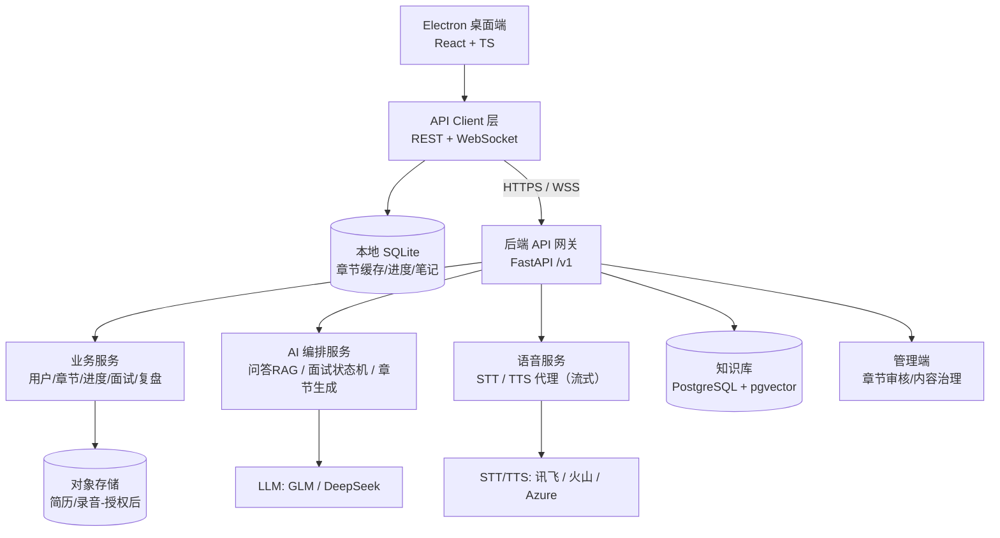
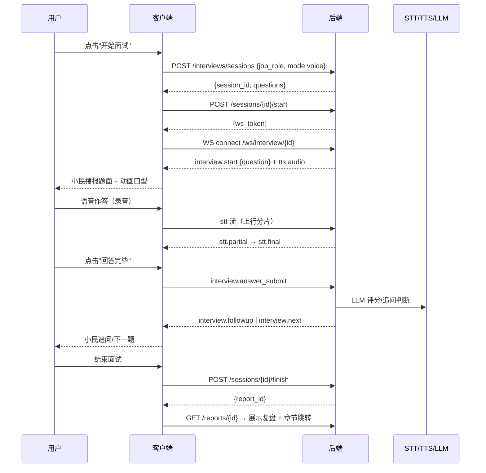
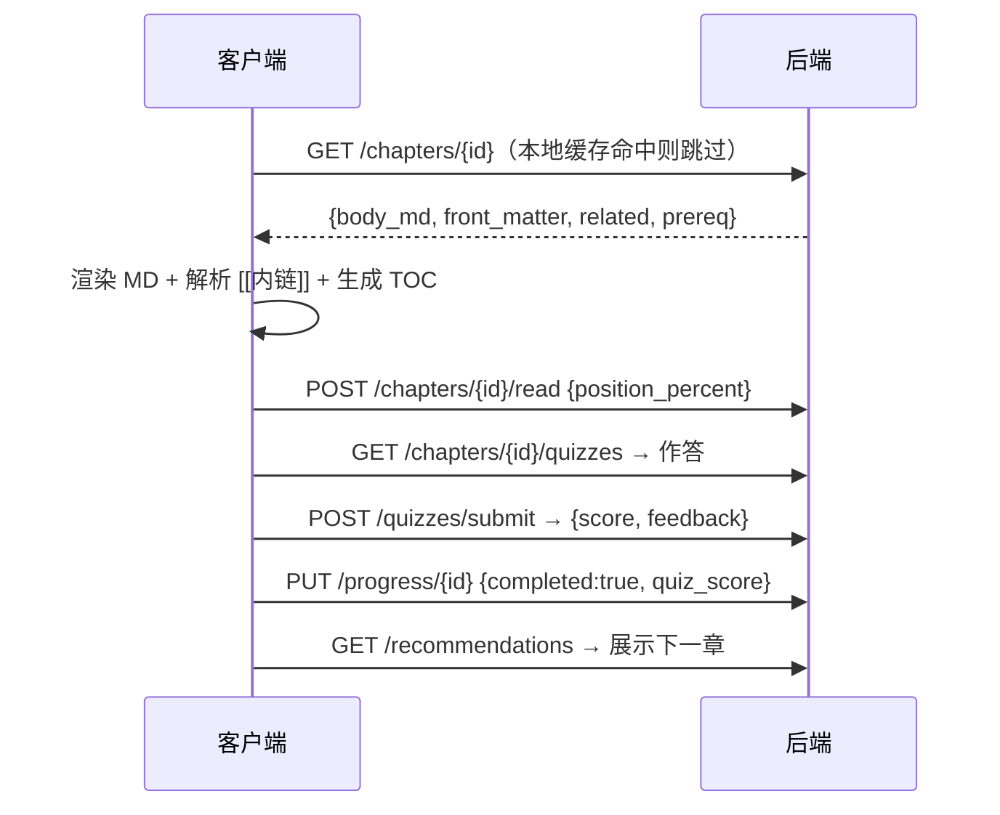
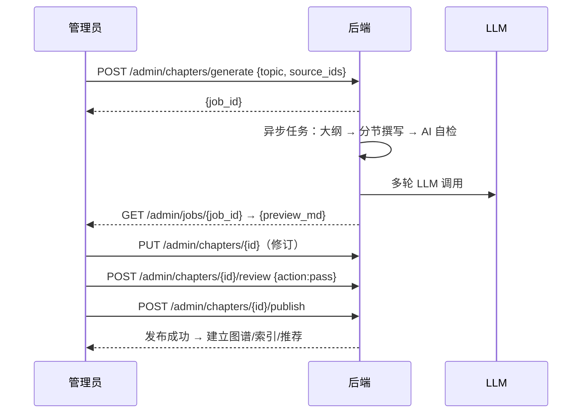

# 小民求职智能体 — 前后端 API 接口设计方案

> 版本：v0.1（设计稿，供评审）｜配套文档：《小民求职智能体_产品与技术方案》
> 范围：桌面端（Electron）↔ 后端（FastAPI）的 REST + WebSocket 接口；含前端 API 层设计、数据模型、鉴权、配额与安全

---

## 一、总体架构



### 分层职责

| 层 | 说明 |
|---|---|
| Electron 客户端 | 页面与 3D 角色、语音采集、本地缓存；**不直接调用任何厂商 API** |
| API Client 层 | 统一鉴权/重试/离线/错误映射；类型安全；开发期可用 mock |
| 后端服务 | 业务、AI 编排、语音代理、知识库、配额与审计 |
| 外部供应商 | LLM、STT/TTS、对象存储、短信/邮件验证码 |

---

## 二、通用约定

### 2.1 基础信息

- Base URL：`https://api.xiaomin.example.com/v1`（运行时配置注入，不写死在 EXE）
- 数据格式：`application/json`；文件上传用 `multipart/form-data`
- 鉴权：`Authorization: Bearer <access_token>`
- 幂等：写操作（创建面试、上传简历等）可带 `Idempotency-Key` 请求头，重复提交返回同一结果

### 2.2 统一响应结构

成功：

```json
{
  "code": 0,
  "data": { },
  "meta": { "request_id": "req_xxx", "ts": "2026-10-16T17:00:00+08:00" }
}
```

失败：

```json
{
  "code": 40103,
  "message": "登录状态已过期",
  "details": { "field": "access_token" },
  "meta": { "request_id": "req_xxx", "ts": "..." }
}
```

常用错误码：

| code | 含义 | 前端处理 |
|---|---|---|
| 40000 | 参数错误 | 表单校验提示 |
| 40100 | 未登录 | 跳登录/静默刷新 |
| 40103 | token 过期 | 刷新 token 后重试一次 |
| 40300 | 无权限 | 提示并禁用入口 |
| 40400 | 资源不存在 | 提示 |
| 40900 | 状态冲突（如面试已结束） | 提示并刷新状态 |
| 42900 | 触发配额/限流 | 展示剩余额度 |
| 50000 | 服务内部错误 | 通用兜底提示 |
| 50300 | 供应商暂不可用 | 降级提示（文字模式） |

### 2.3 分页

- 请求：`?page=1&page_size=20`（章节、历史列表可用 `cursor` 游标）
- 响应 `data`：`{ "items": [...], "total": 123, "next_cursor": "..." }`

### 2.4 WebSocket（实时链路）

- 地址：`wss://api.xiaomin.example.com/v1/ws?token=<short_lived_ws_token>`
- 消息信封（客户端上行/服务端下行统一）：

```json
{
  "type": "interview.question",
  "seq": 12,
  "ts": "2026-10-16T17:00:00+08:00",
  "payload": { }
}
```

- 心跳：客户端每 30s 发 `ping`，服务端回 `pong`；连续 2 次未回则断线重连（指数退避 + 抖动）
- 会话级 token：由 REST 接口签发，短时效，随面试会话绑定

---

## 三、REST 接口清单

### 3.1 认证 `/auth`

| 方法 | 路径 | 说明 | 请求 | 响应 data |
|---|---|---|---|---|
| POST | `/v1/auth/register` | 注册（邮箱/手机+验证码） | `{account, code, password, profile?}` | `{user}` |
| POST | `/v1/auth/login` | 登录 | `{account, password}` | `{access_token, refresh_token, expires_in, user}` |
| POST | `/v1/auth/refresh` | 刷新令牌 | `{refresh_token}` | `{access_token, refresh_token}` |
| POST | `/v1/auth/logout` | 登出（吊销 refresh） | `{refresh_token}` | `{}` |
| POST | `/v1/auth/verify-code` | 发送验证码 | `{account, scene: register\|login\|reset}` | `{}` |
| GET | `/v1/auth/me` | 当前用户 | - | `{user}` |
| PUT | `/v1/auth/me` | 更新用户资料 | `{nickname?, avatar?, direction?, target_role?, grade?, experience_years?}` | `{user}` |
| DELETE | `/v1/auth/me` | 注销并级联删除数据 | - | `{}` |

> 隐私：注销接口触发级联删除（进度/笔记/录音/简历解析副本）；录音若已授权云端保存，需二次确认。

### 3.2 用户与配额 `/users`

| 方法 | 路径 | 说明 | 请求 | 响应 data |
|---|---|---|---|---|
| GET | `/v1/users/{id}/quota` | 剩余额度 | - | `{llm_tokens, stt_minutes, tts_chars, reset_at}` |
| GET | `/v1/users/{id}/settings` | 设置 | - | `{privacy:{keep_recordings, allow_cloud_sync}, ui:{...}}` |
| PUT | `/v1/users/{id}/settings` | 更新设置 | 同上 | `{settings}` |
| GET | `/v1/users/{id}/privacy/export` | 导出我的数据 | - | `{download_url, expires_in}` |

### 3.3 MD 知识网络 `/chapters`（核心）

| 方法 | 路径 | 说明 | 请求 | 响应 data |
|---|---|---|---|---|
| GET | `/v1/chapters` | 章节列表/筛选 | `?tag=&difficulty=&search=&page=` | `{items, total}` |
| GET | `/v1/chapters/{id}` | 完整章节（Front-matter + body_md） | - | `{chapter}` |
| GET | `/v1/chapters/{id}/outline` | 章节目录 | - | `{outline:[{level,title,anchor}]}` |
| GET | `/v1/chapters/{id}/related` | 相关章节（出链） | - | `{items}` |
| GET | `/v1/chapters/{id}/prereq` | 前置知识链 | - | `{chain:[...]}` |
| GET | `/v1/chapters/graph` | 章节图谱 | - | `{nodes:[{id,title,tags}], edges:[{from,to,kind}]}` |
| GET | `/v1/chapters/search` | 章节级检索 | `?q=&tag=&page=` | `{items:[{chapter_id,title,snippet,score}]}` |
| POST | `/v1/chapters/{id}/read` | 上报阅读进度 | `{position_percent, duration_sec}` | `{progress}` |
| GET | `/v1/chapters/{id}/quizzes` | 章节测验题 | - | `{questions:[...]}` |
| POST | `/v1/chapters/{id}/quizzes/submit` | 提交测验 | `{answers:[{question_id, choice/text}]}` | `{score, per_question, feedback}` |

> `chapter` 结构见第四节数据模型；`body_md` 为完整章节正文，渲染与内链解析在客户端完成。

### 3.4 学习进度/收藏/笔记/推荐

| 方法 | 路径 | 说明 | 请求 | 响应 data |
|---|---|---|---|---|
| GET | `/v1/progress` | 学习路径与进度总览 | - | `{path:[{chapter_id,status}], learned, streak}` |
| GET | `/v1/progress/{chapterId}` | 单章节进度 | - | `{progress}` |
| PUT | `/v1/progress/{chapterId}` | 更新进度（upsert） | `{position_percent, completed?, quiz_score?}` | `{progress}` |
| GET | `/v1/recommendations` | 首页“为你推荐” | - | `{items:[{chapter_id,reason,rank}]}` |
| POST | `/v1/favorites/{chapterId}` | 收藏 | - | `{favorite}` |
| DELETE | `/v1/favorites/{chapterId}` | 取消收藏 | - | `{}` |
| GET | `/v1/favorites` | 收藏列表 | - | `{items}` |
| GET | `/v1/notes` | 我的笔记 | `?chapter_id=` | `{items}` |
| POST | `/v1/notes` | 新增笔记 | `{chapter_id, anchor?, text}` | `{note}` |
| DELETE | `/v1/notes/{id}` | 删除笔记 | - | `{}` |

> 推荐策略（冷启动/学习路径/面试薄弱点反推）见产品方案第三章，后端只暴露结果与 reason。

### 3.5 AI 问答 `/qa`

| 方法 | 路径 | 说明 | 请求 | 响应 data |
|---|---|---|---|---|
| POST | `/v1/qa/ask` | 文字问答（RAG） | `{question, chapter_id?, selection?}` | `{answer, sources:[{chapter_id,title,anchor}], related_chapter?}` |
| GET | `/v1/qa/history` | 历史问答 | `?page=` | `{items}` |
| DELETE | `/v1/qa/history/{id}` | 删除一条问答 | - | `{}` |

> 流式问答走 WebSocket（见 3.7）；未命中知识库时明确返回 `sources: []` 并提示不编造。

### 3.6 面试会话 `/interviews`（核心）

| 方法 | 路径 | 说明 | 请求 | 响应 data |
|---|---|---|---|---|
| POST | `/v1/interviews/sessions` | 创建面试 | `{job_role, level, difficulty, duration_min?, mode: voice\|text, question_tags?}` | `{session_id, plan, questions:[...]}` |
| GET | `/v1/interviews/sessions/{id}` | 会话详情/状态 | - | `{session}` |
| POST | `/v1/interviews/sessions/{id}/start` | 开始（进入房间） | - | `{ws_token, expires_in}` |
| POST | `/v1/interviews/sessions/{id}/answer` | 提交文字回答 | `{question_id, text}` | `{ack, followup?}` |
| POST | `/v1/interviews/sessions/{id}/next` | 请求下一题 | - | `{question}` |
| POST | `/v1/interviews/sessions/{id}/finish` | 结束并生成复盘 | `{recordings_keep: bool}` | `{report_id}` |
| POST | `/v1/interviews/sessions/{id}/abort` | 中止 | - | `{session}` |
| GET | `/v1/interviews/sessions/{id}/questions` | 题目列表 | - | `{items}` |
| GET | `/v1/interviews/reports/{sessionId}` | 复盘报告 | - | `{report}` |
| GET | `/v1/interviews/history` | 历史面试 | `?page=` | `{items}` |
| DELETE | `/v1/interviews/sessions/{id}` | 删除会话与录音 | - | `{}` |

> `report` 含逐题评分与“改进点 → 章节”映射，供前端一键跳转补课。

### 3.7 WebSocket 实时链路

| 通道 | 地址 | 用途 |
|---|---|---|
| 语音面试 | `/v1/ws/interview/{sessionId}` | STT 流上行、TTS 音频下行、面试事件（题面/计时/追问/打断） |
| 流式问答 | `/v1/ws/qa` | 问答增量 token、来源、完成 |
| 通知 | `/v1/ws/events` | 章节更新、额度变更、审核完成等 |

**语音面试事件（type 枚举）**

| type | 方向 | payload 要点 |
|---|---|---|
| `interview.start` | S→C | `{question, tts_audio?, deadline_ts}` |
| `interview.question` | S→C | `{question, followup_of?}` |
| `interview.answer_start` | C→S | 用户开始作答（触发录音段） |
| `stt.partial` / `stt.final` | S→C | `{text, confidence}`（final 写入答题转写） |
| `interview.answer_submit` | C→S | 确认提交（可含修正文本） |
| `interview.followup` | S→C | `{question}`（AI 追问） |
| `interview.hint` | S→C | `{score_hint, tip}`（可关闭） |
| `tts.audio` | S→C | 音频分片（二进制帧）或 `{data_b64, seq}` |
| `tts.viseme` | S→C | `{tokens:[{char, viseme, t}]}`（二期嘴型） |
| `interview.timer` | S→C | `{remain_sec}` |
| `interview.finish` | S→C | `{report_id}` |
| `interview.abort` | S→C | `{reason}` |
| `error` | S→C | `{code, message}` |
| `quota.updated` | S→C | `{llm_tokens, stt_minutes, tts_chars}` |

### 3.8 职业辅导 `/coach`

| 方法 | 路径 | 说明 | 请求 | 响应 data |
|---|---|---|---|---|
| POST | `/v1/coach/resume/analyze` | 上传并解析简历 | multipart `{file}` | `{job_id}` |
| GET | `/v1/coach/resume/analysis/{job_id}` | 解析结果 | - | `{structure, keywords, gaps:[...], suggestions}` |
| POST | `/v1/coach/star/suggest` | STAR 改写建议 | `{experience_text, question?}` | `{star:[{part,text,revised}], tip}` |
| POST | `/v1/coach/plan` | 生成学习/求职计划 | `{goal, deadline?, preferences?}` | `{plan_id}` |
| GET | `/v1/coach/plan/{plan_id}` | 查看计划 | - | `{plan:[{phase, actions, chapters[]}]}` |

### 3.9 内容生产（管理端，内部）/admin

| 方法 | 路径 | 说明 | 请求 | 响应 data |
|---|---|---|---|---|
| POST | `/v1/admin/chapters/generate` | 发起 AI 章节生成 | `{topic, source_ids[], outline?}` | `{job_id}` |
| GET | `/v1/admin/jobs/{job_id}` | 生成任务进度/预览 | - | `{status, stage, preview_md?}` |
| GET | `/v1/admin/chapters/drafts` | 草稿列表 | - | `{items}` |
| PUT | `/v1/admin/chapters/{id}` | 编辑章节（MD+元数据） | `{body_md, front_matter}` | `{chapter}` |
| POST | `/v1/admin/chapters/{id}/review` | 审核 | `{action: pass\|reject\|revise, comment?}` | `{chapter}` |
| POST | `/v1/admin/chapters/{id}/publish` | 发布/下线 | `{action: publish\|unpublish}` | `{chapter}` |

> 管理端仅内部访问（独立域名/IP 白名单 + 管理员角色），不随用户 EXE 分发。

### 3.10 文件 `/files`

| 方法 | 路径 | 说明 | 请求 | 响应 data |
|---|---|---|---|---|
| POST | `/v1/files/presign` | 直传预签名 | `{filename, content_type, purpose: resume\|recording}` | `{upload_url, object_key, expires_in}` |
| DELETE | `/v1/files/{object_key}` | 删除文件 | - | `{}` |

---

## 四、关键数据模型（JSON Schema 摘要）

### 4.1 Chapter（知识章节）

```json
{
  "id": "ch_001",
  "slug": "star-method",
  "title": "面试官如何评价 STAR 回答",
  "tags": ["面试", "STAR", "表达"],
  "prereq": ["ch_000"],
  "related": ["ch_004", "ch_010"],
  "difficulty": "入门",
  "read_time_min": 8,
  "version": 3,
  "updated_at": "2026-10-16T17:00:00+08:00",
  "source": "课程《面试实战》第 3 章",
  "status": "published",
  "front_matter": { },
  "body_md": "# ...完整章节正文...",
  "outline": [{"level": 1, "title": "一、STAR 四要素", "anchor": "star-four"}],
  "quiz_count": 5
}
```

### 4.2 InterviewSession（面试会话）

```json
{
  "id": "iv_20261016_abc",
  "status": "active",
  "job_role": "产品经理",
  "level": "校招",
  "difficulty": "中等",
  "mode": "voice",
  "duration_min": 20,
  "questions": [
    { "id": "q1", "text": "...", "type": "behavioral", "followups": ["..."], "hints": [...] }
  ],
  "current_index": 2,
  "answers": [
    { "question_id": "q1", "text": "...", "transcript": "...", "duration_sec": 48 }
  ],
  "started_at": "...", "ended_at": null
}
```

### 4.3 Report（复盘报告）

```json
{
  "report_id": "rp_xxx",
  "session_id": "iv_...",
  "per_question": [
    { "question_id": "q1", "score": 78, "structure": 82, "relevance": 75, "comment": "...", "star_revision": "...", "chapters": ["ch_001"] }
  ],
  "summary": { "overall": 80, "strengths": ["..."], "weaknesses": ["..."], "suggestions": ["..."] },
  "next_steps": [ { "chapter_id": "ch_001", "reason": "STAR 结构不完整" } ]
}
```

### 4.4 RecommendItem（推荐）

```json
{ "chapter_id": "ch_001", "reason": "你的面试复盘显示 STAR 结构不完整", "rank": 1, "position_percent": 0 }
```

### 4.5 User / Progress / Note / Quiz

```json
User:     { "id": "u_1", "nickname": "...", "direction": "互联网", "target_role": "产品经理", "grade": "大三", "experience_years": 0 }
Progress: { "user_id": "u_1", "chapter_id": "ch_001", "position_percent": 60, "completed": false, "quiz_score": null, "last_read_at": "..." }
Note:     { "id": "nt_1", "chapter_id": "ch_001", "anchor": "star-four", "text": "记住：行动>背景", "created_at": "..." }
Quiz:     { "id": "qz_1", "type": "single|multi|blank", "stem": "...", "options": [...], "answer_explain": "..." }
```

---

## 五、前端 API 层设计（Electron 客户端）

### 5.1 目录结构

```text
src/api/
  client.ts        # HTTP 客户端：baseURL、token 注入、刷新重试、错误映射、超时
  ws.ts            # WebSocket 管理器：重连/退避、seq、订阅、心跳、断线缓存
  endpoints.ts     # 类型化端点表（路径+方法+请求/响应类型）
  types.ts         # 与后端 JSON Schema 对齐的 TS 接口
  cache.ts         # 本地 SQLite/IndexedDB：章节缓存、进度、笔记、离线队列
  mock/            # 开发期 mock（fetch 拦截，返回示例 JSON）
src/stores/        # Zustand stores（auth / progress / interview / player）
src/services/      # 领域服务：interviewService、qaService、chapterService...
```

### 5.2 client.ts 要点

- 基于 `fetch` 封装：自动加 `Authorization`；`40103` 时用 refresh token 静默刷新并**重放原请求一次**
- 超时（REST 15s；语音相关 30s）；错误统一映射为业务错误对象（含 `code` 与提示语）
- 离线策略：写操作进本地队列，网络恢复后重放；读章节优先走缓存（章节版本号校验 `version`）
- Base URL 与功能开关来自 `window.__APP_CONFIG__`（构建期注入，不硬编码）

### 5.3 ws.ts 要点

- 单例连接管理；`interview.*` 与 `qa.*` 各自订阅；断线指数退避（1s→2s→4s…封顶 30s + 抖动）
- 事件分发到 store；音频二进制分片按序写入播放队列；`seq` 用于去重/乱序重排
- 心跳 30s；静默期（用户长时间不说话）由服务端 `interview.timer` 驱动 UI 提示

### 5.4 关键交互时序

**A. 语音面试**



**B. 章节阅读与内链**



**C. AI 章节生成（管理端）**



---

## 六、鉴权、配额与安全

| 项 | 方案 |
|---|---|
| 访问令牌 | JWT（access 15 分钟 / refresh 30 天，refresh 轮换 + 复用检测） |
| WS 令牌 | 独立短时效令牌（绑定会话 id，面试结束即失效） |
| 密钥 | 厂商密钥只存后端（环境变量/KMS），客户端永不下发 |
| 配额 | 按用户/天：LLM tokens、STT 分钟、TTS 字符；超额返回 42900 并推送 `quota.updated` |
| 限流 | 登录、验证码、上传接口按 IP/账号双重限流 |
| 隐私 | 录音/简历仅授权后云端保存，提供删除与全量导出；注销级联删除 |
| 审计 | 请求日志脱敏（不落明文 token、音频、简历全文），保留 30 天 |
| 版本 | 只做 `/v1` 增量扩展；破坏性变更走 `/v2` 并公告废弃期 |

---

## 七、实施与验收建议

1. **先契约后实现**：用 OpenAPI 3.0 生成接口文档与 TS 类型（`openapi-typescript`），前后端并行开发。
2. **Mock 先行**：前端在无后端时用 `src/api/mock/` 跑通全部流程，接口冻结后再联调。
3. **MVP 验收重点**：
   - 语音面试：从创建到复盘全链路 < 3 次往返额外延迟；断线重连不丢会话状态
   - 知识网络：章节列表/详情/内链/进度/推荐接口在 200ms 内（P95）
   - 安全：无客户端密钥、录音删除生效、注销后数据可验证清空
4. **容量口径**：按 1 万日活、日均 2 次面试、每次 10 分钟语音估算 QPS 与配额，再反推服务器规格与厂商用量。

---

## 八、待确认项（评审清单）

- [ ] 账号体系：先手机号+验证码，还是直接支持微信/支付宝登录？
- [ ] 语音供应商：讯飞 / 火山 / Azure 选哪家（涉及成本与延迟 SLA）？
- [ ] 录音默认保存策略：本地仅存 24h 还是云端留存？
- [ ] 章节图谱：首版做邻接列表还是完整可视化图谱？
- [ ] 是否首版就做流式问答（WS /qa），还是先只做一次性 POST？
