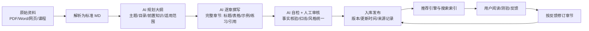

# 小民求职智能体 — 产品与技术落地方案

> 基于当前工作区 `hi3d-rocket-mascot_1.glb`
> 定位：面向求职者的知识学习、模拟面试与职业辅导桌面智能体
> 方案日期：2026 年 10 月 16 日

---

## 一、结论先行

当前工作区的 `hi3d-rocket-mascot_1.glb` 是一个约 **46.4 MiB 的 GLB 2.0 静态模型**：1 个网格、2 个节点、**无骨架（skin）、无动画（animation）**。

建议定位为 **“小民求职教练 / 面试官”**：保留卡通吉祥物 IP（小民），不追求真人脸；先补动作、语音和口型，再连接知识库与面试对话。

**推荐路径**：Blender 整理模型与绑定 → 导出带动画的 GLB → Electron 桌面端（内嵌 Three.js）呈现 → 云端/本地可切换的 AI、语音和知识库服务。先做语音面试 MVP，再扩展实时视频通话。

### 现有资产检查

| 现有资产 | 检查结果 | 对方案的影响 |
|---|---|---|
| `hi3d-rocket-mascot_1.glb` | GLB 2.0；约 46.4 MiB；1 mesh；无 rig/animation；约 102 万顶点 / 200 万三角形；贴图 2 张（8192×8192） | 需减面并压缩贴图后实时驱动；无骨骼就不能直接做全身动作或嘴型 |
| 配套 PNG 参考图 | 1254 × 1254 像素，含角色多视图 | 可供 Blender 对照校形、拆件和补视图 |

> ⚠️ **重要审计结论**：该网格规模（**200 万三角形**）在低配 Windows 机器上实时动画容易掉帧，且 8192 贴图显存占用高。正式开发前必须先做**网格减面**（Decimate / 重拓扑至约 5–8 万三角形，并重新烘焙贴图）与**纹理压缩**（8192 → 2048/4096，或转 `.webp`/`.ktx2`）。

---

## 二、产品目标与功能范围

**产品目标**：让用户在一个桌面应用内完成求职知识学习、简历/岗位准备、模拟面试、复盘与训练计划；小民负责陪伴、引导和反馈，AI 负责内容与对话。

| 模块 | 用户能力 | 首版范围 |
|---|---|---|
| ① 求职知识库学习 | 按主题**系统学习 AI 生成的完整章节**（内部 MD 知识网络）；按画像/路径**推荐章节**；点开即读、章节互相链接；搜索、收藏、笔记、测验 | AI 章节生成流水线 + 内部 MD 知识网络 + 推荐引擎 + 进度/收藏/测验 |
| ② 数字人 1v1 面试 | 选择岗位/难度/时长；语音或文字作答；获得逐题反馈和总结 | 实时语音通话优先；动画角色播报；录音需用户明确同意 |
| 职业辅导 | 简历优化、岗位匹配、STAR 案例整理、行动计划 | 上传简历（支持本地解析或明确授权）、结构化建议、可编辑导出 |
| 账号与数据 | 保存学习和练习历史、删除数据、隐私设置 | 本地优先保存；云端同步作为可选能力 |

**边界建议**：首版不要承诺“替用户投递 / 保证就业 / 准确判断人格或录用概率”。反馈应标注为训练建议；录音、摄像、简历解析均提供清晰授权与删除入口。

---

## 三、知识库学习模块：内部 MD 知识网络

> 本章为该模块的详细产品设计，对应功能范围①。核心形态：**AI 输出完整章节，章节是软件内部的 Markdown 页面，章节之间互相链接形成知识网络，系统按用户画像与进度推荐章节**。

### 3.1 产品形态（用户视角）

- **章节即页面**：每个主题（如《简历撰写》《行为面试 STAR》《谈薪话术》《群面技巧》）由 AI 生成**完整章节**，而不是零散的问答片段；点开一个章节，就是一份结构完整的 Markdown 长文。
- **内部 MD 网络**：章节内带目录、表格、例题、`[[内链]]`，相关章节互相跳转（前置知识 / 延伸阅读 / 相关问题），形成一张 **“章节图谱”**，用户可顺藤摸瓜式学习。
- **系统推荐**：首页“为你推荐”按用户画像（岗位/年级/目标）、学习路径（先修关系）和历史进度推荐章节；“继续学习”直接回到上次位置。
- **配套学习动作**：阅读进度、收藏、随文笔记、章节内嵌测验（AI 批改）、阅读完自动衔接“下一篇”。

### 3.2 章节内容的生命周期（AI 写稿 → 审核 → 入库）



1. **资料入库**：课程、政策、FAQ、平台资料解析为标准 MD（表格与公式保留）。
2. **大纲生成**：AI 规划章节结构（目录、前置知识、适合人群、阅读时长）。
3. **逐章撰写**：AI 生成完整章节文本（标题层级、表格、列表、真实示例、练习与参考答案），逐段标注引用来源。
4. **AI 自检 + 人工审核**：重点核验政策、数字、红线内容；统一风格与口径后发布；记录版本与更新时间，改版可通知。
5. **入库建网**：发布后自动建立标签、出链/入链、图谱与推荐索引。

### 3.3 章节的 MD 结构规范（示例）

```markdown
---
title: 面试官如何评价 STAR 回答
tags: [面试, STAR, 表达]
prereq: "[[结构化表达]]"
related: "[[行为面试常见问题]], [[谈薪话术]]"
difficulty: 入门
read_time: 8 分钟
author: AI 助手 + 审核人
updated: 2026-10-16
source: 课程《面试实战》第 3 章
---
# 面试官如何评价 STAR 回答

## 摘要
一句话说清本章解决什么问题……

## 一、STAR 四要素
| 要素 | 含义 | 面试官关注点 |
|---|---|---|
| S | 情境 | …… |
> 面试官视角：……

## 二、常见失分点
1. 只有背景没有行动……
2. ……

## 三、练习与参考答案
- 练习 1：把你的一个项目经历改写成 STAR……
- 参考答案：……

## 相关章节
- [[行为面试常见问题]]
- [[谈薪话术]]
```

- **内链统一用 `[[章节名]]` 或相对链接**，渲染时自动解析为可点击跳转，并双向统计“谁引用了我”。
- **元数据（Front-matter）驱动**：`prereq`（前置知识）决定学习路径排序，`related` 决定相关推荐，`tags` 用于检索过滤。

### 3.4 MD 渲染与知识网络

| 能力 | 设计 |
|---|---|
| 章节渲染 | 内置 Markdown 渲染器：目录 TOC、锚点、表格、代码块、公式（KaTeX）、图片、引用块、任务列表；长文虚拟滚动 |
| 链接网络 | 每章解析出链/入链构建**章节图谱**（节点=章节，边=引用/先修/相关），提供图谱视图与邻接章节推荐 |
| 全文检索 | 章节内全文搜索 + 标签过滤 + 向量语义检索（找得到“整个章节”而非碎片） |
| 学习痕迹 | 阅读进度（章节内百分比）、收藏、随文笔记、测验成绩、错题 |
| 就地追问 | 章节任意段落支持选中提问（问答结果附“回到章节”跳转） |

### 3.5 推荐策略（给用户推荐什么）

| 场景 | 推荐逻辑 |
|---|---|
| 冷启动 | 按用户方向/岗位/年级给出一条**入门学习路径**（由 prereq 关系自动拓扑排序） |
| 学习中 | 按学习路径与阅读进度推荐“下一篇 / 未学的前置章节” |
| 面试后 | 根据面试复盘薄弱点反推章节（如“回答不完整 → STAR 章节”；“薪资表述含糊 → 谈薪话术”） |
| 展示位 | 首页“为你推荐”、章节底部“相关章节”、复习提醒（按遗忘曲线可选） |

### 3.6 与 AI 问答、面试模块的联动

- 问答答案尾部附 **“前往完整章节”** 跳转，答完引导精读。
- 面试反馈中的每个改进点映射到对应章节（一键去补课）。
- 章节测验成绩与面试复盘共同进入用户画像，反哺推荐。

---

## 四、如何把当前 GLB 做成会动的 IP

### A. 先检查和整理模型（Blender）

1. **导入 GLB**，在 Blender 中检查尺度、朝向、材质/贴图、拓扑和零件是否连成一个网格；保留原始文件，另存工作副本。
2. **减面与重拓扑**：当前约 200 万三角形，先用 Decimate / 重拓扑减到 5–8 万三角形并烘焙贴图，再压缩到 2048–4096；否则低配机器实时驱动会卡顿。
3. **拆分可动部件**：将眼睛、嘴、手臂、身体（火箭外壳）与火箭尖顶等可动部分拆成独立对象；若网格不可合理拆分，需重做/补建这些部件。
4. **建立简化骨架并权重绘制**：身体是硬质卡通外壳，优先采用硬表面分件骨骼（手臂、头、躯干、尾部等），而非复杂真人肌肉变形。
5. **设计面部方案**：模型未提供可变形嘴部。可制作 3–5 个嘴型/表情形态键（闭口、张口、微笑、惊讶等），或用独立嘴部贴片/材质切换；可加眨眼与腮红。

### B. 第一版动作库

| 动画 | 用途/建议时长 |
|---|---|
| Idle 呼吸/轻微漂浮 | 待机循环 3–5 秒；幅度小，避免晕动 |
| Greeting 挥手 | 欢迎/开场 1–2 秒 |
| Listen 倾听/点头 | 用户说话时循环或随机触发 |
| Talk 讲解 | 说话时手势与身体轻动；嘴型跟音频同步 |
| Think 思考 | 短暂停顿时播放 |
| Encourage 鼓励/庆祝 | 答题完成或鼓励反馈 1–2 秒 |

### C. 导出与运行

- 导出为**带骨骼、动作、材质的 GLB**；在 Three.js 使用 `GLTFLoader + AnimationMixer` 播放动作。
- 口型首版用**音频驱动的音量包络 / 简单 viseme 映射**即可；更自然的嘴型需 TTS 提供音素/viseme 时间戳，或使用语音对齐服务。
- 若无法为模型做高质量骨骼，可先采用 **“静态模型 + 表情贴片/部件旋转 + 待机浮动 + 语音音量驱动张嘴”** 的轻量方案，快速验证产品。

---

## 五、桌面 EXE 技术架构

| 层次 | 建议方案 | 职责 |
|---|---|---|
| 桌面客户端 | Electron + React/Vue + TypeScript | 登录/设置/课程/面试房间；electron-builder 打包 Windows 安装包或便携版 EXE |
| 3D 展示 | Three.js + GLB 动画 | 角色渲染、动作状态机、嘴型、字幕；提供低配模式/静态降级 |
| MD 知识网络 | Markdown 渲染器 + 章节图谱 + 推荐引擎 | 章节解析/渲染、内链跳转、图谱与邻接推荐、阅读进度 |
| 业务 API | HTTPS REST + WebSocket | 用户、学习进度、会话、知识库检索、对话状态、服务端鉴权 |
| AI 对话 | 可替换的 LLM 服务层 | 求职问答、面试官角色提示词、追问、反馈结构化；知识库答案优先带出处 |
| 知识库 | AI 章节生成流水线 + 切片 + 向量/关键词混合检索 | 资料解析 → 大纲 → 撰写 → 审核 → 入库 → 建网；版本/来源/更新时间可追溯 |
| 语音 | 浏览器/系统麦克风采集 + STT + LLM + TTS | 语音识别、增量回复、语音播报；WebSocket 流式交互，显示字幕和连接状态 |
| 存储/安全 | 本地 SQLite（可选）+ 服务端数据库；密钥不写入 EXE | 保存偏好与进度；服务端保存授权数据；访问控制、删除与日志脱敏 |

> ⚠️ **重要**：EXE 客户端内**不要硬编码**模型厂商 API 密钥。若使用云端模型，应由自己的后端代理并做鉴权、限流、计费与密钥管理；如需离线模式，要单独评估本地模型体积、显存/内存要求和更新机制。

---

## 六、技术栈选型明细

### 选型原则

1. **能切换**：LLM、STT、TTS、向量库全部做可替换抽象层，只绑定 OpenAI 兼容协议之类的公共接口，避免被单一厂商锁死。
2. **先云后本地**：首版用云端服务保证效果与迭代速度；确认用户规模与隐私要求后，再评估本地化（离线模型）。
3. **为低配机器兜底**：3D 渲染必须有降级开关（低配模式 / 静态立绘）。
4. **成本可控**：语音与 LLM 均按量计费，先用免费额度 + 小配额验证，再扩容。

### 6.1 客户端与桌面框架

| 项 | 首选方案 | 备选方案 | 说明 |
|---|---|---|---|
| 桌面容器 | Electron 28+（Chromium + Node） | Tauri 2（更小更省内存，但需 Rust 与 WebView2，成熟度略低） | Electron 生态成熟，Web Audio/WebRTC/three.js 支持好 |
| 前端框架 | React 18 + TypeScript + Vite | Vue 3 + Pinia | 组件生态与招聘难度考虑 |
| 状态管理 | Zustand | Redux Toolkit | 会话、设置、进度等全局状态 |
| UI 组件 | Ant Design / 自研面试房间 | MUI | 面试流程组件较多自研 |
| 打包分发 | electron-builder（NSIS + 便携版） | electron-forge | 安装包 + 免安装 EXE 两种形态；代码签名证书（EV/OV）避免 SmartScreen 拦截 |
| 自动更新 | electron-updater（差分更新） | 自建更新服务 | 模型/课程/访谈配置的热更新 |

### 6.2 3D 渲染与角色动画

| 项 | 首选方案 | 备选方案 | 说明 |
|---|---|---|---|
| 渲染引擎 | Three.js（r160+） | Babylon.js | 与 GLB 兼容最好，教程与案例最多 |
| 模型加载 | GLTFLoader + DRACOLoader | gltf-transform 预处理 | 网格/动画分离加载，首帧更快 |
| 动画播放 | AnimationMixer + 动作状态机（自研 FSM） | 简单交叉淡化（CrossFade） | 待机/倾听/讲解/鼓励动作切换与混合 |
| 模型压缩 | Decimate 减面 + Gltfpack | KTX2/Basis 纹理压缩 | 目标总包体 < 15 MiB（贴图 2048 后） |
| 口型系统 | 音量包络驱动张口程度 | TTS viseme 时间戳驱动（二期） | 首版简单可演示 |
| 性能 | 低配模式（关闭动态阴影/降分辨率） | 静态立绘降级 | 保证 10 年前旧机器也能用 |

### 6.3 MD 知识网络（本章产品的核心栈）

| 项 | 首选方案 | 备选方案 | 说明 |
|---|---|---|---|
| Markdown 解析 | unified / remark + rehype | markdown-it | 支持 Front-matter、扩展语法、安全净化（防 XSS） |
| 渲染 | React 组件化渲染（TOC/锚点/表格/代码高亮） | 语雀式整页渲染 | 长文目录跳转、代码块、KaTeX 公式 |
| 内链解析 | 自定义 `[[章节]]` + 相对链接插件 | 仅标准相对链接 | 渲染时解析双向链接并高亮 |
| 图谱 | 自研章节图谱（节点/边，D3.js 或 Cytoscape.js） | 简单“相关章节”列表 | 首版可只做邻接列表，图谱做二期 |
| 推荐引擎 | 规则 + 学习路径拓扑排序（prereq 关系） | 协同过滤（用户量大了再上） | 先按知识依赖推荐，冷启动友好 |
| 大纲生成 | LLM（GLM/DeepSeek）按模板输出章节大纲 | 人工大纲 | 流程见第三章 |
| 章节撰写 | LLM 长文生成（分节追加，控制质量） | 文档模板 + 人工填充 | 必须过人工审核后入库 |

### 6.4 AI 对话引擎

| 项 | 首选方案 | 备选方案 | 说明 |
|---|---|---|---|
| 大模型 | 智谱 GLM-4 / DeepSeek（OpenAI 兼容接口） | 通义千问、Kimi、本地 Ollama（离线） | 面试官角色提示词 + 追问策略，全部走统一抽象层 |
| 编排框架 | 自研轻量 RAG（函数调用式） | LangChain / LlamaIndex | 首版不需要过重框架，可控更稳 |
| 结构化输出 | JSON Mode / Function Calling | Pydantic 校验（后端） | 面试报告的题级结构化数据 |
| 对话状态 | 服务端会话管理（Redis 缓存上下文） | 本地上下文 | 面试流程状态机：开场→提问→答毕→追问→结语 |

### 6.5 语音链路（实时面试核心）

| 项 | 首选方案 | 备选方案 | 说明 |
|---|---|---|---|
| 采集 | getUserMedia（Web Audio API） | 系统级 WASAPI（复杂度高） | Electron 内用浏览器音频，简单可靠 |
| 语音识别 STT | 讯飞/阿里/腾讯/火山流式识别 | Whisper（本地，需 GPU/算力）；whisper.cpp 离线 | 中文流式效果好、支持方言与热词（岗位词表） |
| 语音合成 TTS | 火山/讯飞/Azure（SSML，角色音色） | Edge TTS（免费/低质） | 流式合成边合成边播，字幕对齐 |
| 传输 | WebSocket 双向流 + VAD 分段 | WebRTC（二期实时通话） | 首版“一轮一问一答”即可满足 |
| 打断/重试 | 客户端打断服务端 TTS | 服务端静音检测 | 提升交互感，MVP 可先不做打断 |
| 兜底 | 字幕校正 + 文字输入框切换 | — | 噪声/方言误识别时必须可人工改正 |

### 6.6 知识库生成与检索

| 项 | 首选方案 | 备选方案 | 说明 |
|---|---|---|---|
| 文档解析 | MinerU（PDF/表格公式）+ python-docx | pdfplumber、pymupdf | 课程资料多为 PDF/Word |
| 章节切片 | 按章节粒度（整章入库 + 章内切片检索） | 纯语义切片 | 完整章节适合阅读，切片负责命中 |
| 向量模型 | BGE-M3 / 智谱 embedding-3 / 阿里 text-embedding-v3 | 多模型对比 | 中文效果优先 |
| 向量库 | pgvector（PostgreSQL） | Milvus、Chroma（本地） | 数据量小先用 pgvector，免多运维 |
| 检索 | 关键词 BM25 + 向量混合，Rerank 精排 | 纯向量（早期） | 提升“找得到、找得准” |
| 内容治理 | AI 自检 + 人工审核流程；来源/版本/更新时间字段 | — | 章节必须附出处，未命中不编造 |

### 6.7 后端与数据

| 项 | 首选方案 | 备选方案 | 说明 |
|---|---|---|---|
| 后端框架 | FastAPI（Python） | NestJS（Node） | 与 RAG/文档解析生态同栈 |
| 实时通信 | WebSocket（原生 ws / FastAPI） | socket.io | 语音与会话状态推送 |
| 数据库 | PostgreSQL（含 pgvector） | MySQL + 独立向量库 | 单一数据库更省运维 |
| 缓存 | Redis | — | 会话上下文、限流配额 |
| 鉴权 | JWT + Refresh Token | OAuth2（账号体系成熟后） | 服务端签发，密钥入环境变量/KMS |
| 对象存储 | 阿里 OSS / 腾讯 COS | S3 兼容 MinIO | 简历、录音（授权后） |

### 6.8 视频通话（可选二期，明确范围）

| 场景 | 方案 | 说明 |
|---|---|---|
| 仅显示 3D 角色（推荐） | 不需要视频通话 | 摄像头只用于选配的自拍头像/身份核验则另议 |
| 真人与用户视频通话 | WebRTC + mediasoup / SRS 自建，或腾讯 TRTC / 声网 Agora | 需信令、TURN、带宽与隐私（跨境数据）评估 |
| 摄像头采集（可选） | getUserMedia 本地处理，默认不采集 | 单独授权、可删除 |

### 6.9 部署与运维

| 项 | 方案 | 说明 |
|---|---|---|
| 部署 | Docker Compose（后端 + Postgres + Redis） | 单机起步，后续可迁 K8s |
| 云资源 | 云主机 2C4G 起（弹性） | 语音/LLM 走厂商 API，服务器只做代理与业务 |
| 监控 | 服务可用性/延迟/错误率看板 | 语音链路延迟是核心指标 |
| 日志 | 脱敏日志（不落明文密钥、录音、简历全文） | 合规与安全 |
| 配额计费 | 分用户配额（每日字数/次数） | 控制成本，前端透明展示剩余额度 |

---

## 七、核心用户流程

1. **首次启动**：说明 AI 辅助性质、隐私与录音规则；选择方向/年级或工作年限；用户可跳过非必要个人信息。
2. **知识学习（MD 知识网络）**：首页查看“为你推荐/学习路径” → 点开章节（内部 MD 页面，含目录与内链）→ 沿“前置知识/相关章节”跳转阅读 → 选中段落就地追问 → 完成章节测验 → 自动记录进度、收藏与笔记。
3. **面试练习**：输入/选择岗位与经验级别 → 选择语音或文字 → 测试麦克风 → 明确开始录音 → AI 逐题提问并适度追问 → 用户随时暂停/结束。
4. **面试复盘**：展示回答摘要、结构完整度、岗位相关性、表达建议、可练习的 STAR 改写示例及下一步训练；**每个改进点可一键跳转对应知识章节补课**；对模型不确定内容提示人工核验。
5. **隐私控制**：会话结束后询问是否保存转写/录音；提供删除、导出和撤回授权入口；默认不采集摄像头，视频能力单独授权。

---

## 八、分阶段实施计划

| 阶段 | 预计周期* | 交付与验收重点 |
|---|---|---|
| 0. 验模与产品原型 | 1 周 | 核验模型拓扑/贴图、减面可行性；确定角色风格、章节主题目录、面试流程、隐私文案；可点击原型 |
| 1. IP 动画 MVP | 1–2 周 | 完成减面、简化绑定/部件动画、4–6 个动作、基础嘴型；GLB 在目标机器稳定播放 |
| 2. 桌面基础版（含 MD 知识网络） | 2–3 周 | EXE 安装/启动/升级；**AI 章节生成流水线 + 内部 MD 知识网络 + 推荐**；AI 文字问答、学习记录、岗位面试配置 |
| 3. 语音面试版 | 2–4 周 | 麦克风、流式 STT/TTS、字幕、打断/重试、角色播报、面试报告；有网络异常降级 |
| 4. 内测与发布 | 1–2 周 | 测试不同 Windows 设备、授权/删除、崩溃与性能；签名发布、用户反馈闭环 |
| 5. 可选视频/进阶 | 另行评估 | 若需真人视频通话：视频 SDK、信令/媒体服务、带宽与隐私评估；若只是显示 3D 角色，不需要摄像头视频通话 |

> \* 周期是小团队、已有可用 AI/语音服务账号、需求不频繁变更的粗略估算，不含服务商审批、内容制作、合规审查和采购等待；实时语音链路或视频方案可能延长周期。

---

## 九、MVP 验收标准与风险

### 验收标准

- ✅ **模型**：目标测试机上启动后 3 秒级进入可交互画面（按设备另行定基准）；动作切换无明显卡顿；无动画时可回退静态展示。
- ✅ **MD 知识网络**：AI 可生成并发布至少 10 个完整章节；章节渲染（目录/表格/代码/公式/图片）正常；**内链可点击跳转、“相关章节/学习路径”推荐可跟随**；章节检索能命中章节级内容。
- ✅ **面试**：可完整完成至少 10 轮语音问答；支持暂停、结束、重试和文字兜底；面试总结可回看/删除；复盘改进点能跳转到对应章节。
- ✅ **隐私**：麦克风/摄像头授权前不采集；录音保存前单独告知；用户能查看与删除保存数据；日志不记录明文密钥或不必要的简历/音频。
- ✅ **安装**：Windows 10/11 安装包可安装、卸载、升级；启动失败有可读错误提示；云端服务不可用时仍可浏览已下载课程（含已缓存章节）。

### 主要风险

1. 原始网格 **200 万三角形**，必须先行减面与贴图压缩，否则实时动画卡顿。
2. 角色网格可能难以绑定，需先做 Blender 实测。
3. 语音识别在噪声、方言下会误识别，必须提供**字幕校正/文字输入**兜底。
4. 面试评价容易产生虚假精确感，应给可解释的训练反馈，不给录用保证。
5. 云端语音/模型的**成本、延迟**和数据保存/跨境策略须在选型时核验。
6. **AI 章节生成必须有人工审核环节**：政策/数字/红线内容错了会直接误导求职者；章节更新要有版本与撤销机制。
7. 视频面试与“3D 角色陪伴”是不同工程范围，先明确用户说的视频是**摄像头对话**还是**动画角色视频呈现**。

---

## 十、建议团队与预算口径

MVP 建议：**产品/交互 1 人、Blender/3D 美术 1 人、桌面前端 1 人、后端/AI 集成 1 人、内容审核兼职 1 人**，测试可兼职。

费用不要仅按开发人天估算，还要列出：

- 语音识别/合成用量（STT/TTS 按分钟/次数计费）
- LLM 调用（按 tokens 计费；**章节批量生成与面试报告都是大消耗项**）
- 云主机/向量检索/对象存储
- 视频 SDK（如采用）
- 代码签名证书（EV 约每年数千元）
- 内容制作与维护（AI 撰写 + 人工审核人日）

正式报价需基于目标用户量、日均面试时长、云/本地部署、是否真人视频通话和模型/语音供应商确定。

---

## 十一、建议下一步

1. 先确认产品采用 **“卡通 3D 吉祥物”** 还是要另做**真人数字人**；本方案建议前者，和现有小民 IP 模型一致。
2. 在 Blender 中打开 GLB，验证减面效果、确认脸部/手臂是否可拆、网格是否可绑定，并制作一个 **10 秒动作样片**（待机→挥手→说话→点头）。
3. **确定首批知识章节主题与生成流程**（资料 → 大纲 → 撰写 → 审核），先人工产出 3–5 个样板章节验证阅读体验与推荐逻辑。
4. 同时确定首发岗位类别、目标 Windows 版本、云端/离线要求及是否需要摄像头。
5. 以 **“MD 知识网络 + 文字模拟面试 + 动画角色 + 语音播报”** 为第一里程碑；验证用户愿意使用后，再建设双向实时语音。

---

## 附：当前资产文件

| 文件 | 说明 |
|---|---|
| `hi3d-rocket-mascot_1.glb` | 约 46.4 MiB，IP 3D 模型 |
| `img-e04436780fae47b39fa6639be2dced4e_0_1792127311647.png` | 角色多视图参考图 |

> GLB 结构检查结果（1 mesh、无 skeletal/animation、200 万三角形、8192 贴图）只代表当前文件，不替代 Blender 内对拓扑、材质、可绑定性的人工验模。