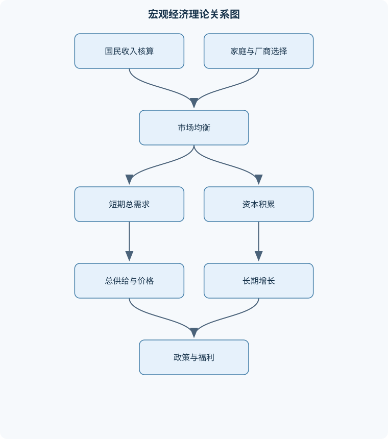
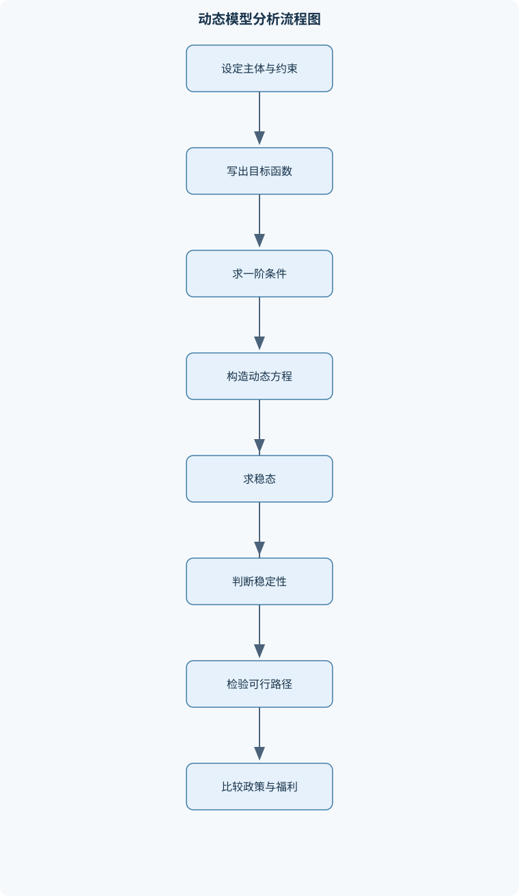

# 中级宏观经济学

## 一、课程整体知识框架

### 课程边界与先修知识

本课程研究以家庭、厂商、政府、金融部门和国外部门为主体的宏观经济模型，重点分析国民收入核算、经济增长、消费与储蓄、投资、劳动市场、一般均衡、货币与通货膨胀、财政与货币政策、失业和开放经济。课程以静态和动态一般均衡模型为主，区分短期波动与长期增长，区分理想化竞争模型与存在价格黏性、市场摩擦、信息不完全和政策约束的现实经济。先修知识包括微积分、偏导数和拉格朗日乘子法，基础概率与统计，微观经济学中的消费者与厂商最优化、生产函数、市场均衡，以及基础货币银行学。能够理解差分方程和连续时间微分方程有助于学习索洛模型、拉姆齐模型和重叠世代模型。





### 1. 研究对象、主体与核心问题

中级宏观经济学研究整个经济体系中总产出、就业、价格水平、利率、资本存量、政府债务、汇率和国际收支的决定机制。分析对象不是单个商品市场，而是由家庭、厂商、政府、金融部门和国外部门共同构成的相互依赖系统。家庭决定消费、储蓄、劳动供给和资产持有；厂商决定生产、劳动需求、资本需求和投资；政府通过税收、政府购买、转移支付和债务融资影响资源配置；金融部门连接储蓄与投资，并通过货币、信贷和利率影响总需求；国外部门通过贸易、资本流动和汇率与本国经济发生联系。

课程的基本问题可分为三个层次。第一是核算问题：经济在一个时期生产了多少最终产品和服务，收入如何在劳动者、资本所有者和政府之间分配，国内生产与本国居民收入之间有何差异。第二是静态配置问题：在给定技术、禀赋、偏好和制度约束下，家庭、厂商和政府如何选择，市场如何通过价格实现资源配置。第三是动态问题：消费与储蓄如何跨期配置，资本如何积累，技术进步如何带来长期增长，政府债务与代际转移是否可持续，以及短期政策如何影响长期福利。

宏观模型必须明确时间维度。短期模型通常假设价格或工资暂时黏性，生产能力存在闲置，产出主要由总需求决定；长期模型则强调资本、劳动、技术和人口等供给因素，价格具有较强调整能力。短期产出波动与长期经济增长不能用同一机制解释：政府支出增加可能在短期提高总需求，但不会在没有技术进步或要素增加时持续提高人均增长率；储蓄率变化通常改变稳态收入水平，而持续的人均产出增长需要劳动增进型技术持续进步。

### 2. 统一符号、计量口径与基本约束

本课程以 $Y$ 表示实际总产出或实际国内生产总值，$P$ 表示价格水平，$\pi$ 表示通货膨胀率，通常定义为

$$
\pi_t=\frac{P_t-P_{t-1}}{P_{t-1}},
$$

在连续时间中可近似写为 $\pi=\dot P/P$。$C$ 为家庭消费，$I$ 为投资，$G$ 为政府购买，$T$ 为税收，$TR$ 为转移支付，$X$ 为出口，$M$ 为进口，净出口为 $NX=X-M$。这里的 $M$ 同时常用于表示名义货币存量，因此必须依据上下文区分“进口”与“货币”；实际货币余额写作 $m=M/P$。

封闭经济中的国民收入恒等式为

$$
Y=C+I+G.
$$

开放经济中为

$$
Y=C+I+G+NX.
$$

这首先是核算恒等式，不等于任何特定行为模型的均衡条件。将私人部门和政府部门的储蓄定义为

$$
S=Y-C-G,
$$

则开放经济有

$$
S-I=NX.
$$

在更完整的国际收支核算中，经常账户 $CA$ 还包括要素收入和经常转移，因此在忽略估值变化和统计误差时可写为 $CA=S-I$。由此可见，经常账户赤字表示国内储蓄小于国内投资，并不必然等于政府财政赤字；私人储蓄、政府储蓄和投资共同决定外部余额。

必须区分存量与流量。资本存量 $K_t$ 是某一时点的资产数量，投资 $I_t$ 是某一时期新增资本形成的流量，资本积累方程通常为

$$
K_{t+1}=(1-\delta)K_t+I_t,
$$

其中 $\delta$ 为折旧率，取值通常在 $0$ 与 $1$ 之间。债务 $B_t$ 是期末存量，赤字 $D_t$ 是期间流量。把赤字直接与债务混同，会导致政府预算约束和债务动态方程的方向判断错误。

实际变量必须说明是否已经用价格水平、人口或技术水平标准化。$N$ 表示人口或劳动人口，$A$ 表示劳动增进型技术，$k=K/(AN)$ 为人均有效资本，$y=Y/(AN)$ 为人均有效产出，$c=C/(AN)$ 为人均有效消费。时间下标 $t$ 表示第 $t$ 期，连续时间变量上的点表示导数，例如 $\dot k=dk/dt$。名义利率为 $i$，实际利率为 $R$，预期通胀率为 $\pi^e$，在利率和通胀率较低时有费雪近似关系

$$
R\approx i-\pi^e.
$$

### 3. 理想化竞争模型与现实摩擦

基准一般均衡模型通常假设家庭和厂商价格接受者、市场完全竞争、信息充分、契约可执行、资本和劳动可以按给定价格交易，并且不存在外部性、交易成本和名义刚性。在这些条件下，价格具有配置资源和清算市场的功能，均衡可通过主体最优化条件与市场出清条件求得。

现实经济往往不满足这些条件。价格和工资可能因为菜单成本、长期合同或协调成本而黏性调整；金融市场可能存在抵押约束、流动性约束和风险溢价；家庭和厂商可能拥有不同信息；劳动力市场存在搜寻、匹配和议价；政府受到税收扭曲、债务约束和政治制度约束。因此，理想模型适合说明方向、机制和比较静态关系，但不能自动产生精确预测。分析现实问题时，应明确模型假设、冲击类型、变量口径和政策传导时滞。

### 4. 统一的解题结构

大多数模型可按以下逻辑组织。先写出主体的目标函数与约束条件，再求内点解的一阶条件；若变量受非负性、借贷上限或技术边界约束，还要检查角点解和互补松弛条件。随后把个体选择条件与市场出清条件结合，求静态均衡或动态系统。最后检查资源约束、预算约束、非负性、稳定性和预期一致性。

例如，竞争性厂商生产函数为 $F(K,L)$，利润为

$$
\Pi=F(K,L)-wL-rK,
$$

其中 $w$ 是实际工资，$r$ 是实际资本租金。若存在内点最优且生产函数可微，利润最大化的一阶条件为

$$
F_L(K,L)=w,\qquad F_K(K,L)=r.
$$

若资本以每期折旧率 $\delta$ 折旧，并将 $r$ 解释为净实际利率，则资本使用成本条件常写为

$$
F_K(K,L)=r+\delta.
$$

这些条件依赖价格接受、可微性和内点解。若工资低于劳动的保留工资，家庭可能选择零劳动；若厂商面对固定成本、产能上限或非凸技术，边际收益等于边际成本不一定足以刻画全局最优。

瓦尔拉斯定律说明，在主体预算约束成立、交易可行且价格与数量以同一价值单位计量时，各市场超额需求的价值总和为零。因此，若除一个市场外的所有市场都出清，剩余市场的超额需求价值也必须为零。但这不表示任意一个市场会自动出清，也不适用于预算约束被违反、存在未计价外部性或统计口径不一致的情形。

## 二、章节和模块划分

### 核心知识覆盖清单

本清单用于检查正文是否覆盖本课程的主要知识模块：

- **宏观经济学的测量与核算**：国内生产总值的定义与最终产品原则、支出法：消费、投资、政府购买与净出口、收入法与产出法的一致性、名义GDP、实际GDP与GDP平减指数、国内生产总值、国民总收入与国民生产总值、折旧、净国内产品与净国民产品、存量、流量与期初期末变量的区别、GDP遗漏项目及其测量边界。
- **家庭与厂商的静态最优化**：代表性家庭的预算约束与消费劳动选择、效用最大化的一阶条件与边界解、厂商利润最大化及要素需求、边际产品、实际工资与实际租金、一次齐次生产函数与规模报酬、竞争性市场中的要素收入分配、劳动市场、消费品市场与资本租赁市场、瓦尔拉斯定律及其适用条件。
- **消费、储蓄与投资理论**：跨期预算约束与现值概念、欧拉方程和消费平滑、利率、替代效应与收入效应、生命周期消费模型、永久收入假说的基本机制、企业投资的资本边际产出条件、资本调整成本与托宾q的直觉、不确定性、预防性储蓄与流动性约束。
- **短期收入决定与总需求**：凯恩斯交叉模型与计划支出、乘数机制及其成立条件、政府支出、税收和转移支付对收入的影响、开放经济中的进口倾向与乘数、IS曲线的推导与移动、流动性偏好和LM曲线的基本逻辑、IS-LM均衡中的产出与利率、总需求曲线与财政货币政策组合。
- **总供给、通货膨胀与经济波动**：潜在产出与产出缺口、短期总供给与长期总供给、总需求—总供给均衡、价格水平与通货膨胀率的区别、菲利普斯曲线与通胀预期、需求冲击与供给冲击的识别、黏性价格模型的基本机制、总需求管理政策的短期与长期效果。
- **经济增长与索洛模型**：密集形式生产函数与人均变量、资本积累、人口增长与技术进步、修正稻田条件和边际报酬递减、稳态资本、人均产出与人均消费、平衡增长路径的定义、黄金律资本存量、储蓄率变化的水平效应、技术进步对长期增长率的影响、连续时间索洛模型与线性化分析。
- **动态最优增长与跨期配置**：社会计划者的动态最优化问题、现值汉密尔顿量与协态变量、拉姆齐模型的消费—资本动态系统、欧拉方程与资本积累方程、稳态和鞍点路径、横截条件及其经济含义、过度资本积累与动态无效、资本税和消费税对跨期选择的影响。
- **货币、银行与货币政策**：货币的职能与货币需求、中央银行资产负债表、商业银行准备金与存款创造、货币供给、货币乘数及其限制、利率走廊与政策利率传导、公开市场操作、准备金率和再贴现工具、数量宽松与长期利率传导、货币政策规则与通胀稳定、名义利率、实际利率和费雪方程。
- **财政政策、政府债务与代际关系**：政府预算约束与跨期偿付、税收融资和债券融资的区别、政府购买、税收与转移支付、债务可持续性与利息—增长率关系、李嘉图等价的条件、公共债务对资本积累的影响、赤字、通胀税与铸币税、重叠世代模型中的代际转移、动态无效与社会计划者配置。
- **劳动市场、失业与开放经济**：劳动供给与劳动需求的决定、就业、失业和劳动参与率的测量、摩擦性、结构性与周期性失业、搜索匹配与职位空缺的基本逻辑、实际汇率与名义汇率、经常账户、资本账户与国际收支、蒙代尔—弗莱明模型、固定汇率与浮动汇率下的政策效果、购买力平价与利率平价的适用边界。


### 1. 宏观经济学的测量与核算

国内生产总值是一定时期内一国境内生产的最终产品和服务的市场价值。最终产品原则用于避免将中间产品与其所包含的价值重复计算。支出法为

$$
GDP=C+I+G+X-M.
$$

消费包括家庭购买的最终产品和服务；投资包括固定资本形成、住宅投资和存货变化；政府购买只包括政府对最终产品和服务的购买，不包括单纯的转移支付；净出口为出口减进口。进口虽然可能被家庭、厂商或政府购买，已经计入消费、投资或政府购买，但它不是本国生产，必须在支出法中扣除。

收入法从生产活动产生的劳动报酬、资本收入、生产税净额和经营盈余汇总国内生产。产出法按各部门增加值加总，增加值等于总产出减中间投入。在统计误差允许范围内，支出法、收入法和产出法应当一致。

名义 GDP 使用当期价格，实际 GDP 使用基期价格或链式价格计算。GDP 平减指数为

$$
GDP\text{平减指数}=\frac{\text{名义GDP}}{\text{实际GDP}}\times100.
$$

名义 GDP 增长可能来自产量增加、价格上涨，或两者同时变化；实际 GDP 才用于比较产量变化。GDP 是生产指标而非完整福利指标，因为家庭无偿劳动、地下经济、环境损害、闲暇价值和收入分配通常不能被充分反映。

“国内”按生产地点划分，“国民”按生产者或居民身份划分。国民生产总值和国民总收入需要将本国居民从国外取得的要素收入加回，并扣除外国居民在本国取得的要素收入。扣除资本折旧后得到净国内产品或净国民产品。GDP、GNI、GNP、NDP 和 NNP 不能混用；边界反例包括跨国公司利润、境外劳动收入、二手商品交易和政府转移支付。

### 2. 家庭与厂商的静态最优化

家庭在给定工资、利率、税收和禀赋下选择消费与劳动。一个简化的静态问题可写为

$$
\max_{C,L}U(C,1-L)
$$

满足

$$
C=wL+\Pi+TR-T,
$$

其中 $1-L$ 表示闲暇，$\Pi$ 为厂商利润分配。内点解的一阶条件为

$$
\frac{U_L}{U_C}=w,
$$

即闲暇的边际效用与消费的边际效用之比等于实际工资。实际工资上升具有替代效应和收入效应：替代效应使闲暇变贵，倾向于增加劳动；收入效应使家庭变富，若闲暇为正常品，则倾向于减少劳动。两种效应方向相反，因此不能仅凭工资上升断定劳动供给必然增加。

厂商选择劳动和资本以最大化利润。若生产函数一次齐次，即

$$
F(\lambda K,\lambda L)=\lambda F(K,L),
$$

且可微，则欧拉定理给出

$$
F(K,L)=F_KK+F_LL.
$$

在完全竞争和规模报酬不变条件下，若要素按边际产品获得报酬，产出恰好分配为资本收入和劳动收入。若存在递增规模报酬，边际收入之和可能超过总产出；若存在固定成本、市场势力或外部性，上述分配结论不再直接成立。

劳动市场、消费品市场和资本租赁市场分别要求劳动供求相等、总产出等于总支出、资本供给等于资本需求。家庭预算约束、厂商利润约束和市场交易可行性共同构成一般均衡条件。边界解必须单独处理，例如劳动供给为零、消费为零或资本需求为零时，一阶条件不一定以等号成立。

### 3. 消费、储蓄与投资理论

两期家庭的跨期预算约束可写为

$$
C_1+\frac{C_2}{1+R}=Y_1+\frac{Y_2}{1+R},
$$

其中 $R$ 是实际利率，左侧为消费的现值，右侧为收入和初始资产的现值。若家庭最大化

$$
U(C_1)+\beta U(C_2),
$$

则内点解满足欧拉条件

$$
U'(C_1)=\beta(1+R)U'(C_2).
$$

采用恒相对风险厌恶效用时，消费增长取决于实际利率、主观贴现因子和曲率参数。实际利率提高会提高未来消费相对于当前消费的吸引力，但收入效应可能改变总储蓄，因而不能简单断言储蓄必然增加。借贷上限或流动性约束存在时，家庭可能处于角点，欧拉等式应改为不等式条件。

生命周期模型强调家庭在工作期储蓄、退休期消耗资产；永久收入假说强调消费主要取决于长期可支配资源，而不是暂时收入变化。预防性储蓄则说明在收入或未来利率不确定且边际效用具有适当凸性时，风险可能提高储蓄。现实中流动性约束、短视行为和收入不平等会使当期收入对消费的影响大于简单永久收入模型的预测。

厂商投资取决于资本边际产出、实际利率和资本调整成本。无调整成本时，最优资本通常满足资本边际收益与使用成本相等；有调整成本时，投资不再瞬间使资本达到目标，托宾 $q$ 用企业市场价值相对于重置资本成本的比率表达新增资本的激励。$q$ 高于一时，投资倾向增强，但金融约束和不确定性可能使这一关系偏离。

### 4. 短期收入决定与总需求

凯恩斯交叉模型假定价格水平短期固定，企业根据计划支出调整产量。设

$$
C=C_0+c(Y-T+TR),
$$

其中 $0<c<1$ 为边际消费倾向，若封闭经济且税收为定额税，则均衡条件

$$
Y=C_0+c(Y-T+TR)+I+G.
$$

整理得

$$
Y=\frac{1}{1-c}\left(C_0-cT+cTR+I+G\right).
$$

因此政府购买乘数为 $1/(1-c)$，定额税乘数为 $-c/(1-c)$，转移支付乘数为 $c/(1-c)$。若存在比例税 $T=T_0+\tau Y$，则收入反馈更弱，乘数变为

$$
\frac{1}{1-c(1-\tau)}.
$$

若进口函数含有边际进口倾向 $m>0$，进口随收入增加而增加，开放经济乘数进一步变小，因为新增收入的一部分流向国外。上述乘数要求价格短期固定、存在闲置产能、边际消费倾向稳定，并忽略利率变化和供给约束；接近充分就业时，产量未必能按计划支出同比增加。

IS 曲线表示产品市场出清的产出—利率组合。利率上升通常降低投资和耐用品消费，从而降低均衡产出，因此 IS 曲线通常向右下方倾斜。LM 曲线表示货币市场出清：

$$
\frac{M}{P}=L(Y,i).
$$

在实际货币供给固定且货币需求随收入增加、随名义利率上升而增加时，收入提高会推高利率，LM 曲线向右上方倾斜。IS 与 LM 的交点同时满足产品市场和货币市场均衡。财政扩张使 IS 右移，产出和利率上升；利率上升会抑制投资，形成挤出效应。挤出程度取决于投资对利率的敏感度、货币需求对收入和利率的敏感度，以及货币政策是否配合。

### 5. 总供给、通货膨胀与经济波动

潜在产出 $Y^p$ 是在既定技术、资本、劳动和制度下，资源正常利用时的可持续产出。产出缺口可用实际产出与潜在产出的相对差异表示。短期总供给曲线允许价格黏性、工资黏性或预期错误，因此实际产出可以偏离潜在产出；长期总供给曲线由资本、劳动和技术决定，长期产出不由单纯的名义货币量决定。

总需求—总供给模型的均衡由 AD 与 SRAS 的交点决定。需求扩张通常同时推高产出和价格；成本上升或生产率下降等供给冲击通常使产出下降、价格上升，形成“滞胀”方向的变化。因而不能把所有价格上涨都解释为需求过热，也不能仅凭产出下降判断冲击来自供给侧。

价格水平 $P$ 是某一时点的总体价格指数，通货膨胀率 $\pi$ 是价格水平的增长率。价格水平一次性上升并不等于持续通货膨胀；持续通胀需要价格增长率持续为正。菲利普斯曲线把通胀与产出缺口、失业率和通胀预期联系起来。预期通胀提高会使工资和价格设定同步上移，从而改变短期通胀—产出权衡。长期若预期充分调整，持续提高通胀率不能永久维持高于潜在水平的产出。

### 6. 经济增长与索洛模型

设生产函数具有一次齐次性质，劳动增进型技术为 $A$，则

$$
Y=F(K,AN),\qquad y=f(k),\qquad k=\frac{K}{AN}.
$$

连续时间下，资本积累方程为

$$
\dot k=sf(k)-(n+g+\delta)k,
$$

其中 $s$ 为储蓄率，$n$ 为人口增长率，$g$ 为技术进步率，$\delta$ 为折旧率。第一项是人均有效劳动获得的投资，后三项分别代表人口增长、技术进步造成的资本稀释和资本折旧。

稳态满足 $\dot k=0$：

$$
sf(k^*)=(n+g+\delta)k^*.
$$

若 $f'(k)>0$ 且 $f''(k)<0$，并满足适当的稻田条件，则稳态通常唯一且稳定。储蓄率提高会提高稳态资本和产出水平，但在标准索洛模型中不改变平衡增长路径上人均产出的长期增长率；持续增长来自技术进步。人口增长更快会加大资本稀释，使稳态人均资本下降。

稳态人均消费为

$$
c^*=f(k^*)-(n+g+\delta)k^*.
$$

最大化稳态消费得到黄金律条件

$$
f'(k^*)=n+g+\delta.
$$

黄金律资本不是任意储蓄率下的资本，而是使稳态消费达到最大值的特殊资本水平。对动态方程在稳态附近线性化：

$$
\dot k\approx \left[sf'(k^*)-(n+g+\delta)\right](k-k^*).
$$

边际报酬递减使偏离稳态的资本变化具有恢复力量，但收敛速度还取决于储蓄率、人口增长、技术进步和折旧参数。

### 7. 动态最优增长与跨期配置

拉姆齐模型由社会计划者同时选择消费和资本积累。资源约束可写为

$$
\dot k=f(k)-c-(n+g+\delta)k.
$$

计划者最大化跨期效用，例如

$$
\int_0^\infty e^{-\rho t}u(c_t)\,dt,
$$

其中 $\rho$ 为主观贴现率。构造现值汉密尔顿量并对消费和资本求最优条件，可得到消费增长方程与资本积累方程。对常见效用函数，消费增长取决于资本边际产出、折旧、人口与技术稀释以及贴现因素。稳态要求 $\dot c=0$ 与 $\dot k=0$ 同时成立。

动态系统可能存在鞍点路径：给定初始资本，只有一个特定的初始消费能够使经济沿可行路径收敛到稳态；消费过高会导致资本耗尽，消费过低则造成过度积累。横截条件排除无限期末仍持有未被社会估值的资产，或通过无限借债维持消费的非可行路径。任何同时满足微分方程的轨迹都不能自动视为均衡，还必须满足非负性、资源约束和横截条件。

动态无效通常出现在市场均衡资本超过社会最优水平时。此时减少资本积累、增加当期消费，可能使某些或所有世代的福利改善。它是长期资本配置和代际福利概念，不等于短期经济衰退，也不意味着所有资本投资都无效率。

### 8. 货币、银行与货币政策

货币具有交易媒介、价值储藏和计价单位职能。货币需求取决于收入、价格水平、利率、支付技术和不确定性。中央银行资产负债表中的资产可包括政府债券和贷款，负债主要包括流通中的现金与银行准备金。商业银行通过吸收存款、发放贷款和持有准备金完成金融中介，但存款创造受到准备金偏好、资本监管、借款需求、风险和流动性约束限制。

在简单准备金模型中，货币乘数可以由准备金率推导，但现实中超额准备金、现金漏损和中央银行支付准备金利息会使乘数不稳定。因此，基础货币增加并不必然带来同比例广义货币和通胀。稀缺准备金环境中，公开市场操作主要影响准备金数量和短期利率；充裕准备金环境中，政策利率、准备金利率和利率走廊更为关键。

货币政策通过短期利率、长期利率、资产价格、汇率、银行信贷和预期影响消费、投资、净出口与总需求。数量宽松通过购买长期资产改变资产组合和期限溢价，其效果取决于金融市场分割、风险溢价和预期。政策规则通常关注通胀偏离目标和产出缺口，但规则不能替代对金融稳定、供给冲击和政策约束的分析。

### 9. 财政政策、政府债务与代际关系

政府跨期预算约束要求政府支出、利息支出、税收和债务发行在各期相容。以实际债务为例，债务比率动态通常具有如下结构：

$$
b_{t+1}\approx \frac{1+R_t}{1+g_t}b_t-\text{初级盈余比率},
$$

其中 $b$ 为按产出或人口标准化的债务，$R$ 为实际利率，$g$ 为实际经济增长率。若实际利率高于经济增长率，稳定债务比率通常需要足够的初级财政盈余；若经济增长率较高，债务比率的稳定条件相对宽松，但并不意味着债务可以无限增加。

税收融资与债券融资的区别在于税收立即减少私人部门可支配资源，而债券融资推迟部分税负并改变资产负债表。李嘉图等价要求家庭具有理性预期、无限规划视野、无借贷约束、税收为一次性且不存在分配差异等严格条件。现实中流动性约束、代际差异、税制扭曲和不确定性会使债券融资影响当期需求。

政府赤字还可能通过货币化形成通胀税和铸币税。重叠世代模型把不同出生世代置于同一经济中，可分析储蓄、资本积累、社会保障和代际转移。市场均衡可能出现资本过度积累，即市场资本高于使社会福利最大化的水平，此时适当的代际转移可能改善配置，但政策效果取决于转移规则、人口结构和财政可持续性。

### 10. 劳动市场、失业与开放经济

劳动需求由劳动边际产品与实际工资决定，劳动供给由工资、非劳动收入、税收和闲暇偏好决定。就业人数、失业人数和劳动参与率必须使用一致的人口口径。失业率是失业人口占劳动力的比例，劳动参与率是劳动力占工作年龄人口的比例；退出劳动力市场会使失业率下降，但不一定表示就业状况改善。

摩擦性失业来自求职与岗位匹配所需时间，结构性失业来自技能、地区或行业错配，周期性失业来自总需求下降。搜索匹配模型通过失业者、职位空缺和匹配函数解释就业流量；职位空缺增加并不保证就业同比增加，因为匹配效率、工资议价和技能结构也很重要。

名义汇率 $e$ 必须先说明报价方向。若定义为本币兑外币的价格，则本币升值意味着购买一单位外币所需本币减少；若采用相反报价，符号方向相反。实际汇率还要结合国内外价格水平，反映本国产品相对于外国商品的相对价格。购买力平价在交易成本低、商品可贸易且不存在贸易壁垒时提供长期基准，但非贸易品、运输成本和生产率差异会使其短期偏离。

开放经济的国际收支要求经常账户与资本金融账户相互对应。蒙代尔—弗莱明模型在小型开放经济、资本流动程度高和国际利率给定等条件下分析财政政策、货币政策和汇率制度。在浮动汇率下，货币扩张通常通过利率下降和本币贬值刺激净出口；财政扩张可能推高利率并引起本币升值，从而削弱净出口。在固定汇率下，中央银行必须干预外汇市场维持汇率，货币政策自主性受到国际收支约束，财政政策的产出效应可能更强。

利率平价把汇率预期、国内利率和国外利率联系起来，但现实中风险溢价、资本管制、违约风险和预期误差会导致偏离。开放经济政策分析必须同时检查商品市场、货币市场、外汇市场和国际收支约束，不能只根据单一方程判断政策结果。

## 三、核心概念的详细解释

### 1. 国民收入核算：产出、收入与支出的统一

国内生产总值（GDP）是一定时期内在一国经济领土范围内生产的所有最终产品和服务的市场价值。关键词是“时期”“国内”“最终产品”和“市场价值”。中间产品已经包含在最终产品价格中，若将中间产品和最终产品同时计入，就会重复计算。二手商品交易、纯粹的金融资产交易、政府转移支付以及未进入市场交易的家庭生产，通常不直接计入当期市场GDP，但其对福利或资源使用可能仍有影响。

支出法从最终产品的购买者出发：

$$
Y=C+I+G+NX,
$$

其中 $C$ 是家庭消费，$I$ 是投资，$G$ 是政府购买，$NX=X-M$ 是净出口。投资不仅包括机器、厂房和住宅等固定资本形成，还包括存货变动。政府购买是政府对商品和服务的购买，养老金、失业救济等转移支付不是政府购买，因为它们不是当期生产的产品和服务。进口 $M$ 已经可能包含在消费、投资或政府购买中，因此必须减去，避免把国外生产计入国内产出。

收入法把生产所得分解为劳动报酬、资本收入、生产税净额、企业利润等项目。产出法则将各产业增加值相加。增加值等于总产出减去中间投入。三种方法理论上得到同一GDP；实际统计中由于估计误差、时间差异和分类方法不同，可能存在统计误差。

GDP是总量指标，扣除资本折旧后得到净国内产品：

$$
NDP=GDP-\text{折旧}.
$$

若要从国内生产转向本国居民和本国企业获得的收入，需要加上来自国外的要素收入并减去支付给国外的要素收入。由此得到国民总收入（GNI）；在传统国民核算中，国民生产总值（GNP）通常与按国民身份计算的总收入概念接近。进一步扣除折旧得到净国民产品。必须同时区分“生产发生在哪里”和“收入属于谁”：外国企业在本国境内生产，计入本国GDP，但其汇回国外的要素收入不属于本国居民收入。

名义GDP使用当期价格计算，实际GDP使用基期价格或链式价格计算。GDP平减指数为

$$
GDP\text{平减指数}=
\frac{\text{名义GDP}}{\text{实际GDP}}\times100.
$$

名义GDP增长可能来自价格上涨，也可能来自产量增加。只有在价格口径一致、产品范围一致时，实际GDP增长才可解释为实际产量变化。GDP不是完整的社会福利指标，因为它忽略闲暇、分配状况、环境损害、家庭无偿劳动、地下经济和产品质量改善等因素。

### 2. 家庭、厂商与竞争性一般均衡

代表性家庭在给定工资、利率、税收和禀赋下选择消费、劳动和储蓄。一个简单的单期问题可以写为

$$
\max_{C,L} U(C,L)
$$

并满足

$$
C=wL+rK+TR-T,
$$

其中 $L$ 是劳动供给，$w$ 是实际工资，$r$ 是资本实际租金，$K$ 是家庭拥有的资本，$TR$ 是转移支付，$T$ 是税收。若闲暇为 $\ell$，且总可用时间为 $\bar H$，则 $L=\bar H-\ell$。内点解的一阶条件表示消费与闲暇的边际替代率等于实际工资：

$$
\frac{U_L}{U_C}=-w,
$$

具体符号取决于效用函数对劳动或闲暇的定义。若劳动供给受到非负约束，或家庭希望的消费超过其可获得收入，就可能出现边界解，此时不能机械使用内点一阶条件。

厂商选择劳动和资本以最大化利润：

$$
\max_{K,L}\ \Pi=F(K,L)-wL-rK.
$$

在价格为竞争性、生产函数可微且存在内点解时，一阶条件为

$$
F_L(K,L)=w,\qquad F_K(K,L)=r.
$$

若资本在一段时间内会折旧，且 $r$ 表示资本的净实际回报，则常见条件写作

$$
F_K(K,L)=r+\delta.
$$

边际产品递减意味着在其他投入不变时，增加某一投入会使其边际产出下降；它不等于规模报酬递减。规模报酬考察所有投入按相同比例变化时产出的变化。一次齐次生产函数满足

$$
F(\lambda K,\lambda L)=\lambda F(K,L),\quad \lambda>0.
$$

令 $\lambda=1/L$，可得密集形式

$$
Y=LF(K/L,1)=L f(k),
$$

其中 $k=K/L$，$y=Y/L=f(k)$。若进一步使用有效劳动 $AN$ 标准化，则 $k=K/(AN)$、$y=Y/(AN)$。

对于一次齐次且可微的生产函数，欧拉定理给出

$$
F(K,L)=F_KK+F_LL.
$$

因此在完全竞争、要素按边际产品获得报酬且无利润或纯经济利润为零时，产出恰好分配为资本收入和劳动收入。这个结论依赖一次齐次、竞争性定价和要素市场充分可调整等条件；存在市场势力、固定成本、外部性或非一次齐次技术时，不能直接断言边际产品收入恰好等于全部产出。

瓦尔拉斯定律不是“任意两个市场出清，第三个市场必然在数量上自动出清”，而是超额需求的价值总和为零。若所有主体满足预算约束，且市场价格和交易可行，则

$$
\sum_j p_j z_j=0,
$$

其中 $z_j$ 是第 $j$ 个市场的超额需求。若除一个市场外其余市场出清，则剩余市场的超额需求价值为零。在价格为正的条件下，这通常意味着剩余市场也出清；若存在零价格、非市场品、预算未满足或统计口径不一致，结论不能直接使用。

### 3. 消费、储蓄与投资的跨期配置

两期家庭的预算约束可写为

$$
C_1+\frac{C_2}{1+R}
=
Y_1+\frac{Y_2}{1+R},
$$

其中 $R$ 是实际利率，$Y_1,Y_2$ 是两期实际收入。左侧是消费的现值，右侧是收入的现值。若存在初始资产、税收或借贷限制，应将其加入预算约束；若规定储蓄不能为负，则还必须加入 $S_1\ge 0$。

家庭最大化

$$
U(C_1)+\beta U(C_2)
$$

时，内点一阶条件为

$$
U'(C_1)=\beta(1+R)U'(C_2),
$$

或

$$
\frac{U'(C_1)}{\beta U'(C_2)}=1+R.
$$

左侧表示将未来消费转化为当期消费的边际代价，右侧是储蓄一单位所能带来的未来消费。对于对数效用 $U(C)=\ln C$，有

$$
\frac{C_2}{C_1}=\beta(1+R).
$$

因此实际利率越高，储蓄的替代效应通常越强；但利率提高也会改变既有储蓄者的终身财富，产生收入效应，故总储蓄方向不一定由替代效应单独决定。流动性约束下，家庭可能无法按照欧拉方程选择理想消费路径，此时边界条件和当前收入更重要。

生命周期模型强调家庭在工作期储蓄、退休期消费；永久收入假说强调消费取决于长期可支配资源，而不是暂时性收入本身。因此一次性、可预见的收入变化可能主要改变储蓄而非消费；但流动性约束、预防性储蓄、收入不确定性和有限理性会削弱这一结论。

企业投资取决于资本的预期边际收益、实际利率和调整成本。若无调整成本，新增资本的条件可概括为资本边际收益等于使用成本：

$$
F_K=r+\delta.
$$

存在安装成本、融资约束或不可逆性时，企业不会在每次利率变化后立即调整资本。托宾 $q$ 的基本直觉是：企业资产的市场价值相对于重置资本成本越高，扩大资本存量越有吸引力。该关系并非简单机械规则，企业还要考虑需求预期、现金流、税制和不确定性。

### 4. 短期收入决定、IS-LM与总需求

在价格短期固定且存在闲置产能时，凯恩斯交叉模型令实际产出等于计划支出。封闭经济中可写为

$$
Y=C_0+c(Y-T)+I_0+G,
$$

其中 $0<c<1$ 是边际消费倾向。整理得

$$
Y=\frac{C_0-cT+I_0+G}{1-c}.
$$

政府购买乘数为

$$
\frac{\partial Y}{\partial G}=\frac{1}{1-c},
$$

固定税收乘数为

$$
\frac{\partial Y}{\partial T}=-\frac{c}{1-c}.
$$

若税收为比例税 $T=\tau Y$，则

$$
Y=\frac{C_0+I_0+G}{1-c(1-\tau)},
$$

政府购买乘数变为

$$
\frac{1}{1-c(1-\tau)}.
$$

比例税使收入增加时部分税收自动增加，因此乘数较小。若存在进口函数 $M=M_0+mY$，进口倾向 $m>0$，则额外支出的一部分流向国外，乘数进一步变小。上述乘数依赖价格固定、利率不随收入变化、边际倾向稳定且存在闲置资源；供给约束、通货膨胀和利率上升会使实际乘数偏离该结果。

IS曲线表示产品市场出清的 $(Y,R)$ 组合。投资对利率越敏感，IS曲线通常越平坦；财政扩张使IS向右移动。LM曲线由实际货币市场均衡决定：

$$
\frac{M}{P}=L(Y,R),
$$

其中货币需求通常随收入增加而增加、随利率上升而减少。实际货币供给增加会使LM向右移动。IS与LM交点同时满足产品市场和货币市场出清。财政扩张提高收入和货币需求，在货币供给不变时推高利率，部分挤出私人投资；投资对利率越敏感，挤出效应通常越强。货币扩张降低利率并提高产出，但在流动性陷阱、银行信贷受限或预期不稳定时，传导可能减弱。

总需求曲线表示不同价格水平下，产品市场和货币市场同时均衡的产出。价格水平上升会降低实际货币余额 $M/P$，使利率上升并压低投资与产出，因此在标准模型中AD向右下方倾斜。AD不是单个商品的需求曲线，横轴是总产出，纵轴是总体价格水平。

### 5. 总供给、通货膨胀与经济波动

潜在产出 $Y^p$ 是在现有技术、资本、劳动和制度条件下，经济可持续实现的产出水平。产出缺口可以表示为

$$
\text{产出缺口}=\frac{Y-Y^p}{Y^p}.
$$

短期总供给曲线允许价格黏性、工资黏性或企业成本调整不完全，因此短期产出可能偏离潜在产出。长期总供给由资本、劳动和技术决定，通常在给定长期资源条件下接近 $Y^p$。需求扩张在短期可能同时提高产出和价格；当工资、价格和预期充分调整后，产出回到潜在水平，主要留下价格水平效应。

通货膨胀率是价格水平的增长率：

$$
\pi_t=\frac{P_t-P_{t-1}}{P_{t-1}},
$$

它不是价格水平本身。价格水平高并不意味着当期通胀率高；只要价格停止上涨，通胀率就可以为零，即使价格水平维持在较高水平。

菲利普斯曲线将通胀、预期通胀和经济松弛程度联系起来。简化表达为

$$
\pi_t=\pi_t^e+\kappa(Y_t-Y_t^p)+u_t,
$$

其中 $\kappa>0$，$u_t$ 表示供给冲击。需求冲击通常使产出和通胀同向变化；不利供给冲击可能使产出下降而通胀上升，形成“滞胀”。若通胀预期具有适应性或缺乏可信的稳定机制，短期总供给调整会更加持久；若预期锚定，政策对产出缺口的影响可能更短暂。

### 6. 经济增长：索洛模型与黄金律

在劳动增进型技术下，生产函数写为

$$
Y=F(K,AN),
$$

其中 $A$ 以增长率 $g$ 增长，人口 $N$ 以增长率 $n$ 增长。定义人均有效资本和产出：

$$
k=\frac{K}{AN},\qquad y=\frac{Y}{AN}=f(k).
$$

连续时间资本动态方程为

$$
\dot k=s f(k)-(n+g+\delta)k.
$$

第一项是人均有效劳动获得的储蓄，后面三项分别表示人口增长造成的资本稀释、技术进步造成的有效劳动增长以及折旧。稳态满足

$$
s f(k^*)=(n+g+\delta)k^*.
$$

在生产函数严格凹、边际产品递减、储蓄率固定且满足适当稻田条件时，资本通常收敛到唯一稳态。储蓄率提高会提高稳态资本和人均产出水平，但在标准索洛模型中不会永久提高平衡增长路径上的人均增长率；持续的人均增长来自持续的技术进步。

稳态人均有效消费为

$$
c^*=f(k^*)-(n+g+\delta)k^*.
$$

最大化稳态消费得到黄金律条件：

$$
f'(k^*)=n+g+\delta.
$$

黄金律资本不是任意储蓄率下的资本，而是使长期稳态消费最大的特殊资本水平。若实际资本低于黄金律水平，提高储蓄可能提高长期消费；若实际资本高于黄金律水平，过度储蓄会减少稳态消费。

在稳态附近，对资本动态方程一阶泰勒展开：

$$
\dot k\approx
\left[sf'(k^*)-(n+g+\delta)\right](k-k^*).
$$

若括号内系数为负，偏离稳态的资本会向稳态回归，系数绝对值越大，局部收敛越快。该结论是局部线性化结果，不能直接用于远离稳态或存在非凹生产函数的区域。

### 7. 动态最优增长、货币和财政约束

拉姆齐模型中，社会计划者选择消费路径以最大化跨期效用，同时满足资本积累约束。以人均有效变量表示，资本方程通常为

$$
\dot k=f(k)-c-(n+g+\delta)k.
$$

若瞬时效用为 $u(c)$，技术和人口增长率外生，内点最优路径满足欧拉方程：

$$
\frac{\dot c}{c}
=
\frac{1}{\sigma}\left[f'(k)-\delta-\rho-\theta g\right],
$$

其中 $\rho$ 是主观贴现率，$\sigma$ 是消费曲率或跨期替代弹性的倒数，具体形式取决于效用函数。稳态同时满足 $\dot k=0$ 和 $\dot c=0$。由于消费是跳跃变量而资本是预先给定的状态变量，通常存在一条鞍点稳定路径；横截条件排除无限期过度积累、无偿债能力借债或未使用资源的路径。

货币的职能包括交易媒介、价值尺度和价值储藏。实际货币余额为

$$
m=\frac{M}{P}.
$$

货币数量恒等式为

$$
MV=PY,
$$

其中 $V$ 是流通速度。该恒等式是核算关系，不自动说明货币、价格和产出的因果关系。中央银行通过政策利率、公开市场操作、准备金工具、资产购买和沟通影响金融条件。货币乘数不是稳定机械常数，因为现金持有、超额准备金、资本约束和银行信贷需求都会改变传导。

名义利率 $i$、实际利率 $R$ 与预期通胀满足费雪关系：

$$
1+i=(1+R)(1+\pi^e),
$$

低通胀近似为

$$
R\approx i-\pi^e.
$$

因此名义利率上升不必然意味着实际融资条件收紧，关键取决于预期通胀变化。

政府名义债务动态可写为

$$
B_{t+1}=(1+i_t)B_t+G_t+TR_t-T_t,
$$

其中若将不含利息的财政缺口定义为初级赤字，则债务变化由利息负担和初级赤字共同决定。用产出标准化，在实际利率为 $r$、经济增长率为 $g_Y$ 时，债务比率的近似动态为

$$
\Delta b\approx (r-g_Y)b-\text{初级盈余占比}.
$$

当 $r>g_Y$ 时，稳定债务比率通常需要足够的初级盈余；当 $r<g_Y$ 时，债务比率的稳定条件相对宽松，但并不意味着可以无限借债。政府仍受跨期预算约束和无庞氏融资条件限制。税收融资与债券融资只是把资源负担放在不同时间，并不使政府购买免费。

### 8. 劳动市场、失业与开放经济

劳动需求由劳动边际产品与实际工资决定。竞争性厂商的劳动需求条件为

$$
F_L(K,L)=w.
$$

劳动供给取决于实际工资、税收、非劳动收入、家庭偏好和闲暇价值。就业人数是实际工作的劳动者数量，失业人数是没有工作但正在寻找工作并可工作的劳动者数量，劳动力等于就业者加失业者。失业率为

$$
u=\frac{\text{失业人数}}{\text{劳动力}},
$$

劳动参与率为

$$
\frac{\text{劳动力}}{\text{工作年龄人口}}.
$$

劳动参与率下降可能使失业率下降，但不代表就业一定改善。摩擦性失业来自求职和岗位匹配时间，结构性失业来自技能、地区或行业错配，周期性失业来自总需求不足。搜索匹配模型关注失业者、职位空缺和匹配函数；职位空缺增加只有在匹配效率、技能结构和工资条件合适时才会转化为就业增加。

开放经济中，储蓄与投资的关系为

$$
CA=S-I,
$$

其中 $CA$ 是经常账户。经常账户赤字表示国内投资超过国民储蓄，需要国外资金净流入；它不必然等于财政赤字，因为私人储蓄和投资也会变化。

名义汇率 $e$ 必须先说明报价方向。若 $e$ 表示购买一单位外币所需的本币数量，则 $e$ 上升表示本币贬值。实际汇率可以写成

$$
\varepsilon=e\frac{P^*}{P},
$$

其中 $P^*$ 是外国价格水平；若采用相反报价，公式和升贬值方向都应相应调整。购买力平价提供长期相对价格基准，但运输成本、非贸易品、贸易壁垒和生产率差异会使其短期偏离。

蒙代尔—弗莱明模型通常假定小型开放经济、国际利率给定和较高资本流动性。浮动汇率下，货币扩张通常降低本国利率、引起本币贬值并提高净出口；财政扩张可能推高利率并引起本币升值，部分抵消净出口。固定汇率下，中央银行必须通过外汇干预维持汇率，货币政策自主性受到国际收支约束；财政政策往往具有较强的产出效应。现实中风险溢价、资本管制、外汇储备约束和预期变化会削弱基准模型的机械结论。

## 四、重要定义、公式、定理和推导

### 专业审校补充：关键定义与适用边界

开放经济宏观分析中的“政策三难”是指：在资本高度流动条件下，一个经济体不能同时独立实现固定汇率、资本自由流动和独立货币政策，最多只能稳定实现其中两项。其核心约束可用无套利条件表示为 $i=i^*+E(\Delta e)+\rho$，其中 $i$ 为本国名义利率，$i^*$ 为国外名义利率，$E(\Delta e)$ 为本币贬值的预期变化率，$\rho$ 为风险溢价；汇率采用“本币价格的外币数量”或相反报价时，符号必须保持一致。若固定汇率且资本自由流动，中央银行必须使本国利率接近国外利率，扩张性货币政策会引发资本流出和汇率贬值压力，最终被外汇干预抵消。若汇率浮动，货币政策可以通过利率和汇率影响总需求，但财政政策的效果取决于资本流动、进口倾向和利率反应。该结论是蒙代尔—弗莱明模型的理想化边界，依赖价格短期黏性、资本高度流动、风险溢价相对稳定和汇率制度可信；存在资本管制、外币债务、金融摩擦或央行不可信时，三难关系不能机械套用。


### 1. 国民收入恒等式与储蓄—投资关系

从支出法出发：

$$
Y=C+I+G+X-M.
$$

定义国民储蓄为

$$
S=Y-C-G.
$$

代入支出恒等式：

$$
S=(C+I+G+X-M)-C-G=I+X-M.
$$

由于 $NX=X-M$，得到

$$
S-I=NX.
$$

在忽略要素收入和经常转移时，$NX$ 可作为经常账户的简化表示；更完整地写为

$$
CA=S-I.
$$

因此外部赤字的直接含义是国内储蓄不足以覆盖国内投资，而不是政府赤字的同义词。封闭经济中 $NX=0$，于是得到 $S=I$，但这仍然是核算关系，不代表任何给定利率下私人部门一定愿意储蓄到恰好等于投资。

### 2. 竞争性厂商的一阶条件与欧拉定理

利润函数为

$$
\Pi=F(K,L)-wL-rK.
$$

对劳动和资本分别求偏导：

$$
\frac{\partial\Pi}{\partial L}=F_L-w=0,
$$

$$
\frac{\partial\Pi}{\partial K}=F_K-r=0.
$$

因此内点竞争均衡满足

$$
w=F_L,\qquad r=F_K.
$$

若资本使用成本包括折旧，则将 $r$ 替换为 $r+\delta$。这些条件需要厂商处于内点解、生产函数可微、要素价格为外生市场价格，并且二阶条件保证利润最大化。若劳动或资本有非负约束，边界解应满足不等式条件，而不是简单令边际产品等于价格。

若 $F$ 一次齐次，则欧拉定理为

$$
F(K,L)=F_KK+F_LL.
$$

将竞争性要素价格代入：

$$
Y=rK+wL.
$$

这说明在理想化竞争模型中，资本和劳动收入之和等于总产出。若生产函数存在固定成本，则可能出现正利润；若存在市场势力，价格不再等于边际成本，边际产品收入也不必等于要素报酬。

### 3. 消费欧拉方程的推导

考虑两期问题：

$$
\max_{C_1,C_2}u(C_1)+\beta u(C_2)
$$

约束为

$$
C_1+\frac{C_2}{1+R}
=
Y_1+\frac{Y_2}{1+R}.
$$

构造拉格朗日函数：

$$
\mathcal L=u(C_1)+\beta u(C_2)
+\lambda\left[
Y_1+\frac{Y_2}{1+R}
-C_1-\frac{C_2}{1+R}
\right].
$$

一阶条件为

$$
u'(C_1)=\lambda,
$$

$$
\beta u'(C_2)=\frac{\lambda}{1+R}.
$$

消去 $\lambda$：

$$
u'(C_1)=\beta(1+R)u'(C_2).
$$

若 $u(C)=\ln C$，则 $u'(C)=1/C$，于是

$$
\frac{1}{C_1}=\frac{\beta(1+R)}{C_2},
$$

从而

$$
C_2=\beta(1+R)C_1.
$$

该结果只适用于内点解和无借贷约束情形；若 $C_1$ 或 $C_2$ 受限，必须比较边界方案。

### 4. 凯恩斯交叉模型的乘数推导

给定

$$
C=C_0+c(Y-T),
$$

计划支出为

$$
AE=C_0+c(Y-T)+I_0+G.
$$

均衡条件为 $Y=AE$：

$$
Y=C_0+cY-cT+I_0+G.
$$

移项：

$$
(1-c)Y=C_0-cT+I_0+G.
$$

因此

$$
Y=\frac{C_0-cT+I_0+G}{1-c}.
$$

对 $G$ 求偏导：

$$
\frac{\partial Y}{\partial G}=\frac{1}{1-c}.
$$

对固定税收 $T$ 求偏导：

$$
\frac{\partial Y}{\partial T}=-\frac{c}{1-c}.
$$

若 $T=\tau Y$，则

$$
Y=C_0+c(1-\tau)Y+I_0+G,
$$

所以

$$
Y=\frac{C_0+I_0+G}{1-c(1-\tau)}.
$$

当 $0<c<1$、$0\leq\tau<1$ 时，分母为正，均衡稳定。若 $c$ 接近 $1$，乘数很大；但这也意味着价格固定、产能闲置等假设必须更加严格，否则模型会夸大政策效应。

### 5. 索洛稳态、黄金律与收敛

资本方程为

$$
\dot k=s f(k)-(n+g+\delta)k.
$$

稳态定义为资本不再变化，即

$$
\dot k=0.
$$

因此

$$
s f(k^*)=(n+g+\delta)k^*.
$$

左侧是每单位有效劳动的新增资本，右侧是维持 $k$ 不变所需的资本投入。人口增长和技术进步都会扩大有效劳动规模，产生资本稀释；折旧则直接消耗资本。

稳态消费为

$$
c^*=f(k^*)-s f(k^*).
$$

利用稳态条件 $s f(k^*)=(n+g+\delta)k^*$，可改写为

$$
c^*=f(k^*)-(n+g+\delta)k^*.
$$

对 $k^*$ 求导：

$$
\frac{dc^*}{dk^*}
=f'(k^*)-(n+g+\delta).
$$

最大化稳态消费的必要条件为

$$
f'(k^*)=n+g+\delta.
$$

若资本高于黄金律水平，边际资本产出小于资本稀释和折旧的合计成本，减少资本、增加消费可以提高稳态消费；若资本低于黄金律水平，增加储蓄和资本积累可能提高长期消费。

### 6. 政府债务动态与可持续性

政府名义预算约束可写为

$$
B_{t+1}=(1+i_t)B_t+G_t+TR_t-T_t.
$$

若定义初级余额为

$$
PB_t=T_t-G_t-TR_t,
$$

则

$$
B_{t+1}=(1+i_t)B_t-PB_t.
$$

将债务除以名义产出并用实际利率和实际增长率近似，可得债务比率动态：

$$
\Delta b_t\approx (r_t-g_t)b_t-pb_t,
$$

其中 $pb_t$ 是初级盈余占产出的比例。债务比率稳定要求右侧不持续为正。若 $r>g$，既有债务会以超过产出增长的速度累积利息，因此通常需要持续的初级盈余；若 $r<g$，债务比率可能在较小初级盈余下稳定，但仍受市场信心、风险溢价和预算约束限制。

李嘉图等价要求家庭具有无限规划视野、能够无约束借贷、税收是一次性且不扭曲、未来税收完全可预见，并且不存在流动性约束。只有在这些严格条件下，税收融资与债券融资的财富效应可能等价。现实中有限寿命、借贷约束、税收扭曲和不确定性会使债券融资影响当期消费。

### 7. 费雪方程与货币政策传导

一单位当期资源投资到下一期，其名义回报满足

$$
1+i=(1+R)(1+\pi^e).
$$

展开得

$$
i=R+\pi^e+R\pi^e.
$$

当利率和通胀率较低时，乘积项可以忽略：

$$
R\approx i-\pi^e.
$$

因此中央银行提高名义政策利率是否提高实际利率，取决于预期通胀是否同步变化。货币政策传导通常经过以下链条：政策工具变化影响短期利率或银行准备金；金融市场重新定价，影响长期利率、信贷利差和资产价格；家庭消费、企业投资和汇率发生变化；总需求与产出缺口变化；在存在价格黏性的情况下，最终影响通胀。

在稀缺准备金体系中，公开市场操作通过改变准备金数量影响短期利率；在充裕准备金体系中，准备金数量对短期利率的边际影响可能很小，利率走廊、准备金利息和资产购买预期更为重要。货币基础增加不必然按固定比例转化为存款和信贷，因为银行可能持有超额准备金，家庭也可能增加现金持有。

### 8. 代表性核算与动态分析流程

#### GDP核算流程

**输入：**消费、固定资本形成、存货变动、政府购买、出口、进口、折旧以及价格指数数据。  
**过程：**

```text
输入 C, 固定投资, 存货变动, G, X, M, 折旧
I = 固定投资 + 存货变动
GDP = C + I + G + X - M
NX = X - M
NDP = GDP - 折旧
检查所有数值的时期、价格和货币单位是否一致
检查中间产品是否已从最终产品中剔除
若支出法、收入法和产出法误差在允许范围内，则输出结果
否则检查分类、时间口径和重复计算
```

**输出：**GDP、净出口、净国内产品及各分项贡献。  
**终止条件：**各核算方法在统计误差范围内一致。  
**适用边界：**该流程衡量市场生产活动，不直接衡量分配公平、环境质量或总体福利。

#### 索洛稳态计算流程

**输入：**生产函数 $f(k)$、储蓄率 $s$、人口增长率 $n$、技术进步率 $g$ 和折旧率 $\delta$。  
**过程：**构造

$$
h(k)=sf(k)-(n+g+\delta)k,
$$

寻找满足 $h(k)=0$ 的非负根，代入 $f(k)$ 计算稳态产出，再计算

$$
c^*=f(k^*)-(n+g+\delta)k^*.
$$

比较不同储蓄率时，必须保持 $n,g,\delta$ 和生产函数不变。  
**验证：**将求得的 $k^*$ 代回资本方程，确认 $\dot k$ 接近零；检查 $k^*,y^*,c^*$ 非负。  
**复杂度与限制：**若方程没有解析解，可使用二分法等数值方法；生产函数应连续、递增、具有适当凹性，且根所在区间已被正确确定。该流程适合确定性低维模型，不替代包含金融摩擦、异质家庭或多部门生产的高维数值求解。

### 9. 典型数值例题

#### 例题一：支出法核算

已知 $C=400$、$I=60$、$G=120$、$X=100$、$M=120$，折旧为 $40$。则

$$
NX=100-120=-20,
$$

$$
GDP=400+60+120-20=560,
$$

$$
NDP=560-40=520.
$$

进口为负项，是因为进口商品可能已经计入消费、投资或政府购买；减去进口后，剩余部分才是本国境内生产的最终产品价值。若把进口理解为“减少国内支出”，会误解公式；进口实际上减少的是国内生产口径中的国外生产部分。

#### 例题二：消费欧拉方程

若 $\beta=0.9$、$R=0.1$、对数效用，则

$$
\frac{C_2}{C_1}=0.9(1.1)=0.99.
$$

因此在无借贷约束、收入现值足以支持内点消费的条件下，第二期消费约为第一期消费的 $0.99$ 倍。若家庭非常耐心或实际利率更高，比例可能上升；若存在借贷约束且第一期收入很低，实际选择可能停留在边界，不能直接采用该比例。

#### 例题三：凯恩斯乘数

若边际消费倾向 $c=0.75$，政府购买增加 $20$，价格和利率暂时不变，则

$$
\frac{1}{1-c}=\frac{1}{0.25}=4,
$$

因此产出增加

$$
\Delta Y=4\times20=80.
$$

这一结果隐含第一轮政府支出增加 $20$，随后收入增加带来消费增加 $15$，下一轮消费增加 $11.25$，依次形成几何级数。若存在比例税或进口倾向，后续支出泄漏增加，产出增幅将小于 $80$。

#### 例题四：索洛稳态

设

$$
f(k)=\sqrt{k},\quad s=0.25,\quad n=0.02,\quad g=0.01,\quad \delta=0.07.
$$

稳态条件为

$$
0.25\sqrt{k}=0.10k.
$$

当 $k>0$ 时，两边除以 $\sqrt{k}$：

$$
0.25=0.10\sqrt{k},
$$

所以

$$
\sqrt{k}=2.5,\qquad k^*=6.25.
$$

稳态产出为

$$
y^*=\sqrt{6.25}=2.5.
$$

稳态消费为

$$
c^*=y^*-(n+g+\delta)k^*
=2.5-0.10\times6.25
=1.875.
$$

验证：

$$
sf(k^*)=0.25\times2.5=0.625,
$$

$$
(n+g+\delta)k^*=0.10\times6.25=0.625,
$$

两者相等，故资本确实不再变化。

#### 例题五：债务比率动态

若初始债务比率 $b=0.60$，实际利率 $r=0.05$，经济增长率 $g=0.03$，初级赤字占比为 $0.01$，则近似有

$$
\Delta b=(0.05-0.03)\times0.60+0.01
=0.012+0.01=0.022.
$$

下一期债务比率约增加 $2.2$ 个百分点。若要维持债务比率不变，需要初级盈余满足

$$
pb=(r-g)b=0.02\times0.60=0.012,
$$

即初级盈余约占产出的 $1.2\%$。该计算是确定性近似，未考虑利率风险溢价、汇率变化、一次性资产负债表调整和经济衰退导致的增长率下降。

## 五、算法、流程和实现思路

### 方法与流程覆盖索引

下列方法或流程应在正文中说明输入、步骤、适用条件、结果检查和边界：

- GDP核算流程：输入各部门的消费、固定资本形成、库存变化、政府购买、出口、进口和折旧数据；先统一价格与时间口径，再计算 GDP = C + I + G + X − M，随后计算净出口、实际GDP和净产品；输出GDP及其分项；检查各分项是否重复计算中间品，终止条件是支出法、收入法与产出法在允许统计误差范围内一致；适用于国民账户练习，不适用于直接衡量福利。
- 静态竞争均衡求解：输入效用函数、生产函数、禀赋和市场结构；写出家庭预算约束与厂商利润函数，分别求取消费、劳动、资本和产量的一阶条件，再代入市场出清条件；输出价格、数量和收入分配；不变量是每个主体的预算约束始终成立；若出现非正消费、非正劳动或违反边界条件，必须比较边界解；适用于内点竞争均衡。
- 凯恩斯交叉乘数流程：输入自主消费、边际消费倾向、投资、政府购买、税收和进口参数；写出计划支出函数，令计划支出等于产出，整理得到均衡产出，再分别改变一个外生变量计算比较静态效应；输出均衡收入及乘数；终止条件是产出等于计划支出；适用前提是价格短期内固定、产能存在闲置且边际倾向参数稳定。
- IS-LM均衡流程：输入消费函数、投资函数、货币需求函数、实际货币供给和政府支出；先由产品市场得到IS关系，再由货币市场得到LM关系，联立两式求产出与利率；改变财政或货币政策参数并重新求解；不变量是产品市场和货币市场的超额需求同时为零；适用于短期封闭经济和利率为正的内点解。
- 索洛稳态计算流程：输入生产函数 f(k)、储蓄率 s、人口增长率 n、技术进步率 g 和折旧率 δ；构造资本变化函数 ḱ = sf(k) − (n + g + δ)k，令其等于零求稳态资本；代入生产函数计算稳态产出和消费，并比较不同储蓄率；终止条件是资本变化足够接近零；适用于生产函数满足连续性、单调性、凹性和适当稻田条件的情形。
- 动态系统相图流程：输入资本变化方程和消费变化方程；分别求出 ḱ = 0 与 ċ = 0 的轨迹，标出稳态，计算雅可比矩阵的特征值，再判断稳定方向；输出鞍点路径、发散路径和可行区域；不变量是消费、资本和资源约束保持可行；适用于二维连续时间模型，不直接替代高维模型的数值求解。
- 债务可持续性分析流程：输入初始债务、实际利率、经济增长率和初级财政余额；将债务除以产出或人口进行标准化，写出债务比率动态方程，考察不同利率—增长率组合下的稳定性；输出稳定债务条件和所需初级余额；终止条件是债务比率收敛或违反无庞氏融资条件；适用于确定性和长期预算分析，不代表短期市场利率必然保持不变。
- 货币政策传导分析流程：输入政策工具变化、银行准备金、短期利率、长期利率、信贷条件和预期通胀；依次分析银行资产负债表、市场利率、投资与消费、总需求和价格水平的变化；输出政策冲击的方向、时滞和可能的反作用；检查金融体系是否处于稀缺准备金或充裕准备金环境；适用于机制分析，不用于精确预测政策效果。
- 开放经济政策比较流程：输入汇率制度、资本流动程度、货币需求和贸易函数；先确定国际利率约束，再分析财政或货币政策对资本流动、汇率、净出口和产出的影响；输出不同汇率制度下的政策结果；不变量是国际收支约束和外汇市场清算；适用于小型开放经济的基准模型，不能忽略储备约束、风险溢价和资本管制。





### 1. 宏观模型求解的统一流程

宏观模型的计算不能从某个公式孤立开始，而应先确定经济主体、时间维度、价格口径和市场结构。一个可复用的求解流程如下。

第一步，确定模型是核算模型、静态均衡模型还是动态模型。核算模型中的恒等式，例如

$$
Y=C+I+G+NX,
$$

描述的是各项总量之间的会计关系，不需要先假定家庭和厂商的行为函数。静态均衡模型则要同时写出家庭最优化、厂商利润最大化和市场出清条件。动态模型还必须说明状态变量、控制变量、初始条件、终端条件和可行性约束。

第二步，统一变量的计量单位。若 $Y$、$C$、$I$ 和 $G$ 是实际总量，必须使用同一价格口径；若使用人均变量，则应明确除以 $N$ 还是除以有效劳动 $AN$。在索洛模型中，

$$
k=\frac{K}{AN},\qquad y=\frac{Y}{AN},\qquad c=\frac{C}{AN},
$$

分别表示人均有效资本、人均有效产出和人均有效消费。把总量变量和人均变量混合代入同一方程，会造成增长率和稳态条件错误。

第三步，写出约束条件，再写一阶条件。家庭跨期预算约束、厂商生产约束、政府跨期预算约束和国际收支约束决定了选择集合。一阶条件只描述内点最优解；若消费、劳动、资本或债务存在非负约束，必须检查角点和不等式约束。

第四步，加入市场出清条件。封闭经济的商品市场出清可写为

$$
Y=C+I+G,
$$

开放经济则为

$$
Y=C+I+G+NX.
$$

若模型包含货币市场、劳动市场和外汇市场，还要分别写出相应的出清条件。瓦尔拉斯定律只能说明市场超额需求价值的加总为零，不能保证任意一个市场自动出清；它要求主体预算约束成立、价格和数量具有一致的计量口径，并且交易是可行的。

第五步，检查解的经济可行性。需要验证消费、投资、劳动、资本和货币余额是否非负，利率和价格是否满足模型设定，动态路径是否满足横截条件或无庞氏融资条件。一个代数上满足方程的解，如果导致未来消费为负或债务无限滚动融资，就不是可接受的经济路径。

### 2. GDP核算与实际量转换流程

#### 输入、输出和过程

输入包括某一时期的消费 $C$、固定资本形成、库存变动、政府购买 $G$、出口 $X$、进口 $M$、价格指数和折旧。所有金额必须使用同一时期、同一货币单位；若计算实际GDP，则还要提供基期或链式价格信息。

先计算投资：

$$
I=I_{\text{固定资本形成}}+\Delta\text{库存}.
$$

再计算净出口：

$$
NX=X-M.
$$

最后计算国内生产总值：

$$
GDP=C+I+G+NX.
$$

若折旧为 $\delta K$ 或直接给定为折旧额，则

$$
NDP=GDP-\text{折旧}.
$$

若给出了国外要素收入净额，则可从GDP转换为GNI；但必须区分生产所在地和收入归属者。外国企业在本国境内生产的产出计入本国GDP，而汇给外国所有者的要素收入不属于本国居民收入。

#### 完整示例

设消费为 $400$，固定资本形成为 $50$，库存增加为 $10$，政府购买为 $120$，出口为 $100$，进口为 $120$，折旧为 $40$，各项单位均为十亿元。则

$$
I=50+10=60,
$$

$$
NX=100-120=-20,
$$

$$
GDP=400+60+120-20=560,
$$

$$
NDP=560-40=520.
$$

进口为负项并不表示进口使家庭支出减少，而是因为进口品可能已经包含在 $C$、$I$ 或 $G$ 中，减去 $M$ 是为了从总支出中剔除国外生产部分。

#### 不变量、终止条件和边界

该流程的不变量是同一产出必须且只能被计量一次。若同时将钢材作为中间投入和汽车最终产品计入，就会产生重复计算。流程的终止条件是，在允许统计误差的前提下，支出法、收入法和产出法相互一致。

GDP核算不等同于福利核算。家庭无偿照护、闲暇、环境损害、收入分配和地下经济可能没有被完整记录。因此，GDP增加只能说明市场化最终产出增加，不能单独推出社会福利必然提高。

### 3. 静态竞争均衡求解流程

#### 输入与方程组

输入包括家庭效用函数 $U(C,\ell)$、时间禀赋、厂商生产函数 $F(K,L)$、资本和劳动禀赋、税收以及市场结构。若市场是完全竞争，厂商把实际工资 $w$ 和资本租金 $r$ 视为给定，家庭也把价格视为给定。

厂商利润最大化问题为

$$
\max_{K,L}\ \Pi=F(K,L)-wL-rK.
$$

在可微、内点和竞争性价格条件下，一阶条件为

$$
F_L(K,L)=w,\qquad F_K(K,L)=r.
$$

若资本租金 $r$ 定义为扣除折旧后的净回报，而生产函数给出资本的毛边际产品，则条件应写成

$$
F_K(K,L)=r+\delta.
$$

家庭在单期内选择消费和闲暇。若总时间为 $\bar H$，劳动供给为 $L=\bar H-\ell$，则预算约束可写为

$$
C=wL+rK+TR-T.
$$

内点条件是消费与闲暇之间的边际替代率等于实际工资。若家庭受到借贷约束，或者最优劳动为零、消费达到最低约束，则必须使用边界条件，而不能只使用等式形式的一阶条件。

#### 逐步求解

第一步，求厂商的要素需求或边际产品条件。第二步，求家庭的消费—劳动选择。第三步，将家庭供给、厂商需求和禀赋约束代入劳动市场、资本租赁市场和产品市场出清条件。第四步，检查预算约束、资源约束和非负性。第五步，若生产函数一次齐次且市场完全竞争，可用欧拉定理验证收入分配：

$$
F(K,L)=F_KK+F_LL.
$$

于是总产出被分解为资本收入和劳动收入。这个结论依赖一次齐次性与竞争性要素定价；存在市场势力、固定成本或递增规模报酬时，不能直接认为全部产出恰好分配给要素收入。

#### 伪代码实现

```python
def competitive_equilibrium(C, I, G, X, M, depreciation):
    """
    输入：
        C, I, G, X, M, depreciation：同一时期、同一价格口径下的实际金额
    输出：
        GDP、净出口和净国内产品
    约束：
        各项数据应为有限数值，且不允许把同一中间品重复计入最终支出
    """
    values = [C, I, G, X, M, depreciation]
    if not all(isinstance(v, (int, float)) for v in values):
        raise TypeError("所有输入必须为数值")
    if any(v < 0 for v in [C, I, G, X, M, depreciation]):
        raise ValueError("支出、出口、进口和折旧不能为负")

    net_exports = X - M
    gdp = C + I + G + net_exports
    ndp = gdp - depreciation

    return {
        "net_exports": net_exports,
        "GDP": gdp,
        "NDP": ndp
    }

result = competitive_equilibrium(
    C=400, I=60, G=120, X=100, M=120, depreciation=40
)
print(result)
```

该代码只执行局部数值计算，不替代完整的一般均衡求解。其计算复杂度为 $O(1)$，因为只进行固定次数的加减运算；真正的多市场均衡若需要数值迭代，则复杂度取决于方程数量、求解器和收敛精度。

### 4. 凯恩斯交叉与IS-LM求解流程

#### 凯恩斯交叉

短期内若价格水平固定、存在闲置产能，计划支出为

$$
E=C(Y-T)+I+G+NX.
$$

设消费函数为

$$
C=C_0+c(Y-T),
$$

进口函数为

$$
M=M_0+\mu Y,
$$

且出口 $X$ 为外生变量，则

$$
Y=C_0+c(Y-T)+I+G+X-M_0-\mu Y.
$$

整理得

$$
Y=\frac{C_0-cT+I+G+X-M_0}{1-c+\mu}.
$$

因此政府购买乘数为

$$
\frac{\partial Y}{\partial G}=\frac{1}{1-c+\mu}.
$$

若存在比例税 $T=T_0+\tau Y$，则分母变为

$$
1-c(1-\tau)+\mu.
$$

比例税和进口倾向都会增加支出泄漏，降低乘数。该结论不适用于价格充分调整、产能已充分利用或利率随收入显著变化的情形。

#### IS-LM联立

IS曲线来自产品市场均衡。若投资取决于利率，

$$
I=I_0-br,\qquad b>0,
$$

则利率上升会压低投资和产出。LM曲线来自货币市场均衡：

$$
\frac{M}{P}=L(Y,r),
$$

其中实际货币供给为 $M/P$。若货币需求随收入增加而增加、随利率上升而减少，则在实际货币供给固定时，收入增加会推高利率。

求解过程是：先由产品市场整理出 $Y$ 与 $r$ 的IS关系；再由货币市场整理出LM关系；最后联立两式求 $(Y,r)$。财政扩张使IS右移，通常提高产出和利率；利率上升会降低投资，这就是挤出效应。若投资对利率非常敏感，或LM曲线很陡，挤出效应较强。货币扩张使LM右移，通常降低利率并提高产出，但在流动性陷阱、银行信贷受限或预期发生逆转时，效果可能减弱。

### 5. 索洛稳态与动态系统流程

#### 稳态计算

生产函数为一次齐次函数时，使用人均有效变量可以将总量模型化为

$$
\dot k=sf(k)-(n+g+\delta)k.
$$

其中 $s$ 是储蓄率，$n$ 是人口增长率，$g$ 是技术进步率，$\delta$ 是折旧率。稳态满足

$$
sf(k^*)=(n+g+\delta)k^*.
$$

输入为 $f(k)$、$s$、$n$、$g$ 和 $\delta$；输出为稳态资本 $k^*$、稳态产出 $y^*=f(k^*)$ 和稳态消费

$$
c^*=f(k^*)-(n+g+\delta)k^*.
$$

例如，若 $f(k)=\sqrt{k}$，$s=0.25$，$n=0.02$，$g=0.01$，$\delta=0.07$，则

$$
0.25\sqrt{k}=0.10k.
$$

对正的稳态除以 $\sqrt{k}$，得到

$$
\sqrt{k}=2.5,\qquad k^*=6.25.
$$

因此

$$
y^*=2.5,\qquad c^*=2.5-0.10(6.25)=1.875.
$$

验证时计算两侧资本变化：

$$
sf(k^*)=0.25(2.5)=0.625,
$$

$$
(n+g+\delta)k^*=0.10(6.25)=0.625.
$$

两者相等，说明稳态方程成立。若考虑 $k=0$，还要单独检查零资本边界是否属于可行稳态；除以 $\sqrt{k}$ 的步骤只适用于 $k>0$。

#### 线性化和收敛

定义

$$
\Phi(k)=sf(k)-(n+g+\delta)k.
$$

在稳态附近进行一阶泰勒展开：

$$
\dot k\approx \Phi'(k^*)(k-k^*),
$$

其中

$$
\Phi'(k^*)=sf'(k^*)-(n+g+\delta).
$$

若生产函数严格凹，且稳态满足适当的稻田条件，通常有 $\Phi'(k^*)<0$。因此当 $k>k^*$ 时，$\dot k<0$；当 $k<k^*$ 时，$\dot k>0$。这说明资本向稳态收敛。收敛速度由 $|\Phi'(k^*)|$ 决定，但线性化只在稳态附近可靠，不能直接用来描述远离稳态的路径。

黄金律资本满足稳态消费最大化：

$$
c^*=f(k^*)-(n+g+\delta)k^*.
$$

对 $k^*$ 求导可得

$$
f'(k^*)=n+g+\delta.
$$

黄金律不是任意储蓄率下的稳态，而是使稳态消费最大的特殊资本水平。储蓄率提高通常提高稳态资本和产出，但超过黄金律后，新增资本维持成本超过其边际产出，稳态消费反而下降。

### 6. 拉姆齐模型、债务和开放经济的动态流程

拉姆齐模型中，家庭或社会计划者同时选择消费和资本积累。资本动态方程可写为

$$
\dot k=f(k)-c-(n+g+\delta)k.
$$

在对数效用等常见设定下，消费欧拉方程的一般形式为

$$
\frac{\dot c}{c}=\frac{1}{\sigma}\bigl[f'(k)-\delta-\rho-\sigma g\bigr],
$$

具体形式取决于效用函数、技术标准化方式和贴现参数定义。稳态要求 $\dot k=0$ 且 $\dot c=0$。动态系统通常存在一条鞍点路径：资本是状态变量，不能瞬间跳跃；消费是控制变量，可以在初期调整。只有落在鞍点路径上的初始消费选择，才同时满足长期稳定性、资源可行性和横截条件。

政府债务比率分析中，若 $b=B/Y$，$r$ 为实际利率，$g$ 为产出增长率，$pb$ 为初级余额占产出的比例，则常见近似为

$$
\Delta b\approx (r-g)b-pb.
$$

初级余额为盈余时 $pb>0$，能够降低债务比率；若 $r>g$，维持给定债务比率通常需要正的初级盈余。该式是标准化后的近似动态，不应把赤字流量直接等同于债务存量。

开放经济政策流程首先确定汇率报价方向和国际利率条件，再分析资本流动、汇率、净出口与产出的联动。国民收入恒等式给出

$$
CA=S-I.
$$

因此经常账户赤字表示国内储蓄低于国内投资，并不必然表示政府出现财政赤字。蒙代尔—弗莱明模型的结论依赖小型开放经济、国际利率近似给定和资本流动程度等条件；风险溢价、资本管制、外汇储备约束和汇率预期会改变政策效果。

## 六、概念之间的关系与对比

### 1. 核算恒等式、行为方程与均衡条件

三类方程必须分开。

核算恒等式是定义关系，例如

$$
Y=C+I+G+NX.
$$

无论家庭是否理性、价格是否灵活，只要统计口径一致，该关系都成立。行为方程描述主体如何选择，例如

$$
C=C_0+c(Y-T)
$$

是特定短期消费行为假设，不是国民收入核算本身。均衡条件则要求计划行为与资源约束相容，例如

$$
Y=E
$$

表示实际产出等于计划支出。将行为方程误认为恒等式，会把政策模型的条件结论错误地扩大为普遍事实。

### 2. GDP、GNI、NDP与NNP

| 指标 | 核心口径 | 是否扣除折旧 | 关键区别 |
|---|---|---:|---|
| GDP | 国内领土内生产 | 否 | 按生产地点统计 |
| NDP | 国内领土内生产 | 是 | $NDP=GDP-\text{折旧}$ |
| GNI | 本国居民和企业获得的收入 | 通常不扣除 | 加减国外要素收入净额 |
| NNP | 国民生产净额 | 是 | 从国民总量中扣除折旧 |

外国企业在本国生产的产值进入GDP，但其支付给外国资本所有者的收入不属于本国居民收入。反过来，本国居民在国外取得的要素收入不计入本国GDP，却计入本国GNI。GDP与GNI的差异来自跨境要素收入，而不是来自出口进口本身。

### 3. 名义变量、实际变量与价格水平

名义GDP以当期价格计算，实际GDP试图剔除价格变化。价格水平 $P$ 是某一篮子商品和服务的综合价格指标，通货膨胀率是价格水平的增长率：

$$
\pi_t=\frac{P_t-P_{t-1}}{P_{t-1}}.
$$

价格水平高不等于通货膨胀率高；一个经济体可能处于高价格水平但通胀率正在下降。名义利率 $i$ 与实际利率 $R$ 的近似关系为

$$
R\approx i-\pi^e,
$$

其中 $\pi^e$ 是预期通胀率。若预期通胀变化，名义利率不变并不意味着实际融资条件不变。

### 4. 存量、流量与增长率

资本 $K$、货币存量 $M$ 和政府债务 $B$ 是某一时点的存量；投资 $I$、赤字 $D$ 和收入 $Y$ 是某一时期的流量。资本动态为

$$
K_{t+1}=(1-\delta)K_t+I_t.
$$

因此投资不是资本存量本身，而是资本变化中抵消折旧后的新增来源。债务动态也必须将期初债务、利息和当期初级赤字结合起来。把存量与流量直接相加，除非已经明确了时间单位，否则没有经济意义。

### 5. 短期总需求与长期总供给

短期总需求模型关注价格暂时黏性和产能闲置。政府购买增加可以通过乘数提高产出，但利率上升、税收、进口和预期调整会削弱效果。长期总供给由资本、劳动和技术决定，通常用潜在产出 $Y^p$ 表示。长期中，需求扩张更多体现为价格水平和通货膨胀变化，而不是持续提高实际产出增长率。

总需求冲击通常使短期产出和价格同向变化。例如总需求增加可能使 $Y$ 和 $P$ 同时上升。供给冲击则可能使产出和价格反向变化，例如生产成本上升使短期总供给左移，导致产出下降、价格上升。现实中的冲击可能同时包含需求和供给成分，不能仅凭一个变量的变化完成因果识别。

### 6. 凯恩斯交叉、IS-LM与AD-AS

凯恩斯交叉在价格水平和利率暂时固定时研究计划支出与收入的关系，重点是乘数机制。IS曲线允许利率变化，描述产品市场均衡的收入—利率组合；LM曲线描述货币市场均衡的收入—利率组合。IS-LM交点给出短期产出和利率。

将IS-LM模型扩展到价格水平变化，可得到总需求曲线。价格水平上升会降低实际货币余额 $M/P$，使LM曲线发生变化，进而影响均衡利率和产出。由此，AD曲线不是单个商品的需求曲线：其横轴是总产出，纵轴是总体价格水平，背后包含产品市场和货币市场的联动。

### 7. 储蓄率、资本积累与技术进步

在索洛模型中，储蓄率提高会使

$$
sf(k)
$$

上移，从而提高稳态资本和稳态产出水平。但在没有持续技术进步时，人均有效变量虽然达到稳态，人均实际产出不一定持续增长。持续的人均增长来自技术进步 $g$，而不是单次储蓄率变化。

储蓄率具有水平效应：改变稳态收入水平。技术进步具有增长效应：改变平衡增长路径上的持续增长率。人口增长和折旧通常增加资本稀释项 $(n+g+\delta)k$，使达到给定稳态所需的投资增加。不能把储蓄率上升直接解释为长期人均增长率永久提高。

### 8. 索洛模型与拉姆齐模型

索洛模型把储蓄率 $s$ 作为外生参数，主要分析不同储蓄率下的资本积累和稳态比较。拉姆齐模型则由家庭跨期效用最大化内生决定消费和储蓄，消费增长由贴现、跨期替代和资本边际报酬共同决定。

索洛模型适合分析储蓄率、人口增长、技术进步和折旧的比较静态效应；拉姆齐模型适合分析社会最优消费路径、消费税、资本税和跨期福利。索洛模型只要满足资本动态方程即可讨论稳态；拉姆齐模型还必须满足欧拉方程、资本方程、初始资本条件和横截条件。

### 9. 黄金律、市场均衡与动态最优

黄金律选择使稳态消费最大化的资本存量：

$$
f'(k^*)=n+g+\delta.
$$

拉姆齐模型的市场均衡稳态未必等于黄金律稳态，因为私人家庭会根据贴现因子和消费偏好选择储蓄。若市场均衡资本高于黄金律水平，可能存在过度资本积累：减少部分资本并将资源用于消费，能够提高长期消费。重叠世代模型中，动态无效关注这种长期资本配置问题，而不是短期产出缺口或周期性失业。

### 10. 货币供给、货币政策与通胀

传统货币乘数把货币供给与基础货币、准备金率和现金持有联系起来，但它不是稳定的机械常数。银行超额准备金、资本监管、贷款需求和中央银行的利率操作都会改变货币传导。

在稀缺准备金环境中，公开市场操作能够显著影响准备金数量和短期利率；在充裕准备金环境中，中央银行通常更多通过准备金利率、利率走廊和资产负债表工具影响市场利率。数量宽松提高基础货币或改变资产结构，并不保证消费、信贷和通胀按固定比例增加，传导取决于银行资产负债表、风险溢价和通胀预期。

### 11. 财政融资、李嘉图等价与债务可持续性

税收融资使当期税负直接增加；债券融资推迟显性税负，但政府跨期预算约束要求未来通过税收、支出调整、通胀或其他方式偿付。李嘉图等价只有在家庭具有充分借贷能力、理性预期、税收为一次性税收、规划视野足够长且不存在流动性约束时，债券融资才可能被家庭视为未来税收现值增加，从而不改变总需求。

现实中，有限寿命、流动性约束、税制扭曲和不确定性都会使债券融资产生实际影响。债务可持续性还取决于实际利率与经济增长率的关系：当 $r>g$ 时，稳定债务比率通常需要初级盈余；当 $r<g$ 时，债务动态可能较宽松，但仍不能推导出债务无需偿付。

### 12. 劳动市场、失业与总需求

劳动供给描述家庭愿意工作的数量，劳动需求来自厂商的边际产品条件。竞争性市场中，实际工资调整使劳动供给与劳动需求相等；工资黏性、最低工资约束、搜索成本和技能错配会造成就业低于竞争均衡。

摩擦性失业来自岗位转换和求职匹配，结构性失业来自技能或地区错配，周期性失业来自总需求下降。失业率为失业人口占劳动力的比例，劳动参与率为劳动力占工作年龄人口的比例。劳动力退出会降低失业率，却不一定意味着就业增加。因此，判断劳动市场状况必须同时观察就业、失业、参与率和职位空缺。

### 13. 封闭经济与开放经济

封闭经济中，国民储蓄必须等于国内投资：

$$
S=I.
$$

开放经济中，

$$
CA=S-I.
$$

若 $S<I$，经济通过国外融资弥补投资与国内储蓄之间的缺口，表现为经常账户赤字。经常账户赤字不等于财政赤字，因为私人储蓄、政府储蓄和投资共同决定 $S-I$。

浮动汇率下，货币扩张通常导致本币贬值、净出口增加和产出上升；财政扩张可能提高利率并引起本币升值，部分抵消净出口。固定汇率下，中央银行必须通过外汇市场干预维护汇率，独立货币政策受到国际收支约束，财政政策的短期产出效应可能更强。以上结论依赖小型开放经济和高资本流动等条件，风险溢价、资本管制、储备不足和汇率预期都会改变方向或幅度。

### 14. 理想模型与现实经济的边界

| 理想化假设 | 模型中的作用 | 现实限制 |
|---|---|---|
| 完全竞争 | 要素价格等于边际产品 | 市场势力、加价和利润存在 |
| 价格灵活 | 快速恢复市场出清 | 名义黏性和菜单成本导致短期偏离 |
| 代表性家庭 | 用单一家庭描述总量行为 | 财富、收入和流动性约束存在异质性 |
| 完全信息 | 预期和决策较为一致 | 信息不完全、学习和预期误差 |
| 无金融摩擦 | 储蓄可顺利转化为投资 | 信贷配给、违约风险和资产负债表约束 |
| 小型开放经济 | 国际利率近似外生 | 大国效应、风险溢价和资本管制 |
| 稳定技术参数 | 比较静态方向清晰 | 技术、制度和生产率可能发生结构变化 |

因此，模型结论的适用边界必须随假设一起陈述。中级宏观经济学中的公式首先是机制分析工具：它们帮助识别消费、投资、利率、汇率、债务和产出的相互作用，但不能在忽略制度、数据误差、预期变化和识别问题时直接等同于现实预测。

## 七、典型例题和应用场景

### 专业审校补充：综合例题

题干：小型开放经济短期内价格固定，资本完全流动，国外利率为 $i^*=4\%$，风险溢价为零。产品市场为 $Y=120-10i+NX$，净出口为 $NX=20-0.2Y+5e$，其中 $e$ 表示本币实际贬值率，$e>0$ 为贬值。实际货币需求为 $L(Y,i)=0.5Y-10i$，实际货币供给为 $M/P=40$。比较浮动汇率和固定汇率下的货币政策效果。分析：在浮动汇率下，资本自由流动要求 $i=i^*=4$。货币市场均衡为 $40=0.5Y-10i$，所以 $40=0.5Y-0.4$，得到 $Y=80.8$。产品市场代入 $i=4$：$80.8=120-40+20-0.2(80.8)+5e$，即 $80.8=83.84+5e$，因此 $e=-0.608$，表示本币升值约 $0.608$ 个单位。货币供给扩大后，货币市场要求更高的产出或更低的利率；但资本流动使利率不能持续低于 $4\%$，于是资本流出推动本币贬值，净出口增加，产出上升，直至利率恢复为 $4\%$。若把实际货币供给提高到 $50$，则 $50=0.5Y-0.4$，得到 $Y=100.8$。产品市场为 $100.8=120-40+20-20.16+5e$，故 $e=4.192$，即本币贬值并通过净出口扩大支撑产出。固定汇率下，央行必须维持汇率不变，货币供给增加会造成贬值压力；为买入本币、卖出外汇，央行减少本国货币供给，原有扩张效果被抵消，产出不会因自主货币扩张而持续上升。结果验证：浮动汇率下货币市场分别满足 $0.5(80.8)-10(4)=36.4$，注意这里表明题设的货币需求计算与给定供给不一致；重新检查可知正确计算应为 $40=0.5Y-10(0.04)$，若利率以小数计量，则 $Y=80.8$。因此利率单位必须统一：若 $i=4\%$ 写成 $0.04$，产品市场中的利率系数也必须按小数解释。变式：若资本流动不完全，国内利率可以偏离国外利率，货币扩张不再只通过汇率传导，产出、利率和汇率会共同调整，不能直接断言货币政策效果完全被固定汇率抵消。


### 典型题型与应用覆盖索引

建议通过下列题型或应用检查概念是否能够迁移：

- GDP核算综合题：给定消费400、投资60、政府购买120、出口100、进口120和折旧40，计算GDP、净出口，并在给定国外要素收入时计算净国民产品；要求逐项标注单位并说明进口为负号的原因。
- 厂商最优化题：给定生产函数 F(K,L) = K的α次方乘以L的1−α次方、工资和资本租金，推导条件要素需求，并验证规模报酬、边际报酬和利润分配。
- 家庭跨期选择题：给定两期收入、一期实际利率和对数效用函数，写出跨期预算约束，利用拉格朗日函数求两期消费，比较利率变化和收入变化的影响。
- 凯恩斯乘数题：给定消费函数 C = C₀ + c(Y − T)、投资、政府购买、税收和进口函数，求均衡收入、政府购买乘数和比例税下的乘数，并解释每一步的经济含义。
- IS-LM政策题：给定产品市场方程和实际货币需求方程，求初始均衡；再分别计算政府支出增加和货币供给增加后的产出与利率，解释挤出效应和利率下降的条件。
- 总需求—总供给题：给定线性总需求和短期总供给方程，计算均衡价格水平与产出；分别引入需求扩张和成本冲击，区分短期均衡与长期回到潜在产出的过程。
- 索洛模型题：给定 f(k) = k的α次方、储蓄率、人口增长率、技术进步率和折旧率，求稳态资本、产出和消费；改变储蓄率后比较稳态水平，并判断是否达到黄金律。
- 索洛收敛速度题：在稳态附近对资本动态方程进行一阶泰勒展开，计算线性化系数，说明资本高于稳态或低于稳态时的运动方向。
- 拉姆齐模型题：给定对数效用、资本积累方程和生产函数，推导消费增长方程、资本变化方程，求稳态并利用横截条件判断候选路径是否可行。
- 政府债务题：给定初始债务比率、实际利率、经济增长率和初级赤字，计算下一期债务比率；比较实际利率高于和低于经济增长率时的长期债务轨迹。
- 重叠世代题：给定年轻人劳动收入、储蓄行为和老年消费，构造两期世代预算约束，比较市场均衡资本与计划者选择，判断是否存在代际转移改善所有世代的可能性。
- 货币政策题：给定银行资产负债表和中央银行买入债券的金额，追踪准备金、存款和信贷的变化；比较稀缺准备金框架与充裕准备金框架下政策工具的不同。


### 1. 综合核算与宏观指标转换

**题目：**某经济体某年的消费为 $400$ 亿元，固定资本形成为 $50$ 亿元，库存增加为 $10$ 亿元，政府购买为 $120$ 亿元，出口为 $100$ 亿元，进口为 $120$ 亿元，资本折旧为 $40$ 亿元。求投资、净出口、GDP 和 NDP。若本国居民从国外获得的要素收入为 $15$ 亿元，支付给国外的要素收入为 $25$ 亿元，求GNI。

**分析：**投资包括固定资本形成和库存变动；进口虽然可能已经包含在消费、投资或政府购买中，但不属于国内生产，必须从总支出中扣除。GDP按生产地点确定，GNI按收入归属者确定。

**解答：**

$$
I=50+10=60
$$

$$
NX=X-M=100-120=-20
$$

$$
GDP=C+I+G+NX
=400+60+120-20=560
$$

$$
NDP=GDP-\text{折旧}=560-40=520
$$

国外要素收入净额为

$$
15-25=-10,
$$

因此

$$
GNI=GDP-10=550.
$$

**验证：**支出法中的各项金额单位均为亿元；GDP扣除折旧后得到净国内产品；GDP转为GNI时，必须加入本国居民从国外获得的收入并扣除支付给国外的收入。若把进口直接理解为“国内没有发生支出”，会错误地遗漏进口已经包含在其他支出项目中的事实。

**变式：**若出口和进口同时增加 $30$ 亿元，且消费、投资和政府购买不变，则净出口不变，GDP不变；但若只有出口增加，GDP增加；若只有进口增加，GDP减少。该结论是核算意义上的，不代表贸易变化一定导致家庭福利同方向变化。

### 2. 家庭跨期选择与消费欧拉方程

**题目：**家庭在两期中获得实际收入 $Y_1=100$、$Y_2=110$，实际利率为 $R=10\%$，效用函数为

$$
U=\ln C_1+\beta\ln C_2,
$$

其中 $\beta=0.9$。无借贷约束、无税收和遗赠。求两期消费。

**分析：**两期预算约束为

$$
C_1+\frac{C_2}{1+R}
=
Y_1+\frac{Y_2}{1+R}.
$$

对数效用下，内点最优条件为

$$
\frac{1}{C_1}
=
\beta(1+R)\frac{1}{C_2},
$$

所以

$$
C_2=\beta(1+R)C_1.
$$

**解答：**先计算财富的现值：

$$
W=100+\frac{110}{1.1}=200.
$$

由欧拉条件：

$$
C_2=0.9\times1.1C_1=0.99C_1.
$$

代入预算约束：

$$
C_1+\frac{0.99C_1}{1.1}=200.
$$

由于 $0.99/1.1=0.9$，有

$$
1.9C_1=200,
\qquad C_1\approx105.26.
$$

因此

$$
C_2=0.99\times105.26\approx104.21.
$$

储蓄为

$$
S_1=Y_1-C_1\approx-5.26,
$$

表示第一期借入约 $5.26$。这在题设允许无约束借贷时是可行的。

**验证：**

$$
105.26+\frac{104.21}{1.1}\approx200.
$$

若存在第一期不能借款的约束，则 $C_1\leq100$。无约束解违反该限制，此时最优解是边界解 $C_1=100$，并由预算约束决定 $C_2=110$，不能继续使用内点欧拉方程作为完整答案。

### 3. 凯恩斯交叉模型与政策乘数

**题目：**消费函数为

$$
C=50+0.75(Y-T),
$$

投资 $I=100$，政府购买 $G=80$，固定税收 $T=40$，进口函数为

$$
M=0.1Y,
$$

出口为 $X=30$。求均衡收入，并计算政府购买乘数。

**分析：**开放经济中的计划支出为

$$
AE=C+I+G+X-M.
$$

均衡要求 $Y=AE$。进口随收入增加形成支出泄漏，因此乘数分母除了 $1-c$ 外，还包含进口边际倾向。

**解答：**

$$
C=50+0.75(Y-40)=20+0.75Y.
$$

因此

$$
AE=20+0.75Y+100+80+30-0.1Y
=230+0.65Y.
$$

令计划支出等于产出：

$$
Y=230+0.65Y,
$$

$$
0.35Y=230,
\qquad Y\approx657.14.
$$

政府购买乘数为

$$
\frac{\partial Y}{\partial G}
=
\frac{1}{1-c+m}
=
\frac{1}{1-0.75+0.1}
\approx2.857.
$$

若政府购买增加 $20$，短期均衡收入增加约

$$
\Delta Y=2.857\times20\approx57.14.
$$

**验证：**政府购买的第一轮增加为 $20$；收入增加后，消费增加 $0.75\Delta Y$，进口增加 $0.1\Delta Y$，因此每一轮净支出增量为 $0.65$ 倍上一轮收入增量。该几何级数收敛的条件是 $|0.65|<1$。

**边界：**该模型假定价格水平、利率和边际消费倾向在短期内不变，且存在闲置产能。若经济接近充分就业，政府购买增加可能主要推高价格和利率，而不是按该乘数提高实际产出。

### 4. IS—LM均衡与财政、货币政策

**题目：**产品市场满足

$$
Y=500-20R+G,
$$

实际货币需求为

$$
\frac{M}{P}=0.5Y-10R.
$$

已知 $G=100$，实际货币供给为 $250$。求均衡产出和实际利率。若政府购买增加 $20$，说明结果变化方向。

**解答：**产品市场方程为

$$
Y=600-20R.
$$

货币市场均衡为

$$
250=0.5Y-10R.
$$

由IS方程得

$$
R=\frac{600-Y}{20}=30-0.05Y.
$$

代入LM方程：

$$
250=0.5Y-10(30-0.05Y)
=Y-300.
$$

因此

$$
Y=550,\qquad R=2.5.
$$

若 $G$ 增加 $20$，IS曲线右移，产品市场方程变为

$$
Y=620-20R.
$$

代入LM关系：

$$
R=31-0.05Y,
$$

$$
250=0.5Y-10(31-0.05Y)
=Y-310.
$$

所以

$$
Y=560,\qquad R=3.
$$

产出增加 $10$，而不是政府购买增加的全部 $20$；利率上升导致投资下降，形成挤出效应。

**适用边界：**若投资对利率极不敏感，挤出效应较弱，财政乘数较大；若货币需求对利率极为敏感，LM较平坦，财政扩张对利率影响较小。若经济处于流动性陷阱或中央银行完全抵消财政扩张，结果还会不同。

### 5. 总需求—总供给与冲击识别

**题目：**短期总供给为

$$
Y=200+2P,
$$

总需求为

$$
Y=600-2P.
$$

求短期均衡的价格水平和产出。若需求自主项增加 $40$，重新计算均衡。

**解答：**令总需求等于短期总供给：

$$
200+2P=600-2P,
$$

$$
4P=400,\qquad P=100.
$$

代回可得

$$
Y=200+2\times100=400.
$$

需求扩张后，总需求变为

$$
Y=640-2P.
$$

于是

$$
200+2P=640-2P,
$$

$$
P=110,\qquad Y=420.
$$

因此在短期内，需求扩张同时提高价格水平和实际产出。若长期总供给固定在潜在产出 $Y^p$，价格和预期工资会调整，产出可能回到潜在水平，需求扩张的长期主要效果表现为价格水平上升。

若发生供给冲击，例如能源成本上升导致短期总供给左移，则通常出现产出下降、价格上升的“滞胀”组合。仅观察价格上涨不能区分需求冲击和供给冲击，必须结合产出、就业、成本和预期等信息。

### 6. 索洛模型、黄金律与收敛速度

**题目：**生产函数为

$$
f(k)=\sqrt{k},
$$

储蓄率 $s=0.25$，人口增长率 $n=0.02$，技术进步率 $g=0.01$，折旧率 $\delta=0.07$。求稳态资本、产出和消费，并判断黄金律条件。

**解答：**资本动态方程为

$$
\dot{k}=sf(k)-(n+g+\delta)k.
$$

稳态满足

$$
0.25\sqrt{k}=0.10k.
$$

若 $k>0$，两边除以 $\sqrt{k}$：

$$
0.25=0.10\sqrt{k},
\qquad \sqrt{k}=2.5,
\qquad k^*=6.25.
$$

稳态产出为

$$
y^*=f(k^*)=2.5.
$$

稳态消费为

$$
c^*=f(k^*)-(n+g+\delta)k^*
=2.5-0.10\times6.25=1.875.
$$

黄金律要求

$$
f'(k^*)=n+g+\delta.
$$

由于

$$
f'(k)=\frac{1}{2\sqrt{k}},
$$

黄金律资本满足

$$
\frac{1}{2\sqrt{k_G}}=0.10,
\qquad \sqrt{k_G}=5,
\qquad k_G=25.
$$

本题的 $k^*=6.25$ 小于黄金律资本，说明储蓄率低于使稳态消费最大化的水平。黄金律资本不是任意储蓄率下的稳态，而是稳态消费最大化对应的特殊资本存量。

### 7. 常见笔试问题与作答要点

#### 问题一：为什么进口在GDP支出法中要减去？

应先说明消费、投资和政府购买可能包含进口品。减去进口是为了将国外生产从国内生产总值中剔除，而不是因为进口减少了家庭支出。

#### 问题二：为什么瓦尔拉斯定律不能说明任意一个市场必然出清？

瓦尔拉斯定律要求各主体预算约束成立，并且超额需求按价格加总为零。它说明若其他市场均出清，剩余市场的价值超额需求为零；但若价格不在均衡水平，单个市场仍可能存在超额需求或超额供给。

#### 问题三：储蓄率提高为什么通常只有水平效应？

在索洛模型中，储蓄率提高会使稳态资本和产出水平提高，但在平衡增长路径上，人均有效变量的增长由技术进步和人口、折旧调整决定。若没有持续技术进步，人均产出的持续增长不能仅由一次性储蓄率提高产生。

#### 问题四：财政扩张为什么可能产生挤出效应？

政府购买增加使IS曲线右移，提高收入和货币需求。若名义货币供给和价格水平不变，利率上升，投资下降，从而抵消部分政府购买对产出的推动。

#### 问题五：实际利率和名义利率如何区分？

费雪关系的近似形式为

$$
R\approx i-\pi^e.
$$

名义利率是货币单位计价的利率，实际利率扣除了预期通货膨胀。若通胀预期变化，名义利率不变时实际融资条件也会变化。

#### 问题六：经常账户赤字是否必然等于财政赤字？

不是。开放经济中

$$
CA=S-I.
$$

国民储蓄包括私人储蓄和政府储蓄。政府赤字可能导致经常账户恶化，但私人储蓄和国内投资的变化也会影响经常账户。

#### 问题七：为什么黄金律条件是 $f'(k_G)=n+g+\delta$？

稳态消费为

$$
c^*=f(k^*)-(n+g+\delta)k^*.
$$

对 $k^*$ 求导并令其为零：

$$
\frac{dc^*}{dk^*}=f'(k^*)-(n+g+\delta)=0.
$$

因此得到黄金律条件。

#### 问题八：为什么动态模型中的方程解不一定是均衡路径？

动态路径还必须满足初始条件、非负约束、横截条件、政府跨期预算约束和预期一致性。若某路径最终导致消费为负、债务以无限借新还旧方式增长，或资产积累违反横截条件，则不能视为可行均衡。

### 8. 宏观分析岗位中的应用场景

#### 宏观研究与政策分析

实际任务包括整理国民账户、分析GDP增长来源、拆分消费与投资贡献、构造产出缺口，并评估财政或货币政策冲击。使用的知识包括支出法核算、乘数模型、IS—LM、总需求—总供给、通胀预期和债务可持续性。产出通常是分析备忘录、情景测算表和政策敏感性分析。验收标准是口径一致、单位明确、恒等式闭合、政策假设透明，并能区分核算事实与模型推断。

#### 中央银行或银行宏观策略分析

实际任务包括追踪政策利率变化如何影响短期利率、债券收益率、信贷、投资、消费、汇率和通胀。需要结合费雪方程、货币政策传导、流动性环境和金融部门资产负债表。产出包括利率路径分析、通胀情景和风险提示。验收时应检查是否区分稀缺准备金和充裕准备金框架，是否考虑传导时滞、风险溢价及预期变化，不能把货币乘数当成固定常数。

#### 财政与债务管理

实际任务包括计算债务率动态、估计不同利率—增长率组合下所需初级财政余额，并分析税收融资、债券融资和通胀融资的分配影响。核心方程是近似债务动态：

$$
\Delta b\approx(r-g)b-pb,
$$

其中 $b$ 为债务产出比，$r$ 为实际利率，$g$ 为实际经济增长率，$pb$ 为初级财政盈余占比。验收标准是明确债务口径、利息口径和增长口径，并报告利率、汇率、增长率变化造成的敏感性。

## 八、实验、实践和项目相关知识

### 专业审校补充：实践任务

任务：用一个简化蒙代尔—弗莱明模型比较固定汇率和浮动汇率下的财政、货币政策效果。输入材料包括三组人工设定参数：产品市场 $Y=A-a i+NX$，净出口 $NX=X-mY+q e$，货币市场 $M/P=kY-h i$；另给定国外利率 $i^*$、初始汇率、风险溢价和政策冲击幅度。所有利率统一用小数表示，产出和货币量使用同一实际价值单位。步骤如下：先在浮动汇率情形中施加货币供给增加，利用资本流动条件 $i=i^*+\rho$ 求产出，再由产品市场反推汇率；随后施加政府购买增加，联立产品市场和货币市场求新的产出与利率，并根据资本流动条件判断汇率变化。再在固定汇率情形中保持汇率不变，计算货币供给是否需要由中央银行外汇干预调整，比较财政和货币政策的产出效果。输出每种制度下的均衡产出、利率、汇率、净出口和货币供给变化，并绘制政策冲击前后的方向图。评价标准：方程代回后各市场误差不超过设定容差；利率、产出和货币量的单位一致；能解释资本流动、汇率和净出口的传导链条；能明确区分外生货币扩张与为维持固定汇率而被动改变的货币供给。排错方法：若浮动汇率下利率长期偏离国外利率，检查是否漏写资本流动条件；若固定汇率下货币供给被当作完全外生，检查是否遗漏央行外汇交易；若货币扩张使本币升值而净出口下降，检查汇率报价方向和贬值符号；若均衡不存在，检查 $0<m<1$、$k>0$、$h>0$ 等参数和分母条件。该任务是静态比较分析，不应直接解释为长期实际增长预测。


### 1. 实验一：凯恩斯交叉乘数与政策情景模拟

#### 实验目标

检验边际消费倾向、比例税和进口倾向如何改变均衡产出与财政乘数，并识别“价格固定、产能有闲置”这一短期模型假设的作用。

#### 输入数据

设消费函数为

$$
C=C_0+c(Y-T),
$$

投资 $I$、政府购买 $G$、固定税 $T$、比例税率 $\tau$、出口 $X$ 和进口函数

$$
M=M_0+mY.
$$

至少设置三组参数：基准组、提高进口倾向组、提高比例税组。所有流量必须使用同一时期、同一实际价格单位。

#### 操作步骤

第一步，写出计划支出：

$$
AE=C_0+c[(1-\tau)Y-T]+I+G+X-M_0-mY.
$$

第二步，令 $Y=AE$，整理得到均衡收入。若只改变 $G$，计算

$$
\frac{\partial Y}{\partial G}
=
\frac{1}{1-c(1-\tau)+m}.
$$

第三步，分别提高 $G$、降低 $\tau$、提高 $m$，比较均衡收入、消费、进口和净出口的变化。

第四步，进行结果验证：把求得的 $Y$ 代回消费、进口和计划支出方程，确认 $Y=AE$；再检查消费、投资和进口是否为非负。

#### 评价标准

结果必须满足均衡等式；提高进口倾向或比例税率通常会减小乘数；政府购买增加一般提高短期产出，但同时可能提高进口。报告中必须区分参数变化造成的比较静态结果和动态调整过程，不能将静态乘数直接解释为长期增长率。

#### 排错方法

若均衡收入为负，先检查税收是否被重复扣除；若政府购买增加后收入反而下降，检查进口函数符号和方程移项；若乘数分母不为正，应检查参数是否违反几何级数收敛条件或是否误把总税收写成固定税。

#### 参考实现

```python
def equilibrium_income(C0, c, I, G, T, tau, X, M0, m):
    """
    返回开放经济凯恩斯交叉模型的均衡收入。
    所有金额为同一时期的实际量，税率和边际倾向为无量纲数。
    """
    denominator = 1 - c * (1 - tau) + m
    if denominator <= 0:
        raise ValueError("参数不满足有限均衡的基本条件")
    autonomous = C0 - c * T + I + G + X - M0
    Y = autonomous / denominator

    C = C0 + c * ((1 - tau) * Y - T)
    M = M0 + m * Y
    AE = C + I + G + X - M

    if min(Y, C, M) < 0:
        raise ValueError("计算结果出现负的产出、消费或进口")
    if abs(Y - AE) > 1e-8:
        raise ValueError("均衡核对失败")
    return {"Y": Y, "C": C, "M": M, "AE": AE}

baseline = equilibrium_income(
    C0=50, c=0.75, I=100, G=80,
    T=40, tau=0.10, X=30, M0=10, m=0.10
)

print(baseline)
```

该程序的输入是消费参数、投资、政府购买、税收、出口和进口参数，输出均衡收入、消费、进口和计划支出。算法先计算均衡方程分母，再求收入，最后代回验证。若参数数量固定，时间复杂度为 $O(1)$；它适合低维比较静态分析，不适合含有预期、资产价格和非线性动态约束的模型。

### 2. 实验二：索洛模型稳态与收敛路径

#### 实验目标

比较储蓄率、人口增长率、技术进步率和折旧率对稳态资本、产出和消费的影响，并区分水平效应与持续增长效应。

#### 输入数据

选择生产函数

$$
f(k)=k^\alpha,\qquad 0<\alpha<1,
$$

并输入 $s$、$n$、$g$、$\delta$、初始资本 $k_0$ 和模拟期数。资本动态方程为

$$
\dot{k}=s k^\alpha-(n+g+\delta)k.
$$

#### 操作步骤

第一步，计算稳态。正稳态满足

$$
s(k^*)^\alpha=(n+g+\delta)k^*.
$$

当 $k^*>0$ 时，

$$
k^*
=
\left(\frac{s}{n+g+\delta}\right)^{\frac{1}{1-\alpha}}.
$$

第二步，计算稳态产出和消费：

$$
y^*=(k^*)^\alpha,
$$

$$
c^*=y^*-(n+g+\delta)k^*.
$$

第三步，从 $k_0$ 开始，用足够小的步长进行离散模拟：

$$
k_{t+\Delta t}=k_t+\Delta t\left[sf(k_t)-(n+g+\delta)k_t\right].
$$

第四步，分别改变储蓄率和技术进步率。比较储蓄率变化对稳态水平的影响，以及技术进步率变化对平衡增长路径的影响。

#### 评价标准

若初始资本低于稳态，资本应在满足凹性生产函数和正参数条件下逐步上升；若高于稳态，资本应下降。模拟结果应逐渐接近理论稳态。增加储蓄率通常提高稳态资本和产出水平，但不会在无持续技术进步时永久提高人均增长率；提高 $g$ 会改变资本稀释项，并影响平衡增长路径上的增长率。

#### 排错方法

若资本出现负值，检查步长是否过大；若资本远离稳态，检查折旧、人口增长和技术增长是否重复计算；若稳态公式与数值模拟不一致，检查是否把 $k=K/N$ 与 $k=K/(AN)$ 混用。若 $\alpha\leq0$ 或 $\alpha\geq1$，则不符合本实验所需的标准内点生产函数条件。

### 3. 项目：开放经济政策比较

#### 项目问题

在小型开放经济和资本高度流动的假设下，比较固定汇率与浮动汇率制度中财政扩张、货币扩张对产出、利率、汇率和净出口的影响。

#### 输入与假设

输入国际利率 $R^*$、政府购买、实际货币供给、净出口函数、投资对利率的敏感度和资本流动程度。必须明确汇率报价方向。例如定义 $e$ 为一单位外币所需的本币数量，则 $e$ 上升表示本币贬值，通常有利于净出口，但实际效果还取决于贸易弹性和进口价格。

#### 分析步骤

第一步，写出商品市场均衡、货币市场均衡和国际资本流动条件。

第二步，在浮动汇率下，分析货币扩张如何降低国内利率并引起资本流动和本币贬值，再判断净出口和产出的变化。

第三步，在固定汇率下，说明中央银行必须通过外汇市场干预维持汇率，货币供给可能随干预变化，因此独立货币政策受到限制。

第四步，改变资本流动程度和风险溢价，观察基准结论是否仍然成立。

#### 评价标准

项目报告必须同时说明汇率报价、资本流动假设、国际利率约束和外汇市场清算条件。不能只写“货币扩张导致贬值”，而应解释利率、资本流动、外汇供求、净出口和产出之间的传导链条。应区分模型内的方向结论与现实中的时滞、风险溢价、资本管制和储备约束。

#### 排错方法

若升值和贬值的结论方向相反，首先检查汇率报价定义；若固定汇率下货币政策仍能长期独立改变货币供给，检查是否遗漏了央行外汇干预；若财政扩张不影响利率，检查是否错误地把国际利率约束直接套用于封闭经济模型。

### 4. 项目：政府债务可持续性与代际影响

#### 项目问题

给定初始债务比率、实际利率、经济增长率和初级财政余额，判断债务比率是否收敛，并讨论债券融资对未来税收、资本积累和代际福利的影响。

#### 输入数据

输入初始债务比率 $b_0$、实际利率 $r$、经济增长率 $g$、初级盈余比率 $pb$ 和模拟期数。近似债务动态为

$$
b_{t+1}-b_t
\approx
(r-g)b_t-pb_t.
$$

这里 $pb_t$ 为初级财政盈余占产出的比例；若为初级赤字，应取负值。

#### 操作步骤

第一步，统一债务是名义债务还是实际债务，增长率是名义增长率还是实际增长率。

第二步，计算每一期债务比率并记录 $r-g$ 的符号。

第三步，比较三种情景：$r>g$、$r=g$ 和 $r<g$。

第四步，加入一次性税收、持续初级赤字或增长率下降情景，分析债务路径如何变化。

第五步，讨论李嘉图等价的适用条件。只有在家庭能够无约束借贷、具有足够长的规划视野、税收为一次性且不存在流动性约束等严格条件下，税收融资和债券融资才可能对消费无差异。现实中的代际异质性、流动性约束和税收扭曲会破坏这一结论。

#### 评价标准

报告应明确债务率是否收敛、收敛所需的初级盈余大小以及假设变化的敏感性。若 $r>g$，稳定债务率通常要求持续的初级盈余；若 $r<g$，债务率可能在较小初级余额条件下保持稳定，但这不等于债务无需偿付。项目还应区分短期财政刺激、长期债务约束和重叠世代模型中的代际转移。

#### 排错方法

若把赤字写成正的初级盈余，会得到相反方向；若把债务存量与当期赤字相加而不考虑利息，遗漏债务动态的核心部分；若债务率下降仅因为名义GDP增长，应检查是否混用了实际利率和名义增长率。债务可持续性分析是情景分析，不是对未来利率和增长率的确定性预测。

## 九、常见错误和易混淆内容

### 重点易错项核对清单

复习和回答问题时应逐项检查以下边界：

- 把GDP、GNP、GNI和NNP混为同一指标；必须区分生产地点、生产者身份和资本折旧。
- 把名义增长误认为实际增长；实际GDP比较必须使用不变价格或适当平减指数。
- 把中间产品和最终产品同时计入GDP，导致重复计算；二手交易、转移支付和未出售的家庭生产通常不直接计入市场GDP。
- 把宏观总需求曲线等同于单个商品的需求曲线；宏观纵轴是总体价格水平，横轴是总产出。
- 把瓦尔拉斯定律误解为任意一个市场自动出清；它依赖预算约束、市场价值加总和交易可行性。
- 忽略厂商利润最大化的一阶条件适用范围；边际收益等于边际成本只适用于内点解，固定成本和角点需要单独处理。
- 混淆储蓄率变化与技术进步；储蓄率通常改变长期收入水平，持续的人均增长需要持续技术进步。
- 在索洛模型中漏掉人口增长、技术增长或折旧，导致资本稀释项和稳态条件错误。
- 把黄金律资本存量当成任意储蓄率下的稳态资本；黄金律是使稳态消费最大化的特殊资本水平。
- 把短期总供给和长期总供给画成同一条曲线；短期产出可以偏离潜在产出，长期产出受资本、劳动和技术约束。
- 把实际利率、名义利率和预期通胀率直接互换；费雪关系还依赖预期形成和近似条件。
- 认为财政赤字必然等于经常账户赤字；开放经济中的经常账户还取决于私人储蓄和国内投资。
- 把货币乘数当作稳定的机械常数；准备金偏好、超额准备金、现金持有和资本监管都会改变传导。
- 把数量宽松简单等同于基础货币增加必然带来同比例通胀；资产结构、银行信贷、预期和产出缺口都会影响结果。
- 忽略政府跨期预算约束，把债券融资当成没有未来税收或通胀成本的免费资源。
- 把李嘉图等价当作普遍事实；其成立需要无约束借贷、理性预期、一次性税收、无限规划视野和不受流动性约束等严格条件。


### 1. 把核算恒等式、行为方程和均衡条件混为一谈

$Y=C+I+G+NX$首先是国民收入核算恒等式，表示总产出在支出端的分解，不等于家庭、厂商已经完成最优选择，也不等于经济必然处于充分就业均衡。凯恩斯交叉模型把计划支出等于产出作为短期均衡条件；一般均衡模型还要同时满足家庭最优化、厂商利润最大化以及商品、劳动、资本和货币市场出清。

因此，解题时应先判断方程的性质。恒等式用于定义和转换变量，行为方程用于描述主体选择，均衡条件用于确定内生变量。若把会计恒等式直接当成因果关系，就不能说明消费、投资或政府支出变化如何影响产出。

### 2. 混淆GDP、GNI、GNP、NDP和NNP

GDP按生产地点统计，表示一国境内生产的最终产品和服务价值；GNI按收入归属者统计，需要在GDP基础上加上本国居民从国外获得的要素收入，再减去支付给国外的要素收入。传统教材中GNP通常接近按国民身份计算的总产出概念，但具体核算口径仍应以所使用的定义为准。

“毛”与“净”的区别在于是否扣除资本折旧：

$$
NDP=GDP-\text{折旧}.
$$

相应地，净国民产品是在国民生产或国民收入口径上扣除折旧。外国企业在本国境内生产的产品计入本国GDP，但其汇给国外所有者的利润不属于本国居民收入。反过来，本国企业在国外获得的要素收入不计入本国GDP，却计入本国GNI。

### 3. 把中间产品重复计入GDP

GDP应统计最终产品价值，或者统计各生产环节的增加值。若钢材被汽车厂购买，钢材价值已经包含在汽车最终售价中，不能再把钢材和汽车售价同时全部相加。使用增加值法时，各环节增加值之和等于最终产品价值：

$$
\text{增加值}=\text{总产出}-\text{中间投入}.
$$

二手商品本身不是当期新生产的产品，通常不计入当期GDP；但二手交易产生的经纪服务、鉴定服务等当期服务收入可以计入。转移支付是收入再分配，不对应政府当期购买的商品和服务，因此不直接计入政府购买 $G$。

### 4. 把名义GDP增长当成实际产出增长

名义GDP按当期价格计算，实际GDP按固定价格或链式价格计算。若名义GDP从 $1000$ 增至 $1100$，不能仅凭此判断实际产出增长了 $10\%$；价格水平也可能上涨。GDP平减指数为

$$
P_Y=\frac{\text{名义GDP}}{\text{实际GDP}}\times100.
$$

比较不同时期实际产出时，必须保证价格口径、产品范围和时间范围一致。实际GDP增长也不等同于福利增长，因为GDP没有完整反映闲暇、环境质量、收入分配、家庭无偿劳动和产品质量等因素。

### 5. 混淆存量与流量

资本存量 $K_t$、政府债务 $B_t$和货币存量 $M_t$是在某一时点测量的存量；投资 $I_t$、财政赤字 $D_t$和政府购买 $G_t$是在一段时期内发生的流量。资本积累为

$$
K_{t+1}=(1-\delta)K_t+I_t.
$$

投资不是资本存量本身，而是资本存量变化中的新增部分。类似地，赤字是债务变化的组成部分，但债务还会受到利息、估值变化、汇率变化和资产出售等因素影响。将赤字直接等同于债务，会把一年内的流量错误地当成期末存量。

### 6. 忽略边界解而机械套用一阶条件

厂商利润最大化的条件

$$
F_L=w,\qquad F_K=r+\delta
$$

通常要求生产函数可微、市场具有竞争性并且最优选择是内点解。如果工资过高，厂商可能选择 $L=0$；如果资本受到数量约束，资本需求可能停留在边界。此时不能只写“边际产品等于要素价格”，还要检查不等式条件和可行域。

家庭跨期选择同样如此。欧拉方程描述内点解；若家庭不能借款，且无约束解要求第一期消费超过第一期收入，则实际最优解可能满足 $C_1=Y_1$，借贷约束绑定。边界解下，消费增长不一定满足无约束欧拉方程。

### 7. 错误理解瓦尔拉斯定律

瓦尔拉斯定律的核心是：在各主体预算约束成立、市场价值口径一致且交易可行时，所有市场超额需求的价值加总为零。因此，若除某一市场外的其他市场都出清，剩余市场的超额需求价值为零。

它不表示任意一个市场会自动出清，也不表示只要两个市场出清就可以忽略预算约束。若价格为零、存在未计价资源、主体预算约束不成立，或者模型中存在外部性和配给机制，直接使用瓦尔拉斯定律需要重新检查条件。

### 8. 把储蓄率变化误认为持续增长率变化

在索洛模型中，

$$
\dot k=sf(k)-(n+g+\delta)k.
$$

提高储蓄率 $s$会提高稳态资本和稳态产出水平，但在劳动增进型技术以固定速率 $g$增长的条件下，平衡增长路径上的人均产出长期增长率仍主要由 $g$决定。储蓄率变化具有水平效应和过渡动态，不会自动产生永久性更高的人均增长率。

若生产函数为 $y=f(k)$，黄金律稳态消费为

$$
c^*=f(k^*)-(n+g+\delta)k^*,
$$

最大化条件为

$$
f'(k^*)=n+g+\delta.
$$

黄金律资本不是任意储蓄率下的稳态资本，而是使稳态消费最大的特殊资本水平。提高储蓄率可能使经济更接近黄金律，也可能造成资本过度积累，使稳态消费下降。

### 9. 漏掉索洛模型中的资本稀释项

若人口增长率为 $n$、技术进步率为 $g$、折旧率为 $\delta$，有效人均资本动态为

$$
\dot k=sf(k)-(n+g+\delta)k.
$$

其中 $nk$是新增人口造成的资本稀释，$gk$是技术进步扩大有效劳动单位造成的资本稀释，$\delta k$是折旧。若漏掉其中一项，稳态条件和黄金律条件都会改变。

稳态要求 $\dot k=0$，即

$$
sf(k^*)=(n+g+\delta)k^*.
$$

若资本位于稳态左侧，储蓄投资超过维持有效人均资本所需的投资，资本增加；若位于稳态右侧，维持和稀释资本所需的投资超过实际储蓄，资本减少。

### 10. 混淆短期总供给、长期总供给和总需求曲线

总需求曲线描述价格水平变化对总需求产出的影响，不是单个商品的需求曲线。短期总供给通常允许价格或工资黏性，产出可以偏离潜在产出；长期总供给受资本、劳动和技术约束，长期产出趋向潜在产出 $Y^p$。

需求冲击通常使短期内产出和价格同方向变化。供给冲击则可能使产出下降、价格上升，形成“滞胀”压力。把所有价格上涨都解释为需求扩张，或把所有产出下降都解释为需求不足，都会忽略供给冲击、生产成本和预期变化。

### 11. 混淆价格水平、通货膨胀率和实际利率

价格水平 $P$是某一时点的价格指数，通货膨胀率 $\pi$是价格水平的增长率：

$$
\pi_t=\frac{P_t-P_{t-1}}{P_{t-1}}.
$$

价格水平上升但通胀率下降，表示价格仍在上涨，只是上涨速度放缓。费雪关系的近似式为

$$
R\approx i-\pi^e,
$$

其中 $i$为名义利率，$R$为实际利率，$\pi^e$为预期通胀率。若使用实际通胀率代替预期通胀率，得到的是事后实际利率，而不是决策时相关的事前实际利率。

### 12. 把货币乘数当成稳定的机械常数

简单货币乘数模型通常隐含银行不持有超额准备金、公众不额外持有现金、银行愿意扩张贷款以及金融监管约束不发生变化。现实中，准备金需求、现金—存款比率、银行资本约束、贷款需求和风险偏好都会改变货币创造过程。

在稀缺准备金环境下，公开市场操作可能显著影响准备金数量和短期利率；在充裕准备金环境下，中央银行可以主要通过准备金利率或政策利率影响金融条件，准备金数量与贷款规模不再保持简单的固定比例。因此，“基础货币增加必然按乘数同比例增加广义货币”不是普遍结论。

### 13. 把财政赤字等同于经常账户赤字

开放经济中有

$$
CA=S-I.
$$

国民储蓄又可以分解为私人储蓄和政府储蓄。因此，经常账户赤字可能来自私人储蓄不足、投资增加、财政赤字，或这些因素的组合。财政赤字扩大通常会降低政府储蓄，但若私人储蓄同时增加，外部赤字未必同幅扩大。

“财政赤字”和“贸易赤字”之间存在宏观联系，但不能仅凭一个指标推断另一个指标的全部原因。还必须检查私人储蓄、国内投资、要素收入和资本流动。

### 14. 把李嘉图等价当成无条件结论

李嘉图等价认为，在严格条件下，税收融资与债券融资对家庭消费的影响可能相同，因为家庭预期未来税收会抵消当前减税带来的财富增加。成立通常需要无约束借贷、理性且前瞻的家庭、一次性税收、足够长的规划视野、税收不扭曲劳动和储蓄，以及不存在流动性约束和代际分配差异。

现实中，家庭寿命有限、借贷受限、税收扭曲行为、政府债券具有流动性价值，都会使债券融资影响当前需求。因而解题时应先列出假设，再判断是否可以使用李嘉图等价。

### 15. 混淆动态无效与短期经济衰退

重叠世代模型中的动态无效，指市场均衡资本存量可能高于使长期消费最大化的水平，存在一条可通过代际安排提高总体福利的配置路径。它讨论的是跨代资源配置和长期资本积累，不等同于某一时期产出低于潜在产出。

经济衰退是短期产出、就业或需求下降；动态无效则可能发生在产出持续增长、劳动市场正常运行的经济中。两者的政策工具、福利评价和诊断方法不同。

### 16. 忽略汇率报价方向和开放经济约束

若名义汇率 $e$定义为“本币兑一单位外币”，$e$下降表示本币升值；若定义为“外币兑一单位本币”，同一经济事件的符号相反。分析汇率变化前，必须先写明报价方向。

开放经济模型还必须同时满足商品市场、货币市场、外汇市场和国际收支约束。蒙代尔—弗莱明模型关于浮动汇率下货币扩张、固定汇率下财政扩张的结论，依赖小型开放经济、资本高度流动和国际利率近似外生等条件。风险溢价、资本管制、外汇储备约束和大国效应都会削弱这些结论。

## 十、笔试重点、题型和解题方法

### 专业审校补充：笔试题型

题型一：菲利普斯曲线与供给冲击。题目方向：给定通胀方程 $\pi_t=\pi_t^e+\kappa(y_t-y_n)+u_t$，求需求扩张、预期变化和成本冲击下的通胀与产出缺口，并分析短期和长期调整。解题关键是先区分实际通胀、预期通胀和供给冲击，明确当预期最终调整后，产出能否持续偏离潜在产出取决于供给结构而非单纯需求刺激。常见失分点是把通胀率当作价格水平，把成本冲击误画成需求冲击，或在长期仍保留稳定的产出缺口。题型二：拉姆齐模型的稳态与鞍点路径。题目方向：给定资本积累方程 $\dot{k}=f(k)-c-(n+g+\delta)k$ 和消费增长方程，求 $\dot{k}=0$、$\dot{c}=0$ 曲线及稳态，判断初始资本给定时可行的消费路径。解题关键是分别求两条零增长轨迹，检查消费和资本非负，再利用横截条件排除过度消费导致的资本耗尽和过度储蓄导致的非最优路径。常见失分点是把稳态条件误当作任意时点条件，漏掉人口增长、技术增长或折旧，或只求出稳态而没有说明鞍点稳定性。题型三：蒙代尔—弗莱明政策比较题。题目方向：给定资本流动、国外利率和汇率制度，分析政府购买增加与货币供给增加对产出、利率、汇率和净出口的影响。解题关键是先写资本流动条件，再分别画或联立产品市场、货币市场和外汇市场；固定汇率下要说明央行为维持汇率而调整货币供给，浮动汇率下要说明汇率变化如何抵消或放大政策效果。常见失分点是混淆名义汇率和实际汇率，忽视汇率报价方向，把净出口变化方向写反，或将小型开放经济的国外利率当作可由国内政策自由决定的变量。


### 1. 国民收入核算综合题

**典型问题：**给定消费、固定资本形成、库存变化、政府购买、出口、进口和折旧，计算GDP、净出口、NDP；若给出国外净要素收入，再计算GNI。

**解题方法：**

1. 先确认所有数据的时期、价格和货币单位。
2. 将固定资本形成与库存变化相加得到 $I$。
3. 计算 $NX=X-M$。
4. 使用
   $$
   GDP=C+I+G+NX.
   $$
5. 扣除折旧得到NDP。
6. 加上国外要素收入净额得到GNI。
7. 检查进口是否已包含在消费、投资或政府购买中，防止重复计入。

**常见追问：**为什么转移支付不计入 $G$？因为转移支付不是政府对当期产品和服务的购买，而是收入再分配。为什么GDP不等于福利？因为它遗漏家庭生产、闲暇、环境损害和分配状况等因素。

### 2. 家庭跨期选择题

**典型问题：**给定两期收入、实际利率和对数效用函数，求两期消费、储蓄，并分析利率变化。

两期预算约束为

$$
C_1+\frac{C_2}{1+R}
=
Y_1+\frac{Y_2}{1+R}.
$$

若

$$
U=\ln C_1+\beta\ln C_2,
$$

内点条件为

$$
\frac{1}{C_1}
=
\frac{\beta(1+R)}{C_2},
$$

即

$$
C_2=\beta(1+R)C_1.
$$

解题时先求收入现值，再用欧拉条件求消费比例，最后代回预算约束。若题目加入借贷约束，应比较无约束解与边界条件；若无约束解要求负储蓄超过可借额度，必须改用边界解。

**利率分析：**提高实际利率会提高储蓄的回报，产生替代效应；同时会改变既定储蓄者和借款者的财富，产生收入效应。没有给定偏好、初始资产和借贷状态时，不能简单断言储蓄必然上升。

### 3. 厂商最优化与要素需求题

**典型问题：**给定生产函数 $F(K,L)$、实际工资 $w$和资本租金 $r$，求劳动和资本需求，验证规模报酬和要素收入分配。

利润函数为

$$
\Pi=F(K,L)-wL-rK.
$$

内点竞争均衡满足

$$
F_L=w,\qquad F_K=r+\delta
$$

或在资本租金已定义为净回报时满足 $F_K=r$。若生产函数一次齐次，根据欧拉定理：

$$
F(K,L)=F_KK+F_LL.
$$

代入竞争性要素价格，可得产出等于资本收入和劳动收入之和。该结论需要一次齐次生产函数、竞争性要素市场、无市场势力和内点解；存在固定成本、垄断利润或规模报酬递增时，不能直接使用。

### 4. 凯恩斯交叉与乘数题

**典型问题：**给定消费函数、投资、政府购买、税收和进口函数，求均衡收入以及政府购买、税收或转移支付乘数。

若

$$
C=C_0+c(Y-T),
$$

且封闭经济中 $I$、$G$外生，则均衡条件为

$$
Y=C_0+c(Y-T)+I+G.
$$

整理得

$$
Y=\frac{C_0-cT+I+G}{1-c}.
$$

因此政府购买乘数为

$$
\frac{\partial Y}{\partial G}=\frac{1}{1-c},
$$

固定税收乘数为

$$
\frac{\partial Y}{\partial T}=-\frac{c}{1-c}.
$$

若有比例税 $T=T_0+tY$，则分母变为 $1-c(1-t)$；若进口为 $M=M_0+mY$，则还要加入进口泄漏，乘数进一步减小。答题时应解释每一轮收入增加如何转化为消费，并指出价格固定、存在闲置产能和边际倾向稳定是该模型的短期条件。

### 5. IS-LM均衡与挤出效应题

**典型问题：**给定产品市场方程和实际货币需求函数，求产出与利率；分析政府购买增加或实际货币供给增加的影响。

IS曲线来自产品市场均衡。若投资随利率下降而增加，则政府支出增加使IS右移。LM曲线来自

$$
\frac{M}{P}=L(Y,i),
$$

其中实际货币供给固定时，收入增加会提高交易性货币需求，利率必须上升以恢复货币市场均衡。财政扩张通常提高产出和利率，较高利率抑制投资，形成挤出效应。

挤出效应大小取决于投资对利率的敏感度、货币需求对收入和利率的敏感度以及LM曲线斜率。若投资对利率很敏感，利率上升导致投资明显下降，挤出较强；若货币需求对利率极其敏感，LM较平坦，利率上升较小，财政扩张的产出效应较大。

### 6. 总需求—总供给与冲击识别题

**典型问题：**给定线性AD和SRAS方程，求短期均衡价格和产出，并分析需求扩张、成本上升或生产率下降。

解题步骤是联立AD与SRAS求交点，再比较冲击前后的价格和产出。需求扩张通常使价格和产出同向变化；不利供给冲击通常使产出下降、价格上升。长期分析还要判断产出是否回到潜在产出 $Y^p$，以及预期调整、工资调整和资本变化是否改变SRAS。

答题中应区分价格水平与通货膨胀率。一次价格水平上升会提高通胀率，但若下一期价格不再继续上升，通胀率可能回落至较低水平。不能把“价格水平高”直接表述为“通胀率高”。

### 7. 索洛模型与黄金律题

**典型问题：**给定 $f(k)$、$s$、$n$、$g$和 $\delta$，求稳态资本、产出和消费，比较储蓄率变化，并判断黄金律。

先写

$$
\dot k=sf(k)-(n+g+\delta)k.
$$

令 $\dot k=0$得到稳态资本。再计算

$$
y^*=f(k^*),\qquad
c^*=f(k^*)-(n+g+\delta)k^*.
$$

若判断黄金律，应求使稳态消费最大化的 $k$，满足

$$
f'(k^*)=n+g+\delta.
$$

答题时要说明储蓄率变化会改变稳态水平和过渡路径，但在外生技术进步模型中不改变平衡增长路径上的人均增长率。若使用总量资本而不是人均有效资本，必须重新写出人口和技术增长项，不能直接套用上述方程。

### 8. 拉姆齐模型动态系统题

**典型问题：**给定效用函数、资本积累方程和生产函数，推导消费方程、资本方程，求稳态并判断鞍点路径。

通常需要写出两条动态方程：

$$
\dot k=f(k)-c-(n+g+\delta)k,
$$

以及由家庭跨期最优化得到的消费变化方程。对数效用下，消费增长与资本边际产品、时间偏好和技术折旧等因素相关。稳态要求同时满足 $\dot k=0$和$\dot c=0$。

解题重点不只是求出静态交点，还要说明初始资本通常给定，而初始消费是待选择变量。只有特定的初始消费值能使路径满足资源约束、非负消费和横截条件，形成鞍点路径。其他初始消费可能导致资本耗尽、消费为负或无限积累而不满足最优性。

### 9. 政府债务可持续性题

**典型问题：**给定初始债务比率、实际利率、经济增长率和初级赤字，求下一期债务比率并判断是否可持续。

债务比率的近似动态可以写为

$$
\Delta b\approx(r-g)b-pb,
$$

其中 $pb$表示初级财政盈余；若采用初级赤字为正的记号，则应写成加号。先统一赤字和盈余符号，再代入数据。若 $r>g$，维持既定债务比率通常需要足够的初级盈余；若 $r<g$，债务比率的稳定条件可能相对宽松，但仍需考虑初始债务、利率风险和增长波动。

完整答案应区别“短期能够借到钱”和“长期满足政府跨期预算约束”。债务暂时上升不必然代表立即违约，但无限期依赖新债偿还旧债而没有足够财政调整，通常不满足无庞氏融资条件。

### 10. 开放经济与蒙代尔—弗莱明题

**典型问题：**比较固定汇率和浮动汇率下财政扩张、货币扩张对产出、利率、汇率和净出口的影响。

首先说明汇率报价方向和资本流动程度。小型开放经济、资本高度流动时，国内利率受国际利率约束，政策冲击会通过资本流动和汇率调整传导。

在浮动汇率下，货币扩张通常压低国内利率并引起本币贬值，净出口增加，总需求上升；财政扩张可能推高利率并导致本币升值，净出口受到抑制。在固定汇率下，中央银行为维持汇率必须干预外汇市场，货币供给自主性受到限制；财政政策的产出效应通常较强，独立货币扩张难以持续。

这些结论依赖模型假设。若存在风险溢价、资本管制、外汇储备约束、进口供给限制或大国效应，政策结果可能不同。

### 11. 面试问题一：如何区分短期波动与长期增长？

**参考答案：**短期波动主要研究价格和工资黏性、总需求变化、金融条件以及产出缺口；长期增长主要研究资本积累、人口增长和技术进步。凯恩斯交叉、IS-LM和AD-AS适合分析短期机制，索洛和拉姆齐模型适合分析资本、消费和技术的动态。财政扩张可在短期提高产出，但若不改变技术或有效劳动增长率，通常不能永久提高人均增长率。

**深入追问要点：**应说明短期与长期不是两个互不相关的模型；短期需求冲击会改变投资、失业和债务，进而影响长期资本和潜在产出。现实中还需考虑价格调整速度、预期、金融摩擦和政策可信度。

### 12. 面试问题二：为什么经常账户赤字不一定等于财政赤字？

**参考答案：**开放经济中有

$$
CA=S-I.
$$

经常账户赤字表示国民储蓄低于国内投资。国民储蓄包含私人储蓄和政府储蓄，因此财政赤字只是导致政府储蓄下降的一个因素。即使财政平衡，只要私人储蓄不足或投资很高，也可能出现经常账户赤字。

**深入追问要点：**应区分经常账户和贸易余额；经常账户还包括要素收入和经常转移。还应说明资本流入是外部赤字的融资方式，但并不自动代表资源配置有效或不可持续。

### 13. 面试问题三：货币乘数为什么不是固定常数？

**参考答案：**简单乘数依赖固定准备金率、银行不持有超额准备金、公众不改变现金持有以及银行和借款人愿意扩张存贷款等条件。现实中银行资本约束、风险偏好、贷款需求、准备金利率、金融监管和公众现金需求都会改变存款创造。

**深入追问要点：**应进一步区分稀缺准备金和充裕准备金框架。在前一种环境下，准备金数量对短期利率影响较大；在后一种环境下，中央银行可能主要通过准备金利率和政策利率调节金融条件，基础货币与广义货币不再呈简单比例关系。

### 14. 面试问题四：如何解释财政政策的乘数效应？

**参考答案：**政府支出增加首先直接提高计划支出，收入增加后又引起消费增加，消费增加进一步提高其他人的收入，形成连续的收入—支出循环。在最简单的固定价格模型中，政府购买乘数为 $1/(1-c)$。比例税、进口和利率上升会形成泄漏，使实际乘数小于简单模型结果。

**深入追问要点：**应强调乘数不是结构常数。产能是否闲置、货币政策是否配合、家庭预期是否改变、政府债务是否受到约束以及经济处于何种周期阶段，都会影响实际乘数。还要区分政府购买、税收和转移支付的乘数机制。

### 15. 面试问题五：储蓄率提高是否总能提高福利？

**参考答案：**在索洛模型中，提高储蓄率通常提高稳态资本和产出，但会降低当前消费。若原资本低于黄金律水平，提高储蓄可能增加长期消费；若资本已经高于黄金律水平，继续提高储蓄可能造成过度资本积累并降低稳态消费。拉姆齐模型还要考虑家庭贴现、消费平滑和过渡时期福利。

**深入追问要点：**应区分稳态消费、总量产出和每代人的福利。若技术进步、人口增长、资本调整成本或金融约束存在，单纯比较储蓄率与稳态消费不足以完成福利评价。

### 16. 面试问题六：实际利率、名义利率和通胀预期如何联系？

**参考答案：**费雪关系近似为

$$
R\approx i-\pi^e.
$$

名义利率是合同或金融市场报价中的利率，实际利率反映购买力意义上的回报，决策时相关的是预期实际利率。若预期通胀上升而名义利率调整不充分，实际融资成本可能下降；若名义利率同步上升，实际利率未必下降。

**深入追问要点：**要区分事前和事后实际利率，并指出风险溢价、期限结构、税收和通胀预期误差会使简单费雪关系偏离现实。不能根据名义利率单独判断货币政策松紧。

### 17. 面试问题七：如何判断一个动态模型的路径是否是均衡路径？

**参考答案：**首先检查路径是否满足主体最优化的一阶条件和边界条件，其次检查资本、消费、债务等变量是否非负并满足资源约束，再检查初始条件、预期一致性和横截条件。拉姆齐模型中，只有特定的初始消费选择能使资本和消费沿鞍点路径趋向稳态；任意满足某一条方程的路径都不能称为均衡路径。

**深入追问要点：**应说明横截条件的经济含义：排除有限资源被无效积累、借债无限滚动或资产价值未被合理使用的路径。若模型含不确定性，还需满足条件期望意义下的最优性和市场清算。

### 18. 面试问题八：宏观模型如何用于现实政策分析？

**参考答案：**模型首先用于明确机制和假设，例如财政扩张如何影响总需求、利率和债务，货币政策如何通过金融条件影响消费和投资，汇率制度如何改变政策传导。实际分析还需要将模型变量与数据口径对应，进行情景设定、敏感性分析和结果验证。

**深入追问要点：**应主动指出模型限制：参数可能随制度变化，数据存在测量误差，相关关系不等于因果关系，预期和金融风险可能改变传导。合格的政策分析不能只报告一个点预测，还应说明基准情景、替代情景、风险来源和结论适用边界。

### 19. 岗位关联：宏观经济研究与政策分析

宏观经济研究助理、中央银行经济分析岗位和政府部门政策分析岗位，通常需要整理国民账户、价格、就业、利率、财政和外贸数据，构造增长、通胀、产出缺口和债务情景。使用的课程知识包括GDP核算、AD-AS、IS-LM、菲利普斯曲线、索洛增长模型、政府预算约束和开放经济恒等式。

实际产出可以是数据口径说明、宏观指标简报、政策情景表和模型假设说明。验收标准包括：变量定义一致，名义量与实际量区分清楚，存量与流量口径正确，政策冲击方向与模型机制一致，并能说明结果对利率、增长率、汇率和预期变化的敏感性。

### 20. 岗位关联：商业银行、资产管理和金融风险分析

商业银行宏观策略分析师、资产管理行业宏观研究员和金融风险分析师，需要将通胀、利率、增长、汇率和财政风险转化为资产价格、信贷质量和情景损失判断。课程中的费雪关系、货币政策传导、政府债务动态、IS-LM机制和开放经济模型可用于构建利率上行、经济衰退、汇率贬值和流动性收紧情景。

实际产出包括利率和汇率情景、行业影响矩阵、债券久期分析、信用风险假设和压力测试报告。验收标准不是预测某个变量必然如何变化，而是清楚列出冲击、传导链条、关键假设、可能反作用和风险边界，并检查情景是否违反预算约束、市场清算或基本核算恒等式。

### 21. 岗位关联：财政、债务管理与国际贸易分析

财政与债务管理分析师需要处理政府预算、初级余额、债务期限结构、利息支出和债务比率动态；国际贸易与汇率研究员则需要分析经常账户、资本流动、实际汇率、贸易弹性和汇率制度。课程中的

$$
CA=S-I
$$

以及债务动态方程，是连接财政状况、国内投资和外部融资的重要工具。

实际产出可以是债务可持续性报告、融资结构比较、固定与浮动汇率政策备忘录或贸易冲击分析。验收时应检查初级赤字和初级盈余的符号是否统一，债务是存量还是流量，汇率报价方向是否明确，实际利率和名义利率是否区分，以及模型结论是否考虑风险溢价、资本管制和外汇储备约束。

## 十一、面试重点、追问方向和回答要点

### 专业审校补充：面试追问

问题一：为什么固定汇率和资本自由流动会限制独立货币政策？参考回答：资本可以在国内外资产之间迅速转移，因此无套利条件要求国内利率接近国外利率并加上风险溢价。若中央银行降低政策利率，资本流出会造成本币贬值压力。为了维持固定汇率，央行必须卖出外汇、回收本币，货币供给收缩，最初的降息效果被抵消。因此限制来自汇率承诺、资本流动和资产替代，而不是来自货币数量恒等式本身。深入追问：若存在资本管制，结论是否仍成立？回答要点是资本管制降低套利速度，国内利率可以在一定时期偏离国外利率，但管制执行成本、规避行为和风险溢价会影响政策效果，不能简单恢复完全独立的货币政策。问题二：政府债券融资是否必然导致未来税负上升？参考回答：政府跨期预算约束要求今天的赤字最终由未来初级盈余、通胀税、经济增长或债务重组等方式支撑，因此在其他条件不变时，债券融资通常意味着未来需要更多财政资源。但税负是否由同一代人承担，取决于债务期限、经济增长、利率与增长率关系以及代际转移。李嘉图等价只有在家庭具有理性预期、无流动性约束、税收为一次性且能够充分跨期借贷等条件下才可能成立；现实中的代际异质性和扭曲税收会使债券融资影响当期消费和资本积累。深入追问：当实际利率低于经济增长率时，债务是否可以无限增加？回答要点是不能仅凭 $r<g$ 得出无限举债结论，还要考察初级财政余额、市场对偿付能力的信念、风险溢价、通胀和外币债务；债务率动态仍须满足跨期预算约束和不出现庞氏融资的条件。


### 1. 面试回答的统一结构

中级宏观经济学问题不宜只给出结论。较完整的回答通常按“定义—假设—机制—方程—比较静态—边界条件”的顺序展开。先说明变量的计量口径，例如 $Y$ 是实际产出还是名义GDP，$r$ 是实际利率还是资本租金，$e$ 采用何种汇率报价；再说明模型是短期还是长期、封闭经济还是开放经济、价格是否黏性、资本是否可自由流动。随后写出关键恒等式或最优化条件，解释冲击如何传导，最后说明结论在何种条件下可能失效。

回答数量题时必须区分存量和流量、名义量和实际量、总量和人均量。回答动态题时还要检查初始条件、非负性、横截条件、债务可持续性和稳态稳定性。回答现实问题时，应把模型结论作为机制分析，而不是直接当作无条件的预测。

### 2. 常见笔试问题与解答思路

#### 问题一：解释为什么支出法、收入法和产出法理论上得到同一个GDP

**解答要点：**支出法统计最终产品的购买价值：

$$
Y=C+I+G+X-M.
$$

收入法统计生产过程中形成的劳动报酬、资本收入、企业利润以及生产税净额；产出法统计各部门增加值，即总产出减去中间投入。对同一笔最终生产活动而言，购买者支付的金额等于生产者获得的收入，也等于各生产环节新增价值之和。三种方法在统计上出现差异，通常来自时间口径、分类、估算误差和统计误差，而不是理论定义不同。应特别指出，进口虽可能已经包含在消费、投资或政府购买中，但并非国内生产，因此必须减去。

#### 问题二：推导竞争性厂商的劳动需求和资本需求条件

**解答要点：**厂商利润最大化问题为

$$
\max_{K,L}\ F(K,L)-wL-rK.
$$

在价格为竞争性、生产函数可微且存在内点解时，一阶条件为

$$
F_L(K,L)=w,\qquad F_K(K,L)=r.
$$

若资本租金 $r$ 指净实际回报，而资本每期折旧率为 $\delta$，则常见条件写作

$$
F_K(K,L)=r+\delta.
$$

经济含义是厂商增加一单位要素时获得的边际产出，恰好等于该要素的实际使用成本。若工资过高、投入受到非负约束或存在固定成本，最优解可能是角点，不能机械使用等式条件。

#### 问题三：由家庭跨期最优化推导消费欧拉方程

**解答要点：**两期预算约束可写为

$$
C_1+\frac{C_2}{1+R}
=
Y_1+\frac{Y_2}{1+R},
$$

其中 $R$ 是实际利率。若效用为

$$
U(C_1,C_2)=u(C_1)+\beta u(C_2),
$$

则内点一阶条件为

$$
u'(C_1)=\beta(1+R)u'(C_2).
$$

若 $u(C)=\ln C$，则

$$
\frac{C_2}{C_1}=\beta(1+R).
$$

实际利率提高会增强当期储蓄的替代效应，但也可能通过利息收入产生收入效应；因此不能只说“利率上升必然增加储蓄”。借贷约束、预防性储蓄和不确定性会使实际消费偏离无约束欧拉条件。

#### 问题四：解释凯恩斯交叉中的乘数及其限制

**解答要点：**若

$$
C=C_0+c(Y-T),
$$

且投资、政府购买和税收外生，则均衡满足

$$
Y=C_0+c(Y-T)+I+G.
$$

整理得

$$
Y=\frac{C_0-cT+I+G}{1-c}.
$$

因此政府购买乘数为

$$
\frac{\partial Y}{\partial G}=\frac{1}{1-c}.
$$

第一轮支出增加会带来收入增加，收入增加又带来消费增加，形成几何级数。若存在比例税、进口倾向、利率上升、价格调整或产能约束，乘数会改变。该模型适用于短期价格较为固定、存在闲置产能且边际消费倾向相对稳定的情形，不适用于把所有长期供给变化都解释为需求乘数。

#### 问题五：解释IS-LM模型中的财政挤出效应

**解答要点：**IS曲线表示产品市场均衡，LM曲线表示货币市场均衡。政府支出增加使计划支出上升，IS曲线向右移动；若货币供给不变，产出增加提高货币需求，利率上升，利率敏感型投资下降，因而产出增幅小于凯恩斯交叉模型的结果，这就是挤出效应。挤出程度取决于投资对利率的敏感度、货币需求对利率和收入的敏感度以及LM曲线斜率。若货币政策同时扩张并稳定利率，挤出可能较弱；若经济处于流动性约束、银行信贷受限或利率接近有效下限，简单IS-LM图形需要扩展。

#### 问题六：区分需求冲击和供给冲击

**解答要点：**总需求增加通常使短期产出和价格水平同向上升；总需求下降则使二者同向下降。负面供给冲击会使短期总供给曲线左移，产出下降、价格上升，形成“滞胀”方向。长期中，若价格和工资充分调整，产出会回到由资本、劳动和技术决定的潜在产出 $Y^p$，但供给冲击若损害资本、劳动供给或生产率，潜在产出本身也会下降。回答时不能把价格水平 $P$ 和通胀率 $\pi$ 混同：价格水平是存量式的指数概念，通胀率是价格水平的增长率。

#### 问题七：推导索洛模型稳态和黄金律条件

**解答要点：**在人均有效资本

$$
k=\frac{K}{AN}
$$

的定义下，资本动态方程为

$$
\dot{k}=sf(k)-(n+g+\delta)k.
$$

稳态满足

$$
sf(k^*)=(n+g+\delta)k^*.
$$

稳态消费为

$$
c^*=f(k^*)-(n+g+\delta)k^*.
$$

对稳态消费关于 $k^*$ 求导，得到黄金律条件

$$
f'(k^*)=n+g+\delta.
$$

储蓄率变化通常改变稳态资本和产出水平，但在存在劳动增进型技术进步时，平衡增长路径上的人均产出持续增长率由 $g$ 决定。若把储蓄率提高直接说成永久提高人均增长率，便混淆了水平效应和增长效应。

#### 问题八：说明债务可持续性与利率—增长率关系

**解答要点：**令 $b$ 为债务与产出的比率，$r$ 为实际利率，$g$ 为实际经济增长率，$pb$ 为初级余额占产出比率，则常用近似为

$$
\Delta b\approx(r-g)b-pb.
$$

当 $r>g$ 且债务比率为正时，利息负担会推动债务比率上升，需要持续的初级盈余稳定债务。若 $r<g$，债务比率的稳定条件可能较宽松，但仍不能推出债务无限增加而无成本，因为风险溢价、增长下滑、汇率贬值和再融资约束可能改变结果。债券融资不是免费资源，政府跨期预算约束要求未来税收、支出调整或通胀融资最终承担偿付责任。

### 3. 常见面试问题、参考答案与深入追问

#### 面试问题一：GDP增长能否直接代表居民福利提高？

**参考答案：**不能直接等同。GDP衡量一定时期内市场化最终产品和服务的生产价值，适合衡量经济活动规模，但没有完整反映收入分配、闲暇、环境损害、家庭无偿劳动、地下经济、公共服务质量和产品安全。实际GDP比名义GDP更适合衡量产量变化，但即使实际GDP增长，若污染、拥堵或不平等明显加剧，居民福利也可能未同步改善。

**深入追问要点：**应说明GDP平减指数只能处理价格口径，不能修正所有福利遗漏；可以进一步讨论人均GDP、实际居民收入、劳动生产率和分配指标，但不能把任何单一指标说成完整福利度量。

#### 面试问题二：为什么提高储蓄率不能永久提高人均增长率？

**参考答案：**在索洛模型中，提高储蓄率会增加资本积累，使经济转向更高的稳态资本、产出和消费水平，但由于资本边际报酬递减，资本积累的推动作用会逐渐减弱。平衡增长路径上的持续人均增长来自持续的技术进步 $g$，而不是一次性的储蓄率调整。

**深入追问要点：**若经济最初低于稳态，储蓄率提高会在过渡阶段提高资本增长；若储蓄率过高，还可能导致稳态消费下降。需要用黄金律条件判断资本积累是否超过使稳态消费最大的水平。

#### 面试问题三：财政扩张为什么有时提高产出，有时主要推高利率？

**参考答案：**短期内若价格黏性、存在闲置产能，财政扩张直接提高总需求和产出。但在货币供给不变的情况下，产出增加会提高货币需求，利率上升，进而挤出投资和部分消费。若经济接近充分就业、供给缺乏弹性，财政扩张更多体现为价格上升；若货币政策同步宽松，利率上升和挤出效应可能减弱。

**深入追问要点：**应说明乘数大小依赖边际消费倾向、税收、进口、利率敏感度和预期；财政政策还可能受到实施时滞、债务约束和供给侧反应影响。

#### 面试问题四：名义利率上升是否意味着实际融资条件收紧？

**参考答案：**不一定。费雪关系近似为

$$
R\approx i-\pi^e,
$$

其中 $i$ 是名义利率，$\pi^e$ 是预期通胀率，$R$ 是实际利率。如果名义利率上升同时伴随更高的预期通胀，实际利率可能不升反降。实际融资条件还取决于期限利差、信用利差、抵押品价值、银行风险偏好和汇率预期。

**深入追问要点：**应区分事前实际利率和事后实际利率；不能用实际发生的通胀率替代决策时点的通胀预期，也不能只观察政策利率而忽略信贷市场。

#### 面试问题五：中央银行增加基础货币为什么不必然导致同比例通胀？

**参考答案：**货币传导取决于银行准备金需求、超额准备金、现金持有、信贷需求、资产价格、产出缺口和通胀预期。在充裕准备金框架下，准备金数量增加未必使短期利率继续下降；若银行不愿放贷或企业缺乏投资需求，货币乘数可能下降。数量宽松还可能通过期限溢价和资产组合渠道影响长期利率，但最终通胀效果取决于总需求和供给约束。

**深入追问要点：**应先检查中央银行资产负债表，再区分稀缺准备金和充裕准备金制度；还要说明货币政策存在时滞，资产价格变化不等于消费和投资同比例变化。

#### 面试问题六：经常账户赤字是否说明政府财政失控？

**参考答案：**不必然。开放经济恒等式为

$$
CA=S-I.
$$

国民储蓄包括私人储蓄和政府储蓄，因此经常账户取决于私人储蓄、政府储蓄和国内投资。政府赤字可能扩大经常账户赤字，但私人储蓄上升或投资下降可能抵消这一影响；同样，私人部门储蓄不足也可能形成外部赤字，即使财政预算大致平衡。

**深入追问要点：**应区分经常账户与资本金融账户，说明外部融资的用途和风险；还需考虑要素收入、经常转移、估值变化和统计误差，不能只看货物贸易差额。

#### 面试问题七：固定汇率和浮动汇率下货币政策效果有何不同？

**参考答案：**在小型开放经济、资本高度流动且国际利率近似给定的基准模型中，浮动汇率下货币扩张会降低国内利率，引发资本流出和本币贬值，净出口改善，从而扩大总需求。固定汇率下，中央银行必须通过外汇干预维持汇率，货币扩张带来的贬值压力会被干预抵消，货币政策自主性较弱；财政扩张在固定汇率下通常更有力，因为资本流入和中央银行干预会扩大货币供给。

**深入追问要点：**必须说明汇率报价方向；现实中风险溢价、资本管制、储备约束、央行信誉和资本流动不完全会改变基准结论。

#### 面试问题八：如何判断一个动态模型解是否是可接受的均衡路径？

**参考答案：**不能只检查方程是否代数成立，还要检查初始资本和债务给定、消费和资本非负、资源约束成立、预期与实际路径一致，并满足横截条件或无庞氏融资条件。在拉姆齐模型中，稳态通常具有鞍点性质，只有一条特定的鞍点路径同时满足可行性和最优性；其他路径可能导致消费过快下降、资本发散或最终消费为负。

**深入追问要点：**应区分稳态、稳定路径和任意暂态路径；在重叠世代模型中，还要比较市场均衡与社会计划者配置，分析过度资本积累和动态无效，而不能把动态无效简单解释为短期衰退。

#### 面试问题九：劳动参与率下降时，失业率下降是否说明就业改善？

**参考答案：**不一定。失业率是失业人口占劳动力的比例，劳动参与率是劳动力占工作年龄人口的比例。如果一部分失业者停止求职并退出劳动力市场，失业率可能下降，但就业人数没有增加，劳动参与率反而下降。因此必须同时查看就业人口、失业人口、劳动参与率、职位空缺和工资变化。

**深入追问要点：**应区分摩擦性、结构性和周期性失业；若职位空缺与失业同时较高，可能存在技能错配或匹配效率下降，不能只归因于总需求不足。

#### 面试问题十：如何向非经济学背景的管理者解释模型预测不确定性？

**参考答案：**应把模型视为一组条件化的机制假设。例如，在价格黏性、闲置产能和稳定预期下，需求扩张较可能提高短期产出；若经济接近供给约束，则价格反应可能更强。报告中应同时给出基准情景、乐观情景和压力情景，说明利率、增长、汇率、财政空间和金融风险的关键假设。

**深入追问要点：**不能只报告单一数字；应区分核算事实、模型推断和统计预测，说明参数不确定性、结构变化、数据修订以及相关关系与因果关系之间的差异。

### 4. 追问中的计算与表达规范

面试中遇到公式推导，先说明符号和单位。例如 $K$ 是期末资本存量，$I$ 是期间投资流量，$\delta$ 是折旧率；若使用

$$
K_{t+1}=(1-\delta)K_t+I_t,
$$

就要说明两边均为期末资本存量单位。遇到债务题，应先判断债务是按名义值、实际值还是产出比率计量；遇到汇率题，应先写明“每单位外币需要多少本币”或相反报价；遇到通胀题，应明确使用价格水平增长率还是预期通胀率。

若结果与直觉相反，不应立即改公式，应依次检查：是否混淆了实际与名义变量，是否漏掉了人口增长和技术进步，是否把进口符号写反，是否将初级赤字与初级盈余混用，是否忽略了边界约束，是否把短期模型结论延伸到长期。一个好的回答不仅给方向，还要说明决定方向的参数和结论失效的条件。

## 十二、与岗位技能和实际工作的关联

### 1. 宏观研究助理与政策分析岗位

#### 实际任务

宏观研究助理、经济政策分析师和研究机构助理通常需要整理GDP、工业增加值、消费、投资、就业、价格、财政、外贸、利率和汇率数据，形成月度或季度宏观简报。常见工作包括计算实际增长率、识别产出缺口、拆分需求贡献、分析通胀来源、跟踪财政执行和评估政策冲击。

#### 使用的课程知识

GDP核算用于检查消费、投资、政府购买和净出口的分解；GDP平减指数和消费者价格指标用于区分名义变化与实际变化；凯恩斯交叉和IS-LM用于解释短期需求冲击；AD-AS和菲利普斯曲线用于分析产出缺口、通胀预期与供给冲击；索洛模型用于区分资本积累、人口变化和技术进步对长期增长的贡献。

若分析外部部门，还要使用

$$
CA=S-I
$$

检查经常账户、国民储蓄和国内投资之间的关系，避免把财政赤字直接等同于经常账户赤字。

#### 产出与验收标准

常见产出包括宏观数据表、指标说明文档、政策简报、情景测算表和专题报告。验收时应检查：

1. 名义量、实际量、价格指数和增长率的口径一致；
2. 流量与存量、同比与环比、总量与人均量没有混用；
3. GDP各分项没有重复计算，中间品和进口处理正确；
4. 每个结论都能追溯到数据、恒等式或明确的行为假设；
5. 对需求冲击、供给冲击和金融冲击进行了区分；
6. 报告说明数据修订、统计误差和模型适用边界。

### 2. 中央银行经济分析岗位

#### 实际任务

中央银行相关岗位通常需要分析通胀、产出、就业、货币和信贷条件，评估政策利率变化对消费、投资、汇率和金融市场的传导。具体任务可能包括准备政策会议材料、更新通胀预测、分析产出缺口、评估利率走廊和准备金环境，以及进行利率冲击和供给冲击情景分析。

#### 使用的课程知识

费雪方程

$$
R\approx i-\pi^e
$$

用于区分名义政策利率、预期通胀和实际融资成本。货币需求与LM曲线用于解释利率和流动性条件；银行资产负债表用于分析准备金、存款和信贷；货币乘数的局限提醒分析人员不能假定基础货币与广义货币固定比例变化。AD-AS和菲利普斯曲线用于分析总需求、供给冲击和通胀预期；开放经济模型用于评估汇率、资本流动和外部融资条件。

#### 产出与验收标准

产出可以是政策冲击传导图、通胀风险报告、金融条件指数、情景预测和政策备忘录。验收标准包括：

- 明确政策工具是政策利率、公开市场操作、准备金工具还是资产购买；
- 区分稀缺准备金框架和充裕准备金框架；
- 说明政策影响存在时滞，不能把当期利率变化直接等同于当期产出变化；
- 同时考虑预期通胀、工资、汇率、资产价格和信用利差；
- 对供给冲击说明稳定通胀与稳定产出之间可能存在权衡；
- 不把模型机制直接当成确定性预测，必须报告情景和风险区间。

### 3. 商业银行、证券和资产管理岗位

#### 实际任务

商业银行宏观策略分析师、证券研究员和资产管理研究员需要把宏观变量转化为利率、债券、股票、汇率、行业和信用风险判断。典型任务包括分析经济周期、构建利率情景、判断收益率曲线变化、评估通胀对企业利润和实际利率的影响，并将财政、货币和汇率政策纳入资产配置框架。

#### 使用的课程知识

IS-LM帮助分析财政扩张、货币收紧和利率变化；费雪关系帮助判断名义收益率变化是否对应实际回报变化；政府债务动态帮助分析财政融资压力和主权风险；开放经济中的利率平价、实际汇率和经常账户用于分析汇率与资本流动；劳动市场和产出缺口帮助判断工资压力、消费能力与周期性风险。

实际分析不能只看政策利率。应同时观察期限结构、风险溢价、银行信贷标准、抵押品价格、企业现金流和外币债务。若本币贬值，出口部门可能受益，但进口成本、外币债务偿付和通胀预期可能恶化，最终影响取决于部门结构和资产负债表。

#### 产出与验收标准

产出包括宏观策略报告、利率和汇率情景表、信用风险备忘录、行业敏感度矩阵和压力测试结果。验收时应检查：

1. 冲击起点、传导渠道和最终变量清晰；
2. 汇率报价方向明确，升值和贬值的符号没有写反；
3. 名义收益率、实际收益率和通胀预期分开处理；
4. 债务风险分析包含利率、增长率、初级余额和再融资假设；
5. 对基准、上行情景和压力情景分别说明；
6. 结论不超出数据和模型能够支持的范围。

### 4. 财政、债务管理与公共部门岗位

#### 实际任务

财政分析师和债务管理人员需要编制预算预测、测算利息支出、分析债务期限和币种结构、评估政府购买与转移支付的宏观影响，并判断财政政策是否具有可持续性。实际工作还涉及财政乘数、税收弹性、债务比率、或有负债和经济增长变化对预算空间的影响。

#### 使用的课程知识

政府预算约束要求当前赤字最终通过未来税收、支出调整、债务滚动或通胀融资承担。债务比率近似动态为

$$
\Delta b\approx(r-g)b-pb.
$$

该式可用于初步判断在不同实际利率、经济增长率和初级余额下债务比率的变化。李嘉图等价只能在无借贷约束、理性预期、一次性税收、无限规划视野等严格条件下成立，现实中的流动性约束、代际差异和税收扭曲会使税收融资与债券融资产生不同效果。

#### 产出与验收标准

常见产出包括中期财政框架、债务可持续性分析、预算影响评估和财政风险报告。验收标准包括：

- 清楚区分政府购买、税收、转移支付、初级赤字和利息支出；
- 区分债务存量与赤字流量；
- 使用一致的名义或实际口径；
- 对 $r>g$、$r=g$ 和 $r<g$ 的情形分别分析；
- 纳入汇率、期限结构、再融资风险和增长下行风险；
- 不把“债务比率稳定”误写成“债务绝对额不变”。

### 5. 国际贸易、汇率与跨境业务岗位

#### 实际任务

国际贸易研究员、汇率分析师和跨境业务人员需要分析出口、进口、贸易条件、实际汇率、国际收支、资本流动和外币融资风险。企业战略人员也可能使用这些知识判断汇率变化对进口成本、出口竞争力、海外收入和外币债务的影响。

#### 使用的课程知识

实际汇率反映本国产品相对于外国商品的相对价格，但必须先明确名义汇率报价方向。购买力平价可作为长期基准，却会受到非贸易品、运输成本、贸易壁垒、生产率差异和市场分割影响。利率平价把利率差、汇率预期和风险溢价联系起来，但现实中资本管制、违约风险和流动性差异会造成偏离。

蒙代尔—弗莱明模型用于基准情景分析：浮动汇率下货币扩张通常通过贬值改善净出口，固定汇率下货币政策受外汇干预约束；财政扩张的效果则取决于资本流动、汇率制度和国际利率条件。

#### 产出与验收标准

产出包括汇率风险报告、贸易冲击分析、外币债务压力测试和跨境业务情景表。验收时应检查：

- 汇率报价、升值和贬值方向明确定义；
- 区分名义汇率与实际汇率；
- 区分经常账户、资本账户和金融账户；
- 同时分析贸易量、价格、资本流动和外币债务；
- 说明资本流动程度、风险溢价和外汇储备约束；
- 不把购买力平价或利率平价当作短期必然成立的定律。

### 6. 数据分析、预测与经济咨询岗位

#### 实际任务

数据分析师、经济预测人员和咨询顾问需要整理时间序列、构建指标、进行情景预测和撰写决策材料。宏观课程提供的不只是公式，还提供变量定义、约束检查、机制解释和模型边界判断。实际工作中经常需要将多个部门的数据放入一致的核算框架，识别数据异常，并判断某个变化究竟来自价格、数量、结构还是统计口径调整。

#### 使用的课程知识和工作流程

一个可执行的宏观分析流程是：

1. 明确问题：是预测产出、解释通胀、评估政策，还是分析债务和汇率风险；
2. 统一数据频率、价格口径、季节调整方式和人口口径；
3. 先检查国民收入恒等式、政府预算约束和国际收支约束；
4. 根据问题选择凯恩斯交叉、IS-LM、AD-AS、索洛、债务动态或开放经济模型；
5. 设定基准参数，并通过替代参数进行敏感性分析；
6. 输出方向、幅度、时滞和不确定性，而不是只给单一数字；
7. 用历史数据、替代指标和会计关系进行结果验证。

#### 产出与验收标准

产出包括预测表、可视化指标说明、模型计算表、情景报告和管理层简报。验收标准是：数据定义可复核，计算过程可重现，符号和单位一致，模型假设明确，结果经过边界和敏感性检查，并能解释模型与现实之间的差异。若出现异常结果，应优先检查数据合并、单位换算、基期价格、汇率方向、赤字符号和缺失值处理，而不是直接修改结论使其符合直觉。

### 7. 企业战略与行业研究岗位

#### 实际任务

企业战略和行业研究人员需要判断经济周期、利率、通胀、就业、汇率和政策变化对需求、成本、融资和竞争格局的影响。例如，利率上升可能抑制住房和耐用品消费，提高企业融资成本；本币贬值可能提高进口原材料成本，同时改善部分出口部门竞争力；人口增长和技术进步则会影响长期市场容量与生产率。

#### 课程知识的应用边界

消费与储蓄模型帮助判断收入、利率和流动性约束对需求的影响；投资理论帮助分析资本边际产出、资本调整成本和托宾 $q$；劳动市场模型帮助判断工资、职位空缺和技能错配；索洛模型用于区分行业增长来自资本深化、劳动投入增加还是技术进步。企业应用时不能把代表性家庭或代表性厂商直接视为所有客户和企业，因为现实中收入、债务、行业技术和融资条件存在显著异质性。

#### 产出与验收标准

常见产出包括行业需求预测、成本压力分析、资本开支情景、区域市场比较和战略备忘录。验收时应要求：

- 明确短期需求变化和长期供给变化；
- 区分价格上涨导致的名义收入增加与实际购买力变化；
- 分析利率、汇率、工资、原材料价格和信贷条件的共同作用；
- 对企业自身所在行业的贸易暴露、债务币种和供应链风险进行拆分；
- 给出可观测指标和触发条件，而不是只给抽象判断。

### 8. 研究助理与学术研究工作的基本规范

#### 实际任务

研究助理可能需要复现模型推导、检查代码或表格、整理参数、运行比较静态和撰写模型说明。中级宏观模型中的拉格朗日一阶条件、欧拉方程、稳态、鞍点路径、线性化和雅可比矩阵，都是把经济直觉转化为可检验推论的工具。

#### 产出与验收标准

合格的研究产出应包括模型环境、变量定义、约束条件、求解步骤、参数含义、稳态验证和敏感性分析。动态模型至少要检查：

- 状态变量与控制变量是否区分；
- 初始条件和终端条件是否明确；
- 稳态是否满足所有方程；
- 线性化矩阵的符号和特征值是否正确；
- 候选路径是否满足非负性、资源约束和横截条件；
- 参数改变时，结论是否符合边际报酬递减、预算约束和市场清算逻辑。

在实际岗位中，最重要的不是把任何现实问题强行套入一个模型，而是知道模型解决什么问题、依赖什么条件、遗漏哪些机制，并能把核算事实、理论推断和经验判断清楚分开。
