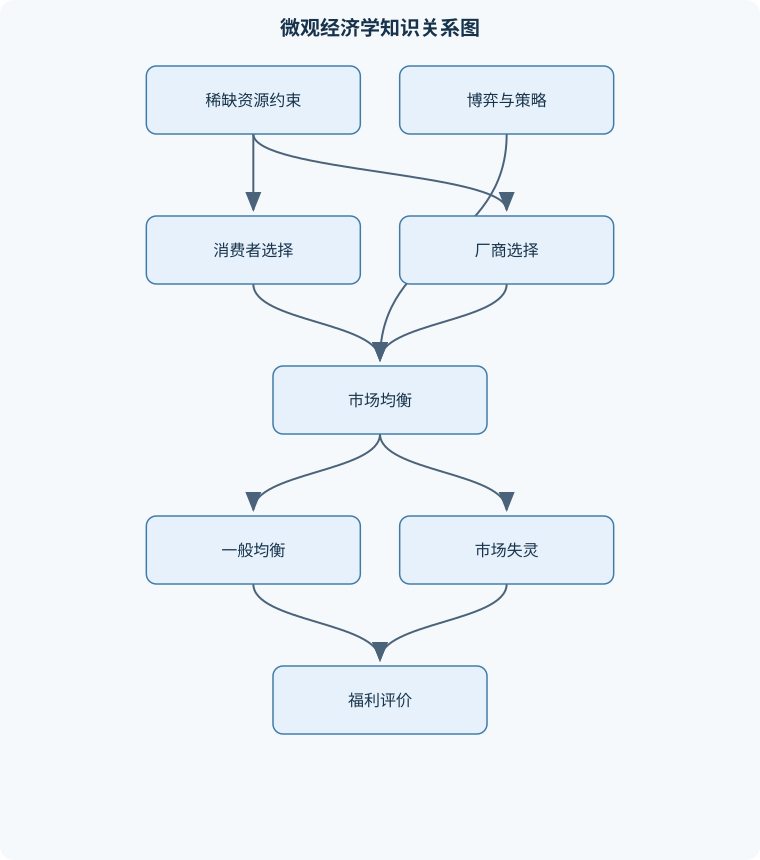
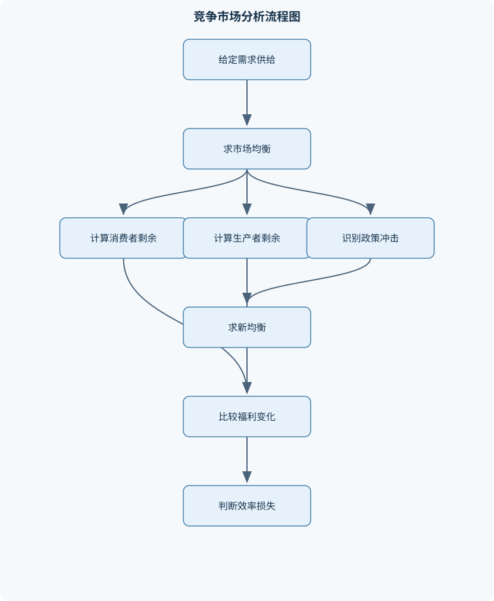

# 中级微观经济学

## 一、课程整体知识框架

### 课程边界与先修知识

中级微观经济学研究理性消费者、厂商及其他经济主体在稀缺资源约束下的选择、市场均衡、策略互动与福利结果。课程覆盖消费者理论、生产者理论、竞争与非竞争市场、一般均衡、福利经济学、外部性、公共物品、不确定性与信息不对称。先修知识包括单变量与多变量微积分、约束优化、基础概率论、函数与图形分析，以及初级微观经济学中的供求、机会成本和市场均衡。课程以理想化模型为主要分析工具，同时说明完全竞争、完全信息、价格接受者、可微偏好和凸性等假设的适用边界。





### 1. 研究对象、分析方法与统一符号

中级微观经济学研究个体和组织如何在稀缺资源、技术约束和信息约束下作出选择，以及这些选择如何通过市场和战略互动形成均衡。核心主体包括消费者、厂商、劳动者、资产持有者、政府和具有不同私人信息的交易者。课程的基本逻辑是：先描述约束与偏好，再求个体最优选择；由个体选择聚合出市场需求、供给或策略；最后评价均衡的效率、公平与稳定性。

消费者对商品向量 $x=(x_1,\ldots,x_n)$ 的偏好可用效用函数 $u(x)$ 表示。商品数量 $x_i$ 的单位可以是件、千克或消费服务单位，价格 $p_i$ 的单位是货币/单位商品，收入或禀赋价值 $m$ 的单位是货币。预算集为

$$
B(p,m)=\{x\ge 0:p\cdot x=\sum_{i=1}^n p_i x_i\le m\}.
$$

当所有价格为正且偏好满足局部非饱和性时，消费者会花完收入，预算约束取等号；但若存在免费商品、负价格、强制购买或偏好饱和，这一结论不能直接使用。效用函数只表示排序，任何严格递增变换 $\phi(u)$ 都表示同一偏好，因此效用数值本身通常没有可比的基数意义。

厂商使用投入向量 $z$ 生产产量 $q$，生产函数记为 $q=f(z)$。投入价格向量为 $w$，成本函数为

$$
c(w,q)=\min_{z\ge0}\{w\cdot z:f(z)\ge q\}.
$$

总收益为 $TR=pq$，总成本为 $TC$，利润为 $\pi=TR-TC$。边际成本 $MC=dTC/dq$ 的单位是货币/单位产量，平均总成本 $ATC=TC/q$ 的单位同样是货币/单位产量。公式依赖于函数在相关区间可微；固定成本导致成本函数在短期内存在不可避免部分，不能据此把所有成本都用于停产判断。

市场需求 $Q_D(p)$ 表示价格为 $p$ 时消费者愿意并且能够购买的总数量，市场供给 $Q_S(p)$ 表示厂商愿意出售的总数量。静态竞争均衡满足

$$
Q_D(p^*)=Q_S(p^*).
$$

均衡是给定制度、信息和预期下的相互一致状态，不等于社会最优，也不必然唯一。比较静态分析研究参数变化如何改变均衡，例如收入、税率、技术、投入价格或消费者数量变化；它不等同于动态调整路径，后者还需要明确时间、预期和调整速度。

### 2. 课程的逻辑链条

课程首先分析市场机制和个体选择。价格变化会改变预算集，消费者在偏好约束下选择最优消费组合；厂商在技术和投入价格约束下选择投入、产量和价格。消费者和厂商的选择分别形成需求与供给，竞争市场通过价格使计划相互协调。

当单个厂商能够影响价格时，价格不再是外生给定的。垄断者根据需求曲线计算边际收益并选择满足 $MR=MC$ 的产量；寡头厂商则必须预期竞争者的策略，因而需要纳什均衡、序贯均衡或贝叶斯均衡。市场力量通常使价格高于边际成本，带来剩余转移和可能的无谓损失，但自然垄断、产品差异和创新激励使政策评价不能只看价格高低。

一般均衡把多个市场同时纳入分析。消费者以初始禀赋或收入参与交易，竞争均衡要求每个消费者在预算集中最优，并且所有市场出清。福利经济学用帕累托改进、帕累托有效和社会福利函数评价配置。市场失灵则说明价格机制可能无法实现有效配置，典型原因包括外部性、公共物品、逆向选择和道德风险。

### 3. 理想模型与现实边界

完全竞争模型通常假定产品同质、厂商数量足够多、单个厂商是价格接受者、进入退出自由、信息充分且交易成本较低。该模型适合分析价格接受行为和基准效率，但不适用于具有显著品牌差异、规模经济、战略互动或信息优势的市场。

消费者理论常假定偏好完备、传递、连续、凸，并且可用可微效用函数表示。完备性表示任意两个消费束都能比较；传递性保证排序不循环；凸性表示平均消费束至少不差于极端消费束。完全替代和完全互补偏好通常在折点或预算线端点取得最优，边际替代率相等的内点条件不能机械套用。

福利结论依赖凸偏好、连续性、局部非饱和性、价格接受和市场出清等条件。外部性、公共物品、信息不对称、市场势力、交易成本和非凸技术都会削弱这些结论。任何政策结论都必须区分“模型中存在的效率损失”和“现实政策的执行成本、分配影响与信息要求”。

## 二、章节和模块划分

### 核心知识覆盖清单

本清单用于检查正文是否覆盖本课程的主要知识模块：

- **市场机制与基本分析工具**：需求函数与供给函数、需求量和需求变动的区别、市场均衡价格与数量、短缺与过剩的调整机制、税收与补贴的均衡影响、价格上限与价格下限、市场剩余与资源配置、比较静态分析、弹性及其经济含义。
- **预算约束与消费者偏好**：预算集与预算线、收入和价格变化的影响、偏好的完备性与传递性、单调性与局部非饱和性、凸偏好与边际替代率、无差异曲线的性质、拟线性偏好与完全替代、完全互补偏好与角点解、效用函数与单调变换。
- **消费者最优选择与需求**：效用最大化问题、内点最优条件、边际效用与边际替代率、拉格朗日乘数的经济含义、普通需求与补偿需求、收入效应与替代效应、斯勒茨基方程、显示偏好与需求一致性、间接效用函数与支出函数、消费者剩余的测度。
- **跨期选择与不确定性**：两期预算约束、利率与跨期相对价格、储蓄和借贷选择、收入效应与替代效应的跨期分解、风险厌恶与风险中性、期望效用函数、确定性等价与风险溢价、保险需求与公平保险、资产收益率与投资组合、风险资产和无风险资产。
- **生产技术与成本理论**：生产函数与投入产出关系、短期与长期生产、边际产量与平均产量、边际报酬递减、等产量曲线与技术替代率、规模报酬、成本最小化、条件要素需求、短期成本与长期成本、固定成本和可变成本。
- **厂商供给与竞争市场**：利润最大化、边际收益与边际成本、平均成本与平均可变成本、完全竞争厂商的价格接受行为、短期停产条件、长期退出与进入、厂商供给曲线、行业短期供给与长期供给、竞争均衡的比较静态、生产者剩余与竞争效率。
- **垄断、价格歧视与要素市场**：垄断厂商的需求与边际收益、垄断产量和价格条件、加价率与需求弹性、垄断的无谓损失、自然垄断与成本结构、一级二级和三级价格歧视、两部收费与捆绑销售、垄断竞争与产品差异、劳动需求与边际收益产品、要素市场中的买方垄断。
- **博弈论与寡头市场**：策略式博弈与收益矩阵、占优策略、纳什均衡、混合策略均衡、序贯博弈与博弈树、子博弈精炼纳什均衡、逆向归纳法、古诺数量竞争、斯塔克尔伯格领导者模型、伯特兰价格竞争与重复博弈。
- **一般均衡与福利经济学**：纯交换经济、禀赋与预算集、埃奇沃思盒状图、契约曲线、竞争均衡、瓦尔拉斯法则、帕累托改进与帕累托有效、第一福利定理、第二福利定理的条件、社会福利函数与公平权衡。
- **市场失灵与信息经济学**：负外部性与正外部性、庇古税与补贴、科斯定理及其交易成本边界、排污权与产权配置、公共物品的非排他性、公共物品的非竞争性、萨缪尔森条件、搭便车问题、逆向选择与隐藏信息、道德风险与隐藏行动、信号传递与筛选机制。


### 模块一：市场机制与基本分析工具

需求曲线表示其他条件不变时价格与需求量的关系。商品自身价格变化通常导致沿需求曲线移动；收入、偏好、相关商品价格、人口或预期变化则导致需求曲线移动。供给量与供给也必须作同样区分。短缺发生在价格低于均衡价格时，$Q_D>Q_S$；过剩发生在价格高于均衡价格时，$Q_S>Q_D$。在价格可以调整的市场中，短缺会产生涨价压力，过剩会产生降价压力，但价格管制、配给和黏性价格可能使调整停止。

若单位税为 $t$，买方支付价格为 $p_b$，卖方实际得到价格为 $p_s$，则

$$
p_b-p_s=t.
$$

税收使交易楔子扩大，均衡数量通常下降；税负由谁承担取决于需求和供给弹性，而不是取决于法律上谁缴税。价格上限低于均衡价会造成短缺，价格下限高于均衡价会造成过剩。消费者剩余是需求曲线下方、市场价格上方的面积，生产者剩余是价格下方、供给曲线上方的面积；连续情形可用积分计算，但非线性需求下消费者剩余不一定等于真实货币补偿意义上的福利变化。

弹性衡量比例变化。需求价格弹性为

$$
\varepsilon_{Q,p}=\frac{dQ}{dp}\frac{p}{Q}.
$$

需求通常有负弹性；绝对值大于 $1$ 表示富有弹性。弹性决定价格变化对销售收入的影响，但收入还取决于需求曲线形状和市场范围。

### 模块二：预算约束与消费者偏好

两种商品的预算线为 $p_1x_1+p_2x_2=m$，横轴截距为 $m/p_1$，纵轴截距为 $m/p_2$，斜率为 $-p_1/p_2$。收入变化使预算线平行移动；单个商品价格变化使预算线绕另一商品截距旋转。禀赋经济中，消费者可出售初始商品，收入等于禀赋在价格下的价值，价格变化还会改变禀赋持有者的实际财富。

无差异曲线连接具有相同效用的消费束。局部非饱和性使更大消费束通常更受偏好；凸偏好使无差异曲线向原点凸。若效用可微，商品 $i$ 对商品 $j$ 的边际替代率为

$$
MRS_{ij}=\frac{MU_i}{MU_j},\qquad MU_i=\frac{\partial u}{\partial x_i}.
$$

内点最优时

$$
\frac{MU_1}{MU_2}=\frac{p_1}{p_2}.
$$

完全替代偏好可写为 $u=ax+by$，最优点通常是端点，除非偏好斜率与预算线斜率相同；完全互补偏好可写为 $u=\min\{x,2y\}$，最优点位于折点关系 $x=2y$ 上。拟线性偏好在收入变化下对某一商品需求可能不变，但只有在内点、收入足够且价格变化不改变角点状态时才成立。

### 模块三：消费者最优选择与需求

消费者问题为

$$
\max_{x\ge0}u(x)\quad\text{s.t.}\quad p\cdot x\le m.
$$

内点情形可构造拉格朗日函数

$$
\mathcal L=u(x)+\lambda(m-p\cdot x).
$$

一阶条件给出 $MU_i=\lambda p_i$，两商品相除得到 $MRS_{12}=p_1/p_2$。乘子 $\lambda$ 表示收入增加一个货币单位对最大效用的边际影响，在可微且最优值稳定时有 $\lambda=\partial v/\partial m$。必须同时检查非负约束、角点、折点和二阶条件。

例如科布—道格拉斯效用

$$
u(x,y)=x^\alpha y^{1-\alpha},\quad 0<\alpha<1,
$$

在正价格、正收入和内点条件下，需求为

$$
x=\frac{\alpha m}{p_x},\qquad y=\frac{(1-\alpha)m}{p_y}.
$$

价格变化的总效应可由斯勒茨基方程分解：

$$
\frac{\partial x_i}{\partial p_j}
=
\frac{\partial h_i}{\partial p_j}
-
x_j\frac{\partial x_i}{\partial m}.
$$

第一项是保持效用不变的替代效应，第二项是购买力变化造成的收入效应。普通需求 $x_i(p,m)$ 是预算给定时的最优选择，补偿需求 $h_i(p,u)$ 是达到既定效用所需的最小需求。间接效用函数为

$$
v(p,m)=\max_xu(x),
$$

支出函数为

$$
e(p,u)=\min_x p\cdot x.
$$

显示偏好通过实际选择检验行为一致性。若在预算集 $A$ 中选择 $x$，且 $y$ 在 $A$ 中可负担，则在另一预算集 $B$ 中选择 $y$ 时，若 $x$ 也可负担，就不能同时表现为严格偏好 $y$ 胜于 $x$。该条件是选择一致性的必要检验，不保证唯一恢复真实偏好。

### 模块四：跨期选择与不确定性

两期消费者的预算约束可写成

$$
c_1+\frac{c_2}{1+r}
=
y_1+\frac{y_2}{1+r},
$$

其中 $c_1,c_2$ 是两期消费，$y_1,y_2$ 是两期收入，$r$ 是利率。利率提高使未来消费相对于当前消费变便宜，产生替代效应；同时，净储蓄者财富增加，净借款者财富减少，产生方向相反的收入效应。判断储蓄还是借款，要比较 $c_1$ 与 $y_1$，不能只看利率水平。

不确定性用状态 $s$ 和概率 $\Pr(s)$ 描述，期望效用为

$$
EU=\sum_s\Pr(s)u(c_s).
$$

风险厌恶者的效用函数严格凹，由詹森不等式偏好确定收入而非具有相同期望值的风险收入。确定性等价是使消费者与风险方案无差异的确定收入，风险溢价是风险方案期望收入减确定性等价。公平保险要求保费等于期望赔付，但风险厌恶者可能愿意支付高于公平保费的风险溢价；保险需求还受道德风险、逆向选择和行政成本影响。资产配置中，无风险资产具有确定收益，风险资产收益随状态变化；投资组合选择要同时考虑期望收益、风险、相关性和财富约束。

### 模块五：生产技术与成本理论

生产函数 $q=f(K,L)$ 描述资本 $K$、劳动 $L$ 与最大可生产产量之间的关系。边际产量为投入增加一单位带来的产量增量，平均产量为总产量除以投入量。短期至少有一种投入固定；长期所有投入均可调整。边际报酬递减表示在其他投入固定时，继续增加某一投入，其边际产量最终下降，但不等于规模报酬递减。

等产量曲线连接相同产量的投入组合，技术替代率为

$$
MRTS_{LK}=\frac{MP_L}{MP_K}.
$$

成本最小化要求等产量曲线与等成本线相切：

$$
\frac{MP_L}{MP_K}=\frac{w_L}{w_K},
$$

其中 $w_L,w_K$ 是劳动和资本价格。若解落在非负约束外，必须比较角点。规模报酬研究投入同时扩大时产量如何变化：规模报酬不变意味着投入扩大比例与产量扩大比例相同，规模报酬递增或递减分别意味着产量扩大更多或更少。

短期固定成本不随产量变化，可变成本随产量变化；长期成本允许调整全部投入。长期平均成本是不同规模下最小平均成本的包络，而不是简单把短期平均成本相加。

### 模块六：厂商供给与竞争市场

利润最大化问题为

$$
\max_q \pi(q)=TR(q)-TC(q).
$$

内点一阶条件为 $MR=MC$。完全竞争厂商是价格接受者，$TR=pq$，所以 $MR=p$，候选产量满足 $p=MC$，且应位于边际成本上升段。短期固定成本已经发生且无法避免，继续生产的利润应与停产利润 $-TFC$ 比较，因此停产条件是 $p<\min AVC$。若 $p$ 高于最低平均可变成本但低于平均总成本，厂商亏损但仍可能继续生产。

长期自由进入退出、同质产品、相同技术和可获得信息时，均衡满足

$$
p=MC=\min ATC.
$$

经济利润为零不表示所有者没有收入，而表示收入恰好补偿显性成本和隐含机会成本。厂商供给是边际成本曲线在停产点以上的部分，行业供给是厂商供给的水平加总，但进入退出、投入价格变化和规模经济会改变长期供给形状。

### 模块七：垄断、价格歧视与要素市场

垄断者面对向下倾斜的逆需求 $p(q)$，总收益为 $TR=p(q)q$，边际收益为

$$
MR=p(q)+q\frac{dp}{dq}.
$$

内点最优满足 $MR=MC$，再由需求函数确定价格。线性需求 $p=a-bq$、常数边际成本 $c$ 时，

$$
q=\frac{a-c}{2b},\qquad p=\frac{a+c}{2},
$$

要求 $a>c$ 且产量非负。若需求价格弹性为 $\varepsilon<0$，加价率满足

$$
\frac{p-MC}{p}=-\frac1{\varepsilon}.
$$

该式要求需求可微、内点解和明确的边际成本；不能把平均成本等同于边际成本。

一级价格歧视按每位消费者最高支付意愿收费；二级价格歧视按购买数量或套餐收费；三级价格歧视在可分割市场中收取不同价格。有效歧视需要识别市场差异、阻止转售套利，并满足消费者参与约束。两部收费包括固定入场费和单位价格；捆绑销售通过组合商品改变支付结构。自然垄断通常与大规模固定成本、长期平均成本下降有关，单纯把价格压到边际成本可能导致亏损。

劳动需求取决于劳动的边际收益产品。在产品价格给定的竞争市场中，劳动边际收益产品为 $pMP_L$，厂商雇佣劳动直到其等于工资。买方垄断的雇主面对向上倾斜的劳动供给，需要比较劳动的边际支出与边际收益产品，工资与就业量通常低于竞争基准。

### 模块八：博弈论与寡头市场

策略式博弈由参与者、策略集合和收益函数构成。占优策略无论对手如何行动都给出更高收益；纳什均衡要求每个参与者的策略都是对其他人策略的最佳回应。混合策略均衡通过使对手在若干纯策略之间无差异来确定概率。序贯博弈用博弈树表示行动顺序，逆向归纳从最后决策节点开始求最优行动，子博弈精炼纳什均衡排除不可置信威胁。

古诺双寡头中，厂商同时选择数量。若

$$
p=a-b(q_1+q_2),\quad MC=c,
$$

厂商 $i$ 的反应函数为

$$
q_i=\frac{a-c-bq_j}{2b},
$$

对称均衡为 $q_i=(a-c)/(3b)$。斯塔克尔伯格模型中，领导者先选产量并把跟随者反应函数代入自身利润函数。伯特兰模型中厂商选择价格，同质产品且成本相同时，价格竞争可能把价格压到边际成本；重复博弈通过未来收益和惩罚策略可能支持合作，但合作是否可信取决于贴现因子、偏离收益和惩罚机制。

### 模块九：一般均衡与福利经济学

纯交换经济中，消费者拥有初始禀赋 $\omega_i$，禀赋按价格计价形成预算收入。两人两商品模型可用埃奇沃思盒状图表示：盒子的宽度和高度分别是两种商品总禀赋，盒内点表示可行分配。契约曲线由双方无差异曲线相切的配置组成，内点条件为双方边际替代率相等；角点需要直接检查是否存在可行的帕累托改进。

竞争均衡要求每个消费者在其预算集内最优、市场出清且价格与收入相容。瓦尔拉斯法则指出，在预算平衡下各市场超额需求价值之和为零，因此若除一个市场外其余市场出清，最后一个市场也必须出清。第一福利定理在凸偏好、局部非饱和和竞争均衡等条件下说明竞争均衡是帕累托有效的。第二福利定理要求更强的凸性和适当的再分配工具，主张通过先调整禀赋、再竞争交易，可以把某些帕累托有效配置支持为均衡；现实中的一次性转移、信息和执行成本可能破坏这一结论。

帕累托有效只表示不能在不损害任何人的情况下改善一人，不表示公平。社会福利函数可把效率与公平结合，但权重反映价值判断，不能由市场均衡自动决定。

### 模块十：市场失灵与信息经济学

负外部性使私人边际成本低于社会边际成本，社会最优条件通常为

$$
MSB=MSC=PMC+EMC,
$$

其中 $EMC$ 是外部边际成本。庇古税试图使私人决策者面对社会成本；排污权制度通过总量控制和可交易产权实现减排。科斯定理要求产权清晰、交易成本为零或足够低、参与者信息充分；现实中谈判成本、受害者众多和责任界定困难会限制其适用。

公共物品具有非排他性和非竞争性。非排他性使不付费者难以被排除，非竞争性使一人的消费不减少他人的可用数量。有效公共物品数量满足萨缪尔森条件：

$$
\sum_i MRS_{iG}=MC_G.
$$

该式表示所有人的边际支付意愿之和等于公共物品边际供给成本。搭便车使私人自愿供给低于有效水平；公共物品由政府提供并不意味着所有政府提供的物品都是纯公共物品。

逆向选择发生在交易前，交易者类型 $\theta$ 不可观察；道德风险发生在契约后，行动不可观察。旧车市场中，买方无法识别质量时可能只愿支付平均估值，优质车退出，市场质量进一步下降。保险市场中，高风险者更愿投保是逆向选择，投保后降低防范努力是道德风险。信号传递由知情方主动行动，筛选由不知情方设计菜单。贝叶斯均衡要求给定信念时策略最优，且信念与观察到的信息按贝叶斯法则一致；分离均衡要求不同类型选择不同信号，混同均衡要求不同类型选择相同信号，并且必须检查激励相容和参与约束。

### 代表性分析流程一：消费者最优选择

**输入：**效用函数 $u(x)$、价格向量 $p$、收入 $m$。  
**输出：**普通需求、最优效用及必要时的补偿需求。  
**步骤：**

1. 写出预算集和非负约束。
2. 判断偏好是否单调、可微、凸，以及预算集是否有界。
3. 对可微内点候选解使用拉格朗日一阶条件。
4. 对完全互补、完全替代、不可微点和角点单独求解。
5. 比较所有可行候选点的效用，验证预算是否满足。
6. 价格变化时分别求初始需求、新需求和补偿需求，再使用斯勒茨基方程解释。

终止条件是所有可行候选点已比较且最大者确定。该流程适用于最优解存在的静态消费问题；若偏好不连续、预算集不闭合或存在无限效用，必须先处理存在性问题。

### 代表性分析流程二：完全竞争厂商与市场均衡

**输入：**需求函数、供给函数、厂商成本函数、税收或价格约束。  
**输出：**均衡价格、数量、利润、剩余和政策影响。  
**步骤：**

1. 令 $Q_D(p)=Q_S(p)$，求无政策均衡。
2. 有税时区分买方价格和卖方价格，并加入价格楔子。
3. 厂商求满足 $p=MC$ 的候选产量，检查边际成本上升段。
4. 比较价格与最低 $AVC$，判断短期生产或停产。
5. 有自由进入退出时检查长期 $p=\min ATC$。
6. 计算消费者剩余、生产者剩余、税收和无谓损失。
7. 对价格、收入、成本和税率变化进行比较静态分析。

### 代表性代码：求线性市场均衡与单位税影响

```python
# Python
# 需求：Q_D = a - b * p_b
# 供给：Q_S = c + d * p_s
# 单位税：p_b - p_s = tax

def market_equilibrium(a, b, c, d, tax=0.0):
    if a < 0 or b <= 0 or d <= 0 or tax < 0:
        raise ValueError("参数必须满足 a>=0，b>0，d>0，tax>=0")

    # a - b*p_b = c + d*p_s
    # p_b = p_s + tax
    p_s = (a - c - b * tax) / (b + d)
    p_b = p_s + tax
    quantity = a - b * p_b

    # 交易数量不能为负；若为负，线性内点解不适用
    if quantity < 0:
        return {"buyer_price": None, "seller_price": None,
                "quantity": 0.0, "status": "无正交易的内点均衡"}

    return {"buyer_price": p_b, "seller_price": p_s,
            "quantity": quantity, "status": "均衡已求得"}

result = market_equilibrium(a=100, b=2, c=10, d=3, tax=5)
print(result)
```

不变量是买方价格减卖方价格等于税额，且均衡数量同时满足需求方程和供给方程。终止条件是代回后两方数量相等并满足非负约束。该代码只适用于单市场、线性、静态且不存在容量约束的情形，不能直接处理多市场一般均衡或分段供给。

### 例题一：科布—道格拉斯消费选择

**题干：**给定 $u(x,y)=x^{1/2}y^{1/2}$、$m=100$、$p_x=2$、$p_y=5$，求最优消费。

**分析与解答：**内点条件为

$$
\frac{MU_x}{MU_y}=\frac{y}{x}=\frac{p_x}{p_y}=\frac25.
$$

所以 $y=0.4x$。预算约束为 $2x+5y=100$，代入得 $2x+2x=100$，故 $x=25$，$y=10$。最优效用为 $u=5\sqrt{10}$。两种商品均为正，预算恰好用完，且效用函数严格凸偏好保证内点候选为最优。

**变式：**若 $p_x$ 降为 $1$，则 $x=0.5m/p_x=50$，$y=10$。$x$ 增加不仅来自替代效应，也来自实际购买力提高造成的收入效应。

### 例题二：完全互补偏好

**题干：**消费者效用为 $u(x,y)=\min\{x,2y\}$，预算为 $x+3y=30$，求最优选择。

**分析与解答：**完全互补时应位于折点 $x=2y$。联立 $2y+3y=30$，得 $y=6,x=12$，效用为 $12$。若偏离该比例，增加比例过多的商品不能提高最低项，因此不会最优。

**结果验证：**在预算线上，若 $x>2y$，效用等于 $2y$；若 $x<2y$，效用等于 $x$。两侧移动都降低对应的最低项，所以折点是最优。$MRS$ 在折点处不定义，不能使用光滑内点条件。

### 例题三：完全竞争厂商的停产判断

**题干：**厂商短期总成本为 $TC(q)=100+2q+q^2$，市场价格为 $p=10$，求利润最大化产量并判断是否停产。

**分析与解答：**边际成本为 $MC=2+2q$，令 $p=MC$ 得 $q=4$。可变成本为 $TVC=2q+q^2$，所以

$$
AVC=2+q.
$$

最低 $AVC$ 的极限为 $2$，价格 $10>2$，厂商继续生产。总收益为 $TR=40$，总成本为 $TC(4)=124$，利润为 $-84$。停产利润为 $-100$，因此继续生产虽然亏损，但亏损较小。

**变式：**若价格为 $1$，则 $p<\min AVC$，厂商停产；固定成本已经发生，不能通过停产消除。

### 例题四：垄断定价

**题干：**逆需求为 $p=50-q$，边际成本为 $10$，无固定成本，求垄断价格、产量和利润。

**分析与解答：**总收益为 $TR=50q-q^2$，边际收益为 $MR=50-2q$。令 $MR=MC$：

$$
50-2q=10\Rightarrow q=20.
$$

价格为 $p=30$，利润为 $(30-10)\times20=400$。竞争基准满足 $p=MC$，所以 $q=40,p=10$。垄断减少产量并提高价格，产生潜在无谓损失。

**结果验证：**在 $q=20$ 左右，边际收益高于或低于边际成本的方向分别决定增产或减产，故该点是利润最大化点。

### 例题五：古诺双寡头

**题干：**逆需求为 $p=60-(q_1+q_2)$，两厂商边际成本均为 $12$，求对称纳什均衡。

**分析与解答：**厂商 $i$ 的利润为

$$
\pi_i=[60-q_i-q_j]q_i-12q_i.
$$

对 $q_i$ 求导：

$$
48-2q_i-q_j=0,
$$

因此反应函数为 $q_i=(48-q_j)/2$。对称时 $q_i=q_j=q$，得到 $q=16$。市场总产量为 $32$，价格为 $28$，每家利润为 $(28-12)\times16=256$。

**变式：**厂商数量增加时，在相同需求和成本下总产量通常提高、价格下降；但这一比较依赖同时选择数量和产品同质等假设。

### 实验或项目一：税收与市场剩余分析

**输入数据：**一组价格—需求量和价格—供给量观测，另给定单位税、价格上限或补贴参数。  
**步骤：**

1. 估计或拟合需求、供给函数，记录样本范围和单位。
2. 求无政策均衡，再分别求政策下的买方价格、卖方价格和成交量。
3. 计算消费者剩余、生产者剩余、政府税收及无谓损失。
4. 用不同弹性参数进行敏感性分析。
5. 检查预测数量是否为负、政策价格是否违反约束、代回后供需是否相等。

**评价标准：**方程设定正确；单位一致；均衡代回误差在预先设定范围内；能解释税负分担和剩余变化；图表与计算结果一致。  
**排错方法：**若税后数量上升，检查是否把买方价格和卖方价格方向写反；若剩余为负，检查积分区间、价格单位和需求函数截距；若出现多个交点，应逐段验证稳定性和可行性。

### 实验或项目二：不对称信息下的旧车市场

**输入数据：**高质量车和低质量车的比例、卖方保留价格、买方对两类车的估值及买方观察信息。  
**步骤：**

1. 先假设买方不能区分质量，计算按平均质量形成的最高支付意愿。
2. 将该支付意愿与两类卖方保留价格比较，判断哪些类型愿意出售。
3. 根据实际进入市场的类型重新计算买方期望估值。
4. 反复检查市场组成是否稳定，区分全类型交易、低质量交易和无交易。
5. 若引入质量认证，比较认证成本、价格和交易量变化。

**评价标准：**正确区分交易前隐藏类型与交易后隐藏行动；期望估值使用实际进入市场的条件概率；每种均衡都满足买方支付意愿、卖方参与和信念一致性。  
**排错方法：**不能直接用总体平均质量代替交易条件下的平均质量；若高质量卖方退出，必须重新计算均值；若认证能区分质量，还要扣除信号成本并检查低质量类型是否有模仿动机。

## 三、核心概念的详细解释

### 1. 市场机制、需求供给与比较静态

需求函数 $Q_D(p)$ 表示在其他条件不变时，价格为 $p$、消费者既有支付能力又有购买意愿的市场需求量；供给函数 $Q_S(p)$ 表示厂商在价格为 $p$ 时愿意出售的数量。需求量是需求曲线上某一价格对应的数量，通常因商品自身价格变化而沿曲线移动；需求本身的变化则表现为整条需求曲线移动，原因可能包括收入、偏好、相关商品价格、消费者数量或预期变化。供给量与供给变化也必须作同样区分：投入价格、技术、税费、厂商数量和生产条件变化会移动供给曲线。

静态竞争均衡满足

$$
Q_D(p^*)=Q_S(p^*).
$$

其中 $p^*$ 是均衡价格，单位为货币/单位商品；$Q_D$ 与 $Q_S$ 的单位为商品数量。若价格低于均衡价格，需求量超过供给量，形成短缺，买方竞争或卖方提高报价会推动价格上升；若价格高于均衡价格，供给量超过需求量，形成过剩，卖方降价或减少生产会推动价格下降。上述调整机制是理想化的价格调整描述，并不保证现实市场即时、连续地达到均衡。

单位税使买方支付价格 $p_b$ 与卖方得到价格 $p_s$ 之间产生楔子：

$$
p_b-p_s=t.
$$

交易量由税后供需共同决定。税负并不必然由法律上缴税的一方承担，实际负担取决于需求和供给弹性：相对缺乏弹性的一方更难调整数量，承担的价格变动通常更大。补贴则使买方支付价格低于卖方获得价格，扩大交易的可能性，但会产生财政支出。价格上限只有低于均衡价格时才具有约束力，可能造成短缺；价格下限只有高于均衡价格时才具有约束力，可能造成过剩。

消费者剩余是消费者最高支付意愿与实际支付之间的差额之和；生产者剩余是实际获得价格与最低供给意愿之间的差额之和。在线性、连续可微条件下，消费者剩余可表示为需求曲线与价格线之间的积分，生产者剩余可表示为价格线与供给曲线之间的积分。剩余是特定价格、收入和供给条件下的福利指标，不等同于全部社会福利，也不能自动反映公平性。

需求价格弹性定义为

$$
\varepsilon_D=\frac{dQ_D}{dp}\frac{p}{Q_D}.
$$

需求通常向下倾斜，因此 $\varepsilon_D<0$；分析弹性大小时常使用绝对值。绝对值大于 $1$ 表示富有弹性，小于 $1$ 表示缺乏弹性。弹性是无量纲的局部指标，不能把某一区间的弹性直接外推到整个需求曲线。总收益 $TR=pQ_D(p)$ 的变化取决于价格变化与需求数量变化的相对大小。

### 2. 预算约束、偏好与效用表示

消费者的预算集为

$$
B(p,m)=\{x\ge 0:p\cdot x\le m\},
$$

其中 $x_i$ 是第 $i$ 种商品数量，$p_i$ 是单位价格，$m$ 是货币收入或禀赋价值。两种商品情形下预算线为 $p_1x_1+p_2x_2=m$，横轴截距为 $m/p_1$，纵轴截距为 $m/p_2$，斜率为 $-p_1/p_2$。收入变化使预算线平行移动；单个商品价格变化通常使预算线绕另一商品截距旋转。若所有商品价格均按同一比例变化，预算集相当于收入按相反比例变化。

偏好完备性要求任意两个消费束都能比较；传递性要求若 $x$ 至少和 $y$ 一样好、$y$ 至少和 $z$ 一样好，则 $x$ 至少和 $z$ 一样好。连续性排除了因微小变化导致的剧烈偏好跳跃。单调性表示更多商品不会使消费者变差；局部非饱和性表示在任一消费束附近，总能找到一个略好的消费束。若偏好局部非饱和且价格为正，最优选择通常花完收入，但存在饱和商品、免费商品或强制购买时不能机械使用预算等式。

凸偏好表示平均消费束至少不差于两个端点中较差者，反映消费者偏好分散而非极端。无差异曲线表示效用相同的消费束集合。可微、内点且严格凸时，无差异曲线通常向右下方倾斜且凸向原点。边际替代率为

$$
MRS_{12}=\frac{MU_1}{MU_2},
\qquad
MU_i=\frac{\partial u}{\partial x_i}.
$$

它表示保持效用不变时，消费者愿意用多少商品 $2$ 换取一单位商品 $1$。完全替代偏好具有直线型无差异曲线，最优解可能是角点；完全互补偏好具有折线型无差异曲线，最优解通常在折点。因而“边际替代率等于价格比”不能用于所有偏好。

效用函数只需表示偏好排序。若 $\phi$ 严格递增，则 $\phi(u(x))$ 与 $u(x)$ 表示同一偏好；但边际效用的绝对数值会改变，因此边际效用大小本身通常没有独立的福利含义。拟线性偏好在某一商品上具有线性效用特征，收入效应可能较弱或在局部为零，但这不是所有商品都具有的经验事实。

### 3. 消费者最优选择、需求与跨期决策

消费者效用最大化问题为

$$
\max_{x\ge 0}u(x)
\quad\text{s.t.}\quad
p\cdot x\le m.
$$

对于两种商品、可微偏好、正价格、内点解和预算用尽的情况，拉格朗日函数为

$$
\mathcal L=u(x_1,x_2)+\lambda(m-p_1x_1-p_2x_2).
$$

一阶条件为

$$
MU_1=\lambda p_1,\qquad MU_2=\lambda p_2,
$$

相除得到

$$
\frac{MU_1}{MU_2}=\frac{p_1}{p_2}.
$$

这表示消费者主观替代意愿与市场交换条件相等。拉格朗日乘数 $\lambda$ 表示收入增加一单位所带来的最优效用增量，在可微且内点的条件下有 $\lambda=\partial v/\partial m$。若解位于角点或折点，必须将角点、折点和内点候选解全部比较。

普通需求 $x_i(p,m)$ 是给定价格和收入下的效用最大化选择；补偿需求 $h_i(p,u)$ 是在价格 $p$ 下达到目标效用 $u$ 所需的成本最小化选择。普通需求包含价格变化引起的替代效应和实际购买力变化引起的收入效应。斯勒茨基方程为

$$
\frac{\partial x_i(p,m)}{\partial p_j}
=
\frac{\partial h_i(p,u)}{\partial p_j}
-
x_j(p,m)\frac{\partial x_i(p,m)}{\partial m}.
$$

第一项保持原效用不变，第二项描述价格变化造成的实际收入变化。对正常商品，收入效应与替代效应通常同向；对低档商品，二者可能相反；只有当收入效应足够强时，才可能出现违反通常需求规律的吉芬商品。

显示偏好从实际选择反推偏好。如果消费者在预算集 $A$ 中选择 $x$，且 $y$ 在 $A$ 中可负担，则观察结果显示 $x$ 至少不差于 $y$。若在另一预算集 $B$ 中选择 $y$，同时 $x$ 在 $B$ 中可负担且消费者严格偏好 $y$ 胜过 $x$，就产生选择不一致。显示偏好条件可以检验需求数据是否与稳定、传递的偏好相容，但不能仅凭有限数据唯一确定完整偏好。

间接效用函数与支出函数分别为

$$
v(p,m)=\max_{x\in B(p,m)}u(x),
$$

$$
e(p,u)=\min_{x\ge0}\{p\cdot x:u(x)\ge u\}.
$$

前者描述给定资源下能达到的最高效用，后者描述达到给定效用所需的最低支出。普通需求、补偿需求、间接效用和支出函数之间存在对偶关系。消费者剩余可用于近似衡量价格变化造成的福利变化，但在收入效应明显时，精确福利评价通常应使用补偿变差或等价变差，而不能直接把需求曲线下的面积解释为严格的货币福利变化。

两期跨期选择可写为

$$
c_1+\frac{c_2}{1+r}
=
y_1+\frac{y_2}{1+r},
$$

其中 $c_1,c_2$ 是两期消费，$y_1,y_2$ 是两期收入，$r$ 是利率。当前消费的机会成本是放弃的未来消费，利率上升会改变跨期相对价格。若 $c_1<y_1$，消费者为净储蓄者；若 $c_1>y_1$，消费者为净借款者。利率变化同时产生跨期替代效应和收入效应，因此不能仅凭替代效应判断储蓄必然增加。

### 4. 不确定性、风险与保险

不确定性模型用状态 $s$ 描述未来可能结果，状态概率为 $\Pr(s)$，状态消费为 $c_s$。期望效用为

$$
EU=\sum_s\Pr(s)u(c_s).
$$

风险厌恶者的效用函数严格凹，即 $u''(c)<0$。由詹森不等式，面对相同期望消费时，风险厌恶者偏好确定消费：

$$
u(E[c])\ge E[u(c)].
$$

确定性等价是使消费者与风险方案无差异的确定消费 $CE$，满足

$$
u(CE)=E[u(c)].
$$

风险溢价是风险方案的期望消费与确定性等价之差：

$$
RP=E[c]-CE.
$$

风险中性者的效用函数为线性函数，只关心期望货币收益；风险厌恶、风险中性和风险偏好分别对应严格凹、线性和局部凸的效用表示。公平保险通常指保费等于预期赔付，但公平保费不必等于风险厌恶者愿意支付的最高保费，因为保险还提供风险减少价值。完全保险是否最优取决于保费、风险偏好、财富和契约限制。

资产选择把无风险资产与风险资产组合起来。风险资产的预期收益和方差、协方差决定组合的平均收益与风险；分散投资可以降低非完全相关风险，但不能消除所有共同风险。均值—方差分析依赖于收益分布和偏好条件，不能替代完整期望效用分析。

### 5. 生产技术、成本与厂商行为

生产函数 $q=f(z)$ 表示投入向量 $z$ 与最大可生产产量 $q$ 的技术关系。短期至少有一种投入固定，长期所有投入均可调整。边际产量是增加一单位投入带来的产量增量，平均产量是总产量除以投入量。边际报酬递减表示在其他投入固定时，某投入增加到一定程度后，其边际产量下降；它不等于规模报酬递减，后者考察所有投入按同一比例变化时产量的变化。

等产量曲线表示生产同一产量的投入组合。技术边际替代率为

$$
MRTS_{LK}=\frac{MP_L}{MP_K},
$$

其中 $MP_L,MP_K$ 分别为劳动和资本的边际产量。成本最小化要求等产量曲线与等成本线相切。若为内点解，则

$$
\frac{MP_L}{MP_K}=\frac{w_L}{w_K},
$$

或等价地，

$$
\frac{MP_L}{w_L}=\frac{MP_K}{w_K}.
$$

第二种表达表示最后一单位货币在不同投入上的边际产出相等。若技术存在固定比例、投入不可分或边际产量为零，最优解可能是角点或折点，不能只使用相切条件。

成本函数为

$$
c(w,q)=\min_{z\ge0}\{w\cdot z:f(z)\ge q\},
$$

其中 $w$ 为投入价格，$q$ 为目标产量。总成本包括固定成本和可变成本；平均固定成本为固定成本除以产量，平均可变成本为可变成本除以产量，平均总成本为总成本除以产量。边际成本是产量增加一单位引起的总成本增量：

$$
MC=\frac{dTC}{dq}.
$$

短期固定成本即使停产也可能无法避免，因此停产判断比较价格与平均可变成本；长期所有成本都可调整，退出判断需要比较价格与长期平均成本。

### 6. 竞争、垄断、要素市场与产品差异

利润为

$$
\pi=TR-TC.
$$

厂商利润最大化的内点条件是

$$
MR=MC.
$$

完全竞争厂商是价格接受者，$TR=pq$，因此 $MR=p$，内点条件变为 $p=MC$。短期若价格低于平均可变成本最低点，继续生产不能弥补可变成本，厂商选择停产；若价格高于最低平均可变成本但低于平均总成本，厂商亏损但可能继续生产，因为能够承担部分固定成本。长期自由进入和退出、同质产品及相同技术下，竞争均衡满足

$$
p=MC=\min ATC,
$$

经济利润为零，但会计利润仍可能包括企业所有者的正常报酬。

垄断者面对向下倾斜的市场需求。若逆需求为 $p(q)$，则

$$
TR=p(q)q,
\qquad
MR=p(q)+q\frac{dp}{dq}.
$$

线性逆需求 $p=a-bq$、常数边际成本 $c$ 时，

$$
MR=a-2bq,
\qquad
q^*=\frac{a-c}{2b},
\qquad
p^*=\frac{a+c}{2},
$$

前提是 $a>c$ 且内点产量为正。垄断加价率与需求弹性满足

$$
\frac{p-MC}{p}=-\frac{1}{\varepsilon},
$$

其中 $\varepsilon<0$ 是需求价格弹性。该式要求需求可微、厂商选择内点产量且边际成本定义明确。

一级价格歧视对每单位收取消费者最高支付意愿；二级价格歧视按购买数量或套餐自我筛选；三级价格歧视按可识别市场分组定价。价格歧视需要市场分割、需求差异和限制转售。两部收费由固定进入费与单位价格组成，捆绑销售则把多个商品组合出售，其效果取决于消费者估值相关性和套利可能性。垄断竞争具有许多厂商、产品差异和一定定价能力，长期进入会压缩经济利润，但不必使价格等于边际成本。

劳动等要素的需求是派生需求。竞争厂商雇用劳动的条件为劳动的边际收益产品等于工资：

$$
p\cdot MP_L=w.
$$

若产品市场或要素市场不完全竞争，应将价格替换为相应的边际收益。买方垄断面对向上倾斜的劳动供给曲线，增加雇佣量会提高全部劳动的工资，因此边际要素成本高于工资，雇佣量低于竞争基准。

### 7. 博弈论与寡头市场

策略式博弈由参与者、策略集合和收益函数构成。占优策略无论其他参与者如何行动都能带来更高收益；纳什均衡是策略组合 $s$，满足任何参与者单独偏离都不能提高收益：

$$
\pi_i(s_i,s_{-i})
\ge
\pi_i(s_i',s_{-i})
$$

对所有可行偏离策略 $s_i'$ 成立。纳什均衡描述相互最优回应，不保证效率或公平。没有纯策略均衡时，参与者可能采用混合策略，即以概率分布随机化选择。

序贯博弈必须考虑行动顺序和后续回应。逆向归纳从最后一个决策节点开始，在每个节点选择行动者最优的行动，再逐层向前。子博弈精炼纳什均衡要求每个子博弈中的策略都构成纳什均衡，用来排除不可信威胁。完全信息是所有参与者知道收益和类型；不完全信息则需要类型概率、信念和贝叶斯最优回应。

古诺模型中厂商同时选择数量。线性逆需求

$$
p=a-b(q_1+q_2),
$$

相同边际成本 $c$ 时，厂商 $i$ 的反应函数为

$$
q_i=\frac{a-c-bq_j}{2b}.
$$

对称双寡头均衡为

$$
q_1=q_2=\frac{a-c}{3b}.
$$

斯塔克尔伯格模型由领导者先选择产量，跟随者观察后作出最优回应；领导者将跟随者反应函数代入自身利润函数。伯特兰模型中厂商同时选择价格，同质产品且边际成本相同、无容量约束时，价格竞争可能把价格压到边际成本；产品差异、容量限制或重复互动会改变这一结论。重复博弈中，未来收益和惩罚可信度决定合作能否维持。

### 8. 一般均衡、福利与市场失灵

纯交换经济中，消费者拥有初始禀赋 $\omega_i$，其预算集由禀赋价值和价格决定。竞争均衡要求每位消费者在预算集内最优，同时所有商品市场出清。市场出清并不要求每个消费者最终消费等于初始禀赋；交易正是为了改变消费结构。瓦尔拉斯法则说明各市场超额需求按价格加权之和为零，因此在价格为正且其他市场出清时，剩余市场也必须出清。

埃奇沃思盒状图将两人的两种商品禀赋和交易表示在同一资源约束内。帕累托改进是至少使一人变好且不使任何人变坏的配置变化；帕累托有效配置不存在可行的帕累托改进。两人两商品的内点有效配置通常满足两人的边际替代率相等：

$$
MRS^A_{12}=MRS^B_{12}.
$$

第一福利定理指出，在偏好凸、局部非饱和、市场完整且不存在外部性等条件下，竞争均衡具有帕累托有效性。第二福利定理要求更强条件，如凸性、连续性和适当的重新分配工具；它说明可以先通过一次性转移调整分配，再利用竞争价格实现目标有效配置。现实中的税制、信息约束和交易成本会削弱这一分离。

社会福利函数把不同个体效用聚合为社会评价，效率与公平可能发生冲突。帕累托标准不要求比较一人变好、另一人变坏的配置，因此不能单独决定分配正义。

负外部性使私人决策者未承担全部社会成本。若边际外部成本为 $MEC$，社会边际成本为

$$
MSC=MPC+MEC.
$$

社会最优满足社会边际收益等于社会边际成本。庇古税试图使私人决策者面对的边际成本等于社会边际成本；排污权制度则通过总量约束和可交易产权形成排放价格。科斯定理要求产权明确、交易成本很低、信息充分且谈判可执行；在这些条件下，产权初始分配不影响有效结果，但会影响收入分配。交易成本、参与者众多和信息不对称会使谈判结果偏离定理预测。

纯公共物品具有非排他性和非竞争性。非排他性表示难以阻止未付费者使用，非竞争性表示一人的消费不减少他人的可用数量。公共物品的有效供给条件为

$$
\sum_i MRS_{iG}=MC_G,
$$

即所有消费者对公共物品的边际支付意愿之和等于边际供给成本。私人商品使用水平不同，公共物品数量却对所有人相同，因此公共物品条件是边际替代率的垂直加总，而不是单个消费者边际替代率等于边际成本。搭便车使个人有动机隐瞒真实支付意愿，导致私人自愿供给不足。

逆向选择发生在交易前的隐藏类型，例如卖方比买方更清楚商品质量；道德风险发生在契约后行动不可观察，例如被保险人改变防损行为。逆向选择改变交易者组成和市场平均质量，道德风险改变契约后的行动与结果。信号由信息优势方主动发送，筛选由信息劣势方设计机制来诱导类型自我选择。分离均衡要求不同类型选择不同信号，混同均衡要求不同类型选择相同信号；均衡必须满足参与约束、激励相容约束和信念一致性。

## 四、重要定义、公式、定理和推导

### 专业审校补充：关键定义与适用边界

库恩—塔克条件是处理消费者、厂商和社会规划问题中非负约束的统一工具。设最大化问题为 max f(x)，约束为 g_k(x)≤0、x_i≥0；在满足可行性、约束资格和适当正则条件时，存在乘子 λ_k≥0 及 ν_i≥0，使得驻点条件为 ∇f(x)−Σλ_k∇g_k(x)+Σν_i∇x_i=0，并满足互补松弛 λ_kg_k(x)=0、ν_ix_i=0。以消费者预算约束为例，若商品 i 的最优数量为正，则其边际效用与价格按同一乘子成比例；若 x_i=0，则不能强行使用边际替代率相等，而应检查该商品在零消费处的边际收益是否足以超过其价格成本。该条件是必要条件，不自动保证全局最优；当目标函数具有凹性、可行集为凸集时，满足条件的解才可进一步作为全局最优判据。非凹技术、非凸偏好或离散选择可能出现多个局部候选解，仍需比较目标值。


### 1. 消费者理论的统一推导

#### 科布—道格拉斯需求

设

$$
u(x,y)=x^\alpha y^{1-\alpha},
\qquad 0<\alpha<1,
$$

预算约束为 $p_xx+p_yy=m$。由于效用对两种商品均单调，预算约束取等号。对数化不改变最优解：

$$
\ln u=\alpha\ln x+(1-\alpha)\ln y.
$$

拉格朗日函数为

$$
\mathcal L=\alpha\ln x+(1-\alpha)\ln y
+\lambda(m-p_xx-p_yy).
$$

一阶条件给出

$$
\frac{\alpha}{x}=\lambda p_x,
\qquad
\frac{1-\alpha}{y}=\lambda p_y.
$$

将两式与预算约束联立，得到

$$
x(p_x,p_y,m)=\frac{\alpha m}{p_x},
\qquad
y(p_x,p_y,m)=\frac{(1-\alpha)m}{p_y}.
$$

该结果要求价格为正、收入为正、内点解存在且两种商品均可购买。间接效用为

$$
v(p_x,p_y,m)
=
\left(\frac{\alpha m}{p_x}\right)^\alpha
\left(\frac{(1-\alpha)m}{p_y}\right)^{1-\alpha}.
$$

若偏好为完全互补，例如 $u(x,y)=\min\{x,2y\}$，最优点必须先满足折点关系 $x=2y$，再与预算约束联立；边际替代率在折点处不定义，不能使用相切条件。

#### 斯勒茨基方程的含义

价格 $p_j$ 变化时，普通需求变化可以分成两步：先改变相对价格，同时调整收入使消费者仍能买到原消费束；再恢复到实际收入。第一步产生补偿需求变化，即替代效应；第二步是实际购买力变化，即收入效应。对普通需求求导得到

$$
\frac{\partial x_i}{\partial p_j}
=
\frac{\partial h_i}{\partial p_j}
-
x_j\frac{\partial x_i}{\partial m}.
$$

其中 $x_j$ 是原来购买的第 $j$ 种商品数量。负号表示商品 $j$ 涨价会降低实际收入。该分解要求需求函数和支出函数在相关点可微；非光滑偏好、角点解或离散选择时，应使用有限变化版本或直接比较补偿后的消费束。

### 2. 厂商成本与供给推导

#### 成本最小化的一阶条件

给定生产函数 $q=f(L,K)$、工资 $w$ 和资本价格 $r$，成本最小化问题为

$$
\min_{L,K\ge0}wL+rK
\quad\text{s.t.}\quad
f(L,K)\ge q.
$$

若技术单调，产量约束取等号。拉格朗日函数为

$$
\mathcal L=wL+rK+\mu[q-f(L,K)].
$$

一阶条件为

$$
w=\mu MP_L,
\qquad
r=\mu MP_K.
$$

两式相除得到

$$
\frac{MP_L}{MP_K}=\frac{w}{r}.
$$

这表示技术替代率等于市场要素价格比。若生产函数为

$$
q=K^{1/2}L^{1/2},
$$

则

$$
\frac{MP_L}{MP_K}=\frac{K}{L}.
$$

因此

$$
\frac{K}{L}=\frac{w}{r},
\qquad
K=\frac{w}{r}L.
$$

代回生产约束：

$$
q=\left(\frac{w}{r}L^2\right)^{1/2}
=L\sqrt{\frac{w}{r}},
$$

得到

$$
L^c=q\sqrt{\frac{r}{w}},
\qquad
K^c=q\sqrt{\frac{w}{r}}.
$$

成本函数为

$$
c(w,r,q)=wL^c+rK^c
=2q\sqrt{wr}.
$$

这里 $w,r$ 的单位是货币/单位投入，$q$ 的单位是单位产出，成本单位为货币。该推导要求投入价格为正、生产函数可微且存在内点成本最小解；若存在固定比例技术或投入不可替代，必须检查角点。

#### 完全竞争厂商的短期决策

利润函数为

$$
\pi(q)=pq-TC(q).
$$

内点一阶条件为

$$
\frac{d\pi}{dq}=p-MC(q)=0,
$$

即

$$
p=MC(q).
$$

但一阶条件只给候选解，还必须检查边际成本是否在上升段、产量是否非负，以及继续生产和停产的利润。若固定成本为 $TFC$，停产利润为 $-TFC$；继续生产的利润为

$$
\pi(q)=pq-TVC(q)-TFC.
$$

继续生产优于停产当且仅当

$$
pq\ge TVC(q),
$$

等价于

$$
p\ge AVC(q).
$$

因此短期供给曲线是上升的边际成本曲线中高于平均可变成本最低点的部分。长期退出还需比较全部可避免成本，不能把短期停产规则直接用于长期。

### 3. 垄断与寡头模型的推导

#### 垄断加价率

利润最大化条件为 $MR=MC$。由于

$$
TR(q)=p(q)q,
$$

所以

$$
MR=p(q)+q\frac{dp}{dq}.
$$

需求弹性为

$$
\varepsilon=\frac{dq}{dp}\frac{p}{q}.
$$

由反函数关系，

$$
\frac{dp}{dq}=\frac{p}{q}\frac{1}{\varepsilon}.
$$

代入边际收益：

$$
MR=p\left(1+\frac{1}{\varepsilon}\right).
$$

令 $MR=MC$，得到

$$
\frac{p-MC}{p}=-\frac{1}{\varepsilon}.
$$

由于垄断内点解要求需求在相关点富有弹性，即 $\lvert\varepsilon\rvert>1$，否则边际收益通常不为正，增产可能更有利。若有固定成本、容量限制或不连续需求，还需比较边界解和停产解。

#### 古诺双寡头

逆需求为

$$
p=a-b(q_1+q_2),
$$

每家边际成本为 $c$。厂商 $i$ 的利润为

$$
\pi_i=[a-b(q_i+q_j)-c]q_i.
$$

对自身产量求导：

$$
\frac{\partial\pi_i}{\partial q_i}
=a-c-2bq_i-bq_j.
$$

令其为零，得到反应函数

$$
q_i=\frac{a-c-bq_j}{2b}.
$$

两家对称时令 $q_i=q_j=q$：

$$
q=\frac{a-c-bq}{2b},
$$

从而

$$
q=\frac{a-c}{3b}.
$$

市场总产量为 $2(a-c)/(3b)$，价格为

$$
p=a-\frac{2(a-c)}{3}
=\frac{a+2c}{3}.
$$

该推导要求 $a>c$、$b>0$、厂商同时选择数量、产品同质且不存在容量约束。若反应函数给出负产量，应将非负约束纳入分析，不能直接使用内点公式。

### 4. 一般均衡、公共物品与信息约束

#### 纯交换经济的有效性

两位消费者 $A,B$ 消费两种商品。若配置为内点且资源约束为

$$
x_1^A+x_1^B=\bar x_1,
\qquad
x_2^A+x_2^B=\bar x_2,
$$

帕累托有效配置要求不存在同时改善两人的可行调整。若两人的无差异曲线在配置点相切，则

$$
MRS_{12}^A=MRS_{12}^B.
$$

若边际替代率不等，边际替代意愿较高的一方可以从另一方购买商品并使双方至少不变差，因此原配置不是内点有效配置。角点配置不能使用相切条件直接判断，必须检查可行的单边移动。

第一福利定理的逻辑是：若竞争均衡中仍存在帕累托改进，则改进后的消费束对每个相关消费者至少同样可负担；由于原消费束已是预算集内最优，不可能存在严格改进，因此竞争均衡有效。该论证依赖价格接受、市场出清、局部非饱和和无外部性等条件。

#### 公共物品的萨缪尔森条件

设公共物品数量为 $G$，消费者 $i$ 的效用为 $u_i(x_i,G)$，私人物品为 $x_i$。社会资源约束为

$$
\sum_i x_i+C(G)=M,
$$

其中 $C(G)$ 是提供公共物品的资源成本。构造社会规划问题并对 $G$ 求一阶条件，得到

$$
\sum_i\frac{MU_{iG}}{MU_{ix}}
=
C'(G).
$$

左侧每一项是消费者 $i$ 对公共物品相对于私人物品的边际替代率，记为 $MRS_{iG}$，于是

$$
\sum_i MRS_{iG}=MC_G.
$$

该结果假设公共物品数量对所有消费者相同、偏好可微、内点解存在且边际成本可定义。若公共物品具有拥挤性、部分排他性或存在容量边界，应修改模型，不能机械使用纯公共物品条件。

#### 贝叶斯均衡与激励约束

设参与者类型为 $\theta$，观察信息为 $I$，信念为 $\mu(\theta\mid I)$。给定信念时，某类型的最优策略最大化条件期望收益：

$$
s_\theta\in
\arg\max_{s}
E[\pi(s,s_{-\theta},\theta)\mid I].
$$

贝叶斯纳什均衡要求每种类型的策略都是给定信念下的最优回应，并且信念与类型分布及观察到的信息一致。信号分离均衡必须满足每类参与者都不愿模仿其他类型，即激励相容约束；同时每类参与者都愿意参加契约，即参与约束。隐藏类型发生在交易前，隐藏行动发生在契约后，二者不能用同一组约束替代。

## 五、算法、流程和实现思路

### 方法与流程覆盖索引

下列方法或流程应在正文中说明输入、步骤、适用条件、结果检查和边界：

- 消费者效用最大化流程：输入效用函数、商品价格和收入；输出普通需求和最优效用；先写预算集，再判断偏好是否单调、解是否内点，分别求一阶条件、角点和折点，比较所有可行候选点的效用；终止条件是候选集合中效用最大者被确定；适用于可表示偏好和封闭有界预算集，复杂度通常取决于非线性方程组求解难度。
- 成本最小化流程：输入生产函数、目标产量和投入价格；输出条件要素需求与成本；先写 f(z)≥q，再求等产量曲线与等成本线的相切条件，检查投入非负约束和角点，代回成本函数验证；终止条件是满足产量要求且成本最低；适用于技术集合闭合、投入价格非负和最小值存在的情形。
- 完全竞争厂商决策流程：输入市场价格、总成本或边际成本曲线；输出利润最大化产量和利润；求满足 p=MC 的候选产量，检查边际成本上升段，再比较继续生产利润与停产时的−TFC；若 p<AVC，选择停产；适用于厂商是价格接受者且短期固定成本已给定。
- 市场均衡求解流程：输入需求函数和供给函数；输出均衡价格和数量；令 Q_D(p)=Q_S(p)，解出价格，再代回任一函数得到数量，检查价格和数量非负；若存在政策约束、多个交点或分段函数，逐段验证市场出清和约束；适用于静态、单市场均衡分析。
- 垄断定价流程：输入逆需求函数和成本函数；输出垄断产量、价格和利润；计算 MR与MC，求内点候选解，比较边界产量和停产选择，再由需求函数确定价格；若存在多市场或可观测消费者类型，加入分市场约束和参与约束；适用于厂商具有市场势力且不能通过转售套利的情形。
- 古诺均衡流程：输入厂商数量、逆需求函数和成本函数；输出各厂商均衡产量；先写每家厂商利润，分别对自身产量求一阶条件得到反应函数，联立反应函数并检查非负性和二阶条件；终止条件是每家策略都是对其他策略的最优回应；适用于同时选择数量且产品同质的静态博弈。
- 序贯博弈逆向归纳流程：输入博弈树、行动顺序和收益；输出子博弈精炼纳什均衡；从最后一个决策节点开始选择使行动者收益最大的行动，逐层替代到前一节点，直到初始节点，再检查所有子博弈；适用于有限期、完全信息的序贯博弈。
- 公共物品有效数量流程：输入每个消费者的偏好、公共物品成本和可行数量；输出帕累托有效公共物品数量；计算每个消费者的边际替代率并求和，令总边际支付意愿等于边际成本，同时检查收入约束、非负约束和角点；适用于公共物品数量对所有消费者相同且偏好可微的情形。
- 贝叶斯均衡分析流程：输入类型分布、行动集合、收益函数和观察信息；输出策略与信念；先写每种类型在给定信念下的期望收益，求激励相容条件，再验证信念是否按贝叶斯法则更新，最后检查参与约束和偏离策略；适用于不完全信息静态或动态博弈。





### 1. 消费者最优选择与需求分解流程

#### 1.1 输入、输出与适用条件

**输入**包括效用函数 $u(x)$、价格向量 $p$、收入 $m$，以及必要时的禀赋、借贷利率或状态概率。**输出**包括普通需求 $x(p,m)$、最优效用 $v(p,m)$、支出函数 $e(p,u)$，以及价格变化造成的替代效应和收入效应。

该流程适用于预算集非空、有界，偏好完备、传递、连续，并且效用函数能够表示偏好。若价格为正、偏好局部非饱和，最优点通常满足预算约束等式；若存在完全互补、完全替代、饱和、离散消费或非凸偏好，则必须检查角点、折点和多个局部候选点，不能只使用一阶条件。

#### 1.2 计算步骤

1. 写出预算集
   $$
   B(p,m)=\{x\ge 0:p\cdot x\le m\}.
   $$
2. 判断偏好结构。可微且内点时使用拉格朗日条件；完全互补偏好优先寻找折点；完全替代偏好比较单位效用成本或预算线端点。
3. 对内点问题构造
   $$
   \mathcal L=u(x)+\lambda(m-p\cdot x),
   $$
   并求
   $$
   \frac{\partial u}{\partial x_i}=\lambda p_i.
   $$
   对任意两个商品可得
   $$
   \frac{MU_i}{MU_j}=\frac{p_i}{p_j}.
   $$
4. 将一阶条件与预算约束联立，得到候选需求。
5. 分别计算所有角点、折点和内点候选的效用，选取效用最高者。
6. 将需求代回效用函数得到间接效用 $v(p,m)$；若要求达到既定效用的最小支出，则求
   $$
   e(p,u)=\min_x\{p\cdot x:u(x)\ge u\}.
   $$
7. 当价格从 $p$ 变为 $p'$ 时，使用斯勒茨基方程
   $$
   \frac{\partial x_i}{\partial p_j}
   =
   \frac{\partial h_i}{\partial p_j}
   -
   x_j\frac{\partial x_i}{\partial m},
   $$
   其中 $h_i(p,u)$ 是补偿需求。第一项保持效用不变，第二项表示价格变化导致实际购买力变化。

**不变量与终止条件：**每个候选消费束都必须满足非负约束和预算约束；算法在所有候选点被比较并确定最大效用后终止。若使用数值优化，终止还要求目标函数改变量、约束违反程度和梯度范数均低于预先设定阈值。

#### 1.3 伪代码

```text
输入：效用函数 u(x)、价格 p、收入 m、非负约束 x≥0
输出：最优消费束 x*、最大效用 u*

候选集合 C ← 空集

若效用函数可微且可能存在内点：
    求解 ∇u(x) = λp 与 p·x = m
    若解满足 x≥0，则加入 C

对每个商品 i：
    令其他商品消费为0
    在预算约束下求第 i 个商品的角点
    若可行，则加入 C

若偏好含有折点或非光滑点：
    求出折点条件与预算约束的交点
    若可行，则加入 C

删除所有违反预算约束或非负约束的候选点
从 C 中选择使 u(x) 最大的候选点
返回 x* 与 u(x*)
```

解析求解的复杂度主要取决于非线性方程组和候选点数量；在高维非线性问题中，数值算法可能只能得到局部最优，因此必须结合凸性或全局比较确认结果。

#### 1.4 代表性例题

**例题一：科布—道格拉斯偏好。**设
$$
u(x,y)=x^{1/2}y^{1/2},\quad p_x=2,\quad p_y=1,\quad m=100.
$$
内点条件为
$$
\frac{MU_x}{MU_y}=\frac{y}{x}=\frac{p_x}{p_y}=2,
$$
所以 $y=2x$。代入预算约束 $2x+y=100$，得 $4x=100$，即
$$
x^*=25,\qquad y^*=50.
$$
最优效用为 $u^*= \sqrt{25\times 50}=5\sqrt{50}$。结果验证：两种商品均为正，预算恰好花完，且边际替代率等于价格比。该推导依赖 $0<\alpha<1$、价格和收入为正、内点解存在；若某商品价格为零或收入不足以购买正数量，结论需重新处理。

**例题二：完全互补。**设 $u(x,y)=\min\{x,2y\}$，预算为 $p_xx+p_yy=m$。有效消费必须满足折点关系 $x=2y$，因为多出的任一商品不能提高效用。联立得
$$
p_x(2y)+p_yy=m,
$$
所以
$$
y^*=\frac{m}{2p_x+p_y},\qquad
x^*=\frac{2m}{2p_x+p_y}.
$$
这里无差异曲线有折点，边际替代率在折点处通常不可定义，不能直接令 $MRS=p_x/p_y$。

**例题三：跨期选择。**设两期消费为 $c_1,c_2$，第一期收入为 $m_1$，第二期收入为 $m_2$，利率为 $r$。若可自由借贷，两期预算约束为
$$
c_1+\frac{c_2}{1+r}=m_1+\frac{m_2}{1+r}.
$$
利率上升提高未来消费相对于当前消费的价格，因此产生替代效应，通常使当前消费下降、储蓄增加；但对于净储蓄者，利率上升提高终身财富，收入效应可能使当前消费增加。净借款者和净储蓄者的收入效应方向相反，不能只凭替代效应判断储蓄变化。

### 2. 生产、成本与完全竞争厂商流程

#### 2.1 成本最小化

**输入**为生产函数 $f(z)$、目标产量 $q$ 和投入价格 $w$；**输出**为条件要素需求 $z(w,q)$ 与成本函数 $c(w,q)$。问题为
$$
c(w,q)=\min_{z\ge0}\{w\cdot z:f(z)\ge q\}.
$$

若生产技术可微、等产量曲线光滑且最优解为内点，则
$$
\frac{MP_L}{MP_K}=\frac{w_L}{w_K}.
$$
左侧是技术替代率，右侧是投入相对价格。算法必须进一步检查 $L,K\ge0$，并比较角点；若技术存在固定比例、不可分割投入或规模报酬递增导致成本函数非凸，切点条件可能不是充分条件。

**例题四：成本最小化。**设
$$
q=K^{1/2}L^{1/2},\quad w_L=4,\quad w_K=1.
$$
目标产量为 $q$ 时，等产量约束为 $KL=q^2$。内点条件为
$$
\frac{MP_L}{MP_K}=\frac{K}{L}=\frac{w_L}{w_K}=4,
$$
故 $K=4L$。代入 $KL=q^2$ 得 $4L^2=q^2$，从而
$$
L^*=\frac q2,\qquad K^*=2q.
$$
成本为
$$
c(q)=4\cdot\frac q2+1\cdot2q=4q.
$$
边际成本为 $MC=4$，说明在该技术和投入价格下，长期成本对产量呈线性关系。若投入价格改变，条件要素比例和成本函数都必须重新计算。

#### 2.2 完全竞争厂商决策

完全竞争厂商把市场价格 $p$ 视为给定，利润为
$$
\pi(q)=pq-TC(q).
$$
内点候选满足
$$
p=MC(q).
$$
但必须确认边际成本处于上升段，并比较停产选择。短期固定成本 $TFC$ 已经发生时，停产利润为 $-TFC$；继续生产的条件是
$$
p\ge \min AVC.
$$
长期固定投入可调整，退出条件则涉及全部可避免成本，长期竞争均衡在自由进入退出等条件下满足
$$
p=MC=\min ATC.
$$

**例题五：停产判断。**某厂商在产量 $q=4$ 时价格为 $p=10$，总收益为 $40$，总成本为 $124$，其中固定成本为 $100$，所以可变成本为 $24$。继续生产利润为
$$
40-124=-84.
$$
停产利润为 $-100$。因为 $-84>-100$，厂商继续生产。等价地，平均可变成本为 $24/4=6<10$。若价格降至 $5$，则低于平均可变成本，继续生产不能覆盖可变成本，短期应停产。

### 3. 市场均衡、税收与福利计算流程

#### 3.1 均衡求解

**输入**为需求函数 $Q_D(p)$、供给函数 $Q_S(p)$，以及税收、补贴、价格上限或价格下限等政策参数；**输出**为价格、数量、税收收入、消费者剩余、生产者剩余和无谓损失。

无政策时求解
$$
Q_D(p^*)=Q_S(p^*).
$$
单位税 $t$ 下，买方支付价格 $p_b$、卖方得到价格 $p_s$，满足
$$
p_b-p_s=t.
$$
将 $p_b$ 和 $p_s$ 分别代入需求与供给函数，再联立求交易量。价格上限只有低于无政策均衡价格时具有限制力；价格下限只有高于均衡价格时具有限制力。若政策导致分段供给、配给或非市场交易，单纯令供需相等可能不再适用。

消费者剩余在连续可积条件下为
$$
CS=\int_0^{Q^*}P_D(Q)\,dQ-p_bQ^*,
$$
生产者剩余为
$$
PS=p_sQ^*-\int_0^{Q^*}P_S(Q)\,dQ.
$$
税收收入为 $tQ^*$，但总福利还应考虑行政成本、外部性和分配权重。

#### 3.2 结果验证

1. 检查 $p_b,p_s,Q^*$ 是否非负。
2. 代回需求、供给函数，确认数量相等。
3. 检查政策约束是否真正具有约束力。
4. 用面积或积分计算剩余，并核对税收、转移和无谓损失的符号。
5. 比较弹性：相对缺乏弹性的一方通常承担更大税负价格变化。

### 4. 垄断、寡头与博弈均衡流程

#### 4.1 垄断定价

**输入**为逆需求 $p(q)$、成本函数 $TC(q)$、市场分割条件和转售约束；**输出**为产量、价格、利润及必要时各市场价格。

总收益为
$$
TR(q)=p(q)q,
$$
边际收益为
$$
MR(q)=p(q)+q\frac{dp}{dq}.
$$
内点最优满足 $MR=MC$，然后由需求函数求价格。若产量为零、需求截距或容量约束可能更优，必须比较边界。线性需求 $p=a-bq$、常数边际成本 $c$ 时：
$$
MR=a-2bq,
$$
因此
$$
q^*=\frac{a-c}{2b},\qquad
p^*=\frac{a+c}{2},
$$
前提是 $a>c$ 且产量非负。

**例题六：垄断与竞争比较。**若 $p=50-q$、$MC=10$，则 $MR=50-2q$。令 $MR=MC$，得 $q_M=20,p_M=30$。竞争基准满足 $p=MC$，得 $q_C=40,p_C=10$。垄断减少产量并提高价格；无谓损失来自 $20$ 到 $40$ 之间仍有支付意愿高于边际成本、但未发生的交易。若需求不可微，应比较离散产量的利润，而不是机械使用导数。

#### 4.2 古诺与斯塔克尔伯格

古诺模型中，厂商同时选择数量。厂商 $i$ 的利润为
$$
\pi_i=[p(q_i+q_j)-MC_i]q_i.
$$
分别对自身数量求最优条件，得到反应函数，再联立求纳什均衡。线性逆需求
$$
p=a-b(q_1+q_2)
$$
且边际成本均为 $c$ 时：
$$
q_i=\frac{a-c-bq_j}{2b}.
$$
对称均衡为
$$
q_1=q_2=\frac{a-c}{3b}.
$$
纳什均衡只表示各方互为最优回应，不代表总利润或社会福利最大。

斯塔克尔伯格模型先由领导者选产量，跟随者观察后作出回应。求解时先求跟随者反应函数，再代入领导者利润函数，最后向前求领导者决策。这种逆向归纳适用于有限期、完全信息的序贯博弈；若存在不完全信息，应改用贝叶斯更新和序贯均衡分析。

#### 4.3 序贯博弈与贝叶斯均衡

序贯博弈的输入是博弈树、行动顺序和收益。算法从最后一个决策节点开始，选择该节点行动者收益最高的行动，再逐层替换，直到初始节点。每个子博弈中的策略都必须构成纳什均衡，才能得到子博弈精炼纳什均衡。该要求排除不能在实际到达节点执行的不可置信威胁。

贝叶斯均衡的输入包括类型集合、先验概率、行动集合、收益和观察信息。对每种类型计算给定信念下的期望收益，建立激励相容约束，再用贝叶斯法则验证信念。分离均衡要求不同类型选择不同信号，混同均衡要求不同类型选择相同信号；信号成本必须在类型之间具有足够差异，否则模仿会破坏分离。

### 5. 一般均衡、外部性与公共物品流程

#### 5.1 交换经济均衡

在纯交换经济中，消费者带有初始禀赋 $\omega_i$，其收入是禀赋按价格计价的价值。竞争均衡要求每个消费者在预算集内最优，并且所有商品市场出清：
$$
\sum_i x_i=\sum_i\omega_i.
$$
不能把均衡误解为每个人都消费自己的禀赋；交易正是为了改变消费组合。瓦尔拉斯法则说明，在预算约束成立且除一个市场外其他市场均出清时，最后一个市场也会出清。

两人两商品经济可用埃奇沃思盒状图分析。帕累托有效配置通常位于契约曲线上，内点条件为两人的边际替代率相等：
$$
MRS^A=MRS^B.
$$
角点配置必须通过单边可行改进判断。第一福利定理需要竞争、价格接受、无外部性、信息较充分和市场完整等条件；第二福利定理还要求凸性，并允许通过一次性转移实现公平目标，现实中的非扭曲转移往往并不存在。

#### 5.2 外部性与公共物品

负外部性使私人边际成本低于社会边际成本：
$$
MSC=MPC+MEC.
$$
社会最优满足社会边际收益等于社会边际成本。庇古税的理想税率等于相关边际外部成本，但现实中外部损害难以精确测量。科斯式协商依赖产权清晰、参与者数量少、信息充分且交易成本低；交易成本高时，产权初始配置会影响实际结果。

纯公共物品具有非排他性和非竞争性。所有消费者享有相同数量 $G$，但对公共物品的边际支付意愿可以不同。萨缪尔森条件为
$$
\sum_i MRS_{iG}=MC_G.
$$
左侧是所有人的边际支付意愿之和，右侧是公共物品的边际供给成本。它不同于私人商品的单一消费者条件 $MRS=价格比$。由于个人可以搭便车，自愿支付通常低于社会最优供给量。

### 6. 实验、项目与结果验收

#### 6.1 税收与市场剩余项目

**输入数据：**价格—需求量观测、价格—供给量观测、单位税或补贴参数。  
**步骤：**

1. 统一商品数量和货币单位，拟合或设定需求、供给函数。
2. 求无政策均衡。
3. 加入税收楔子，求买方价格、卖方价格和交易量。
4. 计算消费者剩余、生产者剩余、政府收入和无谓损失。
5. 改变弹性参数进行敏感性分析。

**评价标准：**代回供需方程的误差足够小；税收方向、税负分担和剩余变化解释一致；所有数量和价格满足非负约束。  
**排错方法：**税后数量增加时，检查买方价格与卖方价格是否颠倒；剩余符号异常时，检查积分上下限和逆需求函数是否写反；出现多个交点时逐段检查稳定性和政策约束。

#### 6.2 旧车市场信息项目

**输入数据：**高低质量车辆比例、卖方保留价格、买方对各质量车辆的估值、认证成本。  
**步骤：**

1. 在质量不可观察时，按买方信念计算条件期望估值。
2. 比较期望估值与各类卖方保留价格，判断哪些类型进入市场。
3. 根据实际进入市场的类型重新计算条件概率。
4. 检查市场构成是否稳定，区分全类型交易、低质量交易和无交易。
5. 加入认证或质保机制，检查分离条件、参与约束和模仿激励。

**评价标准：**正确区分交易前隐藏类型和交易后隐藏行动；信念使用进入市场后的条件概率；买方、卖方和认证机构的收益均满足参与约束。  
**排错方法：**不能始终使用总体平均质量；若高质量卖方退出，必须重新计算市场平均质量；若认证成本超过高低质量估值差，分离信号可能无法维持。

## 六、概念之间的关系与对比

### 1. 关键概念对比

| 对比对象 | 核心区别 | 共同限制或联系 |
|---|---|---|
| 需求量与需求变化 | 前者是价格变化引起的曲线上移动；后者是收入、偏好、相关商品价格等导致曲线移动 | 都描述购买意愿与支付能力 |
| 普通需求与补偿需求 | 普通需求保持收入不变；补偿需求保持效用不变 | 通过斯勒茨基方程联系 |
| 替代效应与收入效应 | 替代效应来自相对价格变化；收入效应来自实际购买力变化 | 总价格效应是两者之和 |
| 边际效用与边际替代率 | 边际效用是效用对某商品的偏导；边际替代率是两个边际效用之比 | 只有效用表示和可微条件满足时可直接计算 |
| 短期停产与长期退出 | 停产暂时不支付可变成本；退出改变全部生产安排 | 固定成本是否可避免决定判断标准 |
| 竞争与垄断 | 竞争厂商满足 $p=MC$；垄断厂商满足 $MR=MC$ | 两者都以利润最大化为目标，但面临的需求曲线不同 |
| 垄断与寡头 | 垄断者只考虑自身需求；寡头必须考虑竞争者策略 | 市场势力都可能导致 $p>MC$ |
| 纳什均衡与社会最优 | 纳什均衡是单方偏离不获利；社会最优是总福利或帕累托标准下不可改进 | 均衡可能存在效率损失 |
| 帕累托有效与公平 | 帕累托有效不允许无损改进；公平涉及分配评价 | 有效配置可能高度不平等 |
| 外部性与公共物品 | 外部性是对第三方的影响；公共物品是消费和排他的技术属性 | 二者都可能使私人市场结果偏离社会最优 |
| 逆向选择与道德风险 | 逆向选择是交易前隐藏类型；道德风险是契约后隐藏行动 | 都源于信息不对称，但约束和治理工具不同 |
| 信号与筛选 | 信号由知情方主动传递；筛选由不知情方设计机制 | 都通过激励相容约束揭示类型 |
| 风险厌恶与风险中性 | 风险厌恶效用严格凹；风险中性效用线性 | 期望值相同的风险对二者评价不同 |

### 2. 从个体选择到市场均衡

消费者理论给出需求，生产者理论给出供给；市场均衡把二者通过价格联系起来。需求和供给的交点只说明在给定制度下计划相容，不说明该配置满足公平、环境或信息要求。税收、补贴、价格管制和市场势力会改变价格与数量，但政策评价必须同时分析剩余转移、无谓损失、财政成本和外部影响。

消费者最优条件
$$
MRS=\frac{p_x}{p_y}
$$
和厂商成本最小化条件
$$
MRTS=\frac{w_L}{w_K}
$$
具有相似结构：主体都在比较边际替代收益与相对价格。区别在于消费者替代的是消费品，厂商替代的是投入。一般均衡中，多个消费者和厂商的最优条件还要与市场出清条件共同成立。

### 3. 效率条件之间的关系

竞争市场中，消费者的边际支付意愿、厂商的边际成本和市场价格在均衡处相互联系，因此在理想条件下可以实现
$$
MB=MC.
$$
外部性存在时，个人只考虑私人边际收益和成本，社会评价还要加入外部边际收益或成本。公共物品中，多个消费者对同一单位公共物品的边际支付意愿必须相加，因而条件是
$$
\sum_i MRS_{iG}=MC_G,
$$
而不是每个人分别满足相同的市场价格条件。

第一福利定理是“竞争均衡具有帕累托有效性”的条件性结论，不是所有市场均衡都有效。外部性、公共物品、不完全信息、市场不完整和市场势力都可能使结论失效。第二福利定理把效率与分配分开，但需要凸偏好、凸生产集合和适当的一次性转移；若只能使用扭曲性税收，公平政策可能同时改变效率。

### 4. 风险、不确定性与信息

确定性选择比较消费束效用；不确定性选择比较期望效用：
$$
EU=\sum_s Pr(s)u(c_s).
$$
风险厌恶者的效用函数严格凹，因此由詹森不等式可知
$$
u(E[c])\ge E[u(c)].
$$
确定性等价是使消费者与风险方案无差异的确定收入，风险溢价是风险期望收入与确定性等价之差。保险通过支付保费换取状态间消费平滑；公平保险并不意味着所有人都会购买，购买还取决于风险厌恶、保费、覆盖范围和信息结构。

信息不对称改变的不是简单的需求或供给截距，而是参与约束、激励约束和信念。逆向选择通常需要认证、筛选、担保或合同菜单；道德风险通常需要绩效工资、可观察行动、免赔额或监督。任何机制都存在权衡：更强激励可能增加风险承担和监督成本，更严格筛选可能排除低风险或低收入交易者。

### 5. 常见易错点与纠正

1. 把需求量沿曲线移动写成需求曲线移动；应先识别变化是否来自商品自身价格。
2. 只用 $MRS=p_x/p_y$，不检查角点、折点和非负约束。
3. 把效用数值当作可跨消费者比较的福利单位；效用通常只表示个人内部排序。
4. 把普通需求的价格效应直接称为替代效应；替代效应必须附带补偿条件。
5. 把固定成本纳入短期停产判断；短期应比较价格和平均可变成本。
6. 把 $p=MC$ 用于垄断；垄断内点条件是 $MR=MC$。
7. 把边际成本曲线全部当作厂商供给曲线；只有竞争、价格接受且停产条件得到满足时，短期上升段的 $MC$ 才可作为供给。
8. 认为长期零经济利润等于没有会计利润；经济利润扣除了机会成本。
9. 忽略垄断价格歧视的转售套利；市场分割和执行能力是必要条件。
10. 把纳什均衡当成社会最优；均衡只排除单方有利偏离。
11. 在序贯博弈中保留不可置信威胁；应使用子博弈精炼纳什均衡。
12. 把均衡市场出清误写成每个人消费自己的禀赋；交易允许个人消费偏离初始禀赋。
13. 把公共物品等同于政府提供的物品；定义依据是非排他性和非竞争性。
14. 把逆向选择与道德风险混为一谈；前者发生在交易前，后者发生在契约后。
15. 认为所有信号都能产生分离；必须检查信号成本差异和激励相容。
16. 忽略税收中的买方价格、卖方价格和税收楔子方向。
17. 认为相关性或期望值足以替代风险偏好；风险评价还需要效用函数曲率。
18. 将数学一阶条件视为充分条件；非凸技术、非凹效用和边界解都要求全局比较。

### 6. 典型笔试问题与解答思路

#### 问题一：推导科布—道格拉斯需求

设 $u=x^\alpha y^{1-\alpha}$，$0<\alpha<1$。先求边际效用比：
$$
\frac{MU_x}{MU_y}=\frac{\alpha}{1-\alpha}\frac{y}{x}.
$$
令其等于 $p_x/p_y$，再与预算约束联立，得到
$$
x=\frac{\alpha m}{p_x},\qquad
y=\frac{(1-\alpha)m}{p_y}.
$$
答案必须说明内点、正价格、收入全部花完等条件。

#### 问题二：解释斯勒茨基分解

写出
$$
\frac{\partial x_i}{\partial p_j}
=
\frac{\partial h_i}{\partial p_j}
-x_j\frac{\partial x_i}{\partial m}.
$$
第一项是在效用保持不变下的相对价格效应，第二项是购买力变化效应。不能把任意价格变化后的数量差直接称为替代效应。

#### 问题三：判断完全竞争厂商是否停产

先求或读取 $AVC$，比较市场价格与 $\min AVC$。若 $p<\min AVC$，短期停产；若 $p\ge\min AVC$，在上升段求 $p=MC$，再比较利润。固定成本已经发生，不能作为短期继续生产的可避免成本。

#### 问题四：推导垄断均衡

从 $TR=p(q)q$ 求 $MR$，再令 $MR=MC$。得到产量后代入逆需求求价格，并检查边界。若是线性需求，必须区分 $MR$ 的斜率与需求曲线斜率，不能直接令价格等于边际成本。

#### 问题五：比较古诺、垄断和竞争

古诺模型先求各厂商反应函数，再联立求均衡；垄断选择总产量；竞争满足价格等于边际成本。通常在同质产品、相同成本和线性需求下，竞争总产量最高，垄断最低，古诺介于两者之间，但结论依赖市场结构和成本假设。

#### 问题六：说明第一福利定理的条件

应列出竞争、价格接受、无外部性、公共物品问题得到处理、信息较充分、市场完整和偏好技术适当等条件。结论是竞争均衡帕累托有效，不是说均衡公平，也不是说现实市场自动满足这些前提。

#### 问题七：推导公共物品有效供给条件

所有消费者消费相同的 $G$，增加一单位 $G$ 的社会边际收益是各人的边际支付意愿之和，因此
$$
\sum_i MRS_{iG}=MC_G.
$$
与私人商品不同，私人商品的边际支付意愿不需要跨消费者相加。

#### 问题八：区分逆向选择和道德风险

先按时间顺序回答：交易前类型不可观察是逆向选择，交易后行动不可观察是道德风险。再分别说明工具：前者依靠筛选、认证和合同菜单，后者依靠激励、监督、担保和风险分担。最后说明二者都可能改变市场参与者构成和均衡合同。

### 7. 面试问题、参考答案与追问要点

#### 问题一：为什么税负不一定由法定纳税人承担？

参考答案：实际税负取决于需求和供给弹性。缺乏弹性的一方更难减少交易量，因此其价格变化通常更大，承担更多经济负担。  
追问要点：说明税收楔子 $p_b-p_s=t$；区分法定归宿与经济归宿；讨论完全无弹性需求或供给的极端情形。

#### 问题二：如何判断一个市场是否具有市场势力？

参考答案：观察厂商是否面对向下倾斜的剩余需求、是否能够使价格持续高于边际成本，以及进入壁垒、产品差异和竞争者反应。不能仅凭市场份额单独判断。  
追问要点：解释需求弹性、加价率和转售套利；区分垄断、寡头和垄断竞争。

#### 问题三：为什么亏损厂商有时仍然继续生产？

参考答案：短期固定成本已经发生，继续生产只需比较收入能否覆盖可变成本。若 $p\ge AVC$，生产可以减少固定成本损失；长期则要重新判断全部成本是否可避免。  
追问要点：解释沉没成本、停产点和退出点的区别。

#### 问题四：如何解释风险溢价？

参考答案：风险溢价是风险方案的期望收入与风险厌恶者愿意接受的确定性等价之间的差额，反映消费者为避免收入波动愿意支付的金额。  
追问要点：风险中性者风险溢价为零；风险偏好者可能要求承担风险的补偿。

#### 问题五：纳什均衡是否意味着合作结果最好？

参考答案：不意味着。纳什均衡只要求任何单个参与者不愿单独偏离，囚徒困境中均衡可能劣于相互合作结果。  
追问要点：讨论重复博弈、惩罚可信性和信息结构。

#### 问题六：何时使用逆向归纳法？

参考答案：在有限期、完全信息的序贯博弈中，从最后决策节点开始求最优行动，再向前替代。  
追问要点：若存在不完全信息，应加入信念和贝叶斯更新；若无限期，还要讨论折现和可信惩罚。

#### 问题七：公共物品为什么容易供给不足？

参考答案：非排他性使未支付者也能消费，个人有隐瞒真实支付意愿并搭便车的动机，市场价格不能直接汇总所有人的边际支付意愿。  
追问要点：解释萨缪尔森条件、私人自愿供给和拥挤型公共资源的区别。

#### 问题八：信号为什么有时能区分类型？

参考答案：当不同类型承担信号成本不同，且这种成本差异足以使高类型愿意发送、低类型不愿模仿时，信号可以形成分离均衡。  
追问要点：检查参与约束和激励相容约束；说明昂贵信号、认证和教育信号并不必然提高真实生产率。

### 8. 岗位任务与课程知识的对应

#### 经济政策分析

实际任务包括模拟税收、补贴、价格上限和外部性治理。使用供需均衡、弹性、消费者剩余、生产者剩余、无谓损失和社会成本分析。产出通常是政策测算表、敏感性分析和政策备忘录；验收标准是单位一致、政策约束正确、均衡代回误差可控，并明确区分效率与分配。

#### 产业组织与竞争分析

实际任务包括估计需求弹性、判断市场势力、模拟垄断定价和分析并购后的竞争反应。使用 $MR=MC$、加价率、古诺模型、伯特兰竞争和进入退出条件。产出是市场界定报告、价格和产量模拟、竞争风险说明；验收标准是需求和成本假设透明，能够解释模型边界，不能把模型结果直接当作现实因果结论。

#### 金融与保险风险分析

实际任务包括比较资产组合、估计风险溢价、设计保险覆盖和分析状态消费。使用期望效用、确定性等价、风险厌恶和跨期预算约束。产出是风险收益表、情景分析和保险方案；验收标准是概率和状态定义完整，区分期望收益与风险调整后效用，并说明参数变化对结论的影响。

#### 市场研究与定价

实际任务包括预测需求、分析价格变化、识别消费者分群和评估差异化定价。使用普通需求、补偿需求、弹性、消费者剩余、拟线性偏好和价格歧视条件。产出是需求估计、价格方案和剩余影响分析；验收标准是清楚说明样本适用范围、转售限制、市场分割和信息假设。

#### 公共部门与监管评估

实际任务包括外部性治理、公共物品供给、环境政策和信息披露制度评估。使用社会边际成本、庇古税、科斯式协商、萨缪尔森条件、逆向选择和道德风险。产出是制度比较、成本收益分析和执行风险清单；验收标准是区分理论有效条件与现实交易成本、信息成本和行政成本，并同时评估效率、公平和可执行性。

## 七、典型例题和应用场景

### 专业审校补充：综合例题

题干：一个纯交换经济有两个消费者 A、B 和两种商品 x、y。总禀赋为 (10,10)，A 的初始禀赋为 (6,4)，B 的初始禀赋为 (4,6)。两人的效用分别为 u_A=x_A^{1/2}y_A^{1/2}、u_B=x_B^{1/2}y_B^{1/2}。求竞争均衡相对价格、均衡配置，并验证市场出清与帕累托有效性。分析：取 y 为计价商品，令 x 的相对价格为 p，故一单位 x 的价格为 p、一单位 y 的价格为 1。每个消费者都把其禀赋按市场价格估值，并按科布—道格拉斯需求将收入的一半用于每种商品。步骤一，A 的收入为 m_A=6p+4，B 的收入为 m_B=4p+6。步骤二，A 的需求为 x_A=(6p+4)/(2p)=3+2/p，y_A=(6p+4)/2=3p+2；B 的需求为 x_B=(4p+6)/(2p)=2+3/p，y_B=(4p+6)/2=2p+3。步骤三，x 市场出清要求 x_A+x_B=10，即 5+5/p=10，因此 p=1。代入可得 x_A=5、y_A=5，x_B=5、y_B=5。步骤四，y 市场也出清，因为 y_A+y_B=10；这符合瓦尔拉斯法则。均衡效用分别为 5，且 A、B 的边际替代率均为 y_i/x_i=1，与均衡价格比 p_x/p_y=1 相等。结果验证：两人的消费均不超过其收入，A、B 的总消费分别为 (10,10)，等于总禀赋；任一使一方严格变好的可行交换都必须使另一方变差，因为内点有效配置要求两人的边际替代率相等。变式：若 A 的效用改为 u_A=x_A^{1/3}y_A^{2/3}，B 仍为原效用，求新均衡。解题时先把 A 的收入中三分之一用于 x、三分之二用于 y，再与 B 的需求联立 x 市场出清；不能继续使用两人各消费一半收入的公式。


### 典型题型与应用覆盖索引

建议通过下列题型或应用检查概念是否能够迁移：

- 预算约束变化：给定两种商品价格、收入及一次价格变化，画出预算线旋转或平移，分别求初始和新均衡，并用斯勒茨基分解计算替代效应和收入效应。
- 科布—道格拉斯需求：给定 u=x^{1/2}y^{1/2}、收入和两种商品价格，通过拉格朗日函数求需求、间接效用和价格变化后的消费者剩余。
- 完全互补偏好：给定 u=min{x,2y}及预算约束，先由折点关系 x=2y 求候选点，再与预算线联立，说明为什么边际替代率相等条件不适用。
- 跨期消费：给定两期收入、利率和对数效用，求借贷或储蓄量，分析利率上升时替代效应和收入效应，并判断消费者是净借款人还是净储蓄人。
- 风险保险：给定事故概率、事故损失和风险厌恶效用，比较无保险、部分保险和公平完全保险的期望效用，计算风险溢价。
- 成本最小化：给定生产函数 q=K^{1/2}L^{1/2}、工资和资本租金，求达到既定产量的投入组合、成本函数及条件要素需求。
- 完全竞争厂商：给定离散总成本表和市场价格，计算TFC、TVC、AVC、ATC、MC、TR和利润，确定利润最大化产量，并判断价格低于平均成本但高于平均可变成本时是否继续生产。
- 垄断定价与信息价值：给定需求可能为两种状态且厂商事前不知道状态，先最大化期望利润求信息不足时的产量，再分别计算已知状态下的利润，以两者期望差求信息的最高支付意愿。
- 古诺双寡头：给定线性逆需求和常数边际成本，分别推导反应函数、求纳什均衡、计算市场价格与利润，并比较竞争均衡和垄断均衡。
- 公共物品供给：给定多个消费者的拟线性效用和公共物品边际成本，计算各人的边际替代率之和，求满足萨缪尔森条件的有效数量，并说明自愿供给为何可能不足。
- 旧车市场：给定高低质量旧车比例、卖方保留价格和买方估值，分别分析所有类型交易、只有低质量交易和无交易的均衡条件，说明逆向选择如何改变市场组成。
- 劳动市场信号：给定两类工人的生产率、培训成本和工资规则，列出各类型参加与不参加培训的收益，检验分离均衡、混同均衡及激励相容条件。


### 1. 市场均衡、税收与弹性的综合分析

#### 题干

某商品市场需求函数和供给函数分别为

$$
Q_D=100-2p,\qquad Q_S=20+p,
$$

其中 $p$ 为单位商品价格，$Q_D$ 和 $Q_S$ 为商品数量。政府对每单位商品征收税额 $t=9$，税由卖方缴纳。求无税均衡、征税后的买方价格、卖方净得价格、交易量、税收收入以及无谓损失。

#### 分析与解答

无税时，市场出清条件为

$$
100-2p=20+p.
$$

因此

$$
3p=80,\qquad p^*=\frac{80}{3}\approx26.67.
$$

代回需求或供给函数，得到

$$
Q^*=100-2\times\frac{80}{3}
=\frac{140}{3}\approx46.67.
$$

征税后，买方支付价格记为 $p_b$，卖方实际获得价格记为 $p_s$。由于单位税为 $9$，有

$$
p_b-p_s=9.
$$

需求由买方价格决定，供给由卖方净得价格决定：

$$
Q_D=100-2p_b,
\qquad
Q_S=20+p_s.
$$

市场出清要求

$$
100-2p_b=20+p_s.
$$

将 $p_b=p_s+9$ 代入：

$$
100-2(p_s+9)=20+p_s,
$$

$$
62=3p_s,
\qquad
p_s=\frac{62}{3}\approx20.67.
$$

因此

$$
p_b=p_s+9=\frac{89}{3}\approx29.67.
$$

征税后的交易量为

$$
Q=20+\frac{62}{3}
=\frac{122}{3}\approx40.67.
$$

政府税收为

$$
T=tQ=9\times\frac{122}{3}=366.
$$

交易量减少量为

$$
\Delta Q=\frac{140}{3}-\frac{122}{3}=6.
$$

在税率为常数且供需曲线为直线时，无谓损失为税额乘以交易量减少量的一半：

$$
DWL=\frac12\times9\times6=27.
$$

#### 结果验证与边界

代入税后价格：

$$
Q_D=100-2\times\frac{89}{3}
=\frac{122}{3},
$$

$$
Q_S=20+\frac{62}{3}
=\frac{122}{3},
$$

供需相等，说明均衡计算正确。税负分担为买方价格相对无税价格上升

$$
\frac{89}{3}-\frac{80}{3}=3,
$$

卖方净得价格相对无税价格下降

$$
\frac{80}{3}-\frac{62}{3}=6.
$$

供给方承担的价格下降幅度更大，原因是本题在均衡附近供给相对需求更缺乏弹性。若税率过高导致需求量或供给量出现负值，线性函数不能继续直接使用，必须加入非负约束并检查是否转化为无交易状态。

#### 变式

若政府改为每单位补贴 $9$，买方支付价格和卖方获得价格之间满足 $p_s-p_b=9$。在其他条件不变时，交易量提高，但财政支出增加；补贴受益分配同样取决于供需弹性，而非法律上领取补贴的一方。

---

### 2. 科布—道格拉斯效用、普通需求与支出函数

#### 题干

消费者效用函数为

$$
u(x,y)=x^{1/2}y^{1/2},
$$

收入为 $m=120$，价格为 $p_x=3$、$p_y=2$。求普通需求、最大效用、达到该效用所需的最小支出，并说明价格变化时需求如何变化。

#### 逐步解答

消费者问题为

$$
\max_{x,y\ge0}x^{1/2}y^{1/2}
$$

约束为

$$
3x+2y\le120.
$$

由于效用对两种商品都严格递增，最优点花完收入。边际效用为

$$
MU_x=\frac12x^{-1/2}y^{1/2},
\qquad
MU_y=\frac12x^{1/2}y^{-1/2}.
$$

内点最优条件为

$$
\frac{MU_x}{MU_y}=\frac{p_x}{p_y}.
$$

左侧化简为

$$
\frac{MU_x}{MU_y}=\frac{y}{x}.
$$

所以

$$
\frac{y}{x}=\frac32,
\qquad
y=\frac32x.
$$

代入预算约束：

$$
3x+2\left(\frac32x\right)=120,
$$

$$
6x=120,
\qquad x^*=20,
\qquad y^*=30.
$$

最大效用为

$$
u^*=\sqrt{20\times30}=\sqrt{600}=10\sqrt6.
$$

一般地，对于

$$
u(x,y)=x^\alpha y^{1-\alpha},
\qquad 0<\alpha<1,
$$

普通需求为

$$
x(p,m)=\frac{\alpha m}{p_x},
\qquad
y(p,m)=\frac{(1-\alpha)m}{p_y}.
$$

本题中 $\alpha=1/2$，因此两种商品分别支出收入的一半。

若要求达到效用水平 $\bar u$ 的最小支出，利用拉格朗日函数

$$
\mathcal L=p_xx+p_yy+\lambda\left(\bar u-x^{1/2}y^{1/2}\right),
$$

可得支出函数

$$
e(p_x,p_y,\bar u)
=
\frac{2\bar u\sqrt{p_xp_y}}{1}.
$$

更一般地，本题偏好下

$$
e(p_x,p_y,\bar u)=2\bar u\sqrt{p_xp_y}.
$$

将 $\bar u=10\sqrt6$、$p_x=3$、$p_y=2$ 代入：

$$
e=2\times10\sqrt6\times\sqrt6=120,
$$

与原收入一致。

#### 变式与边界

若 $p_x$ 降低，普通需求 $x=\alpha m/p_x$ 上升，但这种变化同时包含替代效应和收入效应。补偿需求 $h_x(p,u)$ 保持效用不变，只反映相对价格变化导致的替代效应。若效用函数改为 $u=\min\{x,2y\}$，最优点必须满足折点关系 $x=2y$，不能使用边际替代率相等条件，因为效用函数在折点处不可微。

---

### 3. 跨期消费与利率变化

#### 题干

消费者在第一期和第二期分别拥有收入 $m_1=60$、$m_2=121$，利率为 $r=0.1$，效用函数为

$$
u(c_1,c_2)=\ln c_1+\ln c_2.
$$

求最优消费、储蓄以及利率上升时的经济含义。

#### 解答

若第一期储蓄为 $s$，则

$$
c_1+s=m_1,
$$

$$
c_2=m_2+(1+r)s.
$$

消去储蓄，跨期预算约束为

$$
c_1+\frac{c_2}{1+r}
=
m_1+\frac{m_2}{1+r}.
$$

本题的现值财富为

$$
W=60+\frac{121}{1.1}=170.
$$

内点最优条件为

$$
\frac{MU_{c_1}}{MU_{c_2}}=1+r.
$$

因为

$$
MU_{c_1}=\frac1{c_1},
\qquad
MU_{c_2}=\frac1{c_2},
$$

所以

$$
\frac{c_2}{c_1}=1.1.
$$

将 $c_2=1.1c_1$ 代入预算约束：

$$
c_1+\frac{1.1c_1}{1.1}=2c_1=170.
$$

因此

$$
c_1=85,\qquad c_2=93.5.
$$

储蓄为

$$
s=m_1-c_1=60-85=-25.
$$

所以消费者是净借款人，而不是储蓄者。第二期偿还本息后的消费为

$$
121+1.1(-25)=93.5.
$$

利率上升会使第一期消费相对于第二期消费更昂贵，产生替代效应：消费者倾向于减少第一期消费、增加第二期消费。但是利率上升还会改变净借款人或净储蓄人的实际财富。对于本题的净借款人，利率上升提高偿债成本，收入效应可能进一步减少第一期消费。若消费者是净储蓄人，收入效应方向可能相反，因此不能只根据替代效应判断储蓄必然增加。

#### 验证与边界

必须区分消费者的初始禀赋和最终消费。储蓄为负并不表示预算约束失效，而表示消费者将未来收入的一部分抵押给当前借款。若借贷受到 $s\ge0$ 的限制，本题内点解不可行，最优解会变为借贷约束下的角点 $s=0$。

---

### 4. 风险厌恶、保险与确定性等价

#### 题干

某消费者有 $100$ 单位财富，事故概率为 $1/2$，事故损失为 $36$。效用函数为

$$
u(c)=\sqrt c.
$$

保险公司提供公平保险，即保险费等于期望赔付。比较无保险和完全保险的期望效用，并求风险溢价。

#### 解答

完全保险的期望赔付为

$$
\frac12\times36=18.
$$

公平保费为 $18$。投保后无论是否发生事故，财富均为

$$
c_{\text{ins}}=100-18=82.
$$

因此完全保险的期望效用为

$$
EU_{\text{ins}}=\sqrt{82}\approx9.055.
$$

无保险时，正常状态财富为 $100$，事故状态财富为 $64$，期望效用为

$$
EU_{\text{no}}
=
\frac12\sqrt{100}
+
\frac12\sqrt{64}
=
\frac12(10+8)=9.
$$

由于

$$
9.055>9,
$$

消费者偏好公平完全保险。这里的关键不是保险提高了期望财富；公平保险下期望财富仍为 $82$，而是保险降低了消费波动。平方根效用严格凹，说明消费者风险厌恶。

确定性等价 $CE$ 满足

$$
u(CE)=EU_{\text{no}}.
$$

因此

$$
\sqrt{CE}=9,
\qquad CE=81.
$$

无保险风险溢价为期望财富减去确定性等价：

$$
RP=82-81=1.
$$

这里期望财富为

$$
E(c)=\frac12(100)+\frac12(64)=82.
$$

#### 变式与边界

若保险保费高于 $18$，消费者是否购买取决于风险厌恶程度和保费超额。若效用函数为线性函数 $u(c)=c$，消费者风险中性，只比较期望财富，公平保险与无保险无差异。若效用函数为凸函数，则表示风险偏好，不能套用风险厌恶者的结论。

---

### 5. 成本最小化与竞争厂商停产

#### 题干

厂商生产函数为

$$
q=K^{1/2}L^{1/2},
$$

资本租金为 $r=4$，劳动工资为 $w=1$。求生产 $q$ 单位产量的成本最小化投入和长期成本函数。若短期资本固定为 $K=16$，再讨论短期供给条件。

#### 长期成本最小化

等产量约束为

$$
K^{1/2}L^{1/2}=q,
$$

平方后得到

$$
KL=q^2.
$$

等成本线为

$$
C=4K+L.
$$

内点成本最小化条件为技术替代率等于要素价格比：

$$
\frac{MP_L}{MP_K}=\frac{w}{r}.
$$

由于

$$
MP_L=\frac12K^{1/2}L^{-1/2},
\qquad
MP_K=\frac12K^{-1/2}L^{1/2},
$$

所以

$$
\frac{MP_L}{MP_K}=\frac KL.
$$

于是

$$
\frac KL=\frac14,
\qquad K=\frac L4.
$$

代入 $KL=q^2$：

$$
\frac L4L=q^2,
\qquad L=2q,\qquad K=\frac q2.
$$

长期成本函数为

$$
C(q)=4\left(\frac q2\right)+2q=4q.
$$

因此长期平均成本和边际成本均为

$$
AC=MC=4.
$$

#### 短期分析

若资本固定为 $K=16$，则生产函数变为

$$
q=4L^{1/2}.
$$

解得

$$
L=\frac{q^2}{16}.
$$

可变成本为

$$
TVC=wL=\frac{q^2}{16}.
$$

若固定资本成本为 $rK=4\times16=64$，则短期总成本为

$$
TC(q)=64+\frac{q^2}{16}.
$$

边际成本为

$$
MC=\frac{dTC}{dq}=\frac q8,
$$

平均可变成本为

$$
AVC=\frac{TVC}{q}=\frac q{16}.
$$

完全竞争厂商短期利润最大化满足

$$
p=MC
$$

但仅在价格不低于最低平均可变成本时继续生产。由于本例的 $AVC$ 从接近零开始上升，若没有其他固定投入或技术边界，停产点需结合实际产量区间判断。不能仅由 $p=MC$ 得出供给，还必须检查利润与停产利润的比较。

#### 典型应用

成本最小化可用于供应链采购：给定劳动、设备、原材料等投入价格，判断生产目标下的最低成本组合；也可用于评估工资上涨、资本租金变化对要素需求和技术替代的影响。若生产技术存在不可分割设备、固定容量或规模经济，连续可微的相切条件可能失效，应比较离散投入组合。

---

### 6. 垄断、古诺竞争与信息价值

#### 6.1 垄断定价

逆需求为

$$
p=50-q,
$$

边际成本为 $MC=10$。总收益为

$$
TR=(50-q)q=50q-q^2,
$$

边际收益为

$$
MR=50-2q.
$$

垄断最优满足

$$
MR=MC,
$$

所以

$$
50-2q=10,
\qquad q_M=20.
$$

价格为

$$
p_M=50-20=30.
$$

利润为

$$
\pi_M=(30-10)\times20=400.
$$

竞争基准满足 $p=MC$，因而

$$
q_C=40,\qquad p_C=10.
$$

垄断产量低于竞争产量，价格高于边际成本。若需求可微且为内点解，勒纳指数满足

$$
\frac{p-MC}{p}=-\frac1\varepsilon,
$$

其中 $\varepsilon$ 为需求价格弹性。该公式不能用于零产量、非可微需求或价格不为正的边界情形。

#### 6.2 古诺双寡头

逆需求为

$$
p=60-(q_1+q_2),
$$

两家厂商边际成本均为 $12$。厂商 $i$ 的利润为

$$
\pi_i=[60-q_i-q_j]q_i-12q_i.
$$

一阶条件为

$$
48-2q_i-q_j=0,
$$

所以反应函数为

$$
q_i=\frac{48-q_j}{2}.
$$

对称均衡满足 $q_i=q_j=q$：

$$
q=\frac{48-q}{2},
\qquad 3q=48,
\qquad q=16.
$$

市场总产量为 $32$，价格为

$$
p=60-32=28.
$$

每家利润为

$$
\pi_i=(28-12)\times16=256.
$$

若厂商数量增加，通常总产量上升、价格下降，但这一结论依赖同质产品、同时选择数量、成本结构相近以及市场需求保持不变等条件。

#### 6.3 信息价值

某垄断者在定价前不知道需求状态，状态为 $\theta_1$ 或 $\theta_2$。信息不足时，厂商选择一个统一价格 $p$，最大化期望利润：

$$
\max_p E_\theta[\pi(p,\theta)].
$$

若获得完全信息，则在每一状态分别选择

$$
p^*(\theta)\in\arg\max_p\pi(p,\theta),
$$

完全信息下的期望利润为

$$
E_\theta[\max_p\pi(p,\theta)].
$$

完全信息的价值为

$$
VPI=
E_\theta[\max_p\pi(p,\theta)]
-
\max_pE_\theta[\pi(p,\theta)].
$$

由于“先观察状态再决策”至少不劣于“先决策后观察状态”，有

$$
VPI\ge0.
$$

若信息成本低于该价值，信息在利润最大化意义下值得购买；但该结论只反映可货币化的决策价值，不等同于信息的社会价值。

---

### 7. 一般均衡、外部性与公共物品

在两人两商品纯交换经济中，每个人拥有禀赋 $\omega^i$。给定价格向量 $p$，个人预算集由其禀赋价值决定：

$$
B_i(p)=\{x^i\ge0:p\cdot x^i\le p\cdot\omega^i\}.
$$

竞争均衡要求两项条件同时成立：第一，每个消费者在预算集中选择最优消费束；第二，市场总需求等于总禀赋，即

$$
x^1+x^2=\omega^1+\omega^2.
$$

埃奇沃思盒中的契约曲线表示帕累托有效配置。内点有效配置满足两人的边际替代率相等：

$$
MRS^1=MRS^2.
$$

若出现角点或不可微偏好，必须用不存在可行帕累托改进的方法判断，不能强行使用相切条件。瓦尔拉斯法则说明，在预算约束和市场出清条件下，一个市场的出清条件可能由其他市场条件推出，但这不意味着可以忽略资源可行性。

负外部性使私人边际成本低于社会边际成本：

$$
MSC(q)=MPC(q)+MEC(q),
$$

其中 $MPC$ 为私人边际成本，$MEC$ 为边际外部成本。社会最优满足

$$
MSB(q)=MSC(q).
$$

若边际外部成本为常数 $\tau$，理论上的庇古税可取 $t=\tau$，使厂商面对的私人边际成本加税等于社会边际成本。现实中外部损害可能随地点、时间和受害者不同而变化，统一税率未必有效，还需要考虑监测、执行和分配成本。

纯公共物品具有非排他性和非竞争性。若所有消费者享受同一公共物品数量 $G$，有效供给条件为

$$
\sum_i MRS_{iG}=MC_G.
$$

左侧是所有消费者边际支付意愿之和，右侧是增加一单位公共物品的边际成本。市场机制通常难以直接得到该总和，因为个体有隐瞒偏好和搭便车动机。公共物品并不等于“由政府提供的物品”；若存在拥挤、排他收费或容量限制，应采用俱乐部物品或拥挤公共资源模型。

---

### 8. 常见易错点与笔试、面试考法

#### 8.1 具体易错点

1. 把需求量沿曲线移动误认为需求曲线移动。自身价格变化通常改变需求量，收入、偏好和相关商品价格变化通常改变需求。
2. 将税负归因于法律上的纳税人。实际税负取决于供需相对弹性。
3. 只写 $MRS=p_x/p_y$，不检查角点、折点和非负约束。
4. 把效用数值当作跨消费者可比较的基数福利。
5. 把普通需求的价格变化直接称为替代效应。替代效应必须保持效用或实际福利不变。
6. 用沉没固定成本判断短期停产。短期停产应比较价格与平均可变成本。
7. 把垄断最优写成 $p=MC$。垄断最优条件是 $MR=MC$。
8. 忽略垄断价格歧视中的转售套利和市场分割条件。
9. 把纳什均衡当成社会最优。纳什均衡只表示单方面偏离不能提高收益。
10. 在序贯博弈中接受不可置信威胁。子博弈精炼要求每个子博弈中的策略均构成纳什均衡。
11. 把个人消费等同于个人禀赋。交换允许个人持有结构改变，但总资源必须可行。
12. 把公共物品与政府提供物品混为一谈。
13. 把逆向选择和道德风险混淆。前者是交易前隐藏类型，后者是契约后隐藏行动。
14. 认为任何教育、认证或广告都能形成分离信号。必须同时满足参与约束和激励相容约束。
15. 把风险中性者和风险厌恶者都视为愿意购买公平保险。
16. 忽略模型的价格正值、数量非负、函数可微和内点解条件。

#### 8.2 典型笔试问题与解答思路

**问题一：推导科布—道格拉斯需求。**  
先写预算约束，再由边际替代率等于价格比得到商品比例，最后代入预算约束。必须说明 $0<\alpha<1$、正价格、收入全部花完和内点条件。

**问题二：解释斯勒茨基分解。**  
先写普通需求和补偿需求，再说明价格变化的总效应由保持效用不变的替代效应与实际购买力变化的收入效应组成。应注意符号方向取决于商品类别和价格变化方向。

**问题三：判断完全竞争厂商是否停产。**  
先由 $p=MC$ 找候选产量，再检查 $p\ge\min AVC$。若继续生产利润低于停产利润，应停产；固定成本是否已发生决定比较对象。

**问题四：推导垄断加价率。**  
从 $MR=MC$ 开始，利用

$$
MR=p\left(1+\frac1\varepsilon\right)
$$

整理得到

$$
\frac{p-MC}{p}=-\frac1\varepsilon.
$$

必须注明需求弹性为负、需求可微且为内点解。

**问题五：比较古诺、垄断和完全竞争。**  
统一需求和成本参数，分别求三种制度下的产量、价格、利润和消费者剩余。比较时不能只比较价格，还要讨论总剩余、利润转移和可能的无谓损失。

**问题六：说明第一福利定理的条件。**  
需要竞争市场、价格接受者、局部非饱和偏好、凸性、市场出清以及不存在外部性和信息障碍等条件。第一福利定理说明竞争均衡是帕累托有效，不说明其公平。

**问题七：推导公共物品萨缪尔森条件。**  
把每个消费者愿意为增加一单位公共物品支付的边际价值相加，与生产该单位的边际成本比较。由于公共物品数量对所有人相同，边际支付意愿是垂直相加而不是水平相加。

**问题八：区分逆向选择、道德风险和信号传递。**  
按时间顺序分析：交易前不可观察的类型导致逆向选择；契约后不可观察的行动导致道德风险；信号和筛选机制分别从发送方和接收方角度缓解信息问题。

#### 8.3 典型面试问题与回答要点

**问题一：如何判断一项税收是否有效率？**  
回答应区分财政收入、税负分担和无谓损失；说明弹性、替代可能性和征管成本；进一步追问时可比较单位税、从价税和外部性矫正税。

**问题二：为什么亏损企业有时仍然继续生产？**  
短期固定成本已经发生，继续生产只需覆盖可变成本。若价格高于平均可变成本，生产能够减少亏损；长期则应比较全部可避免成本并考虑退出。

**问题三：如何识别企业是否具有市场势力？**  
不能只看价格高低，应结合需求弹性、价格加成、进入壁垒、替代品和成本结构。加价率公式依赖需求估计可靠、边际成本定义清楚和市场界定合理。

**问题四：价格歧视为什么需要防止转售？**  
不同消费者之间若能低价买入再转售，高价消费者会绕过差别价格，厂商无法维持分市场定价。回答还应说明一级、二级和三级价格歧视的信息要求不同。

**问题五：利率上升是否必然增加储蓄？**  
不必然。替代效应鼓励推迟消费，收入效应取决于消费者是净储蓄者还是净借款人；借贷约束还可能使最优点落在角点。

**问题六：为什么市场会出现“劣币驱逐良币”式的旧车问题？**  
买方无法观察质量，只能按平均质量定价；高质量卖方在该价格下可能退出，市场平均质量进一步下降，最终造成交易减少甚至消失。

**问题七：如何评价一个公共项目？**  
先计算各群体边际收益总和，再比较边际成本；随后评估分配、公平、财政约束、拥挤、排他性和执行成本。理论有效不等同于现实可实施。

**问题八：纳什均衡有什么局限？**  
它描述策略互为最优回应，不保证效率、唯一性或稳定学习过程。现实分析还需考虑重复互动、声誉、承诺、信息结构和制度执行。

## 八、实验、实践和项目相关知识

### 专业审校补充：实践任务

任务：完成一个两消费者纯交换经济的均衡与福利实验。输入材料包括两种商品的总禀赋、每位消费者的初始禀赋、效用函数参数，以及至少三组不同的初始禀赋。建议使用两个具有严格拟凹偏好的效用函数，例如不同参数的科布—道格拉斯效用；所有数量必须非负，价格只需确定相对价格。步骤一，写出每位消费者的预算收入，即其禀赋按相对价格估值的总和。步骤二，推导各自的普通需求函数，说明收入份额由效用参数决定。步骤三，选择一种商品作为计价商品，令另一商品相对价格为未知数，利用市场出清方程求价格；再用瓦尔拉斯法则检查另一市场。步骤四，将均衡配置画入埃奇沃思盒状图，标出初始禀赋、预算线和契约曲线。步骤五，计算均衡前后的效用，并检查均衡配置是否满足两人的边际替代率相等。输出应包括每组参数的相对价格、两人的均衡消费、市场出清残差、效用变化、契约曲线方程及一段关于分配公平与效率区别的说明。评价标准：需求推导正确占30%，价格和配置满足两市场出清占25%，非负性与预算约束验证占15%，图形和契约曲线解释占15%，能指出竞争均衡未必公平占15%。排错时，若价格解为负，先检查禀赋收入表达式和计价商品；若一个市场出清而另一个不出清，检查是否误把总禀赋写成某一消费者禀赋；若边际替代率不相等，检查偏导数、效用参数和消费数量是否代错；若均衡效用比较受价格单位影响，应注意效用比较使用消费束和同一效用表示，而不是比较货币价格本身。


### 1. 价格政策与市场剩余模拟项目

#### 项目目标

构建一个静态市场模型，比较无政策、单位税、补贴、价格上限和价格下限对均衡价格、交易量、消费者剩余、生产者剩余、政府收支和无谓损失的影响。项目适合政策分析、定价分析和市场研究。

#### 输入数据

输入需求函数 $Q_D(p)$、供给函数 $Q_S(p)$、税率或补贴额、价格上限或下限，以及价格和数量的单位。若使用观测数据，应记录样本区间、价格单位、数量单位和函数拟合方法。不能在超出观测范围的区域无条件外推线性关系。

#### 实施步骤

1. 求无政策均衡，验证 $Q_D(p^*)=Q_S(p^*)$。
2. 对单位税建立买方价格 $p_b$、卖方价格 $p_s$ 和楔子关系。
3. 对补贴建立相应的价格差关系，并计算财政支出。
4. 判断价格上限或下限是否具有约束力。无约束政策不会改变均衡。
5. 通过积分或几何面积计算消费者剩余和生产者剩余。
6. 计算政府税收、补贴支出和总剩余。
7. 改变供需斜率，进行弹性敏感性分析。
8. 检查数量非负、价格非负、供需代回误差和财政收支方向。

#### 评价标准与排错

合格项目必须正确区分买方价格和卖方价格，所有金额与数量单位一致，均衡代回误差处于预先设定范围内，并能解释税负分担而非只报告数值。若税后交易量反而增加，应检查税楔方向；若剩余出现明显负值，应检查积分上限、价格截距和函数定义域；若价格政策产生多个交点，应逐段验证非负性和稳定性。

---

### 2. 生产技术、成本与厂商供给实验

#### 实验目标

利用给定生产函数和投入价格，计算成本最小化投入、短期和长期成本曲线，并模拟不同市场价格下的竞争厂商产量决策。

#### 输入数据

可使用生产函数

$$
q=K^{1/2}L^{1/2},
$$

资本租金 $r$、工资 $w$、固定资本数量、市场价格序列和固定成本。所有投入数量必须非负，成本单位必须是货币，产量单位必须明确。

#### 实施步骤

1. 给定目标产量 $q$，写出等产量约束和等成本线。
2. 求内点相切条件，并检查 $K=0$ 或 $L=0$ 的角点是否可能更优。
3. 得到条件要素需求后，代回成本函数，形成长期成本函数。
4. 固定一种投入，构造短期总成本、总固定成本、总可变成本、平均可变成本和边际成本。
5. 对每个市场价格求 $p=MC$ 的候选产量。
6. 检查边际成本是否处于上升段，并比较继续生产与停产利润。
7. 计算不同价格下的供给点，绘制或整理短期供给表。
8. 改变工资、资本租金和固定资本量，观察技术替代和成本变化。

#### 评价标准与排错

必须区分长期成本和短期成本，不能把固定成本直接纳入短期停产条件。若求得的要素数量为负，说明相切解不满足约束；若边际成本不在上升段，可能只是利润极小点或无效候选点；若长期平均成本下降但直接使用完全竞争长期零利润结论，应先检查自由进入、同质产品和长期市场均衡条件是否成立。

---

### 3. 博弈论与市场结构实验

#### 实验目标

比较古诺数量竞争、伯特兰价格竞争和序贯领导者—跟随者模型，分析行动顺序、策略变量和信息结构如何改变均衡。

#### 输入数据与步骤

输入逆需求函数、厂商数量、边际成本、行动顺序和收益函数。古诺实验中：

1. 为每家厂商写出利润函数。
2. 对自身产量求导，得到反应函数。
3. 联立反应函数并检查非负性、二阶条件和价格非负。
4. 计算均衡价格、产量、利润和总剩余。
5. 在斯塔克尔伯格模型中，先求跟随者反应函数，再将其代入领导者利润函数。
6. 在伯特兰模型中改为比较价格策略，并明确同质产品、相同边际成本和价格竞争等假设。
7. 比较同时行动和先后行动的结果。

评价标准包括反应函数推导正确、均衡满足最优回应、行动顺序没有被忽略，并能说明纳什均衡与效率的区别。若结果出现价格低于边际成本，应检查需求函数、策略变量和边界条件；若序贯模型直接同时求一阶条件，应重新使用逆向归纳。

---

### 4. 不对称信息与机制设计案例

#### 案例：旧车市场与质量认证

输入高低质量车辆比例、卖方保留价格、买方对不同质量的估值、认证成本以及买方可观察的信息。首先假设质量不可观察，按潜在交易类型计算买方期望估值；然后判断各类卖方是否愿意以该价格出售。若高质量卖方退出，必须根据剩余低质量车辆重新计算期望估值，不能继续使用总体平均质量。

引入认证后，分别计算高质量和低质量类型参加认证的净收益：

$$
\text{净收益}=\text{认证后售价}-\text{认证成本}-\text{保留价值}.
$$

只有当高质量类型愿意认证、低质量类型不愿模仿，且买方根据认证结果更新信念后愿意支付相应价格，分离结果才具有激励相容性。若两类都参加认证，则可能是混同结果；若认证成本过高，市场可能仍然没有交易。

评价标准包括正确区分交易前隐藏类型和交易后隐藏行动，条件概率使用实际进入市场的类型分布，且每个候选均衡都要检查买方最优、卖方参与和信念一致性。常见排错方法是重新计算筛选后的质量分布，并将认证成本纳入所有类型的收益比较。

---

### 5. 可复用的均衡求解伪代码

```text
输入：
    需求函数 QD(p)
    供给函数 QS(p)
    政策参数 policy
    价格和数量的可行域

输出：
    均衡价格、均衡数量、政策收入或支出、剩余指标

步骤：
    1. 根据 policy 写出买方价格 pb 与卖方价格 ps 的关系
    2. 构造政策下的需求 QD(pb) 和供给 QS(ps)
    3. 求解 QD(pb) = QS(ps)
    4. 删除价格或数量为负的解
    5. 若存在价格上限、下限或分段函数：
           逐段检查政策约束是否有效
           验证交易量是否同时满足需求、供给和政策限制
    6. 计算税收、补贴支出、消费者剩余和生产者剩余
    7. 将结果代回供需函数
    8. 若供需差超过预设容差，报告模型或计算错误
    9. 输出均衡与福利指标
```

该流程适用于静态、单市场、函数关系明确的均衡分析。若存在库存、排队、 rationing、预期价格变化或动态投资，静态供需交点不足以描述完整结果。数值求解时应同时报告初始值、收敛容差和约束违反程度，避免把数值算法找到的局部解直接当作唯一经济均衡。

## 九、常见错误和易混淆内容

### 重点易错项核对清单

复习和回答问题时应逐项检查以下边界：

- 把需求量沿需求曲线的移动误认为需求曲线整体移动；商品自身价格变化通常改变需求量，收入、偏好或相关商品价格变化才会移动需求曲线。
- 把边际效用递减误认为偏好必须可加或效用必须基数可测；边际效用取决于效用表示，只有在特定表示和决策框架下才具有直接解释。
- 只使用MRS等于价格比而不检查预算约束、非负约束、角点和折点；完全替代和完全互补偏好经常导致非内点解。
- 将普通需求的价格变化直接当作替代效应；替代效应必须在效用或实际福利保持不变的补偿条件下定义。
- 把沉没的固定成本纳入短期停产判断；短期继续生产应比较价格与平均可变成本，而长期退出还要考虑全部可避免成本。
- 将完全竞争厂商的价格等同于所有市场中的价格；价格接受行为是模型假设，单个厂商面对的需求曲线近似水平并不适用于垄断或寡头。
- 用平均成本等于边际成本判断垄断最优；垄断的最优条件是边际收益等于边际成本，只有在特定竞争均衡中才有价格等于边际成本。
- 忽略垄断价格歧视的转售、市场分割和信息条件；不同消费者市场之间必须存在可执行的隔离，否则套利会破坏歧视定价。
- 把纳什均衡理解为社会最优；纳什均衡只描述策略互为最优回应，可能存在囚徒困境、协调失败或严重效率损失。
- 在序贯博弈中只找纳什均衡而不排除不可置信威胁；子博弈精炼纳什均衡要求每个子博弈中策略都构成纳什均衡。
- 把瓦尔拉斯均衡的市场出清条件误写成每个消费者消费等于其禀赋；均衡允许通过交易改变个人持有结构，但总资源必须可行。
- 把公共物品定义为政府提供的物品；公共物品由非排他性和非竞争性定义，私人部门也可能提供公共物品，政府提供的物品也未必是纯公共物品。
- 混淆逆向选择与道德风险；逆向选择发生在交易前的类型信息不可观察，道德风险发生在契约后的行动不可观察。
- 认为所有信号都能实现分离；只有当信号成本和类型之间满足适当的差异化条件，并且激励相容约束成立时，分离均衡才可持续。
- 忽略模型的理想条件；完全信息、无交易成本、凸偏好、连续函数和可微性并非现实中总成立，结论应注明这些条件。


### 1. 把均衡、最优与稳定混为一谈

市场均衡只表示在给定价格、制度、信息和预期下，需求量等于供给量，或各参与者的策略互为最优回应。均衡不必然是帕累托有效，也不必然公平。例如垄断均衡满足垄断者的利润最大化条件，却可能有价格高于边际成本和无谓损失；囚徒困境中的纳什均衡满足个人单独偏离不获利，却可能劣于双方合作结果。

解题时应分别回答三个问题：第一，个体是否最优；第二，市场或策略是否相互一致；第三，配置是否有效、公平或符合政策目标。不能用“达到均衡”直接推出“社会福利最大”。

### 2. 混淆需求量变化与需求曲线移动

商品自身价格变化通常导致沿需求曲线移动，结果是需求量变化；收入、偏好、消费者数量、预期以及替代品或互补品价格变化，通常导致需求曲线整体移动。例如咖啡自身价格上升使咖啡需求量下降；茶价格上升可能使咖啡需求曲线右移。供给也有同样区别：产品价格变化改变供给量，投入价格、技术、税费或厂商数量变化移动供给曲线。

若需求函数写成 $Q_D(p,m)$，不能只看价格符号判断所有变化。比较静态必须说明固定了哪些变量，且函数的定义域要满足 $Q_D\ge0$。线性函数在截距之外可能给出负数量，实际分析应加入非负边界。

### 3. 错用预算约束和边际替代率条件

预算约束是

$$
p_1x_1+p_2x_2\le m,
$$

但“最优时预算约束必取等号”需要正价格和局部非饱和等条件。若商品是坏品、存在饱和点、商品免费或消费受到强制限制，消费者未必花完收入。

内点最优时才可使用

$$
\frac{MU_1}{MU_2}=\frac{p_1}{p_2}.
$$

完全互补偏好常在折点取得最优，完全替代偏好常在角点取得最优，此时不能只解相切条件。例如 $u(x,y)=\min\{x,2y\}$ 的最优点应先满足折点关系 $x=2y$，再与预算线联立。即使求出相切点，也必须检查非负约束、预算约束和全局效用大小。

### 4. 把效用数值当作可直接比较的福利数量

效用函数主要表示偏好排序。若 $\phi$ 是严格递增函数，则 $u(x)$ 与 $\phi(u(x))$ 表示同一偏好。因此将效用从 $10$ 增至 $20$，不能直接解释为福利翻倍；不同消费者的效用数值也不能仅凭数值大小进行人际比较。

但是，在同一个效用表示下，效用函数仍可用于求最优消费束。风险分析中的期望效用、确定性等价和风险溢价则依赖特定的效用曲率，不能任意进行非线性变换后仍把期望效用差额解释为货币福利。

### 5. 混淆普通需求、补偿需求与收入效应

普通需求 $x_i(p,m)$ 同时受价格变化和实际购买力变化影响；补偿需求 $h_i(p,u)$ 在价格变化后保持效用水平不变。斯勒茨基方程为

$$
\frac{\partial x_i}{\partial p_j}
=
\frac{\partial h_i}{\partial p_j}
-
x_j\frac{\partial x_i}{\partial m}.
$$

第一项是补偿的替代效应，第二项是收入效应。价格下降并不等于“全部是替代效应”，因为价格下降也提高实际购买力。对正常品，价格下降通常使收入效应与替代效应同向；对低档品，二者可能相反；只有收入效应足够强时，才可能出现吉芬商品。

消费者剩余的变化也不能机械地等同于效用变化。在线性需求或拟线性偏好下，消费者剩余是较方便的货币化指标；一般情况下，精确福利比较应使用支出函数或补偿变差、等价变差。

### 6. 忽略跨期选择的预算方向

两期消费的预算约束可写成

$$
c_1+\frac{c_2}{1+r}
=
y_1+\frac{y_2}{1+r},
$$

其中 $c_1,c_2$ 是两期消费，$y_1,y_2$ 是两期收入，$r$ 是利率。若消费者第一期少消费一单位并储蓄，第二期可增加 $1+r$ 单位消费；若第一期借入一单位，第二期需偿还 $1+r$。因此利率是两期消费的相对价格，不能只把利率上升理解为“储蓄必然增加”。

利率上升的替代效应鼓励当前消费转向未来消费，但对净储蓄者通常存在正的收入效应，对净借款者则可能存在负的收入效应，最终储蓄变化不一定由替代效应单独决定。

### 7. 混淆风险厌恶、期望收益和确定性等价

风险厌恶者的效用函数严格凹。若随机消费为 $c_s$，则

$$
E[u(c_s)]<u(E[c_s])
$$

在非退化风险下成立。确定性等价 $CE$ 满足

$$

u(CE)=E[u(c_s)].
$$

风险溢价通常定义为期望消费与确定性等价之差：

$$
RP=E[c_s]-CE.
$$

期望收益较高的资产未必更受风险厌恶者偏好，因为还要比较风险和状态消费。保险分析中，“公平保险”通常指保费等于期望赔付，并不意味着所有风险厌恶者都愿意购买任何形式的保险；保险合同还要满足覆盖范围、免赔额、行政成本和激励约束。

### 8. 混淆生产函数、成本函数与利润函数

生产函数 $q=f(z)$ 描述投入与最大可生产产量的技术关系；成本函数

$$
c(w,q)=\min_{z\ge0}\{w\cdot z:f(z)\ge q\}
$$

描述在投入价格 $w$ 下生产给定产量 $q$ 的最低成本；利润函数则还要纳入产品价格和产量选择。技术上的边际产量递减不等于成本必然线性增加，成本曲线还受投入替代、固定成本和规模报酬影响。

短期中至少有一种投入固定，固定成本不能通过停产避免；长期所有投入都可调整。短期停产判断应比较 $p$ 与平均可变成本，而长期退出判断还要比较长期可避免成本。把固定成本计入短期停产的边际判断，会错误地推出“亏损就立即停产”。

### 9. 错用完全竞争和垄断的最优条件

完全竞争厂商是价格接受者，利润最大化的一阶条件为

$$
p=MC,
$$

但必须在边际成本上升段，并检查 $p\ge \min AVC$。若 $p<AVC$，短期停产；若价格低于平均总成本但高于平均可变成本，厂商仍可能继续生产以减少固定成本造成的损失。

垄断厂商面对向下倾斜的市场需求，其条件为

$$
MR=MC,
$$

而不是 $p=MC$ 或 $ATC=MC$。若逆需求为 $p(q)$，则

$$
MR=p(q)+q\frac{dp}{dq}.
$$

线性需求 $p=a-bq$ 下，$MR=a-2bq$。只有先求出产量，再代回需求函数确定价格。使用平均成本等于边际成本的条件分析垄断，会把竞争均衡条件误用于非竞争市场。

### 10. 忽略价格歧视、自然垄断和要素市场的条件

一级价格歧视要求厂商能够识别或推断消费者最高支付意愿，并阻止转售；二级价格歧视通过数量或套餐自我选择；三级价格歧视要求不同市场之间不能轻易套利，并且厂商能区分市场需求弹性。没有市场隔离和信息条件时，差别定价结论不能成立。

自然垄断通常与大规模固定成本和平均成本持续下降有关。此时边际成本定价可能低于平均成本，企业需要补贴或转移支付才能维持财务可行性。劳动需求不是由边际产量本身决定，而是由边际收益产品决定；在产品市场竞争时，劳动的边际收益产品为 $p\cdot MPL$。要素买方垄断下，厂商面对向上倾斜的劳动供给曲线，通常有 $MRP=MFC$，而不是工资等于边际收益产品。

### 11. 把纳什均衡当作唯一结果，或忽视行动顺序

纳什均衡要求每个参与者的策略是对他人策略的最优回应，可能有多个、没有纯策略或需要混合策略。混合策略均衡中，参与者不是随机选择一个“较差策略”，而是使对手在其支持集上的策略无差异。

序贯博弈必须考虑行动顺序。子博弈精炼纳什均衡要求每个子博弈中的策略都构成纳什均衡，逆向归纳可排除不可置信威胁。若只写初始节点的纳什均衡而不检查后续节点，可能保留“到达后不会执行”的威胁。

### 12. 混淆一般均衡、禀赋和帕累托有效

交换经济中的消费者可以出售自己的禀赋并购买另一种商品。竞争均衡不要求每个消费者消费等于初始禀赋，只要求其消费在禀赋价值形成的预算集中最优，并且所有市场出清。

两人两商品的内点帕累托有效配置通常满足两人的边际替代率相等；角点要用单边改进和资源可行性判断。第一福利定理需要竞争、局部非饱和、价格体系和市场出清等条件；第二福利定理还通常需要凸性，并允许通过适当的初始财富再分配实现不同有效配置。存在外部性、公共物品、非凸技术或信息不对称时，不能机械套用两大福利定理。

### 13. 混淆外部性、公共物品与公共资源

负外部性是一个主体的行为给未参与交易的其他主体带来成本；正外部性则带来收益。政策分析应区分私人边际成本、外部边际成本和社会边际成本。庇古税的理论目标是使私人决策者面对社会成本，但实际税率需要信息、执行和测量条件。

公共物品的核心特征是非排他性和非竞争性，不是“由政府提供”。纯公共物品的有效条件是

$$
\sum_i MRS_{iG}=MC_G.
$$

这里是边际支付意愿的垂直加总，而私人物品通常是横向加总。非排他性造成搭便车；非竞争性意味着增加一个消费者通常不减少他人消费。拥挤道路、渔业资源等可能属于公共资源或混合物品，不能直接套用纯公共物品条件。

### 14. 混淆逆向选择、道德风险和信号

逆向选择发生在交易前，交易者类型 $\theta$ 不可观察；道德风险发生在契约后，行动不可观察。旧车质量、保险投保人的风险类型属于隐藏信息；投保后是否采取谨慎行为、员工是否努力属于隐藏行动。二者的参与约束和激励相容约束不同。

信号只有在不同类型承担信号成本存在足够差异时才可能形成分离均衡。教育、认证或担保不必然提升生产率；必须检验高类型是否愿意发送、低类型是否不愿模仿，以及买方信念是否与策略一致。贝叶斯纳什均衡要求给定信念下各类型策略最优，不能只依据平均类型直接定价。

## 十、笔试重点、题型和解题方法

### 专业审校补充：笔试题型

题型一：给定效用函数和非负约束，要求用库恩—塔克条件判断内点、角点或折点最优。解题关键是先写可行性、互补松弛和驻点条件，再分别验证正消费与零消费情形，最后比较候选点的目标值。常见失分点是直接写边际替代率等于价格比，忽略商品数量为零时该条件不适用，或把必要条件误当作全局充分条件。题型二：给定两消费者的禀赋、效用函数和总资源，求纯交换经济的竞争均衡并判断帕累托有效。解题关键是把禀赋按价格估值形成收入，推导各自需求，使用一个市场出清方程求相对价格，再用瓦尔拉斯法则和总资源约束复核。常见失分点是把初始禀赋当作最终消费、同时任意指定两个绝对价格、漏检非负性，或把“均衡”直接等同于“公平”。题型三：给定外部性下的私人均衡和社会最优，要求比较矫正税、产量和福利。解题关键是区分私人边际成本与社会边际成本，分别令私人边际收益等于私人边际成本、社会边际收益等于社会边际成本，再求使私人决策内生化外部成本的单位税，并计算剩余变化。常见失分点是把外部损害计入生产者成本两次、把税收收入直接当作无谓损失，或没有说明税率等于边际外部损害只在边际损害可确定且行为响应符合模型时成立。


### 1. 市场均衡、税收与价格管制题

**常见题型：**给定 $Q_D(p)$、$Q_S(p)$，求均衡；加入单位税、补贴、价格上限或价格下限后，求买方价格、卖方价格、交易量和福利。

**解题方法：**

1. 先求无政策均衡 $Q_D(p)=Q_S(p)$。
2. 征税时区分 $p_b$ 与 $p_s$，写出 $p_b-p_s=t$。
3. 同时写需求由 $p_b$ 决定、供给由 $p_s$ 决定。
4. 检查政策是否具有约束力，并加入数量非负条件。
5. 计算税收、补贴支出、消费者剩余、生产者剩余和无谓损失。
6. 代回供需函数验证市场出清。

解释税负时不要只说“卖方交税所以卖方承担”，应比较税前后双方价格变化，并结合弹性说明负担分配。

### 2. 消费者最优与角点题

**常见题型：**给定效用函数、收入和价格，求普通需求、最大效用或预算变化后的消费组合。

**解题方法：**先判断效用函数是否可微、偏好是否单调、最优点是否可能内点。内点时使用拉格朗日函数；完全互补时先求折点；完全替代时比较每单位货币带来的效用；最后统一检查角点、折点和内点候选。只写一阶条件而不检查非负约束，不能证明是全局最优。

例如科布—道格拉斯效用

$$
u=x^\alpha y^{1-\alpha},\quad 0<\alpha<1
$$

在正价格和收入全部花完时，有

$$
x=\frac{\alpha m}{p_x},\qquad
y=\frac{(1-\alpha)m}{p_y}.
$$

若 $\alpha$ 不在 $(0,1)$，或存在非标准约束，不能直接套用该公式。

### 3. 斯勒茨基分解与显示偏好题

**常见题型：**比较价格变化前后的需求，分解替代效应和收入效应；判断观察到的选择是否符合显示偏好一致性。

**解题方法：**明确补偿方式。保持效用不变得到希克斯替代效应，保持原消费束可负担得到斯勒茨基替代效应；二者在微分分析中对应不同的补偿定义。写出

$$
\frac{\partial x_i}{\partial p_j}
=
\frac{\partial h_i}{\partial p_j}
-
x_j\frac{\partial x_i}{\partial m}.
$$

显示偏好题要比较两个预算集：若在预算集 $A$ 中选择 $x$，且 $y$ 同时可负担，则 $x$ 被直接显示偏好于 $y$；若另一预算集中选择 $y$ 且 $x$ 也可负担，则需要检查是否形成循环或违反弱公理。不能仅凭“第二次选择不同”就断定行为不一致，因为预算集可能发生了变化。

### 4. 跨期选择和风险题

**常见题型：**求储蓄、借贷、利率变化影响；比较保险和无保险状态消费；求确定性等价与风险溢价。

**解题方法：**先写现值预算约束，标明利率和时间单位；再判断消费者是净储蓄者还是净借款者。利率变化要分离替代效应和收入效应，不能直接断定储蓄单调变化。

风险题先计算每个状态的消费和概率，再求

$$
EU=\sum_s Pr(s)u(c_s).
$$

确定性等价由 $u(CE)=EU$ 求出。若效用严格凹，应验证 $CE<E[c_s]$。保险题还要检查保费、赔付、事故概率以及投保后行为是否改变；公平保险只涉及期望赔付相等，不自动消除道德风险。

### 5. 成本最小化与生产函数题

**常见题型：**给定生产函数、工资和资本价格，求条件要素需求、成本函数、规模报酬或短期成本。

**解题方法：**

1. 写出达到产量要求的约束 $f(K,L)\ge q$。
2. 成本为 $C=w_L L+w_K K$。
3. 内点时使用技术替代率等于要素价格比：
   $$
   \frac{MP_L}{MP_K}=\frac{w_L}{w_K}.
   $$
4. 与生产约束联立得到投入需求。
5. 检查角点、非负约束和最小值存在性。
6. 代回成本函数，验证确实达到目标产量且成本最小。

生产函数的规模报酬描述所有投入同比变化的产量变化，边际报酬递减描述只增加一种投入、其他投入固定时的边际产量变化，二者不能混为一谈。

### 6. 完全竞争厂商与行业供给题

**常见题型：**根据成本表或成本函数求利润最大化产量、停产点、长期进入退出和行业供给。

**解题方法：**先求 $MC$、$AVC$、$ATC$。完全竞争厂商在 $MC$ 上升段寻找 $p=MC$ 的候选产量；若 $p<\min AVC$，停产；若 $p\ge\min AVC$ 但 $p<ATC$，继续生产并承担较小亏损。利润为

$$
\pi=pq-TC(q),
$$

停产利润为负固定成本，而不是零。长期自由进入退出时，若技术和产品相同，竞争均衡通常满足

$$
p=MC=\min ATC,
$$

但这依赖自由进入、同质产品和可调整全部投入等条件。

### 7. 垄断、价格歧视与福利题

**常见题型：**由逆需求和成本函数求垄断产量、价格、利润、加价率和无谓损失；比较一级、二级、三级价格歧视。

**解题方法：**

1. 由 $p(q)$ 求总收益 $TR=p(q)q$。
2. 求 $MR=dTR/dq$。
3. 解 $MR=MC$，并检查边界和停产。
4. 由需求函数求价格，计算利润和剩余。
5. 与竞争基准 $p=MC$ 比较产量和福利。

加价率公式

$$
\frac{p-MC}{p}=-\frac{1}{\varepsilon}
$$

要求内点解、需求可微且 $\varepsilon$ 表示带符号的需求价格弹性。价格歧视题要加入市场分割、转售限制、信息和参与约束。一级价格歧视可能实现竞争产量，但剩余主要转移给厂商，不等于消费者福利增加。

### 8. 博弈论、古诺与序贯博弈题

**常见题型：**收益矩阵求占优策略和纳什均衡；求混合策略；古诺、斯塔克尔伯格和伯特兰模型比较。

**解题方法：**矩阵题先逐列或逐行比较最优回应，再寻找相互最优回应。混合策略要求对手在随机化策略的支持集上无差异。古诺模型中先写

$$
\pi_i=p(q_i+q_j)q_i-C_i(q_i),
$$

再对自身产量求导得到反应函数，联立并检查二阶条件。斯塔克尔伯格模型必须先求跟随者反应函数，再代入领导者问题。序贯博弈从最后决策节点开始逆向归纳，并检查每个子博弈的最优性。

### 9. 一般均衡、福利与市场失灵题

**常见题型：**埃奇沃思盒、契约曲线、竞争均衡、第一和第二福利定理、外部性、公共物品以及信息不对称。

**解题方法：**交换经济题先写总资源约束和各人的预算集，再求个人最优与市场出清。内点契约曲线通常满足不同消费者的 $MRS$ 相等，但必须检查角点。瓦尔拉斯法则可用于验证市场方程是否存在冗余，但不能替代所有市场的可行性检查。

外部性题先区分私人边际成本与社会边际成本；公共物品题使用

$$
\sum_i MRS_{iG}=MC_G
$$

并说明搭便车为何导致私人供给不足。信息题要分别写参与约束、激励相容约束和信念更新，不能只计算平均支付意愿。

### 10. 常见面试问题与参考回答

#### 问题一：为什么税负不一定由纳税人承担？

**参考答案：**法律纳税人和经济负担者不同。税收在买方支付价与卖方净得价之间形成楔子，最终价格变化取决于供需弹性。相对缺乏弹性的一方数量调整空间小，通常承担更大价格变化。

**深入追问要点：**说明完全无弹性需求或供给的极端情形；区分单位税和从价税；解释税率过高时数量约束和市场退出。

#### 问题二：为什么完全竞争厂商短期亏损时仍可能生产？

**参考答案：**固定成本已经发生，停产只能避免可变成本，不能避免固定成本。若价格高于平均可变成本，继续生产获得的收入能够覆盖全部可变成本并补偿部分固定成本，因此亏损小于停产。

**深入追问要点：**区分短期停产与长期退出；说明 $p=MC$ 只是在边际成本上升段的候选条件。

#### 问题三：垄断为什么选择 $MR=MC$ 而不是 $p=MC$？

**参考答案：**垄断者增售一单位通常需要降低所有单位的价格，因此边际收益低于价格。利润增加的条件是新增收益等于新增成本，即 $MR=MC$；在向下倾斜需求下通常有 $p>MC$。

**深入追问要点：**推导 $MR=p+q\,dp/dq$；说明需求弹性与加价率关系；讨论自然垄断时边际成本定价的财务问题。

#### 问题四：替代效应和收入效应有什么区别？

**参考答案：**替代效应是在保持效用或补偿购买力的条件下，价格比变化引起的消费调整；收入效应是价格变化改变实际购买力后引起的调整。普通需求变化是两者之和。

**深入追问要点：**说明正常品、低档品和吉芬品的方向；区分希克斯补偿与斯勒茨基补偿。

#### 问题五：纳什均衡是否意味着结果有效？

**参考答案：**不意味着。纳什均衡只要求单个参与者无法通过单独偏离提高收益，未要求联合偏离、再分配或社会剩余最大化。囚徒困境就是均衡存在但低于合作结果的典型结构。

**深入追问要点：**比较纳什均衡、帕累托有效和社会福利最大；解释重复博弈中惩罚机制可能改变均衡集合。

#### 问题六：为什么序贯博弈要用逆向归纳？

**参考答案：**后行动者在到达某节点时会根据自身收益选择最优行动，因此前行动者应预见这种回应。逆向归纳从最后节点开始逐层替代，得到满足后续最优性的子博弈精炼纳什均衡。

**深入追问要点：**解释不可置信威胁；说明有限期和完全信息是标准逆向归纳的适用条件。

#### 问题七：公共物品有效条件为何是边际替代率之和等于边际成本？

**参考答案：**同一单位公共物品同时被所有消费者享用，因此社会获得的边际收益是各人的边际支付意愿相加；有效供给要求总边际收益等于边际供给成本，即 $\sum_i MRS_{iG}=MC_G$。

**深入追问要点：**对比私人物品的水平加总；解释搭便车、信息隐瞒和政府供给不足或过度的可能性。

#### 问题八：逆向选择和道德风险有什么区别？

**参考答案：**逆向选择是契约前的隐藏类型问题，如保险人的风险类型或旧车质量；道德风险是契约后的隐藏行动问题，如投保后谨慎程度或员工努力程度。前者主要需要筛选和信息披露，后者主要需要激励和监督。

**深入追问要点：**分别写参与约束与激励相容约束；说明完全保险可能削弱事后谨慎行为。

#### 问题九：什么条件下信号能够形成分离均衡？

**参考答案：**不同类型必须具有不同的信号成本或收益，高类型愿意发送信号，低类型不愿模仿；同时买方根据观察到的信号形成与策略一致的信念，且各类型满足参与约束和激励相容约束。

**深入追问要点：**区分分离均衡与混同均衡；讨论教育、认证或担保信号的社会成本。

#### 问题十：如何评价一个政策模型的现实适用性？

**参考答案：**先说明模型的行为假设、信息条件、市场结构和时间范围，再检查数据或制度是否满足这些条件。模型可作为比较静态基准，但若存在市场势力、调整成本、异质性、外部性或信息不对称，就应扩展模型并进行敏感性分析。

**深入追问要点：**说明参数变化、边界条件和识别限制；区分理论结论、数值模拟和现实因果判断。

### 11. 岗位任务与课程知识的验收标准

#### 政策分析与监管评估

实际任务包括测算税收、补贴、价格管制、外部性政策和公共物品供给。使用供需均衡、弹性、剩余、无谓损失、社会边际成本和萨缪尔森条件。产出包括政策测算表、情景比较和政策说明。验收时应检查单位一致、均衡代回正确、政策约束明确，并同时报告效率、分配和执行成本。

#### 产业组织、定价与竞争分析

实际任务包括估计需求弹性、分析市场势力、模拟垄断和寡头竞争、评估价格歧视或进入威胁。使用 $MR=MC$、加价率、古诺反应函数、伯特兰模型和长期进入退出条件。产出包括价格—产量模拟、市场结构报告和竞争风险清单。验收标准是明确策略变量、行动顺序、转售条件和成本假设，不能把理想模型结果直接作为现实市场事实。

#### 金融、保险与风险管理

实际任务包括状态消费比较、资产组合、保险覆盖和风险溢价分析。使用期望效用、确定性等价、风险厌恶、跨期预算约束和保险参与约束。产出包括情景收益表、风险调整比较和保险方案。验收标准是概率总和为一、状态定义完整、区分期望收益和期望效用，并说明道德风险、信息成本及参数变化对结论的影响。

#### 市场研究与消费者洞察

实际任务包括需求预测、价格敏感度分析、消费者分群和套餐设计。使用普通需求、补偿需求、弹性、消费者剩余、完全替代和完全互补偏好。产出包括需求估计、价格方案和消费者福利影响分析。验收标准是说明数据范围、价格和数量单位、外推边界、市场分割以及转售套利风险。

#### 供应链、采购与生产管理

实际任务包括投入组合、成本最小化、产量决策、供应商选择和短期停产判断。使用生产函数、技术替代率、条件要素需求、短期与长期成本以及完全竞争供给。产出包括成本曲线、投入方案和产量敏感性分析。验收标准是区分固定成本与可变成本，验证目标产量、非负约束和成本最小性，并说明供应能力、规模报酬和投入价格变化的边界。

#### 数据分析与商业决策

实际任务包括用需求、供给或成本数据进行均衡模拟和政策情景分析。使用函数拟合、弹性、比较静态、数值求解和结果验证。产出包括可复核的计算表、参数说明、误差指标和可视化结果。验收标准是输入输出定义清楚、单位一致、约束不被违反、结果能代回原方程，并区分数值收敛与经济解释成立。

## 十一、面试重点、追问方向和回答要点

### 专业审校补充：面试追问

问题一：竞争均衡有效，是否意味着政府不需要关心收入分配？参考回答：不是。第一福利定理讨论的是帕累托有效性，不判断不同消费者之间的效用分配，也不保证最低生活需要、机会平等或风险分担。若满足凸性等条件，第二福利定理说明某些有效配置可通过适当的初始禀赋或一次性转移后由竞争市场实现，但现实中转移可能不可执行，且信息、交易成本和外部性会破坏结论。深入追问：为什么不能直接用价格管制实现公平？回答要点是价格管制可能造成短缺、配给和质量变化，且它改变的是边际激励，不等同于针对禀赋的非扭曲转移。问题二：科斯定理为什么不能简单理解为“产权清楚就一定没有外部性问题”？参考回答：在产权明确、交易成本为零、参与者信息充分且不存在收入效应或战略阻碍时，当事人可以通过协商达到有效结果，产权初始归属主要影响分配。但现实中的谈判成本、受影响人数众多、责任界定困难、信息不对称和搭便车都会阻碍协商。深入追问：排污权交易与庇古税如何比较？回答要点是排污权通过数量上限控制总排放，税通过价格激励控制边际减排；在损害函数和减排成本不确定时，哪种工具更合适取决于数量失误与价格失误的相对代价，还要考虑监测、执行和市场流动性。


### 1. 市场均衡、比较静态与弹性

#### 常见笔试问题一：税收如何影响均衡与福利？

设需求为 $Q_D(p_b)$，供给为 $Q_S(p_s)$，单位税为 $t$。若税由卖方缴纳，则买方支付价格 $p_b$、卖方净得价格 $p_s$ 满足

$$
p_b-p_s=t.
$$

均衡条件为

$$
Q_D(p_b)=Q_S(p_s).
$$

解题时应依次写出税前均衡、税后价格楔子、税后交易量，再计算税收收入 $tQ$。税负归宿取决于需求和供给的相对弹性，而不是取决于法律上谁负责缴税。交易量减少会造成无谓损失；在线性供需和单位税条件下，可用税额乘以交易量减少量的一半表示。

#### 面试问题一：为什么税收不一定由名义纳税人承担？

**参考答案：**名义纳税人只是向政府缴纳税款的一方，实际经济负担取决于买卖双方调整数量和价格的能力。需求越缺乏弹性，消费者越难减少购买，买方价格上升幅度通常越大；供给越缺乏弹性，生产者越难退出或减少供给，卖方净得价格下降幅度通常越大。

**深入追问要点：**

1. 说明税前价格、买方价格和卖方价格不能混为一谈。
2. 指出完全缺乏弹性的一方可能承担几乎全部税负。
3. 解释税收会降低交易量，但税收收入本身不是无谓损失。
4. 若存在价格上限、配给或黑市，单纯税后供需交点可能不足以描述实际结果。

#### 常见笔试问题二：如何区分需求量变化与需求变化？

商品自身价格变化通常导致沿需求曲线移动，改变需求量；收入、偏好、消费者数量、预期以及替代品或互补品价格变化，通常使需求曲线整体移动。解题时应先确定横轴和纵轴，再判断变化的是函数自变量中的价格，还是需求函数的其他参数。

弹性定义为

$$
\varepsilon_D=\frac{dQ_D}{dp}\frac{p}{Q_D}.
$$

它是无量纲的局部指标。若需求绝对值弹性大于 $1$，价格变化对数量的比例影响较大；若小于 $1$，则需求缺乏弹性。不能把某一点弹性直接外推到整个需求曲线，也不能把需求量变化和需求曲线移动混为一谈。

### 2. 消费者选择、偏好与需求

#### 面试问题二：为什么效用函数可以进行严格递增变换？

**参考答案：**效用函数的基本作用是表示偏好排序。若 $\phi$ 严格递增，则

$$
u(x)\ge u(y)
\iff
\phi(u(x))\ge \phi(u(y)).
$$

因此 $u$ 与 $\phi(u)$ 表示相同偏好。效用数值通常不是可直接比较的基数福利量，但在给定表示下可以用于求最优消费束。

**深入追问要点：**

1. 说明期望效用分析中的效用曲率具有经济含义，不能随意变换后仍保持同一风险解释。
2. 区分序数效用与基数效用。
3. 解释边际效用本身依赖表示，但边际替代率在严格递增变换下保持不变。
4. 指出不同消费者之间不能仅凭效用数值大小进行福利比较。

#### 常见笔试问题三：内点最优条件何时成立？为什么还要检查角点？

消费者问题为

$$
\max_{x\ge0}u(x)
\quad
\text{s.t.}\quad
p\cdot x\le m.
$$

若偏好可微、最优点为内点、预算约束取等号，拉格朗日函数为

$$
\mathcal L=u(x)+\lambda(m-p\cdot x).
$$

一阶条件给出

$$
MU_i=\lambda p_i,
$$

因此任意两个商品满足

$$
\frac{MU_i}{MU_j}=\frac{p_i}{p_j}.
$$

但完全替代偏好往往产生角点，完全互补偏好则可能在折点达到最优；非光滑偏好根本不存在通常意义下的边际替代率。因此必须比较内点、角点和折点，并验证非负约束与预算约束。

#### 面试问题三：完全互补偏好为什么不能直接使用边际替代率相等？

**参考答案：**完全互补偏好的无差异曲线通常具有折点，折点处不可微，边际替代率不具有唯一值。消费者最优时一般先利用固定比例关系确定折点，例如

$$
u(x,y)=\min\{x,2y\}
$$

要求有效消费比例满足 $x=2y$，再将其与预算约束联立，而不是先写 $MU_x/MU_y=p_x/p_y$。

**深入追问要点：**

1. 完全替代偏好与完全互补偏好的解分别偏向角点和折点。
2. 若预算线恰好与一段无差异曲线重合，最优解可能不唯一。
3. 非凸偏好可能存在局部候选点，但必须进行全局比较。
4. “收入全部花完”依赖正价格和局部非饱和性，不是无条件结论。

#### 常见笔试问题四：斯勒茨基方程如何解释价格效应？

斯勒茨基方程为

$$
\frac{\partial x_i}{\partial p_j}
=
\frac{\partial h_i}{\partial p_j}
-
x_j\frac{\partial x_i}{\partial m}.
$$

其中 $x_i(p,m)$ 是普通需求，$h_i(p,u)$ 是保持效用不变的补偿需求。第一项是替代效应，表示相对价格改变后的选择变化；第二项是收入效应，表示实际购买力变化带来的需求变化。

价格下降通常使替代效应增加该商品需求。若该商品是正常品，收入效应也增加需求；若是低档品，收入效应可能抵消替代效应；只有收入效应足够强时，才可能出现吉芬商品。补偿需求不能简单理解为“把收入补回原来的货币数额”，而是要使消费者达到指定效用。

### 3. 跨期选择、不确定性与资产

#### 面试问题四：利率上升为什么可能使储蓄增加，也可能使储蓄减少？

**参考答案：**在两期模型中，利率上升提高当前消费的机会成本，使未来消费相对于当前消费更便宜，替代效应倾向于增加储蓄。但利率上升也提高净储蓄者的财富，产生收入效应，可能增加当前消费、减少储蓄；对净借款人，财富效应方向相反。因此仅凭替代效应不能确定总储蓄变化。

**深入追问要点：**

1. 先判断消费者是净储蓄者还是净借款者。
2. 写出两期预算约束：
   $$
   c_1+\frac{c_2}{1+r}
   =
   y_1+\frac{y_2}{1+r}.
   $$
3. 说明利率是跨期相对价格，$r$ 的单位是每期货币收益率。
4. 借贷受到额度、抵押品或流动性约束时，内点条件可能不成立。

#### 常见笔试问题五：如何判定风险厌恶并计算风险溢价？

期望效用为

$$
EU=\sum_s \Pr(s)u(c_s).
$$

若 $u''(c)<0$，效用函数严格凹，消费者风险厌恶。由詹森不等式，

$$
E[u(c)]<u(E[c])
$$

对非退化风险成立。确定性等价 $CE$ 满足

$$

u(CE)=E[u(c)].
$$

若风险收益的期望货币价值为 $E[c]$，风险溢价可定义为

$$
RP=E[c]-CE.
$$

风险中性者的效用函数为线性函数，风险厌恶者的风险溢价通常为正。公平保险的保费等于预期赔付，但风险厌恶者即使支付高于预期赔付的保费，也可能愿意购买完全保险；实际保险合同还需考虑逆向选择、道德风险和行政成本。

### 4. 生产、成本与竞争市场

#### 面试问题五：短期停产条件与长期退出条件有什么不同？

**参考答案：**短期内固定成本已经发生且不能避免，厂商比较继续生产与停产的利润。若价格低于平均可变成本的最低值，继续生产无法覆盖可变成本，应停产；若价格高于平均可变成本但低于平均总成本，厂商可能继续生产并承担部分固定成本损失。长期中所有投入都可调整，厂商会在无法覆盖全部可避免成本时退出。

**深入追问要点：**

1. 完全竞争厂商的内点条件是 $p=MC$，但必须位于边际成本上升段。
2. 停产不是“利润为负”就立即停产。
3. 长期竞争均衡在自由进入退出、同质产品和相同技术等条件下满足
   $$
   p=MC=\min ATC.
   $$
4. 经济利润为零不等于会计利润为零，因为会计成本和机会成本的处理不同。

#### 常见笔试问题六：成本最小化如何推导条件要素需求？

厂商在投入价格向量 $w$ 和目标产量 $q$ 下求解

$$
\min_{z\ge0}w\cdot z
\quad
\text{s.t.}\quad f(z)\ge q.
$$

若技术可微、投入为内点且等产量曲线与等成本线相切，则

$$
\frac{MP_K}{MP_L}=\frac{r}{w},
$$

其中 $MP_K$、$MP_L$ 分别是资本和劳动的边际产量，$r$ 是资本价格，$w$ 是工资。该条件表示技术替代率等于要素相对价格。若存在固定比例技术、角点投入或离散投入，必须比较边界解。

生产函数的规模报酬描述所有投入同比例变化时产量如何变化；边际报酬递减则通常描述在其他投入固定时增加某一种投入的增量产出变化。二者不是同一概念。

### 5. 垄断、价格歧视与要素市场

#### 面试问题六：为什么垄断最优不是 $p=MC$？

**参考答案：**垄断厂商面对向下倾斜的市场需求。增加一个单位产量不仅带来该单位收入，还会降低原有单位的销售价格，因此边际收益低于价格。逆需求为 $p(q)$ 时，

$$
MR=p(q)+q\frac{dp}{dq}.
$$

利润最大化的一阶条件是

$$
MR=MC,
$$

而不是 $p=MC$。由于 $dp/dq<0$，通常有 $MR<p$，所以内点垄断均衡表现为 $p>MC$。

**深入追问要点：**

1. 线性逆需求 $p=a-bq$、常数边际成本 $c$ 时，$MR=a-2bq$。
2. 需求弹性形式的加价率为
   $$
   \frac{p-MC}{p}=-\frac{1}{\varepsilon},
   $$
   其中 $\varepsilon<0$。
3. 该结论需要可微、内点解和明确的边际成本；边界解、容量约束或多产品联产时需要修改。
4. 垄断利润不等同于必然违法，竞争政策还需考察市场界定、进入壁垒、成本结构和效率。

#### 常见笔试问题七：三类价格歧视分别需要什么条件？

一级价格歧视对每一单位收取消费者最高支付意愿，理论上可以达到竞争产量，但消费者剩余大多转化为厂商收入。二级价格歧视通过数量区间、套餐或非线性价格让消费者自我选择。三级价格歧视把市场分为不同群体，并在各市场分别定价；在可分割且不能套利时，对需求更缺乏弹性的市场收取更高价格。

价格歧视必须满足一定市场势力、消费者类型或支付意愿可识别、市场能够分割，并且转售套利受到限制。若消费者可低价转购后高价转售，差别定价难以维持。两部收费还需同时设计固定费用和单位价格，并考虑消费者参与约束。

### 6. 博弈论与寡头市场

#### 面试问题七：纳什均衡与子博弈精炼纳什均衡有什么区别？

**参考答案：**纳什均衡要求在给定其他参与者策略时，任何参与者都没有单独偏离的动力。子博弈精炼纳什均衡进一步要求策略在每一个子博弈中都构成纳什均衡，从而排除不可信的威胁。有限期、完全信息的序贯博弈通常可以使用逆向归纳法，从最后一个决策节点开始求最优行动，再逐层替代回初始节点。

**深入追问要点：**

1. 序贯博弈必须明确行动顺序和可观察信息。
2. 不完全信息时应使用信念和贝叶斯纳什均衡，不能直接套用完全信息的逆向归纳。
3. 古诺模型同时选择数量，厂商通过反应函数求纳什均衡。
4. 斯塔克尔伯格模型先后选择产量，领导者将跟随者反应函数代入自身利润。
5. 伯特兰模型竞争价格，同质产品和相同边际成本下可能产生激烈价格竞争；重复博弈则要进一步说明折现因子和惩罚策略的可信性。

#### 常见笔试问题八：古诺双寡头如何求解？

逆需求为

$$
p=a-b(q_1+q_2),
$$

两厂商边际成本为 $c$。厂商 $i$ 的利润为

$$
\pi_i=[a-b(q_i+q_j)-c]q_i.
$$

对 $q_i$ 求导得到反应函数

$$
q_i=\frac{a-c-bq_j}{2b}.
$$

对称均衡满足 $q_i=q_j$，因此

$$
q_i=\frac{a-c}{3b},
\qquad
Q=\frac{2(a-c)}{3b}.
$$

求解后应检查 $a>c$、产量非负、价格非负和二阶条件。若厂商数量增加，通常总产量上升、市场价格下降，但该结论依赖同质产品、同时行动和相同成本等假设。

### 7. 一般均衡、福利与市场失灵

#### 面试问题八：第一福利定理为什么不能简单理解为“市场结果总是好”？

**参考答案：**第一福利定理说，在完备市场、价格接受、局部非饱和、凸偏好和适当生产技术等条件下，竞争均衡具有帕累托有效性。它只说明不存在让所有人至少不差且至少一人更好的可行配置，并不说明结果公平，也不适用于外部性、公共物品、信息不对称、市场势力或交易成本显著的情形。

**深入追问要点：**

1. 瓦尔拉斯均衡要求每个主体预算集内最优且所有市场出清。
2. 埃奇沃思盒状图中，交换经济的契约曲线通常由双方边际替代率相等的配置组成；角点需单独判断。
3. 第二福利定理需要凸性、连续性和适当的转移支付工具，现实中再分配可能存在信息和激励成本。
4. 帕累托有效不等于社会福利函数最大，因为公平权重和社会价值判断尚未确定。

#### 常见笔试问题九：外部性与公共物品如何区别？

负外部性使私人边际成本低于社会边际成本，社会最优通常满足

$$
SMB=PMC+MEC,
$$

其中 $SMB$ 为社会边际收益，$PMC$ 为私人边际成本，$MEC$ 为边际外部成本。庇古税可在理想信息条件下使私人决策者面对社会成本；科斯式协商则依赖产权明确、交易成本低和参与者数量有限。

公共物品具有非排他性和非竞争性。若所有消费者共同消费数量 $G$，有效供给条件为

$$
\sum_i MRS_{iG}=MC_G.
$$

这里汇总的是不同消费者的边际支付意愿，而不是像私人品那样比较单个消费者的边际替代率。搭便车会使个人自愿揭示支付意愿不足，导致市场供给低于社会有效水平。公共资源则常具有非排他性但存在竞争性，可能产生过度使用，并不等同于纯公共物品。

#### 常见笔试问题十：如何区分逆向选择和道德风险？

逆向选择发生在交易前，某一方的类型或质量不可观察，例如保险购买者比保险公司更了解自身风险。分析时需要写出类型分布、信念、参与约束和筛选或信号激励约束。

道德风险发生在契约后，行动不可观察，例如投保后减少防损努力。分析时应写出行动成本、结果概率、契约支付和行动激励约束。信号由知情方主动发送，筛选由不知情方设计菜单；分离均衡要求不同类型选择不同信号，且高类型和低类型都没有偏离模仿的动力。信号只有在类型间成本差异足够大、参与约束和激励相容约束同时成立时才有效。

## 十二、与岗位技能和实际工作的关联

### 1. 经济学研究、政策分析与公共部门评估

#### 实际任务

工作内容包括评估税收、补贴、价格管制、环境政策、公共服务供给和收入分配方案。分析人员需要先定义政策前后的行为约束，再求均衡变化，最后评价效率、分配和可执行性。

#### 使用的课程知识

需求供给、弹性、消费者剩余、生产者剩余、税收归宿、外部性、公共物品、一般均衡和社会福利函数构成基本工具。对环境政策，应区分私人边际成本、外部边际成本和社会边际成本；对公共服务，应判断服务是否具有非排他性、非竞争性、拥挤性或部分排他性。

#### 主要产出与验收标准

产出包括政策测算表、情景模拟、福利比较、敏感性分析和政策备忘录。验收时应检查：

1. 价格、数量、税率和货币值的单位一致。
2. 政策前后均衡均满足供需或资源可行性条件。
3. 计算中区分买方价格、卖方价格和政府收入。
4. 明确模型的完全信息、无交易成本或价格接受等假设。
5. 不把帕累托有效直接等同于公平，也不把理论最优直接等同于可执行政策。

### 2. 产业组织、反垄断与监管分析

#### 实际任务

实际工作包括市场界定、竞争程度判断、需求弹性估计、企业定价分析、并购影响评估、进入壁垒研究和自然垄断监管。分析对象可能是同质产品，也可能是品牌差异明显的产品，因此必须先判断适用的竞争模型。

#### 使用的课程知识

垄断定价使用 $MR=MC$；加价率分析使用需求弹性；寡头市场可用古诺、伯特兰或斯塔克尔伯格模型；若企业存在规模经济，则要分析平均成本下降、自然垄断和边际成本定价可能造成的亏损。价格歧视分析还要检查市场分割、消费者识别和转售套利条件。

#### 主要产出与验收标准

产出包括市场竞争报告、需求和成本参数表、定价模拟及监管建议。验收标准包括：

1. 说明企业是价格接受者还是具有市场势力。
2. 区分静态利润变化与长期进入退出反应。
3. 对博弈模型明确策略变量、行动顺序、信息结构和均衡概念。
4. 对价格歧视说明参与约束、激励约束和套利限制。
5. 对自然垄断同时评估价格、产量、财政补贴和服务覆盖，而不是只比较单一价格。

### 3. 市场研究、消费者洞察与收益管理

#### 实际任务

实际工作包括预测价格变化后的销量、分析客户分群、设计套餐和会员价格、评估促销活动、估计消费者支付意愿，以及测算价格变化对收入和消费者福利的影响。

#### 使用的课程知识

普通需求用于预测给定价格和收入下的选择；补偿需求和支出函数用于更准确地测算福利变化；弹性用于判断调价对收入的方向；拟线性偏好可用于支付意愿分析；完全替代、完全互补和角点解有助于解释套餐、配套设备和固定比例消费。

#### 主要产出与验收标准

产出包括需求预测、客户分群、价格方案、促销效果评估和消费者剩余分析。验收时应关注：

1. 样本价格范围是否支持外推。
2. 需求量变化是否被误写成需求曲线移动。
3. 价格弹性是否为局部估计，不能无条件外推。
4. 差异化定价是否受到转售、跨市场购买和信息不完整的限制。
5. 促销带来的销量增加是否真正提高总收益，而不是仅改变购买时点。

### 4. 金融分析、资产配置与保险风险管理

#### 实际任务

工作包括比较不同资产组合的收益和风险、评估保险覆盖、分析损失状态、测算风险溢价、识别借贷约束，以及研究投资者在不同风险状态下的消费安排。

#### 使用的课程知识

期望效用用于比较不确定状态下的消费；风险厌恶由效用函数凹性表示；确定性等价和风险溢价用于将风险转换为货币指标；跨期预算约束用于分析储蓄、借贷和利率变化；风险资产与无风险资产的组合分析要求明确收益状态、概率和预算边界。

#### 主要产出与验收标准

产出包括风险收益报告、情景分析、保险方案和资产配置建议。验收标准包括：

1. 所有状态概率之和为 $1$，且每个状态消费和损失定义清楚。
2. 区分期望收益与期望效用。
3. 说明风险溢价对应的效用假设，不把所有投资者都视为风险厌恶。
4. 检查保险合同中的参与约束、免赔额、道德风险和逆向选择。
5. 对参数变化进行敏感性分析，说明利率、损失概率和风险厌恶改变时结论是否稳定。

### 5. 供应链、采购与企业成本分析

#### 实际任务

实际工作包括选择投入组合、比较供应商报价、制定生产计划、评估库存和产能、分析固定成本与可变成本，以及判断短期停产、长期退出或扩产决策。

#### 使用的课程知识

生产函数描述投入与产出的技术关系；成本最小化用于求条件要素需求；边际产品和边际收益产品用于劳动需求；短期成本、长期成本、规模报酬和边际报酬递减用于判断产能与扩张。采购分析还要区分价格变化造成的成本移动和技术变化造成的生产能力移动。

#### 主要产出与验收标准

产出包括单位成本模型、产能方案、供应商比较、生产排程和盈亏分析。验收时应检查：

1. 固定成本、可变成本、沉没成本和机会成本分类正确。
2. 短期停产判断使用平均可变成本，而不是平均总成本。
3. 长期退出判断考虑所有可避免成本。
4. 条件要素需求满足产量约束和投入非负约束。
5. 规模报酬与边际报酬递减不能混为一谈。

### 6. 数据分析与商业决策

#### 实际任务

数据分析人员常需利用交易数据估计需求、供给、成本或竞争反应，并进行情景模拟。一个完整流程应包括变量定义、模型设定、参数估计、约束检查、均衡求解和结果验证。

#### 使用的课程知识

需求函数和供给函数用于市场预测，弹性用于比较相对响应，比较静态用于分析收入、价格、税费和技术变化；古诺或价格竞争模型用于竞争者反应；信息经济学用于识别样本选择、隐藏类型和行为激励。

#### 主要产出与验收标准

产出包括可复核的数据表、参数文档、模型代码、预测结果和误差分析。验收标准包括：

1. 输入变量、输出变量、单位和时间范围定义明确。
2. 结果满足数量非负、价格非负和预算或资源约束。
3. 数值求解的收敛不等同于经济模型正确，必须进行代回验证。
4. 区分相关关系、模型假设和可识别的因果关系。
5. 报告边界条件、替代模型和敏感性结果，避免把单一参数情景当作确定事实。

### 7. 通用工作流程：从问题到经济决策

#### 步骤一：识别主体、目标与约束

明确消费者追求效用最大化、厂商追求利润最大化、政府追求某种社会福利目标，还是参与者在博弈中最大化自身收益。随后列出预算、技术、信息、法律和资源约束。

#### 步骤二：选择适用模型

价格接受者适合竞争模型；能够影响价格的厂商需要垄断或寡头模型；行动先后明确时使用序贯博弈；类型不可观察时加入信念和激励约束；存在外部影响或公共物品时不能只使用私人供需交点。

#### 步骤三：求解并检查边界

先求内点候选，再检查角点、折点、停产、退出、参与和无交易等边界。每个结果都应代回约束和一阶条件，并确认二阶条件、非负性和可行性。

#### 步骤四：解释福利与现实限制

说明谁获益、谁承担成本、交易量如何变化，以及是否存在无谓损失、再分配、信息成本和执行成本。理想模型提供基准，不应替代对市场结构、制度环境和数据质量的实际核查。
