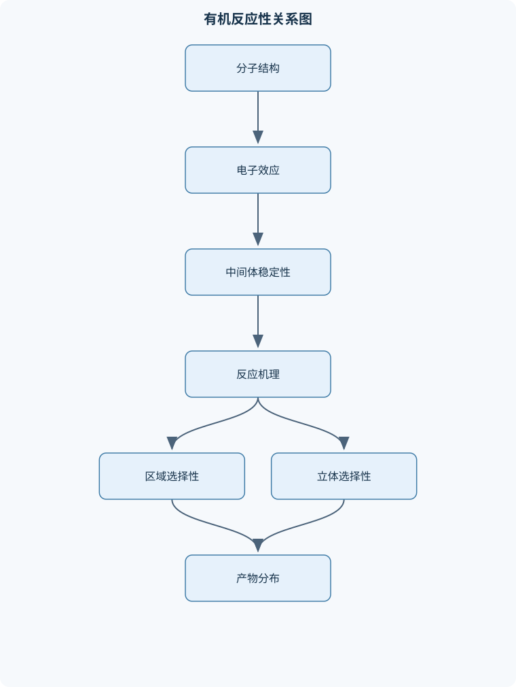
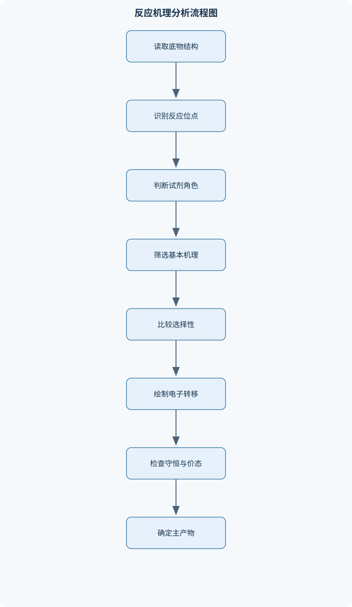

# 中级有机化学

## 一、课程整体知识框架

### 课程边界与先修知识

本课程系统讲授中级有机化学中“结构—反应性—机理—合成”之间的关系。内容边界包括共价键与分子轨道的进一步分析、共振与芳香性、立体化学、酸碱性与反应选择性、亲核取代与消除、烯烃和炔烃反应、芳香族亲电与亲核取代、醇醚和环氧化物、醛酮及羧酸衍生物反应、烯醇与烯醇负离子化学、重排、协同反应、自由基反应、基础有机合成设计以及聚合反应。先修知识包括普通有机化学中的构造异构与命名、Lewis结构、杂化轨道、官能团、基础酸碱理论、烯烃加成、卤代烃反应、羰基反应和基本谱学识别。课程重点不是背诵试剂清单，而是根据底物结构、试剂性质、溶剂、温度和立体约束，判断主导机理、区域选择性、立体选择性和可能的副反应。理想机理模型通常假定反应物充分混合、关键中间体可形成且不存在复杂传质限制；实际反应还可能受水分、杂质、浓度、热效应、光照和底物纯度影响。





### 1. 课程主线：从结构到反应，再到合成

中级有机化学围绕“结构—反应性—机理—选择性—合成”展开。结构决定电子分布、空间拥挤程度、键的极化方式和可能形成的中间体；这些因素共同影响反应速率、反应方向、区域选择性、立体选择性以及副反应类型。分析一个反应时，不能只根据试剂名称套用反应式，而应依次回答以下问题：

1. 底物中哪些官能团可能反应，哪些官能团在当前条件下基本保持不变；
2. 试剂是亲核试剂、亲电试剂、酸、碱、氧化剂、还原剂还是自由基源；
3. 反应是协同过程，还是先生成碳正离子、碳负离子、自由基或四面体中间体；
4. 新键在哪里形成，旧键在哪里断裂，电子对从何处移向何处；
5. 区域和立体选择性由何种中间体稳定性、构象要求或过渡态几何关系决定；
6. 是否存在重排、过度反应、竞争消除、聚合或官能团不兼容。

统一记号中，$Nu:$表示带孤对电子或负电荷的亲核试剂，$E^+$表示缺电子的亲电中心，$LG$表示离去基团，$R$、$R'$、$R''$表示由结构上下文确定的有机取代基。弯箭必须从电子对供体指向电子对受体，例如从$Nu:$的孤对电子指向带$\delta^+$的碳；不能从正电荷本身或没有电子来源的原子直接画箭头。$\delta^+$和$\delta^-$是部分电荷，不等同于形式电荷。

有机反应可统一分为加成、消除、取代和重排。加成使两个片段结合并消耗$\pi$键；消除从相邻原子移去两个片段并形成$\pi$键；取代以一个基团取代另一个基团；重排则改变骨架连接关系，通常伴随键迁移。实际反应可能同时具有多种特征，例如羰基缩合包含亲核加成、质子转移和消除，羟醛缩合则进一步形成新的碳—碳键。

### 2. 结构、共振与反应性基础

Lewis结构首先要求满足原子价态、总电子数和形式电荷守恒。某原子的形式电荷可按下式计算：

$$
\text{形式电荷}=\text{价电子数}-\left(\text{孤立电子数}+\frac{1}{2}\text{成键电子数}\right)
$$

该式适用于常见主族元素的Lewis结构判断，电子数以一个结构式中的总价电子数为准。形式电荷不是实际电荷密度的完整描述，但可用于筛选合理结构。

共振式只能改变电子位置，不能改变原子连接关系、氢原子位置或$\sigma$键骨架。真实分子是共振杂化体，并不在各共振式之间来回转化。合理共振式通常同时满足八隅体、较少的电荷分离以及负电荷位于较电负性原子上。共振贡献较大的结构不一定是形式电荷全为零的结构；若某结构能使负电荷在多个原子或较大$\pi$体系中离域，其稳定化可能更显著。

诱导效应沿$\sigma$键传递，并随距离增加而减弱；场效应则通过空间而非连续键传递。超共轭是相邻$\sigma$键或孤对电子与空轨道、$\pi$轨道相互作用的结果，可解释较取代碳正离子的稳定性。碳正离子通常受超共轭和给电子诱导效应稳定；碳负离子则常因吸电子基、共振离域、芳香性或较高$s$成分而稳定。相同周期内，碳原子的$s$成分越高，负电荷越靠近原子核，通常越稳定，故末端炔烃的$\ce{C-H}$酸性强于烯烃和烷烃。

酸碱性可用共轭碱稳定性比较。定义为

$$
\mathrm{p}K_a=-\log_{10}K_a
$$

在同一溶剂和相近温度下，$\mathrm{p}K_a$越小，酸越强；不同溶剂、温度或测量体系中的数值不能机械比较。溶剂化、氢键、离子对和介质极性会改变酸碱性与亲核性。碱性主要表示夺取质子的热力学倾向，亲核性表示进攻亲电中心的动力学倾向，两者不等价；强碱可能因位阻很大而不是有效亲核试剂。

### 3. 芳香性与反应类型的统一判断

芳香体系必须同时满足环状、近似平面、连续共轭以及符合$4n+2$个$\pi$电子的条件，其中$n$为非负整数。$4n$个$\pi$电子的平面完全共轭环通常具有反芳香性，若体系可以扭曲或变为非平面，则可能通过破坏连续共轭来避免反芳香性。仅有共轭或存在多个双键并不足以判定芳香性。

芳香性带来额外稳定化，因此苯环通常优先进行取代而非加成。芳香族亲电取代中，苯环进攻$E^+$形成$\sigma$络合物，随后脱去质子恢复芳香性。给电子基使环活化并通常邻、对位定位；卤素虽可通过共振给电子而邻、对位定位，却因诱导吸电子使总体反应速率下降；强吸电子基通常使环钝化并间位定位。多取代苯的判断需综合已有取代基的导向、相互作用和位阻，不能只机械叠加单一规则。

芳香族亲核取代则要求芳环具有足够的电子缺陷。若离去基团所在碳的邻位或对位有硝基等强吸电子基，亲核试剂加成后形成的负电荷可被离域，从而有利于加成—消除机制。没有这种稳定化时，强碱可能先夺取邻位氢形成苯炔，再由亲核试剂加成；苯炔路径常导致区域选择性复杂。芳香族卤化物不能简单按普通一级卤代烃进行$SN2$判断。

### 4. 立体化学与构象

构型是分子中原子空间排列的拓扑信息，构象是单键旋转或环翻转造成的不同空间形态。构型改变通常需要断键或经历特定反应过程，构象改变不必断裂共价键。手性中心的$R/S$标定先按原子序数及同位素质量确定优先级，再将最低优先级基团背向观察者，根据其余三个基团的旋转方向判断。对映体互为不可重叠镜像；非对映体不是镜像关系；含有内部对称面的分子可能是内消旋体。

烯烃的$E/Z$构型依据双键两端各自的优先级比较，而不是简单比较基团大小。环状化合物的顺反关系描述取代基相对于环面的同侧或异侧，与环翻转造成的轴向、赤道向变化不同。环己烷中较大取代基通常偏好赤道向，以减少轴向相互作用；但顺反关系在翻转时保持不变。

$SN2$是背面进攻的一步协同过程，因此通常导致反转；$SN1$先形成近似平面的碳正离子，亲核试剂可从两面进攻，因而可能出现消旋，但离子对、溶剂笼和邻基参与会使消旋不完全。$E2$要求被夺取的$\beta$氢与$LG$反式共平面；开链底物可通过构象变化满足要求，而环己烷通常要求二者均为轴向。加成反应的顺式或反式结果必须从具体机理判断，不能由“加成”二字直接决定。

### 5. 取代、消除与反应选择性

$SN2$速率通常表示为

$$
v=k[\mathrm{RX}][\mathrm{Nu:}]
$$

它是双分子过程，速率同时受底物和亲核试剂浓度影响。甲基和一级底物通常有利，三级底物因背面位阻大而几乎不能发生普通$SN2$。极性质子溶剂会强烈溶剂化阴离子亲核试剂，可能降低其有效亲核性；极性非质子溶剂常能增强阴离子亲核性。$SN1$速率决定步骤是离去基团离去：

$$
v=k[\mathrm{RX}]
$$

底物浓度是主要动力学变量，碳正离子稳定性和溶剂对离子化的促进作用十分重要。三级、烯丙基和苄基底物可能有利于$SN1$，但强碱、高温时消除会增强。

$E2$是碱夺取$\beta$氢、$LG$离去和$\pi$键形成同时发生的协同过程。小而强的碱常倾向形成扎伊采夫烯烃，即取代程度较高、通常热力学更稳定的烯烃；大体积碱、季铵盐离去体系或构象限制可能提高霍夫曼产物比例。$E1$经过碳正离子，可能重排，并通常与$SN1$竞争。温度升高常有利于消除，但不能脱离底物、溶剂和碱的性质单独判断。

### 6. 烯烃、炔烃、自由基和氧硫化学

烯烃的$\pi$键富电子，能够进攻亲电试剂。酸催化水合通常经较稳定碳正离子，可能发生重排并给出马氏加成；氧汞化—还原则通常避免自由碳正离子重排；氢硼化—氧化给出反马氏醇，并具有协同、通常顺式加成特征。卤素加成经卤鎓离子，常表现为反式加成；卤素水加成时水分子进攻更取代的卤鎓离子位置，生成卤代醇。

烯烃环氧化是协同氧原子转移，原烯烃的几何关系被保留；环氧化物开环却受酸碱条件影响。酸催化时亲核试剂通常进攻较取代碳，碱催化时因$SN2$特征通常进攻较少取代碳，均伴随进攻中心反转。炔烃可发生加成、部分还原或完全还原，产物立体化学取决于催化体系和反应终止条件。

自由基反应包括引发、增长和终止。自由基稳定性常受共振、超共轭和取代程度影响，烯丙位、苄位键较易发生氢抽取。过氧化物条件下卤化氢的反常加成具有明确边界，主要适用于能够进行链反应传播的特定体系，不能推广到所有卤化氢或所有烯烃。

醇可被质子化、转化为卤代物或磺酸酯后离去；直接把$OH$视为优良离去基通常错误。醚在强酸条件下可发生断裂，环氧化物开环遵循区域选择性和立体反转规则。硫醇和硫醚的硫原子可极化性较高，常具有较强亲核性；含硫化合物的氧化还原需结合硫的价态和其他官能团兼容性判断。

### 7. 羰基、羧酸衍生物与烯醇负离子

羰基因氧的电负性和$\pi$键极化而使碳带$\delta^+$，因此成为亲核加成中心。氧被质子化或被Lewis酸配位后，羰基极化增强，通常提高碳的亲电性；但酸也可能使亲核试剂被质子化，故反应速率取决于整个催化循环。醛比酮通常更易发生亲核加成，因为位阻较小且烷基给电子效应较弱。

羰基可与水形成水合物，与醇形成缩醛，与氨及其衍生物形成亚胺，与二级胺形成烯胺；这些过程通常包含亲核进攻、质子转移、脱水和催化剂再生。Wittig反应及相关烯化反应将羰基氧替换为碳—碳双键。醛酮还可发生氧化、还原、Baeyer–Villiger氧化和Cannizzaro反应。无$\alpha$氢的醛在强碱条件下可能发生Cannizzaro反应，一个分子被氧化为羧酸盐，另一个被还原为醇；有$\alpha$氢时常优先考虑羟醛过程。

羧酸衍生物的亲核酰基取代遵循“亲核加成—四面体中间体—离去基团消除—羰基恢复”的共同模式。通常反应性近似为酰卤$>$酸酐$>$酯$>$酰胺，原因是离去基团稳定性和羰基共振供电子程度不同。酰胺氮参与共振，使羰基反应性降低，且氮的碱性也减弱。羧酸的酸性来源于羧酸根的共振稳定化；脱羧能否发生取决于形成的负离子、过渡态或中间体是否得到共振稳定。

$\alpha$氢的酸性来自烯醇或烯醇负离子的稳定化。烯醇是中性互变异构体，烯醇负离子是带负电荷的高反应性物种，二者不能混同。动力学烯醇负离子通常由强而位阻较大的碱在低温、不可逆条件下优先夺取较少位阻一侧的$\alpha$氢；热力学烯醇负离子则在可逆、较高温度条件下趋向更稳定、取代程度更高的双键。烯醇负离子既可在氧上反应，也可在$\alpha$碳上反应；烷基化、羟醛反应、Claisen缩合、丙二酸酯合成、乙酰乙酸乙酯合成和Michael加成均依赖这一性质。

### 8. 重排、协同反应、合成与聚合

碳正离子重排常通过邻位氢或烷基的$1,2$迁移，使正电荷转移到更稳定位置。频哪醇重排涉及脱水、迁移和羰基形成；Beckmann重排中迁移基团与离去基团的空间关系决定迁移方向；Baeyer–Villiger氧化中迁移能力和羰基邻近取代基共同决定选择性。重排不应被理解为游离碳正离子随机移动，许多过程可能是近协同的，并受几何约束控制。

Diels–Alder反应是六电子协同过程，二烯必须能够采取$s$-cis构象，同时形成两个$\sigma$键并消耗一个$\pi$键。电子给体取代二烯、电子受体取代亲二烯体通常有利于反应；立体信息可从反应物传递到产物。电环化反应也具有协同特征，其旋转方式受电子数和热、光条件控制。

逆合成分析从目标分子出发，识别关键官能团和碳骨架，选择可逆的断键方式，再将合成子转换为现实试剂。保护基只在官能团兼容性确实需要时使用，并须考虑引入、反应稳定性和脱除条件。官能团互换不能只看目标官能团名称，还要检查氧化态、区域选择性、立体化学和副反应。

自由基链增长聚合包括引发、链增长和终止；阳离子聚合通常要求单体取代基稳定链端碳正离子，阴离子聚合则偏好能稳定链端负离子的吸电子取代基。逐步聚合不依赖单一活性链端，双官能或多官能单体通过逐步缩合或加成形成聚合物。重复单元数记为$n$，但平均链长、分子量分布和立构规整性不能仅由重复单元结构唯一确定。

## 二、章节和模块划分

### 核心知识覆盖清单

本清单用于检查正文是否覆盖本课程的主要知识模块：

- **结构、共振与反应性基础**：Lewis结构与形式电荷的计算、共振式的书写规则与加权、共振杂化体与真实结构、诱导效应和场效应、超共轭与碳正离子稳定性、杂化状态对酸性的影响、亲核试剂与亲电试剂判定、离去基团能力与键极化、芳香性与反芳香性判断、反应类型的统一分类。
- **立体化学与构象分析**：手性中心与R/S构型、对映体、非对映体与内消旋体、构型与构象的区别、环己烷椅式构象、轴向和赤道向取代基、烯烃E/Z构型、加成反应的面选择性、环状体系的顺反关系、立体专一性与立体选择性、反应机理与立体化学关联。
- **酸碱性、反应能量与选择性**：Brønsted酸碱定义、共轭酸碱对与pKa比较、溶剂化对酸碱性的影响、热力学酸度与动力学碱性、反应坐标图与过渡态、动力学控制与热力学控制、取代基电子效应排序、中间体稳定性比较、区域选择性来源、化学选择性与官能团兼容性。
- **亲核取代与消除反应**：SN2协同取代机理、SN1分步取代机理、E2协同消除机理、E1分步消除机理、底物结构对SN1和SN2的影响、碱性与亲核性的区别、溶剂对取代消除的影响、反式共平面与E2立体要求、扎伊采夫与霍夫曼产物、卤代烃和磺酸酯的离去基团比较。
- **烯烃、炔烃与自由基反应**：烯烃亲电加成、卤化氢加成与区域选择性、酸催化水合与氧汞化还原、硼氢化氧化、卤素和卤素水加成、环氧化与环氧化物开环、炔烃加成和还原、自由基卤化与链反应、烯丙位和苄位反应、过氧化物条件下的反常加成边界。
- **芳香族化学**：芳香性判据与Hückel规则、苯环亲电取代通用机理、卤化、硝化、磺化和傅里德尔反应、活化基与钝化基、邻对位和间位定位效应、多取代苯的定位综合判断、芳香族亲核加成消除、苯炔机理及其条件、芳香族亲核取代的加成消除与SN1机制、芳香环氧化还原和侧链反应。
- **醇、醚、环氧化物与含硫化合物**：醇的酸碱性与离去基团转化、醇的卤化和磺酰化、醇的脱水与重排、醚的制备和断裂、环氧化物的酸催化开环、环氧化物的碱催化开环、硫醇、硫醚和二硫键、硫试剂的亲核性特点、醚和环氧化物的区域选择性、氧化还原条件的官能团兼容性。
- **醛酮与羰基化学**：羰基极化和亲核加成、醛酮的水合与缩醛形成、氰醇形成、亚胺和烯胺形成、Wittig和相关烯化反应、醛酮的氧化与还原、Baeyer-Villiger氧化、Cannizzaro反应、羰基化合物的酸碱催化、羰基反应中的立体与区域选择性。
- **羧酸及其衍生物**：羧酸酸性与共振稳定化、酰卤、酸酐、酯和酰胺的结构、亲核酰基取代通用机理、羧酸衍生物反应性排序、酯化与酯水解、酰胺形成与氮的共轭、酰卤和酸酐的选择性转化、羧酸衍生物的还原、脱羧反应与稳定中间体、混合官能团底物的反应控制。
- **烯醇、烯醇负离子与碳负离子**：α氢酸性及其结构依据、烯醇互变异构、动力学与热力学烯醇负离子、烯醇负离子共振式、α位烷基化、羟醛加成与缩合、交叉羟醛反应、Claisen缩合、丙二酸酯与乙酰乙酸乙酯合成、Michael加成和共轭加成。
- **重排、协同反应与合成设计**：碳正离子1,2-氢迁移、碳正离子1,2-烷基迁移、频哪醇重排、Beckmann重排、Baeyer-Villiger迁移选择性、Diels-Alder反应、电环化反应的协同特征、重排反应的迁移能力、逆合成分析、保护基与官能团互换策略。
- **自由基、聚合与综合反应分析**：自由基的生成和稳定性、自由基链引发、增长和终止、烯丙基溴化、自由基加成的区域选择性、链增长聚合基本机理、阳离子聚合与给电子取代基、阴离子聚合与吸电子取代基、逐步聚合与缩聚概念、单体结构对聚合方式的影响、综合反应路线和产物鉴定。


### 1. 结构、共振与反应性基础模块

本模块先处理Lewis结构、形式电荷、共振、诱导效应、场效应、超共轭、芳香性以及亲核—亲电关系。核心训练是把“电子丰富处”与“电子缺乏处”对应起来：$Nu:$提供电子对，$E^+$接受电子对；羰基碳、质子化羰基碳、碳正离子和带正电杂原子常是亲电中心。离去基团能力不能只按原子大小判断，而应考察其离去后阴离子的稳定性、键极化和溶剂化。

### 2. 立体化学与构象分析模块

内容包括$R/S$、$E/Z$、对映体、非对映体、内消旋体、椅式构象、轴向与赤道向取代基、环状顺反关系，以及反应中的面选择性。重点是把三维结果追溯到机理：$SN2$产生反转，平面碳正离子可能导致两面进攻，环氧化物开环在被进攻碳处反转，E2受反式共平面限制。构型保持、构型反转和构象变化必须分别描述。

### 3. 酸碱性、能量与选择性模块

用共轭碱稳定性解释酸性，综合共振、诱导效应、原子大小、电负性、杂化状态、芳香性和溶剂化。反应坐标图中，过渡态是能量峰，中间体是局部低点；活化能决定动力学速率，产物相对稳定性影响热力学平衡。动力学控制偏向形成较快的产物，热力学控制偏向平衡条件下较稳定的产物。区域选择性、化学选择性和官能团兼容性必须在具体条件下判断。

### 4. 亲核取代与消除模块

比较$SN1$、$SN2$、$E1$、$E2$时，输入至少包括底物级数、是否为烯丙基或苄基、亲核试剂和碱的性质、溶剂、温度、$\beta$氢存在性以及构象。甲基底物通常优先$SN2$；一级底物多有利于$SN2$，但大碱和高温可促进$E2$；二级底物竞争最复杂；三级底物不能普通$SN2$，可在弱碱极性质子溶剂中发生$SN1/E1$，在强碱条件下则常发生$E2$。磺酸酯是将醇转化为良好离去基团的常用方式，但其反应中心碳构型不因磺酰化本身而反转。

### 5. 烯烃、炔烃与自由基反应模块

本模块按亲电加成、协同加成、卤鎓离子开环、炔烃还原和自由基链反应组织。比较酸催化水合、氧汞化还原、氢硼化氧化时，应分别说明区域选择性、重排可能性、立体特征和条件边界。过氧化物反常加成不可作为普遍规则。自由基卤化还需比较不同氢的抽取难易、自由基稳定性、选择性与过度卤化风险。

### 6. 芳香族化学模块

先判断芳香性，再区分芳香族亲电取代、芳香族亲核取代和苯炔途径。硝化、卤化、磺化和傅里德尔反应都可用“形成并稳定化$\sigma$络合物”的框架分析。多取代苯要同时考虑定位效应和空间位阻。芳环侧链反应与芳环本身反应不同；苄位自由基、苄基碳正离子和苄基阴离子均可因共振而稳定。

### 7. 醇、醚、环氧化物与含硫化合物模块

醇的反应包括酸碱反应、卤化、磺酰化、脱水、氧化和重排。醚的制备可通过醇盐与一级卤代物的$SN2$反应，但三级底物易消除；醚断裂依赖强酸和底物结构。环氧化物在酸催化和碱催化下的进攻位置不同。硫醇和硫醚的较高极化性使其亲核性常强于相应氧化合物，但实际表现仍受溶剂、质子化状态和位阻控制。

### 8. 醛酮及羧酸衍生物模块

醛酮重点是亲核加成、缩醛、氰醇、亚胺、烯胺、Wittig烯化、氧化还原、Baeyer–Villiger和Cannizzaro。羧酸衍生物重点是亲核酰基取代、酯化、水解、酰胺形成、还原和脱羧。分析羰基反应时必须区分“加成后不离去”和“加成后排出离去基团”两类过程。

### 9. 烯醇、烯醇负离子与碳负离子模块

先列出所有可能的$\alpha$位，再判断碱、溶剂、温度和可逆性。烯醇负离子可参与$\alpha$烷基化、羟醛加成与缩合、Claisen缩合、丙二酸酯和乙酰乙酸乙酯合成以及Michael加成。交叉羟醛反应中，两个底物均含$\alpha$氢时可能产生自缩合和多种交叉产物，通常需通过底物设计或加料顺序提高选择性。

### 10. 重排、协同反应与合成设计模块

重排题应先定位迁移基团、离去基团和正电荷可能位置，再检查迁移方向与几何关系。Diels–Alder反应要求二烯采取$s$-cis构象；不能仅因存在共轭二烯就断言反应发生。逆合成路线需反向断键、正向验证，逐步检查试剂可得性、官能团兼容性、保护基必要性和立体控制。

### 11. 自由基、聚合与综合分析模块

综合题要求把单个反应放入路线中判断。聚合分析先确定是链增长还是逐步聚合，再判断活性中心是自由基、阳离子还是阴离子。含给电子取代基的乙烯基单体通常有利于阳离子链端稳定；含吸电子取代基的单体通常有利于阴离子链端稳定，但溶剂、反离子、温度和杂质会改变实际结果。

### 12. 代表性产物预测流程

**输入：**底物结构、试剂、溶剂、温度、时间和可能的水分或光照条件。  
**输出：**主产物、主要副产物、关键机理、区域与立体结果。  
**过程：**

1. 圈出所有官能团及可能反应位点；
2. 将试剂分类为酸、碱、$Nu:$、$E^+$、氧化剂、还原剂或自由基源；
3. 筛选符合底物和条件的基本机理；
4. 比较区域选择性、立体选择性和中间体稳定性；
5. 检查重排、过度反应、聚合和官能团兼容性；
6. 逐条检查原子守恒、形式电荷、价态和催化剂再生。

该流程的终止条件是所有新形成和断裂的键均已说明，所有电子箭头都有明确电子来源和去向。它不适用于把芳香族卤化物、乙烯基卤化物或特殊重排底物简单套入普通$SN1/SN2$判断。

### 13. 机理审查伪代码

```text
语言：伪代码

函数 审查机理(反应物, 产物, 箭头步骤):
    检查每一步的原子数、氢数和总电荷是否守恒
    对于每一条电子箭头:
        若起点不是孤对电子或成键电子对:
            返回“错误：缺少电子来源”
        若终点不是缺电子原子、键或可接受电子的轨道:
            返回“错误：电子去向不合理”
    对于每一个中间体:
        检查碳、氮、氧、卤素的价态是否合理
        检查是否出现未解释的正负电荷
        检查是否需要质子转移而反应体系中没有酸碱来源
    若有催化剂:
        检查催化剂是否在末步再生
    若反应涉及立体中心:
        根据协同、分步或自由基机理检查反转、保持或消旋
    若全部检查通过:
        返回“机理在原子、电子、价态和立体化学上自洽”
```

该审查方法的关键不变量是原子守恒、电子守恒、总电荷守恒和合理价态。它不能代替实验事实：一个机理即使形式上自洽，也可能因能垒过高、传质受限、底物分解或竞争反应而不是实际主路径。

### 14. 代表性例题一：取代与消除竞争

#### 题干

比较乙基溴、异丙基溴和叔丁基溴在乙醇中与碘离子反应的主导机理，并说明升高温度或加入强碱后的变化。

#### 分析与逐步解答

乙醇是极性质子溶剂，能稳定离子，但也会溶剂化碘离子。乙基溴位阻小，背面进攻容易，主要发生$SN2$。异丙基溴可发生$SN2$，但位阻较大；在较高温度下$E2$竞争增强。叔丁基溴不能发生普通$SN2$，在乙醇中可经离子化形成三级碳正离子，发生$SN1/E1$；若加入强而体积较大的碱，$E2$会成为重要甚至主导路径。

#### 结果验证与变式

乙基溴的$SN2$产物应为乙基碘，碳中心若无其他手性因素则不讨论反转。叔丁基底物的消除产物是异丁烯。若把乙醇换成极性非质子溶剂，阴离子亲核性通常增强，一级底物的$SN2$更有利；若把碘离子换成大体积强碱，则消除比例上升。

### 15. 代表性例题二：不同水合反应

#### 题干

预测1-甲基环己烯分别经氢硼化—氧化、酸催化水合和溴素水反应的主要产物，并比较区域和立体结果。

#### 分析与逐步解答

氢硼化—氧化通过协同过程将硼加到较少取代的双键碳，氧化后形成反马氏醇，通常为顺式加成。酸催化水合先质子化双键，形成较稳定的三级碳正离子，水在该位置进攻，得到马氏醇；若存在更稳定重排可能，还需检查重排。溴素水先形成溴鎓离子，水从背面进攻较取代碳，形成溴醇，整体为反式加成。

#### 结果验证与变式

三种反应都消耗一个$\pi$键，但醇的位置和立体关系不同。若底物改为可能形成更稳定重排碳正离子的烯烃，酸催化水合需优先检查重排，而氢硼化—氧化通常避免自由碳正离子重排。若改用环氧化再开环，则必须按酸、碱条件分别判断进攻位置。

### 16. 代表性例题三：芳香族亲电取代

#### 题干

比较苯、甲苯、苯甲醚、氯苯和硝基苯的硝化反应速率及主要定位产物。

#### 分析与逐步解答

甲基通过超共轭和诱导给电子，使苯环活化并邻、对位定位。甲氧基的孤对电子可与环共振，给电子能力更强，因此明显活化并邻、对位定位。氯原子共振给电子，仍邻、对位定位，但诱导吸电子使反应速率低于苯。硝基强吸电子，使环显著钝化并间位定位。

#### 结果验证与变式

主要产物通常分别为邻、对位混合物，其中对位产物可能因位阻较小而占优势；硝基苯主要生成间位产物。若底物已有两个取代基，需比较两个导向效应并考虑位阻，不能简单选择“电子效应最强”的位置。

### 17. 代表性例题四：氰醇形成

#### 题干

解释苯甲醛与氰化物形成氰醇的机理，并讨论新手性中心。

#### 分析与逐步解答

第一步，$\ce{CN^-}$作为$Nu:$进攻羰基碳，羰基$\pi$电子移向氧，形成四面体烷氧负离子。第二步，烷氧负离子从氢氰酸或其他质子源获得质子，生成氰醇并再生氰离子。反应中羰基碳由平面变为四面体；若该碳连接四种不同基团，则形成手性中心。

#### 结果验证与变式

无手性催化环境时，两个进攻面通常产生一对对映体，产物可能为外消旋混合物。若羰基被强吸电子基活化，亲核加成可能加快；若氰离子被完全质子化或体系过酸，实际有效亲核试剂浓度会下降。氰醇形成属于羰基亲核加成，不是羧酸衍生物的亲核酰基取代。

### 18. 代表性例题五：羟醛缩合与Cannizzaro竞争

#### 题干

分析含$\alpha$氢醛的碱催化羟醛缩合，并说明苯甲醛在强碱中为何发生Cannizzaro反应。

#### 分析与逐步解答

含$\alpha$氢醛先被碱夺取质子，形成烯醇负离子。其碳端进攻另一分子羰基，形成新的碳—碳键；质子转移后得到$\beta$羟基羰基化合物，升温或适当条件下脱水形成$\alpha,\beta$-不饱和羰基化合物。若底物是苯甲醛，它没有$\alpha$氢，不能按通常方式生成烯醇负离子。强碱条件下，一个苯甲醛分子接受氢负离子等效转移而还原为苄醇，另一个被氧化为苯甲酸盐。

#### 结果验证与变式

羟醛反应必须检查$\alpha$氢是否存在；Cannizzaro反应必须检查羰基化合物是否缺少$\alpha$氢。若交叉反应的两个底物都含$\alpha$氢，可能出现自缩合和多种交叉产物；使用无$\alpha$氢醛作为亲电组分可改善选择性。

### 19. 实验或项目一：取代—消除条件比较

#### 输入数据与步骤

选取结构已知的一级、二级和三级卤代物各一类，设置含碘离子或其他亲核试剂的条件，以及含强碱、高温的条件。记录底物浓度、试剂浓度、溶剂、温度、反应时间和产物组成。用核磁共振、红外光谱或气相色谱等适当方法确认产物；实际检测方法应根据物质挥发性、稳定性和仪器条件选择。

#### 评价标准

评价主产物是否与底物位阻、试剂性质、溶剂和温度相符；是否出现构型反转、烯烃区域异构体或重排产物；物料平衡、峰归属和重复实验结果是否一致。不能仅以产率高低判定机理正确。

#### 排错方法

若一级底物出现大量消除，检查碱是否过强、温度是否过高；若三级底物被误判为$SN2$，检查是否忽略位阻；若产物峰复杂，检查水分、杂质、过量试剂和反应时间是否造成副反应。还应核对谱图是否能区分区域异构体，而不能只凭单一信号下结论。

### 20. 实验或项目二：羰基反应与机理验证

#### 输入数据与步骤

选择一个醛或酮，分别设计氰醇形成、缩醛形成或还原反应中的一种。记录羰基底物、催化剂、溶剂、温度、加料顺序和反应时间。反应后分离产物，使用红外光谱观察羰基峰变化，并结合核磁共振判断新形成的碳—碳键、缩醛碳或醇碳。

#### 评价标准

确认羰基是否按预期转化，催化剂是否在机理中再生，产物结构是否满足原子和电荷守恒；若形成手性中心，应说明是否得到对映体混合物或具有选择性的产物。评价还包括副产物比例、底物回收率和数据重复性。

#### 排错方法

若羰基反应速率过慢，检查羰基是否被位阻或共振钝化、亲核试剂是否被质子化、催化剂是否失活；若缩醛形成不完全，检查水是否未被移除；若谱图显示多个产物，需考虑水合、聚合、过度加成或底物自缩合，而不能直接将全部信号归为目标产物。

## 三、核心概念的详细解释

### 3.1 结构、共振与反应性的统一基础

有机反应的判断应从电子结构开始。Lewis结构的书写先确定总价电子数，再安排满足八隅体的成键电子和孤对电子，最后用形式电荷检查结构是否合理。形式电荷是电子记账工具，不等同于分子中的真实电荷密度。共振式之间只能移动$\pi$电子、孤对电子或带电电子对，不能改变原子连接关系、氢原子位置和$\sigma$键骨架；真实分子是共振杂化体，不是在不同共振式之间往返转化。

合理共振式的相对贡献通常由以下因素共同决定：尽量满足八隅体；形式电荷分离较少；负电荷优先位于电负性较大的原子；正电荷优先位于电负性较小的原子；负电荷能够在多个原子或较大$\pi$体系中离域。此规则存在边界：某些缺电子中心、芳香离子或超价结构不能机械套用普通八隅体判断，必须同时考虑轨道数目和整体电子数。

诱导效应沿$\sigma$键传递，距离增加后迅速减弱；场效应通过空间传递，不要求存在连续共价键。超共轭是相邻$\sigma$键与空轨道或$\pi$轨道的相互作用，能够稳定碳正离子、自由基和部分烯烃。碳正离子一般按三级、二级、一级顺序稳定，但苄基和烯丙基碳正离子因共振离域可显著稳定；乙烯基和芳基碳正离子不能简单按普通烷基规律处理。

亲核试剂$Nu:$提供电子对，亲电试剂$E^+$接受电子对。弯箭必须从孤对电子或成键电子对指向缺电子中心。羰基碳因$\ce{C=O}$键极化而带$\delta^+$，羰基氧带$\delta^-$；氧被质子化或被路易斯酸配位后，羰基进一步极化，通常增强碳的亲电性，但酸性条件也可能使亲核试剂被质子化，从而降低其有效浓度。因而“羰基被活化”不等于所有亲核反应都会加快。

### 3.2 芳香性、立体化学与构象

芳香体系通常必须满足环状、近似平面、连续共轭和$4n+2$个$\pi$电子四个条件，其中$n$为非负整数。满足$4n$个$\pi$电子且具有平面连续共轭的体系通常反芳香，往往通过弯曲、扭转或改变杂化状态避免反芳香性。芳香性是整体离域稳定化，不能只由某一个双键或局部共振式决定。

手性中心是与四个不同取代基相连的四面体原子，但分子是否手性还要考虑对称面、对称中心和内消旋结构。对映体是互为镜像且不可重叠的立体异构体；非对映体不是镜像关系。构型是原子空间连接的固定关系，构象是绕单键旋转可互相转化的排列，二者不能混同。改变构象不等于发生构型反转。

标定$R/S$时，先按原子序数确定四个取代基优先级；最低优先级基团背向观察者时，按$1\to2\to3$顺时针为$R$，逆时针为$S$。若最低优先级朝向观察者，应将结果反转。烯烃的$E/Z$标定分别比较双键两端的高优先级取代基；不能用“顺式”等几何描述代替所有$E/Z$判断。

环己烷椅式中，取代基有轴向和赤道向位置。较大的取代基通常偏好赤道向，以减小$1,3$-二轴相互作用。环翻转使轴向与赤道向互换，但不改变取代基之间的顺反构型。对双取代环己烷，是否存在稳定构象要同时检查两个取代基能否同时处于赤道向。E2消除还要求β氢与离去基团反式共平面；在环己烷中，二者通常必须同时轴向，故构象限制可能决定产物。

### 3.3 酸碱性、能量与选择性

Brønsted酸是给出质子的物质，Brønsted碱是接受质子的物质。酸强弱的直接依据是共轭碱稳定性：共轭碱越稳定，原酸越强。稳定化来源包括共振离域、诱导吸电子、较高$s$成分、芳香性、溶剂化和电荷分散。比较$\mathrm{p}K_a$时必须限定溶剂和温度；在同一溶剂及相近温度下，$\mathrm{p}K_a$越小，酸越强。

碱性是夺取质子的热力学倾向，亲核性是进攻亲电中心的动力学倾向。位阻大的碱可能具有较强碱性，却因接近反应中心困难而表现出较弱亲核性。溶剂也会改变二者：极性质子溶剂强烈溶剂化阴离子，常削弱其亲核性；极性非质子溶剂对阴离子的溶剂化较弱，常增强亲核反应速率。

反应坐标图中，过渡态对应能垒最高点，中间体对应局部能量最低点。动力学控制下，形成过渡态能垒较低的产物较快生成；热力学控制下，体系在可逆条件下趋向更稳定的产物。低温、短时间、不可逆条件常有利于动力学产物；较高温度、较长时间和可逆条件可能提高热力学产物比例，但不能脱离具体反应平衡判断。

### 3.4 亲核取代与消除

$SN2$为一步协同过程，$Nu:$从$C-LG$键相反一侧进攻，同时$C-LG$键断裂。反应速率近似为：

$$
v=k[\mathrm{R-LG}][\mathrm{Nu:}]
$$

该式说明底物和亲核试剂都参与速率决定步骤。甲基和一级底物通常有利于$SN2$，二级底物受条件影响，三级底物因背面进攻严重受阻，通常不发生普通$SN2$。反应结果是中心碳构型反转；若底物本身不是手性中心，不能仅凭“反转”推断产物一定手性。

$SN1$先离去形成碳正离子，再由亲核试剂进攻，速率近似为：

$$
v=k[\mathrm{R-LG}]
$$

极性质子溶剂可稳定离子化过程，三级、苄基和烯丙基底物更有利。平面碳正离子可能受到两面进攻，产生消旋或非完全消旋；若碳正离子足够稳定，还可能发生$1,2$-氢迁移或$1,2$-烷基迁移。一级底物通常不适合普通$SN1$，但烯丙基和苄基底物是重要例外。

$E2$也是一步协同过程：碱$B:$夺取β氢的同时，$C-LG$键断裂并形成$\pi$键。速率近似为：

$$
v=k[\mathrm{R-LG}][\mathrm{B:}]
$$

反应要求β氢和$LG$反式共平面。小而强的碱常给扎伊采夫产物，即较高取代烯烃；体积较大的碱、季铵盐消除或特殊构象条件可能使较低取代的霍夫曼产物占优。$E1$先生成碳正离子，再脱去β氢，常与$SN1$竞争，酸性、极性质子溶剂和升温通常增强消除比例。

卤素离去能力一般受键极化、阴离子稳定性和溶剂影响；磺酸酯是把羟基转化为良好离去基团的重要方式。不能把所有三级卤代物都判为$SN1$：强碱、高温和β氢存在时，$E2$可能占主导。

### 3.5 烯烃、炔烃与自由基反应

烯烃亲电加成通常先由$\pi$键进攻$E^+$，形成碳正离子或桥式离子，再由亲核试剂进攻。酸催化水合通常遵循较稳定碳正离子方向，可能发生重排；氧汞化还原避免游离碳正离子，通常给马氏水合且重排较少；氢硼化—氧化通常给反马氏醇，并具有同面加成特征。卤素与烯烃形成卤鎓离子，水从背面进攻，通常表现为反式加成。

过氧酸环氧化是协同氧转移过程，烯烃原有几何关系被保留。环氧化物在碱性条件下由亲核试剂从位阻较小的碳进攻；酸性条件下环氧氧先质子化，亲核试剂往往进攻较取代碳，因为过渡态中正电荷特征使该位置更易接受进攻。二者不能只靠“酸开环、碱开环”记忆，还要同时分析位阻和电子效应。

炔烃可发生加成、部分还原或完全还原。末端炔氢酸性强于烯烃和烷烃，原因是负电荷位于$s$成分较高的碳上。自由基反应包括引发、增长和终止；自由基稳定性通常受共振、超共轭和取代程度影响。烯丙位和苄位反应具有共振稳定化。过氧化物引起的卤化氢反常加成只在适合自由基链过程的特定体系中成立，不能推广到所有烯烃和所有卤化氢。

### 3.6 芳香族反应

芳香族亲电取代先生成亲电试剂$E^+$，苯环进攻形成失去芳香性的$\sigma$络合物，再脱去质子恢复芳香性。硝化、磺化、卤化和傅里德尔—克拉夫茨反应都可用这一框架分析。给电子基通常活化芳环并导向邻、对位；硝基、羰基、氰基等吸电子基通常钝化芳环并导向间位。卤素通过共振给电子而邻、对位定位，却通过诱导吸电子使芳环整体钝化。

芳香族亲核取代的加成—消除机制要求芳环电子缺陷，尤其是离去基团邻位或对位存在硝基等强吸电子基。$Nu:$先加成形成负电荷离域的中间体，再排出$LG$恢复芳香性。若缺少电子吸引基，强碱可能通过苯炔机制反应，此时通常需要邻位氢，区域选择性可能产生异构体混合物。芳基卤化物不能按普通烷基卤化物直接套用$SN1/SN2$。

### 3.7 醇、醚、羰基和羧酸衍生物

醇羟基本身是较差离去基团，可通过质子化、卤化或磺酰化转变为良好离去基团。二级、三级醇在酸性脱水中可能发生$E1$和重排；一级醇较常通过协同消除或其他条件脱水。醚可由醇盐与一级卤代物进行$SN2$制备，也可在强酸条件下断裂。硫醇和硫醚中的硫较易极化，硫醇盐常是强亲核试剂；二硫键可通过氧化还原互相转化。

醛酮羰基反应的核心是亲核加成：$Nu:$进攻羰基碳，$\pi$电子移向氧，再经质子转移形成产物。醛通常比酮更易加成，原因是位阻较小且烷基给电子效应较弱。水合、氰醇、亚胺、烯胺和缩醛形成都需根据酸碱催化循环分析。Wittig类反应将羰基转化为烯烃；氧化和还原条件则必须同时检查其他官能团的兼容性。无α氢醛在强碱中可发生Cannizzaro反应，一个分子被氧化为羧酸盐，另一个被还原为醇；有α氢时常优先发生羟醛反应。

羧酸衍生物经历亲核酰基取代：亲核进攻形成四面体中间体，随后离去基团离去并恢复羰基。常见反应性大小规律为酰卤$>$酸酐$>$酯$\approx$羧酸$>$酰胺，具体排序会受质子化、溶剂和取代基影响。酰胺反应性低，主要因为氮孤对电子与羰基共轭。酯化和水解是可逆过程；酰卤、酸酐可较容易转化为酯、酰胺或羧酸。脱羧通常要求形成稳定的负离子或经过易裂解的中间体，如β-羰基羧酸体系。

### 3.8 烯醇负离子、重排、协同反应与聚合

羰基化合物的α氢因共轭碱可由羰基稳定而具有较高酸性。烯醇是中性互变异构体，烯醇负离子是带负电荷的物种，二者不是同一概念。烯醇负离子可通过碳端或氧端反应；强而位阻较大的碱常在低温、不可逆条件下优先生成动力学烯醇负离子，较弱碱、较高温度和可逆条件可能有利于热力学烯醇负离子。羟醛加成先形成新的碳—碳键，随后可脱水生成$\alpha,\beta$-不饱和羰基；交叉羟醛和Claisen缩合必须控制哪一个底物生成烯醇负离子，否则容易出现自缩合和混合物。丙二酸酯、乙酰乙酸乙酯合成利用活泼亚甲基的烷基化和后续水解脱羧。

重排通常通过迁移键与缺电子中心之间的协同或近协同过程进行。碳正离子可发生$1,2$-氢迁移和$1,2$-烷基迁移；频哪醇重排由质子化、脱水、迁移和羰基形成组成。Beckmann重排中，迁移基团必须与离去基团具有适当反式几何关系。Baeyer–Villiger氧化中，迁移能力、羰基取代和电子效应共同决定迁移方向，不能只按烷基级别机械判断。

Diels–Alder反应要求二烯采取$s$-顺构象，通过六电子协同过程同时形成两个$\sigma$键和一个$\pi$键；给电子二烯、吸电子亲二烯体通常加快反应，并可产生内向选择性。电环化反应的成旋和对旋方式由电子数和热条件决定。逆合成分析从目标分子中的关键键、官能团和立体中心出发，选择可正向实现的断键；保护基只有在选择性确有必要且脱保护条件可兼容时才使用。

链增长聚合通过活性链端不断加成乙烯基单体，活性中心可以是自由基、碳正离子或碳负离子。给电子取代基通常有利于稳定阳离子链端，吸电子取代基通常有利于稳定阴离子链端；自由基聚合适用范围更广，但单体、溶剂、温度和链转移均会影响分子量。逐步聚合由双官能或多官能单体逐步反应，分子量、凝胶化和官能团当量比取决于转化率和计量平衡，不能只由重复单元结构推断。

## 四、重要定义、公式、定理和推导

### 专业审校补充：关键定义与适用边界

Curtin–Hammett原理用于分析可快速相互转化的构象或异构体所产生的竞争产物。若两种反应物构象A和B之间的互变速率远高于各自生成产物的速率，且产物形成后不再相互转化，则产物比例主要由两个过渡态的相对自由能决定，而不是简单由反应前A、B的平衡比例决定。数学上，产物速率比可近似写为$v_A/v_B\approx k_A/k_B$，而$k$受过渡态自由能差控制。该原理适用于构象选择、Diels–Alder反应的$s$-cis/$s$-trans平衡及部分烯醇化反应，但不适用于构象互变很慢、产物可逆、存在明显扩散或传质限制的体系。若互变速率与成产物速率同量级，必须采用完整动力学模型，不能直接套用Curtin–Hammett结论。还应区分构象比例与过渡态稳定性：少量构象也可能因过渡态较低而生成较多产物。


### 4.1 电子、酸碱和动力学公式

形式电荷为：

$$
\mathrm{FC}=V-\left(N+\frac{B}{2}\right)
$$

其中$V$为中性原子的价电子数，$N$为该原子的非键合电子数，$B$为参与成键的电子总数。该式用于Lewis结构的电子记账，必须与全分子总价电子数和总电荷一致。

酸度定义为：

$$
K_a=\frac{[\ce{H3O+}][\ce{A^-}]}{[\ce{HA}]},
\qquad
\mathrm{p}K_a=-\log_{10}K_a
$$

浓度应采用同一标准状态下的活度近似；在稀溶液中常用无量纲浓度比近似。由定义可知，在同一条件下，$K_a$增大意味着解离平衡更偏向右侧，$\mathrm{p}K_a$减小，酸性增强。若溶剂、温度或离子强度改变，不能直接比较不同来源的$\mathrm{p}K_a$。

一级反应的速率方程为：

$$
v=k[\mathrm{R-LG}]
$$

二级反应的速率方程为：

$$
v=k[\mathrm{R-LG}][\mathrm{Nu:}]
$$

其中$v$为反应速率，$k$为速率常数，浓度单位通常为$\mathrm{mol\,L^{-1}}$。一级和二级只表示实验速率方程的总级数，不直接等于机理步骤数；例如某些复杂反应可能因预平衡或溶剂参与而出现不同表观级数。

### 4.2 取代、消除和选择性判定流程

可将$SN1/SN2/E1/E2$判断写成如下伪代码：

```text
输入：底物 R-LG，试剂，溶剂，温度，是否存在 β-H
输出：主导机理、主要产物、立体结果

1. 若底物为芳基卤化物或乙烯基卤化物：
       不直接套用普通烷基 SN1/SN2，转入芳香族取代或特殊机理分析。
2. 判断底物类型：甲基、一级、二级、三级、苄基或烯丙基。
3. 判断试剂：
       强而位阻小的 Nu: → 有利 SN2；
       强而位阻大的 B: → 有利 E2；
       弱 Nu:、极性质子溶剂、可稳定碳正离子 → 考虑 SN1/E1。
4. 若底物有 β-H 且温度较高：
       提高 E1 或 E2 的优先级。
5. 若考虑 SN2：
       检查背面进攻位阻，并预测构型反转。
6. 若考虑 E2：
       检查 β-H 与 LG 是否反式共平面，并比较扎伊采夫、霍夫曼产物。
7. 若考虑 SN1/E1：
       先画碳正离子，检查重排、两面进攻和消除竞争。
8. 检查原子守恒、价态、形式电荷及官能团兼容性。
```

该流程的边界是：不能忽略特殊重排、邻基参与、桥环结构、芳香体系和溶剂特异性；“三级必SN1、一级必SN2”都不是无条件定律。

### 4.3 羰基和烯醇负离子推导

羰基亲核加成的电子步骤为：

1. $Nu:$的孤对电子指向羰基碳；
2. $\ce{C=O}$的$\pi$电子移向氧；
3. 形成四面体烷氧负离子或其质子化形式；
4. 通过质子转移稳定产物或再生催化剂。

若反应物是羧酸衍生物，还需继续发生四面体中间体塌陷，使$LG$离去并重新形成羰基；因此它不是单纯的羰基加成，而是亲核酰基取代。

烯醇负离子形成可表示为：

$$
\ce{RCOCH2R' + B^- <=> RCOCHR'^- + HB}
$$

实际负电荷在碳端和氧端离域：

$$
\ce{R-C(=O)-C^-R' <=> R-C(-O^-)=CR'}
$$

碳负离子稳定性来自共振离域和吸电子效应。若随后与一级卤代物反应，碳端可进攻$C-LG$并发生$SN2$，形成α-烷基化产物；三级卤代物通常不适合这一过程，往往发生消除或其他副反应。

### 4.4 代表性例题

#### 例题一：比较三类卤代物的主导机理

**题干：**比较乙基溴、异丙基溴和叔丁基溴在乙醇中与碘离子反应的主要机理，并说明升温后的变化。

**分析：**乙醇是极性质子溶剂，可稳定离子化，但也会溶剂化碘离子。乙基溴位阻小，背面进攻容易，$SN2$占优；异丙基溴可发生$SN2$，但位阻增加，升温会增强$E2$竞争；叔丁基溴不能进行普通$SN2$，在乙醇中可经$SN1$，升温时$E1$比例增加。

**逐步解答：**乙基溴中碘离子从背面进攻，形成乙基碘并反转反应中心构型。异丙基溴的$SN2$过渡态位阻更大，若碘离子有效亲核性降低，反应速率下降；存在β氢时可生成丙烯。叔丁基溴先失去溴离子形成三级碳正离子，随后被碘离子捕获或失去β氢形成2-甲基丙烯。

**结果验证：**主导机理必须与底物级别、溶剂、试剂和温度一致；叔丁基溴不能写成普通$SN2$。变式是将碘离子换成体积较大的强碱，此时异丙基和叔丁基底物的消除倾向明显增强。

#### 例题二：比较三种烯烃水合

**题干：**分析1-甲基环己烯分别进行酸催化水合、氧汞化还原和氢硼化—氧化时的区域与立体结果。

**分析：**酸催化水合先形成较稳定碳正离子，存在重排可能；氧汞化通过桥式汞离子避免游离碳正离子，通常给马氏醇；氢硼化从位阻较小一侧同面加成，氧化后给反马氏醇。

**逐步解答：**酸催化条件下，质子加到双键上，使较取代碳形成碳正离子，水进攻后去质子化。氧汞化中，双键与汞试剂形成桥式中间体，水从较取代碳进攻，随后还原脱汞。氢硼化中，硼从较少取代一端加成，氢从同一面加成；氧化将碳—硼键替换为碳—氧键。

**结果验证：**分别检查马氏或反马氏区域选择性、是否经过游离碳正离子、是否允许重排及同面或反面特征。变式是加入溴素水，此时形成卤鎓离子并得到反式卤代醇，而不是普通水合产物。

#### 例题三：对氯硝基苯与氢氧根

**题干：**解释对氯硝基苯与$\ce{OH^-}$反应的加成—消除机制。

**分析：**硝基位于离去基团的对位，可通过共振稳定亲核加成后形成的负电荷。氯离去后芳香性恢复。

**逐步解答：**$\ce{OH^-}$进攻与氯相连的芳环碳，芳环暂时失去芳香性，负电荷在环上离域并可延伸到硝基氧上。随后氯离去，重新形成芳香$\pi$体系，得到对硝基苯酚。该过程不是普通$SN2$，因为亲核试剂没有从芳基碳背面进行一步协同置换。

**结果验证：**若硝基改到间位，中间体负电荷不能以同样方式离域到硝基上，反应通常明显变慢。若芳环没有强吸电子基，则应考虑苯炔机制或反应难以进行。

#### 例题四：醛形成氰醇

**题干：**写出苯甲醛与氰离子形成氰醇的机理，并说明手性问题。

**分析：**氰离子是亲核试剂，羰基碳是亲电中心。加成后形成烷氧负离子，再从氢氰酸或其他质子源获得质子。

**逐步解答：**第一步为$\ce{CN^-}$进攻羰基碳，$\ce{C=O}$电子移向氧；第二步烷氧负离子夺取质子，形成含$\ce{OH}$和$\ce{CN}$的氰醇；生成的氰醇可再释放氰离子，完成催化循环。原羰基碳变为连接四个不同基团的手性中心，若底物和环境无手性诱导，通常形成对映体混合物。

**结果验证：**必须检查氰原子来源、氧的质子化和催化剂再生。若羰基受到强位阻或氰离子大量被质子化，反应速率会降低。

#### 例题五：羟醛缩合

**题干：**分析两个含α氢醛分子在碱性条件下发生羟醛缩合的步骤，并指出副反应。

**分析：**碱先夺取α氢生成烯醇负离子，烯醇负离子进攻另一分子醛，形成新的碳—碳键；所得β-羟基羰基化合物在适当条件下脱水，形成共轭烯酮。

**逐步解答：**烯醇负离子的碳端进攻另一羰基碳，羰基氧转为烷氧负离子；质子化得到β-羟基醛。再次生成烯醇负离子后，经过消除失水，形成$\alpha,\beta$-不饱和醛。若两种底物均能生成烯醇负离子，可能发生两种自缩合和多种交叉缩合，因此需利用底物设计、加入顺序或预先生成单一烯醇负离子控制选择性。

**结果验证：**新形成的碳—碳键必须连接原α碳与另一羰基碳；脱水后双键应位于羰基的α、β位置。没有α氢的醛不能按此流程生成烯醇负离子，强碱下可能改走Cannizzaro反应。

### 4.5 综合反应分析与实验项目

#### 项目一：取代—消除竞争的条件评价

**输入数据：**选取一个一级、一个二级和一个三级卤代物，分别使用小位阻亲核试剂和大位阻强碱；记录溶剂、温度、反应时间及β氢是否存在。

**步骤：**先预测$SN2$、$SN1$、$E2$和$E1$比例，再在相同浓度下改变温度或碱的位阻，分离产物并用气相色谱、核磁共振或其他适当方法比较区域异构体。

**评价标准：**产物分布是否与底物位阻、溶剂和温度一致；是否出现构型反转、扎伊采夫或霍夫曼产物；原子守恒和峰归属是否自洽。不能只以总产率评价机理。

**排错方法：**若一级底物大量消除，检查碱强度和温度；若三级底物写成$SN2$，检查背面进攻是否空间可行；若异构体比例异常，检查水分、杂质、反应时间和分析方法的分离能力。

#### 项目二：羰基加成和缩合的机理验证

**输入数据：**选择醛或酮，设计氰醇形成、缩醛形成或羟醛缩合中的一种；记录羰基底物、催化剂、溶剂、温度、加料顺序和反应时间。

**步骤：**先标出羰基碳和可能的亲核试剂，逐步绘制亲核进攻、四面体中间体、质子转移及催化剂再生；反应后用红外光谱观察羰基峰变化，并结合核磁共振确认新键和区域结构。

**评价标准：**羰基是否按预期转化，产物是否满足原子守恒、形式电荷和价态要求；若形成手性中心，应说明对映体组成；若发生缩合，还要检查水或其他小分子是否按机理移除。

**排错方法：**反应慢时检查亲核试剂是否被质子化、羰基是否位阻过大或催化剂是否失活；缩醛不完全时检查水是否未被移除；出现多峰时考虑水合、自缩合、聚合和过度反应，不能将所有信号直接归为目标产物。

## 五、算法、流程和实现思路

### 方法与流程覆盖索引

下列方法或流程应在正文中说明输入、步骤、适用条件、结果检查和边界：

- 产物预测流程：输入为底物结构、试剂、溶剂、温度和反应时间；第一步标出所有可能反应官能团，第二步判断试剂是酸、碱、亲核试剂、亲电试剂、氧化剂、还原剂或自由基源，第三步筛选符合条件的基本机理，第四步比较区域和立体选择性，第五步检查过度反应和官能团兼容性；输出为主产物、关键副产物和完整箭头机理。终止条件是所有新形成和断裂的键、形式电荷及原子价态均守恒。
- SN1/SN2/E1/E2判别流程：输入为卤代烃或磺酸酯、亲核试剂或碱、溶剂和温度；先判断底物是甲基、一级、二级、三级、烯丙基或苄基，再判断试剂的亲核性、碱性和位阻，接着判断溶剂是否促进离子化，最后结合温度和β氢存在性排序。输出为主导机理及其立体结果。该流程不适用于忽略芳香环、乙烯基卤化物和特殊重排的简单套用。
- 芳香族取代定位流程：输入为已取代芳香环和拟引入的亲电或亲核基团；先识别现有取代基的活化或钝化作用，再确定其邻、对位或间位导向，随后比较多个定位要求是否冲突，最后考虑位阻和后续反应。输出为主要取代位置和σ络合物或加成中间体的稳定化解释。
- 羰基机理分析流程：输入为含醛、酮或羧酸衍生物的底物和反应条件；先判断羰基是醛酮型还是酰基取代型，再判断是否需要酸催化或碱催化，随后画出亲核进攻、四面体中间体、质子转移和离去基团离去，最后恢复羰基或形成新π键。输出为逐步电子转移机理，并检查催化剂是否再生。
- 立体化学分析流程：输入为反应物构型、三维约束和反应机理；先确定反应中心和原有手性元素，再判断反应是协同、分步还是自由基过程，随后确定进攻面、离去方向和环构象，最后按优先级规则标定产物构型。输出包括构型保持、反转、消旋或非对映选择性，并区分构型变化和构象变化。
- 烯醇负离子选择性流程：输入为含α氢的羰基底物、碱、溶剂和温度；先列出所有可能α位，再判断碱的强弱、位阻和当量，随后比较动力学烯醇负离子与热力学烯醇负离子，最后分析烷基化或羟醛反应的区域选择性。输出为主要烯醇负离子和反应产物。若底物没有α氢，该流程不得强行使用。
- 逆合成分析流程：输入为目标分子；第一步识别目标中的关键官能团和碳骨架，第二步选择可行的断键方式，第三步将目标转化为易制备的合成子或等效合成子，第四步为每个前体补充具体试剂和条件，第五步按正向顺序检查选择性、保护基和副反应。输出为含关键中间体、试剂、立体控制和可行性边界的合成路线。
- 反应机理审查流程：输入为任意有机反应方程式；逐步检查原子数、氢数、形式电荷、电子对移动、价态、催化剂再生和立体结果。若某一步同时出现超过合理价态的碳、孤立电子对凭空消失或箭头从原子指向电子受体而无电子来源，则判定机理需要修正。





### 5.1 通用产物预测与机理审查流程

有机反应预测的输入包括底物结构、试剂、溶剂、温度、浓度、反应时间和气氛等；输出应包括主产物、主要副产物、关键机理、区域选择性和立体结果。理想模型假定反应物充分混合、传质不构成限制，实际体系还必须考虑水分、杂质、热效应、光照和底物纯度。

#### 步骤一：标记反应位点

先标出底物中可能参与反应的官能团，包括卤代烃、醇、醚、环氧化物、烯烃、炔烃、芳环、醛、酮、羧酸衍生物以及含有$\alpha$氢的羰基化合物。随后判断官能团在当前条件下是反应中心还是相对惰性部分。例如，强碱存在时，含有酸性$\alpha$氢的羰基化合物可能先形成烯醇负离子；酸性条件下，醚氧、羰基氧或醇氧可能先被质子化。

#### 步骤二：识别试剂角色

将试剂分类为$Nu:$、$E^+$、酸、碱、氧化剂、还原剂、自由基源或催化剂。$Nu:$提供电子对，$E^+$接受电子对。碱$B:$不一定是有效亲核试剂；体积庞大的强碱可能主要夺取质子并促进$E2$消除。酸既能提供质子，也可能通过质子化离去基团把差离去基团转化为较好离去基团。

#### 步骤三：筛选基本机理

对卤代烃或磺酸酯，比较$SN1$、$SN2$、$E1$和$E2$。对烯烃，比较亲电加成、自由基加成和协同环氧化。对醛酮，区分亲核加成与烯醇化；对羧酸衍生物，判断是否经历亲核酰基取代。对芳香化合物，先判断是芳香族亲电取代，还是需要强吸电子基活化的芳香族亲核取代。

#### 步骤四：比较区域和立体选择性

区域选择性由中间体稳定性、过渡态能量、位阻、电子效应和构象共同决定。立体选择性则取决于反应是协同、分步还是自由基过程。例如，$SN2$从离去基团背面进攻，导致构型反转；$SN1$经平面碳正离子，常出现部分或接近消旋；$E2$需要β氢与$LG$反式共平面，环己烷中通常要求二者同时轴向。

#### 步骤五：检查副反应和守恒

必须核对碳、氢、杂原子数，形式电荷、价态、催化剂再生以及新旧键变化。还要检查重排、过度加成、竞争消除、聚合、自缩合和官能团不兼容。若某一步没有电子来源，或碳原子出现超过合理价态的成键数，则机理不成立。

```text
语言：伪代码
输入：底物 S，试剂 R，溶剂 Sol，温度 T，时间 t
输出：主产物 P，副产物集合 Byproducts，机理 M

1. Sites ← 识别(S)中的反应官能团和酸性氢
2. Roles ← 分类(R)：酸、碱、Nu、E、氧化剂、还原剂、自由基源
3. Candidates ← 根据 Sites 和 Roles 生成可能机理
4. 对 Candidates 中的每个机理 m：
      a. 检查底物结构是否允许 m
      b. 检查电子箭头是否从电子源指向电子受体
      c. 检查价态、原子数和形式电荷是否守恒
      d. 估计中间体稳定性、过渡态位阻和溶剂效应
      e. 若为协同过程，检查几何要求
5. 按动力学、热力学和实验条件对候选机理排序
6. 对首选机理检查重排、过度反应和官能团兼容性
7. 若守恒或价态检查失败，则删除该机理并返回第3步
8. 当所有新形成和断裂的键均已说明且催化剂可再生时终止
9. 输出 P、Byproducts 和 M
```

该流程的复杂度不能用固定数学阶数表示，因为“识别官能团”和“比较机理”依赖化学规则库、结构表示和实验条件。它适用于常见中级有机反应的纸笔分析，不适用于仅凭名称预测复杂多步反应、特殊金属催化反应或强烈受传质控制的工业体系。

### 5.2 $SN1/SN2/E1/E2$判别算法

#### 输入与初筛

输入为底物、$Nu:$或$B:$、溶剂、温度和反应时间。先判断底物是甲基、一级、二级、三级、烯丙基或苄基。甲基和多数一级底物有利于$SN2$；三级底物因位阻通常不能发生普通$SN2$，但在强碱和高温下可发生$E2$。二级底物最容易出现竞争，需要综合试剂和溶剂判断。

#### 条件比较

小位阻、强亲核但不强碱的试剂和极性质子溶剂常有利于取代。强而体积大的碱、高温和较多β氢则有利于消除。极性质子溶剂能稳定离子，有利于$SN1/E1$的离子化；极性非质子溶剂通常减少阴离子亲核试剂的溶剂化，有利于$SN2$。$SN1$和$E1$均经过碳正离子，可能发生1,2-氢迁移或1,2-烷基迁移。

#### 产物验证

$SN2$产物应体现反转；$SN1$产物可能消旋并伴随重排；$E2$产物需满足反式共平面，通常主要给扎伊采夫烯烃，但大位阻碱、季铵盐或构象限制可能提高霍夫曼产物比例；$E1$通常偏向较稳定的高取代烯烃。若环己烷底物无法使$LG$和β氢同时轴向，理论上的$E2$路径不能直接采用。

### 5.3 立体化学与烯醇负离子分析流程

处理立体问题时，先标出已有手性中心和几何约束，再判断反应过程。协同加成通常具有明确的同面或异面关系；分步过程可能因平面中间体导致立体信息部分丢失；自由基过程的立体选择性通常弱于高度组织化的协同反应。

对含$\alpha$氢羰基化合物，先列出全部可能的$\alpha$位，再判断碱的强度、位阻、用量、溶剂和温度。强而位阻较大的碱、低温和不可逆去质子化通常偏向动力学烯醇负离子；较弱碱、可逆平衡和较高温度通常偏向热力学烯醇负离子。若底物没有$\alpha$氢，不得强行套用烯醇化流程。

### 5.4 代表性例题与逐步解答

#### 例题一：二级卤代物的取代与消除竞争

**题干：**比较二级溴代物在小位阻强亲核试剂和大位阻强碱条件下的主要反应。

**分析：**二级底物的背面进攻已受到一定阻碍。小位阻亲核试剂可以进行$SN2$，大位阻碱则更容易夺取β氢，促进$E2$。升高温度通常提高消除比例。

**解答：**小位阻亲核试剂从背面进攻，形成协同过渡态并排出$\ce{Br^-}$，产物构型反转。大位阻碱同时夺取β氢、形成$\pi$键并使溴离去，通常生成较少位阻的霍夫曼烯烃。验证时检查β氢位置和$E2$反式共平面要求。

**变式：**若改用极性质子溶剂并加热，需考虑离子化和$E1$，但若碱浓度较高，$E2$仍可能占优。

#### 例题二：1-甲基环己烯的三种加成

**题干：**比较该烯烃在氢硼化氧化、酸催化水合和溴素水条件下的产物特征。

**分析与解答：**氢硼化氧化通过协同过程实现反马氏区域选择性，羟基进入较少取代的烯烃碳，并表现为同面加成；通常不经过自由碳正离子，因此不以重排为主。酸催化水合先质子化双键形成较稳定的碳正离子，水从平面中间体进攻，通常给马氏产物，但必须检查重排。溴素水先形成卤鎓离子，水从背面进攻，生成卤醇，羟基通常位于较取代的碳，整体表现为反式或异面加成。

**验证：**比较羟基位置、是否重排以及同面或异面关系，不能把三者都简单写成“加水”。

#### 例题三：硝化反应的定位

**题干：**比较甲苯、苯甲醚、氯苯和硝基苯硝化时的活性与主要定位。

**分析：**甲基通过超共轭和诱导效应弱给电子，邻、对位定位；苯甲醚的氧孤对电子可与芳环共振，明显活化并邻、对位定位；氯素具有诱导吸电子作用，降低反应速率，但可通过共振给电子而邻、对位定位；硝基强吸电子，使芳环钝化并间位定位。

**结果：**相对活化趋势通常为苯甲醚、甲苯高于苯，氯苯低于苯，硝基苯最低；具体邻、对位比例还受位阻和反应条件影响。

#### 例题四：对氯硝基苯的芳香族亲核取代

**题干：**说明氢氧根取代对氯硝基苯中氯的机理。

**解答：**氢氧根作为$Nu:$进攻与氯相连的芳环碳，形成暂时失去芳香性的负离子中间体。若硝基位于离去基团的邻位或对位，负电荷可通过共振离域到硝基附近并被吸电子基稳定。随后氯离去，芳香性恢复，生成相应的酚盐，酸化后可得酚。若硝基位于间位，这种共振稳定显著减弱，反应通常较慢。

**边界：**芳基卤化物不能按普通一级烷基卤化物直接套用$SN2$；若缺乏吸电子基，可能需要苯炔机制和更强条件。

#### 例题五：羟醛缩合

**题干：**含$\alpha$氢的醛在碱性条件下生成α、β-不饱和醛，说明过程并分析副反应。

**解答：**第一步，碱夺取$\alpha$氢形成烯醇负离子，负电荷在氧和α碳之间共振。第二步，烯醇负离子的碳端进攻另一分子醛的羰基碳，形成新的碳—碳键和烷氧负离子。第三步质子转移生成β-羟基羰基化合物。第四步在适当条件下脱水，形成与羰基共轭的α、β-不饱和羰基化合物。共轭和脱水驱动力有助于缩合，但两个底物都含α氢时会发生自缩合和交叉缩合，可能得到混合物。

### 5.5 实验与项目流程

#### 项目一：取代—消除竞争评价

**输入数据：**一级、二级和三级卤代物各一类；小位阻亲核试剂、大位阻强碱、极性质子溶剂和极性非质子溶剂。

**步骤：**在控制底物浓度、试剂当量和温度的条件下分别反应；记录时间和温度，分离产物，用核磁共振、气相色谱或其他适当方法判断取代物、消除物和区域异构体。

**评价标准：**产物比例应与底物位阻、溶剂、碱性、亲核性和温度相符；构型反转、扎伊采夫/霍夫曼比例及物料平衡应能解释。

**排错：**一级底物大量消除时检查碱的位阻和温度；三级底物出现所谓$SN2$时检查是否错误忽略位阻；异构体比例异常时检查水分、反应时间和分析分辨率。

#### 项目二：羰基反应机理验证

**输入数据：**醛或酮、亲核试剂、酸或碱催化剂、溶剂、温度和时间。

**步骤：**先预测羰基亲核加成或亲核酰基取代，再记录反应过程；反应后观察羰基红外吸收变化，并结合核磁共振确认新键、缩醛碳、醇碳或α、β-不饱和结构。

**评价标准：**产物应满足原子守恒、形式电荷守恒和催化剂再生；若形成手性中心，应说明对映体或非对映体情况；若有水生成或消耗，应检查平衡移动。

**排错：**反应慢可能由亲核试剂被质子化、羰基位阻过大或催化剂失活造成；缩醛不完全要检查除水条件；多峰可能来自水合、自缩合、聚合或过度加成。

## 六、概念之间的关系与对比

### 6.1 十二个以上易错点及纠正

1. **把共振式当成互变异构体。**共振式只移动电子，不改变原子连接；互变异构才涉及质子转移和$\sigma$键变化。  
2. **从正电荷本身画弯箭。**弯箭必须从孤对电子或成键电子对出发，指向缺电子中心。  
3. **把形式电荷当成真实局部电荷。**形式电荷是电子记账结果，$\delta^+$和$\delta^-$表示极性共价键中的部分电荷。  
4. **把碱性等同于亲核性。**碱性偏向夺质子的热力学性质，亲核性受位阻、溶剂和极化性影响。  
5. **认为所有三级卤代物都发生$SN1$。**强碱、高温和β氢存在时，三级底物常发生$E2$。  
6. **忽略$E2$反式共平面。**环己烷中若$LG$和β氢不能同时轴向，理论消除路径受到构象限制。  
7. **认为卤素越易离去，芳香族亲核取代就越快。**芳环电子缺陷程度及硝基等吸电子基的位置同样关键。  
8. **把酸催化水合、氧汞化还原和氢硼化氧化混为一谈。**三者的区域选择性、重排可能性和立体结果不同。  
9. **把羰基亲核加成与亲核酰基取代混同。**前者通常停留在加成产物，后者需形成四面体中间体并排出$LG$。  
10. **认为羰基氧质子化会降低羰基碳亲电性。**质子化通常增强羰基极化，但也会降低某些亲核试剂的有效浓度。  
11. **把烯醇和烯醇负离子等同。**烯醇是中性互变异构体，烯醇负离子带负电荷并具有更强亲核性。  
12. **忽略交叉羟醛反应的混合物问题。**两个底物都能烯醇化时，常出现自缩合和交叉缩合。  
13. **认为有共轭二烯就一定发生Diels–Alder反应。**二烯必须能采取$s$-顺式构象，亲二烯体的电子性质和空间结构也必须合适。  
14. **把重排看成随机迁移。**迁移受碳正离子稳定性、迁移能力和几何关系控制，某些重排还具有协同特征。  
15. **以产率高低证明机理正确。**机理还必须满足原子守恒、电子守恒、价态合理、催化剂再生和立体结果一致。  
16. **由聚合物重复单元直接倒推聚合机理。**必须进一步判断链端是自由基、碳正离子还是碳负离子，以及单体取代基能否稳定该链端。

### 6.2 关键概念的对照表

| 对比对象 | 主要差别 | 判断依据 |
|---|---|---|
| 构型与构象 | 构型改变通常需断键；构象可通过单键旋转互变 | 环翻转不改变顺反构型 |
| 对映体与非对映体 | 对映体互为镜像；非对映体不是镜像关系 | 比较全部手性元素和几何单元 |
|$SN1$与$SN2$|$SN1$分步形成碳正离子；$SN2$协同完成 | 速率、底物位阻、溶剂和立体结果 |
|$E1$与$E2$|$E1$先离子化；$E2$夺氢、离去和成键同时发生 | 是否存在碳正离子及反式共平面要求 |
| 酸性与碱性 | 酸给质子，碱受质子 | 比较共轭碱和共轭酸稳定性 |
| 碱性与亲核性 | 前者偏热力学，后者偏动力学 | 位阻和溶剂对两者影响不同 |
| 亲核加成与酰基取代 | 加成后不必排出基团；酰基取代需恢复羰基并排出$LG$ | 是否经历四面体中间体和离去步骤 |
| 动力学与热力学烯醇负离子 | 前者生成快，后者平衡后更稳定 | 碱位阻、温度、可逆性和取代程度 |
| 芳香族亲电与亲核取代 | 前者芳环进攻$E^+$；后者亲核试剂进攻缺电子芳环 | 芳环电子性质和中间体稳定方式 |
| 自由基与离子反应 | 自由基含未成对电子；离子过程涉及带电中间体 | 光照、引发剂、溶剂和链反应特征 |
| 链增长与逐步聚合 | 链增长由活性链端连续加成；逐步聚合由双官能团逐步反应 | 单体官能团、链端性质和分子量形成方式 |

### 6.3 八个典型笔试问题及解答思路

#### 问题一：为什么羰基氧质子化能促进亲核加成？

羰基氧质子化后，氧的电子密度降低，$\ce{C=O}$键极化增强，羰基碳的$\delta^+$增大，因此$Nu:$更容易进攻。但必须同时检查亲核试剂是否在酸中被质子化，以及酸碱平衡是否降低有效亲核浓度。

#### 问题二：为什么末端炔烃比烯烃酸性强？

去质子化后，末端炔负离子的负电荷位于$s$成分较高的sp碳上，离核更近，能量较低；烯基负离子位于sp²碳上，稳定性较差。该比较要求溶剂和温度相近，不能脱离介质直接比较所有酸度数据。

#### 问题三：为什么三级卤代物不能普通$SN2$？

$SN2$要求$Nu:$从背面接近带$LG$的碳。三级碳周围有三个烷基，空间位阻严重阻碍背面进攻；因此在强碱存在时更常见$E2$，在能促进离子化的溶剂中可能发生$SN1/E1$。

#### 问题四：为什么卤素是邻、对位定位却使芳环钝化？

卤素通过诱导效应吸电子，降低芳环总体电子密度，使亲电取代变慢；同时卤素孤对电子可通过共振稳定邻、对位进攻形成的σ络合物，因此定位与活化效应方向不同。

#### 问题五：为什么醛通常比酮易发生亲核加成？

醛的羰基碳连接的烷基数较少，位阻较小；烷基给电子效应也较弱，羰基碳更具亲电性。该结论不是绝对规律，取代基、溶剂、催化方式和反应可逆性都可能改变速率。

#### 问题六：为什么环氧化物酸催化和碱催化开环的位置不同？

酸催化时环氧氧先质子化，过渡态具有较强碳正离子特征，亲核试剂倾向进攻较取代碳；碱催化时$Nu:$直接进攻，位阻控制更突出，通常进攻较少取代碳。两者均通常表现为异面开环。

#### 问题七：为什么羟醛缩合能形成α、β-不饱和羰基？

初始产物是β-羟基羰基化合物，脱水后形成与羰基共轭的双键。共轭使产物稳定；在适当酸、碱和温度条件下，脱水可能推动平衡向缩合物方向移动。

#### 问题八：为什么苯乙烯适合自由基聚合，而含强给电子取代基的单体可能适合阳离子聚合？

聚合机理取决于链端稳定性。苯乙烯的苄基自由基可共振稳定；给电子取代基可稳定链端碳正离子，利于阳离子聚合；吸电子取代基可稳定链端负离子，利于阴离子聚合。单体纯度、溶剂、温度和终止反应也会改变结果。

### 6.4 八个面试问题、参考答案与追问要点

#### 1. 如何判断一个反应的主导机理？

**参考答案：**先看底物结构，再看试剂的酸碱性、亲核性、氧化还原性质和位阻，之后结合溶剂、温度、离去基团和立体约束筛选机理，最后用守恒和产物立体结果验证。  
**追问要点：**说明二级底物为何不能只按一个规则判断，并举出$SN2/E2$竞争因素。

#### 2. 亲核性和碱性在工艺选择中为何要区分？

**参考答案：**强碱不一定是好亲核试剂；大位阻碱常促进消除。若目标是取代，应优先考虑位阻小、溶剂匹配的亲核试剂。  
**追问要点：**比较极性质子溶剂和极性非质子溶剂对阴离子亲核性的影响。

#### 3. 如何解释一个区域异构体为主？

**参考答案：**比较可能中间体和过渡态的电子稳定性、位阻、构象及后续步骤；不能只背马氏或反马氏规则。  
**追问要点：**比较酸催化水合、氢硼化氧化和卤素水加成。

#### 4. 如何审查一套弯箭机理？

**参考答案：**逐步检查箭头是否从电子源出发，原子数、形式电荷、价态和催化剂是否守恒，并核对每一步是否产生合理中间体。  
**追问要点：**指出“从正电荷画箭头”和“孤立原子凭空提供电子”为什么错误。

#### 5. 如何处理多官能团底物？

**参考答案：**先确定目标转化，再评估官能团兼容性和选择性，必要时采用保护基、官能团互换或改变加料顺序。  
**追问要点：**说明强酸、强碱、氧化剂和还原剂可能影响哪些官能团。

#### 6. 为什么同一反应在放大后结果可能改变？

**参考答案：**放大会改变传热、传质、混合、局部浓度和放热积累；理想机理不变，但副反应比例、温度峰值和加料顺序可能改变。  
**追问要点：**提出通过温度监控、分段加料、搅拌评价和物料平衡进行排查的方法。

#### 7. 如何判断聚合物路线是否合理？

**参考答案：**先判断单体能否稳定相应链端，再检查引发、增长和终止条件，最后评价分子量分布、转化率和立构规整性。  
**追问要点：**比较自由基、阳离子和阴离子聚合对取代基的要求。

#### 8. 如何解释实验数据与理论产物不一致？

**参考答案：**先确认结构和谱图归属，再检查水分、杂质、温度、光照、反应时间、加料顺序和纯化过程，最后考虑重排、过度反应或分析方法无法区分异构体。  
**追问要点：**说明为何不能仅凭一个红外峰或总产率判定产物结构。

### 6.5 岗位任务与知识应用

#### 有机合成和药物化学研发

实际任务包括设计多步合成路线、选择关键成键反应、控制区域和立体选择性、评估保护基及官能团兼容性。使用的知识包括逆合成分析、羰基化学、烯醇负离子、芳香族取代和重排。主要产出是反应路线、实验条件、机理说明、产物结构和分析数据。验收标准包括结构确认、杂质可解释、批次重复性和路线具有放大可行性。

#### 工艺化学与精细化工研发

实际任务是优化溶剂、温度、浓度、加料顺序、结晶和纯化条件，控制取代—消除竞争、放热和副反应。使用的知识包括反应动力学、热力学、离子化、传质限制和官能团兼容性。产出包括工艺流程、物料平衡、关键质量属性和异常处理方案。验收标准包括收率、纯度、操作安全边界、批次一致性和副产物可控。

#### 高分子材料研发

实际任务包括选择单体和引发体系、判断适合自由基、阳离子、阴离子或逐步聚合的路线，并控制分子量、分布和立构规整性。使用的知识包括自由基稳定性、链增长机理、链转移、终止以及单体电子效应。产出包括聚合配方、反应条件、聚合物结构和性能数据。验收标准包括转化率、分子量及分布、热性能、机械性能和重复实验一致性。

#### 结构鉴定与质量控制

实际任务是依据红外、核磁共振、质谱或色谱信息确认官能团、区域异构体和杂质来源。使用的知识包括羰基转化、芳环取代模式、烯烃几何关系、立体异构和反应副产物分析。产出为结构鉴定报告、峰归属、杂质判断和物料平衡。验收标准是峰归属相互一致、结构满足元素和价态守恒、分析方法能够区分目标物与关键杂质。

## 七、典型例题和应用场景

### 专业审校补充：综合例题

题干：环戊二烯与顺丁烯二酸酐发生Diels–Alder反应。预测主要产物的骨架、相对立体化学，并解释endo产物通常占优的原因。分析：环戊二烯提供连续的共轭二烯体系，顺丁烯二酸酐的碳碳双键是亲二烯体；反应需要二烯采取s-cis构象，经过六电子协同过程，同时形成两个碳—碳σ键并生成一个新的环己烯型骨架。第一步，确定二烯两端分别与亲二烯体双键的两个碳成键，原亲二烯体双键转化为新产物中的σ键连接区域，二烯内部的另一条π键保留下来。第二步，比较endo与exo取向。endo取向中，酸酐羰基朝向由二烯π体系形成的新桥环内部，羰基π轨道与反应过程中形成的π体系存在有利的次级轨道相互作用，因此通常为动力学主产物；exo产物因空间取向不同，次级相互作用较弱。第三步，顺丁烯二酸酐原有的两个羰基取代基在产物中保持同侧关系，环戊二烯桥结构的相对构型也由协同加成固定，不能把该过程写成先生成自由碳正离子再逐步闭环。结果验证：反应物的碳、氢、氧原子数守恒；两个新σ键均连接二烯端碳与亲二烯体碳；没有形成独立可分离的中间体；产物同时包含一个环内双键和酸酐官能团。变式：若将亲二烯体改为反丁烯二酸酐，应先保留其两个羰基取代基的反式关系，再预测endo/exo两种取向；协同反应不会把反式关系任意变为顺式，但endo与exo仍是相对于桥环方向的两种立体取向。


### 典型题型与应用覆盖索引

建议通过下列题型或应用检查概念是否能够迁移：

- 比较乙基溴、异丙基溴和叔丁基溴在乙醇中与碘离子反应的主导机理：应分别讨论底物位阻、溶剂极性、亲核性和可能的消除竞争，不能只按卤素种类排序。完整答案需给出SN2与SN1过渡或中间体、速率控制因素和立体结果。
- 预测1-甲基环己烯分别与氢硼化氧化、酸催化水合和溴素水反应的产物：应绘制区域选择性、syn或anti加成、可能的重排，并说明不同机理导致的差异。
- 比较苯、甲苯、苯甲醚、氯苯和硝基苯的硝化反应：应从诱导效应、共振效应、σ络合物稳定性和空间位阻出发，给出相对活性与主要定位产物。
- 分析对氯硝基苯与氢氧根的芳香族亲核取代：应先画亲核加成形成的负电荷离域结构，再说明硝基位置对中间体稳定性的影响，最后说明氯离去和芳香性恢复。
- 解释醛与氰化物形成氰醇的机理：应包括氰离子对羰基碳的进攻、烷氧负离子的质子化和催化循环，并讨论新手性中心形成时的对映体问题。
- 完成一个羟醛缩合例题：以含α氢醛或酮为底物，先生成烯醇负离子，再进攻另一分子羰基，经过质子转移和脱水形成α、β-不饱和羰基化合物，并比较交叉缩合中的自缩合副反应。
- 分析苯甲醛在强碱条件下的Cannizzaro反应：应说明一个分子被氧化为羧酸盐、另一个分子被还原为醇，解释氢负离子等效转移的表示方式，并指出含α氢羰基化合物通常会优先发生羟醛反应。
- 设计由二级醇制备取代烯烃的路线：比较酸催化E1、强碱E2和先转化为磺酸酯再消除的方案，写出区域选择性、重排可能性和环状底物的反式共平面限制。
- 解释m-CPBA对烯烃的环氧化：应使用协同过程描述氧原子转移，说明反应保留烯烃几何关系，并比较后续酸催化和碱催化开环的进攻位置。
- 比较苯乙烯、丙烯、丙烯腈和甲基丙烯酸甲酯在阳离子或阴离子聚合中的适配性：应分别分析链端碳正离子或负离子的共振、诱导效应和单体取代基，不能只凭单体名称判断。


### 7.1 通用产物预测与机理审查流程

有机反应产物预测不能从试剂名称直接套用结论。输入应包括底物结构、试剂、溶剂、温度、反应时间、浓度及气氛；输出应包括主产物、主要副产物、关键机理、区域选择性和立体结果。理想模型假定反应物充分混合、传质不成为限制，实际体系还必须考虑水分、杂质、底物纯度、光照、热效应和试剂过量。

第一步是标出底物中的所有潜在反应位点，例如卤代烃、磺酸酯、醇、环氧化物、烯烃、炔烃、芳环、醛、酮、羧酸衍生物以及含有$\alpha$氢的羰基化合物。第二步是识别试剂角色：$Nu:$提供电子对，$E^+$接受电子对，$B:$夺取质子，酸可质子化官能团或促进离去基团形成，氧化剂和还原剂改变元素的氧化态，自由基源则可能引发链反应。第三步是筛选符合结构和条件的基本机理。第四步比较区域选择性和立体选择性。第五步检查重排、过度反应、竞争消除、自缩合、聚合和官能团不兼容。

机理审查必须逐步检查原子数、氢数、形式电荷、价态以及电子箭头方向。弯箭应从孤对电子或成键电子对指向电子对受体，不能从正电荷本身画出电子。若某一步产生超过合理价态的碳、孤立电子对凭空消失，或催化剂在反应后不能再生，则该机理需要修正。

```text
语言：伪代码
输入：底物 S，试剂 R，溶剂 Sol，温度 T，时间 t
输出：主产物 P，副产物集合 B，机理 M

1. Sites ← 标记 S 中的官能团、反应中心和酸性氢
2. Roles ← 将 R 分类为酸、碱、Nu、E、氧化剂、还原剂或自由基源
3. Candidates ← 根据 Sites 和 Roles 生成可能机理
4. 对每个候选机理 m：
      a. 检查底物结构是否允许 m
      b. 检查电子箭头是否从电子源指向电子受体
      c. 检查原子数、形式电荷和价态是否守恒
      d. 比较中间体稳定性、位阻和溶剂效应
      e. 若为协同反应，检查必要的几何关系
5. 按动力学、热力学和实验条件对候选机理排序
6. 检查重排、过度反应、竞争消除和官能团兼容性
7. 若守恒或价态检查失败，删除该机理
8. 当所有新形成和断裂的键均有解释且催化剂再生时终止
9. 输出 P、B 和 M
```

该流程适用于常见中级有机反应的纸笔分析，不适合仅凭名称预测复杂金属催化反应、强烈受传质控制的工业反应或缺少底物结构信息的多步反应。

### 7.2 例题一：取代与消除的竞争

#### 题干

比较乙基溴、异丙基溴和叔丁基溴在乙醇中与碘离子反应时的主要反应路径。进一步说明加入强而位阻较大的碱并升高温度后，产物分布如何变化。

#### 分析

乙醇是极性质子溶剂，可以稳定离子，但会溶剂化碘离子，使其亲核性受到一定削弱。碘离子是较好的亲核试剂，但碱性较弱，因此在低温、无强碱条件下，取代通常比消除有利。底物位阻是判断$SN2$的重要因素：甲基和一级底物易接受背面进攻，二级底物存在明显位阻，三级底物几乎不能发生普通$SN2$。

#### 逐步解答

乙基溴中，碘离子从乙基溴的背面进攻，$\ce{C-Br}$键电子同时移向溴，发生协同$SN2$反应，生成乙基碘。由于反应中心为$\ce{CH2}$，背面进攻阻碍较小。

异丙基溴为二级底物，$SN2$受到两个甲基的空间阻碍；若溶剂促进离子化，可出现一定$SN1$或$E1$倾向，但乙醇中碘离子仍可能参与取代。升高温度后，消除的熵效应通常更有利，生成丙烯的比例增加。

叔丁基溴不能进行普通$SN2$，因为亲核试剂无法有效接近三级碳。其主要路径可能是先离子化形成叔丁基碳正离子，再发生$SN1$取代；若加入强碱或升高温度，则$E2$消除增强，生成2-甲基丙烯。

#### 结果验证

乙基溴的主产物应是乙基碘；异丙基溴的产物取决于溶剂、温度和碱性，不能只按卤素种类判断；叔丁基溴在强碱和高温下不应写成$SN2$。若观察到构型变化，需注意一级底物的$SN2$反转通常不易直接观察，因为底物没有手性中心。

#### 变式

若把碘离子换成叔丁醇钾，碱的位阻和碱性均增大，二级和三级底物的$E2$比例显著提高，且大碱可能促进较少取代的霍夫曼烯烃。若底物改为苄基溴或烯丙基溴，$SN2$会因过渡态受到共振稳定而明显加快。

### 7.3 例题二：同一烯烃在不同水合条件下的选择性

#### 题干

预测1-甲基环己烯分别在氢硼化—氧化、酸催化水合和溴素水条件下的主要产物，并说明区域选择性、立体选择性及重排可能性。

#### 分析

烯烃反应的结果取决于反应中间体。酸催化水合先形成碳正离子，通常遵循马氏加成，并可能重排；氢硼化—氧化通过协同过程实现反马氏水合，通常无自由碳正离子重排；溴素水先形成卤鎓离子，随后水从背面进攻，得到卤代醇。

#### 逐步解答

在氢硼化—氧化中，硼优先加到取代较少的烯碳，氢加到取代较多的烯碳，随后氧化将$\ce{C-B}$键转化为$\ce{C-OH}$键。整体结果是羟基位于原双键中取代较少的一端，并且氢和硼经历同面加成，因此水合过程具有同面加成特征。

酸催化水合先由烯烃接受质子，形成更稳定的三级碳正离子，水进攻后经去质子化生成醇。羟基最终位于取代较多的碳上，通常为马氏产物。若形成的碳正离子能够通过1,2-氢迁移或1,2-烷基迁移获得更稳定结构，则可能发生重排。

溴素水中，双键先与溴形成环状溴鎓离子，水从与桥式溴相反的一面进攻，随后脱去质子。因此$\ce{OH}$和$\ce{Br}$总体呈反式关系。进攻位置通常偏向较能稳定正电荷的碳，但不会形成完全自由的碳正离子，故一般不发生普通碳正离子重排。

#### 结果验证

三种条件不能简单记成“都加水”：氢硼化—氧化给反马氏醇，酸催化水合给马氏醇并可能重排，溴素水给邻溴醇且具有反式加成特征。判断产物时必须同时说明区域和立体结果。

#### 变式

若双键位于非对称链上，需比较两端取代程度和中间体稳定性；若反应物为环状烯烃，还应检查进攻面是否受到环构象限制。若改用过酸环氧化，烯烃几何关系会被保留到环氧化物中，后续开环的区域选择性则由酸、碱和底物位阻决定。

### 7.4 例题三：芳香族亲电取代的定位

#### 题干

比较苯、甲苯、苯甲醚、氯苯和硝基苯的硝化反应活性及主要定位产物。

#### 分析

硝化属于芳香族亲电取代。亲电试剂通常由硝酸和硫酸形成，真正进攻芳环的是具有强亲电性的硝鎓离子。反应速率和定位由取代基的诱导效应、共振效应及空间位阻共同决定。

#### 逐步解答

苯作为基准发生硝化。甲基具有给电子诱导效应和超共轭稳定作用，使邻位和对位进攻形成的$\sigma$络合物相对稳定，因此甲苯比苯活泼，主要生成邻硝基甲苯和对硝基甲苯，其中对位产物常因位阻较小而较有利。

苯甲醚中的氧原子孤对电子可以与芳环共振，显著提高邻、对位电子密度，因此苯甲醚通常比甲苯更易硝化，定位也主要为邻、对位。邻位受空间阻碍，对位产物常具有较大比例。

氯原子具有共振给电子效应，因此定位为邻、对位；但氯的诱导吸电子效应使芳环总体钝化，所以氯苯比苯反应慢。硝基具有强诱导吸电子和共振吸电子作用，显著降低芳环电子密度，并使间位$\sigma$络合物相对稳定。因此硝基苯反应最慢，主要发生间位取代。

#### 结果验证

定位效应和活化效应必须分开：卤素是钝化基，却仍然是邻、对位导向基。硝基苯的间位导向不是因为“间位电子最多”，而是因为邻、对位进攻的关键共振式受到硝基吸电子效应的不利影响。

#### 变式

若底物已有两个取代基，应先分别判断各自导向，再比较电子效应、位阻和后续反应可能性。若两个取代基导向冲突，强活化基常具有较大影响，但空间位阻可能改变邻、对位比例。

### 7.5 例题四：芳香族亲核取代

#### 题干

解释对氯硝基苯与氢氧根反应生成对硝基苯酚的机理，并说明将硝基移到间位后反应为何明显变慢。

#### 分析

普通芳基卤化物不能简单按烷基卤代物进行$SN2$。在对氯硝基苯中，硝基位于离去基团的邻位或对位，可稳定亲核加成后形成的负电荷中间体，因此能够发生加成—消除型芳香族亲核取代。

#### 逐步解答

第一步，氢氧根作为$Nu:$进攻与氯相连的芳环碳，芳环暂时失去芳香性，形成负电荷离域的加成中间体。第二步，负电荷可以通过芳环离域，并在邻位或对位硝基上进一步得到稳定。第三步，氯离子离去，芳香性恢复，得到对硝基苯酚。

若硝基位于间位，亲核加成后形成的负电荷不能通过适当的共振路径直接离域到硝基上，因而中间体稳定作用明显减弱，反应速率下降。此处不能只根据氯的离去能力判断，芳环的电子缺陷程度同样关键。

#### 结果验证

必须画出亲核加成中间体及其负电荷离域结构，而不能把反应写成普通$SN2$。若底物没有邻位或对位强吸电子基，可能需要更强条件，甚至通过苯炔机制反应；苯炔路径常涉及强碱夺取邻位氢并形成高能中间体，区域选择性可能复杂。

#### 变式

若离去基团为氟、氯或溴，在加成—消除机制中，反应性不一定只按碳—卤键强弱排序，因为诱导吸电子效应和离去步骤的相对贡献也会影响结果。若芳环富电子且含给电子基，则应警惕反应并不适合经典加成—消除型芳香族亲核取代。

### 7.6 例题五：羰基加成与氰醇形成

#### 题干

说明苯甲醛与氰化物形成氰醇的逐步机理，并讨论新手性中心的形成。

#### 分析

羰基碳带$\delta^+$，氰离子是亲核试剂。氰醇形成属于亲核加成，不是羧酸衍生物的亲核酰基取代，因为反应后没有离去基团从四面体中间体中排出。

#### 逐步解答

第一步，$\ce{CN^-}$的碳端孤对电子进攻苯甲醛羰基碳，$\ce{C=O}$键的$\pi$电子移向氧，形成烷氧负离子。第二步，烷氧负离子从氢氰酸或其他质子源获得质子，形成氰醇。第三步，若使用氰化物催化体系，生成的氰离子可以在后续步骤中再生，因此氰离子并非必然被消耗。

苯甲醛的羰基碳连接氢、苯基、羟基和氰基，产物中形成新的手性中心。若反应物和环境没有手性诱导，羰基两面进攻通常接近等概率，生成一对对映体。若底物已有手性中心，则可能形成非对映体混合物，比例受立体和电子效应影响。

#### 结果验证

产物应同时具有羟基和氰基，羰基峰消失或显著减弱；原子守恒要求氰基碳来自氰离子，不能凭空产生。若把氰离子直接画成从负电荷指向羰基氧，方向错误；正确箭头应从氰离子碳端孤对电子指向羰基碳，同时$\ce{C=O}$的$\pi$电子移向氧。

#### 变式

若换成酮，羰基碳位阻更大、两个有机取代基的给电子作用更强，亲核加成通常比醛慢。若改为酸性条件，羰基氧质子化可以提高羰基碳亲电性，但氰离子也可能被质子化，因此必须综合比较羰基活化和亲核试剂有效浓度。

### 7.7 例题六：羟醛缩合与交叉选择性

#### 题干

以含$\alpha$氢的醛为底物，说明碱催化羟醛缩合形成$\alpha,\beta$-不饱和羰基化合物的机理，并分析两个底物都含$\alpha$氢时可能出现的副反应。

#### 分析

羟醛缩合包括烯醇负离子形成、亲核加成、质子转移和脱水。$\alpha$氢的酸性来自生成的烯醇负离子能够通过共振在$\alpha$碳和氧之间离域。若两个底物都能形成烯醇负离子，就可能发生两种自缩合和两种交叉缩合，产物复杂。

#### 逐步解答

第一步，碱$B:$夺取羰基化合物的$\alpha$氢，形成烯醇负离子。第二步，烯醇负离子的碳端进攻另一分子羰基碳，形成新的碳—碳键和烷氧负离子。第三步，烷氧负离子经质子化形成$\beta$-羟基羰基化合物。第四步，在加热或适当酸碱条件下脱水，形成共轭的$\alpha,\beta$-不饱和羰基化合物。共轭体系的形成通常提供脱水驱动力。

为了提高交叉选择性，可以选用一个没有$\alpha$氢的醛作为亲电组分，或预先制备并控制一种烯醇负离子。若两个底物都含$\alpha$氢且同时加入，必须考虑自缩合、交叉缩合、进一步加成和聚合。

#### 结果验证

生成的新键应位于烯醇负离子的$\alpha$碳与另一羰基碳之间；脱水后双键应与羰基共轭。若产物结构中双键不在$\alpha,\beta$位置，需重新检查脱水步骤或是否发生了其他消除。

#### 变式

强而位阻较大的碱可帮助形成动力学烯醇负离子，较弱碱或较长平衡时间可能增加热力学烯醇负离子比例。若底物没有$\alpha$氢，不能强行画出烯醇负离子；其在强碱条件下可能发生Cannizzaro反应或其他过程。

### 7.8 例题七：逆合成设计与聚合物机理

#### 题干

设计一种由二级醇制备取代烯烃的路线，并比较酸催化脱水、先磺酰化后消除和直接使用强碱三种方案。另分析苯乙烯、丙烯腈在链增长聚合中的适配性。

#### 分析与解答

二级醇可在酸催化下先质子化羟基，使其转化为水这一较好离去基团，随后发生$E1$或$E2$脱水。若能形成稳定碳正离子，$E1$路径可能发生重排；提高温度通常增强消除，但也可能导致副反应。直接使用强碱不能高效夺取醇羟基邻位氢，因为羟基不是好的离去基团。先将醇转化为磺酸酯，可在不改变碳骨架的情况下提供良好离去基团，再用碱进行$E2$消除。若底物为环己烷体系，必须检查离去基团和β氢是否同时轴向并反式共平面。

苯乙烯适合自由基链增长聚合，双键打开后形成的苄基型链端自由基具有共振稳定。丙烯腈的氰基具有吸电子效应，可稳定链端负离子，因此在合适无水、无强质子杂质条件下也具有阴离子聚合适配性。链增长聚合包括引发、链增长和终止或链转移；重复单元结构不能单独确定平均分子量、分子量分布和立构规整性。

#### 结果验证

合成路线应满足碳骨架守恒，说明脱水或消除的区域选择性，并检查重排可能性。聚合机理则必须说明链端是自由基、碳正离子还是碳负离子，不能仅凭单体名称判断。

## 八、实验、实践和项目相关知识

### 专业审校补充：实践任务

项目任务：用模型和谱学证据完成一次Diels–Alder立体化学判定。输入材料包括环戊二烯、一个顺式或反式取代烯烃亲二烯体的结构式，给定的反应条件，以及目标产物的分子式、红外峰和一维核磁共振关键信号；不要求实际制备危险或挥发性试剂。步骤如下：第一，分别画出二烯的s-cis和s-trans构象，判断哪一种能使两个反应端接近；第二，标出亲二烯体的吸电子取代基，预测其反应活性；第三，画出endo和exo两种可能产物，标记新生成的两个σ键、保留的π键及所有相对构型；第四，根据协同反应的立体专一性判断顺式或反式取代基在产物中的相对关系；第五，用分子式检查原子守恒，并用红外中羰基峰和核磁中烯烃信号验证酸酐及环内双键是否存在；第六，将结构预测与给定谱图逐一对应，输出主要产物、可能少量异构体和判定依据。输出应包括反应箭头、endo/exo结构、立体化学解释、谱峰归属表和不确定性说明。评价标准：新键位置正确，s-cis要求说明清楚，顺反关系未被错误改变，endo/exo术语使用准确，谱图归属至少有两类相互独立证据支持。排错方法：若把Diels–Alder写成自由基或碳正离子逐步反应，应重新检查六电子协同过程；若产物取代基顺反关系改变，应核对反应物几何构型；若羰基峰消失，应考虑是否误画成其他官能团，而不是直接判定反应成功。


### 8.1 项目一：取代—消除竞争的条件评价

#### 输入数据

选择一个一级、一个二级和一个三级卤代物或磺酸酯，分别设置小位阻亲核试剂和大位阻强碱条件。记录底物结构、试剂当量、溶剂类型、反应温度、反应时间、是否无水以及是否存在β氢。实际实验中应根据物质危险性、挥发性和热稳定性制定相应的防护、通风和废物处理方案。

#### 实验步骤

首先根据底物位阻、试剂碱性和亲核性预测$SN1$、$SN2$、$E1$和$E2$的相对贡献。随后在尽量保持其他变量不变的条件下改变温度、碱的位阻或溶剂极性。反应结束后分离或稀释样品，使用气相色谱、核磁共振或其他适合方法分析取代产物、消除产物和区域异构体。

对于$SN2$底物，应重点观察构型反转；对于$SN1$底物，应检查是否出现消旋或重排；对于$E2$反应，应考察扎伊采夫与霍夫曼产物比例。环状底物还要结合椅式构象检查反式共平面条件。

#### 评价标准

评价内容包括：

1. 产物分布是否与底物级数、位阻、溶剂和温度相符；
2. 是否观察到预期的构型反转、消旋、重排或区域选择性；
3. 色谱或谱图峰归属是否能区分关键异构体；
4. 反应前后物料平衡是否大体合理；
5. 重复实验的产物比例是否具有一致性。

不能仅以总产率高低判断机理正确。若主产物预测正确但副产物和立体结果不合理，说明机理分析仍不完整。

#### 排错方法

一级底物若出现大量消除，应检查碱是否过强、温度是否过高以及反应时间是否过长。三级底物若被判定为$SN2$，应重新检查背面进攻的空间可行性。若观察到大量重排，应考虑是否经过碳正离子中间体。若异构体峰无法分离，不能仅凭单一谱峰确定比例，应更换分析条件或结合二维核磁、质谱和标准样品进行交叉判断。

### 8.2 项目二：羰基加成和缩合的机理验证

#### 输入数据

选择醛或酮，设计氰醇形成、缩醛形成、羟醛缩合或还原中的一种。记录羰基底物、亲核试剂或还原剂、催化剂、溶剂、温度、加料顺序和反应时间。对于易挥发、易氧化或对水敏感的物质，还应记录气氛和水分控制情况。

#### 实验步骤

先在结构式中标出羰基碳、羰基氧和可能的亲核试剂，写出完整电子转移过程。若为酸催化反应，应说明羰基氧质子化、亲核进攻、质子转移和催化剂再生；若为碱催化反应，应说明亲核试剂生成、加成和质子化；若为羟醛缩合，还要继续说明脱水和共轭形成。

反应后根据底物性质选择红外光谱、核磁共振、气相色谱、液相色谱或质谱。红外可用于观察羰基峰是否减弱或消失；核磁共振可用于确认新形成的碳—碳键、缩醛碳、醇碳及$\alpha,\beta$-不饱和结构；色谱可用于评价底物转化率和副产物比例。

#### 评价标准

产物必须满足原子守恒、形式电荷合理和碳原子价态不超限。若反应是催化过程，应说明催化剂如何再生；若生成手性中心，应说明是否预期得到对映体混合物、非对映体混合物或有立体选择性的产物。缩醛形成还需检查水的移除，因为生成水会推动平衡逆向进行。

#### 排错方法

若羰基加成速率过慢，应检查羰基是否位阻过大、亲核试剂是否被质子化、催化剂是否失活以及溶剂是否削弱了关键离子。若缩醛形成不完全，应检查水分和脱水条件。若羟醛反应出现多个产物，应考虑两个底物均可烯醇化导致的自缩合和交叉缩合。若谱图显示羰基未完全消失，不能直接断定反应失败，还需区分未反应底物、过度反应产物和水合物。

### 8.3 项目三：烯烃反应的区域和立体选择性比较

#### 输入数据

选择一个非对称烯烃，分别设置酸催化水合、氢硼化—氧化、溴素水或过酸环氧化条件。记录烯烃几何构型、底物取代程度、溶剂、温度和反应时间。若使用环状底物，还要记录可能的进攻面和环构象。

#### 实验步骤

在实验前分别预测：

- 酸催化水合是否形成碳正离子，是否可能重排；
- 氢硼化—氧化的反马氏区域选择性和同面加成；
- 溴素水经卤鎓离子形成反式卤代醇；
- 过酸环氧化的协同过程及其对烯烃几何关系的保留。

反应后通过红外、核磁共振或色谱分析羟基、环氧化物、卤代醇及区域异构体。若生成多个立体异构体，应结合对称性和机理判断其是否为对映体或非对映体。

#### 评价标准

评价不只看转化率，还要判断实际产物是否符合相应机理。酸催化水合若有重排，应能从骨架变化中找到合理的1,2-迁移；氢硼化—氧化不应无依据地写成自由碳正离子过程；卤鎓离子开环应表现出反式加成趋势。过酸环氧化应保持烯烃原有相对几何关系，但后续酸、碱开环的进攻位置不同，不能把环氧化和开环混为一步。

#### 排错方法

若产物区域选择性与预测不符，应检查底物是否发生异构化、反应是否经过自由基途径以及试剂是否含有水或酸性杂质。若出现未预期的重排，需重新判断是否形成了可迁移的碳正离子。若环氧化物开环产物比例异常，应检查酸碱条件、溶剂和底物位阻；酸催化开环通常更偏向进攻较取代碳，碱催化开环通常更偏向进攻较少取代碳，但具体结果仍受结构和构象影响。

### 8.4 实际应用场景与验收标准

#### 有机合成和药物化学

实际任务包括根据目标分子进行逆合成分析，选择碳—碳键断裂位置、官能团互换方式、保护基策略和立体控制方法。使用的知识包括羰基化学、烯醇负离子、芳香族定位、亲核取代、重排、Diels—Alder反应和官能团兼容性。产出应为包含关键中间体、试剂条件、区域选择性、立体结果和潜在副反应的正向合成路线。验收标准包括每一步原子守恒、反应条件可行、关键官能团能够兼容、杂质来源可解释以及最终结构鉴定证据相互一致。

#### 工艺化学和精细化工

实际任务是把实验室反应转化为可重复的工艺流程，重点控制加料顺序、放热、浓度、溶剂、含水量、反应终点和纯化方式。使用的知识包括反应动力学、传质限制、取代—消除竞争、氧化还原选择性及副反应控制。产出包括物料平衡、关键工艺参数、杂质谱和异常处理方案。验收标准包括纯度、收率、批次一致性、热安全边界、废物可处理性和关键杂质处于可控制范围。

#### 高分子材料研发

实际任务包括根据单体结构选择自由基、阳离子、阴离子或逐步聚合方式，控制转化率、平均分子量、分子量分布和立构规整性。使用的知识包括自由基稳定性、链端碳正离子或碳负离子的稳定性、链转移、终止以及单体电子效应。产出包括聚合配方、聚合条件、聚合物结构及性能数据。验收标准包括转化率、分子量及分布、热性能、机械性能、残余单体和重复实验一致性。仅凭重复单元结构不能唯一推出聚合机理或材料性能。

#### 结构鉴定与质量控制

实际任务是利用红外、核磁共振、质谱和色谱确认官能团、区域异构体、立体异构体及杂质来源。使用的知识包括羰基转化、芳香环定位、烯烃几何关系、取代与消除产物区分以及副反应机理。产出包括结构鉴定报告、峰归属、杂质判断和物料平衡。验收标准是不同分析手段之间相互支持，峰归属不与分子式和价态矛盾，方法能够区分目标物与关键杂质，并且分析结果具有重复性。

## 九、常见错误和易混淆内容

### 重点易错项核对清单

复习和回答问题时应逐项检查以下边界：

- 把共振式误认为可分离的互变异构体；共振式之间只改变电子位置，不改变原子连接关系。
- 箭头从正电荷、孤立原子或反应产物指向电子源；规范箭头应从孤对电子或σ键电子对指向缺电子中心。
- 将碱性、亲核性和离去能力混为一谈；碱性反映夺取质子的倾向，亲核性受溶剂、位阻和极化性影响。
- 认为所有三级卤代烃都只发生SN1；强碱和高温条件下三级底物常发生E2，且不能发生普通SN2。
- 只按卤素电负性判断芳香族亲核取代；该反应还取决于离去基团所在芳环的电子缺陷程度和吸电子基位置。
- 忽略E2的反式共平面要求；环己烷中若β氢和离去基团不能同时轴向，反应可能受构象限制。
- 把氧汞化还原、酸催化水合和氢硼化氧化都简单记成水合；三者的区域选择性、重排可能性和立体结果不同。
- 把羰基亲核加成与羧酸衍生物亲核酰基取代混为一类；后者必须经历四面体中间体再排出离去基团。
- 错误认为羰基氧质子化会降低羰基碳亲电性；质子化增强羰基极化，但也会改变亲核试剂的有效性和酸碱平衡。
- 将烯醇与烯醇负离子等同；烯醇是中性互变异构体，烯醇负离子是带负电荷的高反应性中间体。
- 忽略羟醛缩合中的可逆性、脱水驱动力和交叉缩合的区域问题；两个底物都含α氢时常出现混合物。
- 认为Diels-Alder反应只要有共轭二烯就能发生；二烯必须能够采取s-cis构象，亲二烯体电子性质和空间结构也很关键。
- 把重排理解为游离碳正离子随机迁移；许多重排是协同或近协同过程，迁移方向受中间体稳定性和几何关系控制。
- 由聚合物重复单元倒推聚合机理时忽略链端性质；阳离子、阴离子、自由基和逐步聚合的速率规律及单体范围不同。
- 将产率高等同于机理正确；机理判断还必须满足原子守恒、电子守恒、价态合理、催化剂再生和立体结果一致。


### 9.1 结构、共振、酸碱性与电子效应

#### 9.1.1 把共振式当作可相互转化的互变异构体

共振式之间只改变电子的位置，不改变原子连接关系、氢原子位置和$\sigma$键骨架。真实分子是共振杂化体，不是在几个结构式之间来回转化。例如羧酸根中两个$\ce{C-O}$键具有相近的键级，不能说负电荷“停留在左边氧上，随后跳到右边氧上”。相反，互变异构涉及质子位置和$\sigma$键变化，例如酮—烯醇互变，因此必须经过质子转移和键重排。

#### 9.1.2 只数形式电荷而不检查八隅体和轨道条件

形式电荷按

$$
\mathrm{FC}=V-\left(N+\frac{B}{2}\right)
$$

计算，其中$V$为孤立原子的价电子数，$N$为孤对电子数，$B$为成键电子总数。该式只是电子记账工具，不能单独证明结构合理。写共振式时还要检查第二周期元素是否满足八隅体、负电荷是否位于适合承载它的原子，以及是否凭空引入无法使用的轨道。碳、氮、氧、氟等第二周期元素不能通过普通共振式扩展到超过八个价层电子。

#### 9.1.3 把诱导效应、共振效应和超共轭效应混为一谈

诱导效应沿$\sigma$键传递，距离增加后减弱；场效应通过空间传递；共振效应要求相邻轨道能够连续重叠；超共轭则涉及相邻$\sigma$键与空轨道或$\pi$轨道的相互作用。判断取代基时必须分别讨论这些效应。例如卤素具有诱导吸电子效应，却可通过孤对电子共振给电子，因此在芳香族亲电取代中表现为钝化但邻、对位定位。不能只用“卤素吸电子”推出间位定位。

#### 9.1.4 用碱性直接代替亲核性

碱性是夺取质子的热力学倾向，亲核性是进攻亲电中心的动力学倾向。强碱不一定是强亲核试剂，叔丁醇钾等体积较大的碱常因接近反应中心困难而促进消除。亲核性还受溶剂化、极化性、位阻和反应中心性质影响。例如碘离子在某些质子溶剂中虽然碱性弱，却可作为有效亲核试剂。

#### 9.1.5 脱离溶剂和温度条件机械比较$pK_a$

在同一溶剂和相近温度下，$\mathrm{p}K_a$越小，酸越强；不同溶剂、温度和离子溶剂化状态下不能直接机械排序。酸性比较应先比较共轭碱的稳定化：共振离域、吸电子诱导效应、芳香性、高$s$成分和溶剂化都可能降低共轭碱能量。酸度是热力学量，不能直接等同于反应速率。

### 9.2 亲核取代与消除

#### 9.2.1 认为三级卤代烃必然发生$SN1$

三级底物不能进行普通$SN2$，但并不意味着必然$SN1$。强而位阻较大的碱、较高温度和足够的β氢会使$E2$成为主要路径。判断时要同时考虑底物、试剂、溶剂和温度。一级底物通常有利于$SN2$，三级底物通常排斥$SN2$，二级底物最容易出现取代—消除竞争；苄基和烯丙基底物则因过渡态或中间体共振稳定而不能只按一级、二级、三级分类。

#### 9.2.2 忽略$SN2$的背面进攻和构型反转

$SN2$是一步协同过程，$Nu:$从$C-LG$键的相反一侧进攻，形成背面进攻过渡态。若反应中心是手性碳，通常表现为构型反转，而不是“产物保持原构型”。构型反转不等于产物必然由$R$变为$S$，因为反应后取代基优先级可能变化，必须重新按优先级标定。

#### 9.2.3 把$SN1$产物简单写成完全消旋

$SN1$先形成近似平面的碳正离子，但离去基团、溶剂笼、离子对和邻近基团可能阻碍亲核试剂从两面等量进攻。因此常见结果是消旋倾向或部分保留，而不是在所有体系中严格得到$1:1$对映体混合物。若碳正离子足够稳定，还要检查1,2-氢迁移、1,2-烷基迁移和环扩张。

#### 9.2.4 忽略$E2$的反式共平面要求

$E2$中，碱$B:$夺取β氢、$\ce{C-H}$键电子形成$\pi$键以及$LG$离去必须协同发生。$\ce{C-H}$键与$\ce{C-LG}$键通常要求反式共平面。对环己烷，β氢和离去基团一般必须同时处于轴向位置。若某构象不能满足这一要求，即使按取代度看应生成某烯烃，实际消除也可能受限。

#### 9.2.5 机械套用扎伊采夫规则

小位阻碱和热力学控制下，较高取代烯烃常为主要产物；但大位阻碱、季铵盐离去基团、构象限制或特殊电子效应可能使较少取代的霍夫曼产物占优。应先列出所有可夺取的β氢，再逐一检查几何条件和碱的位阻，不能只根据“更稳定烯烃”给出答案。

### 9.3 烯烃、炔烃、醇醚和自由基

#### 9.3.1 把各种水合反应都看成同一种反应

酸催化水合通常经碳正离子，可能发生重排，区域选择性通常接近马氏取向；氧汞化—还原通过桥式中间体，通常避免自由碳正离子重排；氢硼化—氧化为协同过程，通常给反马氏醇并表现为顺式加成。判断时必须分别写出中间体或过渡态，不能只记“加水得到醇”。

#### 9.3.2 忽略卤素水加成中的区域与立体因素

烯烃与卤素水先形成卤鎓离子，水从背面进攻，因此整体通常为反式加成。羟基倾向进入更能承受正电荷的碳，卤素位于另一碳。若底物具有手性或存在两个进攻面，应进一步判断对映选择性和非对映选择性，不能只写分子式。

#### 9.3.3 把过氧化物条件下的反常加成无限推广

过氧化物促进的反马氏加成主要适用于自由基链机制下的特定卤化氢加成，经典边界是溴化氢体系。不能把该规律推广到所有卤化氢、所有酸催化加成或所有烯烃。自由基机理必须有引发、增长和终止步骤，并且每一步都要检查键能、自由基稳定性和链反应可持续性。

#### 9.3.4 忽略环氧化物开环的酸碱差异

酸催化开环时，环氧氧先质子化，亲核试剂通常更倾向进攻取代较多的碳，因为过渡态具有一定正电荷特征；碱催化时，亲核试剂直接$SN2$进攻，通常选择位阻较小的碳。两种条件下均表现为反式开环，但区域选择性不同。环氧化物的几何关系还会影响后续产物的顺反关系。

### 9.4 芳香族化学、羰基与羧酸衍生物

#### 9.4.1 只按卤素电负性判断芳香族亲核取代

芳香族亲核取代不能照搬烷基卤代物的$SN2$规律。加成—消除机制要求亲核试剂先加到芳环上，形成负电荷中间体；邻位或对位的硝基等强吸电子基可通过共振稳定该负电荷。离去基团所在碳的电子缺陷程度、吸电子基位置和环上位阻都很重要。没有适当吸电子基时，可能需要苯炔机制及强碱、高温等条件。

#### 9.4.2 忽略卤素的“钝化但邻、对位定位”双重性质

卤素通过诱导效应吸电子，使芳环亲电取代速率降低；通过共振给电子，使邻位和对位的σ络合物相对稳定。因此卤素是钝化基，却是邻、对位定位基。多取代芳环还要比较已有取代基的相对活化能力、空间位阻和后续反应可行性。

#### 9.4.3 将羰基亲核加成与亲核酰基取代混同

醛酮与$Nu:$反应通常先形成四面体加成产物，若无适当离去基团，反应不一定恢复羰基。羧酸衍生物则经历亲核进攻、四面体中间体形成、离去基团离去和羰基恢复。酰卤、酸酐、酯和酰胺的反应性差异主要来自离去基团稳定性和氮、氧对羰基的共振供电子程度。

#### 9.4.4 错误认为醛酮的所有反应都只由羰基碳决定

醛酮既可在羰基碳发生亲核加成，也可在$\alpha$位发生烯醇化、烯醇负离子烷基化、羟醛反应和卤化。先判断试剂是亲核试剂、酸还是强碱，再判断羰基反应与$\alpha$位反应的竞争。没有$\alpha$氢的醛不能生成普通烯醇负离子，强碱下可能发生Cannizzaro反应。

### 9.5 烯醇、重排、协同反应与聚合

#### 9.5.1 把烯醇、烯醇负离子和碳负离子当作同一物种

烯醇是中性互变异构体，含有$\ce{C=C-OH}$结构；烯醇负离子带负电荷，通常由强碱夺取$\alpha$氢生成，并可用碳端和氧端共振式表示。烯醇负离子既可能在氧上反应，也可能在$\alpha$碳上形成新键。判断区域和化学选择性时要考虑碱、溶剂、温度、金属离子和亲电试剂性质。

#### 9.5.2 误以为羟醛缩合必然只生成单一产物

两个不同羰基化合物都含$\alpha$氢时，可能发生两种自缩合和多种交叉缩合。设计交叉羟醛反应时，通常使一个组分没有$\alpha$氢，或预先生成特定烯醇负离子，以减少混合物。脱水能形成共轭$\alpha,\beta$-不饱和羰基，常提供热力学驱动力，但高温、酸碱强度和水移除条件会影响平衡。

#### 9.5.3 把重排理解为随机迁移

碳正离子重排通常涉及邻位氢或烷基迁移，并趋向形成更稳定的碳正离子或更稳定的产物。迁移必须满足轨道和空间关系，不能任意从远处移动。频哪醇重排、Beckmann重排和Baeyer–Villiger氧化还涉及迁移基团的相对迁移能力和构象要求，不能只凭“更大的基团迁移”概括。

#### 9.5.4 认为Diels–Alder反应只要有共轭二烯就能发生

Diels–Alder反应要求二烯能够采取$s$-cis构象，并且二烯与亲二烯体的轨道能级和电子性质相匹配。电子给体取代二烯、电子受体取代亲二烯体通常有利于反应；反应具有协同特征，立体信息通常被保留，并常遵循内向选择性趋势。不能忽略二烯构象、空间位阻和亲二烯体活化程度。

#### 9.5.5 由聚合物重复单元直接倒推聚合机理

链增长聚合要求先形成活性链端，再逐个加入单体；自由基、阳离子和阴离子链端对单体取代基的要求不同。逐步聚合则通过双官能或多官能单体之间的逐步反应增长，不能仅凭重复单元判断。聚合物的平均链长、分子量分布、链转移和终止方式都需要实验条件支持，不能从结构式唯一推出。

## 十、笔试重点、题型和解题方法

### 专业审校补充：笔试题型

题型一：给出一个取代二烯和亲二烯体，要求画出Diels–Alder产物并比较endo、exo选择性。解题关键是先确认二烯能否采取s-cis构象，再同时形成两个σ键、保留一个π键，并保持反应物中取代基的相对立体关系；endo/exo必须相对于桥环或新形成的环系定义。常见失分点是把协同反应写成碳正离子机理、漏画一个新σ键、改变顺式或反式关系，以及只写“立体选择性好”而不解释次级轨道相互作用。题型二：给出两个可快速互变的烯醇构象或环己烷构象，比较它们生成不同产物的比例。解题关键是判断构象互变是否快于成键，并区分平衡构象比例与各自过渡态能垒；满足Curtin–Hammett条件时，应比较过渡态自由能，而不能只选择含量最高的构象。常见失分点是机械套用“稳定构象生成主产物”、忽略构象互变速率，或在产物形成可逆时仍直接使用该原理。题型三：给出含烯丙位氢的底物、自由基引发条件和可能产物，要求写出链反应并判断选择性。解题关键是分别写引发、链增长和终止，说明烯丙基或苄基自由基因共振而稳定，并比较抽氢选择性与自由基加成位置。常见失分点是把自由基箭头画成双电子弯箭、把共振式当成不同自由基快速互变的独立反应物、遗漏链转移或终止步骤，以及只按碳正离子稳定性判断自由基稳定性。


### 10.1 通用作答顺序与机理审查

笔试中画产物或机理时，可按“底物位点—试剂角色—基本机理—区域选择性—立体结果—副反应—守恒检查”的顺序作答。弯箭必须从孤对电子或成键电子对指向电子受体；每一步都要核对碳的价态、形式电荷和催化剂是否再生。

#### 题型一：比较共轭碱稳定性和酸性

**问题形式：**比较羧酸、醇、末端炔烃或不同取代苯酚的酸性，并解释$pK_a$差异。

**解题方法：**先画出各自共轭碱，再依次比较负电荷是否共振离域、取代基诱导效应、原子电负性、杂化状态、芳香性和溶剂化。末端炔烃的负电荷位于较高$s$成分的$\ce{sp}$碳上，通常比烯烃和烷烃的共轭碱稳定；羧酸根负电荷在两个氧之间离域，因此羧酸明显强于普通醇。最后说明$pK_a$排序只在相同溶剂和相近温度下有直接比较意义。

#### 题型二：判断$SN1$、$SN2$、$E1$或$E2$

**问题形式：**给出卤代烃、亲核试剂或碱、溶剂和温度，判断主导机理。

**解题方法：**先分类底物：甲基、一级、二级、三级、苄基或烯丙基；再判断试剂的亲核性、碱性和位阻；随后检查溶剂是否促进离子化，最后结合温度和β氢。一级底物通常倾向$SN2$，三级底物不能普通$SN2$，强碱和高温使消除增强。若为$SN2$，写背面进攻和构型反转；若为$SN1/E1$，检查碳正离子重排；若为$E2$，检查反式共平面。

#### 题型三：比较烯烃加成的区域和立体选择性

**问题形式：**预测烯烃在酸催化水合、氧汞化—还原、氢硼化—氧化、卤素水或过氧化物条件下的产物。

**解题方法：**先确认是否形成自由碳正离子、桥式离子或协同过渡态。自由碳正离子意味着要检查重排；桥式中间体通常抑制重排并控制进攻位置；协同氢硼化通常给反马氏、顺式加成。卤素水要同时判断卤鎓离子、反式进攻及羟基位置。答案不能只写区域异构体名称，必须说明形成新键的面和中间体几何。

#### 题型四：芳香族亲电取代定位

**问题形式：**比较甲苯、苯甲醚、卤苯和硝基苯的硝化或卤化位置。

**解题方法：**先判断取代基是活化还是钝化，再判断邻、对位或间位导向。给电子基能稳定邻、对位σ络合物，吸电子基通常使间位相对有利；卤素是钝化但邻、对位定位。多个取代基冲突时，比较电子效应、活化能力和空间位阻，并考虑反应条件是否足以使钝化芳环反应。

#### 题型五：芳香族亲核取代

**问题形式：**解释对氯硝基苯与氢氧根反应，或判断芳基卤化物是否能发生加成—消除。

**解题方法：**先画$Nu:$进攻带离去基团的芳环碳，形成负电荷中间体；再画负电荷向邻位、对位硝基离域的结构；最后恢复芳香性并排出卤离子。硝基位于离去基团的邻位或对位通常更能稳定中间体。若缺少强吸电子基，应考虑苯炔机制，而不能把芳基卤化物当作普通一级卤代烃进行$SN2$。

#### 题型六：羰基亲核加成和羧酸衍生物反应

**问题形式：**预测醛、酮、酰卤、酸酐、酯或酰胺与亲核试剂的反应。

**解题方法：**醛酮通常写亲核加成：$Nu:$进攻羰基碳，$\pi$键电子移向氧，随后发生质子转移。羧酸衍生物写亲核酰基取代：先加成形成四面体中间体，再使离去基团离去并恢复羰基。反应性通常近似为酰卤大于酸酐大于酯大于酰胺，但要结合试剂、溶剂和共振影响。酸催化时先判断哪个氧被质子化，碱催化时要检查亲核试剂是否会被酸碱中和。

#### 题型七：烯醇负离子和羟醛反应

**问题形式：**完成含$\alpha$氢醛或酮的羟醛加成、羟醛缩合、α位烷基化或Claisen缩合。

**解题方法：**先列出所有$\alpha$位，再判断强碱、温度和溶剂决定动力学还是热力学烯醇负离子。画出负电荷在氧和α碳之间的共振式，明确由碳端还是氧端进攻。羟醛反应中，烯醇负离子进攻另一分子羰基形成新的碳—碳键；脱水后双键应与羰基共轭。交叉反应要检查自缩合和多次缩合副反应。

#### 题型八：重排、协同反应和聚合机理

**问题形式：**判断频哪醇、Beckmann、Baeyer–Villiger或Diels–Alder反应，并比较单体适合的聚合类型。

**解题方法：**重排题先定位迁移基团、迁移方向和新形成的稳定中间体；协同反应题要检查轨道连续性、构象和立体专一性；聚合题先判断链端是自由基、碳正离子还是碳负离子，再判断单体取代基是否稳定该链端。答案还应说明引发、增长、终止或逐步反应的完整过程，不能只写重复单元。

### 10.2 综合例题的验证方法

#### 例题：由二级醇制备取代烯烃

**题干：**比较用酸催化脱水、强碱直接消除以及先转化为磺酸酯再消除的方案。

**分析：**酸催化脱水可能经$E1$，要检查碳正离子稳定性和重排；强碱条件倾向$E2$，要检查β氢和反式共平面；磺酸酯是较好的离去基团，适合在强碱条件下进行$E2$，并可避免直接让羟基离去。

**逐步解答：**酸性条件下先质子化羟基，使水成为离去基团；若形成稳定碳正离子，脱去β氢生成烯烃，但可能重排。强碱条件下，$B:$夺取β氢的同时磺酸酯离去，形成双键。小位阻碱通常偏向扎伊采夫产物，大位阻碱可能提高霍夫曼产物比例。环状底物还必须检查离去基团与β氢是否能同时轴向。

**结果验证：**检查碳骨架是否改变、失去的氢和离去基团是否守恒、双键位置是否符合几何要求，并说明是否存在重排或区域异构体。

**变式：**若底物改为三级醇，应增加$E1$与$E2$竞争分析；若改为一级醇，直接酸脱水可能伴随取代，先转化为磺酸酯再用大位阻碱消除通常更具选择性。

#### 例题：苯甲醛的Cannizzaro反应

**题干：**解释苯甲醛在强碱条件下生成苯甲酸盐和苄醇。

**分析：**苯甲醛没有$\alpha$氢，不能优先生成普通烯醇负离子，因此强碱条件下可发生Cannizzaro反应。

**逐步解答：**氢氧根进攻一个苯甲醛分子的羰基，形成四面体中间体；该中间体向另一分子苯甲醛转移氢负离子等效体，同时自身转化为苯甲酸盐，受体分子转化为苄氧负离子；苄氧负离子从水或其他质子源获得质子，生成苄醇，碱被再生。机理表达中不能把游离氢负离子当作必须分离的中间体，而应将其作为协同或离子对中的氢负离子等效转移描述。

**结果验证：**一个醛分子被氧化为羧酸盐，另一个被还原为醇；两者碳骨架均保持不变，氧化还原总数和元素守恒一致。

**变式：**若羰基化合物含有$\alpha$氢，应优先比较羟醛反应；若进行交叉Cannizzaro，应检查两个醛的反应性和自缩合可能性。

### 10.3 面试问题、参考答案与深入追问

#### 面试问题一：如何判断一个反应的主导机理？

**参考答案：**先识别反应官能团和试剂角色，再比较可能的基本机理；随后根据底物位阻、电子效应、溶剂、温度、浓度和立体约束排序，最后检查副反应和守恒。  
**深入追问要点：**说明理想模型与实际体系的差异；解释为什么相同试剂在不同溶剂或温度下可能改变主产物。

#### 面试问题二：为什么强碱不一定是强亲核试剂？

**参考答案：**碱性描述夺取质子的热力学倾向，亲核性描述进攻碳等亲电中心的动力学能力。体积大、溶剂化强或极化性低的碱可能难以接近反应中心，因此更倾向消除而非取代。  
**深入追问要点：**比较小位阻烷氧负离子和大位阻碱对二级卤代物的影响，并说明溶剂作用。

#### 面试问题三：如何解释卤素对芳环的双重效应？

**参考答案：**卤素通过诱导效应吸电子，使芳环钝化；通过孤对电子共振给电子，稳定邻、对位σ络合物，因此表现为钝化但邻、对位定位。  
**深入追问要点：**要求比较卤苯与硝基苯的反应速率和定位，并说明位阻如何影响邻位产物。

#### 面试问题四：酸催化和碱催化环氧化物开环有何不同？

**参考答案：**酸催化时环氧氧先质子化，亲核试剂通常进攻取代较多的碳；碱催化时亲核试剂直接进行类似$SN2$的背面进攻，通常选择位阻较小的碳。两者都通常导致反式开环。  
**深入追问要点：**要求从中间体电荷分布和过渡态位阻解释区域差异，并判断环上原有立体中心的构型变化。

#### 面试问题五：如何控制交叉羟醛反应中的混合物？

**参考答案：**优先选择一个没有$\alpha$氢的羰基化合物，或预先用强碱生成特定烯醇负离子，再缓慢加入亲电羰基；同时控制温度、当量和加料顺序，减少自缩合和多次加成。  
**深入追问要点：**说明动力学烯醇负离子与热力学烯醇负离子的差别，以及产物脱水的驱动力。

#### 面试问题六：如何判断一个重排是否合理？

**参考答案：**先确定迁移基团必须来自相邻原子，再检查迁移后形成的碳正离子、氧鎓离子或其他中间体是否更稳定，同时检查迁移所需的空间和轨道关系。重排不是随机迁移，也不是只由基团大小决定。  
**深入追问要点：**比较频哪醇、Beckmann和Baeyer–Villiger反应中的迁移选择性。

#### 面试问题七：如何区分链增长聚合和逐步聚合？

**参考答案：**链增长聚合先形成活性链端，再逐个加入单体，通常包括引发、增长和终止；逐步聚合中，单体、低聚物和高聚物之间均可逐步反应，通常依赖双官能或多官能单体。  
**深入追问要点：**解释给电子乙烯基单体为何常有利于阳离子聚合，吸电子取代基为何可能稳定阴离子链端，并指出水分和杂质对活性聚合的影响。

#### 面试问题八：如何验证自己提出的机理不是“产率合理但机理错误”？

**参考答案：**逐步核对原子和电荷守恒、价态、电子箭头方向、催化剂再生、关键中间体稳定性以及立体结果。必要时用对照底物、同位素标记、时间序列分析或谱学检测验证中间体和产物来源。  
**深入追问要点：**说明单一产率不能证明机理；若产物混合物异常，应排查水分、杂质、传质、光照、热效应和过度反应。

### 10.4 岗位关联与验收标准

#### 有机合成与药物化学

实际任务包括设计含芳环、羰基、杂环和手性中心的多步路线，选择保护基、官能团互换、偶联前体和立体控制方法。使用的知识包括逆合成分析、芳香族定位、羰基反应、烯醇负离子化学、重排和协同反应。产出是正向合成方案、关键中间体、反应条件、杂质分析和结构鉴定报告。验收标准包括路线步骤合理、关键选择性可解释、官能团兼容、原子经济性和产物结构证据一致。

#### 工艺化学与精细化工

实际任务包括放大取代、消除、氧化还原和羰基反应，控制溶剂、温度、加料顺序、浓度、含水量和放热。使用的知识包括动力学与热力学控制、传质、离去基团能力、竞争反应和副产物形成机理。产出是工艺流程、物料平衡、关键工艺参数、杂质谱和异常处理方案。验收标准包括纯度、收率、批次一致性、热安全边界和关键杂质可控。

#### 高分子材料研发

实际任务是选择自由基、阳离子、阴离子或逐步聚合方案，并调节单体比例、引发体系、温度和终止方式。使用的知识包括自由基稳定性、链端电子效应、链转移、终止以及单体结构对聚合方式的影响。产出是聚合配方、反应条件、平均分子量、分子量分布、热性能和机械性能数据。验收标准包括转化率、分子量及分布、残余单体、材料性能和重复实验一致性。

#### 分析鉴定与质量控制

实际任务是根据红外、核磁共振、质谱和色谱判断官能团转化、区域异构体、立体异构体和关键杂质。使用的知识包括羰基反应、芳环定位、烯烃几何关系、取代—消除竞争及副反应机理。产出是峰归属表、结构鉴定报告、杂质来源判断和物料平衡。验收标准是各分析手段相互支持，结构符合分子式和价态，方法能够区分目标物与关键杂质，并具有重复性和可追溯性。

## 十一、面试重点、追问方向和回答要点

### 专业审校补充：面试追问

问题一：为什么Diels–Alder反应通常具有较强的立体专一性？参考回答：该反应是六电子协同过程，成键和断键在同一过渡态中同步发生，反应物的几何关系会被整体传递到产物，因此顺式取代基通常保持顺式相对关系，反式取代基通常保持反式关系。立体专一性不等于只生成一种构象产物，endo和exo仍可能竞争，二者比例取决于轨道相互作用、位阻、温度和可逆性。深入追问：为什么不能把endo优势简单归结为“空间位阻更小”？回答要点：endo取向有时并非纯粹位阻最小，但可获得亲二烯体π轨道与二烯体系之间的次级相互作用；在高温或热力学可逆条件下，exo产物的相对稳定性也可能影响比例，因此必须区分动力学选择性和热力学控制。问题二：如何判断一次构象选择是否适用Curtin–Hammett原理？参考回答：需要确认两种构象能相互快速转化，且它们分别生成产物的步骤较慢；还要确认产物形成后不迅速互变或重新回到共同反应物。满足这些条件时，产物比例由两个竞争过渡态的自由能差决定，而不能直接按反应前构象比例判断。深入追问：若构象互变很慢或产物形成可逆，应怎样处理？回答要点：此时要分别写出各构象的生成、互变和反应速率常数，建立竞争动力学关系；如果不同构象先形成产物再互变，还必须加入产物互变或逆反应项，不能用单一过渡态比较替代完整分析。


### 11.1 结构、共振与酸碱性

#### 面试问题一：如何判断一个共振式是否合理？共振稳定化意味着什么？

**参考答案：**共振式只移动电子，不改变原子连接关系、氢原子位置和$\sigma$键骨架。比较共振式时，应检查原子价态和八隅体、形式电荷分布以及电荷是否位于合适的原子上。通常，满足八隅体、形式电荷分离较少、负电荷位于电负性较大的原子上的结构贡献较大；但不能仅凭形式电荷数量判断，负电荷离域到多个原子可能带来显著稳定化。真实分子是共振杂化体，不是在不同共振式之间来回转化。

**深入追问要点：**若要求说明某个阴离子为何比另一个稳定，应分别检验共振离域、诱导效应、原子杂化和芳香性，不把它们笼统归为“共振效应”。若候选结构会迫使第二周期原子超过八隅体，就不能把它当作普通共振式。

#### 面试问题二：如何从共轭碱稳定性推导酸性？什么时候不能只比较$pK_a$？

**参考答案：**酸失去质子形成共轭碱。共轭碱越稳定，质子解离后的能量代价通常越小，因此酸越强。在同一溶剂和相近温度下，$pK_a=-\log_{10}K_a$，$pK_a$越小表示酸越强。稳定化因素包括共振离域、吸电子诱导效应、较高$s$成分、芳香性和溶剂化。跨溶剂或跨温度比较时，溶剂对离子和中性分子的稳定作用可能不同，不能机械排序；酸度也不能直接代表反应速率。

**深入追问要点：**用末端炔、烯烃和烷烃作比较时，应指出碳的$s$成分依次提高，负电荷更靠近原子核，碳负离子相对稳定。若比较羰基相邻的氢，还应说明烯醇负离子的共振离域，而不只说“氢容易被碱拔掉”。

### 11.2 立体化学与构象

#### 面试问题三：构型、构象和立体选择性有什么区别？

**参考答案：**构型指立体异构体之间不能仅靠普通单键旋转互相转化的空间关系；构象指绕单键旋转产生的不同空间排列。反应可以改变构型，也可以只改变构象。立体选择性描述多个可能立体异构产物生成比例不同；立体专一性则指反应物的不同立体异构形式因机理约束而对应不同产物立体化学。$R/S$和$E/Z$是按优先级规则描述构型的标记，不等同于反应机理本身。

**深入追问要点：**$SN2$通常导致反应中心构型反转，但产物的$R/S$字母未必与反应物相反，因为取代后优先级可能改变。环己烷翻椅会交换轴向与赤道向位置，却不改变取代基的顺反构型。

#### 面试问题四：如何判断环己烷底物能否发生$E2$？

**参考答案：**$E2$要求碱夺取β氢的同时，$\ce{C-H}$键电子形成$\pi$键，离去基团离去；有效反应轨道重叠通常要求β氢与$LG$呈反式共平面排列。对于椅式环己烷，该条件通常要求β氢和离去基团都处于轴向且方向相反。若离去基团位于赤道向，底物需要先翻椅形成满足要求的构象；若不利构象比例很低，反应可能明显受限。

**深入追问要点：**应逐个检查与离去基团相邻的碳上是否有轴向β氢。构象限制可能使通常较稳定的扎伊采夫烯烃不能成为主要产物；不能只按双键取代度判断。

### 11.3 反应机理与选择性

#### 面试问题五：怎样区分碱性和亲核性？它们如何影响取代与消除？

**参考答案：**碱性衡量夺取质子的热力学倾向，亲核性衡量进攻亲电中心的动力学倾向。位阻较大的强碱可能难以靠近碳中心，却能夺取较易接近的β氢，因此倾向于促进$E2$。小位阻的亲核试剂则更容易参与取代。溶剂也会改变亲核性：极性质子溶剂会强烈溶剂化阴离子，特别影响小而硬的亲核试剂；极性非质子溶剂常能增强许多阴离子的有效亲核性。

**深入追问要点：**比较试剂时要说明溶剂、底物和反应中心。不能把气相碱性顺序直接当作溶液中的亲核性顺序，也不能仅凭“强亲核”排除消除。

#### 面试问题六：如何预测$SN1$、$SN2$、$E1$和$E2$之间的竞争？

**参考答案：**先看底物结构：甲基和一级底物通常利于$SN2$，三级底物排斥普通$SN2$；二级底物常需结合其他条件判断。再看试剂：强碱提升$E2$竞争，小位阻强亲核试剂有利于取代；最后考虑溶剂和温度。极性质子溶剂可促进离子化，增强$SN1/E1$可能性；提高温度通常增加消除相对于取代的竞争。每种判断都要同时检查β氢、离去基团和可能的碳正离子重排。

**深入追问要点：**要求写速率依赖关系时，$SN2$和$E2$通常为双分子过程，速率受底物和亲核试剂或碱浓度共同影响；$SN1$和$E1$的决速离子化步骤通常对底物浓度呈一级依赖。该结论适用于相应理想机理，实际速率还会受离子对、溶剂和竞争反应影响。

#### 面试问题七：为什么羰基能发生亲核加成？酸催化羰基反应时，氧被质子化起什么作用？

**参考答案：**羰基$\ce{C=O}$键极化，氧带部分负电荷，碳带部分正电荷，因此羰基碳是亲电中心，接受$Nu:$提供的电子对。氧被质子化或被路易斯酸配位后，电子密度进一步从羰基碳移开，通常提高羰基碳的亲电性。亲核进攻后，$\pi$键电子移到氧上形成四面体中间体；后续质子转移和离去步骤取决于底物类型与条件。

**深入追问要点：**要区分醛酮的亲核加成与羧酸衍生物的亲核酰基取代。后者还需形成四面体中间体并排出离去基团，且其反应性受离去基团能力和氮氧等原子向羰基共振供电子的影响。酸催化还可能使亲核试剂质子化，降低其有效浓度。

#### 面试问题八：为什么芳香环上硝基对卤素亲核取代很重要？卤素离去能力是否决定反应快慢？

**参考答案：**在加成—消除型芳香族亲核取代中，亲核试剂先加到带离去基团的芳香碳上，形成暂时失去芳香性的负电荷中间体。邻位或对位的强吸电子基团，如硝基，可以通过共振和诱导效应稳定该中间体；随后离去基团离去，恢复芳香性。因而反应能否发生及其速率，取决于环的电子缺陷程度、吸电子基位置、亲核试剂和条件，不仅取决于卤素自身的离去能力。

**深入追问要点：**硝基位于间位时，不能以同样方式有效稳定关键负电荷共振结构。还要区分芳香族亲核取代与普通烷基卤代物$SN2$：芳基碳的杂化与芳香性使两者不能套用同一套位阻判断。

### 11.4 合成设计、反应验证与聚合

#### 面试问题九：你如何为目标分子设计一条可行的合成路线？

**参考答案：**先标出目标分子中的关键官能团、碳骨架和立体中心，再识别适合断开的键，进行逆合成分析。对每个断键提出可由常见反应实现的前体和合成子，并补充具体成键方式、试剂角色及条件。接着按正向顺序检查区域与立体选择性、官能团兼容性、重排和保护基需求，最后评估每步中间体的可制备性与结构确认方法。

**深入追问要点：**应能比较直接引入官能团和先构建骨架再官能团互换的方案；指出路线对水分、温度、氧化还原条件或手性控制的依赖。不能只给断键箭头而不说明前体如何制备。

#### 面试问题十：如何判断某个重排是否合理？碳正离子迁移一定是随机的吗？

**参考答案：**重排判断应先确认能否形成适当的电子缺陷中心或协同过渡态，再检查可迁移键与受体中心的几何关系、迁移基团的相对稳定化以及重排后的中间体或产物能量。许多1,2-迁移是分步或近协同过程，并非游离碳正离子周围的基团随机移动。频哪醇重排、Beckmann重排和Baeyer–Villiger氧化各有不同的迁移要求，不能用一个笼统迁移顺序替代结构分析。

**深入追问要点：**画机理时应标明迁移键电子对的来源、离去或成键事件以及最终电荷去向；检查是否违反价态。对Baeyer–Villiger反应，还要说明迁移基团与插入氧的位置关系和底物结构对迁移选择性的影响。

#### 面试问题十一：怎样解释Diels–Alder反应的立体化学和适用边界？

**参考答案：**Diels–Alder反应是二烯与亲二烯体之间的六电子协同过程，同时形成两个$\sigma$键并重建一个$\pi$键。二烯必须能够采取$s$-cis构象，才能使两个反应端接近并形成新键。亲二烯体常因吸电子取代基而更具反应性，电子给体取代二烯通常可提高其供电子能力。协同过程保留各反应组分的几何关系，因此可预测产物中相邻取代基的相对立体关系。

**深入追问要点：**若二烯被构象锁定在$s$-trans，反应会受到显著限制；还应考虑空间位阻、取代基电子效应和环状产物的内/外向选择。不能仅凭“含共轭二烯”就断定反应顺利发生。

#### 面试问题十二：如何根据单体结构初步判断阳离子或阴离子链增长聚合是否适用？

**参考答案：**链增长聚合的路径取决于活性链端能否被单体取代基稳定。阳离子聚合要求链端碳正离子得到稳定，通常给电子取代基有利；阴离子聚合要求链端碳负离子得到稳定，通常吸电子取代基有利。判断时还需考虑单体取代基的位置、反应介质、引发剂、终止和链转移。仅从重复单元结构不能唯一推断聚合机理、平均链长或分子量分布。

**深入追问要点：**能指出水、氧、质子杂质或其他亲电/亲核物质可能终止活性链端，并说明需用分子量分布、转化率及材料性能数据验证方案，而不能仅凭单体名称判定聚合成功。

## 十二、与岗位技能和实际工作的关联

### 12.1 有机合成与药物化学

#### 实际任务与知识应用

有机合成研究人员和药物化学研究人员需要围绕目标结构设计多步路线，选择形成碳—碳键或碳—杂原子键的反应，并处理芳环定位、羰基转化、手性中心建立和官能团兼容性。逆合成分析帮助将目标分子拆解为可获得前体；烯醇负离子、羟醛反应、Michael加成和Diels–Alder反应用于构建碳骨架；取代、消除、重排及氧化还原则用于调整官能团和连接方式。

路线设计不能只比较目标键是否能形成，还要预判副反应。例如，含有两个亲电中心的底物可能被同一亲核试剂竞争进攻；含有可烯醇化羰基的底物在强碱下可能发生非预期去质子化；酸敏感官能团可能在脱水或缩醛条件下分解。保护基策略要解决实际选择性问题，不应把所有官能团都保护起来而增加无必要的步骤。

#### 产出与验收标准

主要产出包括路线图、每步反应条件、关键中间体、分离纯化方案和结构鉴定数据。验收时检查关键键连接是否正确，区域和立体选择性是否得到证实，杂质来源是否能用反应机理解释，且最终结构与分子式、核磁、红外、质谱等证据一致。路线的可行性还取决于前体可获得性、反应重复性、步骤间官能团兼容性和安全操作边界，不能仅以总步数或单步高收率作为唯一标准。

### 12.2 工艺化学与精细化工

#### 实际任务与知识应用

工艺化学人员需要把实验室反应转化为可重复的操作流程，控制浓度、溶剂、含水量、温度、加料顺序、搅拌、反应时间和终点。中级有机化学提供了分析竞争反应的基础：取代与消除的比例受底物位阻、碱性、亲核性和温度影响；羰基缩合和环氧化物开环受酸碱条件与底物电子效应影响；重排和自由基过程可能造成难以预期的副产物。

理想机理往往假设充分混合和均匀温度，而实际放大时，局部浓度、传热、传质和加料速度可能改变选择性或引发热积累。因此，工艺判断需要把机理推理与温度、搅拌、物料状态及杂质数据结合，不能直接把小试条件按比例放大。

#### 产出与验收标准

产出包括工艺流程、关键工艺参数、物料平衡、杂质谱和异常处理方案。验收标准包括产物身份与纯度、收率、批次间一致性、关键杂质可控、反应终点可判断，以及热效应和废物流得到适当评估。出现异常时，应从试剂含水量、原料纯度、局部过量、反应温度和反应时间等方向排查，并用分析数据确认原因，而不是只凭总收率推测机理。

### 12.3 高分子材料研发

#### 实际任务与知识应用

高分子材料研发人员根据单体取代基和目标材料性质，选择自由基、阳离子、阴离子或逐步聚合路线。自由基链增长涉及链引发、增长、终止和链转移；阳离子聚合依赖链端碳正离子的稳定性，给电子取代基往往有利；阴离子聚合依赖链端碳负离子的稳定性，吸电子取代基通常有利。逐步聚合则由官能团之间的逐步反应建立长链，不能套用链增长的活性链端描述。

单体结构只是判断聚合方式的起点。溶剂、温度、引发剂、杂质和终止方式都会影响转化率、链长和分布。阳离子或阴离子活性中心可能被水、醇或其他亲核/亲电杂质终止；自由基过程则可能受到氧和链转移反应影响。

#### 产出与验收标准

产出包括单体与引发体系选择、聚合条件、聚合物结构表征及材料性能数据。验收时应综合检查单体转化率、残余单体、平均分子量及其分布、热性质和机械性能。重复单元结构不能单独决定聚合物平均链长、分子量分布或立构规整性，需由实际表征支持。

### 12.4 分析鉴定、质量控制与实验技术

#### 实际任务与知识应用

结构鉴定和质量控制人员需要确认反应是否完成、目标产物是否形成，以及区域异构体、立体异构体和关键杂质是否存在。红外光谱可用于追踪羰基或羟基等官能团变化；核磁共振可分析连接关系、芳环取代模式和烯烃几何关系；质谱与色谱可辅助判断分子组成、分离主产物和杂质。理解反应机理有助于提出合理的杂质来源，例如羰基过度加成、羟醛自缩合、竞争消除、重排或聚合。

化学实验室技术人员还需把理论机理落实到规范操作，记录底物批次、试剂当量、溶剂、温度、时间、加料顺序和后处理过程。实验结果的可解释性依赖完整记录；缺少关键条件时，产物比例和重复性差异无法可靠归因。

#### 产出与验收标准

产出包括谱图峰归属、结构鉴定报告、杂质判断、反应过程记录和可复现实验流程。验收标准是分析信号与提出结构一致，元素和价态合理，所用方法能区分目标物与关键杂质，重复测量结果可比较，并能说明检测方法的适用边界。单一谱峰或单一产率不足以独立证明结构或机理。

### 12.5 化学教育与教材开发

#### 实际任务与知识应用

化学教育与教材开发需要把抽象电子移动、空间构型和反应条件组织成可检验的解释。编写者应区分共振与互变异构、构型与构象、亲核性与碱性、亲核加成与亲核酰基取代，并用底物、试剂、溶剂和温度的变化说明反应选择性为何改变。练习题和答案应同时给出产物、关键电子箭头、立体结果和条件边界，避免仅给结论而不说明因果。

#### 产出与验收标准

产出包括概念说明、反应比较表、机理题、实验分析任务和结构鉴定案例。验收标准是符号使用一致，电子箭头有明确来源，原子、电荷和价态守恒，结论说明适用条件及反例；实验或案例中给出的数据应足以支持分析，不以未经验证的规律替代推理。
